+++
date = '2026-11-11T17:22:05+08:00'
draft = false
title = 'Claude Code Migration Kit 教學手冊'
tags = ['教學','AI開發','Claude Code','Migration Kit','Code Migration','Rust','TypeScript','DevSecOps']
categories = ['教學']
+++

# Claude Code Migration Kit 教學手冊（Anthropic 官方大型程式語言遷移入門套件：Rulebook、Dependency Map、對抗式審查、Survey Build 與 Parity Referee 實戰）

> **一句話定位**：Claude Code Migration Kit 是 Anthropic 隨〈How Anthropic runs large-scale code migrations with Claude Code〉一文公開的參考套件，用 8 支 Prompt、3 份範本、6 支確定性腳本與一份 `CLAUDE.md`，把「整個專案換程式語言」拆成六個有 Gate 的步驟。**它不是一鍵翻譯工具**：它的價值在於先寫規則、再拿規則去打真實程式碼、用磁碟上的檔案記錄進度、用編譯器與新舊行為比對當裁判——AI 自己說「完成了」不算數。

## 文件資訊

| 項目 | 內容 |
|---|---|
| 文件名稱 | Claude Code Migration Kit 教學手冊 |
| 文件版本 | 1.1 |
| 更新日期 | 2026-11-11 |
| 文件目的 | 讓第一次接觸 Migration Kit 的同仁，能依本文件完成環境建置、可行性評估、Judge 建立、Rulebook 制定、AI Agent 協作翻譯、編譯收斂、行為比對與最終驗收；並提供企業導入、治理與維運的依據 |
| 適用對象 | PM、SA、系統架構師、資深工程師、前後端工程師、DevOps／DevSecOps 工程師、AI Agent 開發與維運人員；以資深工程師的**實戰與維運**為主軸 |
| 技術範圍 | Migration Kit（commit `cf91c9d`）、Claude Code 2.1.322（Subagent、Dynamic Workflow、Agent Teams、Skills、Hooks、Permissions）、Python／TypeScript／C／Rust 遷移、GitHub Actions／GitLab CI、Trivy、SBOM |
| 適用環境 | Windows 10／11（PowerShell 7、Git Bash）為主要範例，另附 Linux／macOS 指令 |
| 文件語言 | 繁體中文（台灣），技術名詞保留英文 |
| 文件性質 | 作者閱讀官方原始碼、官方文章與 Claude Code 官方文件，並在本機實測後重新組織的內容，**不是**官方 README 的翻譯；範例中的系統、人名、金額全部虛構 |
| 參考資料 | 官方 Repository、官方文章、Claude Code 官方文件；完整清單見文末「參考資料」 |

## 修訂紀錄

| 版本 | 日期 | 主要變更 |
|---|---|---|
| 1.1 | 2026-11-11 | 重新查證版本基準（Kit 仍為 `cf91c9d`、Claude Code 仍為 2.1.322）；新增第 6.8 節「上線切換、影子雙跑與回滾」與實測工具 `shadow_diff.py`（反例測試 14/14、突變 4/4）；新增第 8.5 節「業界案例對照」（Google、Airbnb，第一手來源）；第 8.1.5 節補充 Bun 合併前後的事實；14.2 節補 AWS Transform；新增附錄 D 審查者速查卡、附錄 E 術語表；目錄依 Hugo 輸出重建 |
| 1.0 | 2026-11-11 | 初版：14 章＋附錄 A～C＋重點整理＋新進成員 Checklist＋參考資料；附一個可實跑的 Python → TypeScript Lab 與 8 支實測過的企業延伸工具 |

## 版本基準與查證日期

本手冊的查證基準日為 **2026-11-11**。Migration Kit 官方已標示不再維護，但 Claude Code 每週都在改版，**使用前請以第 10.2 節的方法重新確認**，不要直接沿用下表。

| 項目 | 2026-11-11 查證結果 | 查證方式 |
|---|---|---|
| Migration Kit | `anthropics/code-migration-kit-with-claude-code` 只有 **1 個 commit**：`cf91c9d`（2026-07-08，「Initial commit — Claude Code Migration Kit」），56 個檔案，Apache-2.0 | `git clone`、`git log` |
| 維護狀態 | README：「**Reference code.** This repo is a companion to the blog post and is **not actively maintained**. Issues and PRs are not monitored.」 | README |
| 官方文章 | 〈How Anthropic runs large-scale code migrations with Claude Code〉，2026-07-16 發布；1.1 重讀全文，數字無變更，且**未**涵蓋上線切換與舊系統下線 | claude.com |
| Bun 遷移文章 | Jarred Sumner〈Rewriting Bun in Rust〉，2026-07-08：v1.4.0 為第一個 Rust 版（canary 發布）；0 個測試被跳過或刪除；19 個已知 regression 均已修正 | bun.com/blog |
| Claude Code | 2.1.322（npm `@anthropic-ai/claude-code` latest 同版） | `claude --version`、`npm view`（✅） |
| Dynamic workflows | 付費方案、Anthropic API、Bedrock、Google Cloud Agent Platform、Microsoft Foundry 可用；Pro 需在 `/config` 開啟 | 官方文件 workflows |
| Agent Teams | **實驗功能，預設關閉**，以 `CLAUDE_CODE_EXPERIMENTAL_AGENT_TEAMS=1` 開啟 | 官方文件 agent-teams |
| PowerShell 工具 | Windows 有 Git Bash 時，claude.ai 與 Console 帳號**預設開啟** | 官方文件 tools-reference |
| Sandbox | macOS、Linux、WSL2 可用；**原生 Windows 不支援** | 官方文件 sandboxing |
| 實測環境 | Windows 11 Pro 10.0.26300、PowerShell 7.6.9、Git 2.45.2（Git Bash 5.2.26）、Python 3.12.8、Node.js 24.16.0、TypeScript 7.0.2、Hugo 0.151.0 | 本機 |

## 重要聲明（請務必先讀）

1. **這是 Reference code，不是產品。** 官方不收 Issue、不收 PR、不承諾更新。企業使用必須 Fork、釘 commit、自行審查與維護（第 10.5 節）。
2. **官方文章的數字不是你的估算。** Bun 約一百萬行 Zig → Rust 不到兩週、Mike Krieger 的 16.5 萬行 Python → TypeScript 一個週末，都是 Anthropic 內部專家在特定條件下的結果；文章本身也說 Kit 是「通用化的範本，**不是**那些遷移實際使用的設定」。官方 Feasibility Prompt 也明文要求：「案例數字不是這個 repo 的估算」。
3. **`prompts/00b-judge-setup.md` 官方自承尚未實際跑過**（RUN-NOTES：「Designed, not yet dogfooded」）。本手冊第 5.2 節以自建 Lab 補上「用故意破壞的程式碼驗證裁判」的實測。
4. **官方 `templates/settings.json` 只有 `Bash(...)` 規則。** 在 Windows 上，Claude Code 的 PowerShell 工具預設開啟，而 PowerShell 規則是獨立的——只裝官方範本等於只擋了一半（第 4.7 節）。
5. **Permission deny 規則不是安全邊界。** 官方 Kit 與 Claude Code 文件都這樣寫：`bash -c 'cargo build'`、`git -C . commit` 這類變形不會被比對到。本手冊提供一支實測過的 PreToolUse Hook 補強（第 4.8 節），但真正的隔離仍要靠 sandbox、容器或權限受限的帳號。
6. **本手冊在 Windows 實測發現 Kit 的換行問題**：在 `core.autocrlf=true` 的機器上，Python 腳本會寫出 CRLF 的 TSV，而 `queue_runner.mjs` 以 `"\n"` 切行並比對表頭——依原始碼判讀會因為表頭變成 `target\r` 而拒絕執行（第 4.9 節、第 12 章第 9 題）。
7. **官方功能與企業延伸要分清楚。** 凡標示 🏢 或「企業延伸範例，非官方 Migration Kit 原生功能」的檔案與流程，都是本手冊作者自行設計並實測，不屬於官方 Kit。
8. **AI 產出的翻譯、審查意見與「完成」宣告都不是驗收證據。** 證據是：可重跑的依賴地圖、`queue_runner.mjs verify` 的結果、編譯輸出檔、Parity Referee 報告、`cost-log.tsv` 與人員簽核。每章最後的「本章 AI 產出審查」教你怎麼抓錯。

## 標記圖例

| 標記 | 意義 |
|---|---|
| ✅ | 作者在 2026-11-11 於上述環境實際執行過 |
| 📖 | 官方原始碼或官方文件明確記載，作者未實測 |
| 🏢 | 企業延伸範例或建議流程，**不是** Migration Kit 原生功能 |
| ⚠️ | 依版本而異，升級前務必重新確認 |
| 🧪 | 待驗證：官方未明確說明，或作者無法在本機實測（原因寫在旁邊） |
| 🔒 | 資安注意事項 |
| 📌 | 實務案例或注意事項 |

## 目錄

- [第1章 Claude Code Migration Kit 簡介](#第1章-claude-code-migration-kit-簡介)
  - [1.1 Migration Kit 是什麼](#11-migration-kit-是什麼)
  - [1.2 開發背景與設計目的](#12-開發背景與設計目的)
  - [1.3 為什麼需要大型程式語言遷移工具](#13-為什麼需要大型程式語言遷移工具)
  - [1.4 傳統人工遷移與 AI Agent 遷移的差異](#14-傳統人工遷移與-ai-agent-遷移的差異)
  - [1.5 Claude Code 在遷移中的角色](#15-claude-code-在遷移中的角色)
  - [1.6 Migration Kit 的核心特色](#16-migration-kit-的核心特色)
  - [1.7 適用與不適用的專案](#17-適用與不適用的專案)
  - [1.8 Structure-Preserving Migration 的設計理念](#18-structure-preserving-migration-的設計理念)
  - [1.9 Rulebook-Driven Migration 的重要性](#19-rulebook-driven-migration-的重要性)
  - [1.10 為什麼不建議讓 AI 一次翻譯整個專案](#110-為什麼不建議讓-ai-一次翻譯整個專案)
  - [1.11 本章 AI 產出審查](#111-本章-ai-產出審查)
- [第2章 系統架構與核心元件](#第2章-系統架構與核心元件)
  - [2.1 Repository 實際結構](#21-repository-實際結構)
  - [2.2 CLAUDE.md：Claude Code 操作手冊](#22-claudemdclaude-code-操作手冊)
  - [2.3 Prompts：八支流程 Prompt](#23-prompts八支流程-prompt)
  - [2.4 Templates：三份範本](#24-templates三份範本)
    - [2.4.1 RULEBOOK.md](#241-rulebookmd)
    - [2.4.2 inventory.tsv](#242-inventorytsv)
    - [2.4.3 settings.json 與 settings.README.md](#243-settingsjson-與-settingsreadmemd)
  - [2.5 Scripts：六支確定性腳本](#25-scripts六支確定性腳本)
    - [2.5.1 依賴分析器的共同契約](#251-依賴分析器的共同契約)
    - [2.5.2 make_manifest.py](#252-make_manifestpy)
    - [2.5.3 queue_runner.mjs](#253-queue_runnermjs)
    - [2.5.4 build_daemon.sh](#254-build_daemonsh)
  - [2.6 Skill：code-migration](#26-skillcode-migration)
  - [2.7 fixtures、examples 與 RUN-NOTES](#27-fixturesexamples-與-run-notes)
  - [2.8 官方文章與 Kit 的差異](#28-官方文章與-kit-的差異)
  - [2.9 本章 AI 產出審查](#29-本章-ai-產出審查)
- [第3章 整體系統架構圖](#第3章-整體系統架構圖)
  - [3.1 整體架構圖](#31-整體架構圖)
  - [3.2 Migration Kit 元件關係圖](#32-migration-kit-元件關係圖)
  - [3.3 AI Agent 協作架構圖](#33-ai-agent-協作架構圖)
  - [3.4 程式碼翻譯及審查流程圖](#34-程式碼翻譯及審查流程圖)
  - [3.5 編譯與錯誤修復流程圖](#35-編譯與錯誤修復流程圖)
  - [3.6 新舊程式碼行為比對流程圖](#36-新舊程式碼行為比對流程圖)
  - [3.7 完整六階段遷移流程圖](#37-完整六階段遷移流程圖)
  - [3.8 本章 AI 產出審查](#38-本章-ai-產出審查)
- [第4章 安裝與環境建置](#第4章-安裝與環境建置)
  - [4.1 環境需求](#41-環境需求)
  - [4.2 安裝 Git](#42-安裝-git)
  - [4.3 安裝 Claude Code](#43-安裝-claude-code)
  - [4.4 下載 Migration Kit](#44-下載-migration-kit)
  - [4.5 設定專案 CLAUDE.md](#45-設定專案-claudemd)
  - [4.6 安裝 Skill（選用）](#46-安裝-skill選用)
  - [4.7 設定與權限管理](#47-設定與權限管理)
    - [4.7.1 權限規則如何生效](#471-權限規則如何生效)
    - [4.7.2 安裝官方範本（人的動作）](#472-安裝官方範本人的動作)
    - [4.7.3 各階段的護欄狀態](#473-各階段的護欄狀態)
  - [4.8 Windows 與 Hook 補強（企業延伸）](#48-windows-與-hook-補強企業延伸)
    - [4.8.1 問題：官方範本在 Windows 只擋一半](#481-問題官方範本在-windows-只擋一半)
    - [4.8.2 企業版 settings.json（🏢）](#482-企業版-settingsjson)
    - [4.8.3 loop-guard Hook（🏢）](#483-loop-guard-hook)
  - [4.9 Windows 換行與 Python 佔位程式](#49-windows-換行與-python-佔位程式)
  - [4.10 一鍵安裝腳本（企業延伸）](#410-一鍵安裝腳本企業延伸)
  - [4.11 安裝與 Gate 前檢查：preflight.py（企業延伸）](#411-安裝與-gate-前檢查preflightpy企業延伸)
  - [4.12 本章 AI 產出審查](#412-本章-ai-產出審查)
- [第5章 Migration Kit 執行前準備](#第5章-migration-kit-執行前準備)
  - [5.1 專案可行性評估（prompts/00-feasibility.md）](#51-專案可行性評估prompts00-feasibilitymd)
    - [5.1.1 這支 Prompt 做什麼](#511-這支-prompt-做什麼)
    - [5.1.2 怎麼執行](#512-怎麼執行)
    - [5.1.3 Verdict 的判讀](#513-verdict-的判讀)
  - [5.2 建立 Judge／Parity Referee（prompts/00b-judge-setup.md）](#52-建立-judgeparity-refereeprompts00b-judge-setupmd)
    - [5.2.1 為什麼必須先建裁判](#521-為什麼必須先建裁判)
    - [5.2.2 00b 的三個步驟](#522-00b-的三個步驟)
    - [5.2.3 Lab：Python → TypeScript 的訂單計價系統（🏢）](#523-labpython--typescript-的訂單計價系統)
    - [5.2.4 驗證裁判本身（實測）](#524-驗證裁判本身實測)
    - [5.2.5 既有測試就是 Judge 的情況](#525-既有測試就是-judge-的情況)
  - [5.3 專案基準線](#53-專案基準線)
  - [5.4 本章 AI 產出審查](#54-本章-ai-產出審查)
- [第6章 六大遷移階段完整教學](#第6章-六大遷移階段完整教學)
  - [6.0 所有 Phase 共同的契約](#60-所有-phase-共同的契約)
  - [6.1 Phase 1：Create the Map and the Rules](#61-phase-1create-the-map-and-the-rules)
    - [6.1.1 執行目的](#611-執行目的)
    - [6.1.2 前置條件](#612-前置條件)
    - [6.1.3 使用的 Prompt](#613-使用的-prompt)
    - [6.1.4 Agent 分工](#614-agent-分工)
    - [6.1.5 操作步驟](#615-操作步驟)
    - [6.1.6 範例指令](#616-範例指令)
    - [6.1.7 輸入及輸出](#617-輸入及輸出)
    - [6.1.8 預期產出檔案](#618-預期產出檔案)
    - [6.1.9 驗證方式](#619-驗證方式)
    - [6.1.10 常見錯誤](#6110-常見錯誤)
    - [6.1.11 人工審核重點](#6111-人工審核重點)
    - [6.1.12 Phase Gate 驗收條件](#6112-phase-gate-驗收條件)
  - [6.2 Phase 2：Stress-test the Rules](#62-phase-2stress-test-the-rules)
    - [6.2.1 執行目的](#621-執行目的)
    - [6.2.2 前置條件](#622-前置條件)
    - [6.2.3 使用的 Prompt](#623-使用的-prompt)
    - [6.2.4 Agent 分工](#624-agent-分工)
    - [6.2.5 操作步驟](#625-操作步驟)
    - [6.2.6 範例指令](#626-範例指令)
    - [6.2.7 輸入及輸出](#627-輸入及輸出)
    - [6.2.8 預期產出檔案](#628-預期產出檔案)
    - [6.2.9 驗證方式](#629-驗證方式)
    - [6.2.10 常見錯誤](#6210-常見錯誤)
    - [6.2.11 人工審核重點](#6211-人工審核重點)
    - [6.2.12 Phase Gate 驗收條件](#6212-phase-gate-驗收條件)
  - [6.3 Phase 3：Translate Everything](#63-phase-3translate-everything)
    - [6.3.1 執行目的](#631-執行目的)
    - [6.3.2 前置條件](#632-前置條件)
    - [6.3.3 使用的 Prompt](#633-使用的-prompt)
    - [6.3.4 Agent 分工](#634-agent-分工)
    - [6.3.5 操作步驟](#635-操作步驟)
    - [6.3.6 範例指令](#636-範例指令)
    - [6.3.7 輸入及輸出](#637-輸入及輸出)
    - [6.3.8 預期產出檔案](#638-預期產出檔案)
    - [6.3.9 驗證方式](#639-驗證方式)
    - [6.3.10 常見錯誤](#6310-常見錯誤)
    - [6.3.11 人工審核重點](#6311-人工審核重點)
    - [6.3.12 Phase Gate 驗收條件](#6312-phase-gate-驗收條件)
  - [6.4 Phase 4：Compile](#64-phase-4compile)
    - [6.4.1 執行目的](#641-執行目的)
    - [6.4.2 前置條件](#642-前置條件)
    - [6.4.3 使用的 Prompt](#643-使用的-prompt)
    - [6.4.4 Agent 分工](#644-agent-分工)
    - [6.4.5 操作步驟](#645-操作步驟)
    - [6.4.6 範例指令](#646-範例指令)
    - [6.4.7 輸入及輸出](#647-輸入及輸出)
    - [6.4.8 預期產出檔案](#648-預期產出檔案)
    - [6.4.9 驗證方式](#649-驗證方式)
    - [6.4.10 常見錯誤](#6410-常見錯誤)
    - [6.4.11 人工審核重點](#6411-人工審核重點)
    - [6.4.12 Phase Gate 驗收條件](#6412-phase-gate-驗收條件)
  - [6.5 Phase 5：Run It](#65-phase-5run-it)
    - [6.5.1 執行目的](#651-執行目的)
    - [6.5.2 前置條件](#652-前置條件)
    - [6.5.3 使用的 Prompt](#653-使用的-prompt)
    - [6.5.4 Agent 分工](#654-agent-分工)
    - [6.5.5 操作步驟](#655-操作步驟)
    - [6.5.6 範例指令](#656-範例指令)
    - [6.5.7 輸入及輸出](#657-輸入及輸出)
    - [6.5.8 預期產出檔案](#658-預期產出檔案)
    - [6.5.9 驗證方式](#659-驗證方式)
    - [6.5.10 常見錯誤](#6510-常見錯誤)
    - [6.5.11 人工審核重點](#6511-人工審核重點)
    - [6.5.12 Phase Gate 驗收條件](#6512-phase-gate-驗收條件)
  - [6.6 Phase 6：Match Behavior](#66-phase-6match-behavior)
    - [6.6.1 執行目的](#661-執行目的)
    - [6.6.2 前置條件](#662-前置條件)
    - [6.6.3 使用的 Prompt](#663-使用的-prompt)
    - [6.6.4 Agent 分工](#664-agent-分工)
    - [6.6.5 操作步驟](#665-操作步驟)
    - [6.6.6 範例指令](#666-範例指令)
    - [6.6.7 輸入及輸出](#667-輸入及輸出)
    - [6.6.8 預期產出檔案](#668-預期產出檔案)
    - [6.6.9 驗證方式](#669-驗證方式)
    - [6.6.10 常見錯誤](#6610-常見錯誤)
    - [6.6.11 人工審核重點](#6611-人工審核重點)
    - [6.6.12 Phase Gate 驗收條件](#6612-phase-gate-驗收條件)
  - [6.7 Post-parity：標記清理（prompts/06-post-parity.md）](#67-post-parity標記清理prompts06-post-paritymd)
  - [6.8 上線切換、影子雙跑與回滾（企業延伸）](#68-上線切換影子雙跑與回滾企業延伸)
    - [6.8.1 為什麼 Done-gate 不等於可以上線](#681-為什麼-done-gate-不等於可以上線)
    - [6.8.2 三種切換策略](#682-三種切換策略)
    - [6.8.3 影子雙跑的原理與限制](#683-影子雙跑的原理與限制)
    - [6.8.4 Lab：用 shadow_diff.py 比對影子輸出（✅）](#684-lab用-shadow_diffpy-比對影子輸出)
    - [6.8.5 Canary 放量與回滾](#685-canary-放量與回滾)
    - [6.8.6 Post-merge Regression 的處理與分類](#686-post-merge-regression-的處理與分類)
    - [6.8.7 舊系統下線條件](#687-舊系統下線條件)
    - [6.8.8 人工審核重點與 Gate](#688-人工審核重點與-gate)
  - [6.9 本章 AI 產出審查](#69-本章-ai-產出審查)
- [第7章 AI Agent 團隊設計與協作](#第7章-ai-agent-團隊設計與協作)
  - [7.1 角色總表](#71-角色總表)
  - [7.2 Subagent、Dynamic Workflow、Agent Teams、Skill 的差別](#72-subagentdynamic-workflowagent-teamsskill-的差別)
  - [7.3 Agent 如何分工](#73-agent-如何分工)
  - [7.4 Agent 如何共享工作規則](#74-agent-如何共享工作規則)
  - [7.5 Agent 如何共享任務狀態](#75-agent-如何共享任務狀態)
  - [7.6 如何隔離不同 Agent 的工作範圍](#76-如何隔離不同-agent-的工作範圍)
  - [7.7 如何避免 Agent 互相覆蓋程式碼](#77-如何避免-agent-互相覆蓋程式碼)
  - [7.8 如何控制平行工作數量](#78-如何控制平行工作數量)
  - [7.9 如何管理失敗及重試](#79-如何管理失敗及重試)
  - [7.10 Subagent 定義範例（企業延伸）](#710-subagent-定義範例企業延伸)
  - [7.11 如何進行人工核准](#711-如何進行人工核准)
  - [7.12 本章 AI 產出審查](#712-本章-ai-產出審查)
- [第8章 實際案例教學](#第8章-實際案例教學)
  - [8.1 案例 A：Zig → Rust（Bun）](#81-案例-azig--rustbun)
    - [8.1.1 官方揭露的事實](#811-官方揭露的事實)
    - [8.1.2 原始語言特性與遷移難點](#812-原始語言特性與遷移難點)
    - [8.1.3 Rulebook 設計的啟示](#813-rulebook-設計的啟示)
    - [8.1.4 Dependency Mapping 與編譯錯誤](#814-dependency-mapping-與編譯錯誤)
    - [8.1.5 平行翻譯、編譯修復與行為驗證](#815-平行翻譯編譯修復與行為驗證)
  - [8.2 案例 B：Python → TypeScript](#82-案例-bpython--typescript)
    - [8.2.1 兩個真實案例](#821-兩個真實案例)
    - [8.2.2 型別系統的落差](#822-型別系統的落差)
    - [8.2.3 Interface、Async 與 API Contract](#823-interfaceasync-與-api-contract)
    - [8.2.4 Lab 走一次完整流程（✅）](#824-lab-走一次完整流程)
    - [8.2.5 測試一致性](#825-測試一致性)
  - [8.3 案例 C：C／C++ → Rust](#83-案例-ccc--rust)
    - [8.3.1 真實案例：tinyexpr（Kit Run 2／Run 3）](#831-真實案例tinyexprkit-run-2run-3)
    - [8.3.2 C 的特性與 Rust 對應](#832-c-的特性與-rust-對應)
    - [8.3.3 Unsafe、FFI 與 Legacy library](#833-unsafeffi-與-legacy-library)
    - [8.3.4 C／C++ 專案的 Kit 調整](#834-cc-專案的-kit-調整)
  - [8.4 案例 D：企業大型系統遷移（假想）](#84-案例-d企業大型系統遷移假想)
    - [8.4.1 系統概況（假設）](#841-系統概況假設)
    - [8.4.2 拆解原則](#842-拆解原則)
    - [8.4.3 從 Feasibility 到驗收（以 `billing-batch` 為例）](#843-從-feasibility-到驗收以-billing-batch-為例)
    - [8.4.4 外部系統、資料庫、MQ、批次的特別考量](#844-外部系統資料庫mq批次的特別考量)
  - [8.5 業界案例對照：Google、Airbnb 與 Anthropic](#85-業界案例對照googleairbnb-與-anthropic)
    - [8.5.1 四個案例的基本事實](#851-四個案例的基本事實)
    - [8.5.2 共通原則與 Kit 的對應](#852-共通原則與-kit-的對應)
    - [8.5.3 什麼時候不能照搬](#853-什麼時候不能照搬)
    - [8.5.4 審查 AI 整理的外部案例](#854-審查-ai-整理的外部案例)
  - [8.6 本章 AI 產出審查](#86-本章-ai-產出審查)
- [第9章 企業級導入架構與治理](#第9章-企業級導入架構與治理)
  - [9.1 導入策略](#91-導入策略)
  - [9.2 AI 治理](#92-ai-治理)
  - [9.3 金融業及高安全需求系統](#93-金融業及高安全需求系統)
  - [9.4 CI/CD 整合](#94-cicd-整合)
    - [9.4.1 整體架構](#941-整體架構)
    - [9.4.2 Gate 檢查腳本](#942-gate-檢查腳本)
    - [9.4.3 GitHub Actions](#943-github-actions)
    - [9.4.4 GitLab CI/CD](#944-gitlab-cicd)
    - [9.4.5 Jenkins](#945-jenkins)
    - [9.4.6 SonarQube、Semgrep 與 SBOM 的定位](#946-sonarqubesemgrep-與-sbom-的定位)
  - [9.5 本章 AI 產出審查](#95-本章-ai-產出審查)
- [第10章 系統維護與版本升級](#第10章-系統維護與版本升級)
  - [10.1 Migration Kit 維護](#101-migration-kit-維護)
  - [10.2 Claude Code 升級](#102-claude-code-升級)
  - [10.3 Rulebook 維護](#103-rulebook-維護)
    - [10.3.1 缺陷分類](#1031-缺陷分類)
    - [10.3.2 變更流程](#1032-變更流程)
  - [10.4 遷移中斷及恢復](#104-遷移中斷及恢復)
  - [10.5 官方專案維護狀態](#105-官方專案維護狀態)
  - [10.6 本章 AI 產出審查](#106-本章-ai-產出審查)
- [第11章 效能、成本及資源管理](#第11章-效能成本及資源管理)
  - [11.1 成本從哪裡來](#111-成本從哪裡來)
  - [11.2 估算方法：看得見的乘法](#112-估算方法看得見的乘法)
  - [11.3 依風險選擇模型](#113-依風險選擇模型)
  - [11.4 成本管理表（🏢）](#114-成本管理表)
  - [11.5 平行度與資源](#115-平行度與資源)
  - [11.6 cost-log 的機械檢查](#116-cost-log-的機械檢查)
  - [11.7 本章 AI 產出審查](#117-本章-ai-產出審查)
- [第12章 常見問題及故障排除](#第12章-常見問題及故障排除)
  - [12.1 Claude Code 無法啟動](#121-claude-code-無法啟動)
  - [12.2 Migration Kit 路徑錯誤](#122-migration-kit-路徑錯誤)
  - [12.3 Skill 無法載入](#123-skill-無法載入)
  - [12.4 CLAUDE.md 未生效](#124-claudemd-未生效)
  - [12.5 Agent 沒有遵循 Rulebook](#125-agent-沒有遵循-rulebook)
  - [12.6 多個 Agent 修改相同檔案](#126-多個-agent-修改相同檔案)
  - [12.7 Dependency Map 不完整](#127-dependency-map-不完整)
  - [12.8 Circular Dependency](#128-circular-dependency)
  - [12.9 Task Queue 卡住](#129-task-queue-卡住)
  - [12.10 Agent 重複翻譯](#1210-agent-重複翻譯)
  - [12.11 Build Daemon 失敗](#1211-build-daemon-失敗)
  - [12.12 編譯錯誤無法收斂](#1212-編譯錯誤無法收斂)
  - [12.13 Token 消耗過高](#1213-token-消耗過高)
  - [12.14 測試無法通過](#1214-測試無法通過)
  - [12.15 新舊系統輸出不一致](#1215-新舊系統輸出不一致)
  - [12.16 TODO(port) 遺漏](#1216-todoport-遺漏)
  - [12.17 權限設定不正確](#1217-權限設定不正確)
  - [12.18 Claude Code 升級後功能不相容](#1218-claude-code-升級後功能不相容)
  - [12.19 本章 AI 產出審查](#1219-本章-ai-產出審查)
- [第13章 同仁實際操作教學](#第13章-同仁實際操作教學)
  - [13.1 開始前檢查](#131-開始前檢查)
  - [13.2 實際操作流程](#132-實際操作流程)
    - [13.2.1 步驟 1：開啟專案](#1321-步驟-1開啟專案)
    - [13.2.2 步驟 2：啟動 Claude Code](#1322-步驟-2啟動-claude-code)
    - [13.2.3 步驟 3：執行 Feasibility](#1323-步驟-3執行-feasibility)
    - [13.2.4 步驟 4：檢查評估報告（Gate）](#1324-步驟-4檢查評估報告gate)
    - [13.2.5 步驟 5：建立 Judge](#1325-步驟-5建立-judge)
    - [13.2.6 步驟 6：建立 Dependency Map](#1326-步驟-6建立-dependency-map)
    - [13.2.7 步驟 7：建立 Rulebook](#1327-步驟-7建立-rulebook)
    - [13.2.8 步驟 8：執行 Gap Inventory](#1328-步驟-8執行-gap-inventory)
    - [13.2.9 步驟 9：執行 Bakeoff（先安裝 settings.json）](#1329-步驟-9執行-bakeoff先安裝-settingsjson)
    - [13.2.10 步驟 10：執行 Pilot 與 re-round](#13210-步驟-10執行-pilot-與-re-round)
    - [13.2.11 步驟 11：啟動正式翻譯](#13211-步驟-11啟動正式翻譯)
    - [13.2.12 步驟 12：執行編譯](#13212-步驟-12執行編譯)
    - [13.2.13 步驟 13：執行 Smoke Test](#13213-步驟-13執行-smoke-test)
    - [13.2.14 步驟 14：執行 Parity Test](#13214-步驟-14執行-parity-test)
    - [13.2.15 步驟 15：完成驗收](#13215-步驟-15完成驗收)
  - [13.3 操作規範](#133-操作規範)
  - [13.4 本章 AI 產出審查](#134-本章-ai-產出審查)
- [第14章 企業導入建議及未來發展](#第14章-企業導入建議及未來發展)
  - [14.1 十二項導入建議](#141-十二項導入建議)
  - [14.2 相關技術比較](#142-相關技術比較)
  - [14.3 未來可整合的技術](#143-未來可整合的技術)
  - [14.4 企業導入 Roadmap](#144-企業導入-roadmap)
- [重點整理](#重點整理)
- [企業導入建議](#企業導入建議)
- [同仁操作檢查清單（Checklist）](#同仁操作檢查清單checklist)
- [常見問題索引](#常見問題索引)
- [附錄A Lab 完整檔案與企業延伸工具清單](#附錄a-lab-完整檔案與企業延伸工具清單)
  - [A.1 其餘情境檔](#a1-其餘情境檔)
  - [A.2 Lab 一次跑完](#a2-lab-一次跑完)
  - [A.3 企業延伸工具清單與實測狀態](#a3-企業延伸工具清單與實測狀態)
- [附錄B 官方 Prompt 佔位字速查](#附錄b-官方-prompt-佔位字速查)
- [附錄C 驗證紀錄與未實測範圍](#附錄c-驗證紀錄與未實測範圍)
- [附錄D 審查者速查卡](#附錄d-審查者速查卡)
- [附錄E 術語表](#附錄e-術語表)
- [參考資料](#參考資料)
  - [官方主要來源](#官方主要來源)
  - [Claude Code 官方文件](#claude-code-官方文件)
  - [其他技術文件](#其他技術文件)
  - [業界案例與相關服務](#業界案例與相關服務)

---

## 第1章 Claude Code Migration Kit 簡介

### 1.1 Migration Kit 是什麼

Migration Kit 是一個**放在待遷移專案旁邊的資料夾**，裡面沒有任何需要安裝的服務或套件，只有：

| 類別 | 內容 | 給誰用 |
|---|---|---|
| 操作手冊 | `CLAUDE.md`：8 條 Standing rules，Claude Code 每個 session 都會讀 | Claude Code |
| 流程 Prompt | `prompts/` 下 8 支可直接貼上的 Prompt（00、00b、01～06） | 人貼給 Claude Code |
| 範本 | `templates/RULEBOOK.md`、`inventory.tsv`、`settings.json`（＋說明） | 人複製到專案後填寫 |
| 確定性腳本 | 3 支依賴分析器、manifest 產生器、佇列執行器、build daemon | 人與 Agent 執行 |
| 測試資料 | `fixtures/`：每支腳本的輸入與期望輸出 | 驗證腳本 |
| 實際範例 | `examples/run1-toml/`：一次完整 Python → TypeScript 的產物 | 參考 |
| 收據 | `RUN-NOTES.md`：三次自我試跑抓到什麼、改了什麼 | 理解設計理由 |
| Skill | `skill/SKILL.md`：讓 Claude Code 依六步驟自動判斷目前該做哪一步 | 選用 |

它定義的流程只有六步（加上兩個前置步驟）：

| 步驟 | 名稱 | 一句話 |
|---|---|---|
| 前置 0 | Feasibility | 先回答「該不該遷移」，「不要遷移」是合法結論 |
| 前置 0b | Judge | 先建好能同時跑新舊系統的裁判，否則沒有「完成」的定義 |
| 1 | Create the map and the rules | Dependency Map 排順序、Rulebook 定規則、Gap Inventory 補隱性知識 |
| 2 | Stress-test the rules | 雙譯者 Bakeoff＋Pilot，唯一保留的產出是規則修訂 |
| 3 | Translate everything | 每個檔案 1 實作者＋2 對抗式審查者＋1 修復者，佇列在磁碟上 |
| 4 | Compile | 一次 Survey Build 產生錯誤佇列，修復者**沒有**編譯器 |
| 5 | Run it | Hello world，再跑 smoke test |
| 6 | Match behavior | 新舊行為比對，直到 Judge 全部通過 |

> 📌 **注意事項**：官方 README 在 Quick start 第 6 點特別寫了一句：「在一次早期試跑中，這一步（安裝 `settings.json`）被默默跳過，而且什麼都沒抓到」。Kit 的每一條規則幾乎都來自這類「收據」，閱讀 `RUN-NOTES.md` 是理解 Kit 最快的方式。

### 1.2 開發背景與設計目的

2026 年 7 月，Anthropic 發表〈How Anthropic runs large-scale code migrations with Claude Code〉，說明在發文前一個月內，內部用 Claude 完成了 10 個從數萬到數十萬行的套件遷移。兩個代表案例：

| 案例 | 規模 | 時間 | 官方揭露的代價 |
|---|---|---|---|
| Bun：Zig → Rust（Jarred Sumner） | 約 100 萬行 | 不到兩週 | 59 億未快取輸入 token＋6.9 億輸出 token，依 API 價格約 16.5 萬美元；合併前 CI 測試 100% 通過，合併後仍發現 19 個 regression（已修正） |
| Python → TypeScript（Mike Krieger） | 16.5 萬行 | 一個週末 | 主體約 2,700 萬 token；整個遷移**跑了三次**，前兩次的輸出全部丟掉 |

文章的核心句是：**「You don't fix the code. You fix the process (loop) that produced the code.」**——不是去修程式碼，而是去修產生程式碼的那個流程。

Kit 就是把這套做法「通用化」後的範本。README 的 Provenance 說明很誠實：這些 Prompt 是**重建**出來的，Bun 實際使用的「Prompt」是一份 576 行的 Rulebook（`PORTING.md`）加一句話的 kickoff。

> 📌 **注意事項**：官方文章明確寫「Kit 是通用化的範本，不是這些遷移實際使用的設定」，也寫了「遷移仍然要花數萬到數十萬美元」。對主管簡報時，請把這兩句話和案例數字放在同一頁。

### 1.3 為什麼需要大型程式語言遷移工具

整個專案換語言（而不是逐步重構）通常出於以下原因：

| 動機 | 典型例子 | 遷移前要先量化的證據 |
|---|---|---|
| 記憶體安全 | C／C++ → Rust（資安稽核、CVE 壓力） | 過去兩年記憶體類缺陷數、修補工時 |
| 編譯與部署效率 | Python CLI → TypeScript 單一 binary | 目前 build 時間、部署管線數量 |
| 人才與生態系 | 冷門語言 → 主流語言 | 招募周期、套件維護狀態 |
| 效能 | 直譯語言 → 編譯語言 | Profiling 數據，不是「感覺比較慢」 |

困難在於：大型專案的「語言」不只是語法，還包含記憶體模型、錯誤處理慣例、並行模型、標準函式庫行為（例如四捨五入規則）、隱性的不變式。人工遷移時，這些知識散落在每個工程師的腦袋裡；交給 AI 時，如果沒有寫下來，**每個 Agent 都會各自發明一套答案**。

### 1.4 傳統人工遷移與 AI Agent 遷移的差異

| 面向 | 傳統人工遷移 | 直接叫 AI 翻譯 | Migration Kit 流程 |
|---|---|---|---|
| 轉換規則 | 寫在 wiki 或口耳相傳，執行不一致 | 沒有規則，每次對話各自決定 | 寫進 Rulebook，所有 Agent 讀同一份，迴圈內唯讀 |
| 工作順序 | 依經驗或模組負責人 | 依 AI 讀到的順序 | 確定性腳本產生依賴地圖與拓撲順序 |
| 品質控管 | Code review（通常一人） | AI 自我檢查 | 每檔 2 個獨立對抗式審查者＋第三方裁決 |
| 重複錯誤 | 每個人各自踩一次 | 每個檔案各錯一次 | 出現第三次就修規則、重新產生受影響的切片 |
| 進度追蹤 | 專案管理工具 | 對話記憶（中斷就遺失） | 磁碟上的 manifest＋輸出檔存在與否 |
| 編譯 | 每人各自編譯 | AI 邊寫邊編譯，傾向「寫少一點比較安全」 | 翻譯期間禁止編譯，集中一次 Survey Build |
| 驗收 | 測試通過 | AI 說完成 | 新舊系統行為比對（Parity）＋原測試在原系統零繼承失敗 |
| 速度 | 數月到數年 | 快，但品質不可控 | 數天到數週（視規模與預算） |
| 成本結構 | 人力 | Token | Token（主要花在審查拓撲）＋前期大量人力投入在 Rulebook |

### 1.5 Claude Code 在遷移中的角色

在 Kit 的設計裡，Claude Code 扮演三種角色，**人**扮演第四種：

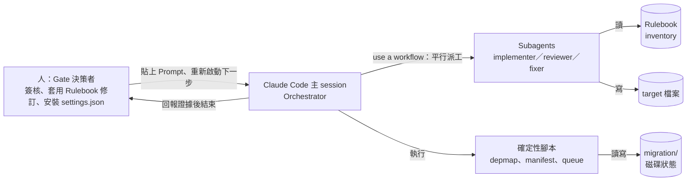

- **Orchestrator**：主 session 讀 Prompt、跑腳本、用「workflow」平行派出 Subagent，到 Gate 時把證據交給人後**結束**（CLAUDE.md 第 3 條）。
- **Worker**：Subagent 各自在獨立 context 裡翻譯、審查或修復一個單位。
- **規則的作者助手**：Rulebook 由人與 Claude 對話起草，再由 Agent 調查程式碼事實（「有幾個 struct 欄位」、「全樹有幾處用法」）。
- **人**：在每個 Gate 決定要不要繼續、套用 Rulebook 修訂、安裝或調整 `settings.json`、決定模型計畫。

> 📌 **注意事項**：Kit 的 Prompt 裡大量出現「Use a workflow.」。在 Claude Code 2.1.322，直接說「use a workflow」會觸發 **Dynamic workflows**（Claude 寫一支 JavaScript 編排腳本、在背景平行執行 Subagent）。官方文件寫明 workflow「執行中不能接受使用者輸入，Stage 之間要簽核就把每個 Stage 當成獨立的 workflow」——這和 Kit「Gate 結束 workflow、由人重新啟動下一步」的設計完全吻合（第 7.2 節）。

### 1.6 Migration Kit 的核心特色

1. **Structure-Preserving 預設**：同樣的架構、同樣的資料結構、換一個語言。這是流程能被範本化的前提。
2. **Rulebook-Driven**：「如果兩個 Agent 可能給出不同答案，答案就寫進 Rulebook。」
3. **Fix the process, not just the code**：個別錯誤由 fixer 消化；重複錯誤代表規則有缺陷，要修規則並重新產生受影響的程式碼。
4. **平行 Agent＋對抗式審查**：每個單位 4 個 Agent（實作、兩個審查、修復），審查者假設程式是錯的、只讀不寫、每個 finding 都要引用規則或原始碼行號。
5. **確定性驗證**：依賴地圖用腳本產生（不是讓 Agent 讀檔回報），完成與否看檔案存在，正確與否看編譯器與 Parity Referee。
6. **可恢復**：佇列是「manifest 中還沒有輸出檔的列」，中斷後重新執行就是恢復。Run 2 的 repo 中途被搬家，全新 session 只靠磁碟狀態就正確接續在「Step 5，一個測試失敗」。
7. **成本與權限用設定控制**：禁止的指令用 `settings.json` 擋，不是在 Prompt 裡「拜託不要」；模型依「出錯的影響範圍」分級，而不是依「工作看起來多高級」。

### 1.7 適用與不適用的專案

| 適合 | 不適合（或要調整） |
|---|---|
| 整個專案都要換語言，舊語言最後會被刪除 | JavaScript → TypeScript：TS 是超集合，可逐檔漸進採用，README 明說「大多不需要這些」 |
| 架構與資料結構可以一對一保留 | 同時要重新設計架構：Rulebook 變成設計文件、**Bakeoff 失效**、工作單位變成模組（第 1.8 節） |
| 原系統可以執行（才能當 executable spec） | 原系統無法在可控環境執行，或沒有任何可觀察的外部介面 |
| 有預算做 4 Agent／檔的審查拓撲 | 只有一兩個檔案：單檔轉換不需要這套機制 |
| 團隊願意在 Rulebook 與 Stress test 投入大量人工 | 期待「按一個鍵就好」 |

### 1.8 Structure-Preserving Migration 的設計理念

Kit 預設「保留結構」，原因有三：

1. **可以範本化**：一對一的檔案對應，讓 manifest、命名規則、完成判斷都能機械化。
2. **可以比對**：結構一樣，Bakeoff 的兩個翻譯差異才有意義；Parity 失敗時才能逐函式追查。
3. **風險隔離**：「換語言」與「改設計」是兩種風險，混在一起時無法判斷錯誤來源。

如果你的遷移**同時**要重新設計，README 的〈If you're redesigning〉一節列出四個變化：

| 項目 | Structure-preserving | Redesign |
|---|---|---|
| Rulebook | 對照表（每個構造怎麼翻） | 設計文件（新架構是什麼） |
| Bakeoff | 有效 | **無效**：差異反映的是你的重新設計，不是規則品質；改用「設計文件的對抗式審查」＋「便宜地整套跑一次、檢討、修規則、整套丟掉」 |
| 工作單位 | 檔案 | 模組或子系統 |
| 行為比對 | 不變 | 不變（它不看內部） |

Mike Krieger 的 Python → TypeScript 屬於後者：他把整個遷移跑了三次，前兩次的輸出全部丟掉。

### 1.9 Rulebook-Driven Migration 的重要性

Rulebook 是整個流程裡**唯一由人主導、所有 Agent 共享**的東西。它要回答的，是「兩個 Agent 可能答得不一樣」的每一個問題：

```text
不好的 Rulebook 條目（靠判斷）：
  - 盡量使用 idiomatic 的 TypeScript
  - 小心處理 null

好的 Rulebook 條目（可機械套用）：
  | Python round(x)    | roundHalfEven(x)，from target/num.ts | Math.round 在 .5 一律進位 |
  | dict.get() 缺鍵/None | null；讀取寫 `?? null`              | undefined 不得進入資料結構 |
```

Run 1 的 Bakeoff 抓到一個「兩邊都錯」的例子：照規則翻的版本在 Python 會 crash 的地方，默默輸出了含有字串 `undefined` 的壞資料（`"01xundefined"`）——而且完全符合當時的規則。這個錯誤如果沒在 Step 2 抓到，會複製到每一個翻譯檔。這就是 Rulebook 必須先被「壓力測試」的理由。

### 1.10 為什麼不建議讓 AI 一次翻譯整個專案

| 一次翻完的做法 | 會發生什麼 | Kit 的對策 |
|---|---|---|
| 一個長對話翻全部 | Context 被擠爆，前後規則不一致 | 每檔一個 Subagent，規則寫在 Rulebook |
| 讓 AI 邊翻邊編譯 | Agent 開始為了「能編譯」而保守、少翻；64 個 Agent 各自編譯讓機器變暖爐 | 翻譯期間禁止編譯（`settings.json`） |
| 讓 AI 自己判斷順序 | 每次跑出不同的順序與漏網的循環依賴 | 確定性依賴地圖＋SCC 批次 |
| AI 自我審查 | 被評分的人放寬自己的評分標準 | 獨立 context 的對抗式審查，Rulebook 迴圈內唯讀 |
| 進度靠對話記憶 | 中斷就要重來 | 佇列＝磁碟上還沒有輸出的列 |
| 「測試通過」當完成 | 原測試若 import 內部函式，會和舊語言一起消失 | 先建 Judge，從外部介面比對新舊行為 |

> 📌 **實務案例**：Bun 的檔案層級依賴圖是乾淨的，但編譯時仍冒出數千個錯誤（官方文章）——原因是 Zig 的 lazy compilation 容忍的**套件層級**循環 import，在 Rust 的模組系統裡不被允許。Kit 因此要求依賴地圖在「檔案」與「目標語言的套件」兩個粒度都要檢查循環。

### 1.11 本章 AI 產出審查

當你請 Claude 幫忙寫「為什麼要遷移」的簡報或評估摘要時，用以下方式審查：

| 檢查項目 | 壞例 | 好例 | 怎麼抓 |
|---|---|---|---|
| 是否把案例數字當成估算 | 「參考 Bun 經驗，本專案兩週可完成」 | 「Bun 案例為 Anthropic 內部條件；本專案估算見 Feasibility 報告的分段估計」 | 搜尋報告中的「Bun」「兩週」「100 萬」 |
| 是否區分 Kit 與官方文章 | 「Kit 會自動產生 576 行 Rulebook」 | 「Bun 的 576 行 PORTING.md 是人與 Claude 共同撰寫；Kit 只提供範本」 | 對照 README Provenance 段 |
| 是否提到「不遷移」選項 | 只列遷移好處 | 有 verdict（now／later／don't）與改變結論的關鍵事實 | 搜尋「don't」「不遷移」 |
| 是否混淆 redesign | 「順便把架構改成微服務」 | 「本次為 structure-preserving；架構調整另案」 | 看 Rulebook §0 |

```bash
# 簡報稿或評估摘要的機械檢查（Linux／Git Bash）
grep -nE "Bun|兩週|一個週末|100 ?萬|165,?000" slides.md && echo "⚠️ 出現案例數字，確認是否被當成估算"
grep -nE "don'?t migrate|不遷移|later" feasibility.md || echo "⚠️ 沒有出現不遷移選項"
```

---

## 第2章 系統架構與核心元件

本章逐一說明官方 Repository 的**實際檔案**。所有檔名、參數、輸出格式都取自 commit `cf91c9d` 的原始碼。

### 2.1 Repository 實際結構

```text
code-migration-kit-with-claude-code/          ← 56 個檔案，1 個 commit
├── README.md            227 行  流程定義（六步驟、redesign、成本）
├── CLAUDE.md             87 行  Claude Code 操作手冊（8 條 Standing rules）
├── RUN-NOTES.md         179 行  三次自我試跑的收據
├── LICENSE                     Apache-2.0
├── .gitignore                  忽略 migration/、node_modules/、__pycache__/
├── prompts/                    8 支 Prompt
│   ├── 00-feasibility.md          80 行
│   ├── 00b-judge-setup.md         70 行（官方自承未實跑）
│   ├── 01-dependency-map.md       75 行
│   ├── 02-gap-inventory.md        77 行
│   ├── 03-stress-test.md          94 行
│   ├── 04-translation-kickoff.md  63 行（刻意很短）
│   ├── 05-survey-build.md         52 行
│   └── 06-post-parity.md          34 行
├── templates/
│   ├── RULEBOOK.md        134 行  Rulebook 範本（§0～§7）
│   ├── inventory.tsv        5 行  Gap Inventory 欄位＋3 列範例
│   ├── settings.json       32 行  迴圈內禁止指令（只有 Bash 規則）
│   └── settings.README.md  57 行  每條 deny 為何存在
├── scripts/
│   ├── depmap_python.py   211 行  Python 依賴分析（ast）
│   ├── depmap_ts.mjs      134 行  JS/TS 依賴分析（行掃描）
│   ├── depmap_c.py        149 行  C/C++ 依賴分析（#include "..."）
│   ├── make_manifest.py    76 行  order.txt → manifest.tsv
│   ├── queue_runner.mjs   100 行  status／next／verify
│   └── build_daemon.sh    124 行  Step 4 build 傳輸
├── skill/SKILL.md          69 行  code-migration Skill
├── fixtures/{python,ts,c}/      每支 depmap 腳本的測試樹＋期望輸出
└── examples/run1-toml/          Run 1 的完整產物（非可執行 demo）
```

> 📌 **注意事項**：Repository 根目錄的 `.gitignore` 忽略 `migration/`。這是**Kit 自己**的設定（避免把試跑產物提交進 Kit）；在**你的**專案裡，`migration/` 下的 Rulebook、inventory、manifest、cost-log 都必須提交，因為「佇列在磁碟上」需要它們進版本控制。

### 2.2 CLAUDE.md：Claude Code 操作手冊

Kit 的 `CLAUDE.md` 開頭寫明：「你在 Migration Kit 裡，或在一個採用它的 repo 裡。對任何遷移要求動手前先讀這份。」它包含三部分：

**Standing rules（8 條，優先於方便）：**

| # | 規則 | 白話 | 在流程中如何落實 |
|---|---|---|---|
| 1 | Rulebook 在任何迴圈內唯讀 | 被評分的人不能放寬自己的評分標準 | 修訂排佇列、由人在批次之間套用；批次 diff 碰到 RULEBOOK.md 就是自動 finding |
| 2 | 佇列在磁碟上 | 輸出檔存在才算完成，不靠 orchestrator 記得 | `queue_runner.mjs`、manifest |
| 3 | 簽核 Gate 結束 workflow | 看到「stop and show me」就交出證據並結束，不得推測核准後繼續 | 人重新啟動下一步；因規則 2，恢復是免費的 |
| 4 | 審查者對抗、獨立、唯讀 | 每檔兩位、各自 context、假設是錯的、不碰檔案；第三方裁決預設 not-confirmed | fixer 只套用 confirmed 的 finding |
| 5 | 禁止的操作靠設定禁止 | 被 deny 擋下是設計在運作：回報，不要繞路 | `templates/settings.json`；平台自我修改保護擋下時由人修改 |
| 6 | 重複失敗往上游移 | 同一失敗再看到兩次，停止修個案，寫出是哪條規則造成，排修訂並提議重新產生該切片 | Rulebook 修訂流程 |
| 7 | 舊程式碼就是規格 | 行為比對完成前保持可執行；新程式失敗先在舊程式跑一次再分類 | 舊的也失敗＝inherited；絕不跳過、刪除或弱化測試 |
| 8 | Unknown 也是答案 | 規則與 inventory 都沒決定時，用最保守表示法＋可 grep 的 TODO，繼續走 | `TODO(port):` 標記 |

**Where things live（官方路徑契約）：**

| 產物 | 路徑 | 由誰產生 |
|---|---|---|
| Rulebook | `migration/RULEBOOK.md`（從 templates 複製） | Step 1 |
| Dependency map | `migration/depmap/`（edges.tsv、order.txt、cycles.txt） | `scripts/depmap_*` |
| Gap inventory | `migration/inventory.tsv` | Step 1，prompt 02 |
| Work manifest | `migration/manifest.tsv` | Step 1，prompt 01 結尾（`make_manifest.py`） |
| Stress-test report | `migration/stress-test/` | Step 2 |
| 翻譯輸出 | 依 Rulebook 命名規則 | Step 3 |
| Cost log | `migration/cost-log.tsv` | 每支 prompt，每個 Gate 一列 |
| Deviation log | `migration/RULEBOOK.md` 的 Deviation log 節 | 在 Gate 寫入 |

**Model guidance**：Token 花費集中在迴圈；**影響範圍決定模型等級，不是工作的「地位」**。Rulebook 撰寫與修訂用最大的模型（一次性工作，每個錯誤都會複製到每個翻譯檔）；skeptic reviewer 用最大或中階；大量翻譯的 implementer 用中階或小型（後面有兩個審查者與編譯器）；fixer 用中階（編譯器才是真正的裁判）。模型計畫是人在 Feasibility Gate 做的決定，01～06 的 Prompt 以 `[model]` 佔位字接收；**Subagent 沿用未經指定的預設模型屬於流程違規**，要記入 deviation log。

> 📌 **實務案例**：Run 3 中，一個 Agent 嘗試 `cargo check` 被 deny 擋下，接著嘗試修改 `settings.json` 解除 deny，又被平台的自我修改保護擋下，最後引用 Kit 的「不得繞路」規則回報給人，由人擔任 build daemon。三層防護在同一事件中出現，但真正擋下來的是**機械層**。

### 2.3 Prompts：八支流程 Prompt

所有 Prompt 的共同格式：開頭是 `When`／`Prerequisites`／`Placeholders`，`---` 以下才是要貼給 Claude 的本文；本文最後一段一律要求在 `migration/cost-log.tsv` 附加一列。

| Prompt | 所屬步驟 | 何時執行 | 佔位字 | 主要產出 | Gate（停下來給人看什麼） |
|---|---|---|---|---|---|
| `00-feasibility.md` | 前置 | 最先；對 repo 唯讀，唯一允許的寫入是 cost-log | `[target language]`、`[kit path]` | 報告：離開的理由、三個決定、六步驟實例化、成本區間、**模型計畫**、verdict | verdict：now／later／don't |
| `00b-judge-setup.md` | 前置 | Feasibility 說 migrate、且公開介面測試太少時 | `[target language]`、`[reviewer model]` | 可攜式 parity harness、portable／internal-bound 計數、兩次驗證（原系統全過、每個突變都被抓到） | 人簽核「Judge 是真的」 |
| `01-dependency-map.md` | Step 1 | 可立即開始 | `[your dependency mechanism]`、`[crate / package / module]`、`[reviewer model]` | 確定性腳本、`migration/depmap/`、兩粒度循環清單、`manifest.tsv` | 計數、兩粒度循環、檔案路徑 |
| `02-gap-inventory.md` | Step 1 | Rulebook 草稿存在後 | `[name your gap]`、`[reviewer model]` | `migration/inventory.tsv`（分片後合併）、聯合稽核衝突清單 | 前 20 列先停一次；完成後看計數、UNKNOWN、衝突 |
| `03-stress-test.md` | Step 2 | Step 1 簽核後；**只適用 structure-preserving** | `[3]`、`[target language]`、`[target formatter]`、`[implementer model]`、`[reviewer model]` | `migration/stress-test/` 選檔報告、diff 報告、修訂佇列、遵從度 findings | 修訂佇列；人套用後重貼本 Prompt 進入 re-round |
| `04-translation-kickoff.md` | Step 3 | Stress test 簽核後 | `[100]`、`[TODO(port)]`、`[implementer model]`、`[reviewer model]` | 翻譯檔、burndown | 每個批次 Gate |
| `05-survey-build.md` | Step 4 | 翻譯佇列為 0；Step 4 併入 Step 3 時**整支跳過** | `[build command]`、`[module]`、`[fixer model]`、`[reviewer model]` | 錯誤佇列 TSV、每輪 `build-output-rN.txt` | 每輪錯誤數變化 |
| `06-post-parity.md` | Step 6 之後 | Done-gate 通過後，不可並行 | `[target tree]`、`[reviewer model]` | 標記分類表、每個修正的 parity 結果 | 未經簽核不得合併 |

> 📌 **注意事項**：Step 5（Run it）**沒有**專屬 Prompt，README 表格的 Kit artifact 欄就是「—」。Step 6 也沒有「執行 parity」的 Prompt：它用的是你在 00b 建好的 Judge（或原有的公開介面測試）。`06-post-parity.md` 是 Step 6 **之後**的標記清理，不是 Step 6 本身。

每支 Prompt 的重點與陷阱在第 6 章逐一展開。這裡先列出幾個容易誤解的地方：

- **00 只允許一次 build**：「read-only commands 可以；不得編輯、不得跑測試；可以跑一次 build（加上 typecheck，如果是分開的指令）——為現有 build 計時就是基準。」
- **00 禁止精確數字**：成本只能給數量級區間，「精確的預測會錯，並侵蝕信任」。
- **03、04 開頭都會檢查 `.claude/settings.json`**：不存在就停下來請人安裝，**絕不自行安裝或覆寫**（Run 3 的 orchestrator 偵測到檔案不存在後自己安裝了，等於把「決定裁判價格」這個人類決策自動化掉）。
- **04 刻意很短**：「到了 Step 3，Rulebook 就是 Prompt——如果你的 kickoff 需要比這更長，代表 Rulebook 還沒寫完。」

### 2.4 Templates：三份範本

#### 2.4.1 RULEBOOK.md

範本結構（取自 Bun 的 `PORTING.md` 通用化）：

| 節 | 內容 | 填寫重點 |
|---|---|---|
| §0 Scope and posture | structure-preserving 宣告、草稿不需編譯、先求正確再求效能 | 若 Step 4 併入 Step 3，改成「cheap-referee variant」 |
| §1 Ecosystem adoption | Async 模型、標準 I/O、字串／bytes、第三方套件（預設 NONE）、錯誤模型 | 每一列都要有「為什麼」 |
| §2 Constructs with no equivalent | 每個來源構造只有一個標準翻譯；含 BUG rule、error-recovery rule、UNKNOWN rule | 範本內建一列 C `isalpha()` 的實例（來自 Run 2） |
| §3 Sanctioned escape hatch | `unsafe` 等逃生門的使用條件；標記 `TODO(port):`、`PERF(port):`、`BUG(port):`、`SAFETY:` | 「格式是承重的，不要改變」 |
| §4 Naming and output paths | 來源路徑 → 目標路徑、模組命名、測試命名、import specifier、共用型別的「家」 | 這些規則讓「完成＝檔案存在」成立 |
| §5 The gap inventory | 指向 `migration/inventory.tsv` | 決定不由 implementer 做，而是查表 |
| §6 Per-file obligations | 每檔結尾 `// PORT STATUS: confidence=[high\|medium\|low] todos=[N]` | reviewer 核對 todos 與實際 `TODO(port)` 數 |
| §7 Deviation log | `DEV-001` 格式：ID、日期、偏離內容、核准人 | 「沒有人記錄的偏離，就是沒有人核准的偏離」 |

#### 2.4.2 inventory.tsv

固定 7 欄，第一行是註解（說明 `allocation-guard`／`precondition-guard` 標籤）：

```text
file  symbol  source_construct  classification  target_translation  evidence  status
```

範本附三列示範：C 的 arena 借用指標（`BORROWED` → `&'arena str`）、Python 初始化後被修改的 dict（`OWNED_MUTABLE`）、跨執行緒別名指標（`UNKNOWN` → `Option<NonNull<u8>>`＋`TODO(port)`）。

#### 2.4.3 settings.json 與 settings.README.md

`settings.json` 只有 `permissions.deny`（18 條）與 `permissions.allow`（6 條），**全部是 `Bash(...)` 規則**：

| 類別 | deny 規則 | 為什麼（settings.README.md） |
|---|---|---|
| Git 變更 | `git rebase／reset／checkout／stash／push／commit／merge／switch／restore／clean` | 共用 worktree 時，一個 `git reset` 會毀掉其他 15 個 Agent 進行中的工作；`git clean` 最危險，因為翻譯輸出在批次 commit 前都是 untracked |
| 編譯器 | `cargo build／check／test／run`、`npx tsc`、`make`、`cmake` | 便宜的理由：64 個 Agent 各自編譯讓機器變暖爐；重要的理由：能編譯的 Agent 會開始為編譯器最佳化而不是為 Rulebook——保守、少翻 |
| 測試 | `npm test` | Step 6 的 fixer 只讀失敗證據，只有 build daemon 重跑測試 |
| allow | `git status`、`git diff`、`git log`、`grep`、`rg`、`wc` | 審查者用來取證 |

`settings.README.md` 還有兩段關鍵說明：

- **「這些規則是防止迴圈內誤觸的護欄，不是安全邊界——有心的 wrapper script 可以繞過模式比對。」**
- **刻意沒有「禁止編輯 Rulebook」的規則**：permission 規則無法表達「迴圈 Agent 唯讀、人可寫」，所以靠 Prompt 契約與審查落實。

> 📌 **注意事項**：`settings.json` 的安裝時機是「**人**在 prompt 03 之前安裝，有效到 Step 4（prompt 05），Step 6 修復迴圈時重新啟用 test 類 deny」。這不是一次性設定，而是隨階段調整的護欄；每次調整都應記入 deviation log。

### 2.5 Scripts：六支確定性腳本

| 腳本 | 執行環境 | 輸入 | 輸出 | 用在 |
|---|---|---|---|---|
| `depmap_python.py` | Python 3（標準函式庫） | `--root <repo>` | `edges.tsv`、`order.txt`、`cycles.txt` 到 `--out` | prompt 01 |
| `depmap_ts.mjs` | Node（標準函式庫） | 同上 | 同上 | prompt 01 |
| `depmap_c.py` | Python 3 | 同上 | 同上 | prompt 01 |
| `make_manifest.py` | Python 3 | `--order order.txt`、`--sub 'old=new'`（可重複） | `--out manifest.tsv`（`source\ttarget`） | prompt 01 結尾 |
| `queue_runner.mjs` | Node | `--manifest manifest.tsv` | `status`（burndown）、`next --batch N`（JSON）、`verify`（空檔即 exit 1） | prompt 04、Step 4 前置 |
| `build_daemon.sh` | bash＋coreutils（`sha256sum` 或 `shasum`） | `--cmd "<build>"`、`--interval N`、`--once` | `migration/build-output-rN.txt`，N 從磁碟自動遞增 | prompt 05 |

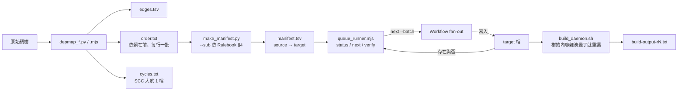

#### 2.5.1 依賴分析器的共同契約

三支 depmap 腳本輸出格式完全相同：

- **只算 repo 內的邊**：標準函式庫、第三方、vendored、generated 既不是邊也不是遺漏。
- **確定性**：依排序走訪檔案、輸出排序；同一棵樹跑兩次結果逐位元相同。
- **Tarjan SCC**：大於 1 個檔案的強連通元件就是循環，要當成一批一起遷移。
- **0 edges 警告**：多個檔案卻 0 條邊時印出 WARN（Run 1 把 `--root` 指到套件目錄，得到「看起來很乾淨的錯誤地圖」）。

各語言的差異：

| 腳本 | 解析方式 | 排除 | 已知限制（官方註解） |
|---|---|---|---|
| `depmap_python.py` | `ast`（絕不用 regex）；處理相對 import 與 `__init__.py` | `venv`、`node_modules`、`__pycache__`、`generated`、以 `.` 開頭的目錄 | 動態 import 不會被看到 |
| `depmap_ts.mjs` | 行掃描 regex：`import … from`、`export … from`、`require()`、`import()` | `node_modules`、`dist`、`build`、`.git`、`coverage`、`.d.ts`、symlink | 只處理相對路徑；tsconfig `paths` 別名要換成 ts-morph 或 TypeScript compiler API |
| `depmap_c.py` | 只解析 `#include "..."`；`.c` 自動連到同名 `.h` | `build`、`vendor`、`third_party`、`node_modules` | 不跑前處理器，`#ifdef` 內的 include 全算（保守）；大型巨集樹改用 `gcc -MM` |

**實測（✅，Windows 11）**：在 Kit 目錄執行三支腳本對 `fixtures/` 的自測，結果全部與期望輸出一致：

```text
depmap_python.py  files=4 edges=4 batches=2 cycles=1   edges/cycles/order 與 expected 相同
depmap_c.py       files=3 edges=3 batches=2 cycles=1   edges/cycles/order 與 expected 相同
depmap_ts.mjs     files=4 edges=4 batches=2 cycles=1   內容相同，但換行不同（見下方注意事項）
```

> 📌 **注意事項（Windows 實測）**：在 `core.autocrlf=true` 的機器上 clone Kit，fixtures 的期望檔會被轉成 CRLF。Python 腳本用文字模式寫檔，在 Windows 也輸出 CRLF，所以剛好一致；Node 腳本輸出 LF，用官方 Test 註解中的 `diff` 會判定不同，但 `diff --strip-trailing-cr` 相同。反過來，在 `autocrlf=false` 的 Windows 機器上，換成 Python 腳本的 diff 失敗。這不是腳本的邏輯錯誤，但會讓第一次自測的人誤以為腳本壞了。

#### 2.5.2 make_manifest.py

把 `order.txt` 的每個來源路徑，依序套用 `--sub old=new`（單純字串取代）得到目標路徑。兩個保護：`--sub` 格式錯誤 exit 1；**任何一個目標等於來源（代表取代沒有生效）就拒絕寫檔**，避免 manifest 把目標指回原始碼。

```bash
# 官方 Test 註解：Python 套件 pkg/ → TypeScript ts/
python3 scripts/make_manifest.py --order fixtures/python/expected_order.txt \
  --out /tmp/manifest.tsv --sub 'pkg/=ts/' --sub '.py=.ts'
```

#### 2.5.3 queue_runner.mjs

佇列的定義就是一句話：**manifest 中目標檔還不存在的列**。三個子命令：

| 子命令 | 輸出 | 用途 |
|---|---|---|
| `status` | `1/2 done (50.0%)`＋每個來源目錄的 `done/total` | 每個 Gate 回報 burndown（不是文字描述） |
| `next --batch 100` | JSON 陣列 `[{source, target}, …]` | 給 workflow fan-out |
| `verify` | 有任何「已完成」的目標是 0 位元組就 exit 1 | 抓「touch 一個空檔假裝完成」的作弊 |

> 📌 **注意事項（依原始碼判讀，🧪）**：`queue_runner.mjs` 以 `readFileSync(...).trim().split("\n")` 切行，再要求表頭第二欄嚴格等於 `target`。若 manifest 是 CRLF（例如在 Windows 用文字模式寫出、或被 `core.autocrlf` 轉換），表頭第二欄會是 `target\r`，腳本印出 `manifest must have header "source\ttarget"` 並 exit 1。作者在本機執行此腳本時被 Claude Code auto mode 的「外部程式碼」分類器擋下，因此標為 🧪；第 4.9 節提供預防做法。

#### 2.5.4 build_daemon.sh

「擁有 build 的 daemon 是唯一執行編譯器的程序」。行為：

1. 以內容雜湊監看原始碼樹（排除 `.git`、`target`、`node_modules`、`dist`、`build`、`migration`）。
2. 雜湊改變（第一次迴圈一定會）就執行 `sh -c "$CMD"`，stdout＋stderr 寫到 `migration/build-output-r<N>.txt`。
3. N 從磁碟上已有的檔案自動遞增（「filesystem is the state」）。
4. 每輪印一行：`round N: exit RC -> 檔案`。

```bash
# 人啟動一次，放著跑（Linux／macOS／WSL／Git Bash）
bash migration-kit/scripts/build_daemon.sh --cmd "cargo check --all-targets" --interval 30
# 官方自測：在暫存目錄跑一輪
bash migration-kit/scripts/build_daemon.sh --cmd "echo hello" --once   # 產生 migration/build-output-r1.txt
```

> 📌 **注意事項**：`build_daemon.sh` 需要 bash 與 `sha256sum`／`shasum`。Windows 請在 Git Bash 執行（Git for Windows 內建 `sha256sum`，本機已確認存在），**不要**在 PowerShell 直接呼叫。官方 RUN-NOTES 記錄它在 2026-06-11 驗證過 `--once`、輪次從磁碟續號、錯誤參數拒絕；作者未在本機執行（🧪，理由同上）。

### 2.6 Skill：code-migration

`skill/SKILL.md` 的 frontmatter：`name: code-migration`，description 寫明在使用者要求遷移、port、改寫成另一個語言，或要求可行性評估時使用；**不用於** JS → TS 漸進採用或單檔轉換。

它的本體是一張「依磁碟狀態判斷目前在哪一步」的路由表：

| 狀態 | Skill 要 Claude 做什麼 |
|---|---|
| `migration/` 不存在 | 跑 00 Feasibility，交出 verdict 後**停止**；即使結論是「現在遷移」也不得在同一 session 開始 Step 1 |
| Feasibility 已簽核、沒有 Judge | 確認既有測試是否走公開介面；否則跑 00b，在其 Gate 停止 |
| Feasibility＋Judge 已簽核、沒有 map／rules | 調整 depmap 腳本（01）、複製並與人共同起草 Rulebook、跑 02；各自在自己的 Gate 停止 |
| Step 1 已簽核 | 確認**人**已安裝 `.claude/settings.json`；先看 Rulebook §0——若是 redesign，Bakeoff 無效，改做設計文件對抗式審查並告訴人原因；否則跑 03 |
| Stress test 已簽核 | 確認 `manifest.tsv` 存在；若 typecheck 便宜，請人在 Gate 移除相關 deny（自己絕不修改）；跑 04 |
| 翻譯佇列為空 | 05（或跳過）→ Step 5 → Step 6 |
| Step 6 done-gate 通過 | 06 |

Skill 本文第一段有兩個 `[kit path]` 佔位字，**安裝時必須換成 Kit 的實際路徑**，否則 Claude 找不到 README 與 CLAUDE.md（第 4.6 節）。

### 2.7 fixtures、examples 與 RUN-NOTES

| 目錄／檔案 | 內容 | 怎麼用 |
|---|---|---|
| `fixtures/python/` | `pkg/` 內 3 檔循環（`__init__` → `c` → `a` → `__init__`）、stdlib 與第三方 import、`generated/` 目錄 | 驗證 `depmap_python.py` 與 `make_manifest.py` |
| `fixtures/ts/` | `a → b → c → a` 循環（import／export-from／require 各一）、目錄 index 解析、`dist/` | 驗證 `depmap_ts.mjs` |
| `fixtures/c/` | `foo.h ⇄ bar.h` 循環、角括號 include、`vendor/` | 驗證 `depmap_c.py` |
| `examples/run1-toml/` | 填好的 RULEBOOK（含 A1、A2 共 11 條修訂）、20 列 inventory、skeptic 稽核筆記、14 列 Bakeoff diff 報告、選檔理由、雙邊 parity 腳本 | 學習「寫好的 Rulebook 長什麼樣」 |
| `RUN-NOTES.md` | Run 1（toml，Py→TS）、Run 2（tinyexpr，C→Rust，非工程師依文件操作）、Run 3（同 repo，強制走昂貴裁判路徑）、腳本驗證紀錄 | 理解每條規則從哪個失敗而來 |

`examples/run1-toml/` 的 README 明說：這些是「保存下來的執行產物，不是可執行的 demo」；`py_side.py`／`node_side.mjs` 需要用 `TOML_SRC`、`TOML_TS_DIST` 環境變數指向你自己 clone 的 toml 原始碼與建好的 TS dist。

### 2.8 官方文章與 Kit 的差異

| 主題 | 官方文章描述的實務 | Kit 範本 |
|---|---|---|
| Rulebook | Bun：576 行對照表；Mike：設計文件 | 134 行範本，預設對照表形式 |
| Rulebook 審查 | Jarred 用 8 個 Subagent 各審一類常見錯誤 | prompt 02 的聯合稽核＋兩位 skeptic |
| Stress test | 3 個檔案、3 個 Agent（照規則、資深工程師、把 diff 變成規則）；只適用 structure-preserving | prompt 03：Bakeoff＋Pilot 並行，選檔依分數 |
| 編譯在迴圈的位置 | Mike 每個迴圈都跑 tsc；Jarred 排除 cargo（build 要數分鐘） | README Step 4：「每個裁判都有價格，價格決定它在迴圈中的位置」 |
| Judge | Mike 用 7 個真實情境的 parity harness，之後連續四晚跑自主端對端測試 | prompt 00b（未實跑） |
| Build daemon | 唯一可重建 binary 的程序，批次處理 patch 避免重複重建 | `scripts/build_daemon.sh` |
| 模型 | 實作者可用較小模型、審查者用較大模型；Mike 用 Sonnet 跑 12 個 Subagent | CLAUDE.md Model guidance＋Feasibility 的 Model plan Gate |

### 2.9 本章 AI 產出審查

請 Claude 說明 Kit 內容時，AI 很容易「補完」不存在的東西。用下列指令核對：

| 常見幻覺 | 實際 | 核對指令 |
|---|---|---|
| 「Kit 提供 `migrate` CLI」 | 沒有任何 CLI，只有 Prompt 與腳本 | `ls migration-kit` |
| 「`prompts/05-run-smoke.md`」 | Step 5 沒有 Prompt；05 是 survey build | `ls migration-kit/prompts` |
| 「settings.json 也擋 PowerShell」 | 只有 `Bash(...)` | `grep -c PowerShell migration-kit/templates/settings.json`（結果 0） |
| 「queue_runner 會自動派工」 | 只輸出 JSON，派工是 workflow 的事 | 讀 `scripts/queue_runner.mjs` 開頭註解 |
| 「00b 已經過實戰驗證」 | RUN-NOTES：Designed, not yet dogfooded | `grep -n "not yet dogfooded" migration-kit/RUN-NOTES.md` |

```bash
# 把 AI 寫的說明文件中提到的 Kit 路徑，逐一確認存在（Git Bash／Linux）
grep -oE '(prompts|templates|scripts|skill|fixtures|examples)/[A-Za-z0-9_./-]+' ai-notes.md | sort -u \
  | while read -r p; do [ -e "migration-kit/$p" ] || echo "不存在：$p"; done
```

---

## 第3章 整體系統架構圖

本章的圖分成兩種：**官方 Kit 的元件與流程**（依原始碼與 README 繪製），以及**企業整合**（CI/CD、Hook、Parity Referee 實作）——後者以 🏢 標示。

### 3.1 整體架構圖

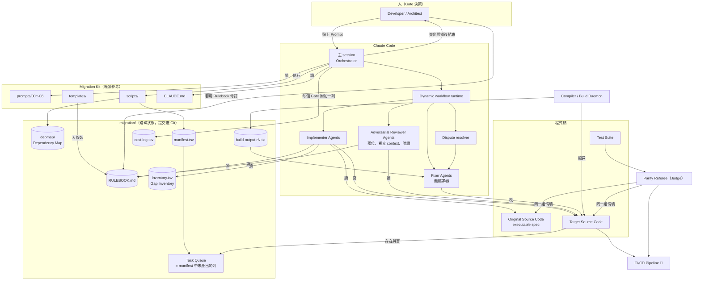

**說明**：

- 圖中所有「狀態」（Rulebook、地圖、manifest、佇列、build 輸出、成本）都在 `migration/` 這個資料夾，**不在任何 Agent 的記憶裡**。Orchestrator 被關掉、換一台機器，只要磁碟狀態還在就能繼續。
- 人只出現在兩條線上：貼 Prompt 啟動一步、在 Gate 收證據並決定下一步（包括套用 Rulebook 修訂）。Rulebook 的寫入箭頭只從「人」出發，這就是 Standing rule 1。
- Build Daemon 是唯一直接編譯 Target Source Code 的元件；Fixer 只從 `build-output-rN.txt` 讀錯誤。
- Parity Referee 對 Original 與 Target 下**同一組情境**，它不看內部結構，所以 redesign 遷移也適用。
- CI/CD 是企業整合（🏢），Kit 本身沒有提供；第 9.4 節有實作。

### 3.2 Migration Kit 元件關係圖

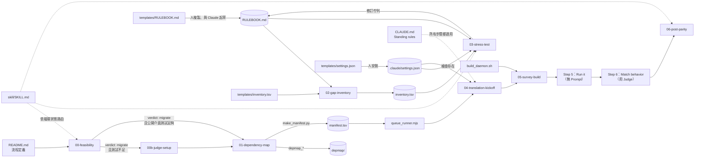

**說明**：

- 實線是「產出被下一步使用」；虛線是「規則或路由」。
- `settings.json` 有兩條進入 03 與 04 的線：這兩支 Prompt 開頭都會**檢查**它存在且有 deny 規則，不存在就停下來請人安裝。
- `05-survey-build` 在 Step 4 併入 Step 3 時整支跳過（TypeScript、Go 這類型別檢查便宜的目標）。
- Step 5 與 Step 6 本身沒有 Prompt：Step 5 是你手動或請 Claude 跑 hello world 與 smoke；Step 6 用前置 0b 建好的 Judge。

### 3.3 AI Agent 協作架構圖

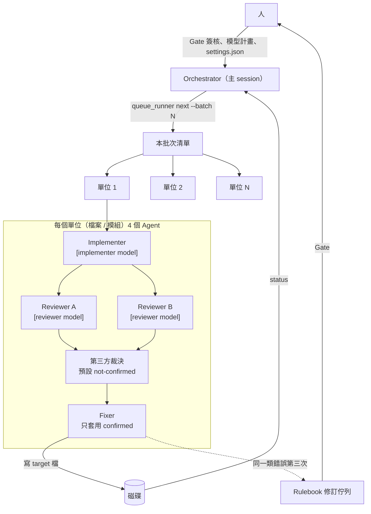

**說明**：

- 每個單位固定 4 個角色（README 說「4 個 Agent／檔案是乘數，也是產品」），加上意見不一致時的第三方裁決。
- 兩位 Reviewer 看不到彼此的結論；這個「花兩倍錢」的設計，在 Run 1 抓到 20 列 inventory 中 7 個證據品質缺陷。
- Fixer 看到「同一類錯誤第三次」時，不再修個案，而是把問題送進 Rulebook 修訂佇列，由人在 Gate 決定是否修規則並重新產生該切片。
- 模型以 `[implementer model]`／`[reviewer model]` 佔位字明確指定，沿用 session 預設值算偏離。

### 3.4 程式碼翻譯及審查流程圖

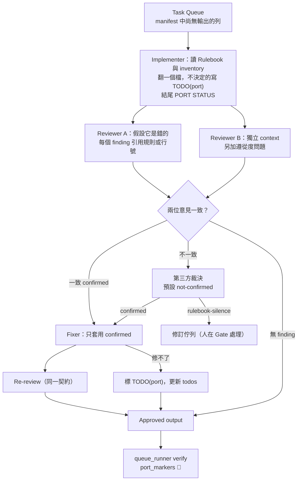

**說明**：

- 這是 prompt 04 的單位流程，Step 2 的 Pilot 也用完全相同的流程（「same prompts, no special pilot versions」）。
- 「修不了就標記」是 CLAUDE.md 第 8 條的落實：一個可以搜尋的 `TODO(port)` 勝過卡住的批次。
- 最後的 `verify` 是官方的（抓空檔），`port_markers` 是本手冊的企業延伸工具（核對 `PORT STATUS` 的 todos 與實際標記數，第 6.3 節）。

### 3.5 編譯與錯誤修復流程圖

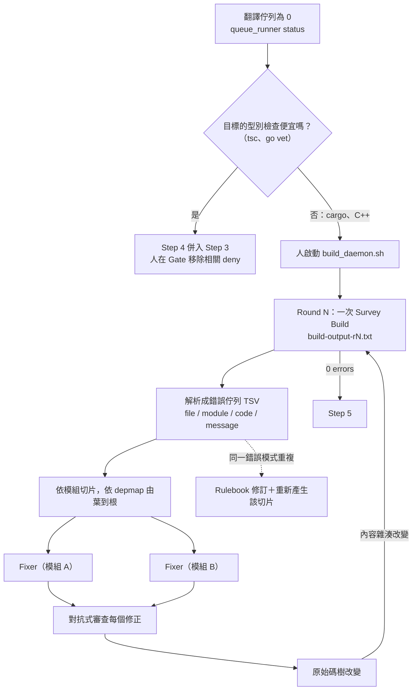

**說明**：

- 「每個裁判都有價格，價格決定它在迴圈中的位置」：TypeScript、Go 的型別檢查只要幾秒，直接放進每個單位的迴圈；Rust、C++ 的 build 要數分鐘，就集中由 daemon 每輪跑一次。
- 一次切片只派給一位 Fixer，避免多個 Agent 同時改同一模組。
- Fixer 沒有編譯器，只依錯誤訊息與原始碼寫 patch；Run 3 顯示這樣可行：第 1 輪 2 個錯誤、第 2 輪 0 個。

### 3.6 新舊程式碼行為比對流程圖

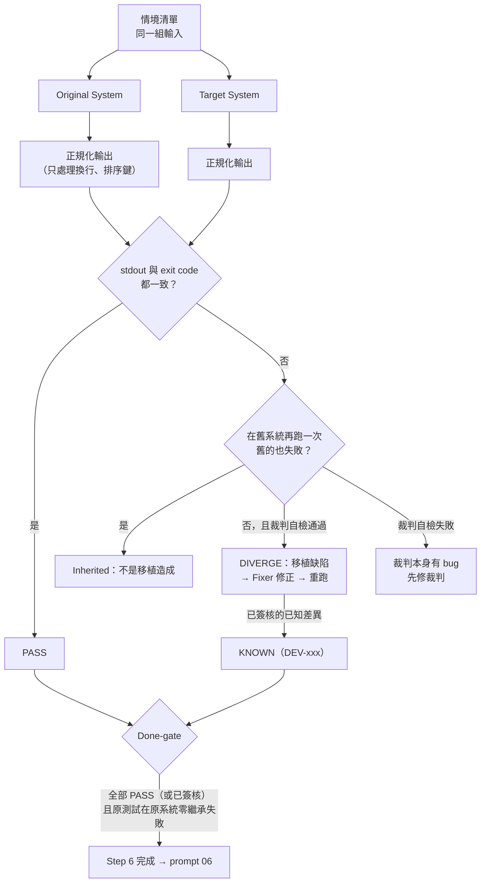

**說明**：

- 正規化只做「不改變語意」的事。Kit Run 1 的裁判在證明移植有問題之前，自己先出了兩個 bug：比較時沒處理空白差異、`JSON.stringify` 把 NaN／-Infinity 變成 null——結果 12/12 全部「不一致」，全是假的。README 的結論：「**一個什麼都判失敗的裁判，通常是裁判壞了。**」
- 分類一定要「在舊系統再跑一次」（CLAUDE.md 第 7 條）：舊的也失敗＝inherited，不是你的。
- KNOWN 是本手冊 Parity Referee 的企業延伸（🏢）：需要在 Rulebook deviation log 有對應的 DEV 編號，代表已有人簽核接受。官方 done-gate 是「parity referee 的每個測試都通過」。

### 3.7 完整六階段遷移流程圖

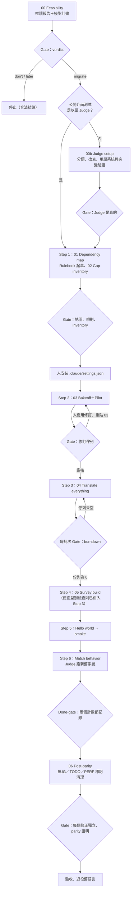

**說明**：

- 菱形全部是**人**做的決定；每個 Gate 之後都是人重新啟動下一步（貼 Prompt 或重新呼叫 Skill）。
- 「人安裝 settings.json」被畫成獨立步驟，因為官方特別強調它是人的行為：Run 2 整個流程都沒有安裝而沒人發現，Run 3 則是 orchestrator 自己裝了。
- Step 2 有一個迴圈：人套用修訂後重貼 03，它會從磁碟狀態判斷這是 re-round（換一批新檔案、偏重剛修改的章節）。同一章節被修訂兩次就停下來，需要人做決定而不是第三種措辭。

### 3.8 本章 AI 產出審查

請 Claude 依專案畫架構圖時，常見問題與檢查方式：

| 問題 | 壞例 | 檢查 |
|---|---|---|
| 讓 Agent 寫 Rulebook | `REV -->\|修正\| RB` | 圖中只有「人」能有指向 Rulebook 的寫入箭頭 |
| Fixer 自己編譯 | `FIX --> cargo` | 編譯器的箭頭只能來自 Build Daemon（或已併入時的便宜型別檢查） |
| 進度存在 Agent 記憶 | `ORCH -->\|記住完成清單\|` | 進度只來自 manifest＋檔案存在 |
| 沒有 Gate | 六步驟一路箭頭到底 | 每一步之後都有人的菱形 |

```bash
# 列出 Mermaid 圖中所有「指向 RB（Rulebook）」的箭頭，逐條確認來源是人或人的動作
grep -nE -- '-->(\|[^|]*\|)? *RB\b' architecture.md
# 標籤為「讀」的箭頭可忽略；其餘寫入箭頭的來源只能是人：本章 3.1、3.2 的結果是
# DEV（人套用修訂）、TPL／T1（人複製範本）、P03（修訂「佇列」，由人套用）
```

---

## 第4章 安裝與環境建置

### 4.1 環境需求

Migration Kit 沒有自己的安裝程式，也**沒有標示任何最低版本**。下表的「官方依據」欄只列原始碼中看得到的需求；作者實測版本列在最後一欄，不代表最低需求。

| 項目 | 官方依據 | 作者實測版本 | 說明 |
|---|---|---|---|
| 作業系統 | 未限制；`build_daemon.sh` 需要 bash＋POSIX coreutils | Windows 11 Pro | Windows 需 Git Bash 執行 `.sh`；sandbox 只在 macOS／Linux／WSL2 可用 |
| Git | Prompt 與 settings 大量使用 | 2.45.2 | 需支援 `git worktree`（Bakeoff 的 Translator A） |
| Node.js | `depmap_ts.mjs`、`queue_runner.mjs` 只用標準函式庫 | 24.16.0 | 最低版本官方未標示（🧪）；ES module、`String.prototype.matchAll` 需較新版本 |
| Python 3 | `depmap_python.py`、`depmap_c.py`、`make_manifest.py` 只用標準函式庫 | 3.12.8 | 最低版本官方未標示（🧪）；Prompt 01 寫 `python3`，Windows 要注意 Store 佔位程式 |
| Claude Code | 使用 Subagent／workflow fan-out、permissions、Skills | 2.1.322 | Dynamic workflows 需付費方案（Pro 要在 `/config` 開啟）或 API／雲端供應商 |
| 原系統建置環境 | 00 要跑一次 build 計時；Step 6 要能執行原系統 | — | 舊系統必須能在受控環境執行，否則沒有 executable spec |
| 目標語言工具鏈 | 05 的 `[build command]`、formatter | — | 例如 `cargo`、`rustfmt`、`tsc`、`prettier` |

> 📌 **注意事項**：Kit 腳本都只用標準函式庫，**不需要** `pip install` 或 `npm install`。若你看到有人要求為了 Kit 安裝第三方套件，先停下來確認原因——這通常代表他在用改過的版本。

### 4.2 安裝 Git

**Windows（PowerShell）：**

```powershell
# 安裝 Git for Windows（含 Git Bash 與 sha256sum）
winget install --id Git.Git -e --source winget

# 長路徑：遷移專案的目錄層級通常很深
git config --global core.longpaths true

# 確認
git --version
Get-Command bash, sha256sum | Select-Object Name, Source
```

**Linux：**

```bash
# Debian / Ubuntu
sudo apt-get update && sudo apt-get install -y git
# RHEL / Rocky / Fedora
sudo dnf install -y git
git --version
```

**換行設定（Windows 必讀）**：Kit 的佇列與地圖全部是 TSV，而 `queue_runner.mjs` 以 `\n` 切行。不要依賴各人的 `core.autocrlf`，在**待遷移專案**加入 `.gitattributes`：

```text
migration/** text eol=lf
*.tsv text eol=lf
```

### 4.3 安裝 Claude Code

官方建議原生安裝（會自動更新）：

```powershell
# Windows PowerShell（不需系統管理員）
irm https://claude.ai/install.ps1 | iex

# 或 WinGet（不會自動更新，需定期 winget upgrade Anthropic.ClaudeCode）
winget install Anthropic.ClaudeCode
```

```bash
# macOS / Linux / WSL
curl -fsSL https://claude.ai/install.sh | bash
```

**登入、版本與健康檢查：**

```bash
claude auth login            # 登入；--sso 強制 SSO、--console 用 Anthropic Console
claude auth status --text    # 確認登入狀態（未登入 exit 1）
claude --version             # 本手冊實測 2.1.322
claude doctor                # 不啟動 session 的安裝與 settings 檢查
```

**基本操作**（在待遷移專案根目錄執行 `claude`）：

| 指令 | 用途 | 遷移中的用法 |
|---|---|---|
| `/model` | 切換主 session 模型 | 依 Feasibility 簽核的模型計畫設定 |
| `/workflows` | 查看 dynamic workflow 執行狀態、暫停、儲存腳本 | 監看 fan-out、每個 Agent 的 token |
| `/agents` | 管理 Subagent 定義（Library）與執行中的 Subagent（Running） | 建立 implementer／reviewer 定義（第 7.10 節） |
| `/skills` | 查看已載入的 Skills | 確認 `code-migration` 已載入 |
| `/permissions` | 查看目前生效的權限規則 | 確認 deny 規則已生效 |
| `/config` | 設定（含 Pro 方案開啟 Dynamic workflows） | — |

> 📌 **實測發現**：在**尚未信任**的資料夾執行 `claude doctor`，會看到「Ignoring N permissions.allow entries from .claude/settings.json: this workspace has not been trusted」。也就是專案 settings 的 **allow** 規則要在你互動式開啟並接受信任對話框之後才生效。第一次在新 clone 的專案工作時，請先互動式開一次 `claude`。

### 4.4 下載 Migration Kit

官方 Quick start：把 Kit clone 到待遷移專案**裡面或旁邊**。

```bash
cd /path/to/legacy-app
git clone https://github.com/anthropics/code-migration-kit-with-claude-code.git ./migration-kit
git -C migration-kit log --oneline -1    # 應為 cf91c9d Initial commit — Claude Code Migration Kit
```

兩種放法的差異：

| 放法 | 優點 | 缺點 | 建議 |
|---|---|---|---|
| 專案內 `./migration-kit` | `@migration-kit/CLAUDE.md` 是相對路徑、Claude Code 預設可讀、可用 submodule 釘版本 | 要避免被當成待遷移程式碼（depmap 的 `--root` 不要包含它） | **企業建議**：以 git submodule 加入並釘 commit |
| 相鄰目錄 `../migration-kit` | 不汙染專案 | `@../migration-kit/CLAUDE.md` 屬於 **external import**，第一次會跳核准對話框，拒絕後就不再載入也不再詢問；腳本路徑要用 `/add-dir` 加入工作目錄 | 個人試用 |

**企業建議做法（🏢）用 submodule 釘版本：**

```bash
git submodule add https://github.com/anthropics/code-migration-kit-with-claude-code.git migration-kit
git -C migration-kit checkout cf91c9d5068d9aaf95a36164169f08c3e636c909
git add .gitmodules migration-kit
git commit -m "chore: add migration kit pinned at cf91c9d"
```

> 📌 **注意事項**：depmap 的 `--root` 會遞迴掃描整棵樹。把 Kit 放在專案內時，`fixtures/` 底下的 `.py`、`.ts`、`.c` 會被算進你的依賴地圖。執行 `depmap_*` 時請把 `--root` 指到原始碼目錄（或在調整腳本時把 `migration-kit` 加進 `SKIP_DIRS`），並用 `wc -l migration/depmap/edges.tsv` 與預期檔案數比對。

### 4.5 設定專案 CLAUDE.md

README 要求：「在六個步驟開始前，把 Kit 的 `CLAUDE.md` **複製**或 **`@` 匯入**到目標 repo 的 `CLAUDE.md`——它是每個 session 都會讀的操作手冊。」

| 方式 | 寫法 | 優點 | 缺點 |
|---|---|---|---|
| `@` 匯入 | 在專案 `CLAUDE.md` 寫一行 `@migration-kit/CLAUDE.md` | Kit 升版（或換 fork）自動跟著變；專案規則與 Kit 規則分開 | 路徑錯誤時**不會報錯**，只是沒載入；放在 code span 或 code block 裡不會被匯入 |
| 直接複製 | 把 87 行內容貼進專案 `CLAUDE.md` | 一定會載入；可以加註公司規定 | Kit 更新時要手動同步；容易被誤改 |

`@` 匯入的規則（Claude Code 官方文件）：

- 相對路徑以**寫這行的檔案所在目錄**為基準，不是以目前工作目錄。
- 可以遞迴匯入，最多 4 層。
- 寫在 Markdown code span（反引號）或 fenced code block 中的 `@path` **不會**被匯入。
- 路徑落在工作目錄外（例如 `@../migration-kit/CLAUDE.md`）屬於 external import，第一次會跳核准對話框。

專案 `CLAUDE.md` 範例（匯入 Kit 規則，再加上專案自己的設定）：

📄 `CLAUDE.md`

```markdown
# legacy-pricing 專案的 Claude Code 規範

## Migration Kit 操作規範（官方，唯讀匯入）

@migration-kit/CLAUDE.md

## 本專案的遷移設定（企業延伸，Gate 時由人更新）

- 方向：Python 3.12 → TypeScript 7（Node 24），structure-preserving
- 目前階段：Step 3（Translate everything），Step 4 已併入 Step 3（DEV-001）
- Kit 版本：`migration-kit` 釘在 cf91c9d（內部標籤 `kit-2026.11-r1`），不得自行 pull
- 模型計畫（Feasibility Gate 簽核，prompt 01～06 的 `[model]` 依此填）：
  - Rulebook 撰寫與修訂：opus
  - Skeptic reviewer、diff inspector：opus
  - Implementer、fixer：sonnet
- Judge：`parity/parity.py`（00b 已驗證：self-check 11/11、突變 5/5 被抓到）

## 路徑

| 用途 | 路徑 |
|---|---|
| 舊系統（executable spec，Step 6 完成前不得修改） | `legacy/` |
| 新系統 | `target/` |
| Rulebook／inventory／manifest／cost-log | `migration/` |
| 企業延伸工具 | `tools/migration/` |

## 本專案額外規則

1. 不得修改 `legacy/` 下任何檔案；需要觀察行為時，用 `parity/parity.py` 從外部呼叫。
2. 需要編譯或測試結果時，讀 `migration/build-output-rN.txt`，不要自己執行；被 deny 或 loop-guard 擋下時回報給人。
3. 回報進度只用 `node migration-kit/scripts/queue_runner.mjs --manifest migration/manifest.tsv status` 的輸出，不用文字描述。
4. Windows 上使用 PowerShell 工具時，同樣受第 2 條約束（`.claude/settings.json` 已有 PowerShell deny 規則）。
```

**驗證匯入真的生效**：

```bash
# 1. 機械檢查（第 4.11 節的 preflight 會做同樣的事）
python tools/migration/preflight.py --kit migration-kit --phase feasibility
# 2. 在 Claude Code 內詢問（不要接受「我看到了」這種回答，要它引用條文）
#    > 請逐字引用你載入的 Migration Kit Standing rule 第 5 條第一句
```

> 📌 **注意事項**：Kit 的 `CLAUDE.md` 內提到的 `scripts/queue_runner.mjs`、`templates/settings.json` 等路徑是**相對 Kit 根目錄**寫的。匯入到你的專案後，這些路徑實際在 `migration-kit/` 底下。在專案 `CLAUDE.md` 的路徑表寫清楚，可以避免 Claude 在專案根目錄找不到檔案。

### 4.6 安裝 Skill（選用）

Skill 讓 Claude 在你說「把這個專案移植到 Rust」時，自動依磁碟狀態判斷目前該跑哪支 Prompt。**它是選用的**：不裝 Skill，你一樣可以手動依序貼 Prompt。

**官方指令（Linux／macOS）：**

```bash
cp -r migration-kit/skill ~/.claude/skills/code-migration
# 接著把 ~/.claude/skills/code-migration/SKILL.md 中的 [kit path] 換成 Kit 的絕對路徑
sed -i "s|\[kit path\]|$(pwd)/migration-kit|g" ~/.claude/skills/code-migration/SKILL.md
grep -c '\[kit path\]' ~/.claude/skills/code-migration/SKILL.md   # 應為 0
```

**Windows（PowerShell）：**

```powershell
$dest = Join-Path $HOME '.claude\skills\code-migration'
New-Item -ItemType Directory -Force $dest | Out-Null
Copy-Item -Recurse -Force .\migration-kit\skill\* $dest
$kit = (Resolve-Path .\migration-kit).Path -replace '\\', '/'
$md = Join-Path $dest 'SKILL.md'
$text = (Get-Content $md -Raw -Encoding utf8).Replace('[kit path]', $kit)
[IO.File]::WriteAllText($md, $text, [Text.UTF8Encoding]::new($false))
Select-String -Path $md -Pattern '\[kit path\]'    # 應該沒有輸出
```

| 安裝位置 | 範圍 | 適用 |
|---|---|---|
| `~/.claude/skills/code-migration/` | 個人、本機所有專案 | 官方 Quick start 的做法 |
| `<專案>/.claude/skills/code-migration/` | 跟著專案 repo，所有成員共用 | 🏢 團隊建議：`[kit path]` 可寫成相對路徑 `migration-kit`，避免每個人的絕對路徑不同（🧪 相對路徑的解析基準請在你的版本實測） |
| 企業 managed settings 目錄 | 組織派送 | 大規模推廣 |

> 📌 **實測發現**：在 Git Bash 用 `$(pwd)` 取路徑，得到的是 `/c/repos/...` 或 `/tmp/...` 這類 MSYS 路徑，原生 Windows 的 Claude Code 讀不懂。請改用 `$(pwd -W)`（輸出 `C:/repos/...`）或直接用上面的 PowerShell 版本。

### 4.7 設定與權限管理

#### 4.7.1 權限規則如何生效

| 觀念 | 官方行為 | 對遷移的意義 |
|---|---|---|
| 評估順序 | **deny → ask → allow**，第一個符合的規則決定結果；具體程度不影響順序 | 只要有一條 deny 符合就擋，allow 寫再多也沒用 |
| 設定層級 | managed → 命令列 `--settings` → `.claude/settings.local.json` → `.claude/settings.json` → `~/.claude/settings.json` | 個人 local 檔可以加 allow，但擋不住專案的 deny |
| 陣列合併 | `permissions.allow`／`deny` 在各層級**合併**（managed 可用 `allowManagedPermissionRulesOnly` 限制） | 組織的 deny 會和專案的 deny 一起生效 |
| 複合指令 | 依 `&&`、`\|\|`、`;`、`\|` 等拆開；**任何一個**子指令符合 deny 就擋（含 subshell、`$(...)`、for 迴圈內） | `cd x && cargo build` 會被 `Bash(cargo build:*)` 擋下 |
| 包裝程式 | 會剝除 `timeout`、`time`、`nice`、`nohup`、`stdbuf`、`command`、`builtin`、不帶參數的 `xargs` | `timeout 600 cargo build` 也會被擋 |
| 不是安全邊界 | `/usr/bin/curl`、`sh -c '…'`、`git -C . push` 這類「同一程式的不同寫法」**不會**被比對到 | 需要 Hook 或 sandbox 補強（第 4.8 節） |
| `:*` 語法 | `Bash(ls:*)` 與 `Bash(ls *)` 等價；`:*` 只在結尾有效 | 官方範本用 `:*`，仍然有效 |
| 未信任工作區 | 專案 settings 的 allow 規則被忽略（實測） | 第一次要互動式開 `claude` 接受信任 |
| 自我修改保護 | 寫入 `.claude/` 等受保護路徑時，default／acceptEdits 模式會詢問；auto 模式交給分類器 | Run 3 的 Agent 想改 settings.json 解除 deny，被這一層擋下 |

#### 4.7.2 安裝官方範本（人的動作）

官方說法很明確：「安裝是**複製**，不是建議」，而且必須由**人**在 prompt 03 之前做：

```bash
mkdir -p .claude
cp migration-kit/templates/settings.json .claude/settings.json
claude doctor            # 確認沒有 Invalid settings
git add .claude/settings.json
git commit -m "chore(migration): install loop guardrails before Step 2" \
  --trailer "Gate-Decision: G1 install settings.json by <姓名>"
```

**依你的目標語言調整 deny 清單**（settings.README.md：「deny 清單是範本——換成你的目標語言的 build／test 指令」）：

| 目標 | 建議加入的 deny（Bash 與 PowerShell 各一份） |
|---|---|
| Rust | `cargo build`、`cargo check`、`cargo test`、`cargo run`、`cargo clippy`、`cargo nextest` |
| TypeScript | `npx tsc`、`tsc`、`npm test`、`npm run build`、`pnpm test`、`yarn test`（Step 4 併入時於 Gate 移除 tsc） |
| Go | `go build`、`go test`（`go vet` 便宜，可併入迴圈） |
| C／C++ | `make`、`cmake`、`ninja`、`msbuild` |
| Java | `mvn`、`gradle`、`./gradlew` |

#### 4.7.3 各階段的護欄狀態

| 階段 | Git 變更 deny | 編譯 deny | 測試 deny | 誰改 |
|---|---|---|---|---|
| 00、00b、Step 1 | 建議先裝（非強制） | — | — | 人 |
| Step 2（03）～ Step 4（05） | **必須** | **必須**（併入時移除便宜型別檢查） | **必須** | 人在 Gate |
| Step 5 | 保留 | 人／daemon 需要執行，暫時放寬 | 人／daemon 需要執行 | 人在 Gate，記入 deviation log |
| Step 6 修復迴圈 | 保留 | 保留 | **重新啟用**（fixer 只讀失敗證據） | 人在 Gate |

> 📌 **注意事項**：不能只在 Prompt 寫「請不要執行 cargo build」。Kit 的設計原則是「banned by configuration, not by asking nicely」；Run 2 從頭到尾沒有安裝 settings.json，沒有任何東西發現。不同 Claude Code 版本的權限欄位可能變動，安裝後一律用 `claude doctor` 驗證。

### 4.8 Windows 與 Hook 補強（企業延伸）

#### 4.8.1 問題：官方範本在 Windows 只擋一半

Claude Code 官方文件：「Windows 有 Git Bash 時，PowerShell 工具對 claude.ai 與 Console 帳號**預設開啟**」，而 PowerShell 的權限規則寫成 `PowerShell(...)`，與 `Bash(...)` 是分開的。官方 `templates/settings.json` 的 24 條規則全部是 `Bash(...)`。

| 情境 | 只裝官方範本 | 結果 |
|---|---|---|
| Agent 用 Bash 工具執行 `cargo check` | `Bash(cargo check:*)` 符合 | 擋下 |
| Agent 用 PowerShell 工具執行 `cargo check` | 沒有任何 `PowerShell(...)` 規則 | **放行** |
| Agent 執行 `bash -c 'cargo check'` | 文件明說不比對這種形式 | **放行** |
| Agent 執行 `git -C . commit -m x` | 文件明說 `Bash(git push *)` 擋不到 `git -C . push` | **放行** |

#### 4.8.2 企業版 settings.json（🏢）

企業延伸範例，非官方 Migration Kit 原生功能：保留官方 18 條 deny，補上 `tsc`、`npm run build`，並為每一條加上 PowerShell 鏡像；再註冊一支 PreToolUse Hook。

📄 `.claude/settings.json`

```json
{
  "permissions": {
    "deny": [
      "Bash(git rebase:*)",
      "Bash(git reset:*)",
      "Bash(git checkout:*)",
      "Bash(git stash:*)",
      "Bash(git push:*)",
      "Bash(git commit:*)",
      "Bash(git merge:*)",
      "Bash(git switch:*)",
      "Bash(git restore:*)",
      "Bash(git clean:*)",
      "Bash(cargo build:*)",
      "Bash(cargo check:*)",
      "Bash(cargo test:*)",
      "Bash(cargo run:*)",
      "Bash(npm test:*)",
      "Bash(npx tsc:*)",
      "Bash(make:*)",
      "Bash(cmake:*)",
      "Bash(tsc *)",
      "Bash(npm run build *)",
      "PowerShell(git rebase *)",
      "PowerShell(git reset *)",
      "PowerShell(git checkout *)",
      "PowerShell(git stash *)",
      "PowerShell(git push *)",
      "PowerShell(git commit *)",
      "PowerShell(git merge *)",
      "PowerShell(git switch *)",
      "PowerShell(git restore *)",
      "PowerShell(git clean *)",
      "PowerShell(cargo build *)",
      "PowerShell(cargo check *)",
      "PowerShell(cargo test *)",
      "PowerShell(cargo run *)",
      "PowerShell(npm test *)",
      "PowerShell(npx tsc *)",
      "PowerShell(tsc *)",
      "PowerShell(npm run build *)",
      "PowerShell(make *)",
      "PowerShell(cmake *)",
      "Edit(.claude/loop-bans.json)",
      "Edit(.claude/hooks/**)"
    ],
    "allow": [
      "Bash(git status)",
      "Bash(git diff:*)",
      "Bash(git log:*)",
      "Bash(grep:*)",
      "Bash(rg:*)",
      "Bash(wc:*)",
      "PowerShell(git status)",
      "PowerShell(git diff *)",
      "PowerShell(git log *)",
      "PowerShell(Select-String *)",
      "PowerShell(Get-Content *)"
    ]
  },
  "hooks": {
    "PreToolUse": [
      {
        "matcher": "Bash|PowerShell",
        "hooks": [
          {
            "type": "command",
            "command": "node",
            "args": ["${CLAUDE_PROJECT_DIR}/.claude/hooks/loop-guard.mjs"],
            "timeout": 10,
            "onFailure": "block"
          }
        ]
      }
    ]
  }
}
```

設計重點：

- `Edit(.claude/loop-bans.json)`、`Edit(.claude/hooks/**)` 讓 Agent 不能改 Hook 與它的設定（`.claude/` 本身也受平台自我修改保護）。
- Hook 用 **exec form**（`command` 加 `args`），Windows 上 `command` 必須是真正的 `.exe`；`node` 符合，`npx` 這類 `.cmd` shim 不符合（官方文件）。
- `onFailure: "block"`（Claude Code 2.1.295 以上）：Hook 本身失敗或逾時時擋下指令，而不是放行。
- 本機以 `claude doctor` 驗證無 Invalid settings（✅）。

> 🔒 **實測發現（重要）**：作者故意把 Hook 的 `onFailure` 寫成不合法的值，`claude doctor` 回報：「a PreToolUse/PermissionRequest hook that cannot be loaded may be what guards the permissions declared beside it, so **nothing it sits in is applied** until the entry is fixed or removed」。也就是說，**Hook 寫錯一個字，同一個檔案裡的 deny 規則會一起失效**。每次修改 settings.json 後一定要跑 `claude doctor`。

#### 4.8.3 loop-guard Hook（🏢）

企業延伸範例，非官方 Migration Kit 原生功能。它用正規表示式掃描**整段**指令文字，所以 `bash -c '…'`、`git -C . commit`、完整路徑、`cargo +nightly build`、PowerShell 的 `& cargo build` 都會被擋。

📄 `.claude/hooks/loop-guard.mjs`

```javascript
#!/usr/bin/env node
// PreToolUse Hook：迴圈期間禁止的指令（企業延伸範例，非官方 Migration Kit 原生功能）
//
// 為什麼需要它：官方 templates/settings.json 的 deny 規則比對的是「指令文字的開頭」，
// 官方文件明說它不是安全邊界——`bash -c 'cargo build'`、`git -C . commit`、
// `/usr/bin/make` 都不會被 `Bash(cargo build:*)` 這類規則擋下；而且範本只有 Bash 規則，
// Windows 上預設開啟的 PowerShell 工具完全不受限制。
// 本 Hook 用正規表示式掃描「整段指令文字」，Bash 與 PowerShell 一起管。
//
// 設定檔：.claude/loop-bans.json（在 Gate 由人修改；例如 Step 4 併入 Step 3 時移除 tsc 規則）
// 輸入：stdin 的 Hook JSON（tool_name、tool_input.command）
// 輸出：命中時 exit 2，stderr 說明原因（Claude 會看到，依 CLAUDE.md 第 5 條升級給人）
import { readFileSync } from "node:fs";
import { join } from "node:path";

const projectDir = process.env.CLAUDE_PROJECT_DIR || process.cwd();
const configPath = join(projectDir, ".claude", "loop-bans.json");

let input;
try {
  input = JSON.parse(readFileSync(0, "utf8"));
} catch {
  console.error("loop-guard: 無法解析 Hook 輸入");
  process.exit(2); // 解析失敗時選擇擋下（fail closed）
}

if (!["Bash", "PowerShell"].includes(input.tool_name)) process.exit(0);
const command = String(input.tool_input?.command ?? "");

let config;
try {
  config = JSON.parse(readFileSync(configPath, "utf8"));
} catch (e) {
  console.error(`loop-guard: 讀不到 ${configPath}（${e.message}）；為安全起見擋下指令`);
  process.exit(2);
}
if (config.enabled === false) process.exit(0);

for (const rule of config.bans ?? []) {
  if (new RegExp(rule.pattern, "i").test(command)) {
    console.error(
      `loop-guard: [${rule.id}] ${rule.reason}\n` +
      `被擋的指令：${command}\n` +
      "依 CLAUDE.md 第 5 條：不要繞過，請回報給人（或等待 build daemon 的 build-output-rN.txt）。"
    );
    process.exit(2);
  }
}
process.exit(0);
```

規則放在獨立的 JSON，Gate 時由人修改（例如 Step 4 併入 Step 3 時移除 `TSC`）：

📄 `.claude/loop-bans.json`

```json
{
  "enabled": true,
  "phase": "Step 2-4（prompt 03 到 05）；Step 6 修復迴圈只保留 test 類規則",
  "bans": [
    {
      "id": "GIT-MUTATE",
      "reason": "迴圈內禁止會改變 Git 狀態的指令；commit 只在批次邊界由 orchestrating session 做",
      "pattern": "(^|[\\s;&|('\"`/\\\\])git(\\.exe)?(\\s+(-C|-c|--git-dir|--work-tree)(\\s+|=)\\S+)*\\s+(commit|push|reset|checkout|clean|rebase|stash|merge|switch|restore|cherry-pick|revert|am|apply)\\b"
    },
    {
      "id": "CARGO",
      "reason": "Rust 編譯／測試只由 build daemon 執行（Step 4 survey build）",
      "pattern": "(^|[\\s;&|('\"`/\\\\])cargo(\\.exe)?(\\s+\\+\\S+)?\\s+(build|check|test|run|clippy|nextest|bench)\\b"
    },
    {
      "id": "TSC",
      "reason": "TypeScript 型別檢查只由 build daemon 執行；若 Step 4 已併入 Step 3，由人在 Gate 移除本規則",
      "pattern": "(^|[\\s;&|('\"`/\\\\])(tsc|tsgo)(\\.cmd|\\.exe)?(\\s|$)"
    },
    {
      "id": "NODE-BUILD-TEST",
      "reason": "npm/pnpm/yarn 的 test 與 build 屬於昂貴裁判",
      "pattern": "(^|[\\s;&|('\"`/\\\\])(npm|pnpm|yarn|bun)(\\.cmd)?\\s+(test|t|run\\s+(build|test|typecheck))\\b"
    },
    {
      "id": "MAKE",
      "reason": "make/cmake/ninja/msbuild/dotnet build 只由 build daemon 執行",
      "pattern": "(^|[\\s;&|('\"`/\\\\])(make|gmake|cmake|ninja|msbuild|mvn|gradle|gradlew)(\\.exe|\\.cmd|\\.bat)?(\\s|$)|(^|[\\s;&|('\"`/\\\\])dotnet\\s+(build|test)\\b"
    },
    {
      "id": "PYTEST",
      "reason": "長時間測試只由 build daemon 執行（Step 6 修復迴圈也適用）",
      "pattern": "(^|[\\s;&|('\"`/\\\\])(pytest|tox|nox)(\\s|$)|python3?(\\.exe)?\\s+-m\\s+(pytest|unittest)\\b"
    }
  ]
}
```

回歸測試（每次改規則都要跑）：

📄 `.claude/hooks/loop-guard.test.mjs`

```javascript
// loop-guard.mjs 的回歸測試：node .claude/hooks/loop-guard.test.mjs
// 每次修改 loop-bans.json（例如在 Gate 移除 TSC 規則）後都要重跑，並依新規則調整 BLOCK/ALLOW 清單
import { spawnSync } from "node:child_process";
import { fileURLToPath } from "node:url";
import { dirname, join, resolve } from "node:path";

const here = dirname(fileURLToPath(import.meta.url));
const hook = join(here, "loop-guard.mjs");
const projectDir = resolve(here, "..", "..");

const BLOCK = [
  ["Bash", "cargo check"],
  ["Bash", "cd crates/core && cargo build --release"],
  ["Bash", "bash -c 'cargo test -p parser'"],
  ["Bash", "cargo +nightly build"],
  ["Bash", "git commit -m 'wip'"],
  ["Bash", "git -C . commit -m 'wip'"],
  ["Bash", "/usr/bin/git reset --hard HEAD"],
  ["Bash", "git clean -fdx"],
  ["Bash", "npx tsc --noEmit"],
  ["Bash", "node_modules/.bin/tsc -p ."],
  ["Bash", "npm test"],
  ["Bash", "npm run build"],
  ["Bash", "pnpm test"],
  ["Bash", "make all"],
  ["Bash", "python -m pytest -q"],
  ["PowerShell", "& cargo build"],
  ["PowerShell", "C:\\tools\\make.exe all"],
  ["PowerShell", "git.exe -C D:\\repo checkout main"],
  ["PowerShell", "npx.cmd tsc.cmd --noEmit"],
];
const ALLOW = [
  ["Bash", "git status"],
  ["Bash", "git diff --stat"],
  ["Bash", "git log --oneline -5"],
  ["Bash", "grep -rn 'TODO(port)' src"],
  ["Bash", "rg -c 'BUG\\(port\\)' src"],
  ["Bash", "wc -l migration/manifest.tsv"],
  ["Bash", "node scripts/queue_runner.mjs --manifest migration/manifest.tsv status"],
  ["Bash", "cat migration/build-output-r3.txt"],
  ["Bash", "cat Makefile"],
  ["Bash", "cargo fmt -- --check"],
  ["PowerShell", "Get-Content migration/build-output-r2.txt -Tail 50"],
  ["PowerShell", "Select-String -Path src/*.rs -Pattern 'TODO\\(port\\)'"],
  ["Read", "cargo build"], // 非 shell 工具一律放行
];

let fail = 0;
const run = (tool, command) =>
  spawnSync(process.execPath, [hook], {
    input: JSON.stringify({ tool_name: tool, tool_input: { command } }),
    env: { ...process.env, CLAUDE_PROJECT_DIR: projectDir },
    encoding: "utf8",
  }).status;

for (const [tool, cmd] of BLOCK) {
  const rc = run(tool, cmd);
  if (rc !== 2) { fail++; console.log(`應擋未擋 (exit ${rc}): [${tool}] ${cmd}`); }
}
for (const [tool, cmd] of ALLOW) {
  const rc = run(tool, cmd);
  if (rc !== 0) { fail++; console.log(`誤擋 (exit ${rc}): [${tool}] ${cmd}`); }
}
console.log(`loop-guard: ${BLOCK.length + ALLOW.length - fail}/${BLOCK.length + ALLOW.length} 通過`);
process.exit(fail ? 1 : 0);
```

**實測結果（✅）**：

```text
$ node .claude/hooks/loop-guard.test.mjs
loop-guard: 32/32 通過

$ echo '{"tool_name":"Bash","tool_input":{"command":"git -C . push"}}' | node .claude/hooks/loop-guard.mjs
loop-guard: [GIT-MUTATE] 迴圈內禁止會改變 Git 狀態的指令；commit 只在批次邊界由 orchestrating session 做
被擋的指令：git -C . push
依 CLAUDE.md 第 5 條：不要繞過，請回報給人（或等待 build daemon 的 build-output-rN.txt）。
$ echo $?
2
```

已知限制（請寫進團隊規範）：

| 限制 | 例子 | 因應 |
|---|---|---|
| 只看指令文字 | 腳本檔內部呼叫 `cargo build`（`bash ./build.sh`） | 迴圈期間不允許執行專案腳本；或用 sandbox／容器 |
| 保守誤擋 | `echo "記得之後 cargo build"` 也會被擋 | 可接受；Agent 不需要 echo 這種內容 |
| PowerShell 間接呼叫 | `Start-Process cargo -ArgumentList build` 不符合規則 | 加規則，或在 Step 2～4 關閉 PowerShell 工具（`CLAUDE_CODE_USE_POWERSHELL_TOOL=0`，🧪 對 claude.ai 帳號是否生效請實測） |
| Live session 行為 | 作者以 Hook 輸入 JSON 單元測試，未在 Claude Code live session 觸發 fan-out 實測（🧪） | 導入時先用一個小專案觀察 `/workflows` 中被擋的紀錄 |

### 4.9 Windows 換行與 Python 佔位程式

本機實測與原始碼判讀得到三個 Windows 專屬問題：

| 問題 | 原因 | 症狀 | 預防 |
|---|---|---|---|
| fixture 自測 diff 失敗 | `core.autocrlf=true` 把期望檔轉成 CRLF；Node 腳本寫 LF、Python 腳本寫 CRLF | 依設定不同，`depmap_ts.mjs` 或 `depmap_python.py` 的自測「看起來」失敗 | 用 `diff --strip-trailing-cr` 比對；專案加 `.gitattributes` |
| `queue_runner.mjs` 拒絕 manifest（🧪 依原始碼判讀） | `make_manifest.py` 以文字模式寫檔，Windows 會寫出 CRLF；`queue_runner` 以 `\n` 切行並嚴格比對表頭 | `manifest must have header "source\ttarget"` | 產生 manifest 後執行 `preflight.py --fix-eol`，或以 `python -X utf8` 搭配後處理；`.gitattributes` 設 `eol=lf` |
| `python3` 是 Microsoft Store 佔位程式 | Windows 的「應用程式執行別名」 | Prompt 01 的 `python3 scripts/make_manifest.py` 開啟 Store 或無輸出 | 設定 → 應用程式 → 進階應用程式設定 → 應用程式執行別名，關閉 `python3.exe`；或在 Prompt 中改寫為 `python` |

```powershell
# 檢查 python3 是否為佔位程式（Source 在 WindowsApps 底下就是）
Get-Command python3, python -ErrorAction SilentlyContinue | Select-Object Name, Source
# 手動把 manifest 轉成 LF（preflight 的 --fix-eol 做同樣的事）
$p = 'migration\manifest.tsv'
[IO.File]::WriteAllText($p, ([IO.File]::ReadAllText($p) -replace "`r`n", "`n"), [Text.UTF8Encoding]::new($false))
```

### 4.10 一鍵安裝腳本（企業延伸）

企業延伸範例，非官方 Migration Kit 原生功能。兩支腳本行為相同：clone 並**釘住 commit**、在 `CLAUDE.md` 加匯入、加 `.gitattributes`、（選用）安裝 Skill 並替換 `[kit path]`、（必須明確指定）安裝 settings.json 且**拒絕覆蓋**既有檔案。全部可重跑。

📄 `tools/migration/Install-MigrationKit.ps1`

```powershell
<#
.SYNOPSIS
  在待遷移專案安裝 Claude Code Migration Kit（企業延伸範例，非官方 Migration Kit 原生功能）。

.DESCRIPTION
  做的事（全部可重跑）：
    1. 把 Kit clone 到 <專案>\migration-kit，並 checkout 到固定 commit（官方 repo 不再維護，必須釘版本）
    2. 在專案 CLAUDE.md 加入 @migration-kit/CLAUDE.md（已存在就跳過）
    3. 加入 .gitattributes：migration/** 與 *.tsv 一律 LF（避免 queue_runner.mjs 表頭比對失敗）
    4. （選用）安裝 Skill 到 <SkillsDir>\code-migration，並把 [kit path] 換成實際路徑
    5. （選用，需明確加 -InstallSettings）安裝 .claude\settings.json —— 這是「人」在 Gate 的決策，
       Kit 的 prompt 03／04 明文禁止 AI 自行安裝

.EXAMPLE
  .\Install-MigrationKit.ps1 -ProjectDir D:\repos\legacy-app -InstallSkill
.EXAMPLE
  .\Install-MigrationKit.ps1 -ProjectDir . -InstallSettings -SettingsSource .\enterprise\settings.json
#>
[CmdletBinding()]
param(
  [Parameter(Mandatory)] [string] $ProjectDir,
  [string] $Repo = 'https://github.com/anthropics/code-migration-kit-with-claude-code.git',
  [string] $Commit = 'cf91c9d5068d9aaf95a36164169f08c3e636c909',
  [switch] $InstallSkill,
  [string] $SkillsDir = (Join-Path $HOME '.claude\skills'),
  [switch] $InstallSettings,
  [string] $SettingsSource
)
$ErrorActionPreference = 'Stop'
$project = (Resolve-Path $ProjectDir).Path
$kit = Join-Path $project 'migration-kit'

# 1. Clone 並釘住 commit
if (-not (Test-Path (Join-Path $kit '.git'))) {
  git -c core.longpaths=true clone --quiet $Repo $kit
  if ($LASTEXITCODE -ne 0) { throw "git clone 失敗：$Repo" }
}
git -C $kit -c advice.detachedHead=false checkout --quiet $Commit
if ($LASTEXITCODE -ne 0) { throw "找不到 commit $Commit（是否換了 fork？）" }
$head = (git -C $kit rev-parse HEAD).Trim()
Write-Host "[1] Kit 位於 $kit，HEAD=$head"

# 2. CLAUDE.md 匯入（相對路徑以 CLAUDE.md 所在目錄計算）
$claudeMd = Join-Path $project 'CLAUDE.md'
$importLine = '@migration-kit/CLAUDE.md'
$current = if (Test-Path $claudeMd) { Get-Content $claudeMd -Raw -Encoding utf8 } else { '' }
if ($current -notmatch [regex]::Escape($importLine)) {
  $block = "`n## Migration Kit 操作規範`n`n$importLine`n"
  [IO.File]::AppendAllText($claudeMd, $block, [Text.UTF8Encoding]::new($false))
  Write-Host "[2] 已在 CLAUDE.md 加入 $importLine"
} else {
  Write-Host "[2] CLAUDE.md 已匯入 Kit，跳過"
}

# 3. .gitattributes：遷移產物一律 LF
$attrs = Join-Path $project '.gitattributes'
$rules = @('migration/** text eol=lf', '*.tsv text eol=lf')
$existing = if (Test-Path $attrs) { Get-Content $attrs -Encoding utf8 } else { @() }
$toAdd = $rules | Where-Object { $existing -notcontains $_ }
if ($toAdd) {
  [IO.File]::AppendAllText($attrs, (($toAdd -join "`n") + "`n"), [Text.UTF8Encoding]::new($false))
  Write-Host "[3] .gitattributes 加入：$($toAdd -join '; ')"
} else {
  Write-Host "[3] .gitattributes 已有 LF 規則，跳過"
}

# 4. Skill（選用）
if ($InstallSkill) {
  $dest = Join-Path $SkillsDir 'code-migration'
  New-Item -ItemType Directory -Force $dest | Out-Null
  Copy-Item -Recurse -Force (Join-Path $kit 'skill\*') $dest
  $skillMd = Join-Path $dest 'SKILL.md'
  $kitPosix = $kit -replace '\\', '/'
  $text = (Get-Content $skillMd -Raw -Encoding utf8).Replace('[kit path]', $kitPosix)
  [IO.File]::WriteAllText($skillMd, $text, [Text.UTF8Encoding]::new($false))
  if ((Get-Content $skillMd -Raw) -match '\[kit path\]') { throw 'SKILL.md 仍有 [kit path]' }
  Write-Host "[4] Skill 安裝到 $dest，kit path=$kitPosix"
}

# 5. settings.json（只有人明確要求才做）
if ($InstallSettings) {
  $src = if ($SettingsSource) { $SettingsSource } else { Join-Path $kit 'templates\settings.json' }
  $dst = Join-Path $project '.claude\settings.json'
  if (Test-Path $dst) { throw "$dst 已存在：請人工比對後合併，不要覆蓋（prompt 03：never overwrite）" }
  New-Item -ItemType Directory -Force (Split-Path $dst) | Out-Null
  Copy-Item $src $dst
  Write-Host "[5] 已安裝 $dst（來源：$src）。請在 RULEBOOK 偏差紀錄記下安裝日期與核准人。"
} else {
  Write-Host "[5] 未安裝 settings.json：Step 2（prompt 03）之前由負責人加 -InstallSettings 執行"
}
```

📄 `tools/migration/install-kit.sh`

```bash
#!/usr/bin/env bash
# 在待遷移專案安裝 Claude Code Migration Kit（企業延伸範例，非官方 Migration Kit 原生功能）
# 與 Install-MigrationKit.ps1 行為相同；Linux / macOS / WSL / Git Bash 皆可用。
#
# 用法：
#   bash tools/migration/install-kit.sh <專案目錄> [--skill] [--settings <來源 settings.json>]
#   --settings 不給來源時使用 Kit 的 templates/settings.json；目標已存在時拒絕覆蓋
set -euo pipefail

REPO="${KIT_REPO:-https://github.com/anthropics/code-migration-kit-with-claude-code.git}"
COMMIT="${KIT_COMMIT:-cf91c9d5068d9aaf95a36164169f08c3e636c909}"
SKILLS_DIR="${SKILLS_DIR:-$HOME/.claude/skills}"

[ $# -ge 1 ] || { echo "用法：$0 <專案目錄> [--skill] [--settings [來源]]" >&2; exit 1; }
# Git Bash 的 pwd 會回傳 /c/... 或 /tmp/... 這類 MSYS 路徑，原生 Windows 的 Claude Code 讀不懂；
# pwd -W 回傳 C:/... 形式（Linux／macOS 沒有 -W，自動退回 pwd）
PROJECT="$(cd "$1" && { pwd -W 2>/dev/null || pwd; })"; shift
INSTALL_SKILL=0; INSTALL_SETTINGS=0; SETTINGS_SRC=""
while [ $# -gt 0 ]; do
  case "$1" in
    --skill) INSTALL_SKILL=1; shift ;;
    --settings)
      INSTALL_SETTINGS=1; shift
      if [ $# -gt 0 ] && [ "${1#--}" = "$1" ]; then SETTINGS_SRC="$1"; shift; fi ;;
    *) echo "未知參數：$1" >&2; exit 1 ;;
  esac
done
KIT="$PROJECT/migration-kit"

# 1. Clone 並釘住 commit
if [ ! -d "$KIT/.git" ]; then
  git -c core.longpaths=true clone --quiet "$REPO" "$KIT"
fi
git -C "$KIT" -c advice.detachedHead=false checkout --quiet "$COMMIT"
echo "[1] Kit 位於 $KIT，HEAD=$(git -C "$KIT" rev-parse HEAD)"

# 2. CLAUDE.md 匯入
IMPORT='@migration-kit/CLAUDE.md'
if ! grep -qF "$IMPORT" "$PROJECT/CLAUDE.md" 2>/dev/null; then
  printf '\n## Migration Kit 操作規範\n\n%s\n' "$IMPORT" >> "$PROJECT/CLAUDE.md"
  echo "[2] 已在 CLAUDE.md 加入 $IMPORT"
else
  echo "[2] CLAUDE.md 已匯入 Kit，跳過"
fi

# 3. .gitattributes
for rule in 'migration/** text eol=lf' '*.tsv text eol=lf'; do
  grep -qxF "$rule" "$PROJECT/.gitattributes" 2>/dev/null || { echo "$rule" >> "$PROJECT/.gitattributes"; echo "[3] .gitattributes 加入：$rule"; }
done

# 4. Skill（選用）
if [ "$INSTALL_SKILL" -eq 1 ]; then
  DEST="$SKILLS_DIR/code-migration"
  mkdir -p "$DEST"
  cp -r "$KIT/skill/." "$DEST/"
  # 用 | 當 sed 分隔符，避免路徑中的 / 衝突；[ ] 需跳脫
  sed -i.bak "s|\[kit path\]|$KIT|g" "$DEST/SKILL.md" && rm -f "$DEST/SKILL.md.bak"
  if grep -qF '[kit path]' "$DEST/SKILL.md"; then echo "SKILL.md 仍有 [kit path]" >&2; exit 1; fi
  echo "[4] Skill 安裝到 $DEST，kit path=$KIT"
fi

# 5. settings.json（只有人明確要求才做）
if [ "$INSTALL_SETTINGS" -eq 1 ]; then
  SRC="${SETTINGS_SRC:-$KIT/templates/settings.json}"
  DST="$PROJECT/.claude/settings.json"
  if [ -e "$DST" ]; then echo "$DST 已存在：請人工比對後合併，不要覆蓋" >&2; exit 1; fi
  mkdir -p "$PROJECT/.claude"
  cp "$SRC" "$DST"
  echo "[5] 已安裝 $DST（來源：$SRC）。請在 RULEBOOK 偏差紀錄記下安裝日期與核准人。"
else
  echo "[5] 未安裝 settings.json：Step 2（prompt 03）之前由負責人加 --settings 執行"
fi
```

**實測結果（✅，Skill 安裝到 scratchpad，未動到使用者的 `~/.claude`）**：

```text
PS> .\Install-MigrationKit.ps1 -ProjectDir $P -InstallSkill -SkillsDir $S
[1] Kit 位於 ...\ps-proj\migration-kit，HEAD=cf91c9d5068d9aaf95a36164169f08c3e636c909
[2] 已在 CLAUDE.md 加入 @migration-kit/CLAUDE.md
[3] .gitattributes 加入：migration/** text eol=lf; *.tsv text eol=lf
[4] Skill 安裝到 ...\skills\code-migration，kit path=C:/.../ps-proj/migration-kit
[5] 未安裝 settings.json：Step 2（prompt 03）之前由負責人加 -InstallSettings 執行
PS> （第二次加 -InstallSettings）[2][3] 跳過，[5] 已安裝 ...\.claude\settings.json
PS> （第三次加 -InstallSettings）拒絕：...\.claude\settings.json 已存在：請人工比對後合併，不要覆蓋
```

### 4.11 安裝與 Gate 前檢查：preflight.py（企業延伸）

企業延伸範例，非官方 Migration Kit 原生功能。把 Quick start 與三次 Run 抓到的安裝問題做成機械檢查，每個 Gate 之前跑一次。

📄 `tools/migration/preflight.py`

````python
"""Migration Kit 安裝與 Gate 前檢查（企業延伸範例，非官方 Migration Kit 原生功能）。

把 README Quick start 與 Kit 三次 Run 抓到的「安裝漏做」變成機械檢查：
  - Run 2：.claude/settings.json 從頭到尾沒裝，沒有任何東西發現
  - Run 1：depmap 的 --root 指錯，0 edges 看起來像乾淨的地圖
  - 本手冊實測：Windows 上 PowerShell 工具不受官方 Bash deny 規則限制；
    core.autocrlf=true 讓 TSV 變成 CRLF，queue_runner.mjs 的表頭比對會失敗

用法（在待遷移專案根目錄執行）：
  python tools/migration/preflight.py --kit migration-kit --phase step2
  python tools/migration/preflight.py --kit migration-kit --phase step3 --fix-eol
--phase：feasibility | judge | step1 | step2 | step3 | step4 | step6
  step2 以後 settings.json 缺漏是 FAIL（prompt 03／04 會拒絕 fan-out）
"""
import argparse
import json
import os
import pathlib
import re
import shutil
import subprocess
import sys

LATE = {"step2", "step3", "step4", "step6"}
results = []


def report(level, msg):
    results.append(level)
    print(f"[{level}] {msg}")


def check_kit(kit):
    for rel in ("README.md", "CLAUDE.md", "prompts/00-feasibility.md", "templates/settings.json",
                "scripts/queue_runner.mjs", "scripts/make_manifest.py"):
        if not (kit / rel).exists():
            report("FAIL", f"Kit 缺少 {rel}（--kit 指向 {kit} 是否正確？）")
            return
    report("PASS", f"Kit 目錄完整：{kit}")


def check_claude_md(kit):
    md = pathlib.Path("CLAUDE.md")
    if not md.exists():
        report("FAIL", "專案根目錄沒有 CLAUDE.md：請複製或 @ 匯入 Kit 的 CLAUDE.md")
        return
    text = md.read_text(encoding="utf-8")
    # 移除 code span 與 fenced block：其中的 @path 不會被 Claude Code 匯入
    plain = re.sub(r"```.*?```", "", text, flags=re.S)
    plain = re.sub(r"`[^`]*`", "", plain)
    imports = re.findall(r"(?<![\w`])@([^\s`]+CLAUDE\.md)", plain)
    if imports:
        for imp in imports:
            target = (md.parent / imp).resolve()
            if target.exists():
                report("PASS", f"CLAUDE.md 匯入 @{imp} → {target}")
            else:
                report("FAIL", f"CLAUDE.md 匯入 @{imp} 但檔案不存在（相對路徑以 CLAUDE.md 所在目錄計算）")
    elif "The rulebook is read-only inside any loop" in text:
        report("PASS", "CLAUDE.md 已直接複製 Kit 的 Standing rules")
    else:
        report("FAIL", "CLAUDE.md 既沒有 @ 匯入 Kit 的 CLAUDE.md，也沒有它的 Standing rules")


def check_settings(phase):
    p = pathlib.Path(".claude/settings.json")
    level = "FAIL" if phase in LATE else "WARN"
    if not p.exists():
        report(level, ".claude/settings.json 不存在：Step 2（prompt 03）之前必須由「人」安裝 templates/settings.json")
        return
    try:
        cfg = json.loads(p.read_text(encoding="utf-8"))
    except ValueError as e:
        report("FAIL", f".claude/settings.json 不是合法 JSON：{e}")
        return
    deny = cfg.get("permissions", {}).get("deny", [])
    if not deny:
        report(level, ".claude/settings.json 沒有任何 deny 規則（prompt 03／04 會停下來問）")
        return
    must = ["git commit", "git reset", "git clean"]
    missing = [m for m in must if not any(m in d for d in deny if d.startswith("Bash("))]
    if missing:
        report("WARN", f"Bash deny 缺少：{', '.join(missing)}")
    else:
        report("PASS", f"Bash deny 規則 {sum(d.startswith('Bash(') for d in deny)} 條")
    if os.name == "nt":
        ps = [d for d in deny if d.startswith("PowerShell(")]
        if not ps:
            report(level, "Windows：沒有任何 PowerShell(...) deny 規則；PowerShell 工具預設開啟，官方範本只管 Bash")
        else:
            report("PASS", f"PowerShell deny 規則 {len(ps)} 條")
    hooks = json.dumps(cfg.get("hooks", {}))
    if "loop-guard" in hooks:
        report("PASS", "已註冊 loop-guard Hook（補 deny 規則擋不到的 bash -c、git -C 等變形）")
    else:
        report("WARN", "未註冊 PreToolUse Hook：deny 規則依官方文件「不是安全邊界」")


def check_skill(kit):
    home = pathlib.Path(os.environ.get("CLAUDE_CONFIG_DIR", pathlib.Path.home() / ".claude"))
    skill = home / "skills" / "code-migration" / "SKILL.md"
    if not skill.exists():
        report("INFO", f"未安裝 Skill（選用）：{skill}")
        return
    text = skill.read_text(encoding="utf-8")
    if "[kit path]" in text:
        report("FAIL", f"{skill} 仍含 [kit path] 佔位字，Skill 會找不到 README／CLAUDE.md")
    elif str(kit.resolve()).replace("\\", "/") in text.replace("\\", "/"):
        report("PASS", f"Skill 的 kit path 指向 {kit.resolve()}")
    else:
        report("WARN", "Skill 的 kit path 已替換，但不是 --kit 指定的目錄；請確認")


def check_eol(fix):
    mig = pathlib.Path("migration")
    if not mig.exists():
        report("INFO", "migration/ 尚未建立（Feasibility 之前屬正常）")
        return
    bad = []
    for p in list(mig.rglob("*.tsv")) + list(mig.rglob("*.txt")):
        if b"\r\n" in p.read_bytes():
            bad.append(p)
            if fix:
                p.write_bytes(p.read_bytes().replace(b"\r\n", b"\n"))
    if not bad:
        report("PASS", "migration/ 下的 TSV／TXT 都是 LF")
    elif fix:
        report("PASS", f"已轉成 LF：{', '.join(x.as_posix() for x in bad)}")
    else:
        report("FAIL", "以下檔案是 CRLF，queue_runner.mjs 會因表頭變成 'target\\r' 而失敗："
               + ", ".join(x.as_posix() for x in bad) + "（加 --fix-eol 修正）")
    try:
        autocrlf = subprocess.run(["git", "config", "--get", "core.autocrlf"],
                                  capture_output=True, text=True).stdout.strip()
    except FileNotFoundError:
        autocrlf = ""
    attrs = pathlib.Path(".gitattributes")
    has_rule = attrs.exists() and "eol=lf" in attrs.read_text(encoding="utf-8")
    if autocrlf == "true" and not has_rule:
        report("WARN", "core.autocrlf=true 且 .gitattributes 沒有 eol=lf 規則：建議加入 `migration/** text eol=lf`")


def check_tools():
    for exe in ("git", "node"):
        report("PASS" if shutil.which(exe) else "FAIL", f"{exe}: {shutil.which(exe) or '找不到'}")
    py3 = shutil.which("python3")
    if py3 and "WindowsApps" in py3:
        report("WARN", f"python3 是 Microsoft Store 佔位程式（{py3}）；Kit 的 prompt 01 寫 python3，"
               "請改用 python，或在「應用程式執行別名」關閉 python3.exe")
    py = (py3 if py3 and "WindowsApps" not in py3 else None) or shutil.which("python")
    report("PASS" if py and "WindowsApps" not in py else "FAIL", f"python: {py or '找不到'}")
    bash = shutil.which("bash")
    report("PASS" if bash else "WARN", f"bash（build_daemon.sh 需要）: {bash or '找不到；Windows 請安裝 Git for Windows'}")


def main():
    sys.stdout.reconfigure(encoding="utf-8")
    ap = argparse.ArgumentParser()
    ap.add_argument("--kit", default="migration-kit")
    ap.add_argument("--phase", default="feasibility",
                    choices=["feasibility", "judge", "step1", "step2", "step3", "step4", "step6"])
    ap.add_argument("--fix-eol", action="store_true")
    a = ap.parse_args()
    kit = pathlib.Path(a.kit)
    check_tools()
    check_kit(kit)
    check_claude_md(kit)
    check_settings(a.phase)
    check_skill(kit)
    check_eol(a.fix_eol)
    fails = results.count("FAIL")
    print(f"preflight({a.phase}): FAIL={fails} WARN={results.count('WARN')} PASS={results.count('PASS')}")
    return 1 if fails else 0


if __name__ == "__main__":
    sys.exit(main())
````

**實測結果（✅）**：同一個專案在三種狀態下的輸出：

```text
## 剛 clone Kit、什麼都沒設定（--phase step2）
[FAIL] 專案根目錄沒有 CLAUDE.md：請複製或 @ 匯入 Kit 的 CLAUDE.md
[FAIL] .claude/settings.json 不存在：Step 2（prompt 03）之前必須由「人」安裝 templates/settings.json
preflight(step2): FAIL=2 WARN=1 PASS=4

## 只裝官方範本、manifest 為 CRLF（--phase step3）
[PASS] CLAUDE.md 匯入 @migration-kit/CLAUDE.md → ...\migration-kit\CLAUDE.md
[PASS] Bash deny 規則 18 條
[FAIL] Windows：沒有任何 PowerShell(...) deny 規則；PowerShell 工具預設開啟，官方範本只管 Bash
[WARN] 未註冊 PreToolUse Hook：deny 規則依官方文件「不是安全邊界」
[FAIL] 以下檔案是 CRLF，queue_runner.mjs 會因表頭變成 'target\r' 而失敗：migration/manifest.tsv（加 --fix-eol 修正）
preflight(step3): FAIL=2 WARN=3 PASS=6

## 企業版 settings.json＋Hook，加 --fix-eol
[PASS] Bash deny 規則 20 條
[PASS] PowerShell deny 規則 20 條
[PASS] 已註冊 loop-guard Hook（補 deny 規則擋不到的 bash -c、git -C 等變形）
[PASS] 已轉成 LF：migration/manifest.tsv
preflight(step3): FAIL=0 WARN=2 PASS=9
```

### 4.12 本章 AI 產出審查

請 Claude 協助安裝或產生 settings 時，逐項核對：

| 檢查 | 壞例 | 好例 | 怎麼驗 |
|---|---|---|---|
| Agent 自行安裝 settings.json | Claude：「偵測到沒有 settings.json，我幫你安裝好了」 | Claude：「`.claude/settings.json` 不存在，請你安裝 `templates/settings.json`，或在 deviation log 記錄豁免」 | prompt 03／04 原文要求 never install |
| 虛構設定欄位 | `"permissions": {"denyCommands": [...]}` | `"permissions": {"deny": ["Bash(cargo build:*)"]}` | `claude doctor` 出現 Invalid settings 即為錯 |
| deny 只有 Bash（Windows） | 只貼官方範本 | Bash＋PowerShell 鏡像 | `preflight.py --phase step2` |
| Skill 路徑未替換 | `[kit path]/README.md` | `C:/repos/app/migration-kit/README.md` | `grep -c '\[kit path\]' SKILL.md` 應為 0 |
| `@` 匯入寫在 code span | `` `@migration-kit/CLAUDE.md` `` | 單獨一行 `@migration-kit/CLAUDE.md` | preflight 會忽略 code span 內的匯入並回報 FAIL |

```bash
# 一次跑完本章所有驗證
claude doctor | grep -E "Invalid|Ignoring" ; \
python tools/migration/preflight.py --kit migration-kit --phase step2 ; \
node .claude/hooks/loop-guard.test.mjs
```

---

## 第5章 Migration Kit 執行前準備

開始 Step 1 之前要完成三件事：可行性評估（00）、建立並驗證 Judge（00b，或確認既有測試可以當 Judge）、建立基準線。官方 README 的說法是：「在那份報告說 go 之前，Kit 的其他東西都不重要」、「沒有 Judge，就沒有結束條件」。

### 5.1 專案可行性評估（prompts/00-feasibility.md）

#### 5.1.1 這支 Prompt 做什麼

| 項目 | 內容 |
|---|---|
| 權限 | 對被調查的 repo **唯讀**；允許 grep、git log、行數統計、**一次** build（加上分開的 typecheck）；不得編輯、不得跑測試；唯一允許的寫入是 `migration/cost-log.tsv` |
| 證據要求 | 每個主張都要附檔案路徑或實際蒐集到的數字；其他一律標為 assumption；太大讀不完就抽樣並說明跳過了什麼 |
| 開頭 | 用一行一步重述六步驟（README 只是評分標準，不能當作關於這個 repo 的證據） |

報告必須包含的段落：

| 段落 | 要求 | 審查重點 |
|---|---|---|
| The case for leaving | 這份程式碼中的**痛點實例**，不是語言的名聲 | 有沒有具體檔案或事件 |
| 三個決定（Three calls） | 每個決定以一行結論收尾，並**列出迫使這個決定的檔案**；「沒有檔案路徑的決定不算決定」 | 是否真的有路徑 |
| ① Structure-preserving 或 redesign | 架構能否一對一翻成 idiomatic 的目標語言 | 決定後面 Bakeoff 是否有效 |
| ② 驗證成本 | 為目前的 build 與 typecheck 計時當基準，說明推估目標語言的假設 | 決定 Step 4 是否併入 Step 3 |
| ③ 測試能不能活下來 | 計算走公開介面的測試（會跟著走）與 import 內部的測試（會隨舊語言消失），各舉 3 例；**這是 Gate**：不足以當 Judge 時，verdict 必須寫「先建 Judge」並草擬 parity 情境 | 決定是否需要 00b |
| 六步驟實例化 | 每一步在這個 repo 具體是什麼、用哪支 Prompt、工作單位是什麼 | 唯讀做不到的分析，用「填好的 Prompt」當答案 |
| Cost & duration | **只能給數量級區間**（精確數字被禁止）；驅動因子明列：檔案數 × 審查拓撲 × 裁判價格；每步的 wall-clock 與人工注意力分鐘數 | 有沒有乘法算式 |
| Model plan | 每個階段建議的模型等級，各一行理由；**人在這個 Gate 做決定** | 是否依「影響範圍」分級 |
| Verdict | 現在遷移、之後、或不遷移；加上「會改變結論的單一事實」（這個 repo 回答不了的）以及一天內怎麼查證 | 「don't」是完整計畫下的合法結論 |
| 結尾 | 讀了什麼、跑了什麼 | 可稽核 |

#### 5.1.2 怎麼執行

1. 確認第 4 章安裝完成（至少 `CLAUDE.md` 匯入）。
2. 打開 `migration-kit/prompts/00-feasibility.md`，**只複製 `---` 以下的本文**。
3. 把 `[target language]`、`[kit path]` 換成實際值後，貼進在專案根目錄啟動的 Claude Code。

```text
（貼上的開頭兩句示意；其餘照原文）
Read migration-kit/README.md — it defines the six-step process and the prompts
that run it. ...
Then read this codebase and tell me what a migration to TypeScript would look like ...
```

🏢 **團隊實務變體**：不想每次手動替換佔位字時，可以讓 Claude 讀檔並明確給出替換值（效果等同貼上，但請在 deviation log 註記做法一致）：

```text
請完整讀取 @migration-kit/prompts/00-feasibility.md，只執行 `---` 以下的本文，
佔位字替換為：[target language]=TypeScript、[kit path]=migration-kit。
不要執行 Kit 的其他 Prompt。
```

#### 5.1.3 Verdict 的判讀

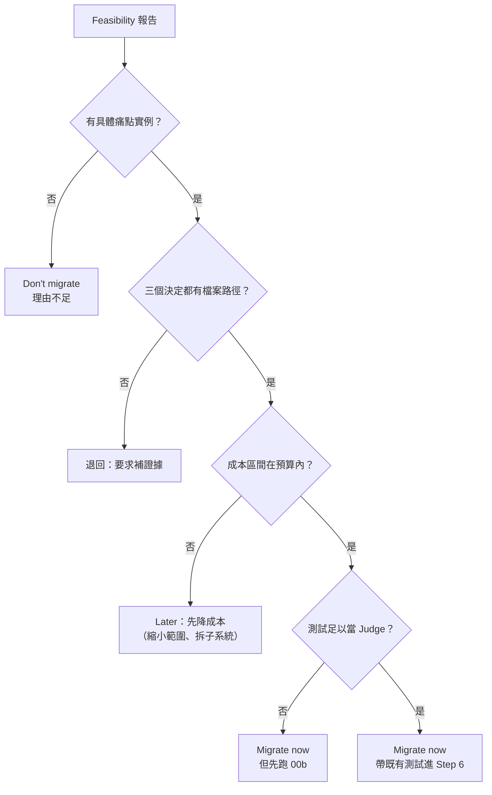

> 📌 **實務案例**：某內部報表 CLI（假想）用 Python 寫成，團隊希望改成 Go 以便單一 binary 部署。Feasibility 報告的痛點只有「部署要裝 Python」，而公司容器化後這個痛點已不存在；三個決定中「測試能不能活下來」一項，發現 90% 的測試 import 內部函式。Verdict：**Don't migrate**，會改變結論的事實是「是否有非容器化的客戶端部署需求」，一天內可向業務窗口確認。這是一份成功的 Feasibility。

### 5.2 建立 Judge／Parity Referee（prompts/00b-judge-setup.md）

#### 5.2.1 為什麼必須先建裁判

- 「完成了嗎？」需要一個**機械的答案**，而不是感覺。
- 原系統就是可執行的規格；Judge 是查詢這份規格的方法。
- 要在**還沒翻譯任何東西之前**建好，因為那時舊程式碼還能跑、也還沒有翻譯結果影響你的判斷。
- Kit 三次 Run 都是在 Step 6 才臨時建裁判——這正是 00b 想避免的「晚建裁判」失敗：Run 1 的裁判先出了兩個比較器 bug，回報 12/12 全部不一致，全是假的。

> ⚠️ 官方 RUN-NOTES：00b「Designed, not yet dogfooded」，「把它的輸出當成要除錯的草稿，而不是可以相信的判決」。本節用一個自建 Lab 補上實測。

#### 5.2.2 00b 的三個步驟

| 步驟 | 要做什麼 | 產出 |
|---|---|---|
| 1. Categorize | 把每個既有測試分成 **portable**（可以表達為兩邊都回答得了的外部呼叫）與 **internal-bound**（依賴內部函式、私有狀態或目標語言沒有的特性） | 兩個計數＋grep／檔案收據；internal-bound 測試守護的行為要記下來 |
| 2. Rewrite for portability | 把 portable 測試改寫成對新舊系統都能跑的斷言（同輸入、同期望輸出、機械比對）；沒有測試的行為改寫成「真實情境」；兩位對抗式 reviewer 檢查**改寫有沒有弱化斷言**（放寬容差、漏欄位、`assert truthy` 取代精確值） | parity harness |
| 3. Validate | 對**原系統**跑：必須全過（失敗就是裁判的 bug）；對**故意破壞**的原系統跑：每個突變都必須被抓到 | 「N/N 在原系統通過」＋「每個注入的突變各被抓到一次」 |

Judge 一定要**從外部介面**（CLI、HTTP、檔案 I/O、匯出 API）呼叫兩邊，絕不透過來源語言的內部。

#### 5.2.3 Lab：Python → TypeScript 的訂單計價系統（🏢）

企業延伸範例，非官方 Migration Kit 原生功能。為了讓同仁可以在 10 分鐘內親手跑一次「建立並驗證 Judge」，本手冊提供一個極小的 Lab（`pricing-lab/`）。它刻意放進三個真實遷移常見的陷阱：

| 陷阱 | Python 行為 | 天真的 TypeScript 直譯 |
|---|---|---|
| 四捨五入 | `round(50.5)` = 50（銀行家捨入，取偶數） | `Math.round(50.5)` = 51 |
| `None` 與缺鍵 | `order.get("coupon")` 對缺鍵與 `null` 都回 `None` | `null !== undefined`，走進「未知折扣碼」錯誤 |
| bool 是 int 子類別 | `isinstance(True, int)` 為真，`qty=true` 被當成 1 接受 | `typeof true !== "number"`，拒絕 |

舊系統（executable spec）：

📄 `pricing-lab/legacy/pricing.py`

```python
"""舊系統（教學用）：從 stdin 讀訂單 JSON，輸出金額 JSON。

金額一律用「分」（整數）計算，避免浮點誤差。
錯誤時輸出 {"error": "..."} 並以 exit code 2 結束。
"""
import json
import sys

COUPONS = {"VIP10": 10, "HALF5": 5}  # 折扣百分比


def subtotal(items):
    total = 0
    for item in items:
        qty = item["qty"]
        if not isinstance(qty, int) or qty <= 0:
            raise ValueError(f"invalid qty for {item['sku']}: {qty}")
        total += qty * item["unit_price"]
    return total


def discount(amount, coupon):
    if coupon is None:
        return 0
    if coupon not in COUPONS:
        raise ValueError(f"unknown coupon: {coupon}")
    # Python 的 round() 是「銀行家捨入」（.5 取偶數），這是移植時最常被忽略的差異
    return round(amount * COUPONS[coupon] / 100)


def main():
    order = json.loads(sys.stdin.read())
    try:
        sub = subtotal(order["items"])
        disc = discount(sub, order.get("coupon"))
    except ValueError as e:
        print(json.dumps({"error": str(e)}))
        return 2
    print(json.dumps({"subtotal": sub, "discount": disc, "total": sub - disc}))
    return 0


if __name__ == "__main__":
    sys.exit(main())
```

Parity Referee（三個子命令：`run`、`self-check`、`mutate`）：

📄 `pricing-lab/parity/parity.py`

```python
"""Parity Referee（企業延伸範例，非官方 Migration Kit 原生功能）。

同一組情境（scenarios/*.json）分別餵給舊系統與新系統，比對 stdout 與 exit code。
三個子命令：
  run         舊 vs 新，寫出 parity-report.tsv；有 DIVERGE 時 exit 1
  self-check  舊 vs 舊，驗證系統與裁判本身是確定性的（裁判先除錯，再相信它）
  mutate      依 mutations.json 故意破壞舊系統，每個突變都必須被抓到（00b 第 3 步）

用法（在 lab/ 目錄執行）：
  python parity/parity.py run --old "python legacy/pricing.py" --new "node target/pricing.ts"
  python parity/parity.py self-check --old "python legacy/pricing.py"
  python parity/parity.py mutate --old "python legacy/pricing.py" --src legacy
"""
import argparse
import json
import pathlib
import shlex
import shutil
import subprocess
import sys
import tempfile

HERE = pathlib.Path(__file__).resolve().parent


def load_scenarios(directory):
    items = []
    for p in sorted(pathlib.Path(directory).glob("*.json")):
        data = json.loads(p.read_text(encoding="utf-8"))
        if not isinstance(data.get("stdin"), str):
            sys.exit(f"{p.name}: 'stdin' 必須是字串（保留原始 JSON 文字，例如 2.0 與 2 的差別）")
        items.append((p.stem, data))
    if not items:
        sys.exit(f"找不到情境：{directory}/*.json")
    return items


def execute(cmd, stdin, cwd):
    r = subprocess.run(shlex.split(cmd, posix=True), input=stdin.encode("utf-8"),
                       capture_output=True, cwd=cwd, timeout=60)
    return r.returncode, r.stdout.decode("utf-8", "replace")


def canonical(stdout):
    """正規化：只處理換行與結尾空白；JSON 以排序鍵重新序列化。
    不可把 NaN／Infinity 轉成 null（Kit Run 1 的裁判就是這樣產生 12/12 假差異）。"""
    text = stdout.replace("\r\n", "\n").strip()
    try:
        value = json.loads(text)
    except ValueError:
        return "text", text
    return "json", json.dumps(value, sort_keys=True, ensure_ascii=False, allow_nan=True)


def compare(name, data, old_cmd, new_cmd, cwd):
    old_rc, old_out = execute(old_cmd, data["stdin"], cwd)
    new_rc, new_out = execute(new_cmd, data["stdin"], cwd)
    same = old_rc == new_rc and canonical(old_out) == canonical(new_out)
    known = data.get("known_divergence")
    if same:
        verdict = "STALE-KNOWN" if known else "PASS"
    else:
        verdict = "KNOWN" if known else "DIVERGE"
    detail = "" if same else f"old[{old_rc}]={canonical(old_out)[1]} new[{new_rc}]={canonical(new_out)[1]}"
    return verdict, old_rc, new_rc, known or "", detail


def run_all(old_cmd, new_cmd, cwd, scenarios, report=None):
    rows = [(name, *compare(name, data, old_cmd, new_cmd, cwd)) for name, data in scenarios]
    counts = {}
    for row in rows:
        counts[row[1]] = counts.get(row[1], 0) + 1
    if report:
        with open(report, "w", encoding="utf-8", newline="\n") as f:
            f.write("scenario\tverdict\told_exit\tnew_exit\tknown_divergence\tdetail\n")
            for row in rows:
                f.write("\t".join(str(c) for c in row) + "\n")
    return rows, counts


def summary(counts, total):
    parts = [f"{k}={counts[k]}" for k in sorted(counts)]
    return f"{counts.get('PASS', 0)}/{total} pass  " + " ".join(parts)


def cmd_run(a):
    scenarios = load_scenarios(a.scenarios)
    rows, counts = run_all(a.old, a.new, a.cwd, scenarios, a.report)
    for name, verdict, *_rest, detail in rows:
        if verdict != "PASS":
            print(f"{verdict:12} {name}  {detail}")
    print("parity:", summary(counts, len(rows)))
    if counts.get("STALE-KNOWN"):
        print("WARN: STALE-KNOWN 代表已簽核的差異其實已經一致，請更新情境檔與偏差紀錄")
    return 1 if counts.get("DIVERGE") else 0


def cmd_self_check(a):
    scenarios = load_scenarios(a.scenarios)
    stripped = [(n, {k: v for k, v in d.items() if k != "known_divergence"}) for n, d in scenarios]
    rows, counts = run_all(a.old, a.old, a.cwd, stripped)
    print("self-check (old vs old):", summary(counts, len(rows)))
    for name, verdict, *_rest, detail in rows:
        if verdict != "PASS":
            print(f"  NONDETERMINISTIC {name}  {detail}")
    return 0 if counts.get("PASS", 0) == len(rows) else 1


def cmd_mutate(a):
    scenarios = load_scenarios(a.scenarios)
    mutations = json.loads(pathlib.Path(a.mutations).read_text(encoding="utf-8"))
    src = pathlib.Path(a.cwd, a.src).resolve()
    survived = 0
    for m in mutations:
        with tempfile.TemporaryDirectory() as tmp:
            copy = pathlib.Path(tmp, src.name)
            shutil.copytree(src, copy)
            target = copy / m["file"]
            text = target.read_text(encoding="utf-8")
            if text.count(m["find"]) != 1:
                print(f"ERROR {m['id']}: find 字串在 {m['file']} 出現 {text.count(m['find'])} 次，必須剛好 1 次")
                return 2
            target.write_text(text.replace(m["find"], m["replace"]), encoding="utf-8")
            mutant_cmd = a.old.replace(a.src, str(copy).replace("\\", "/"), 1)
            if mutant_cmd == a.old:
                print(f"ERROR: --old 指令中找不到 --src 路徑 {a.src!r}")
                return 2
            _rows, counts = run_all(a.old, mutant_cmd, a.cwd, scenarios)
            caught = counts.get("DIVERGE", 0) + counts.get("KNOWN", 0)
            status = "CAUGHT" if caught else "SURVIVED"
            survived += 0 if caught else 1
            print(f"{status:9} {m['id']} {m['desc']}  ({caught} scenario(s) diverged)")
    print(f"mutations: {len(mutations) - survived}/{len(mutations)} caught")
    return 1 if survived else 0


def main():
    sys.stdout.reconfigure(encoding="utf-8")
    ap = argparse.ArgumentParser()
    sub = ap.add_subparsers(dest="cmd", required=True)
    for name in ("run", "self-check", "mutate"):
        p = sub.add_parser(name)
        p.add_argument("--old", required=True, help="舊系統指令（相對 --cwd）")
        p.add_argument("--cwd", default=".")
        p.add_argument("--scenarios", default=str(HERE / "scenarios"))
        if name == "run":
            p.add_argument("--new", required=True, help="新系統指令（相對 --cwd）")
            p.add_argument("--report", default="parity-report.tsv")
        if name == "mutate":
            p.add_argument("--src", required=True, help="--old 指令中舊系統的目錄，例如 legacy")
            p.add_argument("--mutations", default=str(HERE / "mutations.json"))
    a = ap.parse_args()
    return {"run": cmd_run, "self-check": cmd_self_check, "mutate": cmd_mutate}[a.cmd](a)


if __name__ == "__main__":
    sys.exit(main())
```

突變清單（00b 第 3 步的「故意破壞」）：

📄 `pricing-lab/parity/mutations.json`

```json
[
  {"id": "M1", "desc": "邊界條件：qty <= 0 改成 qty < 0", "file": "pricing.py", "find": "qty <= 0", "replace": "qty < 0"},
  {"id": "M2", "desc": "捨入規則：round() 改成 int() 無條件捨去", "file": "pricing.py", "find": "return round(amount", "replace": "return int(amount"},
  {"id": "M3", "desc": "刪除錯誤路徑：未知折扣碼不再報錯", "file": "pricing.py", "find": "raise ValueError(f\"unknown coupon: {coupon}\")", "replace": "return 0"},
  {"id": "M4", "desc": "輸出格式：total 由減改加", "file": "pricing.py", "find": "\"total\": sub - disc", "replace": "\"total\": sub + disc"},
  {"id": "M5", "desc": "商業規則：VIP10 折扣由 10% 改 15%", "file": "pricing.py", "find": "\"VIP10\": 10", "replace": "\"VIP10\": 15"}
]
```

情境檔（11 個，`stdin` 一律存**原始 JSON 字串**，才能保留 `2.0` 與 `2` 的差別；全部列在附錄 A.1）。其中三個範例：

📄 `pricing-lab/parity/scenarios/03-half5-tie.json`

```json
{
  "stdin": "{\"items\":[{\"sku\":\"A\",\"qty\":1,\"unit_price\":1010}],\"coupon\":\"HALF5\"}",
  "note": "5% = 50.5，Python round 取偶數得 50"
}
```

📄 `pricing-lab/parity/scenarios/09-qty-bool.json`

```json
{
  "stdin": "{\"items\":[{\"sku\":\"A\",\"qty\":true,\"unit_price\":100}]}",
  "note": "BUG(port)：Python 把 True 當 1 接受，照抄"
}
```

📄 `pricing-lab/parity/scenarios/10-qty-float.json`

```json
{
  "stdin": "{\"items\":[{\"sku\":\"A\",\"qty\":2.0,\"unit_price\":100}]}",
  "known_divergence": "DEV-002",
  "note": "JS 無法區分 2.0 與 2；已由 SA 簽核接受"
}
```

#### 5.2.4 驗證裁判本身（實測）

```bash
cd pricing-lab
python parity/parity.py self-check --old "python legacy/pricing.py"
python parity/parity.py mutate --old "python legacy/pricing.py" --src legacy
```

**實測結果（✅）**：

```text
self-check (old vs old): 11/11 pass  PASS=11
CAUGHT    M1 邊界條件：qty <= 0 改成 qty < 0  (1 scenario(s) diverged)
CAUGHT    M2 捨入規則：round() 改成 int() 無條件捨去  (2 scenario(s) diverged)
CAUGHT    M3 刪除錯誤路徑：未知折扣碼不再報錯  (1 scenario(s) diverged)
CAUGHT    M4 輸出格式：total 由減改加  (3 scenario(s) diverged)
CAUGHT    M5 商業規則：VIP10 折扣由 10% 改 15%  (1 scenario(s) diverged)
mutations: 5/5 caught
```

判讀：

- `self-check` 用舊系統對舊系統，驗證「系統與裁判本身是確定性的」。如果這一步就有差異（例如輸出含時間戳、亂數、雜湊順序），正規化規則要先處理，否則後面的每個 DIVERGE 都不可信。
- 每個突變都要至少讓一個情境不一致。若有突變 SURVIVED，代表情境清單有盲點。作者實測拿掉 `07-qty-zero` 情境再跑一次（✅）：

  ```text
  SURVIVED  M1 邊界條件：qty <= 0 改成 qty < 0  (0 scenario(s) diverged)
  ...
  mutations: 4/5 caught        ← exit 1
  ```

  裁判看起來是綠燈，但「數量為 0」這條邊界沒有接上任何東西。這就是 00b 所說「A judge that doesn't catch breakage isn't a judge; it's a green light wired to nothing」。
- 正規化只做三件事：換行、結尾空白、JSON 排序鍵。**不要**把 NaN 轉成 null、不要忽略錯誤訊息差異（Kit Run 1 的教訓）。

> 📌 **注意事項**：本 Lab 的情境 `10-qty-float` 標了 `known_divergence: DEV-002`。它示範的是一個**真的無法翻譯**的差異：JavaScript 的 `JSON.parse` 讀到 `2.0` 與 `2` 結果相同，舊系統卻會拒絕 `2.0`。這不能用「改正規化規則」消除，只能由 SA 確認上游不會送 `2.0`、在 Rulebook deviation log 簽核，並在報告中單獨列出。

#### 5.2.5 既有測試就是 Judge 的情況

00b 開頭寫明兩種可以跳過的情況：既有測試套件已經走公開介面，或已經用**第三種語言**寫成（例如用 Python 寫的 HTTP 黑箱測試，測一個 Go 服務）。這時直接把該套件帶進 Step 6，但仍建議先做 5.2.4 的兩個驗證——「在原系統全過」與「突變會被抓到」——再把它當成驗收依據。

### 5.3 專案基準線

基準線是「遷移後比較的依據」，要在 Step 1 之前就以**檔案**的形式提交。

| 基準線 | 內容 | 建議指令／工具 | 存放 |
|---|---|---|---|
| Git Baseline | 遷移開始的 commit 與標籤 | `git tag -a migration-baseline -m "..."` | Git tag |
| Original Build Baseline | build 時間、是否成功（00 只允許跑一次，就用那一次） | `time make`／`Measure-Command { ... }` | `migration/baseline/build.txt` |
| Original Test Baseline | 原測試在原系統的通過數與**已知失敗清單**（Step 6 要證明「零 inherited」） | `pytest -q --junitxml=...`、`npm test -- --reporters=junit` | `migration/baseline/tests.xml` |
| API Baseline | 對外介面的輸入輸出快照（就是 Judge 的情境＋舊系統輸出） | `parity.py run --old X --new X` 的報告 | `migration/baseline/parity-old.tsv` |
| Performance Baseline | 代表性情境的延遲、吞吐、記憶體 | `hyperfine`、k6、JMH | `migration/baseline/perf.json` |
| Security Baseline | 現有弱點與秘密掃描結果（遷移後不能變差） | `trivy fs`、Semgrep | `migration/baseline/security.json` |
| Dependency Baseline | 舊系統的第三方套件清單與 SBOM | `pip freeze`、`npm ls --all`、`syft` | `migration/baseline/sbom.spdx.json` |

```bash
# Linux／Git Bash：建立基準線（企業延伸範例，非官方 Migration Kit 原生功能）
mkdir -p migration/baseline
git tag -a migration-baseline -m "Before language migration" && git rev-parse HEAD > migration/baseline/commit.txt
{ time ./build.sh ; } 2> migration/baseline/build.txt
python -m pytest -q --junitxml=migration/baseline/tests.xml || true   # 先記錄，失敗也要留下
trivy fs --scanners vuln,secret --format json --output migration/baseline/security.json .
git add migration/baseline && git commit -m "chore(migration): record baselines"
```

```powershell
# Windows PowerShell 版
New-Item -ItemType Directory -Force migration\baseline | Out-Null
git tag -a migration-baseline -m "Before language migration"
git rev-parse HEAD | Set-Content migration\baseline\commit.txt
(Measure-Command { .\build.ps1 }).TotalSeconds | Set-Content migration\baseline\build.txt
```

> 📌 **注意事項**：Original Test Baseline 一定要記下「原本就失敗」的測試。Step 6 的 done-gate 要求「原測試在原系統重跑，**零 inherited failure**——兩個計數都寫進報告」；沒有基準線，你無法區分「移植造成」與「本來就壞」。

### 5.4 本章 AI 產出審查

| 檢查 | 壞例 | 好例 | 怎麼抓 |
|---|---|---|---|
| Feasibility 給精確數字 | 「預估 3,412 萬 token、18 天」 | 「1,000 萬～1 億 token（檔案 420 × 4 Agent × 每單位 1～5 萬）」 | `grep -nE '[0-9]{2,},[0-9]{3}' report.md` 找精確數字 |
| 三個決定沒有路徑 | 「架構大致可一對一翻譯」 | 「Structure-preserving：`src/core/*.py` 為純函式，`src/plugins/loader.py` 的動態 import 需 redesign」 | 每個決定段落 `grep -c '/'` |
| 把 Bun 數字當估算 | 「參考 Bun，兩週內完成」 | 「案例數字不適用；本 repo 估算如下」 | `grep -n Bun report.md` |
| Judge 只在新系統跑過 | 「parity 11/11 通過」（沒有 self-check） | 附 self-check 與突變結果 | 報告中是否同時有 `self-check` 與 `mutations:` |
| 改寫弱化斷言 | 原測試 `assert total == 960`，改寫成 `assert "total" in out` | 改寫成情境檔，比對完整 JSON | reviewer 逐列比對原測試與情境 |

```bash
# Judge 的最低驗收（全部要 exit 0）
python parity/parity.py self-check --old "python legacy/pricing.py" && \
python parity/parity.py mutate --old "python legacy/pricing.py" --src legacy && \
echo "Judge 可簽核"
```

---

## 第6章 六大遷移階段完整教學

本章是整份手冊的核心。每個 Phase 都用同樣的 12 個小節：執行目的、前置條件、使用的 Prompt、Agent 分工、操作步驟、範例指令、輸入及輸出、預期產出檔案、驗證方式、常見錯誤、人工審核重點、Phase Gate 驗收條件。

### 6.0 所有 Phase 共同的契約

在進入各 Phase 之前，先記住所有官方 Prompt 都遵守的五個契約：

| 契約 | 官方原文要點 | 你要做的事 |
|---|---|---|
| Gate 結束 workflow | 「stop and show me」＝這個階段結束，交出證據並退出；**不得推測核准後繼續**；workflow 在中途等人是被禁止的 | 看完證據後，自己重新貼下一支 Prompt（或重貼同一支進入 re-round） |
| 模型明確指定 | 每個 Subagent 呼叫都要設定模型；沿用 session 預設值是偏離，要記入 deviation log | 把 Feasibility 簽核的模型計畫填進 `[implementer model]`、`[reviewer model]`、`[fixer model]` |
| 成本紀錄 | 每支 Prompt 結尾在 `migration/cost-log.tsv` 附加一列；表頭 `step  timestamp  wall_clock_min  tokens  subagents  model`；純 Tab 分隔、**不得**有 `key=` 前綴；未知填 `unknown` | 每個 Gate 跑 `cost_log_check.py`（第 11.6 節） |
| 下一步預估 | 每份 Gate 報告結尾都要給「下一步的 wall-clock 與人工注意力分鐘數」，由剛量到的數字推算 | 用來排人力與預算 |
| 數字是收據 | 計數要附 `wc -l`、grep 輸出等機械收據，不接受文字描述的總數（Run 2 的口述總數對不上帳） | 審查報告時優先看收據 |

官方 cost-log 字面範例（格式固定，數值依你的情況）：

<!-- markdownlint-disable MD010 -->

```text
3	2026-06-11T14:02Z	21	2035336	35	claude-sonnet-4-6
```

<!-- markdownlint-enable MD010 -->

> 📌 **注意事項**：Prompt 裡的「Use a workflow」在 Claude Code 2.1.322 會觸發 Dynamic workflows。官方文件寫明 workflow 執行中**不能接受使用者輸入**，要在 Stage 之間簽核就把每個 Stage 當成獨立 workflow——這和 Kit 的 Gate 設計一致。執行中用 `/workflows` 監看每個 Agent 的 token；超過 25 個 Agent 或預估超過 150 萬 token 會出現「Large workflow」提示（僅提示，不會停止）。

### 6.1 Phase 1：Create the Map and the Rules

#### 6.1.1 執行目的

產出三個「互相稽核」的工件：

1. **Dependency Map**：決定工作順序、找出循環（檔案與套件兩種粒度）。
2. **Rulebook**：把每一個「兩個 Agent 可能答得不同」的翻譯問題一次決定。
3. **Gap Inventory**：把目標語言要求、但來源語言允許你「放在腦袋裡」的東西（所有權、生命週期、可空性、介面契約）逐站點列成一張表。

最後由 Dependency Map 產生 **Manifest**（工作單位清單）。

#### 6.1.2 前置條件

- [ ] Feasibility verdict 為 migrate，且已簽核模型計畫
- [ ] Judge 已建立並驗證（00b），或已確認既有測試可當 Judge
- [ ] 基準線已提交（第 5.3 節）
- [ ] Rulebook 由 `templates/RULEBOOK.md` 複製到 `migration/RULEBOOK.md`

#### 6.1.3 使用的 Prompt

| Prompt | 佔位字 | 何時 |
|---|---|---|
| `01-dependency-map.md` | `[your dependency mechanism]`（imports、include、build 檔）、`[crate / package / module]`、`[reviewer model]` | 可立即開始，與 Rulebook 起草並行 |
| （無 Prompt）Rulebook 起草 | — | 與 Claude 對話起草；**政策決定是人的**，Agent 去調查程式碼事實 |
| `02-gap-inventory.md` | `[name your gap]`、`[reviewer model]` | Rulebook 草稿已提交後 |

#### 6.1.4 Agent 分工

| 工作 | Agent | 模型等級（官方建議） | 權限 |
|---|---|---|---|
| 撰寫／調整 depmap 腳本 | 主 session | — | 可寫腳本 |
| 驗證地圖 | 2 位 skeptic reviewer，獨立 context、**不重疊**的樣本 | `[reviewer model]` | 唯讀 |
| Rulebook 事實調查 | 調查 Agent（例如「全樹有幾處 `round(`」） | 中階 | 唯讀 |
| Rulebook 審查 | 對抗式 reviewer，**每人一種錯誤類別**（Bun 用了 8 個） | 最大 | 唯讀 |
| Inventory 站點分類 | 分類 Agent，**每人寫自己的 shard** | 中階 | 只寫自己的 shard |
| Inventory 審查 | 2 位 skeptic，依檔案或 struct 分批 | `[reviewer model]` | 唯讀 |
| 聯合稽核 | 對抗式 Agent 同時讀 inventory 與 Rulebook 找矛盾 | 最大 | 唯讀；Rulebook 修訂只能排佇列 |

#### 6.1.5 操作步驟

**A. Dependency Map（prompt 01）：**

1. 選擇或改寫 Kit 的 depmap 腳本（Python、JS/TS、C/C++ 三種起點）。**不要**讓 Agent 讀檔回報 import——每次跑出不同的地圖，無法驗證。
2. 先對 5 個檔案試跑，人工檢查輸出。
3. 對全部檔案執行，寫到 `migration/depmap/`。
4. 從圖計算（在腳本裡算，不是判斷）拓撲順序與 SCC；大於 1 檔的 SCC 是循環，一起遷移。
5. 把圖縮合到目標語言的 crate／package／module 邊界，**再檢查一次循環**。
6. 兩位 skeptic 各取 20 個檔案驗證：一半隨機（從檔案清單不重疊的兩半抽）、一半對抗性（一位拿最大、巨集最多的檔；另一位拿平台特定變體與產生的檔案，確認腳本有排除）。每個檔案列出直接 in-repo 依賴與 `file:line` 證據，**雙向** diff：腳本漏掉的邊、腳本捏造的邊。
7. 確認的差異是**腳本**的 bug：修腳本處理這個「模式」，重產整張圖，換新的 reviewer 與新的檔案重新抽樣。兩位都在兩個方向回報空的才算乾淨。三輪失敗（或同一類別反覆出現）就停下，把漏掉的依賴交給人決定。
8. 乾淨後的結尾動作：用 `make_manifest.py` 產生 `migration/manifest.tsv`，以 `wc -l` 回報單位數。

**B. Rulebook：**

1. 複製範本，與 Claude 逐節對話起草。§1、§2 的每一列都要寫「為什麼」。
2. 讓調查 Agent 蒐集事實（「有多少處 `isinstance`」「有幾個 struct 有 >20 欄位」），不是讓它們做政策決定。
3. 讓對抗式 reviewer 各審一種錯誤類別（例如：錯誤處理、數值語意、null、並行、命名、模組邊界）。
4. 提交草稿：`git commit -m "docs(migration): rulebook draft v0"`。

**C. Gap Inventory（prompt 02）：**

1. **Sweep**：用 grep／腳本（不是判斷）列出 gap 出現的每個站點，寫成檔案並附計數——這份清單就是「完成的定義」。
2. 排一條 Rulebook 修訂：「這類決定以路徑委派給 inventory」（由人在第一批修訂時套用）。
3. 從複雜的站點開始，追蹤值的流向（在哪建立、在哪改變、在哪逃逸），提出答案並引用證明的呼叫點。
4. 兩位 skeptic 攻擊條目；被證據反駁就修一次再送；仍有爭議就標 **UNKNOWN**（附上需要人回答的問題），UNKNOWN 仍要有確定的翻譯：最保守的表示法＋可 grep 的 TODO。
5. **前 20 列先停下來給人看**，再 fan out。
6. Fan out 時每個分類 Agent 寫自己的 `migration/inventory.<category>.tsv`；orchestrator 最後合併：依 (file, symbol, source_construct) 去重、確定性排序、回報合併檔的 `wc -l`。監控：shard 列數在兩次輪詢之間必須成長，**三分鐘沒成長就視為失敗**，從磁碟或 journal 救回並回報。
7. 全部站點都有列之後做**聯合稽核**：找「規則會翻錯的列」與「沒有任何列用到的規則」，每個衝突要寫出規則、列與會出錯的具體翻譯。Inventory 側的修正可直接套用，Rulebook 修訂排佇列給人。

#### 6.1.6 範例指令

```bash
# 依賴地圖（Python 原始碼在 src/；--root 指錯會得到 0 edges 的「乾淨」錯誤地圖）
python migration-kit/scripts/depmap_python.py --root . --out migration/depmap
wc -l migration/depmap/edges.tsv migration/depmap/order.txt
cat migration/depmap/cycles.txt

# TypeScript 原始碼
node migration-kit/scripts/depmap_ts.mjs --root . --out migration/depmap
# C／C++：巨集多的樹改用 gcc -MM 產生邊，但輸出格式維持相同
python migration-kit/scripts/depmap_c.py --root . --out migration/depmap

# Manifest：substitution 對應 Rulebook §4 命名規則
python migration-kit/scripts/make_manifest.py --order migration/depmap/order.txt \
  --out migration/manifest.tsv --sub 'src/=rust/src/' --sub '.py=.rs'
wc -l migration/manifest.tsv          # 單位數 = 行數 - 1（表頭）
```

填好佔位字的 prompt 01 開頭（示意）：

```text
Use a workflow. Before we migrate anything, build the dependency map ...
Write a deterministic script that parses Python import statements (ast) and emits one edge per line.
...
Then condense the graph to the target's Rust crate boundaries and check for cycles again ...
Run them on claude-opus-5-5, per the Model plan ...
```

#### 6.1.7 輸入及輸出

| 工件 | 輸入 | 輸出 |
|---|---|---|
| Dependency Map | 原始碼樹、依賴機制 | `edges.tsv`（`from  to`）、`order.txt`（每行一批、依賴在前）、`cycles.txt`（SCC 大於 1） |
| Manifest | `order.txt`、`--sub` 規則 | `manifest.tsv`（`source  target`） |
| Rulebook | 人的政策決定、調查事實 | `RULEBOOK.md` §0～§7 |
| Gap Inventory | Sweep 清單、Rulebook 草稿 | `inventory.tsv`（7 欄）、UNKNOWN 列與問題、衝突清單 |

#### 6.1.8 預期產出檔案

```text
migration/
├── RULEBOOK.md
├── inventory.tsv                 合併後
├── inventory.<category>.tsv      各分類 shard（可保留作為稽核軌跡）
├── depmap/{edges.tsv, order.txt, cycles.txt}
├── manifest.tsv
└── cost-log.tsv                  01、02 各附加一列
scripts/depmap_<lang>.*           ← 改寫過的依賴腳本要提交（prompt 01：Commit the script）
```

#### 6.1.9 驗證方式

| 驗證 | 方法 |
|---|---|
| 地圖是確定性的 | 跑兩次 `diff -r` 必須相同 |
| 地圖不是空的 | 多檔卻 0 edges 會有 WARN；再用 `wc -l edges.tsv` 與人工預期比對 |
| 地圖正確 | 兩位 skeptic 雙向 diff 皆為空 |
| Manifest 目標合法 | `make_manifest.py` 拒絕「目標等於來源」；人工抽查 10 列命名是否符合 §4 |
| Inventory 完整 | Sweep 清單的每個站點都有一列（`comm -23` 比對） |
| Inventory 證據品質 | Skeptic 必須引用行號；人工抽查行號（Run 1 抓到 off-by-one） |

**Lab 實例：作者自己寫的 inventory 也有 off-by-one。** 作者為 Lab 寫 Rulebook 時引用了 `pricing.py:29`、`pricing.py:36`，用 `grep -n` 核對後發現實際是第 28、35 行。行號核對要機械化：

```bash
# 從 inventory 抽出所有 file:line 引用，印出該行內容供人核對
grep -oE '[A-Za-z0-9_/.-]+\.py:[0-9]+' migration/inventory.tsv | sort -u | while IFS=: read -r f n; do
  printf '%s:%s  %s\n' "$f" "$n" "$(sed -n "${n}p" "legacy/$(basename "$f")" | head -c 80)"
done
```

#### 6.1.10 常見錯誤

| 錯誤 | 後果 | 預防 |
|---|---|---|
| `--root` 指到套件目錄 | 0 edges，看起來像沒有依賴（Run 1） | 讀 WARN；用 repo 根目錄 |
| 只檢查檔案層級循環 | 編譯時冒出大量套件循環錯誤（Bun 數千個） | 縮合到目標 crate／package 再檢查 |
| 讓 Agent 讀檔回報 import | 每次地圖不同、無法驗證 | 只用確定性腳本 |
| 修「被抓到的那幾個檔」而不是修模式 | 下一輪換一批檔又漏 | 修腳本的模式處理，重產全圖 |
| 多個分類 Agent 寫同一個 TSV | 一個 append 卡住，人得自己發現（Run 2） | 每人一個 shard，最後合併 |
| Rulebook 寫「盡量 idiomatic」 | 每個 Agent 自己解釋 | 寫成「來源構造 → 唯一標準翻譯」對照表 |
| 把 Kit 的 fixtures 掃進地圖 | 地圖多出 Kit 的測試檔 | `--root` 不包含 `migration-kit/` |

#### 6.1.11 人工審核重點

- Rulebook §1（生態系採用）與 §2（無對應構造）的**每一列**都是政策決定，必須有具名的人負責。
- 檔案與套件兩種粒度的循環清單：每個循環要決定「一起遷移」還是「先拆循環」（後者屬於 redesign，要另案）。
- UNKNOWN 列附的問題要找到能回答的人（SA、業務窗口），回答後更新 inventory。
- 聯合稽核的衝突清單：哪些要修 Rulebook（由你套用）、哪些修 inventory（Agent 可直接套用）。

**Lab 的 Rulebook（填好的範例）：**

📄 `pricing-lab/migration/RULEBOOK.md`

````markdown
# Translation Rulebook — Python 3.12 (pricing) → TypeScript 7（Node 24）

> **Meta-rule：如果兩個 Agent 可能給出不同答案，答案就寫進這份文件。**
> 每個 implementer、reviewer、fixer 動手前都要讀完。迴圈內唯讀；修訂排入佇列，由人在批次之間套用。

## 0. Scope and posture

- Structure-preserving：一個 `.py` 對一個 `.ts`，函式邊界、控制流程、錯誤訊息全部保留。你在翻譯，不是改善。
- CHEAP-REFEREE VARIANT：`tsc --noEmit --strict` 在迴圈內執行（Step 4 已併入 Step 3，見 DEV-001）。
- 第一輪追求行為一致，不追求效能；已知慢但正確的寫法標 `PERF(port):`。

## 1. Ecosystem adoption

| Area | Decision | Why |
|---|---|---|
| Runtime | Node 24，直接執行 `.ts`（type stripping），ES2022 modules | 與部署環境一致 |
| Third-party deps | **NONE**，只用 Node 標準函式庫 | 原系統零相依；新增套件要先修訂本節 |
| Error model | Python `ValueError` → `RangeError`，訊息逐字相同 | 錯誤訊息屬於 parity 範圍 |
| `any` | **BANNED**；用 `unknown` 加型別縮小 | strict 模式 |

## 2. Constructs with no equivalent — one canonical mapping each

| Source construct | Canonical target translation | Notes / evidence |
|---|---|---|
| `round(x)`（banker's rounding） | `roundHalfEven(x)`，來自 `target/num.ts` | `Math.round` 在 .5 一律進位；pricing.py:28 |
| `None`／`dict.get()` 缺鍵 | `null`；讀取用 `?? null` | JS 的 `undefined` 不得進入資料結構 |
| `isinstance(x, int)` 對 bool 成立 | `true`→1、`false`→0 後再檢查，標 `BUG(port):` | Python bool 是 int 子類別；pricing.py:16 |
| JSON 的 `2.0`（Python float） | 與 `2` 無法區分 → 依 UNKNOWN 規則標 `TODO(port):` | 見 inventory 與 DEV-002 |
| f-string 輸出 None/True/False | `pyRepr(v)`，來自 `target/num.ts` | 錯誤訊息要逐字一致 |

**The BUG rule**：原系統的缺陷照抄，標 `BUG(port): <repro>`，Step 6 的 parity 斷言缺陷輸出；修正只在 post-parity（prompt 06）以獨立變更出貨。

**The UNKNOWN rule**：本表與 inventory 都沒決定時，用目標語言最保守的表示法，標 `TODO(port):` 寫下待決問題，繼續往下。

## 3. The sanctioned escape hatch

- 標記格式固定：`TODO(port):`、`PERF(port):`、`BUG(port):`。格式是承重的，不得變形（不可寫 `TODO(Port)`、`TODO port:`）。

## 4. Naming and output paths

- `legacy/<name>.py` → `target/<name>.ts`，一對一，沒有例外。
- 函式、參數名稱逐字保留（包含 snake_case）；parity 除錯優先於 TS 風格。
- import 一律寫 `./mod.ts`（Node type stripping 不會改寫副檔名）。
- 共用 helper 的家：`target/num.ts`（`roundHalfEven`、`pyRepr`）。翻譯檔只能 import，不得自己再寫一份。

## 5. The gap inventory

可空性與數值型別的決定**不由 implementer 判斷**，一律查 `migration/inventory.tsv`。站點不在表上 = inventory 的 bug：回報、套 UNKNOWN 規則、繼續。

## 6. Per-file obligations

每個翻譯檔結尾：

```text
// PORT STATUS: confidence=[high|medium|low] todos=[N]
```

Reviewer 以 `grep -c 'TODO(port)'` 核對 todos；少報就是 finding。

## 7. Deviation log

| ID | Date | Deviation | Sanctioned by |
|---|---|---|---|
| DEV-001 | 2026-11-11 | Step 4 併入 Step 3：tsc 在迴圈內執行，已移除 settings.json 與 loop-bans.json 的 TSC 規則 | 架構師（Gate-Decision G4） |
| DEV-002 | 2026-11-11 | 情境 10-qty-float：JSON `2.0` 舊系統拒絕、新系統接受，接受為已知差異；上游呼叫端已確認只送整數 | SA＋業務窗口 |
````

**Lab 的 Gap Inventory：**

📄 `pricing-lab/migration/inventory.tsv`

<!-- markdownlint-disable MD010 -->

```text
file	symbol	source_construct	classification	target_translation	evidence	status
legacy/pricing.py	discount	round(amount * pct / 100) at pricing.py:28	NUMERIC_SEMANTICS	roundHalfEven((amount * pct) / 100) from target/num.ts	banker's rounding: round(50.5)=50, round(51.5)=52 verified with python; Math.round(50.5)=51 verified with node	confirmed
legacy/pricing.py	main	order.get('coupon') at pricing.py:35	NULLABLE	order.coupon ?? null; discount(coupon: string | null)	get() returns None for missing key AND explicit null (scenario 05); naive port raised 'unknown coupon: null'	confirmed
legacy/pricing.py	subtotal	isinstance(qty, int) at pricing.py:16	TYPE_NARROWING	true->1 false->0 then Number.isInteger; BUG(port) marker	bool is subclass of int: qty=true accepted as 1 (scenario 09)	confirmed
legacy/pricing.py	subtotal	qty parsed from JSON 2.0 at pricing.py:15	UNKNOWN	TODO(port): JSON.parse loses int/float distinction; conservative = accept as integer	python json.loads('2.0') -> float -> rejected; JS JSON.parse('2.0') -> 2; q: can callers send 2.0?	unknown
```

<!-- markdownlint-enable MD010 -->

#### 6.1.12 Phase Gate 驗收條件

- [ ] 依賴腳本已提交，連跑兩次輸出相同
- [ ] 兩位 skeptic 最後一輪在兩個方向都回報空
- [ ] 檔案層級與套件層級的循環清單都已列出並有處置決定
- [ ] `manifest.tsv` 單位數以 `wc -l` 回報，命名符合 Rulebook §4
- [ ] Rulebook §0～§7 都已填寫，§2 每列有理由與證據
- [ ] Inventory 覆蓋 Sweep 清單的每個站點，UNKNOWN 列都有問題與負責人
- [ ] 聯合稽核衝突清單已處理（Rulebook 修訂由人套用並記錄）
- [ ] `cost-log.tsv` 有 01、02 兩列且格式通過檢查

### 6.2 Phase 2：Stress-test the Rules

#### 6.2.1 執行目的

Rulebook 從來沒碰過真實的程式碼。在任何 fan-out 之前，用少數「最難」的檔案測試它。**這一步翻譯出來的程式碼全部丟掉，唯一保留的產出是規則修訂。**翻兩次再全部丟掉就是代價；Run 1 用這個代價買到一個「兩邊都錯」的 bug，否則它會複製到整個 fan-out。

#### 6.2.2 前置條件

- [ ] Rulebook、inventory、dependency map 已簽核並提交
- [ ] **人**已安裝 `.claude/settings.json`（Prompt 會檢查；不存在就停）
- [ ] 這是 structure-preserving 遷移（redesign 時 Bakeoff 無效，改用設計文件的對抗式審查＋可丟棄的整套試跑）
- [ ] 目標語言 formatter 可用（diff 前先格式化，避免風格雜訊）

#### 6.2.3 使用的 Prompt

`03-stress-test.md`，佔位字：`[3]`（檔案數）、`[target language]`、`[target formatter]`、`[implementer model]`、`[reviewer model]`。

#### 6.2.4 Agent 分工

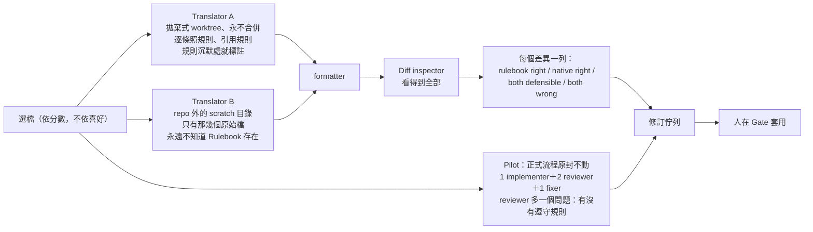

| 角色 | 模型 | 隔離方式 |
|---|---|---|
| Translator A | `[implementer model]` | 拋棄式 git worktree（可用 Subagent 的 `isolation: worktree`） |
| Translator B | `[implementer model]` | repo **外**的 scratch 目錄，只複製那幾個原始檔——不是 checkout，所以磁碟上找不到 Rulebook |
| Diff inspector | `[reviewer model]` | 看得到兩邊與 Rulebook |
| Pilot implementer／fixer | `[implementer model]` | 與 Step 3 完全相同 |
| Pilot reviewers | `[reviewer model]` | 與 Step 3 完全相同 |

#### 6.2.5 操作步驟

1. **兩個檢查**：`.claude/settings.json` 存在且有 deny（不存在就停、絕不自行安裝或覆寫）；每個 Subagent 都明確指定模型。
2. **選檔**：依「涵蓋 Rulebook 最危險章節與 inventory 列的數量」計分，取前 `[3]` 名，把選檔理由（分數與 `file:line` 證明）寫到 `migration/stress-test/`；提交排給人在 Gate 做（迴圈內禁止 commit）。容易的檔案只會產生乾淨的 diff 和無用的一步。
3. **雙譯者**：A 照規則、引用規則、規則沉默處就**標註沉默**而不是自己發明政策；B 用「流利的目標語言工程師會怎麼寫」翻譯——B 只要瞄到 Rulebook 一眼就不再是基準。
4. **Diff inspector**：兩邊先過 formatter；剩下的每個差異寫一列：兩邊的引用行、受指控的規則章節（或規則沉默暴露的 gap）、附證據的判決。Rulebook 是被告，不是法官——但「native 錯了」也必須說得出口；**每個差異都指控規則的報告，和沒有任何指控的報告一樣可疑**。
5. **Pilot**（並行）：同樣的檔案跑正式流程，reviewer 多問一個問題：實作者有沒有遵守 Rulebook？「因為默默忽略規則而翻對」是失敗的 Pilot——fan-out 依賴的是服從，不是那三個檔案翻得好。
6. **Round 1 結束**：只交出修訂佇列與遵從度 findings（**不是**翻譯），刪除 A 的 worktree 與 B 的 scratch 目錄，在報告中確認已刪除，然後退出。
7. 人套用修訂後重貼 03：它從 `migration/stress-test/` 的既有產物判斷這是 re-round，跳過 settings 檢查與選檔，改用**新的**檔案（偏重剛修改的章節；用同一批檔只能證明補丁有效）＋Pilot。同一章節被修訂兩次就提早停，需要人做決定。

#### 6.2.6 範例指令

```bash
# 人在 Step 2 開始前的準備
python tools/migration/preflight.py --kit migration-kit --phase step2   # 必須 FAIL=0
git worktree list                                                       # 確認沒有殘留的舊 worktree

# Round 1 結束後確認拋棄式工作區已刪除（Prompt 要求報告中確認）
git worktree list
ls migration/stress-test/
```

填好佔位字的 prompt 03 片段（示意）：

```text
Use a workflow. The rulebook has never met real code. Before any fan-out,
stress-test it on 3 real files. ...
port these the way a fluent TypeScript engineer would write them natively.
...
Run both outputs through prettier first, so style noise never reaches it.
```

#### 6.2.7 輸入及輸出

| 輸入 | 輸出 |
|---|---|
| 已簽核的 Rulebook、inventory、manifest | `migration/stress-test/` 下的選檔報告（分數＋證據） |
| `.claude/settings.json` | Diff 報告（每個差異一列判決） |
| `[3]` 個最難的檔案 | 修訂佇列、遵從度 findings、round-over-round 差異 |

#### 6.2.8 預期產出檔案

```text
migration/stress-test/
├── selection.md          選檔理由（參考 examples/run1-toml/selection.md）
├── diff-report.md        判決表＋修訂佇列（參考 examples/run1-toml/diff-report.md）
└── round-2/ ...          re-round 的同類產物
（翻譯結果：不存在——已刪除）
```

#### 6.2.9 驗證方式

- 判決分布要「有輸有贏」：Run 1 是 14 個實質差異中 rulebook right 9、native right 2、both defensible 2、both wrong 1。全部 rulebook right 或全部 native right 都要懷疑 inspector。
- 每個修訂都要指回 diff 報告的某一列或 Pilot 的某個 finding。
- `git worktree list` 與 scratch 目錄確認已刪除。

#### 6.2.10 常見錯誤

| 錯誤 | 後果 | 預防 |
|---|---|---|
| 挑簡單的檔案 | 乾淨的 diff、無用的一步 | 依分數選檔，寫下證據 |
| B 看到了 Rulebook（例如在 repo 內工作，或以 Subagent 執行而載入了專案 `CLAUDE.md`） | 基準被汙染，Bakeoff 失效 | B 在 repo 外的 scratch 目錄另開 session，只有原始檔副本（第 7.6 節） |
| 把試跑的翻譯留下來當正式產出 | 這些檔案是在**舊規則**下產生的，不受修訂保護；也沒經過正式流程的審查 | Round 結束就刪除 |
| 讓 workflow 等人套用修訂 | 違反 CLAUDE.md 第 3 條 | 交出佇列並退出，人套用後重貼 |
| 同一章節第三次改措辭 | 規則在原地打轉 | 修訂兩次就停，交給人決定 |
| redesign 遷移照跑 Bakeoff | 差異反映的是重新設計，不是規則 | 依 Rulebook §0 判斷，改做設計文件審查 |

#### 6.2.11 人工審核重點

- 逐條審修訂佇列：每條修訂的證據、會影響的範圍（哪些檔案、哪些 inventory 列）。
- 特別注意「both wrong」：Run 1 的例子是照規則翻的版本在 Python 會 crash 的地方默默輸出含字串 `undefined` 的壞資料——符合當時所有規則。
- 原系統的缺陷：Bakeoff 常會讓 B 發現原系統的 bug。官方裁決是「**照抄**並標 `BUG(port)`，post-parity 才修」，因為最終 Gate 比對的是原系統，「修正版」會讓每個相關情境變成雜訊，掩蓋真正的翻譯錯誤。

#### 6.2.12 Phase Gate 驗收條件

- [ ] 選檔報告有分數與 `file:line` 證據
- [ ] Diff 報告每個差異都有判決與證據，判決分布合理
- [ ] Pilot 的遵從度 findings 已審閱
- [ ] 修訂已由人套用到 Rulebook，並以帶 trailer 的 commit 提交（第 9.4 節的 gate_check 會檢查）
- [ ] Re-round（新檔案）沒有再修訂同一章節，或已由人做出決定
- [ ] 拋棄式 worktree 與 scratch 目錄已刪除
- [ ] 下一步（fan-out）的時間估算已依 manifest 大小與 Pilot 單檔耗時推算

### 6.3 Phase 3：Translate Everything

#### 6.3.1 執行目的

依機械化佇列，把 manifest 中的每個單位翻譯成目標語言。每個單位 4 個 Agent：1 implementer、2 adversarial reviewer、1 fixer（意見不一時加第三方裁決）。**編譯器等著**：它在下一步一次評分全部。

#### 6.3.2 前置條件

- [ ] Stress test 已簽核，Rulebook 已含所有修訂
- [ ] Inventory 完整
- [ ] `migration/manifest.tsv` 存在（LF 換行）
- [ ] `.claude/settings.json` 存在並有 deny（若 Step 4 併入 Step 3，人已在 Gate 移除便宜型別檢查的 deny）

#### 6.3.3 使用的 Prompt

`04-translation-kickoff.md`，佔位字：`[100]`（批次大小）、`[TODO(port)]`（你的 greppable 標記，依 Rulebook §3）、`[implementer model]`、`[reviewer model]`。這支 Prompt 刻意很短：「到了 Step 3，Rulebook 就是 Prompt。」

#### 6.3.4 Agent 分工

| 角色 | 數量／單位 | 模型 | 權限（企業建議以 Subagent 定義落實，第 7.10 節） |
|---|---|---|---|
| Implementer | 1 | `[implementer model]` | Read、Grep、Glob、Write；**不給 Bash** |
| Reviewer A、B | 2，獨立 context | `[reviewer model]` | Read、Grep、Glob（唯讀） |
| 第三方裁決 | 0～1 | `[reviewer model]` | 唯讀；預設 not-confirmed |
| Fixer | 1 | `[implementer model]`（除非模型計畫另定） | Read、Grep、Glob、Edit |

#### 6.3.5 操作步驟

1. 驗證 `.claude/settings.json`（同 03：不存在就停，絕不自行安裝）。
2. 佇列＝manifest 中目標檔還不存在的列，每批 `[100]` 個。
3. 每個 Agent 都讀 Rulebook；implementer 翻一個檔，Rulebook 沒決定的寫 `TODO(port)`，檔尾寫 status trailer。
4. 兩位 reviewer 假設它是錯的、不碰檔案；每個 finding 引用規則或原始碼行號。
5. 不一致的 finding 交第三方，預設 not-confirmed。
6. Fixer 只套用 confirmed；修不了就標記。
7. **不要跑編譯器**（Step 4 已併入時例外：Rulebook §0 指定的便宜裁判在迴圈內跑）。
8. 監控：磁碟上的翻譯檔數在兩次輪詢之間必須成長；某個 worker 三分鐘沒成長就視為失敗，從磁碟救回並回報。
9. 每個批次 Gate 回報 burndown（`queue_runner.mjs status` 的輸出）與下一步時間估算。
10. 批次 commit 由 orchestrating session 在批次邊界做（迴圈內 commit 被禁止）。

#### 6.3.6 範例指令

```bash
# 佇列狀態與下一批
node migration-kit/scripts/queue_runner.mjs --manifest migration/manifest.tsv status
node migration-kit/scripts/queue_runner.mjs --manifest migration/manifest.tsv next --batch 100 > migration/batch-07.json
# 批次結束：抓空檔作弊、核對標記與 trailer
node migration-kit/scripts/queue_runner.mjs --manifest migration/manifest.tsv verify
python tools/migration/port_markers.py --manifest migration/manifest.tsv
```

`queue_runner.mjs` 官方輸出格式（README／原始碼）：

```text
$ node queue_runner.mjs --manifest migration/manifest.tsv status
1/2 done (50.0%)
  src: 1/2
$ node queue_runner.mjs --manifest m.tsv verify      # out/a.ts 是 0 位元組
FAIL: 1 target(s) exist but are empty:
  out/a.ts
```

#### 6.3.7 輸入及輸出

| 輸入 | 輸出 |
|---|---|
| `manifest.tsv`、Rulebook、inventory、原始檔 | 目標檔（每檔一個，結尾 `PORT STATUS`） |
| 模型計畫 | 每個單位的 review findings 與裁決 |
| `settings.json` | burndown、cost-log 列、Rulebook 修訂佇列 |

#### 6.3.8 預期產出檔案

依 Rulebook §4 命名規則產生的目標檔。以 Lab 為例：

📄 `pricing-lab/target/num.ts`

```typescript
// Rulebook §4 指定的共用 helper「家」：所有翻譯檔都 import 這裡，不得各自重寫

// Python round(x)：最接近的整數，剛好 .5 時取偶數（banker's rounding）
export function roundHalfEven(x: number): number {
  const floor = Math.floor(x);
  const diff = x - floor;
  if (diff > 0.5) return floor + 1;
  if (diff < 0.5) return floor;
  return floor % 2 === 0 ? floor : floor + 1;
}

// Python f-string 對 None、bool、數值的輸出格式（錯誤訊息屬於 parity 範圍）
export function pyRepr(v: unknown): string {
  if (v === null || v === undefined) return "None";
  if (v === true) return "True";
  if (v === false) return "False";
  return String(v);
}

// PORT STATUS: confidence=high todos=0
```

📄 `pricing-lab/target/pricing.ts`

```typescript
// 好例：遵守 Rulebook §2（round、None、bool）與 §4（共用 helper 的家）
// 函式名稱、邊界、錯誤訊息與 Python 原始碼一一對應（Structure-Preserving）
import { roundHalfEven, pyRepr } from "./num.ts";

type Item = { sku: string; qty: unknown; unit_price: number };
const COUPONS: Record<string, number> = { VIP10: 10, HALF5: 5 };

function subtotal(items: Item[]): number {
  let total = 0;
  for (const item of items) {
    const qty = item.qty;
    // BUG(port): Python 的 bool 是 int 子類別，qty=true 會被當成 1 接受。依 BUG 規則照抄，post-parity 再修
    const q = qty === true ? 1 : qty === false ? 0 : qty;
    // TODO(port): JSON 的 2.0 在 Python 是 float（會被拒絕），JS 解析後與 2 無法區分；見 RULEBOOK DEV-002
    if (typeof q !== "number" || !Number.isInteger(q) || q <= 0) {
      throw new RangeError(`invalid qty for ${item.sku}: ${pyRepr(qty)}`);
    }
    total += q * item.unit_price;
  }
  return total;
}

function discount(amount: number, coupon: string | null): number {
  if (coupon === null) return 0;
  if (!(coupon in COUPONS)) throw new RangeError(`unknown coupon: ${coupon}`);
  return roundHalfEven((amount * COUPONS[coupon]) / 100);
}

const chunks: Buffer[] = [];
process.stdin.on("data", (c: Buffer) => chunks.push(c));
process.stdin.on("end", () => {
  const order = JSON.parse(Buffer.concat(chunks).toString("utf8"));
  try {
    const sub = subtotal(order.items);
    // Python 的 order.get("coupon") 對「沒有這個鍵」與「值為 null」都回 None
    const disc = discount(sub, order.coupon ?? null);
    console.log(JSON.stringify({ subtotal: sub, discount: disc, total: sub - disc }));
  } catch (e) {
    console.log(JSON.stringify({ error: (e as Error).message }));
    process.exitCode = 2;
  }
});

// PORT STATUS: confidence=high todos=1
```

對照：一份「看起來正確」但沒有遵守 Rulebook 的翻譯（審查時要抓出來的壞例）：

📄 `pricing-lab/target/pricing_naive.ts`

```typescript
// 壞例：「看起來」正確的直譯，但沒有遵守 Rulebook §2 的 round() 規則
type Item = { sku: string; qty: unknown; unit_price: number };
const COUPONS: Record<string, number> = { VIP10: 10, HALF5: 5 };

function subtotal(items: Item[]): number {
  let total = 0;
  for (const item of items) {
    const qty = item.qty;
    if (typeof qty !== "number" || !Number.isInteger(qty) || qty <= 0) {
      throw new RangeError(`invalid qty for ${item.sku}: ${qty}`);
    }
    total += qty * item.unit_price;
  }
  return total;
}

function discount(amount: number, coupon: string | undefined): number {
  if (coupon === undefined) return 0;
  if (!(coupon in COUPONS)) throw new RangeError(`unknown coupon: ${coupon}`);
  return Math.round((amount * COUPONS[coupon]) / 100); // ← .5 一律進位，與 Python 不同
}

const chunks: Buffer[] = [];
process.stdin.on("data", (c: Buffer) => chunks.push(c));
process.stdin.on("end", () => {
  const order = JSON.parse(Buffer.concat(chunks).toString("utf8"));
  try {
    const sub = subtotal(order.items);
    const disc = discount(sub, order.coupon);
    console.log(JSON.stringify({ subtotal: sub, discount: disc, total: sub - disc }));
  } catch (e) {
    console.log(JSON.stringify({ error: (e as Error).message }));
    process.exitCode = 2;
  }
});
```

Lab 的型別檢查設定（Rulebook §0 的 cheap referee，Step 4 已併入）：

📄 `pricing-lab/tsconfig.json`

```json
{
  "compilerOptions": {
    "target": "ES2022",
    "module": "nodenext",
    "moduleResolution": "nodenext",
    "strict": true,
    "noEmit": true,
    "allowImportingTsExtensions": true,
    "erasableSyntaxOnly": true,
    "verbatimModuleSyntax": true,
    "types": ["node"]
  },
  "include": ["target/**/*.ts"]
}
```

📄 `pricing-lab/package.json`

```json
{
  "name": "pricing-migration-lab",
  "private": true,
  "type": "module",
  "scripts": {
    "typecheck": "tsc --noEmit",
    "parity": "python parity/parity.py run --old \"python legacy/pricing.py\" --new \"node target/pricing.ts\""
  },
  "devDependencies": {
    "@types/node": "24.19.2",
    "typescript": "7.0.2"
  }
}
```

#### 6.3.9 驗證方式

**標記與 trailer 一致性（🏢）**：prompt 05 要求「`grep -c 'TODO(port)' <file>` 必須等於 PORT STATUS 的 `todos=`——grep 是收據，trailer 是宣稱」（Run 3 曾出現 trailer 寫 1、grep 是 2）。企業延伸範例，非官方 Migration Kit 原生功能：

📄 `tools/migration/port_markers.py`

```python
"""清點移植標記並核對 PORT STATUS trailer（企業延伸範例，非官方 Migration Kit 原生功能）。

對應官方規則：
  - RULEBOOK §3：TODO(port)／PERF(port)／BUG(port)／SAFETY: 的格式是「承重」的，不可變形
  - RULEBOOK §6：每個翻譯檔結尾 `// PORT STATUS: confidence=... todos=N`
  - prompt 05：`grep -c 'TODO(port)' <file>` 必須等於 todos=（grep 是收據，trailer 是宣稱）

用法：
  python tools/migration/port_markers.py --root src --ext .ts .rs
  python tools/migration/port_markers.py --manifest migration/manifest.tsv   # 只檢查 manifest 的 target
輸出：每檔一列 TSV（stdout）＋總計；trailer 缺漏或不符時 exit 1。
"""
import argparse
import pathlib
import re
import sys

MARKERS = ("TODO(port)", "PERF(port)", "BUG(port)", "SAFETY:")
TRAILER = re.compile(r"PORT STATUS:\s*confidence=(high|medium|low)\s+todos=(\d+)")
# 常見的「變形」標記：會讓 grep 漏算，視為錯誤
MALFORMED = re.compile(r"TODO\s*\(\s*Port\s*\)|TODO\s+port:|TODO-port|todo\(port\)|TODO\(PORT\)")


def files_from(args):
    if args.manifest:
        lines = pathlib.Path(args.manifest).read_text(encoding="utf-8").splitlines()
        targets = [l.split("\t")[1].strip() for l in lines[1:] if "\t" in l]
        return [pathlib.Path(t) for t in targets if pathlib.Path(t).exists()]
    root = pathlib.Path(args.root)
    return sorted(p for p in root.rglob("*") if p.is_file() and p.suffix in args.ext)


def main():
    sys.stdout.reconfigure(encoding="utf-8")
    ap = argparse.ArgumentParser()
    ap.add_argument("--root", default="src")
    ap.add_argument("--ext", nargs="+", default=[".ts", ".rs", ".go", ".py"])
    ap.add_argument("--manifest")
    args = ap.parse_args()

    totals = dict.fromkeys(MARKERS, 0)
    problems = 0
    print("file\t" + "\t".join(MARKERS) + "\ttrailer_todos\tstatus")
    for path in files_from(args):
        lines = path.read_text(encoding="utf-8", errors="replace").splitlines()
        # 與 grep -c 相同：計算「含有標記的行數」
        counts = {m: sum(1 for l in lines if m in l) for m in MARKERS}
        for m in MARKERS:
            totals[m] += counts[m]
        trailer = next((TRAILER.search(l) for l in reversed(lines) if TRAILER.search(l)), None)
        status = "ok"
        if trailer is None:
            status = "MISSING-TRAILER"
        elif int(trailer.group(2)) != counts["TODO(port)"]:
            status = "TRAILER-MISMATCH"
        if any(MALFORMED.search(l) for l in lines):
            status = "MALFORMED-MARKER" if status == "ok" else status + "+MALFORMED-MARKER"
        problems += status != "ok"
        claimed = trailer.group(2) if trailer else "-"
        print(f"{path.as_posix()}\t" + "\t".join(str(counts[m]) for m in MARKERS) + f"\t{claimed}\t{status}")
    print("TOTAL\t" + "\t".join(str(totals[m]) for m in MARKERS) + f"\t-\tproblems={problems}")
    return 1 if problems else 0


if __name__ == "__main__":
    sys.exit(main())
```

**實測結果（✅）**：

<!-- markdownlint-disable MD010 -->

```text
$ python ../tools/migration/port_markers.py --root target --ext .ts
file	TODO(port)	PERF(port)	BUG(port)	SAFETY:	trailer_todos	status
target/num.ts	0	0	0	0	0	ok
target/pricing.ts	1	0	1	0	1	ok
target/pricing_naive.ts	0	0	0	0	-	MISSING-TRAILER
TOTAL	1	0	1	0	-	problems=1
```

<!-- markdownlint-enable MD010 -->

**型別檢查（✅）**：`npm install --ignore-scripts && npx tsc --noEmit`，TypeScript 7.0.2 strict 模式 exit 0。

#### 6.3.10 常見錯誤

| 錯誤 | 後果 | 預防 |
|---|---|---|
| 跳過每檔兩位 reviewer 省錢 | Run 1 跳過了：跨檔型別衝突落到編譯步驟才被抓；在 cargo 類目標會很貴 | 不要省；真的省了要記 deviation log |
| Implementer 自行發明第二種翻譯 | 程式碼庫變成「風格博物館」 | Reviewer 檢查 §2 的唯一標準翻譯 |
| 狀態記在對話裡 | 中斷就失去進度 | 只用 `queue_runner.mjs` |
| touch 空檔假裝完成 | 佇列看起來變短 | `verify` 每批跑 |
| `TODO(Port)`、`TODO port:` 等變形 | grep 漏算，post-parity 漏清 | `port_markers.py` 的 MALFORMED 檢查 |
| 同一錯誤修了第三次還在修個案 | 浪費 token，規則缺陷沒修 | 停下來排 Rulebook 修訂，重新產生該切片 |
| 多個 fixer 改同一檔 | 互相覆蓋 | 一個單位只有一位 fixer；manifest 一對一 |

#### 6.3.11 人工審核重點

- 每個批次抽查 3～5 個檔案：與 Rulebook §2 逐列比對（例如有沒有自己寫 `Math.round`）。
- 看第三方裁決的 `rulebook-silence` 項目，決定是否修訂規則。
- Burndown 是否線性；某個目錄長時間不動，通常是那裡有循環或規則沉默。
- 修訂 Rulebook 後要決定「重新產生哪個切片」：刪掉受影響的目標檔，佇列就會自動把它們放回來（磁碟就是狀態）。

```bash
# 依修訂影響範圍重新產生：刪除受影響的目標檔即可讓它們回到佇列
grep -l "Math.round" target/*.ts | xargs -r rm -v
node migration-kit/scripts/queue_runner.mjs --manifest migration/manifest.tsv status
```

#### 6.3.12 Phase Gate 驗收條件

- [ ] `queue_runner.mjs status` 顯示 100% done
- [ ] `queue_runner.mjs verify` exit 0
- [ ] `port_markers.py` problems=0
- [ ] 每批的 review findings 與裁決已保存
- [ ] Rulebook 修訂（若有）已套用、受影響切片已重新產生
- [ ] 跳過或豁免的步驟都在 deviation log
- [ ] 每批 cost-log 列格式正確

---

### 6.4 Phase 4：Compile

#### 6.4.1 執行目的

用**一次**腳本化的 Survey Build 為全部翻譯評分，把診斷訊息解析成機器佇列，依模組切片、由葉到根排序，平行派給**沒有編譯器**的 fixer。只有擁有 build 的 daemon 會重新編譯，每輪產生下一份佇列，重複到 0。

> 若目標的型別檢查便宜（TypeScript、Go），這一步**併入 Step 3**：型別檢查在每個單位的迴圈內執行，prompt 05 整支跳過。併入的方式是人在 Gate 修改已安裝的 `.claude/settings.json`，移除型別檢查的 deny。**一定要先安裝再併入**：如果 settings.json 從沒安裝過，就沒有東西可改，「併入」會在完全沒有護欄的情況下進行——有一次早期試跑就是這樣從頭跑到尾。

#### 6.4.2 前置條件

- [ ] Step 3 佇列為 0（`queue_runner.mjs status` 顯示 100%）
- [ ] 目標語言 build 指令確定（`[build command]`）
- [ ] 人可以啟動 `build_daemon.sh`（或擔任人工 build daemon）
- [ ] `.claude/settings.json` 的編譯 deny 仍有效

#### 6.4.3 使用的 Prompt

`05-survey-build.md`，佔位字：`[build command]`、`[module]`（目標語言的模組粒度）、`[fixer model]`、`[reviewer model]`。

#### 6.4.4 Agent 分工

| 角色 | 數量 | 編譯器 | 說明 |
|---|---|---|---|
| Build daemon（腳本，人啟動） | 1 | **唯一**擁有 | 樹改變就重編，寫出 `build-output-rN.txt` |
| Fixer | 每個模組切片 1 位 | 無 | 只依錯誤文字與原始碼寫 patch |
| Reviewer | 每個修正 1～2 位 | 無 | 與 Step 3 同一契約：獨立 context、引用規則或行號 |

#### 6.4.5 操作步驟

1. 人啟動 daemon：`./build_daemon.sh --cmd "[build command]"`，它立刻跑第一輪。
2. 把 `build-output-r1.txt` 解析成 TSV 佇列（file、module、error code、message），依 `[module]` 切片，依 dependency map 由葉到根排序。**錯誤清單就是佇列，沒有人用判斷重新推導。**
3. 每個模組切片派一位 fixer（無編譯器）＋審查。
4. Fixer 寫完檔案後做 post-write check：`grep -c 'TODO(port)'` 必須等於 trailer 的 `todos=`。
5. 樹改變 → daemon 自動跑下一輪 → 新的 `build-output-r2.txt` → 新佇列。
6. 重複出現的錯誤模式是 Rulebook 的指控，不是 N 個手工修正：排修訂、提議重新產生該切片。
7. 交出每輪的錯誤數變化與 Step 5 的時間估算。

**為什麼 fixer 不能自己編譯**：

- 便宜的理由：64 個 Agent 各自編譯，機器變暖爐；Rust 的增量編譯快取也會互相踩。
- 重要的理由：能編譯的 Agent 會開始為編譯器最佳化而不是為 Rulebook——傾向刪掉、簡化、少翻。
- 追蹤的理由：只有一個程序在編譯，每一輪的結果才有唯一、編號、可比較的紀錄。

**如何避免多個 Agent 改同一模組**：一個模組切片同時只派給一位 fixer；切片的邊界就是 build_queue 的 `module` 欄。跨模組的錯誤（例如介面不一致）派給依賴順序較前（較接近葉）的模組，另一邊等下一輪。

**如何避免修一個錯又生一個錯**：每個修正都經過審查；每輪比較錯誤數，**錯誤數上升**或**同一個檔案連續三輪出現**就停下來檢查是否是規則問題。

#### 6.4.6 範例指令

```bash
# 人在 Git Bash／Linux 啟動 daemon（放著跑）
bash migration-kit/scripts/build_daemon.sh --cmd "cargo check --all-targets --message-format short" --interval 30
# 沒有 daemon 時的零設定替代（官方）：人每輪手動執行
cargo check --all-targets 2>&1 | tee migration/build-output-r3.txt
```

**錯誤佇列解析器（🏢）**：prompt 05 要求把診斷轉成 TSV 佇列，但 Kit 沒有附解析器。企業延伸範例，非官方 Migration Kit 原生功能，支援 rustc／cargo 與 tsc：

📄 `tools/migration/build_queue.py`

```python
"""把 survey build 輸出轉成依模組切片的錯誤佇列（企業延伸範例，非官方 Migration Kit 原生功能）。

prompt 05 要求：「把 diagnostics 解析成機器佇列：file、module、error code、message 的 TSV，
依 [module] 切片，依 dependency map 由葉到根排序。錯誤清單就是佇列，沒有人用判斷重新推導。」
官方 Kit 沒有附這支解析器；本工具支援 rustc／cargo 與 tsc 兩種格式。

用法：
  python tools/migration/build_queue.py migration/build-output-r1.txt \
      --module-depth 2 --manifest migration/manifest.tsv --order migration/depmap/order.txt \
      --out migration/build-queue-r1.tsv
輸出：TSV（rank、module、file、line、code、message）＋每個模組的錯誤數（給 fixer 分派）
"""
import argparse
import pathlib
import re
import sys

RUST_HEAD = re.compile(r"^error(\[(E\d{4})\])?: (.+)$")
RUST_LOC = re.compile(r"^\s*--> (.+?):(\d+):(\d+)$")
# 檔名欄位用排除字元類別而非 .+?，避免長行回溯（tsc --pretty false 與預設 pretty 兩種格式）
TSC_PLAIN = re.compile(r"^([^()\s][^()]*)\((\d+),(\d+)\): error (TS\d+): (.*)$")
TSC_PRETTY = re.compile(r"^(\S+):(\d+):(\d+) - error (TS\d+): (.*)$")


def parse(text):
    errors, pending = [], None
    for line in text.replace("\r\n", "\n").split("\n"):
        line = re.sub(r"\x1b\[[0-9;]*m", "", line)  # 去掉 ANSI 色碼
        m = TSC_PLAIN.match(line) or TSC_PRETTY.match(line)
        if m:
            errors.append((m.group(1).replace("\\", "/"), int(m.group(2)), m.group(4), m.group(5)))
            continue
        m = RUST_HEAD.match(line)
        if m:
            pending = (m.group(2) or "error", m.group(3))
            continue
        m = RUST_LOC.match(line)
        if m and pending:
            errors.append((m.group(1).replace("\\", "/"), int(m.group(2)), pending[0], pending[1]))
            pending = None
    # rustc 的「aborting due to N previous errors」不帶位置，自然被略過
    return errors


def rank_by_order(manifest, order):
    """target 檔 → 遷移批次序號（dependency map 的 order.txt 是「依賴在前」= 由葉到根）。"""
    if not (manifest and order):
        return {}
    src_to_tgt = {}
    for line in pathlib.Path(manifest).read_text(encoding="utf-8").splitlines()[1:]:
        if "\t" in line:
            s, t = line.rstrip("\r").split("\t")[:2]
            src_to_tgt[s] = t
    ranks, n = {}, 0
    for line in pathlib.Path(order).read_text(encoding="utf-8").splitlines():
        if not line.strip() or line.startswith("#"):
            continue
        for src in line.rstrip("\r").split("\t"):
            if src in src_to_tgt:
                ranks[src_to_tgt[src]] = n
        n += 1
    return ranks


def main():
    sys.stdout.reconfigure(encoding="utf-8")
    ap = argparse.ArgumentParser()
    ap.add_argument("build_output")
    ap.add_argument("--module-depth", type=int, default=2, help="取路徑前幾層當模組，例如 src/parser")
    ap.add_argument("--manifest")
    ap.add_argument("--order")
    ap.add_argument("--out")
    a = ap.parse_args()

    errors = parse(pathlib.Path(a.build_output).read_text(encoding="utf-8", errors="replace"))
    ranks = rank_by_order(a.manifest, a.order)
    unknown_rank = 10**9
    rows = []
    for file, line, code, msg in errors:
        parts = file.split("/")
        module = "/".join(parts[: min(a.module_depth, len(parts) - 1)]) or "."
        rows.append((ranks.get(file, unknown_rank), module, file, line, code, msg))
    # 模組的優先序 = 模組內最小的批次序號（越接近葉節點越先修）
    module_rank = {}
    for r in rows:
        module_rank[r[1]] = min(module_rank.get(r[1], unknown_rank), r[0])
    rows.sort(key=lambda r: (module_rank[r[1]], r[1], r[0], r[2], r[3]))

    out = open(a.out, "w", encoding="utf-8", newline="\n") if a.out else sys.stdout
    out.write("rank\tmodule\tfile\tline\tcode\tmessage\n")
    for r in rows:
        rank = "?" if r[0] == unknown_rank else r[0]
        out.write(f"{rank}\t{r[1]}\t{r[2]}\t{r[3]}\t{r[4]}\t{r[5]}\n")
    if a.out:
        out.close()
    per_module = {}
    for r in rows:
        per_module[r[1]] = per_module.get(r[1], 0) + 1
    print(f"errors={len(rows)} modules={len(per_module)}", file=sys.stderr)
    for mod in sorted(per_module, key=lambda m: (module_rank[m], m)):
        print(f"  {mod}\t{per_module[mod]}", file=sys.stderr)
    return 0


if __name__ == "__main__":
    sys.exit(main())
```

**實測結果（✅，以樣本輸出測試）**：

<!-- markdownlint-disable MD010 -->

```text
$ python tools/migration/build_queue.py migration/build-output-r1.txt --module-depth 2 \
    --manifest migration/manifest.tsv --order migration/depmap/order.txt --out migration/build-queue-r1.tsv
errors=3 modules=2
  src/core	1
  src/parser	2
$ cat migration/build-queue-r1.tsv
rank	module	file	line	code	message
0	src/core	src/core/types.rs	7	E0425	cannot find value `TE_VARIABLE` in this scope
1	src/parser	src/parser/lex.rs	3	error	unused variable: `y`
2	src/parser	src/parser/expr.rs	42	E0308	mismatched types
```

<!-- markdownlint-enable MD010 -->

解讀：`warning:` 與 `aborting due to N previous errors` 不進佇列；`src/core` 最接近葉節點，先修；`src/parser` 內再依批次序號排。tsc 兩種輸出格式（`file(3,5): error TS2322:` 與 `file:3:5 - error TS2322:`）都能解析。

#### 6.4.7 輸入及輸出

| 輸入 | 輸出 |
|---|---|
| 全部目標檔、`[build command]` | `migration/build-output-rN.txt`（每輪一份，編號從磁碟續號） |
| `build-output-rN.txt`、manifest、order.txt | 錯誤佇列 TSV（依模組切片、由葉到根） |
| 錯誤佇列切片 | 修正後的目標檔、round-over-round 錯誤數 |

#### 6.4.8 預期產出檔案

```text
migration/
├── build-output-r1.txt … build-output-rN.txt   最後一份為 0 error
├── build-queue-r1.tsv … （🏢 解析結果）
└── cost-log.tsv                                  step 4 一列
```

#### 6.4.9 驗證方式

| 驗證 | 方法 |
|---|---|
| 收斂 | 每輪錯誤數表：`for f in migration/build-output-r*.txt; do echo "$f $(grep -c '^error' $f)"; done` |
| 最後一輪乾淨 | 最新一份 build output 的 exit code 為 0（daemon 每輪印出） |
| Trailer 一致 | `port_markers.py` problems=0 |
| 沒有偷刪程式 | `git diff --stat` 檢查 fixer 輪次中是否有大量刪除行 |

#### 6.4.10 常見錯誤

| 錯誤 | 後果 | 預防 |
|---|---|---|
| Fixer 被 deny 擋下後想辦法繞路（改 settings、`bash -c`） | 規則形同虛設 | CLAUDE.md 第 5 條；loop-guard Hook；Run 3 的 Agent 正確地升級給人 |
| 人工轉傳 build 50 輪 | 人成為瓶頸 | 用 `build_daemon.sh` |
| 錯誤清單用「判斷」整理 | 漏錯誤、重複修 | 用確定性解析器 |
| 一位 fixer 跨模組亂改 | 修正互相衝突 | 一個切片一位 fixer |
| 型別檢查便宜卻仍走 Step 4 | 浪費時間 | 在 Feasibility 的「驗證成本」決定是否併入 |

#### 6.4.11 人工審核重點

- 第一輪的錯誤數本身就是 Rulebook 品質的指標：Run 3 因為 Rulebook 已含 Run 2 的修訂，第一輪只有 2 個錯誤、第二輪 0 個。
- 錯誤類別分布：同一個錯誤碼占比很高時，幾乎一定是規則問題。
- 被 deny 擋下的事件紀錄：確認 Agent 是升級給人，而不是繞路。

#### 6.4.12 Phase Gate 驗收條件

- [ ] 最後一輪 build 0 error
- [ ] 每輪錯誤數已記錄並呈現給人
- [ ] 重複模式已轉為 Rulebook 修訂並重新產生切片
- [ ] `port_markers.py` problems=0
- [ ] Step 5 時間估算已提出

### 6.5 Phase 5：Run It

#### 6.5.1 執行目的

便宜的端到端證明先於昂貴的證明：先跑 hello world，再跑 binary 支援的最小端到端指令，最後才進入 Step 6 的完整行為比對。

#### 6.5.2 前置條件

- [ ] Step 4 完成（或 Step 4 已併入 Step 3 且型別檢查乾淨）
- [ ] 執行環境就緒（環境變數、設定檔、測試資料庫）

#### 6.5.3 使用的 Prompt

**官方沒有 Step 5 的 Prompt**（README 表格的 Kit artifact 欄為「—」）。可直接請 Claude 執行，但要先在 Gate 調整 settings.json 讓執行指令可用，並記入 deviation log。

#### 6.5.4 Agent 分工

| 角色 | 工作 |
|---|---|
| 人或 Claude 主 session | 依序執行 smoke 清單 |
| Fixer（必要時） | 依 runtime error 修正，同 Step 3 契約 |

#### 6.5.5 操作步驟

1. **Hello world**：最小可執行（`--version`、`--help`、健康檢查端點）。
2. **Startup test**：用正式設定啟動，確認設定讀取、連線、log 格式。
3. **Basic CLI／API test**：最小的端到端指令（例如一筆查詢、一筆計價）。
4. **Environment validation**：在目標部署環境（容器、OS）各跑一次。
5. **Runtime error triage**：每個錯誤先在舊系統用同樣輸入跑一次，再分類。

#### 6.5.6 範例指令

```bash
# Lab：hello world 與最小端到端
cd pricing-lab
node target/pricing.ts < parity/scenarios/01-basic.json        # 錯！情境檔是 JSON 包著 stdin 字串
python -c "import json;print(json.load(open('parity/scenarios/01-basic.json'))['stdin'])" | node target/pricing.ts
```

```text
{"subtotal":1000,"discount":0,"total":1000}
```

> 📌 第一行是常見錯誤示範（✅ 實測）：情境檔的 `stdin` 欄是**字串**，直接把整個情境檔餵給程式，新系統輸出 `{"error":"items is not iterable"}`、exit 2——這是操作錯誤，不是移植錯誤。分類前先在舊系統用同樣方式跑一次就能分辨。

```powershell
# Windows PowerShell 版
$in = (Get-Content parity\scenarios\01-basic.json -Raw | ConvertFrom-Json).stdin
$in | node target/pricing.ts
```

#### 6.5.7 輸入及輸出

| 輸入 | 輸出 |
|---|---|
| 可執行的目標系統 | smoke 清單結果（通過／失敗與分類） |

#### 6.5.8 預期產出檔案

`migration/smoke-report.md`（🏢 建議格式：指令、預期、實際、分類、處置）。

#### 6.5.9 驗證方式

smoke 清單逐項有結果；失敗項都已在舊系統重跑分類。

#### 6.5.10 常見錯誤

| 錯誤 | 預防 |
|---|---|
| 直接跳到完整 parity，結果 100% 失敗 | 先 smoke：100% 失敗通常是環境或啟動問題 |
| 為了讓程式能啟動而改舊系統 | 舊系統是規格，Step 6 完成前不得修改 |
| 執行權限放寬後忘記收回 | Step 6 修復迴圈前在 Gate 重新啟用 test deny |

#### 6.5.11 人工審核重點

- runtime error 中「舊系統也有」的比例；高比例代表環境不一致。
- 為了執行而放寬的權限是否記錄、何時收回。

#### 6.5.12 Phase Gate 驗收條件

- [ ] Hello world、startup、最小端到端全部通過
- [ ] 目標部署環境驗證通過
- [ ] 權限調整已記入 deviation log

### 6.6 Phase 6：Match Behavior

#### 6.6.1 執行目的

用 Judge 證明新系統在外部可觀察的行為上與舊系統一致。舊程式碼是規格；Judge 從頭到尾都要能跑——「Keep it running until the end」。

#### 6.6.2 前置條件

- [ ] Step 5 通過
- [ ] Judge 在 00b 已驗證（原系統全過、突變全抓到），或既有公開介面測試
- [ ] 舊系統仍可執行
- [ ] 人在 Gate 重新啟用 test 類 deny（fixer 只讀失敗證據，只有 daemon 重跑測試）

#### 6.6.3 使用的 Prompt

Step 6 本身沒有專屬 Prompt：用 Judge 跑新舊兩邊，失敗項當成佇列交給 fixer（同 Step 3 契約）。Done-gate 通過後才用 `06-post-parity.md`（第 6.7 節）。

#### 6.6.4 Agent 分工

| 角色 | 工作 | 權限 |
|---|---|---|
| Judge（腳本） | 跑新舊、比對、寫報告 | 由人或 daemon 執行 |
| Triage | 每個失敗先在舊系統重跑：regression／inherited／environment | 唯讀 |
| Fixer | 依失敗證據修正目標檔 | 不得執行測試 |
| Reviewer | 審查每個修正 | 唯讀 |

#### 6.6.5 操作步驟

1. 先跑裁判自檢（`self-check`），確認裁判本身是確定性的。
2. 跑 `run` 比對新舊，得到 PASS／DIVERGE／KNOWN 清單。
3. **一個什麼都判失敗的裁判，通常是裁判壞了**：大量 DIVERGE 時先檢查正規化（空白、NaN、時區、排序）。
4. 每個 DIVERGE 在舊系統重跑分類：舊的也失敗＝inherited。
5. Regression 交給 fixer；修正後重跑整套。
6. **絕不跳過、刪除或弱化測試**來讓佇列變短；慢但通過的寫進 ledger，不寫進 commit。
7. 原測試在原系統重跑一次，記錄 inherited 數（必須為 0，否則記錄每一項的處置）。

驗證的面向：

| 面向 | Lab 對應情境 |
|---|---|
| 輸入是否相同 | 所有情境用同一份原始 JSON 字串 |
| 輸出是否相同 | 01、02、11 |
| 錯誤處理是否相同（含訊息與 exit code） | 06、07、08 |
| 邊界條件 | 03（.5 取偶數）、04、07（qty=0） |
| 業務邏輯 | 02（VIP10）、03／04（HALF5） |
| 資料處理（型別、null） | 05（null）、09（bool）、10（2.0） |

#### 6.6.6 範例指令

```bash
cd pricing-lab
python parity/parity.py self-check --old "python legacy/pricing.py"
python parity/parity.py run --old "python legacy/pricing.py" --new "node target/pricing_naive.ts" --report /tmp/naive.tsv
python parity/parity.py run --old "python legacy/pricing.py" --new "node target/pricing.ts"
```

**實測結果（✅）**——壞例（沒有遵守 Rulebook 的直譯）：

```text
DIVERGE      03-half5-tie  old[0]={"discount": 50, "subtotal": 1010, "total": 960} new[0]={"discount": 51, "subtotal": 1010, "total": 959}
DIVERGE      05-coupon-null  old[0]={"discount": 0, "subtotal": 100, "total": 100} new[2]={"error": "unknown coupon: null"}
DIVERGE      09-qty-bool  old[0]={"discount": 0, "subtotal": 100, "total": 100} new[2]={"error": "invalid qty for A: true"}
KNOWN        10-qty-float  old[2]={"error": "invalid qty for A: 2.0"} new[0]={"discount": 0, "subtotal": 200, "total": 200}
parity: 7/11 pass  DIVERGE=3 KNOWN=1 PASS=7        ← exit 1
```

好例（遵守 Rulebook 的翻譯）：

```text
KNOWN        10-qty-float  old[2]={"error": "invalid qty for A: 2.0"} new[0]={"discount": 0, "subtotal": 200, "total": 200}
parity: 10/11 pass  KNOWN=1 PASS=10                ← exit 0
```

`parity-report.tsv`（Gate 的證據檔，節錄 6 列）：

<!-- markdownlint-disable MD010 -->

```text
scenario	verdict	old_exit	new_exit	known_divergence	detail
01-basic	PASS	0	0
03-half5-tie	PASS	0	0
06-unknown-coupon	PASS	2	2
09-qty-bool	PASS	0	0
10-qty-float	KNOWN	2	0	DEV-002	old[2]={"error": "invalid qty for A: 2.0"} new[0]={...}
11-empty-items	PASS	0	0
```

<!-- markdownlint-enable MD010 -->

> 📌 **實務案例**：壞例三個 DIVERGE 正好對應 Rulebook §2 的三列。這說明 Rulebook 與 Judge 是一組：Rulebook 寫了「`round` 用 `roundHalfEven`」，Judge 有 `03-half5-tie` 情境去驗證它。審查 Rulebook 時，可以要求「§2 每一列至少對應一個情境」。

#### 6.6.7 輸入及輸出

| 輸入 | 輸出 |
|---|---|
| 舊系統、新系統、情境清單 | `parity-report.tsv`、三類分類清單 |
| 原測試套件、原系統 | inherited 失敗數（基準線比對） |

#### 6.6.8 預期產出檔案

```text
migration/
├── parity-report.tsv          最後一輪
├── step6-report.md            兩個計數：parity 通過數、原測試在原系統的 inherited 數
└── cost-log.tsv
```

#### 6.6.9 驗證方式

- 官方 done-gate：**parity referee 的每個測試都通過，且**原測試套件在原系統重跑、**零 inherited failure**——兩個計數都寫進報告。
- Redesign 遷移沒有可繼承的測試時，done-gate 是「建好的 parity referee 的情境清單，由人簽核」。
- 🏢 KNOWN 項：必須在 Rulebook deviation log 有 DEV 編號與核准人；Gate 報告單獨列出。若出現 `STALE-KNOWN`（已簽核的差異其實已一致），更新情境檔與紀錄。

#### 6.6.10 常見錯誤

| 錯誤 | 後果 | 預防 |
|---|---|---|
| 相信一個全部判失敗的裁判 | 追著假差異修程式（Run 1：12/12 假差異） | 先 self-check；先修裁判 |
| 在 Git Bash 把 `/tmp/...` 這類 MSYS 路徑傳給原生 Windows 程式 | 作者實測：11/11 全部 DIVERGE、新系統 exit 1 且沒有輸出——是環境問題，不是移植問題 | 傳給 `parity.py` 的路徑用 `cygpath -m` 轉成 `C:/...`，或在 PowerShell 執行 |
| 正規化太寬鬆 | 真的差異被抹掉（例如忽略錯誤訊息） | 正規化只處理換行、空白、排序鍵 |
| 沒在舊系統重跑就分類 | 把 inherited 當成移植錯誤 | CLAUDE.md 第 7 條 |
| 刪掉或 skip 失敗的測試 | 佇列變短、品質變差 | gate_check 擋刪測試與新增 skip（第 9.4 節） |
| 以編譯成功代替行為一致 | 執行期語意差異（round、null）漏網 | Done-gate 只認 parity |

#### 6.6.11 人工審核重點

- KNOWN 差異的商業影響：誰簽核、依據是什麼（例如「上游只送整數」）。
- 情境清單的覆蓋：Rulebook §2 每列、inventory 的 UNKNOWN 列都要有對應情境。
- 原測試的 inherited 清單：每一項的處置。

#### 6.6.12 Phase Gate 驗收條件

- [ ] 裁判 self-check 通過
- [ ] Parity 全部 PASS（或 KNOWN 皆有簽核）
- [ ] 原測試在原系統 inherited = 0（或逐項處置）
- [ ] 兩個計數寫進 `step6-report.md`
- [ ] 沒有測試被刪除、跳過或弱化（gate_check 通過）

### 6.7 Post-parity：標記清理（prompts/06-post-parity.md）

Done-gate 通過之後（**不能**並行），才處理移植期間延後的事。

| 步驟 | 官方要求 |
|---|---|
| 收集 | 從 `[target tree]` 機械 grep 所有 `BUG(port)`、`TODO(port)`、`PERF(port)`；報告開頭放每種標記的計數（grep 輸出，不是口述總數） |
| 分類 | 每個標記：**fix now** 或 **document and close**，各一行理由；後者把結論寫在標記旁，標記以一個審查過的變更移除 |
| 修正 | 每個 fix-now 是**獨立的、有標示的變更**：一個標記一個變更；每個都重跑 parity，證明**唯一**改變的行為是那個缺陷——動到其他輸出就是兩個變更、審查失敗 |
| 規則 | 重複出現的標記模式仍是 Rulebook 的指控：排修訂給人 |
| Gate | 交出分類表與每個修正的 parity 結果；**沒有簽核不得合併** |

以 Lab 為例，`BUG(port)`（bool 被當 1）若決定 fix now，作者把 `pricing.ts` 改成拒絕 bool 後重跑 parity（✅）：

```text
DIVERGE      09-qty-bool  old[0]={"discount": 0, "subtotal": 100, "total": 100} new[2]={"error": "invalid qty for A: True"}
KNOWN        10-qty-float  ...
parity: 9/11 pass  DIVERGE=1 KNOWN=1 PASS=9
```

**只有** `09-qty-bool` 改變，其他 10 個情境不動——這就是 06 要求的「證明唯一改變的行為是那個缺陷」。接著把情境 09 的期望改為新行為（或標 known_divergence 並簽核），與修正放在同一個獨立變更裡。

```bash
# 收集標記（收據）
grep -rnE 'BUG\(port\)|TODO\(port\)|PERF\(port\)' target/ | tee migration/post-parity-markers.txt
grep -rcE 'BUG\(port\)' target/ ; grep -rcE 'TODO\(port\)' target/ ; grep -rcE 'PERF\(port\)' target/
```

### 6.8 上線切換、影子雙跑與回滾（企業延伸）

企業延伸範例，非官方 Migration Kit 原生功能。Kit 的流程在 Step 6 done-gate 與 Post-parity 就結束了；官方文章也**沒有**談上線切換、canary 或舊系統下線（📖 2026-11-11 重讀全文確認）。但企業系統「parity 通過」之後還有一段路：新系統要接正式流量、要能回滾、舊系統要有明確的下線條件。本節補上這段，並提供一支實測過的影子比對工具。

#### 6.8.1 為什麼 Done-gate 不等於可以上線

Bun 是最好的例子（📖 Jarred Sumner〈Rewriting Bun in Rust〉，2026-07-08）：

| 事實 | 對企業遷移的意義 |
|---|---|
| 合併前三個平台的測試全綠，**0 個測試被跳過或刪除**；作者在合併前親自確認測試真的有執行、沒有被 skip | Done-gate 做到這個程度才算數：測試數量要和基準線對得上（第 5.3 節） |
| 合併後仍出現 **19 個 regression**，全部已修正 | 測試套件與 parity 情境都只是「已知行為」的樣本，正式流量會打到樣本以外的路徑 |
| 其中一例：Zig 的 `assert` 裡帶有副作用，翻成 Rust 的 `debug_assert!` 後，release build 不再執行那段程式，HMR 在 release build 壞掉 | **debug build 跑的測試全綠，release build 的行為卻不同**。這類差異只有用「與正式環境相同的建置設定」跑正式流量才抓得到 |
| 第一個 Rust 版 Bun v1.4.0 先以 canary 發布（`bun upgrade --canary`），請使用者回報問題 | 即使是 Anthropic 內部示範案例，也沒有直接全面切換 |
| 合併後持續做安全審查與 24 小時 fuzzing | 上線後的監控與測試是遷移的一部分，不是額外工作 |

> 📌 **實務案例**：上表的 `assert` 例子同時是一條 Rulebook 缺口——「來源語言的 assert 在目標語言的哪種建置會被移除？assert 內不得有副作用」應該寫進 Rulebook §2。上線後發現的每個 regression，都要回頭問「是 Rulebook、情境還是裁判漏了」（第 6.8.6 節）。

#### 6.8.2 三種切換策略

| 策略 | 做法 | 前提 | 主要風險 | 回滾成本 |
|---|---|---|---|---|
| 一次切換（Big-bang） | 停機或維護時段內把流量全部改到新系統 | 系統小、可停機、parity 覆蓋高 | 所有未知差異同時爆發 | 高：要在壓力下把流量切回，且期間的資料要能被舊系統讀 |
| 漸進式（Strangler） | 依模組、路由或功能逐步把流量導到新系統，舊系統逐步萎縮 | 有前置路由層（API Gateway、反向代理）；模組邊界清楚（Rulebook §4） | 新舊並存期間的資料一致性、兩套維運 | 低：只回滾單一路由 |
| 影子雙跑後切換（Shadow → Canary → 全量） | 新系統先接「複製的」正式流量但不回應使用者，比對一段時間後再 canary 放量 | 可以複製請求；新系統的副作用可以隔離 | 影子期間的副作用外洩（重複扣款、重複寄信） | 最低：影子期間使用者完全不受影響 |

**怎麼選**：

- 跨語言遷移的預設建議是**第三種**：它直接延續 Step 6 的精神——「舊系統就是規格，用比對當裁判」，只是把情境換成真實流量。
- 批次、報表這類沒有即時請求的系統，用「同一批輸入跑兩邊、比對輸出檔」的雙跑代替影子流量（第 8.4.4 節）。
- 官方文章提醒過另一種風險：新舊兩套程式碼並存好幾季、parity 只有 90%，比不遷移更麻煩。所以漸進式切換要有**時間上限**與下線條件（第 6.8.7 節），不能無限期並存。

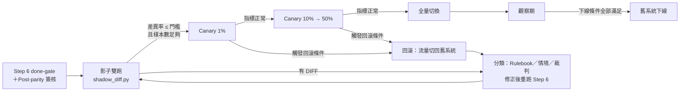

#### 6.8.3 影子雙跑的原理與限制

影子雙跑（shadow traffic、dark launch）：前置路由層把正式請求**複製一份**送給新系統，使用者拿到的仍是舊系統的回應；新系統的回應只寫進紀錄檔，用來與舊系統比對。

| 必須做到 | 原因 | 怎麼驗證 |
|---|---|---|
| 🔒 新系統在影子期間**不得產生對外副作用**：不寫正式資料庫、不發 MQ、不寄信、不呼叫付款 | 否則一筆訂單會被處理兩次 | 新系統以「影子模式」設定啟動：寫入改到隔離的資料庫或 stub；以網路政策封鎖對外連線；抽查外部系統的存取紀錄 |
| 新舊系統用**同一份輸入**，以請求 ID 配對 | 時間差會讓「查詢目前庫存」這類請求天生不同 | 紀錄檔必須帶相同的 `req_id`；配對失敗的筆數要計入差異 |
| 比對規則只能忽略**每次執行都不同**的欄位（時間戳記、trace ID、延遲） | 忽略業務欄位等於把裁判關掉 | 規則檔進版控、變更要審查；工具拒絕忽略 `body`、`exit` |
| 🔒 紀錄檔與報告**不得外洩個資** | 影子流量就是正式資料 | 錄製時先遮罩；報告中的個資欄位只輸出雜湊 |
| 建置設定與正式環境相同 | Bun 的 `debug_assert!` 案例 | 影子環境用 release build、相同的環境變數與設定檔 |

影子雙跑的根本限制：**它只能驗證流量中出現過的情況**。下一節的 Lab 會讓你親眼看到這件事。

#### 6.8.4 Lab：用 shadow_diff.py 比對影子輸出（✅）

延續第 5.2.3 節的 `pricing-lab/`。三支 Lab 檔模擬「錄製正式請求 → 分別重播給新舊系統 → 比對」；比對器 `shadow_diff.py` 是可以直接用在真實專案的企業延伸工具。

📄 `pricing-lab/shadow/gen_requests.py`

```python
"""產生「模擬正式流量」的請求檔（企業延伸範例，非官方 Migration Kit 原生功能）。

真實專案中，這個檔案來自正式環境的請求錄製（且必須先遮罩個資）；
Lab 用固定亂數種子產生，讓每個人跑出完全相同的請求。

用法（在 pricing-lab/ 目錄執行）：
  python shadow/gen_requests.py --count 40  > shadow/requests.jsonl   # 第一天的流量
  python shadow/gen_requests.py --count 400 > shadow/requests.jsonl   # 一週的流量
"""
import argparse
import json
import random
import sys

SEED = 20261111
COUPONS = [None, None, None, "VIP10", "HALF5"]


def main():
    ap = argparse.ArgumentParser()
    ap.add_argument("--count", type=int, default=40)
    a = ap.parse_args()
    sys.stdout.reconfigure(encoding="utf-8", newline="\n")
    rng = random.Random(SEED)
    for n in range(1, a.count + 1):
        items = [
            {"sku": f"S{rng.randrange(100):02d}", "qty": rng.randrange(1, 4),
             "unit_price": rng.choice([150, 299, 700, 1010, 1990])}
            for _ in range(rng.randrange(1, 4))
        ]
        order = {"items": items}
        coupon = rng.choice(COUPONS)
        if coupon is not None:
            order["coupon"] = coupon
        record = {
            "req_id": f"req-{n:04d}",
            # 個資欄位：正式錄製檔一定會有，比對報告不可外洩原值
            "customer_id": f"C{rng.randrange(10**8):08d}",
            "stdin": json.dumps(order, separators=(",", ":")),
        }
        print(json.dumps(record, ensure_ascii=False))


if __name__ == "__main__":
    main()
```

📄 `pricing-lab/shadow/replay.py`

```python
"""把錄製的請求重播給一個系統，寫出「影子輸出」JSONL（企業延伸範例，非官方 Migration Kit 原生功能）。

每筆輸出都帶有 ts、trace_id、latency_ms 這類「每次執行都不同」的欄位，
用來模擬正式環境的回應紀錄——比對時必須忽略它們，但只能忽略它們。

用法（在 pricing-lab/ 目錄執行）：
  python shadow/replay.py --cmd "python legacy/pricing.py" --in shadow/requests.jsonl --out shadow/out/old.jsonl
  python shadow/replay.py --cmd "node target/pricing.ts"   --in shadow/requests.jsonl --out shadow/out/new.jsonl
"""
import argparse
import datetime
import json
import pathlib
import shlex
import subprocess
import sys
import time
import uuid


def main():
    sys.stdout.reconfigure(encoding="utf-8")
    ap = argparse.ArgumentParser()
    ap.add_argument("--cmd", required=True, help="系統的執行指令（相對 --cwd）")
    ap.add_argument("--in", dest="inp", required=True, help="requests.jsonl")
    ap.add_argument("--out", required=True)
    ap.add_argument("--cwd", default=".")
    a = ap.parse_args()

    argv = shlex.split(a.cmd, posix=True)
    out = pathlib.Path(a.out)
    out.parent.mkdir(parents=True, exist_ok=True)
    count = 0
    with open(a.inp, encoding="utf-8") as src, open(out, "w", encoding="utf-8", newline="\n") as dst:
        for line in src:
            if not line.strip():
                continue
            req = json.loads(line)
            start = time.perf_counter()
            r = subprocess.run(argv, input=req["stdin"].encode("utf-8"),
                               capture_output=True, cwd=a.cwd, timeout=60)
            text = r.stdout.decode("utf-8", "replace").replace("\r\n", "\n").strip()
            try:
                body = json.loads(text)
            except ValueError:
                body = text
            record = {
                "req_id": req["req_id"],
                "customer_id": req["customer_id"],
                "ts": datetime.datetime.now(datetime.timezone.utc).isoformat(),
                "trace_id": uuid.uuid4().hex,
                "latency_ms": round((time.perf_counter() - start) * 1000),
                "exit": r.returncode,
                "body": body,
            }
            dst.write(json.dumps(record, ensure_ascii=False) + "\n")
            count += 1
    print(f"replayed {count} request(s) -> {out}")


if __name__ == "__main__":
    main()
```

📄 `pricing-lab/shadow/shadow-rules.json`

```json
{
  "key": "req_id",
  "ignore": ["ts", "trace_id", "latency_ms"],
  "pii": ["customer_id"],
  "known": []
}
```

📄 `tools/migration/shadow_diff.py`

```python
"""影子雙跑比對器（企業延伸範例，非官方 Migration Kit 原生功能）。

輸入：舊系統與新系統對「同一批正式請求」的回應紀錄（JSONL，一行一筆），以及比對規則。
輸出：shadow-report.tsv 與摘要；依門檻決定 exit code，讓 CI／切換 Gate 可以直接使用。

刻意擋下的四種「假綠燈」：
  1. 樣本不足（錄製失敗、檔案是空的）      → exit 2，不是 exit 0
  2. ignore 規則吃掉要比對的欄位（例如 body）→ exit 2
  3. 同一個 key 出現兩次（配對錯亂）          → exit 2
  4. 新系統漏回應（MISSING_NEW）             → 計入差異，不是略過
另外：比對以「保留型別的 JSON 文字」進行，2 與 2.0、true 與 1 視為不同；
報告中的個資欄位只輸出雜湊，不輸出原值。

用法：
  python tools/migration/shadow_diff.py --old old.jsonl --new new.jsonl --rules shadow-rules.json \
      [--report shadow-report.tsv] [--min-samples 100] [--max-diff-rate 0]
exit code：0 通過、1 差異率超過門檻、2 輸入或規則不可信
"""
import argparse
import hashlib
import json
import sys

PROTECTED = {"exit", "body"}


def load_jsonl(path, key):
    rows, dup = {}, []
    with open(path, encoding="utf-8") as f:
        for n, line in enumerate(f, 1):
            if not line.strip():
                continue
            rec = json.loads(line)
            if key not in rec:
                sys.exit(f"ERROR {path}:{n}: 缺少 key 欄位 {key!r}")
            k = str(rec[key])
            if k in rows:
                dup.append(k)
            rows[k] = rec
    return rows, dup


def flatten(value, prefix=""):
    """把巢狀 JSON 攤平成 {路徑: 保留型別的 JSON 文字}。"""
    if isinstance(value, dict):
        out = {}
        for k, v in value.items():
            out.update(flatten(v, f"{prefix}.{k}" if prefix else k))
        return out or {prefix: "{}"}
    if isinstance(value, list):
        out = {}
        for i, v in enumerate(value):
            out.update(flatten(v, f"{prefix}[{i}]"))
        return out or {prefix: "[]"}
    return {prefix: json.dumps(value, ensure_ascii=False, allow_nan=True)}


def covered(path, rules):
    return any(path == r or path.startswith(r + ".") or path.startswith(r + "[") for r in rules)


def mask(path, text, pii):
    if covered(path, pii):
        return "sha256:" + hashlib.sha256(text.encode("utf-8")).hexdigest()[:8]
    return text


def validate_rules(rules):
    errors = []
    key = rules.get("key", "")
    for r in rules.get("ignore", []):
        if r in ("", "*") or r == key or r in PROTECTED or any(p.startswith(r + ".") for p in PROTECTED):
            errors.append(f"ignore 規則 {r!r} 會吃掉要比對的欄位（key、exit、body 不可忽略）")
    for k in rules.get("known", []):
        if not str(k.get("deviation", "")).startswith("DEV-"):
            errors.append(f"known {k.get(key)!r} 沒有對應的 Deviation log 編號（DEV-xxx）")
    return errors


def main():
    sys.stdout.reconfigure(encoding="utf-8")
    ap = argparse.ArgumentParser()
    ap.add_argument("--old", required=True)
    ap.add_argument("--new", required=True)
    ap.add_argument("--rules", required=True)
    ap.add_argument("--report", default="shadow-report.tsv")
    ap.add_argument("--min-samples", type=int, default=100)
    ap.add_argument("--max-diff-rate", type=float, default=0.0)
    a = ap.parse_args()

    with open(a.rules, encoding="utf-8") as f:
        rules = json.load(f)
    key = rules["key"]
    errors = validate_rules(rules)
    old, dup_old = load_jsonl(a.old, key)
    new, dup_new = load_jsonl(a.new, key)
    if dup_old or dup_new:
        errors.append(f"重複的 {key}：old={dup_old[:3]} new={dup_new[:3]}")
    total = len(set(old) | set(new))
    if total < a.min_samples:
        errors.append(f"樣本數 {total} 少於 --min-samples {a.min_samples}：不能當作通過")
    if errors:
        for e in errors:
            print("ERROR", e)
        return 2

    ignore, pii = rules.get("ignore", []), rules.get("pii", [])
    known = {str(k[key]): k["deviation"] for k in rules.get("known", [])}
    counts, rows = {}, []
    for k in sorted(set(old) | set(new)):
        if k not in new:
            verdict, paths, detail = "MISSING_NEW", "", "新系統沒有回應"
        elif k not in old:
            verdict, paths, detail = "MISSING_OLD", "", "舊系統沒有回應（錄製不完整）"
        else:
            fo = {p: v for p, v in flatten(old[k]).items() if not covered(p, ignore)}
            fn = {p: v for p, v in flatten(new[k]).items() if not covered(p, ignore)}
            diff = sorted(p for p in set(fo) | set(fn) if fo.get(p) != fn.get(p))
            paths = ",".join(diff)
            detail = "; ".join(
                f"{p}: old={mask(p, fo.get(p, '<absent>'), pii)} new={mask(p, fn.get(p, '<absent>'), pii)}"
                for p in diff)
            if not diff:
                verdict = "STALE-KNOWN" if k in known else "MATCH"
            else:
                verdict = "KNOWN" if k in known else "DIFF"
        counts[verdict] = counts.get(verdict, 0) + 1
        rows.append((k, verdict, known.get(k, ""), paths, detail))

    with open(a.report, "w", encoding="utf-8", newline="\n") as f:
        f.write(f"{key}\tverdict\tdeviation\tpaths\tdetail\n")
        for r in rows:
            f.write("\t".join(r) + "\n")

    bad = counts.get("DIFF", 0) + counts.get("MISSING_NEW", 0) + counts.get("MISSING_OLD", 0)
    rate = bad / total
    for k, verdict, _dev, _paths, detail in rows:
        if verdict in ("DIFF", "MISSING_NEW", "MISSING_OLD"):
            print(f"{verdict:12} {k}  {detail}")
    summary = " ".join(f"{v}={counts[v]}" for v in sorted(counts))
    print(f"shadow: {total} sample(s)  {summary}  diff-rate={rate:.4f} (max {a.max_diff_rate})")
    if counts.get("STALE-KNOWN"):
        print("WARN: STALE-KNOWN 代表已簽核的差異其實已經一致，請更新規則檔與 Deviation log")
    return 1 if rate > a.max_diff_rate else 0


if __name__ == "__main__":
    sys.exit(main())
```

**第一天：40 筆流量**（在 `pricing-lab/` 目錄執行）：

```bash
python shadow/gen_requests.py --count 40 > shadow/requests.jsonl
python shadow/replay.py --cmd "python legacy/pricing.py"     --in shadow/requests.jsonl --out shadow/out/old.jsonl
python shadow/replay.py --cmd "node target/pricing.ts"       --in shadow/requests.jsonl --out shadow/out/new.jsonl
python shadow/replay.py --cmd "node target/pricing_naive.ts" --in shadow/requests.jsonl --out shadow/out/naive.jsonl
python ../tools/migration/shadow_diff.py --old shadow/out/old.jsonl --new shadow/out/new.jsonl \
  --rules shadow/shadow-rules.json --report shadow/out/new-report.tsv --min-samples 40
python ../tools/migration/shadow_diff.py --old shadow/out/old.jsonl --new shadow/out/naive.jsonl \
  --rules shadow/shadow-rules.json --report shadow/out/naive-report.tsv --min-samples 40
```

作者實測輸出（✅ 2026-11-11）：

```text
shadow: 40 sample(s)  MATCH=40  diff-rate=0.0000 (max 0.0)
shadow: 40 sample(s)  MATCH=40  diff-rate=0.0000 (max 0.0)
```

**兩個都全綠——包括有 bug 的 `pricing_naive.ts`**。第 6.6 節的情境式 parity 一跑就抓到它（`03-half5-tie`），但這 40 筆真實流量裡剛好沒有「折扣金額正好是 .5」的訂單。

**一週後：400 筆流量**：

```bash
python shadow/gen_requests.py --count 400 > shadow/requests.jsonl
# 重跑上面三行 replay，再把兩個 shadow_diff 的 --min-samples 改成 400
```

```text
shadow: 400 sample(s)  MATCH=400  diff-rate=0.0000 (max 0.0)
DIFF         req-0152  body.discount: old=50 new=51; body.total: old=960 new=959
DIFF         req-0231  body.discount: old=50 new=51; body.total: old=960 new=959
...（共 10 筆，省略）
shadow: 400 sample(s)  DIFF=10 MATCH=390  diff-rate=0.0250 (max 0.0)
```

> 📌 **Lab 設計說明**：Lab 的亂數種子與價格清單是作者刻意挑選的，讓「第一天全綠、一週後抓到」的現象可以重現；真實系統中邊界案例出現的頻率要以你的流量為準。

這個 Lab 要教的三件事：

1. **影子雙跑不能取代情境式 parity。** 情境是刻意設計的邊界，流量是自然分佈；兩者互補。影子比對全綠時，先問「這段流量裡有沒有 Rulebook §2 每一列的案例」。
2. **樣本數就是證據強度。** 「40 筆 0 差異」與「400 筆 0 差異」不是同一件事，所以工具強制 `--min-samples`，樣本不足時 exit 2，而不是 exit 0。
3. **影子期間抓到的差異要回到 Step 6。** 把 `req-0152` 的輸入（遮罩後）加成新的 parity 情境，修正後重跑整個 Step 6，再回來繼續影子比對。

比對器本身也要被驗證。`test_shadow_diff.py` 為每一種「假綠燈」準備一個會觸發它的輸入：

📄 `tools/migration/test_shadow_diff.py`

```python
"""shadow_diff.py 的反例測試（企業延伸範例，非官方 Migration Kit 原生功能）。

比對器本身也要被驗證：每一個「假綠燈」防護都要有一個會觸發它的輸入。
用法：python tools/migration/test_shadow_diff.py   （全部通過時 exit 0）
"""
import json
import pathlib
import subprocess
import sys
import tempfile

TOOL = pathlib.Path(__file__).resolve().parent / "shadow_diff.py"
RULES = {"key": "req_id", "ignore": ["ts", "trace_id", "latency_ms"], "pii": ["customer_id"], "known": []}


def rec(i, body, exit_code=0, cid="C00000001", ts="t1"):
    return {"req_id": f"r{i}", "customer_id": cid, "ts": ts, "trace_id": f"x{i}",
            "latency_ms": i, "exit": exit_code, "body": body}


def run(tmp, old, new, rules=RULES, min_samples=3):
    d = pathlib.Path(tmp)
    for name, rows in (("old.jsonl", old), ("new.jsonl", new)):
        (d / name).write_text("".join(json.dumps(r) + "\n" for r in rows), encoding="utf-8")
    (d / "rules.json").write_text(json.dumps(rules), encoding="utf-8")
    r = subprocess.run([sys.executable, str(TOOL), "--old", str(d / "old.jsonl"), "--new", str(d / "new.jsonl"),
                        "--rules", str(d / "rules.json"), "--report", str(d / "report.tsv"),
                        "--min-samples", str(min_samples)],
                       capture_output=True, text=True, encoding="utf-8")
    report = (d / "report.tsv").read_text(encoding="utf-8") if (d / "report.tsv").exists() else ""
    return r.returncode, r.stdout, report


BASE = [rec(1, {"total": 960}), rec(2, {"total": 100}), rec(3, {"error": "unknown coupon: X"}, 2)]


def cases():
    # (名稱, old, new, 規則, min_samples, 期望 exit, 輸出必須包含, 報告不可包含)
    yield "好例：只有 ts／trace_id／latency 不同", BASE, [dict(r, ts="t2", trace_id="y", latency_ms=99) for r in BASE], RULES, 3, 0, "MATCH=3", None
    yield "樣本不足不是通過", BASE, BASE, RULES, 100, 2, "樣本數 3 少於", None
    yield "空檔不是通過", [], [], RULES, 1, 2, "樣本數 0 少於", None
    yield "ignore body 會被拒絕", BASE, BASE, dict(RULES, ignore=["ts", "body"]), 3, 2, "會吃掉要比對的欄位", None
    yield "ignore body 的上層前綴也會被拒絕", BASE, BASE, dict(RULES, ignore=["*"]), 3, 2, "會吃掉要比對的欄位", None
    yield "重複 key 會被拒絕", BASE + [BASE[0]], BASE, RULES, 3, 2, "重複的 req_id", None
    yield "新系統漏回應計入差異", BASE, BASE[:2], RULES, 3, 1, "MISSING_NEW", None
    yield "2 與 2.0 不同（型別保留）", BASE, [rec(1, {"total": 960.0}), *BASE[1:]], RULES, 3, 1, "old=960 new=960.0", None
    yield "true 與 1 不同（型別保留）", [rec(1, {"vip": 1}), *BASE[1:]], [rec(1, {"vip": True}), *BASE[1:]], RULES, 3, 1, "old=1 new=true", None
    yield "exit code 不同", BASE, [*BASE[:2], rec(3, {"error": "unknown coupon: X"}, 1)], RULES, 3, 1, "exit: old=2 new=1", None
    yield "個資欄位差異只輸出雜湊", BASE, [rec(1, {"total": 960}, cid="C99999999"), *BASE[1:]], RULES, 3, 1, "customer_id: old=sha256:", "C99999999"
    yield "known 沒有 DEV 編號會被拒絕", BASE, BASE, dict(RULES, known=[{"req_id": "r1", "deviation": "見會議"}]), 3, 2, "沒有對應的 Deviation log", None
    yield "已簽核差異標 KNOWN", BASE, [rec(1, {"total": 959}), *BASE[1:]], dict(RULES, known=[{"req_id": "r1", "deviation": "DEV-001"}]), 3, 0, "KNOWN=1", None
    yield "已一致的簽核差異要提醒", BASE, BASE, dict(RULES, known=[{"req_id": "r1", "deviation": "DEV-001"}]), 3, 0, "STALE-KNOWN", None


def main():
    sys.stdout.reconfigure(encoding="utf-8")
    failed = 0
    for name, old, new, rules, ms, want_rc, want_text, forbid in cases():
        with tempfile.TemporaryDirectory() as tmp:
            rc, out, report = run(tmp, old, new, rules, ms)
        ok = rc == want_rc and want_text in (out + report) and (forbid is None or forbid not in out + report)
        failed += 0 if ok else 1
        print(f"{'PASS' if ok else 'FAIL'}  {name}" + ("" if ok else f"\n      rc={rc} 期望 {want_rc}\n{out}"))
    total = sum(1 for _ in cases())
    print(f"{total - failed}/{total} passed")
    return 1 if failed else 0


if __name__ == "__main__":
    sys.exit(main())
```

```bash
python ../tools/migration/test_shadow_diff.py
# 作者實測（✅）：14/14 passed
```

作者另外把 `shadow_diff.py` 故意改壞四處（改用 `==` 比較、拿掉個資遮罩、允許 `ignore: ["*"]`、拿掉樣本數檢查），每一處都會讓上面的測試出現 FAIL（✅）——這證明測試真的在檢查它宣稱要檢查的事。

#### 6.8.5 Canary 放量與回滾

影子比對通過後才開始 canary。每一階都要事先寫好「放量條件」與「回滾條件」，並由負責人簽核；回滾條件**觸發就執行**，不在當下討論。

| 階段 | 流量比例 | 最短觀察時間 | 放量條件（全部滿足） | 回滾條件（任一觸發） |
|---|---|---|---|---|
| Canary 1 | 1% | 涵蓋一個完整的業務週期（例如一個營業日、含日結批次） | 錯誤率與延遲不高於舊系統基準線；業務對帳差異為 0 | 錯誤率高於基準線（門檻由 SRE 訂）；任何一筆金額對帳差異；任何資料寫入錯誤 |
| Canary 2 | 10% | 同上 | 同上；客服案件數無異常 | 同上 |
| Canary 3 | 50% | 涵蓋月結等週期性事件 | 同上 | 同上 |
| 全量 | 100% | 進入觀察期（第 6.8.7 節） | — | 同上；回滾路徑保留到下線條件滿足 |

🏢 上表的比例與觀察時間是作者建議的起點，請依系統風險等級調整。金融類系統（第 9.3 節）建議每一階都要有業務單位簽核。

**只看技術指標是常見錯誤。** 錯誤率與延遲正常，不代表金額正確——Lab 的 `pricing_naive.ts` 每一筆都回傳 HTTP 200，只是折扣差 1 分錢。業務指標要包含：金額加總對帳、筆數對帳、拒絕率（例如「invalid qty」的比例）。

**回滾 Runbook（🏢 範本）**：

| 步驟 | 動作 | 驗證 |
|---|---|---|
| 1 | 前置路由層把新系統的流量權重改成 0（或關閉 feature flag） | 新系統的請求數在 1 分鐘內歸零 |
| 2 | 確認舊系統可以讀取 canary 期間新系統寫入的資料 | 抽查 canary 期間的交易，在舊系統查詢結果正確 |
| 3 | 保存新系統的紀錄檔與 `shadow-report.tsv` | 檔案已複製到事件資料夾 |
| 4 | 開事件單，記錄觸發條件與時間 | 事件單編號寫進 Gate 紀錄 |
| 5 | 依第 6.8.6 節分類原因，修正後**從 Step 6 重新開始**，不是直接重新放量 | 新的 parity 報告與影子比對報告 |

> 🔒 **資安注意事項**：步驟 2 是回滾能不能成功的關鍵。**切換期間不要同時變更資料庫結構**：新系統若寫入舊系統讀不懂的欄位或格式，回滾就會變成資料修復。資料結構變更要在切換前（兩邊都相容）或下線後進行。

#### 6.8.6 Post-merge Regression 的處理與分類

每一個上線後發現的 regression，處理方式與 Step 6 的 DIVERGE 相同：**先分類，再修正產生它的流程**，不是只修那一行程式。Bun 文章的結論之一就是「修正產生的流程，而不是手動修補輸出」。

| 分類 | 判斷問題 | 修正位置 | 防止再發 |
|---|---|---|---|
| Rulebook 缺口 | Rulebook 對這個構造沒有規則，或規則錯了？ | Rulebook 修訂（第 10.3 節流程） | 依修訂影響範圍重新產生受影響的檔案 |
| 情境缺口 | 規則是對的，但 parity 情境沒有覆蓋這個路徑？ | 新增 parity 情境（輸入取自事件、先遮罩） | 情境進版控；之後每次 Step 6 都會跑 |
| 裁判缺口 | 情境有覆蓋，但正規化把差異抹掉了？ | 修正 `canonical()` 或影子比對規則 | 為這個差異加一個突變（`mutations.json`）或測試案例 |
| 環境差異 | 測試環境與正式環境的建置或設定不同？ | 影子與 parity 環境改用正式建置設定 | 在 Gate 清單加一項「建置設定與正式相同」 |

🏢 Regression 紀錄表（建議放在 `migration/regressions.tsv`）：

<!-- markdownlint-disable MD010 -->

<!-- markdownlint-disable MD010 -->

```text
id	found_at	source	class	fix_commit	new_scenario	rulebook_amendment
R-001	2026-12-03	canary-1	rulebook	a1b2c3d	12-assert-side-effect	A7
R-002	2026-12-05	shadow	scenario	d4e5f6a	13-half5-1010	-
```

<!-- markdownlint-enable MD010 -->

<!-- markdownlint-enable MD010 -->

審查時看兩件事：每一列的 `class` 都有對應的「防止再發」產物（`new_scenario` 或 `rulebook_amendment` 至少一個不是 `-`）；同一類原因連續出現，代表那一類的流程需要整體檢討，而不是逐筆修。

#### 6.8.7 舊系統下線條件

全量切換後進入觀察期。以下條件**全部滿足**，且由負責人與業務單位簽核後，舊系統才能下線：

- [ ] 全量後的觀察期涵蓋至少一個完整的週期性事件（月結、季結、年度批次，依系統而定）
- [ ] 觀察期內沒有觸發回滾條件；期間的 regression 都已分類、修正並補上防止再發的產物
- [ ] Parity 的所有 KNOWN 差異都有 DEV 編號與業務簽核，且已通知下游使用者
- [ ] Post-parity（第 6.7 節）的標記分類已完成並合併
- [ ] 舊系統的程式碼以 tag 封存（例如 `legacy-final`），封存位置寫進 Gate 紀錄
- [ ] 舊系統的資料保存、稽核紀錄保存符合法規與公司政策（金融業見第 9.3 節）
- [ ] 舊系統專屬的排程、帳號、憑證、防火牆規則、監控告警都已列清單並逐項移除
- [ ] 回滾路徑正式關閉的決定有書面紀錄（下線之後就不能再切回）

> 📌 **注意事項**：官方文章中的「刪掉分支重來」指的是**遷移失敗時放棄這次嘗試**，不是舊系統下線。不要把兩者混在一起：遷移期間可以隨時刪分支重來，舊系統下線則是不可逆的決定。

#### 6.8.8 人工審核重點與 Gate

這個階段 AI 常被要求產出切換計畫、比對規則與 canary 設定。審查方式：

| AI 產出 | 壞例 | 怎麼抓 | 好例 |
|---|---|---|---|
| 影子比對規則 | `"ignore": ["ts", "trace_id", "body.discount"]`，理由是「捨入雜訊」 | `shadow_diff.py` 只擋 `body`、`exit` 整個被忽略；**業務欄位被忽略要靠人看**：`ignore` 裡只能有每次執行都不同的欄位 | 捨入差異是 Rulebook 問題，回 Step 6 修；真的要接受就寫成 `known` 並附 DEV 編號 |
| 比對結論 | 「影子比對 0 差異，可以放量」，但沒附樣本數 | 要求附上 `shadow_diff.py` 的完整摘要行；樣本數低於事先約定的門檻就不算 | 「400 sample(s) MATCH=400」，並說明期間涵蓋哪些業務事件 |
| Canary 指標 | 只有錯誤率、延遲、CPU | 對照第 6.8.5 節：有沒有金額、筆數、拒絕率等業務指標 | 每個指標都有基準線來源與門檻 |
| 回滾計畫 | 「回滾時執行 down migration 還原資料表」 | 回滾需要資料庫結構還原 = 切換期間變更了結構 | 切換期間不變更結構；回滾只改流量權重 |
| 影子環境設定 | 新系統影子模式仍連正式 MQ | 檢查影子環境的連線設定與網路政策；抽查 MQ 的 consumer／producer 清單 | 影子環境的對外連線全部指向 stub 或被封鎖 |

```bash
# 審查 AI 修改的影子比對規則：ignore 只允許「每次執行都不同」的欄位（清單由負責人維護）
# 有多出來的欄位時 exit 1；輸出只用 ASCII，避免 Windows 終端機 cp950 編碼錯誤或亂碼
python -c "import json,sys; r=json.load(open(sys.argv[1],encoding='utf-8')); bad=[p for p in r['ignore'] if p not in ('ts','trace_id','latency_ms')]; print('WARN extra ignore fields:', bad) if bad else print('OK'); sys.exit(1 if bad else 0)" shadow/shadow-rules.json
```

**Cutover Gate 驗收條件**：

- [ ] Step 6 done-gate 與 Post-parity 已簽核
- [ ] 影子環境的副作用隔離已驗證（不寫正式資料、不發訊息）
- [ ] `shadow_diff.py` 通過：樣本數達事先約定的門檻、差異率不高於門檻、所有 KNOWN 有 DEV 編號
- [ ] 影子與 parity 環境的建置設定與正式環境相同
- [ ] Canary 各階的放量條件、回滾條件、觀察時間已書面簽核
- [ ] 回滾 Runbook 已演練一次（在測試環境把流量切過去再切回來）
- [ ] 切換期間沒有排定資料庫結構變更

### 6.9 本章 AI 產出審查

| Phase | AI 常見錯誤 | 怎麼抓 |
|---|---|---|
| 1 | 地圖由 Agent「讀檔整理」而非腳本；inventory 行號 off-by-one | 要求提交腳本並跑兩次 diff；行號核對腳本（6.1.9） |
| 2 | Diff 報告每項都判 rulebook right；B 其實看過 Rulebook | 看判決分布；確認 B 的工作目錄在 repo 外 |
| 3 | Trailer 少報 todos；自行發明第二種翻譯；touch 空檔 | `port_markers.py`、`queue_runner verify`、抽查 §2 |
| 4 | Fixer 嘗試編譯；口述「已修完全部錯誤」 | Hook 紀錄；只看最新 `build-output-rN.txt` |
| 5 | 為了能跑而修改 legacy | `git diff --stat migration-baseline -- legacy/` 應為空 |
| 6 | 放寬正規化讓差異消失；skip 測試 | 審查 `canonical()` 變更；`gate_check.sh` |
| 切換 🏢 | 影子比對「0 差異」但樣本不足；把業務欄位加進 `ignore`；回滾計畫需要還原資料庫結構 | `shadow_diff.py` 的 `--min-samples`；審查 `shadow-rules.json` 的 diff；第 6.8.8 節 |

```bash
# 一次檢查 Phase 3～6 的機械證據
node migration-kit/scripts/queue_runner.mjs --manifest migration/manifest.tsv verify && \
python tools/migration/port_markers.py --manifest migration/manifest.tsv && \
git diff --quiet migration-baseline -- legacy/ && echo "legacy 未被修改" && \
bash tools/migration/gate_check.sh origin/main HEAD
```

---

## 第7章 AI Agent 團隊設計與協作

### 7.1 角色總表

下表把 Kit 原生的角色（📖）與企業常見的延伸角色（🏢）放在一起。**Kit 只定義了 implementer、reviewer、第三方裁決、fixer、skeptic、translator、diff inspector、分類 Agent**；其他是組織可以自行加上的角色。

| Agent | 職責 | 來源 | 對應 Prompt | 建議模型等級 | 權限 |
|---|---|---|---|---|---|
| Migration Orchestrator | 遷移總控：讀 Prompt、跑腳本、派工、在 Gate 交證據 | 📖 主 session | 全部 | 依模型計畫 | 依 settings.json |
| Architect Agent | 架構與遷移規則分析、structure-preserving／redesign 判斷 | 🏢（Kit 由 00 的報告承擔） | 00 | 最大 | 唯讀 |
| Dependency Agent | 撰寫／調整 depmap 腳本、驗證地圖 | 📖 01 的 skeptic | 01 | `[reviewer model]` | 唯讀（驗證）；腳本由主 session 寫 |
| Rulebook Agent | 調查程式碼事實、草擬規則文字、找規則缺陷 | 📖 Step 1 起草與聯合稽核 | 02 | 最大 | 唯讀；修訂只能排佇列 |
| Implementer Agent | 翻譯一個單位 | 📖 | 03、04 | `[implementer model]` 中／小 | 只寫自己的目標檔 |
| Reviewer Agent A | 第一位對抗式審查 | 📖 | 03、04、05 | `[reviewer model]` | 唯讀 |
| Reviewer Agent B | 第二位獨立審查（不看 A 的結論） | 📖 | 03、04、05 | `[reviewer model]` | 唯讀 |
| Dispute Resolver | 兩位意見不一時裁決，預設 not-confirmed | 📖「a third rules」 | 04 | `[reviewer model]` | 唯讀 |
| Fixer Agent | 只套用 confirmed findings 或自己切片的編譯錯誤 | 📖 | 04、05、Step 6 | `[fixer model]` 中階 | 只改指派的目標檔、**無編譯器** |
| Test Agent | 00b 的測試分類與改寫、Step 6 的失敗分類 | 📖 部分（00b reviewer、Step 6 triage） | 00b、Step 6 | 中／大 | 唯讀＋寫 harness |
| Security Agent | 審查 `unsafe`／`SAFETY:`、輸入驗證、秘密、相依套件 | 🏢 | Step 3 額外審查 | 大 | 唯讀 |
| Performance Agent | 依 `PERF(port)` 與基準線分析效能 | 🏢 | post-parity | 中／大 | 唯讀＋跑 benchmark（由人授權） |
| Documentation Agent | 更新 README、API 文件、操作手冊 | 🏢 | post-parity | 小／中 | 只寫 docs/ |

### 7.2 Subagent、Dynamic Workflow、Agent Teams、Skill 的差別

這四個功能常被混為一談，但在 Claude Code 中是**不同的東西**：

| 功能 | 是什麼 | 在遷移中的角色 | 啟用條件（2026-11-11 查證） |
|---|---|---|---|
| **Subagent** | 在獨立 context window 中執行的子 Agent，有自己的系統提示、工具清單、模型、權限；可用 `.claude/agents/*.md` 定義 | 每個 implementer／reviewer／fixer 就是一個 Subagent；「獨立 context」是對抗式審查成立的前提 | 一般可用；內建 Subagent 繼承主對話的權限規則 |
| **Dynamic workflow** | Claude 寫一支 JavaScript 編排腳本，runtime 在背景平行執行許多 Subagent；可暫停、恢復、存成可重跑的腳本 | Kit 每支 Prompt 的「Use a workflow」；fan-out 的實際執行者 | 付費方案、Anthropic API、Bedrock、Google Cloud Agent Platform、Microsoft Foundry；**Pro 要在 `/config` 開啟**；預設最多 16 個 Agent 同時執行、每次 run 最多 1,000 個 Agent |
| **Agent Teams** | 多個**獨立 Claude Code session**組成團隊，由 lead 協調、成員之間可以互傳訊息、共享任務清單 | Kit **沒有**使用；適合「需要彼此討論」的工作（例如競爭假說除錯），不適合需要嚴格隔離的對抗式審查 | **實驗功能，預設關閉**：`CLAUDE_CODE_EXPERIMENTAL_AGENT_TEAMS=1`；不能 `/resume` 恢復 in-process 成員、一個 session 一個團隊、不能巢狀 |
| **Skill** | `SKILL.md`＋支援檔，提供可重用的指示；Claude 在相關時自動載入，或用 `/skill-name` 呼叫 | Kit 的 `code-migration` Skill 只負責**路由**（目前該跑哪支 Prompt），不執行翻譯 | 一般可用；個人 `~/.claude/skills/`、專案 `.claude/skills/`、企業 managed 目錄 |

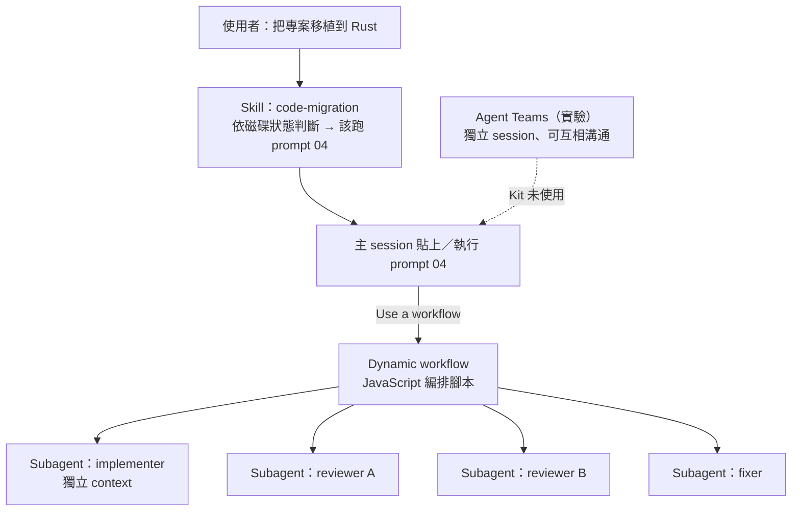

> 📌 **注意事項**：官方 workflow 文件明列「執行中沒有使用者輸入；要在 Stage 之間簽核，就把每個 Stage 當成獨立的 workflow」。這正好吻合 Kit 的 Gate 設計——**不要**試圖寫一支從 Step 1 跑到 Step 6 的 workflow。Kit README 寫於 2026 年 7 月，原文說「在原生 Claude Code 中，這就是 Task／Agent fan-out」；在 2.1.322，對應的是 Dynamic workflow 或主 session 平行呼叫 Subagent。

### 7.3 Agent 如何分工

分工原則只有一條：**影響範圍決定模型等級與權限，不是工作的「地位」**。

| 分工維度 | 規則 |
|---|---|
| 單位 | Structure-preserving：一個檔案；redesign：一個模組或子系統 |
| 每單位人數 | 4（implementer、reviewer×2、fixer）＋必要時裁決 |
| 誰能寫 | implementer 寫自己的目標檔；fixer 改指派的目標檔；**沒有任何 Agent 能寫 Rulebook** |
| 誰能編譯 | 只有 build daemon（或已併入時，Rulebook §0 指定的便宜裁判） |
| 誰能 commit | 只有 orchestrator，在批次邊界 |

### 7.4 Agent 如何共享工作規則

| 規則來源 | 誰讀 | 怎麼確保讀到 |
|---|---|---|
| Kit `CLAUDE.md`（Standing rules） | 每個 session | 專案 `CLAUDE.md` 用 `@` 匯入；注意 Subagent 定義的 `omitClaudeMd` 欄位若設為 true 會不載入 |
| `migration/RULEBOOK.md` | 每個 implementer、reviewer、fixer | Prompt 04 要求「Every agent reads the rulebook」；Subagent 定義的第一條指示也寫明 |
| `migration/inventory.tsv` | implementer（grep 自己的檔） | Rulebook §5 以路徑委派 |
| Subagent 定義（🏢） | 被派工的 Subagent | `.claude/agents/*.md` 提交進 repo |

### 7.5 Agent 如何共享任務狀態

**不共享記憶，只共享磁碟。**

| 狀態 | 存放 | 讀法 |
|---|---|---|
| 待辦單位 | manifest 中目標檔不存在的列 | `queue_runner.mjs next` |
| 進度 | 目標檔存在與否 | `queue_runner.mjs status` |
| 編譯錯誤 | `build-output-rN.txt` → 錯誤佇列 TSV | fixer 讀自己的切片 |
| 審查結論 | 每個單位的 findings 檔（🏢 建議存 `migration/reviews/<unit>.tsv`） | 裁決與 fixer 讀 |
| 規則修訂 | 修訂佇列（diff-report 的 AMENDMENT QUEUE 段、或 `migration/amendments.md`） | 人在 Gate 讀 |
| 偏離 | Rulebook §7 Deviation log | 人在 Gate 寫 |

### 7.6 如何隔離不同 Agent 的工作範圍

| 隔離需求 | 做法 |
|---|---|
| Reviewer 不受 implementer 推理影響 | 獨立 Subagent（獨立 context），只給它 source 與 target 檔案路徑 |
| 兩位 reviewer 互不影響 | 各自一個 Subagent，裁決者才看兩份結論 |
| Bakeoff Translator B 不知道 Rulebook | 在 repo 外的 scratch 目錄，只有原始檔副本 |
| Translator A 的輸出不汙染主分支 | 拋棄式 git worktree，永不合併（Subagent 可設 `isolation: worktree`） |
| 工具權限 | Subagent 定義的 `tools` 欄位：reviewer 只有 Read、Grep、Glob |

> 🔒 **Bakeoff Translator B 的隱藏汙染源**：官方文件寫明 Subagent「從主對話目前的工作目錄啟動」，且預設會載入使用者、專案、local 的 `CLAUDE.md`。專案 `CLAUDE.md` 匯入了 Kit 的規則，而 Kit 的規則第 1 條就是「Rulebook 在迴圈內唯讀」——Translator B 一啟動就知道 Rulebook 存在，也有 Read 工具可以去讀它。建議（🏢）：Translator B **不要**用主 session 的 Subagent，而是由人在 repo 外的 scratch 目錄另開一個獨立 session（例如 `cd /scratch/bakeoff-b && claude -p "..."`）；若一定要用 Subagent，至少設定 `omitClaudeMd: true` 並在報告中聲明 B 有讀取 repo 的能力（🧪 隔離效果請自行驗證）。

### 7.7 如何避免 Agent 互相覆蓋程式碼

1. **Manifest 一對一**：一個來源只對應一個目標，一個目標只由一個 implementer 產生。
2. **一個模組切片一位 fixer**（Step 4）。
3. **禁止會改 Git 狀態的指令**：共用 worktree 中一個 `git reset` 會毀掉其他 Agent 進行中的工作；`git clean` 會刪掉尚未 commit 的翻譯輸出（settings.README.md）。
4. **Shard-then-merge**：多個分類 Agent 各寫自己的 TSV，orchestrator 合併。

### 7.8 如何控制平行工作數量

| 控制點 | 機制 | 預設 |
|---|---|---|
| 批次大小 | prompt 04 的 `[100]` | 100 |
| 同時執行的 workflow Agent | `CLAUDE_CODE_WORKFLOW_MAX_CONCURRENT_AGENTS`（1～256，需 2.1.269 以上） | 16（CPU 少時更少） |
| 每次 run 的 Agent 總數 | runtime 上限 | 1,000 |
| 單一 `parallel()`／`pipeline()` 項目數 | runtime 上限 | 4,096 |
| 大型提示 | 超過 25 個 Agent 或預估 150 萬 token 顯示「Large workflow」（只提示） | — |
| Workflow 大小方針 | `/config` 或設定的 size guideline（例如 small） | — |

### 7.9 如何管理失敗及重試

| 失敗 | Kit 的處理 | Claude Code 的機制 |
|---|---|---|
| Worker 停滯 | 輸出數三分鐘沒成長視為失敗，從磁碟救回並回報；「停滯由你治癒，不是由我發現」 | `/workflows` 可看每個 Agent 狀態 |
| Workflow 中斷 | 重新貼同一支 Prompt：佇列從磁碟重建 | 同一 session 內可從 `/workflows` 暫停／恢復；已完成的 Agent 回傳快取結果 |
| 用量上限 | 同上 | 2.1.318 以上：因用量上限失敗的 Agent 恢復時會重跑，已完成者回傳保存結果 |
| 同一錯誤反覆 | 第三次就停止修個案，改修規則 | — |
| 地圖驗證三輪失敗 | 停下，把漏掉的依賴交給人 | — |

> 📌 **注意事項**：Workflow 的恢復機制在**同一 session**內有效，而且「第一個 prompt 改變的 Agent 之後全部重跑」。Kit 的設計不依賴這個：就算整個 session 消失，佇列仍可從磁碟重建。兩者一起用時，以磁碟狀態為準。

### 7.10 Subagent 定義範例（企業延伸）

企業延伸範例，非官方 Migration Kit 原生功能。把「implementer 不能編譯」「reviewer 唯讀」從 Prompt 約定變成**工具清單**的結構保證：implementer 與 fixer 根本沒有 Bash／PowerShell 工具。

📄 `.claude/agents/port-implementer.md`

```markdown
---
name: port-implementer
description: 依 migration/RULEBOOK.md 把 manifest 中的一個 source 檔翻譯成對應的 target 檔。只在遷移 Step 2 pilot 與 Step 3 fan-out 使用，一次只處理一個檔案。
tools: Read, Grep, Glob, Write
model: sonnet
---

你是遷移專案的 implementer。你只負責「一個」檔案。

1. 先完整讀 `migration/RULEBOOK.md`，再 grep `migration/inventory.tsv` 找出這個檔案的所有站點。
2. 依 Rulebook §4 的命名規則，把 source 翻成 target；target 路徑以呼叫你的人提供的 manifest 列為準。
3. Rulebook 與 inventory 都沒決定的情況：用最保守的表示法，留 `TODO(port): <問題>`，繼續往下。
4. 原系統的缺陷照抄並標 `BUG(port): <repro>`；已知較慢的直譯標 `PERF(port):`。
5. 檔案結尾寫 `// PORT STATUS: confidence=<high|medium|low> todos=<N>`，N 必須等於檔內含 `TODO(port)` 的行數。
6. 不要修改 Rulebook、inventory、其他 target 檔，也不要寫 target 以外的任何檔案。
7. 你沒有 shell 工具；這是刻意的設計：Step 3 的 draft 不需要編譯。
```

📄 `.claude/agents/port-reviewer.md`

<!-- markdownlint-disable MD010 -->

````markdown
---
name: port-reviewer
description: 對單一翻譯檔做對抗式審查（唯讀）。每個檔案由兩個獨立 context 的 port-reviewer 審查，假設翻譯是錯的；只回報有 Rulebook 條文或原始碼行號佐證的 finding。
tools: Read, Grep, Glob
model: opus
---

你是對抗式 reviewer。假設這份翻譯是錯的，你的工作是找出證據。你不修改任何檔案。

輸入：一組 source 檔、target 檔。

逐項檢查並回報 TSV（每列一個 finding）：

```text
severity	rule_or_line	target_line	finding	suggested_fix
```

- `rule_or_line` 必須是 Rulebook 章節（例如 `RULEBOOK §2 round`）或 source 行號（例如 `legacy/pricing.py:28`）；兩者都沒有的意見不要回報。
- 一定要檢查：
  1. 實作者是否遵守 Rulebook（每個偏離都要指出章節）；翻譯「碰巧正確但沒照規則」也是 finding。
  2. Rulebook §2 列出的每個構造是否用了唯一指定的寫法（例如沒有自己寫 round，而是 import `roundHalfEven`）。
  3. 錯誤訊息是否逐字相同（屬於 parity 範圍）。
  4. `PORT STATUS` 的 todos 是否等於 `TODO(port)` 行數。
  5. Rulebook 沒有規定、但兩個 Agent 可能做法不同的地方 → 回報為 `RULEBOOK-SILENCE`，提議修訂內容。
- 你看不到另一位 reviewer 的結果，也不要猜。
````

<!-- markdownlint-enable MD010 -->

📄 `.claude/agents/port-fixer.md`

```markdown
---
name: port-fixer
description: 只套用已確認（confirmed）的 review finding 或 build-queue 中屬於自己模組切片的錯誤。不能修就標記，不得自行編譯。
tools: Read, Grep, Glob, Edit
model: sonnet
---

你是 fixer。你只處理呼叫者指派給你的 finding 或錯誤清單，且只修改清單中列出的 target 檔。

1. 只套用狀態為 confirmed 的 finding；not-confirmed 一律不動。
2. Step 4：依 `migration/build-queue-rN.tsv` 中屬於你模組切片的列修正；錯誤訊息與原始碼是你唯一的依據，你沒有編譯器。
3. 修不了就在該行加 `TODO(port): <原因>`，並更新 PORT STATUS 的 todos。
4. 修完後重新計算檔內含 `TODO(port)` 的行數，確認等於 trailer 的 todos（數字是收據，不是宣稱）。
5. 同一類錯誤你已經修第三次了 → 停止修個案，回報「哪一條 Rulebook 規則產生了它」，由人決定是否修訂並重新產生該切片。
6. 不得修改 Rulebook、inventory、測試或 `legacy/`。
```

📄 `.claude/agents/dispute-resolver.md`

<!-- markdownlint-disable MD010 -->

````markdown
---
name: dispute-resolver
description: 兩位 port-reviewer 意見不一致時的第三方裁決者（唯讀）。預設判 not-confirmed，只有證據充分時才 confirmed。
tools: Read, Grep, Glob
model: opus
---

你是第三方裁決者。輸入是兩位 reviewer 對同一檔案、彼此不一致的 finding。

對每一個 finding：

1. 打開 finding 引用的 Rulebook 章節或 source 行號，親自核對。
2. 只有在引用確實存在、且 target 確實違反時，判 `confirmed`；其餘一律 `not-confirmed`（預設值）。
3. 若爭議根源是 Rulebook 沒有規定，判 `rulebook-silence`，寫出建議的修訂文字；修訂由人在 Gate 套用，不是你。

輸出 TSV：

```text
finding_id	verdict	evidence	note
```
````

<!-- markdownlint-enable MD010 -->

使用方式：在 prompt 04 結尾加一句（🏢）：

```text
Implementers use the port-implementer agent, reviewers use port-reviewer (two separate
invocations per file), disagreements go to dispute-resolver, fixes go to port-fixer.
```

| 欄位 | 官方文件的行為 |
|---|---|
| `tools` | 逗號分隔字串或 YAML 清單；省略時繼承所有可用工具 |
| `model` | `sonnet`、`opus`、`haiku`、`fable`、完整模型 ID 或 `inherit`；省略時依 subagent model order 決定 |
| `isolation: worktree` | 在暫時的 git worktree 執行，無變更時自動清除（適合 Bakeoff Translator A） |
| 未知欄位 | **不報錯、直接忽略**——欄位名稱拼錯時要特別小心 |

> 🧪 **待驗證**：作者以官方 frontmatter 欄位撰寫上述定義，並確認欄位名稱與官方表格一致，但**沒有**在 live session 實際派工測試（需要實際消耗 token）。導入前請用 `/agents` 確認四個定義都出現在 Library，並以一個檔案試跑 Pilot。

### 7.11 如何進行人工核准

| Gate | 誰核准 | 核准的證據 | 怎麼記錄 |
|---|---|---|---|
| Feasibility verdict＋模型計畫 | PM＋架構師 | 報告 | 會議紀錄＋cost-log |
| Judge 是真的 | QA／SA | self-check＋突變結果 | commit trailer |
| Step 1 | 架構師＋SA | 地圖、Rulebook、inventory | Rulebook 提交 |
| 安裝 settings.json | Tech lead | preflight 結果 | `Gate-Decision:` trailer |
| Rulebook 修訂 | 架構師 | 修訂佇列＋證據 | `Rulebook-Amendment:`＋`Approved-by:` trailer |
| Step 4 併入 Step 3 | 架構師 | Feasibility 的驗證成本 | `Gate-Decision:` trailer＋Deviation log |
| Done-gate | PM＋QA＋業務窗口 | 兩個計數＋KNOWN 清單 | 驗收單 |

### 7.12 本章 AI 產出審查

| 檢查 | 壞例 | 怎麼抓 |
|---|---|---|
| 把 Agent Teams 當成 Kit 的必要功能 | 「先開啟 Agent Teams 再執行 prompt 04」 | Kit 原文沒有出現 Agent Teams |
| Reviewer 有寫入工具 | `tools: Read, Grep, Edit` | `grep -n '^tools:' .claude/agents/*reviewer*.md` |
| 實作者有 shell | `tools: Read, Write, Bash` | 同上 |
| 模型未指定 | Subagent 定義沒有 `model` | `grep -L '^model:' .claude/agents/*.md` |
| 單一 workflow 跨越 Gate | 「一支 workflow 從 Step 1 跑到 Step 6」 | 對照 Kit CLAUDE.md 第 3 條 |

```bash
# Subagent 定義的權限稽核
for f in .claude/agents/*.md; do
  printf '%-40s %s | %s\n' "$f" "$(grep -m1 '^tools:' "$f")" "$(grep -m1 '^model:' "$f")"
done
grep -lE '^tools:.*(Bash|PowerShell)' .claude/agents/port-*.md && echo "⚠️ 有 port-* Agent 具備 shell 工具"
```

---

## 第8章 實際案例教學

本章四個案例（另加第 8.5 節的業界對照）的性質不同，請先看清楚：

| 案例 | 性質 | 資料來源 |
|---|---|---|
| A：Zig → Rust | 真實案例的**解讀** | 官方文章、Bun 的 `docs/PORTING.md`（commit `46d3bc2`，576 行） |
| B：Python → TypeScript | 真實案例＋**本手冊 Lab 實測** | 官方文章、Kit RUN-NOTES Run 1、`pricing-lab/`（✅） |
| C：C／C++ → Rust | 真實案例的解讀＋**未編譯的示意程式** | Kit RUN-NOTES Run 2／3（tinyexpr）；程式片段標 🧪 |
| D：企業大型系統 | **完全假想**的教學案例 | 作者設計；所有數字都是假設 |
| 業界對照：Google、Airbnb | 第一手來源的**整理與對照**（同語言遷移） | arXiv 論文、Airbnb 工程部落格 |

> 📌 **注意事項**：不要把 Anthropic 案例的成果（時間、token、通過率）當成一般專案可以達成的承諾。官方文章本身也寫了「Kit 是通用範本，不是這些遷移實際使用的設定」。

### 8.1 案例 A：Zig → Rust（Bun）

#### 8.1.1 官方揭露的事實

| 項目 | 數字（官方文章） |
|---|---|
| 規模 | 約 100 萬行 Rust，不到兩週 |
| Stress test | 先用 3 個檔案測規則，再 fan out 到 1,448 個檔案 |
| 測試 | 合併前 Bun 既有測試套件在 CI 100% 通過；合併後發現 19 個 regression，均已修正 |
| Token | 59 億未快取輸入、6.9 億輸出，依 API 價格約 16.5 萬美元 |
| 編譯錯誤 | 數千個，來自 Zig lazy compilation 容忍、Rust 不容忍的循環 import |
| 成果 | 約 4% 的程式碼在 `unsafe` 區塊（多為 C／C++ 邊界的單行指標操作）；2,000 次重複 build 的記憶體從 6,745 MB 降到 609 MB；Linux 與 Windows binary 小 19%；HTTP 與 `next build`、`tsc` 等工作負載快 2～5% |

#### 8.1.2 原始語言特性與遷移難點

| Zig 特性 | Rust 對應的困難 | Bun PORTING.md 的決定（摘要） |
|---|---|---|
| 手動記憶體管理、顯式 allocator 參數 | Rust 以所有權與 `Drop` 管理 | **AST／parser 類 crate 保留 arena**（`bumpalo`、`typed_arena`），因為大量小節點在 parse 結束時一次釋放是吞吐量的關鍵；**其他 crate 一律刪掉 allocator 參數**，改用全域 allocator |
| `deinit()` 慣例 | Rust 的 `Drop` | `pub fn deinit` 改成 `impl Drop` |
| out-param 建構子 | Rust 有回傳值最佳化 | 允許改成 `-> Result<Self, E>`（明列為「diff 閱讀者要預期的改形」） |
| 大量指標與 intrusive 資料結構 | 借用檢查器 | 保留 raw pointer＋`offset_of!`；**不要為了讓 borrowck 安靜而改用 raw pointer**；允許「為 borrowck 重塑」並留 `PORT NOTE` |
| 錯誤聯集（error union） | `Result<T, E>` | 對照表 |
| comptime 反射 | 泛型／巨集 | 獨立一節規則 |
| 自有 event loop 與 syscall | Rust async 生態系 | **禁止** `tokio`、`rayon`、`hyper`、`async-trait`、`futures`、`async fn`、`std::fs`、`std::net`、`std::process` |
| 單執行緒共享指標 | `Rc` vs 自訂型別 | 用標準 `Rc<T>`，不要為了省 8 bytes 自製型別（「全樹只有 4 處使用」——這是**調查事實**支撐政策決定的例子） |

#### 8.1.3 Rulebook 設計的啟示

Bun 的 PORTING.md 與 Kit 範本的對應：

| PORTING.md 段落 | 對應 Kit RULEBOOK 節 | 學到什麼 |
|---|---|---|
| Ground rules | §0、§3、§4 | 「Phase A 的目標是**草稿**，不需要編譯；Phase B 逐 crate 讓它編譯」——這就是 Kit 的 Step 3／Step 4 分工 |
| Crate map | §4（模組與共用型別的家） | 跨區型別一律 `bun_<area>::Type`，**不准發明 crate 佈局** |
| Type map、Idiom map、Strings、Collections | §2 | 每個來源構造一個標準翻譯 |
| Allocators、Pointers & ownership | §2＋§5（inventory） | 依 crate 類型分流的規則，比「一律用 Box」精確 |
| FFI、Platform conditionals | §2、§3 | `unsafe` 只在 Zig 本來就 unsafe 時允許，每個區塊都要 `// SAFETY:` |
| Don't translate | §0 | 產生的檔案寫 3 行 stub，不翻 |
| Output format | §6 | 結尾 `PORT STATUS`（source、confidence、todos、notes） |

#### 8.1.4 Dependency Mapping 與編譯錯誤

Bun 的教訓是 Kit 要求「兩種粒度都檢查循環」的直接來源：檔案層級的圖是乾淨的，但縮合到 Rust crate 之後出現循環，造成數千個編譯錯誤。對 Zig → Rust（或任何「目標語言的模組系統比來源嚴格」的遷移），Phase 1 的 Gate 一定要包含：

```bash
# 🏢 示意：把檔案邊縮合到 crate（src/<area>/... 的第一層）後再找循環
awk -F'\t' 'NR>1 { split($1,a,"/"); split($2,b,"/"); if (a[2]!=b[2]) print a[2] "\t" b[2] }' \
  migration/depmap/edges.tsv | sort -u > migration/depmap/crate-edges.tsv
# 再用任何 SCC 工具（或改寫 depmap 腳本的 tarjan 函式）對 crate-edges.tsv 求循環
```

#### 8.1.5 平行翻譯、編譯修復與行為驗證

- Jarred 把 cargo **排除在迴圈外**（build 要數分鐘），由 build daemon 集中編譯、批次處理 patch 以避免重複重建。
- 行為一致性：Bun 有完整的公開介面測試套件，這就是 Judge；合併前 100% 通過，**仍然**在合併後出現 19 個 regression——測試通過不等於行為完全相同，post-merge 監控仍然必要。
- Jarred 的文章補充了三個細節（📖〈Rewriting Bun in Rust〉）：合併前作者親自確認測試真的有執行、**0 個測試被跳過或刪除**；其中一個 regression 是 Zig `assert` 內的副作用在翻成 `debug_assert!` 後，release build 不再執行；第一個 Rust 版 v1.4.0 先以 canary 發布。這三點分別對應 done-gate 的測試數量核對、Rulebook §2 的 assert 規則、以及上線切換策略（第 6.8 節）。

> 📌 **實務案例**：如果你的專案也是「系統程式＋自有 event loop」，最值得借鏡的是 PORTING.md 的**禁用清單**：先把目標生態系「最誘人的替代品」寫成 BANNED，否則每個 Agent 都會順手引入 async runtime。

### 8.2 案例 B：Python → TypeScript

#### 8.2.1 兩個真實案例

| 項目 | Mike Krieger（官方文章） | Kit Run 1（RUN-NOTES） |
|---|---|---|
| 規模 | 16.5 萬行，一個週末 | toml 0.10.2：5 檔、1,425 行、零相依 |
| 結構 | Redesign（Rulebook 是設計文件）；跑三次，前兩次丟掉 | Structure-preserving |
| Agent | 數百個 Agent、8 個 phase gate、3 輪對抗式審查；Sonnet 跑 12 個 Subagent | 1 inventory proposer、2 skeptic、1 fixer、2 bakeoff translator、1 diff inspector、3 implementer；約 110 萬 Subagent token |
| 編譯 | tsc 在每個迴圈內跑 | tsc 在迴圈內（Step 4 併入） |
| Judge | 7 個真實情境的 parity harness，之後連續四晚自主端對端測試 | 12 情境 parity referee：JSON 正規化後 12/12 逐位元相同 |
| 成果 | 編譯時間從每平台約 8 分鐘（整個 build matrix 約 30 分鐘）降到約 2 秒；啟動快 6 倍；退役一條部署管線；主體約 2,700 萬 token | strict tsc 乾淨、smoke 與 round-trip 通過 |

#### 8.2.2 型別系統的落差

| Python | TypeScript | Rulebook 應決定的事 |
|---|---|---|
| 動態型別、duck typing | 靜態型別 | `any` 是否禁止（Run 1：禁止，用 `unknown`＋縮小） |
| `int` 無限精度、`float` 分開 | 只有 `number`（`bigint` 另外） | 超過 `Number.MAX_SAFE_INTEGER` 的處理；int／float 的 dispatch 用 `Number.isInteger` 還是 `isSafeInteger`（Run 1 修訂 A2.4） |
| `round()` 銀行家捨入 | `Math.round` 半數進位 | 共用 helper（本手冊 Lab） |
| `None` | `null`／`undefined` 兩種 | 資料結構只用 `null`（Run 1、Lab） |
| `str(float)` | `String(number)` | `nan`／`inf` 的輸出（Run 1 修訂 A2.3） |
| `IndexError` | 越界回傳 `undefined` | 會丟例外的索引存取必須複製檢查或加標記（Run 1 修訂 A2.2，修掉 `"01xundefined"`） |
| 例外類別 | `Error` 子類別 | 錯誤訊息逐字一致，屬於 parity 範圍（Run 1 修訂 A2.8） |
| `isinstance(x, dict)` | 物件原型檢查 | 正向定義而非排除清單（Run 1 修訂 A2.6） |
| 型別鍵的 dispatch dict | `Map` | 以 `_py_type` 標籤為鍵（Run 1 修訂 A2.5） |

#### 8.2.3 Interface、Async 與 API Contract

- **Interface／Type definition**：Python 的 dict 結構要在 TS 寫成 `type`／`interface`；共用型別要在 Rulebook §4 指定「家」（例如 `src/types.ts`），否則 N 個檔案各自定義 N 份互不相容的副本。
- **Async**：Python `asyncio` → TS `Promise`／`async`，但要決定 event loop 語意差異（例如 `asyncio.gather` 的錯誤傳遞 vs `Promise.all`／`allSettled`），寫進 §1。
- **Error handling**：Python 的例外階層要對應到 TS 類別，`except` 的順序要保留。
- **API contract**：對外介面（CLI 參數、HTTP 回應、檔案格式）是 parity 範圍，**包括錯誤訊息與 exit code**。

#### 8.2.4 Lab 走一次完整流程（✅）

本手冊的 `pricing-lab/` 是一個 Python → TypeScript 的完整縮小版：

| Kit 步驟 | Lab 對應 | 結果 |
|---|---|---|
| 00b Judge | `parity.py self-check`＋`mutate` | 11/11、5/5 caught |
| Step 1 Rulebook／inventory | `migration/RULEBOOK.md`、`inventory.tsv` | §2 五列、inventory 4 列（1 列 UNKNOWN） |
| Step 3 Translate | `target/pricing.ts`、`num.ts` | trailer 與標記一致 |
| Step 4（併入） | `npx tsc --noEmit`（TS 7.0.2 strict） | exit 0 |
| Step 6 Match behavior | `parity.py run` | 好例 10/11＋1 KNOWN；壞例 7/11、3 DIVERGE |
| 06 Post-parity | 修 `BUG(port)` 後重跑 | 只有 09 改變 |

#### 8.2.5 測試一致性

Run 1 的關鍵觀察：Python 原測試套件 import 內部函式，**會隨舊語言一起消失**——Feasibility 已預測這一點，所以 Step 6 走 parity referee 路線。這也是 00b 存在的原因：如果 Run 1 先建好並驗證裁判，就不會在 Step 6 才發現比較器有兩個 bug。

### 8.3 案例 C：C／C++ → Rust

#### 8.3.1 真實案例：tinyexpr（Kit Run 2／Run 3）

| 項目 | Run 2 | Run 3 |
|---|---|---|
| 目標 | tinyexpr（約 730 行 C 運算式 parser，zlib 授權，大量函式指標） | 同一 repo，刪除翻譯結果重開佇列，**強制走昂貴裁判路徑** |
| 操作者 | **非工程師**只依 Kit 文件操作，Kit 作者被隔離——每個文件缺口都變成 finding | — |
| 結果 | 11/11 翻譯後整合測試；原 C smoke 套件在原系統 4,930/4,930、零 inherited；23 個 TODO(port)、1 個 BUG(port) | 7 檔、2,513 行 Rust **在看不到編譯器的情況下翻譯**；survey build 第 1 輪 2 個錯誤、第 2 輪 0 個；第一次 Step 5／6 就 11/11 |
| 成本 | — | Step 3 約 204 萬 Subagent token、35 個 Agent、約 21 分鐘；Step 4 fixer 約 51 萬 token、12 個 Agent、約 3.5 分鐘；全部在中階模型 |
| Kit 改進 | 13 個 finding（settings.json 沒裝、模型預設、TSV 爭用、成本無法重建、Step 6 沒有 done-gate…） | deny 擋住 `cargo check` → Agent 想改 settings.json 被平台擋 → 升級給人；orchestrator 自行安裝 settings.json（之後被禁止）；PORT STATUS trailer 與 grep 不一致 |

**最有教育價值的一段（Run 2）**：一個失敗的測試（`test_syntax`，錯誤位置不一致）。流程照規矩走：先檢查裁判（C binary 確認 14 個期望錯誤位置都正確，翻譯後的測試被證明無誤），再追查差異，發現**兩個**移植 bug：

1. 識別字開頭的字元集：C 的 `isalpha()` 拒絕 `_`，翻譯時用了會接受 `_` 的 helper，錯誤位置差一個 byte——這一列現在是 Kit RULEBOOK 範本 §2 的內建範例。
2. 來源用同一個 sentinel（NULL）同時代表「配置失敗」與「結構性 parse 錯誤」，翻譯把兩者對應成同一種目標構造。

兩者共同根源是規則沉默。修訂規則後做 sweep，**又在三個沒有任何測試覆蓋的地方找到同樣的模式**。一個失敗測試 → 一條修訂 → 四個修正點：這就是「修規則，不是修個案」。

#### 8.3.2 C 的特性與 Rust 對應

以下程式片段為**示意**，作者未在本機編譯（🧪：本機沒有 Rust 與 C 工具鏈）。

| C 特性 | Rust 對應 | Rulebook／inventory 要決定 |
|---|---|---|
| 指標借用 arena 中的字串 | `&'arena str` | 生命週期參數放在哪個型別上（inventory 範例 `Token.text`） |
| 可能為 NULL 的指標 | `Option<NonNull<T>>`／`Option<&T>` | NULL 的**語意**：配置失敗？結構錯誤？（error-recovery rule） |
| `malloc`／`free` | `Box`／`Vec`／`Drop` | 擁有者是誰（`OWNED`、`BORROWED`） |
| 函式指標表 | `fn` 指標或 trait object | 是否保留表格結構（structure-preserving 通常保留） |
| 跨執行緒共享指標 | `Arc<Mutex<T>>` 或 `unsafe` | 無法從程式碼確定時 → UNKNOWN＋TODO（inventory 範例 `Conn.buf`） |
| `isalpha()` 等 locale 相依函式 | 明確的字元集 | 絕不直接用目標的「is alphabetic」helper |
| `struct` 欄位順序與 `#[repr(C)]` | 是否需要與 C ABI 相容 | FFI 邊界的 struct 一律 `#[repr(C)]` |

**error-recovery rule 示意**（Kit RULEBOOK 範本 §2）：

```c
/* 來源：同一個 NULL 代表兩種失敗 */
te_expr *new_expr(...) {
    te_expr *e = malloc(size);
    if (!e) return NULL;              /* allocation-guard：配置失敗 */
    ...
}
te_expr *parse_term(state *s) {
    if (s->type != TOK_NUMBER) { s->error = s->pos; return NULL; }   /* precondition-guard */
    ...
}
```

```rust
// 🧪 未編譯示意：兩種失敗對應到不同的目標構造
fn new_expr(/* ... */) -> Box<Expr> {
    Box::new(Expr { /* ... */ })          // 配置失敗在 Rust 會 abort，對應「中止操作」
}
fn parse_term(s: &mut State) -> Option<Box<Expr>> {
    if s.ty != Tok::Number {
        s.error = Some(s.pos);           // 記錄錯誤，回傳來源回傳的部分結果（此處為 None）
        return None;
    }
    // ...
    None // TODO(port): 範例省略
}
```

#### 8.3.3 Unsafe、FFI 與 Legacy library

- **`unsafe` 只在來源本來就不安全的地方使用**，每個區塊 `// SAFETY: <為什麼成立>`；絕不為了讓 borrowck 安靜而用（Bun 規則）。
- **漸進遷移時的 FFI**：如果無法一次換掉所有 C 程式庫，要在 Rulebook §1 寫明「哪些 C library 保留、透過 FFI 呼叫」，並在 §3 規定 FFI 邊界的 `unsafe` 寫法。Rust 官方的 FFI 指引在 *The Rustonomicon* 與 *The Rust Programming Language* 的 unsafe 章節。
- **Concurrency**：C 的執行緒模型（pthread、lock 位置）要在 §1 決定是否保留；Bun 的決定是「保留來源的模型，禁止引入新的 async runtime」。

#### 8.3.4 C／C++ 專案的 Kit 調整

| 項目 | 調整 |
|---|---|
| depmap | `depmap_c.py` 不跑前處理器；巨集多的樹改用 `gcc -MM` 產生邊，輸出格式維持相同 |
| settings.json | 加入 `make`、`cmake`、`ninja`、`cargo` 系列 deny（Bash＋PowerShell） |
| Step 4 | 一定要走 survey build（cargo 很貴） |
| Judge | C 程式通常有 CLI 或可寫小 harness，從外部呼叫兩邊 |

### 8.4 案例 D：企業大型系統遷移（假想）

> ⚠️ **本節完全是教學用假設**：系統、模組、數字都是作者設計，用來示範流程如何在大型系統展開。標示「✅」的只有其中引用的本手冊工具；其餘全部屬於假設情境。

#### 8.4.1 系統概況（假設）

| 子系統 | 原語言 | 目標語言 | 規模（假設） | 外部介面 |
|---|---|---|---|---|
| 計價引擎 `pricing-core` | C++17 | Rust | 18 萬行 | 內部 gRPC |
| 帳務批次 `billing-batch` | Python 3.9 | Rust | 6 萬行 | 夜間批次，讀寫 PostgreSQL |
| 對外 API `partner-api` | Python（Flask） | TypeScript（Node） | 4 萬行 | REST，30 家合作夥伴 |
| 事件處理 `event-worker` | Python | TypeScript | 2 萬行 | 消費 Kafka |
| 管理後台 | （不在範圍內） | — | — | — |

#### 8.4.2 拆解原則

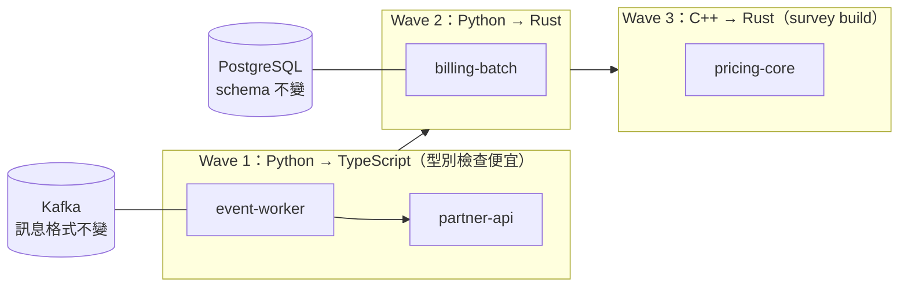

- **一個子系統一套 Kit 流程**：各有自己的 `migration/`、Rulebook、manifest、Judge。共用的部分抽成公司版 Rulebook 片段（第 14 章）。
- **先做便宜裁判的子系統**：Wave 1 的 tsc 可以併入迴圈，讓團隊先熟悉流程。
- **介面凍結**：資料庫 schema、Kafka 訊息格式、REST contract 在整個遷移期間**不變**（structure-preserving）；任何介面改變另案處理。

#### 8.4.3 從 Feasibility 到驗收（以 `billing-batch` 為例）

| 階段 | 假設的情境與決定 |
|---|---|
| 00 Feasibility | 痛點：夜間批次 4 小時、記憶體尖峰觸發 OOM 3 次／月（附事件單號）。三個決定：structure-preserving（`batch/jobs/*.py` 為純函式）；驗證成本：cargo 預估單次 build 數分鐘 → 走 survey build；測試：70% import 內部 → 需要 00b。成本區間：千萬到一億 token 級。模型計畫：Rulebook 與 reviewer 用最大等級，implementer 用中階。Verdict：**migrate now，先建 Judge** |
| 00b Judge | 以「同一天的帳務輸入資料（遮罩後）→ 兩邊產出的對帳檔」為情境；正規化只處理排序與浮點輸出格式；突變 8 個（四捨五入、時區、跨月、負數金額、重複交易…），全部被抓到才簽核 |
| Step 1 | depmap 發現 `batch/models` 與 `batch/rules` 檔案層級無循環，但縮合到 Rust crate 後有循環 → 決定兩者合併為一個 crate（記入 Rulebook §4）。Gap：`Decimal` 精度與捨入、`datetime` 的時區、SQLAlchemy session 生命週期 |
| Step 2 | 選 3 個最難的檔：跨月結算、退款沖銷、匯率換算。Bakeoff 發現 Rulebook 沒規定 `Decimal` 的捨入模式 → 修訂 §2 |
| Step 3～4 | 依 manifest 每批 100 檔；survey build 第 1 輪錯誤集中在 `sqlx` 型別對應 → 判定為規則問題，修訂並重新產生 `batch/db` 切片 |
| Step 5 | 在預備環境用一天的資料跑完整批次 |
| Step 6 | 連續 30 天的歷史資料逐日比對對帳檔；每日差異 0 才算通過 |
| 06 | 處理 `PERF(port)`：連線池大小、批次寫入 |
| 驗收 | 兩個計數＋30 天比對報告＋效能基準線比較＋資安掃描不變差＋業務簽核 |

#### 8.4.4 外部系統、資料庫、MQ、批次的特別考量

| 面向 | 風險 | 做法 |
|---|---|---|
| 外部 API（30 家合作夥伴） | 錯誤訊息、HTTP 狀態碼、欄位順序被合作夥伴依賴 | parity 範圍包含錯誤回應；以錄製的真實請求（遮罩後）當情境 |
| 資料庫 | 交易邊界與隔離等級改變 | Rulebook §1 寫明 ORM／driver 選擇與交易語意；Step 6 用資料完整性檢查（筆數、金額總和、雜湊） |
| MQ | 訊息順序、重送、冪等性 | 以同一段訊息流重播到兩邊，比對副作用（資料庫狀態） |
| 批次 | 時區、跨日、重跑 | 情境包含月底、閏年、DST 切換、重跑同一天 |
| CI/CD | 新舊兩套 pipeline 並存 | 第 9.4 節的 gate 與 parity job；切換前雙跑（shadow） |

### 8.5 業界案例對照：Google、Airbnb 與 Anthropic

Migration Kit 不是唯一的 AI 遷移方法。本節把兩個公開的大型 LLM 遷移案例與 Kit 的做法並列，目的是讓你看出**哪些是共通原則、哪些是 Kit 特有的設計**，以及什麼時候不能照搬。所有數字都取自第一手來源（2026-11-11 查證）；網路上的二手摘要常有出入，引用前請回到原文（第 8.5.4 節）。

#### 8.5.1 四個案例的基本事實

| 項目 | Google（內部遷移研究） | Airbnb（測試框架遷移） | Bun（Zig → Rust） | Mike Krieger（Python → TypeScript） |
|---|---|---|---|---|
| 來源 | 論文〈Migrating Code At Scale With LLMs At Google〉（arXiv 2504.09691，2025-04） | Airbnb 工程部落格〈Accelerating Large-Scale Test Migration with LLMs〉（Charles Covey-Brandt） | Anthropic 官方文章；Jarred Sumner〈Rewriting Bun in Rust〉 | Anthropic 官方文章 |
| 遷移類型 | **同語言**：框架、API、相依套件等程式碼變更 | **同語言**：Enzyme → React Testing Library | **跨語言** | **跨語言** |
| 規模 | 3 位開發者、12 個月、39 個遷移；送出 595 個 code change、93,574 處修改 | 約 3,500 個 React 元件測試檔 | 約 100 萬行 | 16.5 萬行 TypeScript |
| AI 參與程度 | 74.45% 的 code change、69.46% 的修改由 LLM 產生 | 第一次批次 4 小時完成 75%；調整 4 天後達 97%；剩下不到 100 個檔案人工處理約一週 | Agent 產生，人訂規則與 Gate | Agent 產生；跑了三次完整流程，前兩次的產出都丟掉、修改規則與流程後重來 |
| 時間效益 | 開發者**估計**總時間比過去人工遷移減少 50% | 原估人工 1.5 年，實際約 6 週 | 不到兩週 | 一個週末（主要部分約 2,700 萬 token） |
| 「完成」的定義 | （摘要未詳述驗證流程） | 檔案通過逐步驗證：重構 → Jest 通過 → lint 與 tsc 通過 → 標記完成 | 既有測試套件全部通過、0 個被跳過或刪除 | 7 個真實情境的 parity harness，再逐一比對每個指令的輸出 |

> 📌 **注意事項**：Google 與 Airbnb 都是**同語言**遷移，程式結構大致不變；Kit 處理的是**跨語言**遷移，型別系統、錯誤處理、模組系統全部改變，每一種差異都要在 Rulebook 寫成規則。兩類問題的難度不同，數字不能互相比較。

#### 8.5.2 共通原則與 Kit 的對應

| 共通原則 | Google／Airbnb 的做法 | Kit 的對應 | 本手冊章節 |
|---|---|---|---|
| 用確定性工具找出要改的位置，LLM 只負責改 | Google：自動找出需要修改的位置（change location discovery），再交給 LLM | Phase 1 的依賴分析腳本、Gap Inventory 的機械式 sweep；地圖由腳本產生、不由 Agent 讀檔整理 | 6.1 |
| 工作切成小單位，各自獨立驗證 | Airbnb：每個檔案走一條狀態機，前一步驗證通過才進下一步；數百個檔案平行 | 磁碟上的 manifest 佇列、每個檔案的義務（Rulebook §6）、`queue_runner.mjs verify` | 6.3、7.5 |
| 以機械檢查定義完成 | Airbnb：Jest、lint、tsc 全過才算完成 | Step 4 編譯、Step 6 parity；AI 自己說完成不算 | 6.4、6.6 |
| 失敗訊息回饋給下一次嘗試 | Airbnb：重試時把驗證錯誤與最新檔案放進 prompt；多數檔案 10 次內成功，長尾檔案重試 50～100 次 | Step 4 的 fixer 讀最新的 `build-output-rN.txt`；但**禁止 fixer 自己編譯** | 6.4 |
| 先抽樣調整、再全面執行 | Airbnb：「sample, tune, sweep」——挑 5～10 個代表性失敗檔案調整 prompt，驗證後再對全部剩餘檔案重跑 | Step 2 Stress-test：先在少數檔案上測規則、修訂 Rulebook，再 fan out（Bun：先 3 個檔案，再 1,448 個） | 6.2 |
| 先求廣度、不卡在最難的檔案 | Airbnb：廣度優先，避免卡在最難的檔案 | 佇列以依賴順序前進；`TODO(port)` 讓難點延後到 Post-parity | 6.3、6.7 |
| 上下文比 prompt 措辭重要 | Airbnb：最後的 prompt 有 4 萬～10 萬 token、最多 50 個相關檔案；作者認為選對相關檔案比修 prompt 措辭更重要 | Rulebook 是所有 Agent 共用的上下文；依賴地圖決定哪些檔案要一起看 | 6.1、7.4 |
| 自動化有上限，剩下的交給人 | Airbnb：97% 之後判斷自動化已到上限，改人工 | Feasibility 的「不遷移」選項；Post-parity 的人工分類 | 5.1、6.7 |

#### 8.5.3 什麼時候不能照搬

| 做法 | 在原案例為什麼可行 | 在跨語言遷移的風險 | Kit 的替代做法 |
|---|---|---|---|
| 重試直到驗證通過（Airbnb 長尾重試 50～100 次） | 驗證就是測試本身，且測試意圖由人抽查 | 「重試到編譯通過」會鼓勵 Agent 繞過規則：發明第二種翻譯、刪掉不好翻的分支 | 同一類錯誤重複出現 = Rulebook 有缺口，排修訂給人；loop-guard 限制迴圈（第 4.8.3 節） |
| 一個 Agent 同時改程式與跑驗證 | 單一檔案、驗證快 | 跨語言的 build 可能要數分鐘；Agent 自己跑 build 會互相干擾 | Survey build：build daemon 集中編譯，fixer 只讀輸出 |
| 以「開發者估計節省的時間」當成效指標 | 研究論文的自評問卷 | 企業導入需要可稽核的數字 | `cost-log.tsv` 與 Gate 紀錄（第 11 章） |
| 直接把 LLM 改好的程式送審 | 同語言、改動範圍小，審查者容易看懂 diff | 跨語言的 diff 無法逐行對照 | Structure-preserving：函式名稱與邊界與原始碼一一對應，審查者可以並排閱讀（第 1.8 節） |

#### 8.5.4 審查 AI 整理的外部案例

請 AI 整理業界案例時，最常見的問題是**數字走樣**：二手文章互相轉述，條件被省略、估計值被寫成實測值。

| 壞例（AI 產出） | 問題 | 好例（改寫） |
|---|---|---|
| 「Google 用 LLM 讓遷移速度提升 50%」 | 原文是開發者**估計**總時間減少 50%，不是量測的速度 | 「Google 的研究中，開發者估計總遷移時間比過去人工遷移減少約 50%（arXiv 2504.09691）」 |
| 「Airbnb 用 AI 在 6 週內自動完成 3,500 個檔案的遷移」 | 省略了 3% 人工處理，以及 4 天的 prompt 調整 | 「自動化完成 97%，剩下不到 100 個檔案人工處理約一週；總計約 6 週」 |
| 「Bun 遷移零 regression」 | 合併前測試全綠，但合併後有 19 個 regression | 「合併前測試全部通過且未刪除或跳過任何測試；合併後發現 19 個 regression，均已修正」 |
| 「參考 Airbnb，我們預計 6 週完成 COBOL 轉 Java」 | 同語言測試遷移的時程被套到跨語言遷移 | 估算只能來自 Feasibility 與 Stress-test 的實際數據（第 5.1、11.2 節） |

審查步驟：

1. 每個數字都要有**第一手來源**的連結（論文、公司工程部落格、官方文章），二手摘要不算。
2. 核對數字的**條件**：估計還是量測？同語言還是跨語言？自動化比例還是完成比例？
3. 引用的數字不得出現在本專案的估算中，除非標明「僅供參考、不作為承諾」。

```bash
# 列出報告中所有數字句子，人工逐一確認每句都附了第一手來源（Linux／Git Bash）
grep -nE '[0-9][0-9,.]*[ ]?(%|倍|週|個月|年|萬|億|行|個檔案|token)' report.md | grep -vE 'https?://' \
  && echo "⚠️ 上列句子沒有附來源連結"
```

### 8.6 本章 AI 產出審查

| 檢查 | 壞例 | 怎麼抓 |
|---|---|---|
| 把案例數字當承諾 | 「本專案可在兩週內完成（參考 Bun）」 | 搜尋報告中的案例數字 |
| 混淆假想與實際 | 案例 D 的數字被寫進正式估算 | 正式文件不得引用第 8.4 節的數字 |
| 外部案例數字走樣 | 「Google 用 LLM 讓遷移速度提升 50%」（原文是開發者估計總時間減少 50%） | 第 8.5.4 節：每個數字附第一手來源並核對條件 |
| Rust 範例未編譯就當正確 | AI 產出的 Rust 片段直接進 Rulebook | Rulebook §2 的範例必須經過一次真實編譯（Step 2 Pilot） |
| 忽略錯誤 sentinel 的語意 | 把所有 NULL 都翻成 `None` | inventory 的 guard 列是否標了 `allocation-guard`／`precondition-guard` |

```bash
# inventory 中所有 guard 類的列都必須帶分類標籤（Kit RULEBOOK §2 error-recovery rule）
awk -F'\t' 'NR>1 && tolower($3) ~ /null|none|-1|sentinel/ && $6 !~ /(allocation|precondition)-guard/ {print FILENAME":"NR": "$1" "$2}' migration/inventory.tsv
```

---

## 第9章 企業級導入架構與治理

本章內容全部是企業建議（🏢），不是 Kit 原生功能；引用 Claude Code 官方行為的地方會標 📖。

### 9.1 導入策略

| 階段 | 範圍 | 目的 | 進入下一階段的條件 |
|---|---|---|---|
| 小型試辦 | 1 個 1～5 千行、有 CLI 或 API 的工具 | 讓 2～3 位工程師完整走過 00 → 06 | 有一份完整的 Gate 紀錄、cost-log、Rulebook；Judge 有通過突變驗證 |
| 中型系統試行 | 1 個 1～5 萬行的子系統 | 驗證成本估算方法、模型計畫、CI 整合 | 實際 token 落在 Feasibility 區間內；done-gate 兩個計數都記錄 |
| 大型系統正式導入 | 依子系統分波（案例 D） | 平行多團隊 | 每個子系統各自通過 Gate |
| 多專案共用規範 | 公司版 Rulebook 片段、Subagent 定義、Hook、CI 範本 | 減少每個專案重新發明 | 有維護者與版本號 |
| 組織級 AI Agent 管理 | managed settings、模型 allowlist、稽核 | 統一治理 | 資安與法遵簽核 |

> 📌 **注意事項**：試辦專案要選「有公開介面、舊系統能跑」的工具。沒有可執行的舊系統，就沒有 executable spec，整個 Kit 的驗收邏輯不成立。

### 9.2 AI 治理

| 治理項目 | 要求 | 落實方式 |
|---|---|---|
| 模型使用規範 | 模型計畫是 Gate 決策，不是預設值 | Feasibility 報告的 Model plan 段；managed settings 的 `availableModels`／`deniedModels`（📖 managed 的 `availableModels` 會原樣套用並忽略較低層級新增的項目） |
| Agent 權限 | 依角色最小權限 | `.claude/agents/*.md` 的 `tools`；`settings.json` deny；loop-guard Hook |
| 資料存取 | Agent 只能讀遷移相關目錄 | `Read` deny 規則（例如 `Read(./secrets/**)`、`Read(**/.env)`）；在容器或 WSL2 sandbox 內執行 |
| 原始碼保護 | 原始碼送往的 AI 服務必須經核准 | 依公司 AI 使用政策選擇 Anthropic API／Bedrock／Google Cloud／Foundry 等供應商與資料處理條款 |
| 機密資訊 | 不得把憑證、金鑰、個資放進 Prompt 或情境檔 | 情境資料遮罩；Trivy secret 掃描；`.gitignore` |
| Token 預算 | 依 Feasibility 區間設上限 | 每個 Gate 對帳 `cost-log.tsv`；workflow 的 size guideline |
| 操作紀錄 | 每個 Gate 決策可追溯 | commit trailer（`Gate-Decision:`、`Rulebook-Amendment:`、`Approved-by:`）、cost-log、Deviation log |
| 人工核准 | 第 7.11 節的 Gate 表 | gate_check.sh 在 CI 強制 |

**Read deny 範例（🏢，依專案調整）：**

```json
{
  "permissions": {
    "deny": [
      "Read(./.env)",
      "Read(**/.env)",
      "Read(./secrets/**)",
      "Read(./config/production/**)"
    ]
  }
}
```

> 🔒 **注意事項**：Read 規則只管 Claude 的檔案工具；`Bash(cat .env)` 這類 shell 讀取要另外以 deny、Hook 或 sandbox 處理（📖 官方文件：使用 WebFetch deny 也不能阻止 Bash 中的 `curl`）。原生 Windows 沒有 sandbox，高敏感專案請在 WSL2 或容器內執行 Claude Code。

### 9.3 金融業及高安全需求系統

| 要求 | 在遷移流程中的做法 |
|---|---|
| 不得將機敏原始碼送到未核准的外部 AI 服務 | 確認企業 AI 政策核准的供應商與區域；必要時用雲端供應商（Bedrock、Google Cloud、Foundry）以符合資料落地要求 |
| 確認資料處理條款 | 法務審閱供應商的資料保存與訓練使用條款；紀錄核准版本與日期 |
| 憑證、密碼、金鑰管理 | 情境檔與測試資料不得含真實憑證；CI 用 secret store；Trivy `--scanners secret` |
| SAST／DAST／SCA | SAST：Semgrep／SonarQube 對**新程式碼**；DAST：對 Step 5 的預備環境；SCA：Trivy、SBOM。新增的第三方套件必須對應 Rulebook §1 的核准列 |
| 程式碼變更紀錄 | 每批 commit、Rulebook 修訂 commit、settings 變更 commit 都帶 trailer |
| 審核與簽核 | 第 7.11 節；PR 需 CODEOWNERS 核准（Rulebook、settings、agents 目錄指定負責人） |
| 可回復的 Git 版本 | `migration-baseline` tag；每個 Gate 打 tag（`migration-step3-done` 等） |
| 資料完整性 | Step 6 對資料庫做筆數、金額總和、逐列雜湊比對 |
| 交易一致性 | 情境包含並行交易、失敗重試、部分失敗；比對最終狀態 |
| 效能與壓力測試 | 以 Step 5.3 的效能基準線比較；`PERF(port)` 在 post-parity 處理 |
| 資安與法遵 | 遷移完成前由資安單位審閱 `SAFETY:`／`unsafe` 清單與 SBOM 差異 |

**CODEOWNERS 範例（🏢）：**

```text
# .github/CODEOWNERS
/migration/RULEBOOK.md     @org/migration-architects
/.claude/                  @org/migration-architects @org/appsec
/tools/migration/          @org/migration-architects
/parity/                   @org/qa-leads
```

### 9.4 CI/CD 整合

#### 9.4.1 整體架構

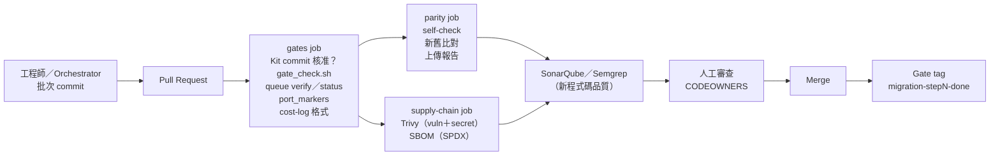

**說明**：CI 不取代 Gate，而是把 Gate 的**機械部分**變成必過的檢查——Rulebook 有沒有被偷改、測試有沒有被刪、佇列有沒有空檔、parity 有沒有退步。人仍然在 PR 審查時做 Gate 判斷。

#### 9.4.2 Gate 檢查腳本

企業延伸範例，非官方 Migration Kit 原生功能。把 settings.README.md 的「批次內有 diff 碰到 RULEBOOK.md 就是自動 finding」與 CLAUDE.md 第 5、7 條變成 CI 檢查：

📄 `tools/migration/gate_check.sh`

```bash
#!/usr/bin/env bash
# 批次邊界的 Gate 檢查（企業延伸範例，非官方 Migration Kit 原生功能）
#
# 官方 templates/settings.README.md 說明：permission 規則無法表達「迴圈 Agent 唯讀、人可寫」，
# 所以 Rulebook 唯讀靠 prompt 契約與審查：「批次內有 diff 碰到 RULEBOOK.md 就是自動 finding」。
# 本腳本把這句話變成 CI 檢查，並加上 CLAUDE.md 第 5、7 條的機械檢查：
#   1. migration/RULEBOOK.md 有變更 → 該 commit 必須帶 `Rulebook-Amendment:` 與 `Approved-by:` trailer
#   2. .claude/settings.json 或 .claude/loop-bans.json 有變更 → 必須帶 `Gate-Decision:` trailer
#   3. 不得刪除測試檔（Never skip, delete, or weaken a test to make a queue shrink）
#   4. 不得新增 skip／ignore 標記
#
# 用法：bash tools/migration/gate_check.sh <base-ref> [<head-ref>]
#   例：bash tools/migration/gate_check.sh origin/main HEAD
set -uo pipefail
BASE="${1:?用法：$0 <base-ref> [<head-ref>]}"
HEAD="${2:-HEAD}"
fail=0

trailer() { git log -1 --format='%(trailers:key='"$2"',valueonly)' "$1" | tr -d '[:space:]'; }

for c in $(git rev-list --reverse "$BASE..$HEAD"); do
  files="$(git diff-tree --no-commit-id --name-only -r "$c")"
  short="$(git log -1 --format='%h %s' "$c")"
  if grep -qx 'migration/RULEBOOK.md' <<<"$files"; then
    if [ -z "$(trailer "$c" Rulebook-Amendment)" ] || [ -z "$(trailer "$c" Approved-by)" ]; then
      echo "FAIL [RULEBOOK] $short：修改 RULEBOOK.md 但缺少 Rulebook-Amendment／Approved-by trailer"
      fail=1
    fi
  fi
  if grep -Eqx '\.claude/(settings\.json|loop-bans\.json)' <<<"$files"; then
    if [ -z "$(trailer "$c" Gate-Decision)" ]; then
      echo "FAIL [SETTINGS] $short：修改迴圈護欄設定但缺少 Gate-Decision trailer"
      fail=1
    fi
  fi
done

deleted="$(git diff --name-only --diff-filter=D "$BASE...$HEAD" | grep -E '(^|/)(tests?|__tests__|spec)/|(_test|\.test|\.spec|_spec)\.[a-z]+$|^test_' || true)"
if [ -n "$deleted" ]; then
  echo "FAIL [TEST-DELETED] 以下測試檔被刪除："; echo "$deleted" | sed 's/^/  /'
  fail=1
fi

skips="$(git diff -U0 "$BASE...$HEAD" | grep -E '^\+' | grep -vE '^\+\+\+' \
  | grep -E '@pytest\.mark\.skip|pytest\.skip\(|unittest\.skip|#\[ignore\]|\b(it|test|describe)\.skip\(|\bxit\(|t\.Skip\(' || true)"
if [ -n "$skips" ]; then
  echo "FAIL [TEST-SKIPPED] 新增了 skip／ignore 標記："; echo "$skips" | sed 's/^/  /'
  fail=1
fi

[ "$fail" -eq 0 ] && echo "gate_check: OK ($(git rev-list --count "$BASE..$HEAD") commits)"
exit "$fail"
```

**實測結果（✅，在暫存 Git repo 中建立好例與壞例 commit）**：

```text
## 好例：只有翻譯檔
gate_check: OK (1 commits)

## 壞例：改 Rulebook 沒 trailer、刪測試、改 settings 沒 trailer
FAIL [RULEBOOK] 3617593 tweak rulebook：修改 RULEBOOK.md 但缺少 Rulebook-Amendment／Approved-by trailer
FAIL [SETTINGS] 7010f22 relax settings：修改迴圈護欄設定但缺少 Gate-Decision trailer
FAIL [TEST-DELETED] 以下測試檔被刪除：
  tests/test_a.py

## 壞例：新增 skip
FAIL [TEST-SKIPPED] 新增了 skip／ignore 標記：
  +@pytest.mark.skip(reason='slow')

## 有正確 trailer 的 Rulebook 修訂與 Gate 決策
gate_check: OK (2 commits)
```

> 📌 **實測踩到的坑**：作者第一次測試「好例」時，把兩個 trailer 寫在兩個 `-m` 參數裡，結果被判 FAIL。原因是 Git 只把**最後一段**當成 trailer 區塊。正確寫法是把兩行放在同一段：

```bash
git commit -m "docs(migration): amend rulebook §2 rounding" -m "Rulebook-Amendment: A3
Approved-by: 王小明 (SA)"
# 或
git commit -m "docs(migration): amend rulebook §2 rounding" \
  --trailer "Rulebook-Amendment: A3" --trailer "Approved-by: 王小明 (SA)"
git log -1 --format='%(trailers)'      # 確認兩行都被認成 trailer
```

#### 9.4.3 GitHub Actions

企業延伸範例，非官方 Migration Kit 原生功能。所有 action 以 commit SHA 釘版（2026-11-11 以 `git ls-remote` 查證的 tag：checkout v7.0.1、setup-node v7.1.0、setup-python v7.1.0、upload-artifact v7.0.2、trivy-action v0.36.0、sbom-action v0.24.3）。

📄 `.github/workflows/migration-gates.yml`

````yaml
# 遷移 Gate 檢查（企業延伸範例，非官方 Migration Kit 原生功能）
# 前提：Kit 以 git submodule 放在 migration-kit/（釘住 commit），遷移產物在 migration/
# Action 一律以 commit SHA 釘版（版本註解為 2026-11-11 查證值），由 Dependabot／Renovate 更新
name: migration-gates

on:
  pull_request:
    branches: [main]
  workflow_dispatch:

permissions:
  contents: read

concurrency:
  group: migration-gates-${{ github.ref }}
  cancel-in-progress: true

jobs:
  gates:
    runs-on: ubuntu-latest
    timeout-minutes: 15
    steps:
      - uses: actions/checkout@3d3c42e5aac5ba805825da76410c181273ba90b1 # v7.0.1
        with:
          fetch-depth: 0        # gate_check.sh 要逐一檢查批次內的 commit
          submodules: true
      - uses: actions/setup-node@949feb2413d6458794dcd2491c4babbbce0c15c1 # v7.1.0
        with:
          node-version: "24"
      - uses: actions/setup-python@6d4fd22b20465ccc0f7354476588e8df7c9ca0e0 # v7.1.0
        with:
          python-version: "3.12"

      - name: Kit 版本必須是核准的 commit
        run: |
          actual="$(git -C migration-kit rev-parse HEAD)"
          test "$actual" = "${{ vars.MIGRATION_KIT_COMMIT }}" \
            || { echo "::error::migration-kit HEAD=$actual，與核准的 ${{ vars.MIGRATION_KIT_COMMIT }} 不符"; exit 1; }

      - name: Gate 檢查（RULEBOOK／settings trailer、刪測試、新增 skip）
        run: bash tools/migration/gate_check.sh "origin/${{ github.base_ref || 'main' }}" HEAD

      - name: 佇列不得有空檔（touch 作弊）並輸出 burndown
        run: |
          node migration-kit/scripts/queue_runner.mjs --manifest migration/manifest.tsv verify
          {
            echo '### Translation burndown'
            echo '```'
            node migration-kit/scripts/queue_runner.mjs --manifest migration/manifest.tsv status
            echo '```'
          } >> "$GITHUB_STEP_SUMMARY"

      - name: 移植標記與 PORT STATUS trailer 一致
        run: python tools/migration/port_markers.py --manifest migration/manifest.tsv

      - name: cost-log 格式
        run: python tools/migration/cost_log_check.py migration/cost-log.tsv

  parity:
    needs: gates
    runs-on: ubuntu-latest
    timeout-minutes: 30
    steps:
      - uses: actions/checkout@3d3c42e5aac5ba805825da76410c181273ba90b1 # v7.0.1
      - uses: actions/setup-node@949feb2413d6458794dcd2491c4babbbce0c15c1 # v7.1.0
        with:
          node-version: "24"
      - uses: actions/setup-python@6d4fd22b20465ccc0f7354476588e8df7c9ca0e0 # v7.1.0
        with:
          python-version: "3.12"
      - name: 裁判自我檢查（舊 vs 舊必須 100% 一致）
        run: python parity/parity.py self-check --old "${{ vars.PARITY_OLD_CMD }}"
      - name: 新舊行為比對
        run: python parity/parity.py run --old "${{ vars.PARITY_OLD_CMD }}" --new "${{ vars.PARITY_NEW_CMD }}" --report parity-report.tsv
      - uses: actions/upload-artifact@cf430e030ddbb5b0abf93d22962f4752f3646cd9 # v7.0.2
        if: always()
        with:
          name: parity-report
          path: parity-report.tsv

  supply-chain:
    needs: gates
    runs-on: ubuntu-latest
    timeout-minutes: 20
    steps:
      - uses: actions/checkout@3d3c42e5aac5ba805825da76410c181273ba90b1 # v7.0.1
      - name: SCA／秘密掃描（新增的第三方套件必須對應 RULEBOOK §1 的核准列）
        uses: aquasecurity/trivy-action@ed142fd0673e97e23eac54620cfb913e5ce36c25 # v0.36.0
        with:
          scan-type: fs
          scan-ref: .
          scanners: vuln,secret
          severity: HIGH,CRITICAL
          exit-code: "1"
      - name: 產生 SBOM（SPDX）
        uses: anchore/sbom-action@66cbf4bc1f1c0d2edc94016e65bc221b6bb0ad6c # v0.24.3
        with:
          path: .
          format: spdx-json
          artifact-name: sbom.spdx.json
````

需要在 repository 設定的 Variables：`MIGRATION_KIT_COMMIT`（核准的 Kit commit）、`PARITY_OLD_CMD`、`PARITY_NEW_CMD`。

> 🧪 **驗證範圍**：作者以 PyYAML 確認語法可解析、action 版本與 SHA 以 `git ls-remote` 查證、腳本本身已在本機實測；**沒有**在 GitHub 上實際執行這個 workflow。

#### 9.4.4 GitLab CI/CD

📄 `.gitlab-ci.yml`

```yaml
# 遷移 Gate 檢查：GitLab CI/CD 版（企業延伸範例，非官方 Migration Kit 原生功能）
# 變數 MIGRATION_KIT_COMMIT、PARITY_OLD_CMD、PARITY_NEW_CMD 設在 Settings → CI/CD → Variables
stages: [gates, parity, supply-chain]

variables:
  GIT_DEPTH: "0"                 # gate_check.sh 需要完整歷史
  GIT_SUBMODULE_STRATEGY: recursive

.toolchain: &toolchain
  image: nikolaik/python-nodejs:python3.12-nodejs24
  before_script:
    - python --version && node --version

gates:
  <<: *toolchain
  stage: gates
  rules:
    - if: $CI_PIPELINE_SOURCE == "merge_request_event"
  script:
    - test "$(git -C migration-kit rev-parse HEAD)" = "$MIGRATION_KIT_COMMIT"
    - git fetch origin "$CI_MERGE_REQUEST_TARGET_BRANCH_NAME"
    - bash tools/migration/gate_check.sh "origin/$CI_MERGE_REQUEST_TARGET_BRANCH_NAME" HEAD
    - node migration-kit/scripts/queue_runner.mjs --manifest migration/manifest.tsv verify
    - node migration-kit/scripts/queue_runner.mjs --manifest migration/manifest.tsv status
    - python tools/migration/port_markers.py --manifest migration/manifest.tsv
    - python tools/migration/cost_log_check.py migration/cost-log.tsv

parity:
  <<: *toolchain
  stage: parity
  rules:
    - if: $CI_PIPELINE_SOURCE == "merge_request_event"
  script:
    - python parity/parity.py self-check --old "$PARITY_OLD_CMD"
    - python parity/parity.py run --old "$PARITY_OLD_CMD" --new "$PARITY_NEW_CMD" --report parity-report.tsv
  artifacts:
    when: always
    paths: [parity-report.tsv]

trivy:
  stage: supply-chain
  image:
    name: aquasec/trivy:0.76.2
    entrypoint: [""]
  rules:
    - if: $CI_PIPELINE_SOURCE == "merge_request_event"
  script:
    - trivy fs --scanners vuln,secret --severity HIGH,CRITICAL --exit-code 1 .
    - trivy fs --format spdx-json --output sbom.spdx.json .
  artifacts:
    paths: [sbom.spdx.json]
```

映像檔 `aquasec/trivy:0.76.2`、`nikolaik/python-nodejs:python3.12-nodejs24` 已於 2026-11-11 以 Docker Hub API 確認存在（🧪 未在 GitLab 實際執行）。

#### 9.4.5 Jenkins

🧪 以下 Jenkinsfile 為示意，作者未在 Jenkins 執行；步驟與 GitHub Actions 版相同。

```groovy
pipeline {
  agent { docker { image 'nikolaik/python-nodejs:python3.12-nodejs24' } }
  environment { MIGRATION_KIT_COMMIT = 'cf91c9d5068d9aaf95a36164169f08c3e636c909' }
  stages {
    stage('Gates') {
      steps {
        sh 'test "$(git -C migration-kit rev-parse HEAD)" = "$MIGRATION_KIT_COMMIT"'
        sh 'bash tools/migration/gate_check.sh origin/main HEAD'
        sh 'node migration-kit/scripts/queue_runner.mjs --manifest migration/manifest.tsv verify'
        sh 'python tools/migration/port_markers.py --manifest migration/manifest.tsv'
        sh 'python tools/migration/cost_log_check.py migration/cost-log.tsv'
      }
    }
    stage('Parity') {
      steps {
        sh 'python parity/parity.py self-check --old "$PARITY_OLD_CMD"'
        sh 'python parity/parity.py run --old "$PARITY_OLD_CMD" --new "$PARITY_NEW_CMD" --report parity-report.tsv'
      }
      post { always { archiveArtifacts artifacts: 'parity-report.tsv' } }
    }
  }
}
```

#### 9.4.6 SonarQube、Semgrep 與 SBOM 的定位

| 工具 | 在遷移中的角色 | 注意 |
|---|---|---|
| SonarQube | 新程式碼的品質門檻（重複、複雜度、覆蓋率） | 遷移是 structure-preserving，複雜度通常「和舊的一樣」；門檻要以基準線為參考，不要逼 Agent 重構 |
| Semgrep | 自訂規則檢查 Rulebook 禁用項（例如 TS 禁止 `Math.round`、Rust 禁止 `tokio`） | 把 Rulebook §1、§2 的 BANNED 項目寫成 Semgrep 規則，是最便宜的機械審查 |
| Trivy | 弱點與秘密掃描 | 與 5.3 的 Security Baseline 比較：不能變差 |
| SBOM（syft／Trivy） | 新舊系統相依套件清單 | 新增的套件必須在 Rulebook §1 有核准列 |

**Semgrep 規則示意（🏢，🧪 未在本機執行 Semgrep）：**

```yaml
rules:
  - id: rulebook-banned-math-round
    message: "RULEBOOK §2：Python round() 必須翻成 roundHalfEven()，不得使用 Math.round"
    languages: [typescript]
    severity: ERROR
    pattern: Math.round(...)
    paths:
      include: ["target/**"]
```

### 9.5 本章 AI 產出審查

| 檢查 | 壞例 | 怎麼抓 |
|---|---|---|
| CI 用浮動 tag | `uses: actions/checkout@main` | `grep -nE 'uses: [^@]+@(main\|master\|v[0-9]+)\s*$' .github/workflows/*.yml` |
| CI 執行昂貴編譯取代 daemon | CI 每個 commit 都跑完整 cargo build 並把結果餵給 Agent | 釐清：CI 是驗收，daemon 是迴圈內裁判 |
| Trailer 分段 | 兩個 `-m` | `git log -1 --format='%(trailers)'` |
| 把 AI 產生的 Jenkinsfile 當作已驗證 | 直接上線 | 在測試 Jenkins 先跑一次 |

---

## 第10章 系統維護與版本升級

### 10.1 Migration Kit 維護

Kit 在專案裡有兩種「版本」要管：**Kit 本身**（Prompt、範本、腳本、Skill）與**專案產物**（Rulebook、inventory、manifest）。

| 項目 | 版本管理方式 | 誰負責 |
|---|---|---|
| Kit 本體 | 公司 fork＋釘 commit＋內部 tag（例如 `kit-2026.11-r1`）；專案以 submodule 引用 | 平台團隊 |
| Prompt | 隨 Kit fork 版本；若公司修改（例如加入 Windows 指示），在 fork 中以獨立 commit 標示 | 平台團隊 |
| Rulebook | 專案內 `migration/RULEBOOK.md`；每次修訂一個 commit，帶 `Rulebook-Amendment:` trailer；修訂編號在 Rulebook 內（A1、A2…） | 專案架構師 |
| Scripts | Kit 腳本不改；改寫的 depmap 腳本放在專案 `scripts/` 並提交（prompt 01 要求） | 專案 |
| Templates | 公司版範本放 fork 的 `templates/`（例如加了 PowerShell deny 的 settings.json） | 平台團隊 |
| Skill | 隨 Kit fork；安裝腳本替換 `[kit path]` | 平台團隊 |
| 企業延伸工具 | `tools/migration/`、`.claude/hooks/` 有自己的版本號與測試 | 平台團隊 |

```bash
# 查詢專案目前使用的 Kit 版本
git submodule status migration-kit
git -C migration-kit describe --tags --always
```

### 10.2 Claude Code 升級

Kit 依賴的 Claude Code 行為（權限比對、Subagent、workflow、Skill 載入）都可能隨版本改變。升級的檢查流程：

| 檢查 | 方法 |
|---|---|
| CLI 版本 | `claude --version`；`npm view @anthropic-ai/claude-code version` |
| Settings 相容性 | `claude doctor`：會列出 Invalid settings（實測會抓到型別錯誤與不合法的 Hook 欄位） |
| 權限行為 | 重跑 `node .claude/hooks/loop-guard.test.mjs`；在測試專案中請 Claude 執行一個被 deny 的指令，確認被擋 |
| Subagent 欄位 | 對照官方 sub-agents 文件的 frontmatter 表；**未知欄位會被靜默忽略** |
| Workflow 行為 | 官方 workflows 文件的「Behavior and limits」與版本註記（例如 2.1.305 修正恢復時重跑、2.1.318 用量上限恢復） |
| Agent Teams | 仍為實驗功能？`CLAUDE_CODE_EXPERIMENTAL_AGENT_TEAMS` 名稱是否改變 |
| Skill | `/skills` 是否列出 `code-migration` |
| 模型 | 模型計畫中的模型 ID 是否仍可用；**不要假設固定模型名稱永遠存在** |

```bash
# 升級前後的回歸檢查（🏢）
claude --version > /tmp/cc-before.txt
claude update
claude --version
claude doctor | grep -E "Invalid|Ignoring|No installation"
node .claude/hooks/loop-guard.test.mjs
python tools/migration/preflight.py --kit migration-kit --phase step3
```

**升級時機建議**：進行中的 Step 3／Step 4 期間**不要**升級 Claude Code（Windows 原生安裝會自動更新，可在設定中暫停或改用 stable 頻道，📖 見官方 setup 文件的 release channel 與 disable auto-updates）。在 Gate 之間升級，並把版本記在 cost-log 的備註或 Deviation log。

### 10.3 Rulebook 維護

#### 10.3.1 缺陷分類

| 類別 | 例子 | 來源 |
|---|---|---|
| 沉默（SILENCE） | 沒規定 float 怎麼輸出 | Bakeoff diff、reviewer 的 RULEBOOK-SILENCE |
| 錯誤 | 規則本身會產生錯的翻譯 | Pilot、聯合稽核 |
| 過度 | 規則禁止了無害的事（Run 1：dead code 刪除被一律禁止） | diff report 的 both defensible |
| 衝突 | 兩條規則對同一構造給不同答案 | 聯合稽核 |
| 位置不明 | 規定了語意卻沒規定共用 helper 的「家」 | Run 1 修訂 A2.6 |

#### 10.3.2 變更流程

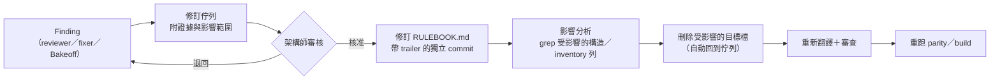

```bash
# 影響範圍分析示意：修訂 §2「round」後找出所有受影響的目標檔
grep -rln "Math.round\|round(" target/ | tee migration/amend-A3-impact.txt
wc -l migration/amend-A3-impact.txt
# 刪除後佇列自動重新包含這些單位
xargs -r rm -v < migration/amend-A3-impact.txt
node migration-kit/scripts/queue_runner.mjs --manifest migration/manifest.tsv status
```

> 📌 **注意事項**：Prompt 03 規定「同一章節被修訂兩次就停」。若某條規則持續被修，代表問題超出措辭——可能需要改變 Rulebook 的分類方式，或承認這部分屬於 redesign。

### 10.4 遷移中斷及恢復

Kit 的核心主張：「每個佇列都由磁碟上的東西定義，所以停下來是免費的，恢復只是重新呼叫，不是復原。」

| 中斷情境 | 恢復方式 | 驗證 |
|---|---|---|
| 某個 Agent 停滯 | Orchestrator 依「三分鐘無成長」規則視為失敗，從磁碟救回 | `queue_runner.mjs status` 前後比較 |
| Claude Code 被關閉 | 重新開啟、重貼同一支 Prompt（或請 Skill 判斷） | 佇列＝manifest 中未產出的列，自動從斷點繼續 |
| Workflow 被停止 | 同 session 可從 `/workflows` 恢復；跨 session 則重貼 Prompt | 已完成的目標檔不會重做 |
| Task Queue 未完成就結束 | 同上 | `verify` 確認沒有空檔 |
| Build daemon 失敗 | 重啟 daemon；輪次從磁碟上已有的 `build-output-r*.txt` 續號 | 新檔案編號接續 |
| 網路中斷、模型呼叫失敗 | 失敗的單位沒有產出檔，自動留在佇列 | 檢查是否有 0 位元組或半截檔案（`verify` 只抓 0 位元組） |
| Token 額度不足 | 停在 Gate；額度恢復後重貼 | 先對帳 cost-log |
| 換機器／搬 repo | Run 2 的實證：repo 中途搬家，全新 session 只靠磁碟狀態正確接續在「Step 5，一個測試失敗」 | `git status` 確認 `migration/` 完整 |

> 🔒 **注意事項**：`verify` 只抓「0 位元組」的目標檔。模型呼叫在寫到一半時中斷，可能留下**非空但不完整**的檔案。企業建議：要求每個目標檔以 `PORT STATUS` trailer 結尾，`port_markers.py` 會把沒有 trailer 的檔案標為 `MISSING-TRAILER`——這同時能抓到截斷的檔案。

```bash
# 中斷後的恢復檢查（🏢）
node migration-kit/scripts/queue_runner.mjs --manifest migration/manifest.tsv status
node migration-kit/scripts/queue_runner.mjs --manifest migration/manifest.tsv verify
python tools/migration/port_markers.py --manifest migration/manifest.tsv | grep -E 'MISSING-TRAILER|MISMATCH'
# 截斷的檔案刪掉，讓它回到佇列
```

### 10.5 官方專案維護狀態

**2026-11-11 查證**：README 明載「**Status: Reference code.** This repo is a companion to the blog post and is **not actively maintained**. Issues and PRs are not monitored.」Contributing 一節也寫「不接受貢獻，歡迎 fork 並為你的生態系調整 dependency mapper」。Repository 只有一個 commit（`cf91c9d`，2026-07-08）。

**不要假設官方未來一定會更新。** 企業內部維護建議：

| 項目 | 做法 |
|---|---|
| Fork | 在公司 Git 平台建立 fork（或內部鏡像），所有專案只引用內部版本 |
| 固定 commit | 專案以 submodule 釘 commit；CI 檢查 `MIGRATION_KIT_COMMIT`（第 9.4.3 節） |
| 內部版本標籤 | `kit-YYYY.MM-rN`；每個標籤附變更說明 |
| 安全審查 | 審查每支腳本（Kit 腳本只用標準函式庫、無網路存取——作者已逐行讀過六支腳本） |
| 腳本測試 | 每次 fork 更新都跑 fixtures 自測（注意 Windows 換行，第 2.5.1 節） |
| 相容性測試 | 對 Claude Code 新版本跑第 10.2 節的檢查 |
| 變更審查 | 公司修改（例如 Windows 版 settings、PowerShell 指示）以獨立 commit，CODEOWNERS 審查 |
| 定期同步上游 | 每季 `git fetch upstream` 檢查是否有新 commit；目前上游狀態為不再維護，預期沒有更新 |

```bash
# 每季同步檢查（🏢）
git -C kit-fork remote add upstream https://github.com/anthropics/code-migration-kit-with-claude-code.git 2>/dev/null
git -C kit-fork fetch upstream
git -C kit-fork log --oneline HEAD..upstream/main      # 沒有輸出 = 上游無新變更
```

### 10.6 本章 AI 產出審查

| 檢查 | 壞例 | 怎麼抓 |
|---|---|---|
| 宣稱 Kit 有官方更新計畫 | 「Anthropic 將於下一版加入 Go 支援」 | README Status 段 |
| 升級後只看「能啟動」 | 沒跑 `claude doctor` 與 Hook 測試 | 第 10.2 節檢查表 |
| 恢復時重做已完成的單位 | 「重新開始 Step 3」 | 佇列只包含未產出的列 |
| 修訂 Rulebook 後沒重新產生 | 修訂 commit 之後，受影響的目標檔時間戳早於修訂 | `git log -1 --format=%ct migration/RULEBOOK.md` 與目標檔 commit 時間比較 |

---

## 第11章 效能、成本及資源管理

### 11.1 成本從哪裡來

| 成本項目 | 驅動因子 | 官方觀察 |
|---|---|---|
| Token Cost | 單位數 × 每單位 Agent 數 × 每 Agent token | 「大部分乘數來自審查拓撲，而測試中抓到的問題也正來自那裡」（README） |
| Model Selection | 各階段模型等級 | Run 3：Step 3 全用中階模型，約 204 萬 token |
| Context Window | Rulebook 長度＋原始檔＋inventory 列 | Rulebook 每個 Agent 都讀；Bun 的 576 行 × 1,448 檔 |
| Agent Parallelism | 同時執行數 | 不改變總 token，改變 wall-clock 與速率限制壓力 |
| Batch Size | prompt 04 的 `[100]` | 影響 Gate 頻率與失敗時的重做範圍 |
| Compiler Cost | 每輪 build 時間 × 輪數 | 這就是「裁判的價格」，決定 Step 4 是否併入 |
| Retry Cost | 失敗單位重跑、workflow 恢復時的重跑 | Workflow 中間有 Failed 的 Agent，之後的 Agent 恢復時也會重跑（📖） |
| Review Cost | 2 位 reviewer＋裁決 | 雙倍花費；Run 1 用它買到 20 列中的 7 個證據缺陷 |
| Human Review Cost | 每個 Gate 的人工時間 | 每支 Prompt 都要求報告「下一步的人工注意力分鐘數」 |

> 📌 **官方提醒**：生產規模的移植可能在兩週內消耗數十億輸入 token。這個流程在任何速率限制下都能跑——**變的是日曆**，不是做法。以一般 API 限制，同樣的步驟會花更長的牆鐘時間。

### 11.2 估算方法：看得見的乘法

Kit 禁止「憑感覺的數字」，要求「units of work × per-unit estimate」。建議的估算表（🏢）：

| 步驟 | 公式 | 範例（假設 400 檔、每 Agent 平均 2 萬 token） |
|---|---|---|
| Step 1 | depmap 驗證 2 人 × 3 輪 ＋ inventory 站點數 × 3 Agent | 數十萬～數百萬 |
| Step 2 | 3 檔 × (2 translator＋1 inspector＋4 pilot) × 2 輪 | 約 84 萬 |
| Step 3 | 400 檔 × 4～5 Agent × 2 萬 | 約 3,200 萬～4,000 萬 |
| Step 4 | 錯誤數 × fixer＋reviewer | 依第一輪錯誤數 |
| Step 6 | 失敗情境數 × (triage＋fixer＋reviewer) | 依 parity 結果 |

估算結果一律以**數量級區間**呈現（例如「3,000 萬～1 億」），與 Feasibility 的要求一致。

### 11.3 依風險選擇模型

| 工作 | 官方建議等級 | 理由 |
|---|---|---|
| Rulebook 撰寫與修訂 | 最大 | 一次性工作；每個錯誤會複製到每個翻譯檔 |
| 架構審查（Feasibility） | 最大 | 錯誤的 structure／redesign 判斷會讓整個流程失效 |
| Skeptic reviewer、diff inspector | 最大或中階（依 gap 複雜度） | 對抗式審查需要推理能力 |
| 大量翻譯的 implementer | 中階或小型 | 後面有兩位 reviewer 與編譯器 |
| Fixer | 中階 | 編譯器才是真正的裁判 |

本手冊範例使用 Claude Code 的模型別名（`opus`、`sonnet`）。**模型分配必須以實際測試與企業可用模型為準**：組織的 `availableModels` 會限制可選模型，被擋的模型會依官方規則替換（📖）。不要在 Rulebook 或 Subagent 定義中寫死一個可能下架的模型 ID；以別名加上 Feasibility Gate 紀錄當下對應的版本。

### 11.4 成本管理表（🏢）

| 管控點 | 指標 | 門檻範例 | 超標處置 |
|---|---|---|---|
| 每個 Gate | cost-log 累計 token vs Feasibility 區間上限 | 超過區間 50% | 停下，重新估算 |
| 每批次 | 每單位平均 token | 超過 Pilot 量測值 2 倍 | 檢查 Rulebook 是否過長、單位是否太大 |
| 每輪 build | 錯誤數趨勢 | 連續 2 輪不下降 | 檢查是否為規則問題 |
| 重試 | 失敗單位比例 | 超過 10% | 檢查模型或 Prompt 問題 |
| 人工 | 每個 Gate 的實際人工分鐘 vs 報告估算 | 超過 2 倍 | 調整下一步的批次大小 |

### 11.5 平行度與資源

- Workflow 預設最多 16 個 Agent 同時執行，CPU 少時更少；可用 `CLAUDE_CODE_WORKFLOW_MAX_CONCURRENT_AGENTS` 調整（1～256，2.1.269 以上）。
- 同模型、同 effort、同 Agent 類型、同工具的 Agent 可以共用 prompt cache 前綴（📖）；這也是為什麼 implementer 用統一的 Subagent 定義較省。
- Workflow Agent 的 cache 預設保留 5 分鐘，`subagentPromptCacheTtl` 可設 `1h`（1 小時 cache 寫入費率較高，📖）。
- 長測試由多個 Agent 平行執行會耗盡 socket、磁碟與 process 上限（settings.README.md）——這也是測試只由 daemon 執行的理由之一。Linux／WSL 可用 `CLAUDE_CODE_TOOL_MEMORY_LIMIT` 限制工具指令的記憶體（📖）。

### 11.6 cost-log 的機械檢查

企業延伸範例，非官方 Migration Kit 原生功能。Run 3 曾產出格式錯誤的 cost-log 列（`key=` 前綴），之後官方在每支 Prompt 附上字面範例；本工具把格式檢查自動化並加總 token：

📄 `tools/migration/cost_log_check.py`

```python
"""檢查 migration/cost-log.tsv 的格式（企業延伸範例，非官方 Migration Kit 原生功能）。

官方每支 prompt 結尾都要求附加一列，格式固定為：
  header: step\ttimestamp\twall_clock_min\ttokens\tsubagents\tmodel
  例    : 3\t2026-06-11T14:02Z\t21\t2035336\t35\tclaude-sonnet-4-6
Kit Run 3 曾產出格式錯誤的列（key= 前綴），所以官方在 prompt 裡附了字面範例。
本工具把「格式」變成機械檢查，並彙總 token 方便對帳。

用法：python tools/migration/cost_log_check.py migration/cost-log.tsv
"""
import pathlib
import re
import sys

HEADER = ["step", "timestamp", "wall_clock_min", "tokens", "subagents", "model"]
STEP = re.compile(r"^(0b?|[1-6])$")
TS = re.compile(r"^\d{4}-\d{2}-\d{2}T\d{2}:\d{2}(:\d{2})?Z$")
NUM_OR_UNKNOWN = re.compile(r"^(\d+(\.\d+)?|unknown)$")


def main():
    sys.stdout.reconfigure(encoding="utf-8")
    path = pathlib.Path(sys.argv[1] if len(sys.argv) > 1 else "migration/cost-log.tsv")
    raw = path.read_bytes()
    errors = []
    if b"\r\n" in raw:
        errors.append("檔案含 CRLF：請轉成 LF（Windows 編輯器常見問題）")
    lines = raw.decode("utf-8").replace("\r\n", "\n").rstrip("\n").split("\n")
    if lines[0].split("\t") != HEADER:
        errors.append(f"第 1 列表頭不符：{lines[0]!r}")
    tokens, unknown_tokens = 0, 0
    for n, line in enumerate(lines[1:], start=2):
        cols = line.split("\t")
        if "=" in line:
            errors.append(f"第 {n} 列含 key= 前綴：{line!r}")
        if len(cols) != 6:
            errors.append(f"第 {n} 列欄數 {len(cols)}（應為 6，是否用了空白而非 Tab？）")
            continue
        step, ts, wall, tok, sub, model = cols
        if not STEP.match(step):
            errors.append(f"第 {n} 列 step 不合法：{step!r}（0、0b、1～6）")
        if not TS.match(ts):
            errors.append(f"第 {n} 列 timestamp 不是 UTC ISO 格式：{ts!r}")
        for name, v in (("wall_clock_min", wall), ("tokens", tok), ("subagents", sub)):
            if not NUM_OR_UNKNOWN.match(v):
                errors.append(f"第 {n} 列 {name} 應為數字或 unknown：{v!r}")
        if not model.strip():
            errors.append(f"第 {n} 列 model 空白（模型計畫是 Gate 決策，不可省略）")
        if tok.isdigit():
            tokens += int(tok)
        else:
            unknown_tokens += 1
    for e in errors:
        print("ERROR", e)
    print(f"rows={len(lines) - 1} tokens_total={tokens:,} rows_with_unknown_tokens={unknown_tokens} errors={len(errors)}")
    return 1 if errors else 0


if __name__ == "__main__":
    sys.exit(main())
```

**實測結果（✅）**：

```text
## 好例
rows=3 tokens_total=2,242,000 rows_with_unknown_tokens=1 errors=0

## 壞例：key= 前綴、少一欄、用空白分隔
ERROR 第 2 列含 key= 前綴：'3\tts=2026-06-11 14:02\t21\t2035336\t35'
ERROR 第 2 列欄數 5（應為 6，是否用了空白而非 Tab？）
ERROR 第 3 列欄數 1（應為 6，是否用了空白而非 Tab？）
rows=2 tokens_total=0 rows_with_unknown_tokens=0 errors=3
```

好例的內容：

📄 `migration/cost-log.tsv`

<!-- markdownlint-disable MD010 -->

```text
step	timestamp	wall_clock_min	tokens	subagents	model
0	2026-11-11T01:30Z	18	412000	0	claude-opus-5-5
1	2026-11-11T03:05Z	42	1830000	6	claude-opus-5-5
3	2026-11-12T09:40Z	95	unknown	48	claude-sonnet-5-5
```

<!-- markdownlint-enable MD010 -->

### 11.7 本章 AI 產出審查

| 檢查 | 壞例 | 怎麼抓 |
|---|---|---|
| 精確成本預測 | 「本遷移將花費 $12,345」 | Feasibility 禁止精確數字 |
| 為了省錢跳過 reviewer 而未記錄 | Deviation log 沒有對應列 | 比對 cost-log 的 subagents 數與「單位數 × 4」 |
| 模型未依計畫 | cost-log 的 model 欄與模型計畫不符 | `cut -f6 migration/cost-log.tsv \| sort \| uniq -c` |

---

## 第12章 常見問題及故障排除

### 12.1 Claude Code 無法啟動

| 項目 | 內容 |
|---|---|
| 原因 | 未登入、PATH 未更新、WinGet 安裝的舊版、公司代理阻擋 |
| 檢查 | `claude --version`、`claude auth status --text`、`claude doctor`；Windows：`Get-Command claude` |
| 解決 | 重新開啟終端機讓 PATH 生效；`claude auth login`；WinGet 安裝者 `winget upgrade Anthropic.ClaudeCode` |
| 預防 | 統一用原生安裝程式；把 `claude doctor` 加入新人 Checklist |

### 12.2 Migration Kit 路徑錯誤

| 項目 | 內容 |
|---|---|
| 原因 | Kit 放在相鄰目錄卻用專案內路徑；Prompt 的 `[kit path]` 沒替換；Git Bash 的 MSYS 路徑 |
| 檢查 | `python tools/migration/preflight.py --kit migration-kit`（Kit 目錄完整性） |
| 解決 | 修正 `[kit path]`；相鄰目錄時用 `/add-dir ../migration-kit` |
| 預防 | Kit 以 submodule 放專案內；安裝腳本 |

### 12.3 Skill 無法載入

| 項目 | 內容 |
|---|---|
| 原因 | 放錯目錄（要 `skills/code-migration/SKILL.md`，不是 `skills/SKILL.md`）；`[kit path]` 未替換；frontmatter 被編輯壞掉 |
| 檢查 | `/skills` 是否列出；`grep -c '\[kit path\]' ~/.claude/skills/code-migration/SKILL.md` |
| 解決 | 依第 4.6 節重新安裝；Windows 用 PowerShell 版 |
| 預防 | 用安裝腳本；preflight 的 Skill 檢查 |

### 12.4 CLAUDE.md 未生效

| 項目 | 內容 |
|---|---|
| 原因 | `@` 匯入路徑錯誤（不會報錯）；匯入寫在反引號內；external import 被拒絕後不再詢問；Subagent 定義設了 `omitClaudeMd: true` |
| 檢查 | preflight 的 CLAUDE.md 檢查；請 Claude 逐字引用 Standing rule 第 5 條 |
| 解決 | 改為相對於 CLAUDE.md 所在目錄的路徑；Kit 改放專案內 |
| 預防 | 匯入單獨一行，不放 code span |

### 12.5 Agent 沒有遵循 Rulebook

| 項目 | 內容 |
|---|---|
| 原因 | Rulebook 條目靠判斷（「盡量 idiomatic」）；條目太長被稀釋；Pilot 沒有檢查遵從度 |
| 檢查 | Reviewer 的遵從度 finding；Semgrep 規則抓 BANNED 項目；抽查 §2 |
| 解決 | 把條目改成「來源構造 → 唯一翻譯」；重複出現就修訂並重新產生切片 |
| 預防 | Step 2 Pilot 的 reviewer 一定要問「有沒有遵守規則」 |

### 12.6 多個 Agent 修改相同檔案

| 項目 | 內容 |
|---|---|
| 原因 | Manifest 不是一對一；Step 4 同一模組派了兩位 fixer；Agent 執行了 `git checkout`／`reset` |
| 檢查 | `cut -f2 migration/manifest.tsv \| sort \| uniq -d`（重複目標）；`git log -p` 看同一檔的連續修改 |
| 解決 | 修正命名規則重產 manifest；切片一對一派工 |
| 預防 | settings.json 的 Git deny；loop-guard Hook；`isolation: worktree`（需要時） |

### 12.7 Dependency Map 不完整

| 項目 | 內容 |
|---|---|
| 原因 | `--root` 指錯（0 edges）；動態 import；tsconfig `paths` 別名；`#ifdef` 與 `-I` include 目錄 |
| 檢查 | 讀 WARN；兩位 skeptic 雙向 diff；`wc -l edges.tsv` 與預期比較 |
| 解決 | 修腳本的「模式」（TS 改用 ts-morph／compiler API、C 改用 `gcc -MM`），重產全圖 |
| 預防 | 先 5 檔試跑；三輪失敗就停下交給人決定 |

### 12.8 Circular Dependency

| 項目 | 內容 |
|---|---|
| 原因 | 檔案層級循環；縮合到目標套件後才出現的循環（Bun） |
| 檢查 | `cat migration/depmap/cycles.txt`；縮合後再跑一次 SCC（第 8.1.4 節） |
| 解決 | 循環內的檔案當一批一起遷移；套件層級循環則調整目標的 crate／package 邊界（寫進 Rulebook §4） |
| 預防 | Phase 1 Gate 要求兩種粒度的循環清單 |

### 12.9 Task Queue 卡住

| 項目 | 內容 |
|---|---|
| 原因 | Worker 停滯；manifest 是 CRLF（`queue_runner` 表頭比對失敗，🧪 依原始碼判讀）；目標路徑的目錄不存在 |
| 檢查 | `node migration-kit/scripts/queue_runner.mjs --manifest migration/manifest.tsv status`；`file migration/manifest.tsv`（是否 CRLF） |
| 解決 | `python tools/migration/preflight.py --fix-eol`；依「三分鐘無成長」規則處理停滯 |
| 預防 | `.gitattributes` 的 `eol=lf`；每批 status |

```text
# CRLF manifest 的預期錯誤訊息（依 queue_runner.mjs 原始碼）
manifest must have header "source\ttarget", got: source\ttarget
```

訊息看起來「期望值與實際值一模一樣」，因為結尾的 `\r` 是看不見的字元——這正是它難以除錯的原因。用 `head -1 migration/manifest.tsv | od -c` 可以看到 `\r`。

### 12.10 Agent 重複翻譯

| 項目 | 內容 |
|---|---|
| 原因 | 進度記在對話而非磁碟；目標路徑與 manifest 不一致（翻好的檔案寫到別的路徑，佇列永遠認為沒做） |
| 檢查 | `status` 的 done 數是否隨時間成長；`git status` 看是否有 manifest 以外的新檔 |
| 解決 | 依 Rulebook §4 修正路徑；把誤放的檔移到正確位置 |
| 預防 | Implementer 的定義寫明「target 路徑以 manifest 列為準」 |

### 12.11 Build Daemon 失敗

| 項目 | 內容 |
|---|---|
| 原因 | 在 PowerShell 直接執行 `.sh`；缺 `sha256sum`／`shasum`；`--interval` 不是正整數；不在 repo 根目錄執行 |
| 檢查 | `bash migration-kit/scripts/build_daemon.sh --cmd "echo hello" --once` 應產生 `migration/build-output-r1.txt` |
| 解決 | 在 Git Bash／WSL 執行；從 repo 根目錄啟動 |
| 預防 | preflight 檢查 bash |

### 12.12 編譯錯誤無法收斂

| 項目 | 內容 |
|---|---|
| 原因 | 規則缺陷造成的系統性錯誤被當成個案修；fixer 跨模組互相影響；修一個生一個 |
| 檢查 | 每輪錯誤數表；`cut -f5 build-queue-rN.tsv \| sort \| uniq -c \| sort -rn \| head`（錯誤碼分布） |
| 解決 | 主要錯誤碼占比高 → 修訂 Rulebook 並重新產生切片；一個切片一位 fixer |
| 預防 | Step 3 的 reviewer 不要省略（Run 1 的教訓） |

### 12.13 Token 消耗過高

| 項目 | 內容 |
|---|---|
| 原因 | Rulebook 過長；單位太大；模型未依計畫（全部用最大模型）；重試過多；workflow 恢復時大量重跑 |
| 檢查 | `/workflows` 的每 Agent token；`cost_log_check.py` 加總；cost-log 的 model 欄 |
| 解決 | 依第 11.3 節調整模型；縮小批次；先用一小塊試算 |
| 預防 | Feasibility 的區間估算＋每 Gate 對帳（第 11.4 節） |

### 12.14 測試無法通過

| 項目 | 內容 |
|---|---|
| 原因 | 原測試 import 內部（隨舊語言消失）；環境差異；真的移植錯誤；inherited 失敗 |
| 檢查 | 失敗項在舊系統重跑；Step 5 smoke 是否通過 |
| 解決 | 分類為 regression／inherited／environment 後分別處理；絕不刪除或弱化測試 |
| 預防 | 00b 先建 Judge；基準線記錄原有失敗 |

### 12.15 新舊系統輸出不一致

| 項目 | 內容 |
|---|---|
| 原因 | 真正的語意差異（round、null、浮點輸出）；裁判 bug（空白、NaN）；環境（時區、locale、路徑） |
| 檢查 | `parity.py self-check`；大量 DIVERGE 先懷疑裁判與環境（作者實測：MSYS 路徑造成 11/11 假 DIVERGE） |
| 解決 | 語意差異 → Rulebook §2＋fixer；裁判 bug → 修裁判；無法消除的差異 → KNOWN＋簽核 |
| 預防 | Rulebook §2 每列對應一個情境 |

### 12.16 TODO(port) 遺漏

| 項目 | 內容 |
|---|---|
| 原因 | 標記格式變形（`TODO(Port)`、`TODO port:`）；trailer 少報；post-parity 漏清 |
| 檢查 | `python tools/migration/port_markers.py --manifest migration/manifest.tsv`（MALFORMED、MISMATCH） |
| 解決 | 統一格式；06 依 grep 結果逐一分類 |
| 預防 | Rulebook §3「格式是承重的」；CI 跑 port_markers |

### 12.17 權限設定不正確

| 項目 | 內容 |
|---|---|
| 原因 | 只有 Bash 規則（Windows PowerShell 漏網）；JSON 型別錯誤；Hook 欄位錯誤導致**整個檔案的 permissions 不套用**；工作區未信任導致 allow 被忽略 |
| 檢查 | `claude doctor`（Invalid settings、Ignoring…）；`/permissions`；`preflight.py --phase step2` |
| 解決 | 依第 4.8 節補 PowerShell 規則；修正 `claude doctor` 回報的欄位 |
| 預防 | 每次修改 settings.json 都跑 `claude doctor`；CI 檢查 settings 變更帶 `Gate-Decision:` trailer |

### 12.18 Claude Code 升級後功能不相容

| 項目 | 內容 |
|---|---|
| 原因 | 權限比對、Subagent 欄位、workflow 行為、Hook 欄位隨版本變動；未知 Subagent 欄位被靜默忽略 |
| 檢查 | 第 10.2 節的回歸檢查（`claude doctor`、loop-guard 測試、preflight、`/skills`、`/agents`） |
| 解決 | 對照官方文件調整；必要時暫時回到前一版（原生安裝可設定 release channel） |
| 預防 | 進行中的 Step 3／4 不升級；在 Gate 之間升級並記錄版本 |

### 12.19 本章 AI 產出審查

請 Claude 協助排除故障時，要求它**先跑檢查指令、貼出輸出**，再提出解法。壞例是「這通常是因為 X，請試試 Y」而沒有任何檢查輸出；好例是「`claude doctor` 回報 permissions.deny: Expected array, but received string，請把第 3 行改成陣列」。

---

## 第13章 同仁實際操作教學

本章可以直接交給第一次參與遷移專案的同仁。指令以 Windows PowerShell 為主，Linux／macOS 差異另註。

### 13.1 開始前檢查

- [ ] 已安裝 Git（`git --version`），並設定 `core.longpaths true`
- [ ] 已安裝 Claude Code（`claude --version`），`claude auth status --text` 顯示已登入
- [ ] 已取得專案存取權限，且確認公司 AI 使用政策允許此專案原始碼使用核准的 AI 服務
- [ ] 已下載 Migration Kit（`git -C migration-kit log --oneline -1` 為核准的 commit）
- [ ] 已設定 CLAUDE.md（`@migration-kit/CLAUDE.md` 單獨一行）
- [ ] 已安裝 Skill（如需要），`[kit path]` 已替換
- [ ] 已檢查 Agent 權限（`claude doctor` 無 Invalid settings；Windows 有 PowerShell deny）
- [ ] 已建立 Git Baseline（`git tag migration-baseline`）
- [ ] 已完成 Feasibility，且 verdict 與模型計畫已簽核
- [ ] 已建立並驗證 Judge（self-check 全過、突變全部被抓到）

```powershell
# 一次檢查（企業延伸工具）
claude doctor
python tools/migration/preflight.py --kit migration-kit --phase feasibility
```

### 13.2 實際操作流程

> 每一步的「Gate」都是**停下來交給負責人**的時點。Claude 交出報告後會結束，**由你**決定是否繼續。

#### 13.2.1 步驟 1：開啟專案

```powershell
cd D:\repos\legacy-app
git pull
git submodule update --init migration-kit
```

#### 13.2.2 步驟 2：啟動 Claude Code

```powershell
claude
```

在 Claude Code 內確認環境：

```text
/model
/skills
/permissions
```

#### 13.2.3 步驟 3：執行 Feasibility

打開 `migration-kit/prompts/00-feasibility.md`，複製 `---` 以下全文，替換 `[target language]` 與 `[kit path]` 後貼上。或使用團隊變體：

```text
請完整讀取 @migration-kit/prompts/00-feasibility.md，只執行 `---` 以下的本文，
佔位字替換為：[target language]=Rust、[kit path]=migration-kit。
完成後停止，不要執行其他 Prompt。
```

#### 13.2.4 步驟 4：檢查評估報告（Gate）

```powershell
# 報告中不應出現精確成本數字、應有 verdict 與模型計畫
Select-String -Path migration\feasibility.md -Pattern 'verdict|Model plan|don''t' | Select-Object -First 5
python tools/migration/cost_log_check.py migration/cost-log.tsv
```

負責人簽核 verdict 與模型計畫，寫入專案 `CLAUDE.md` 的「模型計畫」段。

#### 13.2.5 步驟 5：建立 Judge

```text
請完整讀取 @migration-kit/prompts/00b-judge-setup.md，只執行 `---` 以下的本文，
[target language]=Rust、[reviewer model]=opus。完成後停止。
```

驗證（Gate）：

```powershell
python parity/parity.py self-check --old "python legacy/app.py"
python parity/parity.py mutate --old "python legacy/app.py" --src legacy
```

#### 13.2.6 步驟 6：建立 Dependency Map

```text
請完整讀取 @migration-kit/prompts/01-dependency-map.md，只執行 `---` 以下的本文，
[your dependency mechanism]=Python import statements（以 migration-kit/scripts/depmap_python.py 為起點）、
[crate / package / module]=Rust crate、[reviewer model]=opus。完成後停止。
```

驗證（Gate）：

```powershell
Get-Content migration\depmap\cycles.txt
(Get-Content migration\manifest.tsv).Count - 1      # 單位數
python tools/migration/preflight.py --kit migration-kit --phase step1 --fix-eol
```

#### 13.2.7 步驟 7：建立 Rulebook

```powershell
Copy-Item migration-kit\templates\RULEBOOK.md migration\RULEBOOK.md
```

```text
我們要起草 migration/RULEBOOK.md（範本已複製）。請逐節和我討論 §0～§4。
政策決定由我做；你負責調查程式碼事實，例如「全樹有幾處 round(」「有哪些 dict.get 的預設值為 None」，
每個事實附 grep 指令與計數。先從 §1 Ecosystem adoption 開始。
```

#### 13.2.8 步驟 8：執行 Gap Inventory

```text
請完整讀取 @migration-kit/prompts/02-gap-inventory.md，只執行 `---` 以下的本文，
[name your gap]=ownership and lifetimes、[reviewer model]=opus。前 20 列完成後先停下來給我看。
```

#### 13.2.9 步驟 9：執行 Bakeoff（先安裝 settings.json）

```powershell
# 負責人親自安裝（企業版含 PowerShell deny 與 Hook）
.\tools\migration\Install-MigrationKit.ps1 -ProjectDir . -InstallSettings -SettingsSource .\enterprise\settings.json
claude doctor
node .claude/hooks/loop-guard.test.mjs
git add .claude
git commit -m "chore(migration): install loop guardrails" --trailer "Gate-Decision: G1 by <姓名>"
```

```text
請完整讀取 @migration-kit/prompts/03-stress-test.md，只執行 `---` 以下的本文，
[3]=3、[target language]=Rust、[target formatter]=rustfmt、[implementer model]=sonnet、[reviewer model]=opus。
```

#### 13.2.10 步驟 10：執行 Pilot 與 re-round

Pilot 與 Bakeoff 在同一支 Prompt 並行。Gate 時審閱修訂佇列，**由你**修改 Rulebook：

```powershell
git add migration/RULEBOOK.md
git commit -m "docs(migration): apply stress-test amendments A1-A4" --trailer "Rulebook-Amendment: A1-A4" --trailer "Approved-by: <姓名>"
```

然後**重貼同一支 03 Prompt** 進入 re-round。

#### 13.2.11 步驟 11：啟動正式翻譯

```text
請完整讀取 @migration-kit/prompts/04-translation-kickoff.md，只執行 `---` 以下的本文，
[100]=100、[TODO(port)]=TODO(port)/PERF(port)/BUG(port)、[implementer model]=sonnet、[reviewer model]=opus。
```

每個批次 Gate：

```powershell
node migration-kit/scripts/queue_runner.mjs --manifest migration/manifest.tsv status
node migration-kit/scripts/queue_runner.mjs --manifest migration/manifest.tsv verify
python tools/migration/port_markers.py --manifest migration/manifest.tsv
```

#### 13.2.12 步驟 12：執行編譯

```bash
# Git Bash：負責人啟動 build daemon（放著跑）
bash migration-kit/scripts/build_daemon.sh --cmd "cargo check --all-targets" --interval 30
```

```text
請完整讀取 @migration-kit/prompts/05-survey-build.md，只執行 `---` 以下的本文，
[build command]=cargo check --all-targets、[module]=Rust crate、[fixer model]=sonnet、[reviewer model]=opus。
build daemon 已啟動，請讀取 migration/build-output-rN.txt，不要自己編譯。
```

#### 13.2.13 步驟 13：執行 Smoke Test

```powershell
.\target\release\app.exe --version
.\target\release\app.exe --help
# 最小端到端
Get-Content parity\samples\minimal.json | .\target\release\app.exe
```

#### 13.2.14 步驟 14：執行 Parity Test

```powershell
python parity/parity.py self-check --old "python legacy/app.py"
python parity/parity.py run --old "python legacy/app.py" --new "target/release/app.exe" --report migration/parity-report.tsv
```

#### 13.2.15 步驟 15：完成驗收

```powershell
# 兩個計數＋標記收據＋Gate 檢查
python parity/parity.py run --old "python legacy/app.py" --new "target/release/app.exe"
python -m pytest legacy/tests -q        # 原測試在原系統：inherited 必須為 0（由負責人在自己的終端機執行；loop-guard 會擋 Claude 執行）
Get-ChildItem -Recurse target -Filter *.rs | Select-String -Pattern 'BUG\(port\)|TODO\(port\)|PERF\(port\)' | Measure-Object
bash tools/migration/gate_check.sh origin/main HEAD
git tag -a migration-step6-done -m "Parity done-gate passed"
```

驗收後再執行 `06-post-parity.md`（第 6.7 節）。

### 13.3 操作規範

| 規範 | 理由 | 違反時 |
|---|---|---|
| 不得跳過 Feasibility | 「Don't migrate」是合法結論；沒有基準就無法估算 | 專案暫停，補做 00 |
| 不得在沒有 Judge 的情況下啟動正式遷移 | 沒有 Judge 就沒有結束條件 | 停止 Step 3，補做 00b |
| 不得未經審核修改 Rulebook | 被評分者不能放寬評分標準；每個錯誤都會複製到所有檔案 | gate_check 擋下；回復修改 |
| 不得未經授權變更系統架構 | Structure-preserving 是 Bakeoff 有效與 parity 可除錯的前提 | 另案處理 redesign |
| 不得任意新增第三方套件 | Rulebook §1 預設 NONE；供應鏈風險 | Trivy／SBOM 差異審查 |
| 不得忽略 Reviewer 的重大問題 | confirmed finding 必須由 fixer 處理或標記 | 該單位不算完成 |
| 不得以編譯成功代替行為一致性測試 | 語意差異（round、null）編譯器抓不到 | Done-gate 只認 parity |
| 不得在沒有驗收紀錄的情況下宣告遷移完成 | 兩個計數必須寫進報告 | 驗收無效 |
| 不得在 Step 3～4 期間要求 Agent「編譯看看」 | 破壞 Step 3 契約與 daemon 唯一性 | 依 CLAUDE.md 第 5 條回報 |
| 不得刪除、跳過或弱化測試 | CLAUDE.md 第 7 條 | gate_check 擋下 |

### 13.4 本章 AI 產出審查

同仁貼 Prompt 時最常見的錯誤是「漏換佔位字」與「把 `---` 以上的說明也貼進去」。

```powershell
# 貼上前檢查：還有沒有未替換的佔位字（[target language]、[reviewer model] 等）
Get-Clipboard | Select-String -Pattern '\[(target language|kit path|reviewer model|implementer model|fixer model|build command|module|target tree|name your gap|your dependency mechanism)\]'
```

---

## 第14章 企業導入建議及未來發展

### 14.1 十二項導入建議

| # | 建議 | 具體產出 | 優先 |
|---|---|---|---|
| 1 | 建立企業共用 Migration Kit | 內部 fork＋`kit-YYYY.MM-rN` 標籤＋Windows 版 settings、PowerShell deny、loop-guard Hook | 高 |
| 2 | 建立公司版 Rulebook 標準 | `templates/RULEBOOK.md` 的公司加註版：必填 §7 Deviation log、標記格式、trailer 規則 | 高 |
| 3 | 建立各語言轉換規範 | Rulebook §2 片段庫：Python→TS（round、None、bool、int／float）、C→Rust（sentinel、isalpha、arena）、Java→Kotlin 等 | 中 |
| 4 | 建立共用 Prompt Template | 公司版「團隊變體」Prompt（第 5.1.2 節）與佔位字檢查腳本（第 13.4 節） | 中 |
| 5 | 建立 AI Agent 標準角色 | `.claude/agents/` 的 port-implementer／reviewer／fixer／dispute-resolver 定義（第 7.10 節） | 高 |
| 6 | 建立自動化測試平台 | 舊系統可執行的隔離環境（容器）、測試資料遮罩流程 | 高 |
| 7 | 建立企業級 Parity Referee | 以 `parity.py` 為原型：情境格式、正規化規則、self-check、突變驗證、KNOWN 簽核 | 高 |
| 8 | 建立 Migration Dashboard | 讀 `queue_runner status`、`build-output-rN`、`parity-report.tsv` 的看板 | 中 |
| 9 | 建立 Token Cost Dashboard | 匯總各專案 `cost-log.tsv`；對照 Feasibility 區間 | 中 |
| 10 | 建立 AI Agent Audit Log | commit trailer、cost-log、Deviation log、Hook 擋下紀錄（可在 Hook 中附加寫入 log） | 中 |
| 11 | 建立遷移品質指標 | 第一輪 build 錯誤數／千行、parity 首次通過率、修訂次數、KNOWN 數、post-merge regression 數 | 中 |
| 12 | 建立同仁教育訓練制度 | 以本手冊 Lab 為實作課（10 分鐘跑完 Judge 驗證、30 分鐘走完 Step 3→6） | 高 |

### 14.2 相關技術比較

| 技術 | 定位 | 優勢 | 限制 | 適用情境 | 與 Migration Kit 整合 |
|---|---|---|---|---|---|
| **Claude Code Migration Kit** | 大規模**跨語言**遷移的流程範本 | Rulebook、確定性地圖、對抗式審查、磁碟佇列、parity 驗收 | Reference code、不再維護；需大量 token 與前期人力；沒有 CLI | 整個專案換語言、舊語言會被刪除 | — |
| **Claude Code Code Modernization**（官方 Plugin） | 舊系統理解、商業規則萃取、uplift／transform／reimagine | 命令化流程、腳本計算的 proof、人做關鍵決定 | 偏「現代化」而非單純換語言；需要舊系統可執行才能完全證明 | 舊系統現代化、框架升級、COBOL 等 | 可先用它理解舊系統與萃取規則，再用 Kit 做語言轉換；兩者的「舊系統是規格」理念一致 |
| **OpenRewrite** | Java 生態系的確定性自動重構（recipe、LST） | 確定性、可重跑、大量現成 recipe（Spring Boot、Java 版本升級） | 以 Java／JVM 為主；不做跨語言轉換 | 同語言的版本與框架升級 | 遷移前用它先把舊系統升到可維護狀態；或 Rulebook 中「機械式」的部分交給 recipe |
| **Semgrep** | 以語法感知的規則做靜態分析 | 規則好寫、支援多語言、CI 友善 | 不做轉換 | 檢查禁用模式、資安規則 | 把 Rulebook §1／§2 的 BANNED 項寫成規則（第 9.4.6 節）；Gap Inventory 的 Sweep |
| **Tree-sitter** | 增量語法樹解析器 | 多語言、快速、精確 | 只是 parser，不是分析工具 | 自製工具的解析層 | 改寫 depmap 腳本（取代 regex 行掃描）；Inventory Sweep 的站點列舉 |
| **Sourcegraph** | 大型程式碼庫搜尋與理解 | 跨 repo 搜尋、程式碼導覽 | 不做轉換；商業授權 | 多 repo 的依賴與用法調查 | Rulebook 事實調查（「全公司有幾處用法」）、跨 repo 的依賴地圖補充 |
| **GitHub Copilot** | IDE 內 AI 輔助開發 | 開發者日常效率 | 單人互動式，不提供 Kit 這種流程與裁判 | 手動修正、post-parity 的小修改 | 可用於人工處理 TODO(port)；不取代 Kit 的流程 |
| **AWS Transform custom** | AWS 的代理式程式現代化服務（自訂與 AWS 管理的轉換） | 有 AWS 管理的現成轉換（例如 Node.js 升級、.NET 現代化）；可從 CLI、Kiro、VS Code 使用 | 以同語言的版本與框架升級為主；⚠️ 2026-03 公告時 Angular → React 等跨框架轉換仍為 early access，使用前請查最新狀態 | AWS 上的大量 repo 版本升級 | 與 OpenRewrite 同一層：同語言升級交給它，跨語言交給 Kit 流程；驗收仍要用 Kit 的 parity 與 Gate |
| **自行開發 AI Migration Pipeline** | 企業客製化遷移平台 | 完全符合內部需求 | 開發與維護成本高 | 遷移量大、需要整合內部系統 | 以 Kit 的契約（磁碟佇列、Gate、parity）為設計規格 |

> 📌 **注意事項**：這些工具解決的是不同層次的問題（流程、轉換、分析、解析、搜尋、輔助），**不能互相完全取代**。最常見的組合是：Tree-sitter／Semgrep 當確定性工具、Sourcegraph 做調查、Kit 定義流程、OpenRewrite 處理同語言的機械升級。

### 14.3 未來可整合的技術

| 技術 | 整合方向 |
|---|---|
| Claude Code Skills | 公司版 `code-migration` Skill：內建公司 Gate 表、佔位字檢查、preflight 呼叫 |
| Claude Code Subagents | 標準角色定義隨 Kit fork 發佈；以 `model` 別名綁定模型計畫 |
| Dynamic workflows | 把每個 Phase 的編排存成 `.claude/workflows/`，讓重跑一致（📖 workflow 可存成腳本、加入 plugin 發佈） |
| Agent Teams | 仍為實驗功能；適合 Rulebook 起草時的「多觀點討論」，**不適合**需要嚴格隔離的對抗式審查 |
| Hooks | loop-guard 之外：PostToolUse 寫入 audit log；Stop hook 檢查 trailer 一致性 |
| MCP | 連接內部 issue tracker（自動建立 UNKNOWN 列的問題單）、程式碼搜尋服務 |
| GitHub Actions／CI/CD | 第 9.4 節；未來可加入 Semgrep 規則與 parity 趨勢圖 |
| Automated Testing | 錄製真實流量作為 parity 情境（需遮罩）；影子雙跑比對（第 6.8 節） |
| Static Analysis | SonarQube 以基準線比較，不以絕對門檻逼迫重構 |
| Software Architecture Governance | 把 Rulebook §4（模組邊界、共用型別的家）納入架構審查 |

### 14.4 企業導入 Roadmap

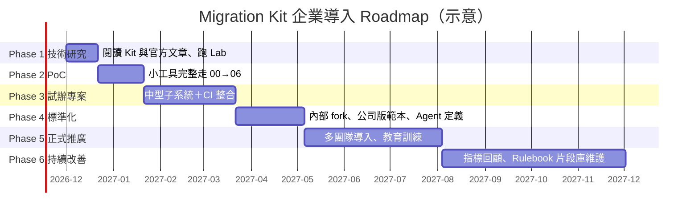

| 階段 | 目標 | 完成標準 |
|---|---|---|
| Phase 1 技術研究 | 理解 Kit 的契約與限制 | 3 位種子成員跑完 Lab、讀完 RUN-NOTES |
| Phase 2 PoC | 一個小工具完整遷移 | 所有 Gate 有紀錄；實際 token 與估算比較 |
| Phase 3 試辦專案 | 中型子系統＋CI | done-gate 兩個計數；CI 三個 job 全綠 |
| Phase 4 標準化 | 公司版 Kit | 內部 fork、範本、Agent 定義、Hook、教材 |
| Phase 5 正式推廣 | 多團隊 | 每個專案有負責架構師與 Gate 紀錄 |
| Phase 6 持續改善 | 品質指標回饋 | 每季回顧第 14.1 節的指標、更新 Rulebook 片段庫 |

---

## 重點整理

1. **Migration Kit 是流程，不是工具。** 8 支 Prompt、3 份範本、6 支腳本與一份 `CLAUDE.md`，定義前置 2 步＋六步驟，每一步都以人的 Gate 結束。
2. **先問該不該遷移，再建裁判。** Feasibility 的「Don't migrate」是合法結論；沒有在原系統全過、且能抓到故意破壞的 Judge，就沒有結束條件。
3. **Rulebook 是所有 Agent 共享的唯一真相，迴圈內唯讀。** 「兩個 Agent 可能答得不一樣」的問題都要寫進去；修訂由人在批次之間套用。
4. **確定性的東西交給腳本**：依賴地圖、manifest、佇列、錯誤佇列、標記計數、成本格式。**判斷交給對抗式審查**：每檔兩位獨立 reviewer＋第三方裁決。
5. **修流程，不是修程式碼。** 同一錯誤第三次出現，就修規則並重新產生受影響的切片——Run 2：一個失敗測試 → 一條修訂 → 四個修正點。
6. **磁碟就是狀態。** 輸出檔存在才算完成；中斷後重貼 Prompt 就是恢復。
7. **裁判有價格，價格決定它在迴圈中的位置。** tsc／go vet 併入 Step 3；cargo／C++ 走 survey build，fixer 沒有編譯器。
8. **禁止靠設定，不靠拜託**——但 deny 規則不是安全邊界。Windows 要補 PowerShell 規則；用 Hook 補 `bash -c`、`git -C` 這類變形；高敏感專案在 sandbox／容器內執行。
9. **完成的定義**：parity 全過（或 KNOWN 皆有簽核）＋原測試在原系統零 inherited，兩個計數寫進報告；之後才清 `BUG(port)`／`TODO(port)`／`PERF(port)`，一個標記一個變更。
10. **Kit 已不再維護**：Fork、釘 commit、每次 Claude Code 升級都跑 `claude doctor` 與回歸檢查。

## 企業導入建議

| 時程 | 行動 |
|---|---|
| 第 1 個月 | 種子成員跑完本手冊 Lab；建立內部 Kit fork 與 Windows 版 settings、loop-guard Hook |
| 第 2～3 個月 | 一個小工具 PoC 完整走 00 → 06；量測實際 token 與 Feasibility 估算的差距 |
| 第 4～6 個月 | 中型子系統試辦，整合 CI（gate_check、parity、Trivy、SBOM）；建立 CODEOWNERS |
| 第 7 個月起 | 公司版 Rulebook 片段庫、標準 Agent 角色、教育訓練、Token 與品質看板 |
| 持續 | 每季同步上游（預期無更新）、Claude Code 升級回歸、指標回顧 |

## 同仁操作檢查清單（Checklist）

**環境（第 4 章）：**

- [ ] `git --version`、`claude --version`、`claude auth status --text` 正常
- [ ] `claude doctor` 沒有 Invalid settings
- [ ] Windows：`python3` 不是 Store 佔位程式（或改用 `python`）；Git Bash 可用
- [ ] Kit 位於 `migration-kit/`，commit 為核准版本
- [ ] 專案 `CLAUDE.md` 有單獨一行 `@migration-kit/CLAUDE.md`
- [ ] `.gitattributes` 有 `migration/** text eol=lf`
- [ ] （選用）Skill 已安裝且 `[kit path]` 已替換

**Gate 前（第 5～6 章）：**

- [ ] Feasibility verdict 與模型計畫已簽核
- [ ] Judge：self-check 全過、突變全部 CAUGHT
- [ ] 基準線已提交（commit tag、build、test、security、dependency）
- [ ] Step 2 前：**人**已安裝 `.claude/settings.json`，`preflight.py --phase step2` FAIL=0
- [ ] Windows：有 PowerShell deny；loop-guard 測試全過
- [ ] 每個 Gate：`cost_log_check.py` errors=0

**每個批次（第 6.3 節）：**

- [ ] `queue_runner.mjs status` 有成長、`verify` exit 0
- [ ] `port_markers.py` problems=0
- [ ] Rulebook 修訂以 trailer commit 提交（`Rulebook-Amendment:`、`Approved-by:` 同一段）
- [ ] `gate_check.sh` OK

**驗收（第 6.6～6.7 節）：**

- [ ] Parity 全過或 KNOWN 皆有 DEV 編號與簽核
- [ ] 原測試在原系統 inherited = 0
- [ ] 兩個計數寫進 `step6-report.md`
- [ ] `legacy/` 自基準線以來未被修改
- [ ] Post-parity：每個 fix-now 一個變更、parity 證明只影響該缺陷

**上線切換（第 6.8 節，🏢）：**

- [ ] 影子環境不產生對外副作用（已驗證）
- [ ] `shadow_diff.py` 樣本數達門檻、差異率不高於門檻
- [ ] Canary 各階的放量與回滾條件已簽核；回滾已演練
- [ ] 切換期間沒有資料庫結構變更
- [ ] 舊系統下線條件全部滿足並簽核

## 常見問題索引

| 症狀 | 章節 |
|---|---|
| Claude Code 無法啟動 | [12.1](#121-claude-code-無法啟動) |
| Kit 路徑錯誤 | [12.2](#122-migration-kit-路徑錯誤) |
| Skill 沒載入 | [12.3](#123-skill-無法載入) |
| CLAUDE.md 沒生效 | [12.4](#124-claudemd-未生效) |
| Agent 不照 Rulebook | [12.5](#125-agent-沒有遵循-rulebook) |
| 多個 Agent 改同一檔 | [12.6](#126-多個-agent-修改相同檔案) |
| 依賴地圖不完整、0 edges | [12.7](#127-dependency-map-不完整) |
| 循環依賴 | [12.8](#128-circular-dependency) |
| 佇列卡住、manifest 表頭錯誤 | [12.9](#129-task-queue-卡住) |
| 重複翻譯 | [12.10](#1210-agent-重複翻譯) |
| Build daemon 失敗 | [12.11](#1211-build-daemon-失敗) |
| 編譯錯誤不收斂 | [12.12](#1212-編譯錯誤無法收斂) |
| Token 太高 | [12.13](#1213-token-消耗過高) |
| 測試不過 | [12.14](#1214-測試無法通過) |
| 新舊輸出不一致、全部 DIVERGE | [12.15](#1215-新舊系統輸出不一致) |
| TODO(port) 遺漏 | [12.16](#1216-todoport-遺漏) |
| 權限沒生效、PowerShell 沒被擋 | [12.17](#1217-權限設定不正確) |
| 升級後不相容 | [12.18](#1218-claude-code-升級後功能不相容) |
| Parity 全過但上線後出問題 | [6.8.6](#686-post-merge-regression-的處理與分類) |
| 影子比對全綠但不放心 | [6.8.4](#684-lab用-shadow_diffpy-比對影子輸出) |

---

## 附錄A Lab 完整檔案與企業延伸工具清單

### A.1 其餘情境檔

第 5.2.3 節已列出 03、09、10；以下是其餘 8 個（`pricing-lab/parity/scenarios/`）。

📄 `pricing-lab/parity/scenarios/01-basic.json`

```json
{
  "stdin": "{\"items\":[{\"sku\":\"A\",\"qty\":2,\"unit_price\":150},{\"sku\":\"B\",\"qty\":1,\"unit_price\":700}]}"
}
```

📄 `pricing-lab/parity/scenarios/02-vip10.json`

```json
{
  "stdin": "{\"items\":[{\"sku\":\"A\",\"qty\":3,\"unit_price\":999}],\"coupon\":\"VIP10\"}"
}
```

📄 `pricing-lab/parity/scenarios/04-half5-up.json`

```json
{
  "stdin": "{\"items\":[{\"sku\":\"A\",\"qty\":1,\"unit_price\":1030}],\"coupon\":\"HALF5\"}",
  "note": "5% = 51.5，取偶數得 52"
}
```

📄 `pricing-lab/parity/scenarios/05-coupon-null.json`

```json
{
  "stdin": "{\"items\":[{\"sku\":\"A\",\"qty\":1,\"unit_price\":100}],\"coupon\":null}",
  "note": "Python get() 回 None"
}
```

📄 `pricing-lab/parity/scenarios/06-unknown-coupon.json`

```json
{
  "stdin": "{\"items\":[{\"sku\":\"A\",\"qty\":1,\"unit_price\":100}],\"coupon\":\"FREE\"}"
}
```

📄 `pricing-lab/parity/scenarios/07-qty-zero.json`

```json
{
  "stdin": "{\"items\":[{\"sku\":\"A\",\"qty\":0,\"unit_price\":100}]}"
}
```

📄 `pricing-lab/parity/scenarios/08-qty-negative.json`

```json
{
  "stdin": "{\"items\":[{\"sku\":\"A\",\"qty\":-1,\"unit_price\":100}]}"
}
```

📄 `pricing-lab/parity/scenarios/11-empty-items.json`

```json
{
  "stdin": "{\"items\":[]}"
}
```

### A.2 Lab 一次跑完

```bash
cd pricing-lab
npm install --ignore-scripts && npx tsc --noEmit                     # Step 4（併入）：型別檢查
python parity/parity.py self-check --old "python legacy/pricing.py"  # Judge 自檢
python parity/parity.py mutate --old "python legacy/pricing.py" --src legacy   # Judge 突變驗證
python parity/parity.py run --old "python legacy/pricing.py" --new "node target/pricing.ts"   # Step 6
python ../tools/migration/port_markers.py --root target --ext .ts     # 標記與 trailer（pricing_naive.ts 會被標 MISSING-TRAILER）
python ../tools/migration/test_shadow_diff.py                        # 影子比對器的反例測試（第 6.8.4 節）
```

### A.3 企業延伸工具清單與實測狀態

所有工具皆為企業延伸範例，非官方 Migration Kit 原生功能。

| 檔案 | 用途 | 章節 | 實測 |
|---|---|---|---|
| `pricing-lab/`（legacy、target、parity、migration） | Python → TypeScript Lab | 5.2、6.x | ✅ self-check 11/11、突變 5/5、壞例 3 DIVERGE、好例 10/11＋1 KNOWN、tsc strict 通過 |
| `.claude/settings.json` | Bash＋PowerShell deny、Hook 註冊 | 4.8.2 | ✅ `claude doctor` 無錯誤 |
| `.claude/hooks/loop-guard.mjs`＋`loop-bans.json` | 掃描整段指令的 PreToolUse Hook | 4.8.3 | ✅ 單元測試 32/32；🧪 未在 live session 觸發 |
| `.claude/agents/*.md` | 四個標準角色 | 7.10 | 🧪 欄位已對照官方文件，未實際派工 |
| `tools/migration/preflight.py` | 安裝與 Gate 前檢查 | 4.11 | ✅ 三種狀態 |
| `tools/migration/Install-MigrationKit.ps1`、`install-kit.sh` | 安裝、釘 commit、Skill 替換 | 4.10 | ✅ 含冪等與拒絕覆蓋 |
| `tools/migration/port_markers.py` | 標記清點與 trailer 核對 | 6.3.9 | ✅ |
| `tools/migration/build_queue.py` | 編譯輸出 → 模組切片佇列 | 6.4.6 | ✅ 以 rustc／tsc 樣本輸出 |
| `tools/migration/cost_log_check.py` | cost-log 格式 | 11.6 | ✅ 好例與壞例 |
| `tools/migration/gate_check.sh` | Rulebook／settings trailer、刪測試、skip | 9.4.2 | ✅ 暫存 repo 好例與壞例 |
| `pricing-lab/shadow/`（gen_requests、replay、shadow-rules） | 模擬正式流量錄製與重播 | 6.8.4 | ✅ 40 筆：好例與壞例皆 MATCH=40；400 筆：好例 MATCH=400、壞例 DIFF=10 |
| `tools/migration/shadow_diff.py`＋`test_shadow_diff.py` | 影子雙跑比對、假綠燈防護 | 6.8.4 | ✅ 反例測試 14/14；故意改壞 4 處皆被測試抓到 |
| `.github/workflows/migration-gates.yml` | GitHub Actions | 9.4.3 | 🧪 YAML 可解析、版本已查證，未在 GitHub 執行 |
| `.gitlab-ci.yml` | GitLab CI | 9.4.4 | 🧪 YAML 可解析、映像檔已查證，未在 GitLab 執行 |

## 附錄B 官方 Prompt 佔位字速查

| Prompt | 佔位字 | 範例值 |
|---|---|---|
| 00-feasibility | `[target language]`、`[kit path]` | `Rust`、`migration-kit` |
| 00b-judge-setup | `[target language]`、`[reviewer model]` | `TypeScript`、`opus` |
| 01-dependency-map | `[your dependency mechanism]`、`[crate / package / module]`、`[reviewer model]` | `Python import statements`、`Rust crate`、`opus` |
| 02-gap-inventory | `[name your gap]`、`[reviewer model]` | `ownership and lifetimes`、`opus` |
| 03-stress-test | `[3]`、`[target language]`、`[target formatter]`、`[implementer model]`、`[reviewer model]` | `3`、`Rust`、`rustfmt`、`sonnet`、`opus` |
| 04-translation-kickoff | `[100]`、`[TODO(port)]`、`[implementer model]`、`[reviewer model]` | `100`、`TODO(port)/PERF(port)/BUG(port)`、`sonnet`、`opus` |
| 05-survey-build | `[build command]`、`[module]`、`[fixer model]`、`[reviewer model]` | `cargo check --all-targets`、`Rust crate`、`sonnet`、`opus` |
| 06-post-parity | `[target tree]`、`[reviewer model]` | `rust/src`、`opus` |

## 附錄C 驗證紀錄與未實測範圍

**本手冊實測（2026-11-11，Windows 11）**：

- Kit 的 `depmap_python.py`、`depmap_c.py`、`depmap_ts.mjs` 對官方 fixtures 自測：結果與期望一致（Node 版需忽略 CR 比對）。
- 附錄 A.3 所列的企業延伸工具。
- 1.1（2026-11-11）：`git ls-remote` 確認 Kit HEAD 仍為 `cf91c9d`、`claude --version` 仍為 2.1.322；影子比對 Lab 與 `shadow_diff.py` 實測；從手冊反向抽出所有 📄 區塊重建 Lab 後重跑，結果一致。
- `claude doctor` 對企業版與官方 settings.json：無 Invalid settings；對故意寫錯的 settings：正確回報，並揭露「Hook 無法載入時同檔 permissions 不套用」。
- 文件中的指令：Bash 區塊以 `bash -n`、PowerShell 區塊以 PowerShell parser 檢查語法；Mermaid 以 `mermaid.parse()` 檢查；目錄錨點以 Hugo 0.151.0 產生的 HTML 比對；外部連結以 HTTP 狀態碼檢查。

**未實測（🧪）與原因**：

| 範圍 | 原因 |
|---|---|
| `make_manifest.py`、`queue_runner.mjs`、`build_daemon.sh` 在本機執行 | Claude Code auto mode 的「外部程式碼」分類器擋下執行外部 clone 的腳本；改以逐行閱讀原始碼判讀（含 CRLF 問題），官方 RUN-NOTES 有其驗證紀錄 |
| 完整的 Kit Prompt 端對端執行（00～06） | 需要真實專案與大量 token；本手冊以 Lab 與官方 RUN-NOTES 說明 |
| Subagent 定義的實際派工、loop-guard 在 live session 的觸發 | 需要實際消耗 token；已以官方 frontmatter 表與 Hook 輸入 JSON 測試 |
| Rust、C 程式片段 | 本機沒有 Rust 與 C 工具鏈 |
| GitHub Actions、GitLab CI、Jenkins、Semgrep 實際執行 | 未連到 CI 平台；已查證版本與語法 |
| `CLAUDE_CODE_USE_POWERSHELL_TOOL=0` 對 claude.ai 帳號的效果 | 未切換帳號類型測試 |
| 影子雙跑在真實前置路由層（API Gateway、服務網格）的流量複製 | 本機沒有正式環境；Lab 以錄製檔重播模擬，比對器本身已實測 |
| Canary 放量與回滾 Runbook | 屬於維運流程，需在各組織的部署平台演練 |

## 附錄D 審查者速查卡

給負責 Gate 審查的人：每個階段 AI 會交出什麼、你要看哪三件事、用哪一行指令驗證、看到什麼就退件。指令以本手冊 Lab 或第 13 章的專案配置為準；🏢 為企業延伸工具。

| 階段 | AI 交出的產物 | 人看的三件事 | 一行驗證指令 | 紅旗（看到就退件） |
|---|---|---|---|---|
| [Feasibility](#51-專案可行性評估prompts00-feasibilitymd) | `feasibility.md`（verdict、模型計畫、成本區間） | 有沒有「不遷移」選項；成本是區間而非精確數字；案例數字沒被當估算 | `grep -nE "Bun\|兩週\|一個週末\|100 ?萬\|165,?000" feasibility.md` | 出現 Bun 或 Mike 的數字當作本專案估算 |
| [Judge](#52-建立-judgeparity-refereeprompts00b-judge-setupmd) | Parity Referee、情境檔、突變清單 | self-check 全過；突變全部被抓到；情境覆蓋 Rulebook §2 每一列 | `python parity/parity.py mutate --old "python legacy/pricing.py" --src legacy` | 有突變 SURVIVED；正規化比「換行、空白、排序鍵」更寬 |
| [Phase 1](#61-phase-1create-the-map-and-the-rules) | 依賴地圖、Rulebook、Gap Inventory | 地圖由腳本產生且可重跑；循環在兩種粒度都檢查過；inventory 的 `file:line` 正確 | 依賴腳本跑兩次，`diff` 兩份輸出應無差異 | 地圖是 Agent「讀檔整理」的；`--root` 指錯得到 0 edges |
| [Phase 2](#62-phase-2stress-test-the-rules) | Bakeoff 差異報告、Rulebook 修訂佇列 | 判決分布合理（不是每項都判 Rulebook 對）；Translator B 的工作目錄在 repo 外；修訂由人套用 | `git log -1 --format='%(trailers)'`（修訂 commit 要有 `Rulebook-Amendment` 與 `Approved-by`） | Agent 直接修改 `RULEBOOK.md` |
| [Phase 3](#63-phase-3translate-everything) | 翻譯檔、`PORT STATUS` trailer | trailer 的 todos 數與檔內標記數一致；沒有空檔；§2 抽查 | `python ../tools/migration/port_markers.py --root target --ext .ts` 🏢 | `MISSING-TRAILER`、`MISMATCH`；同一構造出現兩種翻譯 |
| [Phase 4](#64-phase-4compile) | 修正 patch、編譯輸出 | 只看最新一輪 `build-output-rN.txt`；fixer 沒有自己編譯；錯誤數逐輪下降 | `npx tsc --noEmit`（Lab）；真實專案看 build daemon 的最新輸出 | 「已修完全部錯誤」但沒有附編譯輸出 |
| [Phase 5](#65-phase-5run-it) | Smoke test 結果 | 最小端到端可跑；舊系統沒被修改 | `git diff --stat migration-baseline -- legacy/` 應為空 | 為了讓新系統能跑而修改 legacy |
| [Phase 6](#66-phase-6match-behavior) | `parity-report.tsv`、兩個計數 | 全部 PASS 或 KNOWN 有 DEV 編號；原測試在原系統 inherited = 0；沒有刪測試 | `python parity/parity.py run --old "python legacy/pricing.py" --new "node target/pricing.ts"` | `canonical()` 被放寬；測試被 skip 或刪除 |
| [Post-parity](#67-post-parity標記清理prompts06-post-paritymd) | 標記分類表、逐一修正 | 每個 fix-now 只改變一個行為；計數來自 grep 而非口述 | `grep -rcE 'BUG\(port\)\|TODO\(port\)\|PERF\(port\)' target/` | 一個變更改了兩個以上情境的輸出 |
| [Cutover](#68-上線切換影子雙跑與回滾企業延伸) 🏢 | 影子比對規則、canary 計畫、回滾 Runbook | 樣本數足夠；`ignore` 只有每次執行都不同的欄位；回滾不需要還原資料庫結構 | `python ../tools/migration/shadow_diff.py --old shadow/out/old.jsonl --new shadow/out/new.jsonl --rules shadow/shadow-rules.json --min-samples 400` | 「0 差異」但沒有樣本數；canary 只有技術指標 |
| [成本](#116-cost-log-的機械檢查) 🏢 | `cost-log.tsv` | 每批都有紀錄；累計值對照 Feasibility 區間 | `python tools/migration/cost_log_check.py migration/cost-log.tsv`（專案根目錄） | 格式錯誤；累計超出區間卻沒有 Gate 決策 |
| [每個批次](#942-gate-檢查腳本) 🏢 | commit 與 trailer | Rulebook／settings 變更有 trailer；沒有刪測試或新增 skip | `bash tools/migration/gate_check.sh origin/main HEAD` | 改 Rulebook 沒有 `Approved-by` |

> 📌 **使用方式**：Gate 會議時把這張表投影出來，逐列打勾。任何一列的「一行驗證指令」沒有實際執行過，該 Gate 就不算通過——審查者的責任是**看到指令的輸出**，不是看到 AI 說「已驗證」。

## 附錄E 術語表

| 術語 | 說明 | 詳見 |
|---|---|---|
| Migration Kit | Anthropic 隨官方文章公開的參考套件：8 支 Prompt、3 份範本、6 支腳本、一份 `CLAUDE.md`；Reference code，不再維護 | [第 1.1 節](#11-migration-kit-是什麼) |
| Structure-Preserving Migration | 翻譯時保留原始碼的檔案、函式名稱與邊界，讓審查者可以並排對照 | [第 1.8 節](#18-structure-preserving-migration-的設計理念) |
| Rulebook | 「來源構造 → 目標寫法」的唯一對照規則；所有 Agent 共用，只有人可以修訂 | [第 1.9 節](#19-rulebook-driven-migration-的重要性) |
| Dependency Map | 由確定性腳本產生的依賴地圖（邊、順序、循環），決定翻譯順序 | [第 6.1 節](#61-phase-1create-the-map-and-the-rules) |
| Gap Inventory | 來源中「目標語言沒有直接對應」的構造清單，每列都要有 `file:line` 與分類 | [第 6.1 節](#61-phase-1create-the-map-and-the-rules) |
| Judge／Parity Referee | 把同一組情境餵給新舊系統並比對輸出的裁判；先自檢、再突變驗證，才能相信它 | [第 5.2 節](#52-建立-judgeparity-refereeprompts00b-judge-setupmd) |
| Self-check | 舊系統對舊系統跑一次裁判，確認系統與裁判本身是確定性的 | [第 5.2.4 節](#524-驗證裁判本身實測) |
| 突變驗證（Mutation） | 故意破壞舊系統，確認每個突變都會被裁判抓到 | [第 5.2.4 節](#524-驗證裁判本身實測) |
| Stress-test／Bakeoff | 用兩位互不知情的 Translator 翻譯同一批檔案，比對差異來找出 Rulebook 缺口 | [第 6.2 節](#62-phase-2stress-test-the-rules) |
| Manifest／佇列 | 磁碟上的 `manifest.tsv`；目標檔不存在 = 待做。進度以檔案為準，不以 Agent 的記憶為準 | [第 6.3 節](#63-phase-3translate-everything) |
| `PORT STATUS` trailer | 每個翻譯檔結尾的狀態區塊（來源、信心、todos、notes） | [第 6.3 節](#63-phase-3translate-everything) |
| `TODO(port)`／`BUG(port)`／`PERF(port)` | 翻譯期間延後處理的標記；Post-parity 才分類處理 | [第 6.7 節](#67-post-parity標記清理prompts06-post-paritymd) |
| Survey Build | 由 build daemon 集中編譯，把錯誤切成模組佇列交給 fixer；fixer 不自己編譯 | [第 6.4 節](#64-phase-4compile) |
| Done-gate | Step 6 的完成條件：parity 全部通過，且原測試在原系統 inherited failure 為 0 | [第 6.6 節](#66-phase-6match-behavior) |
| Inherited failure | 原測試在**原系統**上本來就失敗的項目；不是移植造成的 | [第 6.6 節](#66-phase-6match-behavior) |
| KNOWN／STALE-KNOWN | 經簽核接受的差異（要有 DEV 編號）；STALE-KNOWN 表示已簽核的差異其實已經一致 | [第 6.6 節](#66-phase-6match-behavior) |
| Deviation log | Rulebook §7：每個被接受的行為差異（DEV-xxx）與核准人 | [第 6.1.11 節](#6111-人工審核重點) |
| Gate | 階段之間由人做的決定與簽核；Kit 的每個 Phase 都以 Gate 結束 | [第 6.0 節](#60-所有-phase-共同的契約) |
| 影子雙跑（Shadow traffic） | 正式請求複製一份送給新系統，回應只用來比對、不回給使用者 | [第 6.8.3 節](#683-影子雙跑的原理與限制) |
| Canary | 只把一小部分正式流量導到新系統，依事先訂好的條件放量或回滾 | [第 6.8.5 節](#685-canary-放量與回滾) |
| loop-guard | 本手冊的 PreToolUse Hook：掃描整段 shell 指令，擋下迴圈 Agent 不該執行的動作 | [第 4.8.3 節](#483-loop-guard-hook) |

## 參考資料

### 官方主要來源

1. Claude Code Migration Kit（GitHub）：<https://github.com/anthropics/code-migration-kit-with-claude-code>
2. README.md：<https://github.com/anthropics/code-migration-kit-with-claude-code/blob/main/README.md>
3. CLAUDE.md：<https://github.com/anthropics/code-migration-kit-with-claude-code/blob/main/CLAUDE.md>
4. RUN-NOTES.md：<https://github.com/anthropics/code-migration-kit-with-claude-code/blob/main/RUN-NOTES.md>
5. How Anthropic runs large-scale code migrations with Claude Code（2026-07-16）：<https://claude.com/resources/articles/ai-code-migration>
6. Bun PORTING.md（commit 46d3bc2）：<https://github.com/oven-sh/bun/commit/46d3bc29f270fa881dd5730ef1549e88407701a5>
7. Jarred Sumner，Rewriting Bun in Rust（2026-07-08）：<https://bun.com/blog/bun-in-rust>

### Claude Code 官方文件

8. Overview：<https://code.claude.com/docs/en/overview>
9. Setup：<https://code.claude.com/docs/en/setup>
10. CLI reference：<https://code.claude.com/docs/en/cli-reference>
11. Subagents：<https://code.claude.com/docs/en/sub-agents>
12. Dynamic workflows：<https://code.claude.com/docs/en/workflows>
13. Agent teams：<https://code.claude.com/docs/en/agent-teams>
14. Skills：<https://code.claude.com/docs/en/skills>
15. Settings：<https://code.claude.com/docs/en/settings>
16. Permissions：<https://code.claude.com/docs/en/permissions>
17. Permission modes：<https://code.claude.com/docs/en/permission-modes>
18. Hooks：<https://code.claude.com/docs/en/hooks>
19. Memory（CLAUDE.md 與 `@` 匯入）：<https://code.claude.com/docs/en/memory>
20. Tools reference（PowerShell 工具）：<https://code.claude.com/docs/en/tools-reference>
21. Sandboxing：<https://code.claude.com/docs/en/sandboxing>
22. MCP：<https://code.claude.com/docs/en/mcp>

### 其他技術文件

23. GitHub Actions — Secure use reference（以 SHA 釘 action）：<https://docs.github.com/en/actions/reference/security/secure-use>
24. GitLab CI/CD YAML 語法：<https://docs.gitlab.com/ci/yaml/>
25. Git trailers（`git interpret-trailers`）：<https://git-scm.com/docs/git-interpret-trailers>
26. Git attributes（`eol`）：<https://git-scm.com/docs/gitattributes>
27. The Rust Programming Language — Unsafe Rust：<https://doc.rust-lang.org/book/ch20-01-unsafe-rust.html>
28. The Rustonomicon（FFI）：<https://doc.rust-lang.org/nomicon/ffi.html>
29. TypeScript — tsconfig `strict`：<https://www.typescriptlang.org/tsconfig/#strict>
30. Node.js — TypeScript type stripping：<https://nodejs.org/api/typescript.html>
31. Python — `round()`：<https://docs.python.org/3/library/functions.html#round>
32. OWASP Software Component Verification Standard：<https://owasp.org/www-project-software-component-verification-standard/>
33. SLSA（供應鏈安全框架）：<https://slsa.dev/>
34. Trivy：<https://trivy.dev/>
35. Semgrep：<https://semgrep.dev/docs/>
36. Tree-sitter：<https://tree-sitter.github.io/tree-sitter/>
37. OpenRewrite：<https://docs.openrewrite.org/>
38. Sourcegraph：<https://sourcegraph.com/docs>
39. GitHub Copilot：<https://docs.github.com/en/copilot>

### 業界案例與相關服務

40. Ziftci et al., Migrating Code At Scale With LLMs At Google（arXiv 2504.09691）：<https://arxiv.org/abs/2504.09691>
41. Airbnb Engineering, Accelerating Large-Scale Test Migration with LLMs：<https://airbnb.tech/?p=366>
42. AWS Transform custom 發布公告（2025-12）：<https://aws.amazon.com/about-aws/whats-new/2025/12/transform-custom-organization-wide-modernization>
43. AWS Transform custom 新增 AWS 管理的轉換（2026-03）：<https://aws.amazon.com/about-aws/whats-new/2026/03/transform-custom-new-transformations>

> 📌 **官方功能與作者建議的分界**：第 1～3 章與各章標 📖 的內容取自上列官方來源；標 🏢 的流程、工具與建議為作者的企業實務設計，請依組織政策調整。
