+++
date = '2026-11-19T18:02:27+08:00'
draft = false
title = 'Modern Web Guidance 教學手冊'
tags = ['教學', 'AI開發']
categories = ['教學']
+++

# Modern Web Guidance 教學手冊

> **Modern Web Guidance AI Agent 現代化 Web 開發實戰教學手冊**
> 建立 AI Coding Agent 的現代 Web Platform 知識、瀏覽器最佳實踐、相容性治理與企業級開發能力
> 適用對象：Frontend／Full-Stack Engineer、SA、Software Architect、QA、PM、AI Agent Engineer、DevSecOps
> 文件性質：企業內部開發規範與教育訓練教材（偏「實戰與維運」）
> 版本基準：npm `modern-web-guidance` **1.0.1**（2026-11-16 發布；發行 repo `GoogleChrome/modern-web-guidance` tag `v1.0.1` = commit `64a6d70`）；原始碼 repo `GoogleChrome/modern-web-guidance-src` 追蹤至 `main` `e8feb43`（2026-11-18）
> 實測環境：Windows 11、Node.js 24.16.0、npm 11.13.0、Git Bash、Google Chrome 158、Claude Code 2.1.328、web-features 3.46.0、Vue 3.5.45、Vite 8.3.8、Playwright 1.65.1
> 查證日期：2026-11-19

---

## 重要聲明

1. **Modern Web Guidance 不是 AI Coding Agent，也不是 MCP Server。** 它是一組 Agent Skill（`SKILL.md`＋指南 Markdown）加上一支本機 CLI（`search`／`retrieve`／`list`／`legacy-scan`）。Agent 讀到 Skill 說明後，自己呼叫 CLI 把指南拉進 context。官方技術文章明確說明「為什麼是 CLI skill 而不是 MCP server」（第 3.6 節）。
2. **它只提供知識，不會替你寫程式、改程式或做架構還原。** 逆向工程、Framework 升級、測試與 Code Review 仍要靠 Agent、工具與人。本手冊會把每一項能力標示成「官方功能」或「企業自建／建議流程」，請勿混用。
3. **CLI 預設開啟遙測。** 會送出 Agent 名稱、guide ID、Agent 產生的搜尋詞到 Google（`play.googleapis.com`），不含原始 prompt 與程式碼。金融業環境請先讀第 4.9 節，統一設定 `DISABLE_TELEMETRY=1`。
4. **版本變動很快。** 1.0.0（2026-11-10）到 1.0.1（2026-11-16）只隔 6 天，Skill 預設以 `npx -y modern-web-guidance@latest` 執行，等於每次都抓最新版。本手冊所有輸出都以 1.0.1 為準；升級前請照第 17 章重新驗證。
5. **本手冊不是官方文件的翻譯。** 內容是依 npm 套件、發行 repo、原始碼 repo（`src/cli`、`src/rag`、`src/core`、`src/analyzing`）與 developer.chrome.com 官方文件重新查證，再加上企業導入做法、實測工具與案例。
6. **案例皆為教學用虛構情境。** 「貸款入口網站」「貸款案件管理」「ACME Bank」等名稱與資料都不是真實專案。
7. **實測範圍要先看清楚。** 已實測：CLI 全部指令（含未寫在 README 的 `set-baseline`）、`.mwgrc` 閘門 7 種情境、`legacy-scan` 3 個樣本專案、`install` 在隔離目錄安裝到 Claude Code、8 支企業自建工具（20 個測試、8 個突變測試全部被抓到、本機 CI 模擬 2 情境、搜尋回歸 13 案例）、Vue 3 範例（`vue-tsc`、`vite build`、Playwright 11 個 E2E 含 fallback 路徑與 axe）。**未實測**：各 Agent 實際載入 Skill 後的行為（未以付費帳號跑 Agent）、Copilot／Codex／Cursor／Gemini／Antigravity 的 plugin 安裝、GitHub Actions 實跑、Safari 與 Firefox 實機。未實測的內容標 🧪。
8. **AI 產出一律要人工驗證。** 官方評測數據（第 1.14 節）是 Google 在自家測試應用上量到的，不代表你的專案會得到同樣結果。

---

## 閱讀約定

### 來源標示

全書在句末或表格中使用下列標示。凡標示為「企業自建」或「建議流程」的內容都**不是** Modern Web Guidance 官方功能，請勿在簡報或對外文件中寫成官方保證。

| 標示 | 意義 | 範例 |
|---|---|---|
| **官方** | 官方 repo、npm 套件或 developer.chrome.com 明確寫出（附路徑或網址） | `retrieve` 會擋下 Origin Trial 指南（官方，`src/rag/retrieve.ts`） |
| **實測** | 本手冊在上述實測環境親自執行過，附指令與輸出 | 中文搜尋回傳 `[]` 且結束碼為 0（實測） |
| **Web Platform 原生** | 瀏覽器標準能力，與 MWG 無關 | `<dialog>`、`:user-invalid` |
| **第三方** | 其他廠商或社群工具 | DOMPurify、`@oddbird/popover-polyfill`、Vercel `skills` CLI |
| **企業自建** | 本手冊提供、需由公司自行維護的工具或設定 | `tools/mwg/scan-gate.mjs` |
| **建議流程** | 本手冊作者建議的做法，沒有官方背書 | 「`.mwgrc` 開啟要有核准單」 |
| 🧪 | 寫法有官方依據，但本手冊沒有實際跑過 | 在 Codex 安裝 plugin |

### 指令區塊的適用環境

每個指令區塊上方都會寫明環境：

- 「Shell（Git Bash／macOS／Linux）」：一般終端機。
- 「PowerShell（Windows）」：Windows PowerShell 7。
- 「Claude Code 對話框」「Copilot CLI 對話框」：在 Agent session 內輸入的 slash command。
- 「Agent 提示詞」：貼給 AI Agent 的自然語言指令。

### 手冊名詞縮寫

| 縮寫 | 全名 |
|---|---|
| MWG | Modern Web Guidance |
| OT | Origin Trial（Chrome 的實驗性功能試用機制） |
| Volatile | MWG 定義的「不穩定功能」：只有單一瀏覽器引擎支援、或 3 個月內才上線仍在變動 |
| Widely／Newly／Limited | Baseline Widely available／Newly available／Limited availability |

### 本手冊附帶的實測檔案

手冊中標示 📄 的程式碼區塊都是實測檔案，可原樣抽出使用：

| 路徑 | 用途 | 驗證 |
|---|---|---|
| `enterprise-repo/tools/mwg/mwgrc-policy-check.mjs` | `.mwgrc` 是否符合公司政策（含核准單與到期日） | 9 個測試＋2 個突變測試 |
| `enterprise-repo/tools/mwg/scan-gate.mjs` | `legacy-scan --json` 報告與「不得新增」棘輪閘門 | 4 個測試＋2 個突變測試＋真實掃描結果 |
| `enterprise-repo/tools/mwg/guide-baseline.mjs` | 指南用到的 feature 是否符合公司 Baseline 目標 | 以真實 `guides.json`＋web-features 3.46.0 執行 |
| `enterprise-repo/tools/mwg/disclosure-check.mjs` | PR 中 `### Modern Web Guidance` 段落的 guide id 是否真實存在 | 5 個測試＋2 個突變測試 |
| `enterprise-repo/tools/mwg/gated-api-scan.mjs` | 原始碼中未核准的實驗性 API | 2 個測試＋2 個突變測試 |
| `enterprise-repo/tools/mwg/search-regression.mjs` | MWG 升級前後的搜尋回歸（含對照組） | 1.0.1 實跑 13 案例 |
| `enterprise-repo/tools/mwg/version-diff.mjs` | 比較兩個 MWG 版本的指南與 SKILL.md 差異 | 1.0.0 → 1.0.1 實跑 |
| `enterprise-repo/tools/mwg/mwg-doctor.sh` | 快速診斷 | 在第 4.8 節安裝目錄實跑 |
| `enterprise-repo/` 其他檔案 | `AGENTS.md`、`CLAUDE.md`、Copilot 指示、CI workflow、Claude Code 權限 | `claude doctor`、YAML 解析 |
| `vue-admin/` | 第 11 章 Vue 3 實戰範例 | `vue-tsc`、`vite build`、Playwright 11 個 E2E |
| `legacy-app/`、`legacy-app-modern/`、`before-after/` | 第 1、12、13 章的舊程式與現代化對照 | `legacy-scan` 實跑 |

以上工具是**企業自建的 MWG 周邊工具**，不是 MWG 的一部分。

---

## 版本紀錄

| 版本 | 日期 | 作者 | 說明 |
|---|---|---|---|
| 1.0 | 2026-11-19 | 架構組 | 初版。基準 MWG 1.0.1。含 24 章、附錄 A～N、8 支企業自建工具、Vue 3 實戰範例、3 個 legacy-scan 樣本 |

### 文件維護資訊

| 項目 | 內容 |
|---|---|
| 文件擁有者 | 架構組（AI 開發規範小組）＋前端技術委員會 |
| 審查週期 | MWG 每次發布 minor 版本，或每季一次 |
| 變更方式 | PR 修改本檔，需前端架構師與 DevSecOps 各一人核准 |
| 版本對照 | 第 17.3 節「版本升級檢查表」 |
| 回報問題 | 內部 Issue Tracker，標籤 `mwg-handbook` |

---

## 目錄

- [第 1 章：Modern Web Guidance 專案介紹](#第-1-章modern-web-guidance-專案介紹)
  - [1.1 Modern Web Guidance 是什麼？](#11-modern-web-guidance-是什麼)
  - [1.2 專案起源與背景](#12-專案起源與背景)
  - [1.3 專案的主要目標](#13-專案的主要目標)
  - [1.4 為什麼 AI Coding Agent 需要 Modern Web Guidance？](#14-為什麼-ai-coding-agent-需要-modern-web-guidance)
  - [1.5 AI Coding Agent 開發 Web Application 的常見問題](#15-ai-coding-agent-開發-web-application-的常見問題)
  - [1.6 Modern Web Guidance 解決哪些問題？](#16-modern-web-guidance-解決哪些問題)
  - [1.7 Modern Web Guidance 不解決哪些問題？](#17-modern-web-guidance-不解決哪些問題)
  - [1.8 Modern Web Guidance 與傳統 Web 技術文件的差異](#18-modern-web-guidance-與傳統-web-技術文件的差異)
  - [1.9 Modern Web Guidance 與 AI Context Engineering 的關係](#19-modern-web-guidance-與-ai-context-engineering-的關係)
  - [1.10 Modern Web Guidance 對軟體工程師的價值](#110-modern-web-guidance-對軟體工程師的價值)
  - [1.11 Modern Web Guidance 的適用對象](#111-modern-web-guidance-的適用對象)
  - [1.12 Modern Web Guidance 適用於哪些專案？](#112-modern-web-guidance-適用於哪些專案)
  - [1.13 導入前與導入後的差異](#113-導入前與導入後的差異)
  - [1.14 導入 Modern Web Guidance 的預期效益](#114-導入-modern-web-guidance-的預期效益)
  - [1.15 本章 AI 產出審查](#115-本章-ai-產出審查)
- [第 2 章：Modern Web Guidance 核心觀念](#第-2-章modern-web-guidance-核心觀念)
  - [2.1 Modern Web Platform 與 Native Browser API](#21-modern-web-platform-與-native-browser-api)
  - [2.2 Modern HTML、CSS、JavaScript、TypeScript](#22-modern-htmlcssjavascripttypescript)
  - [2.3 Web Standards 與 Browser Compatibility](#23-web-standards-與-browser-compatibility)
  - [2.4 Web Platform Baseline](#24-web-platform-baseline)
  - [2.5 Accessibility、Web Performance、Security](#25-accessibilityweb-performancesecurity)
  - [2.6 Progressive Enhancement、Graceful Degradation、Polyfill](#26-progressive-enhancementgraceful-degradationpolyfill)
  - [2.7 Third-Party Library Reduction](#27-third-party-library-reduction)
  - [2.8 Context Engineering 與 Token Optimization](#28-context-engineering-與-token-optimization)
  - [2.9 AI Agent Knowledge Retrieval 與技術決策模式](#29-ai-agent-knowledge-retrieval-與技術決策模式)
  - [2.10 如何判斷 API 是否適合企業環境](#210-如何判斷-api-是否適合企業環境)
  - [2.11 如何避免 AI Agent 過度使用 JavaScript、如何降低技術債](#211-如何避免-ai-agent-過度使用-javascript如何降低技術債)
  - [2.12 本章 AI 產出審查](#212-本章-ai-產出審查)
- [第 3 章：Modern Web Guidance 系統架構](#第-3-章modern-web-guidance-系統架構)
  - [3.1 官方實際架構（執行期）](#31-官方實際架構執行期)
  - [3.2 官方實際架構（建置期）](#32-官方實際架構建置期)
  - [3.3 元件清單](#33-元件清單)
  - [3.4 CLI 指令（執行入口）](#34-cli-指令執行入口)
  - [3.5 Knowledge Base 與指南結構](#35-knowledge-base-與指南結構)
  - [3.6 Search Engine：BM25＋Embedding＋RRF](#36-search-enginebm25embeddingrrf)
  - [3.7 Local Runtime 與 Context Retrieval](#37-local-runtime-與-context-retrieval)
  - [3.8 Configuration 與 Compatibility Data](#38-configuration-與-compatibility-data)
  - [3.9 Knowledge Update Mechanism](#39-knowledge-update-mechanism)
  - [3.10 Agent Integration（官方提供的整合點）](#310-agent-integration官方提供的整合點)
  - [3.11 官方未提供、但企業可自行整合的架構](#311-官方未提供但企業可自行整合的架構)
  - [3.12 本手冊建議的企業架構](#312-本手冊建議的企業架構)
  - [3.13 本章 AI 產出審查](#313-本章-ai-產出審查)
- [第 4 章：Modern Web Guidance 安裝與環境建置](#第-4-章modern-web-guidance-安裝與環境建置)
  - [4.1 環境需求](#41-環境需求)
  - [4.2 OS 支援](#42-os-支援)
  - [4.3 安裝方式總覽](#43-安裝方式總覽)
  - [4.4 先試用、不安裝](#44-先試用不安裝)
  - [4.5 Windows 安裝（PowerShell）](#45-windows-安裝powershell)
  - [4.6 macOS／Linux 安裝](#46-macoslinux-安裝)
  - [4.7 WSL 安裝](#47-wsl-安裝)
  - [4.8 安裝流程實測（隔離目錄）](#48-安裝流程實測隔離目錄)
  - [4.9 遙測與隱私（金融業必讀）](#49-遙測與隱私金融業必讀)
  - [4.10 安裝驗證](#410-安裝驗證)
  - [4.11 常見安裝錯誤](#411-常見安裝錯誤)
  - [4.12 Proxy／Firewall／SSL](#412-proxyfirewallssl)
  - [4.13 Offline Environment](#413-offline-environment)
  - [4.14 公司內部網路環境的效能考量](#414-公司內部網路環境的效能考量)
  - [4.15 本章 AI 產出審查](#415-本章-ai-產出審查)
- [第 5 章：Modern Web Guidance 設定與治理](#第-5-章modern-web-guidance-設定與治理)
  - [5.1 設定檔架構](#51-設定檔架構)
  - [5.2 預設設定](#52-預設設定)
  - [5.3 .mwgrc 逐行解析與解析規則](#53-mwgrc-逐行解析與解析規則)
  - [5.4 Baseline 目標：set-baseline 與 AGENTS.md 兩種寫法](#54-baseline-目標set-baseline-與-agentsmd-兩種寫法)
  - [5.5 閘門行為實測](#55-閘門行為實測)
  - [5.6 Experimental Features 與 Origin Trial](#56-experimental-features-與-origin-trial)
  - [5.7 Feature Allowlist／Blocklist（官方沒有，企業自建）](#57-feature-allowlistblocklist官方沒有企業自建)
  - [5.8 企業建議設定](#58-企業建議設定)
  - [5.9 版本釘選的取捨](#59-版本釘選的取捨)
  - [5.10 多專案共用設定](#510-多專案共用設定)
  - [5.11 團隊設定標準（新專案檢查表）](#511-團隊設定標準新專案檢查表)
  - [5.12 本章 AI 產出審查](#512-本章-ai-產出審查)
- [第 6 章：Modern Web Guidance 知識庫與搜尋機制](#第-6-章modern-web-guidance-知識庫與搜尋機制)
  - [6.1 Knowledge Base 與 Guide Structure](#61-knowledge-base-與-guide-structure)
  - [6.2 Web Feature 與 Scenario-based Guide](#62-web-feature-與-scenario-based-guide)
  - [6.3 搜尋機制流程圖](#63-搜尋機制流程圖)
  - [6.4 AI Agent 查詢知識流程](#64-ai-agent-查詢知識流程)
  - [6.5 搜尋結果如何影響程式碼生成](#65-搜尋結果如何影響程式碼生成)
  - [6.6 查詢詞設計範例](#66-查詢詞設計範例)
  - [6.7 如何提高搜尋品質](#67-如何提高搜尋品質)
  - [6.8 搜尋不到資料時的處理方式](#68-搜尋不到資料時的處理方式)
  - [6.9 Context Window 與 Token Optimization](#69-context-window-與-token-optimization)
  - [6.10 Search Result Injection 與 Agent Context Integration](#610-search-result-injection-與-agent-context-integration)
  - [6.11 如何避免不相關資料污染 AI Context](#611-如何避免不相關資料污染-ai-context)
  - [6.12 Search Quality 與 Knowledge Update](#612-search-quality-與-knowledge-update)
  - [6.13 本章 AI 產出審查](#613-本章-ai-產出審查)
- [第 7 章：Modern Web Guidance 涵蓋的現代 Web 技術](#第-7-章modern-web-guidance-涵蓋的現代-web-技術)
  - [7.1 HTML／DOM](#71-htmldom)
  - [7.2 Modern CSS](#72-modern-css)
  - [7.3 JavaScript／TypeScript](#73-javascripttypescript)
  - [7.4 Browser API](#74-browser-api)
  - [7.5 Performance](#75-performance)
  - [7.6 Security](#76-security)
  - [7.7 AI／Browser Built-in AI](#77-aibrowser-built-in-ai)
  - [7.8 涵蓋程度的查詢紀錄](#78-涵蓋程度的查詢紀錄)
  - [7.9 本章 AI 產出審查](#79-本章-ai-產出審查)
- [第 8 章：Browser Compatibility 與 Baseline 治理](#第-8-章browser-compatibility-與-baseline-治理)
  - [8.1 Browser Compatibility 與 Baseline 的關係](#81-browser-compatibility-與-baseline-的關係)
  - [8.2 Baseline Newly 與 Widely](#82-baseline-newly-與-widely)
  - [8.3 Chrome、Edge、Firefox、Safari 的企業差異](#83-chromeedgefirefoxsafari-的企業差異)
  - [8.4 Browser Version、Mobile、Enterprise、Embedded Browser、WebView](#84-browser-versionmobileenterpriseembedded-browserwebview)
  - [8.5 相容性判斷流程](#85-相容性判斷流程)
  - [8.6 API 相容性查詢方法](#86-api-相容性查詢方法)
  - [8.7 Feature Detection 範例](#87-feature-detection-範例)
  - [8.8 Polyfill 評估方式](#88-polyfill-評估方式)
  - [8.9 Enterprise Browser Policy（範本）](#89-enterprise-browser-policy範本)
  - [8.10 AI Agent Compatibility Prompt](#810-ai-agent-compatibility-prompt)
  - [8.11 如何避免 AI Agent 引入不支援的 API](#811-如何避免-ai-agent-引入不支援的-api)
  - [8.12 本章 AI 產出審查](#812-本章-ai-產出審查)
- [第 9 章：Modern Web Guidance 與 AI Coding Agent 整合](#第-9-章modern-web-guidance-與-ai-coding-agent-整合)
  - [9.1 支援程度總表](#91-支援程度總表)
  - [9.2 整合三件套](#92-整合三件套)
  - [9.3 共用指令檔：AGENTS.md](#93-共用指令檔agentsmd)
  - [9.4 Claude Code](#94-claude-code)
  - [9.5 GitHub Copilot CLI](#95-github-copilot-cli)
  - [9.6 GitHub Copilot（VS Code Agent Mode）與 VS Code](#96-github-copilotvs-code-agent-mode與-vs-code)
  - [9.7 OpenAI Codex](#97-openai-codex)
  - [9.8 Cursor](#98-cursor)
  - [9.9 Gemini CLI 與 Gemini Code Assist](#99-gemini-cli-與-gemini-code-assist)
  - [9.10 Antigravity 與其他](#910-antigravity-與其他)
  - [9.11 專案設定、Global 設定、Repository 設定](#911-專案設定global-設定repository-設定)
  - [9.12 讓 Agent 在每個階段使用 MWG](#912-讓-agent-在每個階段使用-mwg)
  - [9.13 本章 AI 產出審查](#913-本章-ai-產出審查)
- [第 10 章：Modern Web Guidance 與企業 AI Agent 開發工作流程](#第-10-章modern-web-guidance-與企業-ai-agent-開發工作流程)
  - [10.1 AI Agent SDLC Workflow](#101-ai-agent-sdlc-workflow)
  - [10.2 各階段的 MWG 用法與價值](#102-各階段的-mwg-用法與價值)
  - [10.3 證據鏈（Audit Trail）](#103-證據鏈audit-trail)
  - [10.4 分工：人做什麼、Agent 做什麼](#104-分工人做什麼agent-做什麼)
  - [10.5 實務案例：需求單「案件列表新增批次刪除」](#105-實務案例需求單案件列表新增批次刪除)
  - [10.6 本章 AI 產出審查](#106-本章-ai-產出審查)
- [第 11 章：AI Agent 開發 Web Application 實戰](#第-11-章ai-agent-開發-web-application-實戰)
  - [11.1 Step 1：需求分析](#111-step-1需求分析)
  - [11.2 Step 2：Web Platform 技術分析](#112-step-2web-platform-技術分析)
  - [11.3 Step 3：Architecture Design](#113-step-3architecture-design)
  - [11.4 Step 4：Code Generation](#114-step-4code-generation)
  - [11.5 Step 5：Code Review](#115-step-5code-review)
  - [11.6 Step 6：Testing](#116-step-6testing)
  - [11.7 Step 7：成果評估](#117-step-7成果評估)
  - [11.8 換成 PrimeVue、Pinia、Tailwind 時的注意事項](#118-換成-primevuepiniatailwind-時的注意事項)
  - [11.9 本章 AI 產出審查](#119-本章-ai-產出審查)
- [第 12 章：Modern Web Guidance 在系統逆向工程的應用](#第-12-章modern-web-guidance-在系統逆向工程的應用)
  - [12.1 逆向工程的分工](#121-逆向工程的分工)
  - [12.2 Reverse Engineering Workflow](#122-reverse-engineering-workflow)
  - [12.3 Legacy Web Code 分析案例](#123-legacy-web-code-分析案例)
  - [12.4 驗證每一個發現（keepWhen／dropWhen）](#124-驗證每一個發現keepwhendropwhen)
  - [12.5 掃描沒抓到的東西（最重要的一節）](#125-掃描沒抓到的東西最重要的一節)
  - [12.6 Modern Web API 替代舊程式碼案例](#126-modern-web-api-替代舊程式碼案例)
  - [12.7 技術債分析報告範本](#127-技術債分析報告範本)
  - [12.8 Modernization Roadmap](#128-modernization-roadmap)
  - [12.9 Test Strategy](#129-test-strategy)
  - [12.10 AI Agent Reverse Engineering Prompt（摘要）](#1210-ai-agent-reverse-engineering-prompt摘要)
  - [12.11 本章 AI 產出審查](#1211-本章-ai-產出審查)
- [第 13 章：Modern Web Guidance 在 Web Framework 升級的應用](#第-13-章modern-web-guidance-在-web-framework-升級的應用)
  - [13.1 分工](#131-分工)
  - [13.2 Framework Upgrade Workflow](#132-framework-upgrade-workflow)
  - [13.3 Vue 2 → Vue 3 案例](#133-vue-2--vue-3-案例)
  - [13.4 Legacy JavaScript → Modern JavaScript 案例](#134-legacy-javascript--modern-javascript-案例)
  - [13.5 Legacy CSS → Modern CSS 案例（Bootstrap 3）](#135-legacy-css--modern-css-案例bootstrap-3)
  - [13.6 Vue reactive 與 structuredClone：一個實測陷阱](#136-vue-reactive-與-structuredclone一個實測陷阱)
  - [13.7 AI Agent Upgrade Prompt（摘要）](#137-ai-agent-upgrade-prompt摘要)
  - [13.8 Upgrade Checklist 與 Risk Matrix](#138-upgrade-checklist-與-risk-matrix)
  - [13.9 Rollback Planning 與 Migration Roadmap](#139-rollback-planning-與-migration-roadmap)
  - [13.10 本章 AI 產出審查](#1310-本章-ai-產出審查)
- [第 14 章：Modern Web Guidance Prompt Engineering](#第-14-章modern-web-guidance-prompt-engineering)
  - [14.1 Prompt 1：AI Agent Modern Web 開發 Prompt](#141-prompt-1ai-agent-modern-web-開發-prompt)
  - [14.2 Prompt 2：AI Agent Reverse Engineering Prompt](#142-prompt-2ai-agent-reverse-engineering-prompt)
  - [14.3 Prompt 3：AI Agent Framework Upgrade Prompt](#143-prompt-3ai-agent-framework-upgrade-prompt)
  - [14.4 Prompt 4：Modern Web Code Review Prompt](#144-prompt-4modern-web-code-review-prompt)
  - [14.5 Prompt 5：Browser Compatibility Assessment Prompt](#145-prompt-5browser-compatibility-assessment-prompt)
  - [14.6 Prompt 6：Web Performance Optimization Prompt](#146-prompt-6web-performance-optimization-prompt)
  - [14.7 Prompt 7：Accessibility Assessment Prompt](#147-prompt-7accessibility-assessment-prompt)
  - [14.8 Prompt 8：Modern Web Guidance 技術選型 Prompt](#148-prompt-8modern-web-guidance-技術選型-prompt)
  - [14.9 Prompt 使用技巧](#149-prompt-使用技巧)
  - [14.10 本章 AI 產出審查](#1410-本章-ai-產出審查)
- [第 15 章：Modern Web Guidance 與企業標準開發平台整合](#第-15-章modern-web-guidance-與企業標準開發平台整合)
  - [15.1 Enterprise Web Architecture](#151-enterprise-web-architecture)
  - [15.2 MWG 在企業開發平台中的角色](#152-mwg-在企業開發平台中的角色)
  - [15.3 與 Design System、UI Component Library 的關係](#153-與-design-systemui-component-library-的關係)
  - [15.4 與 Vue／Angular／React 的關係](#154-與-vueangularreact-的關係)
  - [15.5 與 Micro Frontend 的關係](#155-與-micro-frontend-的關係)
  - [15.6 與 Clean Architecture／Hexagonal Architecture 的關係](#156-與-clean-architecturehexagonal-architecture-的關係)
  - [15.7 與 SSDLC、CI/CD、Code Review 的關係](#157-與-ssdlccicdcode-review-的關係)
  - [15.8 與企業 AI Coding Agent Governance 的關係](#158-與企業-ai-coding-agent-governance-的關係)
  - [15.9 Enterprise Web Technology Governance Matrix](#159-enterprise-web-technology-governance-matrix)
  - [15.10 Modern Web Guidance Integration Strategy](#1510-modern-web-guidance-integration-strategy)
  - [15.11 本章 AI 產出審查](#1511-本章-ai-產出審查)
- [第 16 章：Modern Web Guidance 與 SSDLC／DevSecOps](#第-16-章modern-web-guidance-與-ssdlcdevsecops)
  - [16.1 SSDLC Integration Matrix](#161-ssdlc-integration-matrix)
  - [16.2 前端安全相關指南對照](#162-前端安全相關指南對照)
  - [16.3 如何記錄 AI 技術決策（ADR 範本）](#163-如何記錄-ai-技術決策adr-範本)
  - [16.4 Audit Trail](#164-audit-trail)
  - [16.5 揭露段落檢查（disclosure-check）](#165-揭露段落檢查disclosure-check)
  - [16.6 如何管理 AI Agent 技術選型、避免未經批准引入 Experimental API](#166-如何管理-ai-agent-技術選型避免未經批准引入-experimental-api)
  - [16.7 CI Quality Gate（GitHub Actions 範本）](#167-ci-quality-gategithub-actions-範本)
  - [16.8 企業自建工具的測試](#168-企業自建工具的測試)
  - [16.9 企業 Quality Gate 定義](#169-企業-quality-gate-定義)
  - [16.10 本章 AI 產出審查](#1610-本章-ai-產出審查)
- [第 17 章：Modern Web Guidance 維護與更新](#第-17-章modern-web-guidance-維護與更新)
  - [17.1 要維護的東西](#171-要維護的東西)
  - [17.2 Maintenance Workflow](#172-maintenance-workflow)
  - [17.3 版本升級檢查表](#173-版本升級檢查表)
  - [17.4 實測：1.0.0 → 1.0.1 差異](#174-實測100--101-差異)
  - [17.5 搜尋回歸測試](#175-搜尋回歸測試)
  - [17.6 Claude Code claude-plugins-official 停在 v0.0.194](#176-claude-code-claude-plugins-official-停在-v00194)
  - [17.7 Knowledge Update Strategy 與 Enterprise Change Management](#177-knowledge-update-strategy-與-enterprise-change-management)
  - [17.8 Security Patch、Release Management、Rollback](#178-security-patchrelease-managementrollback)
  - [17.9 如何避免 AI Agent 使用過時的 MWG 資料](#179-如何避免-ai-agent-使用過時的-mwg-資料)
  - [17.10 Troubleshooting Guide（維護面）](#1710-troubleshooting-guide維護面)
  - [17.11 本章 AI 產出審查](#1711-本章-ai-產出審查)
- [第 18 章：Modern Web Guidance 故障排除](#第-18-章modern-web-guidance-故障排除)
  - [18.1 安裝失敗](#181-安裝失敗)
  - [18.2 Runtime Version 不相容](#182-runtime-version-不相容)
  - [18.3 CLI 找不到](#183-cli-找不到)
  - [18.4 Agent 無法整合（看不到 Skill）](#184-agent-無法整合看不到-skill)
  - [18.5 Knowledge Search 無結果](#185-knowledge-search-無結果)
  - [18.6 Search 結果不相關](#186-search-結果不相關)
  - [18.7 Context Injection 失敗（retrieve 輸出被截斷或讀不到）](#187-context-injection-失敗retrieve-輸出被截斷或讀不到)
  - [18.8 Agent 未遵循指南](#188-agent-未遵循指南)
  - [18.9 Agent 根本沒有使用 MWG](#189-agent-根本沒有使用-mwg)
  - [18.10 Token 過多](#1810-token-過多)
  - [18.11 Offline Environment](#1811-offline-environment)
  - [18.12 Proxy](#1812-proxy)
  - [18.13 Firewall](#1813-firewall)
  - [18.14 Permission](#1814-permission)
  - [18.15 Configuration Error](#1815-configuration-error)
  - [18.16 Version Mismatch](#1816-version-mismatch)
  - [18.17 Browser Compatibility（上線後某瀏覽器壞掉）](#1817-browser-compatibility上線後某瀏覽器壞掉)
  - [18.18 Experimental API 與 Knowledge Base 過時](#1818-experimental-api-與-knowledge-base-過時)
  - [18.19 快速診斷腳本](#1819-快速診斷腳本)
- [第 19 章：Modern Web Guidance 導入企業的建議](#第-19-章modern-web-guidance-導入企業的建議)
  - [19.1 導入策略](#191-導入策略)
  - [19.2 團隊使用規範](#192-團隊使用規範)
  - [19.3 導入效益（預期，需量測）](#193-導入效益預期需量測)
  - [19.4 導入風險](#194-導入風險)
  - [19.5 建議 KPI](#195-建議-kpi)
  - [19.6 本章 AI 產出審查](#196-本章-ai-產出審查)
- [第 20 章：Modern Web Guidance 最佳實務與使用建議](#第-20-章modern-web-guidance-最佳實務與使用建議)
  - [20.1 Developer](#201-developer)
  - [20.2 System Analyst](#202-system-analyst)
  - [20.3 Software Architect](#203-software-architect)
  - [20.4 Project Manager](#204-project-manager)
  - [20.5 QA](#205-qa)
  - [20.6 AI Agent（寫進 AGENTS.md 的行為準則）](#206-ai-agent寫進-agentsmd-的行為準則)
  - [20.7 十條團隊守則（可貼在團隊 Wiki）](#207-十條團隊守則可貼在團隊-wiki)
- [第 21 章：Modern Web Guidance 導入 Roadmap](#第-21-章modern-web-guidance-導入-roadmap)
  - [21.1 Roadmap](#211-roadmap)
  - [21.2 各階段工作項目、交付成果、負責角色、驗收條件、風險](#212-各階段工作項目交付成果負責角色驗收條件風險)
  - [21.3 Phase 2 PoC 的具體驗收清單](#213-phase-2-poc-的具體驗收清單)
  - [21.4 本章 AI 產出審查](#214-本章-ai-產出審查)
- [第 22 章：實務演練與教育訓練](#第-22-章實務演練與教育訓練)
  - [22.1 課程設計](#221-課程設計)
  - [22.2 Lab 1：Modern Web Guidance 安裝](#222-lab-1modern-web-guidance-安裝)
  - [22.3 Lab 2：AI Agent 查詢 Modern Web Guidance](#223-lab-2ai-agent-查詢-modern-web-guidance)
  - [22.4 Lab 3：Modern HTML／CSS](#224-lab-3modern-htmlcss)
  - [22.5 Lab 4：Modern Browser API（原生 vs 第三方）](#225-lab-4modern-browser-api原生-vs-第三方)
  - [22.6 Lab 5：Legacy Code Analysis](#226-lab-5legacy-code-analysis)
  - [22.7 Lab 6：Framework Upgrade](#227-lab-6framework-upgrade)
  - [22.8 Lab 7：Browser Compatibility](#228-lab-7browser-compatibility)
  - [22.9 Lab 8：Code Review](#229-lab-8code-review)
- [第 23 章：Modern Web Guidance FAQ](#第-23-章modern-web-guidance-faq)
  - [23.1 基本概念](#231-基本概念)
  - [23.2 Agent 整合](#232-agent-整合)
  - [23.3 搜尋機制](#233-搜尋機制)
  - [23.4 相容性與實驗性功能](#234-相容性與實驗性功能)
  - [23.5 與其他資源的關係](#235-與其他資源的關係)
  - [23.6 企業適用性](#236-企業適用性)
  - [23.7 治理](#237-治理)
  - [23.8 其他常見疑問](#238-其他常見疑問)
- [第 24 章：總結與企業導入建議](#第-24-章總結與企業導入建議)
  - [24.1 核心價值](#241-核心價值)
  - [24.2 在 AI Agent 開發中的角色](#242-在-ai-agent-開發中的角色)
  - [24.3 如何改善 Web Application Development、Reverse Engineering、Framework Upgrade](#243-如何改善-web-application-developmentreverse-engineeringframework-upgrade)
  - [24.4 如何融入 Enterprise SDLC、SSDLC、AI Agent Governance](#244-如何融入-enterprise-sdlcssdlcai-agent-governance)
  - [24.5 未來發展方向（觀察）](#245-未來發展方向觀察)
  - [24.6 最後建議](#246-最後建議)
- [附錄 A：Modern Web Guidance 快速安裝指南](#附錄-amodern-web-guidance-快速安裝指南)
  - [A.1 Windows（PowerShell）](#a1-windowspowershell)
  - [A.2 macOS／Linux／WSL](#a2-macoslinuxwsl)
  - [A.3 五項驗證](#a3-五項驗證)
  - [A.4 從本手冊抽出所有範例檔](#a4-從本手冊抽出所有範例檔)
- [附錄 B：Modern Web Guidance 常用指令](#附錄-bmodern-web-guidance-常用指令)
- [附錄 C：Modern Web Guidance 設定範例](#附錄-cmodern-web-guidance-設定範例)
  - [C.1 官方設定](#c1-官方設定)
  - [C.2 企業建議設定（企業自建，非官方）](#c2-企業建議設定企業自建非官方)
- [附錄 D：AI Coding Agent Integration Checklist](#附錄-dai-coding-agent-integration-checklist)
- [附錄 E：Modern Web Development Checklist](#附錄-emodern-web-development-checklist)
- [附錄 F：Browser Compatibility Checklist](#附錄-fbrowser-compatibility-checklist)
- [附錄 G：Accessibility Checklist](#附錄-gaccessibility-checklist)
- [附錄 H：Modern Web Code Review Checklist（AI Generated Code）](#附錄-hmodern-web-code-review-checklistai-generated-code)
- [附錄 I：Reverse Engineering Checklist](#附錄-ireverse-engineering-checklist)
- [附錄 J：Framework Upgrade Checklist](#附錄-jframework-upgrade-checklist)
- [附錄 K：企業導入 KPI](#附錄-k企業導入-kpi)
- [附錄 L：Prompt Library](#附錄-lprompt-library)
- [附錄 M：Glossary](#附錄-mglossary)
- [附錄 N：新進成員快速檢查清單](#附錄-n新進成員快速檢查清單)
- [參考資料](#參考資料)
  - [Modern Web Guidance 官方](#modern-web-guidance-官方)
  - [Baseline 與相容性](#baseline-與相容性)
  - [Microsoft Edge、Mozilla、MDN、web.dev](#microsoft-edgemozillamdnwebdev)
  - [標準、無障礙、安全](#標準無障礙安全)
  - [AI Coding Agent](#ai-coding-agent)
  - [Framework](#framework)
  - [第三方套件（第 11 章範例）](#第三方套件第-11-章範例)

---

## 第 1 章：Modern Web Guidance 專案介紹

### 1.1 Modern Web Guidance 是什麼？

一句話：**MWG 是讓 AI Coding Agent 在寫前端程式之前，先查一份「專家整理、附瀏覽器相容性資料」的現代 Web 指南的工具。**

它由三個部分組成（官方，npm 套件 `modern-web-guidance` 1.0.1 內容）：

| 元件 | 實體檔案 | 作用 |
|---|---|---|
| Agent Skill | `skills/modern-web-guidance/SKILL.md`（約 9.8 KB） | 告訴 Agent「什麼時候要用、怎麼呼叫 CLI、怎麼揭露」；Agent 平常只看到它的 description（約 205 tokens） |
| 指南庫 | `skills/modern-web-guidance/guides/<分類>/<id>.md`，共 **209** 篇 | 每篇一個使用情境（例如 `light-dismiss-a-dialog`），含實作、限制、Baseline 資料與 fallback |
| 本機 CLI | `modern-web.mjs`（搜尋／取回）、`legacy-scan.mjs`（舊程式掃描）、`gen/*`（向量與索引） | 離線搜尋、取回指南、掃描舊程式碼 |

另外附一個 `chrome-extensions` Skill（Manifest V3、擴充功能 API、Chrome Web Store 上架），本手冊不深入。

> 📌 **常見誤解**：MWG 不是「Chrome 專用」。官方 README 寫明由 Google Chrome、Microsoft Edge、Mozilla Firefox 與 MDN 團隊共同維護（stewarded），Baseline 判斷也涵蓋 Chrome、Edge、Firefox、Safari 桌機與行動版。

### 1.2 專案起源與背景

| 時間 | 事件 | 來源 |
|---|---|---|
| 2026 年上半年 | 第一代以 LanceDB＋ONNX 做本機 RAG，`node_modules` 達 507 MB | 官方技術文章 [mwg-technical-deep-dive](https://developer.chrome.com/blog/mwg-technical-deep-dive) |
| 2026-04 | 第二代改用 TensorFlow.js＋MiniLM，套件 23 MB，Agent 實際執行約 75 萬次搜尋 | 同上 |
| 2026-10 | `v0.0.195`～`v0.0.197` 週更 | `gh release list` |
| 2026-11-10 | **1.0.0** 發布，加入 `legacy-scan` 現代化流程與公開評測儀表板 | npm、[官方 1.0 文章](https://developer.chrome.com/blog/modern-web-guidance-v1) |
| 2026-11-16 | **1.0.1**（本手冊基準） | npm `time` |

專案分成兩個 repo：

- **發行 repo** [`GoogleChrome/modern-web-guidance`](https://github.com/GoogleChrome/modern-web-guidance)：只放打包後的 Skill、各 Agent 的 plugin manifest、Gemini CLI 的 policy 檔。安裝時 Agent 從這裡拉。
- **原始碼 repo** [`GoogleChrome/modern-web-guidance-src`](https://github.com/GoogleChrome/modern-web-guidance-src)：CLI 原始碼（`src/cli`）、搜尋引擎（`src/rag`）、掃描器（`src/analyzing`）、評測（`src/harness`、`src/grading`）、指南原稿（`guides/`）。**回報問題、貢獻都在這個 repo。**

### 1.3 專案的主要目標

官方 README「Why?」一節的重點，整理成三點：

1. **把 Agent 從舊寫法拉回現代平台**：LLM 訓練資料裡舊程式碼太多，Agent 會用一堆 JavaScript 重做瀏覽器早就內建的功能。
2. **補足「知道 API 但不會正確用」的落差**：模型可能知道 `<dialog>`，但不知道 `closedby`、`returnValue` 要重設、`::backdrop` 要 `overscroll-behavior: contain`。
3. **負責任的 fallback**：依 Baseline 資料決定要不要寫 fallback，偏好小於 50 行的自寫 fallback 或「條件式載入」的 polyfill，而不是整包第三方函式庫。

### 1.4 為什麼 AI Coding Agent 需要 Modern Web Guidance？

官方文件 [Get started](https://developer.chrome.com/docs/modern-web-guidance/get-started) 列出 Agent 的三個系統性問題：

| 問題 | 實際表現 | MWG 的對應 |
|---|---|---|
| 預設用舊解法 | 用 `div`＋JS 做 modal、用 `scrollHeight` 讓 textarea 長高 | 指南直接給原生寫法（`<dialog>`、`field-sizing`） |
| 對新功能資訊錯誤或不知道 | 用錯 Popover API、`closedby` 寫成 `closedBy` 屬性 | 指南有 MANDATORY／DO NOT 規則 |
| 不看專案的瀏覽器需求 | 直接用 Limited availability 功能，或對 Widely 功能寫多餘 polyfill | 每篇附 Baseline 狀態與 fallback 策略；可設專案 Baseline 目標 |

官方評測文章 [Cross-browser by default](https://developer.chrome.com/blog/cross-browser-by-default) 提到：對尚未跨瀏覽器支援的功能，「沒有指南的模型只有 43% 會做 feature detection／fallback，有 MWG 時是 87%」（官方數據，非本手冊實測）。

### 1.5 AI Coding Agent 開發 Web Application 的常見問題

官方文章 [Top 10 things AI gets wrong in web development](https://developer.chrome.com/blog/top-10-things-ai-gets-wrong-in-web-dev)（2026-11-11）依評測結果列出十類（官方）：

| # | 類別 | 主題 |
|---|---|---|
| 1 | Accessibility | 鍵盤焦點與 `inert` 管理 |
| 2 | Accessibility | Reduced motion 支援 |
| 3 | Accessibility | 表單驗證、格式提示、autofill 狀態 |
| 4 | User experience | 滑動與觸控手勢 |
| 5 | User experience | Dialog、popover 與 top layer 轉場 |
| 6 | User experience | 深色模式與隨主題變化的控制項 |
| 7 | Performance | 執行時回應速度與流暢度（INP） |
| 8 | Performance | 版面位移與畫面閃爍（CLS） |
| 9 | Security | DOM XSS 防護與 HTML 消毒 |
| 10 | Security | Passkey 登入、重新驗證與憑證生命週期 |

換成企業 Code Review 時實際看到的寫法（建議流程，依本手冊審查經驗整理）：

1. 自刻 modal：`div role="dialog"`＋手寫 focus trap＋`Esc` handler＋`body { overflow: hidden }`。
2. 表單一載入就顯示紅框（用 `:invalid` 而非 `:user-invalid`）。
3. `JSON.parse(JSON.stringify(x))` 深拷貝（會吃掉 `Date`、`Map`）。
4. 用 `setTimeout`＋`AbortController` 手寫逾時，而不用 `AbortSignal.timeout()`。
5. 把使用者 HTML 直接 `innerHTML`／`v-html`。
6. 引入 moment、lodash、jQuery 只為了一兩個函式。
7. 在 `scroll` 事件裡呼叫 `getBoundingClientRect()`（版面重排，INP 變差）。
8. Enter 送出沒有處理中文輸入法（IME）組字，選字時就送出。
9. 用了新 API 卻沒有 feature detection，Safari 使用者直接壞掉。
10. 對已經 Widely available 的功能加 polyfill，白白增加 bundle。

> ⚠️ **第 8 點對台灣團隊特別重要。** 官方 [modernization workflow](https://developer.chrome.com/docs/modern-web-guidance/modernization-workflow) 有一條 `ime-safe-enter-submit` 規則，專抓「Enter 送出沒檢查 `isComposing`」。注音、倉頡使用者按 Enter 選字時，表單會被提早送出。

### 1.6 Modern Web Guidance 解決哪些問題？

| 面向 | MWG 提供的東西 | 類型 |
|---|---|---|
| 知識落差 | 209 篇指南，涵蓋 262 個 web feature | 官方 |
| 相容性 | 每篇指南內嵌 web-features 的 Baseline 狀態、支援版本、fallback 程式碼 | 官方 |
| 實驗性 API 風險 | Origin Trial 與 volatile 指南預設「找得到但拿不到」（`retrieve` 擋下） | 官方 |
| 舊程式碼 | `legacy-scan`：AST／DOM／CSS 靜態掃描，約佔指南 20%（38 篇、52 條規則） | 官方 |
| Token 成本 | 平時只佔 ~205 tokens；搜尋 10 筆約 530 tokens；一篇指南 440～13,341 tokens（中位數 1,769） | 官方 `gen/guides.json` 的 `tokenCount`（實測統計） |
| 可追溯 | Skill 要求 Agent 在回覆最後附 `### Modern Web Guidance` 揭露段落 | 官方（需企業自行檢查，第 16 章） |

### 1.7 Modern Web Guidance 不解決哪些問題？

| 不做的事 | 誰來做 |
|---|---|
| 寫程式、改程式 | AI Agent（MWG 只提供 context） |
| Framework 升級（Vue 2→3、Angular 版本升級） | Framework 官方 Migration Guide、Codemod、人工審查 |
| 系統逆向工程、依賴分析、架構還原 | Agent＋原始碼分析工具＋人 |
| 後端、SQL、CI/CD、Docker | SKILL.md 明列「DO NOT trigger」 |
| 公司 Design System、元件庫規則 | 企業自己的規則檔（官方案例 note inc. 就是自己加 design system 規則，[mwg-with-internal-component](https://developer.chrome.com/blog/mwg-with-internal-component)） |
| 執行時驗證（真的在 Safari 能不能用） | Playwright、各瀏覽器 DevTools／MCP、QA |
| 安全掃描、弱點管理 | SAST／DAST／SCA 工具 |
| 確保 Agent 一定會查 | 無法保證；官方 Troubleshoot 文件承認「agents sometimes ignore these instructions」 |

### 1.8 Modern Web Guidance 與傳統 Web 技術文件的差異

| 比較 | MDN／web.dev | MWG 指南 |
|---|---|---|
| 讀者 | 人 | AI Agent（也適合人讀） |
| 寫法 | 完整說明 API 所有細節 | 只寫「模型容易錯的地方」：MANDATORY、DO、DO NOT |
| 長度 | 不限 | 經評測修剪，模型已會的內容會被刪掉 |
| 相容性 | 另外查 BCD 表格 | 直接寫在指南裡，並附 fallback 程式碼 |
| 取得方式 | 網頁搜尋 | 本機 CLI，離線、毫秒級 |
| 授權 | MDN 為 CC-BY-SA 2.5 | 指南 CC-BY 4.0、程式 Apache-2.0；部分內容衍生自 MDN、W3C、WHATWG、IETF |

**結論**：MWG 不取代 MDN。它是「給 Agent 的濃縮決策規則」，查細節仍要回 MDN 與規格。

### 1.9 Modern Web Guidance 與 AI Context Engineering 的關係

MWG 是 Context Engineering 的典型「漸進揭露（progressive disclosure）」設計：

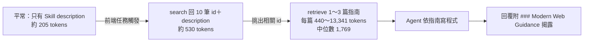

對照「把所有規則塞進 `AGENTS.md`」：1.7 MB 的指南全文不可能放進每次對話；MWG 只在需要時拉進一兩篇。

### 1.10 Modern Web Guidance 對軟體工程師的價值

- **Junior**：寫 Prompt 時不用知道 API 名稱，Agent 會自己找到對的原生做法。
- **Senior**：Code Review 時有一個可引用的依據（guide id＋原文引用），不必每次爭論「為什麼不用 jQuery」。
- **Architect**：可以用 `.mwgrc` 與 `AGENTS.md` 把「瀏覽器支援政策」變成 Agent 會遵守的設定。
- **QA**：指南的 fallback 段落直接告訴你「哪個瀏覽器會走哪條路徑」，測試案例更好設計。

### 1.11 Modern Web Guidance 的適用對象

| 角色 | 主要使用方式 |
|---|---|
| Frontend Engineer | 每天透過 Agent 自動使用；偶爾手動 `search`／`retrieve` 查證 |
| SA | 需求階段用 `search` 確認某個 UI 需求有沒有原生解法 |
| Architect | 制定 Baseline 目標、`.mwgrc` 政策、Agent 指令檔 |
| QA | 依指南的 fallback 設計跨瀏覽器測試 |
| PM | 追蹤導入 KPI（第 19.5 節） |
| DevSecOps | 遙測、供應鏈、CI 閘門 |

### 1.12 Modern Web Guidance 適用於哪些專案？

| 適合 | 不適合或效益有限 |
|---|---|
| Vue／React／Angular／Svelte 等 SPA 前端 | 純後端 API 專案 |
| 原生 HTML／CSS／JS 網站 | 只能跑在 IE mode 的舊系統（IE 不在 Baseline 範圍） |
| 要現代化的 jQuery、Bootstrap 3 舊系統 | 大量用 JSP、ASP.NET Web Forms 伺服器端樣板（`legacy-scan` 不掃 `.jsp`、`.cshtml`，見第 12 章） |
| 有明確瀏覽器支援政策的企業內部系統 | 鎖定特定 WebView 版本的嵌入式系統（需自訂政策） |
| Chrome 擴充功能（另一個 skill pack） | 原生 App |

### 1.13 導入前與導入後的差異

以下是同一個需求「做一個公告彈窗，裡面有回覆欄位」的兩份產出。`before/` 是未使用 MWG 時 Agent 常見的寫法（教學用重建範例，非真實 Agent 輸出），`after/` 是依 `dialog`、`form-fields-automatically-fit-contents`、`validate-input-after-interaction`、`js` 指南修正後的版本。

📄 `before-after/before/notice.html`

```html
<!-- 未使用 MWG 時常見的 AI 產出（教學用重建範例） -->
<button id="open">查看公告</button>
<div id="modal" class="modal" role="dialog" aria-modal="true" hidden>
  <div class="modal-box">
    <h2>系統公告</h2>
    <textarea id="reply"></textarea>
    <button id="close">關閉</button>
  </div>
</div>
<style>
  .modal { position: fixed; inset: 0; background: rgb(0 0 0 / .5); }
  .modal-box::-webkit-scrollbar { width: 6px; }
  input:invalid { border-color: red; }
</style>
<script>
  const modal = document.getElementById('modal');
  document.getElementById('open').addEventListener('click', () => {
    modal.hidden = false;
    document.body.style.overflow = 'hidden';
  });
  document.getElementById('close').addEventListener('click', () => {
    modal.hidden = true;
    document.body.style.overflow = '';
  });
  modal.addEventListener('click', (e) => {
    if (e.target === modal) modal.hidden = true;
  });
  document.addEventListener('keydown', (e) => {
    if (e.key === 'Escape') modal.hidden = true;
  });
  const reply = document.getElementById('reply');
  reply.addEventListener('input', () => {
    reply.style.height = 'auto';
    reply.style.height = reply.scrollHeight + 'px';
  });
  const draft = JSON.parse(JSON.stringify(window.noticeDraft || {}));
</script>
```

📄 `before-after/after/notice.html`

```html
<!-- 使用 MWG（dialog、form-fields-automatically-fit-contents、validate-input-after-interaction、js 指南）後 -->
<button type="button" id="open">查看公告</button>
<dialog id="notice" closedby="any" aria-labelledby="notice-title">
  <h2 id="notice-title">系統公告</h2>
  <textarea id="reply"></textarea>
  <form method="dialog"><button autofocus>關閉</button></form>
</dialog>
<style>
  dialog:modal { overscroll-behavior: contain; }
  dialog::backdrop { overflow: hidden; overscroll-behavior: contain; background: rgb(0 0 0 / .5); }
  #reply { min-block-size: 3lh; max-block-size: 12lh; scrollbar-width: thin; }
  @supports (field-sizing: content) { #reply { field-sizing: content; } }
  input:user-invalid { border-color: red; }
</style>
<script type="module">
  const dialog = document.getElementById('notice');
  document.getElementById('open').addEventListener('click', () => dialog.showModal());
  const draft = structuredClone(window.noticeDraft ?? {});
</script>
```

用 `legacy-scan` 量化（實測）：

Shell（Git Bash）

```sh
cd before-after
npx -y modern-web-guidance@1.0.1 legacy-scan before
npx -y modern-web-guidance@1.0.1 legacy-scan after
```

```text
$ legacy-scan before
Modern Web Guidance Analyzer — before
Found 3 modernization opportunities across 3 guides (scanned 38 guides with deterministic rules; ~20% of the guidance corpus):
Note: Static analysis results are provisional — verify against the Keep/Drop criteria below.

* form-fields-automatically-fit-contents (1 finding)
  Imperative JavaScript auto-resizing of textareas and inputs using scrollHeight or autosize() should be replaced with CSS field-sizing: content.
  Keep when: A keyup, input, change, or keydown event listener dynamically recalculates a textarea or text input height/wi…
  Drop when: The code is guarded by a feature query checking CSS.supports("field-sizing", "content") or field-sizing suppo…
  - notice.html:34
    reply.style.height = reply.scrollHeight + 'px';

* js (1 finding)
  Replace JSON.parse(JSON.stringify(x)) deep-copy workarounds with structuredClone(x).
  Keep when: JSON.parse(JSON.stringify(x)) is used to create an independent deep copy of plain objects, arrays, or plain d…
  Drop when: The snippet shows direct evidence that the cloned value is a Proxy wrapper or framework reactive state (such…
  - notice.html:36
    const draft = JSON.parse(JSON.stringify(window.noticeDraft || {}));

* validate-input-after-interaction (1 finding)
  CSS input:invalid and textarea:invalid error-styling rules (including :not(:focus):invalid and :not(:placeholder-shown):invalid workarounds) without :user-invalid should be modernized with :user-invalid so error feedback appears only after user interaction.
  Keep when: A CSS rule uses input:invalid or textarea:invalid (or :not(:focus):invalid / :not(:placeholder-shown):invalid…
  Drop when: The stylesheet already uses :user-invalid or guards :invalid inside @supports not selector(:user-invalid); Th…
  - notice.html:13
    input:invalid { border-color: red; }

Retrieve a guide: npx modern-web-guidance retrieve <guide-id>
exit=0
$ legacy-scan after
Modern Web Guidance Analyzer — after
0 findings from 38 qualified guides.
Note: legacy-scan covers legacy patterns for 38 guides (~20% of the guidance corpus). Use 'modern-web-guidance search <topic>' for general UI/platform guidance.
exit=0
```

> ⚠️ **請注意掃描「沒抓到」的東西。** `before` 最嚴重的問題是自刻的 `div` modal（`role="dialog"`、手寫 `Esc`、`body overflow`），以及 `<style>` 內的 `::-webkit-scrollbar`，**兩者都沒有被列出**。`legacy-scan` 只涵蓋約 20% 的指南，「0 findings」不代表沒有技術債。這也是本手冊一再強調要人工審查的原因。

| 比較項目 | before | after |
|---|---|---|
| `<script>` 內非空白行數 | 21 行 | 3 行 |
| 鍵盤／焦點 | 手寫 `Esc`，沒有 focus trap、沒有焦點歸還 | 瀏覽器內建（top layer、inert、焦點歸還） |
| 捲動鎖定 | `body.style.overflow`（指南明列 DON'T） | `overscroll-behavior: contain` |
| 表單錯誤時機 | 一載入就紅框 | 互動後才顯示 |
| 深拷貝 | JSON 往返（遺失 `Date`） | `structuredClone` |
| legacy-scan | 3 findings | 0 findings |

### 1.14 導入 Modern Web Guidance 的預期效益

官方 README 的評測快照（2026-11-08，官方數據，非本手冊實測）：

| Agent＋Model | 任務／檢查點 | 未使用 → 使用 MWG |
|---|---|---|
| antigravity_cli（gemini-4-argon） | 214／1,673 | 58% → 94%（+36pp） |
| codex_cli（gpt-6.1-sol） | 215／1,795 | 54% → 82%（+28pp） |
| claude_code（opus-5-5） | 215／1,801 | 57% → 88%（+31pp） |

官方案例（[case studies](https://developer.chrome.com/case-studies)）：Policybazaar 稱人工 Core Web Vitals 稽核工作量減少 92%；MetaMask 以三行的 PR review bot 在約 480 個 PR 帶出 43 個無障礙與語意 HTML 修正；note inc. 把指南遵循率從 61% 提升到 94%。

> ⚠️ **這些數字不能直接寫進貴公司的導入效益。** 評測任務是 Google 設計的（`daily-grind`、`devtools-times` 兩個測試應用），檢查點是 Playwright grader。貴公司的效益必須用第 19.5 節的 KPI 自己量。

### 1.15 本章 AI 產出審查

請 Agent「介紹 MWG」或「寫導入提案」時，常見錯誤與檢查方法：

| AI 常見錯誤說法 | 正確事實 | 怎麼查證 |
|---|---|---|
| 「MWG 是 Google 的 MCP Server」 | 是 Skill＋CLI，沒有 MCP server | 下方指令；官方技術文章說明不用 MCP 的理由 |
| 「MWG 需要 Gemini API Key」 | 不需要；查詢向量用本機靜態查表，指南向量在發布時預先算好 | `src/rag/static-embedder.ts`；斷網執行 `search` 仍可用 |
| 「MWG 支援中文搜尋」 | 不支援；中文查詢回 `[]`，結束碼仍是 0 | 第 6.6 節實測 |
| 「導入後品質提升 30%」 | 官方評測數據，不是貴公司的數據 | 要求附來源，並標示「官方評測，非本公司實測」 |
| 「legacy-scan 0 項代表沒有技術債」 | 只涵蓋約 20% 指南 | 本節 before 範例 |

可重跑的查證指令（Shell）：

```sh
npm view modern-web-guidance version dependencies --json
npm pack modern-web-guidance@1.0.1
tar xzf modern-web-guidance-1.0.1.tgz
grep -rl "mcpServers" package --include=*.json | wc -l
tar tzf modern-web-guidance-1.0.1.tgz | grep -i mcp
```

實測第三行輸出 `0`（沒有任何 manifest 宣告 MCP server）；第四行會列出 3 個檔案，但都是 `guides/webmcp/` 下的 **WebMCP 指南**（教你在網頁上把功能暴露給 AI Agent 的瀏覽器 API），不是 MWG 自己的 MCP server。這正是 AI 常見的誤判：看到檔名有 mcp 就下結論。

> 🎯 **本章重點**：MWG＝Skill＋指南＋本機 CLI。它讓 Agent 在寫前端之前「有機會」查到正確做法，但查不查、照不照做、對不對，都要靠流程與人來確認。

## 第 2 章：Modern Web Guidance 核心觀念

本章把 MWG 指南反覆出現的 20 個觀念講清楚。讀懂這些，才看得懂指南裡的 MANDATORY 與 fallback 段落，也才能判斷 Agent 的產出對不對。

### 2.1 Modern Web Platform 與 Native Browser API

**Modern Web Platform** 指的是瀏覽器內建、由標準組織（WHATWG、W3C、TC39、IETF）定義的能力總和。**Native Browser API** 是其中可以直接用的部分，不需要安裝套件。

MWG 指南的核心立場：**瀏覽器已經做好的事，不要用 JavaScript 再做一次。** 原因有三：

| 原因 | 說明 | 例子 |
|---|---|---|
| 效能 | 原生功能在瀏覽器引擎（C++）中執行，不佔主執行緒 | CSS `field-sizing: content` vs JS 監聽 `input` 量 `scrollHeight` |
| 無障礙 | 原生元素自帶角色、狀態、鍵盤行為 | `<dialog>` 自帶 modal 語意、焦點限制、`Esc` 關閉、焦點歸還 |
| 維護 | 沒有套件升級、沒有 CVE、沒有 bundle | `structuredClone` vs lodash `cloneDeep` |

### 2.2 Modern HTML、CSS、JavaScript、TypeScript

| 領域 | MWG 常見的「現代寫法」 | 對應的舊寫法 |
|---|---|---|
| HTML | `<dialog>`、`popover`、`<details name>`、`inert`、`autocomplete` token、`hidden="until-found"` | `div` modal、JS 手風琴、手寫 focus trap |
| CSS | Container queries、`:has()`、`:user-invalid`、Nesting、Cascade layers、`light-dark()`、Anchor positioning、View transitions、`field-sizing` | Media query 硬切、JS 切 class、`:invalid`、`!important` 戰爭 |
| JavaScript | `structuredClone`、`AbortSignal.timeout()`、`Object.groupBy`、`Promise.withResolvers`、`Intl.*`、`scheduler.yield()` | JSON 深拷貝、手寫 debounce／逾時、moment |
| TypeScript | MWG 指南是 vanilla JS；SKILL.md 要求在框架中「用型別斷言保留新屬性，不要刪掉」 | 因為型別報錯就把 `popover`、`closedby` 屬性刪掉 |

> 📌 SKILL.md 原文（官方）：「Spread/cast newly shipped HTML attributes ... rather than removing them or merging `@types/react`」。這是 Agent 在 TypeScript 專案最常犯的錯：型別檢查不過就把現代屬性拿掉，結果退回舊寫法。

### 2.3 Web Standards 與 Browser Compatibility

Web Standards 是規格；Browser Compatibility 是「哪個瀏覽器的哪個版本實作了哪個規格」。資料來源有三層：

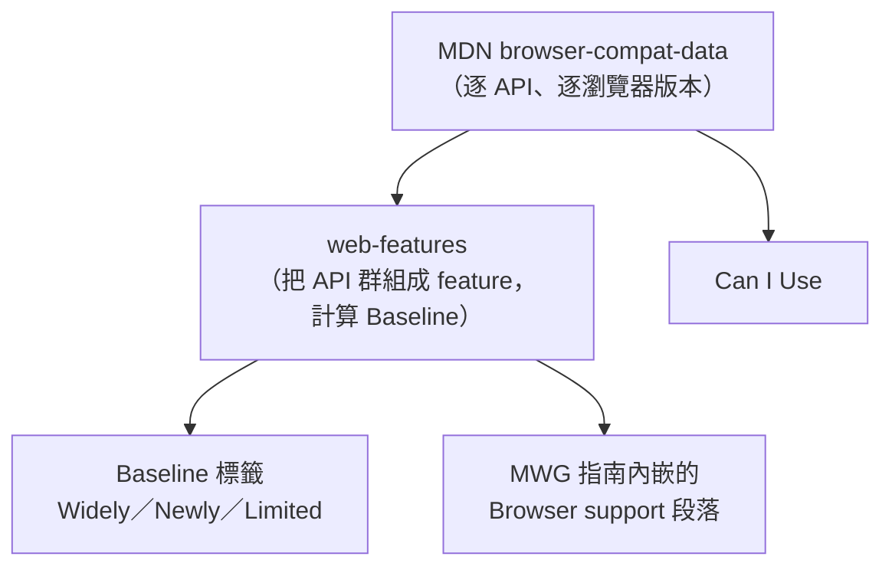

- [MDN browser-compat-data](https://github.com/mdn/browser-compat-data)：最細的資料（第三方開源，Mozilla 維護）。
- [web-features](https://github.com/web-platform-dx/web-features)：W3C WebDX 社群群組維護，定義 feature 與 Baseline 狀態。MWG 建置時就是用它產生指南裡的支援資訊（官方，[Cross-browser by default](https://developer.chrome.com/blog/cross-browser-by-default)）。
- [Can I Use](https://caniuse.com/)：人看的表格。

### 2.4 Web Platform Baseline

Baseline 是跨瀏覽器的共識標籤，核心瀏覽器集合為 Chrome、Edge、Firefox、Safari（桌機與行動版）。

| 狀態 | 定義 | MWG 預設行為 |
|---|---|---|
| **Widely available** | 所有核心瀏覽器都支援滿 **30 個月** | 直接用，不寫 fallback |
| **Newly available** | 所有核心瀏覽器都已支援，但未滿 30 個月 | 依指南寫 fallback |
| **Limited availability** | 至少一個核心瀏覽器未支援 | 依指南寫 fallback；volatile／OT 預設擋下 |

> ⚠️ **沒有設定 Baseline 目標時，MWG 預設是 Widely available**（官方 Get started：「If you install Modern Web Guidance but don't configure a Baseline target for your project, Modern Web Guidance will default to Baseline Widely available.」）。

用 web-features 3.46.0 查本手冊範例用到的功能（實測，2026-11-19）：

| Feature | Baseline | 自何時 Newly | 自何時 Widely |
|---|---|---|---|
| `<dialog>` | Widely | 2022-03-14 | 2024-09-14 |
| `:user-invalid` | Widely | 2023-11-02 | 2026-05-02 |
| `:has()` | Widely | 2023-12-19 | 2026-06-19 |
| `AbortSignal.timeout()` | Widely | 2024-04-18 | 2026-10-18 |
| Popover | Newly | 2025-01-27 | （預計 2027-07） |
| `field-sizing` | Newly | 2026-06-16 | — |
| `<dialog closedby>` | Limited | — | Safari 未支援 |
| Anchor positioning | Limited | — | Firefox 未支援 |
| Sanitizer API | Limited | — | Safari 未支援 |
| `<input switch>` | Limited | — | 只有 Safari 支援 |

> 📌 Baseline 會隨時間變動：`AbortSignal.timeout()` 在 2026-10-18 才變成 Widely。所以「上個月不能用的，這個月可能可以用」，企業政策要定期更新（第 17 章）。

### 2.5 Accessibility、Web Performance、Security

這三個是 MWG 的「學科指南（discipline guide）」，id 分別是 `accessibility`、`performance`、`security`，另有 `html`、`css`、`js`、`forms`、`color` 等。SKILL.md 要求 Agent「除了特定情境指南，也要一併取回適用的學科指南」。

| 學科 | MWG 涵蓋 | MWG 不涵蓋 |
|---|---|---|
| Accessibility | 語意 HTML、焦點、表單錯誤宣告、鍵盤操作 | WCAG 稽核、螢幕報讀器實測、法規遵循判定 |
| Performance | INP、LCP、CLS、`scheduler.yield`、fetch priority、speculation rules | 後端效能、CDN、RUM 平台建置 |
| Security | XSS、Trusted Types、CSP、Sanitizer、SRI、Passkey、Cookie | 伺服器端授權、OWASP ASVS 全面檢核 |

### 2.6 Progressive Enhancement、Graceful Degradation、Polyfill

官方文章 [Cross-browser by default](https://developer.chrome.com/blog/cross-browser-by-default) 把 MWG 的 fallback 分成四種：

| 模式 | 什麼時候用 | 例子 |
|---|---|---|
| 漸進增強，不寫 fallback | 裝飾性、加分功能，不支援時瀏覽器自動忽略 | `text-wrap: balance`、Speculation rules |
| `@supports` 包住 | 版面或樣式部分套用會壞掉 | Anchored container query 的箭頭 |
| 輕量自寫 JS | 互動屬性，小段程式可模擬 | `<dialog closedby>` 的點背景關閉 |
| 條件載入 polyfill | 大型功能，手寫不實際 | Anchor positioning、Temporal |

- **Progressive Enhancement（漸進增強）**：先做所有瀏覽器都能用的基本版，再對支援的瀏覽器加料。
- **Graceful Degradation（優雅降級）**：先做完整版，不支援時退回仍可用的狀態。`dialog` 指南說得很清楚：沒有 `closedby` 時，modal 仍可用 `Esc` 關閉，只是少了「點外面關閉」，這就是優雅降級。
- **Polyfill**：用 JS 補上瀏覽器缺少的 API。MWG 的鐵則是**只在 feature detection 失敗時才動態載入**：

```js
// 正確：只有不支援的瀏覽器才下載 polyfill（官方，declarative-dialog-popover-control 指南）
if (!Object.hasOwn(HTMLElement.prototype, "popover")) {
  import("@oddbird/popover-polyfill");
}
```

```js
// 錯誤：所有使用者都下載，包括 Chrome、Edge、Firefox、Safari 新版
import "@oddbird/popover-polyfill";
```

### 2.7 Third-Party Library Reduction

決定「用原生 API 還是第三方 Library」的流程（建議流程）：

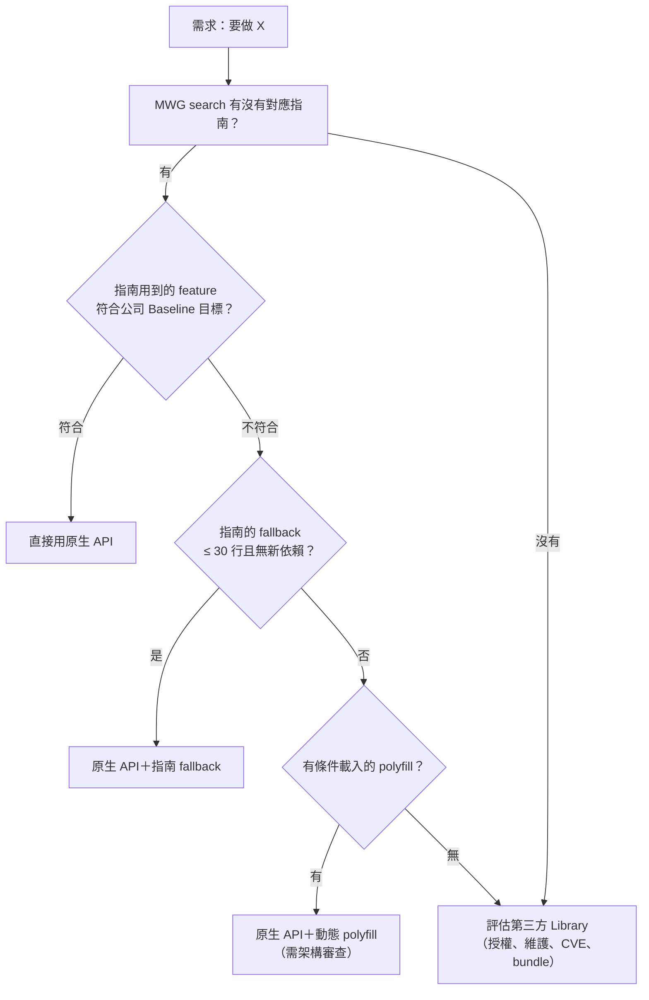

**應該用原生 API**：功能已 Widely available；或 Newly／Limited 但指南提供小型 fallback。

**應該用第三方 Library**：

- 原生沒有對應能力（例如複雜資料表格虛擬捲動、富文字編輯器、圖表）。
- 公司 Design System 已經包好元件（例如 PrimeVue 的 DataTable），而且元件內部行為符合無障礙要求。
- 需要支援 Baseline 範圍外的瀏覽器（例如 IE mode），且原生 fallback 成本太高。

**不應追求最新 API 的情況**：

- 功能是 Limited availability，而公司客戶有大量 Safari／iOS 使用者。
- 功能是 Origin Trial 或 volatile（API 還會變）。
- 正式環境無法做 feature detection 測試（例如沒有 Safari 測試機）。
- 團隊沒有人看得懂，日後無法維護。

### 2.8 Context Engineering 與 Token Optimization

| 做法 | Token 成本 | 問題 |
|---|---|---|
| 把所有規則寫進 `AGENTS.md` | 每次對話都付費 | 長度失控，模型反而忽略 |
| 讓 Agent 上網搜尋 | 不穩定，數秒 | 常找到 2015 年的 Stack Overflow 答案 |
| MCP tool 列出所有工具 | 工具描述常駐 | 官方認為觸發不可靠（dynamic tool discovery） |
| **MWG：Skill＋CLI** | 平時 ~205；用時 ~530＋單篇 440～13,341（中位數 1,769） | Agent 可能忘了查（第 18 章） |

官方技術文章說明指南會依評測「修剪模型已經會的內容」，所以每篇都很短。企業要做的是**不要再把同樣的知識重複寫進自己的規則檔**，只寫 MWG 沒有的公司規則（Baseline 目標、Design System、禁用套件）。

### 2.9 AI Agent Knowledge Retrieval 與技術決策模式

Agent 依 SKILL.md 的決策流程（官方）：

1. 任務是 HTML／CSS／前端 JS？→ 啟用 skill。後端、CI、Docker、tsconfig、測試設定 → 不啟用。
2. `search "<2～5 個英文字>"`，一次只查一個能力。
3. 看回傳的 `description` 判斷：有相符 → `retrieve`；不相符 → 換同義詞**再查一次**；仍無 → 不取回，直接做。
4. `retrieve` 特定情境指南＋學科指南（可一次多個 id，以逗號分隔）。
5. 實作時逐條比對指南（含 fallback）。
6. 回覆最後寫 `### Modern Web Guidance`，每個套用的 id 一行，附指南原文引用。

### 2.10 如何判斷 API 是否適合企業環境

建議用下列六個問題（建議流程）：

| # | 問題 | 怎麼查 |
|---|---|---|
| 1 | Baseline 狀態是什麼？ | 指南的 Browser support 段落；或 `tools/mwg/guide-baseline.mjs`（第 8.6 節） |
| 2 | 公司支援的瀏覽器清單都有嗎？ | 對照企業 Browser Policy（第 8.9 節） |
| 3 | 不支援時會發生什麼事？功能消失或整頁壞掉？ | 指南的 Fallback strategies |
| 4 | fallback 有多大？會不會引入新依賴？ | 指南程式碼＋bundle 分析 |
| 5 | 是 OT／volatile 嗎？ | `retrieve` 是否被擋；`gated-api-scan.mjs` |
| 6 | 有沒有安全或隱私影響？ | 例如 Built-in AI 的資料是否留在裝置、Permissions Policy |

### 2.11 如何避免 AI Agent 過度使用 JavaScript、如何降低技術債

1. 在 `AGENTS.md` 明寫「先查 MWG，優先 HTML／CSS 原生解法」（範本見第 9.3 節）。
2. Code Review 時問一個問題：「這段 JS 拿掉後，用 HTML／CSS 能不能達成？」
3. 新程式用 `legacy-scan` 棘輪（第 16.6 節）：既有技術債可以先留，但不准新增。
4. 禁用套件清單（jQuery、moment、lodash 全量）寫進 lint 規則或 CI 檢查。
5. 每季用 `legacy-scan` 量一次技術債數量，當作 KPI（第 19.5 節）。

### 2.12 本章 AI 產出審查

**範例：AI 回答「Popover API 已經可以放心用」：**

- ❌ 問題：Popover 在 2026-11 是 **Newly available**（2025-01-27），不是 Widely。若公司目標是 Widely，必須照指南條件載入 polyfill。
- ✅ 查證方式：看指南的「Baseline status for Popover: Newly available」；或用 web-features：

Shell（在裝有 `web-features` 的專案中）

```sh
node -e 'import("web-features").then(({features}) => console.log(features.popover.status))'
```

**範例：AI 寫 `import "@oddbird/popover-polyfill"` 在 `main.ts` 開頭：**

- ❌ 無條件載入，違反指南 MANDATORY。
- ✅ 檢查：`grep -rn "popover-polyfill" src/`，每一處都要在 `if (!Object.hasOwn(HTMLElement.prototype, "popover"))` 之內。也可以看 `vite build` 輸出是否把 polyfill 拆成獨立 chunk（第 11.6 節實測：`popover-*.js` 10.94 kB 為獨立 chunk）。

**範例：AI 為了通過 TypeScript 型別檢查刪掉 `closedby` 屬性：**

- ❌ 刪掉後退化成只能 `Esc` 關閉，需求「點外面關閉」默默消失。
- ✅ 檢查：`git diff` 中被刪除的 HTML 屬性；Vue 範本未知屬性不會報錯，React 可用 SKILL.md 建議的型別斷言保留。

> 🎯 **本章重點**：判斷依據永遠是「公司 Baseline 目標＋指南的 fallback」，不是「新不新」。

## 第 3 章：Modern Web Guidance 系統架構

本章依 npm 套件 1.0.1 與原始碼 repo `main`（`e8feb43`）分析。圖與表會明確區分三種架構：**官方實際架構**、**企業可自行整合的架構**、**本手冊建議架構**。

### 3.1 官方實際架構（執行期）

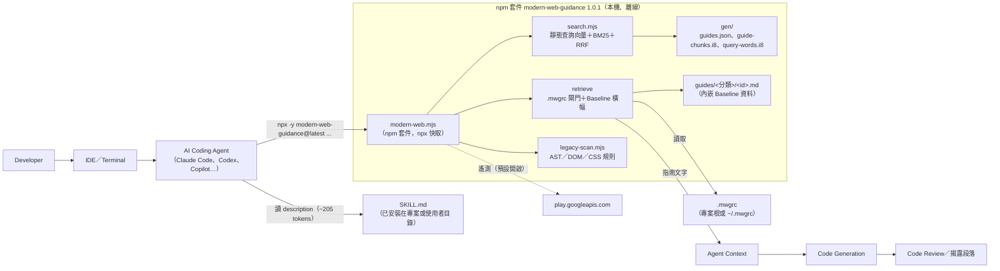

> ⚠️ **安裝到專案的 `guides/` 與 CLI 讀的 `guides/` 不是同一份。** 實測：`install` 會把 GitHub 上的 `SKILL.md` 與 `guides/` 複製到 `.claude/skills/modern-web-guidance/`，但**沒有** `modern-web.mjs`。CLI 永遠是 `npx` 下載的 npm 套件，`retrieve` 讀的是套件內的 `guides/`（`src/rag/data-dir.ts` 的 `resolveSkillsCliDataDir()` 取「與 `modern-web.mjs` 同目錄」）。專案內那份指南只是靜態檔案，連 OT／volatile 指南（例如 `guides/built-in-ai/translator.md`）都在裡面；閘門靠的是 Agent 遵守「不要直接讀 raw `.md`」的指示。

### 3.2 官方實際架構（建置期）

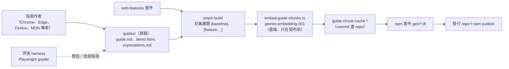

重點：**雲端 Gemini embedding 只在「發布前」用一次**，算好的向量量化成 Int8 打包進 npm。使用者端的查詢向量是「查表加總」，不呼叫任何 API（官方，`src/rag/README.md`）。

### 3.3 元件清單

| 元件 | 檔案 | 大小（1.0.1 實測） | 說明 |
|---|---|---|---|
| CLI 入口 | `skills/modern-web-guidance/modern-web.mjs` | 43 KB | 指令解析、遙測、`.mwgrc` 閘門 |
| 搜尋 | `search.mjs` | 6.9 KB | 只在 `search` 時動態載入 |
| 舊程式掃描 | `legacy-scan.mjs` | 5.1 MB | 含 TypeScript scanner、linkedom、CSS parser |
| 指南索引 | `gen/guides.json` | 81 KB | 209 筆：`id`、`description`、`category`、`featuresUsed`、`tokenCount`（＋閘門資訊） |
| 指南向量 | `gen/guide-chunks.i8`＋`.scale.f32`＋`.json.gz` | 約 1.2 MB | 2,053 個 chunk，每個一個 256 維 Int8 向量 |
| 查詢詞向量 | `gen/query-words.i8`＋`.json`＋`.scale.f32` | 約 7.9 MB | 29,165 個詞的靜態向量表 |
| 遙測子程序 | `watchdog/main.js` | — | 背景送出遙測，不阻塞 CLI |
| Skill 版本 | `skill-version.txt` | — | `2026_11_10-47b4c80e`；與 SKILL.md 的 `--skill-version` 比對 |

整包 tarball 8,878,299 bytes（約 8.5 MB），**沒有任何 npm runtime 依賴**（`npm view modern-web-guidance dependencies` 為空）。

### 3.4 CLI 指令（執行入口）

`--help` 實測輸出：

```text
$ --version
1.0.1
exit=0
$ --help

Usage: modern-web-guidance <command> [args]

Commands:
  search <query>            Search use cases by English query
  list                      List all available use cases
  retrieve <ids>            Retrieve use case(s) by ID(s), comma-separated
  legacy-scan [path] [options]  Analyze codebase for legacy web platform patterns
  set-allow-origin-trials   Opt in to experimental Origin Trial guidance
  set-allow-volatile-features Opt in to volatile feature guidance
  install [options]         Install the modern-web-guidance skill
  uninstall                 Uninstall the modern-web-guidance skill
  update                    Update skills

Options:
  --skill-version <version> Internal use: version of the skill being executed
  --choose                  Choose specific skills from the repository interactively
  -h, --help                Show this help
  -v, --version             Show version

exit=0
```

| 指令 | 作用 | 遙測事件 |
|---|---|---|
| `search <query>` | 混合搜尋，回 10 筆 `{id, description}` | 查詢字串、命中 id、相似度 |
| `list` | 列出全部 209 筆 | 指令類型 |
| `retrieve <ids>` | 取回指南；超過 9.5 KB 寫到暫存檔 | guide id |
| `legacy-scan [path]` | 掃描舊寫法（`--json`、`--guide`、`--include-docs-and-tests`） | 指令類型 |
| `set-allow-origin-trials`／`set-allow-volatile-features` | 寫入 `.mwgrc`（**必須人類在互動式終端機執行**） | — |
| `install [--choose]`／`update`／`uninstall` | 透過 Vercel `skills` CLI 安裝／更新／移除 | 指令類型 |
| `set-baseline <target>` | **未列在 `--help` 與 README**，寫入 `.mwgrc` 的 `baseline` | — |

> 📌 `set-baseline` 存在於 1.0.1 的程式碼中（`modern-web.ts`），可接受 `widely`、`newly`、`limited` 或四位數年份。它沒有「必須由人類執行」的檢查，Agent 可以自己跑（實測，第 5.4 節）。企業應以權限設定禁止（第 9.4 節）。

### 3.5 Knowledge Base 與指南結構

209 篇指南依 `category` 分布（`gen/guides.json` 實測）：

| 分類 | 篇數 | 分類 | 篇數 |
|---|---|---|---|
| ui-behaviors | 40 | ui-atoms | 13 |
| performance | 26 | html | 8 |
| ui-components | 22 | js | 6 |
| visual-design | 22 | accessibility | 4 |
| forms | 19 | built-in-ai | 4 |
| css | 18 | user-experience | 3 |
| security | 17 | webmcp | 3 |
| pwa | 2 | privacy、wasm | 各 1 |

一篇指南的典型段落（以 `light-dismiss-a-dialog` 為例，實測取回）：

1. 標題與一句話目的
2. `## Implementation`：步驟
3. `## Example`：可直接用的 HTML／CSS／JS
4. `## Constraints & Accessibility`：MANDATORY、DO、DO NOT
5. `## Fallback strategies`：Baseline 狀態、支援版本、fallback 程式碼

### 3.6 Search Engine：BM25＋Embedding＋RRF

依 `src/rag/search.ts`、`bm25.ts`、`static-embedder.ts`（官方原始碼）：

| 階段 | 做法 |
|---|---|
| 查詢向量 | 把查詢拆詞，查 `query-words.i8` 的 256 維向量加權相加（約 30 µs） |
| Dense 相似度 | 與每個指南 chunk 向量做內積，每篇取最高分 |
| BM25 | Okapi BM25，Lucene EnglishMinimalStemmer；chunk 前面加上標題、分類、web-feature id，提高 API 名稱命中率 |
| 融合 | Reciprocal Rank Fusion（k = 60） |
| 空結果門檻 | Dense 最高分 < 0.30 **且** BM25 沒有任何命中 → 回 `[]` |
| 輸出 | 前 10 筆，只有 `id` 與 `description`（約 530 tokens） |

為什麼不用 MCP 或網路搜尋？官方技術文章原文：「MCP tools either waste tokens or have unreliable trigger mechanisms (due to dynamic tool discovery)」；網路搜尋則「surfaces 2015 Stack Overflow answers」且「fails in offline sandboxes」。

### 3.7 Local Runtime 與 Context Retrieval

- Node.js **≥ 22**（`src/cli/node-version.ts`，版本不足直接結束並提示）。
- 官方技術文章舉例一篇約 800 tokens；實際 `gen/guides.json` 的 `tokenCount` 為 440～13,341、中位數 1,769（`accessibility` 學科指南最大）。官方 `src/rag/README.md` 稱 76.6% 的指南小於 9.5 KB 會直接輸出。
- 超過 9.5 KB（`MAX_INLINE_STDOUT_BYTES = 9500`）且 stdout 不是檔案時，寫到 OS 暫存目錄 `mwg-guide-<pid>-<timestamp>.md`，只印兩行提示。原因是 Claude Code、Codex 會截斷超過約 10 KB 的工具輸出（官方，`src/rag/README.md`）。

實測一次取回 3 篇學科指南：

```text
## retrieve multiple (stdout tty?)
Output (84.3 KB, 1248 lines) saved to C:\Users\<user>\AppData\Local\Temp\mwg-guide-23744-1795082618760.md to prevent CLI stdout truncation.
Read C:\Users\<user>\AppData\Local\Temp\mwg-guide-23744-1795082618760.md in full using your file-reading tool (1248 lines total)—do not use cat or head.
```

### 3.8 Configuration 與 Compatibility Data

| 設定 | 位置 | 作用 |
|---|---|---|
| `.mwgrc` | 從目前目錄往上找，遇到 `.mwgrc` 或 `.git` 就停；都沒有時用 `~/.mwgrc` | `allowOriginTrials`、`allowVolatileFeatures`、`baseline` |
| `DISABLE_TELEMETRY` | 環境變數 | `1` 或 `true` 關閉遙測 |
| `--skill-version` | Skill 呼叫 CLI 時自動帶入 | 判斷 SKILL.md 是否過舊，過舊時在 stderr 提示更新 |
| `AGENTS.md`／`CLAUDE.md` 中的 Browser support policy | 專案 | 官方建議的 Baseline 目標寫法（由 Agent 讀，不是 CLI 讀） |

Compatibility Data 來自 web-features，在**建置時**展開進指南文字。這代表：指南裡的 Baseline 狀態是「發布當時」的資料，不是即時查詢。

### 3.9 Knowledge Update Mechanism

| 更新什麼 | 怎麼更新 | 頻率 |
|---|---|---|
| CLI＋指南＋向量 | npm 新版；Skill 用 `@latest` 每次執行都會檢查 | 2026-10 起約每週 |
| SKILL.md | `npx modern-web-guidance@latest update`、plugin marketplace 自動更新 | 隨版本 |
| Baseline 資料 | 跟著 npm 版本（建置時嵌入） | 隨版本 |

> ⚠️ 透過 Anthropic 官方 `claude-plugins-official` marketplace 安裝的 Claude Code 使用者，版本停在 `v0.0.194`（README Updating 一節）。CLI 偵測到這種情況會在 stderr 印出「PROBLEM DETECTED ... very out-of-date」並教你換 marketplace（`modern-web.ts` 的 `isFrozenClaudeMarketplaceVersion`）。

### 3.10 Agent Integration（官方提供的整合點）

發行 repo 內的 manifest（官方，實測檢視 1.0.1 套件）：

| 檔案 | 對應工具 |
|---|---|
| `.claude-plugin/marketplace.json`、`plugin.json` | Claude Code plugin marketplace（名稱 `googlechrome`） |
| `.codex-plugin/plugin.json` | OpenAI Codex plugin |
| `.cursor-plugin/plugin.json` | Cursor plugin |
| `.github/plugin/plugin.json` | GitHub Copilot CLI plugin |
| `.agents/plugins/marketplace.json` | Antigravity（`agy`）等使用 `.agents` 慣例的工具 |
| `.grok-plugin/marketplace.json` | Grok Build CLI |
| `gemini-extension.json`＋`policies/modern-web-guidance.toml` | Gemini CLI extension；policy 規定在 plan 模式執行 `modern-web` 指令前要詢問使用者 |
| `kimi.plugin.json` | Kimi Code |
| `package.json` 的 `contributes.chatSkills` | VS Code 類 Chat Skill 貢獻點（`engines.vscode ^1.90.0`） |

### 3.11 官方未提供、但企業可自行整合的架構

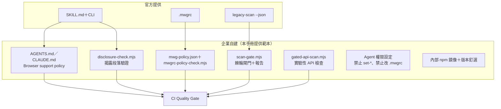

### 3.12 本手冊建議的企業架構

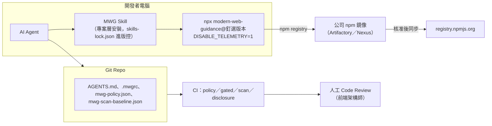

> ⚠️ 這是**建議架構**，不是官方架構。官方 SKILL.md 使用 `@latest`；改成釘選版本是企業的取捨（可預測性 vs 新內容），第 17 章說明怎麼做。

### 3.13 本章 AI 產出審查

**範例：AI 畫的架構圖把 MWG 畫成「呼叫 Gemini API 做語意搜尋」：**

- ❌ 錯。Gemini embedding 只在發布前於 Google 端建置向量；使用者端完全離線。
- ✅ 查證：`grep -c "generativelanguage" modern-web.mjs search.mjs` 應為 0；或看 `src/rag/static-embedder.ts`。

**範例：AI 說「把 OT 指南從 `.claude/skills/.../guides` 刪掉就能確保不被使用」：**

- ⚠️ 只對了一半。刪掉專案內那份檔案，可以防止 Agent 直接讀 raw `.md`；但 CLI 讀的是 npx 快取內的 npm 套件，真正的防線是 `.mwgrc` 閘門＋Agent 權限＋CI 的 `gated-api-scan`。
- ✅ 查證：在沒有 `.mwgrc` 的專案執行 `retrieve translator`，應看到 CAUTION 訊息與結束碼 1（第 5.5 節）。

可重跑指令（Shell，於解開的 npm 套件目錄）：

```sh
cd package/skills/modern-web-guidance
grep -c "generativelanguage" modern-web.mjs search.mjs
node -e 'console.log(require("./gen/guides.json").length)'
```

> 🎯 **本章重點**：MWG 執行期＝本機 CLI＋預先算好的向量；閘門由 CLI 執行，但專案內的指南副本不受閘門保護。

## 第 4 章：Modern Web Guidance 安裝與環境建置

本章所有指令都取自官方 README、[Get started](https://developer.chrome.com/docs/modern-web-guidance/get-started) 或 CLI `--help`。標示「實測」的有在本機跑過。

### 4.1 環境需求

| 項目 | 需求 | 來源 |
|---|---|---|
| Node.js | **≥ 22**（低於 22 會印出 `modern-web-guidance requires Node.js >= 22` 並結束） | 官方，`src/cli/node-version.ts`、`package.json` `engines` |
| npm／npx | 隨 Node 附帶；有 pnpm 時 SKILL.md 建議用 `pnpx` | 官方，SKILL.md |
| Git | `install` 會透過 Vercel `skills` CLI **clone GitHub repo**，需要 Git 與 github.com 連線 | 實測 |
| 網路（首次） | `registry.npmjs.org`（下載套件）、`github.com`（install／update） | 實測 |
| 網路（執行期） | 不需要；已快取後可離線 | 實測（4.12 節） |
| 遙測端點 | `play.googleapis.com`（可關閉） | 官方，`clearcut-sender.ts` |
| 磁碟 | npm 套件約 17 MB（解壓後） | 實測 |
| AI Agent | 任一支援 Agent Skills 的工具 | 官方 |

### 4.2 OS 支援

CLI 是純 JavaScript，沒有原生模組，只要 Node 22+ 能跑的 OS 都可以。遙測會記錄 OS 類型（Windows／macOS／Linux）。

| OS | 注意事項 |
|---|---|
| Windows | SKILL.md 指示 Agent 在 Windows 用 `npx.cmd`；PowerShell 執行原則為 `Restricted` 時 `npx.ps1` 無法執行，改用 `npx.cmd` |
| macOS／Linux | 無特別注意事項 |
| WSL | 在 WSL 內另外安裝 Node 22+；Windows 與 WSL 的 npm 快取、`~/.mwgrc` 各自獨立 |
| 沙箱環境（Codex、Claude Code sandbox） | SKILL.md 要求 Agent **先申請網路權限**；`~/.npm` 唯讀時設 `NPM_CONFIG_CACHE=/tmp/npm-cache` |

### 4.3 安裝方式總覽

| 方式 | 指令 | 自動更新 | 類型 |
|---|---|---|---|
| **MWG CLI 精靈（官方推薦）** | `npx modern-web-guidance@latest install` | ✅（`update`） | 官方 |
| 選擇 skill pack | `npx modern-web-guidance@latest install --choose` | ✅ | 官方 |
| Vercel skills CLI | `npx skills add GoogleChrome/modern-web-guidance` | 視 skills CLI | 官方列出 |
| GitHub CLI | `gh skill install GoogleChrome/modern-web-guidance` | — | 官方列出 |
| Claude Code | `claude plugin marketplace add GoogleChrome/modern-web-guidance`＋`claude plugin install modern-web-guidance@googlechrome` | 需在 `/plugin` 開啟 AutoUpdate | 官方列出 |
| Copilot CLI | `/plugin marketplace add GoogleChrome/modern-web-guidance`＋`/plugin install modern-web-guidance@googlechrome` | — | 官方列出 |
| Codex | `codex plugin marketplace add GoogleChrome/modern-web-guidance`＋`codex plugin add modern-web-guidance@googlechrome` | — | 官方列出 |
| Gemini CLI | `gemini extensions install https://github.com/GoogleChrome/modern-web-guidance --auto-update` | ✅ | 官方列出 |
| Antigravity CLI | `agy plugin install https://github.com/GoogleChrome/modern-web-guidance` | — | 官方列出 |
| Antigravity（桌面） | 安裝流程中勾選，或 Settings → Customizations → Build with Google Plugins | — | 官方列出 |
| JetBrains WebStorm | Settings → AI Assistant → Skills → Skill Manager | — | 官方列出 |
| Goose | `goose plugin install https://github.com/GoogleChrome/modern-web-guidance --auto-update` | ✅ | 官方列出 |
| Grok Build CLI | `grok plugin install https://github.com/GoogleChrome/modern-web-guidance --trust` | — | 官方列出 |
| Kimi Code | `/plugins install https://github.com/GoogleChrome/modern-web-guidance` | — | 官方列出 |

> 📌 官方 Get started 原文：「most of these options don't support automatic updates」。企業若要統一版本，反而**應該**選不會自動更新的方式，再由平台團隊集中升級（第 17 章）。

### 4.4 先試用、不安裝

官方提供「探索模式」，不安裝 Skill 也能先看指南（實測可用）：

Shell（Git Bash／macOS／Linux）

```sh
export DISABLE_TELEMETRY=1
npx -y modern-web-guidance@1.0.1 search "animate a dialog modal backdrop"
npx -y modern-web-guidance@1.0.1 retrieve "animate-to-from-top-layer"
npx -y modern-web-guidance@1.0.1 legacy-scan .
```

PowerShell（Windows）

```powershell
$env:DISABLE_TELEMETRY = "1"
npx.cmd -y modern-web-guidance@1.0.1 search "animate a dialog modal backdrop"
npx.cmd -y modern-web-guidance@1.0.1 retrieve "animate-to-from-top-layer"
npx.cmd -y modern-web-guidance@1.0.1 legacy-scan .
```

實測 PowerShell 7.6.10 中 `npx.cmd -y modern-web-guidance@1.0.1 --version` 回傳 `1.0.1`。

### 4.5 Windows 安裝（PowerShell）

**Step 1：確認 Node 版本：**

```powershell
node --version   # 必須 v22 以上
git --version
```

**Step 2：關閉遙測（永久，使用者層）：**

```powershell
[Environment]::SetEnvironmentVariable("DISABLE_TELEMETRY", "1", "User")
$env:DISABLE_TELEMETRY = "1"   # 目前視窗立即生效
```

**Step 3：在專案根目錄安裝：**

```powershell
Set-Location D:\repos\loan-portal-frontend
npx.cmd modern-web-guidance@latest install
```

精靈會詢問要安裝給哪些 Agent、專案層或全域。要非互動安裝（例如腳本中）：

```powershell
npx.cmd modern-web-guidance@latest install --agent claude-code -y
```

`install` 會把 `--choose` 以外的參數原樣傳給 `npx skills add`（官方，`modern-web.ts`），所以 `--agent`、`-y` 是 Vercel skills CLI 的參數。

### 4.6 macOS／Linux 安裝

Shell（bash／zsh）

```sh
node --version          # v22+
echo 'export DISABLE_TELEMETRY=1' >> ~/.zshrc   # bash 用 ~/.bashrc
export DISABLE_TELEMETRY=1
cd ~/repos/loan-portal-frontend
npx modern-web-guidance@latest install
```

### 4.7 WSL 安裝

WSL 視為一台 Linux。要注意：

1. 在 WSL 內用 nvm 或發行版套件裝 Node 22+，不要讓 WSL 呼叫 Windows 的 `node.exe`（`which node` 應為 `/usr/...` 或 `~/.nvm/...`）。
2. 專案放在 WSL 檔案系統（`~/repos`），不要放 `/mnt/c`，否則 `legacy-scan` 掃大專案會很慢。
3. `DISABLE_TELEMETRY` 要在 WSL 的 shell profile 另外設定。

### 4.8 安裝流程實測（隔離目錄）

為了不影響本機設定，實測時把 `HOME`／`USERPROFILE` 指到暫存目錄，在一個空的 Git 專案中安裝（實測）：

Shell（Git Bash）

```sh
mkdir -p /tmp/mwg-try/proj/.git && cd /tmp/mwg-try/proj
DISABLE_TELEMETRY=1 npx -y modern-web-guidance@1.0.1 install --agent claude-code -y
```

```text
$ modern-web-guidance install --agent claude-code -y

│
●   claude  Agent detected — installing non-interactively
│
◇  Source: https://github.com/GoogleChrome/modern-web-guidance.git
│
◇  Repository cloned
│
◇  Found 2 skills
│
●  Selected 1 skill: modern-web-guidance

│
◇  Installation Summary ─────────────────╮
│                                        │
│  .\.agents\skills\modern-web-guidance  │
│    copy → Claude Code                  │
│                                        │
├────────────────────────────────────────╯
│
◇  Installation complete

│
◇  Installed 1 skill ────────────────────────╮
│                                            │
│  ✓ modern-web-guidance (copied)            │
│    → .\.claude\skills\modern-web-guidance  │
│                                            │
├────────────────────────────────────────────╯

│
└  Done!  Review skills before use; they run with full agent permissions.

exit=0
```

安裝結果（實測）：

| 產物 | 內容 |
|---|---|
| `.claude/skills/modern-web-guidance/SKILL.md` | 與 npm 1.0.1 套件內的 SKILL.md 完全相同（`diff` 無差異） |
| `.claude/skills/modern-web-guidance/guides/` | 指南 Markdown（17 個分類） |
| `skills-lock.json` | 記錄來源 repo、**commit `64a6d70`**、`computedHash` |
| `HOME` 目錄 | 未寫入任何檔案（專案層安裝） |

📄 `skills-lock.json`（實測產生）

```json
{
  "version": 2,
  "skills": {
    "modern-web-guidance": {
      "source": "GoogleChrome/modern-web-guidance",
      "commit": "64a6d708f5a43f2cd3fde5d4d7db3905ba1bdf65",
      "sourceType": "github",
      "skillPath": "skills/modern-web-guidance/SKILL.md",
      "computedHash": "d9f3ceba8b5c77b12ae6f852932a349843ce086d03ce76ab5e2257e7e5acd16d"
    }
  }
}
```

> ✅ **建議把 `skills-lock.json` 與 `.claude/skills/` 一起 commit。** 這樣團隊每個人拿到的 SKILL.md 都相同，Code Review 也看得到 Skill 何時被更新。Vercel skills CLI 的 `experimental_install` 可依 lockfile 還原，CI 中預設 `--frozen-lockfile`（skills CLI `--help`，實測）。

### 4.9 遙測與隱私（金融業必讀）

| 項目 | 內容（官方 README＋`src/cli/telemetry/`） |
|---|---|
| 預設 | **開啟**（原始碼註解：`return true; // Enabled by default!`） |
| 送出內容 | 安裝次數、Agent 名稱、guide id、**Agent 產生的搜尋字串**、OS、版本、延遲區間、成功與否 |
| 不送出 | 使用者原始 prompt、程式碼 |
| 端點 | `https://play.googleapis.com/log?format=json_proto` |
| 關閉 | `DISABLE_TELEMETRY=1` 或 `true`（不分大小寫） |
| 何時提示 | 只在 `install` 時印一次說明 |

> ⚠️ **搜尋字串可能洩漏業務資訊。** SKILL.md 雖要求 Agent 用通用詞（不要帶產品名、元件名），但 Agent 不一定遵守，例如 `search "loan approval dialog for ACME VIP customers"`。金融業建議：
>
> 1. 全公司開發機以 GPO／MDM 設定使用者環境變數 `DISABLE_TELEMETRY=1`。
> 2. 專案 `.claude/settings.json` 的 `env` 也設定一次（第 9.4 節範本）。
> 3. 防火牆對 `play.googleapis.com` 的 `/log` 路徑做出口管控（若公司有 SSL 檢查能力）。
> 4. CI 的 workflow 層級設定 `DISABLE_TELEMETRY: "1"`（第 16.7 節範本）。

### 4.10 安裝驗證

Shell（專案根目錄）

```sh
# 1. CLI 可執行、版本正確
npx -y modern-web-guidance@1.0.1 --version
# 2. 搜尋可用（應回傳 10 筆 JSON）
npx -y modern-web-guidance@1.0.1 search "light dismiss dialog"
# 3. 取回可用
npx -y modern-web-guidance@1.0.1 retrieve light-dismiss-a-dialog | head -5
# 4. Skill 已安裝在 Agent 會讀的位置
ls .claude/skills/modern-web-guidance/SKILL.md .agents/skills/modern-web-guidance/SKILL.md 2>/dev/null
# 5. 閘門正常（沒有 .mwgrc 時應失敗，結束碼 1）
npx -y modern-web-guidance@1.0.1 retrieve translator; echo "exit=$?"
```

第 5 步一定要做：它同時驗證了「`.mwgrc` 沒被誤設」與「閘門有作用」。

第一次執行的實測輸出（含下載時間）：

<!-- markdownlint-disable MD010 -->
```text
$ npx -y modern-web-guidance@1.0.1 --version
1.0.1

real	0m8.037s
user	0m0.369s
sys	0m1.244s
$ npx --offline (cached)
```
<!-- markdownlint-enable MD010 -->

### 4.11 常見安裝錯誤

| 症狀 | 原因 | 解法 |
|---|---|---|
| `modern-web-guidance requires Node.js >= 22` | Node 版本太舊 | 升級 Node；用 nvm／Volta 讓專案固定版本 |
| PowerShell：`npx.ps1 cannot be loaded because running scripts is disabled` | 執行原則為 Restricted | 改用 `npx.cmd`，或 `Set-ExecutionPolicy -Scope CurrentUser RemoteSigned`（依公司政策） |
| `install` 卡在 Cloning repository | 無法連 github.com 或公司 Proxy 擋 Git | 設定 `git config --global http.proxy`；或改用 4.13 節離線方式 |
| `npm error code ENOTCACHED` | 用 `--offline` 但該版本沒在快取 | 先在有網路時執行一次，或從內部鏡像安裝 |
| `npm error code SELF_SIGNED_CERT_IN_CHAIN` | 公司 SSL 檢查換了憑證 | 設定 `NODE_EXTRA_CA_CERTS` 指向公司根憑證（4.12 節） |
| 安裝完 Agent 沒反應 | Agent 沒有讀到 skill 目錄、或需要重新載入 | Claude Code 用 `/reload-plugins` 或重開；確認目錄位置（第 9 章） |
| Claude Code 一直提示「very out-of-date」 | 從 `claude-plugins-official` 安裝，停在 v0.0.194 | 依 README 改用 `googlechrome` marketplace（第 17.6 節） |

### 4.12 Proxy／Firewall／SSL

Shell（公司 Proxy 範例；請換成實際位址）

```sh
npm config set proxy http://proxy.corp.example:8080
npm config set https-proxy http://proxy.corp.example:8080
git config --global http.proxy http://proxy.corp.example:8080
# 公司 SSL 檢查：讓 Node 信任公司根憑證（不要用 strict-ssl=false）
export NODE_EXTRA_CA_CERTS=/etc/pki/ca-trust/source/anchors/corp-root.pem
```

PowerShell

```powershell
npm config set proxy http://proxy.corp.example:8080
npm config set https-proxy http://proxy.corp.example:8080
git config --global http.proxy http://proxy.corp.example:8080
[Environment]::SetEnvironmentVariable("NODE_EXTRA_CA_CERTS", "C:\corp\certs\corp-root.pem", "User")
```

防火牆白名單：

| 目的地 | 用途 | 必要性 |
|---|---|---|
| `registry.npmjs.org`（或內部鏡像） | 下載 CLI | 必要（首次與更新） |
| `github.com`、`codeload.github.com` | `install`／`update`、plugin marketplace | 安裝 Skill 時必要 |
| `play.googleapis.com` | 遙測 | **不需要**，建議封鎖或關閉遙測 |

### 4.13 Offline Environment

實測：以無法連線的 Proxy 模擬斷網，已快取的版本仍可執行（`@latest` 也會退回快取）：

```text
$ (proxy unreachable) npx  -y modern-web-guidance@1.0.1 --version
1.0.1
exit=0 secs=9
$ (proxy unreachable) npx --prefer-offline -y modern-web-guidance@1.0.1 --version
1.0.1
exit=0 secs=7
$ (proxy unreachable) npx --offline -y modern-web-guidance@1.0.1 --version
1.0.1
exit=0 secs=7
$ (proxy unreachable) npx  -y modern-web-guidance@latest --version
1.0.1
exit=0 secs=8
$ (proxy unreachable) npx --prefer-offline -y modern-web-guidance@latest --version
1.0.1
exit=0 secs=7
$ (proxy unreachable) npx --offline -y modern-web-guidance@latest --version
1.0.1
exit=0 secs=6
```

離線（Air-gapped）環境的建議做法：

1. 在可上網的機器：`npm pack modern-web-guidance@1.0.1`，取得 `modern-web-guidance-1.0.1.tgz`，計算 SHA-256 並送資安掃描。
2. 上傳到公司內部 npm 鏡像（Artifactory／Nexus），或放在共用檔案伺服器。
3. 開發機：`npm config set registry https://npm.corp.example/` 後照常使用 `npx`；或 `npm install -g ./modern-web-guidance-1.0.1.tgz` 後直接呼叫 `modern-web-guidance`。
4. Skill 本體：在可上網的機器 `install` 後，把 `.claude/skills/modern-web-guidance/`（或 `.agents/skills/...`）與 `skills-lock.json` commit 進專案 repo，離線端 `git pull` 即可。
5. 修改 SKILL.md 中的 `npx -y modern-web-guidance@latest` 為內部可用的指令前，先讀第 5.9 節的取捨。

> ⚠️ 官方 SKILL.md 說明：「If the command hangs due to being offline, retry with `npx --offline …`」。本次以「Proxy 拒絕連線」模擬時很快就退回快取；若防火牆是「丟棄封包」，`npx` 可能要等逾時才退回，Agent 會看起來像卡住。

### 4.14 公司內部網路環境的效能考量

實測 Windows 上 `npx` 的額外成本（同一台機器、已快取）：

```text
$ time node <pkg>/modern-web.mjs search "sticky table header"
ms=1177
$ time npx -y modern-web-guidance@1.0.1 search "sticky table header"
ms=6654
$ time node <pkg>/modern-web.mjs retrieve dialog
ms=947
```

每次 `npx` 約多 5 秒，一個任務若 `search` 3 次＋`retrieve` 2 次，就是 25 秒以上的等待。若團隊抱怨慢，可以在內部 Agent 指令中改用全域安裝的 `modern-web-guidance` 指令（第 5.9 節說明取捨）。

### 4.15 本章 AI 產出審查

**範例：AI 產生的安裝文件寫 `npm install -g modern-web-guidance && mwg init`：**

- ❌ 沒有 `mwg` 指令，也沒有 `init`。CLI 名稱是 `modern-web-guidance`，指令只有第 3.4 節那幾個。
- ✅ 查證：`npx -y modern-web-guidance@1.0.1 --help`；看到 `Unknown command` 就代表 AI 編造。

**範例：AI 建議「遇到 SSL 錯誤就 `npm config set strict-ssl false`」：**

- ❌ 關閉憑證驗證會讓所有 npm 下載都可能被中間人竄改，金融業不可接受。
- ✅ 正確做法是 `NODE_EXTRA_CA_CERTS`。檢查：`npm config get strict-ssl` 必須是 `true`。

**範例：AI 寫的 Windows 腳本用 `export DISABLE_TELEMETRY=1`：**

- ❌ 那是 bash 語法，PowerShell 中無效，遙測仍開啟。
- ✅ PowerShell 要用 `$env:DISABLE_TELEMETRY = "1"`。驗證：`[Environment]::GetEnvironmentVariable("DISABLE_TELEMETRY","User")` 應回傳 `1`。

> 🎯 **本章重點**：先關遙測、再安裝；Skill 與 `skills-lock.json` 進版控；第 4.10 節第 5 步（閘門測試）不可省略。

## 第 5 章：Modern Web Guidance 設定與治理

本章先講**官方設定**（只有三個鍵），再講**企業建議設定**（政策檔、核准紀錄、權限與 CI）。兩者分開說明，不可混為一談。

### 5.1 設定檔架構

| 層級 | 檔案／機制 | 誰讀 | 類型 |
|---|---|---|---|
| CLI 設定 | `.mwgrc`（JSON） | MWG CLI（`retrieve`） | 官方 |
| 環境變數 | `DISABLE_TELEMETRY` | MWG CLI | 官方 |
| Agent 指令 | `AGENTS.md`、`CLAUDE.md` 的 Browser support policy | AI Agent | 官方建議寫法 |
| Skill 版本 | `skills-lock.json` | Vercel skills CLI | 第三方 |
| 企業政策 | `mwg-policy.json`、`.mwgrc.approval.json`、`mwg-gated-allowlist.json` | 企業自建工具 | 企業自建 |
| Agent 權限 | `.claude/settings.json` 等 | AI Agent 平台 | 各平台官方機制 |

> 📌 README 提到的 `.mwgrc` 只有兩個鍵（`allowOriginTrials`、`allowVolatileFeatures`）；原始碼 `src/core/mwgrc.ts` 另有第三個鍵 `baseline`，由未公開的 `set-baseline` 指令寫入。**沒有** feature allowlist／blocklist、沒有 per-guide 開關。

### 5.2 預設設定

沒有 `.mwgrc` 時（官方，`retrieve.ts`）：

| 項目 | 預設 |
|---|---|
| Origin Trial 指南 | `retrieve` 擋下（`search` 仍找得到） |
| Volatile 指南 | `retrieve` 擋下 |
| Baseline 目標 | Widely available（不加橫幅；指南的 fallback 一律要實作） |
| 遙測 | 開啟 |

1.0.1 被閘門擋下的指南（`gen/guides.json` 實測）：

| 閘門 | 指南 id | 涉及 feature |
|---|---|---|
| Origin Trial | `verify-email-ownership` | `tmp-email-verification` |
| Origin Trial | `agentic-forms`、`agentic-javascript-tools`、`webmcp` | `declarative-webmcp`、`document-modelcontext` |
| Volatile | `language-detection`、`language-model`、`summarizer`、`translator` | Built-in AI API |
| Volatile | `out-of-order-html-streaming` | `html-setters`、`html-streaming-setters` |
| Volatile | `client-side-encryption`、`digital-signatures` | `tmp-webcrypto-modern-algos` |
| Volatile | `restrict-outbound-connections` | `connection-allowlists` |
| Volatile | `2d-panning` | `scroll-axis-lock` |
| Volatile | `custom-text-decorations` | `text-decoration-skip-spaces` |
| Volatile | `apply-webgl-shaders`、`export-html-media-from-canvas`、`expose-canvas-content-to-browser-features`、`interactive-content-in-3d-scenes` | `canvas-html`（HTML-in-canvas） |

共 4 篇 OT、14 篇 volatile。清單會隨版本變動，升級時請用第 17.4 節的指令重新產生。

### 5.3 `.mwgrc` 逐行解析與解析規則

`.mwgrc` 範例（官方鍵的完整範例；實際專案通常只需要其中一兩行）：

```json
{
  "allowOriginTrials": false,
  "allowVolatileFeatures": true,
  "baseline": "2024"
}
```

| 鍵 | 型別 | 合法值 | 效果 |
|---|---|---|---|
| `allowOriginTrials` | boolean | `true`／`false` | `true` 才放行 OT 指南；**明確寫 `false`** 時，被擋訊息會改成「專案政策明確停用」，並要求 Agent 改用跨瀏覽器標準做法 |
| `allowVolatileFeatures` | boolean | `true`／`false` | 同上，針對 volatile 指南 |
| `baseline` | string | `widely`、`newly`、`limited`、四位數年份 | 取回指南時在最前面加一段 `[!IMPORTANT]` 橫幅，告訴 Agent 哪些 fallback 可以省略 |

解析規則（官方，`resolveMwgrcPath()`）：

1. 從目前工作目錄往上找，**遇到第一個含 `.mwgrc` 或 `.git` 的目錄就停**。
2. 找到 `.mwgrc` 就用它；停在 `.git` 但沒有 `.mwgrc`，視為空設定。
3. 一路到磁碟根目錄都沒有 `.mwgrc`／`.git`，才使用 `~/.mwgrc`。
4. **不合併**上層設定。
5. 判斷用 `config[key] === true`：字串 `"true"` 不算開啟。
6. JSON 格式錯誤時 `retrieve` 直接失敗（不會當成空設定）。

> ⚠️ **第 3 點很容易誤會。** `~/.mwgrc` 不是「全域預設值」，只有在 Git 專案之外執行時才會用到。在專案裡設定 `~/.mwgrc` 不會有任何作用。

### 5.4 Baseline 目標：`set-baseline` 與 AGENTS.md 兩種寫法

**寫法一：`.mwgrc` 的 `baseline` 鍵（CLI 層）：**

實測：在 Claude Code 的終端機中（被偵測為 Agent 環境）執行 `set-baseline`，**沒有被擋**，直接寫入：

```text
## p4: set-baseline 2023 (agent env)
Set Baseline target to "2023" in D:\work\p4\.mwgrc.
exit=0
{
  "baseline": "2023"
}
exit=0

--- Guide for dialog ---
> [!IMPORTANT]
## set-baseline bad
Invalid baseline target: "chrome120". Expected one of: widely, newly, limited, or a 4-digit year (e.g., 2024).
```

設定 `2023` 後，每篇指南最前面會多一段橫幅，內容為（官方，`formatBaselineTargetBanner()`）：Baseline since 日期在 `2023-12-31` 以前的 feature 視為符合目標，**省略** fallback、`@supports not (...)` 與 polyfill。

| `baseline` 值 | 橫幅效果 |
|---|---|
| 不設或 `widely` | 不加橫幅（預設） |
| `newly` | Newly 與 Widely 都視為符合，只對 Limited 寫 fallback |
| `limited` | **跳過整個 Fallback strategies 段落**，完全不寫 fallback |
| `2024` 等年份 | Baseline since ≤ 該年 12-31 的 feature 不寫 fallback |

> ⚠️ **`limited` 等於叫 Agent 不要寫任何 fallback。** 只適合「只跑在已知 Chromium 版本」的環境，例如 Electron 內部工具。企業 Web 系統不應允許，`mwgrc-policy-check.mjs` 會擋（5.8 節）。

**寫法二：`AGENTS.md`／`CLAUDE.md` 的 Browser support policy（Agent 層）：**

這是官方文件公開的寫法（[Get started](https://developer.chrome.com/docs/modern-web-guidance/get-started)、[Cross-browser by default](https://developer.chrome.com/blog/cross-browser-by-default)），由 Agent 讀，CLI 不讀：

```markdown
## Browser support policy
- Target **Baseline 2024** or earlier. Omit fallbacks and `@supports` blocks for features that reached Baseline in or before 2024.
- Allow **Baseline Newly available** features when paired with a custom fallback of 20 lines or fewer.
- Don't add polyfill dependencies. Prefer CSS `@supports` rules or built-in HTML fallbacks instead.
```

| 比較 | `.mwgrc` `baseline` | AGENTS.md policy |
|---|---|---|
| 公開文件 | 無（只在原始碼） | 有 |
| 生效方式 | 每次 `retrieve` 自動加橫幅 | 靠 Agent 讀到並記得 |
| 表達能力 | 只有一個門檻 | 可寫細則（fallback 行數、禁止 polyfill） |
| 被 Agent 竄改 | Agent 可自行執行 `set-baseline` | Agent 可編輯 AGENTS.md |

**建議**：以 AGENTS.md 為主（可寫細則、可 Code Review），`.mwgrc` 的 `baseline` 作為補強；兩者要一致，並用權限與 CI 防止 Agent 自行修改（5.8 節）。

### 5.5 閘門行為實測

**情境 1：沒有 `.mwgrc`，取回 volatile 指南：**

````text
## p0: no .mwgrc
$ retrieve translator
> [!CAUTION]
>
> **Volatile features require explicit project opt-in.** Never bypass this gate (do not run `set-allow-volatile-features` yourself, edit `.mwgrc`, or read raw `.md` guide files from disk). Only adopt translator without this guide if the user explicitly named that specific API/feature — if the user …
>
> Guide `translator` covers a volatile feature (translator), which is shipped in only a single browser engine and may still change. Ask the user if they want to opt in by running this command in their terminal:
>
> ```sh
> npx modern-web-guidance@latest set-allow-volatile-features
> ```
>
> If you still write translator code without this guide (whether from model memory or external documentation), you MUST still add a bullet for `translator` under your final `### Modern Web Guidance` section including the exact unlock command `npx modern-web-guidance@latest set-allow-volatile-featur…
exit=1
````

重點：結束碼 1；訊息要求 Agent「不要自己執行 `set-allow-*`、不要改 `.mwgrc`、不要讀 raw `.md`」，並在最後揭露段落附上解鎖指令。

**情境 2：上層目錄的 `.mwgrc` 開啟 volatile（從子目錄執行）：**

```text
## p1/sub/deep: .mwgrc allowVolatileFeatures true (walk up)
exit=0 bytes=7688

--- Guide for translator ---
# Translator

The **Translator API** allows developers to perform client-side text translation using built-in AI models in Chrome and Edge. This approach eliminates the need for cloud-based translation services for ephemeral content, reducing costs and improving privacy by keeping data on the user's device.
```

**情境 3：`.mwgrc` 明確寫 `false`：**

```text
## p2: explicit false
> [!CAUTION]
>
> **Project policy explicitly disables volatile features (`.mwgrc` sets `"allowVolatileFeatures": false`).** Never bypass this gate (do not edit `.mwgrc`, run `set-allow-volatile-features` yourself, or read raw `.md` guide files from disk), and do not adopt translator.
>
> Guide `translator` covers a volatile feature (translator), which is disabled by this project's `.mwgrc` configuration. Implement a standard cross-browser approach instead, and add a bullet for `translator` under `### Modern Web Guidance` noting that translator is disabled by `.mwgrc` (a human dev…
exit=1
```

**情境 4：`.mwgrc` 不是合法 JSON：**

```text
## p3: invalid json
Retrieve failed for dialog: Error: Invalid .mwgrc at D:\work\p3\.mwgrc: Expected property name or '}' in JSON at position 2 (line 1 column 3)
```

> ⚠️ JSON 錯誤會讓**所有** `retrieve` 失敗（連一般的 `dialog` 指南都拿不到）。`.mwgrc` 一定要進 CI 檢查。

**情境 5：Agent 自己執行 `set-allow-volatile-features`：**

```text
## p0: set-allow-volatile-features inside agent env
Error: `set-allow-volatile-features` must be run interactively by a human developer, not an AI agent (detected agent environment: claude).
Ask the developer to run `npx modern-web-guidance@latest set-allow-volatile-features` in their own terminal.
If your IDE terminal sets agent environment variables, run the command in an external terminal.
exit=1
```

CLI 用 Vercel `detect-agent` 的邏輯判斷 Agent 環境（例如 `CLAUDECODE` 環境變數），stdin 不是互動終端機時也會拒絕。

**情境 6：monorepo 子套件：**

```text
## monorepo: root .mwgrc = {"allowVolatileFeatures": true}; packages/portal/.mwgrc = {"baseline": "2024"}
$ (cd packages/admin/src) retrieve translator
exit=0
$ (cd packages/portal/src) retrieve translator
> **Volatile features require explicit project opt-in.** Never bypass this gate (do not run `set-allow-volatile-features
exit=1
```

`packages/portal` 有自己的 `.mwgrc`（只寫了 `baseline`），根目錄的 `allowVolatileFeatures: true` 就**不再適用**。

### 5.6 Experimental Features 與 Origin Trial

| 名詞 | 意義 | MWG 處理 |
|---|---|---|
| Origin Trial | Chrome 讓網站以 token 在正式環境試用實驗性功能，有期限、可能改 API 或取消 | 預設擋下；需 `allowOriginTrials` |
| Volatile | MWG 自定義：只在單一引擎上線，或 3 個月內才上線仍在調整（README 原文：「single-engine features shipped within the last 3 months or still stabilizing」） | 預設擋下；需 `allowVolatileFeatures` |
| Feature flag | 使用者要在 `chrome://flags` 手動開啟 | MWG 不提供這類指南 |

**為什麼企業要擋**：OT 有到期日，到期後功能消失；volatile 的 API 可能在下個瀏覽器版本改名。金融業的正式環境不應依賴會自己消失的功能。

### 5.7 Feature Allowlist／Blocklist（官方沒有，企業自建）

MWG 只能整類開關（OT 或 volatile），**不能**只允許 `translator` 而不允許 `summarizer`。企業若要細到 feature／檔案層級，用 `gated-api-scan.mjs`＋allowlist（企業自建）：

📄 `enterprise-repo/mwg-gated-allowlist.json`

```json
{
  "$comment": "企業自建：允許使用實驗性 API 的檔案清單，每筆都要有核准單號",
  "allowed": [
    { "id": "translator", "path": "poc/notice-translate.ts", "ticket": "ARCH-1234" }
  ]
}
```

📄 `enterprise-repo/tools/mwg/gated-api-scan.mjs`

```js
#!/usr/bin/env node
// 企業自建：掃描原始碼中「需要核准」的實驗性／單一引擎 Web API（非官方工具）
// 清單是依 modern-web-guidance 1.0.1 被 Origin Trial／volatile 閘門擋住的指南整理，需隨版本更新
// 用法：node tools/mwg/gated-api-scan.mjs <srcDir> [--allowlist mwg-gated-allowlist.json]
// 結束碼：0 = 沒有未核准用法，1 = 有未核准用法，2 = 參數錯誤
import { existsSync, readFileSync, readdirSync, statSync } from "node:fs";
import { extname, join, relative } from "node:path";

const RULES = [
  { id: "translator", re: /\bTranslator\s*\.\s*(create|availability)\b/ },
  { id: "language-detection", re: /\bLanguageDetector\s*\.\s*(create|availability)\b/ },
  { id: "summarizer", re: /\bSummarizer\s*\.\s*(create|availability)\b/ },
  { id: "language-model", re: /\bLanguageModel\s*\.\s*(create|availability|params)\b/ },
  { id: "webmcp", re: /\bdocument\s*\.\s*modelContext\b|\btoolname\s*=\s*["']/ },
  { id: "html-streaming-setters", re: /\.\s*(streamHTMLUnsafe|streamHTML)\s*\(/ },
  { id: "html-in-canvas", re: /<canvas\b[^>]*\bcontent\s*=\s*["']drawable["']/ },
];
const EXT = new Set([".js", ".mjs", ".cjs", ".ts", ".tsx", ".jsx", ".vue", ".html", ".svelte"]);
const SKIP = new Set(["node_modules", "dist", "build", ".git", "coverage"]);

const args = process.argv.slice(2);
const root = args[0];
if (!root || !existsSync(root)) {
  console.error("usage: gated-api-scan.mjs <srcDir> [--allowlist file]");
  process.exit(2);
}
const ai = args.indexOf("--allowlist");
const allow = ai >= 0 && existsSync(args[ai + 1]) ? JSON.parse(readFileSync(args[ai + 1], "utf8")) : { allowed: [] };
const allowed = new Set((allow.allowed ?? []).map((a) => `${a.id}:${a.path}`));

function* walk(dir) {
  for (const name of readdirSync(dir)) {
    if (SKIP.has(name)) continue;
    const p = join(dir, name);
    if (statSync(p).isDirectory()) yield* walk(p);
    else if (EXT.has(extname(name))) yield p;
  }
}

let hits = 0;
let files = 0;
for (const file of walk(root)) {
  files++;
  const rel = relative(root, file).replaceAll("\\", "/");
  const lines = readFileSync(file, "utf8").split(/\r?\n/);
  lines.forEach((text, i) => {
    for (const r of RULES) {
      if (!r.re.test(text)) continue;
      const ok = allowed.has(`${r.id}:${rel}`);
      console.log(`${ok ? "ALLOW" : "FAIL "} ${r.id.padEnd(22)} ${rel}:${i + 1}  ${text.trim().slice(0, 70)}`);
      if (!ok) hits++;
    }
  });
}
if (files === 0) {
  console.error(`ERROR no source files under ${root}; refusing to pass`);
  process.exit(2);
}
console.log(`${hits === 0 ? "PASS" : "FAIL"}  scanned ${files} files, ${hits} unapproved gated API use(s)`);
process.exit(hits === 0 ? 0 : 1);
```

> 📌 規則中的 API 名稱是從 1.0.1 被擋的指南中實際 `retrieve` 出來的（例如 HTML-in-canvas 的寫法是 `<canvas content="drawable">`，不是猜測的 `layoutsubtree`）。本手冊撰寫時第一版就猜錯過，請不要憑印象寫規則。

### 5.8 企業建議設定

**原則**（建議流程）：

1. `.mwgrc` 一律 commit，且只能由人類透過 PR 修改。
2. OT：全公司禁止（`forbidden`）。
3. Volatile：需要架構審查單、到期日 ≤ 90 天、列出 feature。
4. Baseline 目標只能是政策允許的值。
5. Agent 權限禁止執行 `set-*` 與編輯 `.mwgrc`。

📄 `enterprise-repo/mwg-policy.json`

```json
{
  "$comment": "企業自建政策檔，非 Modern Web Guidance 官方格式。由 tools/mwg/*.mjs 讀取。",
  "policyVersion": "2026.11",
  "mwgVersion": "1.0.1",
  "baseline": {
    "allowedTargets": ["widely", "2024", "2023"],
    "default": "widely"
  },
  "optIn": {
    "allowOriginTrials": "forbidden",
    "allowVolatileFeatures": "approval-required"
  },
  "approval": {
    "file": ".mwgrc.approval.json",
    "maxDays": 90
  },
  "gatedApis": {
    "allowlistFile": "mwg-gated-allowlist.json"
  }
}
```

📄 `enterprise-repo/.mwgrc.approval.json`

```json
{
  "$comment": "企業自建核准紀錄，非官方格式。只有 .mwgrc 開啟 allowVolatileFeatures 時才需要。",
  "allowVolatileFeatures": {
    "ticket": "ARCH-1234",
    "approver": "frontend-architect",
    "expires": "2027-01-31",
    "features": ["translator"],
    "reason": "內部公告頁 PoC：僅限 Edge/Chrome，失敗時退回伺服器端翻譯"
  }
}
```

📄 `enterprise-repo/tools/mwg/mwgrc-policy-check.mjs`

```js
#!/usr/bin/env node
// 企業自建：檢查專案 .mwgrc 是否符合 mwg-policy.json（非官方工具）
// 用法：node tools/mwg/mwgrc-policy-check.mjs [repoRoot] [--today YYYY-MM-DD]
// 結束碼：0 = 通過，1 = 違反政策，2 = 設定檔本身錯誤
import { existsSync, readFileSync } from "node:fs";
import { homedir } from "node:os";
import { join, resolve } from "node:path";

const KNOWN_KEYS = new Set(["allowOriginTrials", "allowVolatileFeatures", "baseline"]);
const BASELINE_RE = /^(widely|newly|limited|\d{4})$/;

function readJson(path, label) {
  try {
    const value = JSON.parse(readFileSync(path, "utf8"));
    if (typeof value !== "object" || value === null || Array.isArray(value)) {
      throw new Error("not a JSON object");
    }
    return value;
  } catch (e) {
    console.error(`ERROR ${label}: ${path}: ${e.message}`);
    process.exit(2);
  }
}

const args = process.argv.slice(2);
const todayIdx = args.indexOf("--today");
const today = todayIdx >= 0 ? args[todayIdx + 1] : new Date().toISOString().slice(0, 10);
const root = resolve(args.find((a, i) => !a.startsWith("--") && args[i - 1] !== "--today") ?? ".");

const policyPath = join(root, "mwg-policy.json");
if (!existsSync(policyPath)) {
  console.error(`ERROR policy: ${policyPath} not found`);
  process.exit(2);
}
const policy = readJson(policyPath, "policy");
const problems = [];
const warnings = [];

const homeRc = join(homedir(), ".mwgrc");
if (existsSync(homeRc)) {
  warnings.push(`~/.mwgrc exists (${homeRc}); it applies when no project .mwgrc or .git is found`);
}

const rcPath = join(root, ".mwgrc");
const rc = existsSync(rcPath) ? readJson(rcPath, ".mwgrc") : {};

for (const key of Object.keys(rc)) {
  if (!KNOWN_KEYS.has(key)) problems.push(`unknown key "${key}" in .mwgrc (typo?)`);
}

const baseline = rc.baseline ?? policy.baseline.default;
if (typeof baseline !== "string" || !BASELINE_RE.test(baseline)) {
  problems.push(`baseline "${baseline}" is not a value the CLI understands`);
} else if (!policy.baseline.allowedTargets.includes(baseline)) {
  problems.push(`baseline "${baseline}" is not in allowedTargets ${JSON.stringify(policy.baseline.allowedTargets)}`);
}

let approval = null;
const approvalPath = join(root, policy.approval.file);
if (existsSync(approvalPath)) approval = readJson(approvalPath, "approval");

for (const key of ["allowOriginTrials", "allowVolatileFeatures"]) {
  if (key in rc && typeof rc[key] !== "boolean") {
    problems.push(`${key} must be true or false, got ${JSON.stringify(rc[key])}`);
    continue;
  }
  if (rc[key] !== true) continue;
  const rule = policy.optIn[key];
  if (rule === "forbidden") {
    problems.push(`${key}=true is forbidden by policy`);
  } else if (rule === "approval-required") {
    const entry = approval?.[key];
    if (!entry) {
      problems.push(`${key}=true requires an entry in ${policy.approval.file}`);
      continue;
    }
    for (const f of ["ticket", "approver", "expires", "features"]) {
      if (!entry[f] || (Array.isArray(entry[f]) && entry[f].length === 0)) {
        problems.push(`${policy.approval.file}: ${key}.${f} is missing`);
      }
    }
    if (entry.expires && entry.expires < today) {
      problems.push(`${policy.approval.file}: ${key} approval expired on ${entry.expires}`);
    }
    if (entry.expires) {
      const days = (Date.parse(entry.expires) - Date.parse(today)) / 86400000;
      if (days > policy.approval.maxDays) {
        problems.push(`${policy.approval.file}: ${key} approval longer than ${policy.approval.maxDays} days`);
      }
    }
  }
}

for (const w of warnings) console.log(`WARN  ${w}`);
for (const p of problems) console.log(`FAIL  ${p}`);
if (problems.length === 0) {
  console.log(`PASS  .mwgrc policy check (baseline=${baseline}, policy ${policy.policyVersion})`);
  process.exit(0);
}
process.exit(1);
```

這支工具刻意處理了 CLI 本身不會報錯的情況：

| 情況 | MWG CLI | `mwgrc-policy-check.mjs` |
|---|---|---|
| 鍵名打錯 `allowVolatileFeature` | 靜默忽略（等於沒開） | FAIL：unknown key |
| `"allowVolatileFeatures": "true"`（字串） | 視為未開啟 | FAIL：must be true or false |
| `baseline: "limited"` | 照單全收 | FAIL：不在 allowedTargets |
| 開啟 volatile 但無核准單 | 放行 | FAIL |
| 核准單過期 | 放行 | FAIL |
| `~/.mwgrc` 存在 | 可能在專案外生效 | WARN |

測試結果見第 16.8 節（20 個測試全數通過；8 個突變測試全部被抓到）。

### 5.9 版本釘選的取捨

官方 SKILL.md 寫死 `npx -y modern-web-guidance@latest`，並傳入 `--skill-version 2026_11_10-47b4c80e`。CLI 發現 SKILL.md 比 CLI 舊時會在 stderr 提醒更新。

| 做法 | 優點 | 缺點 |
|---|---|---|
| 維持官方 `@latest` | 指南與 Baseline 資料最新；官方建議 | 同一天不同人可能拿到不同版本；新版未經公司審查就進入 Agent context |
| 改 SKILL.md 為 `@1.0.1` | 可預測、可稽核 | 每次升級要改 Skill；與官方不同，`update` 會覆蓋 |
| 公司 npm 鏡像只放核准版本，SKILL.md 保持 `@latest` | 不改 Skill；版本由鏡像控制 | 需要鏡像管理流程 |

**建議**：第三種。`@latest` 解析的是「鏡像上的最新版」，平台團隊審查後才同步新版。

### 5.10 多專案共用設定

- **多個 repo**：把 `mwg-policy.json`、`tools/mwg/`、AGENTS.md 範本放在公司的「前端平台範本 repo」，新專案用範本產生；政策變更時用 Renovate 或腳本發 PR 到各 repo。
- **monorepo**：`.mwgrc` 不合併（5.5 節情境 6）。建議只在根目錄放 `.mwgrc`；子套件若真的需要不同設定，要把根目錄的鍵**完整複製**過去再修改。

### 5.11 團隊設定標準（新專案檢查表）

- [ ] 根目錄有 `AGENTS.md`，含 Browser support policy 與 MWG 使用規則
- [ ] `CLAUDE.md` 以 `@AGENTS.md` 匯入（使用 Claude Code 的團隊）
- [ ] `.github/copilot-instructions.md`（使用 Copilot 的團隊）
- [ ] Skill 安裝在專案層，`skills-lock.json` 已 commit
- [ ] `.mwgrc` 存在且通過 `mwgrc-policy-check.mjs`
- [ ] Agent 權限禁止 `set-*` 與編輯 `.mwgrc`
- [ ] CI 有 `modern-web-gate` workflow
- [ ] 開發機與 CI 皆設定 `DISABLE_TELEMETRY=1`

### 5.12 本章 AI 產出審查

**範例：Agent 被閘門擋下後，自己建立 `.mwgrc`：**

```json
{ "allowVolatileFeatures": true }
```

- ❌ 違反閘門訊息的明確指示（「do not ... edit `.mwgrc`」）。
- ✅ 怎麼抓：`git diff --name-only | grep -x .mwgrc`；CI 的 `mwgrc-policy-check.mjs` 會因缺核准單而失敗；Claude Code 以 `Edit(.mwgrc)` deny 規則預防。

**範例：Agent 被擋下後，改去讀 `.claude/skills/modern-web-guidance/guides/built-in-ai/translator.md`：**

- ❌ 閘門訊息明確禁止「read raw `.md` guide files from disk」，但專案內確實有這些檔案。
- ✅ 怎麼抓：Agent 的工具呼叫紀錄（Claude Code transcript、Copilot 的 tool log）中搜尋 `guides/built-in-ai/`、`guides/webmcp/`；必要時在權限設定加 `Read` deny 規則（🧪）。

**範例：Agent 執行 `set-baseline limited` 讓自己不用寫 fallback：**

- ❌ CLI 不會擋（5.4 節實測）。
- ✅ 怎麼抓：`.mwgrc` 出現 `"baseline": "limited"`，`mwgrc-policy-check.mjs` 回 FAIL；預防：權限設定 deny `set-*`。

> 🎯 **本章重點**：官方只給三個鍵；企業治理要靠「政策檔＋核准紀錄＋權限＋CI」補上。

## 第 6 章：Modern Web Guidance 知識庫與搜尋機制

本章說明 Agent 怎麼找到正確的指南，以及**人**怎麼判斷 Agent 有沒有查對。

### 6.1 Knowledge Base 與 Guide Structure

指南有兩種（官方，SKILL.md）：

| 類型 | 例子 | 特性 |
|---|---|---|
| 特定情境指南（use case） | `light-dismiss-a-dialog`、`responsive-table`、`sanitize-untrusted-html` | 小，440～2,000 tokens 居多，直接給做法 |
| 學科指南（discipline） | `html`、`css`、`js`、`forms`、`accessibility`、`performance`、`security`、`color` | 大，3,000～13,000 tokens，涵蓋整個領域的規則 |

`gen/guides.json` 每筆有 `tokenCount`，可先估成本再決定要取回哪些（實測，1.0.1）：

| id | tokenCount | id | tokenCount |
|---|---|---|---|
| `accessibility` | 13,341 | `dialog` | 3,311 |
| `js` | 8,219 | `css` | 3,221 |
| `security` | 7,408 | `translator` | 1,938 |
| `html` | 5,828 | `sanitize-untrusted-html` | 1,314 |
| `forms` | 5,618 | `responsive-table` | 1,126 |
| `performance` | 5,219 | `light-dismiss-a-dialog` | 1,058 |
| `validate-input-after-interaction` | 4,626 | `color` | 1,192 |

全部 209 篇合計 487,861 tokens，最小 440、中位數 1,769。

### 6.2 Web Feature 與 Scenario-based Guide

指南是**以情境（scenario）為單位**，不是以 API 為單位。一個情境會用到多個 feature，例如 `dialog` 指南用到 `<dialog>`、`<dialog closedby>`、Invoker commands、Popover、`overscroll-behavior`（`featuresUsed` 實測）。所以：

- 用「我要做什麼」搜尋（`light dismiss dialog`），比用 API 名稱搜尋更穩。
- 知道 API 名稱時加上去也有幫助，BM25 會比對 web-feature id（例如 `:user-invalid`、`showModal`）。

### 6.3 搜尋機制流程圖

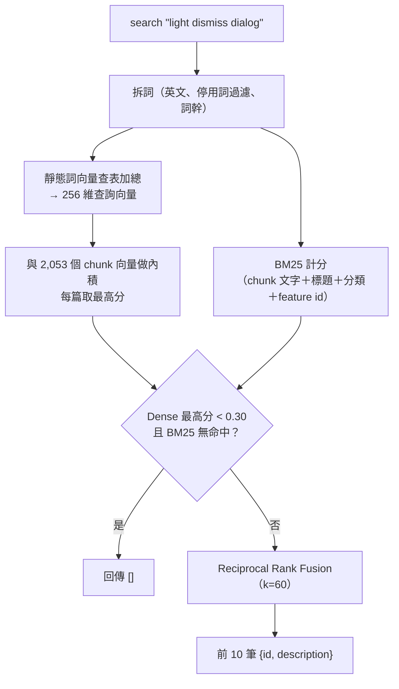

### 6.4 AI Agent 查詢知識流程

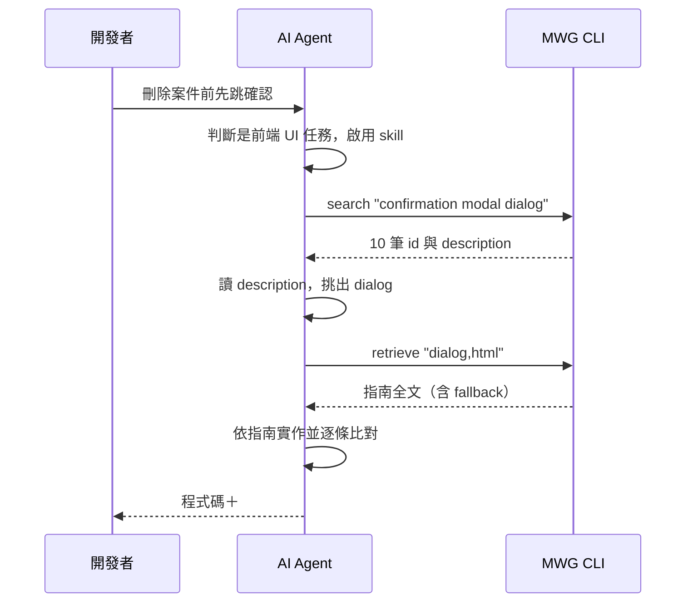

SKILL.md 特別要求「把領域意圖轉成 UI 元件名詞」：使用者說「先確認再刪除」，要搜 `confirmation modal dialog`，不要搜 `confirm destructive action`。官方技術文章提到，早期版本正是因為搜 `confirm destructive action` 回傳 `[]`，Agent 就寫了 `window.confirm()`。

### 6.5 搜尋結果如何影響程式碼生成

實測 `search "light dismiss dialog"`：

```text
$ search "light dismiss dialog"
[{"id":"light-dismiss-a-dialog","description":"Create a modal dialog that can be closed via light dismiss (i.e. clicking or tapping outside of the dialog)"},
{"id":"platform-controls-dismiss-dialog","description":"Create a modal dialog that can be closed via standard platform-specific user actions, such as pressing …
{"id":"dialog","description":"Build a modal or non-modal dialog component that is accessible, manages focus appropriately, and can be dismissed the way users e…
{"id":"html","description":"Action-oriented guidelines for modern HTML architecture, semantics, native interactive APIs (Dialog, Popover, Details), focus manag…
{"id":"animate-to-from-top-layer","description":"Animate elements such as dialogs, popovers, and tooltips as they're entering/exiting the top layer."},
{"id":"navigation-drawer","description":"Create a navigation drawer component that, when triggered from a menu button, slides in from the side overlaid on top …
{"id":"declarative-dialog-popover-control","description":"Toggle the visibility of a dialog or popover from a button without writing JavaScript."},
{"id":"menu","description":"Build a menu component that displays a list of options or actions, with support for nested submenus."},
{"id":"prevent-page-scroll-under-modal-dialog","description":"Prevent the underlying page from scrolling while a modal dialog is open."},
{"id":"content-first-noise-reduction","description":"Maximize content and reduce noise by removing blocking popups, keeping persistent navigation compact, and …
exit=0
```

Agent 應取回 `light-dismiss-a-dialog`（情境）＋`dialog`（元件）＋視需要 `html`（學科）。之後產生的程式碼要能對應到指南的規則，例如：

| 指南規則（原文） | 程式碼應該看到 |
|---|---|
| 「Always open modal dialogs with `showModal()`」 | `dialog.showModal()`，沒有 `show()` 或 `open` 屬性 |
| 「DON'T add `role="dialog"`, `aria-modal`, a focus trap...」 | `<dialog>` 上沒有這些屬性 |
| 「DO read `dialog.returnValue` ... then reset it」 | `close` 事件中有 `returnValue = ""` |
| `closedby` 為 Limited availability，需 fallback | 有 `'closedBy' in HTMLDialogElement.prototype` 判斷 |

這張「規則 → 程式碼證據」對照表，就是 Code Review 時最有效的檢查方式（第 11.5 節完整示範）。

### 6.6 查詢詞設計範例

| 查詢 | 實測結果 | 評語 |
|---|---|---|
| `light dismiss dialog` | 第 1 筆 `light-dismiss-a-dialog` | ✅ 動詞＋UI 物件 |
| `responsive data table` | 第 1 筆 `responsive-table` | ✅ |
| `dialog` | 第 1 筆 `dialog` | ⚠️ SKILL.md 說太短；實測仍可用，但結果較雜 |
| `close React settings modal on outside click` | 第 2 筆才是 `light-dismiss-a-dialog` | ⚠️ 帶框架與應用名詞，結果仍找到但排序變差 |
| `確認對話框` | `[]`，並在 stderr 提示必須用英文 | ❌ |
| `translate text in browser` | 第 1 筆 `translator`（volatile） | ✅ 找得到，但 `retrieve` 會被擋 |

中文查詢實測：

```text
$ search "確認對話框"
[]
Note: Search queries must be in English (e.g., search "light dismiss dialog").
exit=0
```

> ⚠️ **中文查詢的結束碼是 0。** 提示只寫在 stderr，Agent 若只看 stdout 的 `[]`，會以為「沒有相關指南」而直接用舊寫法實作。台灣團隊在 `AGENTS.md` 一定要寫明「search 只能用英文」。

### 6.7 如何提高搜尋品質

1. **一次一個能力**：「深色模式的響應式表格」要拆成 `dark mode` 與 `responsive data table` 兩次搜尋。
2. **2～5 個英文字**，格式為「動詞＋UI／平台物件」。
3. **不要放框架名稱**（Vue、React、PrimeVue、Tailwind）與業務名詞（loan、ACME）。這也能降低遙測洩漏業務資訊的風險。
4. **知道 API 名稱就加上**：`tooltip anchor positioning`。
5. **結果不相符時換同義詞再搜一次**：`modal`、`dialog`、`popover`、`table`、`form`。
6. **仍找不到才用 `list`**（約 209 筆，會佔不少 context）。

### 6.8 搜尋不到資料時的處理方式

SKILL.md 的官方規則：

1. `[]` 或結果不相關 → 用具體元件名詞**重新搜尋一次**。
2. 仍不相關 → 可以用一次 `list` 檢視全部。
3. 確定沒有涵蓋 → **不要取回不相關的指南**，直接實作，並在揭露段落寫明「查過哪些主題、為何沒有套用」。

企業補充（建議流程）：MWG 沒涵蓋的主題，回頭查 MDN、web.dev 與公司 Design System 文件，並在 PR 中附上來源連結。

### 6.9 Context Window 與 Token Optimization

| 情境 | 建議取回 | 估計 tokens |
|---|---|---|
| 做一個確認對話框 | `dialog` | 3,311 |
| 做一個能點背景關閉的確認對話框 | `dialog`、`light-dismiss-a-dialog` | 4,369 |
| 表單驗證 | `validate-input-after-interaction`、`forms` | 10,244 |
| 全站無障礙稽核 | `accessibility` | 13,341 |

注意事項：

- 學科指南很大，**只在真正需要整個領域規則時才取回**（例如稽核），一般功能開發取情境指南即可。
- `retrieve` 超過 9.5 KB 會存成暫存檔；Agent 必須用檔案讀取工具**完整讀完**（SKILL.md 明文禁止用 `cat`／`head`，因為可能被截斷）。
- context 壓縮（compaction）後，SKILL.md 要求「不要憑記憶寫 guide id 或引用」，需要時重新 `retrieve`。

### 6.10 Search Result Injection 與 Agent Context Integration

MWG 的「注入」就是 Agent 執行 CLI 後讀到的 stdout（或暫存檔），沒有其他隱藏機制。這帶來兩個實務影響：

1. **可稽核**：Agent 的工具呼叫紀錄就是完整的查詢證據。審查時看紀錄裡有沒有 `search`／`retrieve`、取回了哪些 id。
2. **需要權限**：Agent 要能執行 `npx`。權限設定太嚴，Agent 會跳過查詢；太鬆（允許 `npx *`）又有供應鏈風險。SKILL.md 建議只允許 `npx -y modern-web-guidance@latest *`，**不要**允許整個 `npx *`（第 9.4 節）。

### 6.11 如何避免不相關資料污染 AI Context

| 污染來源 | 例子 | 預防 |
|---|---|---|
| 取回太多學科指南 | 做一個按鈕卻取回 `accessibility`＋`html`＋`css` | 揭露段落要求「每個套用的 id 一行並附原文」，用不到的不要取 |
| 取回錯的情境 | 搜「translate」取回 CSS transform 指南 | 先看 description 再取回 |
| 被擋的訊息 | OT／volatile 的 CAUTION 文字 | 訊息本身不長，但 Agent 可能誤以為要改用其他方式繞過 |
| `list` 全表 | 209 筆 description | 只在稽核時用 |

### 6.12 Search Quality 與 Knowledge Update

官方以兩組資料量測搜尋品質（官方技術文章）：約 4,000 筆真實遙測查詢＋1,029 筆 Agent 評測查詢。第三代（靜態 Int8＋BM25）的 Hit@K 為 95.4%，夜間 Agent 評測 Hit@10 為 99.2%。這些是官方數據。

企業可以自己建立小型回歸測試：把團隊常見需求寫成「查詢 → 預期 id」清單，每次升級 MWG 時跑一次（第 17.5 節提供腳本）。

### 6.13 本章 AI 產出審查

**範例：Agent 的工具紀錄只有 `search`，沒有 `retrieve`，卻在揭露段落引用指南原文：**

- ❌ 引用是編造的（search 只回 description，沒有指南內文）。
- ✅ 怎麼抓：對照工具紀錄；用 `disclosure-check.mjs` 驗證 id 存在（第 16.5 節），再手動 `retrieve` 確認引用句真的在指南裡：

Shell

```sh
npx -y modern-web-guidance@1.0.1 retrieve light-dismiss-a-dialog > /tmp/g.md
grep -F "Always open modal dialogs with" /tmp/g.md
```

**範例：Agent 搜尋 `確認刪除對話框` 得到 `[]`，接著用 `window.confirm()`：**

- ❌ 中文查詢必定失敗；且 `window.confirm()` 不可自訂樣式、無法說明後果。
- ✅ 怎麼抓：在工具紀錄中找出參數含非 ASCII 字元的 `search`（Git Bash 實測可用）：

```sh
LC_ALL=C.UTF-8 grep -P 'search "[^"]*[^\x00-\x7F]' transcript.log
```

**範例：Agent 一次 `retrieve accessibility,html,css,js,forms,performance,security`：**

- ⚠️ 約 49,000 tokens，大部分用不到。
- ✅ 要求 Agent 說明每一篇的用途；沒有在揭露段落出現的 id 就不該取回。

> 🎯 **本章重點**：英文、短、一次一個能力；看 description 再取回；引用必須來自 `retrieve` 的原文。

## 第 7 章：Modern Web Guidance 涵蓋的現代 Web 技術

本章依 1.0.1 的 `gen/guides.json`（209 篇）與實際 `search` 結果，標示每個主題的涵蓋程度：

- **專屬指南**：有一篇以上直接處理此主題（列出 id）。
- **學科指南提及**：只在 `js`、`security`、`performance` 等大型指南中帶到。
- **未涵蓋**：搜尋結果不相關（實測），請查 MDN／web.dev／Framework 文件。

> 📌 判斷方法：對每個主題執行 `search`，看前三名是否相關，再 `grep` 指南全文。例如 `search "store data indexeddb"` 回傳 `capture-location-agnostic-data, client-side-encryption, migrate-web-app-origin`，三篇都不是在教 IndexedDB，所以判定「未涵蓋」。完整查詢紀錄見 7.8 節。

### 7.1 HTML／DOM

| 主題 | 涵蓋程度 | 相關 guide id |
|---|---|---|
| Semantic HTML | 學科指南 | `html`、`accessibility`、`breadcrumbs` |
| Native Form | 專屬指南（19 篇） | `forms`、`autofill-*`、`validate-input-after-interaction`、`required-field-feedback`、`ime-safe-enter-submit`、`sms-otp-form` |
| Dialog | 專屬指南 | `dialog`、`light-dismiss-a-dialog`、`platform-controls-dismiss-dialog`、`prevent-page-scroll-under-modal-dialog`、`animate-to-from-top-layer` |
| Popover | 專屬指南 | `declarative-dialog-popover-control`、`menu`、`hovercard`、`persistent-toast-notifications` |
| Declarative UI（Invoker commands） | 專屬指南 | `declarative-dialog-popover-control`、`custom-button-actions` |
| Accessibility | 學科＋專屬 | `accessibility`、`accessible-error-announcement`、`accessible-generated-content`、`respect-os-text-scale` |
| DOM Manipulation | 專屬指南 | `move-dom-element-without-losing-state`（`moveBefore()`）、`persistent-top-layer-ui` |
| Web Components | 專屬指南（8 篇） | `web-components`、`custom-elements`、`shadow-dom`、`form-associated-custom-elements` |
| HTML Validation | 未涵蓋 | 用 W3C Validator 或 `html-validate` 等工具 |

### 7.2 Modern CSS

| 主題 | 涵蓋程度 | 相關 guide id | Baseline（web-features 3.46.0） |
|---|---|---|---|
| Flexbox／Grid／Subgrid | 學科指南 | `css-layout` | Widely |
| Container Queries | 專屬指南 | `size-aware-styling`、`card`、`responsive-design` | Widely |
| CSS Nesting | 學科指南 | `css` | Widely |
| Cascade Layers | 學科指南 | `css`、`styling-web-components` | Widely |
| `:has()` | 專屬指南 | `style-parent-with-has`、`child-state-based-styling` | Widely |
| Anchor Positioning | 專屬指南 | `position-aware-tooltips`、`interest-triggered-tooltips`、`viewport-aware-dropdowns`、`anchor-positioning-tab-underline` | **Limited**（Firefox 未支援） |
| View Transitions | 專屬指南 | `same-document-transitions`、`cross-document-transitions`、`faster-spa-view-transitions` | Newly（同文件）／Limited（跨文件） |
| Responsive Design | 專屬指南 | `responsive-design`、`fluid-scaling`、`form-factor-adaptation` | — |
| 深色模式 | 專屬指南 | `dark-mode`、`dark-mode-toggle`、`color` | `light-dark()` Newly |
| CSS Performance | 學科指南 | `performance`（`content-visibility` 等） | `content-visibility` Newly |

### 7.3 JavaScript／TypeScript

| 主題 | 涵蓋程度 | 相關 guide id |
|---|---|---|
| Modern JavaScript（不可變陣列、`Object.groupBy`、`structuredClone`） | 學科指南 | `js` |
| ES Modules／動態 `import()` | 專屬指南 | `conditional-async-dependencies` |
| Async／Promise（`Promise.withResolvers`） | 學科指南 | `js` |
| Fetch API | 學科指南 | `js`、`deprioritize-background-fetches`、`batch-analytics-events` |
| AbortController／`AbortSignal.timeout()`／`any()` | 學科指南提及 | `js`、`schedule-tasks-by-priority`、`sms-otp-form` |
| Event Handling | 專屬指南 | `coordinate-global-events`、`natural-interactions` |
| Web Workers | **未涵蓋**（只在 `trusted-types`、`cpp-on-the-web` 帶到） | 查 MDN |
| Scheduler API（`scheduler.yield()`） | 專屬指南 | `break-up-long-tasks`、`schedule-tasks-by-priority` — Baseline **Limited**（Safari 未支援），指南含 fallback |
| 日期時間（Temporal、`Intl`） | 專屬指南 | `calculate-event-differentials`、`capture-location-agnostic-data`、`support-global-calendar-systems` |
| Memory Management | 未涵蓋 | 查 Chrome DevTools Memory 文件 |

> 📌 SKILL.md 說明指南都是 **vanilla** HTML／CSS／JS。TypeScript 型別、Vue／React 寫法要 Agent 自行轉換；轉換時「不能丟掉現代功能」。

### 7.4 Browser API

| 主題 | 涵蓋程度 | 說明 |
|---|---|---|
| Web Storage（localStorage） | 學科指南提及 | `privacy`、`js`；`dark-mode-toggle` 有儲存偏好的寫法 |
| IndexedDB | **未涵蓋** | 實測搜尋無相關結果 |
| Cache API／Service Worker | **未涵蓋** | `performance` 只帶到；PWA 只有 `install-web-app`、`migrate-web-app-origin` |
| BroadcastChannel | **未涵蓋** | 指南全文無此字 |
| Clipboard API | 專屬指南 | `copy-button` |
| File API | **未涵蓋** | 實測搜尋無相關結果 |
| WebSocket | 學科指南提及 | `js`、`efficient-background-processing` |
| WebRTC | **未涵蓋** | 只在 `restrict-outbound-connections` 提及 |
| Performance API | 專屬指南 | `interaction-paint-timing`、`identify-heavy-scripts`（Long Animation Frames） |

> ⚠️ **未涵蓋的 API，Agent 會回到訓練資料。** 這時 MWG 幫不上忙，Code Review 要特別注意。企業可以在 `AGENTS.md` 列出「這些 API 請以 MDN 為準並附連結」。

### 7.5 Performance

| 主題 | 相關 guide id |
|---|---|
| Core Web Vitals 總覽 | `performance` |
| INP | `identify-inp-causes`、`break-up-long-tasks`、`interactions-in-complex-layouts`、`interaction-paint-timing` |
| LCP | `optimize-image-priority`、`optimize-preload-priority`、`improve-next-page-load-performance`（Speculation rules） |
| CLS | `visually-stable-font-fallbacks`、`visually-stable-mixed-fonts`、`flicker-free-client-side-ab-testing` |
| Lazy Loading | `lazy-load-video-and-audio`、`defer-rendering-heavy-content` |
| Resource Loading | `optimize-script-priority`、`deprioritize-background-fetches` |
| Code Splitting | `conditional-async-dependencies` |
| Main Thread | `schedule-tasks-by-priority`、`efficient-background-processing`、`defer-work-until-scroll-ends` |

### 7.6 Security

| 主題 | 涵蓋程度 | 相關 guide id |
|---|---|---|
| XSS | 專屬指南 | `sanitize-untrusted-html`、`trusted-types`、`security` |
| Trusted Types | 專屬指南 | `trusted-types`（Baseline Newly，2026-02-24） |
| CSP | 學科指南 | `security`、`restrict-outbound-connections` |
| SRI | 專屬指南 | `secure-external-subresources` |
| Input Validation | 學科指南 | `forms` |
| CSRF | 學科指南提及 | `forms`、`security`（SameSite Cookie） |
| Passkeys | 專屬指南（8 篇） | `passkeys`、`passkey-registration`、`passkey-authentication`、`passkey-reauthentication`、`passkey-management`、`passkey-conditional-create`、`quick-sign-ins` |
| Origin 驗證 | 專屬指南 | `validate-origins` |
| 加密／簽章 | 專屬指南（volatile） | `client-side-encryption`、`digital-signatures` |

> ⚠️ **MWG 的安全指南是「前端寫法」，不是安全稽核。** 伺服器端授權、Session 管理、API 輸入驗證、OWASP ASVS 全面檢核都不在範圍內（第 16 章）。

### 7.7 AI／Browser Built-in AI

| API | guide id | 狀態（2026-11-19） | 支援 | 企業風險 |
|---|---|---|---|---|
| Translator | `translator` | Limited；MWG 列為 **volatile** | Chrome 138+、Edge 148+（**僅桌機**） | 需下載模型；Firefox、Safari、行動版不支援 |
| Language Detector | `language-detection` | Limited；volatile | Chrome 138+、Edge 148+ | 同上 |
| Summarizer | `summarizer` | Limited；volatile | Chrome 138+、Edge 138+ | 同上 |
| Prompt API（LanguageModel） | `language-model` | Limited；volatile | Chrome 148+ | 只有 Chrome |
| WebMCP | `webmcp`、`agentic-forms`、`agentic-javascript-tools` | **Origin Trial** | — | 需 OT token，API 可能變動 |

`translator` 指南列出的硬體需求（官方指南內容）：

- 作業系統：Windows 10／11、macOS 13+、Linux、ChromeOS（Chromebook Plus）
- 儲存空間：設定檔所在磁碟至少 **22 GB** 可用
- 記憶體／CPU：16 GB RAM 以上、4 核心以上
- 網路：只在首次下載模型時需要
- `availability()` 回傳 `downloadable` 時，`create()` 必須在使用者手勢（例如點按鈕）中呼叫，否則 `NotAllowedError`

**企業判斷**（建議流程）：

| 問題 | 答案 |
|---|---|
| 適合正式環境嗎？ | 不適合作為唯一路徑；只能做「有就加分」的漸進增強，必須有伺服器端或人工替代路徑 |
| 需要 Feature Flag 嗎？ | Chrome 正式版已出貨，不需 flag；但 MWG 閘門要求 `allowVolatileFeatures` |
| 需要 Origin Trial 嗎？ | Built-in AI 不需要；WebMCP 需要 |
| 資料會離開裝置嗎？ | 指南說推論在裝置上執行；但仍要經資安確認模型下載來源與公司政策 |
| 公司配發電腦符合硬體需求嗎？ | 多數標準辦公機（8 GB RAM）不符合，要先盤點 |

### 7.8 涵蓋程度的查詢紀錄

以下是本章判斷所依據的實測（每列為 `search` 的前三名）：

```text
store data indexeddb               capture-location-agnostic-data, client-side-encryption, migrate-web-app-origin
offline cache service worker       performance, language-model, faster-spa-view-transitions
sync state across tabs             tabs, scroll-snap-state-sync, same-document-transitions
websocket realtime updates         local-network-access, restrict-outbound-connections, efficient-background-processing
webrtc video call                  performance, lazy-load-video-and-audio, html
copy to clipboard                  copy-button, toolbar, expose-canvas-content-to-browser-features
read uploaded file                 single-line-overflow, performance, icons
offload work web worker            performance, cpp-on-the-web, schedule-tasks-by-priority
css nesting                        css, atrule-support-conditionals, overflow-clipping-control
cascade layers                     css, styling-web-components, parallax-scroll-effects
view transitions                   cross-document-transitions, same-document-transitions, consistent-cross-document-transitions
content security policy            security, trusted-types, secure-external-subresources
passkey sign in                    passkey-authentication, quick-sign-ins, passkey-registration
improve LCP                        performance, improve-next-page-load-performance, interaction-paint-timing
reduce layout shift                visually-stable-font-fallbacks, interactions-in-complex-layouts, performance
lazy load images                   lazy-load-video-and-audio, performance, optimize-image-priority
code splitting dynamic import      performance, conditional-async-dependencies, custom-button-actions
localstorage persist settings      dark-mode-toggle, privacy, persistent-app-tours
abort fetch request                agentic-javascript-tools, full-session-analytics, batch-analytics-events
performance observer measure       interaction-paint-timing, performance, identify-heavy-scripts
semantic html landmarks            accessibility, html, breadcrumbs
container queries card             card, size-aware-styling, form-factor-adaptation
anchor positioning tooltip         interest-triggered-tooltips, position-aware-tooltips, hovercard
trusted types policy               trusted-types, security, sanitize-untrusted-html
csrf protection                    forms, security, secure-external-subresources
deep clone object                  js, language-model, stack-drill-down
format date timezone               calculate-event-differentials, capture-location-agnostic-data, sort-high-precision-timestamps
```

### 7.9 本章 AI 產出審查

**範例：Agent 說「MWG 建議用 IndexedDB 搭配 Service Worker 做離線快取」：**

- ❌ MWG 1.0.1 沒有 IndexedDB 與 Service Worker 的專屬指南，這段話是 Agent 自己的訓練知識，卻掛上 MWG 的名義。
- ✅ 查證：`search "store data indexeddb"`、`search "offline cache service worker"`，看結果是否相關；揭露段落中不可能出現對應 id。

**範例：Agent 在一般業務頁面加入 `Translator.create()` 自動翻譯公告：**

- ❌ volatile API；只有 Chrome／Edge 桌機；公司電腦可能不符合硬體需求。
- ✅ 查證：`node tools/mwg/gated-api-scan.mjs src` 會列出 FAIL（第 5.7 節）；要求附 fallback 與核准單。

**範例：Agent 寫 `scheduler.yield()` 沒有 fallback：**

- ❌ Scheduler API 為 Limited availability（Safari 未支援），會丟 `TypeError`。
- ✅ 查證：`retrieve break-up-long-tasks` 的 Fallback 段落；Code Review 確認有 `'scheduler' in globalThis && 'yield' in scheduler` 之類的判斷。

> 🎯 **本章重點**：MWG 對 UI、表單、CSS、效能、前端安全涵蓋很完整；對儲存、離線、即時通訊幾乎沒有。不在清單內的主題，不要讓 Agent 掛 MWG 的名義。

## 第 8 章：Browser Compatibility 與 Baseline 治理

> 🎯 **本章核心原則**：不應只因 API 是最新技術就採用，而必須依據企業支援的瀏覽器版本、使用者環境、系統需求、安全政策及正式環境穩定性進行判斷。

### 8.1 Browser Compatibility 與 Baseline 的關係

| 層次 | 回答的問題 | 工具 |
|---|---|---|
| Browser Compatibility | 「Safari 17.2 支不支援 CSS Nesting？」 | MDN BCD、Can I Use |
| Baseline | 「這個 feature 在四大瀏覽器都能用多久了？」 | web-features、web.dev/baseline |
| 企業 Browser Policy | 「**我們的使用者**能不能用？」 | 企業自訂（8.9 節）＋分析數據 |

MWG 只回答前兩層，第三層一定要由企業自己決定。

### 8.2 Baseline Newly 與 Widely

- **Newly available**：最後一個核心瀏覽器支援的那天起算。
- **Widely available**：Newly 之後滿 30 個月。
- Baseline 年份（例如「Baseline 2024」）：在該年成為 Newly available 的 feature 集合。

| 想法 | 正確嗎？ | 說明 |
|---|---|---|
| 「Widely 代表 100% 使用者都能用」 | ❌ | 只代表核心瀏覽器 30 個月前的版本都支援；公司若有更舊的瀏覽器仍然不行 |
| 「Limited 代表不能用」 | ❌ | 可以用，但要依指南做 fallback 或漸進增強 |
| 「Baseline 會倒退」 | 原則上不會，但 feature 的定義可能調整 | 以 web-features 版本為準 |

### 8.3 Chrome、Edge、Firefox、Safari 的企業差異

| 瀏覽器 | 引擎 | 企業注意事項 |
|---|---|---|
| Chrome | Blink | 新功能通常最早上線；Origin Trial 只在 Chrome |
| Edge | Blink | 與 Chrome 同引擎，但版本號與上線時間可能不同（例如 Translator：Chrome 138、Edge 148）；有 **IE mode** |
| Firefox | Gecko | 企業版 ESR 版本較舊，要以 ESR 版本判斷 |
| Safari | WebKit | iOS 上所有瀏覽器都是 WebKit；版本綁 OS，使用者升級慢 |

> ⚠️ **Edge 的 IE mode**：Microsoft 365 Message Center 公告 MC1473151 說明 IE mode 至少支援到 2029 年底，退場前至少一年通知（[第三方彙整](https://mc.merill.net/message/MC1473151)；請以貴公司 M365 系統管理中心的原文為準）。**跑在 IE mode 的頁面不適用任何 MWG 指南**，它們是 Trident 引擎，不在 Baseline 範圍。

### 8.4 Browser Version、Mobile、Enterprise、Embedded Browser、WebView

| 環境 | 判斷重點 | 建議做法 |
|---|---|---|
| 公司配發 Edge／Chrome | 由 GPO／Intune 控管版本 | 政策寫「Stable 通道，延遲更新不超過 N 個版本」 |
| 客戶端瀏覽器 | 無法控管 | 用 RUM／分析數據找出實際版本分布 |
| 行動瀏覽器 | iOS Safari 版本跟 OS 走 | 以「iOS 最近兩個主要版本」為下限 |
| Microsoft Edge WebView2 | Evergreen 會自動更新；Fixed Version 固定版本 | Fixed Version 要以該版號判斷，**不能**套用 Baseline |
| Android WebView／App 內嵌 | 版本取決於使用者裝置 | 視為 Limited 環境，保守設定 |
| Electron／Tauri | 版本由 App 決定 | SKILL.md 建議在 AGENTS.md 寫明自訂政策（例如「只需支援 Chromium 140」） |

### 8.5 相容性判斷流程

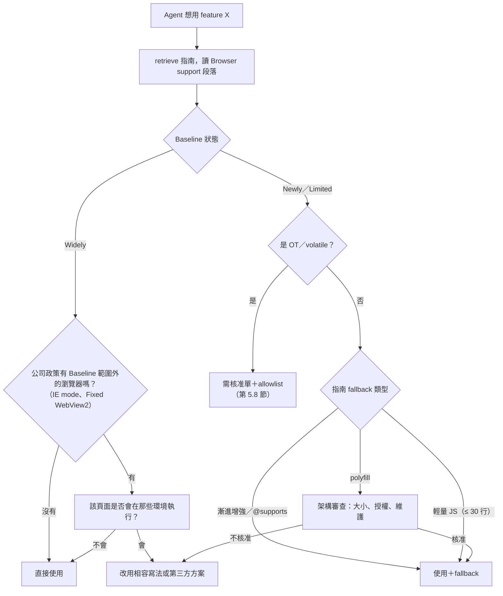

### 8.6 API 相容性查詢方法

| 方法 | 指令或網址 | 適用 |
|---|---|---|
| 看 MWG 指南 | `npx -y modern-web-guidance@1.0.1 retrieve <id>`，讀「Browser support」段落 | 日常開發 |
| web-features（程式化） | `node -e 'import("web-features").then(({features})=>console.log(features["popover"].status))'` | CI、批次檢查 |
| Baseline 網站 | <https://web.dev/baseline>、<https://web-platform-dx.github.io/web-features-explorer/> | 人工查詢 |
| MDN BCD | 每個 MDN 頁面底部的相容性表；<https://github.com/mdn/browser-compat-data> | 細到版本與部分支援 |
| Can I Use | <https://caniuse.com/> | 附使用率統計 |
| Chrome Platform Status | <https://chromestatus.com/> | Chrome 上線時程、OT |

**企業自建：用指南 id 批次檢查 Baseline：**

`guide-baseline.mjs` 讀 npm 套件內的 `gen/guides.json`，取出每篇指南的 `featuresUsed`，再用 web-features 判斷是否符合公司目標：

📄 `enterprise-repo/tools/mwg/guide-baseline.mjs`

```js
#!/usr/bin/env node
// 企業自建：列出指南用到的 web feature，並用 web-features 套件判斷是否符合企業 Baseline 目標（非官方工具）
// 用法：node tools/mwg/guide-baseline.mjs --guides <guides.json> --target widely|newly|YYYY <guide-id>...
// guides.json 位於 modern-web-guidance npm 套件的 skills/modern-web-guidance/gen/guides.json
// 結束碼：0 = 全部符合目標，1 = 有需要 fallback 或核准的 feature，2 = 參數或資料錯誤
import { readFileSync } from "node:fs";
import { features } from "web-features";

const args = process.argv.slice(2);
const opt = (name) => {
  const i = args.indexOf(name);
  return i >= 0 ? args[i + 1] : undefined;
};
const guidesPath = opt("--guides");
const target = opt("--target") ?? "widely";
const ids = args.filter((a, i) => !a.startsWith("--") && !["--guides", "--target"].includes(args[i - 1]));
if (!guidesPath || ids.length === 0 || !/^(widely|newly|\d{4})$/.test(target)) {
  console.error("usage: guide-baseline.mjs --guides <guides.json> --target widely|newly|YYYY <guide-id>...");
  process.exit(2);
}

const guides = JSON.parse(readFileSync(guidesPath, "utf8"));
const byName = new Map();
for (const [id, f] of Object.entries(features)) if (f.name) byName.set(f.name, id);

function meets(status) {
  if (!status || status.baseline === false) return false;
  if (target === "widely") return status.baseline === "high";
  if (target === "newly") return status.baseline === "high" || status.baseline === "low";
  return Boolean(status.baseline_low_date) && status.baseline_low_date.slice(0, 4) <= target;
}

let bad = 0;
for (const id of ids) {
  const g = guides.find((x) => x.id === id);
  if (!g) {
    console.log(`?? ${id}: not in guides.json (check the id with \`list\`)`);
    bad++;
    continue;
  }
  console.log(`## ${id}`);
  for (const name of g.featuresUsed ?? []) {
    const fid = byName.get(name);
    const st = fid ? features[fid].status : undefined;
    const label = !st ? "unknown" : st.baseline === "high" ? "widely" : st.baseline === "low" ? `newly(${st.baseline_low_date})` : "limited";
    const ok = meets(st);
    if (!ok) bad++;
    console.log(`  ${ok ? "OK  " : "NEED"} ${name.padEnd(34)} ${fid ?? "-"}  ${label}`);
  }
}
console.log(`target=${target}: ${bad === 0 ? "all features meet the target" : `${bad} item(s) need fallback / approval`}`);
process.exit(bad === 0 ? 0 : 1);
```

實測（target＝widely）：

```text
$ node tools/mwg/guide-baseline.mjs --guides guides.json --target widely light-dismiss-a-dialog validate-input-after-interaction switch
## light-dismiss-a-dialog
  NEED <dialog closedby>                  dialog-closedby  limited
## validate-input-after-interaction
  OK   :user-valid and :user-invalid      user-pseudos  widely
## switch
  NEED <input type="checkbox" switch>     switch-control  limited
  NEED accent-color                       accent-color  limited
target=widely: 3 item(s) need fallback / approval
exit=1
```

> 📌 注意 `switch` 指南：`legacy-scan` 會建議把 `role="switch"` 改成原生 `switch` 屬性（第 12 章），但 `<input switch>` 目前**只有 Safari 支援**、`accent-color` 也還不是 Widely。照公司 Widely 目標，這個建議要附 fallback（指南建議條件載入 `input-switch-polyfill`），或乾脆維持現狀。**`legacy-scan` 的發現不等於必須採納。**

### 8.7 Feature Detection 範例

**JavaScript：檢查 prototype 上的屬性（指南的標準寫法）：**

```js
// 在原型上檢查，不要在 window 或 document 上檢查（指南 MANDATORY）
const hasClosedBy = "closedBy" in HTMLDialogElement.prototype;
const hasPopover = Object.hasOwn(HTMLElement.prototype, "popover");
const hasInvokers = "commandForElement" in HTMLButtonElement.prototype;
const hasSetHTML = "setHTML" in Element.prototype;
const hasYield = "scheduler" in globalThis && "yield" in globalThis.scheduler;
```

**CSS：`@supports`：**

```css
textarea.note {
  min-block-size: 3lh;
  max-block-size: 12lh;
}

@supports (field-sizing: content) {
  textarea.note {
    field-sizing: content;
  }
}

@supports selector(:user-invalid) {
  input:user-invalid {
    border-color: var(--danger);
  }
}
```

**HTML：未知屬性會被忽略（天然的漸進增強）：**

```html
<!-- 不支援 closedby 的瀏覽器忽略此屬性，仍可用 Esc 關閉 -->
<dialog closedby="any">...</dialog>
```

### 8.8 Polyfill 評估方式

| 評估項目 | 合格標準（建議） | 怎麼查 |
|---|---|---|
| 必要性 | 功能非 Widely，且公司目標需要 | `guide-baseline.mjs` |
| 載入方式 | feature detection 後 `import()` | `grep` 程式碼；`vite build` 是否獨立 chunk |
| 大小 | gzip ≤ 15 kB；超過需架構審查 | build 輸出（第 11 章實測 popover polyfill 3.70 kB gzip） |
| 維護 | 近 12 個月有 release；有多位維護者 | npm、GitHub |
| 授權 | MIT／Apache-2.0／BSD | `npm view <pkg> license` |
| 安全 | 無已知 CVE | `npm audit`、SCA 工具 |
| 版本釘選 | `package.json` 不用 `^`、`~` | `package.json` |
| 退場計畫 | 寫明「feature 成為 Widely 後移除」 | ADR 或 `TODO(remove-after: 2027-07)` |

### 8.9 Enterprise Browser Policy（範本）

📄 `docs/browser-support-policy.md`（建議流程，範本）

```markdown
# 瀏覽器支援政策（v2026.11）

## 支援矩陣
| 使用者 | 瀏覽器 | 最低版本 | 依據 |
|---|---|---|---|
| 行員（內部系統） | Microsoft Edge Stable | 目前版本 −2 | Intune 強制更新 |
| 一般客戶（網銀） | Chrome、Edge、Firefox、Safari | Baseline Widely available | 分析數據 2026-Q3：99.2% 涵蓋 |
| 一般客戶（行動） | iOS Safari | iOS 18 以上 | 分析數據 |
| 客服 App | WebView2 Evergreen | 同 Edge Stable | — |
| 舊核心系統 | IE mode | 不新增功能，只修 Bug | MC1473151 |

## 新功能採用規則
1. Widely available：直接使用。
2. Newly available：依 MWG 指南實作 fallback；fallback ≤ 30 行且無新依賴。
3. Limited availability：只能做漸進增強；核心流程不可依賴。
4. Origin Trial：禁止用於正式環境。
5. Volatile：需架構審查單，最長 90 天，到期重審。

## 例外流程
架構審查單（ARCH-xxxx），需前端架構師＋資安核准。
```

> 📌 範本中的百分比與版本是示意，貴公司必須用自己的分析數據填寫。

### 8.10 AI Agent Compatibility Prompt

Agent 提示詞（可直接複製）

```text
# Role
你是本公司前端相容性審查員。

# Context
- 瀏覽器支援政策：docs/browser-support-policy.md（Baseline Widely available；Newly 需 fallback ≤ 30 行）
- 本次變更：git diff main...HEAD -- src/

# Objective
找出本次變更中使用到、但不符合政策的 Web Platform feature，並提出修正。

# Constraints
- 每個 feature 都要用 modern-web-guidance 查證：search（英文 2～5 字）→ retrieve，讀 Browser support 與 Fallback strategies 段落。
- 不得憑記憶判斷支援版本；查不到就寫「待確認」。
- 不得自行修改 .mwgrc 或執行任何 set-* 指令。

# Execution Steps
1. 列出 diff 中新出現的 HTML 屬性、CSS 屬性／選擇器、JS API。
2. 對每一項 search＋retrieve，記錄 Baseline 狀態與支援版本。
3. 比對政策，判斷 OK／需 fallback／不可使用。
4. 對「需 fallback」者，檢查程式碼是否已有 feature detection 與 fallback。

# Expected Output
Markdown 表格：feature｜檔案:行｜Baseline｜政策判定｜是否已有 fallback｜guide id｜建議。

# Quality Gate
- 每一列都要有 guide id 或「MWG 未涵蓋，依 MDN：<URL>」。
- 不可出現「應該支援」「大部分瀏覽器支援」這類無依據的描述。

# Human Review
前端架構師逐列確認後，才可以合併。
```

### 8.11 如何避免 AI Agent 引入不支援的 API

1. **事前**：`AGENTS.md` 寫明政策（第 9.3 節）。
2. **事中**：MWG 指南本身帶 fallback；`.mwgrc` 擋 OT／volatile。
3. **事後**：CI 跑 `gated-api-scan.mjs`；Code Review 用上面的提示詞或第 14 章 Prompt 5。
4. **實測**：Playwright 同時測原生與 fallback 路徑（第 11.6 節示範如何在 Chrome 中模擬不支援的瀏覽器）。官方 [Cross-browser by default](https://developer.chrome.com/blog/cross-browser-by-default) 也提醒：只在 Chrome 測試，fallback 那條路永遠不會執行。

### 8.12 本章 AI 產出審查

**範例：AI 說「`field-sizing` 已經全部瀏覽器都支援了，可以拿掉 min／max-height」：**

- ⚠️ web-features 3.46.0：Newly available（2026-06-16），Widely 要到 2028-12。拿掉限制後，舊版 Safari 中 textarea 會固定高度。
- ✅ 查證：`guide-baseline.mjs --target widely form-fields-automatically-fit-contents`。

**範例：AI 寫的 feature detection 檢查 `window.popover`：**

- ❌ 指南明確要求在 `HTMLElement.prototype` 上檢查。`window.popover` 永遠是 `undefined`，結果所有瀏覽器都會載入 polyfill。
- ✅ 查證：E2E 測試記錄網路請求，確認 Chrome 不會下載 polyfill chunk（第 11.6 節同樣手法用於 DOMPurify）。

> 🎯 **本章重點**：MWG 告訴你 feature 的 Baseline；能不能用，由公司的瀏覽器政策決定。

## 第 9 章：Modern Web Guidance 與 AI Coding Agent 整合

本章是全書核心。先看支援程度總表，再看共通的整合三件套（Skill、指令檔、權限），最後逐一說明各工具。

### 9.1 支援程度總表

分類定義：

- **官方提供整合方式**：MWG 官方 README 或 developer.chrome.com 列出安裝指令。
- **透過 Skills 整合**：MWG 未列出該工具，但該工具官方文件支援讀取 MWG 所用的 Skill 目錄（`.claude/skills`、`.agents/skills` 等）。
- **可自行整合**：工具沒有 Skill 機制，但能讀指令檔並執行終端機指令，可要求它呼叫 CLI。
- **尚無法確認**：查不到可靠官方資料。

| 工具 | 支援程度 | 安裝方式 | Skill 目錄 | 指令檔 | 本手冊實測 |
|---|---|---|---|---|---|
| Claude Code | 官方提供整合方式 | plugin marketplace 或 `install` | `.claude/skills/` | `CLAUDE.md` | 安裝實測、`claude doctor` 驗證權限；Agent 行為 🧪 |
| GitHub Copilot CLI | 官方提供整合方式 | `/plugin marketplace add`＋`/plugin install` | — | `.github/copilot-instructions.md`、`AGENTS.md` | 🧪 |
| GitHub Copilot（VS Code Agent Mode） | 透過 Skills 整合 | `npx skills add` 安裝到專案 | `.github/skills/`；VS Code 也讀 `.claude/skills/`、`.agents/skills/` | `.github/copilot-instructions.md`、`AGENTS.md` | 🧪 |
| OpenAI Codex | 官方提供整合方式 | `codex plugin marketplace add`＋`codex plugin add` | `.agents/skills/` | `AGENTS.md` | 🧪 |
| Cursor | 官方提供整合方式（repo 內有 `.cursor-plugin/`；官方部落格列出 Cursor marketplace） | Cursor plugin marketplace 或 `npx skills add` | `.cursor/skills/`；也讀 `.claude/skills/`、`.agents/skills/` | `AGENTS.md`、`.cursor/rules/` | 🧪 |
| Gemini CLI | 官方提供整合方式 | `gemini extensions install ... --auto-update` | extension 目錄 | `GEMINI.md` | 🧪 |
| Gemini Code Assist | **尚無法確認** Skill 支援；可自行整合 | — | — | Markdown context 檔 | 🧪 |
| Antigravity | 官方提供整合方式 | `agy plugin install ...`；桌面版設定頁啟用 | — | — | 🧪 |
| JetBrains WebStorm | 官方提供整合方式 | Settings → AI Assistant → Skills | — | — | 🧪 |
| Goose、Grok、Kimi Code | 官方提供整合方式 | 見第 4.3 節 | — | — | 🧪 |

來源：MWG README「Alternative Installation Methods」、[Get started](https://developer.chrome.com/docs/modern-web-guidance/get-started)、[VS Code Agent Skills](https://code.visualstudio.com/docs/copilot/customization/agent-skills)、[Codex Skills](https://developers.openai.com/codex/skills)、[Cursor Skills](https://cursor.com/docs/skills)、[GitHub About Agent Skills](https://docs.github.com/en/copilot/concepts/agents/about-agent-skills)。

> ⚠️ **「可自行整合」不等於「官方支援」。** 例如 Gemini Code Assist：查得到 Agent Mode 支援 MCP 與 Markdown context 檔，但查不到 Agent Skills 支援。本手冊只能建議「在 context 檔要求它執行 CLI」，效果未驗證。

### 9.2 整合三件套

不論哪個 Agent，企業整合都由三件事組成：

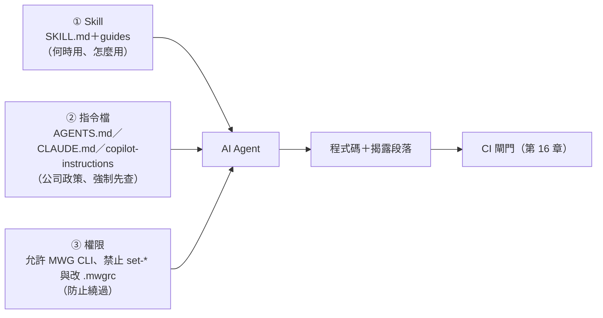

| 件 | 解決什麼 | 少了會怎樣 |
|---|---|---|
| Skill | Agent 知道有 MWG、會呼叫 CLI | Agent 完全不會查 |
| 指令檔 | 把「公司 Baseline 目標」「必須先查」「必須揭露」變成常駐規則 | Agent 依預設 Widely；可能跳過查詢；不寫揭露 |
| 權限 | Agent 能順利執行 `npx`，但不能改設定 | 太嚴：每次都要人按允許，最後大家關掉；太鬆：Agent 可自行開閘門 |

### 9.3 共用指令檔：AGENTS.md

`AGENTS.md` 是 Codex、Cursor、Copilot、Antigravity 等多數工具都會讀的指令檔；Claude Code 讀 `CLAUDE.md`，可用 `@AGENTS.md` 匯入。以下範本已依 MWG 官方建議的 Browser support policy 寫法撰寫（企業自建）：

📄 `enterprise-repo/AGENTS.md`

````markdown
# AGENTS.md — 貸款入口網站前端（企業範本）

## 專案背景

- 技術堆疊：Vue 3、TypeScript、Vite、Pinia、PrimeVue、Tailwind CSS。
- 使用者環境：公司配發 Microsoft Edge（Stable 通道）與 Chrome；客戶端另需支援 Safari 與 Firefox 最新兩個主要版本。
- 本專案所有 HTML／CSS／前端 JS 工作都必須先使用 `modern-web-guidance` skill 查詢指南。

## Browser support policy

- **Browser Support:** Target **Baseline Widely available**. Features that are Baseline Newly available or Limited availability MUST follow the guide's fallback strategy.
- Fallback code must be 30 lines or fewer and add no new runtime dependency; anything larger needs an architecture review ticket.
- Never add a polyfill package without approval. Load approved polyfills with `import()` only when feature detection fails.

## Modern Web Guidance 使用規則

1. 先 `search`（英文、2～5 個字、一次一個能力），再 `retrieve`；搜尋詞不要放 Vue、PrimeVue、Tailwind 等框架名稱。
2. 指南是 vanilla HTML/CSS/JS：轉成 Vue 時保留原生功能（例如 `<dialog>`、`popover`），不要改回 `div` 加 JavaScript。
3. 不得自行執行 `set-allow-origin-trials`、`set-allow-volatile-features`、`set-baseline`，也不得修改 `.mwgrc`；需要時請人類開發者走核准流程。
4. 回覆最後必須附上 `### Modern Web Guidance` 段落，列出實際套用的 guide id 與引用原文；沒有用到也要說明查過哪些主題。
5. 不確定的地方列成「待確認問題」，不要猜測實作。

## 禁止事項

- 不得引入 jQuery、moment、lodash 等已有原生替代的套件。
- 不得使用 `innerHTML`、`v-html` 寫入未經處理的使用者資料；依 `sanitize-untrusted-html` 與 `trusted-types` 指南處理。
- 不得使用 Origin Trial 或單一引擎 API（Translator、Summarizer、LanguageModel、WebMCP 等），除非 `mwg-gated-allowlist.json` 已列出。

## 驗證指令

```sh
npm run mwg:policy
npm run mwg:gated
npm run lint && npm run type-check && npm run test
```
````

📄 `enterprise-repo/CLAUDE.md`

```markdown
# CLAUDE.md

@AGENTS.md

## Claude Code 補充

- 執行 `modern-web-guidance` 時使用 `npx -y modern-web-guidance@latest ...`（與 SKILL.md 相同），Windows 上由 Claude Code 自行處理 `npx.cmd`。
- `retrieve` 輸出超過 9.5 KB 會存成暫存檔，請用 Read 工具完整讀取，不要用 `cat`／`head`。
```

📄 `enterprise-repo/.github/copilot-instructions.md`

```markdown
# Copilot 專案指示

本專案的完整規則在根目錄 `AGENTS.md`，以下是 Copilot 必須遵守的重點：

- 撰寫或修改 HTML、CSS、前端 JavaScript／TypeScript、Vue 元件前，先執行
  `npx -y modern-web-guidance@latest search "<2-5 word English query>"`，
  再以 `npx -y modern-web-guidance@latest retrieve "<id>"` 取得指南。
- Browser Support：Baseline Widely available；其他 feature 一律依指南的 fallback 實作。
- 不得修改 `.mwgrc`，不得執行任何 `set-*` 指令。
- PR 描述必須包含 `### Modern Web Guidance` 段落（CI 會檢查 guide id 是否存在）。
```

逐段說明：

| 段落 | 目的 | 依據 |
|---|---|---|
| Browser support policy | 讓 Agent 判斷哪些 fallback 必須寫 | 官方 Get started、Cross-browser by default |
| 「搜尋詞不要放框架名稱」 | 提高命中率；降低遙測洩漏業務資訊 | SKILL.md Step 1 |
| 「保留原生功能，不要改回 div」 | 防止 Agent 為了框架方便退回舊寫法 | SKILL.md Guidelines |
| 「不得執行 set-*、不得修改 .mwgrc」 | 閘門不被 Agent 自己打開 | `retrieve.ts` 的閘門訊息 |
| 「回覆最後附 ### Modern Web Guidance」 | 讓審查者知道套用了哪些指南 | SKILL.md Step 4 |
| 「不確定時列成待確認問題」 | 降低幻覺 | 官方 Troubleshoot 建議的提示語 |

### 9.4 Claude Code

**① 安裝（官方，二選一）：**

Shell

```sh
# 方式 A：plugin marketplace（使用者層；可在 /plugin 開 AutoUpdate）
claude plugin marketplace add GoogleChrome/modern-web-guidance
claude plugin install modern-web-guidance@googlechrome

# 方式 B：專案層 Skill（建議企業使用，Skill 進版控）
npx -y modern-web-guidance@latest install --agent claude-code -y
```

方式 B 已實測（第 4.8 節），產生 `.claude/skills/modern-web-guidance/` 與 `skills-lock.json`。

**② 權限設定：**

📄 `enterprise-repo/.claude/settings.json`

```json
{
  "$schema": "https://json.schemastore.org/claude-code-settings.json",
  "env": {
    "DISABLE_TELEMETRY": "1"
  },
  "permissions": {
    "allow": [
      "Bash(npx -y modern-web-guidance@latest search *)",
      "Bash(npx -y modern-web-guidance@latest retrieve *)",
      "Bash(npx -y modern-web-guidance@latest list)",
      "Bash(npx -y modern-web-guidance@latest legacy-scan *)"
    ],
    "deny": [
      "Bash(npx -y modern-web-guidance@latest set-*)",
      "Bash(npx modern-web-guidance@latest set-*)",
      "Edit(.mwgrc)",
      "Edit(.mwgrc.approval.json)"
    ]
  }
}
```

`claude doctor`（Claude Code 2.1.328）實測結果：

- 初版範本有 `Write(.mwgrc)` deny，`claude doctor` 警告：「Write(.mwgrc) is not matched by file permission checks — only Edit(path) rules are. Use Edit(.mwgrc) instead」。已改成上面的版本，警告消失。
- 未信任的工作區會「Ignoring 4 permissions.allow entries」：每位開發者第一次開啟專案時要接受信任對話框，`allow` 才會生效（`deny` 不受影響）。

**③ 讓 Agent 在開發前查詢：**

| 方法 | 做法 | 可靠度 |
|---|---|---|
| Skill 自動觸發 | 依 description 判斷前端任務 | 中（官方 Troubleshoot 承認有時會忽略） |
| 提示詞結尾加「use modern-web-guidance」 | 官方 Troubleshoot 建議 | 中高 |
| 直接呼叫 Skill | Claude Code 中輸入 `/modern-web-guidance`（官方 Troubleshoot 提到 `/modern-web-guidance` 或 `$modern-web-guidance` 依 Agent 而異） | 高 🧪 |
| CLAUDE.md 規則 | 9.3 節範本 | 中高 |

**④ 驗證 Agent 真的有查（🧪）：**

Claude Code 的對話紀錄存在 `~/.claude/projects/<專案路徑編碼>/*.jsonl`。以 headless 模式執行時可以直接檢查工具呼叫：

Shell

```sh
claude -p "在 src/components 新增刪除確認對話框，use modern-web-guidance" \
  --output-format stream-json --verbose > run.jsonl
grep -o 'modern-web-guidance@latest \(search\|retrieve\)[^"]*' run.jsonl
```

**⑤ Code Review／Framework Upgrade／Reverse Engineering：**

使用第 14 章的 Prompt 4（Code Review）、Prompt 3（Upgrade）、Prompt 2（Reverse Engineering）。Claude Code 可將它們存成專案的 slash command 或 Skill，讓團隊用同一份提示詞。

### 9.5 GitHub Copilot CLI

官方指令（Copilot CLI 對話框，🧪）：

```text
/plugin marketplace add GoogleChrome/modern-web-guidance
/plugin install modern-web-guidance@googlechrome
```

專案規則放 `.github/copilot-instructions.md`（9.3 節範本）。Copilot CLI 執行 shell 指令前會詢問權限；建議只核准 `npx -y modern-web-guidance@latest` 開頭的指令，不要一次核准所有 `npx`。

### 9.6 GitHub Copilot（VS Code Agent Mode）與 VS Code

VS Code 官方文件說明 Agent Skills 是開放標準，專案層 Skill 放在 `.github/skills/`，並相容 `.claude/skills/`、`.agents/skills/`；可用 `chat.skillsLocations` 設定其他位置，在 Chat 輸入 `/skills` 開啟設定選單（[VS Code Agent Skills](https://code.visualstudio.com/docs/copilot/customization/agent-skills)）。

做法（透過 Skills 整合，🧪）：

Shell（專案根目錄）

```sh
npx -y modern-web-guidance@latest install
# 精靈中選擇 GitHub Copilot；或直接沿用已安裝的 .claude/skills／.agents/skills
```

注意事項：

1. VS Code 的終端機工具執行 `npx` 前需要確認；Agent Mode 的自動核准清單只加 MWG 指令。
2. 若公司以 GitHub Enterprise 政策關閉了 Agent Skills，Skill 不會生效，只剩 `copilot-instructions.md` 的文字規則。
3. Copilot cloud agent（在 GitHub 上執行）同樣讀 `.github/skills/`；它的執行環境需要能連 npm registry（或設定防火牆允許清單）。

### 9.7 OpenAI Codex

官方指令（Shell，🧪）：

```sh
codex plugin marketplace add GoogleChrome/modern-web-guidance
codex plugin add modern-web-guidance@googlechrome
```

- 專案層 Skill：`.agents/skills/`（Codex 從目前目錄往上找到 repo 根目錄）；使用者層：`$HOME/.agents/skills`（[Codex Skills](https://developers.openai.com/codex/skills)）。
- 指令檔：`AGENTS.md`。
- 沙箱：SKILL.md 特別提醒 Codex 等沙箱環境要**在第一次執行前先申請網路權限**，`~/.npm` 唯讀時設 `NPM_CONFIG_CACHE=/tmp/npm-cache`。
- 直接呼叫：Codex 以 `$modern-web-guidance` 方式選擇 skill（官方 Troubleshoot 提及 `$` 語法，🧪）。

### 9.8 Cursor

- MWG repo 內有 `.cursor-plugin/plugin.json`；官方部落格 Cross-browser by default 列出 Cursor 為支援的 plugin marketplace。
- Cursor 官方文件：專案 Skill 放 `.cursor/skills/`，並相容讀取 `.claude/skills/`、`.codex/skills/`、`.agents/skills/`（[Cursor Skills](https://cursor.com/docs/skills)）。
- 規則：`AGENTS.md` 或 `.cursor/rules/`。

建議：用 `npx -y modern-web-guidance@latest install` 安裝到 `.agents/skills/`，讓 Cursor、Codex、Antigravity 共用同一份（🧪）。

### 9.9 Gemini CLI 與 Gemini Code Assist

**Gemini CLI（官方提供整合方式，🧪）：**

```sh
gemini extensions install https://github.com/GoogleChrome/modern-web-guidance --auto-update
```

MWG 的 extension 附帶 `policies/modern-web-guidance.toml`：

```toml
[[rule]]
toolName = "run_shell_command"
commandRegex = "modern-web"
decision = "ask_user"
priority = 100
modes = ["plan"]
```

意思是：在 Gemini CLI 的 plan 模式下，執行含 `modern-web` 的 shell 指令前要詢問使用者（依 Gemini CLI Policy Engine 文件，extension 可在 `policies/` 目錄提供 `.toml` 規則）。

**Gemini Code Assist（尚無法確認）：**

查得到 Agent Mode 支援 MCP 與 Markdown context 檔，查不到 Agent Skills 支援。可行的自行整合方式：在 context 檔寫入「前端任務先執行 `npx -y modern-web-guidance@latest search ...`」的規則（🧪，效果未驗證）。

### 9.10 Antigravity 與其他

| 工具 | 官方指令 | 說明 |
|---|---|---|
| Antigravity CLI | `agy plugin install https://github.com/GoogleChrome/modern-web-guidance` | 官方評測使用的三個 Agent 之一（antigravity_cli） |
| Antigravity 桌面版 | 安裝時勾選，或 Settings → Customizations → Build with Google Plugins | — |
| JetBrains WebStorm | Settings → AI Assistant → Skills → Skill Manager → Install | — |
| Goose | `goose plugin install https://github.com/GoogleChrome/modern-web-guidance --auto-update` | — |
| Grok Build CLI | `grok plugin install https://github.com/GoogleChrome/modern-web-guidance --trust` | `--trust` 會略過信任確認，企業應先審查 |
| Kimi Code | `/plugins install https://github.com/GoogleChrome/modern-web-guidance` | — |

### 9.11 專案設定、Global 設定、Repository 設定

| 層級 | 放什麼 | 建議 |
|---|---|---|
| Global（使用者層） | plugin marketplace 安裝、`~/.agents/skills` | 個人試用可以；企業專案不建議依賴 |
| 專案（Repository） | `.claude/skills/`、`.agents/skills/`、`skills-lock.json`、`AGENTS.md`、`.mwgrc`、權限設定 | **企業標準**：全部進版控 |
| 組織 | GitHub Enterprise Copilot 政策、Claude Code managed settings | 由平台團隊統一 |

> ⚠️ 同時存在使用者層 plugin 與專案層 Skill 時，Agent 可能看到兩份 `modern-web-guidance`（Codex 文件明說同名 skill 不合併，兩者都會出現在選單）。建議企業專案只保留專案層。

### 9.12 讓 Agent 在每個階段使用 MWG

| 階段 | 觸發方式 | 對應 Prompt |
|---|---|---|
| 開發前（技術選型） | 「先查 MWG 再提出方案，不要寫程式」 | 第 14 章 Prompt 8 |
| 程式碼生成 | Skill 自動觸發＋提示詞結尾「use modern-web-guidance」 | Prompt 1 |
| Code Review | 「依 MWG 檢查這次 diff」 | Prompt 4 |
| Framework Upgrade | 「先查官方 Migration Guide，再用 MWG 檢查 Web Platform 部分」 | Prompt 3 |
| Reverse Engineering | 「`legacy-scan --json` 後依 keepWhen／dropWhen 驗證」 | Prompt 2 |

### 9.13 本章 AI 產出審查

**範例：AI 產生的整合文件寫「在 `.mcp.json` 加入 modern-web-guidance server」：**

- ❌ MWG 沒有 MCP server（第 1.15 節）。
- ✅ 查證：`npx -y modern-web-guidance@1.0.1 --help` 沒有 server／serve 類指令。

**範例：AI 建議在 Claude Code 權限中加入 `Bash(npx *)`**

- ❌ SKILL.md 明確要求「never bare `npx *`」，否則任何 npm 套件都能被 Agent 下載執行。
- ✅ 查證：`grep -n '"Bash(npx \*)"' .claude/settings.json` 應為空；`claude doctor` 確認規則有效。

**範例：AI 說「Gemini Code Assist 已原生支援 MWG」：**

- ❌ 官方安裝清單沒有 Gemini Code Assist。
- ✅ 要求提供官方連結；查不到就標「尚無法確認」。

> 🎯 **本章重點**：Skill（會查）＋指令檔（照公司規則查）＋權限（不能繞過）三件缺一不可；各工具的支援程度要依官方資料分類，不可誇大。

## 第 10 章：Modern Web Guidance 與企業 AI Agent 開發工作流程

本章把 MWG 放進一條完整的企業 SDLC（建議流程）。重點不是「每一步都要用 MWG」，而是**在對的步驟用、在每一步留下可審查的證據**。

### 10.1 AI Agent SDLC Workflow

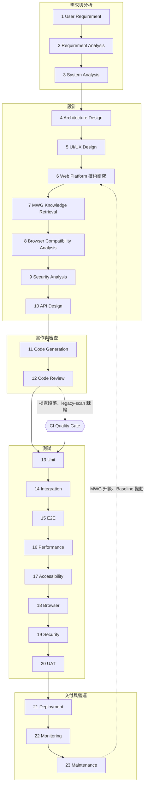

### 10.2 各階段的 MWG 用法與價值

| # | 階段 | MWG 用法 | 產出／證據 | 負責角色 |
|---|---|---|---|---|
| 1 | User Requirement | 不使用 | 需求單 | PM |
| 2 | Requirement Analysis | `search` 確認「需求有沒有原生解法」（例如「點外面關閉」→ `light-dismiss-a-dialog`） | 需求附註 guide id | SA |
| 3 | System Analysis | 確認目標瀏覽器、WebView、IE mode 頁面範圍 | 瀏覽器支援矩陣 | SA |
| 4 | Architecture Design | 決定 Baseline 目標、polyfill 政策，寫入 `AGENTS.md` | ADR、`AGENTS.md` | Architect |
| 5 | UI/UX Design | 設計稿標註互動（dialog、popover、tooltip）→ 對應指南 | 互動規格附 guide id | UX＋SA |
| 6 | Web Platform 技術研究 | Agent 執行 Prompt 8（技術選型） | 技術決策報告 | Senior Dev |
| 7 | MWG Knowledge Retrieval | `retrieve` 情境＋學科指南 | 指南清單（id＋版本） | Agent |
| 8 | Browser Compatibility | `guide-baseline.mjs` 比對政策 | 相容性矩陣 | Senior Dev |
| 9 | Security Analysis | `security`、`sanitize-untrusted-html`、`trusted-types` 指南 | 威脅清單（前端部分） | DevSecOps |
| 10 | API Design | 不直接相關；但前端呼叫方式依 `js` 指南（AbortSignal、Error cause） | API 規格 | Backend＋Frontend |
| 11 | Code Generation | Skill 自動觸發；揭露段落 | 程式碼＋`### Modern Web Guidance` | Agent＋Dev |
| 12 | Code Review | Prompt 4；`disclosure-check.mjs`；`legacy-scan` 棘輪 | Review 紀錄 | Reviewer |
| 13～15 | Unit／Integration／E2E | 依指南的 MANDATORY 規則設計測試（例如 `returnValue` 重設） | 測試報告 | Dev＋QA |
| 16 | Performance Testing | 依 `performance` 指南量 INP／LCP／CLS | Lighthouse／RUM 報告 | QA |
| 17 | Accessibility Testing | axe＋人工鍵盤／報讀器測試 | 無障礙報告 | QA |
| 18 | Browser Testing | 原生與 fallback 雙路徑（第 11.6 節） | 跨瀏覽器測試報告 | QA |
| 19 | Security Testing | DAST、XSS 測試（MWG 不提供） | 弱點報告 | DevSecOps |
| 20 | UAT | 不使用 | 驗收紀錄 | 業務單位 |
| 21 | Deployment | CI 閘門全綠才可部署 | Pipeline 紀錄 | DevOps |
| 22 | Monitoring | RUM 監看 fallback 路徑的錯誤率 | 儀表板 | SRE |
| 23 | Maintenance | 每季 `legacy-scan`；MWG 升級時重跑相容性 | 技術債趨勢 | Tech Lead |

### 10.3 證據鏈（Audit Trail）

每一個前端功能，最後都要能回答這四個問題（建議流程）：

1. **查了什麼？** Agent 工具紀錄中的 `search`／`retrieve` 指令。
2. **用了什麼？** PR 描述中的 `### Modern Web Guidance` 段落（id＋原文引用）。
3. **相容性怎麼判斷？** `guide-baseline.mjs` 輸出或相容性矩陣。
4. **誰核准？** PR reviewer；涉及 volatile／OT 時另附架構審查單號。

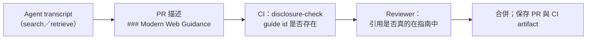

### 10.4 分工：人做什麼、Agent 做什麼

| 工作 | Agent | 人 |
|---|---|---|
| 查指南、產生程式碼 | ✅ | 抽查 |
| 決定 Baseline 目標與例外 | ❌ | ✅ 架構師 |
| 開啟 OT／volatile | ❌（CLI 也會擋） | ✅ 架構師＋資安 |
| 判斷 `legacy-scan` 發現要不要修 | 初判（keepWhen／dropWhen） | ✅ 最終決定 |
| 無障礙人工測試（報讀器） | ❌ | ✅ QA |
| 合併 PR | ❌ | ✅ |

### 10.5 實務案例：需求單「案件列表新增批次刪除」

| 階段 | 實際動作 |
|---|---|
| 需求分析 | SA 在需求單寫：「刪除前要確認；可點背景取消；鍵盤可操作」 |
| MWG 查詢 | `search "confirmation modal dialog"` → `dialog`；`search "light dismiss dialog"` → `light-dismiss-a-dialog` |
| 相容性 | `guide-baseline.mjs --target widely light-dismiss-a-dialog` → `<dialog closedby>` Limited → 需 fallback |
| 實作 | Agent 依 `dialog` 指南實作 `pointerdown`／`pointerup` fallback（第 11 章 `ConfirmDialog.vue`） |
| 審查 | Reviewer 對照「指南規則 → 程式碼證據」表（第 6.5 節） |
| 測試 | Playwright 測 Esc、點背景、點內部不關閉、fallback 路徑（第 11.6 節） |

### 10.6 本章 AI 產出審查

**範例：Agent 在需求分析階段就直接寫出元件程式碼：**

- ⚠️ 跳過了「相容性判斷」與「人決定 Baseline」兩步，等於讓 Agent 決定公司政策。
- ✅ 在提示詞明寫「本階段只輸出分析報告，不寫程式」（Prompt 8 的 Constraints）。

**範例：PR 描述的揭露段落只有一句「已參考 Modern Web Guidance」：**

- ❌ 沒有 id、沒有引用，也沒說查過哪些主題，無法審查。
- ✅ `disclosure-check.mjs` 會輸出 `WARN  no guide id`（第 16.5 節）。工具不直接判失敗，因為官方允許「查過但沒有套用」時只寫一句說明；reviewer 看到 WARN 就要確認那句話有寫出查過的主題與不套用的理由。這是本手冊工具第一版的假綠燈：一句空話也能 PASS，撰寫本章時才發現並補上。

> 🎯 **本章重點**：MWG 主要用在第 2、5～8、11～12、18、23 步；每一步都要留下 guide id 與判斷依據。

## 第 11 章：AI Agent 開發 Web Application 實戰

案例：**貸款案件管理（企業內部管理系統）**，包含案件列表、篩選、刪除確認對話框、申請表單、備註顯示（外部 HTML）、API 串接。技術：Vue 3.5＋TypeScript＋Vite 8。

本章程式碼全部實測：`vue-tsc` 型別檢查、`vite build`、Playwright 1.65.1 在 Chrome 158 執行 11 個 E2E（含 fallback 路徑與 axe 無障礙掃描）。為了讓範例可完整驗證，沒有使用 PrimeVue、Pinia、Tailwind；11.8 節說明換成這些技術時要注意什麼。

### 11.1 Step 1：需求分析

**Functional Requirements：**

| ID | 需求 |
|---|---|
| FR-1 | 以表格列出貸款案件（案號、申請人、金額、狀態、備註） |
| FR-2 | 可依狀態篩選（全部／待審／已核准） |
| FR-3 | 刪除案件前要確認；可按 Esc 或點背景取消 |
| FR-4 | 新增申請表單：姓名、Email、金額（≥ 10,000）、備註 |
| FR-5 | 備註來自外部系統，含部分 HTML 格式（粗體、清單） |

**Non-functional Requirements：**

| ID | 需求 |
|---|---|
| NFR-1 | 瀏覽器：Baseline Widely available（公司政策，第 8.9 節） |
| NFR-2 | 無障礙：WCAG 2.2 AA；全程可用鍵盤操作 |
| NFR-3 | 安全：外部 HTML 不得造成 XSS |
| NFR-4 | 效能：不得為了少數瀏覽器讓所有使用者下載 polyfill |
| NFR-5 | API 呼叫 10 秒逾時，使用者離開頁面時取消請求 |

**User Story 與 Acceptance Criteria（節錄）：**

```gherkin
Feature: 刪除案件
  Scenario: 使用者取消刪除
    Given 案件列表中有 L-1001
    When 我點「刪除 L-1001」
    Then 出現標題為「確定刪除這筆案件？」的對話框，且焦點在「取消」
    When 我按 Esc
    Then 對話框關閉、案件仍在，且焦點回到「刪除 L-1001」按鈕

  Scenario: 表單錯誤只在互動後顯示
    Given 我剛打開申請表單
    Then 不應看到任何錯誤訊息
    When 我在 Email 輸入 "not-an-email" 並離開欄位
    Then 看到「請輸入有效的 Email」
```

### 11.2 Step 2：Web Platform 技術分析

Agent 提示詞

```text
你是本專案的前端工程師。請先不要寫程式。
針對 docs/requirements/loan-admin.md 的 FR-1～FR-5，使用 modern-web-guidance：
1. 每個需求拆成單一能力，用英文 2～5 字 search（不要加 Vue、PrimeVue 等框架名稱）。
2. 對相關結果 retrieve，記錄 guide id、用到的 feature、Baseline 狀態、fallback 類型。
3. 依 AGENTS.md 的 Browser support policy 判斷每個 feature 能不能用。
輸出：需求｜search 查詢｜guide id｜feature｜Baseline｜判斷｜fallback 方式。
不確定的地方列成待確認問題。
```

預期的分析結果（依本手冊實測的 search／retrieve 與 web-features 3.46.0 整理）：

| 需求 | search 查詢 | guide id | 關鍵 feature | Baseline | 判斷 |
|---|---|---|---|---|---|
| FR-1 | `responsive data table` | `responsive-table` | sticky、container queries | Widely | 直接用 |
| FR-2 | `toggle popover without javascript` | `declarative-dialog-popover-control` | Popover | Newly | 用＋條件載入 polyfill |
| FR-3 | `confirmation modal dialog`、`light dismiss dialog` | `dialog`、`light-dismiss-a-dialog` | `<dialog>`／`closedby` | Widely／Limited | `<dialog>` 直接用；`closedby` 加 fallback |
| FR-4 | `form validation after interaction`、`auto grow textarea` | `validate-input-after-interaction`、`form-fields-automatically-fit-contents` | `:user-invalid`、`field-sizing` | Widely／Newly | `:user-invalid` 直接用；`field-sizing` 用 `@supports` |
| FR-5 | `sanitize untrusted html` | `sanitize-untrusted-html` | Sanitizer API | Limited | 原生優先＋DOMPurify 動態載入 |
| NFR-5 | `abort fetch timeout` | `js` | `AbortSignal.timeout()`／`any()` | Widely | 直接用 |

### 11.3 Step 3：Architecture Design

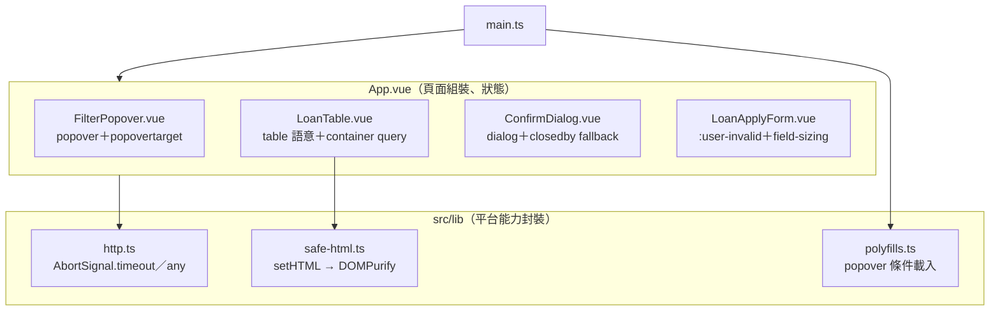

設計決策：

| 決策 | 理由 |
|---|---|
| 平台能力集中在 `src/lib` | feature detection 與 fallback 只寫一次；日後 feature 變 Widely 時只改一處 |
| 元件內不寫 `role="dialog"`、focus trap | `dialog` 指南 DON'T 規則 |
| 狀態放 `App.vue` 的 `ref` | 範例規模小；正式專案可換 Pinia，不影響 MWG 相關寫法 |
| 錯誤處理：`HttpError` 帶 `cause` | `js` 指南：Error cause 為 Widely |

### 11.4 Step 4：Code Generation

Agent 提示詞（使用第 14 章 Prompt 1 的精簡版）：

```text
依 11.2 的分析結果實作 src/components 與 src/lib。
規則：
- 先 retrieve 分析表中的每個 guide id，逐條遵守 MANDATORY／DO NOT。
- 不得新增 package.json 依賴，除了指南指定的 polyfill（條件載入）與 DOMPurify（fallback）。
- 指南是 vanilla 寫法；轉成 Vue 時保留原生元素與屬性（dialog、popover、closedby）。
- 完成後附 ### Modern Web Guidance 段落。use modern-web-guidance
```

以下是完成後的程式碼（實測通過型別檢查、建置與 E2E）。

📄 `vue-admin/package.json`

```json
{
  "name": "loan-admin-console",
  "private": true,
  "type": "module",
  "scripts": {
    "dev": "vite",
    "build": "vite build",
    "preview": "vite preview --port 4173 --strictPort",
    "type-check": "vue-tsc --noEmit",
    "test:e2e": "playwright test"
  },
  "dependencies": {
    "@oddbird/popover-polyfill": "0.7.3",
    "dompurify": "3.4.18",
    "vue": "3.5.45"
  },
  "devDependencies": {
    "@axe-core/playwright": "4.14.0",
    "@playwright/test": "1.65.1",
    "@vitejs/plugin-vue": "6.0.11",
    "typescript": "5.9.3",
    "vite": "8.3.8",
    "vue-tsc": "3.3.14"
  }
}
```

📄 `vue-admin/src/lib/polyfills.ts`

```ts
// 依 MWG `declarative-dialog-popover-control` 指南：Popover 為 Baseline Newly available，
// 本專案目標是 Widely available，因此在不支援的瀏覽器才動態載入 polyfill（不可無條件載入）
export async function loadPlatformPolyfills(): Promise<void> {
  if (!Object.hasOwn(HTMLElement.prototype, "popover")) {
    await import("@oddbird/popover-polyfill");
  }
}
```

📄 `vue-admin/src/main.ts`

```ts
import { createApp } from "vue";
import App from "./App.vue";
import "./styles.css";
import { loadPlatformPolyfills } from "./lib/polyfills";

await loadPlatformPolyfills();
createApp(App).mount("#app");
```

📄 `vue-admin/src/lib/http.ts`

```ts
// 依 MWG `js` 指南：用 AbortSignal.timeout() 與 AbortSignal.any() 取代手寫 setTimeout＋AbortController
// AbortSignal.any()、AbortSignal.timeout()、Error cause 都是 Baseline Widely available（web-features 3.46.0）
export class HttpError extends Error {
  constructor(
    message: string,
    readonly status: number,
    options?: ErrorOptions,
  ) {
    super(message, options);
    this.name = "HttpError";
  }
}

export interface GetJsonOptions {
  signal?: AbortSignal;
  timeoutMs?: number;
}

export async function getJson<T>(url: string, { signal, timeoutMs = 10_000 }: GetJsonOptions = {}): Promise<T> {
  const timeout = AbortSignal.timeout(timeoutMs);
  const combined = signal ? AbortSignal.any([signal, timeout]) : timeout;
  let res: Response;
  try {
    res = await fetch(url, { signal: combined, headers: { Accept: "application/json" } });
  } catch (cause) {
    if (timeout.aborted) throw new HttpError(`逾時（${timeoutMs} ms）：${url}`, 0, { cause });
    throw cause; // 呼叫端主動取消（AbortError）原樣拋出，由呼叫端忽略
  }
  if (!res.ok) throw new HttpError(`HTTP ${res.status}：${url}`, res.status);
  return (await res.json()) as T;
}
```

📄 `vue-admin/src/lib/safe-html.ts`

```ts
// 依 MWG `sanitize-untrusted-html` 指南：優先用原生 Sanitizer（setHTML），不支援時才動態載入 DOMPurify
// Sanitizer API 為 Limited availability（Safari 未支援），所以 fallback 是必要的
const elements = ["p", "b", "i", "strong", "em", "ul", "ol", "li", "br"];
const attributes: string[] = [];

type SetHTML = (html: string, options?: { sanitizer?: { elements: string[]; attributes: string[] } }) => void;

let domPurifyPromise: Promise<typeof import("dompurify").default> | undefined;
function loadDOMPurify() {
  domPurifyPromise ??= import("dompurify").then((mod) => mod.default);
  return domPurifyPromise;
}

export async function safeSetHTML(el: Element, html: string): Promise<void> {
  if ("setHTML" in Element.prototype) {
    (el as Element & { setHTML: SetHTML }).setHTML(html, { sanitizer: { elements, attributes } });
    return;
  }
  const DOMPurify = await loadDOMPurify();
  el.innerHTML = DOMPurify.sanitize(html, {
    ALLOWED_TAGS: [...elements, "#text"],
    ALLOWED_ATTR: attributes,
    ALLOW_ARIA_ATTR: false,
    ALLOW_DATA_ATTR: false,
    KEEP_CONTENT: false,
  });
}
```

📄 `vue-admin/src/components/ConfirmDialog.vue`

```vue
<script setup lang="ts">
// 依 MWG `dialog` 指南：原生 <dialog> + showModal()；不加 role="dialog"、aria-modal、focus trap、Esc handler
import { onMounted, ref, useId } from "vue";

const props = defineProps<{ title: string; confirmLabel: string }>();
const emit = defineEmits<{ decided: [value: "confirm" | "cancel" | ""] }>();

const dialogRef = ref<HTMLDialogElement>();
const titleId = useId();

function open() {
  dialogRef.value?.showModal();
}

function onClose() {
  const dlg = dialogRef.value!;
  const value = dlg.returnValue as "confirm" | "cancel" | "";
  dlg.returnValue = ""; // 依指南重設，避免 Esc 關閉時讀到上一次的值
  emit("decided", value);
}

// closedby 為 Limited availability（Safari 未支援）：依指南用 pointerdown + pointerup 判斷，不用 event.target
onMounted(() => {
  const dlg = dialogRef.value!;
  if ("closedBy" in HTMLDialogElement.prototype) return;
  const outside = (e: PointerEvent) => {
    const r = dlg.getBoundingClientRect();
    return e.clientX < r.left || e.clientX > r.right || e.clientY < r.top || e.clientY > r.bottom;
  };
  let pressedOutside = false;
  dlg.addEventListener("pointerdown", (e) => (pressedOutside = outside(e)));
  dlg.addEventListener("pointerup", (e) => {
    if (pressedOutside && outside(e)) dlg.close();
  });
});

defineExpose({ open });
</script>

<template>
  <dialog ref="dialogRef" closedby="any" :aria-labelledby="titleId" @close="onClose">
    <h2 :id="titleId">{{ props.title }}</h2>
    <slot />
    <form method="dialog">
      <button value="cancel" autofocus>取消</button>
      <button value="confirm" class="danger">{{ props.confirmLabel }}</button>
    </form>
  </dialog>
</template>

<style scoped>
dialog:modal {
  overscroll-behavior: contain;
}
dialog::backdrop {
  overflow: hidden;
  overscroll-behavior: contain;
}
</style>
```

📄 `vue-admin/src/components/FilterPopover.vue`

```vue
<script setup lang="ts">
// 依 MWG `declarative-dialog-popover-control` 指南：popovertarget 宣告式開關，不寫 click listener
// Popover 為 Newly available：polyfill 由 src/lib/polyfills.ts 依 feature detection 動態載入
import { useId } from "vue";

const model = defineModel<string>({ default: "all" });
const panelId = useId();
</script>

<template>
  <button type="button" :popovertarget="panelId">篩選狀態</button>
  <div :id="panelId" popover class="filter-panel">
    <fieldset>
      <legend>案件狀態</legend>
      <label><input v-model="model" type="radio" value="all"> 全部</label>
      <label><input v-model="model" type="radio" value="pending"> 待審</label>
      <label><input v-model="model" type="radio" value="approved"> 已核准</label>
    </fieldset>
  </div>
</template>
```

📄 `vue-admin/src/components/LoanApplyForm.vue`

```vue
<script setup lang="ts">
// 依 MWG `validate-input-after-interaction`、`autofill-sign-in-form`、`form-fields-automatically-fit-contents` 指南
// :user-invalid 只在使用者互動後才顯示錯誤；textarea 用 CSS field-sizing（@supports 包住）取代 autosize()
import { useId } from "vue";

const emit = defineEmits<{ submitted: [data: FormData] }>();
const ids = { name: useId(), email: useId(), amount: useId(), note: useId() };

function onSubmit(e: SubmitEvent) {
  const form = e.target as HTMLFormElement;
  if (!form.checkValidity()) return;
  emit("submitted", new FormData(form));
}
</script>

<template>
  <form @submit.prevent="onSubmit" novalidate>
    <label :for="ids.name">申請人姓名</label>
    <input :id="ids.name" name="name" required autocomplete="name">
    <span class="field-error">請輸入姓名</span>

    <label :for="ids.email">Email</label>
    <input :id="ids.email" name="email" type="email" required autocomplete="email">
    <span class="field-error">請輸入有效的 Email</span>

    <label :for="ids.amount">申請金額（新臺幣）</label>
    <input :id="ids.amount" name="amount" type="number" min="10000" step="1000" required inputmode="numeric">
    <span class="field-error">金額至少 10,000 元</span>

    <label :for="ids.note">備註</label>
    <textarea :id="ids.note" class="note" name="note" maxlength="500"></textarea>

    <button type="submit">送出申請</button>
  </form>
</template>
```

📄 `vue-admin/src/components/LoanTable.vue`

```vue
<script setup lang="ts">
// 依 MWG `responsive-table` 指南：保留 <table> 語意（caption、th scope），用 container query 調整欄位
import { onMounted, ref, watch } from "vue";
import { safeSetHTML } from "../lib/safe-html";

export interface Loan {
  id: string;
  applicant: string;
  amount: number;
  status: "pending" | "approved";
  remarkHtml: string;
}

const props = defineProps<{ loans: Loan[] }>();
const emit = defineEmits<{ remove: [id: string] }>();
const remarkCells = ref<HTMLElement[]>([]);
const money = new Intl.NumberFormat("zh-TW", { style: "currency", currency: "TWD", maximumFractionDigits: 0 });

// 備註來自外部系統，可能含 HTML：一律經 safeSetHTML，不用 v-html
async function renderRemarks() {
  await Promise.all(props.loans.map((loan, i) => (remarkCells.value[i] ? safeSetHTML(remarkCells.value[i], loan.remarkHtml) : undefined)));
}
onMounted(renderRemarks);
watch(() => props.loans, renderRemarks, { flush: "post" });
</script>

<template>
  <div class="table-wrap">
    <table>
      <caption>貸款案件（共 {{ props.loans.length }} 筆）</caption>
      <thead>
        <tr>
          <th scope="col">案號</th>
          <th scope="col">申請人</th>
          <th scope="col">金額</th>
          <th scope="col">狀態</th>
          <th scope="col" class="col-optional">備註</th>
          <th scope="col"><span class="visually-hidden">操作</span></th>
        </tr>
      </thead>
      <tbody>
        <tr v-for="(loan, i) in props.loans" :key="loan.id">
          <th scope="row">{{ loan.id }}</th>
          <td>{{ loan.applicant }}</td>
          <td>{{ money.format(loan.amount) }}</td>
          <td>{{ loan.status === "approved" ? "已核准" : "待審" }}</td>
          <td :ref="(el) => (remarkCells[i] = el as HTMLElement)" class="col-optional remark"></td>
          <td><button type="button" @click="emit('remove', loan.id)">刪除 {{ loan.id }}</button></td>
        </tr>
      </tbody>
    </table>
  </div>
</template>
```

📄 `vue-admin/src/App.vue`

```vue
<script setup lang="ts">
import { computed, ref } from "vue";
import ConfirmDialog from "./components/ConfirmDialog.vue";
import FilterPopover from "./components/FilterPopover.vue";
import LoanApplyForm from "./components/LoanApplyForm.vue";
import LoanTable, { type Loan } from "./components/LoanTable.vue";

const loans = ref<Loan[]>([
  { id: "L-1001", applicant: "王小明", amount: 500000, status: "pending", remarkHtml: "<p>補件：<strong>財力證明</strong></p>" },
  { id: "L-1002", applicant: "陳美玲", amount: 1200000, status: "approved", remarkHtml: "<p>已核准</p><script>alert(2)<\/script>" },
]);
const filter = ref("all");
const visible = computed(() => loans.value.filter((l) => filter.value === "all" || l.status === filter.value));
const pendingRemove = ref<string>();
const confirmRef = ref<InstanceType<typeof ConfirmDialog>>();
const lastResult = ref("");

function askRemove(id: string) {
  pendingRemove.value = id;
  confirmRef.value?.open();
}

function onDecided(value: "confirm" | "cancel" | "") {
  lastResult.value = value || "dismissed";
  if (value === "confirm") loans.value = loans.value.filter((l) => l.id !== pendingRemove.value);
}
</script>

<template>
  <main>
    <h1>貸款案件管理</h1>
    <FilterPopover v-model="filter" />
    <LoanTable :loans="visible" @remove="askRemove" />
    <p data-testid="last-result">{{ lastResult }}</p>
    <ConfirmDialog ref="confirmRef" title="確定刪除這筆案件？" confirm-label="刪除" @decided="onDecided">
      <p>案號 {{ pendingRemove }} 刪除後無法復原。</p>
    </ConfirmDialog>
    <h2>新增申請</h2>
    <LoanApplyForm />
  </main>
</template>
```

📄 `vue-admin/src/styles.css`

```css
@layer reset, base, components;

@layer base {
  :root {
    color-scheme: light dark;
    --surface: Canvas;
    --text: CanvasText;
    --danger: #b3261e;
    font-family: system-ui, "Noto Sans TC", sans-serif;
  }

  body {
    margin: 0;
    background: var(--surface);
    color: var(--text);
  }

  .visually-hidden {
    position: absolute;
    inline-size: 1px;
    block-size: 1px;
    overflow: hidden;
    clip-path: inset(50%);
    white-space: nowrap;
  }

  :focus-visible {
    outline: 3px solid Highlight;
    outline-offset: 2px;
  }
}

@layer components {
  /* polyfill 無法定義 :popover-open，必須用 :is() 合併，否則舊瀏覽器會丟掉整條規則 */
  [popover]:is(:popover-open, .\:popover-open) {
    display: block;
  }

  dialog::backdrop {
    background-color: rgb(0 0 0 / 0.5);
  }

  .field-error {
    display: none;
    color: var(--danger);
  }

  input:user-invalid + .field-error,
  textarea:user-invalid + .field-error {
    display: block;
  }

  textarea.note {
    min-block-size: 3lh;
    max-block-size: 12lh;
  }

  @supports (field-sizing: content) {
    textarea.note {
      field-sizing: content;
    }
  }

  .table-wrap {
    container-type: inline-size;
    overflow-x: auto;
  }

  .table-wrap th {
    position: sticky;
    inset-block-start: 0;
    background: var(--surface);
  }

  @container (inline-size < 40rem) {
    .col-optional {
      display: none;
    }
  }
}
```

其餘設定檔：

📄 `vue-admin/index.html`

```html
<!doctype html>
<html lang="zh-Hant">
  <head>
    <meta charset="utf-8">
    <meta name="viewport" content="width=device-width, initial-scale=1">
    <meta name="color-scheme" content="light dark">
    <title>貸款案件管理</title>
  </head>
  <body>
    <div id="app"></div>
    <script type="module" src="/src/main.ts"></script>
  </body>
</html>
```

📄 `vue-admin/vite.config.ts`

```ts
import { defineConfig } from "vite";
import vue from "@vitejs/plugin-vue";

export default defineConfig({
  plugins: [vue()],
  build: { target: "es2022" },
});
```

📄 `vue-admin/tsconfig.json`

```json
{
  "compilerOptions": {
    "target": "ES2022",
    "module": "ESNext",
    "moduleResolution": "Bundler",
    "strict": true,
    "jsx": "preserve",
    "lib": ["ES2023", "DOM", "DOM.Iterable"],
    "types": ["vite/client"],
    "skipLibCheck": true,
    "noEmit": true
  },
  "include": ["src/**/*.ts", "src/**/*.vue", "tests/**/*.ts", "playwright.config.ts", "vite.config.ts"]
}
```

> 📌 **兩份官方指南的 fallback 不一致。** `light-dismiss-a-dialog` 的 fallback 用 `click` 事件＋`event.target !== dialog` 判斷；`dialog` 指南則明確說「Test the pointer position, not event.target」，改用 `pointerdown`＋`pointerup`，避免拖曳選字結束在背景時誤關。本範例採用 `dialog` 指南的寫法。**指南之間也可能矛盾，審查時要以較具體、較新的規則為準，並記錄採用理由。**

建置結果（實測）：

```text
$ npm run type-check
exit=0
$ npm run build
vite v8.3.8 building client environment for production...
transforming...
✓ 27 modules transformed.
rendering chunks...
computing gzip size...
dist/index.html                     0.45 kB │ gzip:  0.31 kB
dist/assets/index-DUdExzm0.css      1.24 kB │ gzip:  0.61 kB
dist/assets/popover-Dq3_X4WP.js    10.94 kB │ gzip:  3.70 kB
dist/assets/purify.es-Dzkdzyfv.js  28.50 kB │ gzip: 11.42 kB
dist/assets/index-C5APbsvw.js      73.97 kB │ gzip: 29.41 kB

✓ built in 361ms
```

`popover-*.js`（3.70 kB gzip）與 `purify.es-*.js`（11.42 kB gzip）被拆成獨立 chunk，只有在 feature detection 失敗時才下載（11.6 節以 E2E 驗證）。

### 11.5 Step 5：Code Review

**「指南規則 → 程式碼證據」對照表**（Reviewer 逐列打勾）：

| 指南 | 規則（原文節錄） | 證據位置 | 結果 |
|---|---|---|---|
| `dialog` | 「DON'T add `role="dialog"`, `aria-modal`, a focus trap, `inert` toggling or an `Esc` handler」 | `ConfirmDialog.vue` template | ✅ |
| `dialog` | 「DO use `dialog.showModal()` when opening from script」 | `open()` | ✅ |
| `dialog` | 「DO read `dialog.returnValue` ... then reset it」 | `onClose()` | ✅ |
| `dialog` | 「DO put `autofocus` on the safe action ... in a destructive confirmation」 | 「取消」按鈕 | ✅ |
| `dialog` | `overscroll-behavior: contain` 於 `dialog:modal` 與 `::backdrop` | `<style scoped>` | ✅ |
| `dialog` | closedby fallback 用指標位置判斷 | `onMounted` | ✅ |
| `declarative-dialog-popover-control` | 「load the polyfill only when native support is missing」 | `polyfills.ts` | ✅ |
| `declarative-dialog-popover-control` | `[popover]:is(:popover-open, .\:popover-open)` | `styles.css` | ✅ |
| `sanitize-untrusted-html` | 原生 `setHTML`，否則動態載入 DOMPurify，且設定 `ALLOW_ARIA_ATTR: false` 等 | `safe-html.ts` | ✅ |
| `validate-input-after-interaction` | 用 `:user-invalid` 而非 `:invalid` | `styles.css` | ✅ |
| `form-fields-automatically-fit-contents` | `field-sizing` 包在 `@supports`，保留 min／max | `styles.css` | ✅ |
| `responsive-table` | `caption`、`th scope` | `LoanTable.vue` | ✅ |

**常見 AI 錯誤與抓法：**

| 錯誤 | 抓法（指令或檢查點） |
|---|---|
| 用 `v-html` 顯示備註 | `grep -rn "v-html" src/` 必須為空 |
| `<dialog>` 加 `role="dialog"` | `grep -rn 'role="dialog"' src/` 必須為空 |
| 無條件 `import "@oddbird/popover-polyfill"` | `grep -rn "popover-polyfill" src/` 只能出現在 `import()` |
| 用 `:invalid` | `grep -rn ":invalid" src/` 應只有 `:user-invalid` |
| 新增 jQuery／moment／lodash | `git diff package.json` |

### 11.6 Step 6：Testing

**E2E（行為）：**

📄 `vue-admin/tests/e2e/admin.spec.ts`

```ts
// 驗證 AI 依 MWG 指南產生的元件「行為」正確，而不只是語法正確
import { expect, test } from "@playwright/test";
import AxeBuilder from "@axe-core/playwright";

test.beforeEach(async ({ page }) => {
  await page.goto("/");
});

test("confirm dialog: Esc dismisses without choosing, focus returns to invoker", async ({ page }) => {
  const invoker = page.getByRole("button", { name: "刪除 L-1001" });
  await invoker.click();
  const dialog = page.getByRole("dialog", { name: "確定刪除這筆案件？" });
  await expect(dialog).toBeVisible();
  await expect(page.getByRole("button", { name: "取消" })).toBeFocused();
  await page.keyboard.press("Escape");
  await expect(dialog).toBeHidden();
  await expect(page.getByTestId("last-result")).toHaveText("dismissed");
  await expect(invoker).toBeFocused();
});

test("confirm dialog: clicking the backdrop closes it, clicking inside does not", async ({ page }) => {
  await page.getByRole("button", { name: "刪除 L-1001" }).click();
  const dialog = page.getByRole("dialog");
  await dialog.getByRole("heading").click();
  await expect(dialog).toBeVisible();
  await page.mouse.click(5, 5);
  await expect(dialog).toBeHidden();
});

test("confirm dialog: confirm removes the row", async ({ page }) => {
  await page.getByRole("button", { name: "刪除 L-1002" }).click();
  await page.getByRole("button", { name: "刪除", exact: true }).click();
  await expect(page.getByRole("caption")).toContainText("共 1 筆");
});

test("filter popover opens declaratively and filters rows", async ({ page }) => {
  await page.getByRole("button", { name: "篩選狀態" }).click();
  await page.getByLabel("已核准").check();
  await expect(page.getByRole("caption")).toContainText("共 1 筆");
  await page.keyboard.press("Escape");
  await expect(page.getByRole("group", { name: "案件狀態" })).toBeHidden();
});

test("remarks are sanitized (no img onerror, no script)", async ({ page }) => {
  const remarks = page.locator("td.remark");
  await expect(remarks.first()).toContainText("財力證明");
  expect(await page.locator("td.remark img, td.remark script").count()).toBe(0);
});

test("form errors appear only after interaction", async ({ page }) => {
  const email = page.getByLabel("Email");
  const error = page.getByText("請輸入有效的 Email");
  await expect(error).toBeHidden();
  await email.fill("not-an-email");
  await email.blur();
  await expect(error).toBeVisible();
});

test("no axe violations (wcag2a, wcag2aa, wcag22aa)", async ({ page }) => {
  const results = await new AxeBuilder({ page }).withTags(["wcag2a", "wcag2aa", "wcag22aa"]).analyze();
  expect(results.violations.map((v) => v.id)).toEqual([]);
});
```

**E2E（fallback 路徑）**：在 Chrome 中刪除 feature detection 用的屬性，強迫程式走 fallback。最後一個測試是「對照組」，證明拿掉 fallback 時點背景不會關閉，確認前一個測試不是假綠燈。

📄 `vue-admin/tests/e2e/fallback.spec.ts`

```ts
// 只在 Chrome 測原生路徑等於只測一半：這裡移除 feature detection 用的屬性，強迫走 fallback 路徑
import { expect, test } from "@playwright/test";

test("native path: DOMPurify chunk is NOT downloaded when setHTML exists", async ({ page }) => {
  const purify: string[] = [];
  page.on("request", (r) => r.url().includes("purify") && purify.push(r.url()));
  await page.goto("/");
  await expect(page.locator("td.remark").first()).toContainText("財力證明");
  const native = await page.evaluate(() => "setHTML" in Element.prototype);
  expect(purify.length).toBe(native ? 0 : 1);
});

test("fallback path: no setHTML -> DOMPurify is loaded and still sanitizes", async ({ page }) => {
  await page.addInitScript(() => {
    delete (Element.prototype as unknown as Record<string, unknown>).setHTML;
  });
  const purify: string[] = [];
  page.on("request", (r) => r.url().includes("purify") && purify.push(r.url()));
  await page.goto("/");
  await expect(page.locator("td.remark").first()).toContainText("財力證明");
  expect(purify.length).toBe(1);
  expect(await page.locator("td.remark img, td.remark script").count()).toBe(0);
});

test("fallback path: no closedBy -> pointer fallback closes on backdrop", async ({ page }) => {
  await page.addInitScript(() => {
    delete (HTMLDialogElement.prototype as unknown as Record<string, unknown>).closedBy;
  });
  await page.goto("/");
  await page.getByRole("button", { name: "刪除 L-1001" }).click();
  const dialog = page.getByRole("dialog");
  // 移除屬性，確保關閉是 fallback 做的，而不是瀏覽器原生 closedby
  await dialog.evaluate((d) => d.setAttribute("closedby", "closerequest"));
  await dialog.getByRole("heading").click();
  await expect(dialog).toBeVisible();
  await page.mouse.click(5, 5);
  await expect(dialog).toBeHidden();
});

test("control: without the fallback, a backdrop click does NOT close (proves the test is meaningful)", async ({ page }) => {
  await page.goto("/");
  await page.getByRole("button", { name: "刪除 L-1001" }).click();
  const dialog = page.getByRole("dialog");
  await dialog.evaluate((d) => d.setAttribute("closedby", "closerequest"));
  await page.mouse.click(5, 5);
  await expect(dialog).toBeVisible();
});
```

📄 `vue-admin/playwright.config.ts`

```ts
import { defineConfig } from "@playwright/test";

export default defineConfig({
  testDir: "tests/e2e",
  use: { baseURL: "http://localhost:4173", channel: "chrome" },
  webServer: {
    command: "npm run build && npm run preview",
    url: "http://localhost:4173",
    reuseExistingServer: false,
    timeout: 120_000,
  },
});
```

實測結果：

```text
$ npx playwright test --reporter=line
Running 11 tests using 2 workers
[1/11] tests\e2e\fallback.spec.ts:4:1 › native path: DOMPurify chunk is NOT downloaded when setHTML exists
[2/11] tests\e2e\admin.spec.ts:9:1 › confirm dialog: Esc dismisses without choosing, focus returns to invoker
[3/11] tests\e2e\fallback.spec.ts:13:1 › fallback path: no setHTML -> DOMPurify is loaded and still sanitizes
[4/11] tests\e2e\admin.spec.ts:21:1 › confirm dialog: clicking the backdrop closes it, clicking inside does not
[5/11] tests\e2e\fallback.spec.ts:25:1 › fallback path: no closedBy -> pointer fallback closes on backdrop
[6/11] tests\e2e\admin.spec.ts:30:1 › confirm dialog: confirm removes the row
[7/11] tests\e2e\fallback.spec.ts:40:1 › control: without the fallback, a backdrop click does NOT close (proves the test is meaningful)
[8/11] tests\e2e\admin.spec.ts:36:1 › filter popover opens declaratively and filters rows
[9/11] tests\e2e\admin.spec.ts:44:1 › remarks are sanitized (no img onerror, no script)
[10/11] tests\e2e\admin.spec.ts:50:1 › form errors appear only after interaction
[11/11] tests\e2e\admin.spec.ts:59:1 › no axe violations (wcag2a, wcag2aa, wcag22aa)
  11 passed (21.3s)
```

測試類型對照：

| 類型 | 本範例做法 | 正式專案補充 |
|---|---|---|
| Unit | `http.ts` 可用 Vitest 測逾時與取消（本範例未附） | Vitest＋MSW |
| Integration | 元件與 `safe-html` 的整合由 E2E 涵蓋 | Vue Test Utils |
| E2E | Playwright 11 案例 | 依 User Story 擴充 |
| Browser Compatibility | 原生＋fallback 雙路徑 | Playwright 的 `firefox`、`webkit` 專案；Safari 實機 |
| Accessibility | axe（wcag2a／2aa／22aa）0 違規 | **人工**鍵盤與 NVDA／VoiceOver 測試 |
| Performance | 未附 | Lighthouse CI、RUM 的 INP |

> ⚠️ **axe 0 違規不等於符合 WCAG。** 自動化工具只能抓到部分問題；焦點順序是否合理、報讀內容是否清楚，仍要人工測試（第 22 章 Lab 8）。

### 11.7 Step 7：成果評估

比較對象：「未使用 MWG 時 Agent 常見寫法」（第 1.13 節 `before/` 的模式）與本章成果。下表只列**可量測**項目：

| 指標 | 常見寫法 | 本章成果 | 量測方式 |
|---|---|---|---|
| `legacy-scan` 發現 | 每個模式 1 項以上（第 1.13 節：3 項） | 0 項（對 `vue-admin/` 實測） | `legacy-scan` |
| Modal 的 JS | 手寫 Esc、focus、scroll lock | 只有 `showModal()`＋約 10 行 fallback | 程式碼審查 |
| XSS（備註含 ``、`<script>`） | `v-html` 直接渲染 | 已清除（原生與 fallback 兩條路徑都測過） | E2E |
| 無條件下載的 polyfill | 常見 | 0（Chrome 不下載 polyfill 與 DOMPurify） | E2E 監看網路請求 |
| axe 違規 | 未測 | 0 | E2E |

> ⚠️ 這是單一範例的結果，不是統計數據；導入效益請用第 19.5 節 KPI 在實際專案量測。

### 11.8 換成 PrimeVue、Pinia、Tailwind 時的注意事項

| 技術 | MWG 相關注意事項 |
|---|---|
| PrimeVue | PrimeVue 的 Dialog、OverlayPanel 是自己的實作，不是原生 `<dialog>`／popover。要用元件庫就以元件庫為準，**不要**讓 Agent 混用兩套（同一頁兩種 modal 行為）。MWG 的無障礙規則仍可當驗收標準 |
| Pinia | 存進 store 的物件是 reactive Proxy；深拷貝前要 `toRaw()`，而且 `toRaw` 只解開最外層（第 13.6 節實測） |
| Tailwind | `field-sizing`、`:user-invalid` 可用 arbitrary variants；`@supports` 要寫在 CSS 檔或使用 `supports-[...]` 變體 |
| SSR（Nuxt） | SKILL.md：在 SSR 中保護 `window`／`HTMLElement`，polyfill 只在 client 端 `import()` |

### 11.9 本章 AI 產出審查

Agent 完成後的揭露段落應長這樣（範例）：

```markdown
### Modern Web Guidance

- **`dialog`**: 我用 showModal() 開啟並在 close 事件重設 returnValue，沒有加 role="dialog" 或 focus trap，避免重複語意與焦點錯亂（"DON'T add `role="dialog"`, `aria-modal`, a focus trap, `inert` toggling or an `Esc` handler."）。
- **`sanitize-untrusted-html`**: 備註改用 setHTML，Safari 等不支援時才動態載入 DOMPurify，並關閉 aria/data 屬性以對齊原生行為（"load a library like **DOMPurify** only when native support is missing"）。
```

驗證方式：

Shell

```sh
# 1. guide id 是否真實存在（第 16.5 節工具）
npx -y modern-web-guidance@1.0.1 list > mwg-list.json
node tools/mwg/disclosure-check.mjs pr-body.md mwg-list.json --require
# 2. 引用句是否真的在指南裡
npx -y modern-web-guidance@1.0.1 retrieve dialog > /tmp/dialog.md
grep -cF 'aria-modal`, a focus trap, `inert` toggling' /tmp/dialog.md
```

指南原文是 `**DON'T** add ...`（有粗體標記），所以 `grep` 要挑一段不含 `**` 的文字；實測輸出 `1`。本手冊另以 `tools/check_quotes.py` 把指南去掉粗體後逐句比對，全書引用 0 筆對不上。

> 🎯 **本章重點**：先分析（search／retrieve／Baseline）、再實作、再用「規則 → 證據」審查、最後用測試證明原生與 fallback 兩條路徑都正確。

## 第 12 章：Modern Web Guidance 在系統逆向工程的應用

> ⚠️ **能力邊界**：MWG 提供「現代寫法應該長怎樣」的知識，以及約 20% 指南的舊寫法掃描（`legacy-scan`）。它**不會**理解你的業務邏輯、不會畫架構圖、不會做完整的依賴分析。逆向工程要由 AI Agent＋原始碼分析工具＋測試＋人共同完成。

### 12.1 逆向工程的分工

| 工作 | MWG 能做什麼 | 主要靠什麼 |
|---|---|---|
| 1 系統分析 | — | Agent 讀程式、人訪談 |
| 2 Source Code Analysis | — | Agent、`grep`、IDE、程式碼圖譜工具 |
| 3 Reverse Engineering | — | Agent＋人 |
| 4 UI Analysis | 提供「這個 UI 應該用哪個原生元件」的對照 | Agent＋截圖 |
| 5 DOM Analysis | `legacy-scan` 的 DOM 規則（`.html`、`.vue`、`.jsx`／`.tsx`、`.php`） | DevTools、Playwright |
| 6 Dependency Analysis | 只有少數套件規則（`aos`、`quicklink`、`balance-text` 等） | `npm ls`、`npm outdated`、SCA 工具、knip／depcheck |
| 7 Architecture Analysis | — | Agent＋人 |
| 8 API Analysis | — | OpenAPI、網路紀錄 |
| 9 Browser Compatibility | 指南的 Baseline 資料；`guide-baseline.mjs` | 分析數據、測試 |
| 10 Technical Debt | `legacy-scan`＋`scan-gate.mjs` 報告 | 人工判斷優先順序 |
| 11 Legacy Code Identification | `legacy-scan`（38 篇指南、52 條規則） | Agent 全面閱讀 |
| 12 Modernization Strategy | 每個發現對應的指南 | 架構師 |
| 13 Refactoring Strategy | 指南的實作與 fallback | Agent＋人 |
| 14 Test Strategy | 指南的 MANDATORY 規則可轉成測試案例 | QA |
| 15 Migration Plan | — | PM＋架構師 |

### 12.2 Reverse Engineering Workflow

```mermaid
flowchart LR
    L["Legacy Web Application"] --> RE["AI Agent Reverse Engineering<br/>（讀程式、列模組、列頁面）"]
    RE --> AA["Existing Architecture Analysis<br/>（架構圖、依賴、API）"]
    AA --> MR["MWG Retrieval<br/>legacy-scan --json＋search／retrieve"]
    MR --> SA["Modern Web Standards Assessment<br/>（keepWhen／dropWhen 驗證）"]
    SA --> TD["Technical Debt Report<br/>（scan-gate.mjs＋人工補充）"]
    TD --> MD["Modernization Design<br/>（ADR、Baseline 判斷）"]
    MD --> RF["Refactoring<br/>（小步、可回退）"]
    RF --> TS["Testing<br/>（Golden master、E2E、跨瀏覽器）"]
    TS --> DP["Deployment<br/>（Feature flag、分批）"]
```

官方的四步現代化流程（[modernization workflow](https://developer.chrome.com/docs/modern-web-guidance/modernization-workflow)）：

1. **Scan**：`npx modern-web-guidance legacy-scan <path> --json`。先用字串預篩，只在候選檔案啟動 AST／CSS／HTML parser；官方稱走到這一步的發現約 92% 不是誤判。
2. **Contextual verification**：Agent 依每條規則的 `keepWhen`／`dropWhen` 檢查周圍程式碼，剔除刻意的 fallback、`@supports` 保護、外觀相似但無關的程式。
3. **Report**：整理驗證後的發現，並註明「只涵蓋有確定性規則的約 20% 指南」。
4. **Retrieve＋refactor＋verify**：`retrieve` 對應指南、依 Baseline 重構，再跑 `legacy-scan` 與專案測試確認。

官方說明**刻意不提供 `--fix`**：「Even modernizations that appear to be straightforward often turn out to be cross-layer refactors」。

### 12.3 Legacy Web Code 分析案例

樣本是一個虛構的「貸款入口網站」舊前端：jQuery 1.12、Bootstrap 3、moment、Vue 2 元件、JSP 頁面。

📄 `legacy-app/package.json`

```json
{
  "name": "legacy-loan-portal",
  "version": "3.2.0",
  "private": true,
  "dependencies": {
    "jquery": "^1.12.4",
    "bootstrap": "^3.4.1",
    "moment": "^2.29.4",
    "moment-timezone": "^0.5.45",
    "lodash": "^4.17.21",
    "autosize": "^4.0.4",
    "dialog-polyfill": "^0.5.6",
    "intersection-observer": "^0.12.2",
    "whatwg-fetch": "^3.6.20",
    "vue": "^2.7.16"
  }
}
```

📄 `legacy-app/src/js/loan-form.js`

```js
$(function () {
  $('textarea.note').autosize();

  $('#applicant-email').on('blur keyup', function () {
    var ok = /^[^@]+@[^@]+$/.test($(this).val());
    $(this).closest('.form-group').toggleClass('has-error', !ok);
  });

  $('#open-terms').on('click', function () {
    $('#terms-modal').show();
    $('body').css('overflow', 'hidden');
  });

  $(document).on('click', function (e) {
    if (!$(e.target).closest('#terms-modal .modal-content').length) {
      $('#terms-modal').hide();
    }
  });

  $.ajax({ url: '/api/notice', dataType: 'json' }).done(function (data) {
    $('#notice').html(data.message);
  });

  var created = moment(window.loanCreatedAt).format('YYYY/MM/DD HH:mm');
  $('#created').text(created);

  var copy = JSON.parse(JSON.stringify(window.loanDraft));
  window.loanDraftBackup = copy;
});
```

📄 `legacy-app/src/views/apply.html`

```html
<!DOCTYPE html>
<html lang="zh-Hant">
<head>
  <meta charset="utf-8">
  <title>貸款申請</title>
  <link rel="stylesheet" href="https://cdn.jsdelivr.net/npm/bootstrap@3.4.1/dist/css/bootstrap.min.css">
  <script src="https://code.jquery.com/jquery-1.12.4.min.js"></script>
</head>
<body>
  <form id="apply">
    <label for="applicant-email">Email</label>
    <input id="applicant-email" type="text" name="email">
    <label for="pwd">密碼</label>
    <input id="pwd" type="password" name="password">
    <textarea class="note" name="note"></textarea>
    <input type="checkbox" class="toggle-switch" role="switch" id="notify">
    <button type="button" id="open-terms">閱讀條款</button>
  </form>
  <div id="terms-modal" class="modal" style="display:none">
    <div class="modal-content">條款內容</div>
  </div>
  <div id="notice"></div>
</body>
</html>
```

📄 `legacy-app/src/css/app.css`

```css
.result-panel::-webkit-scrollbar {
  width: 6px;
}
.result-panel::-webkit-scrollbar-thumb {
  background: #888;
}
.form-group.has-error label {
  color: #a94442;
}
.title {
  overflow: hidden;
  text-overflow: ellipsis;
  white-space: nowrap;
}
```

📄 `legacy-app/src/components/LoanTable.vue`

```vue
<template>
  <div class="loan-table">
    <div class="tooltip" v-if="hover">{{ hint }}</div>
    <div v-html="remark"></div>
  </div>
</template>

<script>
export default {
  props: ['remark', 'hint'],
  data() { return { hover: false } },
  mounted() {
    window.addEventListener('scroll', this.onScroll);
  },
  beforeDestroy() {
    window.removeEventListener('scroll', this.onScroll);
  },
  methods: {
    onScroll() {
      var rect = this.$el.getBoundingClientRect();
      this.hover = rect.top < window.innerHeight;
    }
  }
}
</script>

<style>
.loan-table::-webkit-scrollbar { display: none; }
</style>
```

📄 `legacy-app/WEB-INF/jsp/list.jsp`

```jsp
<%@ page contentType="text/html;charset=UTF-8" %>
<div class="list" style="overflow:auto">
  <input type="password" name="pin">
  <script>
    document.getElementById('x').innerHTML = '<%= request.getParameter("q") %>';
  </script>
</div>
<style>
.list::-webkit-scrollbar { width: 4px; }
</style>
```

**掃描（實測）：**

Shell

```sh
npx -y modern-web-guidance@1.0.1 legacy-scan legacy-app
```

```text
$ legacy-scan legacy-app
Modern Web Guidance Analyzer — legacy-app
Found 8 modernization opportunities across 6 guides (scanned 38 guides with deterministic rules; ~20% of the guidance corpus):
Note: Static analysis results are provisional — verify against the Keep/Drop criteria below.

* autofill-sign-in-form (1 finding)
  Password input in sign-in or credential form should specify autocomplete="current-password" or autocomplete="new-password".
  Keep when: The password input is part of a user-facing authentication, current-password verification, or sign-in form; T…
  Drop when: The password input is disabled, readonly, hidden, or a non-interactive display widget; The password input alr…
  - src/views/apply.html:14
    <input id="pwd" type="password" name="password">

* customize-scrollbar-color-and-thickness (3 findings)
  Vendor ::-webkit-scrollbar pseudo-elements customize or hide scrollbars; use standard scrollbar-color and scrollbar-width (including scrollbar-width: none) instead.
  Keep when: The CSS rule uses vendor pseudo-elements (::-webkit-scrollbar or ::-webkit-scrollbar-thumb) to customize scro…
  Drop when: The stylesheet already defines standard scrollbar-width or scrollbar-color properties; The rule only resets s…
  - src/components/LoanTable.vue:28
    .loan-table::-webkit-scrollbar { display: none; }
  - src/css/app.css:1
    .result-panel::-webkit-scrollbar {
  - src/css/app.css:4
    .result-panel::-webkit-scrollbar-thumb {

* form-fields-automatically-fit-contents (1 finding)
  Imperative JavaScript auto-resizing of textareas and inputs using scrollHeight or autosize() should be replaced with CSS field-sizing: content.
  Keep when: A keyup, input, change, or keydown event listener dynamically recalculates a textarea or text input height/wi…
  Drop when: The code is guarded by a feature query checking CSS.supports("field-sizing", "content") or field-sizing suppo…
  - src/js/loan-form.js:2
    $('textarea.note').autosize();

* js (1 finding)
  Replace JSON.parse(JSON.stringify(x)) deep-copy workarounds with structuredClone(x).
  Keep when: JSON.parse(JSON.stringify(x)) is used to create an independent deep copy of plain objects, arrays, or plain d…
  Drop when: The snippet shows direct evidence that the cloned value is a Proxy wrapper or framework reactive state (such…
  - src/js/loan-form.js:27
    var copy = JSON.parse(JSON.stringify(window.loanDraft));

* secure-external-subresources (1 finding)
  Add Subresource Integrity (integrity="sha384-..."), crossorigin="anonymous", and referrerpolicy="no-referrer" to versioned third-party CDN <script> and <link rel="stylesheet"> elements.
  Keep when: An HTML or JSX <script src="https://..."> or <link rel="stylesheet" href="https://..."> loads an immutable, v…
  Drop when: The <script> or <link> element already includes both an integrity="sha256-... | sha384-... | sha512-..." attr…
  - src/views/apply.html:6
    <link rel="stylesheet" href="https://cdn.jsdelivr.net/npm/bootstrap@3.4.1/dist/…

* switch (1 finding)
  <input type="checkbox" role="switch"> elements should use the native HTML switch attribute (<input type="checkbox" switch>).
  Keep when: An HTML or JSX <input type="checkbox" role="switch"> element implements a binary toggle switch without the na…
  Drop when: The <input type="checkbox"> already has the native switch attribute; Standard checkbox controls without role=…
  - src/views/apply.html:16
    <input type="checkbox" class="toggle-switch" role="switch" id="notify">

Retrieve a guide: npx modern-web-guidance retrieve <guide-id>
exit=0
```

### 12.4 驗證每一個發現（keepWhen／dropWhen）

`--json` 輸出每條規則都附 `verifierRubric.keepWhen` 與 `dropWhen`。以下是逐項驗證（建議流程：由 Agent 初判、人確認）：

| # | guide | 位置 | 判定 | 理由 |
|---|---|---|---|---|
| 1 | `autofill-sign-in-form` | `apply.html:14` | **Drop** | 本案例設定此欄為**申請時設定的新密碼**，dropWhen 原文：「The password input is for creating or confirming a new password (owned by autofill-sign-up-form)」。應改查 `autofill-sign-up-form`，使用 `autocomplete="new-password"` |
| 2 | `customize-scrollbar-color-and-thickness` | `LoanTable.vue:28` | Keep | 用 `display: none` 隱藏捲軸，改 `scrollbar-width: none` |
| 3 | 同上 | `app.css:1`、`:4` | Keep | 改 `scrollbar-width: thin`＋`scrollbar-color` |
| 4 | `form-fields-automatically-fit-contents` | `loan-form.js:2` | Keep | `autosize()` 改 CSS `field-sizing`（`@supports` 包住） |
| 5 | `js`（structuredClone） | `loan-form.js:27` | Keep | `window.loanDraft` 是一般物件，不是 reactive Proxy |
| 6 | `secure-external-subresources` | `apply.html:6` | Keep | 版本固定的 CDN 檔案，加 SRI；但企業更建議**改為自行託管**（第 16 章） |
| 7 | `switch` | `apply.html:16` | Keep，但**延後** | `<input switch>` 只有 Safari 支援（第 8.6 節），依公司 Widely 政策，只加屬性做漸進增強、保留 `role="switch"` |

> 📌 第 1 項說明了為什麼 `legacy-scan` 的結果不能直接交給 Agent 自動修：同一個「密碼欄位沒有 autocomplete」的模式，在登入表單與註冊表單要用不同的值。

### 12.5 掃描沒抓到的東西（最重要的一節）

同一個樣本，以下問題**全部沒有被列出**：

| 問題 | 位置 | 為什麼沒抓到 | 誰來抓 |
|---|---|---|---|
| JSP 中把 `request.getParameter("q")` 寫進 `innerHTML`（反射型 XSS） | `list.jsp:5` | `.jsp` 不在支援格式內（官方 `format-support.md`：`.ejs`、`.jsp`、`.erb`、`.cshtml` 為 unsupported），**而且掃描輸出沒有提示跳過了這個檔案** | SAST、Code Review |
| JSP 中的 `::-webkit-scrollbar` | `list.jsp:9` | 同上 | 人工 |
| `$('#notice').html(data.message)`（API 資料直接當 HTML） | `loan-form.js:21` | 沒有對應的確定性規則 | Agent 全面閱讀、SAST |
| Vue 的 `v-html="remark"` | `LoanTable.vue:4` | 同上 | ESLint `vue/no-v-html` |
| 自刻 modal（`.show()`＋`document` click＋`overflow:hidden`） | `loan-form.js:9-18` | `dialog` 規則只抓特定寫法 | Agent、`search "dialog"` |
| `scroll` 事件中 `getBoundingClientRect()` | `LoanTable.vue:13-21` | 無對應規則 | Agent、效能分析 |
| moment、moment-timezone、lodash、jQuery、`dialog-polyfill`、`intersection-observer`、`whatwg-fetch` | `package.json` | 依賴規則只涵蓋少數套件 | `npm ls`、SCA、人工 |
| `email` 欄位用 `type="text"`＋自寫 regex | `apply.html:12`、`loan-form.js:5` | 無對應規則 | Agent、`search "email input validation"` |

> ⚠️ **以這個樣本來說，最嚴重的問題（XSS）正好都在掃描範圍之外。** 若團隊把「legacy-scan 0 項」當成驗收標準，就會漏掉它們。`legacy-scan` 是「起點」不是「終點」。

### 12.6 Modern Web API 替代舊程式碼案例

**jQuery → 原生 DOM API、moment → Intl、JSON 深拷貝 → structuredClone：**

📄 `legacy-app-modern/src/js/loan-form.js`

```js
// jQuery → 原生 DOM API；moment → Intl.DateTimeFormat；JSON 深拷貝 → structuredClone
import { safeSetHTML } from "./safe-html.js";

const termsDialog = document.getElementById("terms-modal");
document.getElementById("open-terms").addEventListener("click", () => termsDialog.showModal());

const ac = new AbortController();
const res = await fetch("/api/notice", {
  headers: { Accept: "application/json" },
  signal: AbortSignal.any([ac.signal, AbortSignal.timeout(8000)]),
});
if (res.ok) {
  const data = await res.json();
  await safeSetHTML(document.getElementById("notice"), data.message);
}

const fmt = new Intl.DateTimeFormat("zh-TW", {
  dateStyle: "short",
  timeStyle: "short",
  timeZone: "Asia/Taipei",
});
document.getElementById("created").textContent = fmt.format(new Date(window.loanCreatedAt));

window.loanDraftBackup = structuredClone(window.loanDraft);
```

📄 `legacy-app-modern/src/js/safe-html.js`

```js
// 與 vue-admin/src/lib/safe-html.ts 相同邏輯的 JavaScript 版本（無建置工具的舊專案用）
const elements = ["p", "b", "i", "strong", "em", "ul", "ol", "li", "br"];
const attributes = [];
let domPurifyPromise;

export async function safeSetHTML(el, html) {
  if ("setHTML" in Element.prototype) {
    el.setHTML(html, { sanitizer: { elements, attributes } });
    return;
  }
  // 沒有 bundler 的舊專案：從公司內部鏡像站載入固定版本（勿直接引用公開 CDN 的 latest）
  domPurifyPromise ??= import("/vendor/dompurify-3.4.18/purify.es.mjs").then((m) => m.default);
  const DOMPurify = await domPurifyPromise;
  el.innerHTML = DOMPurify.sanitize(html, {
    ALLOWED_TAGS: [...elements, "#text"],
    ALLOWED_ATTR: attributes,
    ALLOW_ARIA_ATTR: false,
    ALLOW_DATA_ATTR: false,
    KEEP_CONTENT: false,
  });
}
```

📄 `legacy-app-modern/src/views/apply.html`

```html
<!DOCTYPE html>
<html lang="zh-Hant">
<head>
  <meta charset="utf-8">
  <title>貸款申請</title>
  <link rel="stylesheet" href="/assets/app.css">
  <script type="module" src="/assets/loan-form.js"></script>
</head>
<body>
  <form id="apply">
    <div class="form-group">
      <label for="applicant-email">Email</label>
      <input id="applicant-email" type="email" name="email" autocomplete="email" required>
    </div>
    <label for="pwd">密碼</label>
    <input id="pwd" type="password" name="password" autocomplete="current-password">
    <textarea class="note" name="note" aria-label="備註"></textarea>
    <!-- 企業 Baseline 目標為 Widely：switch 屬性只有 Safari 支援，先加屬性作漸進增強並保留 role -->
    <input type="checkbox" class="toggle-switch" role="switch" switch id="notify">
    <label for="notify">通知我</label>
    <button type="button" id="open-terms">閱讀條款</button>
  </form>
  <dialog id="terms-modal" closedby="any" aria-labelledby="terms-title">
    <h2 id="terms-title">條款</h2>
    <p>條款內容</p>
    <form method="dialog"><button autofocus>關閉</button></form>
  </dialog>
  <div id="notice"></div>
  <p>建立時間：<time id="created"></time></p>
</body>
</html>
```

📄 `legacy-app-modern/src/css/app.css`

```css
/* customize-scrollbar-color-and-thickness：標準屬性取代 ::-webkit-scrollbar */
.result-panel {
  scrollbar-width: thin;
  scrollbar-color: #888 transparent;
}

/* child-state-based-styling／validate-input-after-interaction：不再靠 JS 切換 .has-error */
.form-group:has(input:user-invalid) label {
  color: #a94442;
}

.title {
  overflow: hidden;
  text-overflow: ellipsis;
  white-space: nowrap;
}

textarea.note {
  min-block-size: 3lh;
  max-block-size: 12lh;
}

@supports (field-sizing: content) {
  textarea.note {
    field-sizing: content;
  }
}
```

重新掃描（實測）：

```text
$ legacy-scan legacy-app-modern
Modern Web Guidance Analyzer — .
0 findings from 38 qualified guides.
Note: legacy-scan covers legacy patterns for 38 guides (~20% of the guidance corpus). Use 'modern-web-guidance search <topic>' for general UI/platform guidance.
exit=0
```

對照表：

| 舊寫法 | 新寫法 | 依據 |
|---|---|---|
| `$(function(){...})` | `<script type="module">`（預設延遲執行） | Web Platform 原生 |
| `$('#terms-modal').show()`＋document click | `<dialog closedby="any">`＋`showModal()` | `dialog` 指南 |
| `$.ajax` | `fetch`＋`AbortSignal.any([..., AbortSignal.timeout(8000)])` | `js` 指南 |
| `$('#notice').html(data.message)` | `safeSetHTML()`（Sanitizer → DOMPurify） | `sanitize-untrusted-html` |
| `moment(...).format(...)` | `Intl.DateTimeFormat`（明確指定 `timeZone: "Asia/Taipei"`） | Web Platform 原生（ECMA-402） |
| `JSON.parse(JSON.stringify(x))` | `structuredClone(x)` | `js` 指南 |
| `.has-error` 由 JS 切換 | `.form-group:has(input:user-invalid)` | `style-parent-with-has`、`validate-input-after-interaction` |
| `autosize()` | `field-sizing: content`（`@supports`） | `form-fields-automatically-fit-contents` |
| `::-webkit-scrollbar` | `scrollbar-width`／`scrollbar-color` | `customize-scrollbar-color-and-thickness` |
| `type="text"`＋regex | `type="email"`＋`autocomplete="email"`＋`required` | `forms`、`autofill-*` |

> ⚠️ 這份「現代化版本」通過了 `legacy-scan` 與 `node --check`，但**沒有**跑過真實的瀏覽器測試與後端 API。實務上必須先建立 golden master／E2E，再小步替換（12.9 節）。

### 12.7 技術債分析報告範本

用企業自建的 `scan-gate.mjs` 把 `--json` 轉成報告：

📄 `enterprise-repo/tools/mwg/scan-gate.mjs`

```js
#!/usr/bin/env node
// 企業自建：把 `legacy-scan --json` 的結果轉成報告，並與基準檔比對（非官方工具）
// 用法：
//   node tools/mwg/scan-gate.mjs scan.json [--baseline mwg-scan-baseline.json] [--report report.md]
//   node tools/mwg/scan-gate.mjs scan.json --write-baseline mwg-scan-baseline.json
// 結束碼：0 = 沒有新增項目，1 = 有新增項目，2 = 掃描結果無法解析（不可當成 0 項）
import { createHash } from "node:crypto";
import { existsSync, readFileSync, writeFileSync } from "node:fs";

function fail2(msg) {
  console.error(`ERROR ${msg}`);
  process.exit(2);
}

const args = process.argv.slice(2);
const opt = (name) => {
  const i = args.indexOf(name);
  return i >= 0 ? args[i + 1] : undefined;
};
const scanPath = args[0];
if (!scanPath || scanPath.startsWith("--")) fail2("usage: scan-gate.mjs scan.json [options]");

let scan;
try {
  scan = JSON.parse(readFileSync(scanPath, "utf8"));
} catch (e) {
  fail2(`cannot parse ${scanPath}: ${e.message}`);
}

// R0：結構不對就失敗，避免「解析 0 項＝通過」的假綠燈
if (!Array.isArray(scan.guides) || typeof scan.totalFindings !== "number") {
  fail2("scan result has no guides[] / totalFindings; was --json passed?");
}

const items = [];
for (const g of scan.guides) {
  for (const r of g.rules ?? []) {
    for (const f of r.findings ?? []) {
      const key = createHash("sha256")
        .update(`${g.guideId}\n${f.file}\n${(f.lineContent ?? "").trim()}`)
        .digest("hex")
        .slice(0, 16);
      items.push({ key, guideId: g.guideId, ruleId: r.ruleId, file: f.file, line: f.line, code: (f.lineContent ?? "").trim() });
    }
  }
}
if (items.length !== scan.totalFindings) {
  fail2(`parsed ${items.length} findings but totalFindings=${scan.totalFindings}`);
}

const writeTo = opt("--write-baseline");
if (writeTo) {
  const keys = [...new Set(items.map((i) => i.key))].sort();
  writeFileSync(writeTo, JSON.stringify({ generatedFrom: scanPath, keys }, null, 2) + "\n");
  console.log(`wrote ${writeTo} (${keys.length} known findings)`);
  process.exit(0);
}

const baselinePath = opt("--baseline");
let known = new Set();
if (baselinePath) {
  if (!existsSync(baselinePath)) fail2(`baseline ${baselinePath} not found`);
  known = new Set(JSON.parse(readFileSync(baselinePath, "utf8")).keys ?? []);
}
const added = items.filter((i) => !known.has(i.key));

const esc = (s) => String(s).replaceAll("|", "\\|");
const lines = [
  "# Legacy Scan 技術債報告",
  "",
  `- 掃描範圍：${scan.targetDir}`,
  `- 規則覆蓋：${scan.activeGuideCount} 個指南、${scan.activeRuleCount} 條規則（約佔指南總數 20%，0 項不代表沒有技術債）`,
  `- 發現總數：${items.length}；相對基準新增：${added.length}`,
  "",
  "| 狀態 | Guide | 檔案:行 | 程式碼 |",
  "|---|---|---|---|",
  ...items.map((i) => `| ${known.has(i.key) ? "既有" : "新增"} | ${i.guideId} | ${esc(i.file)}:${i.line} | \`${esc(i.code.slice(0, 60))}\` |`),
  "",
  "> 每一項都要依 legacy-scan 輸出中的 keepWhen／dropWhen 人工或由 Agent 驗證後才算數。",
  "",
];
const reportPath = opt("--report");
if (reportPath) writeFileSync(reportPath, lines.join("\n"));

for (const a of added) console.log(`NEW   ${a.guideId}  ${a.file}:${a.line}`);
console.log(`${added.length === 0 ? "PASS" : "FAIL"}  ${items.length} findings, ${added.length} new`);
process.exit(added.length === 0 ? 0 : 1);
```

實測（第一次執行全部為新增；寫入基準後再跑為 0 新增）：

```text
$ node tools/mwg/scan-gate.mjs mwg-scan.json --report mwg-scan-report.md
NEW   autofill-sign-in-form  src/views/apply.html:14
NEW   customize-scrollbar-color-and-thickness  src/components/LoanTable.vue:28
NEW   customize-scrollbar-color-and-thickness  src/css/app.css:1
NEW   customize-scrollbar-color-and-thickness  src/css/app.css:4
NEW   form-fields-automatically-fit-contents  src/js/loan-form.js:2
NEW   js  src/js/loan-form.js:27
NEW   secure-external-subresources  src/views/apply.html:6
NEW   switch  src/views/apply.html:16
FAIL  8 findings, 8 new
exit=1
$ node tools/mwg/scan-gate.mjs mwg-scan.json --write-baseline mwg-scan-baseline.json
wrote mwg-scan-baseline.json (8 known findings)
exit=0
$ node tools/mwg/scan-gate.mjs mwg-scan.json --baseline mwg-scan-baseline.json
PASS  8 findings, 0 new
exit=0
$ node tools/mwg/guide-baseline.mjs --guides guides.json --target widely light-dismiss-a-dialog validate-input-after-interaction switch
## light-dismiss-a-dialog
  NEED <dialog closedby>                  dialog-closedby  limited
## validate-input-after-interaction
  OK   :user-valid and :user-invalid      user-pseudos  widely
## switch
  NEED <input type="checkbox" switch>     switch-control  limited
  NEED accent-color                       accent-color  limited
target=widely: 3 item(s) need fallback / approval
exit=1
$ node tools/mwg/guide-baseline.mjs --guides guides.json --target 2024 responsive-table structured-clone-x
## responsive-table
  OK   Sticky positioning                 sticky-positioning  widely
  OK   Container queries (size)           container-queries  widely
?? structured-clone-x: not in guides.json (check the id with `list`)
target=2024: 1 item(s) need fallback / approval
exit=1
```

完整報告範本（`scan-gate.mjs` 產生的表格＋人工補充段落）：

📄 `docs/tech-debt/2026-11-legacy-loan-portal.md`（範本）

```markdown
# 技術債分析報告：legacy-loan-portal（2026-11）

## 1. 範圍與方法
- 程式碼：commit <sha>，路徑 src/、WEB-INF/
- 工具：modern-web-guidance 1.0.1 legacy-scan（38 篇指南、52 條規則，約佔 20%）
- 人工補充：Agent 全面閱讀＋SAST＋npm ls

## 2. legacy-scan 結果（已驗證）
（貼上 scan-gate.mjs 產生的表格，並加上 Keep／Drop 欄）

## 3. 掃描範圍外的發現
| 嚴重度 | 問題 | 位置 | 建議 | 依據 |
|---|---|---|---|---|
| Critical | 反射型 XSS | WEB-INF/jsp/list.jsp:5 | 伺服器端編碼＋前端 safeSetHTML | OWASP、sanitize-untrusted-html |
| High | API 資料直接 .html() | src/js/loan-form.js:21 | safeSetHTML | sanitize-untrusted-html |

## 4. 依賴套件
| 套件 | 版本 | 原生替代 | 移除條件 |
|---|---|---|---|
| jquery | ^1.12.4 | DOM API | 所有 $() 呼叫移除 |
| moment、moment-timezone | ^2.29.4 | Intl.DateTimeFormat（Temporal 為 Limited） | 所有日期格式化改寫 |
| dialog-polyfill | ^0.5.6 | <dialog>（Widely） | 直接移除 |
| intersection-observer、whatwg-fetch | — | 原生（Widely） | 直接移除 |

## 5. 優先順序與 Roadmap
（見 12.8 節）

## 6. 審查簽核
| 角色 | 姓名 | 日期 |
|---|---|---|
| 前端架構師 | | |
| 資安 | | |
```

### 12.8 Modernization Roadmap

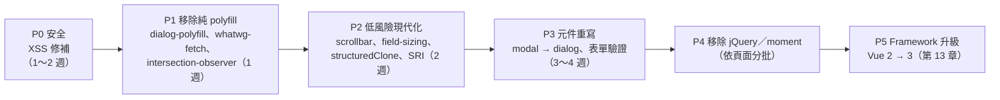

| 階段 | 交付 | 驗收 |
|---|---|---|
| P0 | XSS 修補、SAST 0 High | 安全測試通過 |
| P1 | `package.json` 移除 3 個 polyfill | 目標瀏覽器 E2E 通過 |
| P2 | `legacy-scan` 發現從 8 降到 1（`switch` 延後） | `scan-gate.mjs` 基準更新 |
| P3 | 所有 modal 改 `<dialog>` | 鍵盤與報讀器測試 |
| P4 | jQuery、moment 從 `package.json` 移除 | bundle 大小下降、E2E 通過 |
| P5 | Vue 3 | 第 13 章檢查表 |

### 12.9 Test Strategy

1. **先鎖住現況**：對要改的頁面寫 Playwright E2E（golden master），記錄目前行為。
2. **每次只改一類**：例如只做 scrollbar，跑 E2E、截圖比對。
3. **雙路徑測試**：有 fallback 的改動要測原生與 fallback（第 11.6 節手法）。
4. **棘輪**：每完成一批就 `scan-gate.mjs --write-baseline`，之後只能變少不能變多。

### 12.10 AI Agent Reverse Engineering Prompt（摘要）

完整版見第 14 章 Prompt 2。重點是「先掃描、再驗證、只報告不修改」：

```text
Modernize this repository using Modern Web Guidance. Scan our frontend files for legacy patterns, verify the findings, and propose a modernization plan before making any code edits.
另外：
- legacy-scan 只涵蓋約 20% 指南，請另外全面閱讀 src/ 與 WEB-INF/，列出掃描範圍外的問題（特別是 innerHTML、v-html、.html()）。
- .jsp、.cshtml 不在 legacy-scan 範圍，必須人工閱讀。
- 不得修改任何檔案。
```

第一段是官方文件提供的範例提示詞（原文）。

### 12.11 本章 AI 產出審查

**範例：Agent 報告「legacy-scan 0 findings，此專案已符合現代 Web 標準」：**

- ❌ 只涵蓋 20%；JSP、server template 根本沒掃。
- ✅ 怎麼抓：要求報告列出「掃描了哪些副檔名、跳過哪些」：

Shell

```sh
# 列出 legacy-scan 不支援、但專案中存在的檔案類型
find . -type f \( -name "*.jsp" -o -name "*.cshtml" -o -name "*.ejs" -o -name "*.erb" -o -name "*.twig" \) \
  -not -path "./node_modules/*" | sed 's/.*\.//' | sort | uniq -c
```

**範例：Agent 依 `autofill-sign-in-form` 把申請頁的密碼欄改成 `autocomplete="current-password"`：**

- ❌ 沒有做 dropWhen 驗證；新密碼欄應為 `new-password`，否則密碼管理器會填入舊密碼。
- ✅ 怎麼抓：Review 時對每一項修改要求附「keepWhen／dropWhen 判定理由」。

**範例：Agent 把 `role="switch"` 換成 `switch` 並刪除 role：**

- ❌ 非 Safari 瀏覽器會失去 switch 語意。
- ✅ `guide-baseline.mjs --target widely switch` 顯示 NEED（第 8.6 節）。

> 🎯 **本章重點**：`legacy-scan` 給你一份高精準度但只涵蓋 20% 的清單；逆向工程的其餘 80% 要靠 Agent 全面閱讀、其他工具與人工判斷。

## 第 13 章：Modern Web Guidance 在 Web Framework 升級的應用

> ⚠️ **MWG 不是 Framework Migration Tool。** Vue 2 → 3、Angular、React 的 API 變更要靠各 Framework 的官方 Migration Guide、Codemod、相容建置（例如 Vue 的 migration build）與測試。MWG 的角色是：升級時順便把「Web Platform 層」的舊寫法換掉，並避免 Agent 在新版本中又寫出舊式 DOM 操作。

### 13.1 分工

| 升級項目 | 主要依據 | MWG 角色 |
|---|---|---|
| Vue 2 → Vue 3 | [Vue 3 Migration Guide](https://v3-migration.vuejs.org/)、`@vue/compat` | 元件內的 DOM、CSS、表單、modal 寫法 |
| Vue 3 小版本升級 | Vue Changelog | 幾乎無關 |
| Angular 舊版 → 新版 | [Angular Update Guide](https://angular.dev/update-guide)、`ng update` | 範本中的 HTML／CSS；Angular inline styles／templates 不在 `legacy-scan` 範圍（`format-support.md`：expected-skip） |
| React 舊版 → 新版 | React 官方升級文章與 codemod | JSX 中的 DOM 規則（`.jsx`／`.tsx` 有掃） |
| JavaScript → TypeScript | TypeScript 文件 | 指南的寫法可直接加型別；新 HTML 屬性用型別斷言保留（SKILL.md） |
| jQuery → Modern JavaScript | — | **主要受益者**：`js`、`dialog`、`forms` 等指南 |
| Bootstrap 3 → Modern CSS | — | `css`、`css-layout`、`responsive-design`、`dark-mode` |
| Webpack → Vite | Vite 文件 | 無關（SKILL.md 明列 Vite、tsconfig 為「DO NOT trigger」） |
| Legacy CSS → Modern CSS | — | **主要受益者** |
| Legacy DOM → Modern DOM API | — | `move-dom-element-without-losing-state` 等 |

### 13.2 Framework Upgrade Workflow

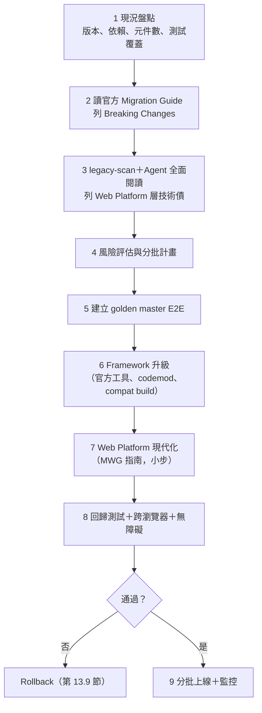

**順序原則**：先做 Framework 升級（行為不變），再做 Web Platform 現代化（行為可能改變）。同一個 PR 不要混兩種，否則出問題時無法判斷是哪一種造成。

### 13.3 Vue 2 → Vue 3 案例

**升級前**（`legacy-app/src/components/LoanTable.vue`，已列在第 12.3 節）的問題：

| 問題 | 屬於 | 處理依據 |
|---|---|---|
| `beforeDestroy` | Vue API 變更 | Vue Migration Guide：改 `onBeforeUnmount`／`beforeUnmount` |
| Options API | 非必要變更 | 團隊規範（本例改 `<script setup>`） |
| `scroll` 事件＋`getBoundingClientRect()` | Web Platform | 改 `IntersectionObserver`（Widely） |
| `v-html` | 安全 | `sanitize-untrusted-html` |
| `::-webkit-scrollbar { display: none }` | Web Platform | `customize-scrollbar-color-and-thickness` |

**升級後：**

📄 `vue-admin/src/upgrade/LoanTableVue3.vue`

```vue
<script setup lang="ts">
// Vue 2 → Vue 3 升級後版本（對照 legacy-app/src/components/LoanTable.vue）
// - Vue 官方 Migration Guide 負責：beforeDestroy → onBeforeUnmount／Options API → <script setup>
// - MWG 負責：scroll + getBoundingClientRect → IntersectionObserver；v-html → safeSetHTML；
//   深拷貝 reactive 狀態前先 toRaw()，否則 structuredClone() 會丟 DataCloneError
import { onBeforeUnmount, onMounted, reactive, ref, toRaw, watch } from "vue";
import { safeSetHTML } from "../lib/safe-html";

const props = defineProps<{ remark: string; hint: string }>();
const root = ref<HTMLElement>();
const remarkEl = ref<HTMLElement>();
const visible = ref(false);
const draft = reactive({ remark: props.remark, tags: ["new"] });

let observer: IntersectionObserver | undefined;
onMounted(() => {
  observer = new IntersectionObserver(([entry]) => (visible.value = entry.isIntersecting));
  observer.observe(root.value!);
});
onBeforeUnmount(() => observer?.disconnect());

watch(
  () => props.remark,
  (html) => remarkEl.value && safeSetHTML(remarkEl.value, html),
  { immediate: true, flush: "post" },
);

function snapshot() {
  return structuredClone(toRaw(draft));
}
defineExpose({ snapshot });
</script>

<template>
  <div ref="root" class="loan-table">
    <p v-if="visible" class="hint">{{ props.hint }}</p>
    <div ref="remarkEl"></div>
  </div>
</template>

<style scoped>
.loan-table {
  scrollbar-width: none;
}
</style>
```

本檔已放入第 11 章專案，`vue-tsc --noEmit` 通過（實測）。

### 13.4 Legacy JavaScript → Modern JavaScript 案例

見第 12.6 節完整對照（jQuery、`$.ajax`、moment、JSON 深拷貝）。再補三個常見模式：

```js
// 舊：手寫逾時
const ctrl = new AbortController();
const timer = setTimeout(() => ctrl.abort(), 8000);
try {
  await fetch(url, { signal: ctrl.signal });
} finally {
  clearTimeout(timer);
}

// 新（js 指南；AbortSignal.timeout 於 2026-10-18 成為 Widely）
await fetch(url, { signal: AbortSignal.timeout(8000) });
```

```js
// 舊：lodash groupBy
const byStatus = _.groupBy(loans, "status");

// 新（js 指南；Object.groupBy 為 Widely）
const byStatus = Object.groupBy(loans, (l) => l.status);
```

```js
// 舊：Enter 送出未處理輸入法（注音選字時就送出）
input.addEventListener("keydown", (e) => {
  if (e.key === "Enter") submit();
});

// 新（ime-safe-enter-submit 指南）
input.addEventListener("keydown", (e) => {
  if (e.key !== "Enter" || e.shiftKey) return;
  e.preventDefault();
  if (e.isComposing || e.keyCode === 229) return;
  submit();
});
```

### 13.5 Legacy CSS → Modern CSS 案例（Bootstrap 3）

```css
/* 舊：Bootstrap 3 格線＋float＋clearfix */
.row::after { content: ""; display: table; clear: both; }
.col-md-4 { float: left; width: 33.333%; }
@media (max-width: 991px) { .col-md-4 { float: none; width: 100%; } }
```

```css
/* 新：Grid＋container query（css-layout、size-aware-styling 指南） */
@layer legacy, components;

@layer components {
  .card-list {
    container-type: inline-size;
    display: grid;
    gap: 1rem;
    grid-template-columns: repeat(auto-fill, minmax(min(18rem, 100%), 1fr));
  }

  @container (inline-size < 30rem) {
    .card-list .card-actions {
      flex-direction: column;
    }
  }
}
```

**與 Bootstrap 共存的技巧**：把 Bootstrap 放進較低的 cascade layer（`@import url("bootstrap.css") layer(legacy);`），新 CSS 放在較高的 layer，就不需要 `!important` 去蓋舊樣式。Cascade layers 為 Widely（web-features 3.46.0）。

### 13.6 Vue reactive 與 `structuredClone`：一個實測陷阱

`legacy-scan` 的 `js` 規則（structuredClone）的 dropWhen 寫明：Vue `reactive()`、`ref().value`、Pinia store 等 Proxy 直接傳給 `structuredClone()` 會丟 `DataCloneError`，要先 `toRaw()`。實測再補一個細節：**`toRaw()` 只解開最外層**。

Shell（Node 24＋vue 3.5.45）

```sh
node --input-type=module -e '
import { reactive, toRaw } from "vue";
const draft = reactive({ remark: "x", tags: ["new"] });
try { structuredClone(draft); console.log("no toRaw: OK (unexpected)"); } catch (e) { console.log("no toRaw:", e.name); }
const c = structuredClone(toRaw(draft)); console.log("toRaw:", JSON.stringify(c));
try { structuredClone(toRaw(reactive({ a: { b: reactive({ c: 1 }) } }))); console.log("nested reactive with toRaw: OK"); } catch (e) { console.log("nested reactive with toRaw:", e.name); }
'
```

```text
no toRaw: DataCloneError
toRaw: {"remark":"x","tags":["new"]}
nested reactive with toRaw: DataCloneError
```

結論：物件內層若另外放了 reactive 物件（Pinia store 很常見），`toRaw()` 後仍然會失敗。這種狀態要先轉成純資料（例如由 store 提供 `toJSON()` 或明確挑欄位），再深拷貝。**`legacy-scan` 叫你把 JSON 深拷貝換成 `structuredClone`，在 Vue／Pinia 專案中可能直接造成執行期錯誤。**

### 13.7 AI Agent Upgrade Prompt（摘要）

完整版見第 14 章 Prompt 3。

```text
你要協助評估 Vue 2.7 → Vue 3.5 升級，本階段只產出評估報告，不得修改任何檔案。
1. 以 Vue 官方 Migration Guide（https://v3-migration.vuejs.org/）為準，列出本專案受影響的 Breaking Changes（附檔案:行）。
2. 執行 npx -y modern-web-guidance@latest legacy-scan src --json，依 keepWhen／dropWhen 驗證。
3. 另外全面閱讀元件，列出 legacy-scan 沒涵蓋的 Web Platform 問題（v-html、scroll 監聽、自刻 modal）。
4. 標出所有 structuredClone 候選中，資料來源是 reactive／Pinia 的項目。
5. 產出：Breaking Changes 表、Web Platform 技術債表、分批計畫、測試計畫、Rollback 計畫。
高風險修改（刪除依賴、改路由、改 store 結構）一律標為「需人工確認」。
```

### 13.8 Upgrade Checklist 與 Risk Matrix

**Upgrade Checklist：**

- [ ] 已讀官方 Migration Guide，Breaking Changes 表經人工確認
- [ ] golden master E2E 已建立並在升級前通過
- [ ] Framework 升級與 Web Platform 現代化分成不同 PR
- [ ] `legacy-scan` 結果已逐項 keepWhen／dropWhen 驗證
- [ ] `structuredClone` 替換已檢查 reactive 來源
- [ ] 新使用的 feature 已用 `guide-baseline.mjs` 比對公司政策
- [ ] 移除的 polyfill／套件，目標瀏覽器都已原生支援
- [ ] 無障礙：鍵盤與報讀器回歸測試
- [ ] 效能：INP／LCP 不劣化
- [ ] Rollback 計畫已演練

**Risk Matrix：**

| 風險 | 可能性 | 影響 | 對策 |
|---|---|---|---|
| Framework Breaking Change 漏改 | 中 | 高 | compat build＋E2E |
| `structuredClone` 遇 reactive Proxy | 高 | 中 | 13.6 節檢查 |
| 原生元件行為與舊元件不同（例如 modal 焦點歸還） | 中 | 中 | E2E 比對、UX 確認 |
| 新 feature 在客戶瀏覽器不支援 | 中 | 高 | 政策比對、雙路徑測試 |
| Agent 一次改太多檔案 | 高 | 高 | 提示詞限制範圍、PR 大小上限 |
| Bootstrap 與新 CSS 互相覆蓋 | 中 | 低 | Cascade layers |

### 13.9 Rollback Planning 與 Migration Roadmap

| 層次 | Rollback 方式 |
|---|---|
| 程式 | 每批一個 PR，`git revert` 可獨立回退 |
| 部署 | 藍綠部署或 feature flag 切換新舊元件 |
| 依賴 | 移除套件的 PR 與程式修改分開，回退時一併還原 |
| 資料 | 前端升級不改資料格式；若有 localStorage 結構變更要寫遷移與回退 |

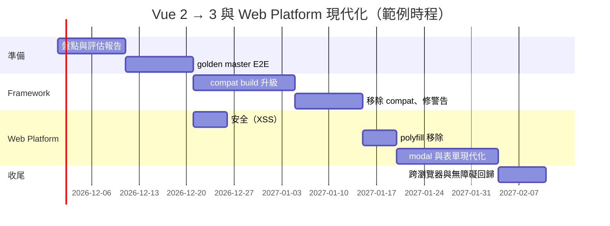

### 13.10 本章 AI 產出審查

**範例：Agent 在 Vue 3 中寫 `this.$el.addEventListener('scroll', ...)`：**

- ❌ 把 Vue 2 的寫法原樣搬過來，沒有改用 `IntersectionObserver`，也沒有清除監聽。
- ✅ 抓法：`grep -rn "addEventListener('scroll'" src/`；要求說明為何不用 `IntersectionObserver`。

**範例：Agent 把 Pinia store 的 `JSON.parse(JSON.stringify(store.$state))` 換成 `structuredClone(store.$state)`：**

- ❌ `$state` 是 reactive Proxy，執行時會丟 `DataCloneError`。
- ✅ 抓法：13.6 節；E2E 涵蓋該流程；Review 時看 `legacy-scan` 的 dropWhen。

**範例：Agent 宣稱「MWG 已自動完成 Vue 3 遷移」：**

- ❌ MWG 沒有這種能力。
- ✅ 要求列出依據的 Vue 官方文件段落與 codemod 指令。

> 🎯 **本章重點**：Framework 升級靠官方工具；MWG 負責 Web Platform 層；兩者分開做、分開測、分開回退。

## 第 14 章：Modern Web Guidance Prompt Engineering

本章 8 個 Prompt 都可直接複製使用，結構一致：Role、Context、Objective、Constraints、Execution Steps、Expected Output、Quality Gate、Human Review。`<…>` 是要替換的內容。

使用前提：專案已依第 9 章安裝 Skill、放好 `AGENTS.md`。Prompt 內不重複寫 `AGENTS.md` 已有的規則，只寫該任務特有的要求。

### 14.1 Prompt 1：AI Agent Modern Web 開發 Prompt

```text
# Role
你是本專案的資深前端工程師，熟悉現代 Web Platform，遵守 AGENTS.md。

# Context
- 需求：<需求單編號與內容，或檔案路徑>
- 相關程式：<目錄或檔案>
- 瀏覽器支援政策：見 AGENTS.md「Browser support policy」

# Objective
以現代、原生優先的 Web Platform 寫法完成需求，並可通過 Code Review 與 CI 閘門。

# Constraints
- 寫程式前必須使用 modern-web-guidance：每個能力各自 search（英文 2～5 字、不含框架與業務名詞），對相關結果 retrieve。
- 優先使用 HTML／CSS 原生能力；不得無理由新增第三方套件。若需要，先說明原生方案為何不足。
- 依指南的 Baseline 資料與 AGENTS.md 政策決定 fallback；polyfill 只能 feature detection 後 import()。
- 不得執行 set-allow-*、set-baseline，不得修改 .mwgrc。
- 不確定的地方列為「待確認問題」，不得猜測實作。

# Execution Steps
1. 重述需求，列出驗收條件。
2. 閱讀既有架構與相關元件，說明要沿用的慣例。
3. 列出 search 查詢與 retrieve 的 guide id。
4. 產生「技術選擇表」：能力｜guide id｜feature｜Baseline｜是否需要 fallback｜選擇理由。先輸出此表並停下，等我確認。
5. 我確認後才實作。
6. 實作後自我審查：逐條比對 retrieve 到的 MANDATORY／DO NOT 規則，列出「規則 → 程式碼位置」。
7. 執行專案的 lint、type-check、test，貼上結果。

# Expected Output
1. 技術選擇表（步驟 4）
2. 程式碼變更
3. 規則對照表（步驟 6）與測試結果
4. 回覆最後的 ### Modern Web Guidance 段落

# Quality Gate
- 每個使用到的 Newly／Limited feature 都有 fallback 或明確的漸進增強說明。
- 沒有 v-html／innerHTML 寫入未處理資料。
- 沒有新增 package.json 依賴（或已附理由）。
- 揭露段落的 guide id 都真實存在，引用為指南原文。

# Human Review
Reviewer 依規則對照表抽查至少 3 條；確認揭露段落與 Agent 工具紀錄一致。
```

### 14.2 Prompt 2：AI Agent Reverse Engineering Prompt

```text
# Role
你是 Legacy Web 系統分析師，只做分析與報告。

# Context
- 系統：<系統名稱>，原始碼 <路徑>，commit <sha>
- 技術：<例如 jQuery 1.12、Bootstrap 3、JSP、Vue 2.7>
- 已知限制：legacy-scan 只涵蓋約 20% 指南，不掃 .jsp／.cshtml／.ejs 等伺服器樣板

# Objective
產出可供架構師決策的逆向工程報告與現代化建議，不修改任何程式。

# Constraints
- 不得修改、刪除、格式化任何檔案；不得安裝或升級套件。
- legacy-scan 的每一項都要依 keepWhen／dropWhen 判定並寫出理由。
- 掃描範圍外的問題必須另外全面閱讀找出，並標示「非 legacy-scan 發現」。
- 每個現代化建議都要附 guide id；MWG 未涵蓋者附 MDN 連結。

# Execution Steps
1. 建立 Architecture Map：頁面、模組、共用程式、外部依賴、API 呼叫（附檔案:行）。
2. DOM／CSS／JavaScript／Framework／API 各自列出主要模式。
3. 執行 npx -y modern-web-guidance@latest legacy-scan <path> --json，逐項驗證。
4. 列出 legacy-scan 不支援的檔案類型與數量。
5. 全面閱讀，補充範圍外問題（安全優先：innerHTML、v-html、.html()、eval、document.write）。
6. 對主要問題 search／retrieve 對應指南，提出現代化做法與 Baseline 判斷。
7. 依風險排序，提出分階段 Roadmap。

# Expected Output
Markdown 報告：Architecture Map（含 Mermaid）、legacy-scan 驗證表、範圍外發現表、依賴套件表、現代化建議表、Roadmap。

# Quality Gate
- 每一項發現都有「檔案:行」。
- legacy-scan 驗證表每列都有 Keep／Drop 與理由。
- 報告明確寫出「掃描涵蓋範圍與未涵蓋範圍」。

# Human Review
架構師抽查 5 項發現與程式碼是否一致；資安確認安全項目的嚴重度。
```

### 14.3 Prompt 3：AI Agent Framework Upgrade Prompt

```text
# Role
你是 Framework 升級評估負責人。

# Context
- 目前：<Framework 與版本>；目標：<Framework 與版本>
- 官方 Migration Guide：<URL>
- 測試現況：<單元／E2E 覆蓋情形>

# Objective
產出升級評估：Breaking Changes、Deprecated API、Web Platform 技術債、分批計畫、測試計畫、Rollback 計畫。

# Constraints
- 本階段不得修改程式碼。
- Framework API 變更以官方 Migration Guide 為唯一依據，必須引用段落。
- Web Platform 層才使用 modern-web-guidance；不得宣稱 MWG 能完成 Framework 遷移。
- 高風險修改（刪依賴、改路由、改 store 結構、改公開 API）一律標「需人工確認」。

# Execution Steps
1. 盤點依賴與版本（npm ls --depth=0），標出與目標版本不相容者。
2. 依官方 Migration Guide 列出 Breaking Changes 與受影響檔案。
3. 列出 Deprecated API 使用處。
4. legacy-scan＋全面閱讀，列出 Web Platform 技術債；特別標出資料來源為 reactive／store 的 structuredClone 候選。
5. 用 modern-web-guidance 與 AGENTS.md 政策評估新寫法的 Browser Compatibility。
6. 規劃分批：Framework 升級 PR 與 Web Platform 現代化 PR 分開。
7. 撰寫 Test Plan 與 Rollback Plan。

# Expected Output
Breaking Changes 表、Deprecated API 表、Web Platform 技術債表、相容性表、分批計畫（Mermaid gantt）、Test Plan、Rollback Plan、待確認問題。

# Quality Gate
- 每個 Breaking Change 都有官方文件段落連結。
- 每批都有可獨立回退的方式。

# Human Review
Tech Lead 與架構師共同審查分批計畫；PM 確認時程。
```

### 14.4 Prompt 4：Modern Web Code Review Prompt

```text
# Role
你是前端 Code Reviewer，熟悉 modern-web-guidance 的指南。

# Context
- 變更：git diff <base>...HEAD -- src/
- PR 描述：<貼上，含 ### Modern Web Guidance 段落>
- 瀏覽器政策：AGENTS.md

# Objective
找出不符合現代 Web 標準、相容性、無障礙、安全、效能、可維護性的地方。

# Constraints
- 每一項意見都要有依據：guide id（retrieve 後引用原文）或 MDN／WCAG 連結。
- 不得提出沒有依據的風格偏好。
- 檢查 PR 揭露段落：id 是否存在、引用是否真的在指南中、是否有用到卻未揭露的指南。

# Execution Steps
依下列面向逐一檢查，每個面向先 search／retrieve 相關指南：
1. Modern HTML（語意元素、dialog、popover、表單屬性）
2. Modern CSS（:user-invalid、:has、container query、layer）
3. Modern JavaScript（structuredClone、AbortSignal、Intl）
4. Browser API 與 Browser Compatibility（Baseline、feature detection、fallback）
5. Accessibility（名稱、焦點、鍵盤、錯誤宣告）
6. Security（innerHTML／v-html、Trusted Types、SRI）
7. Performance（主執行緒、版面重排、資源優先順序）
8. Maintainability（重複、封裝 feature detection）
9. Third-Party Dependency（新增套件是否有原生替代）
10. Deprecated API 與 Experimental API（OT／volatile）

# Expected Output
表格：嚴重度（Blocker／Major／Minor）｜檔案:行｜問題｜依據（guide id＋原文或連結）｜建議修正。最後列出「揭露段落檢查結果」。

# Quality Gate
- Blocker 必須是安全、無障礙阻斷、或不符政策的 API 使用。
- 每一列都有依據。

# Human Review
PR 作者逐項回覆；Reviewer 對 Blocker 做最終判定。
```

### 14.5 Prompt 5：Browser Compatibility Assessment Prompt

```text
# Role
你是前端相容性分析師。

# Context
- 企業支援瀏覽器：docs/browser-support-policy.md
- 範圍：<目錄或功能>

# Objective
產出 Compatibility Matrix 與修正建議。

# Constraints
- 支援資訊只能來自 modern-web-guidance 指南的 Browser support 段落、web-features 或 MDN BCD，不得憑記憶。
- 區分「Baseline 狀態」與「企業政策判定」兩欄。

# Execution Steps
1. 列出範圍內使用的 HTML 屬性、CSS 功能、JS API。
2. 每項查 Baseline（指南或 web-features）。
3. 對照企業政策判定：OK／需 fallback／禁止。
4. 檢查 feature detection 寫法是否正確（在 prototype 上檢查、@supports）。
5. 需要 fallback 者：提出 polyfill（條件載入）或輕量 fallback，並評估大小與授權。
6. 評估 Progressive Enhancement：不支援時使用者看到什麼。

# Expected Output
Compatibility Matrix：feature｜位置｜Baseline｜Chrome｜Edge｜Firefox｜Safari｜政策判定｜現有 fallback｜建議。

# Quality Gate
每列都有資料來源（guide id、web-features 版本或 MDN 連結）。

# Human Review
QA 依矩陣規劃跨瀏覽器測試；架構師核准例外。
```

### 14.6 Prompt 6：Web Performance Optimization Prompt

```text
# Role
你是 Web 效能工程師。

# Context
- 頁面：<URL 或路由>
- 量測資料：<Lighthouse 報告、RUM 的 INP／LCP／CLS 數值>

# Objective
找出 Core Web Vitals 的主要瓶頸並提出優化計畫。

# Constraints
- 先 retrieve performance 學科指南，再依問題 retrieve identify-inp-causes、break-up-long-tasks、optimize-image-priority、visually-stable-font-fallbacks 等情境指南。
- 每項建議要說明預期影響哪個指標，並提供驗證方式。
- 不得在沒有量測資料的情況下宣稱改善幅度。

# Execution Steps
1. 分析 INP：長任務、事件處理、版面重排（Long Animation Frames）。
2. 分析 LCP：LCP 元素、資源優先順序、fetchpriority、preload。
3. 分析 CLS：字型、圖片尺寸、動態插入內容。
4. 分析 JavaScript 大小與主執行緒工作。
5. 分析 DOM 大小與 Rendering（content-visibility）。
6. 分析 Resource Loading（腳本優先順序、背景請求）。
7. 依效益／成本排序提出 Optimization Plan。

# Expected Output
瓶頸表（指標｜原因｜證據｜guide id）＋Optimization Plan（項目｜預期影響｜驗證方式｜風險）。

# Quality Gate
每項建議都有驗證方式（Lighthouse、Performance panel、RUM）。

# Human Review
效能負責人確認量測方法；上線後以 RUM 比對。
```

### 14.7 Prompt 7：Accessibility Assessment Prompt

```text
# Role
你是 Web 無障礙稽核員（WCAG 2.2 AA）。

# Context
- 範圍：<頁面或元件>
- 已有自動化結果：<axe 報告（若有）>

# Objective
產出 Accessibility Report，區分「自動化可驗證」與「需人工驗證」。

# Constraints
- retrieve accessibility、accessible-error-announcement、dialog、forms 等指南作為依據。
- 每項問題對應 WCAG 2.2 成功準則編號。
- 不得宣稱「符合 WCAG」；只能說明檢查範圍內的結果。

# Execution Steps
1. Semantic HTML：landmark、標題層級、按鈕與連結。
2. Keyboard Navigation：Tab 順序、可操作性、無鍵盤陷阱。
3. Focus：可見焦點（:focus-visible）、modal 焦點限制與歸還。
4. Screen Reader：可及名稱、狀態、動態訊息宣告。
5. ARIA：是否多餘或錯誤（例如原生 dialog 加 role="dialog"）。
6. 表單：label、錯誤訊息時機與關聯、autocomplete。
7. Dialog：名稱、初始焦點、關閉方式。

# Expected Output
Accessibility Report：問題｜位置｜WCAG 準則｜嚴重度｜guide id｜修正建議｜驗證方式（自動／人工）。

# Quality Gate
每個「人工驗證」項目都寫出測試步驟（鍵盤操作序列、報讀器預期朗讀內容）。

# Human Review
無障礙負責人以 NVDA／VoiceOver 實測人工項目。
```

### 14.8 Prompt 8：Modern Web Guidance 技術選型 Prompt

```text
# Role
你是前端架構師助理，負責技術選型分析，不寫程式。

# Context
- 需求：<例如「表格欄位提示框」「日期區間選擇」>
- 候選方案：<原生 API、現有元件庫元件、第三方套件名稱>
- 政策：AGENTS.md、docs/browser-support-policy.md

# Objective
產出可放入 ADR 的技術決策報告。

# Constraints
- 先用 modern-web-guidance search／retrieve 原生方案。
- 第三方套件需列出：授權、最近 release、週下載量、bundle 大小、已知 CVE（用 npm view／npm audit 查，不得憑記憶）。
- 不得寫程式。

# Execution Steps
1. 原生方案：guide id、feature、Baseline、fallback 成本。
2. 第三方方案：上述各項資料。
3. 比較 Browser Compatibility、Security、Performance、Accessibility、維護成本。
4. 提出建議與退場條件（例如「feature 成為 Widely 後移除 polyfill」）。

# Expected Output
ADR 草稿：Context、Options、Decision、Consequences、比較表、資料來源。

# Quality Gate
每個數字都有資料來源與查詢日期。

# Human Review
架構審查會議決議後才採用。
```

### 14.9 Prompt 使用技巧

| 技巧 | 說明 |
|---|---|
| 分兩段執行 | Prompt 1 的步驟 4「先輸出技術選擇表並停下」，避免 Agent 直接寫一大段錯方向的程式 |
| 結尾加「use modern-web-guidance」 | 官方 Troubleshoot 建議，提高 skill 觸發率 |
| 加「Bring up knowledge gaps and don't attempt to guess implementation」 | 官方 Troubleshoot 建議的防幻覺句；中文版即「不確定時列為待確認問題」 |
| 指定英文搜尋 | 中文查詢回 `[]`（第 6.6 節） |
| 存成團隊共用 | Claude Code slash command、Copilot prompt file、Codex skill，放在 repo 內進版控 |

### 14.10 本章 AI 產出審查

**範例：Agent 照 Prompt 1 執行，但跳過步驟 4 直接寫程式：**

- ⚠️ 常見。提示詞中的「停下」對部分 Agent 不夠強。
- ✅ 改成兩次對話：第一次只給到步驟 4；或使用 Agent 的 plan mode（Claude Code、Gemini CLI 都有）。

**範例：Prompt 4 的 Review 結果每一項的依據都是「modern-web-guidance」，沒有 id：**

- ❌ 無法驗證。
- ✅ Quality Gate 要求 guide id＋原文；退回重做。

> 🎯 **本章重點**：好的 Prompt 不是寫得長，而是有「停下來讓人確認」的點，以及可以驗證的輸出格式。

## 第 15 章：Modern Web Guidance 與企業標準開發平台整合

背景：公司有共用前端平台（Vue 3＋TypeScript＋PrimeVue＋Pinia＋Tailwind、Micro Frontend、OpenAPI、CI/CD），數十個團隊共用。本章說明 MWG 在其中的位置（建議流程）。

### 15.1 Enterprise Web Architecture

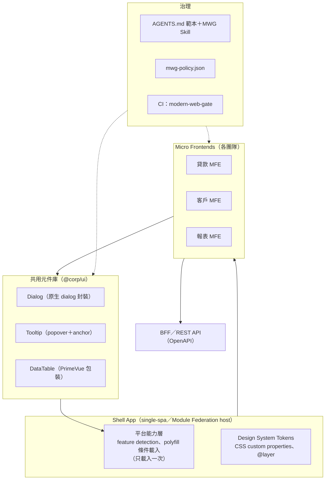

### 15.2 MWG 在企業開發平台中的角色

| 角色 | 說明 |
|---|---|
| 知識來源 | Agent 寫 Web Platform 層程式時的參考 |
| 審查依據 | Code Review 引用 guide id |
| 技術債量尺 | `legacy-scan` 數量作為 KPI |
| **不是**標準本身 | 企業標準仍是 Design System 與架構規範；MWG 與公司標準衝突時，以公司標準為準，並在 `AGENTS.md` 寫明 |

### 15.3 與 Design System、UI Component Library 的關係

| 情境 | 建議 |
|---|---|
| 元件庫已提供（例如 `@corp/ui` 的 Dialog） | Agent 必須用元件庫，不可直接寫原生 `<dialog>`；在 `AGENTS.md` 列出「元件對照表」 |
| 元件庫元件內部實作 | 元件庫團隊用 MWG 指南重寫內部（例如改用原生 `<dialog>`），對外 API 不變 |
| 元件庫沒有的元件 | 可依 MWG 指南實作，再提案收進元件庫 |
| 第三方元件庫（PrimeVue） | MWG 規則作為驗收標準（焦點、名稱、鍵盤）；不要讓 Agent 自行「修改」第三方元件內部 |

官方案例 note inc. 就是把 MWG 與內部 design system（note-ui）的規則一起使用，指南遵循率從 61% 升到 94%（官方案例數據，[mwg-with-internal-component](https://developer.chrome.com/blog/mwg-with-internal-component)）。

`AGENTS.md` 元件對照表範例：

```markdown
## 元件使用規則（優先於 modern-web-guidance 的通用建議）
| 需求 | 必須使用 | 不可使用 |
|---|---|---|
| 對話框 | `<CorpDialog>`（@corp/ui，內部為原生 dialog） | 直接寫 `<dialog>`、PrimeVue Dialog |
| 提示框 | `<CorpTooltip>` | title 屬性、自刻 div |
| 資料表 | `<CorpDataTable>`（包裝 PrimeVue DataTable） | 自刻 table 排序 |
查 modern-web-guidance 的目的：理解這些元件應有的行為，以及元件庫沒有涵蓋時的實作方式。
```

### 15.4 與 Vue／Angular／React 的關係

SKILL.md 的原則：指南是 vanilla 寫法，Agent 要「轉換成框架寫法但不丟掉現代功能」。各框架要注意：

| 框架 | 注意 |
|---|---|
| Vue | 未知 HTML 屬性（`closedby`、`popovertarget`）在範本中可直接寫，`vue-tsc` 不報錯（第 11 章實測）；`showModal()` 透過 template ref 呼叫；用 `useId()` 產生唯一 id |
| React | 新屬性型別可能不存在；SKILL.md 建議用展開＋型別斷言保留，例如 `{...({ popover: 'hint' } as any)}`，不要刪掉屬性 |
| Angular | 用 `[attr.closedby]` 綁定；inline template／styles 不在 `legacy-scan` 範圍 |
| SSR（Nuxt、Next、Angular SSR） | `window`／`HTMLElement` 存取要放在 client 端；polyfill 只在 client effect 中 `import()` |

### 15.5 與 Micro Frontend 的關係

| 問題 | 原因 | 對策 |
|---|---|---|
| 多個 MFE 各自載入 popover polyfill | 每個 MFE 都有自己的 feature detection | 平台能力層放 Shell，MFE 不得自行載入 polyfill |
| Anchor name、popover id 衝突 | 同一份 DOM 中多個 MFE 用相同 id | `useId()`；SKILL.md：「generate per-instance IDs/`anchor-name`s」 |
| 全域 CSS 互相覆蓋 | 各 MFE 的 reset 與元件樣式 | 每個 MFE 一個 `@layer`，Shell 定義層級順序 |
| Top layer 疊放 | 不同 MFE 同時開 dialog／popover | 平台規範：同時間只允許一個 modal；toast 用 `popover="manual"` |
| `:root` 樣式被 scoped 掉 | SKILL.md：「keep `:root` and `@starting-style` top-level/unscoped」 | Design token 由 Shell 提供 |

### 15.6 與 Clean Architecture／Hexagonal Architecture 的關係

把「平台能力」視為 Adapter：

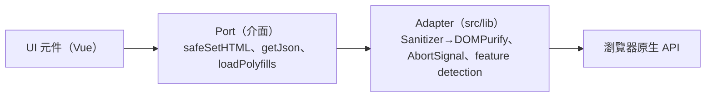

好處：feature 變成 Widely 時，只改 Adapter（例如刪掉 DOMPurify fallback），元件不必動。第 11 章的 `src/lib/` 就是這個結構。

### 15.7 與 SSDLC、CI/CD、Code Review 的關係

| 面向 | MWG 的貢獻 | 詳見 |
|---|---|---|
| SSDLC | 安全指南（XSS、Trusted Types、SRI、Passkey）作為前端安全設計依據 | 第 16 章 |
| CI/CD | `legacy-scan --json`＋企業自建閘門 | 第 16.7 節 |
| Code Review | guide id＋原文作為意見依據；揭露段落檢查 | 第 14 章 Prompt 4、第 16.5 節 |

### 15.8 與企業 AI Coding Agent Governance 的關係

| 治理要求 | MWG 相關做法 |
|---|---|
| Agent 可用工具清單 | 允許 `npx -y modern-web-guidance@latest search／retrieve／list／legacy-scan`；禁止 `set-*` |
| 外部連線管控 | npm registry（或內部鏡像）；封鎖 `play.googleapis.com` 遙測 |
| 供應鏈 | Skill 進版控（`skills-lock.json`）；npm 套件經內部鏡像核准 |
| 可稽核性 | Agent 工具紀錄＋PR 揭露段落 |
| 例外管理 | `.mwgrc` 開啟 volatile 需核准單 |

### 15.9 Enterprise Web Technology Governance Matrix

| 技術類別 | 預設 | 需核准 | 禁止 | 依據 |
|---|---|---|---|---|
| Baseline Widely available | ✅ 使用 | — | — | 政策 |
| Baseline Newly available | ✅ 使用＋fallback | fallback > 30 行 | — | 政策、MWG 指南 |
| Limited（非 volatile） | 僅漸進增強 | 核心流程依賴 | — | 政策 |
| Volatile | — | ✅ 架構審查＋90 天 | 未核准使用 | `.mwgrc`、`gated-api-scan` |
| Origin Trial | — | — | ✅ | 政策 |
| 新增第三方套件 | — | ✅ 技術選型 ADR | 有原生替代者（jQuery、moment 等） | Prompt 8 |
| Polyfill | — | ✅ 條件載入＋大小審查 | 無條件載入 | 第 8.8 節 |
| `innerHTML`／`v-html` 寫入外部資料 | — | — | ✅ | `sanitize-untrusted-html` |

### 15.10 Modern Web Guidance Integration Strategy

| 層級 | 做法 | 負責 |
|---|---|---|
| 平台 | 前端平台範本 repo 內建 MWG Skill、`AGENTS.md`、`mwg-policy.json`、CI workflow | 平台團隊 |
| 元件庫 | 用 MWG 指南重寫內部實作；元件文件附 guide id | 元件庫團隊 |
| 專案 | 從範本建立；`legacy-scan` 基準 | 各團隊 |
| 治理 | 每季更新政策與 MWG 版本 | 架構組 |

### 15.11 本章 AI 產出審查

**範例：在已有 `<CorpDialog>` 的專案，Agent 依 MWG 直接寫 `<dialog>`：**

- ❌ 繞過元件庫，造成同一系統兩種對話框行為與樣式。
- ✅ 抓法：`grep -rn "<dialog" src/ --include=*.vue` 只允許出現在元件庫目錄；`AGENTS.md` 寫明元件對照表。

**範例：MFE 中 Agent 寫 `if (!('popover' in HTMLElement.prototype)) import('@oddbird/popover-polyfill')`：**

- ⚠️ 寫法本身正確，但違反平台規範（polyfill 由 Shell 統一載入）。
- ✅ 抓法：`grep -rn "popover-polyfill" packages/*/src` 只允許 Shell。

> 🎯 **本章重點**：MWG 是知識與審查依據，不是企業標準本身；元件庫、Design System、平台規範優先。

## 第 16 章：Modern Web Guidance 與 SSDLC／DevSecOps

本章把 MWG 放進安全軟體開發生命週期，並提供可直接使用的 CI 閘門（企業自建）。官方 [modernization workflow](https://developer.chrome.com/docs/modern-web-guidance/modernization-workflow) 原文：「automated CI/CD pipeline integrations are currently in development」，也就是說**目前官方沒有 CI 整合**，本章的 workflow 全部是企業自建。

### 16.1 SSDLC Integration Matrix

| 階段 | 是否查 MWG | 查哪些指南 | Agent 如何使用 | 如何驗證 | 紀錄 |
|---|---|---|---|---|---|
| Requirement | 選擇性 | 依 UI 需求 `search` | 標註需求對應的原生能力 | SA 確認 | 需求單附 guide id |
| Analysis | ✅ | `security`、`privacy`、`forms` | 列出前端威脅（XSS、憑證、資料外流） | 資安審查 | 威脅清單 |
| Design | ✅ | 情境指南＋`accessibility` | 技術選型（Prompt 8） | 架構審查 | ADR |
| Coding | ✅ | 情境指南 | 依指南實作＋揭露 | `disclosure-check` | PR 描述 |
| Code Review | ✅ | 依 diff | Prompt 4 | Reviewer | Review 紀錄 |
| Testing | 間接 | 指南 MANDATORY 規則轉測試 | 產生測試案例 | CI | 測試報告 |
| Security Testing | ❌ | — | — | SAST／DAST／SCA | 弱點報告 |
| Performance Testing | ✅ | `performance`、INP／LCP／CLS 指南 | Prompt 6 | Lighthouse CI／RUM | 效能報告 |
| Deployment | ❌ | — | — | CI 閘門全綠 | Pipeline |
| Monitoring | ❌ | — | — | RUM、錯誤監控（看 fallback 路徑錯誤率） | 儀表板 |
| Maintenance | ✅ | `legacy-scan` | 每季掃描 | 棘輪基準 | 技術債趨勢 |

### 16.2 前端安全相關指南對照

| 威脅 | MWG 指南 | 涵蓋 | 仍需 |
|---|---|---|---|
| DOM XSS | `sanitize-untrusted-html`、`trusted-types` | 前端消毒、Trusted Types policy、CSP `require-trusted-types-for` | 伺服器端輸出編碼、SAST |
| 第三方腳本被竄改 | `secure-external-subresources` | SRI、`crossorigin`、`referrerpolicy` | 盡量自行託管 |
| CSP | `security` | 基本 CSP 寫法 | 依公司 CSP 政策調整 |
| 跨來源訊息 | `validate-origins` | `postMessage` origin 驗證 | — |
| 登入 | `passkeys` 系列、`autofill-sign-in-form` | Passkey 註冊／登入／重新驗證 | 後端 WebAuthn 驗證、帳號復原流程 |
| CSRF | `forms`、`security`（SameSite） | 前端注意事項 | 後端 CSRF token |
| 外連限制 | `restrict-outbound-connections`（volatile） | Connection allowlists | CSP `connect-src` |

### 16.3 如何記錄 AI 技術決策（ADR 範本）

📄 `docs/adr/ADR-0042-confirm-dialog.md`（範本，建議流程）

```markdown
# ADR-0042：案件刪除確認對話框採用原生 dialog

- 狀態：Accepted（2026-11-19）
- 決策者：前端架構師 <姓名>；Agent 協助分析：Claude Code（工具紀錄 run-1182.jsonl）

## Context
FR-3 需刪除前確認，可 Esc 或點背景取消。公司 Baseline 目標：Widely available。

## Options
| 方案 | guide id | Baseline | fallback | 依賴 |
|---|---|---|---|---|
| 原生 <dialog>＋closedby | dialog、light-dismiss-a-dialog | Widely／Limited | pointer 判斷約 10 行 | 無 |
| PrimeVue Dialog | — | — | — | 已有 |
| window.confirm() | — | — | — | 無（不可自訂、不可說明後果） |

## Decision
原生 <dialog>，closedby 不支援時以 dialog 指南的 pointerdown／pointerup fallback。

## Consequences
- Safari 走 fallback 路徑，E2E 以移除 closedBy 屬性模擬（tests/e2e/fallback.spec.ts）。
- closedby 成為 Widely 後移除 fallback（追蹤：web-features dialog-closedby）。

## MWG 證據
- modern-web-guidance 1.0.1；retrieve: dialog, light-dismiss-a-dialog
- 兩份指南 fallback 寫法不同，採 dialog 指南（理由：避免拖曳選字誤關）
```

### 16.4 Audit Trail

| 證據 | 位置 | 保存 |
|---|---|---|
| Agent 工具紀錄（含 search／retrieve 指令與輸出） | Claude Code：`~/.claude/projects/*/*.jsonl`；其他 Agent 各自的 log | 依公司 AI 使用紀錄政策 |
| PR 揭露段落 | PR 描述 | Git 平台 |
| CI 閘門結果 | Pipeline artifact（`mwg-scan.json`、`mwg-scan-report.md`） | 至少一年 |
| `.mwgrc` 變更與核准 | Git 歷史＋`.mwgrc.approval.json` | 永久 |
| MWG 版本 | `skills-lock.json`、CI 中的 `MWG` 環境變數 | Git |

### 16.5 揭露段落檢查（disclosure-check）

SKILL.md 要求 Agent 在回覆最後附 `### Modern Web Guidance`，每個套用的 id 一行，格式為：

```markdown
- **`<id>`**: <做了什麼非顯而易見的選擇、避免了什麼陷阱> ("<指南原文短引用>").
```

企業自建工具檢查三件事：id 是否真的存在（防幻覺）、每行是否有原文引用、段落是否存在。

📄 `enterprise-repo/tools/mwg/disclosure-check.mjs`

```js
#!/usr/bin/env node
// 企業自建：檢查 PR 描述或 Agent 回覆中的「### Modern Web Guidance」揭露段落（非官方工具）
// 用法：node tools/mwg/disclosure-check.mjs <pr-body.md> <list.json> [--require]
//   list.json 由 `npx -y modern-web-guidance@1.0.1 list > list.json` 產生
//   --require：沒有揭露段落也算失敗（前端變更的 PR 建議加上）
// 結束碼：0 = 通過，1 = 有不存在的 guide id 或缺段落，2 = 參數或資料錯誤
import { readFileSync } from "node:fs";

const [bodyPath, listPath] = process.argv.slice(2).filter((a) => !a.startsWith("--"));
const requireSection = process.argv.includes("--require");
if (!bodyPath || !listPath) {
  console.error("usage: disclosure-check.mjs <pr-body.md> <list.json> [--require]");
  process.exit(2);
}

let known;
try {
  known = new Set(JSON.parse(readFileSync(listPath, "utf8")).map((x) => x.id));
} catch (e) {
  console.error(`ERROR cannot read ${listPath}: ${e.message}`);
  process.exit(2);
}
if (known.size === 0) {
  console.error(`ERROR ${listPath} has 0 guides; refusing to pass`);
  process.exit(2);
}

const body = readFileSync(bodyPath, "utf8").replace(/\r\n/g, "\n");
const m = body.match(/^###\s+Modern Web Guidance\s*\n([\s\S]*?)(?=^#{1,3}\s|(?![\s\S]))/m);
if (!m) {
  console.log(`${requireSection ? "FAIL" : "SKIP"}  no "### Modern Web Guidance" section`);
  process.exit(requireSection ? 1 : 0);
}

const section = m[1];
const bullets = section.split("\n").filter((l) => /^\s*-\s/.test(l));
const ids = [...section.matchAll(/^\s*-\s+\*\*`([^`]+)`\*\*/gm)].map((x) => x[1]);
let bad = 0;
for (const id of ids) {
  if (known.has(id)) {
    console.log(`OK    ${id}`);
  } else {
    console.log(`FAIL  ${id}: not a real guide id (hallucinated or renamed)`);
    bad++;
  }
}
for (const b of bullets) {
  if (/^\s*-\s+\*\*`/.test(b) && !/\(["“].+["”]\)/.test(b)) {
    console.log(`WARN  bullet without a verbatim quote: ${b.trim().slice(0, 60)}`);
  }
}
if (section.trim() === "") {
  console.log("FAIL  section is empty");
  bad++;
} else if (ids.length === 0) {
  // 官方允許「查過但沒有套用」的一句說明，所以不直接判失敗，交給 reviewer 確認句中有寫查過哪些主題
  console.log("WARN  no guide id; reviewer must confirm the text names the topics that were checked");
}
console.log(`${bad === 0 ? "PASS" : "FAIL"}  ${ids.length} guide id(s) checked`);
process.exit(bad === 0 ? 0 : 1);
```

> 📌 工具只驗證「id 存在」與「有引用」，**不驗證引用內容是否真的在指南中**。後者要 Reviewer 用 `retrieve`＋`grep` 抽查（第 11.9 節），或在內部再寫一支比對工具（本手冊撰寫時用 `tools/check_quotes.py` 比對全書引用）。

### 16.6 如何管理 AI Agent 技術選型、避免未經批准引入 Experimental API

四層防線（建議流程）：

```mermaid
flowchart LR
    L1["① MWG 閘門<br/>retrieve 擋 OT／volatile"] --> L2["② Agent 權限<br/>禁止 set-*、禁止改 .mwgrc"]
    L2 --> L3["③ CI<br/>mwgrc-policy-check＋gated-api-scan"]
    L3 --> L4["④ 人工<br/>架構審查單＋到期重審"]
```

| 層 | 擋得住 | 擋不住 |
|---|---|---|
| ① MWG 閘門 | Agent 透過 CLI 取得 OT／volatile 指南 | Agent 憑記憶直接寫 API；讀專案內 raw `.md` |
| ② 權限 | Agent 執行 `set-*`、編輯 `.mwgrc` | 人類開發者自己改 |
| ③ CI | 未核准的 `.mwgrc`、程式碼中的已知實驗性 API | 規則清單以外的新 API |
| ④ 人工 | 以上漏網之魚 | — |

### 16.7 CI Quality Gate（GitHub Actions 範本）

📄 `enterprise-repo/.github/workflows/mwg-gate.yml`

```yaml
# 企業自建 CI 閘門（非官方）：官方文件表示 legacy-scan 的 CI/CD 整合仍在開發中
name: modern-web-gate

on:
  pull_request:
    paths:
      - "src/**"
      - ".mwgrc"
      - ".mwgrc.approval.json"
      - "mwg-*.json"
      - "package.json"

permissions:
  contents: read

jobs:
  mwg:
    runs-on: ubuntu-latest
    env:
      DISABLE_TELEMETRY: "1"
      MWG: "modern-web-guidance@1.0.1"
    steps:
      - uses: actions/checkout@v4
      - uses: actions/setup-node@v4
        with:
          node-version: "22"
      - run: npm ci --ignore-scripts

      - name: .mwgrc policy
        run: node tools/mwg/mwgrc-policy-check.mjs .

      - name: Unapproved experimental APIs
        run: node tools/mwg/gated-api-scan.mjs src --allowlist mwg-gated-allowlist.json

      - name: Legacy pattern ratchet
        run: |
          npx -y "$MWG" legacy-scan src --json > mwg-scan.json
          node tools/mwg/scan-gate.mjs mwg-scan.json --baseline mwg-scan-baseline.json --report mwg-scan-report.md

      - name: Disclosure section in PR body
        env:
          PR_BODY: ${{ github.event.pull_request.body }}
        run: |
          printf '%s\n' "$PR_BODY" > pr-body.md
          npx -y "$MWG" list > mwg-list.json
          node tools/mwg/disclosure-check.mjs pr-body.md mwg-list.json --require

      - uses: actions/upload-artifact@v4
        if: always()
        with:
          name: mwg-report
          path: |
            mwg-scan.json
            mwg-scan-report.md
```

📄 `enterprise-repo/package.json`

```json
{
  "name": "loan-portal-frontend",
  "private": true,
  "type": "module",
  "engines": {
    "node": ">=22"
  },
  "scripts": {
    "mwg:policy": "node tools/mwg/mwgrc-policy-check.mjs .",
    "mwg:scan": "npx -y modern-web-guidance@1.0.1 legacy-scan src --json > mwg-scan.json && node tools/mwg/scan-gate.mjs mwg-scan.json --baseline mwg-scan-baseline.json --report mwg-scan-report.md",
    "mwg:gated": "node tools/mwg/gated-api-scan.mjs src --allowlist mwg-gated-allowlist.json",
    "test:mwg-tools": "node --test \"tools/mwg/test/*.test.mjs\""
  },
  "devDependencies": {
    "web-features": "3.46.0"
  }
}
```

本機模擬 workflow 的四個步驟（實測；GitHub Actions 本身 🧪）。情境 1 是乾淨的 PR；情境 2 模擬 Agent 同時做了四件不該做的事：新增 JSON 深拷貝、使用 `Translator.create()`、自行開啟 `.mwgrc` 的 volatile、揭露段落寫了不存在的 guide id。

```text
## scenario: 1 clean PR
PASS  .mwgrc policy check (baseline=widely, policy 2026.11)
[policy] exit=0
PASS  scanned 10 files, 0 unapproved gated API use(s)
[gated] exit=0
PASS  0 findings, 0 new
[scan] exit=0
OK    dialog
PASS  1 guide id(s) checked
[disclosure] exit=0

## scenario: 2 agent-style PR: new legacy pattern + Translator + .mwgrc opt-in + hallucinated id
FAIL  allowVolatileFeatures=true requires an entry in .mwgrc.approval.json
[policy] exit=1
FAIL  translator             lib/auto-translate.ts:1  const t = await Translator.create({ sourceLanguage: "en", targetLangua
FAIL  scanned 12 files, 1 unapproved gated API use(s)
[gated] exit=1
NEW   js  lib/clone.ts:1
FAIL  1 findings, 1 new
[scan] exit=1
FAIL  modal-light-dismiss: not a real guide id (hallucinated or renamed)
FAIL  1 guide id(s) checked
[disclosure] exit=1
```

四道閘門各自抓到一項。

### 16.8 企業自建工具的測試

📄 `enterprise-repo/tools/mwg/test/tools.test.mjs`

```js
// 企業自建工具的測試：每支工具都要同時驗證「好例會過」與「壞例會被抓」
import { test } from "node:test";
import assert from "node:assert/strict";
import { spawnSync } from "node:child_process";
import { mkdtempSync, mkdirSync, writeFileSync, copyFileSync } from "node:fs";
import { tmpdir } from "node:os";
import { join, dirname } from "node:path";
import { fileURLToPath } from "node:url";

const TOOLS = dirname(dirname(fileURLToPath(import.meta.url)));
const REPO = dirname(dirname(TOOLS));

function run(tool, args, opts = {}) {
  const r = spawnSync(process.execPath, [join(TOOLS, tool), ...args], { encoding: "utf8", ...opts });
  return { code: r.status, out: r.stdout + r.stderr };
}

function repoWith(files) {
  const dir = mkdtempSync(join(tmpdir(), "mwgt-"));
  copyFileSync(join(REPO, "mwg-policy.json"), join(dir, "mwg-policy.json"));
  for (const [name, body] of Object.entries(files)) {
    mkdirSync(dirname(join(dir, name)), { recursive: true });
    writeFileSync(join(dir, name), typeof body === "string" ? body : JSON.stringify(body));
  }
  return dir;
}

// 讓測試不受開發者自己的 ~/.mwgrc 影響
const isolatedHome = mkdtempSync(join(tmpdir(), "mwgh-"));
const env = { ...process.env, HOME: isolatedHome, USERPROFILE: isolatedHome };
const policy = (dir, extra = []) => run("mwgrc-policy-check.mjs", [dir, "--today", "2026-11-19", ...extra], { env });

test("policy: no .mwgrc uses default baseline and passes", () => {
  const r = policy(repoWith({}));
  assert.equal(r.code, 0, r.out);
  assert.match(r.out, /baseline=widely/);
});

test("policy: unknown key (typo) fails", () => {
  const r = policy(repoWith({ ".mwgrc": { allowVolatileFeature: true } }));
  assert.equal(r.code, 1);
  assert.match(r.out, /unknown key "allowVolatileFeature"/);
});

test("policy: invalid JSON is a config error (exit 2), not a pass", () => {
  const r = policy(repoWith({ ".mwgrc": "{ bad" }));
  assert.equal(r.code, 2);
});

test("policy: origin trials are forbidden", () => {
  const r = policy(repoWith({ ".mwgrc": { allowOriginTrials: true } }));
  assert.equal(r.code, 1);
  assert.match(r.out, /forbidden/);
});

test("policy: volatile opt-in without approval fails", () => {
  const r = policy(repoWith({ ".mwgrc": { allowVolatileFeatures: true } }));
  assert.equal(r.code, 1);
  assert.match(r.out, /requires an entry/);
});

const approval = (expires) => ({
  allowVolatileFeatures: { ticket: "ARCH-1234", approver: "frontend-architect", expires, features: ["translator"] },
});

test("policy: volatile opt-in with valid approval passes", () => {
  const r = policy(repoWith({ ".mwgrc": { allowVolatileFeatures: true }, ".mwgrc.approval.json": approval("2027-01-31") }));
  assert.equal(r.code, 0, r.out);
});

test("policy: expired approval fails", () => {
  const r = policy(repoWith({ ".mwgrc": { allowVolatileFeatures: true }, ".mwgrc.approval.json": approval("2026-10-01") }));
  assert.equal(r.code, 1);
  assert.match(r.out, /expired/);
});

test("policy: string \"true\" is rejected", () => {
  const r = policy(repoWith({ ".mwgrc": { allowVolatileFeatures: "true" } }));
  assert.equal(r.code, 1);
  assert.match(r.out, /must be true or false/);
});

test("policy: baseline outside the allowed list fails", () => {
  const r = policy(repoWith({ ".mwgrc": { baseline: "limited" } }));
  assert.equal(r.code, 1);
  assert.match(r.out, /not in allowedTargets/);
});

const scanJson = (findings) => ({
  targetDir: "src",
  totalFindings: findings.length,
  activeRuleCount: 52,
  activeGuideCount: 38,
  guides: [{ guideId: "js", rules: [{ ruleId: "js", findings }] }],
});
const f1 = { file: "src/a.js", line: 3, lineContent: "var c = JSON.parse(JSON.stringify(x));" };
const f2 = { file: "src/b.js", line: 9, lineContent: "var d = JSON.parse(JSON.stringify(y));" };

test("scan-gate: non --json output is exit 2 (no fake green)", () => {
  const dir = repoWith({ "scan.json": { note: "human readable?" } });
  const r = run("scan-gate.mjs", [join(dir, "scan.json")]);
  assert.equal(r.code, 2);
});

test("scan-gate: count mismatch is exit 2", () => {
  const bad = scanJson([f1]);
  bad.totalFindings = 5;
  const dir = repoWith({ "scan.json": bad });
  assert.equal(run("scan-gate.mjs", [join(dir, "scan.json")]).code, 2);
});

test("scan-gate: known findings pass, a new finding fails", () => {
  const dir = repoWith({ "old.json": scanJson([f1]), "new.json": scanJson([f1, f2]) });
  const base = join(dir, "base.json");
  assert.equal(run("scan-gate.mjs", [join(dir, "old.json"), "--write-baseline", base]).code, 0);
  assert.equal(run("scan-gate.mjs", [join(dir, "old.json"), "--baseline", base]).code, 0);
  const r = run("scan-gate.mjs", [join(dir, "new.json"), "--baseline", base, "--report", join(dir, "r.md")]);
  assert.equal(r.code, 1);
  assert.match(r.out, /NEW\s+js\s+src\/b\.js:9/);
});

test("scan-gate: moving a known finding to another line is not new", () => {
  const moved = { ...f1, line: 40 };
  const dir = repoWith({ "old.json": scanJson([f1]), "new.json": scanJson([moved]) });
  const base = join(dir, "base.json");
  run("scan-gate.mjs", [join(dir, "old.json"), "--write-baseline", base]);
  assert.equal(run("scan-gate.mjs", [join(dir, "new.json"), "--baseline", base]).code, 0);
});

const list = [{ id: "dialog", description: "d" }, { id: "light-dismiss-a-dialog", description: "l" }];

test("disclosure: real ids with quotes pass", () => {
  const body = "## Summary\n\n### Modern Web Guidance\n\n- **`light-dismiss-a-dialog`**: 用 closedby 並保留 fallback (\"Always open modal dialogs with showModal()\").\n";
  const dir = repoWith({ "pr.md": body, "list.json": list });
  const r = run("disclosure-check.mjs", [join(dir, "pr.md"), join(dir, "list.json")]);
  assert.equal(r.code, 0, r.out);
});

test("disclosure: hallucinated id fails", () => {
  const body = "### Modern Web Guidance\n\n- **`modal-light-dismiss`**: x (\"y\").\n";
  const dir = repoWith({ "pr.md": body, "list.json": list });
  const r = run("disclosure-check.mjs", [join(dir, "pr.md"), join(dir, "list.json")]);
  assert.equal(r.code, 1);
  assert.match(r.out, /not a real guide id/);
});

test("disclosure: missing section fails only with --require", () => {
  const dir = repoWith({ "pr.md": "## Summary\n", "list.json": list });
  assert.equal(run("disclosure-check.mjs", [join(dir, "pr.md"), join(dir, "list.json")]).code, 0);
  assert.equal(run("disclosure-check.mjs", [join(dir, "pr.md"), join(dir, "list.json"), "--require"]).code, 1);
});

test("disclosure: vague sentence without ids is flagged with WARN, empty section fails", () => {
  const vague = repoWith({ "pr.md": "### Modern Web Guidance\n\n已參考 Modern Web Guidance。\n", "list.json": list });
  const r = run("disclosure-check.mjs", [join(vague, "pr.md"), join(vague, "list.json"), "--require"]);
  assert.match(r.out, /WARN\s+no guide id/);
  const empty = repoWith({ "pr.md": "### Modern Web Guidance\n\n## Next\n", "list.json": list });
  assert.equal(run("disclosure-check.mjs", [join(empty, "pr.md"), join(empty, "list.json"), "--require"]).code, 1);
});

test("disclosure: empty list.json refuses to pass", () => {
  const dir = repoWith({ "pr.md": "### Modern Web Guidance\n\n- **`dialog`**: x (\"y\").\n", "list.json": [] });
  assert.equal(run("disclosure-check.mjs", [join(dir, "pr.md"), join(dir, "list.json")]).code, 2);
});

test("gated-api: unapproved Translator use fails, allowlisted file passes", () => {
  const dir = repoWith({
    "src/i18n/auto.ts": "const t = await Translator.create({ sourceLanguage: 'en', targetLanguage: 'zh-Hant' });\n",
    "src/ui/form.html": "<form toolname=\"search_loans\"></form>\n",
  });
  const r = run("gated-api-scan.mjs", [join(dir, "src")]);
  assert.equal(r.code, 1);
  assert.match(r.out, /translator/);
  assert.match(r.out, /webmcp/);
  const allow = {
    allowed: [
      { id: "translator", path: "i18n/auto.ts", ticket: "ARCH-1234" },
      { id: "webmcp", path: "ui/form.html", ticket: "ARCH-1250" },
    ],
  };
  writeFileSync(join(dir, "allow.json"), JSON.stringify(allow));
  assert.equal(run("gated-api-scan.mjs", [join(dir, "src"), "--allowlist", join(dir, "allow.json")]).code, 0);
});

test("gated-api: ordinary code passes and empty dir is an error", () => {
  const dir = repoWith({ "src/app.ts": "const translator = new Map();\nconsole.log(translator.size);\n" });
  assert.equal(run("gated-api-scan.mjs", [join(dir, "src")]).code, 0);
  const empty = repoWith({ "src/README.txt": "nothing" });
  assert.equal(run("gated-api-scan.mjs", [join(empty, "src")]).code, 2);
});
```

執行結果（實測）：

```text
$ npm run test:mwg-tools
✔ policy: no .mwgrc uses default baseline and passes (311.0007ms)
✔ policy: unknown key (typo) fails (264.2987ms)
✔ policy: invalid JSON is a config error (exit 2), not a pass (332.0736ms)
✔ policy: origin trials are forbidden (267.5145ms)
✔ policy: volatile opt-in without approval fails (307.1877ms)
✔ policy: volatile opt-in with valid approval passes (257.3634ms)
✔ policy: expired approval fails (241.8382ms)
✔ policy: string "true" is rejected (265.1805ms)
✔ policy: baseline outside the allowed list fails (264.9487ms)
✔ scan-gate: non --json output is exit 2 (no fake green) (301.4044ms)
✔ scan-gate: count mismatch is exit 2 (329.1546ms)
✔ scan-gate: known findings pass, a new finding fails (973.2362ms)
✔ scan-gate: moving a known finding to another line is not new (605.3618ms)
✔ disclosure: real ids with quotes pass (296.227ms)
✔ disclosure: hallucinated id fails (324.4992ms)
✔ disclosure: missing section fails only with --require (586.8338ms)
✔ disclosure: vague sentence without ids is flagged with WARN, empty section fails (617.1866ms)
✔ disclosure: empty list.json refuses to pass (265.3884ms)
✔ gated-api: unapproved Translator use fails, allowlisted file passes (573.7744ms)
✔ gated-api: ordinary code passes and empty dir is an error (589.9141ms)
ℹ tests 20
ℹ pass 20
ℹ fail 0
```

突變測試：故意破壞每支工具的關鍵判斷，確認至少一個測試會失敗（避免「測試全綠但其實什麼都沒測」）：

```text
$ python tools/mutate.py work/ent
KILLED   scan-gate.mjs            R0 結構檢查（失敗測試 1 個）
KILLED   scan-gate.mjs            數量一致檢查（失敗測試 1 個）
KILLED   mwgrc-policy-check.mjs   核准到期檢查（失敗測試 1 個）
KILLED   mwgrc-policy-check.mjs   未知鍵檢查（失敗測試 1 個）
KILLED   disclosure-check.mjs     guide id 存在檢查（失敗測試 1 個）
KILLED   disclosure-check.mjs     無 id 警告（失敗測試 1 個）
KILLED   gated-api-scan.mjs       空目錄檢查（失敗測試 1 個）
KILLED   gated-api-scan.mjs       allowlist 比對（失敗測試 1 個）
baseline failures after restore: 0
exit=0
```

### 16.9 企業 Quality Gate 定義

| Gate | 檢查 | 工具 | 失敗條件 | 類型 |
|---|---|---|---|---|
| Web Platform Standards | 不新增舊寫法 | `legacy-scan`＋`scan-gate.mjs` | 相對基準有新增 | 自動 |
| Browser Compatibility | 使用的 feature 符合政策 | `guide-baseline.mjs`、Prompt 5 | 不符且無 fallback | 半自動 |
| Experimental API | 未核准的 OT／volatile | `mwgrc-policy-check.mjs`、`gated-api-scan.mjs` | 任一 FAIL | 自動 |
| Security | XSS、SRI、CSP | SAST、`grep v-html`、Prompt 4 | High 以上 | 自動＋人工 |
| Accessibility | WCAG 2.2 AA | axe（CI）＋人工 | axe 違規；人工 Blocker | 自動＋人工 |
| Performance | INP／LCP／CLS | Lighthouse CI | 低於門檻 | 自動 |
| Dependency | 新增套件 | `git diff package.json`＋SCA | 無 ADR | 自動＋人工 |
| Code Quality | lint、type-check | ESLint、`vue-tsc` | 錯誤 | 自動 |
| Test Coverage | 新程式有測試 | 覆蓋率工具 | 低於門檻 | 自動 |
| Disclosure | 揭露段落 | `disclosure-check.mjs` | 不存在的 id；前端 PR 無段落 | 自動 |
| Human Review | 架構師／Reviewer | PR 核准 | 未核准 | 人工 |

### 16.10 本章 AI 產出審查

**範例：AI 產生的 CI 把 `legacy-scan` 的結束碼當成閘門：**

```yaml
- run: npx -y modern-web-guidance@1.0.1 legacy-scan src
```

- ❌ 有發現時結束碼仍是 0（第 12.3 節實測 `exit=0`），這一步永遠綠燈。
- ✅ 必須用 `--json` 並交給 `scan-gate.mjs` 判斷。

**範例：AI 寫的 workflow 沒有設定 `DISABLE_TELEMETRY`：**

- ❌ CI 每次執行都送遙測，且 Agent 名稱可能被偵測為 CI 環境。
- ✅ `grep -n DISABLE_TELEMETRY .github/workflows/*.yml`。

**範例：AI 把 `mwg-scan-baseline.json` 加進 `.gitignore`：**

- ❌ 基準不進版控，棘輪失效（每次都是「全部新增」或被隨手重寫）。
- ✅ 基準檔變更要在 PR 中被審查；只有在技術債**減少**時才允許更新。

> 🎯 **本章重點**：官方目前沒有 CI 整合；企業用四道自建閘門＋人工審查補上，並且用突變測試確認閘門不是假綠燈。

## 第 17 章：Modern Web Guidance 維護與更新

### 17.1 要維護的東西

| 項目 | 更新來源 | 誰負責 | 頻率 |
|---|---|---|---|
| npm 套件（CLI＋指南＋向量＋Baseline 資料） | npm registry → 內部鏡像 | 平台團隊 | 審查後同步，建議每月 |
| SKILL.md（專案內副本） | `npx modern-web-guidance@latest update` 或 `npx skills update` | 各專案（平台發 PR） | 隨鏡像版本 |
| 企業政策（`mwg-policy.json`、Browser policy） | 架構組 | 架構組 | 每季 |
| `gated-api-scan.mjs` 規則清單 | 依新版被閘門擋下的指南 | 平台團隊 | 隨版本 |
| `legacy-scan` 基準 | 技術債減少時更新 | 各專案 | 隨重構 |
| 搜尋回歸案例 | 團隊常見需求 | 平台團隊 | 每季 |

MWG 沒有獨立的「Knowledge Base 更新」或「Search Index 更新」指令：指南、索引、向量、Baseline 資料**全部包在 npm 套件裡，隨版本一起更新**。Embedding 由 Google 在發布前重建（第 3.2 節），使用者端不需要也不能自行重建。

### 17.2 Maintenance Workflow

```mermaid
flowchart TD
    N["npm 有新版<br/>（gh release list／npm view）"] --> P["npm pack 新舊兩版"]
    P --> D["version-diff.mjs<br/>新增／移除／閘門變動／SKILL.md 變動"]
    D --> R["search-regression.mjs<br/>團隊案例全數命中？"]
    R --> G["更新 gated-api-scan 規則<br/>（若閘門清單變動）"]
    G --> S["資安：SHA-256、授權、THIRD_PARTY_NOTICES"]
    S --> A{"架構組核准？"}
    A -->|否| H["維持舊版，記錄原因"]
    A -->|是| M["同步到內部鏡像"]
    M --> U["平台對各 repo 發 PR：<br/>更新 SKILL.md、skills-lock.json、CI 的 MWG 版本"]
    U --> C["各專案 CI 通過後合併"]
```

### 17.3 版本升級檢查表

- [ ] `npm view modern-web-guidance dist-tags time --json` 確認新版本與發布時間
- [ ] `gh release list -R GoogleChrome/modern-web-guidance` 查看 release note
- [ ] `npm pack` 新版，計算 SHA-256，送 SCA／惡意程式掃描
- [ ] `npm view modern-web-guidance@<新版> dependencies` 仍為空（無 runtime 依賴）
- [ ] `version-diff.mjs` 比對新舊版（17.4 節）
- [ ] `SKILL.md` 有變動時，逐行閱讀差異
- [ ] 閘門清單有變動時，更新 `gated-api-scan.mjs` 規則與文件第 5.2 節
- [ ] `search-regression.mjs` 全數通過（17.5 節）
- [ ] 抽一個專案跑完整 CI（第 16.7 節）
- [ ] 更新 CI workflow 的 `MWG` 版本、`skills-lock.json`
- [ ] 更新本手冊版本基準與變更紀錄

### 17.4 實測：1.0.0 → 1.0.1 差異

`version-diff.mjs`（企業自建）：

📄 `enterprise-repo/tools/mwg/version-diff.mjs`

```js
#!/usr/bin/env node
// 企業自建：比較兩個 MWG npm 套件版本的指南差異（非官方工具）
// 先準備：npm pack modern-web-guidance@<old> 與 @<new>，各自解壓到不同目錄
// 用法：node tools/mwg/version-diff.mjs <old-package-dir> <new-package-dir>
import { createHash } from "node:crypto";
import { readFileSync } from "node:fs";
import { join } from "node:path";

const [oldDir, newDir] = process.argv.slice(2);
if (!oldDir || !newDir) {
  console.error("usage: version-diff.mjs <old-package-dir> <new-package-dir>");
  process.exit(2);
}
const skill = (d) => join(d, "skills", "modern-web-guidance");
const load = (d) => {
  const pkg = JSON.parse(readFileSync(join(d, "package.json"), "utf8"));
  const guides = JSON.parse(readFileSync(join(skill(d), "gen", "guides.json"), "utf8"));
  return { version: pkg.version, guides: new Map(guides.map((g) => [g.id, g])) };
};
const a = load(oldDir);
const b = load(newDir);
const hash = (d, g) => {
  try {
    return createHash("sha256").update(readFileSync(join(skill(d), "guides", g.category, `${g.id}.md`))).digest("hex");
  } catch {
    return "missing";
  }
};
const gated = (g) => [...(g.originTrials ?? []), ...(g.volatileFeatures ?? [])].map((f) => f.id).sort().join(",");

console.log(`# MWG ${a.version} → ${b.version}`);
console.log(`guides: ${a.guides.size} → ${b.guides.size}`);
for (const id of b.guides.keys()) if (!a.guides.has(id)) console.log(`ADDED    ${id}`);
for (const id of a.guides.keys()) if (!b.guides.has(id)) console.log(`REMOVED  ${id}`);
let changed = 0;
for (const [id, g] of b.guides) {
  const old = a.guides.get(id);
  if (!old) continue;
  if (gated(old) !== gated(g)) console.log(`GATE     ${id}: [${gated(old)}] → [${gated(g)}]`);
  if (hash(oldDir, old) !== hash(newDir, g)) changed++;
}
console.log(`CHANGED  ${changed} guide file(s) differ in content`);
const skillA = readFileSync(join(skill(oldDir), "SKILL.md"), "utf8");
const skillB = readFileSync(join(skill(newDir), "SKILL.md"), "utf8");
console.log(`SKILL.md ${skillA === skillB ? "unchanged" : "CHANGED — review before rollout"}`);
```

Shell

```sh
mkdir mwg-1.0.0 mwg-1.0.1
(cd mwg-1.0.0 && npm pack modern-web-guidance@1.0.0 && tar xzf modern-web-guidance-1.0.0.tgz)
(cd mwg-1.0.1 && npm pack modern-web-guidance@1.0.1 && tar xzf modern-web-guidance-1.0.1.tgz)
node tools/mwg/version-diff.mjs mwg-1.0.0/package mwg-1.0.1/package
```

```text
$ node tools/mwg/version-diff.mjs mwg-1.0.0/package mwg-1.0.1/package
# MWG 1.0.0 → 1.0.1
guides: 208 → 209
ADDED    js
CHANGED  44 guide file(s) differ in content
SKILL.md CHANGED — review before rollout
exit=0
```

只隔 6 天：新增 `js` 學科指南、44 篇指南內容變動、SKILL.md 也改了。SKILL.md 的差異（實測 `diff`）：

```diff
-Run `modern-web-guidance` directly with `npx` using a **2–5 word action-oriented query** ...
+Run `modern-web-guidance` directly with `npx` using a **2–5 word action-oriented English query** ...
-npx -y modern-web-guidance@latest search "<query>" --skill-version 2026_11_09-5bcc021b
+npx -y modern-web-guidance@latest search "<query>" --skill-version 2026_11_10-47b4c80e
```

1.0.1 在 SKILL.md 加上「English」，正是為了第 6.6 節的非英文查詢問題。這說明了兩件事：

1. **SKILL.md 變動直接改變 Agent 行為**，必須審查。
2. 用 `@latest` 的團隊在 11-10 到 11-16 之間，Agent 拿到的指示已經不同；若要追查某個 PR 當時 Agent 看到什麼，必須知道當時的版本。

列出某版本被閘門擋下的指南（第 5.2 節表格就是這樣產生的）：

Shell（在解開的 package 目錄）

```sh
node -e '
const g = require("./skills/modern-web-guidance/gen/guides.json");
for (const x of g) {
  const f = [...(x.originTrials ?? []), ...(x.volatileFeatures ?? [])];
  if (f.length) console.log((x.originTrials?.length ? "OT       " : "volatile ") + x.id + "  [" + f.map((y) => y.id).join(",") + "]");
}'
```

### 17.5 搜尋回歸測試

把團隊常用的需求寫成案例，每次升級都跑。`expect: null` 是對照組（預期沒有結果），用來證明工具真的有在比對。

📄 `enterprise-repo/mwg-search-cases.json`

```json
[
  { "query": "confirmation modal dialog", "expect": "dialog" },
  { "query": "light dismiss dialog", "expect": "light-dismiss-a-dialog" },
  { "query": "responsive data table", "expect": "responsive-table" },
  { "query": "form validation after interaction", "expect": "validate-input-after-interaction" },
  { "query": "auto grow textarea", "expect": "form-fields-automatically-fit-contents" },
  { "query": "sanitize untrusted html", "expect": "sanitize-untrusted-html" },
  { "query": "toggle popover without javascript", "expect": "declarative-dialog-popover-control" },
  { "query": "enter key submit ime", "expect": "ime-safe-enter-submit" },
  { "query": "passkey sign in", "expect": "passkey-authentication" },
  { "query": "break up long tasks", "expect": "break-up-long-tasks" },
  { "query": "dark mode toggle", "expect": "dark-mode-toggle" },
  { "query": "確認對話框", "expect": null, "note": "對照組：中文查詢在 1.0.1 應回 []" },
  { "query": "confirm destructive action", "expect": "dialog", "note": "官方文章提過的失敗案例" }
]
```

📄 `enterprise-repo/tools/mwg/search-regression.mjs`

```js
#!/usr/bin/env node
// 企業自建：MWG 升級前後的搜尋回歸測試（非官方工具）
// 用法：node tools/mwg/search-regression.mjs mwg-search-cases.json [--top 3]
// 環境變數 MWG_CMD 可指定 CLI（預設 "npx -y modern-web-guidance@1.0.1"）
// 結束碼：0 = 全部命中，1 = 有案例未命中，2 = 參數或執行錯誤
import { execSync } from "node:child_process";
import { readFileSync } from "node:fs";

const args = process.argv.slice(2);
const casesPath = args.find((a) => !a.startsWith("--"));
const ti = args.indexOf("--top");
const top = ti >= 0 ? Number(args[ti + 1]) : 3;
const cmd = process.env.MWG_CMD ?? "npx -y modern-web-guidance@1.0.1";
if (!casesPath || !Number.isInteger(top) || top < 1) {
  console.error("usage: search-regression.mjs <cases.json> [--top N]");
  process.exit(2);
}

const cases = JSON.parse(readFileSync(casesPath, "utf8"));
if (!Array.isArray(cases) || cases.length === 0) {
  console.error("ERROR no cases");
  process.exit(2);
}

let miss = 0;
for (const c of cases) {
  let ids;
  try {
    const out = execSync(`${cmd} search ${JSON.stringify(c.query)}`, {
      encoding: "utf8",
      stdio: ["ignore", "pipe", "ignore"],
      env: { ...process.env, DISABLE_TELEMETRY: "1" },
    });
    ids = JSON.parse(out).map((r) => r.id);
  } catch (e) {
    console.error(`ERROR search failed for "${c.query}": ${e.message}`);
    process.exit(2);
  }
  if (c.expect === null) {
    // 對照組：預期沒有任何結果（例如中文查詢），用來證明這支工具真的有在比對
    const ok = ids.length === 0;
    if (!ok) miss++;
    console.log(`${ok ? "EMPTY" : "MISS "} ${c.query.padEnd(36)} → (expect [])`);
    continue;
  }
  const rank = ids.indexOf(c.expect) + 1;
  const ok = rank >= 1 && rank <= top;
  if (!ok) miss++;
  console.log(`${ok ? "HIT  " : "MISS "} #${rank || "-"}  ${c.query.padEnd(36)} → ${c.expect}`);
}
console.log(`${miss === 0 ? "PASS" : "FAIL"}  ${cases.length - miss}/${cases.length} within top ${top}`);
process.exit(miss === 0 ? 0 : 1);
```

實測（1.0.1）：

```text
$ MWG_CMD="node <pkg>/modern-web.mjs" node tools/mwg/search-regression.mjs mwg-search-cases.json --top 3
HIT   #1  confirmation modal dialog            → dialog
HIT   #1  light dismiss dialog                 → light-dismiss-a-dialog
HIT   #1  responsive data table                → responsive-table
HIT   #1  form validation after interaction    → validate-input-after-interaction
HIT   #1  auto grow textarea                   → form-fields-automatically-fit-contents
HIT   #1  sanitize untrusted html              → sanitize-untrusted-html
HIT   #1  toggle popover without javascript    → declarative-dialog-popover-control
HIT   #1  enter key submit ime                 → ime-safe-enter-submit
HIT   #1  passkey sign in                      → passkey-authentication
HIT   #1  break up long tasks                  → break-up-long-tasks
HIT   #1  dark mode toggle                     → dark-mode-toggle
EMPTY 確認對話框                                → (expect [])
HIT   #2  confirm destructive action           → dialog
PASS  13/13 within top 3
exit=0
```

`confirm destructive action` 是官方技術文章提到「早期版本回傳 `[]`、Agent 因此改寫 `window.confirm()`」的查詢，1.0.1 已能在第 2 名找到 `dialog`。

### 17.6 Claude Code `claude-plugins-official` 停在 v0.0.194

README 說明：Anthropic 自 10 月 12 日起停止更新內建 `claude-plugins-official` marketplace 中的第三方 plugin，經由該 marketplace 安裝的 MWG 停在 `v0.0.194`。修正方式（官方，Claude Code 對話框）：

```text
/plugin uninstall modern-web-guidance@claude-plugins-official
/plugin marketplace add GoogleChrome/modern-web-guidance
/plugin install modern-web-guidance@googlechrome
/plugin
/reload-plugins
```

（第四行 `/plugin` 進入選單後選 GoogleChrome marketplace 並開啟 AutoUpdate；企業若用內部鏡像控管版本，則**不要**開 AutoUpdate。）

CLI 偵測到這種舊版時會在 stderr 印出「PROBLEM DETECTED ... very out-of-date」，並要求 Agent「insist that the user upgrade」。企業盤點方式：

Shell

```sh
claude plugin list 2>/dev/null | grep -i modern-web-guidance
```

### 17.7 Knowledge Update Strategy 與 Enterprise Change Management

| 變更類型 | 例子 | 流程 |
|---|---|---|
| 小版本（patch） | 1.0.0 → 1.0.1 | 17.3 檢查表；平台團隊核准 |
| 次版本（minor） | 1.0 → 1.1 | 加上抽樣專案試行 1 週 |
| 主版本（major） | 1.x → 2.0 | 架構審查會議；更新本手冊 |
| 閘門清單變動 | 新增 volatile 指南 | 更新 `gated-api-scan.mjs`、通知團隊 |
| Baseline 資料變動 | 某 feature 變 Widely | 通知團隊可移除對應 fallback／polyfill（技術債減少機會） |

### 17.8 Security Patch、Release Management、Rollback

- **Security Patch**：MWG 本身無 runtime 依賴，風險主要在套件被竄改。對策：內部鏡像＋SHA-256 比對＋npm provenance（若官方提供）。
- **Release Management**：內部鏡像以「版本白名單」方式同步，不自動同步 `latest`。
- **Rollback**：鏡像把 `latest` 指回前一版；各專案 revert SKILL.md 與 `skills-lock.json` 的 PR；CI 的 `MWG` 環境變數改回舊版。

### 17.9 如何避免 AI Agent 使用過時的 MWG 資料

| 問題 | 偵測 | 處理 |
|---|---|---|
| SKILL.md 比 CLI 舊 | CLI stderr：「a new SKILL.md is available」 | 更新專案 Skill |
| 從凍結的 marketplace 安裝 | stderr：「PROBLEM DETECTED」 | 17.6 節 |
| 鏡像太久沒更新 | 比對 `npm view modern-web-guidance version`（外部）與鏡像版本 | 每月檢查 |
| 指南內的 Baseline 資料過時 | 指南是發布時的資料；用 `guide-baseline.mjs`（目前的 web-features）交叉比對 | 以較新的資料為準並記錄 |
| Agent context 壓縮後憑記憶引用 | SKILL.md 明文禁止；揭露段落 id 檢查 | 要求重新 `retrieve` |

### 17.10 Troubleshooting Guide（維護面）

| 症狀 | 原因 | 解法 |
|---|---|---|
| CI 中 `npx` 每次都下載 | CI runner 沒有 npm cache | 快取 `~/.npm`；或在 runner image 預裝 |
| 升級後某個團隊案例搜尋不到 | 指南改名或合併 | `version-diff.mjs` 看 REMOVED／ADDED；更新案例與團隊文件 |
| 升級後 `gated-api-scan` 沒抓到新的實驗性 API | 規則清單沒更新 | 17.4 節指令列出閘門指南，補規則 |
| 不同開發者看到不同的指南內容 | 混用 `@latest` 與舊快取 | 統一鏡像；`npm cache verify` |

### 17.11 本章 AI 產出審查

**範例：AI 寫的維護 SOP 有「每週執行 `modern-web-guidance reindex` 更新向量」：**

- ❌ 沒有這個指令；向量隨 npm 版本發布。
- ✅ `--help` 查證。

**範例：AI 建議「開啟 AutoUpdate 確保永遠最新」：**

- ⚠️ 個人使用合理；企業會失去版本控管（17.4 節：6 天內 SKILL.md 就改了）。
- ✅ 依公司的版本政策決定，並在 `AGENTS.md` 註明。

> 🎯 **本章重點**：MWG 的「知識更新」就是 npm 版本更新；企業要做的是比對差異、跑回歸、審查 SKILL.md、透過鏡像控管。

## 第 18 章：Modern Web Guidance 故障排除

每個問題依「問題描述 → 可能原因 → 排查方式 → 解決方法 → 預防措施」整理。標「實測」者為本手冊重現過的情況。

### 18.1 安裝失敗

- **問題描述**：`npx modern-web-guidance@latest install` 卡住或失敗。
- **可能原因**：無法連 `registry.npmjs.org`；`install` 需要 clone GitHub（實測：精靈會顯示 Cloning repository）；公司 Proxy 擋 Git。
- **排查方式**：`npm ping`；`git ls-remote https://github.com/GoogleChrome/modern-web-guidance HEAD`。
- **解決方法**：設定 npm 與 Git 的 Proxy（第 4.12 節）；或在可上網的機器安裝後把 Skill 目錄 commit 進 repo。
- **預防措施**：平台範本 repo 預先放好 Skill 與 `skills-lock.json`。

### 18.2 Runtime Version 不相容

- **問題描述**：執行後印出 `modern-web-guidance requires Node.js >= 22 (current: v20.x)`。
- **可能原因**：Node 版本不足（`src/cli/node-version.ts`）。
- **排查方式**：`node --version`；Agent 的終端機可能用的是不同的 Node（nvm 預設版本）。
- **解決方法**：升級到 Node 22+；專案加 `.nvmrc` 或 Volta 設定。
- **預防措施**：`package.json` 的 `engines.node` 設 `>=22`，CI 用相同版本。

### 18.3 CLI 找不到

- **問題描述**：`modern-web-guidance: command not found`，或 PowerShell 中 `npx` 無法執行。
- **可能原因**：沒有全域安裝（正常情況是透過 `npx` 執行）；PowerShell 執行原則擋 `npx.ps1`。
- **排查方式**：`npx -y modern-web-guidance@1.0.1 --version`；PowerShell 中 `Get-ExecutionPolicy`。
- **解決方法**：一律用 `npx`（Windows 用 `npx.cmd`，實測可用）。
- **預防措施**：文件與 Agent 指令中統一寫 `npx -y modern-web-guidance@...`。

### 18.4 Agent 無法整合（看不到 Skill）

- **問題描述**：Agent 完全不提 MWG，也不執行 CLI。
- **可能原因**：Skill 放錯目錄（各 Agent 讀的目錄不同，第 9.1 節）；Agent 需要重新載入；組織政策關閉了 Skills。
- **排查方式**：確認 `SKILL.md` 位置；Claude Code 中輸入 `/` 看是否有 `modern-web-guidance`；VS Code Chat 輸入 `/skills`。
- **解決方法**：用 `install` 精靈重新選擇正確的 Agent；Claude Code `/reload-plugins` 或重開。
- **預防措施**：專案層安裝並 commit；新人 onboarding 檢查表（附錄 D）。

### 18.5 Knowledge Search 無結果

- **問題描述**：`search` 回傳 `[]`。
- **可能原因**：查詢不是英文（實測：結束碼 0，提示只在 stderr）；查詢太偏業務用語；主題確實不在 MWG 範圍（第 7 章）。
- **排查方式**：手動執行同一查詢並看 stderr；檢查是否含非 ASCII 字元。
- **解決方法**：改成 2～5 個英文字的「動詞＋UI 物件」；換同義詞（modal、dialog、popover）。
- **預防措施**：`AGENTS.md` 寫明「search 只能用英文」；搜尋回歸案例包含中文對照組（第 17.5 節）。

### 18.6 Search 結果不相關

- **問題描述**：前 10 筆都不是要的主題。
- **可能原因**：一次查多個能力；帶了框架名稱；主題不在範圍。
- **排查方式**：把查詢拆開；去掉 Vue、React 等字。
- **解決方法**：依 SKILL.md：重新搜尋一次，仍不相關才用 `list`；確定不在範圍就不要取回。
- **預防措施**：第 6.7 節規則寫進 `AGENTS.md`。

### 18.7 Context Injection 失敗（retrieve 輸出被截斷或讀不到）

- **問題描述**：Agent 引用的指南內容不完整，或回報「找不到檔案」。
- **可能原因**：輸出超過 9.5 KB 被存成暫存檔，Agent 沒讀或用 `head` 只讀一部分；沙箱中 OS 暫存目錄不可讀。
- **排查方式**：工具紀錄中是否出現「Output (… KB, … lines) saved to …」；Agent 之後是否完整讀取該檔。
- **解決方法**：提示 Agent 用檔案讀取工具完整讀取；一次少取幾篇。
- **預防措施**：`CLAUDE.md` 補充說明（第 9.3 節範本已含）。

### 18.8 Agent 未遵循指南

- **問題描述**：有取回指南，產出仍是舊寫法或缺 fallback。
- **可能原因**：context 太長被稀釋；框架轉換時丟掉原生功能；Agent 為了通過型別檢查刪屬性。
- **排查方式**：用「規則 → 程式碼證據」表逐條比對（第 11.5 節）。
- **解決方法**：要求 Agent 逐條列出規則與對應程式碼位置；使用 Prompt 1 的兩段式流程。
- **預防措施**：CI 揭露段落檢查；Reviewer 抽查。

### 18.9 Agent 根本沒有使用 MWG

- **問題描述**：工具紀錄中沒有任何 `search`／`retrieve`。
- **可能原因**：Skill description 沒觸發；官方 Troubleshoot 承認「agents sometimes ignore these instructions」。
- **排查方式**：檢查工具紀錄（第 9.4 節）。
- **解決方法**：提示詞結尾加「use modern-web-guidance」；直接呼叫 `/modern-web-guidance`（依 Agent 語法）。
- **預防措施**：`disclosure-check.mjs --require` 讓前端 PR 沒有揭露段落就失敗。

### 18.10 Token 過多

- **問題描述**：一次任務消耗大量 token。
- **可能原因**：取回多篇學科指南（`accessibility` 13,341 tokens）；使用 `list`。
- **排查方式**：工具紀錄中的 `retrieve` id 清單，對照 `gen/guides.json` 的 `tokenCount`。
- **解決方法**：優先取情境指南；學科指南只在稽核任務使用。
- **預防措施**：Prompt 中寫「只取回會在揭露段落中引用的指南」。

### 18.11 Offline Environment

- **問題描述**：離線環境 `npx` 失敗。
- **可能原因**：版本未曾快取（實測：`--offline` 時 `ENOTCACHED`）。
- **排查方式**：`npm cache ls` 不可用時直接試 `npx --offline -y modern-web-guidance@<版本> --version`。
- **解決方法**：內部鏡像或 `npm install -g <tgz>`（第 4.13 節）。
- **預防措施**：離線環境的開發機映像預先安裝。

### 18.12 Proxy

- **問題描述**：`npm error ... If you are behind a proxy, please make sure that the 'proxy' config is set properly`。
- **可能原因**：npm 未設定 Proxy（實測模擬 Proxy 不通時出現此訊息）。
- **排查方式**：`npm config get proxy`、`npm config get https-proxy`。
- **解決方法**：第 4.12 節設定；已快取的版本在 Proxy 不通時仍可執行（實測）。
- **預防措施**：開發機標準設定由 IT 派送。

### 18.13 Firewall

- **問題描述**：`npx` 長時間沒有回應。
- **可能原因**：防火牆「丟棄」封包而非拒絕，npm 等到逾時；遙測送往 `play.googleapis.com` 被擋。
- **排查方式**：`curl -I https://registry.npmjs.org/`；檢查遙測是否關閉。
- **解決方法**：開放 registry（或鏡像）；設 `DISABLE_TELEMETRY=1`；SKILL.md 建議卡住時改用 `npx --offline`。
- **預防措施**：第 4.12 節白名單。

### 18.14 Permission

- **問題描述**：Agent 每次執行 MWG 都要人工允許，或完全不能執行。
- **可能原因**：權限規則沒設定；Claude Code 工作區未信任時 `allow` 規則被忽略（實測：`claude doctor` 顯示「Ignoring 4 permissions.allow entries」）；沙箱沒有網路權限。
- **排查方式**：`claude doctor`；Codex 等沙箱的網路設定。
- **解決方法**：接受工作區信任；只允許 MWG 指令（第 9.4 節範本）；沙箱 `NPM_CONFIG_CACHE=/tmp/npm-cache`。
- **預防措施**：權限範本進版控，並用 `claude doctor` 驗證。

### 18.15 Configuration Error

- **問題描述**：所有 `retrieve` 都失敗，訊息為「Invalid .mwgrc at …」。
- **可能原因**：`.mwgrc` JSON 格式錯誤（實測：連 `dialog` 都拿不到）；或鍵名打錯（CLI 靜默忽略）。
- **排查方式**：`node -e 'JSON.parse(require("fs").readFileSync(".mwgrc","utf8"))'`；`mwgrc-policy-check.mjs`。
- **解決方法**：修正 JSON；鍵名只有 `allowOriginTrials`、`allowVolatileFeatures`、`baseline`。
- **預防措施**：CI 跑 `mwgrc-policy-check.mjs`。

### 18.16 Version Mismatch

- **問題描述**：stderr 出現「a new SKILL.md is available」或「PROBLEM DETECTED … very out-of-date」。
- **可能原因**：專案 SKILL.md 比 npm CLI 舊；從凍結的 `claude-plugins-official` 安裝。
- **排查方式**：比對 SKILL.md 中的 `--skill-version` 與套件的 `skill-version.txt`。
- **解決方法**：`npx modern-web-guidance@latest update`；第 17.6 節換 marketplace。
- **預防措施**：平台統一升級（第 17.2 節）。

### 18.17 Browser Compatibility（上線後某瀏覽器壞掉）

- **問題描述**：Safari 使用者回報對話框點背景關不掉、某功能不見。
- **可能原因**：fallback 沒寫或寫錯；只在 Chrome 測試，fallback 路徑從未執行。
- **排查方式**：RUM 錯誤依瀏覽器分類；在 Chrome 用 `addInitScript` 刪除 feature 模擬（第 11.6 節）。
- **解決方法**：依指南補 fallback；Playwright `webkit` 專案。
- **預防措施**：雙路徑 E2E 列為 Quality Gate。

### 18.18 Experimental API 與 Knowledge Base 過時

- **問題描述 A**：程式碼出現 `Translator.create()`，但沒有核准。
- **可能原因**：Agent 憑記憶寫（閘門只擋 `retrieve`）；或讀了專案內 raw `.md`。
- **解決方法**：`gated-api-scan.mjs` 擋下；移除或補核准。
- **問題描述 B**：指南說某 feature 是 Newly，但 web-features 已顯示 Widely（或反之）。
- **可能原因**：指南的 Baseline 資料是發布當時嵌入的；鏡像版本太舊。
- **排查方式**：`guide-baseline.mjs`（使用目前安裝的 web-features）交叉比對。
- **預防措施**：每月檢查鏡像版本（第 17.9 節）。

### 18.19 快速診斷腳本

📄 `enterprise-repo/tools/mwg/mwg-doctor.sh`（Git Bash／macOS／Linux；實測於第 4.8 節的安裝目錄）

```sh
#!/usr/bin/env bash
# mwg-doctor.sh：企業自建的快速診斷（非官方）
export DISABLE_TELEMETRY=1
echo "node: $(node --version)"
echo "mwg:  $(npx -y modern-web-guidance@1.0.1 --version 2>&1 | tail -1)"
for d in .claude/skills .agents/skills .github/skills .cursor/skills; do
  [ -f "$d/modern-web-guidance/SKILL.md" ] && echo "skill: $d/modern-web-guidance/SKILL.md"
done
if [ -f .mwgrc ]; then
  node -e 'JSON.parse(require("fs").readFileSync(".mwgrc","utf8"))' && echo ".mwgrc: valid JSON" || echo ".mwgrc: INVALID"
else
  echo ".mwgrc: none (defaults: OT off, volatile off, baseline widely)"
fi
out=$(npx -y modern-web-guidance@1.0.1 search "light dismiss dialog" 2>/dev/null | head -c 60)
echo "search: ${out:-EMPTY}"
npx -y modern-web-guidance@1.0.1 retrieve translator >/dev/null 2>&1
echo "gate:  retrieve translator exit=$? (1 = gate active)"
```

> 🎯 **本章重點**：多數問題出在「查詢不是英文」「Skill 放錯目錄」「權限」「`.mwgrc` 格式」。快速診斷腳本放進平台範本，新人第一天就跑一次。

## 第 19 章：Modern Web Guidance 導入企業的建議

背景：銀行等大型企業、共用前端平台、多團隊使用 AI Agent。以下全部是**建議流程**。

### 19.1 導入策略

| 階段 | 目標 | 範圍 | 成功條件 |
|---|---|---|---|
| PoC | 驗證可在公司網路與開發機運作 | 1～2 位資深工程師 | 第 4.10 節驗證全過；遙測可關閉；Proxy／鏡像可用 |
| Pilot | 驗證對 AI 產出品質的實際影響 | 1 個新功能專案＋1 個舊系統現代化 | 19.5 節 KPI 有基準值與 Pilot 值 |
| Team Adoption | 團隊日常使用 | 前端平台相關團隊 | 範本 repo 上線；CI 閘門啟用 |
| Enterprise Adoption | 全公司前端專案 | 所有前端 repo | 80% repo 有 Skill＋`AGENTS.md`＋CI |
| Governance | 政策與例外管理 | 架構組 | 每季政策更新；例外有到期日 |
| Knowledge Management | 公司知識與 MWG 結合 | 元件庫、Design System | 元件文件附 guide id |
| AI Agent Integration | 各 Agent 一致設定 | 平台團隊 | 第 9 章三件套 |
| Standardization | 規範文件化 | 架構組 | 本手冊＋政策檔 |
| Monitoring | 追蹤效果 | PMO | KPI 儀表板 |
| Continuous Improvement | 依數據調整 | 全體 | 每季回顧 |

### 19.2 團隊使用規範

| 規範 | 內容（摘要） |
|---|---|
| AI Agent 使用規範 | 前端任務必須透過 Skill 查 MWG；回覆附揭露段落；不得執行 `set-*`、不得改 `.mwgrc` |
| Modern Web API 使用規範 | 依 Baseline 與公司政策（第 8.9 節）；feature detection 封裝在平台能力層 |
| Browser Compatibility Policy | 支援矩陣＋新功能採用規則（第 8.9 節範本） |
| Experimental API Policy | OT 禁止；volatile 需架構審查單、≤ 90 天、列出 feature 與檔案 |
| Native API Adoption Policy | 有 Widely 原生能力時不得新增第三方套件；Newly 需 fallback ≤ 30 行 |
| Third-Party Library Adoption Policy | 新增套件需 ADR（Prompt 8）；禁止清單：jQuery、moment、全量 lodash、無條件 polyfill |
| Code Review Policy | 前端 PR 需揭露段落；Reviewer 抽查至少 3 條「規則 → 證據」 |
| Security Policy | 外部資料不得經 `innerHTML`／`v-html`；第三方腳本需 SRI 或自行託管 |
| Accessibility Policy | WCAG 2.2 AA；axe 0 違規＋人工鍵盤測試 |

### 19.3 導入效益（預期，需量測）

| 面向 | 預期效益 | 怎麼知道有沒有達成 |
|---|---|---|
| Code Quality | AI 產出較少使用舊寫法 | `legacy-scan` 新增數（棘輪）、Review 退回率 |
| Development Efficiency | 減少「查 MDN、問資深同事」的時間 | 問卷＋Lead Time |
| Technical Debt Reduction | 舊系統技術債可量化並持續下降 | `legacy-scan` 總數趨勢 |
| JavaScript Reduction | 原生 HTML／CSS 取代 JS | bundle 大小趨勢 |
| Third-Party Dependency Reduction | 移除 polyfill 與舊套件 | `package.json` 依賴數 |
| Performance | INP／CLS 改善 | RUM |
| Browser Compatibility | fallback 正確率提升 | 跨瀏覽器缺陷數 |
| Accessibility | 原生元件自帶語意 | 無障礙缺陷數 |
| Security | XSS 寫法減少 | SAST 結果 |
| Maintainability | feature detection 集中 | Code Review 抽樣 |
| AI Agent Code Quality | 揭露段落讓審查更快 | Review 時間 |

> ⚠️ 上表都是**預期**。官方評測（第 1.14 節）與官方案例的數字是在其他公司的環境量到的，不能直接當成本公司的成果；Pilot 前一定要先量基準值。

### 19.4 導入風險

| 風險 | 說明 | 對策 |
|---|---|---|
| AI 過度依賴指南 | 指南沒涵蓋的主題，Agent 仍掛 MWG 名義 | 第 7 章涵蓋表；揭露段落 id 檢查 |
| 搜尋結果錯誤 | 非英文查詢、查詢太雜 | `AGENTS.md` 規則；搜尋回歸 |
| Knowledge Base 過時 | 鏡像太久沒更新；指南 Baseline 為發布時資料 | 每月檢查；`guide-baseline.mjs` 交叉比對 |
| Browser Compatibility 誤判 | 把 Widely 當 100%；忘了 IE mode／Fixed WebView2 | 公司政策優先；雙路徑測試 |
| Experimental API | Agent 憑記憶寫、讀 raw `.md` | 四層防線（第 16.6 節） |
| Agent Context 不完整 | 輸出被截斷、context 壓縮 | 暫存檔完整讀取；重新 `retrieve` |
| AI Hallucination | 編造 guide id、引用、CLI 指令 | `disclosure-check`；`--help` 查證 |
| 指南之間不一致 | 例如兩份 dialog fallback 寫法不同（第 11.4 節） | 採較具體者並記錄於 ADR |
| 人員未進行 Code Review | 以為「有 MWG 就沒問題」 | Quality Gate 含人工核准 |
| 導入後未持續維護 | 鏡像停在舊版、政策沒更新 | 第 17 章流程；指定負責人 |
| 遙測與資料外流 | 搜尋字串含業務資訊 | `DISABLE_TELEMETRY=1`；出口管控 |
| 供應鏈 | `@latest` 每次抓新版 | 內部鏡像＋審查 |

### 19.5 建議 KPI

| KPI | 定義 | 計算公式 | 資料來源與量測方式 | 建議目標 |
|---|---|---|---|---|
| AI Generated Code Review Pass Rate | AI 產出的前端 PR 一次通過審查的比例 | 一次核准的 AI PR 數 ÷ AI PR 總數 | Git 平台 PR 標籤（`ai-generated`）＋審查紀錄 | 依基準提升 |
| Web Platform Compliance Rate | 前端 PR 中通過 `scan-gate` 與揭露檢查的比例 | 兩項皆通過的 PR 數 ÷ 前端 PR 數 | CI 結果 | ≥ 95% |
| Browser Compatibility Pass Rate | 跨瀏覽器測試通過率 | 通過案例 ÷ 總案例（含 fallback 路徑） | Playwright 多瀏覽器報告 | ≥ 98% |
| Accessibility Defect Rate | 每千行前端程式的無障礙缺陷 | 無障礙缺陷數 ÷ 前端 KLOC | 缺陷系統標籤 | 逐季下降 |
| Security Defect Rate | 前端安全缺陷（XSS 等） | 前端安全缺陷數 ÷ 前端 KLOC | SAST＋滲透測試 | 逐季下降 |
| Deprecated／Legacy Pattern Usage | `legacy-scan` 發現數 | `totalFindings`（每 repo、每月） | `legacy-scan --json` 排程 | 逐月下降；新增為 0 |
| Unapproved Experimental API Usage | 未核准的實驗性 API 使用 | `gated-api-scan` FAIL 數 | CI | 0 |
| Third-Party Dependency Growth | 前端依賴數變化 | （本期依賴數 − 上期）÷ 上期 | `package.json` | ≤ 0% |
| Code Rework Rate | AI 產出合併後 30 天內被大幅修改的比例 | 30 天內修改超過 50% 行數的檔案 ÷ AI 產出檔案 | `git log` 分析 | 依基準下降 |
| AI Development Lead Time | 需求到合併的時間 | 合併時間 − 開工時間 | 專案管理系統＋Git | 依基準下降 |
| Modernization Completion Rate | 舊系統現代化進度 | 已完成項目 ÷ Roadmap 項目 | 技術債報告（第 12.7 節） | 依計畫 |
| Disclosure Coverage | 前端 PR 有揭露段落的比例 | 有段落的前端 PR ÷ 前端 PR | `disclosure-check` 結果 | ≥ 90% |

量測範例：統計 `legacy-scan` 趨勢（Shell，排程每月執行）

```sh
export DISABLE_TELEMETRY=1
for repo in loan-portal customer-portal report-portal; do
  n=$(cd "$repo" && npx -y modern-web-guidance@1.0.1 legacy-scan src --json | node -e 'let d="";process.stdin.on("data",c=>d+=c).on("end",()=>console.log(JSON.parse(d).totalFindings))')
  echo "$(date +%F),$repo,$n" >> mwg-kpi.csv
done
```

> ⚠️ **不可將未實際測量的效益描述為已達成成果。** KPI 報告必須附基準值、量測期間與資料來源；樣本太小（例如只有 5 個 PR）時要註明。

### 19.6 本章 AI 產出審查

**範例：AI 寫的導入提案寫「導入 MWG 可提升 37% 程式品質」：**

- ❌ 37pp 是官方 Get started 中「早期結果平均」的評測數字，且是「遵循現代最佳實務的檢查點通過率」，不是「程式品質」。
- ✅ 改寫為：「官方評測顯示通過率平均提升約 37 個百分點（官方數據，評測任務與本公司不同）；本公司效益將以 Pilot 量測。」

**範例：AI 設計的 KPI 只有「MWG 使用次數」：**

- ⚠️ 使用次數不代表品質；而且要靠遙測才拿得到（我們已關閉）。
- ✅ 用 19.5 節以結果為導向的指標。

> 🎯 **本章重點**：先量基準、再 Pilot、再推廣；所有效益都要有數據，所有規範都要有人負責。

## 第 20 章：Modern Web Guidance 最佳實務與使用建議

每個角色列出「要做」與「怎麼確認做到了」。

### 20.1 Developer

| 最佳實務 | 怎麼確認 |
|---|---|
| 開發前先讓 Agent 查 MWG（提示詞結尾加「use modern-web-guidance」） | 工具紀錄有 `search`／`retrieve` |
| 自己也會手動查：`npx -y modern-web-guidance@1.0.1 search "<英文>"` | 能說出這次用了哪些 guide id |
| 理解 Browser Native API：能說明「為什麼這裡用 `<dialog>` 而不是 div」 | Code Review 能回答 |
| 不盲目使用第三方 Library；新增依賴先寫 ADR | `git diff package.json` |
| 理解 Browser Compatibility：知道自己用的 feature 是 Widely／Newly／Limited | `guide-baseline.mjs` |
| 執行 Code Review：用「規則 → 證據」表 | PR 中附表 |
| 驗證 AI Generated Code：跑測試、在 fallback 路徑測一次 | 測試報告 |

### 20.2 System Analyst

| 最佳實務 | 產出 |
|---|---|
| 在需求階段確認 Web Platform 限制（例如「點外面關閉」在 Safari 需 fallback） | 需求附註 |
| 評估 Browser Compatibility：確認使用者瀏覽器分布、IE mode 頁面 | 支援矩陣 |
| 評估 Accessibility：互動規格寫清楚鍵盤操作 | 互動規格 |
| 評估 Security：哪些欄位會顯示外部 HTML | 資料流圖 |
| 評估 Performance：大量資料列表、即時更新 | 非功能需求 |
| 建立技術需求：把 guide id 寫進需求單，方便開發與測試對照 | 需求單 |

### 20.3 Software Architect

| 最佳實務 | 產出 |
|---|---|
| 建立 Modern Web Standards：哪些原生功能是公司標準 | 技術標準文件 |
| 建立 Browser Compatibility Policy | 第 8.9 節範本 |
| 建立 Native API Adoption Policy | 第 19.2 節 |
| 建立 Enterprise AI Agent Instructions | `AGENTS.md` 範本（第 9.3 節） |
| 建立技術選型治理：ADR、例外到期 | ADR、`mwg-policy.json` |
| 處理指南與公司標準衝突：以公司標準為準並寫入 `AGENTS.md` | 元件對照表（第 15.3 節） |

### 20.4 Project Manager

| 最佳實務 | 產出 |
|---|---|
| 將 MWG 納入 AI SDLC：把「技術選型」「相容性判斷」排進工作項目 | WBS |
| 規劃 AI Agent 執行時間：`npx` 在 Windows 每次約多 5 秒（第 4.14 節），大型 legacy-scan 需數分鐘 | 時程 |
| 建立 Quality Gate：CI 閘門與人工審查都要排時間 | 完成定義（DoD） |
| 建立 Modernization KPI | 第 19.5 節 |
| 管理 Framework Upgrade 風險：分批、可回退 | 風險矩陣（第 13.8 節） |

### 20.5 QA

| 最佳實務 | 做法 |
|---|---|
| Browser Compatibility Testing | 原生＋fallback 雙路徑（第 11.6 節）；Playwright `firefox`、`webkit` |
| Accessibility Testing | axe＋人工鍵盤＋報讀器；依指南的 MANDATORY 規則寫案例 |
| Performance Testing | Lighthouse CI、RUM；INP 用真實互動 |
| Security Testing | 備註、留言等外部 HTML 欄位輸入 XSS 測試字串 |
| Regression Testing | 現代化前先建立 golden master |

### 20.6 AI Agent（寫進 `AGENTS.md` 的行為準則）

| 準則 | 對應機制 |
|---|---|
| 開發前查指南 | Skill＋`AGENTS.md` |
| 技術選型前查指南 | Prompt 8 |
| 產生程式碼時遵循指南（含 fallback） | Prompt 1 步驟 6 |
| 完成後自我檢查（規則 → 證據） | Prompt 1 |
| 不確定時提出疑問，不猜測 | 「列為待確認問題」 |
| 不使用未確認的 Experimental API；不自行開閘門 | `.mwgrc`、權限、CI |

### 20.7 十條團隊守則（可貼在團隊 Wiki）

1. 前端任務一律讓 Agent 先查 MWG，查詢用英文。
2. 指南是建議，公司政策（Baseline、元件庫）優先。
3. Newly／Limited 一定要有 fallback，並測 fallback 路徑。
4. polyfill 只能條件載入。
5. 外部 HTML 只能經 `safeSetHTML`。
6. 不新增有原生替代的套件。
7. `.mwgrc` 只能由人類透過 PR 修改。
8. PR 附揭露段落，引用必須是指南原文。
9. `legacy-scan` 只能變少不能變多。
10. `legacy-scan` 0 項不代表沒有技術債。

> 🎯 **本章重點**：每個角色都有明確的「做到了沒」檢查方式，而不是口號。

## 第 21 章：Modern Web Guidance 導入 Roadmap

### 21.1 Roadmap

```mermaid
gantt
    title Modern Web Guidance 企業導入 Roadmap（範例）
    dateFormat YYYY-MM-DD
    section Phase 1 Research
    官方資料與原始碼研究          :p1a, 2026-12-01, 10d
    企業環境分析（網路、遙測、鏡像） :p1b, after p1a, 5d
    section Phase 2 PoC
    安裝與設定                    :p2a, after p1b, 5d
    Agent 整合（Claude Code／Copilot） :p2b, after p2a, 10d
    範例應用開發測試               :p2c, after p2b, 10d
    section Phase 3 Pilot
    新功能專案 Pilot               :p3a, after p2c, 30d
    舊系統現代化 Pilot             :p3b, after p2c, 30d
    成效評估                      :p3c, after p3a, 7d
    section Phase 4 Standardization
    企業標準、Prompt、AGENTS.md 範本 :p4a, after p3c, 15d
    Browser Policy 與 Quality Gate :p4b, after p3c, 15d
    section Phase 5 Enterprise Adoption
    平台範本上線與推廣             :p5a, after p4a, 30d
    教育訓練（第 22 章）           :p5b, after p4a, 30d
    section Phase 6 Continuous Improvement
    季度回顧與政策更新             :p6a, after p5a, 90d
```

### 21.2 各階段工作項目、交付成果、負責角色、驗收條件、風險

| Phase | 工作項目 | 交付成果 | 負責角色 | 驗收條件 | 風險 |
|---|---|---|---|---|---|
| 1 Research | 官方 repo、原始碼、文件研究；功能與 Agent 相容性分析；公司環境（Proxy、鏡像、遙測、Node 版本）盤點 | 研究報告（可直接以本手冊為基礎） | 架構組 | 報告經架構會議審查 | 官方版本變動快，研究結論過時 |
| 2 PoC | 安裝、設定、Agent 整合、以範例應用驗證 | PoC 報告、第 4.10 節驗證紀錄 | 2 位資深工程師 | 公司網路可用；遙測可關；閘門有效；範例 E2E 通過 | 公司網路擋 GitHub／npm |
| 3 Pilot | 指定 1 個新專案＋1 個舊系統；實際開發；Code Review；KPI 量測 | Pilot 報告（含基準值與 Pilot 值） | Pilot 團隊＋PMO | KPI 有可信數據；團隊回饋 | 樣本太小；Agent 不觸發 skill |
| 4 Standardization | 企業標準、Prompt Library、`AGENTS.md`、Browser Policy、Quality Gate | 平台範本 repo、政策檔、CI workflow | 架構組＋平台團隊 | 範本 repo 可一鍵建立新專案；CI 突變測試通過 | 規範太多無人遵守 |
| 5 Enterprise Adoption | 全公司推廣；教育訓練；AI Agent Governance；維護機制 | 推廣計畫、訓練教材、維護 SOP | 平台團隊＋各部門主管 | 80% 前端 repo 完成三件套；訓練完成率 | 舊系統團隊抗拒 |
| 6 Continuous Improvement | Knowledge Update；Agent Evaluation；Web Platform Monitoring；KPI；技術標準更新 | 季度報告、政策新版 | 架構組＋PMO | KPI 趨勢、政策版本更新 | 無人維護、鏡像停更 |

### 21.3 Phase 2 PoC 的具體驗收清單

- [ ] 公司網路下 `npx -y modern-web-guidance@1.0.1 --version` 成功
- [ ] `DISABLE_TELEMETRY=1` 已設定；確認無對 `play.googleapis.com` 的連線
- [ ] 內部鏡像可提供 `modern-web-guidance`
- [ ] Skill 安裝到專案層，`skills-lock.json` 已 commit
- [ ] `retrieve translator` 結束碼 1（閘門有效）
- [ ] Claude Code（或公司主力 Agent）在範例任務中有 `search`／`retrieve` 紀錄
- [ ] 第 11 章範例的型別檢查、建置、E2E 全部通過
- [ ] `ci_sim` 情境 2 四道閘門都失敗（第 16.7 節）

### 21.4 本章 AI 產出審查

**範例：AI 產生的 Roadmap 把 Pilot 排在 PoC 之前，或沒有「基準值量測」：**

- ❌ 沒有基準就無法證明效益。
- ✅ Pilot 開始前一週量 19.5 節 KPI 的基準值。

**範例：Roadmap 的 Phase 5 寫「全公司 Agent 自動安裝最新版 MWG」：**

- ❌ 與版本治理衝突（第 17 章）。
- ✅ 改為「由內部鏡像提供核准版本」。

> 🎯 **本章重點**：Research → PoC → Pilot（量測）→ 標準化 → 推廣 → 持續改進，每一步都有可驗收的交付物。

## 第 22 章：實務演練與教育訓練

### 22.1 課程設計

| 對象 | 必修 Lab | 選修 | 時數 |
|---|---|---|---|
| Junior Developer | 1、2、3、8 | 4 | 6 小時 |
| Senior Developer | 1～8 | — | 10 小時 |
| SA | 2、7 | 5 | 3 小時 |
| Software Architect | 4、5、6、7 | 1 | 6 小時 |
| QA | 3、7、8 | — | 4 小時 |
| PM | 概論＋第 19、21 章 | 5（觀摩） | 2 小時 |
| AI Agent Engineer | 1、2、8＋第 9、16 章 | 全部 | 8 小時 |

教材：本手冊附帶的 `before-after/`、`legacy-app/`、`legacy-app-modern/`、`vue-admin/`、`enterprise-repo/`（抽取方式見附錄 A.4）。

### 22.2 Lab 1：Modern Web Guidance 安裝

- **Lab 目標**：在公司開發機完成安裝、關閉遙測、驗證閘門。
- **Lab 環境**：Node 22+、Git、公司 Proxy 設定、任一 Agent。
- **Lab 步驟**：
  1. 設定 `DISABLE_TELEMETRY=1`（第 4.5／4.6 節）。
  2. 建立空專案 `mkdir lab1 && cd lab1 && git init`。
  3. `npx -y modern-web-guidance@1.0.1 install`，選擇自己的 Agent、專案層。
  4. 執行附錄 A.3 的五項驗證。
  5. 執行 `mwg-doctor.sh`（第 18.19 節）。
- **Prompt**：（本 Lab 不需要）
- **預期結果**：`.claude/skills/…`（或對應 Agent 目錄）與 `skills-lock.json` 出現；`retrieve translator` 結束碼 1。
- **驗收條件**：截圖 `mwg-doctor.sh` 輸出，其中 `gate: … exit=1`。
- **常見錯誤**：PowerShell 用 `export`（無效）；Node 20；在沒有 `git init` 的目錄安裝導致 `.mwgrc` 解析到上層。
- **延伸練習**：用 `set-baseline 2024` 後 `retrieve dialog`，觀察指南最前面的橫幅；再刪除 `.mwgrc`。

### 22.3 Lab 2：AI Agent 查詢 Modern Web Guidance

- **Lab 目標**：讓 Agent 用 MWG 完成一個小功能，並能從紀錄證明它有查。
- **Lab 環境**：Lab 1 的專案＋`enterprise-repo/AGENTS.md`。
- **Lab 步驟**：
  1. 先自己手動 `search "light dismiss dialog"`、`search "確認對話框"`，比較結果。
  2. 對 Agent 下 Prompt。
  3. 檢查工具紀錄中的 `search`／`retrieve`。
  4. 檢查回覆最後的揭露段落，用 `disclosure-check.mjs` 驗證。
- **Prompt**：

```text
在 index.html 做一個「刪除前確認」的對話框：可按 Esc 或點背景取消，鍵盤可操作。
先 search／retrieve，再實作；回覆最後附 ### Modern Web Guidance。use modern-web-guidance
```

- **預期結果**：使用 `<dialog>`＋`showModal()`；有 `closedby="any"` 與 fallback；揭露段落含 `dialog` 或 `light-dismiss-a-dialog`。
- **驗收條件**：工具紀錄有 `search` 與 `retrieve`；`disclosure-check.mjs` PASS；程式中無 `role="dialog"`。
- **常見錯誤**：Agent 用中文查詢得到 `[]` 後直接用 `window.confirm()`；Agent 只 search 不 retrieve 卻寫出「引用」。
- **延伸練習**：把 Prompt 中的「use modern-web-guidance」拿掉，比較 Agent 是否仍會查。

### 22.4 Lab 3：Modern HTML／CSS

- **Lab 目標**：用 MWG 指南完成響應式卡片列表與表單，不寫任何 JS 處理版面與驗證樣式。
- **Lab 環境**：純 HTML／CSS。
- **Lab 步驟**：
  1. `search "container queries card"`、`search "form validation after interaction"`、`search "auto grow textarea"`。
  2. 實作卡片列表（container query）與表單（`:user-invalid`、`field-sizing` 包在 `@supports`）。
  3. 用 `legacy-scan` 確認 0 項；用 `guide-baseline.mjs --target widely` 檢查。
- **Prompt**：

```text
依 size-aware-styling 與 validate-input-after-interaction 指南，做一個卡片列表（容器寬度 < 30rem 時按鈕改直排）
與申請表單（錯誤只在互動後顯示）。不得使用 JavaScript 處理版面或錯誤樣式。use modern-web-guidance
```

- **預期結果**：`@container`、`:user-invalid`、`@supports (field-sizing: content)`。
- **驗收條件**：縮放視窗時卡片按鈕改直排；頁面載入時無錯誤樣式；`legacy-scan` 0 項。
- **常見錯誤**：用 `@media` 取代 container query；`:invalid` 讓一載入就紅框；拿掉 `field-sizing` 的 min／max。
- **延伸練習**：加上深色模式（`dark-mode`、`light-dark()`），並判斷 `light-dark()`（Newly）在公司政策下是否需要 fallback。

### 22.5 Lab 4：Modern Browser API（原生 vs 第三方）

- **Lab 目標**：完成一份技術選型 ADR。
- **Lab 環境**：任一 Agent。
- **Lab 步驟**：選一個需求（例如「欄位提示框」），用第 14 章 Prompt 8 讓 Agent 產出 ADR；自己用 `npm view` 查證第三方套件資料。
- **Prompt**：第 14.8 節 Prompt 8，需求填「表格欄位旁的提示框，hover／focus 顯示」。
- **預期結果**：原生方案為 `interest-triggered-tooltips`／`position-aware-tooltips`（Anchor positioning＝Limited）；比較 floating-ui 等套件。
- **驗收條件**：ADR 中每個數字都有來源與日期；有退場條件。
- **常見錯誤**：Agent 憑記憶寫套件下載量；把 Anchor positioning 當成 Widely。
- **延伸練習**：用 `guide-baseline.mjs` 驗證 ADR 中的 Baseline 判斷。

### 22.6 Lab 5：Legacy Code Analysis

- **Lab 目標**：對 `legacy-app/` 產出技術債報告，並找出掃描範圍外的問題。
- **Lab 環境**：`legacy-app/`、`enterprise-repo/tools/mwg/scan-gate.mjs`。
- **Lab 步驟**：
  1. `npx -y modern-web-guidance@1.0.1 legacy-scan legacy-app --json > scan.json`
  2. `node scan-gate.mjs scan.json --report report.md`
  3. 逐項 keepWhen／dropWhen 判定。
  4. 用 Prompt 2 讓 Agent 找範圍外問題。
- **Prompt**：第 14.2 節 Prompt 2。
- **預期結果**：8 項掃描結果（第 12.3 節）；範圍外至少找出 JSP XSS、`.html()`、`v-html`、自刻 modal。
- **驗收條件**：`autofill-sign-in-form` 判為 Drop 並說明理由；報告有「掃描涵蓋範圍」段落。
- **常見錯誤**：把 8 項當成全部問題；Agent 直接修改檔案。
- **延伸練習**：對 `legacy-app-modern/` 再跑一次，並說明為何 0 項仍不代表可上線。

### 22.7 Lab 6：Framework Upgrade

- **Lab 目標**：完成 Vue 2 → 3 升級評估（不修改程式）。
- **Lab 環境**：`legacy-app/src/components/LoanTable.vue`、Vue 官方 Migration Guide。
- **Lab 步驟**：用 Prompt 3；比對第 13.3 節的分工表；執行第 13.6 節的 `toRaw` 實驗。
- **Prompt**：第 14.3 節 Prompt 3，目前／目標填 Vue 2.7／Vue 3.5。
- **預期結果**：`beforeDestroy` 等 Breaking Change 引用官方文件；Web Platform 項目（scroll 監聽、`v-html`）分開列。
- **驗收條件**：Framework PR 與 Web Platform PR 分開規劃；有 Rollback 計畫。
- **常見錯誤**：宣稱 MWG 能完成遷移；`structuredClone(store.$state)`。
- **延伸練習**：把評估結果轉成第 13.9 節的 gantt。

### 22.8 Lab 7：Browser Compatibility

- **Lab 目標**：為 `vue-admin/` 建立 Compatibility Matrix。
- **Lab 環境**：`vue-admin/`、web-features、Playwright。
- **Lab 步驟**：
  1. 用 Prompt 5 產出矩陣。
  2. 用 `guide-baseline.mjs` 對 `dialog`、`light-dismiss-a-dialog`、`declarative-dialog-popover-control`、`sanitize-untrusted-html`、`form-fields-automatically-fit-contents` 驗證。
  3. 執行 `npx playwright test tests/e2e/fallback.spec.ts`。
- **Prompt**：第 14.5 節 Prompt 5。
- **預期結果**：`closedby`、Sanitizer 為 Limited；Popover、`field-sizing` 為 Newly；都有 fallback。
- **驗收條件**：矩陣每列有資料來源；fallback E2E 4 案例通過。
- **常見錯誤**：只在 Chrome 測；用 `window.popover` 做 feature detection。
- **延伸練習**：在 `playwright.config.ts` 加 `webkit` 專案並執行。

### 22.9 Lab 8：Code Review

- **Lab 目標**：審查 AI 產出的程式碼是否符合現代 Web 標準。
- **Lab 環境**：`before-after/before/notice.html`（當作 AI 產出）。
- **Lab 步驟**：
  1. 先自己找問題（限時 10 分鐘）。
  2. 用 Prompt 4 讓 Agent 審查。
  3. 比較兩份清單；用 `legacy-scan` 驗證掃得到哪些。
- **Prompt**：第 14.4 節 Prompt 4，diff 換成整個檔案。
- **預期結果**：至少找出：`div` modal（`role="dialog"`、手寫 Esc、`overflow: hidden`）、`:invalid`、`scrollHeight` 自動長高、JSON 深拷貝、`::-webkit-scrollbar`。
- **驗收條件**：每項有 guide id；指出 `legacy-scan` 只抓到其中 3 項。
- **常見錯誤**：只看 `legacy-scan` 結果；意見沒有依據。
- **延伸練習**：依審查結果修改，並與 `before-after/after/notice.html` 比較。

> 🎯 **本章重點**：每個 Lab 都有「可驗收的證據」；訓練重點是學會**驗證** AI 的產出，而不只是會下指令。

## 第 23 章：Modern Web Guidance FAQ

### 23.1 基本概念

**Q1. Modern Web Guidance 是什麼？**

一組 Agent Skill（`SKILL.md`＋209 篇指南）加上本機 CLI。讓 AI Agent 在寫前端程式前查到專家整理、附 Baseline 資料的現代 Web 做法（第 1.1 節）。

**Q2. 它是 AI Coding Agent 嗎？**

不是。它不會自己寫程式，是給 Agent 用的知識工具。

**Q3. 會直接修改程式碼嗎？**

不會。`legacy-scan` 也只報告，官方刻意不提供 `--fix`（第 12.2 節）。修改都是 Agent 做的。

**Q4. 需要 API Key 嗎？**

不需要。查詢向量在本機以查表計算，指南向量在發布前就算好（第 3.2、3.6 節）。

**Q5. 可以 Offline 使用嗎？**

可以。套件下載（快取）後，`search`／`retrieve`／`legacy-scan` 都不需要網路；實測 Proxy 不通時已快取版本仍可執行（第 4.13 節）。

**Q6. 需要網路嗎？**

首次下載 npm 套件、`install`／`update`（clone GitHub）需要。遙測預設會連 `play.googleapis.com`，可用 `DISABLE_TELEMETRY=1` 關閉。

**Q7. 會收集我們的程式碼嗎？**

依官方 README 與原始碼，遙測不含程式碼與原始 prompt，但**含 Agent 產生的搜尋字串**、guide id、Agent 名稱等。金融業建議關閉（第 4.9 節）。

### 23.2 Agent 整合

**Q8. 如何整合 Claude Code？**

`claude plugin marketplace add GoogleChrome/modern-web-guidance`＋`claude plugin install modern-web-guidance@googlechrome`，或在專案執行 `npx modern-web-guidance@latest install`。企業建議專案層安裝並加權限設定（第 9.4 節）。

**Q9. 如何整合 GitHub Copilot？**

Copilot CLI：`/plugin marketplace add`＋`/plugin install`（官方）。VS Code Agent Mode：VS Code 讀 `.github/skills`、`.claude/skills`、`.agents/skills`，可透過 `install` 安裝到專案（透過 Skills 整合，🧪）。規則放 `.github/copilot-instructions.md`。

**Q10. 如何整合 Codex？**

`codex plugin marketplace add GoogleChrome/modern-web-guidance`＋`codex plugin add modern-web-guidance@googlechrome`；專案 Skill 在 `.agents/skills`，規則在 `AGENTS.md`。沙箱要先開網路權限（第 9.7 節）。

**Q11. 支援 Cursor 嗎？**

repo 內有 `.cursor-plugin/` manifest，官方部落格也列出 Cursor；Cursor 會讀 `.cursor/skills`、`.claude/skills`、`.agents/skills`（第 9.8 節）。

**Q12. 支援 Gemini 嗎？**

Gemini CLI：官方 `gemini extensions install ... --auto-update`，並附 policy 檔。Gemini Code Assist：查不到 Skill 支援，**尚無法確認**（第 9.9 節）。

**Q13. 支援 MCP 嗎？**

沒有 MCP server。官方說明選擇 CLI skill 的理由是 MCP 工具「waste tokens or have unreliable trigger mechanisms」。注意不要和指南中的 **WebMCP**（瀏覽器 API）混淆。

### 23.3 搜尋機制

**Q14. 有使用 BM25 嗎？**

有。Okapi BM25，與 dense 向量以 Reciprocal Rank Fusion（k=60）融合（`src/rag/search.ts`）。

**Q15. 有使用 Embedding 嗎？**

有。指南 chunk 以 `gemini-embedding-001` 在發布前預先嵌入並量化為 256 維 Int8；查詢端用靜態詞向量表相加，不跑神經網路（第 3.6 節）。

**Q16. 支援 Semantic Search 嗎？**

支援，就是上述 dense 向量部分。但只支援英文查詢；中文回 `[]`（第 6.6 節）。

**Q17. 如何更新 Knowledge Base？**

更新 npm 套件版本即可，指南、索引、Baseline 資料都在套件內（第 17.1 節）。企業建議透過內部鏡像控管。

**Q18. 如何更新 Search Index？**

不需要也無法自行更新；索引隨版本發布。

### 23.4 相容性與實驗性功能

**Q19. 如何管理 Experimental API？**

MWG：OT／volatile 指南預設 `retrieve` 擋下，需人類執行 `set-allow-*` 寫入 `.mwgrc`。企業：再加核准單、Agent 權限、CI 掃描（第 16.6 節四層防線）。

**Q20. 如何判斷 Browser Compatibility？**

讀指南的 Browser support 段落，或用 web-features（`guide-baseline.mjs`）；最後一定要對照公司 Browser Policy（第 8 章）。

**Q21. 沒設定 Baseline 時預設是什麼？**

Baseline Widely available（官方 Get started）。可用 `AGENTS.md` 寫政策，或未公開的 `set-baseline` 寫入 `.mwgrc`（第 5.4 節）。

### 23.5 與其他資源的關係

**Q22. 能取代 MDN 嗎？**

不能。MWG 是給 Agent 的濃縮決策規則，部分內容衍生自 MDN；API 細節與相容性表仍以 MDN 為準。

**Q23. 能取代 web.dev 嗎？**

不能。web.dev 有完整的效能、無障礙、Baseline 說明文章；MWG 只取「Agent 容易錯」的部分。

**Q24. 能取代 Framework 官方文件嗎？**

不能。指南是 vanilla HTML／CSS／JS；Framework 用法、升級以官方文件為準（第 13 章）。

### 23.6 企業適用性

**Q25. 適合銀行系統嗎？**

適合作為「前端知識來源與審查依據」，但需要：關閉遙測、內部鏡像與版本控管、Agent 權限、CI 閘門、人工審查。IE mode 頁面不適用。

**Q26. 適合 Enterprise 嗎？**

適合，前提是補上官方沒有的治理（政策檔、核准流程、CI），本手冊提供範本。

**Q27. 能協助 Legacy System 嗎？**

能協助「找出並替換舊寫法」，`legacy-scan` 涵蓋約 20% 指南；JSP 等伺服器樣板不掃。其餘逆向工程要靠 Agent 與其他工具（第 12 章）。

**Q28. 能協助 Framework Upgrade 嗎？**

只協助 Web Platform 層。Framework API 變更靠官方 Migration Guide（第 13 章）。

**Q29. 能協助 Code Review 嗎？**

能。用 guide id 與原文作為意見依據；官方案例 MetaMask 用它做 PR review bot（第 1.14 節）。

### 23.7 治理

**Q30. 如何降低 AI Generated Code 的技術債？**

Skill＋`AGENTS.md`（事前）、指南 fallback（事中）、`legacy-scan` 棘輪＋揭露檢查＋人工審查（事後），並以 KPI 追蹤趨勢（第 19.5 節）。

**Q31. 如何融入 SSDLC？**

依第 16.1 節的矩陣：需求、分析、設計、編碼、審查、效能測試、維護階段使用；安全測試與部署仍用既有工具。

**Q32. 如何建立企業 Modern Web Guidance Governance？**

政策檔（`mwg-policy.json`）、Browser Policy、`AGENTS.md` 範本、Agent 權限、CI 四道閘門、版本控管（內部鏡像＋`version-diff.mjs`＋搜尋回歸）、季度回顧（第 15、16、17 章）。

### 23.8 其他常見疑問

**Q33. `legacy-scan` 0 findings 是不是代表沒問題？**

不是。只涵蓋 38 篇指南、52 條規則；第 1.13 與 12.5 節都示範了它沒抓到的嚴重問題。

**Q34. 指南之間互相矛盾怎麼辦？**

實際存在（第 11.4 節：兩份 dialog fallback 寫法不同）。採較具體、較新的規則，記錄於 ADR，並可到 `modern-web-guidance-src` 開 issue 回報。

**Q35. 公司想貢獻指南可以嗎？**

可以，但官方要求先開 issue、簽 Google CLA、外部貢獻者一次只能有一個 PR，且新指南原則上由 Peers 撰寫（`CONTRIBUTING.md`、`GOVERNANCE.md`）。CLA 檢查會擋下 AI 的 `Co-Authored-By` trailer。

## 第 24 章：總結與企業導入建議

### 24.1 核心價值

1. **把正確的現代 Web 知識在對的時間放進 Agent context**：平時 ~205 tokens，需要時才取回單篇指南。
2. **相容性內建**：每篇指南附 Baseline 資料與 fallback；預設擋下 OT／volatile。
3. **可量化的舊寫法掃描**：`legacy-scan` 高精準度、低涵蓋率（約 20%）。

### 24.2 在 AI Agent 開發中的角色

MWG 是「知識層」，不是「執行層」也不是「治理層」：

```mermaid
flowchart TB
    G["治理層（企業）<br/>政策、核准、CI、人工審查"] --> E["執行層（AI Agent）<br/>寫程式、改程式、跑測試"]
    K["知識層（MWG）<br/>指南、Baseline、閘門、legacy-scan"] --> E
    G -.->|"控管版本與權限"| K
```

### 24.3 如何改善 Web Application Development、Reverse Engineering、Framework Upgrade

| 場景 | 改善 | 限制 |
|---|---|---|
| 新功能開發 | 原生優先、正確 fallback、較少依賴 | Agent 可能不查；不涵蓋儲存、離線、即時通訊 |
| 逆向工程 | 舊寫法清單＋現代替代做法 | 只涵蓋約 20%；不掃 JSP 等樣板 |
| Framework 升級 | Web Platform 層同步現代化 | 不處理 Framework API 變更 |
| 降低 Legacy 技術債 | 可量化、可棘輪 | 需要人判斷優先順序 |

### 24.4 如何融入 Enterprise SDLC、SSDLC、AI Agent Governance

- **SDLC**：第 10 章，主要用在需求、設計、編碼、審查、跨瀏覽器測試、維護。
- **SSDLC**：第 16 章，前端安全指南＋四道 CI 閘門＋人工審查。
- **AI Agent Governance**：Skill＋指令檔＋權限三件套（第 9 章）、版本控管（第 17 章）、遙測關閉（第 4.9 節）。

### 24.5 未來發展方向（觀察）

以下是依官方公開資訊整理的觀察，不是承諾：

- 官方表示 `legacy-scan` 的 CI/CD 整合「仍在開發中」，規則涵蓋率也會持續擴大。
- 官方搭配推廣 Chrome DevTools for agents（MCP），以及 Firefox DevTools MCP、Safari 的 `safaridriver --mcp`，形成「寫程式（MWG）→ 在多瀏覽器中驗證（DevTools MCP）」的迴圈（[Cross-browser by default](https://developer.chrome.com/blog/cross-browser-by-default)）。
- Built-in AI 與 WebMCP 指南目前在閘門後方；這些 API 穩定前，企業應維持「需核准」。
- 版本更新頻繁（1.0.0 → 1.0.1 間隔 6 天），企業版本治理會是長期工作。

### 24.6 最後建議

**企業導入建議：**

- 以本手冊的 `enterprise-repo/` 作為平台範本起點，PoC 先驗證網路、遙測、鏡像。
- Pilot 一定要量基準值，效益用數據說話。

**開發團隊使用建議：**

- 前端任務讓 Agent 先查；自己也要會查、會驗證。
- `legacy-scan` 0 項不是完成標準。

**AI Agent 使用建議：**

- 英文查詢、一次一個能力、取回再引用、揭露段落必附原文。
- 不自行開閘門、不改 `.mwgrc`、不確定就問。

**企業 Web Platform Governance：**

- Browser Policy 優先於 Baseline；Baseline 優先於「新不新」。
- 例外有到期日，到期重審。

**長期維護策略：**

- 內部鏡像＋`version-diff.mjs`＋`search-regression.mjs`＋SKILL.md 審查。
- 每季更新政策、`gated-api-scan` 規則與本手冊。

> 🎯 **全書重點**：MWG 讓 Agent「有機會」寫出現代、相容、安全的前端程式；企業的工作是讓這個機會變成可驗證、可稽核、可持續的結果。

## 附錄 A：Modern Web Guidance 快速安裝指南

### A.1 Windows（PowerShell）

```powershell
node --version                                            # v22 以上
[Environment]::SetEnvironmentVariable("DISABLE_TELEMETRY", "1", "User")
$env:DISABLE_TELEMETRY = "1"
Set-Location D:\repos\your-project
npx.cmd modern-web-guidance@latest install
```

### A.2 macOS／Linux／WSL

```sh
node --version                                            # v22 以上
echo 'export DISABLE_TELEMETRY=1' >> ~/.bashrc && export DISABLE_TELEMETRY=1
cd ~/repos/your-project
npx modern-web-guidance@latest install
```

### A.3 五項驗證

```sh
npx -y modern-web-guidance@1.0.1 --version                         # 1.0.1
npx -y modern-web-guidance@1.0.1 search "light dismiss dialog"     # 10 筆 JSON
npx -y modern-web-guidance@1.0.1 retrieve light-dismiss-a-dialog | head -3
ls .claude/skills/modern-web-guidance/SKILL.md .agents/skills/modern-web-guidance/SKILL.md 2>/dev/null
npx -y modern-web-guidance@1.0.1 retrieve translator >/dev/null 2>&1; echo "gate exit=$?"   # 1
```

### A.4 從本手冊抽出所有範例檔

📄 `extract_snippets.py`

```python
"""Extract every 📄 `path` code block from the handbook into a directory.

Usage: python extract_snippets.py "Modern Web Guidance 教學手冊.md" out/
A block is the first fenced code block after a line that starts with 📄 `path`.
Fence length can be 3+ backticks; markdownlint comment lines are skipped.
"""
import re
import sys
from pathlib import Path

src, out = Path(sys.argv[1]), Path(sys.argv[2])
lines = src.read_bytes().decode("utf-8").replace("\r\n", "\n").split("\n")
count = 0
i = 0
while i < len(lines):
    m = re.match(r"^📄 `([^`]+)`", lines[i])
    if not m:
        i += 1
        continue
    rel = m.group(1)
    j = i + 1
    while j < len(lines) and not re.match(r"^`{3,}", lines[j]):
        j += 1
    if j >= len(lines):
        sys.exit(f"no code block after {rel}")
    fence = re.match(r"^(`{3,})", lines[j]).group(1)
    k = j + 1
    body = []
    while k < len(lines) and lines[k] != fence:
        body.append(lines[k])
        k += 1
    target = out / rel
    target.parent.mkdir(parents=True, exist_ok=True)
    target.write_bytes(("\n".join(body) + "\n").encode("utf-8"))
    count += 1
    i = k + 1
print(f"extracted {count} files into {out}")
```

```sh
python extract_snippets.py "Modern Web Guidance 教學手冊.md" mwg-lab/
cd mwg-lab/enterprise-repo && npm install --ignore-scripts && npm run test:mwg-tools
cd ../vue-admin && npm install && npm run type-check && npx playwright test
```

## 附錄 B：Modern Web Guidance 常用指令

| 指令 | 說明 | 備註 |
|---|---|---|
| `npx -y modern-web-guidance@<版本> --version` | 版本 | |
| `... --help` | 指令清單 | |
| `... search "<英文 2～5 字>"` | 搜尋，回 10 筆 `{id, description}` | 非英文回 `[]`、結束碼 0 |
| `... list` | 全部 209 筆 | 佔 context，少用 |
| `... retrieve <id>[,<id>...]` | 取回指南 | > 9.5 KB 存暫存檔；閘門擋下時結束碼 1 |
| `... legacy-scan [path]` | 舊寫法掃描（人看） | 有發現時結束碼仍為 0 |
| `... legacy-scan [path] --json` | 給 Agent／CI | 交給 `scan-gate.mjs` 判斷 |
| `... legacy-scan [path] --guide <id>` | 只掃一篇指南的規則 | |
| `... legacy-scan [path] --include-docs-and-tests` | 包含文件、範例、測試檔 | 預設跳過 |
| `... set-allow-origin-trials` | 開啟 OT 指南 | 只能人類在互動終端機執行 |
| `... set-allow-volatile-features` | 開啟 volatile 指南 | 同上 |
| `... set-baseline <widely\|newly\|limited\|YYYY>` | 寫入 `.mwgrc` 的 `baseline` | 未公開；Agent 可執行，需權限禁止 |
| `... install [--choose] [--agent <name> -y]` | 安裝 Skill（經 Vercel skills CLI） | 需 GitHub 連線 |
| `... update` | 更新 Skill | |
| `... uninstall` | 移除 Skill | |

企業自建工具（`enterprise-repo/tools/mwg/`）：

| 指令 | 用途 |
|---|---|
| `node tools/mwg/mwgrc-policy-check.mjs .` | `.mwgrc` 政策檢查 |
| `node tools/mwg/scan-gate.mjs scan.json --baseline b.json --report r.md` | 棘輪閘門＋報告 |
| `node tools/mwg/scan-gate.mjs scan.json --write-baseline b.json` | 更新基準 |
| `node tools/mwg/guide-baseline.mjs --guides guides.json --target widely <id>...` | 指南 feature 的 Baseline 判斷 |
| `node tools/mwg/disclosure-check.mjs pr.md list.json --require` | 揭露段落檢查 |
| `node tools/mwg/gated-api-scan.mjs src --allowlist mwg-gated-allowlist.json` | 實驗性 API 檢查 |
| `node tools/mwg/search-regression.mjs mwg-search-cases.json --top 3` | 搜尋回歸 |
| `node tools/mwg/version-diff.mjs <old-pkg> <new-pkg>` | 版本差異 |
| `bash tools/mwg/mwg-doctor.sh` | 快速診斷 |

## 附錄 C：Modern Web Guidance 設定範例

### C.1 官方設定

`.mwgrc` 範例（官方鍵；開啟 volatile、Baseline 2024）：

```json
{
  "allowVolatileFeatures": true,
  "baseline": "2024"
}
```

官方 Browser support policy（寫在 `AGENTS.md`／`CLAUDE.md`，原文見第 5.4 節）。

環境變數：`DISABLE_TELEMETRY=1`。

### C.2 企業建議設定（企業自建，非官方）

| 檔案 | 章節 |
|---|---|
| `mwg-policy.json` | 第 5.8 節 |
| `.mwgrc.approval.json` | 第 5.8 節 |
| `mwg-gated-allowlist.json` | 第 5.7 節 |
| `AGENTS.md`、`CLAUDE.md`、`.github/copilot-instructions.md` | 第 9.3 節 |
| `.claude/settings.json` | 第 9.4 節 |
| `.github/workflows/mwg-gate.yml` | 第 16.7 節 |
| `mwg-search-cases.json` | 第 17.5 節 |
| `docs/browser-support-policy.md` | 第 8.9 節 |

## 附錄 D：AI Coding Agent Integration Checklist

- [ ] Node 22+；`DISABLE_TELEMETRY=1`（開發機＋CI）
- [ ] npm 來源為內部鏡像（或確認可連 registry）
- [ ] Skill 安裝在專案層，位置符合所用 Agent（第 9.1 節）
- [ ] `skills-lock.json` 已 commit
- [ ] 沒有同時存在使用者層 plugin 與專案層 Skill（避免兩份）
- [ ] `AGENTS.md` 含 Browser support policy、MWG 使用規則、禁止事項
- [ ] `CLAUDE.md` 以 `@AGENTS.md` 匯入（Claude Code）
- [ ] `.github/copilot-instructions.md`（Copilot）
- [ ] 權限：只允許 MWG 指令；禁止 `set-*`；禁止編輯 `.mwgrc`
- [ ] `claude doctor`（或對應工具）驗證權限設定無警告
- [ ] 工作區已信任（否則 allow 規則被忽略）
- [ ] 沙箱 Agent 已開網路權限或設定 `NPM_CONFIG_CACHE`
- [ ] 範例任務的工具紀錄中看得到 `search`／`retrieve`
- [ ] 揭露段落通過 `disclosure-check.mjs`
- [ ] `retrieve translator` 結束碼 1

## 附錄 E：Modern Web Development Checklist

- [ ] 需求中的 UI 互動已對應 guide id
- [ ] 優先使用原生元素（`<dialog>`、`popover`、`<details>`、表單屬性）
- [ ] 沒有 `role="dialog"`、手寫 focus trap、手寫 Esc 加在原生 `<dialog>` 上
- [ ] 表單：`autocomplete` token 正確（登入 `current-password`、註冊 `new-password`）
- [ ] 錯誤樣式用 `:user-invalid`
- [ ] Enter 送出有 IME 判斷（`isComposing`／`keyCode === 229`）
- [ ] API 呼叫用 `AbortSignal.timeout()`／`any()`
- [ ] 深拷貝用 `structuredClone`（Vue／Pinia 資料先確認不是 reactive）
- [ ] 外部 HTML 只經 `safeSetHTML`
- [ ] Newly／Limited feature 有 fallback 或漸進增強
- [ ] polyfill 條件載入且為獨立 chunk
- [ ] 沒有新增有原生替代的套件
- [ ] PR 附揭露段落

## 附錄 F：Browser Compatibility Checklist

- [ ] 已確認公司 Browser Policy 版本
- [ ] 每個新用到的 feature 都查過 Baseline（指南或 web-features）
- [ ] 頁面是否會在 IE mode、Fixed WebView2、Electron 中執行
- [ ] Feature detection 在 prototype 上檢查（不是 `window.xxx`）
- [ ] CSS 部分套用會壞的地方用 `@supports`
- [ ] polyfill：條件載入、大小、授權、維護、退場條件
- [ ] 原生路徑與 fallback 路徑都有 E2E
- [ ] Chrome 不會下載 polyfill（E2E 監看網路請求）
- [ ] 至少一個非 Chromium 瀏覽器（Firefox、WebKit）跑過
- [ ] Compatibility Matrix 每列有資料來源

## 附錄 G：Accessibility Checklist

- [ ] 每個 dialog 有 `aria-labelledby`（或 `aria-label`）
- [ ] 破壞性確認的 `autofocus` 放在安全選項（取消）
- [ ] 關閉 dialog 後焦點回到觸發按鈕（原生行為，不要自己寫）
- [ ] 所有互動元件可用鍵盤操作；`:focus-visible` 清楚可見
- [ ] 表單欄位都有 `<label>`；錯誤訊息只在互動後出現，並能被報讀器讀到（`accessible-error-announcement`）
- [ ] 表格有 `caption`、`th scope`
- [ ] 圖示按鈕有可及名稱
- [ ] 尊重 `prefers-reduced-motion`
- [ ] 尊重系統文字縮放（`respect-os-text-scale`）
- [ ] axe（wcag2a／2aa／22aa）0 違規
- [ ] 人工：NVDA 或 VoiceOver 走完主要流程

## 附錄 H：Modern Web Code Review Checklist（AI Generated Code）

- [ ] Agent 工具紀錄有 `search`／`retrieve`，且 id 與揭露段落一致
- [ ] 揭露段落的 id 存在（`disclosure-check.mjs`）、引用為指南原文（抽查 `grep`）
- [ ] 「規則 → 程式碼證據」對照表至少抽查 3 條
- [ ] 沒有為了型別或框架方便而刪掉現代屬性
- [ ] 沒有新增舊寫法（`scan-gate.mjs` 0 新增）
- [ ] 沒有未核准的實驗性 API（`gated-api-scan.mjs`）
- [ ] `.mwgrc` 沒有被 Agent 修改
- [ ] 沒有 `innerHTML`／`v-html`／`.html()` 寫入外部資料
- [ ] 第三方依賴變更有 ADR
- [ ] MWG 未涵蓋的 API（IndexedDB、Service Worker 等）有 MDN 依據
- [ ] 測試涵蓋 fallback 路徑

## 附錄 I：Reverse Engineering Checklist

- [ ] 記錄分析的 commit 與範圍
- [ ] Architecture Map（頁面、模組、依賴、API）
- [ ] 列出 legacy-scan 不支援的檔案類型與數量（`.jsp`、`.cshtml` 等）
- [ ] `legacy-scan --json` 逐項 keepWhen／dropWhen 判定
- [ ] 範圍外問題（XSS 優先）另外列出
- [ ] 依賴套件表：版本、原生替代、移除條件
- [ ] 每個建議附 guide id 或 MDN 連結
- [ ] 技術債報告經架構師與資安簽核
- [ ] Roadmap 依風險排序，安全優先
- [ ] 建立 `scan-gate` 基準

## 附錄 J：Framework Upgrade Checklist

見第 13.8 節完整清單。精簡版：

- [ ] 官方 Migration Guide 的 Breaking Changes 表
- [ ] golden master E2E
- [ ] Framework PR 與 Web Platform PR 分開
- [ ] `structuredClone` 替換檢查 reactive 來源（`toRaw` 只解一層）
- [ ] 新 feature 比對公司政策
- [ ] Rollback 已演練

## 附錄 K：企業導入 KPI

見第 19.5 節（12 項 KPI 的定義、公式、資料來源與建議目標）。KPI 報告必須附：基準值、量測期間、樣本數、資料來源、是否為官方數據。

## 附錄 L：Prompt Library

| # | Prompt | 位置 | 用途 |
|---|---|---|---|
| 1 | AI Agent Modern Web 開發 | 第 14.1 節 | 新功能開發（兩段式：先技術選擇表再實作） |
| 2 | Reverse Engineering | 第 14.2 節 | 舊系統分析，不改程式 |
| 3 | Framework Upgrade | 第 14.3 節 | 升級評估 |
| 4 | Modern Web Code Review | 第 14.4 節 | PR 審查 |
| 5 | Browser Compatibility Assessment | 第 14.5 節 | 相容性矩陣 |
| 6 | Web Performance Optimization | 第 14.6 節 | CWV 優化 |
| 7 | Accessibility Assessment | 第 14.7 節 | 無障礙報告 |
| 8 | 技術選型 | 第 14.8 節 | ADR 草稿 |
| — | AI Agent Compatibility Prompt | 第 8.10 節 | diff 相容性審查 |
| — | Web Platform 技術分析 | 第 11.2 節 | 需求 → guide id 對照 |
| — | 官方現代化範例提示詞 | 第 12.10 節 | 「Modernize this repository using Modern Web Guidance…」 |
| — | Vue 升級評估 | 第 13.7 節 | Vue 2 → 3 |
| — | Lab 2 對話框 | 第 22.3 節 | 教育訓練 |

常用短句（官方 Troubleshoot 與本手冊整理）：

```text
use modern-web-guidance
Bring up knowledge gaps and don't attempt to guess implementation. List them as open questions.
search 一律用英文 2～5 個字，一次只查一個能力，不要放框架名稱。
回覆最後附 ### Modern Web Guidance：每個套用的 guide id 一行，附指南原文短引用。
不得執行 set-allow-*、set-baseline，不得修改 .mwgrc。
```

## 附錄 M：Glossary

| 英文 | 中文 | 說明 |
|---|---|---|
| Agent Skill | Agent 技能 | 資料夾＋`SKILL.md`，Agent 依 description 決定何時載入 |
| Anchor Positioning | 錨點定位 | CSS 讓元素相對另一元素定位（Limited） |
| Baseline | 基準線 | 跨瀏覽器互通性標籤（Widely／Newly／Limited） |
| BCD | 瀏覽器相容性資料 | MDN browser-compat-data |
| BM25 | — | 關鍵字檢索排序演算法 |
| Cascade Layers | 層疊層 | `@layer`，控制樣式優先順序 |
| Container Query | 容器查詢 | 依容器尺寸套用樣式 |
| Context Engineering | 上下文工程 | 設計 Agent 在何時取得哪些資訊 |
| Discipline guide | 學科指南 | `html`、`css`、`accessibility` 等大型指南 |
| Disclosure section | 揭露段落 | 回覆最後的 `### Modern Web Guidance` |
| Embedding | 嵌入向量 | 文字轉成向量以計算語意相似度 |
| Fallback | 備援方案 | 不支援時的替代實作 |
| Feature Detection | 功能偵測 | 執行時判斷瀏覽器是否支援 |
| Graceful Degradation | 優雅降級 | 不支援時退回仍可用的狀態 |
| INP／LCP／CLS | 互動延遲／最大內容繪製／累計版面位移 | Core Web Vitals |
| keepWhen／dropWhen | 保留／剔除條件 | `legacy-scan` 每條規則的驗證準則 |
| legacy-scan | 舊寫法掃描 | MWG 的靜態分析指令 |
| `.mwgrc` | MWG 設定檔 | `allowOriginTrials`、`allowVolatileFeatures`、`baseline` |
| Origin Trial | 來源試用 | Chrome 的實驗性功能試用機制 |
| Polyfill | 填補程式 | 以 JS 補上缺少的 API |
| Progressive Disclosure | 漸進揭露 | 需要時才載入詳細資訊 |
| Progressive Enhancement | 漸進增強 | 基本功能人人可用，支援者加料 |
| RRF | 倒數排名融合 | 合併多個排序結果的方法 |
| Sanitizer API | 消毒 API | `setHTML()` 安全插入 HTML（Limited） |
| SRI | 子資源完整性 | `integrity` 屬性驗證外部檔案 |
| Telemetry | 遙測 | 使用資料回傳 |
| Top Layer | 頂層 | dialog、popover 顯示的特殊圖層 |
| Trusted Types | 受信任型別 | 防 DOM XSS 的瀏覽器機制 |
| Use case guide | 情境指南 | 針對單一情境的指南 |
| Volatile feature | 不穩定功能 | MWG 定義：單一引擎或剛上線仍在變動 |
| WebMCP | — | 網頁把功能暴露給 AI Agent 的瀏覽器 API（Origin Trial），與 MWG 是否支援 MCP 無關 |

## 附錄 N：新進成員快速檢查清單

第一天：

- [ ] 讀完第 1、2 章與本附錄
- [ ] 完成 Lab 1（安裝與驗證），`mwg-doctor.sh` 結果貼到 onboarding 單
- [ ] 確認自己的 Agent 能看到 `modern-web-guidance` skill

第一週：

- [ ] 完成 Lab 2、3、8
- [ ] 讀 `AGENTS.md`、`docs/browser-support-policy.md`
- [ ] 第一個 PR 附正確的揭露段落並通過 CI

隨時提醒自己：

- [ ] 查詢用英文
- [ ] Newly／Limited 要 fallback，並測 fallback 路徑
- [ ] `legacy-scan` 0 項不代表沒問題
- [ ] 不改 `.mwgrc`、不執行 `set-*`
- [ ] AI 的引用要能在指南中 `grep` 到

## 參考資料

查證日期：2026-11-19。用途欄說明本手冊在哪些地方使用該來源。

### Modern Web Guidance 官方

1. Modern Web Guidance 發行 repo（README、SKILL.md、plugin manifest、policy）— 全書基準 — <https://github.com/GoogleChrome/modern-web-guidance>
2. Modern Web Guidance 原始碼 repo（`src/cli`、`src/rag`、`src/core`、`src/analyzing`、CONTRIBUTING、GOVERNANCE）— 第 3、5、6、12 章 — <https://github.com/GoogleChrome/modern-web-guidance-src>
3. `legacy-scan` 支援格式 `format-support.md` — 第 12.5 節 — <https://github.com/GoogleChrome/modern-web-guidance-src/blob/main/src/analyzing/format-support.md>
4. 本機搜尋與 RAG 說明 `src/rag/README.md` — 第 3.6、6 章 — <https://github.com/GoogleChrome/modern-web-guidance-src/blob/main/src/rag/README.md>
5. npm 套件 `modern-web-guidance` — 第 4、17 章 — <https://www.npmjs.com/package/modern-web-guidance>
6. Modern Web Guidance 官方文件首頁 — 第 1 章 — <https://developer.chrome.com/docs/modern-web-guidance>
7. Get started（安裝方式、Baseline 預設、volatile／OT）— 第 4、5、9 章 — <https://developer.chrome.com/docs/modern-web-guidance/get-started>
8. Troubleshoot — 第 9、14、18 章 — <https://developer.chrome.com/docs/modern-web-guidance/troubleshoot>
9. Modernization workflow — 第 12、16 章 — <https://developer.chrome.com/docs/modern-web-guidance/modernization-workflow>
10. Guide catalog — 第 7 章 — <https://developer.chrome.com/docs/modern-web-guidance/guides>
11. Eval Dashboard — 第 1.14 節 — <https://googlechrome.github.io/modern-web-guidance-src/>
12. Blog：Modern Web Guidance 1.0 — 第 1.2 節 — <https://developer.chrome.com/blog/modern-web-guidance-v1>
13. Blog：Local vector search 技術深入（Paul Irish）— 第 3.6、6 章 — <https://developer.chrome.com/blog/mwg-technical-deep-dive>
14. Blog：Cross-browser by default（Baseline fallback 四種模式）— 第 2、8 章 — <https://developer.chrome.com/blog/cross-browser-by-default>
15. Blog：Top 10 things AI gets wrong in web development — 第 1.5 節 — <https://developer.chrome.com/blog/top-10-things-ai-gets-wrong-in-web-dev>
16. Blog：MWG 搭配內部元件（note inc.）— 第 15.3 節 — <https://developer.chrome.com/blog/mwg-with-internal-component>
17. Case studies（Policybazaar、MetaMask、WeTV、note inc.）— 第 1.14 節 — <https://developer.chrome.com/case-studies>
18. Chrome DevTools for agents — 第 24.5 節 — <https://developer.chrome.com/docs/devtools/agents>
19. Codelab：Intro to Modern Web Guidance — 第 22 章延伸 — <https://codelabs.developers.google.com/codelabs/modern-web-guidance-101>

### Baseline 與相容性

20. web.dev Baseline — 第 2.4、8 章 — <https://web.dev/baseline>
21. web-features（W3C WebDX CG）— 第 2.3、8.6 節、`guide-baseline.mjs` — <https://github.com/web-platform-dx/web-features>
22. web-features explorer — 第 8.6 節 — <https://web-platform-dx.github.io/web-features-explorer/>
23. MDN browser-compat-data — 第 2.3 節 — <https://github.com/mdn/browser-compat-data>
24. Can I Use — 第 8.6 節 — <https://caniuse.com/>
25. Chrome Platform Status — 第 8.6 節 — <https://chromestatus.com/>
26. Chrome for Developers — 第 8 章 — <https://developer.chrome.com/>

### Microsoft Edge、Mozilla、MDN、web.dev

27. Microsoft Edge 開發者文件 — 第 8.3、8.4 節 — <https://learn.microsoft.com/en-us/microsoft-edge/>
28. Microsoft Edge WebView2 — 第 8.4 節 — <https://learn.microsoft.com/en-us/microsoft-edge/webview2/>
29. Microsoft 365 Message Center MC1473151（IE mode 支援至少到 2029 年底，第三方彙整）— 第 8.3 節 — <https://mc.merill.net/message/MC1473151>
30. MDN Web Docs — 全書 — <https://developer.mozilla.org/>
31. MDN Accessibility — 第 2.5 節 — <https://developer.mozilla.org/en-US/docs/Web/Accessibility>
32. MDN Web Security — 第 16 章 — <https://developer.mozilla.org/en-US/docs/Web/Security>
33. web.dev — 第 2、7 章 — <https://web.dev/>

### 標準、無障礙、安全

34. W3C Web Accessibility Initiative — 第 14.7 節 — <https://www.w3.org/WAI/>
35. WCAG 2.2 — 第 11、14.7 節、附錄 G — <https://www.w3.org/TR/WCAG22/>
36. OWASP — 第 16 章 — <https://owasp.org/>
37. WHATWG HTML Living Standard — 第 2 章 — <https://html.spec.whatwg.org/>

### AI Coding Agent

38. VS Code：Agent Skills — 第 9.6 節 — <https://code.visualstudio.com/docs/copilot/customization/agent-skills>
39. GitHub Docs：About Agent Skills — 第 9.1 節 — <https://docs.github.com/en/copilot/concepts/agents/about-agent-skills>
40. OpenAI Codex：Skills — 第 9.7 節 — <https://developers.openai.com/codex/skills>
41. Cursor：Skills — 第 9.8 節 — <https://cursor.com/docs/skills>
42. Gemini CLI：Policy engine — 第 9.9 節 — <https://geminicli.com/docs/reference/policy-engine/>
43. Gemini CLI：Extension reference — 第 9.9 節 — <https://geminicli.com/docs/extensions/reference/>
44. Claude Code 文件 — 第 9.4 節 — <https://code.claude.com/docs/en/overview>
45. Vercel skills CLI — 第 4.3、4.8 節 — <https://github.com/vercel-labs/skills>

### Framework

46. Vue 3 Migration Guide — 第 13 章 — <https://v3-migration.vuejs.org/>
47. Angular Update Guide — 第 13.1 節 — <https://angular.dev/update-guide>

### 第三方套件（第 11 章範例）

48. `@oddbird/popover-polyfill` — 第 11 章 — <https://github.com/oddbird/popover-polyfill>
49. DOMPurify — 第 11 章 — <https://github.com/cure53/DOMPurify>
50. Playwright — 第 11.6 節 — <https://playwright.dev/>
51. axe-core Playwright — 第 11.6 節 — <https://github.com/dequelabs/axe-core-npm>
