+++
date = '2026-06-30T10:00:00+08:00'
lastmod = '2026-11-08T18:00:00+08:00'
draft = false
title = 'OpenClaw生態系教學手冊'
tags = ['教學', 'AI開發']
categories = ['教學']
+++


## OpenClaw 生態系教學手冊

> - **手冊版本**: 4.0.0（2026-11-08）
> - **基準版本**: OpenClaw **2026.11.1**（npm `latest`，build `4ffdd20`，2026-11-05）／**2026.9.36**（npm `extended-stable`，LTS 九月線）／2026.11.5-beta.1（npm `beta`）
> - **最後更新**: 2026 年 11 月 8 日
> - **適用對象**: 企業開發團隊、DevOps 工程師、AI 架構師、資安與稽核人員
> - **授權**: MIT License（治理單位：非營利的 **OpenClaw Foundation**）
> - **官方資源**: [openclaw.ai](https://openclaw.ai/) · [docs.openclaw.ai](https://docs.openclaw.ai/) · [GitHub](https://github.com/openclaw/openclaw) · [ClawHub](https://clawhub.ai/) · [Discord](https://discord.gg/clawd) · [Trust](https://trust.openclaw.ai/) · [DeepWiki](https://deepwiki.com/openclaw/openclaw)
> - **驗證方式**: 本手冊所有 `openclaw.json` 範例皆以 2026.11.1 的 `openclaw config validate --json` 實測通過；所有 CLI 範例皆比對 2026.11.1 的 630 個指令路徑；Java 範例以 Maven 實際編譯與測試；TypeScript 範例以 `tsc --strict` 型別檢查。詳見**附錄 F**。

---

## 文件總覽

本手冊是 OpenClaw 生態系的企業級教學指引，涵蓋核心概念、系統架構、安裝部署、開發實戰、企業治理、維運監控、升級策略、DevOps、資安設計、實戰案例、多人協作與分散式執行等十二大主題，並附導入檢查清單、疑難排解、名詞解釋、參考資源、升級遷移指南與**驗證紀錄**。內容依據 OpenClaw 官方文件（v2026.11.1 的 `docs/` 原始檔）、GitHub Release Notes 與 CHANGELOG、Security Advisories 重新消化整理，以繁體中文撰寫；整合範例以 Java 21／Spring Boot 4 為主，Plugin SDK 與 Gateway Protocol 等官方以 TypeScript 定義契約之處則以 TypeScript 示範。

### 本手冊的寫作原則：讓你能審查 AI 的產出

AI 協助撰寫 OpenClaw 組態、技能與整合程式時，最常見的錯誤是**看起來合理、實際不存在**的設定鍵、指令與 API。本手冊 v4.0.0 改版時，以 2026.11.1 實測發現舊版內容中 **31 個 JSON5 組態區塊有 29 個無法通過驗證**、**51 處 CLI 用法不存在或旗標錯誤**（詳見附錄 F）。因此全書遵循三條規則：

1. **每條指引都附可執行的範例**，並標明驗證方式（指令、預期輸出）。
2. **常見錯誤以 ❌ 標示**，讓讀者能辨認 AI 的典型杜撰。
3. **每章結尾附「本章審查與驗證清單」**，可直接用於審查 AI 產出的組態、技能與程式。

| 你要審查的東西 | 最可靠的驗證方式 |
| --- | --- |
| `openclaw.json` 組態 | `openclaw config validate --json`（看 `valid` 與 `warnings`） |
| CLI 指令 | `openclaw <指令> --help`；本手冊附錄 F 的 `check_cli.py` |
| 技能（SKILL.md） | `openclaw skills check`、`openclaw skills info <name>` |
| 插件／工具 | `npm run plugin:validate`、`openclaw plugins inspect <id> --json` |
| 整合程式 | 契約測試（mock）＋ 對真實 Gateway 的冒煙測試（4.2、8.3） |

> **定位提醒**：OpenClaw 的原始定位是「**single-operator 個人 AI 助理閘道**」——由一位操作者擁有並信任的自架系統。自 **v2026.8.1（OpenClaw 2.0）** 起加入多使用者 Gateway、對話分享角色與 Teams 協作，v2026.9.x 起再加入共用 Gateway 的個人技能庫與 Team Server 部署模式，定位延伸為「**單一信任域內的多人協作**」。
>
> 但官方明確聲明：**這些協作控制項不是租戶隔離，也不是安全邊界**。它們限制的是「同一套受信任的 OpenClaw 安裝內部」的協作行為，而非在互不信任的租戶之間建立隔離。本手冊討論的「企業導入」，是把 OpenClaw 作為自架基礎設施元件、搭配企業自身的治理與維運框架落地，而不是官方內建的多租戶 SaaS。第十一章會完整展開。
>
> **專案沿革**：2025 年 11 月以 **Warelay** 之名首次發布，歷經 **CLAWDIS**（2025-12-03）→ **Clawdbot**（2026-01-02）→ **Moltbot**（2026-01-27）→ **OpenClaw**（2026-01-30）。創辦人 **Peter Steinberger** 於 2026-02-14 宣布加入 OpenAI，同日成立非營利的 **OpenClaw Foundation** 接手治理；專案採 **MIT 授權**。版本號採日期格式 `vYYYY.M.D`；GitHub 星數 **394,161**、Fork **82,830**（2026-11-08 查證）。
>
> **2.0 之後的演進（v2026.8.2 → v2026.11.1）**：約 40 個版本，主軸是**可恢復**（更新預演與自動回滾、重啟後恢復回覆、異地備份與持續複寫）、**可協作**（個人技能庫、Team Server、唯讀分享）、**可分散**（Cloud Sessions 在本機與雲端間移動）。另有數項**破壞性變更**：Node 22／25 不再支援（9.3）、Tasks／TaskFlow 移除（9.7）、macOS／iOS／Safari 需 26.2（10.10）。詳見 **1.12** 與**附錄 E.5**。
>
> **時程性提醒**（2.0 公告的三個期限皆已過）：
>
> | 期限 | 事項 | 狀態（2026-11-08） |
> | --- | --- | --- |
> | 2026-09-01 | Plugin SDK 舊版 subpath 匯入關閉 | 已過；10.1 起第三方插件須移除已退休的相容層 |
> | 2026-09-18 | 含退休設定鍵者執行 `openclaw doctor --fix` | 已過；舊組態升級時仍可由 Doctor 遷移 |
> | 2026-10-12 | beta.5 session-store bridge 相容層失效 | 已過 |
> | **持續** | **2026 年 6 月以前的安裝必須先升級到 2026.9.5** | 見附錄 E.5 |

## 目錄

<!-- TOC-AUTO-BEGIN -->

- [文件總覽](#文件總覽)
  - [本手冊的寫作原則：讓你能審查 AI 的產出](#本手冊的寫作原則讓你能審查-ai-的產出)
- [第一章：OpenClaw 核心概念](#第一章openclaw-核心概念)
  - [1.1 什麼是 OpenClaw](#11-什麼是-openclaw)
  - [1.2 核心理念與設計哲學](#12-核心理念與設計哲學)
    - [1.2.1 個人助理優先（Personal Assistant First）](#121-個人助理優先personal-assistant-first)
    - [1.2.2 頻道無關（Channel Agnostic）](#122-頻道無關channel-agnostic)
    - [1.2.3 技能驅動（Skill-Driven）](#123-技能驅動skill-driven)
    - [1.2.4 可組合架構（Composable Architecture）](#124-可組合架構composable-architecture)
  - [1.3 Gateway 架構總覽](#13-gateway-架構總覽)
  - [1.4 Pi Agent 執行環境](#14-pi-agent-執行環境)
  - [1.5 Skills 技能系統](#15-skills-技能系統)
  - [1.6 Tools 工具系統](#16-tools-工具系統)
  - [1.7 Sessions 與對話管理](#17-sessions-與對話管理)
  - [1.8 多頻道支援（Channels）](#18-多頻道支援channels)
  - [1.9 與傳統 LLM 聊天機器人的比較](#19-與傳統-llm-聊天機器人的比較)
  - [1.10 OpenClaw 版本歷程](#110-openclaw-版本歷程)
  - [1.11 OpenClaw 2.0 重點導讀](#111-openclaw-20-重點導讀)
  - [1.12 2.x 持續演進導讀（v2026.8.2 → v2026.11.1）](#112-2x-持續演進導讀v202682--v2026111)
  - [1.13 本章審查與驗證清單](#113-本章審查與驗證清單)
- [第二章：系統架構設計](#第二章系統架構設計)
  - [2.1 整體架構圖](#21-整體架構圖)
  - [2.2 Gateway 核心元件](#22-gateway-核心元件)
    - [2.2.1 WebSocket 控制平面](#221-websocket-控制平面)
    - [2.2.2 訊息路由器](#222-訊息路由器)
    - [2.2.3 組態管理器](#223-組態管理器)
  - [2.3 Agent Runtime 架構](#23-agent-runtime-架構)
  - [2.4 訊息流程與通訊協議](#24-訊息流程與通訊協議)
  - [2.5 Skills 載入與優先序](#25-skills-載入與優先序)
  - [2.6 模型參考（Model References）](#26-模型參考model-references)
  - [2.7 ClawHub 技能市集架構](#27-clawhub-技能市集架構)
  - [2.8 Companion Apps 架構](#28-companion-apps-架構)
  - [2.9 高可用架構設計](#29-高可用架構設計)
  - [2.10 企業部署拓撲](#210-企業部署拓撲)
  - [2.11 Session 儲存架構：SQLite 遷移](#211-session-儲存架構sqlite-遷移)
  - [2.12 儲存引擎與 State 擁有權](#212-儲存引擎與-state-擁有權)
  - [2.13 本章審查與驗證清單](#213-本章審查與驗證清單)
- [第三章：安裝與環境建置](#第三章安裝與環境建置)
  - [3.1 系統需求](#31-系統需求)
  - [3.2 本地開發安裝](#32-本地開發安裝)
  - [3.3 Docker Compose 部署](#33-docker-compose-部署)
  - [3.4 從原始碼建置](#34-從原始碼建置)
  - [3.5 Podman 與 Nix 安裝](#35-podman-與-nix-安裝)
  - [3.6 初始設定與 JSON5 組態](#36-初始設定與-json5-組態)
  - [3.7 環境變數與密鑰管理](#37-環境變數與密鑰管理)
  - [3.8 多環境組態管理](#38-多環境組態管理)
  - [3.9 Hot Reload 與組態更新](#39-hot-reload-與組態更新)
  - [3.10 CLI 指令參考](#310-cli-指令參考)
  - [3.11 Secret Store 與密鑰治理（v2026.8.1 新增）](#311-secret-store-與密鑰治理v202681-新增)
  - [3.12 發布通道與版本選擇](#312-發布通道與版本選擇)
  - [3.13 本章審查與驗證清單](#313-本章審查與驗證清單)
- [第四章：開發實戰教學](#第四章開發實戰教學)
  - [4.1 第一個 OpenClaw Agent](#41-第一個-openclaw-agent)
  - [4.2 Java 整合 OpenClaw API](#42-java-整合-openclaw-api)
  - [4.3 自訂 Skill 開發](#43-自訂-skill-開發)
  - [4.4 自訂 Tool 開發](#44-自訂-tool-開發)
  - [4.5 工作流程編排](#45-工作流程編排)
  - [4.6 記憶體與上下文管理](#46-記憶體與上下文管理)
  - [4.7 Webhook 與排程任務](#47-webhook-與排程任務)
  - [4.8 多 Agent 協作開發](#48-多-agent-協作開發)
  - [4.9 錯誤處理與重試機制](#49-錯誤處理與重試機制)
  - [4.10 Java Spring Boot 整合範例](#410-java-spring-boot-整合範例)
  - [4.11 Gateway Protocol Client 開發](#411-gateway-protocol-client-開發)
  - [4.12 Managed Worktrees 與 Agent 工作目錄](#412-managed-worktrees-與-agent-工作目錄)
  - [4.13 共用 Gateway 上的個人技能庫](#413-共用-gateway-上的個人技能庫)
  - [4.14 本章審查與驗證清單](#414-本章審查與驗證清單)
- [第五章：企業最佳實務](#第五章企業最佳實務)
  - [5.1 技能模組化設計](#51-技能模組化設計)
  - [5.2 權限與存取控制](#52-權限與存取控制)
  - [5.3 多 Agent 治理架構](#53-多-agent-治理架構)
  - [5.4 安全強化策略](#54-安全強化策略)
  - [5.5 Prompt 工程最佳實務](#55-prompt-工程最佳實務)
  - [5.6 可觀測性策略](#56-可觀測性策略)
  - [5.7 效能調校指引](#57-效能調校指引)
  - [5.8 成本最佳化](#58-成本最佳化)
  - [5.9 合規與稽核](#59-合規與稽核)
  - [5.10 團隊協作規範](#510-團隊協作規範)
  - [5.11 本章審查與驗證清單](#511-本章審查與驗證清單)
- [第六章：系統維運與監控](#第六章系統維運與監控)
  - [6.1 健康檢查機制](#61-健康檢查機制)
  - [6.2 結構化日誌系統](#62-結構化日誌系統)
  - [6.3 OpenTelemetry 整合](#63-opentelemetry-整合)
  - [6.4 Metrics 指標監控](#64-metrics-指標監控)
  - [6.5 分散式追蹤](#65-分散式追蹤)
  - [6.6 告警策略設計](#66-告警策略設計)
  - [6.7 備份與災難復原](#67-備份與災難復原)
  - [6.8 容量規劃](#68-容量規劃)
  - [6.9 日誌聚合與分析](#69-日誌聚合與分析)
  - [6.10 Grafana 儀表板範例](#610-grafana-儀表板範例)
  - [6.11 Gateway 重啟復原（v2026.8.1 新增）](#611-gateway-重啟復原v202681-新增)
  - [6.12 本章審查與驗證清單](#612-本章審查與驗證清單)
- [第七章：系統升級策略](#第七章系統升級策略)
  - [7.1 版本命名規則](#71-版本命名規則)
  - [7.2 升級前評估](#72-升級前評估)
  - [7.3 升級的停機時間與「滾動升級」的真相](#73-升級的停機時間與滾動升級的真相)
  - [7.4 回滾策略](#74-回滾策略)
  - [7.5 組態遷移](#75-組態遷移)
  - [7.6 多環境升級協調](#76-多環境升級協調)
  - [7.7 破壞性變更處理](#77-破壞性變更處理)
  - [7.8 自動化升級管線](#78-自動化升級管線)
  - [7.9 升級監控儀表板](#79-升級監控儀表板)
  - [7.10 版本鎖定與固定](#710-版本鎖定與固定)
  - [7.11 安全更新管線：預演、啟用、驗證與恢復](#711-安全更新管線預演啟用驗證與恢復)
  - [7.12 本章審查與驗證清單](#712-本章審查與驗證清單)
- [第八章：DevOps 整合](#第八章devops-整合)
  - [8.1 CI/CD 管線設計](#81-cicd-管線設計)
  - [8.2 GitHub Actions 完整管線](#82-github-actions-完整管線)
  - [8.3 測試策略](#83-測試策略)
  - [8.4 容器化最佳實務](#84-容器化最佳實務)
  - [8.5 Kubernetes 部署](#85-kubernetes-部署)
  - [8.6 Infrastructure as Code](#86-infrastructure-as-code)
  - [8.7 GitOps 工作流程](#87-gitops-工作流程)
  - [8.8 藍綠部署](#88-藍綠部署)
  - [8.9 Canary 部署](#89-canary-部署)
  - [8.10 監控即程式碼](#810-監控即程式碼)
  - [8.11 發布物驗證（供應鏈）](#811-發布物驗證供應鏈)
  - [8.12 本章審查與驗證清單](#812-本章審查與驗證清單)
- [第九章：安全設計](#第九章安全設計)
  - [9.1 信任模型](#91-信任模型)
  - [9.2 API Key 管理](#92-api-key-管理)
  - [9.3 Agent 隔離策略](#93-agent-隔離策略)
  - [9.4 網路安全](#94-網路安全)
  - [9.5 資料加密](#95-資料加密)
  - [9.6 OWASP LLM Top 10 防護](#96-owasp-llm-top-10-防護)
  - [9.7 Prompt Injection 防禦](#97-prompt-injection-防禦)
  - [9.8 稽核日誌](#98-稽核日誌)
  - [9.9 容器沙箱安全](#99-容器沙箱安全)
  - [9.10 零信任架構](#910-零信任架構)
  - [9.11 插件與供應鏈安全（v2026.8.1 新增）](#911-插件與供應鏈安全v202681-新增)
  - [9.12 2026 年 9 月安全公告潮與強化基準](#912-2026-年-9-月安全公告潮與強化基準)
  - [9.13 本章審查與驗證清單](#913-本章審查與驗證清單)
- [第十章：實戰案例](#第十章實戰案例)
  - [10.1 案例一：自動化報表 Agent](#101-案例一自動化報表-agent)
  - [10.2 案例二：智慧客服 Agent](#102-案例二智慧客服-agent)
  - [10.3 案例三：任務自動化 Agent](#103-案例三任務自動化-agent)
  - [10.4 案例四：DevOps 助手 Agent](#104-案例四devops-助手-agent)
  - [10.5 案例五：知識庫搜尋 Agent](#105-案例五知識庫搜尋-agent)
  - [10.6 案例六：多 Agent 協作系統](#106-案例六多-agent-協作系統)
  - [10.7 案例七：企業通知中樞](#107-案例七企業通知中樞)
  - [10.8 案例八：資料分析管線 Agent](#108-案例八資料分析管線-agent)
  - [10.9 案例九：安全監控 Agent](#109-案例九安全監控-agent)
  - [10.10 案例十：完整企業部署案例](#1010-案例十完整企業部署案例)
  - [10.11 本章審查與驗證清單](#1011-本章審查與驗證清單)
- [第十一章：多人協作與 Teams 治理](#第十一章多人協作與-teams-治理)
  - [11.1 多使用者 Gateway 模型](#111-多使用者-gateway-模型)
  - [11.2 對話分享與角色](#112-對話分享與角色)
  - [11.3 Presence 與揭露邊界](#113-presence-與揭露邊界)
  - [11.4 Incognito 模式](#114-incognito-模式)
  - [11.5 裝置與配對治理](#115-裝置與配對治理)
  - [11.6 企業落地建議與風險聲明](#116-企業落地建議與風險聲明)
  - [11.7 Team Server 部署實作（Cloudflare Access + trusted-proxy）](#117-team-server-部署實作cloudflare-access--trusted-proxy)
  - [11.8 本章審查與驗證清單](#118-本章審查與驗證清單)
- [第十二章：分散式執行 —— Cloud Workers 與 Paired Devices](#第十二章分散式執行--cloud-workers-與-paired-devices)
  - [12.1 兩條路徑的差異](#121-兩條路徑的差異)
  - [12.2 Cloud Worker Profile 設定](#122-cloud-worker-profile-設定)
  - [12.3 Session Placement 與位址保持](#123-session-placement-與位址保持)
  - [12.4 失聯與恢復行為](#124-失聯與恢復行為)
  - [12.5 Portable Worker Bundle 的邊界](#125-portable-worker-bundle-的邊界)
  - [12.6 派工與回收範例](#126-派工與回收範例)
  - [12.7 Cloud Sessions：在本機、配對裝置與雲端之間移動（v2026.10.10）](#127-cloud-sessions在本機配對裝置與雲端之間移動v20261010)
  - [12.8 本章審查與驗證清單](#128-本章審查與驗證清單)
- [附錄 A：企業導入檢查清單](#附錄-a企業導入檢查清單)
  - [A.1 導入前準備](#a1-導入前準備)
  - [A.2 環境建置](#a2-環境建置)
  - [A.3 組態與整合](#a3-組態與整合)
  - [A.4 安全設定](#a4-安全設定)
  - [A.5 監控設定](#a5-監控設定)
  - [A.6 營運就緒](#a6-營運就緒)
- [附錄 B：疑難排解常見問題](#附錄-b疑難排解常見問題)
  - [B.1 連線問題](#b1-連線問題)
  - [B.2 效能問題](#b2-效能問題)
  - [B.3 技能問題](#b3-技能問題)
  - [B.4 診斷指令](#b4-診斷指令)
- [附錄 C：名詞解釋](#附錄-c名詞解釋)
- [附錄 D：參考資源](#附錄-d參考資源)
  - [D.1 官方資源](#d1-官方資源)
  - [D.2 技術參考](#d2-技術參考)
  - [D.3 官方文件深層鏈結](#d3-官方文件深層鏈結)
  - [D.4 相關學習資源](#d4-相關學習資源)
  - [D.5 平台與部署指南](#d5-平台與部署指南)
  - [D.6 OpenClaw 2.0 新增主題文件](#d6-openclaw-20-新增主題文件)
  - [D.7 OpenClaw 2.x（v2026.8.2 → v2026.11.1）新增與改寫的官方文件](#d7-openclaw-2xv202682--v2026111新增與改寫的官方文件)
- [附錄 E：OpenClaw 2.0 升級遷移指南](#附錄-eopenclaw-20-升級遷移指南)
  - [E.1 升級決策樹](#e1-升級決策樹)
  - [E.2 升級流程（依序執行）](#e2-升級流程依序執行)
  - [E.3 降版還原程序](#e3-降版還原程序)
  - [E.4 三個期限速查表](#e4-三個期限速查表)
  - [E.5 從 2.0（2026.8.x）升級到 2026.11.1](#e5-從-2020268x升級到-2026111)
- [附錄 F：v4.0.0 驗證紀錄](#附錄-fv400-驗證紀錄)
  - [F.1 驗證環境](#f1-驗證環境)
  - [F.2 驗證方法與工具](#f2-驗證方法與工具)
  - [F.3 實跑結果（2026-11-08）](#f3-實跑結果2026-11-08)
  - [F.4 主要修正清單（v3.0.0 → v4.0.0）](#f4-主要修正清單v300--v400)
  - [F.5 待確認事項（Pending）](#f5-待確認事項pending)

<!-- TOC-AUTO-END -->

---

## 第一章：OpenClaw 核心概念

### 1.1 什麼是 OpenClaw

OpenClaw（歷經 Warelay / CLAWDIS / Clawdbot / Moltbot 等更名階段）是一個開源的個人 AI 助理框架，最初由奧地利工程師 **Peter Steinberger** 建立，採用 **MIT 授權**發布，目前由非營利的 **OpenClaw Foundation** 接手治理。OpenClaw 的核心定位是作為一個 **single-operator AI Gateway**——由單一操作者（Operator）擁有並信任、可完全自架的中繼平台，連接多種即時通訊頻道與大型語言模型（LLM），讓使用者能夠透過日常使用的通訊軟體（如 WhatsApp、Telegram、Slack、Discord 等）與 AI Agent 進行互動，同時將資料與帳號憑證留在自己掌控的基礎設施上。

#### 名稱沿革

專案名稱在短短數月內歷經多次更迭，反映其早期爆發式的成長速度：

| 名稱 | 生效日期 | 備註 |
|------|----------|------|
| **Warelay** | 2025-11-24 | 首次公開發布時的名稱 |
| **CLAWDIS** | 2025-12-03 | 第一次更名 |
| **Clawdbot** | 2026-01-02 | 第二次更名 |
| **Moltbot** | 2026-01-27 | 因 Anthropic 對「Clawd／Claude」相似性提出商標異議而改名 |
| **OpenClaw** | 2026-01-30 | 現行名稱，作者表示「Moltbot 唸起來不夠順口」 |

2026 年 2 月 14 日，Steinberger 宣布加入 OpenAI，同日成立非營利的 **OpenClaw Foundation** 作為專案的長期治理主體，確保專案不因創辦人職涯異動而中斷。專案原始碼與授權條款（MIT）維持不變，開發節奏由社群與基金會共同維運。

#### 核心特色

| 特色 | 描述 |
|------|------|
| **多頻道整合** | 支援 30+ 通訊頻道（含插件頻道），一個 Gateway 統一管理所有連線 |
| **開源透明** | MIT 授權，完整原始碼公開於 GitHub，社群超過 2,513 位貢獻者 |
| **技能擴展** | 透過 Skills 系統擴展 Agent 能力，ClawHub 市集提供社群技能 |
| **模型無關** | 支援多種 LLM 提供者（OpenAI、Anthropic、Google、Ollama 等），內建模型失效轉移機制 |
| **自架部署** | 可完全部署在自有基礎設施上，資料不經第三方 |
| **企業就緒** | 支援 Docker 容器化、健康檢查、OpenTelemetry 可觀測性 |
| **語音互動** | Voice Wake 喚醒詞 + Talk Mode 連續語音對話（macOS/iOS/Android） |
| **視覺工作區** | Live Canvas + A2UI Agent 驅動的互動式視覺工作空間 |
| **Control UI** | 內建瀏覽器儀表板，提供聊天、組態、Session 與節點管理 |
| **技能安全** | 與 VirusTotal 合作，提供 ClawHub 技能安全掃描機制 |
| **一鍵安裝** | 支援跨平台一鍵安裝腳本（macOS/Linux/Windows），零門檻上手 |

#### 吉祥物 🦞

OpenClaw 的吉祥物是 **Molty**——一隻太空龍蝦（Space Lobster）。這個有趣的吉祥物來源於龍蝦能夠不斷「蛻殼」（molting）成長的生物特性，象徵 OpenClaw 持續進化與成長的理念。

#### 專案規模

截至 2026 年 8 月中：

- **GitHub Stars**: 386,000+
- **Forks**: 81,200+
- **主要語言**: TypeScript (~89.8%)、Swift (~5.0%，官方 iOS/macOS App)、Kotlin (~1.9%，官方 Android App)、JavaScript (~1.7%)、Shell (~0.6%)、CSS (~0.4%)，另含少量 Python/Rust/Go 工具鏈程式碼
- **單一版本週期貢獻規模**: 以 v2026.7.1 為例，單一版本即彙整 **532 位貢獻者**、**3,063 筆貢獻**、**2,018 個公開 PR**，反映社群活躍度
- **最新穩定版本**: 2026.7.1-2（2026 年 8 月 4 日發布）
- **Extended-Stable 維護線**: 2026.6.34（2026 年 8 月 8 日發布，僅安全性與穩定性修補，不含新功能）
- **最新 Beta 版本**: 2026.8.1-beta.2（2026 年 8 月 15 日發布）
- **總發布版本數**: 230+ 個版本（含 stable / beta / extended-stable）
- **治理單位**: OpenClaw Foundation（非營利基金會，2026 年 2 月成立）
- **贊助商**: OpenAI、GitHub、NVIDIA、Vercel、Blacksmith、Convex 等

> **版本線說明**：OpenClaw 同時維護三條版本線——**Beta**（每週多次發布，含最新功能與實驗性變更）、**Stable**（如 2026.7.1，經過 Beta 週期驗證後的正式功能版）、**Extended-Stable**（如 2026.6.34，僅回補安全與穩定性修補，適合對變更敏感的正式環境採用）。企業導入建議優先評估 Extended-Stable 或已穩定運行數週的 Stable 版本，詳見第七章升級策略。

### 1.2 核心理念與設計哲學

OpenClaw 的設計哲學圍繞著以下核心理念：

#### 1.2.1 個人助理優先（Personal Assistant First）

OpenClaw 採用「**個人助理信任模型**」，這與傳統的多租戶 SaaS 平台截然不同。每個 OpenClaw 實體由一位**操作者（Operator）**擁有並管理，Agent 的所有行為都在操作者的信任邊界內執行。

```text
┌─────────────────────────────────────────────┐
│              信任邊界 (Trust Boundary)        │
│                                             │
│  ┌──────────┐    ┌──────────┐              │
│  │ Operator │───→│ Gateway  │              │
│  │ (擁有者)  │    │ (閘道器)  │              │
│  └──────────┘    └────┬─────┘              │
│                       │                     │
│              ┌────────┼────────┐            │
│              ↓        ↓        ↓            │
│         ┌────────┐┌────────┐┌────────┐     │
│         │ Agent 1││ Agent 2││ Agent 3│     │
│         └────────┘└────────┘└────────┘     │
│                                             │
└─────────────────────────────────────────────┘
```

#### 1.2.2 頻道無關（Channel Agnostic）

OpenClaw 將「在哪裡對話」與「如何回應」完全解耦。無論訊息來自 WhatsApp、Slack 還是 Telegram，Agent 的行為邏輯保持一致。這種設計使企業可以：

- **統一管理**: 一個 Agent 定義，多個頻道部署
- **漸進遷移**: 新增頻道不需修改 Agent 邏輯
- **一致體驗**: 使用者在不同平台獲得相同品質的服務

#### 1.2.3 技能驅動（Skill-Driven）

OpenClaw 的 Agent 能力由「技能（Skills）」定義。每個技能是一個獨立的模組，包含：

- **SKILL.md**: 技能的 Prompt 定義與行為規範
- **工具函式**: 技能可使用的工具集
- **存取規則**: 哪些使用者或頻道可以觸發此技能

#### 1.2.4 可組合架構（Composable Architecture）

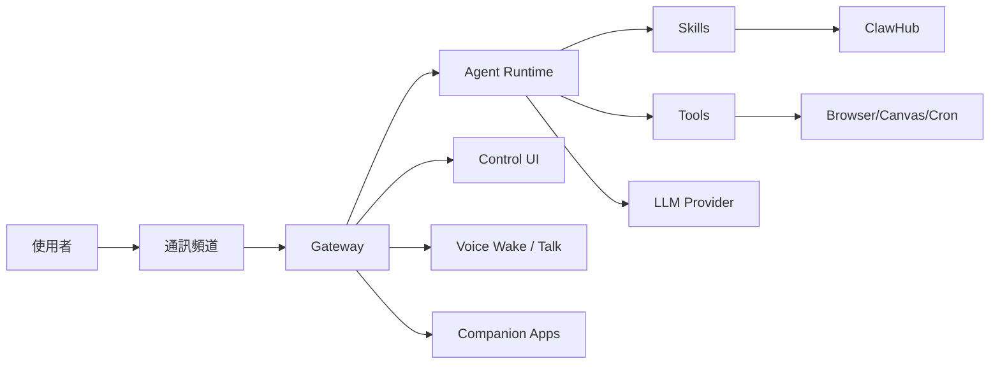

OpenClaw 的架構高度可組合，每一層都可以獨立擴展或替換：

1. **頻道層**: 新增通訊頻道不影響 Agent 邏輯
2. **閘道層**: Gateway 負責連線管理與訊息路由
3. **執行層**: Agent Runtime 獨立處理業務邏輯
4. **能力層**: Skills 和 Tools 可按需啟用

### 1.3 Gateway 架構總覽

Gateway 是 OpenClaw 的核心守護行程（Daemon），負責管理所有外部連線與內部元件的協調。

#### 架構圖

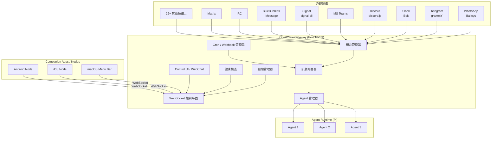

#### 關鍵特性

| 元件 | 功能 | 說明 |
|------|------|------|
| **WebSocket 控制平面** | 即時通訊 | 預設監聽 port 18789，提供雙向即時通訊 |
| **訊息路由器** | 訊息分派 | 根據頻道、使用者、訊息內容將訊息路由到對應的 Agent |
| **頻道管理器** | 連線管理 | 管理所有外部頻道連線的生命週期 |
| **Agent 管理器** | Agent 排程 | 管理 Agent 的啟動、停止、重啟，支援多 Agent 路由 |
| **組態管理器** | 動態組態 | 支援 Hot Reload，不重啟即可更新設定 |
| **健康檢查** | 監控端點 | 提供 `/healthz`、`/readyz` 端點供維運監控 |
| **Control UI** | 網頁儀表板 | 內建瀏覽器管理介面，提供聊天、組態、Session 與節點管理 |
| **Cron / Webhook** | 自動化排程 | 內建排程任務與外部事件觸發機制，支援 Gmail Pub/Sub |

#### Gateway 啟動流程

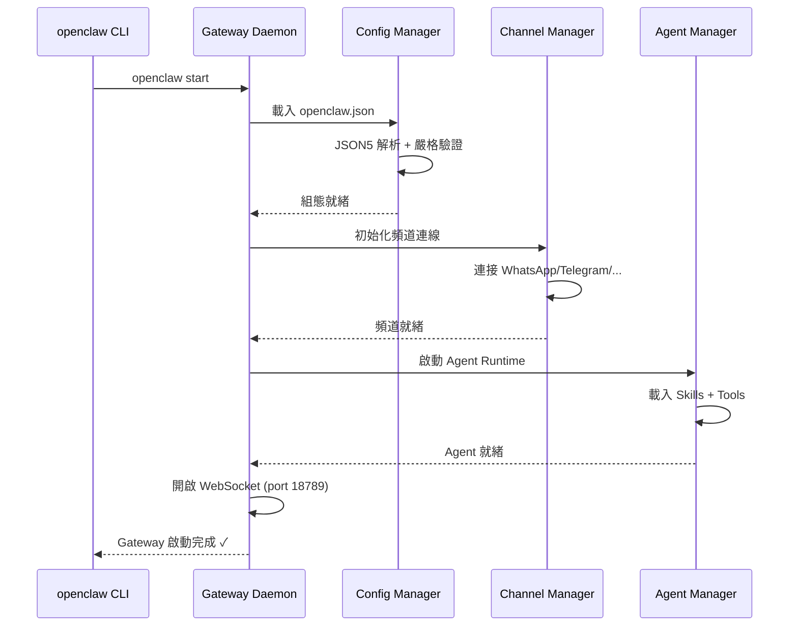

### 1.4 Pi Agent 執行環境

OpenClaw 的 Agent Runtime 稱為 **Pi**（衍生自 pi-mono 專案），是實際處理使用者訊息並產生回應的執行環境。

#### 核心概念

| 概念 | 說明 |
|------|------|
| **Workspace** | Agent 的工作目錄，包含 Skills、組態、資源檔案 |
| **Bootstrap Files** | Agent 啟動時載入的初始化檔案 |
| **Skills** | Agent 的能力模組，定義行為與工具 |
| **Sessions** | 對話會話管理，維護上下文與狀態 |
| **Model References** | 模型參考設定，指定使用的 LLM |

#### Agent 生命週期

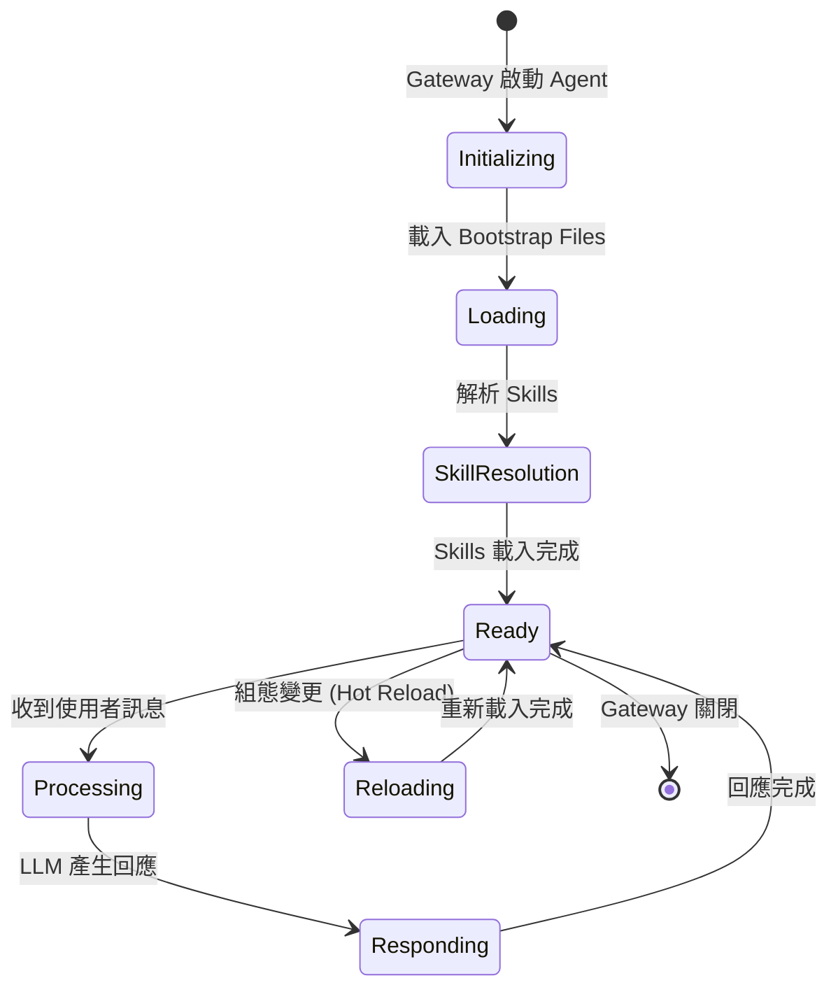

#### Workspace 目錄結構

Agent 的 Workspace 是一個標準目錄結構：

```text
~/.openclaw/
├── openclaw.json          # 主組態檔（JSON5 格式）
├── workspace/              # Agent 工作區根目錄
│   ├── AGENTS.md          # Agent 身份與行為定義
│   ├── SOUL.md            # Agent 個性與核心價值
│   ├── TOOLS.md           # 工具使用指引
│   └── skills/            # 工作區技能目錄
│       └── my-skill/
│           ├── SKILL.md   # 技能定義
│           └── tools/     # 技能工具
├── skills/                 # 管理級技能目錄
│   └── another-skill/
├── credentials/            # 頻道認證資料（如 WhatsApp 登入）
├── logs/                   # JSONL 日誌輸出
│   └── openclaw.jsonl
└── data/                   # Agent 資料存儲
```

> **Bootstrap Files**: Agent 啟動時會注入 `AGENTS.md`、`SOUL.md`、`TOOLS.md` 等 Prompt 檔案，這些檔案定義了 Agent 的身份、個性與工具使用規範。可透過 [`reference/templates`](https://docs.openclaw.ai/reference/templates/AGENTS) 查看預設範本。

#### Agent 的訊息處理流程

1. **接收**: Gateway 將使用者訊息傳遞給 Agent
2. **路由**: Agent 根據訊息內容與上下文判斷使用哪個 Skill
3. **增強**: Skill 將相關工具與 Prompt 注入到請求中
4. **推論**: 將增強後的請求送到 LLM 進行推論
5. **後處理**: 處理 LLM 回應，執行工具呼叫
6. **回應**: 將最終回應送回使用者

### 1.5 Skills 技能系統

Skills（技能）是 OpenClaw 最核心的擴展機制：一個技能就是一個資料夾，裡面放一份 `SKILL.md`（給模型看的操作說明）以及選用的腳本、參考資料與素材。技能**不會**自動帶來新權限——它只是「教 Agent 如何使用既有工具」的說明書。這一點是審查 AI 產出技能時最重要的心智模型：**技能能做什麼，取決於 Agent 被允許使用哪些工具，而不是 SKILL.md 寫了什麼。**

#### 技能定義：SKILL.md

OpenClaw 遵循 [AgentSkills](https://agentskills.io) 規範。frontmatter **只有 `name` 與 `description` 是必填**；其餘為選填鍵，最常用的是 `metadata.openclaw`（載入閘門與環境需求）：

```markdown
---
name: weather-reporter
description: 查詢指定城市的即時天氣與三日預報，並以繁體中文摘要回覆
metadata:
  openclaw:
    requires:
      bins: ["curl"]
      env: ["WEATHER_API_KEY"]
    primaryEnv: WEATHER_API_KEY
---

# Weather Reporter

當使用者詢問天氣時：

1. 若地點不明確，先反問城市名稱，不要猜測。
2. 以 `exec` 工具執行 `curl -s "https://api.example-weather.com/v1/now?city=<城市>"`
   （API Key 由環境變數 `WEATHER_API_KEY` 注入，**不要**把金鑰寫進回覆或指令列）。
3. 回覆格式：溫度、體感、濕度、風速各一行；有警特報時放在第一行並加 ⚠️。
```

| frontmatter 鍵 | 必填 | 用途 |
| --- | --- | --- |
| `name` | ✅ | 技能識別名稱（同名時依載入優先序取勝者） |
| `description` | ✅ | 模型決定是否選用此技能的主要依據，應寫「何時用、做什麼」 |
| `metadata.openclaw.requires.bins` / `anyBins` / `env` / `config` | 選填 | 載入閘門：缺少必要執行檔、環境變數或組態時不載入 |
| `metadata.openclaw.os` | 選填 | 平台過濾，例如 `["darwin"]`、`["linux"]`、`["win32"]` |
| `user-invocable` | 選填（預設 `true`） | 是否同時提供為使用者可呼叫的 slash command |
| `disable-model-invocation` | 選填（預設 `false`） | `true` 時不放入模型的常規提示，只保留 slash command |
| `command-dispatch: tool` + `command-tool` | 選填 | slash command 直接派送到指定工具，不經過模型 |

> ❌ **常見 AI 產出錯誤**：在 frontmatter 加入 `triggers:`、`tools:`、`access.channels`、`access.users` 之類的鍵。這些**不是** OpenClaw 支援的欄位，會被忽略——結果是作者以為設了存取控制，實際上完全沒有。存取控制必須放在 `openclaw.json` 的 Agent allowlist 與工具政策（見下方與 5.2 節）。

#### 技能載入優先序

同名技能出現在多個來源時，**優先序高者勝出**（v2026.11.1 官方定義）：

| 優先序 | 來源 | 路徑 | 可見範圍 |
| --- | --- | --- | --- |
| 1（最高） | Workspace skills | `<workspace>/skills` | 僅該 Agent |
| 2 | Project agent skills | `<workspace>/.agents/skills` | 僅該工作區的 Agent |
| 3 | Personal agent skills | `~/.agents/skills`（僅預設 state 目錄時） | 使用預設 state 的 Agent |
| 4 | Managed / local skills | `<state-dir>/skills` | 共用同一 state 的所有 Agent |
| 5 | Workshop skills | `<state-dir>/agents/<agentId>/agent/workshop-skills` | 僅該 Agent（自我學習產出，見 4.3） |
| 6 | Bundled / Custodian skills | 隨安裝套件提供 | 所有 Agent／僅 Custodian Agent |
| 7（最低） | Extra directories 與插件技能 | `skills.load.extraDirs` + plugin skills | 使用該組態的所有 Agent |

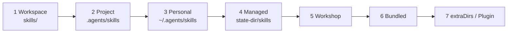

> **兩件事不要混淆**：「**位置**」決定同名時誰勝出（precedence），「**allowlist**」決定哪個 Agent 看得到（visibility）。若設定 `OPENCLAW_STATE_DIR` 指向非預設位置，`~/.agents/skills` 這類家目錄層級的來源會被排除。

#### 技能啟用、金鑰注入與 Agent Allowlist

技能的組態全部集中在 `skills.*`（載入、安裝、個別技能開關與金鑰）與 `agents.*.skills`（每個 Agent 可見的技能清單）：

```json5
// openclaw.json（已以 openclaw 2026.11.1 `openclaw config validate --json` 驗證通過）
{
  skills: {
    load: { extraDirs: ["~/company-skills"], watch: true },
    install: { nodeManager: "npm", allowUploadedArchives: false },
    entries: {
      "weather-reporter": {
        enabled: true,
        // 以 SecretRef 參照環境變數，避免金鑰明文出現在組態檔
        apiKey: { source: "env", provider: "default", id: "WEATHER_API_KEY" },
      },
      "legacy-report": { enabled: false },
    },
  },
  agents: {
    ownership: "explicit", // 多 Agent roster 必填：明確宣告各 Agent 的擁有關係
    defaults: { skills: ["weather-reporter", "github"] }, // 所有 Agent 的共同基準
    entries: {
      assistant: {},                         // 省略 skills → 繼承 defaults
      finance: { skills: ["finance-report"] }, // 非空清單 = 最終集合，不與 defaults 合併
      kiosk: { skills: [] },                  // 空陣列 = 不暴露任何技能
    },
  },
}
```

Allowlist 規則（審查重點）：

1. 省略 `agents.defaults.skills` → 預設不限制。
2. 省略 `agents.entries.<id>.skills` → 繼承 defaults。
3. `agents.entries.<id>.skills: []` → 該 Agent 看不到任何技能。
4. **非空清單是「最終集合」**，不會與 defaults 合併——這是最常見的誤解。
5. Allowlist **不是** Shell 授權邊界：若 Agent 可使用 `exec`，仍需以沙箱、exec allowlist 與最小權限憑證另行限制（見第九章）。

#### 技能設定的驗證方式

| 檢查項目 | 指令／方法 | 預期結果 |
| --- | --- | --- |
| 組態鍵是否存在 | `openclaw config validate --json` | `"valid": true`；若出現 `Unrecognized keys` 即為 AI 杜撰鍵 |
| 技能是否實際載入 | `openclaw skills check` | 列出勝出來源；缺少 `requires.*` 時顯示未通過的閘門 |
| 同名技能由誰勝出 | `openclaw skills info <name>` | 顯示實際來源路徑，應符合上表優先序 |
| frontmatter 是否只用支援的鍵 | 人工檢視 `SKILL.md` | 不含 `triggers`／`tools`／`access` 等非規範鍵 |
| 金鑰未寫死 | `grep -rnE "api[_-]?key\s*[:=]\s*['\"]\w" skills/` | 無輸出 |

### 1.6 Tools 工具系統

Tools（工具）是 Agent 與外部世界互動的介面，OpenClaw 內建多種工具類別：

#### 內建工具分類

| 工具類別 | 功能 | 範例用途 |
|----------|------|----------|
| **Browser** | 瀏覽器控制（CDP） | 網頁擷取、自動化操作、截圖、座標點擊 |
| **Canvas / A2UI** | Agent-to-UI 渲染 | 產生互動式 UI 元件 |
| **Nodes** | 裝置整合 | 相機、螢幕、定位、通知 |
| **Cron** | 排程 & Webhook | 定時任務、外部事件觸發、Gmail Pub/Sub |
| **Sessions** | 對話管理 | 對話狀態、歷史記錄、跨 Agent 訊息傳遞 |
| **Discord / Slack** | 頻道動作 | 頻道專屬操作指令 |
| **Gateway** | 閘道控制 | 組態管理、健康檢查、節點管理 |
| **exec / process** | 系統執行 | 在主機上執行指令、管理程序 |
| **code_execution** | 程式碼執行 | 沙箱內安全執行程式碼 |
| **web_search / web_fetch** | 網頁搜尋與擷取 | 即時搜尋網頁、取得 URL 內容（v2026.6.9 新增 Codex Hosted Search 無需 API Key） |
| **read / write / edit** | 檔案操作 | 讀寫檔案、編輯內容 |
| **apply_patch** | 差異套用 | 以 patch 格式批次修改檔案 |
| **image / image_generate** | 圖片生成與編輯 | 透過 Provider 生成或編輯圖片 |
| **music_generate** | 音樂生成 | 透過 Provider 生成音樂素材 |
| **video_generate** | 影片生成 | URL 資產交付、參考音訊、自適應長寬比、多 Provider 支援 |
| **tts** | 語音合成 | 文字轉語音，支援多 Provider（Azure Speech、ElevenLabs 等） |
| **Dreaming** | 記憶 Wiki 管理 | ChatGPT 匯入消化、Wiki 頁面編譯、Memory Palace 日記 |
| **message** | 訊息工具 | 傳送格式化訊息至頻道 |
| **session_status** | 狀態查詢 | 查詢 Session 當前狀態、Token 用量 |
| **agents_list** | Agent 列表 | 列出可用 Agent 及其中繼資料 |
| **subagents** | 子 Agent 管理 | 建立並管理子 Agent 工作流程 |

#### 工具設定檔（Tool Profiles）

`tools.profile` 先決定一份**基準 allowlist**，再疊加 `tools.allow`／`tools.alsoAllow`／`tools.deny`。本機 onboarding 在沒有設定 profile 時會寫入 `full`；既有組態不會被自動遷移。

| 設定檔 | 包含（v2026.11.1） | 適用情境 |
| --- | --- | --- |
| `minimal` | `session_status`、`gateway`（僅 `update.run`） | 高度受限的對外 Agent |
| `coding` | `group:fs`、`group:runtime`、`group:web`、`group:sessions`、`group:memory`、`cron`、`gateway`（僅更新）、goal／progress／`ask_user`／`skill_workshop`／影像與媒體生成 | 開發輔助 Agent |
| `messaging` | `group:messaging`、sessions 與 conversations 系列、`subagents`、`session_status`、`gateway`（僅更新）、`ask_user` | 純通訊／客服 Agent |
| `full` | 不做核心過濾，並選入已啟用插件的選用工具 | 個人助理、受信任操作者 |

> ⚠️ **`full` 只代表「選入工具」，不等於「完全存取」**。工具實際能做什麼仍受對話的 Execution permissions、owner 檢查、檔案系統、沙箱與 exec 政策約束。另外 `tts` 不屬於任何受限 profile，需要時請加入 `tools.alsoAllow`。

#### 工具群組（Tool Groups）

| 群組 | 包含工具 |
| --- | --- |
| `group:runtime` | `exec`（`bash` 為別名）、`process`、`code_execution` |
| `group:fs` | `read`、`write`、`edit`、`apply_patch` |
| `group:sessions` | `sessions*`、`conversations_*`、`subagents`、`session_status`、`suggest_task`、`dismiss_task` |
| `group:memory` | `memory_search`、`memory_get` |
| `group:web` | `web_search`、`x_search`、`web_fetch` |
| `group:ui` | `browser`、`screen`、`theme`、`dashboard`、`terminal`、`portal`、`canvas`、`show_widget` |
| `group:automation` | `heartbeat_respond`、`automations`（`cron` 別名）、`gateway`、`plugins`、`openclaw` |
| `group:messaging` | `message` |
| `group:nodes` | `nodes`、`computer` |
| `group:agents` | `agents_list`、goal 系列、`progress_card`、`ask_user`、`skill_workshop` |
| `group:media` | `view_image`、`image_generate`、`music_generate`、`video_generate`、`tts`、`pdf` |
| `group:openclaw` | 上述所有內建工具，但**不含** `read`／`write`／`edit`／`apply_patch`／`exec`／`process`／`canvas` |
| `group:plugins` | 已載入插件擁有的工具（含透過 `bundle-mcp` 暴露的 MCP 伺服器） |

工具存取控制透過 `tools.allow`／`tools.alsoAllow`／`tools.deny` 管理，也可用 `tools.byProvider` 與 `tools.toolsBySender` 依 Provider 或發送者細分。**群組 deny 會覆蓋個別工具的 allow**——例如 deny `group:media` 會一併擋掉明確 allow 的 `pdf`。

```json5
// 客服 Agent：以 messaging 為基準，額外允許語音，禁止所有 runtime 與檔案寫入
{
  tools: {
    profile: "messaging",
    alsoAllow: ["tts"],
    deny: ["group:runtime", "write", "edit", "apply_patch"],
    fs: { workspaceOnly: true },
  },
}
```

#### Browser 工具

Browser 工具使用 **Chrome DevTools Protocol (CDP)** 提供完整的瀏覽器控制能力：

```text
// 工具呼叫示意（由模型在對話中發出，非 openclaw.json 組態）
browser → navigate { url: "https://example.com/report" }
browser → snapshot  { }            // 取得可存取性樹，供下一步點擊定位
browser → click     { ref: "e12" }
```

操作者也可以從 CLI 直接驅動同一個受管瀏覽器，方便重現 Agent 的行為：

```bash
openclaw browser start --headless
openclaw browser navigate https://example.com/report
openclaw browser screenshot
```

功能包含：

- 導航至指定 URL
- 擷取頁面內容（文字/截圖）
- 填寫表單
- 點擊按鈕
- 執行 JavaScript

#### Canvas / A2UI 工具

A2UI（Agent-to-UI）是 OpenClaw 獨特的工具，允許 Agent 產生互動式 UI 元件：

```text
使用者: 建立一個投票
Agent: [使用 Canvas 工具產生互動式投票 UI]
```

#### Cron 與 Webhook 工具

Agent 透過 `automations`（舊名 `cron`）工具建立排程；操作者則使用同名 CLI。兩者寫入的是同一份 Automations 儲存，**不是** `openclaw.json` 組態：

```bash
# 週一至週五 09:00（台北時間）產生日報並送到 Slack #team-reports
openclaw automations add --name daily-report --cron "0 9 * * 1-5" --tz Asia/Taipei \
  --message "彙整昨日工單與部署紀錄，產出日報" --channel slack --to "#team-reports"

openclaw automations list
openclaw automations runs <job-id>     # 檢視每次執行結果
```

外部事件則以 Webhook 觸發；Gmail Pub/Sub 有專用的 `openclaw webhooks gmail setup`。一般 HTTP Webhook 的設定方式見 4.7 節。

> ⚠️ **v2026.9.7 起 Tasks 與 TaskFlow 已移除**（含面板、指令與 API）。原本的工作請改用 subagent、ACP sessions、背景程序、Automations 歷史或 Lobster pipeline；TaskFlow Webhooks 沒有對等的 HTTP 替代方案。升級後須執行 `openclaw doctor --fix`。

#### Dreaming / Memory Wiki 工具

Dreaming 是 OpenClaw v2026.4 新增的記憶管理子系統，提供 Agent 長期知識彙整能力：

- **ChatGPT 匯入消化**: 可匯入既有 ChatGPT 對話歷史，透過 `Imported Insights` 子頁籤瀏覽
- **Wiki 頁面編譯**: 將多次對話中的知識自動編譯為結構化 Wiki 頁面
- **Memory Palace 日記**: `Memory Palace` 子頁籤提供 Agent 自主整理的記憶日記

```text
使用者: 匯入我的 ChatGPT 對話歷史
Agent: [使用 Dreaming 工具匯入並消化對話，產出 Imported Insights 和 Wiki 頁面]
```

#### video_generate 影片生成工具

v2026.4.11 新增的影片生成工具，支援多種 Provider 的影片生成能力：

- **URL 資產交付**: 生成的影片以 URL 形式交付，避免大檔案佔用記憶體
- **參考音訊輸入**: 支援提供參考音訊素材
- **自適應長寬比**: `adaptive` 模式自動選擇最佳畫面比例
- **多 Provider 支援**: 支援 Google Veo、OpenAI Sora 等影片生成服務

### 1.7 Sessions 與對話管理

Sessions 是 OpenClaw 管理對話狀態的核心機制。

#### Session 生命週期

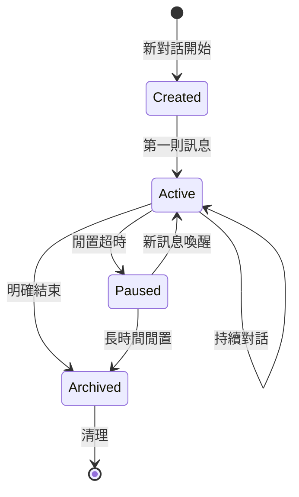

#### Session 資料結構

每個 Session 包含以下資訊：

| 欄位 | 類型 | 說明 |
|------|------|------|
| `id` | `string` | Session 唯一識別碼 |
| `channelId` | `string` | 來源頻道識別碼 |
| `userId` | `string` | 使用者識別碼 |
| `agentId` | `string` | 處理此 Session 的 Agent |
| `messages` | `Message[]` | 對話訊息歷史 |
| `context` | `object` | 上下文資料（記憶） |
| `metadata` | `object` | 中繼資料 |
| `createdAt` | `timestamp` | 建立時間 |
| `updatedAt` | `timestamp` | 最後更新時間 |
| `status` | `enum` | Created / Active / Paused / Archived |

#### 上下文管理策略

OpenClaw 提供多種上下文管理策略防止 Token 超出限制：

1. **滑動視窗（Sliding Window）**: 保留最近 N 則訊息
2. **摘要壓縮（Summary Compression）**: 將較舊的訊息摘要化
3. **優先保留（Priority Retention）**: 標記重要訊息永久保留
4. **混合策略（Hybrid）**: 結合以上策略

#### Session Tools（跨 Agent 通訊）

OpenClaw 提供 `sessions_*` 系列工具，允許 Agent 之間跨 Session 協作：

| 工具 | 功能 | 說明 |
|------|------|------|
| `sessions_list` | 列出 Sessions | 探索目前活躍的 Sessions（Agent）及其中繼資料 |
| `sessions_history` | 讀取歷史 | 取得指定 Session 的對話記錄 |
| `sessions_send` | 傳送訊息 | 向另一個 Session 傳送訊息，支援可選的回覆式 ping-pong（`REPLY_SKIP`、`ANNOUNCE_SKIP`） |
| `sessions_spawn` | 建立 Session | 建立新的 Session 並指派 Agent |

> **使用情境**: 透過 Session Tools，你可以在不同聊天介面之間協調工作。例如，在 Slack 的 DevOps Agent 可以委託 Telegram 的報表 Agent 產生報告，然後將結果傳回。詳情參考 [Session tools](https://docs.openclaw.ai/concepts/session-tool)。
>
> **Cross-channel Session Identity**（v2026.6.10 新增）: 當使用者從一個頻道切換到另一個頻道時（例如從 WhatsApp 轉到 Telegram），Session 的 origin 會自動重置，確保身份識別正確且避免舊頻道殘留的上下文污染新頻道。

#### 聊天指令（Chat Commands）

使用者可在 WhatsApp / Telegram / Slack / Google Chat / Microsoft Teams / WebChat 中使用以下指令控制 Agent（群組指令僅限擁有者）：

| 指令 | 功能 | 備註 |
|------|------|------|
| `/status` | 顯示簡要 Session 狀態 | 包含模型、Token 用量、成本 |
| `/new` 或 `/reset` | 重置 Session | 清除上下文，開始新對話 |
| `/compact` | 壓縮 Session 上下文 | 產生摘要以釋放 Token 空間 |
| `/think <level>` | 設定推理深度 | off \| minimal \| low \| medium \| high \| xhigh（GPT-5.2 + Codex 模型） |
| `/verbose on\|off` | 切換詳細模式 | 顯示更多 Agent 內部處理資訊 |
| `/usage off\|tokens\|full` | 設定用量頁腳 | 每次回應後顯示的用量資訊級別 |
| `/restart` | 重啟 Gateway | 僅限擁有者，群組中使用 |
| `/activation mention\|always` | 群組激活模式 | 設定群組中需 @mention 或始終回應 |
| `/trace on\|off` | 追蹤模式 | 開啟/關閉工具呼叫與推論過程的詳細追蹤輸出 |
| `/elevated on\|off` | 提升權限存取 | 切換當前 Session 的主機提升權限（需預先啟用與白名單） |

### 1.8 多頻道支援（Channels）

OpenClaw 支援 **40 種以上**通訊頻道（含插件頻道），涵蓋消費端通訊軟體、企業協作平台、電信簡訊、去中心化協議與 Agent 間協定。以下為完整列表：

#### 支援頻道一覽

| 頻道 | 底層函式庫 | 狀態 | 備註 |
|------|-----------|------|------|
| **WhatsApp** | Baileys | ✅ 穩定 | 透過 Web API 連接 |
| **Telegram** | grammY | ✅ 穩定 | Bot API，v2026.6.8 新增 Rich HTML 渲染（表格/清單/blockquote） |
| **Slack** | Bolt | ✅ 穩定 | Slack App |
| **Discord** | discord.js | ✅ 穩定 | Discord Bot |
| **Google Chat** | 官方 API | ✅ 穩定 | Google Workspace |
| **Signal** | signal-cli | ✅ 穩定 | 端對端加密 |
| **BlueBubbles** | BlueBubbles API | ✅ 穩定 | 建議的 iMessage 整合方式 |
| **iMessage** | imsg (legacy) | ✅ 穩定 | 需要 macOS，舊版整合 |
| **IRC** | 原生實作 | ✅ 穩定 | 任何 IRC 伺服器 |
| **Microsoft Teams** | Bot Framework | ✅ 穩定 | Microsoft 365，支援反應、委派 OAuth、聯合認證 |
| **Matrix** | matrix-js-sdk | ✅ 穩定 | 開源通訊協議 |
| **LINE** | LINE SDK | ✅ 穩定 | LINE 官方帳號 |
| **Feishu** | 飛書 SDK | ✅ 穩定 | 字節跳動飛書，支援文件評論 Session、評論反應 |
| **Mattermost** | 插件頻道 | ✅ 穩定 | 自架 Slack 替代方案（extension 套件） |
| **Nextcloud Talk** | 官方 API | ✅ 穩定 | Nextcloud 整合 |
| **Nostr** | 原生實作 | ✅ 穩定 | 去中心化協議 |
| **Synology Chat** | 官方 API | ✅ 穩定 | Synology NAS |
| **Tlon** | 官方 API | 🔄 測試 | Urbit 生態 |
| **Twitch** | tmi.js | ✅ 穩定 | 直播聊天室 |
| **QQ Bot** | 內建插件 | ✅ 穩定 | 群聊支援、串流回應、媒體上傳（v2026.5.4 新增） |
| **Yuanbao** | 騰訊元寶插件 | ✅ 穩定 | 騰訊官方提供，外部插件安裝（v2026.5.4 新增） |
| **Voice Call** | Plivo/Twilio 插件 | ✅ 穩定 | 電話語音通話，支援 Realtime Voice Loop（v2026.4.24 新增） |
| **Google Meet** | 內建參與者插件 | ✅ 穩定 | Chrome/Twilio Realtime、出席匯出、錄製檔案（v2026.4.24 新增） |
| **Zalo** | 官方 API | ✅ 穩定 | 越南通訊軟體（官方帳號） |
| **Zalo Personal** | 官方 API | ✅ 穩定 | 越南通訊軟體（個人帳號） |
| **WeChat** | @tencent-weixin/openclaw-weixin | ✅ 穩定 | 騰訊官方插件（iLink Bot API），v2.x 需 OpenClaw ≥2026.3.22 |
| **WebChat** | 內建 | ✅ 穩定 | Gateway 內建網頁聊天介面 |
| **macOS** | 內建 | ✅ 穩定 | macOS 選單列應用（Menu Bar App） |
| **iOS** | 內建 | ✅ 穩定 | iOS Node（Canvas、Voice Wake、相機） |
| **Android** | 內建 | ✅ 穩定 | Android Node（Chat、Voice、Canvas、裝置指令） |
| **SMS / MMS / RCS** | Twilio | ✅ 穩定 | 電信簡訊與 RCS，適合無網路應用情境 |
| **WeCom（企業微信）** | 官方 API | ✅ 穩定 | 騰訊企業微信，與消費端 WeChat 為不同頻道 |
| **ClickClack** | 官方 API | ✅ 穩定 | 官方文件列為獨立頻道 |
| **Reef** | 官方 API | ✅ 穩定 | OpenClaw 生態系內部頻道 |
| **Raft** | 官方 API | 🔄 測試 | OpenClaw 生態系內部頻道 |
| **Buzz** | 官方 API | ✅ 穩定 | 輕量通知型頻道 |
| **A2A（Agent-to-Agent）** | A2A 協定 | ✅ 穩定 | Agent 之間的直接訊息傳遞，非人類使用者頻道 |
| **Zalo ClawBot** | 官方 API | ✅ 穩定 | Zalo 的 Bot 模式（與官方帳號／個人帳號並列的第三種接法） |

> **插件頻道（Plugin Channels）**: OpenClaw 透過 extension 套件機制支援額外頻道整合，如 Mattermost 等。插件頻道安裝後與內建頻道行為一致。
>
> **頻道治理功能（v2026.8.1）**: 除頻道本身外，官方另提供跨頻道的治理機制 —— **Access Groups**（存取群組）、**Broadcast Groups**（廣播群組）、**Channel Routing**（頻道路由）、**Bot Loop Protection**（機器人迴圈防護）與 **Ambient Room Events**（環境房間事件）。企業部署多頻道時，這些機制比單一頻道設定更關鍵，詳見第五章 5.2 與第十一章。
>
> **WeChat 頻道安裝**: WeChat 頻道由騰訊官方提供插件，安裝方式為 `openclaw plugins install "@tencent-weixin/openclaw-weixin"`，然後執行 `openclaw channels login --channel openclaw-weixin` 掃描 QR Code 即可配對。目前僅支援私人聊天，需遍尋 WeChat ClawBot 插件（WeChat > 我 > 設定 > 插件）。

#### 新增頻道的統一介面

所有頻道都實作相同的 `Channel` 介面：

```typescript
// 頻道介面定義（TypeScript 概念說明）
interface Channel {
  id: string;
  name: string;
  connect(): Promise<void>;
  disconnect(): Promise<void>;
  sendMessage(target: string, message: Message): Promise<void>;
  onMessage(handler: MessageHandler): void;
}
```

### 1.9 與傳統 LLM 聊天機器人的比較

| 面向 | 傳統 LLM 聊天機器人 | OpenClaw |
|------|---------------------|----------|
| **部署模式** | 雲端 SaaS | 自架或雲端皆可 |
| **頻道整合** | 通常只有 Web UI | 28+ 通訊頻道原生整合（含插件頻道） |
| **擴展機制** | API 呼叫 / Plugin | Skills + Tools 組合式架構 |
| **資料所有權** | 平台持有 | 使用者完全掌控 |
| **自訂程度** | 有限（Prompt 調整） | 完全自訂（Skills + Tools + Agent 行為） |
| **多 Agent** | 通常不支援 | 原生支援多 Agent 路由與協作 |
| **信任模型** | 平台信任 | 個人信任邊界 + DM Pairing 機制 |
| **可觀測性** | 平台提供 | 完整 OpenTelemetry 整合 |
| **成本模型** | 按 Token / 呼叫計費 | 自架為主，LLM API 費用可控 |
| **排程能力** | 需額外開發 | 內建 Cron / Webhook / Gmail Pub/Sub |
| **語音互動** | 多數不支援 | Voice Wake + Talk Mode（macOS/iOS/Android） |
| **視覺工作區** | 無 | Live Canvas + A2UI 即時渲染 |
| **遠端存取** | 內建 | Tailscale Serve/Funnel 或 SSH Tunnel |

### 1.10 OpenClaw 版本歷程

| 版本 | 日期 | 重大變更 |
| --- | --- | --- |
| **2026.11.1** | 2026-11-05 | **最新穩定版（本手冊基準）**。可靠性為主：Mac 設定存檔失敗不再覆寫密鑰、關閉 Tailscale 暴露時保留 Gateway 驗證；Telegram／Discord／webhook 對話在請求處理結束後仍可抵達 Agent；更新器崩潰／取消後可恢復；ClickClack 與 ClawHub 拒絕導向無關私有服務的重新導向；`doctor` 非互動檢查不再未經同意下載插件；日誌遮罩政策格式錯誤時仍保留內建密鑰保護 |
| **2026.11.5-beta.1** | 2026-11-04 | 下一個穩定版的 Beta（不建議用於生產） |
| **2026.10.10** | 2026-11-03 | 4,825 commits／3,028 PR／454 位貢獻者。**雲端與桌面 Session 成為一級工作流程**（Session 可在本機與雲端間移動、依 Repository 組織雲端環境與 environment recipes）；Windows 桌面 App 與 Tauri 可執行本機 Gateway；**Gemini 4 Argon 成為預設 Gemini 模型**；**macOS／iOS／Safari 需 26.2 以上**；Node 相容區間恢復為 `>=24.16.0 <25 \|\| >=26.1.0`（24.22.1／26.12.1 改為安全建議）；Codex 受管 CLI 升至 0.164.0；Git 備份涵蓋 PostgreSQL 匯出並遮罩憑證 |
| **2026.10.6〜10.9** | 2026-10-22〜10-29 | 10.6 一度**強制要求 Node 24.22.1+／26.12.1+**（回應 2026 年 10 月 Node.js 憑證金鑰外洩的安全版本）；10.8 安全強化（exec allowlist 對 `test -v` 需審批、沙箱子程序不可執行主機 CLI backend、egress proxy 拒絕不受信任的 eMudhra 憑證鏈）；10.9 修補 fast-uri／nodemailer 等相依套件漏洞、`tools.fs.workspaceOnly` 套用至 Gateway 內建工具 |
| **2026.10.1〜10.5** | 2026-10-10〜10-18 | Code Mode `store`／`load` 跨 cell 保存小型值；**匯入 coding-agent 逐字稿**為 OpenClaw Session；**異地備份**（外接磁碟、NAS、Cloudflare R2）；Automations 可在不執行模型下檢查條件並呼叫明確允許的 MCP；Cloud Worker 支援 GitHub Enterprise；10.5 新增 **X（Twitter）頻道**、語音通話報告與即時引導、**Gateway 內建 ClawHub 瀏覽**；10.1 第三方插件須移除已退休的相容層與整包 session-store helper（**破壞性**） |
| **2026.9.33〜9.36** | 2026-10-15〜10-29 | **Extended-Stable（LTS）九月線**：九月底的 OpenClaw 加上關鍵安全、可靠性修補與新模型支援，**僅提供 Gateway**；目前 npm `extended-stable` 指向 **2026.9.36** |
| **2026.9.4〜9.9** | 2026-09-11〜10-08 | 9.4 安裝／Web UI／更新流程大幅整理；**9.5 為「2026 年 6 月以前安裝」的必經升級站**；9.6 移除 Compaction checkpoint 還原控制（`sessions.compaction.*`），新增 `openclaw worktrees` 歸檔／還原；**9.7 移除 Tasks 與 TaskFlow**、Tool Search 改為 search／describe／call 三工具並移除 `tool_search_code`、Bun-only 安裝可自我更新 |
| **2026.9.3** | 2026-09-08 | **破壞性：Node 需 24.16.0+（24.x）或 26.1.0+**，Node 22／25 不再支援（避免 SQLite 文字截斷）；Plugin SDK exec-policy／approval／SDK 別名／搜尋與目錄結果欄位多項破壞性調整；Skill Workshop 改為**每個 Agent 一份可寫入的技能集合**（退休 `skills.workshop.allowSymlinkTargetWrites`）；更新前於隔離候選狀態**預演（rehearse）** 核心與插件變更；可分享的唯讀對話連結；會議筆記庫；選用的 Team Reports |
| **2026.9.1〜9.2** | 2026-09-03〜09-05 | 9.1：**一句話完成安裝的 quick-start**（偵測既有 Claude Code／Codex 登入與 API Key）、**共用 Gateway 上的個人技能庫**（`openclaw skills library`）、`openclaw update` 失敗自動回滾並交給內建 triage Agent、`agents.defaults.cwd`／`worktreeRoot`、`cron.skipMissedJobs`、SSRF `blockedHostnames`、`config set --dry-run` 等守門旗標、`openclaw memory reset`、聊天中渲染 Mermaid、Anthropic Fable 5.1；9.2：GPT-6 Astra、Gateway 重啟後回覆可恢復、更多設定免重啟生效 |
| **2026.8.2** | 2026-09-01 | Home Agent 側邊 Dock（`Cmd/Ctrl+Shift+H`）、**Linux 桌面 App**（`.deb`／AppImage，簽章驗證更新）、背景 Session、`openclaw update cleanup --dry-run` 清理遷移原件、更安全的升級（保留較新組態、未完成遷移不宣告成功） |
| **2026.8.33〜8.35**<br>**2026.7.35**／**2026.6.35** | 2026-09-10〜10-02 | 八月／七月／六月 Extended-Stable 維護線的後續修補 |
| **2026.8.1**<br>（**OpenClaw 2.0**） | 2026-08-31 | **專案史上最大改版（彙整逾 16,000 個 PR）**。九大主軸：① 以對話為中心重建的 **Control UI**（Session Rail、`/btw` 側線對話、審批內嵌於對話）② **多人協作與分享角色**（read／suggest／draft／participate、Incognito）③ **Cloud Workers 與 Paired Devices 分散式執行** ④ **Session 與 Transcript 改用 SQLite 儲存**（含降版限制）⑤ **Secret Store**（Protected／Agent-readable 雙軌）⑥ **Automations**（`cron` 更名，兩套指令並存）⑦ **Skill Workshop 與自我學習**（off／propose／auto）⑧ **Built-in Memory 取代 QMD** ⑨ **Code Mode 介面重寫**。破壞性變更：OpenProse 插件移除、`codex/*` → `openai/*` 路由遷移、部分官方 Provider 外部化為獨立套件 |
| **2026.8.1-beta.4** | 2026-08-28 | ⚠️ **誤植發布為 `2026.9.1-beta.1`**，官方已聲明其實際版本為 2026.8.1-beta.4，**不得視為新於 stable 2026.8.1**。內容為可靠性修補：Gateway 重啟復原保留已受理回合、組態寫入於 watcher 交接期間的可靠性、Codex runtime 升至 0.150.1、Linux 安裝改用 Node 24 LTS |
| **2026.8.1-beta.3** | 2026-08-24 | 2.0 發布前的最後一輪 Beta 驗證 |
| **2026.8.1-beta.2** | 2026-08-15 | Secret Egress Host Binding（跨 CLI/Gateway RPC/Control UI 綁定密鑰目的地主機）、GPT-5.6 Ultra 與 Sol/Terra/Luna 執行期切換、Channel Plugin Ingress Monitor 共用生命週期（IRC/Synology Chat/Google Chat）、`openclaw backup sqlite` 快照備份指令、macOS App Profile 隔離、外部插件安裝需明確 `--force` 確認未信任來源 |
| **2026.6.34** | 2026-08-08 | **Extended-Stable 維護線**發布，僅安全與穩定性修補（瀏覽器/網路邊界加固、Provider Fallback 更穩健、Discord Gateway 突發流量抑制），不含新功能；同時公告 Plugin SDK 舊介面（`before_agent_start` 等）將於 7/24 後移除 |
| **2026.7.1-2 / 2026.7.1-1** | 2026-08-04 | 前一代穩定版的修補版。修正 Codex 進度處理、記憶體啟動問題、插件更新復原等穩定性問題 |
| **2026.7.2-beta.7** | 2026-08-02 | Crash-recoverable session snapshots、跨平台 durable message delivery、對話分支與回溯（conversation branching/rewinding）、MCP app hosting with ticketed sandboxes |
| **2026.7.1** | 2026-07-13 | Control UI 與 Onboarding 大改版、iOS/Android/macOS 官方應用大幅更新、**GPT-5.6 相容性**、Tencent Hy3 完整設定流程、Meta Muse Spark 1.1、`openclaw attach`（外部 harness 接續既有 Gateway Session）、Gateway crash loop 修復（不再無限重啟）、排程任務按需喚醒、遠端瀏覽器分頁控制、Web/iOS/Android 受保護終端機（單一版本彙整 532 位貢獻者、3,063 筆貢獻、2,018 個公開 PR） |
| **2026.6.10** | 2026-06-24 | Automatic Fast Mode（短對話自動加速）、Session Transcript SDK helpers、Cross-channel Session Identity、Trusted Tool Policy Enforcement、Trusted Package Redirects、Provider 模型目錄推理控制、StepFun Provider 安裝、DM Policy pairing 安全預設 |
| **2026.6.9** | 2026-06-17 | **官方 Provider 外部化為獨立 npm 套件**、Gateway 啟動探索已安裝 channel plugins、Codex Hosted Search、OpenTelemetry Log Export、ClawHub skill provenance 保持、Session workspace rail (Control UI)、iOS Watch 控制、安全強化（秘密編修、open-DM 工具暴露稽核） |
| **2026.6.8** | 2026-06-14 | **Telegram Rich HTML 渲染**（表格、清單、blockquote、展開式引用）、GLM-5.2 + Claude Haiku 4.5 模型目錄、Usage Footer 原生渲染器、無 API Key 搜尋提供者明確 opt-in、WhatsApp ACP 綁定、iOS 前景 Gateway 重連、記憶體 rollback/cache recovery |
| **2026.5.28** | 2026-05-28 | Claude Opus 4.8 支援、GitHub Copilot agent runtime 整合、Codex Supervisor 插件、ClawPDF 加密 PDF 抽取、Workboard 多 Agent 協調面板、Policy 合規性比對/合規確認、Plugin SDK reply payload hook、SecretRef 插件清單合約、Dreaming-tab agent 選擇器 |
| **2026.5.27** | 2026-05-27 | 安全強化（content boundaries）、OpenAI-compatible embedding providers 核心模組、Pixverse 影片生成 Provider、DeepInfra 完整目錄更新、Skill Workshop 提案生命週期 |
| **2026.5.26** | 2026-05-26 | Transcript capture 核心功能、named auth profiles（多帳號驗證配置）、Activity tab UI、Rastermill 取代 Sharp 影像後端、reaction approvals（Signal/iMessage/WhatsApp）、SSRF policy for Browser、auth rate limiter、Pixverse Provider 初版、Plugin SDK reaction approval helpers |
| **2026.5.4** | 2026-05-03 | iOS LAN 配對修復、fs-safe 檔案系統安全抽取、VSCode 除錯支援、Gateway 容器權限加固、Crabbox 整合簡化、Plugin SDK 子路徑匯出、WhatsApp Live QA 通道 |
| **2026.5.2** | 2026-05-01 | macOS appcast 更新、OpenClaw SDK 套件發布、Codex prompt snapshots、組態檔 includes 支援、Plugin 邊界修正 |
| **2026.4.27** | 2026-04-27 | Codex Computer Use 設定指令、DeepInfra 內建 Provider、QQBot 群聊/串流/媒體上傳、Yuanbao 頻道擴展、Manifest-first 模型目錄、Docker Sandbox GPU 直通、Outbound Proxy 路由 |
| **2026.4.26** | 2026-04-26 | Browser Realtime Voice (Google Live)、Cerebras 內建 Provider、Matrix E2EE (`openclaw matrix encryption setup`)、`openclaw migrate` CLI (Claude/Hermes importer)、Config Diff 面板、Compaction `maxActiveTranscriptBytes` |
| **2026.4.25** | 2026-04-25 | TTS 大升級（Azure Speech、Xiaomi、Inworld、Volcengine、ElevenLabs v3）、PWA/Web Push、OpenTelemetry 擴展（模型呼叫、Token 用量、工具迴圈）、Prometheus 內建插件、Crestodian TUI、`openclaw browser start --headless` |
| **2026.4.24** | 2026-04-24 | Google Meet 內建插件、DeepSeek V4 Flash/Pro、Realtime Voice Loop (Talk/Voice Call/Meet)、Codex Computer Use、Browser 座標點擊、Gradium TTS Provider |
| **2026.4.11** | 2026-04-11 | Dreaming/Memory Wiki ChatGPT 匯入、Control UI 結構化聊天氣泡、video_generate 工具增強、Feishu 文件評論 Session、MS Teams 反應支援 + 委派 OAuth、Plugin 清單宣告機制 |
| **2026.4.x** | 2026-04 | Ollama 快取機制、GPT-5.4 / Opus 4.6 QA 對等檢查、MiniMax OAuth 修正、WhatsApp 反應路由修正 |
| **2026.3.31** | 2026-03-31 | ClawFlow 執行基底、npm dist-tag mirror 修正、Session table UI 改善 |
| **2026.3.23** | 2026-03-24 | Tools 執行時可見性視圖、Telegram forum topic 修正 |
| **2026.3.x** | 2026-03 | Control UI 改善、Skills 介面翻新、Markdown 預覽、Agent 管理、WeChat 官方插件 |
| **2026.2.12** | 2026-02 | 版本號 bump、OpenTelemetry 深度整合、健康檢查端點強化 |
| **2026.2.x** | 2026-02 | Gateway 握手逾時統一、Provider API Key 輪換機制 |
| **2026.1.x** | 2026-01 | ClawHub 技能市集上線、VirusTotal 合作技能安全掃描、NVIDIA 贊助 |
| **2025.12.x** | 2025-12 | Docker Compose 官方支援、Podman 安裝文件 |
| **2025.11.x〜2026.1.x** | 2025-11 ~ 2026-01 | 專案首次公開發布（2025-11-24，時名 Warelay）並歷經名稱沿革期：Warelay → CLAWDIS → Clawdbot → Moltbot → **OpenClaw** 定名，同期完成 Skills 系統與 Voice Wake + Talk Mode 等早期核心功能（完整時間軸見 1.1「名稱沿革」） |

> **注意**: OpenClaw 採用**日期版本號**格式 `vYYYY.M.D`（如 `v2026.7.1`）。預發布版本使用 `-beta.N` 後綴，穩定版偶有 `-1`、`-2` 等修補後綴（如 `v2026.7.1-2`），Extended-Stable（官方定位為 LTS 的等價物）以 `YYYY.M.33` 起跳（如 `v2026.9.33`〜`v2026.9.36`），內容是「該月月底的 OpenClaw + 關鍵安全／可靠性修補與新模型支援」，且**僅提供 Gateway 套件**。stable／extended-stable／beta／dev 四條版本線並行發布，以 npm dist-tag 為準（2026-11-08 查證：`latest`=2026.11.1、`extended-stable`=2026.9.36、`beta`=2026.11.5-beta.1），詳見 3.12 與第七章 7.1。
>
> ⚠️ **不可單憑版本號大小判斷新舊**：2026-08-28 發布的套件被誤植為 `2026.9.1-beta.1`，但其實際內容為 `2026.8.1-beta.4`，**比 2026-08-31 的穩定版 `2026.8.1` 還舊**。官方已在發布說明中特別警示此事，並要求穩定版使用者直接安裝或升級至 `2026.8.1`。這是採用日期版本號的專案在人為誤植下會產生的典型陷阱，升級前請以官方發布說明為準，而非套件登錄的版本排序。

### 1.11 OpenClaw 2.0 重點導讀

v2026.8.1（OpenClaw 2.0）的變更幅度遠超一般改版，且橫跨本手冊多個章節。為方便既有讀者快速定位，下表將 2.0 的主要變更對應到本手冊的章節位置：

| 2.0 主題 | 變更性質 | 本手冊對應章節 |
|---------|---------|--------------|
| 全新 Control UI（對話為中心、Session Rail、`/btw`） | 體驗重構 | 2.8、3.10 |
| Session／Transcript 改用 SQLite 儲存 | **架構變更**（含降版限制） | 2.11、6.7、附錄 E |
| 多人協作、分享角色、Incognito | **新增能力** | 第十一章 |
| Cloud Workers 與 Paired Devices 分散式執行 | **新增能力** | 第十二章 |
| Secret Store（Protected／Agent-readable） | **新增能力** | 3.11、9.2 |
| Automations（`cron` 更名，指令並存） | 更名 + 功能擴充 | 3.10、4.7、10.7 |
| Skill Workshop 與自我學習（2.0 為 off／propose／auto；**v2026.11.1 僅 off／auto**） | **新增能力** | 4.3、9.7 |
| Built-in Memory 取代 QMD | **遷移**（需 `doctor --fix`） | 4.6、7.5 |
| Code Mode 介面重寫 | **破壞性變更** | 4.4 |
| Plugin SDK subpath 收斂 | **破壞性變更**（2026-09-01 生效） | 4.9 |
| 引導式設定（偵測既有訂閱／API Key／本地模型） | 體驗重構 | 3.6 |
| Per-session 權限模式 | **新增能力**（非回溯性） | 5.2 |
| Gateway 重啟復原（suspend／resume／drain） | **新增能力** | 6.11 |
| 未信任外部內容標記 | 安全強化 | 9.1 |
| 插件能力審查與供應鏈檢查 | 安全強化 | 9.11 |

> **升級路徑建議**：若你目前執行的是 v2026.7.x，請先閱讀 **附錄 E：OpenClaw 2.0 升級遷移指南**，再依第七章的升級策略執行。2.0 包含四項需要 `openclaw doctor --fix` 介入的遷移，以及三個有明確截止日的相容性期限。

### 1.12 2.x 持續演進導讀（v2026.8.2 → v2026.11.1）

2.0 發布後的兩個多月內，官方又推出了約 40 個版本（穩定版、Beta 與 Extended-Stable）。這段期間的主軸可以歸納為三個字：**可恢復**（更新、重啟、備份都能安全回頭）、**可協作**（共用 Gateway 與團隊伺服器成形）、**可分散**（Session 可在本機、配對裝置與雲端之間移動）。下表把重要變更對應到本手冊章節：

| 主題 | 起始版本 | 變更性質 | 本手冊章節 |
| --- | --- | --- | --- |
| 一句話完成安裝的 quick-start（偵測 Claude Code／Codex 登入與 API Key） | 9.1 | 體驗重構 | 3.2 |
| Node 需求改為 `>=24.16.0 <25 \|\| >=26.1.0`，Node 22／25 不再支援 | 9.3 | **破壞性** | 3.1、附錄 E.5 |
| macOS／iOS／Safari 需 26.2 以上 | 10.10 | **平台需求提升** | 3.1 |
| 四條發布通道與 Extended-Stable（LTS）月線 | 持續 | 營運政策 | 3.12、7.1 |
| `openclaw update` 預演、回滾、`repair`／`recover`／`cleanup` | 8.2〜10.8 | **新增能力** | 7.11 |
| 共用 Gateway 個人技能庫（`openclaw skills library`）與 Skill Workshop 改為每 Agent 一份 | 9.1／9.3 | **新增能力**／破壞性 | 1.5、4.13 |
| Agent 工作目錄與 Managed Worktrees（`agents.defaults.cwd`、`worktreeRoot`、`openclaw worktrees`） | 9.1／9.6 | **新增能力** | 4.12 |
| Tasks／TaskFlow 移除、Tool Search 改為三工具、Compaction checkpoint 還原移除 | 9.6／9.7 | **破壞性** | 1.6、4.5、附錄 E.5 |
| 異地備份（外接磁碟、NAS、R2）、排程備份、Litestream 持續複寫 | 10.1 | **新增能力** | 6.7 |
| 實驗性 PostgreSQL 儲存引擎（目前僅 Workboard） | 10.x | 實驗功能 | 2.12 |
| Cloud Sessions：Session 在本機與雲端間移動、environment recipes、GitHub Enterprise | 10.1／10.10 | **新增能力** | 12.7 |
| Team Server：Cloudflare Access + trusted-proxy 驗證 + 角色 | 9.x〜11.1 | **企業部署模式** | 11.7 |
| 2026-09-11 一次揭露 375 筆安全公告（150 high） | 9.3 修補完成 | **資安基準** | 9.12 |
| 發布物驗證（npm integrity、release evidence、provenance） | 持續 | 供應鏈治理 | 8.11 |

> **閱讀建議**：
>
> - **全新導入者**：依序讀 3.1 → 3.2 → 3.12 → 11.7，直接以 v2026.11.1（或 Extended-Stable 2026.9.36）為起點。
> - **既有 2.0（2026.8.x）使用者**：先讀 **附錄 E.5**，確認 Node 版本、Tasks／TaskFlow 依賴與第三方插件相容性，再依 7.11 的流程升級。
> - **2026 年 6 月以前的安裝**：官方要求**必須先升級到 2026.9.5 並執行 `openclaw doctor --fix`**，之後才能升到最新版。

### 1.13 本章審查與驗證清單

審查 AI 依本章產出的組態、指令或程式時，逐項執行下表：

| # | 檢查項目 | 驗證方法 | 預期結果 |
| --- | --- | --- | --- |
| 1 | 技能 frontmatter 只用規範鍵 | 檢視 `SKILL.md`；CI 以 `grep -E '^(triggers\|tools\|access):'` 擋下 | 只有 `name`、`description`、`metadata` 等規範鍵 |
| 2 | 技能實際載入來源符合優先序 | `openclaw skills info <name>` | 勝出來源與 1.5 的 7 層優先序一致 |
| 3 | Agent allowlist 理解正確 | `openclaw config get agents --json` | 非空清單為最終集合；`[]` 代表不暴露技能 |
| 4 | 工具 profile 與 group 名稱存在 | `openclaw config validate --json` | `valid: true`，無 `Unrecognized` 或不合法的 enum |
| 5 | 版本敘述有出處 | 比對 GitHub Release 與 `npm view openclaw dist-tags` | 版本號、日期、通道與官方一致 |

---

## 第二章：系統架構設計

### 2.1 整體架構圖

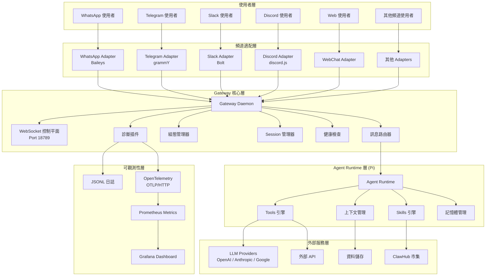

### 2.2 Gateway 核心元件

Gateway 是 OpenClaw 的中央控制器，由以下核心模組組成：

#### 2.2.1 WebSocket 控制平面

WebSocket 控制平面是 Gateway 的通訊骨幹，提供即時雙向通訊：

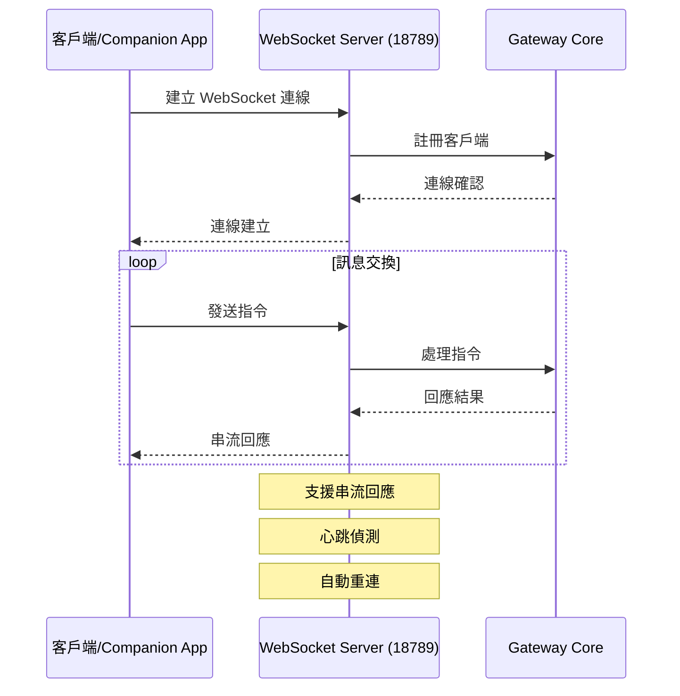

**Wire Protocol**: OpenClaw 使用自定義的 Wire Protocol 在 WebSocket 上傳輸訊息，支援：

| 功能 | 說明 |
|------|------|
| **串流（Streaming）** | 支援 Token-by-Token 串流回應 |
| **心跳（Heartbeat）** | 定期心跳偵測連線存活 |
| **批次（Batching）** | 多則訊息批次傳送以提升效能 |
| **壓縮（Compression）** | 可選的訊息壓縮 |

#### 2.2.2 訊息路由器

訊息路由器負責將接收的訊息分派到正確的 Agent：

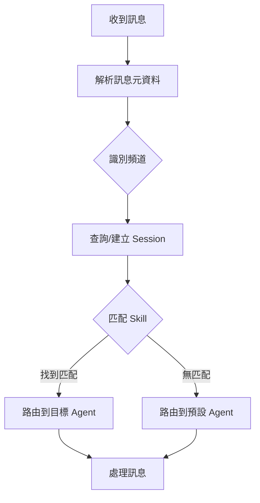

路由規則的判斷順序：

1. **DM 配對（DM Pairing）**: 一對一對話中，訊息直接路由到配對的 Agent
2. **Skill 觸發詞**: 檢查訊息是否包含特定技能的觸發詞
3. **上下文延續**: 若存在活躍的 Session，延續上一個 Skill 的處理
4. **預設 Agent**: 以上都不匹配時，由預設 Agent 處理

#### 2.2.3 組態管理器

組態管理器負責載入、驗證、監控 OpenClaw 的設定：

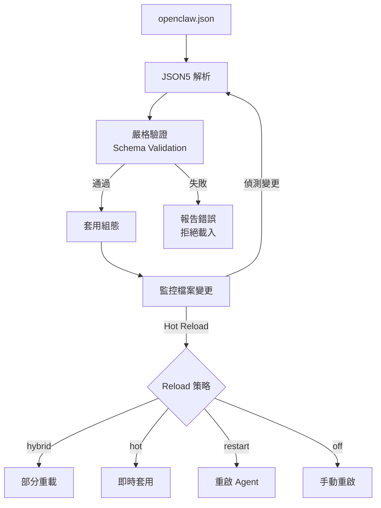

### 2.3 Agent Runtime 架構

Agent Runtime（Pi）是處理 AI 推論與工具呼叫的核心引擎：

#### 架構圖

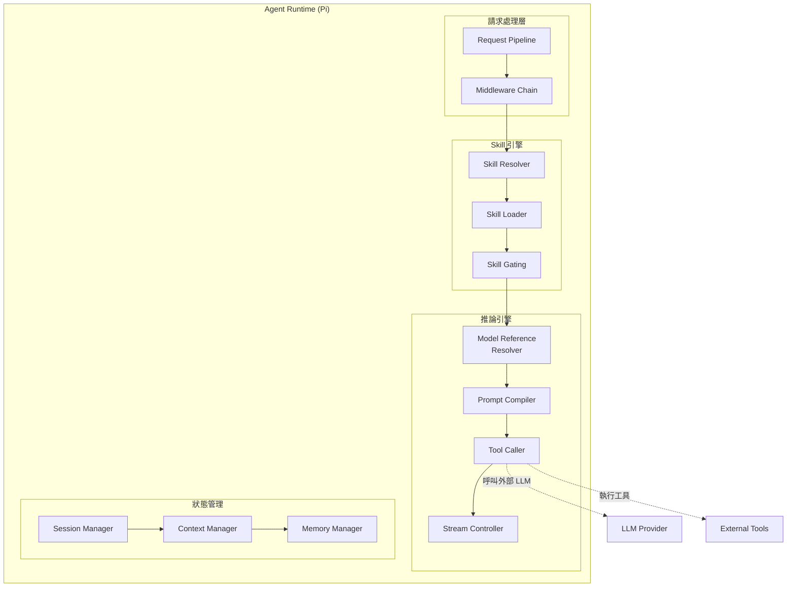

#### 請求處理管線

Agent 處理訊息的完整管線：

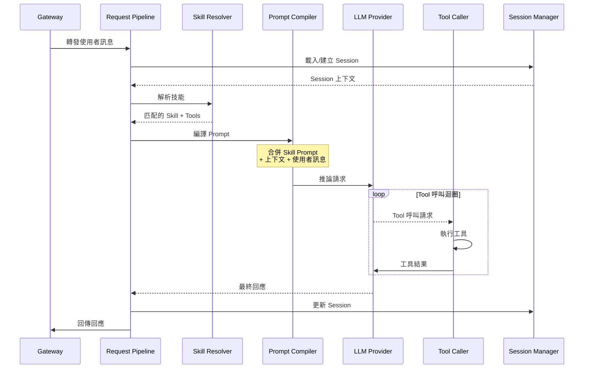

### 2.4 訊息流程與通訊協議

#### 完整訊息流程

以一個使用者透過 WhatsApp 詢問天氣為例的完整訊息流程：

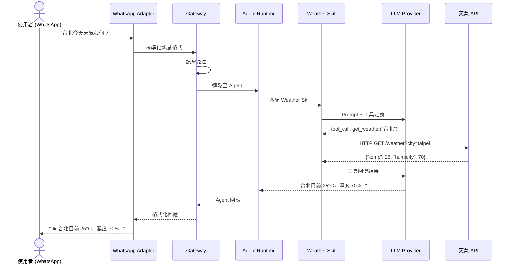

#### 訊息格式標準化

OpenClaw 在 Gateway 層將來自不同頻道的訊息統一格式化：

```json
{
  "id": "msg_20260305_abc123",
  "channel": {
    "type": "whatsapp",
    "id": "wa_886912345678"
  },
  "sender": {
    "id": "user_001",
    "name": "王小明",
    "role": "user"
  },
  "content": {
    "type": "text",
    "text": "台北今天天氣如何？"
  },
  "timestamp": "2026-03-05T09:30:00Z",
  "session": {
    "id": "session_xyz789",
    "messageCount": 5
  },
  "metadata": {
    "platform_specific": {}
  }
}
```

### 2.5 Skills 載入與優先序

#### 三層技能載入架構

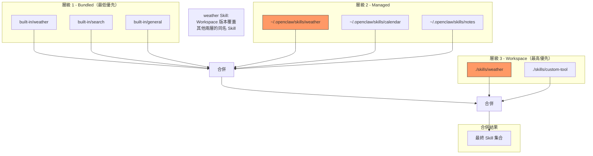

#### Skill 載入流程

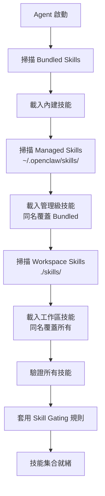

### 2.6 模型參考（Model References）

OpenClaw 透過 Model References 機制抽象化 LLM 提供者，讓 Agent 可以輕鬆切換模型：

#### 模型參考設定

模型參考（Model Reference）一律寫成 `provider/model-id` 字串，例如 `anthropic/claude-opus-5-5`、`openai/gpt-6-astra`。**預設模型與備援鏈放在 `agents.defaults.model`**，別名與每模型參數放在 `agents.defaults.models`，自訂或自架 Provider 才需要 `models.providers`：

```json5
// openclaw.json（openclaw 2026.11.1 `config validate` 通過）
{
  agents: {
    defaults: {
      model: {
        primary: "anthropic/claude-opus-5-5",                     // 預設模型
        fallbacks: ["openai/gpt-6-astra", "google/gemini-4-argon"], // 失效轉移順序
      },
      // 為常用模型取別名（/model Sonnet）
      models: {
        "anthropic/claude-sonnet-5-5": { alias: "Sonnet" },
        "anthropic/claude-haiku-5-5": { alias: "Haiku" },
      },
      // 企業治理：只允許核准清單內的模型被選用
      // 萬用字元只能是結尾的 "provider/*"；其餘須寫完整 ref 或別名
      modelPolicy: { allow: ["anthropic/*", "openai/gpt-6-astra", "google/gemini-4-argon", "vllm/*"] },
    },
  },
  models: {
    providers: {
      // 自架 vLLM（OpenAI 相容端點）
      vllm: {
        baseUrl: "http://vllm.internal:8000/v1",
        apiKey: { source: "env", provider: "default", id: "VLLM_API_KEY" },
        api: "openai-completions",
        models: [{ id: "qwen3.8-27b", name: "Qwen3.8 27B", contextWindow: 131072, maxTokens: 8192 }],
      },
    },
  },
}
```

> ❌ **舊版手冊／AI 常見錯誤寫法**：`agent.model`、`models.default`、`models.fast`、`models.reasoning`。這些鍵在 2026.11.1 會被 `config validate` 判為 `Unrecognized key`。「快速模型」「推理模型」的需求應改用 `agents.defaults.utilityModel`、`decisionModel` 或別名 + `/model` 切換來表達。
>
> ❌ **`modelPolicy.allow` 的萬用字元陷阱**：`"openai/gpt-6-*"` 這種「前綴 + 星號」寫法**不合法**，`config validate` 會回報 `invalid model policy ref`。只接受三種形式：已設定的別名、完整的 `provider/model`、或結尾萬用字元 `provider/*`（`provider/namespace/*`）。
>
> **最佳實務**：官方維護一份人工審核、依序排列的 [Recommended models](https://docs.openclaw.ai/concepts/recommended-models) 清單（2026-11 版前五名：Claude Opus 5.5、GPT-6.1 Sol、Gemini 4 Argon、GPT-6 Astra、Claude Fable 5.1），模型選單會優先顯示該 Provider 的推薦模型。最新世代模型同時也有較低的 Prompt Injection 風險。

**如何驗證**：

```bash
openclaw config validate --json        # 鍵與型別正確
openclaw models status                 # 實際生效的 primary / fallbacks 與認證狀態
openclaw models fallbacks list         # 備援鏈順序
```

#### 模型失效轉移（Model Failover）

OpenClaw 支援模型失效轉移機制，當主要模型不可用時自動切換到備援模型：

- **OAuth vs API Keys 輪換**: 支援多種認證方式與自動切換
- **Provider 失效轉移**: 當某個 Provider 回應失敗時自動嘗試下一個
- **API Key 輪換**: 支援多組 API Key 自動輪換，避免單一 Key 配額耗盡

詳細設定請參考 [Model failover](https://docs.openclaw.ai/concepts/model-failover)。

#### 支援的 LLM 提供者

OpenClaw 目前支援 **50+ LLM 提供者**，以下列出主要提供者（完整清單請參閱 [Provider Directory](https://docs.openclaw.ai/providers)）：

| 分類 | 提供者 | 模型範例 | 備註 |
|------|--------|----------|------|
| **旗艦** | **OpenAI** | GPT-6.1 Sol、GPT-6 Astra、GPT-6 Luna、GPT-5.6（Sol／Terra／Luna） | API Key 或 ChatGPT／Codex 帳號；GPT-6 Astra 自 v2026.9.2 起支援 |
| | **Anthropic** | Claude Opus 5.5、Sonnet 5.5、Haiku 5.5、Fable 5.1 | 官方推薦清單第一名（Opus 5.5）；Fable 5.1 自 v2026.9.1 起支援 |
| | **Google** | Gemini 4 Argon、Gemini 3.8 Flash | v2026.10.10 起 Gemini 4 Argon 為預設 Gemini 模型；Veo 影片生成 |
| **雲端** | **Azure OpenAI** | Azure 部署的 GPT 系列 | 企業合規、資料落地 |
| | **Amazon Bedrock** | Claude, Titan | AWS 整合，Mantle 支援 |
| | **NVIDIA** | NIM 微服務 | API Catalog 整合 |
| | **Fireworks** | 各類模型 | 高速推論 |
| | **Together AI** | 各類開源模型 | 推論即服務 |
| | **Groq** | Llama, Mixtral | 硬體加速推論 |
| **新興** | **DeepSeek** | V4.1 Flash、V4 Flash、V4 Pro | 高性價比 |
| | **DeepInfra** | 模型目錄 | 媒體生成、TTS、Embeddings |
| | **Cerebras** | 高速推論 | 內建 Provider（v2026.4.26） |
| | **MiniMax** | M2.5 | 工具解析優秀，OAuth 支援 |
| | **Mistral** | Mistral Large | 歐洲 AI |
| | **xAI** | Grok | Grok 搜尋整合 |
| **中國** | **Alibaba** | 通義千問 | Model Studio |
| | **Qwen** | Qwen 系列 | 阿里雲模型 |
| | **GLM (Zhipu)** | GLM-5.3、GLM-5.3 Flash | 智譜 AI |
| | **Moonshot** | Kimi | Kimi 搜尋整合 |
| | **Volcengine** | 豆包 Doubao | 字節跳動火山引擎 |
| | **Tencent** | 騰訊混元 | TokenHub 整合 |
| | **Qianfan** | 百度文心 | 百度千帆 |
| | **Xiaomi MiMo** | MiMo | 小米推論 |
| **本地** | **Ollama** | Gemma 4、Qwen3.8、gpt-oss | 本地執行；v2026.9.1 起本地 Ollama 路由維持可選 |
| | **LM Studio** | 各類模型 | 桌面 LLM |
| | **vLLM** | 各類模型 | 高效推論引擎 |
| | **SGLang** | 各類模型 | 結構化生成語言 |
| **媒體** | **ElevenLabs** | TTS/STT | 語音合成 |
| | **Azure Speech** | TTS/STT | 語音服務 |
| | **Deepgram** | STT | 語音辨識 |
| | **Runway** | Gen-3 Alpha | 影片生成 |
| | **Fal** | 圖片/影片模型 | 即時 AI 媒體 |
| | **ComfyUI** | Stable Diffusion | 圖片生成工作流 |
| | **SenseAudio** | 音訊處理 | 音訊 AI |
| **閘道** | **OpenRouter** | 多模型路由 | 統一 API 存取 |
| | **LiteLLM** | 多模型代理 | 自架 Proxy |
| | **Cloudflare AI** | AI Gateway | CDN 層級快取 |
| | **Vercel AI** | AI Gateway | Edge Runtime |
| | **GitHub Copilot** | GPT/Claude | Copilot 訂閱代理 |
| | **Claude Max** | Claude 系列 | Claude Max API Proxy |
| **其他** | **Perplexity** | pplx-online | 搜尋增強 |
| | **Hugging Face** | 各類模型 | Inference API |
| | **Venice AI** | 隱私模型 | 去中心化 AI |
| | **Arcee AI** | 自訂模型 | 企業微調 |
| | **Gradium** | TTS | 語音合成 |
| | **Inworld** | 角色 AI | 遊戲 NPC |
| | **Kilocode** | 程式碼模型 | 程式碼生成 |
| | **Inferrs** | 推論服務 | 託管推論 |
| | **Vydra** | 模型服務 | 新興 Provider |
| | **Z.AI** | 模型服務 | 新興 Provider |
| | **Chutes** | 模型服務 | 去中心化推論 |
| | **StepFun** | 階梯模型 | 中國 AI Provider |
| | **Synthetic** | 合成資料 | 資料生成 |

> **模型建議**: 官方建議使用最新世代最強模型以獲得最佳體驗與最低 Prompt Injection 風險。模型設定與 CLI 操作詳見 [Models](https://docs.openclaw.ai/concepts/models)。

#### 模型目錄的探索策略（v2026.8.1 變更）

2.0 之前，開啟模型選單會觸發完整的 Provider 掃描，造成明顯延遲。2.0 起改為**目錄優先**策略：

- Chat 與 Models 頁面直接從 OpenClaw 已持有的目錄開啟，不等待 Provider 掃描。
- 即時探索只在你**開啟模型畫面或明確要求重新整理**時執行。
- 若探索失敗，內建項目與最後一次可用的清單仍然保留，不會變成空白。

`/model` 的作用域也明確化為三層，且持久性變更需要對應權限：

| 作用域 | 效果 | 權限需求 |
|-------|------|---------|
| 僅本對話 | 只改變當前 Session | 一般使用者 |
| 單一 Agent | 改變該 Agent 的預設 | 需具備變更權限 |
| 共用預設 | 改變全域預設模型 | 需具備變更權限 |

> **注意**：清單顯示的是「OpenClaw 能辨識的模型」，但**實際可用與否由 Provider、帳號、區域、端點、方案與定價共同決定**。能在清單中看到，不等於該帳號有權呼叫。

#### 脈絡窗與推理層級（v2026.8.1 更新）

2.0 對脈絡窗與推理設定做了明確化，這是企業評估成本與能力上限時的關鍵資訊：

| 路由 | 標準脈絡窗 | 可選上限 | 說明 |
|------|-----------|---------|------|
| GPT-5.5 / GPT-5.6（一般執行） | 272,000 token | **922,000 token 輸入窗（opt-in）** | 需明確選用，非預設 |
| Claude 5 CLI 對話 | 200K | **1M（Control UI 可選）** | 限支援的路由與介面 |

推理層級（reasoning effort）在 2.0 起會**跟隨所選模型與 runtime 一起保存**，即使對話被還原或認證路由重建也不會遺失。各層級的可用性依 runtime 而異：

| Runtime | 最高推理層級 | 適用模型 |
|---------|------------|---------|
| Native Codex | `Ultra` | Sol、Terra |
| Native Codex | `Max` | Luna |
| Embedded OpenClaw | `Ultra`（對映語意不同） | 對映至該 Provider 支援的最高 effort |

> ⚠️ **重要差異**：Embedded OpenClaw 的 `Ultra` **並非等同於 Native Codex 的 Ultra**。前者是「對映到該 Provider 所支援的最高 effort」並額外加上委派工作的指引，後者是 Codex 原生的推理層級。兩者行為不同，跨 runtime 比較效能或成本時不可直接對等看待。
>
> 上述脈絡窗選項**僅限支援的路由、介面與帳號**。同一個模型在不同 Provider 帳號或端點下，可用的上限可能不同。

#### Compaction 與失效轉移的行為修正

- **Compaction** 改用「最新且可信的脈絡計數」，不再受累計快取計費或重複歷史影響；在支援的 Responses 檢查點會保留工具輸出，若儲存的檢查點被拒絕則回退為完整歷史。
- **脈絡上限改為逐模型設定**（原為 Provider 層級），`openclaw doctor` 可協助遷移綁定於明確模型項目的舊設定。
- **多帳號失效轉移**：同一 Provider 若某帳號遇到認證或配額冷卻，會依你設定的憑證順序切換到下一個授權帳號，**不會改變已選定的 Provider 與模型**，待其恢復後回復原偏好。未設定明確帳號清單時，環境變數金鑰仍可使用。
- **Codex 訂閱制執行不會靜默切換為按量計費的 API Key** —— 這是成本治理上重要的保證。永久性的認證、模型、媒體與長視窗配額失敗會停止重試，僅暫時性速率限制與可重試的伺服器錯誤保留重試或同 Provider 授權回退行為。

### 2.7 ClawHub 技能市集架構

[ClawHub](https://clawhub.ai) 是 OpenClaw 的技能市集，類似 npm 之於 Node.js：

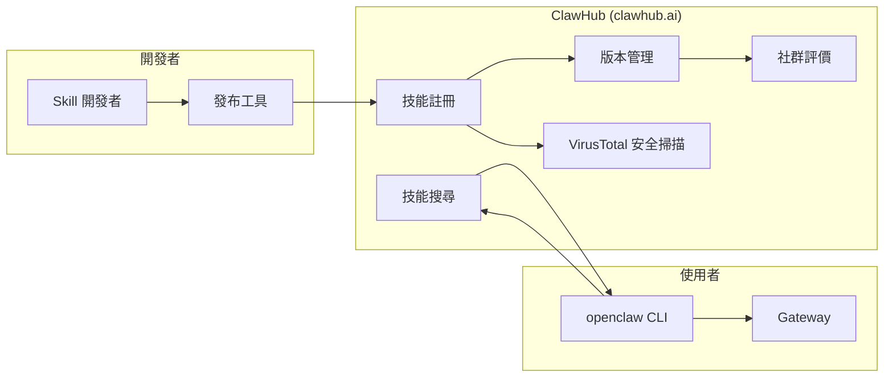

> **安全提示**: OpenClaw 已與 [VirusTotal 合作](https://openclaw.ai/blog/virustotal-partnership)，對 ClawHub 上的技能進行安全掃描，確保技能來源安全可信。啟用 ClawHub 後，Agent 可自動搜尋並拉取所需技能，搭配 Skill Install Gating 機制進行安全審核。

#### ClawHub 指令

日常的搜尋、安裝與驗證走 `openclaw skills`；**發布**則使用獨立的 `clawhub` CLI（需先 `clawhub login`）：

```bash
# 搜尋與安裝（技能參照格式為 @owner/slug）
openclaw skills search weather
openclaw skills install @owner/weather-reporter
openclaw skills update --all

# 安裝前先驗證來源與完整性，並產生 Skill Card 供人工審查
openclaw skills verify @owner/weather-reporter --card

# 檢視實際載入結果（權威來源）
openclaw skills list
openclaw skills check

# 發布自訂技能（ClawHub CLI，非 openclaw 子指令）
clawhub login
clawhub skill publish ./my-skill --version 1.0.0
```

> **移除技能**：`openclaw skills` 沒有 `remove` 子指令。工作區或 managed 目錄的技能直接刪除資料夾即可；共用 Gateway 的個人技能庫請用 `openclaw skills library remove <id>`（見 4.13）。

### 2.8 Companion Apps 架構

OpenClaw 提供 Companion Apps 作為多平台入口。Gateway 本身即能提供完整體驗，所有 Apps 均為可選擴充：

| 平台 | 技術棧 | 功能 |
|------|--------|------|
| **macOS** | Swift (Menu Bar App) | Gateway 健康監控、Voice Wake + PTT、Talk Mode overlay、WebChat、除錯工具、遠端 Gateway 控制、**Quick Chat**（v2026.8.1） |
| **iOS / iPadOS** | Swift (Node App) | 單一 Chat 介面整合打字／聽寫／語音訊息／附件／即時 Talk，Canvas、Voice Wake、相機、螢幕錄製、Bonjour + 裝置配對 |
| **Apple Watch** | Swift (watchOS) | 訊息、審批、回覆與指令，**跨重啟／Gateway 變更／導航／重試仍保留**並與手機對帳 |
| **Android** | Kotlin (Node App) | 精簡 composer（聽寫／語音訊息／即時 Talk／模型與思考層級／脈絡用量／附件）、Canvas、裝置指令、Sharesheet 匯入 |
| **Wear OS** | Kotlin (watchOS 對應) | 透過配對手機連線（**Watch 端不儲存 Gateway 憑證**）、逐字稿、回覆、停止執行、Agent Pulse（唯讀） |
| **Windows** | TypeScript (Hub App)（v2026.6.10 新增） | 原生 Windows 伴侶應用、Gateway 健康狀態、系統列快速存取、WebChat 內嵌 |
| **Linux 桌面** | TypeScript（v2026.8.1 新增） | 首次執行設定、系統匣與服務控制、內嵌 Control UI、深層連結、開機自啟、Quick Chat |

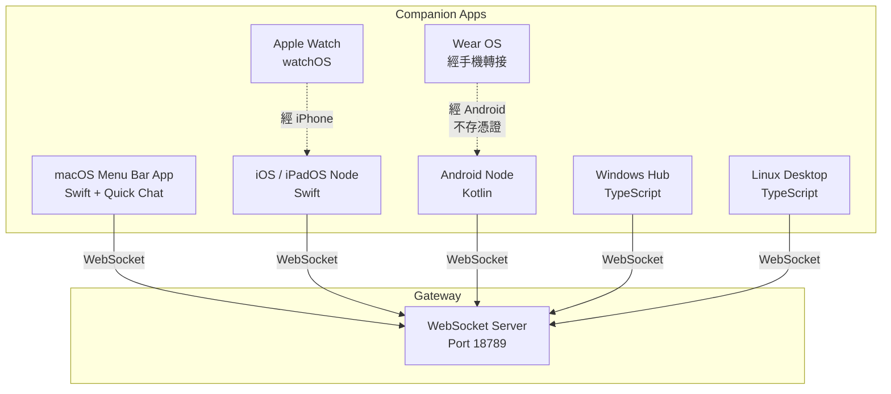

#### v2026.8.1 原生應用重點變更

**macOS Quick Chat** 可從選單列或全域快捷鍵在當前使用中的應用之上開啟，內含最近更新的五個對話選擇器，能就地串流回覆、切換 Agent、接受聽寫並選擇模型與推理層級。兩項作業系統權限會擴充其能力：

| 權限 | 解鎖能力 |
|------|---------|
| Screen Recording | 視窗或區域擷取 |
| Accessibility | 讀取焦點應用的有界文字，並可將最終答案貼回原本工作處 |

> 擷取到的脈絡會在送出後或 Quick Chat 隱藏時清除。

**進度卡與 Widget 的跨平台支援並不一致**，這在規劃企業標準配備時必須留意：

| 呈現形式 | 支援平台 | 限制 |
|---------|---------|------|
| 持久化進度卡 | iOS、macOS、Android | 需連線的 Gateway 支援已儲存卡片；**舊版 Gateway 只能顯示即時卡片，重啟後無法還原**，Android 的回退機制偶有殘留過期完成狀態 |
| Agent 產生的 Widget | iOS、Android、macOS、Linux Quick Chat | 需用戶端聲明支援；連線的 Mac 可另在原生 Canvas 面板呈現；**Linux Quick Chat 使用自訂 Gateway TLS leaf pin 時僅支援純文字** |
| 可展開的檔案差異 | iPhone、iPad、Mac | 支援平台明顯較窄 |

> **Linux 桌面應用的發布狀態**：官方已完成 .deb 與 AppImage 的建置與發布路徑，但發布說明載明「其作為 v2026.8.1 下載項目的可用性尚未驗證」。Summon 快捷鍵在 X11 可用，Wayland 保留系統匣項目，審批決策仍需在 Dashboard 或命令列完成。企業若規劃 Linux 桌面部署，建議先確認實際可取得的套件版本。

#### Plugin Manifest 機制

> **Plugin Manifest 機制**（v2026.4.11 新增）: 插件清單現可宣告激活（activation）與設定（setup）描述符，描述所需的認證、配對與組態步驟。這消除了核心程式碼中的硬編碼特殊處理，讓第三方插件的安裝設定流程更加統一。

#### Plugin SDK 架構（v2026.5 新增）

OpenClaw v2026.5 引入完整的 **Plugin SDK**，將頻道、工具與 Provider 的擴展統一為標準化插件架構：

##### 插件分類

| 類型 | 說明 | 範例 |
|------|------|------|
| **Bundled Plugins** | 隨 OpenClaw 安裝包內建的插件 | WeChat、QQ Bot、Voice Call、Google Meet |
| **Community Plugins** | 社群開發的第三方插件 | 自訂頻道、工具擴展 |
| **External Plugins** | 外部套件安裝的獨立插件 | `@tencent-weixin/openclaw-weixin` |

##### Plugin SDK 模組

```text
openclaw/plugin-sdk
├── sdk-overview          # SDK 總覽與 API 設計
├── sdk-setup             # 插件設定與組態
├── sdk-entrypoints       # 插件進入點定義
├── sdk-channel-plugins   # 頻道插件開發指南
├── sdk-channel-message   # 頻道訊息 API
├── sdk-channel-turn      # 頻道輪次核心
├── sdk-provider-plugins  # Provider 插件開發指南
├── sdk-agent-harness     # Agent Harness 插件
├── sdk-runtime           # 運行時輔助工具
├── sdk-subpaths          # 子路徑匯出
├── sdk-testing           # 插件測試框架
└── sdk-migration         # 舊版遷移指南
```

##### 內建插件清單

| 插件 | 類型 | 功能 |
|------|------|------|
| **Voice Call** | 頻道 | Plivo/Twilio 語音通話，Realtime Voice Loop |
| **Google Meet** | 頻道 | Chrome/Twilio Realtime、出席匯出、錄製檔 |
| **Webhooks** | 自動化 | 外部 Webhook 事件處理 |
| **Memory LanceDB** | 記憶 | LanceDB 向量記憶引擎 |
| **Memory Wiki** | 記憶 | Wiki 結構化記憶管理 |
| **Skill Workshop** | 開發 | 技能開發輔助工具 |
| **Codex Computer Use** | 工具 | Codex 電腦使用整合 |
| **Codex Harness** | Agent | Codex Agent 執行環境 |
| **Zalo Personal** | 頻道 | 越南 Zalo 個人帳號頻道 |

##### 插件開發範例（現行寫法）

> **⚠️ Breaking Change（狀態：已生效）**：舊版 `import { defineChannelPlugin } from 'openclaw/plugin-sdk'` 根路徑匯入方式，連同 `before_agent_start` hook、`providerAuthEnvVars`、`channelEnvVars` 等介面，已於 **2026 年 7 月 24 日後移除**（v2026.6.34 Extended-Stable 公告）。
>
> **v2026.8.1 進一步收斂**：契約整理**移除了 7 月與 8 月的已退休 SDK 路徑**，並以 `gateway_stop` **取代 `deactivate` 別名**。舊版 subpath 匯入的相容窗口已於 **2026-09-01 關閉**。新插件開發須使用**細分子路徑匯入（subpath imports）**，例如頻道插件改從 `openclaw/plugin-sdk/channel-core` 匯入 `defineChannelPluginEntry`，並以 manifest setup descriptor 取代硬編碼的啟用／設定邏輯：

```typescript
// 最小頻道插件進入點（v2026.11.1；以 tsc --strict 對 openclaw 2026.11.1 型別檢查通過）
import { defineChannelPluginEntry } from "openclaw/plugin-sdk/channel-core";

// 實際的頻道實作（連線、收訊、送訊）放在 ./src/channel.ts，以 createChatChannelPlugin 等 helper 建立
declare const acmeChatPlugin: Parameters<typeof defineChannelPluginEntry>[0]["plugin"];

export default defineChannelPluginEntry({
  id: "acme-chat",
  name: "Acme Chat",
  description: "Acme Chat channel plugin",
  plugin: acmeChatPlugin,
});
```

> ❌ 舊版範例在 `defineChannelPluginEntry` 中直接寫 `manifest`、`connect()`、`onMessage()`、`sendMessage()`；實際的 entry 只接受 `id`、`name`、`description`、`plugin`（與選用的 `registerCliMetadata`、`registerFull`），頻道行為由 `plugin` 物件提供。詳見官方 [Channel plugins](https://docs.openclaw.ai/plugins/sdk-channel-plugins)。

> **相關文件**: [Plugin SDK Overview](https://docs.openclaw.ai/plugins/sdk-overview) · [Building Plugins](https://docs.openclaw.ai/plugins/building-plugins) · [Plugin Inventory](https://docs.openclaw.ai/plugins/plugin-inventory) · [Plugin SDK Migration](https://docs.openclaw.ai/plugins/sdk-migration)。既有插件開發者建議啟用 `@typescript-eslint/no-deprecated` 之類的型別感知 Lint 規則，及早攔截已標記 `@deprecated` 的舊版 SDK 介面呼叫。
>
> **v2026.6.9 重要變更 — Provider 外部化**: 自 v2026.6.9 起，官方 Provider（如 OpenAI、Anthropic、Google 等）已從核心套件抽離為獨立 npm 套件（例如 `@openclaw/provider-openai`）。新安裝時 Gateway 會自動探索已安裝的 channel/provider plugin，無需手動註冊。對於現有用戶，升級時 `openclaw doctor` 會自動建議安裝對應套件。

### 2.9 高可用架構設計

設計 OpenClaw 的高可用（HA）之前，必須先接受一個官方架構事實：**一個 state 目錄在任一時刻只能有一個 Gateway 擁有者**。Gateway 啟動時會依序取得三層鎖——①以共享 state 資料庫路徑為鍵的**行程擁有者鎖**、②給舊版辨識用的相容性投影、③HTTP／WebSocket 監聽埠的**獨占 bind**（預設 `ws://127.0.0.1:18789`）。第二個想接手同一份 state 的行程會等待（最長 5 分鐘）或失敗，**不存在「多個 Gateway 共用同一份 Session Store」的官方模式**。

因此，OpenClaw 的 HA 不是「Active-Active 叢集」，而是以下四個層次的組合：

| 層次 | 目標 | 官方機制 | 本手冊章節 |
| --- | --- | --- | --- |
| **行程韌性** | 當機或重開機後自動回來 | launchd／systemd／Windows 排程工作管理的 Gateway 服務；崩潰迴圈斷路器；重啟後恢復未完成回覆 | 3.2、6.11 |
| **資料保護** | 主機毀損時資料不遺失 | `openclaw backup`（完整 archive、per-database SQLite snapshot、Git 備份）、排程異地備份、Litestream 持續複寫 | 6.7、6.12 |
| **救援通道** | 主 Gateway 壞掉時仍能修 | 以獨立 `--profile` 與獨立埠執行 **Rescue Gateway**（獨立 bot token） | 本節 |
| **運算擴展** | 長任務、重負載不拖垮 Gateway | **Cloud Workers** 與 **Paired Devices**：Gateway 保留逐字稿、工作區與憑證，執行移到其他機器 | 第十二章 |

#### 單機高可用（建議的生產基線）

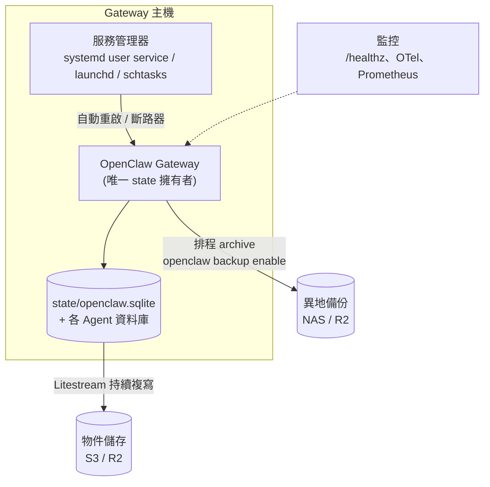

#### Rescue Gateway（救援 Bot）

官方建議的冗餘方式是在同一台主機以**獨立 profile** 跑第二個 Gateway：它有自己的組態、state、工作區、服務名稱與 bot token，主 Gateway 故障時仍可透過它診斷或修改組態。

```bash
# 主 Gateway 使用預設 profile（埠 18789）
# 救援 Gateway：獨立 profile、獨立 Telegram bot、埠至少相差 120（衍生埠會用到 base+110）
openclaw --profile rescue onboard
openclaw --profile rescue gateway install --port 19789
openclaw --profile rescue gateway status --deep
```

#### 冷備援（Warm/Cold Standby）

若業務要求主機層級的備援，正確做法是「**備援主機待命、資料持續複寫、故障時切換擁有權**」，而不是兩台同時對外：

1. 主機以 Litestream 或排程 `openclaw backup create --to offsite` 持續輸出狀態。
2. 備援主機預先安裝**相同版本**的 OpenClaw，但**不啟動** Gateway 服務。
3. 故障切換時：確認主機已停止（避免兩個擁有者）→ 在備援主機還原至**全新** state 目錄 → `openclaw doctor` → 啟動服務 → 切換 DNS／Cloudflare Tunnel。

> ❌ **錯誤的 HA 設計（常見於 AI 產出的架構圖）**：負載平衡器後面放多個 Gateway，共用 Redis Session Store 或共用 PostgreSQL。OpenClaw **沒有** Redis Session Store，PostgreSQL 引擎目前也只支援 Workboard（見 2.12）；多個行程搶同一份 state 會被 Gateway Lock 拒絕，或在繞過鎖時造成資料毀損。**看到這類圖，應直接退回。**
>
> ✅ **需要水平擴展時的正確方向**：依信任邊界、團隊或環境切分成**多個獨立 Gateway**（各自擁有 state），把重運算交給 Cloud Workers。

#### 如何驗證 HA 設計

| 檢查 | 指令／方法 | 預期 |
| --- | --- | --- |
| 單一擁有者 | 在同一 state 目錄再啟動一個 Gateway | 等待或明確拒絕，不會兩者同時服務 |
| 服務自動重啟 | `kill -9 <gateway pid>` 後觀察 | 服務管理器在數秒內重啟，`openclaw gateway status --deep` 正常 |
| 備份可還原 | `openclaw backup verify --from offsite --namespace gateway latest` | 驗證通過 |
| 救援通道可用 | 停止主 Gateway 後，從救援 bot 執行 `openclaw status` | 救援 Gateway 正常回應 |

### 2.10 企業部署拓撲

拓撲的切分依據是**信任邊界**，而不是使用者人數。官方明確聲明：一個 Gateway 就是一個信任域，角色與 Session 擁有權用來支援協作，**不能**隔離彼此不信任的使用者；互不信任的團隊必須使用不同的 Gateway、OS 使用者或主機。

#### 小型團隊（單一信任域，1–10 人）

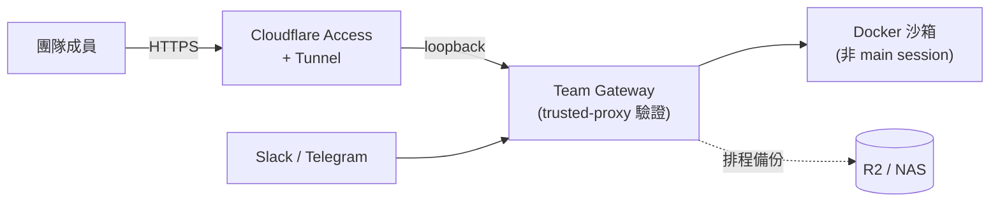

| 資源 | 規格 |
| --- | --- |
| CPU | 2–4 cores |
| RAM | 4–8 GB（大量 Agent 或本地模型另計） |
| 儲存 | 20–50 GB SSD（逐字稿與附件會持續成長） |
| 網路 | 只需對外連線；**不要對外開放 18789**，由 Tunnel 建立出站連線 |

#### 中型組織（多個信任域，10–100 人）

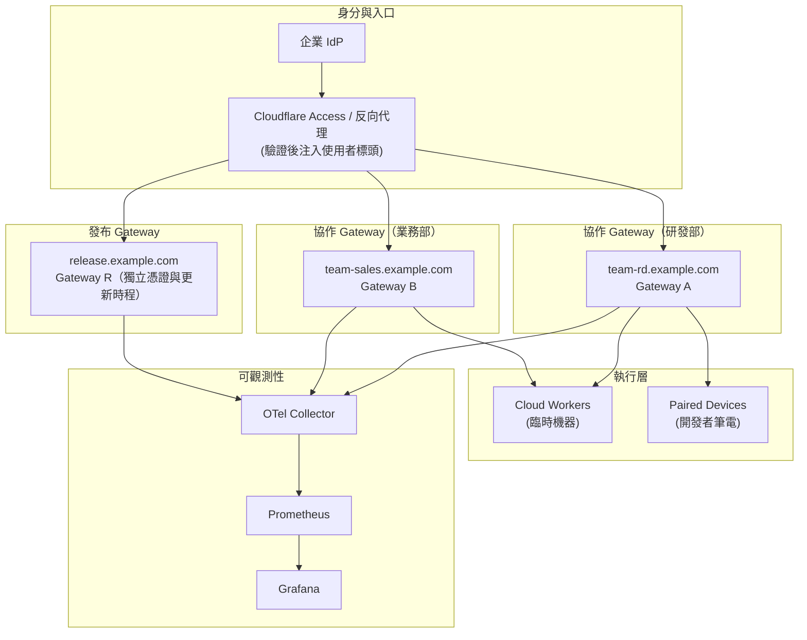

**每個 Gateway 的建議配置**：4 cores／8 GB RAM／50 GB SSD。Gateway 之間**不共享 state**，跨部門的唯讀分享可使用官方的「從另一個 Gateway 唯讀分享」功能（見 11.7）。

#### 大型企業（100+ 人）

規模再擴大時，仍沿用「**多個獨立 Gateway + 共用執行與觀測平台**」的模式：

- **每個信任域一個 Gateway**（依事業單位、資料分級或法遵區域切分），各自擁有 state、備份與更新節奏。
- **跨區域**：以「主機 + 冷備援」方式部署於各區（見 2.9），而不是跨區共用資料庫。
- **共用平台服務**：IdP、反向代理／WAF、OTel Collector、集中日誌、物件儲存（備份）、Cloud Worker 機池。
- **治理**：以 IaC 管理每個 Gateway 的組態（`openclaw config validate --json` 納入 CI），版本統一走 Extended-Stable 或經驗證的 stable（見 3.12、8.1）。

> ⚠️ **規格數字只是起點**。Gateway 的資源用量主要來自同時執行的 Agent 回合數、逐字稿大小、瀏覽器與本地模型；請以 `openclaw gateway usage-cost`、OTel 指標與 `openclaw status` 的實測值調整（見 6.8 容量規劃）。

### 2.11 Session 儲存架構：SQLite 遷移

v2026.8.1 最具架構影響力的變更，是將原本以檔案為後端的狀態改為 **SQLite 後端儲存**。這項變更影響備份策略、容器 Volume 規劃與降版可行性，是企業升級前必須理解的前提。

#### 遷移範圍

| 資料類別 | 2.0 前 | 2.0 後 |
|---------|-------|-------|
| Sessions 與 Transcripts | 檔案式 | **SQLite** |
| 選定的裝置與認證紀錄 | 檔案／JSON | **SQLite** |
| 會議擷取（Meeting capture） | 檔案 | **SQLite** |
| Runtime journals | 檔案 | **SQLite** |

遷移後可透過同一套工具建立、驗證與還原**可攜式快照（portable snapshot）**，讓備份與復原在事故發生前就具備可驗證的路徑（詳見 6.7）。

#### 架構示意

```mermaid
graph TB
    subgraph "Gateway Process"
        AGENT[Agent Runtime]
        SESS[Session Manager]
    end

    subgraph "State Directory 狀態目錄"
        DB[(SQLite<br/>sessions / transcripts<br/>devices / auth<br/>meetings / journals)]
        WAL[WAL 日誌]
        FILES[工作區檔案<br/>MEMORY.md / USER.md<br/>skills/]
    end

    subgraph "備份"
        SNAP[Portable Snapshot<br/>create → verify → restore]
    end

    AGENT --> SESS
    SESS --> DB
    DB --- WAL
    AGENT --> FILES
    DB --> SNAP
    FILES --> SNAP
```

#### 降版限制（升級前必讀）

> ⚠️ **這是單向性較強的變更**。官方發布說明明確警告：
>
> - **遷移後建立的 Session 不會出現在舊版中**。
> - 若要降版到舊的檔案式版本，**必須先用當前 CLI 還原已封存的舊版 transcript 產物**，否則資料在舊版看不到。
> - 升級前應建立**可驗證的備份**（`openclaw backup`），而非僅複製目錄。

#### 其他已知限制

官方載明的邊界條件，規劃維運程序時須一併納入：

| 項目 | 限制 |
|------|------|
| 舊版儲存遷移 | **部分舊儲存需先停止擁有該狀態的行程**，`openclaw doctor --fix` 才能遷移 |
| 待處理的配對請求與 bootstrap 代碼 | **不會被匯入** |
| macOS tunnel 遷移 | 產生的資料**無法被僅支援 JSON 的舊版建置讀取** |
| 還原行為 | **拒絕覆寫既有目標**，須還原至全新目標 |
| Node + SQLite 版本 | 已知有漏洞的組合會**在狀態開啟前擋下**，並提示應升級內嵌 Node runtime 或系統共用的 SQLite 函式庫 |

> **資料安全強化**：2.0 針對 SQLite 後端做了大量健全性修補，包含防止 WAL split-brain 清理損毀資料庫，以及將「已證實損毀」的判定隔離處理。即便如此，**SQLite 檔案本身並未加密**，其機密性仍取決於狀態目錄的檔案系統權限（與 Secret Store 相同的前提，見 3.11）。

### 2.12 儲存引擎與 State 擁有權

2.0 把 Session 與 Transcript 移到 SQLite（見 2.11）之後，OpenClaw 的持久化狀態可以整理成下表。企業在規劃備份、稽核與資料保存時，應以此表為準：

| 儲存 | 位置（預設） | 引擎 | 備註 |
| --- | --- | --- | --- |
| 共享狀態（使用者、技能庫中繼資料、Automations 等） | `<state-dir>/state/openclaw.sqlite` | SQLite | Gateway Lock 以此路徑為擁有權鍵 |
| 各 Agent 資料庫（Session、逐字稿、記憶索引） | `<state-dir>/agents/<agentId>/...` | SQLite | 每個 Agent 獨立 |
| Workboard | 依引擎而定 | SQLite（預設）或 **PostgreSQL（實驗性）** | 目前**唯一**支援 PostgreSQL 的儲存 |
| 技能庫不可變 bundle | `<state-dir>/skill-library/<id>/revisions/<hash>/` | 檔案 | 不要手動修改 |
| Incognito 對話 | 記憶體 | — | 永不落地 |
| 組態 | `~/.openclaw/openclaw.json`（可用 `OPENCLAW_CONFIG_PATH` 覆寫） | JSON5 檔 | 支援 includes |

#### 實驗性 PostgreSQL 引擎

```json5
// openclaw.json：Workboard 改存 PostgreSQL（需 PostgreSQL 16+、UTF8 編碼）
{
  database: {
    engine: "postgres",
    postgres: {
      // DSN 是憑證：只能用 env／file／exec SecretRef，不可用 store 型 SecretRef
      connection: { source: "env", provider: "default", id: "OPENCLAW_DATABASE_DSN" },
      schemaPrefix: "openclaw",
    },
  },
}
```

```bash
# 只改 engine 不會搬移既有資料：先停 Gateway，再以 port 指令搬移
openclaw gateway stop
openclaw database port --to postgres --dry-run   # 唯讀檢查前置條件
openclaw database port --to postgres             # 實際搬移，原始資料保留於 <stateDir>/recovery/database-port/
openclaw gateway start
openclaw doctor                                  # 顯示每個儲存實際使用的引擎
```

> ⚠️ **企業評估重點**：
>
> 1. PostgreSQL 引擎目前標示為 **experimental**，且**只涵蓋 Workboard**；共享狀態、Agent／Session 儲存與安全日誌仍在 SQLite。**它不是多 Gateway 共用狀態的方案**。
> 2. 支援的儲存在 PostgreSQL 連線失敗時**不會靜默退回 SQLite**——這是正確的失敗模式，但代表資料庫中斷會直接影響 Workboard。
> 3. 備份必須同時涵蓋 PostgreSQL schema 與對應的 SQLite anchor（`openclaw backup` 會處理；自行用 `pg_dump` 時不要遺漏 anchor）。

#### 儲存引擎的驗證方式

```bash
openclaw config validate --json   # database.* 鍵與 SecretRef 型別
openclaw doctor                   # 每個儲存的實際引擎；PostgreSQL 會出現 experimental 警告
openclaw database preflight       # 資料庫相容性與擁有權檢查
```

### 2.13 本章審查與驗證清單

審查 AI 依本章產出的組態、指令或程式時，逐項執行下表：

| # | 檢查項目 | 驗證方法 | 預期結果 |
| --- | --- | --- | --- |
| 1 | 架構圖沒有多 Gateway 共用 state | 人工審查架構圖 | 無 Redis Session Store、無多實例共用 PostgreSQL |
| 2 | 模型參考格式正確 | `openclaw config validate --json` | `agents.defaults.model.primary` 為 `provider/model`；`modelPolicy` 萬用字元只用 `provider/*` |
| 3 | 備援鏈可用 | `openclaw models status`、`openclaw models fallbacks list` | primary 與 fallbacks 皆有可用認證 |
| 4 | PostgreSQL 僅用於 Workboard 且標示實驗性 | `openclaw doctor` | 顯示各儲存的實際引擎與 experimental 警告 |
| 5 | 救援通道存在 | `openclaw --profile rescue gateway status --deep` | 救援 Gateway 運作，埠至少相差 120 |

---

## 第三章：安裝與環境建置

### 3.1 系統需求

#### Node.js 支援政策（v2026.11.1）

`package.json` 的 engines 精確表達式為 **`>=24.16.0 <25 || >=26.1.0`**：

| Node 版本線 | 狀態 | 最低版本 | 說明 |
| --- | --- | --- | --- |
| **Node 26** | **建議** | `>=26.1.0`（強烈建議 **26.12.1+**） | Gateway 啟動較快、記憶體較省；macOS 安裝器預設提供 |
| **Node 24** | 支援（LTS） | `>=24.16.0 <25`（強烈建議 **24.22.1+**） | CI 與 Linux 安裝器使用的版本線；Docker 映像內建 24.22.1 |
| Node 25 | **不支援** | — | 被 `node:sqlite` TEXT 解碼器的版本下限排除 |
| Node 22／23 | **不支援** | — | 自 v2026.9.3 起移除 |

**為什麼有這些下限**（審查升級計畫時要能說明理由）：

1. **SQLite WAL-reset 毀損問題**：實際載入的 SQLite 必須是 3.51.3+（或 3.50.7+／3.44.6+ 對應分支）。OpenClaw 會檢查**實際載入的函式庫**，因為部分 Node 建置連結到系統 SQLite。
2. **`node:sqlite` TEXT 解碼器截斷**：Node 22.23.x、24.15.0、25.9.0、26.0.0 會在內嵌 NUL 字元處靜默截斷資料。
3. **安全建議版本（24.22.1／26.12.1）**：會拒絕 2026 年 10 月 eMudhra 事件中外洩的憑證公鑰。v2026.10.6 一度把它列為硬性需求，10.10 起改為「強烈建議」；低於建議版本時 `openclaw update` 會顯示醒目警告但仍繼續。

> **Bun**：可作為明確 opt-in 的執行環境，需 **Bun 1.4.4+**（WAL-reset-safe `node:sqlite`）。Node 仍是主要且建議的 runtime。

#### 作業系統與平台

| 項目 | 需求 |
| --- | --- |
| **macOS** | Node 24+ 官方二進位支援 macOS 13.5+；**macOS 桌面 App、iOS App 與 Safari（Control UI）自 v2026.10.10 起需 26.2 以上** |
| **Linux** | x86-64 或 64-bit ARM（**沒有 ARMv7 官方 Node 建置**）；RPM 系發行版的安裝器會為 OpenClaw 另外佈建使用者空間 runtime，避開不安全的系統 SQLite |
| **Windows** | 建議使用原生 **Windows Hub** 桌面 App，或 PowerShell CLI 安裝器；也可採 WSL2 Gateway |
| **FreeBSD** | 支援 CLI 安裝（自 v2026.9.5） |

#### 硬體建議

| 項目 | 個人／PoC | 團隊生產環境（單一 Gateway） |
| --- | --- | --- |
| CPU | 2 cores | 4 cores |
| 記憶體 | 2–4 GB | 8 GB（本地模型另計） |
| 磁碟 | 5 GB | 50 GB SSD（逐字稿、附件、備份暫存會持續成長） |
| 容器 | — | Docker 24+ 或 rootless Podman（沙箱需要） |

#### 系統需求的驗證方式

```bash
node --version                 # 應為 v24.22.1+ 或 v26.12.1+
openclaw --version             # OpenClaw 2026.11.1 (4ffdd20)
openclaw doctor                # 會檢查實際載入的 SQLite 與 node:sqlite 行為
```

### 3.2 本地開發安裝

官方提供三種起點，依使用者類型選擇：

| 路徑 | 適用對象 | 特點 |
| --- | --- | --- |
| **桌面 App** | 非工程背景使用者、Windows 使用者 | Windows Hub（簽章安裝檔，含系統匣、聊天、node 模式）、macOS 選單列 App（`.dmg`）、Linux `.deb`／AppImage；首次設定即可佈建本機 Gateway 或連線遠端 Gateway |
| **安裝器腳本（推薦）** | 一般 CLI 使用者 | 自動偵測 OS、必要時安裝 Node、安裝 OpenClaw 並啟動 onboarding |
| **npm／pnpm／bun** | 自行管理 Node 的團隊、CI | 完全掌控套件管理器與版本釘選 |

#### 路徑一：官方安裝器（推薦）

```bash
# macOS / Linux / WSL2
curl -fsSL https://openclaw.ai/install.sh | bash

# 不立即執行 onboarding
curl -fsSL https://openclaw.ai/install.sh | bash -s -- --no-onboard
```

```powershell
# Windows PowerShell
iwr -useb https://openclaw.ai/install.ps1 | iex
```

若希望 OpenClaw 與 Node 都放在使用者自己的前綴目錄（不依賴系統 Node），可改用 `install-cli.sh`：

```bash
curl -fsSL https://openclaw.ai/install-cli.sh | bash
```

> **企業環境提醒**：`curl | bash` 會直接執行遠端腳本。受控環境應先下載腳本、比對雜湊並經內部審查，或改用下方的 npm 路徑搭配內部套件鏡像與版本釘選（見 8.11 發布物驗證）。

#### 路徑二：npm／pnpm 全域安裝

```bash
# 1. 確認 Node 版本：>=24.16.0 <25 或 >=26.1.0（建議 24.22.1+／26.12.1+）
node --version

# 2. 安裝（npm 12 或 npm 11.16+ 需明確允許 OpenClaw 的安裝腳本）
npm install -g openclaw@2026.11.1 --allow-scripts=openclaw

# 3. 初始化並安裝 Gateway 服務（launchd / systemd user service / Windows 排程工作）
openclaw onboard --install-daemon

# 4. 驗證
openclaw --version
openclaw gateway status --deep
```

| npm 版本 | `--allow-scripts=openclaw` 的行為 |
| --- | --- |
| npm 12 | **必須**：預設封鎖未核准的 lifecycle scripts，未加旗標會出現 `blocked because they are not covered by allowScripts` |
| npm 11.16 | 接受此旗標；未加時只警告 `not yet covered by allowScripts`，腳本仍會執行 |
| npm 11.15 以前 | **不可加**：沒有這個選項，指令須去掉旗標 |

> ⚠️ npm 11.16 提示的 `npm approve-scripts openclaw` 對**全域安裝無效**（會出現 `ENOMATCH`），請改用上表的旗標。另外 **OpenClaw 不會替你升級 Node**。

#### Quick-start 與 Custom setup（v2026.9.1 起）

全新安裝（包含 `npx openclaw@latest`）會先進入 **quick-start**：偵測本機既有的 Claude Code 或 Codex 登入與 API Key，**即時驗證**後從前景 Gateway 開啟 Web Dashboard。需要逐項設定時選 **Custom setup**，可走完完整精靈（Provider 登入、頻道、Gateway、工作區、技能）。

```bash
openclaw onboard                 # 引導式設定（quick-start 或 Custom setup）
openclaw setup --baseline        # 只建立基準組態、工作區與 session 目錄
openclaw configure               # 之後再調整模型、Gateway、頻道、插件、技能
```

#### 啟動與日常操作

```bash
openclaw gateway status --deep         # 服務狀態（含額外服務掃描）
openclaw gateway restart               # 透過服務管理器重啟
openclaw gateway run --port 18789 --verbose   # 前景執行（除錯用）
openclaw dashboard                     # 以目前 token 開啟 Control UI（預設 http://127.0.0.1:18789）
openclaw status                        # 頻道健康與最近對象
openclaw logs --follow                 # 透過 RPC 追蹤 Gateway 檔案日誌
```

#### 驗證安裝

```bash
openclaw doctor          # 組態、本機探索與遷移建議（2.0 起聚焦「壞了什麼、下一步」）
openclaw health          # 執行中 Gateway 的健康狀態
openclaw security audit  # 常見的安全誤設定
```

> **安裝出問題時**：`openclaw triage` 會收集**經過消毒**的診斷資訊，並可交給本機偵測到的 coding agent（Claude Code、Codex CLI 或內建 Agent）協助修復。

### 3.3 Docker Compose 部署

官方映像同時發布到 **GHCR（主要來源，供釘選與 provenance 驗證）** 與 Docker Hub 鏡像：

| 映像 | 說明 |
| --- | --- |
| `ghcr.io/openclaw/openclaw:<版本>` | 建議生產環境**釘選確切版本**，例如 `2026.11.1` |
| `ghcr.io/openclaw/openclaw:extended-stable` | Extended-Stable（LTS）月線，僅 Gateway |
| `-slim` 變體 | 較小映像；`-browser` 變體內建 Chromium（給 Gateway 控制的瀏覽器使用） |
| `openclaw/openclaw:<版本>` | Docker Hub 鏡像；請勿使用非官方鏡像 |

預設映像內建 `codex` 與 `diagnostics-otel` 插件。容器內以 `node` 使用者執行，**state 目錄為 `/home/node/.openclaw`**（不是 `/root/.openclaw`）。

#### 建議做法：官方 setup 腳本

```bash
git clone https://github.com/openclaw/openclaw.git && cd openclaw
export OPENCLAW_IMAGE="ghcr.io/openclaw/openclaw:2026.11.1"
./scripts/docker/setup.sh          # 同步 .env、修正權限、onboarding、啟動 Compose
```

#### 最小可用的 docker-compose.yml（依官方 Compose 精簡）

```yaml
# docker-compose.yml — 以官方 compose 為基礎精簡，保留安全相關設定
services:
  openclaw-gateway:
    image: ${OPENCLAW_IMAGE:-ghcr.io/openclaw/openclaw:2026.11.1}
    env_file:
      - path: .env
        required: false
    environment:
      HOME: /home/node
      OPENCLAW_HOME: /home/node
      # 固定容器內路徑，避免主機路徑經由 .env 滲入容器
      OPENCLAW_STATE_DIR: /home/node/.openclaw
      OPENCLAW_CONFIG_PATH: /home/node/.openclaw/openclaw.json
      OPENCLAW_WORKSPACE_DIR: /home/node/.openclaw/workspace
      OPENCLAW_GATEWAY_PORT: "18789"
      OPENCLAW_GATEWAY_TOKEN: ${OPENCLAW_GATEWAY_TOKEN:-}
      # OTel 為 Gateway 主動外送（OTLP/HTTP），不需要對外開埠
      OTEL_EXPORTER_OTLP_ENDPOINT: ${OTEL_EXPORTER_OTLP_ENDPOINT:-}
      TZ: ${OPENCLAW_TZ:-Asia/Taipei}
    volumes:
      - "${OPENCLAW_CONFIG_DIR:-./data/openclaw}:/home/node/.openclaw"
      - "${OPENCLAW_WORKSPACE_DIR:-./data/openclaw/workspace}:/home/node/.openclaw/workspace"
    cap_drop:
      - NET_RAW
      - NET_ADMIN
    security_opt:
      - no-new-privileges:true
    init: true
    restart: unless-stopped
    ports:
      # 只綁本機；對外請透過反向代理或 Cloudflare Tunnel（見 11.7）
      - "127.0.0.1:${OPENCLAW_GATEWAY_PORT:-18789}:18789"
    command: ["node", "dist/index.js", "gateway", "--bind", "lan", "--port", "18789"]
    healthcheck:
      test: ["CMD", "node", "dist/docker-healthcheck.js"]
      interval: 30s
      timeout: 5s
      retries: 5
      start_period: 20s
```

> **為何容器內要 `--bind lan`、主機端卻只綁 `127.0.0.1`？** 容器網路中 Gateway 必須監聽容器介面才能被 port mapping 轉發；真正的暴露面由主機端 `127.0.0.1:` 前綴控制。若直接寫 `"18789:18789"`，Gateway 會暴露在主機所有網卡上。

#### 容器的啟動與日常操作

```bash
docker compose up -d
docker compose ps                                  # healthcheck 應為 healthy
docker compose logs -f openclaw-gateway
docker compose exec openclaw-gateway node dist/index.js --version
docker compose exec openclaw-gateway node dist/index.js doctor
```

#### 升級容器

容器的升級方式是**換映像、重建容器並沿用同一組 state／config 掛載**；容器內的 `openclaw update` 會回報 skipped（偵測不到套件管理器擁有者）。官方容器 entrypoint 會在啟動前自動執行必要的 Doctor 修復；自訂 entrypoint 則須自行加入 `openclaw doctor --fix`。

```bash
openclaw backup create --verify                   # 在容器內或主機端先備份
export OPENCLAW_IMAGE="ghcr.io/openclaw/openclaw:2026.11.1"
docker compose pull && docker compose up -d
```

#### 監控元件

OTel Collector、Prometheus、Grafana 應作為**獨立的平台服務**部署（見第六章）。注意兩點：

- Prometheus 指標走 Gateway 既有的**已驗證路由**，不需要額外開埠。
- **不需要 Redis**——OpenClaw 沒有 Redis Session Store（見 2.9）。舊版手冊與網路範例中的 `redis` 服務應移除。

### 3.4 從原始碼建置

#### 前置需求

```bash
# 啟用 corepack，依 package.json 的 packageManager 欄位取得對應版本的 pnpm（2026.11.1 為 pnpm 12.15）
corepack enable

# 確認版本
pnpm --version
```

#### 建置步驟

```bash
# 1. 克隆原始碼
git clone https://github.com/openclaw/openclaw.git
cd openclaw

# 2. 安裝依賴（建議使用 pnpm）
pnpm install

# 3. 建置 UI（首次執行會自動安裝 UI 依賴）
pnpm ui:build

# 4. 建置專案
pnpm build

# 5. 從原始碼執行 onboard
pnpm openclaw onboard --install-daemon

# 5.（可選）執行測試
pnpm test

# 6.（可選）連結本地建置到全域
pnpm link --global
```

#### 開發模式

```bash
# 開發模式（啟用 Gateway watch 和 hot reload）
pnpm gateway:watch

# 注意: pnpm openclaw ... 會透過 tsx 直接執行 TypeScript
# pnpm build 會產生 dist/ 用於 Node / 打包後的 openclaw 執行檔
```

### 3.5 Podman 與 Nix 安裝

#### Podman（rootless，官方腳本）

官方的 Podman 模型是：**容器只跑 Gateway，主機上的 `openclaw` CLI 是控制面**，state 留在主機 `~/.openclaw`。日常管理用 `openclaw --container <name> ...`，而不是 `podman exec`。

```bash
# 前置：rootless Podman + catatonit（--init 需要）+ 主機已安裝 openclaw CLI
./scripts/podman/setup.sh                 # 建置 openclaw:local，或以 OPENCLAW_IMAGE 指定已發布映像
# Linux + systemd user service 可改用 Quadlet 自動啟動：
# ./scripts/podman/setup.sh --quadlet

./scripts/run-openclaw-podman.sh launch          # 以目前 uid/gid（--userns=keep-id）啟動
./scripts/run-openclaw-podman.sh launch setup    # 在容器內執行 onboarding

export OPENCLAW_CONTAINER=openclaw
openclaw gateway status --deep                   # 指令自動在容器內執行
openclaw doctor
```

> ❌ 舊版範例 `podman run -v ./config:/root/.openclaw ...` 的掛載路徑是錯的：官方映像以 `node` 使用者執行，state 在 `/home/node/.openclaw`；而且手動 `podman run` 會略過官方腳本處理的 uid 對映、權限修正與 Doctor 步驟。

#### Nix（nix-openclaw Home Manager 模組）

[nix-openclaw](https://github.com/openclaw/nix-openclaw) 是官方第一方的宣告式安裝方式（Home Manager 模組），提供釘選版本的 Gateway、macOS App 與工具、可存活重開機的 launchd 服務，以及 `home-manager switch --rollback` 即時回滾：

```bash
mkdir -p ~/code/openclaw-local
git clone https://github.com/openclaw/nix-openclaw.git /tmp/nix-openclaw
cp /tmp/nix-openclaw/templates/agent-first/flake.nix ~/code/openclaw-local/flake.nix
# 填入 bot token、模型金鑰等 placeholder（可放在 ~/.secrets/）後套用
home-manager switch
```

> **參考**：Nix 安裝的權威來源是 nix-openclaw repository，[Nix 文件](https://docs.openclaw.ai/install/nix)僅為概覽。以 Nix 管理時，更新也應由 Nix 處理（`openclaw update` 會辨識 Nix 管理的組態與憑證連結）。

### 3.6 初始設定與 JSON5 組態

OpenClaw 使用 **JSON5** 格式作為設定檔格式，JSON5 是 JSON 的超集，支援註解、尾逗號等開發友善特性。

#### 引導式設定（v2026.8.1 重構）

2.0 將初次設定從「逐項填寫」改為「**先偵測既有資源，再驗證後保存**」。這對企業導入的意義在於：既有的 AI 存取權可以直接成為設定的一部分，而不是另一件要重新申請的事。

引導式設定的偵測與驗證流程：

```mermaid
graph LR
    A[開始設定] --> B{偵測既有 AI 存取}
    B --> C[已驗證的 Codex／<br/>ChatGPT／Claude CLI 登入]
    B --> D[API Key]
    B --> E[Provider 自身登入流程]
    B --> F[符合條件的 Ollama／<br/>LM Studio 本地模型]
    C & D & E & F --> G[實測該模型能否回答]
    G -->|通過| H[保存模型與憑證]
    G -->|未通過| B
    H --> I[交棒至 Web App 或終端機]
```

關鍵設計要點：

- **驗證後才保存**：系統會先證明「所選的那個確切模型」能夠回應，才會保留該模型與憑證。本地模型畫面在該選擇通過啟用測試前，**不會顯示「開始聊天」**。
- **OpenAI 帳號**：使用該登入帳號**實際可存取**的模型，同時保留你自行設定的路由。
- **本地模型**：管理者可準備支援的本地模型並看到即時進度；經驗證的本地模型會**自動採用精簡工具介面（lean tool surface）**以符合其能力。
- **設定完成後直接交棒**：圖形化的 Mac／Linux／Windows 工作階段會開啟 Web App；SSH 等無頭環境則提供一組已認證的連結與 port-forward 指示，並保留終端機聊天。

> **組態錯誤的行為變更**：2.0 起，錯誤的組態**會直接停止並給出可行動的答案**，而不是靜默地用別的設定啟動 OpenClaw。打包建置、CLI 檢查、服務 preflight 與 Gateway 啟動都會顯示檔案、行號、完整設定路徑、可用值（若有）以及收到內容的安全版本。**格式錯誤的頂層純量檔案會 fail closed**，不再載入預設值。這對生產環境是重要的可靠性提升——設定錯誤不再變成難以察覺的行為偏差。

#### 組態檔位置

```text
~/.openclaw/openclaw.json            # 預設；可用 OPENCLAW_CONFIG_PATH 覆寫
~/.openclaw-<profile>/openclaw.json  # 使用 --profile <name> 時
```

#### 基本組態範例

最簡設定只需指定預設模型（其餘全部使用安全預設值）：

```json5
// ~/.openclaw/openclaw.json（最小組態）
{
  agents: { defaults: { model: { primary: "anthropic/claude-opus-5-5" } } },
}
```

團隊常用的完整組態範例（每一個鍵都已用 v2026.11.1 `openclaw config validate --json` 驗證）：

```json5
// ~/.openclaw/openclaw.json — 團隊 Gateway 基準組態
{
  // === Agent 預設 ===
  agents: {
    defaults: {
      model: { primary: "anthropic/claude-opus-5-5", fallbacks: ["openai/gpt-6-astra"] },
      userTimezone: "Asia/Taipei",
      // 非主 Session 一律在 Docker 沙箱中執行
      sandbox: { mode: "non-main" },
    },
  },

  // === 頻道（Token 用 ${VAR} 從環境變數帶入，不寫死在檔案）===
  channels: {
    whatsapp: {
      dmPolicy: "pairing",
      allowFrom: ["+886912345678"],
      groups: { "*": { requireMention: true } },
    },
    telegram: { botToken: "${TELEGRAM_BOT_TOKEN}", dmPolicy: "pairing" },
    slack: { botToken: "${SLACK_BOT_TOKEN}", appToken: "${SLACK_APP_TOKEN}" },
    discord: { token: "${DISCORD_BOT_TOKEN}" },
  },

  // === Gateway ===
  gateway: {
    mode: "local",
    port: 18789,
    bind: "loopback",            // 只監聽本機；啟用 Tailscale Serve/Funnel 時必須保持 loopback
    tailscale: { mode: "off" },  // off | serve | funnel
    auth: { mode: "token", token: "${OPENCLAW_GATEWAY_TOKEN}" }, // none | token | password | trusted-proxy
    reload: { mode: "hybrid" },  // 可熱套用者立即生效，其餘自動重啟
  },

  // === 工具與檔案系統 ===
  tools: { profile: "coding", fs: { workspaceOnly: true } },

  // === 日誌 ===
  logging: {
    level: "info",               // silent | fatal | error | warn | info | debug | trace
    consoleStyle: "json",        // pretty | json
  },
}
```

> ❌ **舊版範例（以及許多 AI 產出）中的錯誤鍵**：`agent.model`（應為 `agents.defaults.model.primary`）、`logging.format`（應為 `logging.consoleStyle`）、`gateway.tailscale.resetOnExit`（已不存在）、`gateway.auth.mode: "tailscale"`（合法值只有 `none`／`token`／`password`／`trusted-proxy`；Tailscale identity 改以 `gateway.auth.allowTailscale` 控制）。

> **完整組態參考**：所有設定鍵與預設值請參閱 [官方組態參考](https://docs.openclaw.ai/gateway/configuration-reference)；也可直接查詢本機 schema：`openclaw config schema --json`。

#### DM Pairing 安全機制

OpenClaw 連接的是真實的通訊平台，因此對來自陌生人的 DM 訊息預設採取安全策略。在 Telegram / WhatsApp / Signal / iMessage / Microsoft Teams / Discord / Google Chat / Slack 上的預設行為：

| 策略 | 設定值 | 說明 |
|------|--------|------|
| **pairing**（預設） | `dmPolicy="pairing"` | 未知發送者會收到配對碼，Bot 不處理訊息 |
| **open** | `dmPolicy="open"` | 公開接受所有 DM（需明確啟用，並在 `allowFrom` 中加入 `"*"`） |
| **allowlist** | `dmPolicy="allowlist"` | 只接受 `allowFrom` 清單內的發送者，不發配對碼 |
| **disabled** | `dmPolicy="disabled"` | 完全不處理 DM |

管理配對的指令：

```bash
# 核准配對請求
openclaw pairing approve <channel> <code>

# 該發送者會被加入本地白名單（allowlist store）
```

> **安全提示**: 使用 `openclaw doctor` 可檢查是否有高風險的 DM policy 設定。建議生產環境保持 `pairing` 模式。

#### Tailscale 遠端存取設定

OpenClaw 原生支援 Tailscale 以安全方式暴露 Gateway 儀表板與 WebSocket：

| 模式 | 說明 | 認證方式 |
|------|------|----------|
| `off` | 不啟用 Tailscale（預設） | - |
| `serve` | tailnet 內 HTTPS（`tailscale serve`） | 預設使用 Tailscale identity headers |
| `funnel` | 公開 HTTPS（`tailscale funnel`） | 必須設定 `gateway.auth.mode: "password"` |

> **注意事項**:
> - 啟用 Serve/Funnel 時 `gateway.bind` 必須保持 `loopback`（OpenClaw 會強制檢查）
> - Serve 預設可用 Tailscale identity 標頭（`tailscale-user-login`）免 token 登入；若同主機可能執行不受信任的程式，設定 `gateway.auth.allowTailscale: false` 改為強制 token／password
> - Funnel 不設密碼會拒絕啟動
> - 舊版的 `gateway.tailscale.resetOnExit` 已移除；`gateway.tailscale.preserveFunnel` 僅為**已棄用的遷移防護**，新部署不要使用
> - v2026.11.1 修正：在 macOS 設定中關閉 Tailscale 暴露時，會保留 Gateway 驗證設定
>
> 詳見 [Tailscale 指南](https://docs.openclaw.ai/gateway/tailscale) · [Web surfaces](https://docs.openclaw.ai/web)

#### Remote Gateway（Linux 伺服器部署）

Gateway 可完美運行在小型 Linux 實體上，客戶端（macOS app、CLI、WebChat）透過 Tailscale 或 SSH tunnel 連線：

- **Gateway 主機**：執行 exec 工具與頻道連線
- **裝置節點**：執行裝置本地動作（`system.run`、相機、螢幕錄製、通知）透過 `node.invoke`

> 詳見 [Remote access](https://docs.openclaw.ai/gateway/remote) · [Nodes](https://docs.openclaw.ai/nodes) · [Security](https://docs.openclaw.ai/gateway/security)

#### JSON5 vs JSON 差異

| 特性 | JSON | JSON5 |
|------|------|-------|
| 註解 | ❌ | ✅ `// 單行` 和 `/* 多行 */` |
| 尾逗號 | ❌ | ✅ `{ "a": 1, }` |
| 單引號字串 | ❌ | ✅ `'hello'` |
| 多行字串 | ❌ | ✅ 反斜線換行 |
| 無引號 Key | ❌ | ✅ `{ key: "value" }` |
| 十六進位 | ❌ | ✅ `0xFF` |
| NaN / Infinity | ❌ | ✅ |

### 3.7 環境變數與密鑰管理

#### 支援的環境變數

| 環境變數 | 說明 | 預設值 |
|----------|------|--------|
| `OPENAI_API_KEY` | OpenAI API 金鑰 | - |
| `ANTHROPIC_API_KEY` | Anthropic API 金鑰 | - |
| `GEMINI_API_KEY` | Google Gemini API 金鑰 | - |
| `TELEGRAM_BOT_TOKEN` | Telegram Bot Token | - |
| `SLACK_BOT_TOKEN` | Slack Bot Token | - |
| `SLACK_APP_TOKEN` | Slack App Token | - |
| `DISCORD_BOT_TOKEN` | Discord Bot Token | - |
| `OPENCLAW_LOG_LEVEL` | 日誌級別 | `info` |
| `OPENCLAW_GATEWAY_PORT` | Gateway 監聽埠 | `18789` |
| `OPENCLAW_CONFIG_PATH` | 組態檔路徑 | `~/.openclaw/openclaw.json` |
| `OTEL_EXPORTER_OTLP_ENDPOINT` | OpenTelemetry 端點 | - |

#### 在組態中引用環境變數與 SecretRef

組態中任何字串值都可用 `${VAR_NAME}` 帶入環境變數（`$${VAR}` 可輸出字面的 `${VAR}`，也支援 `"${BASE}/v1"` 這種內嵌替換）。**需要保護的憑證則建議使用 SecretRef 物件**：它會被 `openclaw secrets audit` 追蹤，日誌與 Control UI 也會自動遮罩。

```json5
{
  channels: {
    telegram: { botToken: "${TELEGRAM_BOT_TOKEN}" },       // 字串替換
  },
  models: {
    providers: {
      // SecretRef：來源可為 env／file／exec，或 OpenClaw Secret Store（見 3.11）
      openai: { apiKey: { source: "env", provider: "default", id: "OPENAI_API_KEY" } },
    },
  },
}
```

OpenClaw 自身的常用環境變數（v2026.11.1）：

| 環境變數 | 用途 |
| --- | --- |
| `OPENCLAW_STATE_DIR` | state 目錄（預設 `~/.openclaw`） |
| `OPENCLAW_CONFIG_PATH` | 組態檔路徑（預設 `~/.openclaw/openclaw.json`） |
| `OPENCLAW_HOME` | 家目錄基準（容器常設為 `/home/node`） |
| `OPENCLAW_PROFILE` | 具名 profile（等同 `--profile`） |
| `OPENCLAW_GATEWAY_PORT`／`OPENCLAW_GATEWAY_TOKEN`／`OPENCLAW_GATEWAY_PASSWORD` | Gateway 埠與驗證憑證 |
| `OPENCLAW_NO_AUTO_UPDATE` | 停用自動更新（受控環境建議設定） |
| `OPENCLAW_CONTAINER` | 讓主機 CLI 自動在指定容器內執行 |
| `OPENCLAW_INCLUDE_ROOTS` | 允許 `$include` 讀取的額外根目錄（唯讀） |
| `OTEL_EXPORTER_OTLP_ENDPOINT` 等 `OTEL_*` | OpenTelemetry 匯出（見 6.3） |

#### 密鑰管理最佳實務

| 環境 | 建議做法 | 審查重點 |
| --- | --- | --- |
| 個人開發 | `~/.openclaw/.env` 或 shell 環境變數 | `.env` 不可提交至版控（`.gitignore`） |
| 團隊 Gateway | **OpenClaw Secret Store**（Protected／Agent-readable，見 3.11） | 用 `openclaw secrets audit` 確認沒有明文金鑰 |
| 企業 | 外部保管庫（1Password、HashiCorp Vault 等官方插件）透過 `exec`／`file` SecretRef 供應 | 憑證輪替流程、存取稽核 |
| 容器 | Docker／Kubernetes Secret 掛載為檔案 → `file` SecretRef | 不要用 `environment:` 明文寫入 compose |

```bash
openclaw secrets audit          # 找出組態中的明文憑證與未解析的 SecretRef
openclaw secrets configure      # 互動式設定 SecretRef
openclaw secrets reload         # 不重啟 Gateway 重新解析密鑰
```

### 3.8 多環境組態管理

OpenClaw **沒有**「`openclaw.<env>.json` 自動疊加」的機制。多環境的正確做法有兩種，可以並用：

1. **每個環境一個獨立 Gateway**（獨立主機或獨立 `--profile`），各自擁有 state 與組態。
2. **以 `$include` 拆分組態**：共用的部分放在共同檔案，環境差異以「後者覆蓋前者」的陣列 include 或同層鍵覆蓋表達。

```text
config/
├── openclaw.json            # 各環境的進入點（每個環境的 Gateway 各自指向自己的那一份）
├── base/
│   ├── agents.json5         # 共用 Agent 預設
│   └── tools.json5          # 共用工具政策
└── env/
    ├── dev.json5            # 開發環境差異
    └── prod.json5           # 生產環境差異
```

`$include` 規則：**單一檔案**取代所在物件；**檔案陣列**依序深度合併（後者勝出，最多 10 層）；**同層鍵**在 include 之後合併並覆蓋；相對路徑以「發出 include 的檔案」為基準。

#### 開發環境組態

```json5
// dev Gateway 的 openclaw.json（NOVALIDATE：含 $include，需搭配實際檔案）
{
  agents: { $include: ["./base/agents.json5", "./env/dev.json5"] },
  logging: { level: "debug", consoleStyle: "pretty" },
  gateway: { bind: "loopback", auth: { mode: "token", token: "${OPENCLAW_GATEWAY_TOKEN}" } },
}
```

#### 生產環境組態

```json5
// prod Gateway：直接 TLS 終結（若前方已有反向代理 / Cloudflare，改用 trusted-proxy，見 11.7）
{
  agents: {
    defaults: {
      model: { primary: "anthropic/claude-opus-5-5", fallbacks: ["openai/gpt-6-astra"] },
      sandbox: { mode: "all" },
    },
  },
  logging: { level: "warn", consoleStyle: "json" },
  gateway: {
    mode: "local",
    bind: "lan",
    port: 18789,
    auth: { mode: "password", password: { source: "env", provider: "default", id: "OPENCLAW_GATEWAY_PASSWORD" } },
    tls: {
      enabled: true,
      certPath: "/etc/openclaw/tls/fullchain.pem",
      keyPath: "/etc/openclaw/tls/privkey.pem",
    },
  },
  tools: { profile: "coding", fs: { workspaceOnly: true } },
  update: { channel: "extended-stable", checkOnStart: true },
}
```

> ❌ 舊版範例的 `security.allowedUsers`、`security.dmPairing`、`gateway.host`、`gateway.tls.cert`／`key` 都不是合法鍵。存取控制請改用頻道的 `dmPolicy`／`allowFrom`（3.6）、`gateway.auth` 與 `gateway.roles`（11.7）；監聽介面用 `gateway.bind`；憑證路徑用 `gateway.tls.certPath`／`keyPath`。

### 3.9 Hot Reload 與組態更新

組態重載只有兩種模式（`gateway.reload.mode`）：

| 模式 | 行為 | 適用場景 |
| --- | --- | --- |
| **`hybrid`**（建議） | 可安全熱套用的設定立即生效；需要重啟的設定自動觸發重啟 | 一般營運 |
| **`off`** | 忽略即時編輯，需手動重啟 | 變更凍結期、批次維護 |

v2026.9.2 起，更多 Agent、模型、工具、頻道、瀏覽器、節點、存取與終端機設定可**由其執行中的擁有者直接套用**而不需重啟；仍需重啟的項目會在組態參考中標註。

```json5
{
  gateway: { reload: { mode: "hybrid" } },
}
```

> ❌ 舊版的 `gateway.configReload`，以及 `hot`／`restart` 兩種模式已不存在。

#### 安全地修改組態

```bash
# 1. 先驗證（不啟動 Gateway）
openclaw config validate --json

# 2. 以「預期目前值」守門的方式修改：若目前值已被他人改動則拒絕寫入
openclaw config set gateway.port 18790 --expect-current-json 18789 --dry-run
openclaw config set gateway.port 18790 --expect-current-json 18789

# 3. 讀取與比對
openclaw config get gateway.port
openclaw config file                  # 顯示實際使用的組態檔路徑

# 4. 需要重啟的設定，透過服務擁有者重啟
openclaw gateway restart
```

> **錯誤組態的行為**：2.0 起組態錯誤會**直接停止並給出可行動的訊息**（檔案、行號、完整設定路徑、可用值），不會靜默改用預設值；啟動遷移只會在「整份遷移後組態都通過驗證」時才寫入，並保留 `.bak` 輪替備份。v2026.11.1 起，舊版 binary 遇到較新組態時也會說明如何恢復。

### 3.10 CLI 指令參考

> **本節的產生方式**：以 `openclaw 2026.11.1 (4ffdd20)` 遞迴執行每個指令的 `--help`（共 630 個指令路徑）建立白名單，表中每個範例都經過 `check_cli.py` 比對子指令與旗標（見附錄 F.2）。審查 AI 產出的指令時，最可靠的做法同樣是 **`openclaw <指令> --help`**。全域選項：`--profile <name>`、`--dev`、`--container <name>`、`--log-level <level>`、`--no-color`。

#### 安裝、設定與服務

| 指令 | 說明 | 範例 |
| --- | --- | --- |
| `openclaw onboard` | 引導式設定（auth、模型、Gateway、工作區、頻道、技能） | `openclaw onboard --install-daemon` |
| `openclaw setup` | 建立基準設定；尚未設定時進入 onboarding | `openclaw setup --baseline` |
| `openclaw configure` | 互動式調整憑證、頻道、Gateway 與 Agent 預設 | `openclaw configure` |
| `openclaw config` | 非互動組態操作（get／set／patch／unset／file／schema／validate） | `openclaw config validate --json` |
| `openclaw gateway` | 執行、檢視與查詢 Gateway（run／start／stop／restart／status／install／probe／suspend／resume…） | `openclaw gateway status --deep` |
| `openclaw daemon` | 管理 Gateway 服務（launchd／systemd／schtasks） | `openclaw daemon status` |
| `openclaw dashboard` | 以目前 token 開啟 Control UI | `openclaw dashboard` |
| `openclaw update` | 更新與切換通道（status／repair／recover／cleanup／wizard） | `openclaw update --channel extended-stable --dry-run` |
| `openclaw reset` | 重設本機組態／狀態（保留 CLI） | `openclaw reset --scope config --dry-run` |
| `openclaw uninstall` | 移除 Gateway 服務與本機資料 | `openclaw uninstall` |
| `openclaw migrate` | 從其他 Agent 系統匯入狀態（Claude、Hermes 等） | `openclaw migrate --help` |

#### 診斷與維運

| 指令 | 說明 | 範例 |
| --- | --- | --- |
| `openclaw doctor` | 組態與本機探索的健康檢查與快速修復 | `openclaw doctor --fix` |
| `openclaw health` | 從執行中的 Gateway 取得健康狀態 | `openclaw health --json` |
| `openclaw status` | 頻道健康與最近的 Session 對象 | `openclaw status` |
| `openclaw logs` | 透過 RPC 追蹤 Gateway 檔案日誌 | `openclaw logs --follow` |
| `openclaw triage` | 收集消毒後的診斷並交給本機 coding agent 修復 | `openclaw triage` |
| `openclaw security` | 稽核本機組態與狀態的常見安全誤設定 | `openclaw security audit --deep` |
| `openclaw audit` | 檢視活動紀錄與確切執行身分 | `openclaw audit --help` |
| `openclaw backup` | 建立、驗證、還原備份與 SQLite 快照；排程異地備份 | `openclaw backup create --verify` |
| `openclaw storage` | 列出、初始化與測試儲存位置（異地備份目的地） | `openclaw storage test offsite` |
| `openclaw database` | 資料庫相容性、擁有權與 Workboard 引擎搬移 | `openclaw database preflight` |
| `openclaw telemetry` | 檢視與管理匿名使用遙測 | `openclaw telemetry --help` |
| `openclaw docs` | 搜尋線上官方文件 | `openclaw docs "cloud worker"` |
| `openclaw completion` | 產生 shell 自動完成腳本 | `openclaw completion --help` |

#### 頻道、裝置與使用者

| 指令 | 說明 | 範例 |
| --- | --- | --- |
| `openclaw channels` | 管理頻道與帳號（add／login／logout／status／logs／remove／dead-letters） | `openclaw channels status` |
| `openclaw pairing` | 核准 DM 配對請求 | `openclaw pairing approve telegram ABC123` |
| `openclaw message` | 傳送、讀取與管理訊息 | `openclaw message send --channel telegram --target 123456 --message "部署完成"` |
| `openclaw directory` | 查詢聯絡人與群組 ID（self／peers／groups） | `openclaw directory peers --help` |
| `openclaw devices` | 裝置配對與 auth token | `openclaw devices --help` |
| `openclaw qr` | 產生行動裝置配對 QR Code 與設定碼 | `openclaw qr` |
| `openclaw nodes` | 管理 Gateway 擁有的節點（配對、狀態、invoke、媒體） | `openclaw nodes --help` |
| `openclaw node` | 執行與管理無頭 node host 服務 | `openclaw node --help` |
| `openclaw connect` | 把這台機器作為 node 連到某個 Gateway | `openclaw connect --help` |
| `openclaw users` | 管理持久使用者 profile 與 email 別名（list／link-email／merge） | `openclaw users list` |

#### Agent、Session 與記憶

| 指令 | 說明 | 範例 |
| --- | --- | --- |
| `openclaw agent` | 經由 Gateway 執行一次 Agent 回合（`--local` 為內嵌模式） | `openclaw agent --help` |
| `openclaw agents` | 管理隔離的 Agent（工作區、auth、路由） | `openclaw agents --help` |
| `openclaw sessions` | Session 清單、匯入、匯出軌跡、壓縮、封存 | `openclaw sessions list --all-agents` |
| `openclaw transcripts` | 檢視儲存的逐字稿（list／show／path） | `openclaw transcripts list` |
| `openclaw resume` | 在 TUI 中接續最近的 Gateway Session | `openclaw resume` |
| `openclaw tui` / `chat` / `terminal` | 終端機 UI（後兩者為 `tui --local` 別名） | `openclaw tui` |
| `openclaw attach` | 讓 Claude Code 以受限 MCP 工具附掛到 Gateway Session | `openclaw attach --help` |
| `openclaw memory` | 搜尋、檢視、重建索引、forget、reset | `openclaw memory search "季度報表"` |
| `openclaw worktrees` | 建立、檢視、還原與清理 Managed Worktrees（見 4.12） | `openclaw worktrees list` |

#### 模型、技能、插件與工具

| 指令 | 說明 | 範例 |
| --- | --- | --- |
| `openclaw models` | 模型探索、掃描與設定（list／status／set／fallbacks／aliases／auth／accounts） | `openclaw models status` |
| `openclaw infer` / `capability` | 透過穩定 CLI 介面執行 Provider 推論（model／image／audio／tts／video／embedding／web） | `openclaw infer model --help` |
| `openclaw skills` | 技能 search／install／update／verify／list／info／check／library／workshop | `openclaw skills check` |
| `openclaw plugins` | 插件 install／update／enable／disable／doctor／inspect／marketplace／validate | `openclaw plugins doctor` |
| `openclaw mcp` | 管理 `mcp.servers` 組態與頻道 bridge | `openclaw mcp --help` |
| `openclaw hooks` | 管理內部 Agent hooks | `openclaw hooks --help` |
| `openclaw browser` | 管理 OpenClaw 專用瀏覽器（Chrome／Chromium） | `openclaw browser start --headless` |
| `openclaw sandbox` | 管理沙箱容器（Docker 隔離） | `openclaw sandbox --help` |
| `openclaw approvals` / `exec-approvals` | 審批政策與待處理請求（get／set／pending／resolve／allowlist／grants） | `openclaw approvals pending` |
| `openclaw exec-policy` | 檢視或同步要求的 exec 政策與主機審批 | `openclaw exec-policy --help` |
| `openclaw file-transfer` | 檢視檔案傳輸的常設核准 | `openclaw file-transfer --help` |
| `openclaw secrets` | 密鑰執行期控制（audit／configure／apply／reload／store） | `openclaw secrets audit` |
| `openclaw proxy` | OpenClaw 除錯代理與流量檢視 | `openclaw proxy --help` |
| `openclaw promos` | 探索與領取 ClawHub 上的模型優惠 | `openclaw promos --help` |

#### 自動化、整合與分散式執行

| 指令 | 說明 | 範例 |
| --- | --- | --- |
| `openclaw automations` / `cron` | 管理 Automations（add／list／edit／run／runs／enable／disable／rm） | `openclaw automations list` |
| `openclaw webhooks` | Webhook 整合（目前為 Gmail Pub/Sub：setup／run） | `openclaw webhooks gmail setup --help` |
| `openclaw acp` | 以 Gateway 為後端的 ACP bridge | `openclaw acp --help` |
| `openclaw worker` | 執行受限的 Cloud Worker runtime（見第十二章） | `openclaw worker --help` |
| `openclaw dns` | 廣域探索的 DNS 輔助（Tailscale + CoreDNS） | `openclaw dns setup --help` |
| `openclaw system` | 系統工具（events、heartbeat、presence） | `openclaw system --help` |
| `openclaw googlemeet` / `teamsmeetings` / `zoommeetings` | 加入與管理線上會議 | `openclaw googlemeet --help` |

#### 由官方插件提供的指令

下列指令只在對應插件啟用後出現（不在核心 `--help` 清單中）：`openclaw matrix`、`openclaw voicecall`、`openclaw wiki`、`openclaw workboard`、`openclaw policy`、`openclaw path`、`openclaw claws`（實驗性）、`openclaw vault`、`openclaw onepassword`、`openclaw team-reports`、`openclaw codex` 等。

> ❌ **舊版手冊中已不存在或從未存在的指令**（AI 產出時常見）：`openclaw start`／`restart`／`reload`（請用 `openclaw gateway start|restart`）、`openclaw config show`／`config migrate`（請用 `config get`／`config file`、`doctor --fix`）、`openclaw tasks`（9.7 起移除）、`openclaw fleet`、`openclaw skills publish`／`skills remove`（發布用 `clawhub skill publish`；技能庫移除用 `skills library remove`）、`openclaw channels test`、`openclaw models test`、`openclaw secrets set`、`openclaw proxy set`、`openclaw logs -f`（應為 `--follow`）、`openclaw message send --to`（應為 `--target`）、`openclaw health --deep`（`--deep` 屬於 `gateway status`／`security audit`）。

#### 診斷分工：doctor、health、plugins doctor

| 指令 | 檢查對象 | 何時用 |
| --- | --- | --- |
| `openclaw doctor` | **本機探索與組態**（含 SQLite／Node 能力、遷移建議）；`--fix` 套用修復，`--json` 唯讀輸出 | 升級後、組態變更後、啟動失敗時 |
| `openclaw health` | **執行中 Gateway** 的健康狀態 | 服務已啟動但行為異常 |
| `openclaw gateway status --deep` | 服務管理器、監聽埠、額外服務掃描 | 確認服務層面是否正常 |
| `openclaw plugins doctor` | **本機插件**探索與組態 | 插件載入失敗 |

> v2026.11.1 起，**非互動式 `doctor` 在沒有修復同意的情況下不會下載插件**——CI 中執行 `openclaw doctor --json` 是安全的唯讀檢查。

#### 聊天指令（Chat Commands）

在 WhatsApp／Telegram／Slack／WebChat 等頻道中可直接使用（節錄常用者；完整清單見 `/commands` 或 [Slash commands](https://docs.openclaw.ai/tools/slash-commands)）：

| 指令 | 說明 |
| --- | --- |
| `/status`、`/status plugins` | 執行狀態、Gateway 運行時間、插件健康與 Provider 用量 |
| `/new [model]`、`/reset [soft]` | 封存並開新 Session／原地重置（`soft` 保留逐字稿） |
| `/compact [instructions]` | 壓縮 Session 脈絡 |
| `/stop` | 中止目前執行 |
| `/think <level\|default>` | 設定思考層級（別名 `/t`） |
| `/model <name> -s\|-a\|-g` | 切換模型：`-s` 僅本 Session；`-a` 更新 Agent 預設、`-g` 全域（需 owner／admin） |
| `/steer <message>` | 對進行中的執行注入引導（別名 `/tell`） |
| `/btw <question>` | 不改變 Session 脈絡的側問（別名 `/side`） |
| `/goal ...` | 管理本 Session 的持久目標 |
| `/learn [request]` | 透過 Skill Workshop 從本次對話草擬**一個待審技能** |
| `/loop [interval] <prompt>` | （owner）在此對話週期性重複一個提示；`/loop status`、`/loop stop` |
| `/approve <id> <decision>` | 回應 exec、插件或 OpenClaw 變更的審批 |
| `/usage off\|tokens\|full\|cost` | 每則回覆的用量頁尾 |
| `/elevated on\|off\|ask\|full` | 切換提升權限模式（需授權） |
| `/restart`、`/update` | （owner）重啟／依設定通道更新 OpenClaw |
| `/activation mention\|always` | 群組啟動模式 |

> ⚠️ `/reasoning`、`/verbose`、`/trace` 在群組中可能洩漏內部推理或插件診斷，**群組環境請保持關閉**。`/bash` 需要 `commands.bash: true`，生產環境不建議開啟。

---

### 3.11 Secret Store 與密鑰治理（v2026.8.1 新增）

2.0 引入 **團隊範圍的本地 Secret Store**，將密鑰明確分為兩類。這個區分是整套密鑰治理的核心，混淆兩者會直接造成外洩。

#### 兩類密鑰的本質差異

| 類別 | 用途 | 模型可見性 | 風險特性 |
|------|------|-----------|---------|
| **Protected（受保護值）** | 注入 Gateway 託管的 HTTPS 請求 | **不進入模型可見文字** | 可保持不出現在明文組態與對話脈絡中 |
| **Agent-readable（Agent 可讀環境值）** | 提供給 Gateway 託管的指令使用 | **模型與指令可讀** | **接收它的指令仍可將其印出或傳送出去** |

> ⚠️ **這是兩種不同的授權，不是同一機制的兩種強度**。將本應為 Protected 的憑證放入 Agent-readable，等同於直接交給模型與其呼叫的任何指令。

#### 保護機制

Protected 值可透過三種方式在不落入明文的前提下抵達目的地：

1. **遮罩式請求（masked request）**——以遮罩提示向使用者索取憑證，值不會出現在聊天中。
2. **Vault 或 1Password 參照**——組態中只存放參照，不存放值本身。
3. **目的地綁定替換（destination-bound substitution）**——將值綁定至特定目的地後再替換，避免被導向他處。

#### 實作：寫入 Secret Store、以 SecretRef 引用、綁定目的地

兩類密鑰在儲存層的對應是 `kind`：**Protected = `kind: "secret"`**（寫入後即不可讀回，沒有 reveal RPC）、**Agent-readable = `kind: "env"`**（管理者可讀，會以明文加入 Gateway 託管的指令環境）。

```bash
# 1. Protected 密鑰：從檔案或 stdin 寫入，避免出現在 shell history；綁定唯一允許替換的 HTTPS 主機
printf '%s' "$PAYMENT_TOKEN" | openclaw secrets store set PAYMENT_API_TOKEN --kind secret --value-file - --allow-host api.payment.example.com

# 2. Agent-readable 值：只放可以承受被讀取的設定
openclaw secrets store set REPORT_OUTPUT_DIR --kind env --value /var/openclaw/reports

# 3. 檢視（secret 類只會列出名稱與中繼資料，不會顯示值）
openclaw secrets store list

# 4. 啟用預設關閉的 secret egress proxy，然後重啟
openclaw config set secrets.egressProxy.enabled true --strict-json
openclaw gateway restart
```

```json5
// openclaw.json：組態中只存「參照」，不存值
{
  models: {
    providers: {
      // store：OpenClaw Secret Store；env／file／exec：外部來源（例如 1Password、Vault 插件的 exec 供應器）
      openai: { apiKey: { source: "store", provider: "default", id: "OPENAI_API_KEY" } },
    },
  },
  secrets: {
    egressProxy: {
      enabled: true,
      allowedHosts: ["api.openai.com", "api.payment.example.com"],
    },
  },
}
```

啟用 egress proxy 後，Gateway 託管的子行程拿到的 `$PAYMENT_API_TOKEN` 只是一個 `oc-sent-v2...end` **哨兵值**；proxy 只會在請求目標**完全符合**綁定主機時，才把哨兵替換成真實值。送往其他主機的請求會被拒絕，並在錯誤訊息中提示需要執行的 `store set ... --allow-host ...` 指令。

> ❌ **舊版範例錯誤**：`secrets.protected`、`secrets.agentReadable` 這兩個組態鍵並不存在；`vault://`、`op://` 也不是 OpenClaw 的 SecretRef 語法。Vault／1Password 是透過官方插件提供 `exec` 型 SecretRef，或以 `file` 型 SecretRef 讀取掛載檔案。
>
> ⚠️ **主機名稱比對規則**：小寫 ASCII／punycode **精確比對**，不支援萬用字元、後綴比對與連接埠。沒有綁定任何主機的 secret，egress proxy 一律不替換。

#### 必須理解的限制（官方明確揭露）

> ⚠️ **Secret Store 並非加密保險庫**。官方載明以下邊界，企業在做風險評估時不可忽略：
>
> | 限制 | 說明 |
> |------|------|
> | **非靜態加密** | Secret Store 的值**未於靜態加密**，其機密性完全取決於 OpenClaw 狀態目錄的**檔案系統權限** |
> | **目的地綁定的適用範圍** | 僅適用於 **Gateway 託管的 HTTPS 指令**，且該子行程需遵循其 proxy 設定 |
> | **不在保護範圍內的路徑** | **raw socket、容器、遠端節點、Provider 原生 harness、純 HTTP、WebSocket** 皆在此路徑之外 |
>
> 換言之：若你的威脅模型包含「取得主機檔案系統存取權的攻擊者」，Secret Store 本身**不構成防線**，必須另外以作業系統層級的權限控制、磁碟加密與最小權限原則補足。真正的高價值憑證應存放於 Vault／1Password 並以參照方式引用，讓 OpenClaw 僅持有參照而非值。

#### 連帶的編修（redaction）強化

2.0 同時擴大了自動編修的覆蓋範圍：

- 常見的憑證與簽章參數樣式，會在**日誌、診斷、Agent 錯誤訊息與 Control UI 失敗訊息**中被編修。
- 聊天歷史會移除**內嵌媒體位元組、本地路徑、私有 shell 列、複製的提示脈絡，以及傳遞失敗的酬載**。

> **仍需明確選擇的遙測項目**：額外的功能統計、Android 已安裝應用程式明細、iOS 健康摘要都需要明確選擇啟用（健康資料另有**兩道預設關閉的關卡**）。更新檢查預設開啟（可停用）；**約略的 Activity 位置對可路由位址預設啟用**，且首次使用時可能下載本地城市資料庫——這兩項預設值在隱私敏感的環境中應主動檢視。

### 3.12 發布通道與版本選擇

OpenClaw 同時維護四條更新通道，**npm dist-tag 是唯一的真實來源**：

| 通道 | npm dist-tag | 2026-11-08 指向 | 語意 | 企業建議用途 |
| --- | --- | --- | --- | --- |
| `stable` | `latest` | **2026.11.1** | 大多數使用者的建議通道；通常先在 beta 驗證後「不改版號」直接升為 latest | 一般團隊 Gateway |
| `extended-stable` | `extended-stable` | **2026.9.36** | **LTS 等價物**：上個月月底的版本 + 關鍵安全／可靠性修補與新模型支援；**僅套件、僅前景安裝、永不自動套用**（只會在 `update.checkOnStart` 啟用時提示） | 受控生產環境、變更窗口嚴格的組織 |
| `beta` | `beta`（若較舊則退回 `latest`） | 2026.11.5-beta.1 | 預覽下一個穩定版；舊 beta 永遠不會取代較新的 stable | 預備（staging）環境的相容性驗證 |
| `dev` | Git `main` | 移動中 | 開發中的 head，可能包含未完成功能或破壞性變更 | **不可用於生產 Gateway** |

```bash
openclaw update status                            # 目前通道、版本與可用更新
openclaw update --channel extended-stable --dry-run
openclaw update --channel extended-stable         # 成功後寫入 update.channel
openclaw update --tag 2026.11.1 --dry-run         # 釘選特定版本
```

```json5
// 生產 Gateway：鎖定 LTS 通道、只提示不自動更新
{
  update: { channel: "extended-stable", checkOnStart: true },
}
```

#### 選型決策

```mermaid
graph TD
    A[新部署或年度規劃] --> B{是否有正式變更管理<br/>與固定維護窗口?}
    B -->|是| C["extended-stable<br/>每月評估一次"]
    B -->|否| D{是否需要最新功能<br/>例如 Cloud Sessions?}
    D -->|是| E["stable（latest）<br/>先在 beta 預備環境驗證"]
    D -->|否| C
    C --> F[以 IaC 釘選確切版本<br/>例如 openclaw@2026.9.36]
    E --> F
```

> ⚠️ **注意事項**：
>
> 1. `extended-stable` 通道**只支援套件安裝**；Git checkout 安裝切到此通道時，OpenClaw 會保持 checkout 不變並要求改用套件安裝。
> 2. 對 `extended-stable` 的更新會先解析 npm selector、**驗證確切套件**後才安裝；驗證失敗會停止，不會退回 latest／beta／dev。
> 3. 容器部署不使用通道切換，而是**換映像 tag**（`ghcr.io/openclaw/openclaw:extended-stable` 或確切版本）。
> 4. 日期版本號**不能單憑大小判斷新舊**（例如 2026.9.36 是 LTS 線，**比** 2026.10.x 舊）；以 dist-tag 與發布說明為準。

### 3.13 本章審查與驗證清單

審查 AI 依本章產出的組態、指令或程式時，逐項執行下表：

| # | 檢查項目 | 驗證方法 | 預期結果 |
| --- | --- | --- | --- |
| 1 | Node 版本符合 | `node --version` | `>=24.16.0 <25` 或 `>=26.1.0`，建議 24.22.1+／26.12.1+ |
| 2 | 組態檔合法 | `openclaw config validate --json` | `valid: true` 且 `warnings: []` |
| 3 | 所有 CLI 指令存在 | `openclaw <cmd> --help` 或附錄 F 的 `check_cli.py` | 沒有 `unknown command`／`unknown flag` |
| 4 | Docker 部署路徑與暴露面 | 檢視 compose：state 掛載 `/home/node/.openclaw`、埠帶 `127.0.0.1:` 前綴、無 redis 服務 | 符合 3.3 |
| 5 | 憑證未寫死 | `openclaw secrets audit` | 無明文憑證；SecretRef 皆可解析 |
| 6 | 通道與版本釘選 | `openclaw update status --json` | 通道符合企業政策；映像以確切版本或 digest 釘選 |

---

## 第四章：開發實戰教學

### 4.1 第一個 OpenClaw Agent

本節用最短路徑做出一個「Java 教學助理」，並說明每一步該如何驗證。重點在建立正確的心智模型：**行為寫在工作區的 Markdown 檔，連線與政策寫在 `openclaw.json`，能力來自技能 + 工具政策**。

#### 步驟 1：建立工作區

```bash
# 預設工作區為 ~/.openclaw/workspace；此處指定專案目錄作為工作區
mkdir -p ~/agents/java-tutor
openclaw onboard --workspace ~/agents/java-tutor
```

onboarding 會在工作區建立缺少的啟動檔（bootstrap files）：

```text
~/agents/java-tutor/
├── AGENTS.md        # 操作規則與優先順序（每個 Session 開始時載入）；其中「## Tools」段落只是使用慣例，不控制工具權限
├── SOUL.md          # 人格、語氣與邊界
├── IDENTITY.md      # 名稱、風格、emoji（首次執行儀式中建立）
├── USER.md          # （選用）使用者偏好，獨立 4,000 字元預算
├── BOOTSTRAP.md     # 一次性的首次執行儀式，完成後可刪除
├── MEMORY.md        # （選用）精選長期記憶
├── memory/          # 每日記憶日誌 memory/YYYY-MM-DD.md
└── skills/          # 工作區技能（最高優先序）
```

> ❌ **常見錯誤**：把系統提示寫成 `openclaw.json` 裡的 `agent.systemPrompt`。OpenClaw **沒有**這個鍵；Agent 的行為與人格是由 `AGENTS.md`、`SOUL.md` 等工作區檔案組成，可在 Control UI 的 **Settings → Agents → Files** 編輯（單檔上限 2 MiB）。

#### 步驟 2：撰寫行為規則（AGENTS.md）

```markdown
# 操作規則

- 你是 Java 程式設計教學助理，一律以繁體中文回覆。
- 先解釋概念，再提供可編譯的完整範例（含 import 與 main 方法）。
- 不確定 API 行為時，明說不確定並建議使用者以 `javac`／`java` 實測，不要杜撰。
- 回覆保持簡潔，使用 Markdown。

## Tools

- 需要示範執行結果時，使用沙箱中的 code_execution，不要在主機執行。
```

#### 步驟 3：連線與模型（openclaw.json）

```json5
// ~/.openclaw/openclaw.json
{
  agents: {
    defaults: {
      model: { primary: "anthropic/claude-sonnet-5-5" },
      workspace: "~/agents/java-tutor",
      sandbox: { mode: "non-main" },
    },
  },
  channels: {
    telegram: { botToken: "${TELEGRAM_BOT_TOKEN}", dmPolicy: "pairing" },
  },
  tools: { profile: "coding", fs: { workspaceOnly: true } },
}
```

#### 步驟 4：建立第一個 Skill

建立 `~/agents/java-tutor/skills/java-tutor/SKILL.md`：

```markdown
---
name: java-tutor
description: 當使用者詢問 Java 語法、標準函式庫或物件導向設計時，提供概念說明與可編譯的完整範例
---

# Java 教學技能

1. 先用三到五句話解釋概念。
2. 提供完整範例：import、JavaDoc 註解、main 方法、以註解標示預期輸出。
3. 指出一個常見錯誤與修正方式。
4. 範例需符合 Java 21 語法；使用 record、switch pattern 等新語法時要標註最低版本。
```

#### 步驟 5：啟動、配對並測試

```bash
openclaw gateway restart                  # 讓服務載入新組態（或 openclaw gateway run 前景執行）
openclaw skills check                     # 確認 java-tutor 已載入且來源為工作區
openclaw pairing approve telegram <配對碼>  # 第一次 DM 會收到配對碼

# 不經過頻道，直接從 CLI 跑一個回合驗證行為
openclaw agent --message "請用 Java Stream API 示範分組計數"
```

#### 第一個 Agent 的驗證方式

| 檢查 | 方法 | 預期 |
| --- | --- | --- |
| 組態合法 | `openclaw config validate --json` | `valid: true` |
| 技能已載入 | `openclaw skills check` | `java-tutor` 出現且來源為 `<workspace>/skills` |
| 行為符合規則 | 以 `openclaw agent --message` 測試 3 個問題 | 皆為繁體中文、含完整可編譯範例 |
| 範例可編譯 | 將回覆中的程式碼存檔後執行 `javac Main.java && java Main` | 編譯成功，輸出與註解一致 |
| DM 安全 | 用未配對帳號傳訊 | 收到配對碼，Agent 不處理訊息 |

### 4.2 Java 整合 OpenClaw API

Java 後端整合 OpenClaw 有三條官方路徑，依需求選擇：

| 路徑 | 協定 | 適用情境 | 本手冊 |
| --- | --- | --- | --- |
| **OpenAI 相容 HTTP API** | `POST /v1/chat/completions`（另有 `/v1/responses`） | 後端服務呼叫 Agent、批次作業、內部系統整合（**Java 首選**） | 本節、4.10 |
| **Gateway WebSocket Protocol** | `req`／`res`／`event` frame + `connect.challenge` 握手 + 裝置配對 | 自建 operator 介面、需要即時事件串流與審批 UI | 4.11 |
| **Tools Invoke HTTP API** | `POST` 直接呼叫單一工具 | 不需要模型推理、只要執行某個工具 | 官方 [Tools invoke](https://docs.openclaw.ai/gateway/tools-invoke-http-api) |

> ❌ **舊版範例的錯誤**：以 Java-WebSocket 送出 `{"type":"message.send", ...}` 與 `heartbeat.pong`。Gateway WebSocket 協定**沒有**這些訊息型別；它要求先完成 `connect.challenge` → `connect`（含角色、scope 與裝置證明）→ `hello-ok` 握手，之後才能以 `{"type":"req","method":"chat.send",...}` 呼叫方法。Java 沒有官方 WebSocket 參考用戶端，**後端整合請優先使用 HTTP API**。

#### 步驟 1：在 Gateway 啟用 HTTP 端點

```json5
// openclaw.json（預設關閉）
{
  gateway: {
    auth: { mode: "token", token: "${OPENCLAW_GATEWAY_TOKEN}" },
    http: { endpoints: { chatCompletions: { enabled: true } } },
  },
}
```

> ⚠️ **安全邊界**：此端點的 token／password 等同 **operator 完整權限**，請求會以一般 Agent 執行，若 Agent 政策允許敏感工具，透過此端點也能使用。只能開放在 loopback、tailnet 或內部 ingress，**絕不可暴露到公網**；呼叫端只能是受信任的後端服務。

`model` 欄位在 OpenClaw 代表**Agent 目標**而非供應商模型：

| `model` 值 | 路由到 |
| --- | --- |
| `openclaw` 或 `openclaw/default` | 預設 Agent（後者是穩定別名，可安全寫死） |
| `openclaw/<agentId>` | 指定 Agent |

Session 行為：預設**每次請求都是新 Session**；若帶 OpenAI 的 `user` 欄位，Gateway 會據此衍生固定 session key，讓同一對話共用 Session。

#### 步驟 2：Maven 專案（Spring Boot 4.1.2、Java 21、Jackson 3）

`OpenClawClient` 本身只使用 JDK `java.net.http` 與 Jackson；Spring Boot 只在 4.10 的 REST 包裝時需要。

```xml
<?xml version="1.0" encoding="UTF-8"?>
<project xmlns="http://maven.apache.org/POM/4.0.0"
         xmlns:xsi="http://www.w3.org/2001/XMLSchema-instance"
         xsi:schemaLocation="http://maven.apache.org/POM/4.0.0 https://maven.apache.org/xsd/maven-4.0.0.xsd">
    <modelVersion>4.0.0</modelVersion>

    <parent>
        <groupId>org.springframework.boot</groupId>
        <artifactId>spring-boot-starter-parent</artifactId>
        <version>4.1.2</version>
        <relativePath/>
    </parent>

    <groupId>com.tutorial</groupId>
    <artifactId>openclaw-java-integration</artifactId>
    <version>1.0.0</version>

    <properties>
        <java.version>21</java.version>
    </properties>

    <dependencies>
        <!-- REST 控制器（4.10）；OpenClawClient 本身只依賴 JDK HttpClient 與 Jackson -->
        <dependency>
            <groupId>org.springframework.boot</groupId>
            <artifactId>spring-boot-starter-web</artifactId>
        </dependency>
        <dependency>
            <groupId>org.springframework.boot</groupId>
            <artifactId>spring-boot-starter-validation</artifactId>
        </dependency>
        <dependency>
            <groupId>org.springframework.boot</groupId>
            <artifactId>spring-boot-starter-test</artifactId>
            <scope>test</scope>
        </dependency>
    </dependencies>

    <build>
        <plugins>
            <plugin>
                <groupId>org.springframework.boot</groupId>
                <artifactId>spring-boot-maven-plugin</artifactId>
            </plugin>
        </plugins>
    </build>
</project>
```

#### 步驟 3：OpenClawClient

```java
package com.tutorial.openclaw;

import tools.jackson.databind.JsonNode;
import tools.jackson.databind.json.JsonMapper;
import tools.jackson.databind.node.ArrayNode;
import tools.jackson.databind.node.ObjectNode;

import java.io.IOException;
import java.net.URI;
import java.net.http.HttpClient;
import java.net.http.HttpRequest;
import java.net.http.HttpResponse;
import java.net.http.HttpTimeoutException;
import java.time.Duration;
import java.util.Objects;

/**
 * OpenClaw Gateway 的 Java 用戶端（OpenAI 相容 HTTP API）。
 *
 * <p>呼叫 Gateway 的 {@code POST /v1/chat/completions}。此端點預設關閉，需在
 * {@code openclaw.json} 設定 {@code gateway.http.endpoints.chatCompletions.enabled: true}。
 * 請求會以一般 Agent 執行（與 {@code openclaw agent} 相同路徑），因此路由、權限與組態
 * 都與 Gateway 一致。</p>
 *
 * <p><b>安全邊界</b>：持有 Gateway token／password 等同於 operator 權限，
 * 本用戶端只應部署在可信任的後端服務中，且 Gateway 端點只開放於 loopback／內網。</p>
 *
 * <pre>{@code
 * OpenClawClient client = OpenClawClient.builder(URI.create("http://127.0.0.1:18789"))
 *         .token(System.getenv("OPENCLAW_GATEWAY_TOKEN"))
 *         .agent("assistant")
 *         .build();
 * String reply = client.sendMessage("ticket-4711", "幫我摘要這張工單");
 * }</pre>
 */
public final class OpenClawClient implements AutoCloseable {

    private static final JsonMapper JSON = JsonMapper.builder().build();

    private final URI gatewayUri;
    private final String token;
    private final String agentTarget;
    private final Duration requestTimeout;
    private final int maxAttempts;
    private final Duration initialBackoff;
    private final HttpClient http;

    private OpenClawClient(Builder b) {
        this.gatewayUri = Objects.requireNonNull(b.gatewayUri, "gatewayUri");
        this.token = Objects.requireNonNull(b.token, "token（OPENCLAW_GATEWAY_TOKEN）不可為空");
        this.agentTarget = b.agentId == null ? "openclaw/default" : "openclaw/" + b.agentId;
        this.requestTimeout = b.requestTimeout;
        this.maxAttempts = b.maxAttempts;
        this.initialBackoff = b.initialBackoff;
        // 必須固定 HTTP/1.1：JDK HttpClient 對 http:// 預設會送出 "Upgrade: h2c" 嘗試升級 HTTP/2，
        // Gateway 會把 Upgrade 標頭當成 WebSocket 升級處理，回 400（GET）或 405（POST）。
        this.http = HttpClient.newBuilder()
                .version(HttpClient.Version.HTTP_1_1)
                .connectTimeout(b.connectTimeout)
                .build();
    }

    public static Builder builder(URI gatewayUri) {
        return new Builder(gatewayUri);
    }

    /** 無狀態呼叫：每次請求都是新的 Session。 */
    public String sendMessage(String content) {
        return sendMessage(null, content);
    }

    /**
     * 以穩定的對話識別碼呼叫 Agent。
     *
     * <p>OpenAI 的 {@code user} 欄位會被 Gateway 用來衍生固定的 session key，
     * 同一個 {@code conversationId} 的多次呼叫會共用同一個 Agent Session。
     * 請用「對話／工單」層級的識別碼，不要用帳號層級的識別碼。</p>
     *
     * @param conversationId 對話識別碼；{@code null} 表示無狀態
     * @param content        使用者訊息
     * @return Agent 的最終回覆文字
     * @throws OpenClawException 認證失敗、請求被拒或重試後仍失敗
     */
    public String sendMessage(String conversationId, String content) {
        if (content == null || content.isBlank()) {
            throw new IllegalArgumentException("content 不可為空");
        }
        ObjectNode body = JSON.createObjectNode();
        body.put("model", agentTarget);
        ArrayNode messages = body.putArray("messages");
        messages.addObject().put("role", "user").put("content", content);
        if (conversationId != null) {
            body.put("user", conversationId);
        }

        HttpRequest request = HttpRequest.newBuilder(gatewayUri.resolve("/v1/chat/completions"))
                .timeout(requestTimeout)
                .header("Authorization", "Bearer " + token)
                .header("Content-Type", "application/json")
                .POST(HttpRequest.BodyPublishers.ofString(JSON.writeValueAsString(body)))
                .build();

        HttpResponse<String> response = sendWithRetry(request);
        JsonNode json = JSON.readTree(response.body());
        JsonNode text = json.path("choices").path(0).path("message").path("content");
        if (text.isMissingNode() || text.isNull()) {
            throw new OpenClawException("回應中沒有 choices[0].message.content", response.statusCode());
        }
        return text.asString();
    }

    /**
     * 呼叫 {@code GET /readyz}：Gateway 啟動完成、未在 drain、必要資料庫與頻道就緒。
     *
     * <p><b>必須檢查 JSON 本文的 {@code ready: true}，不能只看狀態碼</b>：Control UI 對未知路徑
     * 一律回 200，若映像版本沒有這個路由，只看狀態碼的檢查會永遠通過（官方 Kubernetes probe
     * 也是同樣做法）。</p>
     */
    public boolean isReady() {
        HttpRequest request = HttpRequest.newBuilder(gatewayUri.resolve("/readyz"))
                .timeout(Duration.ofSeconds(5))
                .GET()
                .build();
        try {
            HttpResponse<String> res = http.send(request, HttpResponse.BodyHandlers.ofString());
            if (res.statusCode() >= 400) {
                return false;
            }
            return JSON.readTree(res.body()).path("ready").asBoolean(false);
        } catch (RuntimeException e) {
            return false; // 非 JSON 本文（例如 Control UI 的 HTML）
        } catch (IOException e) {
            return false;
        } catch (InterruptedException e) {
            Thread.currentThread().interrupt();
            return false;
        }
    }

    public URI getGatewayUri() {
        return gatewayUri;
    }

    private HttpResponse<String> sendWithRetry(HttpRequest request) {
        Duration backoff = initialBackoff;
        OpenClawException last = null;
        for (int attempt = 1; attempt <= maxAttempts; attempt++) {
            try {
                HttpResponse<String> response = http.send(request, HttpResponse.BodyHandlers.ofString());
                int status = response.statusCode();
                if (status == 200) {
                    return response;
                }
                // 4xx（429 除外）是呼叫端問題，重試沒有意義：直接失敗
                if (status != 429 && status < 500) {
                    throw new OpenClawException(errorMessage(response), status);
                }
                last = new OpenClawException(errorMessage(response), status);
                // 429 時尊重 Retry-After
                backoff = response.headers().firstValue("Retry-After")
                        .map(OpenClawClient::parseRetryAfter).orElse(backoff);
            } catch (HttpTimeoutException e) {
                last = new OpenClawException("請求逾時（" + requestTimeout + "）", -1, e);
            } catch (IOException e) {
                last = new OpenClawException("無法連線至 Gateway: " + e.getMessage(), -1, e);
            } catch (InterruptedException e) {
                Thread.currentThread().interrupt();
                throw new OpenClawException("呼叫被中斷", -1, e);
            }
            if (attempt < maxAttempts) {
                sleep(backoff);
                backoff = backoff.multipliedBy(2);
            }
        }
        throw last;
    }

    private static String errorMessage(HttpResponse<String> response) {
        try {
            JsonNode err = JSON.readTree(response.body()).path("error");
            String msg = err.path("message").asString("");
            if (!msg.isEmpty()) {
                return "Gateway 回應 " + response.statusCode() + ": " + msg;
            }
        } catch (RuntimeException ignored) {
            // 非 JSON 錯誤本文
        }
        return "Gateway 回應 " + response.statusCode();
    }

    private static Duration parseRetryAfter(String value) {
        try {
            return Duration.ofSeconds(Math.min(Long.parseLong(value.trim()), 60));
        } catch (NumberFormatException e) {
            return Duration.ofSeconds(1);
        }
    }

    private static void sleep(Duration d) {
        try {
            Thread.sleep(d.toMillis());
        } catch (InterruptedException e) {
            Thread.currentThread().interrupt();
            throw new OpenClawException("重試等待被中斷", -1, e);
        }
    }

    @Override
    public void close() {
        http.close();
    }

    /** 建構器：所有逾時與重試參數都有保守的預設值。 */
    public static final class Builder {
        private final URI gatewayUri;
        private String token;
        private String agentId;
        private Duration connectTimeout = Duration.ofSeconds(5);
        private Duration requestTimeout = Duration.ofMinutes(2);
        private int maxAttempts = 3;
        private Duration initialBackoff = Duration.ofMillis(500);

        private Builder(URI gatewayUri) {
            this.gatewayUri = gatewayUri;
        }

        public Builder token(String token) { this.token = token; return this; }
        public Builder agent(String agentId) { this.agentId = agentId; return this; }
        public Builder connectTimeout(Duration d) { this.connectTimeout = d; return this; }
        public Builder requestTimeout(Duration d) { this.requestTimeout = d; return this; }
        public Builder maxAttempts(int n) { this.maxAttempts = Math.max(1, n); return this; }
        public Builder initialBackoff(Duration d) { this.initialBackoff = d; return this; }

        public OpenClawClient build() {
            return new OpenClawClient(this);
        }
    }
}
```

```java
package com.tutorial.openclaw;

/** 呼叫 OpenClaw Gateway 失敗；{@link #getStatus()} 為 HTTP 狀態碼，連線層錯誤為 -1。 */
public class OpenClawException extends RuntimeException {

    private final int status;

    public OpenClawException(String message, int status) {
        super(message);
        this.status = status;
    }

    public OpenClawException(String message, int status, Throwable cause) {
        super(message, cause);
        this.status = status;
    }

    public int getStatus() {
        return status;
    }

    /** 401／403：憑證錯誤或權限不足，不應重試。 */
    public boolean isAuthError() {
        return status == 401 || status == 403;
    }
}
```

設計重點（Review 時逐項確認）：

1. **重試只針對可恢復錯誤**：5xx、429、逾時與連線錯誤會指數退避重試；401／403 等 4xx **立即失敗**，避免以錯誤憑證反覆嘗試觸發 Gateway 的 `auth.rateLimit`。
2. **尊重 `Retry-After`**：Gateway 在認證失敗過多時回 `429` 並附 `Retry-After`。
3. **逾時有上限**：連線 5 秒、請求預設 2 分鐘；Agent 回合可能很長，但不能無限等待。
4. **固定 HTTP/1.1**：JDK `HttpClient` 對 `http://` 預設會帶 `Upgrade: h2c` 嘗試升級 HTTP/2，**Gateway 會把 `Upgrade` 標頭當成 WebSocket 升級**，GET 回 `400 Invalid Upgrade header`、POST 回 `405 Invalid HTTP method`。這個問題**只有對真實 Gateway 測試才會出現**（mock 伺服器會忽略該標頭），本範例是在實跑冒煙測試時發現並修正的；測試 `neverSendsHttp2UpgradeHeader` 用來防止退化。
5. **401 有兩種來源**：Gateway token 錯誤（`{"error":{"message":"Unauthorized","type":"unauthorized"}}`），或 Agent 執行時上游 Provider 沒有可用憑證（例如 `No API key found for provider "anthropic"`）。兩者都不應重試，但告警與排查方向不同，應記錄 `error.message`。
6. **對話識別碼用對話層級**：`user` 欄位決定 Session 共用範圍，用帳號 ID 會讓不同對話混在一起。
7. **readiness 用 `/readyz`，而且要檢查 JSON 本文**：`/healthz` 只代表 HTTP 存活；`/readyz` 才代表啟動完成、未在 drain、必要資料庫與頻道就緒。**Control UI 對未知路徑一律回 200**，所以只看狀態碼的檢查在映像缺少該路由時會永遠通過——必須確認本文是 `{"ready": true}`（官方 Kubernetes probe 也這樣做，見 8.5）。

#### 步驟 4：以模擬 Gateway 進行單元測試

測試不需要真的 Gateway：用 JDK `HttpServer` 模擬 `/v1/chat/completions` 與 `/readyz`，依序回放預設回應並記錄收到的請求。

```java
package com.tutorial.openclaw;

import com.sun.net.httpserver.HttpExchange;
import com.sun.net.httpserver.HttpServer;

import java.io.IOException;
import java.net.InetSocketAddress;
import java.net.URI;
import java.nio.charset.StandardCharsets;
import java.util.ArrayDeque;
import java.util.Deque;
import java.util.List;
import java.util.Map;
import java.util.concurrent.CopyOnWriteArrayList;

/** 以 JDK HttpServer 模擬 Gateway 的 /v1/chat/completions 與 /readyz。 */
final class MockGateway implements AutoCloseable {

    record Reply(int status, String body, Map<String, String> headers, long delayMs) {
        static Reply ok(String text) {
            return new Reply(200, """
                    {"id":"chatcmpl-1","object":"chat.completion","model":"openclaw/assistant",
                     "choices":[{"index":0,"message":{"role":"assistant","content":%s},"finish_reason":"stop"}]}
                    """.formatted(quote(text)), Map.of(), 0);
        }

        static Reply error(int status, String message) {
            return new Reply(status, "{\"error\":{\"message\":" + quote(message) + ",\"type\":\"error\"}}", Map.of(), 0);
        }
    }

    record Received(String method, String path, String authorization, String upgrade, String body) {
    }

    private final HttpServer server;
    private final Deque<Reply> replies = new ArrayDeque<>();
    final List<Received> received = new CopyOnWriteArrayList<>();
    volatile int readyStatus = 200;
    volatile String readyBody = "{\"ready\":true}";

    MockGateway() throws IOException {
        server = HttpServer.create(new InetSocketAddress("127.0.0.1", 0), 0);
        server.createContext("/v1/chat/completions", this::chat);
        server.createContext("/readyz", ex -> respond(ex, readyStatus, readyBody, Map.of()));
        server.start();
    }

    URI uri() {
        return URI.create("http://127.0.0.1:" + server.getAddress().getPort());
    }

    MockGateway enqueue(Reply... rs) {
        synchronized (replies) {
            replies.addAll(List.of(rs));
        }
        return this;
    }

    private void chat(HttpExchange ex) throws IOException {
        String body = new String(ex.getRequestBody().readAllBytes(), StandardCharsets.UTF_8);
        received.add(new Received(ex.getRequestMethod(), ex.getRequestURI().getPath(),
                ex.getRequestHeaders().getFirst("Authorization"),
                ex.getRequestHeaders().getFirst("Upgrade"), body));
        Reply r;
        synchronized (replies) {
            r = replies.isEmpty() ? Reply.error(500, "no reply queued") : replies.poll();
        }
        if (r.delayMs() > 0) {
            try {
                Thread.sleep(r.delayMs());
            } catch (InterruptedException e) {
                Thread.currentThread().interrupt();
            }
        }
        respond(ex, r.status(), r.body(), r.headers());
    }

    private static void respond(HttpExchange ex, int status, String body, Map<String, String> headers)
            throws IOException {
        byte[] bytes = body.getBytes(StandardCharsets.UTF_8);
        ex.getResponseHeaders().add("Content-Type", "application/json");
        headers.forEach((k, v) -> ex.getResponseHeaders().add(k, v));
        try {
            ex.sendResponseHeaders(status, bytes.length);
            ex.getResponseBody().write(bytes);
        } catch (IOException ignored) {
            // 用戶端已逾時斷線
        } finally {
            ex.close();
        }
    }

    private static String quote(String s) {
        return "\"" + s.replace("\\", "\\\\").replace("\"", "\\\"") + "\"";
    }

    @Override
    public void close() {
        server.stop(0);
    }
}
```

```java
package com.tutorial.openclaw;

import org.junit.jupiter.api.AfterEach;
import org.junit.jupiter.api.BeforeEach;
import org.junit.jupiter.api.Test;
import tools.jackson.databind.JsonNode;
import tools.jackson.databind.json.JsonMapper;

import java.time.Duration;
import java.util.Map;

import static org.assertj.core.api.Assertions.assertThat;
import static org.assertj.core.api.Assertions.assertThatThrownBy;

class OpenClawClientTest {

    private MockGateway gw;
    private OpenClawClient client;

    @BeforeEach
    void setUp() throws Exception {
        gw = new MockGateway();
        client = OpenClawClient.builder(gw.uri())
                .token("test-token")
                .agent("assistant")
                .requestTimeout(Duration.ofSeconds(2))
                .initialBackoff(Duration.ofMillis(10))
                .maxAttempts(3)
                .build();
    }

    @AfterEach
    void tearDown() {
        client.close();
        gw.close();
    }

    @Test
    void sendsAgentTargetUserAndBearerToken() {
        gw.enqueue(MockGateway.Reply.ok("報表已產生"));

        String reply = client.sendMessage("ticket-4711", "產生今日報表");

        assertThat(reply).isEqualTo("報表已產生");
        MockGateway.Received req = gw.received.getFirst();
        assertThat(req.path()).isEqualTo("/v1/chat/completions");
        assertThat(req.authorization()).isEqualTo("Bearer test-token");
        JsonNode body = JsonMapper.builder().build().readTree(req.body());
        assertThat(body.path("model").asString()).isEqualTo("openclaw/assistant");
        assertThat(body.path("user").asString()).isEqualTo("ticket-4711");
        assertThat(body.path("messages").path(0).path("content").asString()).isEqualTo("產生今日報表");
    }

    @Test
    void neverSendsHttp2UpgradeHeader() {
        // 真實 Gateway 收到 "Upgrade: h2c" 會回 400／405（2026.11.1 實測）
        gw.enqueue(MockGateway.Reply.ok("ok"));
        client.sendMessage("x");
        assertThat(gw.received.getFirst().upgrade()).isNull();
    }

    @Test
    void statelessCallOmitsUserField() {
        gw.enqueue(MockGateway.Reply.ok("ok"));
        client.sendMessage("hi");
        JsonNode body = JsonMapper.builder().build().readTree(gw.received.getFirst().body());
        assertThat(body.has("user")).isFalse();
    }

    @Test
    void authErrorIsNotRetried() {
        gw.enqueue(MockGateway.Reply.error(401, "unauthorized"), MockGateway.Reply.ok("should not be used"));

        assertThatThrownBy(() -> client.sendMessage("x"))
                .isInstanceOf(OpenClawException.class)
                .satisfies(e -> assertThat(((OpenClawException) e).isAuthError()).isTrue())
                .hasMessageContaining("unauthorized");
        assertThat(gw.received).hasSize(1);
    }

    @Test
    void serverErrorIsRetriedThenSucceeds() {
        gw.enqueue(MockGateway.Reply.error(503, "draining"), MockGateway.Reply.ok("recovered"));

        assertThat(client.sendMessage("x")).isEqualTo("recovered");
        assertThat(gw.received).hasSize(2);
    }

    @Test
    void rateLimitHonoursRetryAfterAndGivesUpAfterMaxAttempts() {
        var limited = new MockGateway.Reply(429, "{\"error\":{\"message\":\"slow down\"}}", Map.of("Retry-After", "0"), 0);
        gw.enqueue(limited, limited, limited);

        assertThatThrownBy(() -> client.sendMessage("x"))
                .isInstanceOf(OpenClawException.class)
                .satisfies(e -> assertThat(((OpenClawException) e).getStatus()).isEqualTo(429));
        assertThat(gw.received).hasSize(3);
    }

    @Test
    void timeoutIsReportedAsOpenClawException() {
        var slow = new MockGateway.Reply(200, "{}", Map.of(), 3_000);
        gw.enqueue(slow, slow, slow);
        OpenClawClient fast = OpenClawClient.builder(gw.uri()).token("t")
                .requestTimeout(Duration.ofMillis(300)).maxAttempts(1).build();

        assertThatThrownBy(() -> fast.sendMessage("x"))
                .isInstanceOf(OpenClawException.class)
                .hasMessageContaining("逾時");
        fast.close();
    }

    @Test
    void readinessFollowsReadyz() {
        assertThat(client.isReady()).isTrue();
        gw.readyStatus = 503;
        assertThat(client.isReady()).isFalse();
    }

    @Test
    void readinessRequiresJsonReadyTrueNotJustStatus200() {
        // 模擬「映像沒有 /readyz 路由，Control UI 回 200 + HTML」的情況
        gw.readyBody = "<!doctype html><title>OpenClaw</title>";
        assertThat(client.isReady()).isFalse();
        gw.readyBody = "{\"ready\":false}";
        assertThat(client.isReady()).isFalse();
    }

    @Test
    void rejectsBlankInputBeforeCallingGateway() {
        assertThatThrownBy(() -> client.sendMessage("  ")).isInstanceOf(IllegalArgumentException.class);
        assertThat(gw.received).isEmpty();
    }
}
```

```bash
mvn -B test
# [INFO] Tests run: 10, Failures: 0, Errors: 0, Skipped: 0 -- in com.tutorial.openclaw.OpenClawClientTest
# [INFO] Tests run: 3, Failures: 0, Errors: 0, Skipped: 0 -- in com.tutorial.openclaw.spring.OpenClawControllerTest
# [INFO] BUILD SUCCESS
```

> **驗證測試本身有效（突變測試）**：暫時把 `if (status != 429 && status < 500)` 改成 `if (false)`（也就是讓 401 也重試），`authErrorIsNotRetried` 會失敗——證明這組測試真的守住了「認證錯誤不重試」這條規則。審查 AI 產生的測試時，也應以同樣方式抽查。

#### 步驟 5：對真實 Gateway 做冒煙測試

mock 測試證明「邏輯正確」，但無法證明「與真實 Gateway 相容」——上面的 HTTP/1.1 問題就是例子。以環境變數控制、預設略過的冒煙測試：

```java
package com.tutorial.openclaw;

import org.junit.jupiter.api.Tag;
import org.junit.jupiter.api.Test;
import org.junit.jupiter.api.condition.EnabledIfEnvironmentVariable;

import java.net.URI;
import java.time.Duration;

import static org.assertj.core.api.Assertions.assertThat;

/**
 * 對「真實」Gateway 的冒煙測試：只有在設定 OPENCLAW_GATEWAY_URL 與 OPENCLAW_GATEWAY_TOKEN 時才執行
 * （CI 的預備環境 job 設定這兩個變數；開發機與單元測試 job 會自動略過）。
 */
@Tag("live")
@EnabledIfEnvironmentVariable(named = "OPENCLAW_GATEWAY_URL", matches = "https?://.+")
@EnabledIfEnvironmentVariable(named = "OPENCLAW_GATEWAY_TOKEN", matches = ".+")
class LiveGatewaySmokeTest {

    private OpenClawClient client() {
        return OpenClawClient.builder(URI.create(System.getenv("OPENCLAW_GATEWAY_URL")))
                .token(System.getenv("OPENCLAW_GATEWAY_TOKEN"))
                .requestTimeout(Duration.ofMinutes(2))
                .build();
    }

    @Test
    void gatewayIsReady() {
        try (OpenClawClient c = client()) {
            assertThat(c.isReady()).as("/readyz 應回 ready: true").isTrue();
        }
    }

    @Test
    void agentAnswersADeterministicPrompt() {
        try (OpenClawClient c = client()) {
            String reply = c.sendMessage("smoke-" + System.currentTimeMillis(), "只回覆 OK 兩個字，不要加其他文字");
            assertThat(reply).containsIgnoringCase("ok");
        }
    }
}
```

```bash
OPENCLAW_GATEWAY_URL=http://127.0.0.1:18789 OPENCLAW_GATEWAY_TOKEN=... mvn -B test -Dtest=LiveGatewaySmokeTest
```

也可以直接用 curl 確認端點：

```bash
curl -sS http://127.0.0.1:18789/v1/chat/completions \
  -H "Authorization: Bearer $OPENCLAW_GATEWAY_TOKEN" \
  -H "Content-Type: application/json" \
  -d '{"model":"openclaw/default","messages":[{"role":"user","content":"回覆 OK 兩個字"}]}'
```

### 4.3 自訂 Skill 開發

#### Skill 完整結構

技能資料夾遵循 AgentSkills 規範：`SKILL.md` 是唯一必要檔案，其他支援檔依用途放在慣例目錄，並在 `SKILL.md` 中以 `{baseDir}` 引用（OpenClaw 會替換成技能資料夾的實際路徑）：

```text
skills/
└── enterprise-reporter/
    ├── SKILL.md                 # 技能說明（必要）
    ├── scripts/
    │   └── fetch_metrics.sh     # Agent 透過 exec 執行的輔助腳本
    ├── references/
    │   └── report-style.md      # 需要時才讀取的長篇參考資料（不佔用常駐提示）
    └── assets/
        ├── daily_report.md      # 報表模板
        └── weekly_summary.md
```

> **為什麼要分 references／assets**：`SKILL.md` 的內容會進入模型提示；把長篇規範放在 `references/`，讓模型在需要時才讀取，可以控制 token 成本（見 tools/skills 文件的 Token impact）。

#### SKILL.md 完整範例

```markdown
---
name: enterprise-reporter
description: 產生企業日報、週報、月報。當使用者要求「報表」「日報」「週報」「月報」或彙整營運指標時使用
metadata:
  openclaw:
    requires:
      bins: ["curl", "jq"]
      env: ["METRICS_API_TOKEN"]
    primaryEnv: METRICS_API_TOKEN
    os: ["linux", "darwin"]
---

# 企業報表技能

## 報表類型

| 類型 | 資料範圍 | 模板 |
| --- | --- | --- |
| 日報 | 前一個工作日 00:00–24:00 | `{baseDir}/assets/daily_report.md` |
| 週報 | 上週一到週日 | `{baseDir}/assets/weekly_summary.md` |
| 月報 | 上個自然月 | 依週報模板，加上月度趨勢 |

## 步驟

1. 確認報表類型與期間；期間不明確時先反問，不要假設。
2. 執行 `{baseDir}/scripts/fetch_metrics.sh <起日> <迄日>` 取得指標 JSON。
3. 依對應模板填寫；數字一律取自腳本輸出，**不可推估或捏造**。
4. 數據缺漏時，在報表開頭標示「資料不完整」並列出缺少的項目。
5. 撰寫風格依 `{baseDir}/references/report-style.md`。

## 禁止事項

- 不在報表中顯示 API Token、內部主機名稱或個人聯絡資訊。
- 不自行寄送報表；寄送須由使用者明確要求，並使用 message 工具。
```

```bash
#!/usr/bin/env bash
# scripts/fetch_metrics.sh — 以唯讀 API 取得指標；Token 由環境變數注入
set -euo pipefail
from="${1:?usage: fetch_metrics.sh <from> <to>}"; to="${2:?usage: fetch_metrics.sh <from> <to>}"
curl -fsS --max-time 20 \
  -H "Authorization: Bearer ${METRICS_API_TOKEN}" \
  "https://metrics.internal.example.com/api/v1/summary?from=${from}&to=${to}" | jq '{orders, revenue, incidents, sla}'
```

> **金鑰怎麼給腳本**：在 `skills.entries.enterprise-reporter.apiKey` 設定 SecretRef（見 1.5）；若啟用 secret egress proxy（3.11），腳本拿到的是只對 `metrics.internal.example.com` 有效的哨兵值，外洩到其他主機也無法使用。

#### 驗證技能（Review Checklist）

| 檢查 | 指令／方法 | 預期 |
| --- | --- | --- |
| 載入閘門 | 未設定 `METRICS_API_TOKEN` 時執行 `openclaw skills check` | 顯示 `enterprise-reporter` 因缺少 env 未通過閘門 |
| 來源與優先序 | `openclaw skills info enterprise-reporter` | 來源為工作區 `skills/` |
| 腳本可獨立執行 | `bash scripts/fetch_metrics.sh 2026-11-01 2026-11-07` | 輸出 JSON，且不印出 Token |
| 沒有杜撰欄位 | 檢視 frontmatter | 只有 `name`、`description`、`metadata` 等規範鍵 |
| 防捏造規則 | 讓腳本回傳空資料再請 Agent 產報表 | 報表標示「資料不完整」而非自行補數字 |

#### Skill 生命週期與 Skill Workshop（v2026.8.1）

2.0 將原本零散的技能操作，連成一條完整且可稽核的路徑：

```mermaid
graph LR
    A[建立技能<br/>引導式流程] --> B[驗證<br/>openclaw skills check]
    B --> C[安裝／發現<br/>ClawHub 或本地]
    C --> D[在對話中使用<br/>$skill-name]
    D --> E[Skill Workshop<br/>審閱提案]
    E -->|套用| F[已套用修訂版<br/>依技能分組的歷史]
    E -->|拒絕| G[退回]
    E -->|隔離| H[Quarantine]
```

##### 建立與驗證

建立技能現在是一條引導式路徑：從**選擇調用方式**開始，經過加入支援檔案、儲存，到驗證結果。檢查器理解調用中繼資料，能在寫入任何東西**之前**就抓出「描述過長」這類問題。

技能載入的錯誤處理也更精細：格式錯誤的中繼資料、無法讀取的檔案、過大的指令、被遮蔽的副本，都會**歸咎到造成問題的那個技能**，其餘有效技能照常載入，不會因一個壞技能而讓整個目錄不可用。

> **持久性 Gateway Session 中的熱更新**：對正規技能與 managed-worktree 技能的編輯，會在**下一個回合**生效；必要的技能指令會被完整讀取。但**進行中的對話會維持它載入時的版本**，直到下一個回合為止。

##### 在對話中調用技能

| 方式 | 說明 |
|------|------|
| 聊天中的技能選擇器 | 將參照加入草稿而**不送出** |
| `$skill-name` | 直接指名，**單次最多 8 個**，含被隱藏於模型自動選用之外的技能 |
| Code Mode | 可在既有沙箱與允許清單範圍內列出並讀取符合條件的技能 |

> ⚠️ **大型技能目錄會被壓縮**：模型可見的目錄在數量龐大時可能被壓縮，因此 **`openclaw skills check` 才是完整清單的權威來源**。做技能盤點與稽核時，不要以模型看到的清單為準。

##### Skill Workshop：提案審閱

Skill Workshop 將提案、檢查、決策與已套用歷史整合為單一工作流。你可以檢視提案的指令與支援檔案、查看插件提供的掃描器／基準測試／評分器結果、修訂提案，然後**套用、拒絕或隔離**它。

治理上的關鍵保證：

| 保證 | 說明 |
|------|------|
| **提案綁定確切修訂版** | 每個決策都綁定你所審閱的那個確切修訂版；**後續修訂會重新回到審閱流程** |
| **注入攻擊阻擋** | **關鍵等級的 prompt-injection 發現會直接阻擋套用** |
| **中斷可復原** | 中斷的套用可以復原，且**不會覆寫已在他處變更的目標** |
| **遠端 Gateway 為權威** | 明確選定的遠端 Gateway 是該變更的權威來源 |
| **掃描不改動線上技能** | 過往工作掃描只產生待審提案，**不會直接編輯線上技能** |

##### 自我學習（Self-learning）

OpenClaw 可將實質性的工作與持續性的糾正，轉化為可重用的技能。v2026.11.1 的背景學習模式（`skills.workshop.autonomous.mode`）只有兩種：

| 模式 | 行為 |
| --- | --- |
| `off` | 停用背景學習；仍可用 `/learn` 主動起草**一個待審技能** |
| `auto`（預設） | 大量工作後自動儲存或更新 **Workshop 擁有的**技能，並封存 30 天未使用的技能；**每項變更都有紀錄且可用 `/learn undo <id>` 復原** |

> ⚠️ **與 2.0 的差異**：2.0 時期的 `propose`（排入審閱佇列）模式**已不存在**，`config validate` 只接受 `off`／`auto`。有治理要求的企業應在部署基準中**明確設定 `off`**，以 `/learn` 起草後經人工審查再發布，並用 `openclaw skills workshop changes` 檢視變更紀錄。自 v2026.9.3 起，Workshop 技能改為**每個 Agent 一份可寫入的集合**（`<state-dir>/agents/<agentId>/agent/workshop-skills`），且退休了 `skills.workshop.allowSymlinkTargetWrites`。

**所有權界線是這套機制最重要的保護**：

> 你自己撰寫的技能，以及所有權在他處的共享技能，**仍然屬於原擁有者**。自動學習**可以對它們提出改善建議，但不能自行改寫或移除**。明確的 `/learn` 或過往工作掃描，同樣只會產生待審提案。
>
> 在支援的 Agent runtime 上，選用的背景審查會獨立執行，不會打斷對話或發文至聊天中。當學習模式與排程工作設定都允許時，一個可見的每週工作會審查技能集合、記錄使用情況與結果、保留特化技能，並建立**可復原的備份**（還原備份始終是明確的選擇，不會自動發生）。

### 4.4 自訂 Tool 開發

#### 自訂工具的三條官方路徑

OpenClaw **沒有**「在 `openclaw.json` 宣告一個 HTTP endpoint 就變成工具」的機制。要給 Agent 新工具，有三條官方路徑：

| 路徑 | 適用情境 | 優點 | 注意 |
| --- | --- | --- | --- |
| **技能 + 腳本**（4.3） | 包裝既有 CLI 或 curl 呼叫 | 最簡單，不需寫程式 | 依賴 `exec` 工具與主機環境；需沙箱與 exec 政策約束 |
| **MCP Server** | 既有系統已有或易於提供 MCP 介面（任何語言，包括 Java） | 語言中立、可跨 Agent 平台重用 | 透過 `bundle-mcp` 暴露；沙箱 Session 需另外放行 |
| **Native Tool Plugin**（`defineToolPlugin`） | 需要型別化參數、結構化輸出、與 OpenClaw 深度整合 | 參數與輸出 schema 驗證、可被 Code Mode／Tool Search 使用 | TypeScript；需處理插件發布與供應鏈審查 |

> ❌ **舊版範例的錯誤**：`"tools": [{ "name": ..., "endpoint": "http://localhost:8090/tools/generate_report", ... }]`。`tools` 是**工具政策物件**（profile／allow／deny…），不是工具定義陣列；`config validate` 會回報 `tools: Invalid input: expected object, received array`。

#### 路徑一：接入 MCP Server（Java 團隊的首選）

```json5
// openclaw.json：以 streamable-http 連接內部 ERP 的唯讀 MCP Server
{
  mcp: {
    servers: {
      "erp-readonly": {
        url: "https://mcp.erp.internal.example.com/mcp",
        transport: "streamable-http",
        enabled: true,
        connectionTimeoutMs: 5000,
        requestTimeoutMs: 20000,
        // 只暴露必要的工具；以白名單而非黑名單管理
        toolFilter: { include: ["search_*", "get_*"] },
      },
    },
  },
}
```

> ⚠️ **沙箱 Session 的額外閘門**：`agents.defaults.sandbox.mode` 為 `"all"` 或 `"non-main"` 時，MCP 工具還必須出現在 `tools.sandbox.tools` 的允許清單中（`bundle-mcp`、`group:plugins`，或精確的 `erp-readonly__*` 這類 server glob），否則沙箱內看不到這些工具。server glob 會使用「provider-safe」前綴：非 `[A-Za-z0-9_-]` 的字元會被轉成 `-`。

```bash
openclaw mcp --help            # 管理 mcp.servers 與頻道 bridge
openclaw config validate --json
```

#### 路徑二：Native Tool Plugin（`defineToolPlugin`）

以下範例是一個**唯讀**的工單查詢工具，已在 OpenClaw 2026.11.1 實際走完 `plugins init → build → validate → test → install`：

```bash
openclaw plugins init ticket-lookup --name "Ticket Lookup"
cd ticket-lookup
npm install
npm run plugin:build       # tsc + openclaw plugins build（產生 openclaw.plugin.json）
npm run plugin:validate    # 輸出：Plugin ticket-lookup is valid.
npm test                   # vitest
```

`src/index.ts`：

```typescript
import { Type } from "typebox";
import { defineToolPlugin } from "openclaw/plugin-sdk/tool-plugin";

/**
 * 唯讀查詢內部工單系統。
 * - API 位址與金鑰來自插件組態（plugins.entries.ticket-lookup.config），金鑰請用 SecretRef。
 * - 只提供查詢，不提供修改：寫入動作應另做工具並設為 optional（需明確 allowlist）。
 */
export default defineToolPlugin({
  id: "ticket-lookup",
  name: "Ticket Lookup",
  description: "Read-only lookup of internal service-desk tickets.",
  configSchema: Type.Object({
    baseUrl: Type.String({ description: "Service desk API base URL." }),
    apiToken: Type.Optional(Type.String({ description: "Bearer token for the service desk API." })),
  }),
  tools: (tool) => [
    tool({
      name: "ticket_lookup",
      label: "Ticket Lookup",
      description: "依工單編號（例如 OPS-4711）查詢狀態、負責人與最後更新時間。唯讀。",
      workspaceAccess: false,
      parameters: Type.Object({
        ticketId: Type.String({ pattern: "^[A-Z]{2,5}-[0-9]{1,8}$", description: "工單編號，例如 OPS-4711" }),
      }),
      outputSchema: Type.Object(
        {
          ticketId: Type.String(),
          status: Type.String(),
          assignee: Type.String(),
          updatedAt: Type.String(),
        },
        { additionalProperties: false },
      ),
      async execute({ ticketId }, config, context) {
        context.signal?.throwIfAborted();
        const res = await fetch(`${config.baseUrl}/api/tickets/${encodeURIComponent(ticketId)}`, {
          headers: config.apiToken ? { Authorization: `Bearer ${config.apiToken}` } : {},
          signal: context.signal ?? AbortSignal.timeout(10_000),
        });
        if (!res.ok) {
          throw new Error(`service desk returned HTTP ${res.status} for ${ticketId}`);
        }
        const t = (await res.json()) as { status: string; assignee: string; updatedAt: string };
        return { ticketId, status: t.status, assignee: t.assignee, updatedAt: t.updatedAt };
      },
    }),
  ],
});
```

`src/index.test.ts`：以假的 plugin api 呼叫 `register()`，取得真正註冊的工具並執行，驗證 URL、Bearer token 與錯誤處理：

```typescript
import { afterEach, describe, expect, it, vi } from "vitest";
import entry from "./index.js";
import { getToolPluginMetadata } from "openclaw/plugin-sdk/tool-plugin";

type RegisteredTool = {
  name: string;
  execute: (id: string, params: unknown, signal?: AbortSignal) => Promise<{ details?: unknown }>;
};

/** 以假的 plugin api 執行 register()，取得實際註冊的工具。 */
function loadTool(pluginConfig: Record<string, unknown>): RegisteredTool {
  const registered: RegisteredTool[] = [];
  const api = { pluginConfig, registerTool: (t: RegisteredTool) => registered.push(t) };
  (entry as unknown as { register: (a: unknown) => void }).register(api);
  expect(registered).toHaveLength(1);
  return registered[0]!;
}

describe("ticket-lookup", () => {
  afterEach(() => vi.unstubAllGlobals());

  it("declares exactly one read-only tool with a strict output schema", () => {
    const meta = getToolPluginMetadata(entry);
    expect(meta?.tools.map((t) => t.name)).toEqual(["ticket_lookup"]);
    const tool = meta!.tools[0]!;
    expect(tool.workspaceAccess).toBe(false);
    expect(tool.outputSchema).toMatchObject({ additionalProperties: false });
    expect(JSON.stringify(tool.parameters)).toContain("^[A-Z]{2,5}-[0-9]{1,8}$");
  });

  it("calls the service desk API with the bearer token and returns structured details", async () => {
    const fetchMock = vi.fn(async (_url: string, _init?: RequestInit) =>
      new Response(JSON.stringify({ status: "In Progress", assignee: "alice", updatedAt: "2026-11-08T09:00:00Z" }), { status: 200 }),
    );
    vi.stubGlobal("fetch", fetchMock);
    const tool = loadTool({ baseUrl: "https://sd.example.com", apiToken: "t0k" });

    const result = await tool.execute("call-1", { ticketId: "OPS-4711" });

    expect(fetchMock).toHaveBeenCalledOnce();
    const [url, init] = fetchMock.mock.calls[0]!;
    expect(url).toBe("https://sd.example.com/api/tickets/OPS-4711");
    expect((init?.headers as Record<string, string>).Authorization).toBe("Bearer t0k");
    expect(result.details).toEqual({ ticketId: "OPS-4711", status: "In Progress", assignee: "alice", updatedAt: "2026-11-08T09:00:00Z" });
  });

  it("surfaces upstream HTTP errors instead of inventing data", async () => {
    vi.stubGlobal("fetch", vi.fn(async () => new Response("nope", { status: 404 })));
    const tool = loadTool({ baseUrl: "https://sd.example.com" });
    await expect(tool.execute("call-2", { ticketId: "OPS-1" })).rejects.toThrow("HTTP 404");
  });
});
```

```text
 ✓ src/index.test.ts (3 tests)
 Test Files  1 passed (1)
      Tests  3 passed (3)
```

`openclaw plugins build` 產生的 manifest（`contracts.tools` 讓 OpenClaw 不必載入插件程式碼就能知道工具歸屬）：

```json
{
  "id": "ticket-lookup",
  "name": "Ticket Lookup",
  "description": "Read-only lookup of internal service-desk tickets.",
  "version": "0.1.0",
  "configSchema": {
    "type": "object",
    "required": [
      "baseUrl"
    ],
    "properties": {
      "baseUrl": {
        "type": "string",
        "description": "Service desk API base URL."
      },
      "apiToken": {
        "type": "string",
        "description": "Bearer token for the service desk API."
      }
    }
  },
  "activation": {
    "onStartup": true
  },
  "contracts": {
    "tools": [
      "ticket_lookup"
    ]
  }
}
```

#### 安裝與啟用（兩道供應鏈關卡）

```bash
# 本地或非 ClawHub 來源：必須在審查後明確 --force；宣告的能力需明確同意
openclaw plugins install ./ticket-lookup --force --accept-capabilities
openclaw plugins list
openclaw plugins inspect ticket-lookup --json
```

實測時，未加 `--force` 會顯示「This source is outside ClawHub review and trust metadata」並取消安裝；未加 `--accept-capabilities` 則顯示「requires capability consent. The plugin was not installed」。**這兩道關卡是刻意的設計**，CI 腳本不應無條件加上這兩個旗標，而應在審查後才加入。

```json5
// openclaw.json：允許並設定插件；工具名稱加入 alsoAllow（受限 profile 時）
{
  plugins: {
    allow: ["ticket-lookup"],
    entries: {
      "ticket-lookup": {
        enabled: true,
        config: { baseUrl: "https://servicedesk.internal.example.com", apiToken: "${TICKET_API_TOKEN}" },
      },
    },
  },
  tools: { alsoAllow: ["ticket_lookup"] },
}
```

#### 審查 AI 產出的工具（Review Checklist）

| 檢查 | 方法 | 預期 |
| --- | --- | --- |
| 工具定義能被 OpenClaw 接受 | `npm run plugin:validate` | `Plugin <id> is valid.` |
| 參數有嚴格 schema | 檢視 `parameters` | 有 pattern／enum／長度限制，而非只有 `Type.String()` |
| 輸出有結構化 schema | 檢視 `outputSchema` | `additionalProperties: false` |
| 錯誤不被吞掉或捏造 | 測試上游 4xx／5xx | 拋出錯誤或回傳明確失敗，不回假資料 |
| 唯讀與寫入分離 | 檢視工具清單 | 寫入類工具設 `optional: true`，需明確 allowlist |
| 憑證來源 | 檢視 config 與程式碼 | 金鑰來自插件組態／SecretRef，未寫死 |
| 安裝後狀態 | `openclaw plugins list`、`config validate --json` | `enabled`，且 `warnings: []` |

#### ⚠️ Code Mode 破壞性變更（v2026.8.1）

這是 2.0 中對開發者影響最直接的破壞性變更，**升級前必須確認你的 Code Mode 程式碼已完成遷移**。

Code Mode 現在將授權的工具視為**一般的非同步函式**，讓 Agent 能在單一程式中組合來自對話、檔案與 Session 的可信結果，或並行執行彼此獨立的呼叫。官方明確聲明：**這是最終介面，而非疊加在舊介面旁的另一層**。

因此以下四項舊介面**已經移除**：

| 已移除項目 | 說明 |
|-----------|------|
| `tools` 物件 | 舊的工具集合存取物件 |
| `ALL_TOOLS` | 全部工具的匯出常數 |
| exact-ID 呼叫 | 以確切工具 ID 進行呼叫的方式 |
| raw call envelope | 原始呼叫封包格式 |

##### Code Mode 的實際寫法（guest JavaScript）

Code Mode 讓模型撰寫一段 **guest JavaScript** 在受限執行器中執行（不是你的 Java／TypeScript 服務程式碼）。每個有效的非 MCP 工具都會以**工具本身的名稱**安裝成 async 全域函式；不在快速索引中的工具用 `catalog.search(...)` 找到後直接呼叫：

```javascript
// ❌ 舊寫法（v2026.8.1 起移除）：tools.call({ id: 'web.fetch', ... })、ALL_TOOLS
// ✅ 新寫法：工具即 async function，彼此獨立的呼叫可並行
const [page, notes] = await Promise.all([
  web_fetch({ url: "https://example.com/report" }),
  memory_search({ query: "季度營收" }),
]);

// 快速索引沒列出的工具：以 catalog.search 取得可呼叫的函式
const [shipmentTool] = await catalog.search("list shipments");
const shipments = await shipmentTool({});

// 跨 cell／跨回覆保存小型值（v2026.10.1 起）
await store("unpaidCount", shipments.filter((s) => !s.paid).length);
return { pageLength: page.length, notes, unpaid: await load("unpaidCount") };
```

審查 Code Mode 程式時的三個重點：

1. **輸出形狀未知（`-> ?`）時不要猜欄位**：先原樣回傳或 `await results.save(value)` 取得預覽，下一個 `exec` 再處理。
2. **每個 `exec` 都是全新的 JavaScript context**：變數不會跨 cell 保留，需要保留的小型值用 `store`／`load`。
3. **沒有檔案系統、模組或網路存取**：所有外部動作都必須經過授權的工具呼叫，因此工具政策（`tools.*`）仍是安全邊界。

```json5
// 相關組態（openclaw.json）
{
  tools: {
    codeMode: { enabled: true, timeoutMs: 120000, maxOutputBytes: 200000 },
  },
}
```

#### Tool Search（v2026.9.7 改為三工具結構）

當可用工具很多時，OpenClaw embedded 與 Copilot runs 在 `tools.toolSearch` **未設定時會自動使用結構化 Tool Search**：模型收到一份依脈絡窗大小縮放的工具目錄，加上 `tool_search`、`tool_describe`、`dispatch_action` 三個控制工具，延後載入完整 schema 以節省 token。

| 變更 | 說明 |
| --- | --- |
| 移除 `tool_search_code` | 舊的 JavaScript 工具已移除；需要 JavaScript 編排請改用 Code Mode |
| 自動遷移 | 一般更新會遷移退休設定；手動升級後須先執行 `openclaw doctor --fix`，否則舊設定會阻止啟動 |
| 停用方式 | `tools.toolSearch: false` 恢復直接提供 schema；已停用者升級後維持停用 |

> **限制**：Tool Search 仍標示為 experimental；政策隱藏的工具不會出現在搜尋結果中，沒有合適工具時可能回傳空結果。

### 4.5 工作流程編排

#### 多步驟工作流程設計

```mermaid
flowchart TD
    START[開始：使用者請求「產生月報」] --> FETCH[Step 1: 擷取資料]
    FETCH --> ANALYZE[Step 2: 分析資料]
    ANALYZE --> GENERATE[Step 3: 生成報表]
    GENERATE --> REVIEW{Step 4: 需要審核？}
    REVIEW -->|是| NOTIFY_REVIEWER[通知審核者]
    NOTIFY_REVIEWER --> WAIT[等待審核]
    WAIT --> APPROVED{審核通過？}
    APPROVED -->|是| DISTRIBUTE[Step 5: 分發報表]
    APPROVED -->|否| REVISE[修訂報表]
    REVISE --> REVIEW
    REVIEW -->|否| DISTRIBUTE
    DISTRIBUTE --> END[完成：通知使用者]
```

> **先確認是否需要自建編排器**：OpenClaw 已內建多種編排方式——Agent 自行拆解工作並以 **subagents** 委派、**Lobster** 管線（取代已移除的 TaskFlow）、**Automations** 的條件檢查與排程，以及 **Code Mode** 在單一程式中組合工具呼叫（4.4）。只有在流程必須由企業既有系統掌控（例如需要 BPM 稽核軌跡、跨系統交易補償）時，才需要像下面這樣以 Java 自建外部編排器，並透過 4.2 的 HTTP API 逐步呼叫 Agent。

#### Java 工作流程引擎（外部編排器）

```java
package com.tutorial.openclaw.workflow;

import org.apache.logging.log4j.LogManager;
import org.apache.logging.log4j.Logger;

import java.util.*;
import java.util.concurrent.CompletableFuture;
import java.util.function.Function;

/**
 * OpenClaw 工作流程引擎。
 *
 * <p>提供多步驟工作流程的編排與執行能力，
 * 支援條件分支、平行執行、錯誤處理等特性。</p>
 *
 * @author Tutorial Team
 * @version 1.0.0
 */
public class WorkflowEngine {

    private static final Logger logger = LogManager.getLogger(WorkflowEngine.class);

    /**
     * 工作流程步驟定義。
     */
    public record Step(
            String name,
            Function<Map<String, Object>, Map<String, Object>> action,
            String onSuccess,
            String onFailure
    ) {}

    /** 步驟映射表 */
    private final Map<String, Step> steps = new LinkedHashMap<>();

    /** 起始步驟名稱 */
    private String startStep;

    /**
     * 新增工作流程步驟。
     *
     * @param step 步驟定義
     * @return 此引擎實體（支援鏈式呼叫）
     */
    public WorkflowEngine addStep(Step step) {
        steps.put(step.name(), step);
        if (startStep == null) {
            startStep = step.name();
        }
        return this;
    }

    /**
     * 執行工作流程。
     *
     * @param initialContext 初始上下文
     * @return 工作流程執行結果
     */
    public Map<String, Object> execute(Map<String, Object> initialContext) {
        Map<String, Object> context = new HashMap<>(initialContext);
        String currentStep = startStep;
        List<String> executionPath = new ArrayList<>();

        logger.info("開始執行工作流程，起始步驟: {}", currentStep);

        while (currentStep != null) {
            Step step = steps.get(currentStep);
            if (step == null) {
                logger.error("找不到步驟: {}", currentStep);
                break;
            }

            executionPath.add(currentStep);
            logger.info("執行步驟: {}", currentStep);

            try {
                Map<String, Object> result = step.action().apply(context);
                context.putAll(result);
                currentStep = step.onSuccess();
                logger.info("步驟 {} 成功完成", step.name());
            } catch (Exception e) {
                logger.error("步驟 {} 執行失敗: {}", step.name(), e.getMessage());
                context.put("error", e.getMessage());
                currentStep = step.onFailure();
            }
        }

        context.put("_executionPath", executionPath);
        logger.info("工作流程完成，路徑: {}", executionPath);
        return context;
    }

    /**
     * 工作流程建構範例。
     *
     * @return 建構好的報表工作流程
     */
    public static WorkflowEngine createReportWorkflow() {
        WorkflowEngine engine = new WorkflowEngine();

        engine.addStep(new Step(
                "fetch_data",
                ctx -> {
                    // 模擬資料擷取
                    ctx.put("rawData", List.of(95.2, 97.1, 93.8, 98.5, 96.0));
                    return ctx;
                },
                "analyze_data",
                "handle_error"
        ));

        engine.addStep(new Step(
                "analyze_data",
                ctx -> {
                    @SuppressWarnings("unchecked")
                    List<Double> data = (List<Double>) ctx.get("rawData");
                    double avg = data.stream()
                            .mapToDouble(Double::doubleValue)
                            .average()
                            .orElse(0.0);
                    ctx.put("averageScore", avg);
                    ctx.put("trend", avg > 95 ? "positive" : "negative");
                    return ctx;
                },
                "generate_report",
                "handle_error"
        ));

        engine.addStep(new Step(
                "generate_report",
                ctx -> {
                    String report = String.format(
                            "# 分析報表\n\n平均分數: %.2f\n趨勢: %s",
                            ctx.get("averageScore"),
                            ctx.get("trend")
                    );
                    ctx.put("report", report);
                    return ctx;
                },
                "distribute",
                "handle_error"
        ));

        engine.addStep(new Step(
                "distribute",
                ctx -> {
                    logger.info("分發報表至指定頻道");
                    ctx.put("distributed", true);
                    return ctx;
                },
                null,  // 工作流程結束
                "handle_error"
        ));

        engine.addStep(new Step(
                "handle_error",
                ctx -> {
                    logger.error("工作流程發生錯誤: {}", ctx.get("error"));
                    ctx.put("status", "failed");
                    return ctx;
                },
                null,
                null
        ));

        return engine;
    }
}
```

### 4.6 記憶體與上下文管理

#### Built-in Memory 取代 QMD（v2026.8.1 遷移）

2.0 起，**Built-in Memory 擁有核心的搜尋與回想路徑**。原本使用 QMD 的安裝需執行遷移：

```bash
# 移除已退休的 QMD 設定並重建索引
openclaw doctor --fix
```

`doctor --fix` 在此遷移中會：移除已退休的 QMD 設定、延續你明確啟用的額外路徑與 Session 索引、保留 Agent 資料庫中已相容的資料列，並**從正規的 Markdown 重建索引**。

> ⚠️ **遷移會退休三項 QMD 專屬能力**：由於資料被帶入不同的核心，**QMD 專屬的 reranking、query expansion、跨 Agent 逐字稿搜尋將不再提供**。格式錯誤的結構、不相容的向量維度，以及沒有安全歸屬的資料會被**停下待修復**，不會靜默丟棄。若你的工作流程依賴上述三項能力，升級前須先規劃替代方案。

各記憶元件在 2.0 後的分工：

| 元件 | 角色 |
|------|------|
| **Built-in Memory** | 核心搜尋與回想路徑 |
| **LanceDB** | 向量儲存外掛 |
| **Memory Wiki** | 人工維護的筆記（匯入時會被保留） |
| **外部 embedding 服務** | 選用的向量化來源 |
| **`MEMORY.md`** | 可整併的觀察結果 |
| **`USER.md`** | 持久性指令 |

#### 跨對話回想與其邊界

在符合條件的個人安裝上，Agent **預設**可從**同一個 Agent 的其他私人對話**中回想相關脈絡，包含「重置 Session 前那一刻重要的內容」。

> **回想的邊界（不可誤解為全域搜尋）**：回想**僅限於該 Agent 的私人對話**。以下一律排除在外：
>
> - 群組、頻道、共享別名
> - **其他 Agent** 的對話
> - 已刪除的歷史
> - 被政策封鎖的來源
>
> 此外，**明確的 direct-message 隔離設定永遠優先**（會覆蓋回想行為）。

#### 搜尋能力與 Session 生命週期變更

- **內建搜尋**現在理解檔名、完整與部分的 Unicode 路徑，以及設定的額外路徑；會擴展過於嚴格而結果稀少的比對；在選用的 embedding provider 無法啟動時，**仍保留關鍵字結果**。搜尋始終限縮在設定的根目錄與 Agent 邊界內，而**必要的 embedding provider 則 fail closed**。
- **Session 預設行為變更**：未設定重置政策的 Session **會跨日保持開啟**（2.0 之前會自動重置）。持久性的重置或壓縮標記會說明可見的歷史變化。這項預設變更會影響長期執行的 Agent 的脈絡成本，升級後應重新檢視。
- **對話分支與回溯**：Web、macOS、iOS、Android 上以 SQLite 為後端的聊天，可回溯至某則使用者訊息、**分叉對話**，並在保留的分支之間切換。

> ⚠️ **回溯只改變逐字稿分支，不會回復副作用**。它**不會復原檔案、已送出的訊息，或其他工具產生的外部影響**。把它理解為「對話歷史的版本控制」，而非「操作的復原鍵」。

#### 記憶的來源標記與清除

自動記憶維持**有界且經來源把關（provenance-gated）**：來自網路或受限 Session 的內容會保留「未信任來源」標記，**不會進入自動脈絡**，但明確的搜尋仍可將其帶出。

> **此保護僅適用於新追蹤的素材**；較舊、未被追蹤的檔案維持其既有分類。這代表升級後既有的記憶並不會自動獲得來源標記保護。

清除衍生記憶：

```bash
# 先預覽：可依 session、hook 來源或參與者篩選
openclaw memory forget --session <session-id> --dry-run

# 確認後執行
openclaw memory forget --session <session-id>
```

> ⚠️ **`memory forget` 的清除範圍有限**。它依照記錄的 provenance 執行，因此**以下內容可能仍然存在**：原始逐字稿、較舊且無血緣資訊的筆記、其他 Agent 的儲存、直接或外部的寫入、匯出檔案與備份。**套用前務必先檢視預覽結果**——若你的目的是符合資料刪除的法遵要求，這個指令本身並不足以構成完整證據，需搭配備份與匯出的清理程序。

#### 上下文管理器

```java
package com.tutorial.openclaw.context;

import org.apache.logging.log4j.LogManager;
import org.apache.logging.log4j.Logger;

import java.time.Instant;
import java.util.*;
import java.util.concurrent.ConcurrentLinkedDeque;

/**
 * OpenClaw 對話上下文管理器。
 *
 * <p>管理 Agent 與使用者之間的對話歷史與上下文，
 * 實作滑動視窗和摘要壓縮策略以控制 Token 用量。</p>
 *
 * @author Tutorial Team
 * @version 1.0.0
 */
public class ContextManager {

    private static final Logger logger = LogManager.getLogger(ContextManager.class);

    /** 對話訊息記錄 */
    public record Message(
            String role,
            String content,
            Instant timestamp,
            boolean pinned
    ) {}

    /** 最大保留訊息數 */
    private final int maxMessages;

    /** 最大 Token 數估計 */
    private final int maxTokenEstimate;

    /** 訊息佇列 */
    private final Deque<Message> messages;

    /** 摘要文字 */
    private String summary;

    /** 使用者偏好 */
    private final Map<String, String> userPreferences;

    /**
     * 建立上下文管理器。
     *
     * @param maxMessages     最大保留訊息數
     * @param maxTokenEstimate 最大 Token 數估計值
     */
    public ContextManager(int maxMessages, int maxTokenEstimate) {
        this.maxMessages = maxMessages;
        this.maxTokenEstimate = maxTokenEstimate;
        this.messages = new ConcurrentLinkedDeque<>();
        this.summary = "";
        this.userPreferences = new HashMap<>();
    }

    /**
     * 新增訊息至上下文。
     *
     * @param role    訊息角色（user/assistant/system）
     * @param content 訊息內容
     */
    public void addMessage(String role, String content) {
        addMessage(role, content, false);
    }

    /**
     * 新增訊息至上下文，可選是否釘選。
     *
     * @param role    訊息角色
     * @param content 訊息內容
     * @param pinned  是否釘選（釘選的訊息不會被移除）
     */
    public void addMessage(String role, String content, boolean pinned) {
        messages.addLast(new Message(role, content, Instant.now(), pinned));
        logger.debug("新增訊息 [role={}, pinned={}, length={}]",
                role, pinned, content.length());
        trimIfNeeded();
    }

    /**
     * 取得用於 LLM 的完整上下文。
     *
     * @return 格式化的上下文訊息列表
     */
    public List<Map<String, String>> getContextForLLM() {
        List<Map<String, String>> context = new ArrayList<>();

        // 加入摘要（如果有的話）
        if (!summary.isEmpty()) {
            context.add(Map.of(
                    "role", "system",
                    "content", "以下是之前對話的摘要：\n" + summary
            ));
        }

        // 加入訊息歷史
        for (Message msg : messages) {
            context.add(Map.of(
                    "role", msg.role(),
                    "content", msg.content()
            ));
        }

        return Collections.unmodifiableList(context);
    }

    /**
     * 設定使用者偏好。
     *
     * @param key   偏好鍵
     * @param value 偏好值
     */
    public void setPreference(String key, String value) {
        userPreferences.put(key, value);
        logger.debug("設定使用者偏好: {} = {}", key, value);
    }

    /**
     * 取得使用者偏好。
     *
     * @param key 偏好鍵
     * @return 偏好值，若不存在則回傳 null
     */
    public String getPreference(String key) {
        return userPreferences.get(key);
    }

    /**
     * 若超出限制則裁剪上下文。
     */
    private void trimIfNeeded() {
        while (messages.size() > maxMessages) {
            // 找到第一個未釘選的訊息移除
            Iterator<Message> iter = messages.iterator();
            boolean removed = false;
            while (iter.hasNext()) {
                Message msg = iter.next();
                if (!msg.pinned()) {
                    // 將被移除的訊息加入摘要
                    appendToSummary(msg);
                    iter.remove();
                    removed = true;
                    logger.debug("移除舊訊息並加入摘要 [role={}]", msg.role());
                    break;
                }
            }
            if (!removed) {
                break; // 所有訊息都被釘選
            }
        }
    }

    /**
     * 將訊息摘要化並加入到摘要中。
     */
    private void appendToSummary(Message msg) {
        String summaryEntry = String.format("[%s] %s: %s",
                msg.timestamp().toString().substring(0, 19),
                msg.role(),
                msg.content().length() > 100
                        ? msg.content().substring(0, 100) + "..."
                        : msg.content()
        );
        if (summary.isEmpty()) {
            summary = summaryEntry;
        } else {
            summary += "\n" + summaryEntry;
        }
    }

    /**
     * 取得目前上下文統計資訊。
     *
     * @return 統計資訊映射
     */
    public Map<String, Object> getStats() {
        int estimatedTokens = messages.stream()
                .mapToInt(m -> m.content().length() / 4) // 粗略估算
                .sum();
        return Map.of(
                "messageCount", messages.size(),
                "pinnedCount", messages.stream().filter(Message::pinned).count(),
                "estimatedTokens", estimatedTokens,
                "hasSummary", !summary.isEmpty(),
                "preferencesCount", userPreferences.size()
        );
    }

    /**
     * 清除所有上下文。
     */
    public void clear() {
        messages.clear();
        summary = "";
        userPreferences.clear();
        logger.info("上下文已清除");
    }
}
```

### 4.7 Webhook 與排程任務

#### Automations：Cron 的新名稱（v2026.8.1）

2.0 將排程工作統一命名為 **Automations**，橫跨 Agent 工具、Control UI、命令列、文件與原生應用。

> **這是更名，不是取代**。官方明確保證向下相容：`openclaw automations` 與 `openclaw cron` 提供**同一組指令族**，而舊的 `/cron` 路由、`cron.*` 設定與 RPC 名稱、排程運算式、識別碼與已儲存的工作**全部繼續運作**。既有自動化不需要因為更名而修改。

```bash
# 以下兩者等價
openclaw automations list
openclaw cron list
```

各介面的能力並不對等，規劃維運分工時須留意：

| 介面 | 能力 |
|------|------|
| **Control UI** | 最完整：搜尋、篩選、建立、複製、檢視、編輯、執行、暫停、移除，含進階傳遞與失敗路由 |
| **iOS / Android** | 各自支援的欄位與動作；**Android 的變更需管理員範圍**，唯讀連線僅能檢視 |
| 無法替換酬載的用戶端 | 腳本型自動化**可見但唯讀** |

#### 條件式與事件串流觸發

自動化不再限於時間排程，可等待**條件或受監控的事件串流**：

| 觸發類型 | 建立方式 | Control UI 支援 | 限制 |
|---------|---------|----------------|------|
| **條件（Condition）** | Control UI 可建立、篩選、編輯、檢視 | 完整 | **檢查間隔至少 30 秒**；儲存前會先驗證；記錄檢查與命中但不為每次未命中建立執行 |
| **串流排程（Stream）** | 僅命令列或 Agent | **唯讀** | 有界緩衝、批次處理與重啟退避 |

> 觸發機制可以完全停用。**條件間隔的 30 秒下限**是硬性限制，設計高頻監控時需改用其他機制。

#### 執行、傳遞與完成是三件獨立的事

這是 2.0 在自動化可觀測性上最重要的改變，也是排錯時最容易誤判的地方：

```mermaid
graph LR
    A[自動化觸發] --> B[執行工作]
    B -->|成功| C[產生結果]
    C --> D{傳遞結果}
    D -->|成功| E[完成]
    D -->|失敗| F["狀態：not-delivered<br/>（工作本身已成功）"]
```

| 事實 | 意義 |
|------|------|
| **是否執行** | 工作本身是否跑完 |
| **是否傳遞** | 結果是否成功送達目的地 |
| **整個請求是否完成** | 兩者皆成立 |

> **關鍵解讀**：一個工作**可以執行成功、卻仍標示為 `not-delivered`**（當預設的 announce 傳遞失敗時）。反之，明確要求傳遞時可能讓 `cron run --wait` 失敗，**但不會重跑已經完成的工作**。刻意的抑制不算失敗。

#### 失敗告警與自動停用

| 機制 | 預設值 |
|------|-------|
| 路由型失敗告警 | **連續 2 次失敗**觸發，冷卻 **1 小時** |
| 週期性 `cron` / `every` 工作自動停用 | **連續 10 次執行失敗**後停用，並說明如何重新啟用 |

> **僅傳遞失敗不會累計該連續次數**；一次成功執行或手動重新啟用即可重置計數。

#### 其他重要變更

- **`HEARTBEAT.md` 已停止在 runtime 讀取**。既有使用該檔案的安裝**必須執行 `openclaw doctor --fix`** 才能遷移有效的工作（見 7.5）。
- **統一容量限制**：週期性排程、一次性工作、手動啟動、佇列工作、重啟補跑、結束時工作、指令與有界腳本，現在**共用同一個設定的容量上限**。等待中的工作會在有空間時開始。
- **腳本仍有限制**：時間、工具呼叫次數、節奏與狀態皆有上限，且可以完全停用。成功的腳本可保留少量狀態、通知目的地、喚醒主對話，或要求稍後再檢查一次。
- **時區處理**：時區感知的排程會**略過本地時間中不存在的時刻**，在本地時間重複時**選擇第一個真實發生的時刻**，並在重啟後繼續遵守明確的位移設定。

#### 原生 Webhook Ingress（`hooks.*`）

多數「外部事件觸發 Agent」的需求，**不需要自建 HTTP 服務**：Gateway 本身就能在獨立子路徑接收 Webhook，並依 `hooks.mappings` 轉成 Agent 回合或喚醒動作。

```json5
// openclaw.json
{
  hooks: {
    enabled: true,
    path: "/hooks",                          // 不可為 "/"
    token: "${OPENCLAW_HOOKS_TOKEN}",        // 專用 token，不可重用 Gateway 驗證密鑰
    defaultSessionKey: "hook:ingress",
    allowRequestSessionKey: false,
    allowedSessionKeyPrefixes: ["hook:"],
    mappings: [
      {
        // POST /hooks/github → 交給 devops Agent，於隔離 Session 執行，不主動對外發送
        match: { path: "github" },
        action: "agent",
        agentId: "devops",
        sessionMode: "isolated",
        deliver: false,
      },
    ],
  },
}
```

```bash
# 冒煙測試：先打內建的 /hooks/agent（Idempotency-Key 防止重送造成重複執行）
curl --include http://127.0.0.1:18789/hooks/agent \
  -H "Authorization: Bearer $OPENCLAW_HOOKS_TOKEN" \
  -H 'Content-Type: application/json' \
  -H 'Idempotency-Key: webhook-smoke-001' \
  --data '{"message":"摘要這個測試事件：匯入完成。","name":"Webhook smoke test","agentId":"devops","deliver":false}'
# 預期 HTTP 200：{ "ok": true, "runId": "..." }（代表已受理，不代表已完成）
```

| 回應 | 排查方向 |
| --- | --- |
| `401` | 檢查 **hook token**（不是 Gateway token），以及反向代理是否轉送 `Authorization` 標頭 |
| `404` | `hooks.enabled`、`hooks.path` 或 mapping 的 `match.path` |
| `400` | JSON 格式、Agent 選擇、Session 政策或投遞目的地不合法 |

> ⚠️ **安全規則**：Webhook 內容一律視為**不受信任的輸入**；驗證只接受標頭（`Authorization: Bearer` 或 `x-openclaw-token`），**查詢字串中的 token 會被拒絕**；保持 `allowUnsafeExternalContent` 關閉；開啟 `allowRequestSessionKey` 時必須同時以 `allowedSessionKeyPrefixes` 限制範圍；hook 驅動的 Agent 應使用嚴格工具政策（例如 messaging profile + 沙箱）。

#### 自建 Webhook 中介層（需要驗簽或格式轉換時）

當來源系統需要**驗證簽章**（例如 GitHub 的 `X-Hub-Signature-256`、Jira 的共用密鑰）、或需要先做格式轉換再交給 Agent 時，才需要下面這種自建處理器；處理完成後，再呼叫 Gateway 的 `/hooks/<name>` 或 4.2 的 HTTP API。

```java
package com.tutorial.openclaw.webhook;

import com.fasterxml.jackson.databind.JsonNode;
import com.fasterxml.jackson.databind.ObjectMapper;
import com.sun.net.httpserver.HttpExchange;
import com.sun.net.httpserver.HttpServer;
import org.apache.logging.log4j.LogManager;
import org.apache.logging.log4j.Logger;

import java.io.IOException;
import java.io.OutputStream;
import java.net.InetSocketAddress;
import java.nio.charset.StandardCharsets;
import java.util.Map;
import java.util.concurrent.ConcurrentHashMap;
import java.util.function.Consumer;

/**
 * OpenClaw Webhook 處理伺服器。
 *
 * <p>接收外部 Webhook 事件並轉發給 OpenClaw Agent 處理，
 * 支援 GitHub、GitLab、Jira 等常見服務的 Webhook。</p>
 *
 * @author Tutorial Team
 * @version 1.0.0
 */
public class WebhookServer {

    private static final Logger logger = LogManager.getLogger(WebhookServer.class);
    private static final ObjectMapper MAPPER = new ObjectMapper();

    private final HttpServer server;
    private final Map<String, Consumer<JsonNode>> handlers;
    private final OpenClawNotifier notifier;

    /**
     * 建立 Webhook 伺服器。
     *
     * @param port         監聽埠
     * @param gatewayUri   OpenClaw Gateway WebSocket URI
     * @throws IOException 若伺服器建立失敗
     */
    public WebhookServer(int port, String gatewayUri) throws IOException {
        this.server = HttpServer.create(new InetSocketAddress(port), 0);
        this.handlers = new ConcurrentHashMap<>();
        this.notifier = new OpenClawNotifier(gatewayUri);

        // 註冊 Webhook 端點
        server.createContext("/webhook", this::handleWebhook);
        server.createContext("/health", this::handleHealth);

        // 註冊預設處理器
        registerDefaultHandlers();
    }

    /**
     * 啟動伺服器。
     */
    public void start() {
        server.start();
        logger.info("Webhook 伺服器已啟動於 port {}",
                server.getAddress().getPort());
    }

    /**
     * 註冊 Webhook 事件處理器。
     *
     * @param eventType 事件類型
     * @param handler   處理函式
     */
    public void registerHandler(String eventType, Consumer<JsonNode> handler) {
        handlers.put(eventType, handler);
        logger.info("已註冊 Webhook 處理器: {}", eventType);
    }

    /**
     * 處理 Webhook 請求。
     */
    private void handleWebhook(HttpExchange exchange) throws IOException {
        if (!"POST".equals(exchange.getRequestMethod())) {
            sendResponse(exchange, 405, "Method not allowed");
            return;
        }

        try {
            String body = new String(
                    exchange.getRequestBody().readAllBytes(),
                    StandardCharsets.UTF_8);
            JsonNode payload = MAPPER.readTree(body);

            // 判斷事件來源和類型
            String source = detectSource(exchange, payload);
            String eventType = detectEventType(exchange, payload);
            String fullEventKey = source + "." + eventType;

            logger.info("收到 Webhook [source={}, event={}]", source, eventType);

            // 執行處理器
            Consumer<JsonNode> handler = handlers.get(fullEventKey);
            if (handler != null) {
                handler.accept(payload);
            } else {
                logger.warn("無處理器: {}", fullEventKey);
            }

            sendResponse(exchange, 200, "{\"status\": \"received\"}");

        } catch (Exception e) {
            logger.error("Webhook 處理失敗", e);
            sendResponse(exchange, 500,
                    "{\"error\": \"" + e.getMessage() + "\"}");
        }
    }

    /**
     * 偵測 Webhook 來源。
     */
    private String detectSource(HttpExchange exchange, JsonNode payload) {
        // GitHub: X-GitHub-Event header
        String githubEvent = exchange.getRequestHeaders()
                .getFirst("X-GitHub-Event");
        if (githubEvent != null) return "github";

        // GitLab: X-Gitlab-Event header
        String gitlabEvent = exchange.getRequestHeaders()
                .getFirst("X-Gitlab-Event");
        if (gitlabEvent != null) return "gitlab";

        // Jira
        if (payload.has("webhookEvent")) return "jira";

        return "unknown";
    }

    /**
     * 偵測事件類型。
     */
    private String detectEventType(HttpExchange exchange, JsonNode payload) {
        String githubEvent = exchange.getRequestHeaders()
                .getFirst("X-GitHub-Event");
        if (githubEvent != null) return githubEvent;

        String gitlabEvent = exchange.getRequestHeaders()
                .getFirst("X-Gitlab-Event");
        if (gitlabEvent != null) return gitlabEvent.replace(" ", "_").toLowerCase();

        if (payload.has("webhookEvent")) {
            return payload.get("webhookEvent").asText();
        }

        return "unknown";
    }

    /**
     * 註冊預設 Webhook 處理器。
     */
    private void registerDefaultHandlers() {
        // GitHub Push 事件
        registerHandler("github.push", payload -> {
            String repo = payload.path("repository").path("full_name").asText();
            String pusher = payload.path("pusher").path("name").asText();
            int commitCount = payload.path("commits").size();

            String message = String.format(
                    "🔔 GitHub Push\n倉庫: %s\n推送者: %s\n提交數: %d",
                    repo, pusher, commitCount);

            notifier.notify(message);
            logger.info("GitHub push: {} by {} ({} commits)",
                    repo, pusher, commitCount);
        });

        // GitHub Pull Request 事件
        registerHandler("github.pull_request", payload -> {
            String action = payload.path("action").asText();
            String title = payload.path("pull_request").path("title").asText();
            String author = payload.path("pull_request").path("user")
                    .path("login").asText();
            String repo = payload.path("repository").path("full_name").asText();

            String message = String.format(
                    "🔀 GitHub PR %s\n倉庫: %s\n標題: %s\n作者: %s",
                    action, repo, title, author);

            notifier.notify(message);
        });

        // GitHub Issue 事件
        registerHandler("github.issues", payload -> {
            String action = payload.path("action").asText();
            String title = payload.path("issue").path("title").asText();
            int number = payload.path("issue").path("number").asInt();

            String message = String.format(
                    "📋 GitHub Issue #%d %s\n標題: %s",
                    number, action, title);

            notifier.notify(message);
        });
    }

    /**
     * 健康檢查端點。
     */
    private void handleHealth(HttpExchange exchange) throws IOException {
        sendResponse(exchange, 200,
                "{\"status\": \"healthy\", \"handlers\": " +
                        handlers.size() + "}");
    }

    /**
     * 發送 HTTP 回應。
     */
    private void sendResponse(HttpExchange exchange, int statusCode, String body)
            throws IOException {
        byte[] bytes = body.getBytes(StandardCharsets.UTF_8);
        exchange.getResponseHeaders().set("Content-Type",
                "application/json; charset=utf-8");
        exchange.sendResponseHeaders(statusCode, bytes.length);
        try (OutputStream os = exchange.getResponseBody()) {
            os.write(bytes);
        }
    }

    /**
     * OpenClaw 通知發送器（簡化版）。
     */
    static class OpenClawNotifier {
        private final String gatewayUri;

        OpenClawNotifier(String gatewayUri) {
            this.gatewayUri = gatewayUri;
        }

        void notify(String message) {
            // 透過 Gateway API 發送通知
            // 實際實作會使用 WebSocket 客戶端
            LogManager.getLogger(OpenClawNotifier.class)
                    .info("通知已送出: {}", message);
        }
    }
}
```

### 4.8 多 Agent 協作開發

#### 多 Agent 架構設計

```mermaid
graph TB
    subgraph "Orchestrator Agent"
        ORC[協調者 Agent]
    end
    
    subgraph "專業 Agent 群"
        CODE[程式碼 Agent]
        REVIEW[審查 Agent]
        TEST[測試 Agent]
        DOC[文件 Agent]
    end
    
    subgraph "共享資源"
        CTX[共享上下文]
        QUEUE[工作佇列]
    end
    
    ORC -->|分派任務| CODE
    ORC -->|分派任務| REVIEW
    ORC -->|分派任務| TEST
    ORC -->|分派任務| DOC
    
    CODE & REVIEW & TEST & DOC --> CTX
    CODE & REVIEW & TEST & DOC --> QUEUE
    
    CODE -->|完成| ORC
    REVIEW -->|完成| ORC
    TEST -->|完成| ORC
    DOC -->|完成| ORC
```

#### Java 多 Agent 協調器

```java
package com.tutorial.openclaw.multiagent;

import org.apache.logging.log4j.LogManager;
import org.apache.logging.log4j.Logger;

import java.util.*;
import java.util.concurrent.*;

/**
 * 多 Agent 協調器。
 *
 * <p>管理多個 OpenClaw Agent 之間的協作，
 * 實作任務分派、結果聚合、衝突解決等功能。</p>
 *
 * @author Tutorial Team
 * @version 1.0.0
 */
public class MultiAgentOrchestrator {

    private static final Logger logger = LogManager.getLogger(
            MultiAgentOrchestrator.class);

    /**
     * Agent 定義。
     */
    public record AgentDef(
            String id,
            String name,
            String role,
            String skill
    ) {}

    /**
     * 任務定義。
     */
    public record Task(
            String id,
            String description,
            String assignedAgent,
            Map<String, Object> parameters,
            TaskStatus status
    ) {}

    /**
     * 任務狀態。
     */
    public enum TaskStatus {
        PENDING, IN_PROGRESS, COMPLETED, FAILED
    }

    private final Map<String, AgentDef> agents;
    private final ExecutorService executor;
    private final ConcurrentLinkedQueue<Task> taskQueue;
    private final Map<String, Object> sharedContext;

    /**
     * 建立協調器。
     */
    public MultiAgentOrchestrator() {
        this.agents = new ConcurrentHashMap<>();
        this.executor = Executors.newFixedThreadPool(4);
        this.taskQueue = new ConcurrentLinkedQueue<>();
        this.sharedContext = new ConcurrentHashMap<>();
    }

    /**
     * 註冊 Agent。
     *
     * @param agent Agent 定義
     */
    public void registerAgent(AgentDef agent) {
        agents.put(agent.id(), agent);
        logger.info("已註冊 Agent: {} ({})", agent.name(), agent.role());
    }

    /**
     * 提交複合任務並協調多個 Agent 處理。
     *
     * @param description 任務描述
     * @return 所有子任務的結果
     */
    public CompletableFuture<Map<String, Object>> submitCompositeTask(
            String description) {
        logger.info("收到複合任務: {}", description);

        // 步驟 1: 任務分解
        List<Task> subTasks = decomposeTask(description);
        logger.info("分解為 {} 個子任務", subTasks.size());

        // 步驟 2: 平行執行子任務
        List<CompletableFuture<Map.Entry<String, Object>>> futures =
                subTasks.stream()
                        .map(task -> CompletableFuture.supplyAsync(() -> {
                            logger.info("Agent {} 開始處理: {}",
                                    task.assignedAgent(), task.description());
                            // 模擬 Agent 處理
                            Map<String, Object> result = processTask(task);
                            return Map.entry(task.id(), (Object) result);
                        }, executor))
                        .toList();

        // 步驟 3: 聚合結果
        return CompletableFuture.allOf(
                        futures.toArray(new CompletableFuture[0]))
                .thenApply(v -> {
                    Map<String, Object> results = new HashMap<>();
                    futures.forEach(f -> {
                        Map.Entry<String, Object> entry = f.join();
                        results.put(entry.getKey(), entry.getValue());
                    });
                    logger.info("所有子任務完成，聚合結果");
                    return results;
                });
    }

    /**
     * 將複合任務分解為子任務。
     */
    private List<Task> decomposeTask(String description) {
        List<Task> tasks = new ArrayList<>();

        // 根據任務描述分配給不同 Agent
        if (description.contains("程式碼") || description.contains("開發")) {
            tasks.add(new Task(
                    UUID.randomUUID().toString(),
                    "撰寫程式碼",
                    "code-agent",
                    Map.of("type", "implementation"),
                    TaskStatus.PENDING
            ));
        }
        if (description.contains("審查") || description.contains("review")) {
            tasks.add(new Task(
                    UUID.randomUUID().toString(),
                    "程式碼審查",
                    "review-agent",
                    Map.of("type", "review"),
                    TaskStatus.PENDING
            ));
        }
        if (description.contains("測試") || description.contains("test")) {
            tasks.add(new Task(
                    UUID.randomUUID().toString(),
                    "撰寫測試",
                    "test-agent",
                    Map.of("type", "testing"),
                    TaskStatus.PENDING
            ));
        }
        if (description.contains("文件") || description.contains("文檔")) {
            tasks.add(new Task(
                    UUID.randomUUID().toString(),
                    "撰寫文件",
                    "doc-agent",
                    Map.of("type", "documentation"),
                    TaskStatus.PENDING
            ));
        }

        // 若無特定匹配，建立通用任務
        if (tasks.isEmpty()) {
            tasks.add(new Task(
                    UUID.randomUUID().toString(),
                    description,
                    "default-agent",
                    Map.of("type", "general"),
                    TaskStatus.PENDING
            ));
        }

        return tasks;
    }

    /**
     * 處理單一任務（模擬）。
     */
    private Map<String, Object> processTask(Task task) {
        try {
            // 模擬處理時間
            Thread.sleep(1000);
        } catch (InterruptedException e) {
            Thread.currentThread().interrupt();
        }
        return Map.of(
                "taskId", task.id(),
                "agent", task.assignedAgent(),
                "status", "completed",
                "result", "任務完成: " + task.description()
        );
    }

    /**
     * 關閉協調器。
     */
    public void shutdown() {
        executor.shutdown();
        try {
            if (!executor.awaitTermination(30, TimeUnit.SECONDS)) {
                executor.shutdownNow();
            }
        } catch (InterruptedException e) {
            executor.shutdownNow();
        }
        logger.info("協調器已關閉");
    }
}
```

### 4.9 錯誤處理與重試機制

> **Agent-to-Agent 通訊**: OpenClaw 內建 `sessions_*` 工具用於跨 Session 的 Agent 間通訊，無需自行實作協調邏輯：
>
> | 工具 | 說明 |
> |------|------|
> | `sessions_list` | 列出活躍 Session（Agent）及其中繼資料 |
> | `sessions_history` | 取得指定 Session 的對話記錄 |
> | `sessions_send` | 向另一個 Session 發送訊息，支援 reply-back 乒乓 |
> | `sessions_spawn` | 生成新的 Agent Session |
>
> 詳見 [Session 工具文件](https://docs.openclaw.ai/concepts/session-tool)。

#### 統一錯誤處理框架

```java
package com.tutorial.openclaw.resilience;

import org.apache.logging.log4j.LogManager;
import org.apache.logging.log4j.Logger;

import java.time.Duration;
import java.util.concurrent.Callable;
import java.util.function.Predicate;

/**
 * 彈性重試機制。
 *
 * <p>為 OpenClaw 相關操作提供指數退避重試策略，
 * 防止因網路波動或 LLM API 暫時性錯誤導致的失敗。</p>
 *
 * @author Tutorial Team
 * @version 1.0.0
 */
public class RetryPolicy<T> {

    private static final Logger logger = LogManager.getLogger(RetryPolicy.class);

    private final int maxAttempts;
    private final Duration initialDelay;
    private final double backoffMultiplier;
    private final Duration maxDelay;
    private final Predicate<Exception> retryableCheck;

    /**
     * 建立重試策略。
     */
    private RetryPolicy(Builder<T> builder) {
        this.maxAttempts = builder.maxAttempts;
        this.initialDelay = builder.initialDelay;
        this.backoffMultiplier = builder.backoffMultiplier;
        this.maxDelay = builder.maxDelay;
        this.retryableCheck = builder.retryableCheck;
    }

    /**
     * 以重試策略執行操作。
     *
     * @param operation 要執行的操作
     * @return 操作結果
     * @throws Exception 若所有重試都失敗
     */
    public T execute(Callable<T> operation) throws Exception {
        Exception lastException = null;
        Duration currentDelay = initialDelay;

        for (int attempt = 1; attempt <= maxAttempts; attempt++) {
            try {
                T result = operation.call();
                if (attempt > 1) {
                    logger.info("操作在第 {} 次嘗試成功", attempt);
                }
                return result;

            } catch (Exception e) {
                lastException = e;

                if (!retryableCheck.test(e)) {
                    logger.error("不可重試的錯誤，立即失敗: {}", e.getMessage());
                    throw e;
                }

                if (attempt < maxAttempts) {
                    logger.warn("嘗試 {}/{} 失敗: {}，等待 {}ms 後重試",
                            attempt, maxAttempts, e.getMessage(),
                            currentDelay.toMillis());
                    Thread.sleep(currentDelay.toMillis());

                    // 指數退避
                    long nextDelayMs = (long) (currentDelay.toMillis()
                            * backoffMultiplier);
                    currentDelay = Duration.ofMillis(
                            Math.min(nextDelayMs, maxDelay.toMillis()));
                } else {
                    logger.error("所有 {} 次嘗試均失敗", maxAttempts);
                }
            }
        }

        throw lastException;
    }

    /**
     * 建立預設的 OpenClaw API 重試策略。
     *
     * @return 適用於 OpenClaw API 呼叫的重試策略
     */
    public static <T> RetryPolicy<T> forOpenClawApi() {
        return new Builder<T>()
                .maxAttempts(3)
                .initialDelay(Duration.ofSeconds(1))
                .backoffMultiplier(2.0)
                .maxDelay(Duration.ofSeconds(30))
                .retryOn(e ->
                        e.getMessage() != null && (
                                e.getMessage().contains("timeout") ||
                                e.getMessage().contains("rate limit") ||
                                e.getMessage().contains("503") ||
                                e.getMessage().contains("429")
                        ))
                .build();
    }

    /**
     * 建立適用於 LLM 呼叫的重試策略。
     *
     * @return 適用於 LLM API 呼叫的重試策略
     */
    public static <T> RetryPolicy<T> forLLMCall() {
        return new Builder<T>()
                .maxAttempts(5)
                .initialDelay(Duration.ofSeconds(2))
                .backoffMultiplier(2.0)
                .maxDelay(Duration.ofMinutes(1))
                .retryOn(e ->
                        e.getMessage() != null && (
                                e.getMessage().contains("rate_limit") ||
                                e.getMessage().contains("overloaded") ||
                                e.getMessage().contains("timeout") ||
                                e.getMessage().contains("500") ||
                                e.getMessage().contains("502") ||
                                e.getMessage().contains("503")
                        ))
                .build();
    }

    /**
     * 重試策略建構器。
     */
    public static class Builder<T> {
        private int maxAttempts = 3;
        private Duration initialDelay = Duration.ofSeconds(1);
        private double backoffMultiplier = 2.0;
        private Duration maxDelay = Duration.ofSeconds(30);
        private Predicate<Exception> retryableCheck = e -> true;

        public Builder<T> maxAttempts(int maxAttempts) {
            this.maxAttempts = maxAttempts;
            return this;
        }

        public Builder<T> initialDelay(Duration initialDelay) {
            this.initialDelay = initialDelay;
            return this;
        }

        public Builder<T> backoffMultiplier(double multiplier) {
            this.backoffMultiplier = multiplier;
            return this;
        }

        public Builder<T> maxDelay(Duration maxDelay) {
            this.maxDelay = maxDelay;
            return this;
        }

        public Builder<T> retryOn(Predicate<Exception> check) {
            this.retryableCheck = check;
            return this;
        }

        public RetryPolicy<T> build() {
            return new RetryPolicy<>(this);
        }
    }
}
```

#### 使用範例

```java
// 使用重試策略調用 OpenClaw API
RetryPolicy<String> retryPolicy = RetryPolicy.forOpenClawApi();

// 4.2 的 OpenClawClient 內建重試；外層已有 RetryPolicy 時把 maxAttempts 設為 1，避免重試次數相乘
try (OpenClawClient client = OpenClawClient.builder(URI.create("http://127.0.0.1:18789"))
        .token(System.getenv("OPENCLAW_GATEWAY_TOKEN"))
        .maxAttempts(1)
        .build()) {
    String response = retryPolicy.execute(() -> client.sendMessage("report-2026-11-08", "生成今日報表"));
}
```

#### Plugin SDK 匯入路徑遷移對照（v2026.8.1）

舊版的粗粒度 subpath 已收斂為聚焦命名空間。以下為官方公告的對照關係：

| 舊版 subpath | 遷移目標 |
|-------------|---------|
| `plugin-sdk-config-runtime-subpath` | `api.pluginConfig` 與對應的聚焦匯入 |
| `plugin-sdk-channel-*-subpath` | `openclaw/plugin-sdk/channel-outbound` 及相關命名空間 |
| `plugin-sdk-infra-runtime-subpath` | 聚焦匯入：例如 SSRF 防護改由 `openclaw/plugin-sdk/ssrf-runtime`（`fetchWithSsrFGuard`）與 `openclaw/plugin-sdk/ssrf-policy` 提供；完整清單見官方 [SDK subpaths](https://docs.openclaw.ai/plugins/sdk-subpaths) |
| `deactivate`（別名） | **`gateway_stop`** |

```typescript
// ❌ 舊寫法（已移除；tsc 對 2026.11.1 實測：Cannot find module 'openclaw/plugin-sdk'、'openclaw/plugin-sdk/infra-runtime'）
import { registerChannel } from "openclaw/plugin-sdk";
import { fetchWithSsrfGuard } from "openclaw/plugin-sdk/infra-runtime";

export function deactivate() { /* ... */ }
```

```typescript
// ✅ 現行寫法：從聚焦的子路徑匯入（以 tsc 對 openclaw 2026.11.1 驗證）
import { fetchWithSsrFGuard, SsrFBlockedError } from "openclaw/plugin-sdk/ssrf-runtime";
import { defineChannelPluginEntry } from "openclaw/plugin-sdk/channel-core";

export { fetchWithSsrFGuard, SsrFBlockedError, defineChannelPluginEntry };
```

> ❌ **連舊版手冊的「新寫法」也有錯**：`openclaw/plugin-sdk/ssrf` 子路徑不存在、`registerOutboundChannel` 不是 `channel-outbound` 的匯出、函式名稱是 `fetchWithSsrFGuard`（F 大寫）。插件程式碼請一律以 `tsc --strict` 對**目標 OpenClaw 版本**的型別檢查。

> **其他需同步遷移的項目**：
>
> - 使用 **v2026.7.2 beta** 的 question、worker 或 session-catalog 形狀的用戶端，需改用**更名並扁平化後的契約**。
> - 自訂的 `agents.defaults.cliBackends` 指令、參數、環境變數、別名與解析器，現在**必須放進 backend plugin**，且該執行檔需可被 OpenClaw 服務存取。
> - **beta.5 session-store bridge** 仍可使用至 **2026-10-12**。
>
> **Hook 政策的位階**：Hook 政策**位於頻道准入、沙箱、審批、owner-only 工具等主機政策之下**。換言之，插件 hook 無法繞過主機層級的安全控制。另外，Codex hook 轉接的 timeout 清理**僅適用於 POSIX 主機，不含 Windows**。

#### 插件更新與執行期世代

2.0 讓插件更新**保留一個 runtime 世代給已在進行中的工作**：已受理的訊息、完成項目與 worker 會以它們啟動時的插件版本執行完畢，後續工作**只在替換版本成功載入後**才會移轉過去。若熱重載失敗，OpenClaw 會還原最後一組有效的指令、Provider、hook、記憶體與其他註冊項目。

> **失敗隔離**：已知的插件自身失敗可被**隔離（quarantine）**，不會拖垮健康的插件或整個 OpenClaw。但無效的組態、失敗的遷移、歸屬不明與無法驗證的狀態，**仍會阻止啟用**。
>
> **Context-engine 插件**：可在長 Session 中推進持久狀態，方法是將限制套用於**已受理的回合**而非全部累計歷史。既有的 v1 引擎在採用新介面前維持其完整歷史契約；**單一受理回合超過 8 MiB 或 20,000 events 仍會停止**。

### 4.10 Java Spring Boot 整合範例

本節把 4.2 的 `OpenClawClient` 包成 Spring Boot 4 服務，讓內部前端或其他微服務以一般 REST 呼叫 Agent，而**不需要**持有 Gateway token。這也是企業最常見的整合模式：**Gateway token 只存在於這個後端服務中**。

```mermaid
graph LR
    FE[內部前端 / 微服務] -->|POST /api/openclaw/chat<br/>企業 SSO| SB[Spring Boot 服務]
    SB -->|Bearer OPENCLAW_GATEWAY_TOKEN<br/>POST /v1/chat/completions| GW[OpenClaw Gateway<br/>loopback / 內網]
    SB -->|GET /readyz| GW
```

#### 應用程式

```java
package com.tutorial.openclaw.spring;

import com.tutorial.openclaw.OpenClawClient;
import com.tutorial.openclaw.OpenClawException;
import jakarta.validation.Valid;
import jakarta.validation.constraints.NotBlank;
import jakarta.validation.constraints.Size;
import org.slf4j.Logger;
import org.slf4j.LoggerFactory;
import org.springframework.boot.SpringApplication;
import org.springframework.boot.autoconfigure.SpringBootApplication;
import org.springframework.boot.context.properties.ConfigurationProperties;
import org.springframework.boot.context.properties.EnableConfigurationProperties;
import org.springframework.context.annotation.Bean;
import org.springframework.context.annotation.Configuration;
import org.springframework.http.HttpStatus;
import org.springframework.http.ResponseEntity;
import org.springframework.web.bind.annotation.ExceptionHandler;
import org.springframework.web.bind.annotation.GetMapping;
import org.springframework.web.bind.annotation.PostMapping;
import org.springframework.web.bind.annotation.RequestBody;
import org.springframework.web.bind.annotation.RequestMapping;
import org.springframework.web.bind.annotation.RestController;

import java.net.URI;
import java.time.Duration;
import java.util.Map;

/** Spring Boot 4 整合 OpenClaw Gateway 的範例應用程式。 */
@SpringBootApplication
public class OpenClawSpringApp {
    public static void main(String[] args) {
        SpringApplication.run(OpenClawSpringApp.class, args);
    }
}

/**
 * 組態綁定（application.yml 的 openclaw.*）。token 一律從環境變數帶入，不寫在檔案中。
 */
@ConfigurationProperties(prefix = "openclaw")
record OpenClawProperties(URI gatewayUri, String token, String agent,
                          Duration requestTimeout, int maxAttempts) {
}

@Configuration
@EnableConfigurationProperties(OpenClawProperties.class)
class OpenClawConfig {

    @Bean(destroyMethod = "close")
    OpenClawClient openClawClient(OpenClawProperties p) {
        return OpenClawClient.builder(p.gatewayUri())
                .token(p.token())
                .agent(p.agent())
                .requestTimeout(p.requestTimeout() == null ? Duration.ofMinutes(2) : p.requestTimeout())
                .maxAttempts(p.maxAttempts() <= 0 ? 3 : p.maxAttempts())
                .build();
    }
}

/** 請求本文：以 Bean Validation 限制輸入，避免把任意大小的文字轉送給 Agent。 */
record ChatRequest(@NotBlank @Size(max = 64) String conversationId,
                   @NotBlank @Size(max = 8000) String message) {
}

@RestController
@RequestMapping("/api/openclaw")
class OpenClawController {

    private static final Logger log = LoggerFactory.getLogger(OpenClawController.class);
    private final OpenClawClient client;

    OpenClawController(OpenClawClient client) {
        this.client = client;
    }

    @PostMapping("/chat")
    Map<String, Object> chat(@Valid @RequestBody ChatRequest request) {
        // 只記錄識別碼與長度，不記錄訊息內容（可能含個資）
        log.info("chat conversation={} length={}", request.conversationId(), request.message().length());
        String reply = client.sendMessage(request.conversationId(), request.message());
        return Map.of("conversationId", request.conversationId(), "reply", reply);
    }

    @GetMapping("/health")
    ResponseEntity<Map<String, Object>> health() {
        boolean ready = client.isReady();
        return ResponseEntity.status(ready ? HttpStatus.OK : HttpStatus.SERVICE_UNAVAILABLE)
                .body(Map.of("gateway", client.getGatewayUri().toString(), "ready", ready));
    }

    /** 對外不洩漏內部錯誤細節；認證錯誤回 502（是本服務設定問題，不是呼叫者的錯）。 */
    @ExceptionHandler(OpenClawException.class)
    ResponseEntity<Map<String, Object>> onGatewayError(OpenClawException e) {
        log.warn("OpenClaw call failed status={} message={}", e.getStatus(), e.getMessage());
        HttpStatus status = e.getStatus() == 429 ? HttpStatus.TOO_MANY_REQUESTS : HttpStatus.BAD_GATEWAY;
        return ResponseEntity.status(status).body(Map.of("error", "openclaw_unavailable"));
    }
}
```

#### 組態

```yaml
server:
  port: 8080

openclaw:
  gateway-uri: http://127.0.0.1:18789
  token: ${OPENCLAW_GATEWAY_TOKEN}
  agent: assistant
  request-timeout: 2m
  max-attempts: 3

logging:
  level:
    com.tutorial.openclaw: INFO
```

#### 端到端測試

```java
package com.tutorial.openclaw.spring;

import org.junit.jupiter.api.AfterAll;
import org.junit.jupiter.api.Test;
import org.springframework.boot.test.context.SpringBootTest;
import org.springframework.boot.test.web.server.LocalServerPort;
import org.springframework.test.context.DynamicPropertyRegistry;
import org.springframework.test.context.DynamicPropertySource;

import com.sun.net.httpserver.HttpServer;

import java.io.IOException;
import java.net.InetSocketAddress;
import java.net.URI;
import java.net.http.HttpClient;
import java.net.http.HttpRequest;
import java.net.http.HttpResponse;
import java.nio.charset.StandardCharsets;

import static org.assertj.core.api.Assertions.assertThat;

/** 端到端：Spring REST → OpenClawClient → 模擬 Gateway。 */
@SpringBootTest(webEnvironment = SpringBootTest.WebEnvironment.RANDOM_PORT)
class OpenClawControllerTest {

    static final HttpServer GATEWAY = startGateway();

    @LocalServerPort
    int port;

    static HttpServer startGateway() {
        try {
            HttpServer s = HttpServer.create(new InetSocketAddress("127.0.0.1", 0), 0);
            s.createContext("/v1/chat/completions", ex -> {
                byte[] b = """
                        {"choices":[{"index":0,"message":{"role":"assistant","content":"摘要完成"}}]}
                        """.getBytes(StandardCharsets.UTF_8);
                ex.sendResponseHeaders(200, b.length);
                ex.getResponseBody().write(b);
                ex.close();
            });
            s.createContext("/readyz", ex -> {
                ex.sendResponseHeaders(503, -1);
                ex.close();
            });
            s.start();
            return s;
        } catch (IOException e) {
            throw new IllegalStateException(e);
        }
    }

    @DynamicPropertySource
    static void props(DynamicPropertyRegistry r) {
        r.add("openclaw.gateway-uri", () -> "http://127.0.0.1:" + GATEWAY.getAddress().getPort());
        r.add("openclaw.token", () -> "it-token");
    }

    @AfterAll
    static void stop() {
        GATEWAY.stop(0);
    }

    private HttpResponse<String> post(String json) throws Exception {
        return HttpClient.newHttpClient().send(HttpRequest.newBuilder(
                        URI.create("http://127.0.0.1:" + port + "/api/openclaw/chat"))
                .header("Content-Type", "application/json")
                .POST(HttpRequest.BodyPublishers.ofString(json)).build(), HttpResponse.BodyHandlers.ofString());
    }

    @Test
    void chatIsForwardedToGateway() throws Exception {
        HttpResponse<String> res = post("{\"conversationId\":\"t-1\",\"message\":\"請摘要工單\"}");
        assertThat(res.statusCode()).isEqualTo(200);
        assertThat(res.body()).contains("摘要完成").contains("t-1");
    }

    @Test
    void blankMessageIsRejectedWith400() throws Exception {
        assertThat(post("{\"conversationId\":\"t-1\",\"message\":\"\"}").statusCode()).isEqualTo(400);
    }

    @Test
    void healthReflectsGatewayReadiness() throws Exception {
        HttpResponse<String> res = HttpClient.newHttpClient().send(HttpRequest.newBuilder(
                URI.create("http://127.0.0.1:" + port + "/api/openclaw/health")).build(), HttpResponse.BodyHandlers.ofString());
        assertThat(res.statusCode()).isEqualTo(503);
        assertThat(res.body()).contains("\"ready\":false");
    }
}
```

#### Review Checklist（審查 AI 產出的整合服務）

| 檢查項目 | 為什麼 | 本範例的做法 |
| --- | --- | --- |
| Token 不出現在程式碼或 yml 明文 | operator 等級憑證 | `${OPENCLAW_GATEWAY_TOKEN}` 環境變數 |
| 輸入長度與必填驗證 | 避免把任意大小的輸入轉給 Agent | `@NotBlank @Size` + `@Valid` |
| 不記錄訊息內容 | 訊息可能含個資 | 只記錄 conversationId 與長度 |
| 錯誤不外洩內部細節 | 避免暴露 Gateway 位址與錯誤訊息 | `@ExceptionHandler` 統一回 `openclaw_unavailable` |
| 健康檢查反映 Gateway readiness | 讓負載平衡器正確摘除 | `/readyz` → 200／503 |
| 對話層級的 Session | 避免不同使用者共用 Session | `conversationId` → OpenAI `user` 欄位 |
| 本服務自身有存取控制 | Gateway 端點等同 operator 權限 | 部署時置於企業 SSO／API Gateway 之後（本範例未示範） |

---

### 4.11 Gateway Protocol Client 開發

需要自建 operator 介面（即時串流、審批卡片、Session 清單訂閱）時，才需要直接使用 Gateway WebSocket 協定。官方提供兩個**跟隨發布列車版號**的 npm 套件：

| 套件 | 內容 |
| --- | --- |
| `@openclaw/gateway-protocol` | schema、執行期驗證器、TypeScript 型別、client identity 與 capability 登錄表、結構化錯誤讀取器、協定版本常數；tarball 內含 `protocol.schema.json` |
| `@openclaw/gateway-client` | 參考連線實作；套件根目錄為 Node 用戶端（內含 `ws` 傳輸），`@openclaw/gateway-client/browser` 為瀏覽器版 |

```bash
# 套件版本與 Gateway 版本、wire protocol 版本是三件事：務必精確釘選並一起測試
npm install --save-exact @openclaw/gateway-client@2026.11.1 @openclaw/gateway-protocol@2026.11.1
```

#### 連線生命週期（必須理解的五步）

```mermaid
sequenceDiagram
    participant C as Client
    participant G as Gateway
    C->>G: WebSocket 連線
    G-->>C: event connect.challenge（含 nonce 與 ts）
    C->>G: req connect（role、scopes、caps、bootstrap token／password、Ed25519 裝置證明）
    alt 裝置尚未配對
        G-->>C: res error PAIRING_REQUIRED（requestId）
        G->>G: 管理者執行 openclaw devices approve（requestId）
        C->>G: 重新連線並 connect
    end
    G-->>C: res hello-ok（protocol、policy、auth.deviceToken）
    C->>G: req chat.send（sessionKey、message、idempotencyKey）
    G-->>C: res（受理）
    G-->>C: event chat／agent／tool（需宣告對應 caps）
```

1. **裝置身分**：用戶端持久保存一組 Ed25519 金鑰；不要手動編輯 `openclaw.json` 產生每個用戶端的 token。
2. **Bootstrap 驗證**：首次連線以共用 Gateway token／password 證明身分，取得配對後改用 `hello-ok.auth.deviceToken`。
3. **最小 scope**：互動聊天只需 `operator.read` + `operator.write`；顯示審批卡片再加 `operator.approvals`；`operator.admin` 只給管理工具。scope 升級會產生新的配對請求。
4. **Capabilities 不是授權**：`caps` 只宣告用戶端能處理的事件；例如沒宣告 `tool-events` 就**收不到**工具串流，且握手不會報錯。
5. **重連即重建投影**：每次重連都要重新 `sessions.subscribe`、重抓 `chat.history`，並接手 `inFlightRun`。

#### TypeScript 範例（以 `tsc --strict` 對 2026.11.1 型別檢查通過）

```typescript
import { randomUUID } from "node:crypto";
import { GatewayClient, GatewayClientRequestError } from "@openclaw/gateway-client";
import { GATEWAY_CLIENT_CAPS, GATEWAY_CLIENT_IDS, GATEWAY_CLIENT_MODES } from "@openclaw/gateway-protocol/client-info";

const sessionKey = "agent:assistant:ops-daily-report";

const client = new GatewayClient({
  url: "wss://gateway.internal.example.com",
  // 首次連線以共用 Gateway token 做 bootstrap 驗證；配對核准後改用 hello-ok 回傳的 device token
  token: process.env.OPENCLAW_GATEWAY_TOKEN,
  clientName: GATEWAY_CLIENT_IDS.GATEWAY_CLIENT,
  clientDisplayName: "ops-report-bot",
  mode: GATEWAY_CLIENT_MODES.BACKEND,
  role: "operator",
  // 只要求實際需要的 scope：讀歷史 + 送訊息
  scopes: ["operator.read", "operator.write"],
  caps: [GATEWAY_CLIENT_CAPS.TOOL_EVENTS],
  requestTimeoutMs: 120_000,
  onHelloOk: (hello) => {
    console.log("connected, protocol", hello.protocol);
  },
  onEvent: (evt) => {
    if (evt.event === "chat") console.log("chat event", evt.payload);
  },
  onConnectError: (err) => console.error("connect failed:", err.message),
});

client.start();

try {
  // chat.send：sessionKey、message 與 idempotencyKey 為必填；重送時沿用同一 idempotencyKey 可避免重複執行
  const ack = await client.request("chat.send", {
    sessionKey,
    message: "生成今日維運報表",
    idempotencyKey: randomUUID(),
  });
  console.log("accepted:", ack);
} catch (err) {
  if (err instanceof GatewayClientRequestError) {
    console.error("gateway rejected request:", err.message);
  } else {
    throw err;
  }
} finally {
  await client.stopAndWait({ timeoutMs: 5_000 });
}
```

> ❌ **舊版範例的錯誤**：`import { createGatewayClient } from '@openclaw/gateway-client'` 搭配 `validate: 'strict'`、`client.ready()`、`client.sendMessage()`。實測 `tsc` 會回報 `has no exported member named 'createGatewayClient'. Did you mean 'GatewayClient'?`——這是典型的 AI 杜撰 API，**一定要用編譯器驗證**。

#### Java 怎麼辦？

Java **沒有**官方 WebSocket 參考用戶端；若自行實作，需完整處理 challenge 簽章、裝置配對、序號缺口（`onGap`）、重連後的狀態重建與 schema 驗證，成本很高。建議：

- **一般後端整合**：使用 4.2 的 HTTP API。
- **需要即時事件**：以 Node.js 執行官方 `@openclaw/gateway-client` 作為 sidecar，再以內部 API 或訊息佇列轉給 Java 服務。
- **必須自行實作**：以 `protocol.schema.json` 產生 Java 型別並在 CI 中驗證 frame，並以官方 [Gateway protocol](https://docs.openclaw.ai/gateway/protocol) 的 wire-version 規則管理相容性。

> **為什麼 readiness 很重要**：Gateway 重啟後，健康檢查、Agent 清單與核心控制項會先可用，catalog、插件與遷移工作則延後（見 6.11）。用戶端應在 `hello-ok` 之後才送出請求，並處理 `startup-unavailable`、`restart-unavailable` 這類結構化錯誤，而不是把「WebSocket 已連線」當成可用。

### 4.12 Managed Worktrees 與 Agent 工作目錄

讓 Agent 改程式碼時，最怕的是它直接在你的工作目錄上動手。v2026.9.x 起，OpenClaw 提供兩個互補的機制：

| 機制 | 用途 | 設定 |
| --- | --- | --- |
| **Agent 工作目錄（cwd）** | 讓 Agent 回合在指定目錄執行（與存放 `AGENTS.md`、記憶的**工作區分開**） | `agents.defaults.cwd`、`agents.entries.<id>.cwd`（需非沙箱執行） |
| **Managed Worktrees** | 每個任務一條獨立 Git 分支與 checkout，不在原始 repo 中留下暫存目錄；OpenClaw 會記錄並快照 | `worktreeRoot`、`worktreeMaxCount`、`openclaw worktrees` |

```json5
// openclaw.json
{
  // 新的 managed worktree 存放位置（Windows 建議放在 ReFS 磁碟以啟用 block cloning）
  worktreeRoot: "/mnt/workspaces/openclaw-worktrees",
  // 所有 Agent／repo 共用的上限（預設 4096）；超過時先淘汰已合併的分支，再淘汰最舊的閒置 worktree
  worktreeMaxCount: 200,
  agents: {
    defaults: {
      workspace: "~/.openclaw/workspace",   // 指令、人格與記憶
      cwd: "~/src/payments-service",        // Agent 回合實際執行的目錄
    },
  },
}
```

```bash
openclaw worktrees create ~/src/payments-service --name fix-refund-rounding --base-ref main
openclaw worktrees list
openclaw worktrees remove <id> --if-lossless   # 只有在不會遺失資料時才移除
openclaw worktrees restore <id>                # 從快照還原已移除的 worktree
openclaw worktrees gc                          # 清理過期的快照與模板
```

在 Control UI 開新對話時選 **Worktree**，即可讓該任務在 managed worktree 中進行；對話中可檢視 diff、執行測試，並以 **Publish PR**（需先確認 GitHub 發布身分，見 11.7）發出 Pull Request。

> ⚠️ **審查重點**：
>
> 1. **淘汰會發生**：`worktreeMaxCount` 調低時，會立即對既有 checkout 套用淘汰政策。OpenClaw 會先快照，但仍建議把 `worktrees restore` 的演練納入維運手冊。
> 2. **cwd 與沙箱互斥**：與工作區不同的 `cwd` 需要**非沙箱**執行；生產環境若要求沙箱，請改用 managed worktree（沙箱 Session 會使用私有 Git checkout 投影）。
> 3. **「裝置上的既有資料夾」不是 managed worktree**：在配對裝置上直接指定的資料夾，OpenClaw 不會 clone、快照或清理。

### 4.13 共用 Gateway 上的個人技能庫

在團隊共用的 Gateway 上，v2026.9.1 起每位**經驗證的使用者**可以維護自己的技能庫，不需要取得修改工作區技能或 Gateway 組態的權限。

| 概念 | 說明 |
| --- | --- |
| **擁有權** | 新技能屬於建立者；**Share with team** 讓其他人可用但不可編輯；管理者可 **transfer to team** |
| **不可變版本（revision）** | 每次儲存都發布一個完整版本（`SKILL.md` + 所有支援檔），雜湊涵蓋路徑、內容、大小與執行權限；舊版本保留供回滾 |
| **Session 鎖定版本** | Session 會記住它選用的技能與版本；其他人加入不會改變選擇。新版本只套用到新 Session，舊 Session 需明確 refresh |
| **限制** | 新 Session 最多選用 64 個技能；單一 bundle 最多 256 個檔案、單檔 1 MiB、總計 8 MiB |
| **儲存位置** | 中繼資料在 `state/openclaw.sqlite`，bundle 在 `<state-dir>/skill-library/<id>/revisions/<hash>/`——**不要手動修改** |

```bash
openclaw skills library list
openclaw skills library import ./release-notes-skill.zip   # 匯入 SKILL.md 或 ZIP bundle
openclaw skills library share <skill-id>                   # 分享給團隊（唯讀）
openclaw skills library rollback <skill-id> --help         # 回滾到保留的版本
openclaw skills library remove <skill-id>                  # 不影響已選用該版本的既有 Session
```

> ⚠️ **信任邊界提醒**：共用 Gateway 仍是**單一信任域**。技能庫的擁有權只管理「誰能編輯與發現」，**不會**授予新工具、憑證或主機安裝權限，也不會把技能與 Gateway 操作者隔離。**不要把任何憑證寫進技能內容**。共用 token 無法識別個人，個人技能庫需要經驗證的 Gateway profile（例如 11.7 的 trusted-proxy 登入）。

### 4.14 本章審查與驗證清單

審查 AI 依本章產出的組態、指令或程式時，逐項執行下表：

| # | 檢查項目 | 驗證方法 | 預期結果 |
| --- | --- | --- | --- |
| 1 | Java 整合使用 HTTP API 且固定 HTTP/1.1 | 檢視 `HttpClient.newBuilder()`；執行 `neverSendsHttp2UpgradeHeader` 測試 | `.version(HttpClient.Version.HTTP_1_1)`，測試通過 |
| 2 | readiness 檢查 JSON 本文 | 執行 `readinessRequiresJsonReadyTrueNotJustStatus200` 測試 | `/readyz` 需 `ready: true` 才算就緒 |
| 3 | 契約測試與冒煙測試皆通過 | `mvn -B test`；預備環境再跑 `LiveGatewaySmokeTest` | 全部通過（無環境變數時 live 測試 Skipped） |
| 4 | TypeScript 用戶端 API 存在 | `npx tsc --noEmit --strict` | 0 錯誤；沒有 `createGatewayClient` 等杜撰 API |
| 5 | 插件可被 OpenClaw 接受 | `npm run plugin:validate`、`openclaw plugins inspect <id> --json` | `Plugin <id> is valid.`；安裝後為 `enabled` |
| 6 | Webhook 使用原生 ingress 與專用 token | `openclaw config get hooks --json` | `hooks.token` 與 Gateway token 不同；`path` 不是 `/` |
| 7 | Code Mode 程式不猜欄位 | 人工審查 guest JavaScript | 未知輸出先 `results.save` 或原樣回傳 |

---

## 第五章：企業最佳實務

### 5.1 技能模組化設計

#### 技能分層架構

```mermaid
graph TB
    subgraph "層級 3：業務技能"
        BIZ1[報表生成]
        BIZ2[客戶服務]
        BIZ3[專案管理]
    end
    
    subgraph "層級 2：通用技能"
        UTIL1[搜尋引擎]
        UTIL2[資料轉換]
        UTIL3[通知發送]
    end
    
    subgraph "層級 1：基礎技能"
        BASE1[文字處理]
        BASE2[日期計算]
        BASE3[格式驗證]
    end
    
    BIZ1 --> UTIL1 & UTIL2 & UTIL3
    BIZ2 --> UTIL1 & UTIL3
    BIZ3 --> UTIL2 & UTIL3
    
    UTIL1 & UTIL2 & UTIL3 --> BASE1 & BASE2 & BASE3
```

#### 技能設計原則

| 原則 | 說明 | 範例 |
|------|------|------|
| **單一職責** | 每個 Skill 只負責一個領域 | ✅ weather-skill, ❌ everything-skill |
| **明確觸發** | 觸發詞精確，避免衝突 | ✅ `["天氣", "氣象"]`, ❌ `["查"]` |
| **最小權限** | 工具只授予必要權限 | ✅ 只允許讀取 API, ❌ 全部 CRUD |
| **可組合** | 技能之間可以互相協作 | 報表 Skill 呼叫資料 Skill |
| **版本管理** | 使用語意化版本號 | `1.0.0` → `1.1.0` → `2.0.0` |
| **文件完整** | README + SKILL.md 完整說明 | 包含使用範例、限制說明 |

### 5.2 權限與存取控制

#### Per-Session 權限模式（v2026.8.1 新增）

2.0 讓**每個 Session 各自選擇權限姿態**，取代過去只能全域設定的模式。這是企業落地時最實用的控制點之一。

| 模式 | 存取範圍 |
|------|---------|
| `read-only` | 唯讀，不可變更 |
| `guarded` | 受保護的有限操作 |
| `workspace` | 限於工作區範圍 |
| `full` | 完整存取，**僅限管理員** |

在用戶端有暴露對應控制項時，各 Session 還可個別覆寫 MCP 伺服器、技能或網頁搜尋的可用性。

> ⚠️ **這項設定是非回溯性的（nonretroactive）**。官方明確載明：**尚未設定權限模式的既有 Session，會維持先前的全域姿態**。這代表升級到 2.0 之後，你不會自動獲得更嚴格的保護——**既有 Session 仍沿用舊行為**。企業若要落實最小權限，必須主動為既有 Session 指定模式，或建立新 Session。
>
> ⚠️ **另一項必須理解的邊界**：官方聲明這些是「**選用的角色（opt-in roles），用來限制單一受信任 OpenClaw 安裝內部的協作**」，而**不是在互相敵對的租戶之間建立隔離**。詳見第十一章。

#### 可重用的指令權限綁定

可重用的指令權限現在能**綁定到確切的參數與工作目錄**；腳本型指令會在執行前**重新檢查當初被審閱過的位元組**。

> **綁定的覆蓋範圍與其缺口**：
>
> - ✅ 綁定涵蓋：**已審閱的指令本身**與**腳本位元組**。
> - ⚠️ 不涵蓋：**直譯器與變動中的相依套件可能引入獨立的行為**。
> - ⚠️ 不透明的包裝程式（opaque wrapper）與可能啟動其他程式的指令**可能會再次詢問**。
>
> 換言之，這個機制防的是「同一指令被悄悄換成不同參數」，而**不是**「指令所呼叫的下游相依套件被替換」。供應鏈風險需另以 9.11 的機制處理。

#### 委派與排程工作的政策繼承

- **排程與委派的工作會保留其發起時的政策**，不會因執行環境而放寬。
- 來自另一台機器的不確定結果會**回報為 unknown，而非以猜測重試**——這對稽核完整性很重要，避免把「不知道」記錄成「成功」。

#### DM 配對與 Agent 路由

OpenClaw **沒有**全域的 `security.allowedUsers`。存取控制分成兩層，分別設定：

1. **誰能跟 Bot 說話**：每個頻道各自的 `dmPolicy`（`pairing`／`allowlist`／`open`／`disabled`）與 `allowFrom`，群組另有 `groupPolicy` 與群組設定。
2. **訊息交給哪個 Agent**：頂層 `bindings[]` 依頻道、帳號、群組（guild／team）、對象或角色把訊息路由到指定 Agent。

```json5
{
  channels: {
    slack: {
      botToken: "${SLACK_BOT_TOKEN}",
      appToken: "${SLACK_APP_TOKEN}",
      dmPolicy: "allowlist",
      allowFrom: ["U01ADMIN", "U02OPS"],      // Slack 使用者 ID，而非 email
    },
    telegram: { botToken: "${TELEGRAM_BOT_TOKEN}", dmPolicy: "pairing" },
  },
  agents: {
    ownership: "explicit",
    entries: {
      "admin-agent": { workspace: "~/.openclaw/workspace-admin" },
      "general-agent": { workspace: "~/.openclaw/workspace-general" },
    },
  },
  bindings: [
    // Slack 的訊息交給 admin-agent；其他頻道交給 general-agent
    { agentId: "admin-agent", match: { channel: "slack" } },
    { agentId: "general-agent", match: { channel: "telegram" } },
  ],
}
```

> ❌ **舊版範例的錯誤**：`security.dmPairing`、`security.allowedUsers`（含 `*@dev-team.company.com` 萬用字元）、`security.agentAccess`。這些鍵都不存在。另外要注意：多數頻道的 `allowFrom` 使用**平台使用者 ID**（Slack `U...`、Telegram 數字 ID、WhatsApp 電話號碼），**不是 email**；以顯示名稱比對需明確開啟 `dangerouslyAllowNameMatching`，不建議使用。

```bash
openclaw directory peers --help    # 查詢平台使用者／群組 ID
openclaw pairing approve telegram <code>
openclaw config validate --json
```

#### 權限層級設計

```mermaid
graph TB
    subgraph "操作者 (Operator)"
        OP[完全控制權]
    end
    
    subgraph "管理員 (Admin)"
        ADM[管理 Skills/Agents<br>檢視日誌<br>設定變更]
    end
    
    subgraph "一般使用者 (User)"
        USR[使用 Agent<br>基本對話]
    end
    
    subgraph "訪客 (Guest)"
        GST[限定 Skill<br>唯讀操作]
    end
    
    OP --> ADM --> USR --> GST
```

### 5.3 多 Agent 治理架構

#### Agent 命名規範

| 層級 | 格式 | 範例 |
|------|------|------|
| **組織** | `{org}.{team}.{function}` | `acme.devops.monitor` |
| **環境** | `{function}-{env}` | `monitor-prod`, `monitor-dev` |
| **版本** | `{function}@{version}` | `monitor@1.2.0` |

#### 治理規則：對應到實際可設定的控制項

「治理」在 OpenClaw 中不是一個獨立的組態區塊，而是由多個子系統的政策**組合**而成。下表把常見的治理需求對應到真實的設定：

| 治理需求 | OpenClaw 控制項 | 驗證方式 |
| --- | --- | --- |
| 多 Agent 必須有明確擁有者 | `agents.ownership: "explicit"` | `config validate`：多 Agent roster 缺少時直接報錯 |
| 只允許核准的模型 | `agents.defaults.modelPolicy.allow` | `/model` 選不到清單外模型 |
| 每個 Agent 可見的技能 | `agents.defaults.skills`、`agents.entries.<id>.skills` | `openclaw skills check` |
| 技能／插件安裝需經審查 | `security.installPolicy`（以外部指令審核 skill／plugin 安裝） | 安裝未經核准的來源會被拒絕 |
| 只允許核准的插件 | `plugins.allow`／`plugins.deny` | `openclaw plugins list` |
| 自我學習是否開啟 | `skills.workshop.autonomous.mode: "off" \| "auto"` | Workshop 變更紀錄（`openclaw skills workshop changes`） |
| 工具最小權限 | `tools.profile` + `allow`／`deny` + `tools.fs.workspaceOnly` | `/tools` 指令列出實際可用工具 |
| 成本掌握 | 用量統計與告警（無內建「每日 token 上限」） | `openclaw gateway usage-cost --days 7` |

```json5
// 企業治理基準（openclaw 2026.11.1 config validate 通過）
{
  agents: {
    ownership: "explicit",
    defaults: {
      model: { primary: "anthropic/claude-opus-5-5" },
      modelPolicy: { allow: ["anthropic/*", "openai/gpt-6-astra"] },
      skills: ["github", "enterprise-reporter"],
    },
    entries: {
      assistant: {},
      "finance-bot": { skills: ["finance-report"] },
    },
  },
  skills: {
    workshop: { autonomous: { mode: "off" } },   // 受管環境：關閉背景自我學習，改由人工 /learn 起草再審查
  },
  plugins: { allow: ["ticket-lookup", "diagnostics-otel"] },
  tools: { profile: "coding", deny: ["group:nodes"], fs: { workspaceOnly: true } },
}
```

> ❌ **舊版範例的錯誤**：頂層 `governance` 區塊（`maxAgentsPerWorkspace`、`requireReview`、`maxTokenBudgetDaily` 等）並不存在；`config validate` 會回報 `Unrecognized key: "governance"`。像命名規則、必填中繼資料這類 OpenClaw 不支援的規範，應改在 **CI 中以自訂檢查**落實（例如對 `openclaw.json` 跑 lint，或以 `openclaw config get agents.entries --json` 取出後驗證）。
>
> ⚠️ **自我學習模式只有 `off` 與 `auto`**：2.0 時期的 `propose` 模式已不存在。`auto` 會在大量工作後自動儲存或更新 Workshop 技能，並封存 30 天未使用的技能；**每一項變更都有紀錄且可復原**（`/learn undo <id>`）。需要人工審查時，請設為 `off` 並以 `/learn` 主動起草待審技能。

### 5.4 安全強化策略

#### Sandbox 沙箱機制

OpenClaw 的安全模型預設信任主 Session（操作者本人），但對群組/頻道 Session 可啟用沙箱隔離：

| 模式 | 說明 | 適用場景 |
|------|------|----------|
| `off` | 所有 Session 直接在主機執行 | 個人使用（預設） |
| `non-main` | 非主 Session 在 Docker 沙箱中執行 | 群組/頻道使用（建議） |
| `all` | 所有 Session 都在沙箱中執行 | 最高安全需求 |

```json5
{
  agents: {
    defaults: {
      sandbox: {
        mode: "non-main",  // off | non-main | all
      },
    },
  },
}
```

#### 審批請求的權威性綁定（v2026.8.1）

2.0 讓每個審批請求擁有**單一持久紀錄**，由已授權的瀏覽器與支援的行動裝置共用。這解決了過去多裝置環境下審批狀態不一致的問題：

| 保證 | 說明 |
|------|------|
| **首個有效回覆定案** | 第一個有效答覆即決定結果，避免重複審批 |
| **重連無法復活已完成請求** | 斷線重連不會讓已決定的請求重新出現 |
| **被放棄的請求會被取消** | 不會無限期懸置 |
| **中止執行會清除其待處理審批** | 避免遺留孤兒請求 |
| **30 天滾動歷史** | 供事後追溯查閱 |

審批請求會**出現在觸發它的那個對話中**，其他對話則顯示安靜的提示指標。**關閉審批佇列會讓請求維持待處理，而不會意外核准或拒絕**——這個預設行為對避免誤操作很重要。

**沙箱預設工具白名單**: `bash`、`process`、`read`、`write`、`edit`、`sessions_list`、`sessions_history`、`sessions_send`、`sessions_spawn`

**沙箱預設工具黑名單**: `browser`、`canvas`、`nodes`、`cron`、`discord`、`gateway`

#### 工具政策與 exec 安全模式

「限制 Agent 能用哪些工具」與「限制 shell 指令能做什麼」是兩層不同的控制，生產環境兩者都要設：

```json5
{
  tools: {
    profile: "coding",
    deny: ["browser", "gateway", "group:nodes"],   // 群組 deny 會覆蓋個別 allow
    fs: { workspaceOnly: true },
    exec: {
      host: "sandbox",        // auto | sandbox | gateway | node
      security: "allowlist",  // deny | allowlist | full
      ask: "on-miss",         // off | on-miss | always：不在 allowlist 時要求人工審批
    },
  },
  approvals: { exec: { enabled: true } },
}
```

| 設定 | 作用 | 常見誤用 |
| --- | --- | --- |
| `tools.profile` + `allow`／`deny` | 決定模型**看得到**哪些工具 | 以為 `full` 等於完全授權（其實只是選入工具） |
| `tools.exec.security` | 決定 shell 指令的授權模式 | 生產環境設成 `full` |
| `tools.exec.ask` | allowlist 未命中時是否詢問人 | 設成 `off` 又搭配 `allowlist`，導致未列入的指令一律失敗而改用其他工具繞過 |
| `tools.fs.workspaceOnly` | 檔案工具限縮在工作區（v2026.10.9 起也套用到 Gateway 內建工具） | 未開啟，Agent 可讀寫家目錄 |

> ❌ **舊版範例的錯誤**：`agents.defaults.trustedTools`（`mode: "allowlist"`）並不存在。「Trusted Tool Policy」是**插件層級**的能力（插件以 `api.registerTrustedToolPolicy(...)` 註冊，且需在 manifest 的 `contracts.trustedToolPolicies` 宣告），不是一個可直接寫在 `openclaw.json` 的白名單。

#### Session Transcript SDK（v2026.6.10 新增）

插件可透過 Plugin SDK 的 runtime 介面存取 Session 逐字稿（v2026.11.1）：

- `openclaw/plugin-sdk/agent-sessions`：載入既有的 SQLite 逐字稿（hydration），並以 `reloadPersistedTranscriptAsync(signal?)` 重新載入
- **Awaited transcript mutations**：寫入逐字稿的操作需 `await` 完成持久化（舊的同步寫法已標示 deprecated，見官方 SDK migration「await session transcript persistence」）
- `openclaw/plugin-sdk/session-transcript-runtime` 的 `publishSessionTranscriptUpdateByIdentity`：發布逐字稿更新通知

> ⚠️ 舊版手冊的 `transcript.read()`／`append()`／`publish()` 與 manifest `permissions: ["transcript:read"]` **不是**實際的 SDK 介面。逐字稿 API 屬於 `api.runtime` 的 agent／session 介面，詳見 [Plugin runtime — Agent and sessions](https://docs.openclaw.ai/plugins/sdk-runtime/agent)。Incognito Session 的逐字稿不會落地。

#### Secret Egress Host Binding（v2026.8.1 新增）

為防止密鑰（Secret）被惡意插件或 Prompt Injection 誘導外洩至非預期目的地，v2026.8.1 引入**密鑰目的地主機綁定**機制：每個共用密鑰儲存區（shared secret store）中的密鑰，須明確綁定至允許存取的確切 HTTPS 目的地主機，跨 CLI、Gateway RPC、Control UI 三個介面一致強制執行。未綁定的 sentinel 替換請求會在密鑰明文外洩前直接失敗（fail closed），而非預設放行。企業導入時建議搭配 5.2 節的 Agent 存取控制與 9.2 節的 API Key 管理策略一併設定。

> 詳見 [Security guide](https://docs.openclaw.ai/gateway/security) · [Sandbox config](https://docs.openclaw.ai/gateway/configuration)

#### 安全強化清單

```mermaid
flowchart TD
    subgraph "網路層"
        N1[TLS 加密傳輸]
        N2[防火牆規則]
        N3[VPN/零信任]
        N4[Tailscale Serve/Funnel]
    end
    
    subgraph "應用層"
        A1[API Key 輪替]
        A2[DM 配對白名單]
        A3[Skill 存取控制]
        A4[Sandbox 模式]
    end
    
    subgraph "資料層"
        D1[日誌脫敏]
        D2[密鑰加密儲存]
        D3[資料保留策略]
    end
    
    subgraph "容器層"
        C1[非 root 執行]
        C2[唯讀檔案系統]
        C3[資源限制]
    end
    
    N1 & N2 & N3 --> A1 & A2 & A3
    A1 & A2 & A3 --> D1 & D2 & D3
    D1 & D2 & D3 --> C1 & C2 & C3
```

#### Docker 安全強化範例

```yaml
# docker-compose.secure.yml
services:
  openclaw:
    image: openclaw/openclaw:2026.7.1
    # 非 root 使用者
    user: "1000:1000"
    # 唯讀根檔案系統
    read_only: true
    # 臨時檔案系統
    tmpfs:
      - /tmp:noexec,nosuid,size=100m
    # 安全選項
    security_opt:
      - no-new-privileges:true
    # 資源限制
    deploy:
      resources:
        limits:
          cpus: "2.0"
          memory: 4G
          pids: 100
    # 網路隔離
    networks:
      - openclaw-internal
    # 最小化掛載
    volumes:
      - ./config:/home/openclaw/.openclaw:ro  # 唯讀設定
      - openclaw-data:/data                     # 寫入僅限資料
```

> **💡 Tailscale 整合建議**
> OpenClaw 原生支援 [Tailscale](https://tailscale.com/)，可透過 **Tailscale Serve** 在 tailnet 內安全暴露 Gateway，或透過 **Tailscale Funnel** 將服務公開到網際網路（自動取得 HTTPS 憑證），免去手動設定反向代理與 TLS 的複雜度。詳見第九章安全設計。

### 5.5 Prompt 工程最佳實務

#### System Prompt 結構化模板

```markdown
# Agent 身份定義

你是「企業智慧助理」，專為 {company} 提供服務。

## 核心原則

1. **精確性**: 所有數據引用必須有來源
2. **安全性**: 不處理/回應密碼、金鑰等敏感資訊
3. **專業性**: 使用繁體中文，語氣專業但友善
4. **邊界**: 超出能力範圍的請求，明確告知並建議替代方案

## 回應格式

- 簡要回答置於最前
- 詳細說明使用 Markdown 格式
- 程式碼使用正確的語言標記
- 數據使用表格呈現

## 禁止事項

- 不模擬其他 AI 系統
- 不提供醫療/法律/財務建議
- 不存取或回傳使用者的敏感個人資訊
- 不執行未經授權的系統操作
```

#### Prompt 版本管理

```text
skills/
└── enterprise-assistant/
    ├── SKILL.md               # 目前版本
    ├── SKILL.md.v1            # 版本 1 備份
    ├── SKILL.md.v2            # 版本 2 備份
    └── CHANGELOG.md           # 變更記錄
```

### 5.6 可觀測性策略

#### 三支柱整合

```mermaid
graph LR
    subgraph "可觀測性三支柱"
        direction TB
        LOGS[日誌 Logs<br>JSONL + ELK]
        METRICS[指標 Metrics<br>Prometheus + Grafana]
        TRACES[追蹤 Traces<br>OpenTelemetry + Jaeger]
    end
    
    OC[OpenClaw Gateway] --> LOGS
    OC --> METRICS
    OC --> TRACES
    
    LOGS --> DASH[統一儀表板]
    METRICS --> DASH
    TRACES --> DASH
```

### 5.7 效能調校指引

#### 關鍵效能指標

| 指標 | 目標值 | 調校方向 |
|------|--------|----------|
| **首次回應時間 (TTFR)** | < 2s | LLM 模型選擇、Prompt 長度 |
| **完整回應時間** | < 30s | 串流回應、工具呼叫並行 |
| **WebSocket 延遲** | < 100ms | 網路架構、地理位置 |
| **記憶體使用** | < 2GB / Agent | 上下文裁剪、Session 清理 |
| **CPU 使用率** | < 70% | Agent 數量、並行限制 |
| **錯誤率** | < 0.1% | 重試策略、Circuit Breaker |

#### 效能相關設定（實際可用的鍵）

```json5
{
  agents: {
    defaults: {
      // 輕量工作（命名、摘要、分類）交給較快、較便宜的模型
      utilityModel: "anthropic/claude-haiku-5-5",
      maxConcurrent: 4,          // 同時執行的 Agent 回合上限
      timeoutSeconds: 600,       // 單一回合逾時
      // 依快取 TTL 修剪舊的工具結果，降低重送的 token
      contextPruning: { mode: "cache-ttl" },
      // safeguard（預設）保留最近脈絡；可指定較便宜的模型做壓縮
      compaction: { mode: "safeguard", keepRecentTokens: 20000 },
    },
  },
  session: {
    reset: { mode: "idle", idleMinutes: 240 },     // 長時間閒置的 Session 自動重置，避免脈絡無限增長
    maintenance: { mode: "enforce", pruneAfter: "30d", maxEntries: 5000, maxDiskBytes: "10gb" },
  },
}
```

| 需求 | 設定 | 說明 |
| --- | --- | --- |
| 降低簡單查詢成本 | `agents.defaults.utilityModel` | 背景與輔助工作改用較小模型 |
| 控制併發 | `agents.defaults.maxConcurrent` | 依 CPU／記憶體與 Provider 速率限制調整 |
| 控制脈絡成本 | `contextPruning`、`compaction`、`session.reset` | 預設 `session.reset.mode` 為 `none`，長期執行的 Agent 建議設定 |
| 控制磁碟 | `session.maintenance` | 先用 `mode: "warn"` 觀察，確認後改 `enforce` |
| 降低感知延遲 | 頻道串流設定（例如 `channels.<id>.streaming`） | 依頻道而定 |

> ❌ **舊版範例的錯誤**：頂層 `performance` 區塊（`routeSimpleQueries`、`context.maxMessages`、`tools.parallelExecution` 等）並不存在。工具呼叫的並行是由模型與 runtime 決定（Code Mode 可在單一程式中以 `Promise.all` 並行，見 4.4），不是全域開關。

```bash
openclaw gateway usage-cost --days 7    # 用量與成本
openclaw status                          # Gateway 與頻道狀態
openclaw sessions list --all-agents --active 60
```

### 5.8 成本最佳化

#### LLM 成本控制策略

```mermaid
flowchart TD
    MSG[收到訊息] --> CLASSIFY{訊息分類}
    CLASSIFY -->|簡單查詢| FAST[使用 Claude Haiku 4.5<br>成本低]
    CLASSIFY -->|複雜推論| FULL[使用 GPT-5.6<br>成本中]
    CLASSIFY -->|程式碼生成| REASON[使用 Claude Opus 4.8<br>成本高]
    
    FAST --> CACHE{快取命中？}
    FULL --> CACHE
    REASON --> CACHE
    
    CACHE -->|是| RETURN[直接回傳快取]
    CACHE -->|否| LLM[呼叫 LLM]
    LLM --> STORE[儲存快取]
    STORE --> RETURN
```

#### 成本計算範例

> **⚠️ 費率僅為相對量級示意**：以下數字為說明「混合路由可顯著降低成本」的**相對比例範例**，並非官方牌價。LLM 定價變動頻繁，實際費用請以各 Provider 官方定價頁面（OpenAI、Anthropic、Zhipu 等）與 OpenClaw `openclaw gateway usage-cost --days 30`、`openclaw models status` 的實測用量為準。

| 模型（示意） | 1K 次對話/月相對成本 | 策略 |
|------|-----------------|------|
| GPT-5.6 | 高 | 複雜任務使用 |
| Claude Haiku 4.5 | 低 | 日常查詢使用 |
| Claude Opus 4.8 | 最高 | 最複雜推論 |
| GLM-5.2（開源權重） | 中低 | 程式碼/長上下文，Anthropic 相容端點可直連 |
| MiniMax M2.5 | 低 | 輕量級本地/雲端 |
| Ollama / vLLM（本地） | 僅硬體成本 | 隱私敏感場景 |
| **混合策略** | **中低（顯著低於全用旗艦模型）** | **智慧路由（推薦）** |

> **OAuth 訂閱模式**: 若使用 OpenAI ChatGPT/Codex 的 OAuth 訂閱，可降低 API Key 費用。配合 OpenClaw 的 Model Failover 機制自動在 OAuth 與 API Key 間切換。
>
> **Automatic Fast Mode**（v2026.6.10 新增）: 短對話（少於 3 輪交互）自動使用快速模型（如 Claude Haiku 4.5）以降低成本與延遲，當對話複雜度增加時自動升級為完整模型。可透過 `agentConfig.fastMode` 設定啟用/停用。
>
> **Per-agent Usage-cost Reporting**（v2026.6.10 新增）: 每個 Agent 現可獲取獨立的 Token 使用量與費用報告，方便企業按團隊/專案分攤成本。

### 5.9 合規與稽核

#### 資料保留與稽核（實際可用的鍵）

```json5
{
  logging: {
    level: "info",
    consoleStyle: "json",
    // 自訂遮罩規則會「取代」預設字串清單；內建的表單本文、結構化驗證與 AWS key 保護永遠生效
    // JSON5 字串中的反斜線要寫成 \\（"\\b" 才是正規式的字邊界；"\b" 會變成 backspace 字元）
    redactPatterns: ["\\b[A-Za-z0-9._%+-]+@[A-Za-z0-9.-]+\\.[A-Za-z]{2,}\\b", "\\b09\\d{8}\\b"],
    audit: {
      enabled: true,             // 記錄 run、tool 與（若啟用）訊息生命週期事件；預設 true
      executionIdentity: true,   // 保留確切執行身分，供 openclaw audit --explain 檢視
      messages: "direct",        // off | direct | all：只記錄 metadata，不記錄內容
    },
  },
  session: {
    maintenance: {
      mode: "enforce",
      pruneAfter: "90d",              // 超過 90 天的對話封存（可還原）
      resetArchiveRetention: "180d",  // 封存逐字稿依時間刪除（預設只依磁碟預算淘汰）
    },
  },
}
```

```bash
# 稽核查詢：依 Agent、時間、種類與狀態篩選（最多 500 筆一頁，可用 cursor 續查）
openclaw audit --agent finance-bot --kind tool_action --after 2026-11-01 --json
openclaw audit --execution <execution-id> --explain
```

> ⚠️ **兩個必須寫進法遵文件的限制**：
>
> 1. `logging.redactPatterns` 只作用於**日誌與診斷**；**工具參數、工具結果與 Session 逐字稿不會被遮罩**。個資保護需在資料進入 Agent 之前處理，或限制可存取個資的工具。
> 2. 封存（archive）不是刪除：封存的對話可還原，且備份中仍有副本。完整刪除需同時處理封存、備份與 4.6 的記憶清除。

> ⚠️ **遮罩規則的兩個陷阱（實測）**：
>
> 1. `config validate` **不檢查正規式本身是否合法**。例如 `"(?i)\\bsecret\\b"` 能通過驗證，但 OpenClaw 執行於 Node.js，JavaScript 正規式不支援開頭的 `(?i)` 內嵌旗標（`node -e "new RegExp('(?i)x')"` 會拋出 `Invalid group`）。v2026.11.1 起無效規則會被回報且不影響其他規則，但它**不會生效**。
> 2. JSON5 字串中的反斜線必須寫成 `\\`；寫成 `"\b"` 會得到 backspace 字元而非字邊界。
>
> 驗證方式：`node -e "for (const p of ['\\\\b09\\\\d{8}\\\\b']) console.log(new RegExp(p).test('0912345678'))"`，並在測試環境送一則含假 email 的訊息，確認日誌中已被遮罩。

> ❌ **舊版範例的錯誤**：頂層 `compliance` 區塊（`dataRetention`、`pii.maskInLogs`、`audit.events`）並不存在；請使用上方的 `logging.*` 與 `session.maintenance.*`。

#### Incognito 模式的合規邊界（v2026.8.1）

2.0 引入 Incognito 對話。它**預設關閉**，且範圍刻意設計得比一般理解的「無痕」更窄。在法遵評估時，**必須以「它不保證什麼」為準，而非以名稱推測**。

| Incognito **確實**做到 | Incognito **不會**做到 |
|---------------------|---------------------|
| 對話保存在行程記憶體中 | ❌ **Model Provider 仍然收到訊息** |
| 不寫入一般逐字稿 | ❌ **工具仍可寫入檔案或影響外部服務** |
| 不寫入自動的 OpenClaw 記憶到磁碟 | ❌ **不含內容的稽核 metadata 仍會保留** |
| Gateway 重啟後即消失 | ❌ **操作 Gateway 的人仍可看到進行中的工作** |

> ⚠️ **對合規的意涵**：Incognito **不能**被當作「資料不出境」「不留痕跡」或「符合特定資料刪除要求」的技術控制。它降低的是**本機持久化**的範圍，而非**資料處理者的接觸範圍**。若你的法遵要求涵蓋 Model Provider 端的資料處理，Incognito 完全不影響該面向——那需要透過 Provider 選擇、資料處理協議與部署位置來處理。

#### 記憶清除與可稽核性的落差

在設計資料刪除流程時，需理解 `openclaw memory forget` 的能力邊界（詳見 4.6）。它依 provenance 清除**可歸屬的衍生記憶**，但**原始逐字稿、無血緣資訊的舊筆記、其他 Agent 的儲存、直接或外部寫入、匯出與備份可能仍然存在**。

> **企業建議**：將「記憶清除」與「備份與匯出清理」視為**兩道必須分別執行的程序**。僅執行前者不足以構成完整的刪除證據。

### 5.10 團隊協作規範

#### Git 分支策略

```text
main           ─── 正式環境組態
├── develop    ─── 開發環境組態
│   ├── feature/new-skill-weather    ─── 新技能開發
│   ├── feature/improve-prompt       ─── Prompt 改善
│   └── fix/timeout-issue            ─── 問題修復
├── staging    ─── 預備環境組態
└── release/v2.1.0   ─── 發布版本
```

#### Code Review 檢查項

- [ ] SKILL.md 格式正確且包含所有必要欄位
- [ ] 觸發詞不與現有 Skill 衝突
- [ ] 工具定義包含完整的參數描述
- [ ] 存取控制設定符合最小權限原則
- [ ] Prompt 不包含硬編碼的敏感資訊
- [ ] 已新增對應的測試案例
- [ ] README.md 已更新使用說明
- [ ] CHANGELOG.md 已記錄變更

### 5.11 本章審查與驗證清單

審查 AI 依本章產出的組態、指令或程式時，逐項執行下表：

| # | 檢查項目 | 驗證方法 | 預期結果 |
| --- | --- | --- | --- |
| 1 | 沒有杜撰的治理區塊 | `openclaw config validate --json` | 無 `governance`、`performance`、`compliance`、`security.allowedUsers` 等鍵 |
| 2 | DM 與路由政策 | 檢視 `channels.*.dmPolicy`、`allowFrom`、`bindings` | `allowFrom` 使用平台使用者 ID；路由規則可追溯 |
| 3 | exec 與檔案政策 | 請 Agent 執行未列入 allowlist 的指令、讀取 `~/.ssh` | 前者觸發審批，後者被拒 |
| 4 | 自我學習模式明確設定 | `openclaw config get skills.workshop.autonomous.mode` | 受管環境為 `off` |
| 5 | 稽核可查 | `openclaw audit --kind tool_action --limit 20 --json` | 看得到工具呼叫事件與執行身分 |
| 6 | 保存政策與法遵說法一致 | 比對 `session.maintenance`、`logging.redactPatterns` 與法遵文件 | 不宣稱逐字稿已遮罩；封存不等於刪除 |

---

## 第六章：系統維運與監控

### 6.1 健康檢查機制

OpenClaw 提供多層級健康檢查端點：

#### 端點說明

| 端點 | 方法 | 說明 | 回應碼 |
|------|------|------|--------|
| `/healthz` | GET | 基本存活檢查（Liveness） | 200 / 503 |
| `/readyz` | GET | 就緒檢查（Readiness） | 200 / 503 |
| `openclaw doctor` | CLI | 一站式環境診斷（**推薦**） | - |
| `openclaw doctor --deep` | CLI | 深度診斷（含網路延遲與模型測試） | - |
| `openclaw health` | CLI | 完整健康檢查 | - |
| `openclaw status` | CLI | 運行狀態 | - |
| `/metrics` | HTTP | Prometheus 指標端點（v2026.4.25 新增） | 200 |
| `/status` | Chat | 在對話中查詢系統狀態 | - |

#### 健康檢查回應格式

```json
{
  "status": "healthy",
  "version": "2026.7.1",
  "uptime": "3d 14h 22m",
  "checks": {
    "gateway": {
      "status": "healthy",
      "port": 18789,
      "connections": 3
    },
    "agentRuntime": {
      "status": "healthy",
      "agentCount": 2,
      "activeSkills": 8
    },
    "channels": {
      "whatsapp": {"status": "connected", "latency": "45ms"},
      "telegram": {"status": "connected", "latency": "32ms"},
      "slack": {"status": "disconnected", "error": "token expired"}
    },
    "models": {
      "default": {"status": "reachable", "latency": "120ms"},
      "fast": {"status": "reachable", "latency": "85ms"}
    }
  },
  "timestamp": "2026-03-05T10:30:00Z"
}
```

#### Java 健康檢查客戶端

```java
package com.tutorial.openclaw.health;

import com.fasterxml.jackson.databind.JsonNode;
import com.fasterxml.jackson.databind.ObjectMapper;
import org.apache.logging.log4j.LogManager;
import org.apache.logging.log4j.Logger;

import java.net.URI;
import java.net.http.HttpClient;
import java.net.http.HttpRequest;
import java.net.http.HttpResponse;
import java.time.Duration;
import java.util.Map;

/**
 * OpenClaw 健康檢查客戶端。
 *
 * <p>定期檢查 OpenClaw Gateway 的健康狀態，
 * 並在異常時觸發告警。</p>
 *
 * @author Tutorial Team
 * @version 1.0.0
 */
public class HealthChecker {

    private static final Logger logger = LogManager.getLogger(HealthChecker.class);
    private static final ObjectMapper MAPPER = new ObjectMapper();

    private final HttpClient httpClient;
    private final String baseUrl;

    /**
     * 建立健康檢查器。
     *
     * @param gatewayHost OpenClaw Gateway 主機（例如 localhost）
     * @param gatewayPort OpenClaw Gateway 埠（預設 18789）
     */
    public HealthChecker(String gatewayHost, int gatewayPort) {
        this.baseUrl = String.format("http://%s:%d", gatewayHost, gatewayPort);
        this.httpClient = HttpClient.newBuilder()
                .connectTimeout(Duration.ofSeconds(5))
                .build();
    }

    /**
     * 執行存活檢查（Liveness Check）。
     *
     * @return true 如果 Gateway 存活
     */
    public boolean isAlive() {
        try {
            HttpRequest request = HttpRequest.newBuilder()
                    .uri(URI.create(baseUrl + "/healthz"))
                    .timeout(Duration.ofSeconds(5))
                    .GET()
                    .build();

            HttpResponse<String> response = httpClient.send(
                    request, HttpResponse.BodyHandlers.ofString());
            boolean alive = response.statusCode() == 200;
            logger.debug("Liveness check: {}", alive ? "PASS" : "FAIL");
            return alive;
        } catch (Exception e) {
            logger.warn("Liveness check 失敗: {}", e.getMessage());
            return false;
        }
    }

    /**
     * 執行就緒檢查（Readiness Check）。
     *
     * @return true 如果 Gateway 就緒
     */
    public boolean isReady() {
        try {
            HttpRequest request = HttpRequest.newBuilder()
                    .uri(URI.create(baseUrl + "/readyz"))
                    .timeout(Duration.ofSeconds(5))
                    .GET()
                    .build();

            HttpResponse<String> response = httpClient.send(
                    request, HttpResponse.BodyHandlers.ofString());
            boolean ready = response.statusCode() == 200;
            logger.debug("Readiness check: {}", ready ? "PASS" : "FAIL");
            return ready;
        } catch (Exception e) {
            logger.warn("Readiness check 失敗: {}", e.getMessage());
            return false;
        }
    }

    /**
     * 執行深度健康檢查。
     *
     * @return 詳細的健康狀態資訊
     */
    public Map<String, Object> deepCheck() {
        try {
            HttpRequest request = HttpRequest.newBuilder()
                    .uri(URI.create(baseUrl + "/healthz"))
                    .timeout(Duration.ofSeconds(10))
                    .GET()
                    .build();

            HttpResponse<String> response = httpClient.send(
                    request, HttpResponse.BodyHandlers.ofString());
            JsonNode json = MAPPER.readTree(response.body());

            return Map.of(
                    "status", json.path("status").asText(),
                    "version", json.path("version").asText(),
                    "uptime", json.path("uptime").asText(),
                    "httpStatus", response.statusCode(),
                    "checks", MAPPER.convertValue(
                            json.path("checks"), Map.class)
            );
        } catch (Exception e) {
            logger.error("深度健康檢查失敗", e);
            return Map.of(
                    "status", "unreachable",
                    "error", e.getMessage()
            );
        }
    }
}
```

### 6.2 結構化日誌系統

OpenClaw 使用 **JSONL**（JSON Lines）格式輸出結構化日誌。

#### 日誌格式

```jsonl
{"level":"info","ts":"2026-04-12T10:30:00.123Z","msg":"Gateway 已啟動","port":18789,"version":"2026.4.11"}
{"level":"info","ts":"2026-03-05T10:30:01.456Z","msg":"頻道已連線","channel":"whatsapp","latency_ms":45}
{"level":"info","ts":"2026-03-05T10:30:05.789Z","msg":"收到訊息","channel":"telegram","user":"user123","session":"sess_abc"}
{"level":"debug","ts":"2026-03-05T10:30:06.012Z","msg":"Skill 匹配","skill":"weather","confidence":0.95}
{"level":"info","ts":"2026-03-05T10:30:08.345Z","msg":"LLM 呼叫完成","model":"gpt-5.6","tokens_in":250,"tokens_out":180,"latency_ms":2341}
{"level":"info","ts":"2026-03-05T10:30:08.567Z","msg":"回應已傳送","channel":"telegram","user":"user123","latency_ms":2562}
```

#### 日誌級別

| 級別 | 說明 | 使用場景 |
|------|------|----------|
| `trace` | 最詳細 | 除錯 Wire Protocol |
| `debug` | 除錯資訊 | 開發環境除錯 |
| `info` | 一般資訊 | 生產環境預設 |
| `warn` | 警告 | 非致命錯誤 |
| `error` | 錯誤 | 需要關注的問題 |

#### 日誌組態

```json5
{
  logging: {
    level: "info",                              // 檔案與主要輸出門檻：silent | fatal | error | warn | info | debug | trace
    consoleLevel: "warn",                       // 主控台可另設較高門檻
    consoleStyle: "json",                       // pretty | json（機器解析用 json）
    file: "~/.openclaw/logs/openclaw.jsonl",
    maxFileBytes: 104857600,                    // 單檔上限（100 MiB）
  },
}
```

> ❌ **舊版範例的錯誤**：`logging.format`、`logging.console`、`logging.rotation`（`maxSize`／`maxFiles`／`compress`）都不存在。長期保存與輪替請交給外部的日誌收集（OTel logs 匯出，或 logrotate／Fluent Bit 收集 JSONL 檔），見 6.3 與 6.9。

```bash
openclaw logs --follow --json      # 透過 Gateway RPC 追蹤日誌
openclaw logs --limit 200 --plain
```

### 6.3 OpenTelemetry 整合

OpenClaw 透過官方 `diagnostics-otel` 插件（官方 Docker 映像已內建）以 **OTLP/HTTP 主動外送** traces、metrics 與 logs；另有 `diagnostics-prometheus` 插件提供受驗證保護的 Prometheus 端點（見 6.4）。

#### OTEL 組態

```json5
{
  diagnostics: {
    enabled: true,
    otel: {
      enabled: true,
      endpoint: "http://otel-collector:4318",
      protocol: "http/protobuf",
      serviceName: "openclaw-gateway",      // 未設定時退回 OTEL_SERVICE_NAME，再退回 "openclaw"
      headers: { "x-collector-token": "${OTEL_COLLECTOR_TOKEN}" },
      traces: true,
      metrics: true,
      logs: true,
      logsExporter: "otlp",                 // otlp | stdout | both
      sampleRate: 0.2,                      // root span 取樣率 0.0–1.0
      flushIntervalMs: 60000,               // metrics 匯出間隔（最小 1000 ms）
      captureContent: false,                // 不要把訊息內容送進遙測（個資）
    },
  },
}
```

> ❌ **舊版範例的錯誤**：`telemetry.exporter`、`telemetry.serviceName`、`telemetry.resource` 並不存在——`telemetry` 是**匿名使用遙測的同意設定**（`enabled`、`consentedAt`），與 OpenTelemetry 無關。OTel 一律設定在 `diagnostics.otel`。
>
> ⚠️ **`captureContent` 保持 `false`**：開啟後 span 會帶上訊息與工具內容，等同把對話資料複製到觀測平台。

#### OpenTelemetry Collector 組態

```yaml
# otel-config.yaml
receivers:
  otlp:
    protocols:
      http:
        endpoint: "0.0.0.0:4318"
      grpc:
        endpoint: "0.0.0.0:4317"

processors:
  batch:
    timeout: 10s
    send_batch_size: 1024
  
  memory_limiter:
    check_interval: 1s
    limit_mib: 512

exporters:
  prometheus:
    endpoint: "0.0.0.0:8889"
    namespace: "openclaw"
  
  otlp/jaeger:
    endpoint: "jaeger:4317"
    tls:
      insecure: true
  
  # 舊版的 logging exporter 已自 Collector 移除，改用 debug exporter
  debug:
    verbosity: basic

service:
  pipelines:
    metrics:
      receivers: [otlp]
      processors: [memory_limiter, batch]
      exporters: [prometheus]
    traces:
      receivers: [otlp]
      processors: [memory_limiter, batch]
      exporters: [otlp/jaeger]
    logs:
      receivers: [otlp]
      processors: [batch]
      exporters: [debug]
```

### 6.4 Metrics 指標監控

#### 關鍵指標（`diagnostics-prometheus` 匯出，節錄）

| 指標名稱 | 類型 | 用途 |
| --- | --- | --- |
| `openclaw_message_received_total`／`openclaw_message_processed_total` | Counter | 進線與處理完成的訊息數 |
| `openclaw_message_processed_duration_seconds` | Histogram | 訊息處理時間 |
| `openclaw_model_call_total`／`openclaw_model_call_duration_seconds` | Counter／Histogram | 模型呼叫次數與延遲 |
| `openclaw_model_tokens_total`／`openclaw_model_cost_usd_total` | Counter | Token 用量與估算成本 |
| `openclaw_model_failover_total` | Counter | 模型失效轉移次數（Provider 健康的先行指標） |
| `openclaw_tool_execution_total`／`openclaw_tool_execution_duration_seconds` | Counter／Histogram | 工具執行次數與時間 |
| `openclaw_tool_execution_blocked_total` | Counter | 被政策擋下的工具呼叫（資安訊號） |
| `openclaw_sessions_active`／`openclaw_session_stuck_total` | Gauge／Counter | 活躍 Session 與卡住的 Session |
| `openclaw_gateway_event_loop_delay_max_seconds` | Gauge | Gateway 事件迴圈延遲（回應變慢的根因之一） |
| `openclaw_secret_egress_requests_total` | Counter | secret egress proxy 請求（含被拒絕者） |
| `openclaw_webhook_received_total`／`openclaw_webhook_error_total` | Counter | Webhook ingress 健康度 |
| `openclaw_gateway_build_info` | Gauge | 執行中的版本（升級稽核） |

完整清單見官方 [Prometheus metrics](https://docs.openclaw.ai/gateway/prometheus)。

#### 啟用與 Prometheus 抓取組態

```bash
openclaw plugins install clawhub:@openclaw/diagnostics-prometheus
openclaw plugins enable diagnostics-prometheus
openclaw gateway restart

# 端點需要 Gateway 驗證，且呼叫者需具備 operator.read
curl -H "Authorization: Bearer $OPENCLAW_GATEWAY_TOKEN" http://127.0.0.1:18789/api/diagnostics/prometheus | head
```

```yaml
# prometheus.yml
scrape_configs:
  - job_name: openclaw
    scrape_interval: 30s
    metrics_path: /api/diagnostics/prometheus
    authorization:
      credentials_file: /etc/prometheus/openclaw-gateway-token
    static_configs:
      - targets: ["openclaw-gateway:18789"]
```

> ❌ **舊版範例的錯誤**：`metrics_path: "/metrics"`，以及 `openclaw_messages_by_channel`、`openclaw_llm_cost_usd`、`openclaw_active_sessions` 等指標名稱。OpenClaw 的 Prometheus 路由是 **`/api/diagnostics/prometheus`**，而且**需要驗證**；未帶 token 的 scrape 會失敗。
>
> **驗證要分兩層**：`promtool check config prometheus.yml` 只驗證**語法**——實測舊版 `metrics_path: "/metrics"` 的設定檔同樣會顯示 `SUCCESS`。路徑與驗證是否正確，必須再以上面的 `curl` 實際抓一次，並在 Prometheus 的 **Targets** 頁面確認狀態為 `UP`。

### 6.5 分散式追蹤

#### 追蹤流程

```mermaid
sequenceDiagram
    participant User
    participant GW as Gateway
    participant SK as Skill Engine
    participant LLM as LLM Provider
    participant Tool as Tool Service

    Note over GW: Trace ID: abc-123
    User->>GW: 發送訊息
    Note over GW: Span: gateway.receive
    GW->>SK: 路由到 Skill
    Note over SK: Span: skill.resolve
    SK->>LLM: 呼叫 LLM
    Note over LLM: Span: llm.inference
    LLM-->>SK: tool_call
    SK->>Tool: 執行工具
    Note over Tool: Span: tool.execute
    Tool-->>SK: 工具結果
    SK->>LLM: 送回結果
    LLM-->>SK: 最終回應
    SK-->>GW: Agent 回應
    Note over GW: Span: gateway.respond
    GW-->>User: 回傳訊息
    Note over GW: Trace 完成
```

### 6.6 告警策略設計

#### 告警規則

```yaml
# alerting-rules.yml
groups:
  - name: openclaw-alerts
    rules:
      # 高錯誤率告警
      - alert: HighErrorRate
        expr: |
          rate(openclaw_errors_total[5m]) /
          rate(openclaw_messages_total[5m]) > 0.05
        for: 5m
        labels:
          severity: critical
        annotations:
          summary: "OpenClaw 錯誤率過高"
          description: "過去 5 分鐘錯誤率超過 5%"

      # 高延遲告警
      - alert: HighResponseLatency
        expr: |
          histogram_quantile(0.95,
            rate(openclaw_response_duration_seconds_bucket[5m]))
          > 10
        for: 10m
        labels:
          severity: warning
        annotations:
          summary: "OpenClaw 回應延遲過高"
          description: "P95 回應時間超過 10 秒"

      # 頻道斷線告警
      - alert: ChannelDisconnected
        expr: openclaw_channel_connections == 0
        for: 2m
        labels:
          severity: critical
        annotations:
          summary: "OpenClaw 頻道已斷線"

      # LLM 成本超標
      - alert: HighLLMCost
        expr: |
          increase(openclaw_llm_cost_usd[24h]) > 100
        labels:
          severity: warning
        annotations:
          summary: "OpenClaw 24 小時 LLM 成本超過 $100"

      # Gateway 無回應
      - alert: GatewayDown
        expr: up{job="openclaw"} == 0
        for: 1m
        labels:
          severity: critical
        annotations:
          summary: "OpenClaw Gateway 無回應"
```

### 6.7 備份與災難復原

Session 與 Transcript 改存 SQLite（見 2.11）之後，**直接複製目錄已不是可靠的備份方式**（可能拿到 WAL 尚未合併的不一致狀態）。v2026.11.1 的官方備份工具鏈依需求分成五條路徑：

| 需求 | 指令／工具 | RPO（可接受資料遺失） | 說明 |
| --- | --- | --- | --- |
| 一次性完整備份（state + 工作區） | `openclaw backup create` | 上次備份時間點 | 升級前必做 |
| 單一資料庫、壓縮且驗證 | `openclaw backup sqlite create` | 上次快照 | 針對特定 Agent 資料庫 |
| 版本化、依內容增量 | `openclaw backup git create` | 上次提交 | 可推送到私有 Git（推送時會遮罩憑證） |
| 定期異地備份 | `openclaw backup enable --to <location>` | 排程間隔 | 外接磁碟、NAS、Cloudflare R2（v2026.10.1 起） |
| 持續複寫（秒級） | Litestream（外部常駐程式） | 數秒 | 只複寫資料庫；組態、憑證檔與工作區仍需上面的檔案型路徑 |

#### 建立、驗證、還原

```bash
openclaw backup create --verify                    # 建立並立即驗證
openclaw backup list
openclaw backup verify <archive>
openclaw backup restore <archive> --target /srv/openclaw-restore   # 只能還原到全新目錄
```

> **還原的安全預設**：`restore` **拒絕覆寫既有目標**。災難復原程序必須規劃「乾淨的還原目的地」，而不是就地覆蓋；還原後再切換服務指向新目錄。

#### 異地備份與排程（v2026.10.1 起）

```json5
// openclaw.json：命名儲存位置（filesystem 為內建；R2 由 Cloudflare 插件提供）
{
  storage: {
    locations: {
      offsite: {
        provider: "filesystem",
        settings: { path: "/mnt/nas/openclaw-backups" },
        // 上傳內容加密；passphrase 用 SecretRef，遺失 passphrase 等於遺失備份
        encryption: { passphrase: { source: "env", provider: "default", id: "OPENCLAW_STORAGE_PASSPHRASE" } },
      },
    },
  },
}
```

```bash
openclaw storage init offsite            # 明確初始化目的地（runtime 備份永遠不會自動初始化）
openclaw storage test offsite
openclaw backup create --to offsite --namespace gateway-prod --keep-daily 7 --keep-weekly 4 --keep-monthly 12
openclaw backup enable --to offsite --namespace gateway-prod --every 24h --keep-daily 7 --keep-weekly 4 --keep-monthly 12
openclaw backup verify --from offsite --namespace gateway-prod latest
openclaw status                           # 顯示最近一次備份與異地結果；超過三個排程週期未成功會標示
```

> ⚠️ **兩個常被忽略的細節**：
>
> 1. **命名空間**：多台 Gateway 共用同一個目的地時，每台都要指定**不同的 `--namespace`**（預設為主機名稱）。
> 2. **本地副本是明文**：加上 `--output` 保留的本地 `.tar.gz` 即使目的地有加密，**本身仍是明文**，兩邊都要保護。

#### 持續複寫（Litestream）

```yaml
# litestream.yml — 複寫控制面資料庫與一個 Agent 資料庫到 S3 相容儲存
dbs:
  - path: /home/openclaw/.openclaw/state/openclaw.sqlite
    replicas:
      - url: s3://openclaw-backups/state
  - path: /home/openclaw/.openclaw/agents/main/agent/openclaw-agent.sqlite
    replicas:
      - url: s3://openclaw-backups/agents/main
```

```bash
litestream replicate -config /etc/litestream.yml        # 由 systemd 等服務管理器常駐
litestream restore -o ./restored-openclaw.sqlite s3://openclaw-backups/state
```

Litestream 唯一的硬性需求是 **WAL 模式**：OpenClaw 在本機檔案系統上使用 WAL，但在 NFS／SMB 等網路儲存上會退回 rollback journal，請先以 `PRAGMA journal_mode;` 確認。

#### 備份不涵蓋的範圍

| 項目 | 處理方式 |
| --- | --- |
| 受管理的 `dev/` checkout、本地原始碼修改 | 另行以 Git 推送或檔案備份 |
| Managed worktree 中未提交的變更 | OpenClaw 會快照，但仍建議定期推送分支（4.12） |
| 外部系統（Provider 端資料、頻道平台的訊息） | 依各平台的保存政策 |
| PostgreSQL 引擎的 Workboard | `openclaw backup` 會處理 schema 與 SQLite anchor；自行 `pg_dump` 時不可遺漏 anchor（2.12） |

#### 重設與解除安裝的保護機制

`openclaw reset` 與 `openclaw uninstall` **拒絕在下列條件成立前移除資料**：①Gateway 服務已被拆除；②OpenClaw 能確認**沒有其他行程擁有該狀態**。檢查失敗時狀態會原地保留；僅移除狀態的解除安裝**不會動到已設定的工作區**。先用 `openclaw reset --dry-run` 預覽影響範圍。

#### 復原流程與演練

```mermaid
flowchart TD
    START[偵測到故障] --> ASSESS[評估損害範圍]
    ASSESS --> STOP["停止 Gateway<br/>openclaw gateway stop"]
    STOP --> RESTORE{選擇復原來源}
    RESTORE -->|組態損壞| CONFIG["config 的 .bak 輪替備份<br/>或 Git 備份"]
    RESTORE -->|資料庫毀損| SNAP["backup sqlite restore<br/>或 litestream restore"]
    RESTORE -->|主機毀損| FULL["backup restore --target 全新目錄<br/>（備援主機）"]
    CONFIG & SNAP & FULL --> VALIDATE["openclaw config validate --json<br/>openclaw doctor"]
    VALIDATE --> RESTART["openclaw gateway start"]
    RESTART --> VERIFY["/readyz 200、openclaw status、<br/>抽查 3 個 Session 歷史"]
    VERIFY -->|通過| DONE[復原完成，記錄 RTO／RPO]
    VERIFY -->|失敗| ASSESS
```

> **演練要求**：至少每季在備援環境做一次完整還原，記錄實際 RTO（恢復時間）與 RPO（資料遺失量）。**沒有演練過的備份，不能算是備份。**

### 6.8 容量規劃

#### 資源需求計算

| 維度 | 計算公式 | 範例 |
|------|----------|------|
| **記憶體** | `基礎(512MB) + 每Agent(256MB) × Agent數` | 2 Agent = 1GB |
| **CPU** | `基礎(0.5核) + 每Agent(0.25核) × Agent數` | 2 Agent = 1核 |
| **磁碟** | `基礎(1GB) + 日誌速率 × 保留天數` | 10MB/天 × 90天 = ~2GB |
| **網路** | `每訊息(~2KB) × 日訊息數 × 2(雙向)` | 1000 msg/天 = ~4MB/天 |
| **LLM Token** | `每訊息平均Token × 日訊息數` | 500 token × 1000 = 500K/天 |

### 6.9 日誌聚合與分析

#### ELK Stack 整合

```yaml
# filebeat.yml - 收集 OpenClaw JSONL 日誌
filebeat.inputs:
  - type: log
    enabled: true
    paths:
      - /root/.openclaw/logs/openclaw.jsonl
    json.keys_under_root: true
    json.overwrite_keys: true
    json.add_error_key: true
    json.expand_keys: true

output.elasticsearch:
  hosts: ["elasticsearch:9200"]
  index: "openclaw-%{+yyyy.MM.dd}"

setup.kibana:
  host: "kibana:5601"
```

### 6.10 Grafana 儀表板範例

#### 主要面板

```json
{
  "dashboard": {
    "title": "OpenClaw Gateway 監控",
    "panels": [
      {
        "title": "訊息吞吐量",
        "type": "timeseries",
        "targets": [{
          "expr": "rate(openclaw_messages_total[5m])"
        }]
      },
      {
        "title": "回應時間 P50/P95/P99",
        "type": "timeseries",
        "targets": [
          {"expr": "histogram_quantile(0.50, rate(openclaw_response_duration_seconds_bucket[5m]))"},
          {"expr": "histogram_quantile(0.95, rate(openclaw_response_duration_seconds_bucket[5m]))"},
          {"expr": "histogram_quantile(0.99, rate(openclaw_response_duration_seconds_bucket[5m]))"}
        ]
      },
      {
        "title": "頻道連線狀態",
        "type": "stat",
        "targets": [{
          "expr": "openclaw_channel_connections"
        }]
      },
      {
        "title": "LLM Token 使用量",
        "type": "timeseries",
        "targets": [{
          "expr": "increase(openclaw_llm_tokens_total[1h])"
        }]
      },
      {
        "title": "活躍 Session 數",
        "type": "gauge",
        "targets": [{
          "expr": "openclaw_active_sessions"
        }]
      },
      {
        "title": "錯誤率",
        "type": "stat",
        "targets": [{
          "expr": "rate(openclaw_errors_total[5m]) / rate(openclaw_messages_total[5m]) * 100"
        }]
      }
    ]
  }
}
```

### 6.11 Gateway 重啟復原（v2026.8.1 新增）

2.0 為 Gateway 重啟建立了明確的復原契約。理解**它保證什麼、以及邊界在哪裡**，是規劃維護窗口的前提。

#### Suspend / Resume 與 Drain

在支援的快照或目標式重啟之前，Gateway 的 suspend 與 resume 可以：

1. **暫停新的一般工作**；
2. **回報阻礙項目（blockers）**；
3. **排空（drain）OpenClaw 已追蹤的**：Agent 執行、傳遞、排程工作、佇列、Session 與背景指令。

```mermaid
sequenceDiagram
    participant OP as 維運人員
    participant GW as Gateway
    participant W as 進行中工作

    OP->>GW: suspend
    GW-->>OP: 回報 blockers
    GW->>W: 停止受理新工作
    W-->>GW: 已追蹤工作陸續完成（drain）
    OP->>GW: 重啟
    GW-->>OP: 健康檢查／Agent 清單／核心控制項先可用
    Note over GW: catalog／plugin／migration 延後執行
    GW->>W: 恢復受理
```

其他保證：

- **失敗的組態重載會保留先前的一致狀態**（不會半套用）。
- **快速連續的組態寫入會保留待處理的重啟意圖**，不會被丟棄。

#### 重啟後的可用性順序

重啟之後，**健康檢查、Agent 清單與核心控制項會先變為可用**，而選用的 catalog、插件與遷移工作則**延後而非移除**。

> **實務影響**：因為 catalog 工作被延後，**第一個明確的 catalog 請求仍可能耗時較久**。監控告警的門檻設定應考慮這段暖機期，否則會產生假警報。用戶端則應明確等待 readiness 訊號（見 4.11）。

#### ⚠️ 復原邊界之外的項目（規劃維護窗口時必讀）

官方明確載明，上述等待**僅涵蓋 OpenClaw 所追蹤的工作**。以下項目**不在復原邊界內**：

| 不在復原範圍內 | 意涵 |
|--------------|------|
| **新的頻道或外部 ingress** | 重啟期間抵達的外部請求不受保護 |
| **既有的插件連線** | 需自行重新建立 |
| **未註冊的背景工作** | OpenClaw 不知道它的存在，無法排空 |
| **傳入訊息的持久化收訖（durable receipt）** | **不保證重啟期間的訊息不遺失** |
| **外部監管的安裝** | 必須自行消費交接訊號並完成其重啟 |

> **對高可用設計的意涵**：若你的場景不能容許重啟期間的訊息遺失，**必須在 OpenClaw 之外建立訊息緩衝層**（例如訊息佇列），而不能依賴 Gateway 的重啟復原機制。這是 2.9 高可用架構設計中最容易被高估的一環。

#### 自動化的重啟復原

自動化排程有其獨立的復原邏輯，會**區分「真正錯過的工作」與「已完成或已不屬於當前自動化的工作」**：

| 會恢復 | 不會恢復（維持退休） |
|-------|------------------|
| 佇列中與延後的執行 | 已完成的時段 |
| 重新排程的一次性提醒 | 已刪除或已退休的工作 |
| 重啟或時鐘變更期間錯過的排程時間 | 舊的排程、來自已被替換的排程器的工作 |

> ⚠️ **exactly-once 不在保證範圍內**：舊版的執行中標記會**維持中斷狀態**，因為系統無法確認外部副作用是否已經發生。官方明確聲明「**外部系統中的 exactly-once 執行仍在排程器的復原邊界之外**」。若自動化會觸發不可重複的外部操作（付款、發信、建立資源），**冪等性必須由你的外部系統自行保證**。

### 6.12 本章審查與驗證清單

審查 AI 依本章產出的組態、指令或程式時，逐項執行下表：

| # | 檢查項目 | 驗證方法 | 預期結果 |
| --- | --- | --- | --- |
| 1 | 日誌與 OTel 鍵正確 | `openclaw config validate --json` | 使用 `logging.consoleStyle`、`diagnostics.otel.*` |
| 2 | Prometheus 抓得到資料 | 帶 token 對 `/api/diagnostics/prometheus` 執行 `curl`；檢查 Prometheus Targets | 回傳 `openclaw_*` 指標；Target 為 UP |
| 3 | prometheus.yml 語法與語意 | `promtool check config` 加上實際 `curl` | 語法 SUCCESS，且路徑為 `/api/diagnostics/prometheus` |
| 4 | 備份可驗證 | `openclaw backup verify --from offsite --namespace <ns> latest` | 驗證通過 |
| 5 | 還原演練 | 在備援環境 `openclaw backup restore <archive> --target <新目錄>` 並啟動 | 記錄 RTO／RPO；抽查 Session 歷史正確 |
| 6 | probe 不被 catch-all 騙過 | 對 `/no-such-route` 執行 probe 腳本 | probe 回報失敗 |

---

## 第七章：系統升級策略

### 7.1 版本命名規則

OpenClaw 採用 **日曆版本號**（CalVer）格式，Git tag 帶有 `v` 前綴：

```text
vYYYY.M.D
vYYYY.M.D-<patch>      # 同日修補時附加後綴
```

| 欄位 | 說明 | 範例 |
|------|------|------|
| `v` | 版本前綴 | v |
| `YYYY` | 年份 | 2026 |
| `M` | 月份（無前導零） | 3 |
| `D` | 日期 | 23 |
| `patch` | 同日修補後綴（選用） | 1, 2, ... |

> 完整版本範例：`v2026.7.1`（2026 年 7 月 13 日發布）
> 同日修補範例：`v2026.7.1-2`（同日第 2 次修補）

#### 發布頻道

OpenClaw 實際提供**四個發布頻道**（Development Channels），較早期文件常見的「stable/beta/dev 三頻道」說法已不完整——v2026.6 起新增 **extended-stable** 頻道：

| 頻道 | 說明 | 適用場景 |
|------|------|----------|
| **stable** | 正式穩定版（預設），經 beta 週期驗證後發布 | 一般生產環境 |
| **extended-stable** | 每月一條的 **LTS 等價線**：版本號以 `YYYY.M.33` 起跳，內容是「該月月底的 OpenClaw + 關鍵安全、可靠性與效能修補，以及新模型支援」，**僅提供 Gateway 套件**、只能前景安裝、永不自動套用。2026-11-08 的 `extended-stable` 指向 **2026.9.36**（九月線） | 對變更敏感、追求最大穩定性的正式環境 |
| **beta** | 公開測試版，每週多次發布 | Staging / 搶先預覽新功能 |
| **dev** | main 分支開發版（含未完成功能與可能的破壞性變更） | 開發者測試、貢獻者 |

```bash
# 切換頻道
openclaw update --channel stable
openclaw update --channel extended-stable
openclaw update --channel beta
openclaw update --channel dev

# 預覽將執行的更新動作（不實際套用）
openclaw update --dry-run

# 查看目前頻道與可用版本狀態
openclaw update status --json

# 查看當前版本
openclaw --version
```

> **企業建議**：一般正式環境建議採用 **extended-stable** 頻道，兼顧安全修補即時性與功能變更的最小化；若需要最新功能且能承受較高變更頻率，可評估 stable 頻道並搭配第 7.2～7.3 節的升級前評估與滾動升級流程。

#### 版本生命週期

```mermaid
graph LR
    DEV[dev<br/>main 分支] --> BETA[beta<br/>預覽與驗證]
    BETA -->|不改版號直接升格| STABLE[stable<br/>npm latest]
    STABLE -->|每月月底快照| EXT["extended-stable<br/>YYYY.M.33+<br/>（僅 Gateway）"]
    EXT -->|安全／可靠性回補<br/>與新模型支援| EXT
```

> ⚠️ 官方**沒有公布**固定的支援終止期限（例如「下一版後 3 個月」）。企業應以 `extended-stable` dist-tag 實際指向的月線為準，並追蹤官方 [Extended-Stable 公告](https://openclaw.ai/blog/extended-stable-releases-and-maturity-scorecards) 與安全公告（9.12）。

### 7.2 升級前評估

#### 相容性檢查矩陣

| 元件 | 向後相容 | 向前相容 | 注意事項 |
|------|----------|----------|----------|
| **openclaw.json5** | ✅ | ⚠️ | 新欄位被舊版忽略 |
| **SKILL.md** | ✅ | ✅ | AgentSkills 規格穩定 |
| **WebSocket API** | ✅ | ❌ | 主版號升級可能不相容 |
| **CLI 指令** | ✅ | ⚠️ | 旗標可能新增或棄用 |
| **頻道連接器** | ✅ | ❌ | 依賴第三方 API 變更 |

#### 升級前檢查清單

```bash
# 1. 目前版本、通道與可用更新
openclaw --version
openclaw update status --json

# 2. 閱讀目標版本的發布說明（人讀）與 changelog（給 AI／工具讀的純文字）
#    https://docs.openclaw.ai/releases/<版本>
#    https://raw.githubusercontent.com/openclaw/openclaw/main/CHANGELOG/<版本>.md

# 3. 建立並驗證備份（不要用 cp -r 複製 ~/.openclaw）
openclaw backup create --verify

# 4. 預覽升級路徑：不改變組態、交接、清理或重啟狀態
openclaw update --tag 2026.11.1 --dry-run --json

# 5. 在測試環境以相同組態驗證（容器映像精確釘選版本）
docker run --rm -v "$PWD/config:/home/node/.openclaw:ro" \
  ghcr.io/openclaw/openclaw:2026.11.1 node dist/index.js config validate --json
```

### 7.3 升級的停機時間與「滾動升級」的真相

由於**一個 state 目錄同一時間只能有一個 Gateway 擁有者**（2.9），單一 Gateway **無法**做到傳統意義的零停機滾動升級。正確的期待與做法如下：

| 你以為的 | 實際上 | 建議做法 |
| --- | --- | --- |
| 多個實例輪流升級 | 同一份 state 不能同時被兩個 Gateway 擁有 | 單一 Gateway：安排維護窗口；多個獨立 Gateway：**一個一個**升級 |
| 升級時對話會中斷 | Gateway 會 drain 進行中的工作，重啟後恢復已受理的回覆 | 升級前用 `openclaw gateway suspend --wait` 主動暫停並等待排空 |
| 失敗就要手動回滾 | `openclaw update` 會先在隔離的候選狀態**預演**，Doctor 失敗會**自動回滾** | 讓官方更新器處理；只在它回報無法自動恢復時才介入（7.4） |

#### 單一 Gateway（npm／套件安裝）

```bash
openclaw backup create --verify
openclaw gateway suspend --wait --json            # 暫停受理新工作並等待排空；記下回傳的 suspensionId
openclaw update --tag 2026.11.1 --yes             # 預演 → 啟用 → Doctor 驗證；失敗會自動回滾
openclaw gateway status --deep                    # 確認服務已回到運作狀態
openclaw doctor                                   # 檢查遷移與殘留問題
```

#### 容器部署

```bash
openclaw backup create --verify                   # 或以 docker compose exec 在容器內執行
export OPENCLAW_IMAGE="ghcr.io/openclaw/openclaw:2026.11.1"
docker compose pull openclaw-gateway
docker compose up -d openclaw-gateway             # 官方 entrypoint 會在啟動前執行必要的 Doctor 修復
until curl -sf http://127.0.0.1:18789/readyz; do sleep 2; done   # 用 readyz 而非 healthz 判斷可用
docker compose exec openclaw-gateway node dist/index.js --version
```

#### 多個獨立 Gateway 的分階段升級

```mermaid
flowchart TD
    START[新版發布] --> BETA["預備環境 Gateway<br/>（beta 或目標版本）"]
    BETA --> V1{"config validate、doctor、<br/>回歸對話測試通過?"}
    V1 -->|否| HOLD[暫緩並回報]
    V1 -->|是| PILOT["試點 Gateway<br/>（一個部門）"]
    PILOT --> MON["觀察 24–72 小時<br/>錯誤率、model_failover、session_stuck"]
    MON --> V2{指標正常?}
    V2 -->|否| ROLLBACK["回滾該 Gateway（7.4）"]
    V2 -->|是| REST["依序升級其餘 Gateway<br/>一次一個"]
    REST --> DONE[完成並記錄]
```

> 傳統的「Canary 10% 流量」在 OpenClaw 中**以 Gateway 為單位**實現：挑一個信任域（例如一個部門的 Gateway）先升級，而不是把同一批使用者的流量切分到兩個版本。

### 7.4 回滾策略

回滾分三個層級，由淺到深：

| 層級 | 情境 | 做法 |
| --- | --- | --- |
| **1. 自動回滾** | 更新後 Doctor 驗證失敗 | `openclaw update` 會自動回滾並保留組態與密鑰參照；npm 回滾在 Windows 也會重試暫時性拒絕 |
| **2. 修復未完成的更新** | 更新器崩潰、取消、主機重開機 | `openclaw update recover`、`openclaw update repair`；之後 `openclaw doctor --fix` |
| **3. 降版** | 新版有無法接受的行為 | 受 SQLite schema 遷移限制，**必須從遷移前的備份還原到全新目錄**（見附錄 E.3） |

```bash
# 層級 2：恢復被中斷的更新
openclaw update status
openclaw update recover --json
openclaw update repair --yes
openclaw doctor --fix

# 層級 3：降版（npm 安裝）
openclaw gateway stop
npm install -g openclaw@2026.9.36 --allow-scripts=openclaw     # 例如退回 extended-stable
openclaw backup restore <遷移前的備份> --target /srv/openclaw-state-rollback
OPENCLAW_STATE_DIR=/srv/openclaw-state-rollback openclaw gateway install --force
openclaw gateway start

# 容器：把 OPENCLAW_IMAGE 改回原版本，並掛載還原後的 state 目錄
```

> ⚠️ **不要在新版改過的資料庫上直接跑舊版 binary**。v2026.11.1 起，舊版 binary 遇到較新的組態會說明恢復方式；但資料庫 schema 已前進時，唯一安全的路徑是「相容的備份 + 全新目錄」。v2026.8.2 的 `openclaw update cleanup` 會永久刪除遷移原件——**執行前先 `--dry-run`，並確認已有可還原的備份**。

### 7.5 組態遷移

#### 自動遷移

❌ OpenClaw **沒有** `openclaw config migrate` 指令。組態遷移由 Doctor 統一處理：一般的 `openclaw update` 會自動執行；手動替換安裝（例如直接 `npm install -g`）或自訂容器 entrypoint 則必須自己執行：

```bash
openclaw config validate --json     # 先看哪些鍵已退休或不合法
openclaw doctor --fix               # 套用遷移（只有整份遷移後組態都通過驗證才會寫入，並保留 .bak）
openclaw config validate --json     # 再驗證一次
```

#### v2026.8.1 的四項 Doctor 遷移

升級至 OpenClaw 2.0 時，有四項遷移由 `openclaw doctor --fix` 統一處理。**建議在升級後、正式使用前一次執行完畢**：

```bash
openclaw doctor --fix
```

| # | 遷移項目 | 若不執行的後果 |
|---|---------|--------------|
| 1 | **OpenProse 插件移除** | 插件已從產品移除，殘留設定會造成啟動問題；另需依上游的 Agent Skill 遷移指引處理 |
| 2 | **`codex/*` 與 `openai-codex/*` → `openai/*` 路由** | 舊的模型參照無法解析到正確路由 |
| 3 | **QMD → Built-in Memory** | 記憶搜尋與回想無法運作（詳見 4.6，注意三項 QMD 專屬能力會退休） |
| 4 | **`HEARTBEAT.md` 停止在 runtime 讀取** | **既有的 heartbeat 工作不會執行**，必須遷移才能保留有效工作 |

> ⚠️ **執行期限：2026-09-18**。官方載明「若你升級的組態仍含已退休的設定鍵，請在 2026 年 9 月 18 日前執行 `openclaw doctor --fix`」。
>
> **Doctor 的遷移行為**：當新舊設定鍵衝突時，**保留正規值**；移除已不具作用的設定。但請注意——**已明確退休的調校值會回到內建預設值**，若你原先依賴這些調校，升級後效能特性可能改變，需重新驗證。

#### 服務目標的保護

Gateway 服務修復現在會**保留已安裝的狀態目錄、組態路徑、port、受管理環境與符合條件的檔案式憑證**，不會靜默地重新指向服務目標。

```bash
# 若確實要變更上述目標，必須明確指定 --force
openclaw gateway install --force
```

> **Linux 額外保護**：服務指令會**拒絕相互衝突的 user unit 與 system unit**，並顯示哪一個 unit 擁有該 Gateway。這解決了過去雙 unit 並存導致的難以診斷問題。

#### 手動遷移範例

以本手冊舊版的模型設定為例（`config validate` 會判為 `Unrecognized key`）：

```json5
// ❌ 舊寫法（NOVALIDATE：示範錯誤用法）
{
  agent: { model: "anthropic/claude-opus-4-8" },
  models: { default: { provider: "openai", model: "gpt-5.6" } },
}
```

```json5
// ✅ v2026.11.1 寫法
{
  agents: {
    defaults: {
      model: { primary: "openai/gpt-6-astra", fallbacks: ["anthropic/claude-opus-5-5"] },
    },
  },
}
```

> **審查 AI 產生的遷移**：要求 AI 同時附上遷移前後的 `openclaw config validate --json` 輸出；遷移後必須是 `"valid": true` 且沒有非預期的 warnings。

### 7.6 多環境升級協調

| 環境 | 升級時機 | 驗證項目 | 負責人 |
|------|----------|----------|--------|
| **Dev** | 新版發布後 1 天 | 基本功能測試 | 開發團隊 |
| **Staging** | Dev 驗證後 | 整合測試、效能測試 | QA 團隊 |
| **Production** | Staging 驗證後 1 週 | 全面回歸測試 | 營運團隊 |

### 7.7 破壞性變更處理

#### 識別破壞性變更

```bash
# 查看 CHANGELOG 中的 BREAKING CHANGES
curl -s https://api.github.com/repos/openclaw/openclaw/releases/latest | \
  jq -r '.body' | grep -A5 "BREAKING"
```

#### 常見破壞性變更處理模式

| 變更類型 | 處理方式 |
|----------|----------|
| API 端點變更 | 更新客戶端 URI，設定臨時重定向 |
| 組態格式變更 | `openclaw config validate --json` 找出退休鍵 → `openclaw doctor --fix` |
| 頻道驅動升級 | 更新對應的第三方 API Token |
| 棄用功能移除 | 提前遷移到替代功能 |

#### v2026.8.1（OpenClaw 2.0）破壞性變更完整清單

| # | 破壞性變更 | 影響對象 | 處理方式 | 章節 |
|---|-----------|---------|---------|------|
| 1 | **OpenProse 插件移除** | 使用該插件者 | `openclaw doctor --fix` + 上游 Agent Skill 遷移 | 7.5 |
| 2 | **`codex/*`、`openai-codex/*` → `openai/*` 路由** | 使用 Codex 模型參照者 | `openclaw doctor --fix` | 7.5 |
| 3 | **Plugin SDK 舊 subpath 匯入移除** | 插件開發者 | 改用 `openclaw/plugin-sdk/*` 聚焦命名空間 | 4.9 |
| 4 | **`deactivate` → `gateway_stop`** | 插件開發者 | 更名匯出函式 | 4.9 |
| 5 | **Code Mode 介面重寫** | Code Mode 使用者 | 移除 `tools` 物件、`ALL_TOOLS`、exact-ID 呼叫、raw call envelope | 4.4 |
| 6 | **Session／Transcript 改用 SQLite** | 所有使用者 | 升級前建立可驗證備份；**降版須先還原舊版逐字稿產物** | 2.11、附錄 E |
| 7 | **QMD 記憶退休** | 使用 QMD 者 | `doctor --fix`；**reranking／query expansion／跨 Agent 逐字稿搜尋將失去** | 4.6 |
| 8 | **`HEARTBEAT.md` 停止 runtime 讀取** | 使用 heartbeat 者 | `doctor --fix` 遷移 | 4.7、7.5 |
| 9 | **官方 Provider 外部化為獨立套件** | 使用相關 Provider 者 | 新設定需安裝對應套件並重啟 | 下方說明 |
| 10 | **`agents.defaults.cliBackends` 自訂項目** | 自訂 CLI backend 者 | 須移入 backend plugin | 4.9 |
| 11 | **v2026.7.2 beta 契約形狀變更** | 使用該 beta 契約的用戶端 | 改用更名並扁平化後的契約 | 4.9 |
| 12 | **Canvas 範圍收斂** | Canvas 使用者 | 聚焦 macOS presenter 與 session-board A2UI；**獨立工作區、eval／snapshot 介面、原生 push／reset 指令，以及 iOS／Android／Linux 用戶端已移除** | — |
| 13 | **Managed worktree 抑制 Git hooks** | 依賴隱含 hooks 的儲存庫 | 須將設定移入明確路徑（管理員另跑設定腳本） | 9.9 |

##### 外部化為獨立套件的官方 Provider

以下 Provider 與整合現在**需個別安裝**：

> Cohere、Meta、BytePlus、ComfyUI、OpenCode、Voyage、Vydra、Volcengine、Mistral、NovitaAI、Teams meetings、Zoom meetings
>
> **新設定**：安裝對應套件後重啟 OpenClaw。
> **既有已啟用的設定**：會在外部產物可用時自行重新定位。
> **例外**：OpenCode Go **仍為內建**，因其外部佔位套件不可用。

#### 三個相容期限總表

| 期限 | 事項 | 逾期後果 |
|------|------|---------|
| **2026-09-01** | Plugin SDK 舊 subpath 匯入關閉 | 插件無法載入 |
| **2026-09-18** | 含已退休設定鍵者須執行 `doctor --fix` | 組態可能無法通過驗證 |
| **2026-10-12** | beta.5 session-store bridge 相容層失效 | 依賴該 bridge 的用戶端中斷 |

### 7.8 自動化升級管線

#### GitHub Actions 自動升級

```yaml
# .github/workflows/openclaw-upgrade.yml
name: OpenClaw 自動升級檢查

on:
  schedule:
    - cron: "0 9 * * 1"  # 每週一早上 9 點
  workflow_dispatch:

jobs:
  check-upgrade:
    runs-on: ubuntu-latest
    steps:
      - name: 檢查最新版本
        id: check
        run: |
          CURRENT=$(cat .openclaw-version)
          LATEST=$(npm view openclaw version)
          echo "current=$CURRENT" >> $GITHUB_OUTPUT
          echo "latest=$LATEST" >> $GITHUB_OUTPUT
          if [ "$CURRENT" != "$LATEST" ]; then
            echo "needs_upgrade=true" >> $GITHUB_OUTPUT
          fi

      - name: 在測試環境驗證
        if: steps.check.outputs.needs_upgrade == 'true'
        run: |
          # 唯讀檢查：不需要啟動 Gateway；容器內 state 目錄為 /home/node/.openclaw
          docker run --rm \
            -v $PWD/config:/home/node/.openclaw:ro \
            ghcr.io/openclaw/openclaw:${{ steps.check.outputs.latest }} \
            node dist/index.js config validate --json

      - name: 建立升級 PR
        if: steps.check.outputs.needs_upgrade == 'true'
        uses: peter-evans/create-pull-request@v6
        with:
          title: "chore: 升級 OpenClaw 至 ${{ steps.check.outputs.latest }}"
          body: |
            ## OpenClaw 版本升級
            - 當前版本: `${{ steps.check.outputs.current }}`
            - 目標版本: `${{ steps.check.outputs.latest }}`
            
            ### 驗證結果
            - [x] 新版本 `config validate --json` 通過
            - [ ] 預備環境 Gateway 回歸測試（人工確認後勾選）
          branch: "chore/upgrade-openclaw-${{ steps.check.outputs.latest }}"
```

### 7.9 升級監控儀表板

#### 升級後關鍵監控指標

| 指標 | 正常範圍 | 異常門檻 | 動作 |
|------|----------|----------|------|
| 錯誤率 | < 0.1% | > 1% | 立即回滾 |
| P95 延遲 | < 5s | > 15s | 調查原因 |
| 記憶體使用 | < 2GB | 持續增長 | 檢查記憶體洩漏 |
| 頻道連線 | 全部連線 | 有斷線 | 檢查頻道組態 |
| LLM 成功率 | > 99% | < 95% | 檢查 API Key |

### 7.10 版本鎖定與固定

#### 鎖定版本

```json
{
  "devDependencies": {
    "openclaw": "2026.11.1"
  }
}
```

> `package.json` 是標準 JSON，不能加註解；請使用**精確版本**（不要 `^`、`~` 或 `latest`），並搭配 lockfile 與 `npm ci`。

```yaml
# docker-compose.yml - 使用精確標籤
services:
  openclaw-gateway:
    # ✅ 使用精確版本（或 extended-stable 月線的確切版本，例如 2026.9.36）
    image: ghcr.io/openclaw/openclaw:2026.11.1
    # ❌ 避免使用 latest：無法重現、也無法回滾到「上一個 latest」
```

> **更嚴格的做法**：以映像 digest 釘選（`ghcr.io/openclaw/openclaw@sha256:...`），並在 CI 中驗證 provenance（見 8.11）。

### 7.11 安全更新管線：預演、啟用、驗證與恢復

v2026.8.2 到 v2026.11.1 之間，`openclaw update` 幾乎每個版本都在強化「更新失敗也能回到可用狀態」。理解它的內部階段，才能判斷什麼時候該讓它自己處理、什麼時候該介入。

```mermaid
flowchart LR
    A["Admission<br/>檢查 Node／服務擁有者／<br/>組態是否有效"] --> B["Rehearsal<br/>在隔離候選狀態預演<br/>核心與插件變更（9.3）"]
    B --> C["Activation<br/>替換套件、<br/>重新整理服務定義"]
    C --> D["Post-update Doctor<br/>遷移與驗證"]
    D -->|通過| E[重啟並驗證 readiness]
    D -->|失敗| F["自動回滾<br/>保留組態與密鑰參照（9.1）"]
    F --> G["Triage<br/>交給內建或本機 coding agent 診斷"]
```

| 階段 | 會擋下更新的常見原因 | 你該做的事 |
| --- | --- | --- |
| Admission | Node 低於 `>=24.16.0`（低於 24.22.1／26.12.1 只會警告）、組態無效（`invalid-config`）、Windows 排程工作需要提升權限（`windows-task-elevation-required`）、偵測到同一安裝的 Gateway 仍在執行（`gateway-stop-unverified`） | 依錯誤代碼處理後重跑；不要強行繞過 |
| Rehearsal | 插件不相容、遷移無法在候選狀態完成 | 先升級或停用該插件 |
| Post-update Doctor | 遺留設定鍵、資料庫遷移鎖 | 通常會自動回滾；回滾後看 `openclaw update status` |
| 系統套件管理器擁有的安裝 | pacman、FreeBSD pkg 等 | OpenClaw 會**跳過**更新並提示改用該套件管理器 |
| 容器 | 偵測不到套件擁有者 | 記為 skipped；請改為更換映像（3.3） |

```bash
openclaw update --dry-run --json      # 預覽（JSON 的 notes 欄位會保留診斷建議）
openclaw update --yes                 # 非互動執行；失敗時收集診斷並印出交接指令
openclaw update status                # 最近一次更新結果與歷史
openclaw update recover               # 更新器崩潰或取消後恢復
openclaw update repair                # 依目前通道修復安裝
openclaw update cleanup --dry-run     # 預覽可清除的遷移原件（清除後無法再回滾到那些原件）
```

#### 特殊升級路徑

| 起點 | 規則 |
| --- | --- |
| **2026 年 6 月以前的安裝** | **必須先升級到 2026.9.5**，在該版本執行 `openclaw doctor --fix` 並解決匯入問題，再升到最新版；使用同一個帳號、profile 與安裝路徑 |
| **Bun-only 安裝** | 2026.9.6 以前的更新器第一次 Bun-only 升級需依官方 workaround；之後可自行更新 |
| **使用私有 npm 鏡像的無頭節點** | Bun 的版本探索會直接連 public npm；若必須走鏡像，關閉 `nodeHost.autoUpdate.enabled` 並以既有流程更新 |
| **手動替換安裝或自訂容器 entrypoint** | 啟動前必須執行 `openclaw doctor --fix`（官方 entrypoint 會自動處理） |

#### 自動更新的治理

```json5
// 生產 Gateway：不自動更新，只在啟動時提示
{
  update: { channel: "extended-stable", checkOnStart: true, auto: { enabled: false } },
}
```

> **CI 中的更新驗證**：在預備環境執行 `openclaw update --tag <目標> --dry-run --json`，把 JSON 結果存成 CI artifact；正式升級的變更單應附上這份輸出、`config validate --json` 與 `doctor --json` 的結果，作為審查依據。

### 7.12 本章審查與驗證清單

審查 AI 依本章產出的組態、指令或程式時，逐項執行下表：

| # | 檢查項目 | 驗證方法 | 預期結果 |
| --- | --- | --- | --- |
| 1 | 升級前有可驗證備份 | `openclaw backup create --verify` | 成功並記錄 archive 名稱 |
| 2 | 升級路徑預覽 | `openclaw update --tag <ver> --dry-run --json` | 無阻擋性 admission 錯誤；JSON 存為 CI artifact |
| 3 | 沒有使用不存在的指令 | 附錄 F 的 `check_cli.py` | ❌ 沒有 `config migrate`、`openclaw restart` 等不存在的指令 |
| 4 | Kubernetes／容器升級方式 | 檢視 Deployment strategy 與映像 tag | `Recreate`、確切版本；不使用 `latest` |
| 5 | 升級後驗證 | `openclaw --version`、`openclaw doctor`、`openclaw config validate --json`、`/readyz` | 版本正確、無錯誤、`ready: true` |
| 6 | 回滾程序可執行 | 演練 `openclaw update recover` 與從備份還原到新目錄 | 能在維護窗口內恢復服務 |

---

## 第八章：DevOps 整合

### 8.1 CI/CD 管線設計

#### 完整 CI/CD 流程

```mermaid
flowchart LR
    subgraph "CI 階段"
        LINT[Lint<br>組態驗證] --> TEST[Test<br>技能測試]
        TEST --> BUILD[Build<br>映像建構]
    end
    
    subgraph "CD 階段"
        BUILD --> DEV[Dev<br>自動部署]
        DEV --> STG[Staging<br>自動部署]
        STG --> APPROVE{人工審批}
        APPROVE --> PROD[Production<br>Canary 部署]
    end
    
    PROD --> MONITOR[監控<br>30 分鐘]
    MONITOR --> FULL[全面部署]
```

### 8.2 GitHub Actions 完整管線

```yaml
# .github/workflows/openclaw-ci.yml
name: OpenClaw CI/CD

on:
  push:
    branches: [main, develop]
    paths:
      - "openclaw/**"
      - "skills/**"
      - ".github/workflows/openclaw-ci.yml"
  pull_request:
    branches: [main]

env:
  REGISTRY: ghcr.io
  IMAGE_NAME: ${{ github.repository }}/openclaw

jobs:
  lint:
    name: 組態驗證
    runs-on: ubuntu-latest
    steps:
      - uses: actions/checkout@v4
      
      - name: 安裝 OpenClaw（精確版本，與正式環境一致）
        run: npm install -g openclaw@2026.11.1 --allow-scripts=openclaw

      - name: 驗證組態（validate 沒有 --config 旗標，以環境變數指定檔案）
        env:
          OPENCLAW_CONFIG_PATH: ${{ github.workspace }}/openclaw/openclaw.json
          OPENCLAW_STATE_DIR: ${{ runner.temp }}/openclaw-state
        run: |
          openclaw config validate --json | tee config-validate.json
          jq -e '.valid == true and ((.warnings // []) | length == 0)' config-validate.json

      - name: 驗證 Skill 格式
        run: |
          for skill_dir in skills/*/; do
            if [ -f "$skill_dir/SKILL.md" ]; then
              echo "驗證: $skill_dir"
              grep -q "^name:" "$skill_dir/SKILL.md" || \
                (echo "❌ $skill_dir 缺少 name 欄位" && exit 1)
              grep -q "^description:" "$skill_dir/SKILL.md" || \
                (echo "❌ $skill_dir 缺少 description 欄位" && exit 1)
              # 擋下非規範的 frontmatter 鍵（常見的 AI 杜撰欄位）
              if grep -qE "^(triggers|tools|access):" "$skill_dir/SKILL.md"; then
                echo "❌ $skill_dir 含非規範 frontmatter 鍵" && exit 1
              fi
            fi
          done

  test:
    name: 整合與冒煙測試
    runs-on: ubuntu-latest
    needs: lint
    steps:
      - uses: actions/checkout@v4

      - name: Java 契約測試（mock Gateway，見 4.2）
        run: mvn -B test

      - name: 對預備環境 Gateway 冒煙測試
        if: ${{ vars.OPENCLAW_STAGING_URL != '' }}
        env:
          OPENCLAW_GATEWAY_URL: ${{ vars.OPENCLAW_STAGING_URL }}
          OPENCLAW_GATEWAY_TOKEN: ${{ secrets.OPENCLAW_STAGING_TOKEN }}
        run: |
          # readyz 必須檢查 JSON 本文，不能只看狀態碼
          curl -sf "$OPENCLAW_GATEWAY_URL/readyz" | jq -e '.ready == true'
          mvn -B test -Dtest=LiveGatewaySmokeTest

  build:
    name: 建構映像
    runs-on: ubuntu-latest
    needs: test
    if: github.ref == 'refs/heads/main'
    permissions:
      contents: read
      packages: write
    steps:
      - uses: actions/checkout@v4
      
      - name: 登入 Container Registry
        uses: docker/login-action@v3
        with:
          registry: ${{ env.REGISTRY }}
          username: ${{ github.actor }}
          password: ${{ secrets.GITHUB_TOKEN }}
      
      - name: 建構並推送映像
        uses: docker/build-push-action@v5
        with:
          context: .
          push: true
          tags: |
            ${{ env.REGISTRY }}/${{ env.IMAGE_NAME }}:latest
            ${{ env.REGISTRY }}/${{ env.IMAGE_NAME }}:${{ github.sha }}

  deploy-staging:
    name: 部署到 Staging
    runs-on: ubuntu-latest
    needs: build
    environment: staging
    steps:
      - name: 部署到 Staging
        run: |
          echo "部署映像至 Staging 環境"
          # kubectl set image deployment/openclaw \
          #   openclaw=${{ env.REGISTRY }}/${{ env.IMAGE_NAME }}:${{ github.sha }}

  deploy-production:
    name: 部署到 Production
    runs-on: ubuntu-latest
    needs: deploy-staging
    environment: production
    steps:
      - name: Canary 部署
        run: |
          echo "Canary 部署至 Production (10%)"
          # istioctl set ... 設定流量比例

      - name: 監控 Canary
        run: |
          echo "監控 30 分鐘..."
          sleep 60  # 簡化示範

      - name: 全面部署
        run: |
          echo "擴展到 100% 流量"
```

### 8.3 測試策略

#### 測試金字塔

```mermaid
graph TB
    subgraph "E2E 測試 (少量)"
        E2E[完整對話流測試]
    end
    
    subgraph "整合測試 (中量)"
        INT1[頻道連接測試]
        INT2[Skill 載入測試]
        INT3[工具呼叫測試]
    end
    
    subgraph "單元測試 (大量)"
        UNIT1[組態解析測試]
        UNIT2[訊息路由測試]
        UNIT3[上下文管理測試]
        UNIT4[工具實作測試]
    end
    
    E2E --> INT1 & INT2 & INT3
    INT1 & INT2 & INT3 --> UNIT1 & UNIT2 & UNIT3 & UNIT4
```

#### Java 測試的兩個層次

| 層次 | 目的 | 何時執行 | 本手冊範例 |
| --- | --- | --- | --- |
| **契約測試**（mock Gateway） | 驗證重試、逾時、錯誤分類、請求格式等**邏輯** | 每次提交（不需 Gateway） | 4.2 `OpenClawClientTest`（10 個案例） |
| **冒煙測試**（真實 Gateway） | 驗證與**實際 Gateway 版本的相容性** | 預備環境部署後、升級前後 | 4.2 `LiveGatewaySmokeTest`（無環境變數時自動略過） |

> **為什麼兩層都要**：本手冊的 Java 範例在 mock 測試全部通過後，第一次對真實 Gateway 執行冒煙測試就失敗了——JDK HttpClient 預設送出 `Upgrade: h2c`，Gateway 回 `405`。這類「協定層」問題 mock 永遠測不出來。反過來，真實 Gateway 也很難穩定重現 429、逾時、5xx，這些只能靠契約測試。

```bash
mvn -B test                                         # 契約測試；LiveGatewaySmokeTest 會顯示 Skipped
OPENCLAW_GATEWAY_URL=https://gw-staging.internal OPENCLAW_GATEWAY_TOKEN=... \
  mvn -B test -Dtest=LiveGatewaySmokeTest           # 冒煙測試
```

#### Agent 行為的回歸測試

Agent 的回覆不是確定性的，不適合用字串完全比對。建議的做法：

1. **固定一組「黃金問題」**（20–50 題），每題定義可客觀檢查的條件（必須包含的關鍵字、不得出現的內容、必須呼叫或不得呼叫的工具）。
2. 在預備環境透過 HTTP API 執行，結果以 `openclaw audit --kind tool_action --json` 交叉比對實際的工具呼叫。
3. 升級前後各跑一次，比較通過率；**通過率下降即阻擋升級**。

### 8.4 容器化最佳實務

#### 自訂 Dockerfile

```dockerfile
# Dockerfile — 以官方映像為基礎，只加入組織的技能
FROM ghcr.io/openclaw/openclaw:2026.11.1

LABEL org.opencontainers.image.source="https://git.company.internal/platform/openclaw-image"
LABEL org.opencontainers.image.description="企業自訂 OpenClaw Gateway"

# 官方映像以 node 使用者執行，state 目錄為 /home/node/.openclaw
# 技能放在 managed skills 目錄（所有 Agent 共用）；組態請以掛載或 ConfigMap 提供，不要燒進映像
COPY --chown=node:node skills/ /home/node/.openclaw/skills/

# 沿用官方的健康檢查與啟動方式（映像不保證有 curl）
HEALTHCHECK --interval=30s --timeout=5s --retries=5 --start-period=20s \
    CMD ["node", "dist/docker-healthcheck.js"]

USER node
CMD ["node", "dist/index.js", "gateway", "--bind", "lan", "--port", "18789"]
```

| 原則 | 說明 |
| --- | --- |
| 精確釘選基底映像 | `2026.11.1` 或 digest；不要 `latest` |
| 不把密鑰與組態燒進映像 | 組態用 ConfigMap／掛載；憑證用 Secret → SecretRef |
| 以官方 healthcheck 為準 | `node dist/docker-healthcheck.js` 會檢查回應內容，而不只是 HTTP 狀態 |
| 唯讀根檔案系統 | 僅 `/home/node/.openclaw` 與 `/tmp` 可寫（見 8.5） |

> ❌ **舊版範例的錯誤**：`FROM openclaw/openclaw:2026.7.1`、路徑 `/home/openclaw/.openclaw`、`CMD ["openclaw", "start"]`（不存在的指令）、`curl` healthcheck（映像不一定有 curl，且只看狀態碼會被 Control UI 的 catch-all 200 騙過——2026.11.1 實測未知路徑回 `200 text/html`）。

### 8.5 Kubernetes 部署

官方以 **Kustomize** 提供起始 manifest（`scripts/k8s/`），並明確說明不提供 Helm chart：OpenClaw 是單一容器，真正需要客製的是 Agent 內容（Markdown、技能、組態），而不是基礎設施模板。官方也強調這是**起點而非可直接上線的部署**。

```bash
export ANTHROPIC_API_KEY="..."
./scripts/k8s/deploy.sh                       # 建立 namespace、Secret（含自動產生的 Gateway token）並部署
kubectl port-forward svc/openclaw 18789:18789 -n openclaw
kubectl get secret openclaw-secrets -n openclaw -o jsonpath='{.data.OPENCLAW_GATEWAY_TOKEN}' | base64 -d
```

部署的資源：

```text
Namespace: openclaw
├── Deployment/openclaw        # 單一 Pod：init container（首次植入組態）+ gateway
├── Service/openclaw           # ClusterIP 18789
├── PersistentVolumeClaim      # 10Gi，存放 Agent state 與組態
├── ConfigMap/openclaw-config  # openclaw.json + AGENTS.md
└── Secret/openclaw-secrets    # Gateway token + Provider API key
```

#### Gateway 容器的關鍵設定（依官方 manifest 精簡，映像版本已更新）

```yaml
apiVersion: apps/v1
kind: Deployment
metadata:
  name: openclaw
  namespace: openclaw
spec:
  replicas: 1                  # 一份 state 只能有一個擁有者：不可水平擴展
  strategy:
    type: Recreate             # 不可用 RollingUpdate：新舊 Pod 會同時搶同一個 PVC 的 state
  selector:
    matchLabels: { app: openclaw }
  template:
    metadata:
      labels: { app: openclaw }
    spec:
      containers:
        - name: gateway
          image: ghcr.io/openclaw/openclaw:2026.11.1-slim
          command: ["node", "/app/dist/index.js", "gateway", "run"]
          ports:
            - { name: gateway, containerPort: 18789, protocol: TCP }
          env:
            - { name: HOME, value: /home/node }
            - { name: OPENCLAW_CONFIG_DIR, value: /home/node/.openclaw }
            - { name: XDG_CACHE_HOME, value: /home/node/.openclaw/.cache }
            - name: OPENCLAW_GATEWAY_TOKEN
              valueFrom: { secretKeyRef: { name: openclaw-secrets, key: OPENCLAW_GATEWAY_TOKEN } }
          resources:
            requests: { memory: 512Mi, cpu: 250m }
            limits: { memory: 2Gi, cpu: "1" }
          # probe 必須檢查 JSON 本文：Control UI 對未知路徑一律回 200
          startupProbe:
            exec:
              command:
                - node
                - -e
                - "require('http').get('http://127.0.0.1:18789/readyz', r => { let b = ''; r.on('data', d => b += d); r.on('end', () => { try { process.exit(r.statusCode < 400 && JSON.parse(b).ready === true ? 0 : 1); } catch { process.exit(1); } }); }).on('error', () => process.exit(1))"
            periodSeconds: 10
            failureThreshold: 30
          livenessProbe:
            exec:
              command:
                - node
                - -e
                - "require('http').get('http://127.0.0.1:18789/healthz', r => { let b = ''; r.on('data', d => b += d); r.on('end', () => { try { process.exit(r.statusCode < 400 && JSON.parse(b).ok === true ? 0 : 1); } catch { process.exit(1); } }); }).on('error', () => process.exit(1))"
            initialDelaySeconds: 60
            periodSeconds: 30
          volumeMounts:
            - { name: openclaw-home, mountPath: /home/node/.openclaw }
            - { name: tmp-volume, mountPath: /tmp }
          securityContext:
            runAsNonRoot: true
            runAsUser: 1000
            runAsGroup: 1000
            allowPrivilegeEscalation: false
            readOnlyRootFilesystem: true
            capabilities: { drop: ["ALL"] }
      volumes:
        - name: openclaw-home
          persistentVolumeClaim: { claimName: openclaw-home-pvc }
        - name: tmp-volume
          emptyDir: {}
```

實測回應格式（OpenClaw 2026.11.1 本機 Gateway）：

```text
GET /healthz        → 200 {"ok":true,"status":"live"}
GET /readyz         → 200 {"ready":true,"coreReady":true,"failing":[],...}
GET /startupz       → 200 {"ok":true,"status":"started","version":"2026.11.1",...}
GET /no-such-route  → 200 <!doctype html>...（Control UI catch-all）
```

> ⚠️ **三個最常見的錯誤**：
>
> 1. **`replicas > 1` 或 `RollingUpdate`**：新舊 Pod 同時掛載同一份 state，第二個 Gateway 會被 Gateway Lock 擋下或卡住，最壞情況造成資料毀損。
> 2. **只看 HTTP 狀態碼的 probe**：如上實測，未知路徑也回 200，probe 會永遠通過。
> 3. **以為 ConfigMap 更新就會生效**：init container 只在 PVC 上**沒有** `openclaw.json` 時才植入；首次啟動後，PVC 上的副本才是真實來源。要套用新版 ConfigMap，需刪除 PVC 上的檔案再 `kubectl rollout restart`。
>
> `/startupz` 只看啟動完成、不受頻道健康影響，比 `/readyz` 更適合作為流量准入：一個頻道帳號壞掉不會讓整個 Gateway 被從 Service endpoints 移除。

```bash
kubectl apply --dry-run=client -k scripts/k8s/manifests      # 離線驗證 manifest
kubectl -n openclaw exec deploy/openclaw -- node /app/dist/index.js gateway status --deep
```

### 8.6 Infrastructure as Code

#### Terraform 範例

```hcl
# terraform/main.tf
terraform {
  required_providers {
    docker = {
      source  = "kreuzwerker/docker"
      version = "~> 3.0"
    }
  }
}

resource "docker_network" "openclaw" {
  name = "openclaw-network"
}

resource "docker_image" "openclaw" {
  name         = "ghcr.io/openclaw/openclaw:2026.11.1"
  keep_locally = true
}

resource "docker_container" "openclaw" {
  name  = "openclaw-gateway"
  image = docker_image.openclaw.image_id

  ports {
    internal = 18789
    external = 18789
  }

  networks_advanced {
    name = docker_network.openclaw.name
  }

  volumes {
    host_path      = abspath("./openclaw-state")
    container_path = "/home/node/.openclaw"   # 官方映像的 state 目錄；必須可寫（不可 read_only）
  }

  healthcheck {
    test         = ["CMD", "node", "dist/docker-healthcheck.js"]
    interval     = "30s"
    timeout      = "5s"
    retries      = 5
    start_period = "20s"
  }

  restart = "unless-stopped"
}
```

### 8.7 GitOps 工作流程

#### Flux CD：以 Kustomize 部署（官方未提供 Helm chart）

```yaml
# gitops/openclaw-kustomization.yaml
apiVersion: kustomize.toolkit.fluxcd.io/v1
kind: Kustomization
metadata:
  name: openclaw
  namespace: flux-system
spec:
  interval: 10m
  path: ./deploy/openclaw          # 內含官方 scripts/k8s/manifests 的副本與組織的 overlay
  prune: true
  sourceRef:
    kind: GitRepository
    name: platform-config
  targetNamespace: openclaw
  images:
    - name: ghcr.io/openclaw/openclaw
      newTag: "2026.11.1-slim"      # 升級 = 透過 PR 修改這一行
```

GitOps 的升級流程：**PR 修改映像 tag → CI 執行 `kubectl apply --dry-run` 與 `config validate` → 合併 → Flux 套用（Recreate）→ 冒煙測試**。

> ⚠️ **組態的真實來源要想清楚**：GitOps 管理的 ConfigMap 只在首次啟動時植入（8.5）。若要求「Git 即真實來源」，需在 overlay 中改為每次啟動都以 ConfigMap 覆寫組態，並**停用透過 Control UI／`config set` 的線上修改**，否則兩邊會互相覆蓋。
>
> ❌ 舊版範例的 `HelmRelease`（`chart: openclaw`）引用了不存在的官方 chart。

### 8.8 藍綠部署

藍綠部署在 OpenClaw 中**只能以「整個 Gateway + 它自己的 state」為單位**進行，不能讓藍綠兩個版本同時服務同一份 state：

```mermaid
flowchart LR
    subgraph "切換前"
        DNS1["DNS／Tunnel"] --> BLUE["🔵 Blue Gateway<br/>v2026.9.36<br/>state-blue"]
        GREEN["🟢 Green Gateway<br/>v2026.11.1<br/>state-green（由 Blue 備份還原）"]
    end
    subgraph "切換後"
        DNS2["DNS／Tunnel"] --> GREEN2["🟢 Green Gateway<br/>v2026.11.1"]
        BLUE2["🔵 Blue（停止，保留供回滾）"]
    end
```

1. Blue 執行 `openclaw gateway suspend --wait`，再 `openclaw backup create --verify`。
2. 以該備份在 Green 主機還原到**全新**目錄，安裝新版並執行 `openclaw doctor`。
3. Green 通過冒煙測試後切換 DNS／Cloudflare Tunnel，**同時停止 Blue**（避免兩邊都在接收頻道訊息）。
4. 回滾：停止 Green，以 `openclaw gateway resume <suspensionId>` 恢復 Blue。**Green 期間產生的新對話不會回到 Blue**，這是必須事先告知使用者的取捨。

> ⚠️ 頻道連線（Telegram bot、Slack app 等）同一時間只能由一個 Gateway 持有；切換時要確認舊 Gateway 已完全停止。

### 8.9 Canary 部署

OpenClaw 沒有「同一批使用者 10% 流量導到新版」的機制；Canary 應以**信任域／部門**為單位：

| 做法 | 說明 |
| --- | --- |
| **試點 Gateway** | 選一個影響範圍小的部門 Gateway 先升級（見 7.3 流程圖） |
| **觀察指標** | `openclaw_model_failover_total`、`openclaw_session_stuck_total`、`openclaw_tool_execution_blocked_total`、錯誤率（6.4） |
| **晉升條件** | 24–72 小時內指標無異常，黃金問題回歸通過率不下降（8.3） |

> ❌ 舊版範例以 Istio `VirtualService` 對同一個 OpenClaw 服務做 90/10 權重切分；這會讓同一位使用者的連線在兩個版本、兩份 state 之間跳動，**對話脈絡會分裂**。

#### 反例：以流量權重切分同一個 Gateway（不要這樣做）

```yaml
# ❌ 反例：istio/openclaw-canary.yaml（反例）
apiVersion: networking.istio.io/v1beta1
kind: VirtualService
metadata:
  name: openclaw
spec:
  hosts:
    - openclaw.company.internal
  http:
    - route:
        - destination:
            host: openclaw-stable
            port:
              number: 18789
          weight: 90
        - destination:
            host: openclaw-canary
            port:
              number: 18789
          weight: 10
```

### 8.10 監控即程式碼

#### Grafana Dashboard as Code

```yaml
# monitoring/grafana-dashboard.yaml
apiVersion: v1
kind: ConfigMap
metadata:
  name: openclaw-dashboard
  labels:
    grafana_dashboard: "true"
data:
  openclaw.json: |
    {
      "dashboard": {
        "title": "OpenClaw 運營儀表板",
        "uid": "openclaw-ops",
        "refresh": "30s",
        "time": { "from": "now-6h", "to": "now" },
        "panels": [
          {
            "title": "訊息吞吐量",
            "type": "timeseries",
            "gridPos": {"h": 8, "w": 12, "x": 0, "y": 0},
            "targets": [
              {
                "expr": "sum(rate(openclaw_messages_total[5m])) by (channel)",
                "legendFormat": "{{channel}}"
              }
            ]
          },
          {
            "title": "回應時間分佈",
            "type": "heatmap",
            "gridPos": {"h": 8, "w": 12, "x": 12, "y": 0},
            "targets": [
              {
                "expr": "rate(openclaw_response_duration_seconds_bucket[5m])"
              }
            ]
          }
        ]
      }
    }
```

### 8.11 發布物驗證（供應鏈）

每個 OpenClaw 正式版的 GitHub Release 都附有 **Release verification** 區塊：npm 套件頁、registry tarball、`integrity`（sha512）、release commit SHA、完整 release CI 報告與各 publish workflow 的執行連結。企業在把新版本放進內部鏡像或映像倉庫前，應把下列檢查自動化：

| 檢查 | 方法 | 2026.11.1 實測結果 |
| --- | --- | --- |
| tarball 完整性 | `npm view openclaw@<版本> dist.integrity` 與 Release 頁的 `integrity` 比對 | 一致（`sha512-2pSbt/taBKM/...`） |
| registry 簽章 | `npm audit signatures`（於已安裝的專案內） | `508 packages have verified registry signatures` |
| 建置來源（provenance） | `npm view openclaw@<版本> dist.attestations` | 附 SLSA provenance v1；`151 packages have verified attestations` |
| 原始碼對應 | Release 的 `release SHA` 與 Git tag 指向的 commit 比對 | `4ffdd20`（亦即 `openclaw --version` 顯示的 build） |
| 容器映像 | 只用 `ghcr.io/openclaw/openclaw`（主要來源）或 `openclaw/openclaw`；以 digest 釘選 | GHCR 為 release 自動化與 provenance 檢查的主要來源 |

```bash
VER=2026.11.1
# 1) integrity 與 Release 說明比對
npm view openclaw@$VER dist.integrity
gh release view v$VER -R openclaw/openclaw --json body --jq .body | grep -E '^- integrity:'

# 2) 簽章與 provenance（在固定版本的隔離專案中）
mkdir -p /tmp/oc-verify && cd /tmp/oc-verify && npm init -y >/dev/null
npm install --save-exact openclaw@$VER --allow-scripts=openclaw
npm audit signatures

# 3) 版本與 build
npx openclaw --version      # OpenClaw 2026.11.1 (4ffdd20)
```

> **Plugin 與 Skill 也是供應鏈**：同一份 Release 會發布官方插件（npm 與 ClawHub）。第三方插件則必須經過 4.4 所示的兩道關卡（`--force` 與 `--accept-capabilities`），並可透過 `security.installPolicy` 把審核交給外部指令（5.3、9.11）；ClawHub 技能用 `openclaw skills verify @owner/slug --card` 產生 Skill Card 供人工審查。

### 8.12 本章審查與驗證清單

審查 AI 依本章產出的組態、指令或程式時，逐項執行下表：

| # | 檢查項目 | 驗證方法 | 預期結果 |
| --- | --- | --- | --- |
| 1 | CI 中的組態驗證 | 檢視 workflow | 以 `OPENCLAW_CONFIG_PATH` + `config validate --json` 並以 `jq` 斷言 `valid` |
| 2 | Dockerfile 正確 | `docker build` 後以 `docker inspect` 檢查 | 基底為 `ghcr.io/openclaw/openclaw:<確切版本>`、`USER node`、官方 healthcheck |
| 3 | Kubernetes manifest | `kubectl apply --dry-run=client -k ...` | `replicas: 1`、`Recreate`、JSON probe、唯讀 rootfs |
| 4 | 沒有虛構的 Helm chart | 檢視 GitOps 設定 | 使用 Kustomize（官方未提供 chart） |
| 5 | 發布物完整性 | 比對 `npm view openclaw@<ver> dist.integrity` 與 Release 頁；執行 `npm audit signatures` | integrity 一致；簽章與 attestation 驗證通過 |
| 6 | 藍綠／Canary 以 Gateway 為單位 | 審查部署計畫 | 沒有對同一份 state 做流量權重切分 |

---

## 第九章：安全設計

### 9.1 信任模型

OpenClaw 採用 **個人助理信任模型**（Personal Assistant Trust Model），核心概念是：一個操作者（Operator）擁有完整控制權。

#### 信任邊界

```mermaid
graph TB
    subgraph "完全信任區"
        OP[操作者<br>Operator]
        GW[Gateway<br>守護程序]
        AGENT[Pi Agent<br>執行環境]
    end
    
    subgraph "授權信任區"
        SKILL[受管理 Skills]
        TOOL[工具 Bridge]
    end
    
    subgraph "有限信任區"
        CHANNEL[頻道接口]
        USER[外部使用者]
    end
    
    subgraph "不信任區"
        EXT[外部 API]
        LLM[LLM Provider]
    end
    
    OP -->|完全控制| GW
    GW -->|受控執行| AGENT
    AGENT -->|受限呼叫| SKILL
    SKILL -->|白名單| TOOL
    CHANNEL -->|DM配對| GW
    GW -->|加密傳輸| LLM
    GW -->|加密傳輸| EXT
```

#### 信任原則

| 原則 | 說明 |
|------|------|
| **單一操作者** | 每個 Gateway 實例由一個人控制 |
| **最小曝露** | Gateway 預設綁定 loopback，不公開到網際網路 |
| **DM 配對** | 使用者必須透過 DM 配對才能互動 |
| **技能隔離** | 每個 Skill 在獨立上下文中執行 |
| **資料在地** | 所有對話資料留在本地 |
| **沙箱隔離** | 非主 Session 可選在 Docker 沙箱中執行 |

#### DM 配對機制（DM Pairing）

OpenClaw 預設在 Telegram / WhatsApp / Signal / iMessage / Microsoft Teams / Discord / Google Chat / Slack 等頻道上啟用 **DM 配對**，防止未授權使用者存取 Agent：

```mermaid
sequenceDiagram
    actor Unknown as 未知使用者
    participant GW as Gateway
    actor Owner as 操作者

    Unknown->>GW: 發送訊息
    GW->>GW: dmPolicy="pairing"
    GW-->>Unknown: 回傳配對碼 (ABC123)
    GW->>GW: 不處理訊息
    
    Note over Owner: 收到配對請求通知
    Owner->>GW: openclaw pairing approve telegram ABC123
    GW->>GW: 將使用者加入允許清單
    
    Unknown->>GW: 再次發送訊息
    GW->>GW: 使用者已授權
    GW-->>Unknown: Agent 正常回應
```

**DM Policy 設定選項**：

| 策略 | 說明 |
|------|------|
| `pairing`（預設） | 未知使用者收到配對碼，需操作者核准 |
| `open` | 開放所有 DM（需搭配 `allowFrom: ["*"]`） |

> **安全提示**: 開放 DM 需明確設定 `dmPolicy="open"` 並在 `allowFrom` 中包含 `"*"`。執行 `openclaw doctor` 可偵測危險的 DM 設定。

#### 沙箱模式（Sandbox Mode）

對於群組和非主 Session，OpenClaw 支援在 Docker 沙箱中隔離執行：

```json5
{
  agents: {
    defaults: {
      sandbox: {
        mode: "non-main",        // off | non-main | all
        scope: "session",        // session | agent | shared：沙箱容器的共用範圍
        workspaceAccess: "ro",   // none | ro | rw：沙箱對工作區的存取
        docker: { network: "none", readOnlyRoot: true, memory: "1g", pidsLimit: 256 },
      },
    },
  },
  tools: {
    // 沙箱 Session 額外的工具閘門（在一般工具政策之上再過濾一次）
    sandbox: {
      tools: {
        allow: ["exec", "process", "read", "write", "edit", "sessions_list", "sessions_history", "sessions_send"],
        deny: ["browser", "canvas", "nodes", "cron", "gateway"],
      },
    },
  },
}
```

> ❌ **舊版範例的錯誤**：把 `allow`／`deny` 寫在 `agents.defaults.sandbox` 底下。沙箱的工具過濾在 **`tools.sandbox.tools.allow／deny`**；`agents.defaults.sandbox` 只管「怎麼建沙箱」（模式、範圍、工作區存取、Docker 參數）。

- **主 Session（main）**: 一對一直接對話，工具在主機上執行，完整存取權限
- **非主 Session（non-main）**: 群組/頻道對話，bash 在 Docker 容器中執行

#### 未信任外部內容的標記（v2026.8.1）

2.0 對「模型會讀到什麼」建立了明確的邊界。來自 **search、fetch、MCP、插件、Browser 以及其他網路支援工具**的回傳文字，在進入模型之前會被：

1. **設限（bounded）**——限制長度與規模；
2. **正規化（normalized）**——統一格式；
3. **標記為未信任外部內容（untrusted external content）**。

> ⚠️ **這項機制的真實效力必須被正確理解**。官方的措辭極為誠實：「**這讓來源與邊界變得明確，但模型仍然可能被它所讀到的惡意素材影響**」。
>
> 換言之，這是**縱深防禦的一層，而非 Prompt Injection 的解方**。它讓模型（與稽核者）知道「這段內容來自外部且不可信」，但**並不能阻止模型被說服**。9.7 的防禦措施仍然全部必要。

其他同步強化的注入面向：

| 面向 | 強化內容 |
|------|---------|
| 終端機與 CSV 輸出 | 中和已涵蓋的**控制序列**與**公式注入**形式 |
| 組態 | 拒絕會造成 **prototype pollution** 的路徑 |
| Browser 與 MCP App | 瀏覽器參照、可執行等待、導覽與 MCP App 授權，會**針對產生它們的文件與即時權限重新檢查** |

> ⚠️ **瀏覽器導覽強制的覆蓋範圍有缺口**：強制機制涵蓋「受管理動作期間所選頁面的文件流量」與一段有界的寬限期。但**彈出視窗、Service Worker、背景請求、部分重新導向與遠端後端，都在該邊界之外**。若你的威脅模型包含惡意網頁主動發起的側通道，這些缺口需另行處理。

#### 網路政策強化

| 項目 | 2.0 行為 |
|------|---------|
| NAT64 目標 | **預設封鎖**未指定與 local-use 的 NAT64 目標 |
| 重新導向 | 驗證受保護的重新導向與無認證的瀏覽器來源 |
| 遙測 Proxy | 設定的 proxy 無效時**停止遙測**，而非繞過它 |
| 私有自動化 Webhook 目的地 | 需**明確的主機例外**，或啟用較寬鬆的私有網路開關 |

> ⚠️ **私有網路開關的副作用**：較寬鬆的那個設定會**將信任範圍擴大到每一個已設定的 cron webhook**，而非僅限你當下想開放的那一個。企業環境應優先使用精確的主機例外。

### 9.2 API Key 管理

#### 安全儲存策略

```json5
// openclaw.json — 組態中只放參照，不放金鑰
{
  models: {
    providers: {
      openai: { apiKey: { source: "env", provider: "default", id: "OPENAI_API_KEY" } },   // ✅ SecretRef
      // openai: { apiKey: "sk-xxx..." }                                                  // ❌ 絕對禁止
    },
  },
  channels: {
    telegram: { botToken: "${TELEGRAM_BOT_TOKEN}" },   // ✅ 環境變數替換
  },
}
```

```bash
openclaw secrets audit     # 掃描組態中的明文憑證與無法解析的參照
```

#### 密鑰輪替策略

```mermaid
flowchart TD
    START[排程觸發<br>每 90 天] --> GEN[產生新 API Key]
    GEN --> STORE[儲存到密鑰管理服務<br>Vault / AWS Secrets Manager]
    STORE --> DEPLOY[更新環境變數]
    DEPLOY --> RELOAD[OpenClaw Hot Reload<br>重新載入組態]
    RELOAD --> VERIFY[驗證新 Key 可用]
    VERIFY -->|成功| REVOKE[撤銷舊 Key]
    VERIFY -->|失敗| ROLLBACK[回復為舊 Key]
    REVOKE --> LOG[記錄稽核日誌]
```

#### Java 密鑰管理範例

```java
package com.tutorial.openclaw.security;

import org.apache.logging.log4j.LogManager;
import org.apache.logging.log4j.Logger;

import java.time.Instant;
import java.time.temporal.ChronoUnit;
import java.util.Map;
import java.util.concurrent.ConcurrentHashMap;

/**
 * API Key 管理器。
 *
 * <p>管理 OpenClaw 相關的 API Key 生命週期，
 * 包含建立、輪替、撤銷、過期檢查等功能。</p>
 *
 * @author Tutorial Team
 * @version 1.0.0
 */
public class ApiKeyManager {

    private static final Logger logger = LogManager.getLogger(ApiKeyManager.class);

    /** Key 記錄 */
    public record KeyRecord(
            String keyId,
            String provider,
            Instant createdAt,
            Instant expiresAt,
            boolean active
    ) {}

    private final Map<String, KeyRecord> keys = new ConcurrentHashMap<>();

    /**
     * 檢查是否有即將過期的 Key。
     *
     * @param warningDays 提前幾天警告
     * @return 即將過期的 Key 列表
     */
    public java.util.List<KeyRecord> getExpiringKeys(int warningDays) {
        Instant threshold = Instant.now().plus(warningDays, ChronoUnit.DAYS);
        return keys.values().stream()
                .filter(KeyRecord::active)
                .filter(k -> k.expiresAt().isBefore(threshold))
                .toList();
    }

    /**
     * 執行 Key 輪替。
     *
     * @param provider 提供者名稱
     * @param newKeyId 新的 Key ID
     */
    public void rotateKey(String provider, String newKeyId) {
        // 停用舊 Key
        keys.values().stream()
                .filter(k -> k.provider().equals(provider) && k.active())
                .forEach(k -> {
                    keys.put(k.keyId(), new KeyRecord(
                            k.keyId(), k.provider(), k.createdAt(),
                            k.expiresAt(), false));
                    logger.info("已停用舊 Key: {} ({})", k.keyId(), provider);
                });

        // 啟用新 Key
        KeyRecord newKey = new KeyRecord(
                newKeyId, provider, Instant.now(),
                Instant.now().plus(90, ChronoUnit.DAYS), true);
        keys.put(newKeyId, newKey);
        logger.info("已啟用新 Key: {} ({})", newKeyId, provider);
    }
}
```

### 9.3 Agent 隔離策略

#### 隔離層級

| 層級 | 隔離方式 | 適用場景 |
|------|----------|----------|
| **L1: 邏輯隔離** | 不同 Skill 組態 | 同 Gateway 多用途 |
| **L2: 處理程序隔離** | 不同 Agent 實例 | 不同信任等級 |
| **L3: 容器隔離** | Docker / Crabbox 容器 | 不同團隊/專案 |
| **L4: 主機隔離** | 不同 VM/主機 | 高機密環境 |

#### 沙箱架構（Sandboxing）

OpenClaw v2026.5 引入完整的沙箱架構，支援三種後端：

| 後端 | 說明 | 適用場景 |
|------|------|----------|
| **Docker** | 預設沙箱後端，容器隔離 | 一般多使用者環境 |
| **SSH** | 透過 SSH 連線到遠端主機執行 | 遠端沙箱、跳板機 |
| **OpenShell** | 輕量級 shell 隔離 | 低資源環境 |

```json5
// 沙箱組態範例（backend 依已安裝的沙箱插件，常見為 docker、ssh、openshell）
{
  agents: {
    defaults: {
      sandbox: {
        mode: "non-main",
        backend: "docker",
        workspaceAccess: "ro",
      },
    },
  },
  tools: {
    sandbox: {
      tools: {
        allow: ["exec", "process", "read", "write", "edit", "sessions_list", "sessions_history", "sessions_send", "sessions_spawn"],
        deny: ["browser", "canvas", "nodes", "cron", "gateway"],
      },
    },
  },
}
```

> **Sandbox vs Tool Policy vs Elevated**: OpenClaw 提供三層工具存取控制：
> 1. **Sandbox**: 完全隔離，非主 Session 在容器內執行
> 2. **Tool Policy**: 透過 `tools.allow` / `tools.deny` 精細控制工具存取
> 3. **Elevated Mode**: 臨時提升權限，用於需要特殊存取的操作
>
> 詳見 [Sandbox vs Tool Policy vs Elevated](https://docs.openclaw.ai/gateway/sandbox-vs-tool-policy-vs-elevated)。

#### 插件供應鏈安全（Plugin Provenance，v2026.8.1 新增）

延續 9.6 節 OWASP LLM05（供應鏈攻擊）的防護，v2026.8.1 起 CLI 與聊天介面安裝**任意可執行檔的第三方插件**時，須明確加上 `--force` 旗標確認已知悉風險來源；來自 ClawHub、Bundled、官方目錄與既有追蹤更新的信任來源則維持原有免確認流程，避免影響日常維運效率。企業導入建議在插件治理規範中明訂：非官方目錄插件一律須經安全審查後才可加註 `--force` 安裝，並保留審查紀錄以利稽核（見 9.8 節）。

**v2026.11.1 的兩道安裝關卡（實測）**：

| 關卡 | 未通過時的訊息 | 放行方式 |
| --- | --- | --- |
| 來源信任 | `This source is outside ClawHub review and trust metadata ... Install cancelled; rerun with --force after reviewing the source.` | 審查後加 `--force` |
| 能力同意 | `Plugin "<id>" requires capability consent. The plugin was not installed.` | 檢視宣告的能力後加 `--accept-capabilities` |

進一步可設定 `security.installPolicy`，以外部審核指令（例如呼叫內部的軟體成分分析服務）決定 skill／plugin 是否允許安裝，讓審查紀錄自動化。

#### DM 配對安全（DM Pairing）

OpenClaw 預設對所有頻道的私訊實施配對驗證：

```json5
{
  "channels": {
    "telegram": {
      "dmPolicy": "pairing"  // pairing（預設）| open
    }
  }
}
```

- **`pairing`（預設）**: 未知發送者收到配對碼，需操作者核准
- **`open`**: 接受所有私訊（需顯式啟用，搭配 `allowFrom: ["*"]`）
- 核准指令：`openclaw pairing approve <channel> <code>`
- 安全檢查：`openclaw doctor` 可偵測風險/錯誤配置的 DM Policy

### 9.4 網路安全

#### 防火牆規則

```bash
# 只允許內部網路存取 Gateway
iptables -A INPUT -p tcp --dport 18789 -s 10.0.0.0/8 -j ACCEPT
iptables -A INPUT -p tcp --dport 18789 -j DROP

# 允許 Gateway 連出到 LLM API
iptables -A OUTPUT -p tcp --dport 443 -d api.openai.com -j ACCEPT
iptables -A OUTPUT -p tcp --dport 443 -d api.anthropic.com -j ACCEPT
```

#### TLS/SSL 設定

```json5
// Gateway 直接終結 TLS（若前方已有反向代理／Cloudflare Tunnel，改由代理終結並保持 bind: "loopback"）
{
  gateway: {
    bind: "lan",
    tls: {
      enabled: true,
      certPath: "/etc/openclaw/tls/fullchain.pem",
      keyPath: "/etc/openclaw/tls/privkey.pem",
      caPath: "/etc/openclaw/tls/ca.pem",   // 選用：自訂 CA 鏈
    },
  },
}
```

> ❌ 舊版的 `security.tls`（含 `minVersion`）並不存在；TLS 設定在 `gateway.tls`。最低 TLS 版本、加密套件等更細的政策，請在反向代理層統一管理。

### 9.5 資料加密

#### 靜態加密（Encryption at Rest）

OpenClaw **本身不對 state 做靜態加密**。官方明確說明：Secret Store 的值以**未加密**方式存在共享狀態資料庫 `state/openclaw.sqlite`，僅靠 `0600` 檔案與 `0700` 目錄權限保護。因此靜態加密必須在 OpenClaw 之外完成：

| 資產 | 建議做法 |
| --- | --- |
| state 目錄（SQLite、逐字稿、Secret Store） | 作業系統層級的**磁碟加密**（LUKS、BitLocker、FileVault）或雲端的加密磁碟／加密 PV |
| 異地備份 | `storage.locations.<name>.encryption.passphrase`（SecretRef），見 6.7 |
| 高價值憑證 | 放在外部保管庫（1Password、Vault 插件），OpenClaw 只持有參照 |
| Litestream 複寫 | 物件儲存的伺服器端加密 + 嚴格的 bucket 存取政策 |

```json5
// 備份目的地的內容加密（這是 OpenClaw 唯一內建的「靜態加密」設定）
{
  storage: {
    locations: {
      offsite: {
        provider: "filesystem",
        settings: { path: "/mnt/nas/openclaw-backups" },
        encryption: { passphrase: { source: "env", provider: "default", id: "OPENCLAW_STORAGE_PASSPHRASE" } },
      },
    },
  },
}
```

> ❌ 舊版範例的 `security.encryption.atRest`（`AES-256-GCM`、`keySource: "vault"`）並不存在。在資安審查文件中宣稱「OpenClaw 已啟用 AES-256 靜態加密」是**錯誤陳述**。

#### 傳輸加密（Encryption in Transit）

| 通訊路徑 | 加密方式 | 備註 |
|----------|----------|------|
| Client ↔ Gateway | WSS (TLS 1.3) | 必須啟用 |
| Gateway ↔ LLM API | HTTPS (TLS 1.3) | 預設加密 |
| Gateway ↔ Channel API | HTTPS (TLS 1.2+) | 依頻道支援 |
| Gateway ↔ Tool Bridge | HTTPS 建議 | 內網可免 |

### 9.6 OWASP LLM Top 10 防護

| 風險 | 說明 | OpenClaw 防護 |
|------|------|---------------|
| **LLM01: Prompt Injection** | 惡意 Prompt 注入 | 輸入清理、Skill 隔離 |
| **LLM02: Insecure Output** | 不安全的輸出處理 | 輸出過濾、內容安全檢查 |
| **LLM03: Training Data Poisoning** | 訓練資料污染 | N/A（使用外部模型） |
| **LLM04: Model DoS** | 模型拒絕服務 | Token 限制、速率限制 |
| **LLM05: Supply Chain** | 供應鏈攻擊 | 技能審核、來源驗證 |
| **LLM06: Sensitive Info** | 敏感資訊洩露 | 日誌脫敏、PII 過濾 |
| **LLM07: Insecure Plugin** | 不安全的外掛 | 工具白名單、權限控制 |
| **LLM08: Excessive Agency** | 過度代理權 | 最小權限、確認機制 |
| **LLM09: Overreliance** | 過度依賴 | 非技術措施（訓練、流程） |
| **LLM10: Model Theft** | 模型竊取 | N/A（使用 API） |

### 9.7 Prompt Injection 防禦

> **真實案例警示**：2026 年 2 月，社群曾回報一起 Agent 在缺乏適當工具邊界與核准機制的情況下，遭間接 Prompt Injection 誘導、未經使用者明確同意即自行在外部服務建立交友檔案的事件。此事件凸顯 **Excessive Agency**（OWASP LLM08，見 9.6 節）與工具白名單/Trusted Tool Policy（見 5.4 節）等控制措施並非「可選強化」，而是 Agent 一旦擁有瀏覽器、表單填寫等高影響力工具時的**必要防線**。企業導入時應將「高風險工具需人工核准」列為預設值，而非事後補救。

#### 防禦策略

```java
package com.tutorial.openclaw.security;

import org.apache.logging.log4j.LogManager;
import org.apache.logging.log4j.Logger;

import java.util.List;
import java.util.regex.Pattern;

/**
 * Prompt Injection 偵測器。
 *
 * <p>分析使用者輸入，偵測潛在的 Prompt Injection 攻擊，
 * 包含直接注入和間接注入兩種模式。</p>
 *
 * @author Tutorial Team
 * @version 1.0.0
 */
public class PromptInjectionDetector {

    private static final Logger logger = LogManager.getLogger(
            PromptInjectionDetector.class);

    /** 可疑模式列表 */
    private static final List<Pattern> SUSPICIOUS_PATTERNS = List.of(
            // 角色覆寫
            Pattern.compile("(?i)(ignore|forget|disregard)\\s+(all\\s+)?" +
                    "(previous|above|prior)\\s+(instructions?|rules?)"),
            // 系統提示擷取
            Pattern.compile("(?i)(reveal|show|print|output|display)\\s+" +
                    "(your|the)\\s+(system\\s+)?(prompt|instructions?)"),
            // 角色扮演攻擊
            Pattern.compile("(?i)you\\s+are\\s+now\\s+(a|an|the)"),
            // 越獄嘗試
            Pattern.compile("(?i)(do\\s+anything\\s+now|DAN|jailbreak)"),
            // 分隔符注入
            Pattern.compile("(?i)(\\[SYSTEM\\]|\\[INST\\]|<\\|im_start\\|>)")
    );

    /**
     * 分析輸入文字的注入風險。
     *
     * @param input 使用者輸入
     * @return 風險評估結果
     */
    public RiskAssessment analyze(String input) {
        if (input == null || input.isBlank()) {
            return new RiskAssessment(RiskLevel.NONE, List.of());
        }

        List<String> detectedPatterns = SUSPICIOUS_PATTERNS.stream()
                .filter(p -> p.matcher(input).find())
                .map(Pattern::pattern)
                .toList();

        RiskLevel level;
        if (detectedPatterns.size() >= 3) {
            level = RiskLevel.CRITICAL;
        } else if (detectedPatterns.size() >= 2) {
            level = RiskLevel.HIGH;
        } else if (detectedPatterns.size() == 1) {
            level = RiskLevel.MEDIUM;
        } else {
            level = RiskLevel.LOW;
        }

        if (level.ordinal() >= RiskLevel.MEDIUM.ordinal()) {
            logger.warn("偵測到潛在 Prompt Injection [level={}, patterns={}]",
                    level, detectedPatterns.size());
        }

        return new RiskAssessment(level, detectedPatterns);
    }

    /** 風險等級 */
    public enum RiskLevel {
        NONE, LOW, MEDIUM, HIGH, CRITICAL
    }

    /** 風險評估結果 */
    public record RiskAssessment(
            RiskLevel level,
            List<String> matchedPatterns
    ) {
        public boolean shouldBlock() {
            return level.ordinal() >= RiskLevel.HIGH.ordinal();
        }
    }
}
```

### 9.8 稽核日誌

#### 稽核事件格式

```jsonl
{"event":"auth.login","user":"admin@company.com","channel":"slack","ip":"10.0.1.100","ts":"2026-03-05T10:00:00Z","result":"success"}
{"event":"config.change","user":"admin@company.com","field":"models.default.model","old":"gpt-5.5","new":"gpt-5.6","ts":"2026-03-05T10:05:00Z"}
{"event":"skill.install","user":"admin@company.com","skill":"weather-reporter@2.0.0","source":"clawhub","ts":"2026-03-05T10:10:00Z"}
{"event":"access.denied","user":"unknown@external.com","channel":"telegram","reason":"not_in_allowlist","ts":"2026-03-05T10:15:00Z"}
{"event":"tool.execute","agent":"report-agent","tool":"generate_report","params":{"type":"daily"},"duration_ms":1234,"ts":"2026-03-05T10:20:00Z"}
```

### 9.9 容器沙箱安全

#### AppArmor 設定檔

```text
# /etc/apparmor.d/openclaw
profile openclaw flags=(attach_disconnected,mediate_deleted) {
    # 允許讀取設定檔
    /home/openclaw/.openclaw/** r,
    /home/openclaw/.openclaw/skills/** r,
    
    # 允許寫入日誌和資料
    /home/openclaw/.openclaw/logs/** w,
    /home/openclaw/.openclaw/data/** rw,
    
    # 允許網路存取
    network tcp,
    network udp,
    
    # 禁止執行其他程式
    deny /usr/bin/** x,
    deny /bin/** x,
    
    # 允許 Node.js
    /usr/local/bin/node ix,
}
```

#### Docker Security Options

```yaml
services:
  openclaw:
    security_opt:
      - no-new-privileges:true
      - apparmor=openclaw
    cap_drop:
      - ALL
    cap_add:
      - NET_BIND_SERVICE
    read_only: true
    tmpfs:
      - /tmp:noexec,nosuid,size=50m
```

#### v2026.8.1 沙箱強化與其殘留風險

**沙箱身分（sandbox identity）現在包含擁有該執行的工作區**，並針對訪客與 worker 建立更細的界線：

| 情境 | 2.0 行為 |
|------|---------|
| 新建且需要沙箱的 guest session | **每位已驗證訪客取得各自的身分**；工作區**僅能唯讀共享** |
| 另一台機器上的 worker session | 可**選擇加入 per-session 容器** |
| 預設執行方式 | **仍為直接執行**（非沙箱） |
| 貢獻者控制的程式碼 | 在指定的**未信任程式碼沙箱**中準備 |

> ⚠️ **per-guest 邊界的缺口**：官方明確載明，**訪客所建立的子 session 並未建立相同的 per-guest 邊界**。若你的模型依賴訪客隔離，需注意這一層不會自動延伸。

**檔案存取檢查**在 2.0 中能攔截更多逃逸嘗試——透過具名根目錄的逃逸、被拒絕的目錄、超量讀取，以及 POSIX symlink 父層。

> ⚠️ **仍存在的 TOCTOU 時間窗**：官方誠實載明，**symlink 的圍堵是在檔案系統操作「之前」檢查，而非在核准的根目錄下以原子方式進行**，因此「**檢查與使用之間，路徑仍有被變更的時間窗**」。在多租戶或有本機惡意行為者的情境中，這個時間窗是真實的攻擊面，需以作業系統層級的隔離（獨立使用者、容器、mount namespace）補強。

**Managed worktree 會抑制儲存庫的 Git hooks**，除非管理員刻意執行獨立的設定腳本。

> ⚠️ **這是破壞性變更**：**原本依賴隱含 Git hooks 的儲存庫，必須將該設定移入明確路徑**，否則 hooks 不會執行（見 7.7 第 13 項）。

### 9.10 零信任架構

#### 零信任原則在 OpenClaw 的應用

```mermaid
graph TB
    subgraph "零信任層"
        VERIFY[持續驗證<br>每個請求驗證身份]
        LEAST[最小權限<br>只授予必要權限]
        ASSUME[假設已被入侵<br>隔離影響範圍]
    end
    
    subgraph "實作方式"
        JWT[JWT Token 驗證]
        RBAC[角色權限控制]
        MTLS[mTLS 雙向認證]
        SEGMENT[網路微分段]
        AUDIT[全面稽核記錄]
    end
    
    VERIFY --> JWT & MTLS
    LEAST --> RBAC
    ASSUME --> SEGMENT & AUDIT
```

### 9.11 插件與供應鏈安全（v2026.8.1 新增）

2.0 針對「安裝來源不明的程式碼」建立了一套明確的審查機制。這對企業而言是導入 ClawHub 與第三方插件的前提條件。

#### 能力審查（Capability Review）

受管理的外部插件安裝，現在會顯示**一次綁定至該安裝產物的能力審查**，且**當更新要求更多權限時會再次詢問**。

```mermaid
graph LR
    A[安裝外部插件] --> B[能力審查<br/>綁定該 artifact]
    B -->|核准| C[安裝]
    C --> D[更新]
    D -->|要求更多權限| B
    D -->|權限不變| E[直接更新]
```

> ⚠️ **能力審查的適用範圍與其限制**（官方明確載明）：
>
> | 項目 | 狀態 |
> |------|------|
> | 受管理的**外部**安裝 | ✅ 適用 |
> | **內建（bundled）插件** | ❌ **跳過此提示** |
> | **已啟用的舊有插件** | ❌ **保留其既有存取權** |
> | 內建執行 | 保有具名的相容性例外 |
>
> **更關鍵的認知**：審查顯示的是「**插件要求做什麼**」，而**真實性與程式碼安全性仍取決於 artifact 完整性、登錄身分與程式碼審查**。能力審查告訴你插件「聲稱」要什麼權限，**不驗證它是否值得信任**。

#### ClawHub 與技能安裝的完整性

| 機制 | 說明 |
|------|------|
| **安全判定綁定版本** | 技能安全判定綁定到**確切的發布者與版本** |
| **GitHub 安裝需完整 commit SHA** | **不接受可變的 branch 或 tag**——這阻斷了「先發布乾淨版本、事後改寫 tag」的攻擊 |
| **直接下載驗證** | 驗證宣告的 digest，並在支援的大小限制內檢查完整封存檔 |
| **安裝器回應檢查** | 受管理的 Homebrew 或 NodeSource 安裝器，在回應失敗、為空、發生重新導向或**缺少 shebang** 時停止 |
| **本地編輯保護** | 技能更新會保護本地與並行的編輯，除非操作者**明確強制覆寫** |

> ⚠️ **完整 commit SHA 的保護邊界**：SHA **釘住的是下載的封存位元組**，但**來源 metadata 仍取決於解析器**。同樣地，安裝器的回應檢查**只確認下載內容看起來像一個腳本**，不驗證腳本行為。
>
> **實務建議**：外部插件與技能應比照第三方相依套件納入軟體供應鏈管理——建立允許清單、釘選版本與 SHA、納入定期的相依套件掃描（見 [Dependency Locking](https://docs.openclaw.ai/gateway/security/dependency-locking)）。**不要把 OpenClaw 的安裝檢查當作供應鏈安全的全部**。

#### 舊有技能安裝的基準線

較舊、未帶指紋的追蹤安裝，**需要一次強制更新才能建立該基準**。升級後應盤點既有技能，確認其指紋基準已建立。

### 9.12 2026 年 9 月安全公告潮與強化基準

**2026-09-11**，官方在 GitHub Security Advisories 一次揭露了 **375 筆**安全公告（high 150、medium 200、low 25），修補版本分布在 2026.7.1、2026.8.1、2026.8.2、2026.9.2 與 **2026.9.3**。公告標題反映出幾個反覆出現的弱點類型：

| 類型 | 代表性公告（摘要） | 對企業的意義 |
| --- | --- | --- |
| **owner／scope 授權缺漏** | `chat.send could expose owner-only infrastructure tools`、`MCP configuration changes could omit owner authorization`、`Browser proxy could miss its admin scope` | 非 owner 透過頻道或 API 取得高權限工具；**共用 Gateway 必須升級** |
| **exec allowlist 繞過** | `Escaped newlines could confuse exec allowlist parsing`、`Reusable exec approvals could authorize changed arguments`、`Exec wrapper allowlists could trust arbitrary inner commands` | `tools.exec.security: "allowlist"` 在舊版並不可靠 |
| **SSRF／DNS pinning** | `Browser CDP connections could discard DNS pinning`、`Video asset downloads could reach private destinations` | Agent 可能被誘導存取內網服務 |
| **路徑與檔案邊界** | `Unicode fallback could escape workspaceOnly roots`、`QQBot voice filenames could escape the staging directory` | `tools.fs.workspaceOnly` 在舊版有繞過方式 |
| **憑證外洩** | `OpenAI-compatible transport could send provider credentials to the wrong endpoint`、`Config revision hashes could expose password verifiers` | 需輪替可能外洩的憑證 |

之後的版本又持續強化：10.8（exec allowlist 對 `test -v` 需審批、沙箱子程序不可執行主機 CLI backend、egress proxy 拒絕不受信任的 eMudhra 憑證鏈）、10.9（修補相依套件漏洞、`tools.fs.workspaceOnly` 套用到 Gateway 內建工具、MCP CLI 檢視不再顯示即時憑證）、11.1（ClickClack 與 ClawHub 拒絕導向無關私有服務的重新導向、非互動 Doctor 不再未經同意下載插件、日誌遮罩政策錯誤時仍保留內建保護）。

#### 企業強化基準（Hardening Baseline）

| # | 控制項 | 設定／指令 | 驗證方式 |
| --- | --- | --- | --- |
| 1 | **版本下限** | 正式環境至少 **2026.9.3**；建議 stable **2026.11.1** 或 extended-stable **2026.9.36** | `openclaw --version`、`openclaw_gateway_build_info` |
| 2 | Node 安全版本 | Node **24.22.1+** 或 **26.12.1+** | `node --version` |
| 3 | 不對外暴露 Gateway | `gateway.bind: "loopback"` + Tunnel／反向代理 | 從外網 `curl` 應無法連線 |
| 4 | 強驗證 | `gateway.auth.mode` 不可為 `none`；團隊用 `trusted-proxy`（11.7） | `openclaw security audit --deep` |
| 5 | DM 預設不開放 | 各頻道 `dmPolicy: "pairing"` 或 `"allowlist"` | `openclaw doctor` |
| 6 | 檔案邊界 | `tools.fs.workspaceOnly: true` | 請 Agent 讀取 `~/.ssh/config` 應被拒 |
| 7 | exec 政策 | `tools.exec.security: "allowlist"`、`ask: "on-miss"`、`host: "sandbox"` | 未列入的指令觸發審批 |
| 8 | 沙箱 | `agents.defaults.sandbox.mode: "non-main"`（或 `all`） | 群組對話中的 `exec` 在容器內執行 |
| 9 | SSRF | `browser.ssrfPolicy.blockedHostnames`、`cron.webhookSsrfPolicy.blockedHostnames`；**不要**開 `dangerouslyAllowPrivateNetwork` | 請 Agent 開啟 `http://169.254.169.254/` 應被拒 |
| 10 | 密鑰 | SecretRef + Secret Store；高價值憑證走外部保管庫；egress proxy 綁定主機 | `openclaw secrets audit` |
| 11 | 插件與技能來源 | `plugins.allow` 白名單、`security.installPolicy` | `openclaw plugins list` |
| 12 | 稽核 | `logging.audit.enabled: true`、`executionIdentity: true` | `openclaw audit --kind tool_action` |

```json5
// 強化基準的組態部分（openclaw 2026.11.1 config validate 通過）
{
  gateway: { bind: "loopback", auth: { mode: "token", token: "${OPENCLAW_GATEWAY_TOKEN}" } },
  agents: { defaults: { sandbox: { mode: "non-main", workspaceAccess: "ro" } } },
  tools: {
    fs: { workspaceOnly: true },
    exec: { host: "sandbox", security: "allowlist", ask: "on-miss" },
  },
  browser: { ssrfPolicy: { blockedHostnames: ["169.254.169.254", "metadata.google.internal"] } },
  cron: { webhookSsrfPolicy: { blockedHostnames: ["169.254.169.254", "metadata.google.internal"] } },
  logging: { audit: { enabled: true, executionIdentity: true } },
}
```

```bash
openclaw security audit --deep        # 稽核常見的危險設定
openclaw secrets audit
gh api "repos/openclaw/openclaw/security-advisories?per_page=100&sort=published&direction=desc" \
  --jq '.[] | [.published_at[:10], .severity, .summary] | @tsv' | head -20     # 追蹤最新公告
```

> **流程建議**：把官方 Security Advisories 訂閱到資安團隊的工作流程；high 以上的公告在 **7 天內**評估並升級，且升級後重跑本表的驗證欄位。

### 9.13 本章審查與驗證清單

審查 AI 依本章產出的組態、指令或程式時，逐項執行下表：

| # | 檢查項目 | 驗證方法 | 預期結果 |
| --- | --- | --- | --- |
| 1 | 版本不低於修補基準 | `openclaw --version` | ≥ 2026.9.3；建議 2026.11.1 或 2026.9.36 |
| 2 | 強化基準 12 項 | 逐項執行 9.12 表格的驗證欄位 | 全部符合；例外有書面風險接受 |
| 3 | 沙箱工具過濾位置正確 | `openclaw config get tools.sandbox --json` | allow／deny 位於 `tools.sandbox.tools` |
| 4 | TLS 與靜態加密的說法正確 | 審查資安文件 | TLS 在 `gateway.tls`；不宣稱 OpenClaw 內建 AES 靜態加密 |
| 5 | 插件安裝關卡未被 CI 無條件繞過 | 檢視 CI 腳本 | `--force`／`--accept-capabilities` 只在審查後加入 |
| 6 | 自動化稽核 | `openclaw security audit --deep` | 無高風險發現 |

---

## 第十章：實戰案例

### 10.1 案例一：自動化報表 Agent

#### 需求描述

企業需要一個 Agent，每天自動收集多個系統的數據，產生日報/週報，並透過 Slack 通知相關人員。

#### 架構設計

```mermaid
graph LR
    CRON[Cron 排程<br>每日 9:00] --> AGENT[報表 Agent]
    AGENT --> DB[資料庫<br>擷取數據]
    AGENT --> API[API<br>擷取指標]
    AGENT --> GIT[GitHub<br>擷取提交]
    DB & API & GIT --> ANALYZE[分析引擎]
    ANALYZE --> REPORT[產生報表]
    REPORT --> SLACK[Slack 通知]
    REPORT --> EMAIL[Email 發送]
```

#### 實作詳述

##### Skill 定義

```markdown
---
name: daily-reporter
description: 每日／每週營運報表。當使用者要求日報、週報、daily report，或由每日 09:00 的 Automation 觸發時使用
metadata:
  openclaw:
    requires:
      env: ["METRICS_API_TOKEN"]
---

# 報表生成 Agent

你是一個專業的資料分析師，負責自動收集和分析企業資料。

## 核心職責

1. 收集昨日數據（每日 09:00 的觸發由 Automation 負責，不是寫在 SKILL.md 的 `cron:` 鍵）
2. 計算關鍵指標的趨勢
3. 識別異常和風險
4. 生成結構化報表
5. 透過 Slack 和 Email 分發

## 報表格式規範

### 日報結構
- 標題: `日報 - YYYY-MM-DD`
- 摘要: 3 句話概述當日表現
- KPI 表格: 包含指標名/值/變化/狀態
- 異常事件: 時間線格式列出
- 待辦事項: Checkbox 格式

### 數據精度
- 百分比: 小數點第二位
- 金額: 千分位格式
- 趨勢: 使用 📈📉 表示
```

排程與存取控制不寫在 SKILL.md（舊版的 `cron:`、`tools:`、`access:`、`triggers:` 皆非規範鍵），而是分別由 Automations 與 Agent allowlist／頻道政策負責：

```bash
# 每日 09:00（台北）觸發，結果送到 Slack #ops-daily
openclaw automations add --name daily-report --cron "0 9 * * *" --tz Asia/Taipei   --agent reporter --message "使用 daily-reporter 技能產生昨日日報" --channel slack --to "#ops-daily"
```

```json5
// 只有 reporter Agent 看得到 daily-reporter；Slack 只接受營運團隊的使用者
{
  agents: { ownership: "explicit", entries: { reporter: { skills: ["daily-reporter"] } } },
  channels: { slack: { botToken: "${SLACK_BOT_TOKEN}", appToken: "${SLACK_APP_TOKEN}", dmPolicy: "allowlist", allowFrom: ["U01OPS", "U02OPS"] } },
  bindings: [{ agentId: "reporter", match: { channel: "slack" } }],
}
```

##### Java 報表服務（完整實作）

```java
package com.tutorial.openclaw.cases.reporter;

import com.fasterxml.jackson.databind.JsonNode;
import com.fasterxml.jackson.databind.ObjectMapper;
import com.fasterxml.jackson.databind.node.ObjectNode;
import org.apache.logging.log4j.LogManager;
import org.apache.logging.log4j.Logger;

import java.io.IOException;
import java.net.URI;
import java.net.http.HttpClient;
import java.net.http.HttpRequest;
import java.net.http.HttpResponse;
import java.nio.file.Files;
import java.nio.file.Path;
import java.time.LocalDate;
import java.time.LocalDateTime;
import java.time.format.DateTimeFormatter;
import java.util.*;

/**
 * 自動化報表生成服務。
 *
 * <p>整合多個資料來源（資料庫、API、GitHub），
 * 產生格式化的日報/週報，並分發到指定頻道。</p>
 *
 * @author Tutorial Team
 * @version 2.0.0
 */
public class ReportService {

    private static final Logger logger = LogManager.getLogger(ReportService.class);
    private static final ObjectMapper MAPPER = new ObjectMapper();
    private static final DateTimeFormatter DATE_FMT =
            DateTimeFormatter.ofPattern("yyyy-MM-dd");
    private static final DateTimeFormatter DATETIME_FMT =
            DateTimeFormatter.ofPattern("yyyy-MM-dd HH:mm");

    private final HttpClient httpClient;
    private final String metricsApiUrl;
    private final String githubApiUrl;
    private final String slackWebhookUrl;

    /**
     * 建立報表服務。
     *
     * @param metricsApiUrl   指標 API URL
     * @param githubApiUrl    GitHub API URL
     * @param slackWebhookUrl Slack Webhook URL
     */
    public ReportService(String metricsApiUrl, String githubApiUrl,
                         String slackWebhookUrl) {
        this.httpClient = HttpClient.newHttpClient();
        this.metricsApiUrl = metricsApiUrl;
        this.githubApiUrl = githubApiUrl;
        this.slackWebhookUrl = slackWebhookUrl;
    }

    /**
     * 產生日報。
     *
     * @param date 報表日期
     * @return Markdown 格式的日報內容
     */
    public String generateDailyReport(LocalDate date) {
        logger.info("開始產生日報: {}", date);

        // 收集各項數據
        Map<String, Double> metrics = fetchMetrics(date);
        List<Map<String, String>> events = fetchEvents(date);
        Map<String, Object> githubStats = fetchGitHubStats(date);

        // 組裝報表
        StringBuilder report = new StringBuilder();

        // 標題與摘要
        report.append(String.format("# 📊 日報 - %s\n\n", date.format(DATE_FMT)));
        report.append(String.format("> 產生時間: %s\n\n",
                LocalDateTime.now().format(DATETIME_FMT)));
        report.append(generateSummary(metrics));

        // KPI 表格
        report.append("\n## 關鍵指標\n\n");
        report.append("| 指標 | 數值 | 較前日 | 狀態 |\n");
        report.append("|------|------|--------|------|\n");
        metrics.forEach((name, value) -> {
            double change = (Math.random() - 0.5) * 10; // 模擬變化
            String trend = change > 0 ? "📈" : "📉";
            String status = Math.abs(change) < 5 ? "✅" : "⚠️";
            report.append(String.format("| **%s** | %.2f | %s %.1f%% | %s |\n",
                    name, value, trend, Math.abs(change), status));
        });

        // 異常事件
        report.append("\n## 異常事件\n\n");
        if (events.isEmpty()) {
            report.append("✅ 無異常事件\n");
        } else {
            events.forEach(event -> report.append(String.format(
                    "- ⚠️ **%s** - %s\n", event.get("time"), event.get("description")
            )));
        }

        // GitHub 活動
        report.append("\n## 開發活動\n\n");
        report.append(String.format("| 項目 | 數量 |\n"));
        report.append("|------|------|\n");
        report.append(String.format("| Commits | %s |\n",
                githubStats.getOrDefault("commits", 0)));
        report.append(String.format("| Pull Requests | %s |\n",
                githubStats.getOrDefault("pullRequests", 0)));
        report.append(String.format("| Issues 關閉 | %s |\n",
                githubStats.getOrDefault("issuesClosed", 0)));

        // 待辦事項
        report.append("\n## 待辦事項\n\n");
        report.append("- [ ] 審查前日未關閉的告警\n");
        report.append("- [ ] 確認部署排程\n");
        report.append("- [ ] 整理本週技術文件\n");

        String content = report.toString();
        logger.info("日報已產生，共 {} 行", content.lines().count());
        return content;
    }

    /**
     * 產生週報。
     *
     * @param weekEndDate 週末日期
     * @return Markdown 格式的週報內容
     */
    public String generateWeeklyReport(LocalDate weekEndDate) {
        logger.info("開始產生週報: {} 之週", weekEndDate);

        StringBuilder report = new StringBuilder();
        report.append(String.format("# 📋 週報 - %s 之週\n\n",
                weekEndDate.format(DATE_FMT)));
        report.append(String.format("> 產生時間: %s\n\n",
                LocalDateTime.now().format(DATETIME_FMT)));

        // 週趨勢表格
        report.append("## 週趨勢\n\n");
        report.append("| 日期 | 請求數 | 錯誤率 | P95 延遲 |\n");
        report.append("|------|--------|--------|----------|\n");
        for (int i = 6; i >= 0; i--) {
            LocalDate day = weekEndDate.minusDays(i);
            report.append(String.format("| %s | %,d | %.2f%% | %dms |\n",
                    day.format(DATE_FMT),
                    (int) (Math.random() * 10000 + 5000),
                    Math.random() * 0.5,
                    (int) (Math.random() * 200 + 100)));
        }

        // 週 KPI 達成率
        report.append("\n## KPI 達成率\n\n");
        report.append("| KPI | 目標 | 實際 | 達成率 | 狀態 |\n");
        report.append("|-----|------|------|--------|------|\n");
        report.append("| 可用率 | >99.9% | 99.97% | 100% | ✅ |\n");
        report.append("| P95 延遲 | <500ms | 245ms | 100% | ✅ |\n");
        report.append("| 錯誤率 | <0.1% | 0.03% | 100% | ✅ |\n");
        report.append("| 客戶滿意度 | >4.5 | 4.7 | 104% | ✅ |\n");

        // 下週計畫
        report.append("\n## 下週計畫\n\n");
        report.append("1. 完成 v2.1.0 版本部署\n");
        report.append("2. 更新 SSL 憑證\n");
        report.append("3. 執行季度容量評估\n");

        return report.toString();
    }

    /**
     * 分發報表至 Slack。
     *
     * @param report  報表內容
     * @param channel Slack 頻道
     */
    public void distributeToSlack(String report, String channel) {
        try {
            ObjectNode payload = MAPPER.createObjectNode();
            payload.put("channel", channel);
            payload.put("text", report);
            payload.put("mrkdwn", true);

            HttpRequest request = HttpRequest.newBuilder()
                    .uri(URI.create(slackWebhookUrl))
                    .header("Content-Type", "application/json")
                    .POST(HttpRequest.BodyPublishers.ofString(
                            MAPPER.writeValueAsString(payload)))
                    .build();

            HttpResponse<String> response = httpClient.send(request,
                    HttpResponse.BodyHandlers.ofString());
            logger.info("報表已發送至 Slack #{} (HTTP {})",
                    channel, response.statusCode());
        } catch (Exception e) {
            logger.error("Slack 發送失敗", e);
        }
    }

    /**
     * 將報表儲存至本地檔案。
     *
     * @param report   報表內容
     * @param filename 檔案名稱
     */
    public void saveToFile(String report, String filename) {
        try {
            Path dir = Path.of("reports");
            Files.createDirectories(dir);
            Path file = dir.resolve(filename);
            Files.writeString(file, report);
            logger.info("報表已儲存: {}", file);
        } catch (IOException e) {
            logger.error("檔案儲存失敗", e);
        }
    }

    // -- 私有方法：資料擷取 --

    private Map<String, Double> fetchMetrics(LocalDate date) {
        Map<String, Double> metrics = new LinkedHashMap<>();
        metrics.put("API 請求數", 12345.0);
        metrics.put("平均回應時間 (ms)", 245.0);
        metrics.put("錯誤率 (%)", 0.03);
        metrics.put("活躍使用者", 892.0);
        metrics.put("Agent 處理訊息數", 567.0);
        return metrics;
    }

    private List<Map<String, String>> fetchEvents(LocalDate date) {
        return List.of(
                Map.of("time", "14:23",
                        "description", "API Gateway 短暫延遲 (已自動恢復)")
        );
    }

    private Map<String, Object> fetchGitHubStats(LocalDate date) {
        return Map.of(
                "commits", 23,
                "pullRequests", 5,
                "issuesClosed", 8
        );
    }

    private String generateSummary(Map<String, Double> metrics) {
        return """
                **摘要**: 系統整體運行穩定，API 回應時間符合 SLA 標準，
                活躍使用者數持續成長。有一起短暫的 Gateway 延遲事件已自動恢復。
                
                """;
    }
}
```

##### 排程觸發器

```java
package com.tutorial.openclaw.cases.reporter;

import org.apache.logging.log4j.LogManager;
import org.apache.logging.log4j.Logger;

import java.time.LocalDate;
import java.util.concurrent.Executors;
import java.util.concurrent.ScheduledExecutorService;
import java.util.concurrent.TimeUnit;

/**
 * 報表排程器。
 *
 * <p>使用 Java ScheduledExecutorService 定期觸發報表生成，
 * 作為 OpenClaw Cron 工具的 Java 端替代方案。</p>
 *
 * @author Tutorial Team
 * @version 1.0.0
 */
public class ReportScheduler {

    private static final Logger logger = LogManager.getLogger(ReportScheduler.class);

    private final ReportService reportService;
    private final ScheduledExecutorService scheduler;

    /**
     * 建立排程器。
     *
     * @param reportService 報表服務
     */
    public ReportScheduler(ReportService reportService) {
        this.reportService = reportService;
        this.scheduler = Executors.newScheduledThreadPool(2);
    }

    /**
     * 啟動排程。
     */
    public void start() {
        // 日報：每天執行
        scheduler.scheduleAtFixedRate(() -> {
            try {
                logger.info("觸發日報排程");
                LocalDate yesterday = LocalDate.now().minusDays(1);
                String report = reportService.generateDailyReport(yesterday);
                reportService.distributeToSlack(report, "#daily-report");
                reportService.saveToFile(report,
                        "daily-" + yesterday + ".md");
            } catch (Exception e) {
                logger.error("日報排程執行失敗", e);
            }
        }, 0, 24, TimeUnit.HOURS);

        // 週報：每 7 天執行
        scheduler.scheduleAtFixedRate(() -> {
            try {
                logger.info("觸發週報排程");
                LocalDate today = LocalDate.now();
                String report = reportService.generateWeeklyReport(today);
                reportService.distributeToSlack(report, "#weekly-report");
                reportService.saveToFile(report,
                        "weekly-" + today + ".md");
            } catch (Exception e) {
                logger.error("週報排程執行失敗", e);
            }
        }, 0, 7, TimeUnit.DAYS);

        logger.info("報表排程器已啟動");
    }

    /**
     * 停止排程。
     */
    public void stop() {
        scheduler.shutdown();
        try {
            if (!scheduler.awaitTermination(10, TimeUnit.SECONDS)) {
                scheduler.shutdownNow();
            }
        } catch (InterruptedException e) {
            scheduler.shutdownNow();
        }
        logger.info("報表排程器已停止");
    }
}
```

### 10.2 案例二：智慧客服 Agent

#### 需求描述

建立多層次智慧客服系統，結合 FAQ 快速匹配、AI 理解回覆、工具輔助查詢、真人轉接四個層級。

#### 多層次處理架構

```mermaid
flowchart TD
    MSG[客戶訊息] --> L1{第一層<br>FAQ 匹配}
    L1 -->|命中| FAQ[直接回覆 FAQ]
    L1 -->|未命中| L2{第二層<br>AI 理解}
    L2 -->|簡單問題| AI[AI 生成回覆]
    L2 -->|複雜問題| L3{第三層<br>工具輔助}
    L3 --> TOOL[查詢訂單/帳號]
    TOOL --> AI2[AI 整合回覆]
    L3 -->|無法處理| HUMAN[轉接真人]
```

#### Java 智慧客服引擎

```java
package com.tutorial.openclaw.cases.support;

import org.apache.logging.log4j.LogManager;
import org.apache.logging.log4j.Logger;

import java.util.*;

/**
 * 智慧客服分層處理引擎。
 *
 * <p>實作四層客服處理邏輯：
 * L1 FAQ → L2 AI → L3 工具輔助 → L4 真人轉接</p>
 *
 * @author Tutorial Team
 * @version 1.0.0
 */
public class CustomerSupportEngine {

    private static final Logger logger = LogManager.getLogger(
            CustomerSupportEngine.class);

    /** FAQ 知識庫 */
    private final Map<String, String> faqDatabase;

    /** 信心閾值 */
    private static final double FAQ_CONFIDENCE_THRESHOLD = 0.85;
    private static final double AI_CONFIDENCE_THRESHOLD = 0.70;

    /**
     * 處理結果。
     */
    public record SupportResult(
            String response,
            String handledBy,
            double confidence,
            boolean escalated
    ) {}

    /**
     * 建立客服引擎。
     */
    public CustomerSupportEngine() {
        this.faqDatabase = new LinkedHashMap<>();
        loadFAQ();
    }

    /**
     * 處理客戶訊息。
     *
     * @param message   客戶訊息
     * @param sessionId 會話 ID
     * @return 處理結果
     */
    public SupportResult handleMessage(String message, String sessionId) {
        logger.info("處理客戶訊息 [session={}]: {}", sessionId,
                message.length() > 50 ? message.substring(0, 50) + "..." : message);

        // L1: FAQ 匹配
        SupportResult faqResult = tryFAQMatch(message);
        if (faqResult != null) {
            logger.info("L1 FAQ 命中 [session={}]", sessionId);
            return faqResult;
        }

        // L2: AI 理解（簡單問題）
        SupportResult aiResult = tryAIResponse(message);
        if (aiResult != null && aiResult.confidence() >= AI_CONFIDENCE_THRESHOLD) {
            logger.info("L2 AI 回覆 [session={}, confidence={}]",
                    sessionId, aiResult.confidence());
            return aiResult;
        }

        // L3: 工具輔助（訂單/帳號查詢）
        if (requiresToolAssist(message)) {
            SupportResult toolResult = handleWithTools(message, sessionId);
            if (toolResult != null) {
                logger.info("L3 工具輔助 [session={}]", sessionId);
                return toolResult;
            }
        }

        // L4: 轉接真人
        logger.info("L4 轉接真人 [session={}]", sessionId);
        return new SupportResult(
                "您的問題需要專人為您服務。正在為您轉接客服人員，請稍候...",
                "human_agent",
                0.0,
                true);
    }

    /**
     * L1: 嘗試 FAQ 匹配。
     */
    private SupportResult tryFAQMatch(String message) {
        String normalizedMsg = message.toLowerCase().trim();
        for (Map.Entry<String, String> entry : faqDatabase.entrySet()) {
            if (normalizedMsg.contains(entry.getKey())) {
                return new SupportResult(
                        entry.getValue(), "faq", 0.95, false);
            }
        }
        return null;
    }

    /**
     * L2: AI 生成回覆。
     */
    private SupportResult tryAIResponse(String message) {
        // 實際會呼叫 OpenClaw Agent
        return new SupportResult(
                "感謝您的詢問。根據我的理解...",
                "ai_agent", 0.75, false);
    }

    /**
     * 判斷是否需要工具輔助。
     */
    private boolean requiresToolAssist(String message) {
        String lower = message.toLowerCase();
        return lower.contains("訂單") || lower.contains("帳號")
                || lower.contains("查詢") || lower.contains("退款");
    }

    /**
     * L3: 使用工具處理。
     */
    private SupportResult handleWithTools(String message, String sessionId) {
        // 實際會呼叫工具 Bridge
        return new SupportResult(
                "我已查詢您的訂單資訊...",
                "tool_assisted", 0.90, false);
    }

    /**
     * 載入 FAQ 知識庫。
     */
    private void loadFAQ() {
        faqDatabase.put("營業時間", "我們的營業時間為週一至週五 09:00-18:00。");
        faqDatabase.put("退款", "退款將在 3-5 個工作天內處理完成。");
        faqDatabase.put("聯絡", "您可以透過 email: support@company.com 聯絡我們。");
        faqDatabase.put("密碼", "請至 https://account.company.com/reset 重設密碼。");
        faqDatabase.put("付款方式", "我們接受信用卡、轉帳和行動支付。");
        logger.info("已載入 {} 條 FAQ", faqDatabase.size());
    }
}
```

### 10.3 案例三：任務自動化 Agent

#### 需求描述

建立個人任務管理 Agent，支援自然語言建立任務、設定提醒、追蹤進度，並跨多頻道同步。

#### 自動化流程

```mermaid
flowchart TD
    USER[使用者指令<br>'提醒我明天 3 點開會'] --> NLP[自然語言解析]
    NLP --> EXT{擷取實體}
    EXT --> TIME[時間: 明天 15:00]
    EXT --> ACTION[動作: 提醒]
    EXT --> CONTENT[內容: 開會]
    TIME & ACTION & CONTENT --> TASK[建立任務]
    TASK --> STORE[持久化儲存]
    TASK --> CRON[排程提醒]
    CRON --> |到時| NOTIFY[多頻道通知]
```

#### Skill 定義

`skills/task-automation/SKILL.md`（AgentSkills 格式；觸發條件寫在 `description`，排程交給內建 Automations）：

```markdown
---
name: task-automation
description: 個人任務管理與自動提醒。當使用者提到待辦、任務、提醒、排程或「幫我記得」時使用
---

# 任務自動化

1. 從訊息中萃取：任務內容、期限（轉為使用者時區的確切時間）、提醒頻道。
2. 時間不明確（例如「下週」）時，先提出一個具體時間請使用者確認。
3. 一次性提醒使用 automations 工具建立 `--at` 排程；週期性提醒使用 `--cron` 並帶時區。
4. 建立後回覆：任務、提醒時間（含時區）、automation ID，方便使用者取消。
5. 每位使用者最多 50 個進行中的提醒；超過時列出最舊的 5 個請使用者整理。
```

對應的操作者指令（用來驗證 Agent 建立的排程是否正確）：

```bash
openclaw automations list --json
openclaw automations show <job-id>
openclaw automations rm <job-id>
```

> 在對話中也可以直接用 `/loop 1h 檢查今天未完成的任務` 讓目前對話週期性執行（owner 限定）。

#### Java 任務管理引擎

```java
package com.tutorial.openclaw.cases.task;

import org.apache.logging.log4j.LogManager;
import org.apache.logging.log4j.Logger;

import java.time.LocalDateTime;
import java.time.format.DateTimeFormatter;
import java.util.*;
import java.util.concurrent.*;
import java.util.stream.Collectors;

/**
 * 任務管理引擎。
 *
 * <p>支援任務的 CRUD、排程提醒與多頻道通知。
 * 使用 ScheduledExecutorService 管理定時提醒。</p>
 *
 * @author Tutorial Team
 * @version 1.0.0
 */
public class TaskManager {

    private static final Logger logger = LogManager.getLogger(TaskManager.class);

    /** 任務狀態列舉 */
    public enum TaskStatus {
        PENDING("待處理"),
        IN_PROGRESS("進行中"),
        COMPLETED("已完成"),
        CANCELLED("已取消");

        private final String label;

        TaskStatus(String label) {
            this.label = label;
        }

        public String getLabel() {
            return label;
        }
    }

    /** 任務優先級 */
    public enum Priority {
        LOW("低"), MEDIUM("中"), HIGH("高"), URGENT("緊急");

        private final String label;

        Priority(String label) {
            this.label = label;
        }

        public String getLabel() {
            return label;
        }
    }

    /** 任務記錄 */
    public record Task(
            String id,
            String title,
            String description,
            TaskStatus status,
            Priority priority,
            LocalDateTime createdAt,
            LocalDateTime dueDate,
            LocalDateTime reminderTime,
            String assignee,
            List<String> tags
    ) {}

    private final Map<String, Task> tasks = new ConcurrentHashMap<>();
    private final ScheduledExecutorService scheduler =
            Executors.newScheduledThreadPool(4);
    private final Map<String, ScheduledFuture<?>> reminders =
            new ConcurrentHashMap<>();

    /**
     * 建立新任務。
     *
     * @param title        任務標題
     * @param description  描述
     * @param priority     優先級
     * @param dueDate      到期日
     * @param reminderTime 提醒時間
     * @param assignee     負責人
     * @param tags         標籤
     * @return 建立的任務
     */
    public Task createTask(String title, String description,
                           Priority priority, LocalDateTime dueDate,
                           LocalDateTime reminderTime, String assignee,
                           List<String> tags) {
        String id = "TASK-" + UUID.randomUUID().toString().substring(0, 8);
        Task task = new Task(id, title, description, TaskStatus.PENDING,
                priority, LocalDateTime.now(), dueDate, reminderTime,
                assignee, tags != null ? tags : List.of());
        tasks.put(id, task);
        logger.info("建立任務: {} - {}", id, title);

        // 設定提醒
        if (reminderTime != null && reminderTime.isAfter(LocalDateTime.now())) {
            scheduleReminder(task);
        }

        return task;
    }

    /**
     * 更新任務狀態。
     *
     * @param taskId 任務 ID
     * @param status 新狀態
     * @return 更新後的任務
     */
    public Task updateStatus(String taskId, TaskStatus status) {
        Task old = tasks.get(taskId);
        if (old == null) {
            throw new IllegalArgumentException("找不到任務: " + taskId);
        }
        Task updated = new Task(old.id(), old.title(), old.description(),
                status, old.priority(), old.createdAt(), old.dueDate(),
                old.reminderTime(), old.assignee(), old.tags());
        tasks.put(taskId, updated);
        logger.info("任務 {} 狀態更新: {} → {}", taskId,
                old.status().getLabel(), status.getLabel());

        // 完成或取消時取消提醒
        if (status == TaskStatus.COMPLETED || status == TaskStatus.CANCELLED) {
            cancelReminder(taskId);
        }

        return updated;
    }

    /**
     * 查詢任務列表。
     *
     * @param status   篩選狀態（null 表示全部）
     * @param assignee 篩選負責人（null 表示全部）
     * @return 任務列表
     */
    public List<Task> listTasks(TaskStatus status, String assignee) {
        return tasks.values().stream()
                .filter(t -> status == null || t.status() == status)
                .filter(t -> assignee == null ||
                             assignee.equals(t.assignee()))
                .sorted(Comparator.comparing(Task::priority).reversed()
                        .thenComparing(Task::dueDate,
                                Comparator.nullsLast(
                                        Comparator.naturalOrder())))
                .collect(Collectors.toList());
    }

    /**
     * 產生任務摘要報告。
     *
     * @return Markdown 格式摘要
     */
    public String generateSummary() {
        Map<TaskStatus, Long> statusCount = tasks.values().stream()
                .collect(Collectors.groupingBy(Task::status,
                        Collectors.counting()));
        StringBuilder sb = new StringBuilder();
        sb.append("## 📋 任務摘要\n\n");
        sb.append("| 狀態 | 數量 |\n|------|------|\n");
        for (TaskStatus status : TaskStatus.values()) {
            sb.append(String.format("| %s | %d |\n",
                    status.getLabel(),
                    statusCount.getOrDefault(status, 0L)));
        }

        // 列出高優先級待處理任務
        List<Task> urgent = tasks.values().stream()
                .filter(t -> t.status() == TaskStatus.PENDING)
                .filter(t -> t.priority() == Priority.HIGH
                             || t.priority() == Priority.URGENT)
                .toList();
        if (!urgent.isEmpty()) {
            sb.append("\n### ⚠️ 緊急待處理\n\n");
            urgent.forEach(t -> sb.append(String.format(
                    "- **[%s]** %s (到期: %s)\n",
                    t.id(), t.title(),
                    t.dueDate() != null ? t.dueDate().format(
                            DateTimeFormatter.ofPattern("MM/dd HH:mm"))
                            : "未設定")));
        }

        return sb.toString();
    }

    /**
     * 排程提醒。
     */
    private void scheduleReminder(Task task) {
        long delayMs = java.time.Duration.between(
                LocalDateTime.now(), task.reminderTime()).toMillis();
        if (delayMs <= 0) return;

        ScheduledFuture<?> future = scheduler.schedule(() -> {
            logger.info("觸發提醒: {} - {}", task.id(), task.title());
            // 此處可連接 OpenClaw 通知頻道
        }, delayMs, TimeUnit.MILLISECONDS);

        reminders.put(task.id(), future);
        logger.info("已排程提醒: {} 於 {}", task.id(), task.reminderTime());
    }

    /**
     * 取消提醒。
     */
    private void cancelReminder(String taskId) {
        ScheduledFuture<?> future = reminders.remove(taskId);
        if (future != null) {
            future.cancel(false);
            logger.info("已取消提醒: {}", taskId);
        }
    }

    /**
     * 關閉排程器。
     */
    public void shutdown() {
        scheduler.shutdown();
    }
}
```

### 10.4 案例四：DevOps 助手 Agent

#### 需求描述

打造 DevOps 智慧助手，透過自然語言執行常見維運操作：查詢部署狀態、搜尋日誌、處理告警、執行回滾。

#### 核心功能對照

| 功能 | 觸發方式 | 工具 | 風險等級 |
|------|----------|------|----------|
| 部署狀態查詢 | "部署了什麼版本？" | k8s_status | 低 |
| 日誌搜尋 | "查看錯誤日誌" | log_search | 低 |
| 告警處理 | Webhook 自動 | alert_handler | 中 |
| 回滾操作 | "回滾到上一版" | k8s_rollback | **高** |
| 效能報告 | "效能如何？" | metrics_query | 低 |
| 擴縮容 | "增加 Pod 數" | k8s_scale | 高 |

#### 安全控制流程

```mermaid
flowchart TD
    CMD[使用者指令] --> PARSE[解析意圖]
    PARSE --> RISK{風險評估}
    RISK -->|低風險<br>查詢類| EXEC[直接執行]
    RISK -->|中風險<br>修改類| CONFIRM[要求確認]
    RISK -->|高風險<br>回滾/擴縮| APPROVE{需要審批}
    CONFIRM -->|確認| EXEC
    APPROVE -->|審批通過| EXEC
    APPROVE -->|審批拒絕| DENY[拒絕操作]
    EXEC --> LOG[記錄審計日誌]
```

#### Java DevOps 命令執行器

```java
package com.tutorial.openclaw.cases.devops;

import org.apache.logging.log4j.LogManager;
import org.apache.logging.log4j.Logger;

import java.time.LocalDateTime;
import java.util.*;

/**
 * DevOps 指令處理器。
 *
 * <p>解析自然語言 DevOps 指令，根據風險等級執行對應操作。
 * 高風險操作需要審批流程。</p>
 *
 * @author Tutorial Team
 * @version 1.0.0
 */
public class DevOpsCommandExecutor {

    private static final Logger logger = LogManager.getLogger(
            DevOpsCommandExecutor.class);

    /** 風險等級 */
    public enum RiskLevel { LOW, MEDIUM, HIGH, CRITICAL }

    /** 操作類型 */
    public enum OperationType {
        QUERY_STATUS("查詢狀態", RiskLevel.LOW),
        SEARCH_LOGS("搜尋日誌", RiskLevel.LOW),
        QUERY_METRICS("查詢指標", RiskLevel.LOW),
        HANDLE_ALERT("處理告警", RiskLevel.MEDIUM),
        ROLLBACK("回滾部署", RiskLevel.HIGH),
        SCALE("擴縮容量", RiskLevel.HIGH),
        RESTART("重啟服務", RiskLevel.HIGH),
        DELETE("刪除資源", RiskLevel.CRITICAL);

        private final String label;
        private final RiskLevel risk;

        OperationType(String label, RiskLevel risk) {
            this.label = label;
            this.risk = risk;
        }

        public String getLabel() { return label; }
        public RiskLevel getRisk() { return risk; }
    }

    /** 執行結果 */
    public record ExecutionResult(
            boolean success,
            String message,
            OperationType operation,
            RiskLevel risk,
            String executedBy,
            LocalDateTime executedAt
    ) {}

    /** 已核准的操作佇列 */
    private final Set<String> approvedOperations = new HashSet<>();

    /**
     * 解析並執行 DevOps 指令。
     *
     * @param command   自然語言指令
     * @param operator  操作者
     * @return 執行結果
     */
    public ExecutionResult executeCommand(String command, String operator) {
        OperationType opType = parseOperation(command);
        logger.info("解析指令: '{}' → {} (風險: {})",
                command, opType.getLabel(), opType.getRisk());

        // 風險等級檢查
        switch (opType.getRisk()) {
            case LOW:
                return executeDirectly(opType, command, operator);
            case MEDIUM:
                logger.warn("中風險操作需確認: {}", opType.getLabel());
                return executeWithConfirmation(opType, command, operator);
            case HIGH:
            case CRITICAL:
                String opId = UUID.randomUUID().toString();
                if (approvedOperations.contains(opId)) {
                    return executeDirectly(opType, command, operator);
                }
                return new ExecutionResult(false,
                        String.format("❌ %s 為%s操作，需要管理員審批。" +
                                      "操作 ID: %s",
                                opType.getLabel(),
                                opType.getRisk() == RiskLevel.CRITICAL
                                        ? "嚴重" : "高風險",
                                opId),
                        opType, opType.getRisk(), operator,
                        LocalDateTime.now());
        }

        return new ExecutionResult(false, "無法處理指令",
                opType, opType.getRisk(), operator, LocalDateTime.now());
    }

    /**
     * 查詢 Kubernetes 部署狀態。
     *
     * @param namespace 命名空間
     * @return 狀態描述
     */
    public String queryDeploymentStatus(String namespace) {
        // 實際會呼叫 K8s API
        return String.format("""
                ## 📦 部署狀態 (%s)
                
                | 服務 | 版本 | Pods | CPU | Memory | 狀態 |
                |------|------|------|-----|--------|------|
                | gateway | v2026.7.1 | 2/2 | 45%% | 1.2GB | ✅ |
                | tool-bridge | v1.5.0 | 2/2 | 30%% | 800MB | ✅ |
                | worker | v1.3.1 | 3/3 | 60%% | 2.1GB | ✅ |
                
                最後部署: 2024-01-15 14:30 by devops-bot
                """, namespace);
    }

    /**
     * 搜尋錯誤日誌。
     *
     * @param service   服務名
     * @param timeRange 時間範圍（分鐘）
     * @param keyword   關鍵字
     * @return 日誌摘要
     */
    public String searchErrorLogs(String service, int timeRange,
                                  String keyword) {
        return String.format("""
                ## 🔍 日誌搜尋結果
                
                **服務**: %s | **範圍**: 最近 %d 分鐘 | **關鍵字**: %s
                
                找到 **3** 筆錯誤記錄:
                
                ~~~text
                [14:23:01] ERROR Connection timeout to database (retry 1/3)
                [14:23:05] ERROR Connection timeout to database (retry 2/3)
                [14:23:10] WARN  Database connection restored
                ~~~
                
                **分析**: 資料庫連線短暫中斷，已自動恢復。建議檢查資料庫連線池設定。
                """, service, timeRange, keyword);
    }

    // -- 私有方法 --

    private OperationType parseOperation(String command) {
        String lower = command.toLowerCase();
        if (lower.contains("回滾") || lower.contains("rollback"))
            return OperationType.ROLLBACK;
        if (lower.contains("擴") || lower.contains("scale"))
            return OperationType.SCALE;
        if (lower.contains("重啟") || lower.contains("restart"))
            return OperationType.RESTART;
        if (lower.contains("刪除") || lower.contains("delete"))
            return OperationType.DELETE;
        if (lower.contains("告警") || lower.contains("alert"))
            return OperationType.HANDLE_ALERT;
        if (lower.contains("日誌") || lower.contains("log"))
            return OperationType.SEARCH_LOGS;
        if (lower.contains("效能") || lower.contains("metric"))
            return OperationType.QUERY_METRICS;
        return OperationType.QUERY_STATUS;
    }

    private ExecutionResult executeDirectly(OperationType op,
                                            String command, String operator) {
        logger.info("執行操作: {} by {}", op.getLabel(), operator);
        return new ExecutionResult(true,
                "✅ " + op.getLabel() + " 執行成功",
                op, op.getRisk(), operator, LocalDateTime.now());
    }

    private ExecutionResult executeWithConfirmation(OperationType op,
                                                    String command,
                                                    String operator) {
        // 實際會發送確認請求
        logger.info("中風險操作確認後執行: {} by {}",
                op.getLabel(), operator);
        return new ExecutionResult(true,
                "⚠️ " + op.getLabel() + " 已確認並執行",
                op, op.getRisk(), operator, LocalDateTime.now());
    }
}
```

### 10.5 案例五：知識庫搜尋 Agent

#### 需求描述

建立 RAG（Retrieval-Augmented Generation）知識庫系統，讓使用者透過自然語言查詢企業文件，並獲得引用來源的精確回答。

#### 搜尋流程

```mermaid
flowchart TD
    Q[使用者問題] --> EMBED[向量嵌入]
    EMBED --> SEARCH[向量搜尋<br>top-k=5]
    SEARCH --> RERANK[重新排序]
    RERANK --> CONTEXT[組合上下文]
    CONTEXT --> LLM[LLM 生成答案]
    LLM --> CITE[附加引用來源]
    CITE --> RESPONSE[回覆使用者]
```

#### 知識庫索引架構

```mermaid
graph LR
    subgraph "文件來源"
        CONF[Confluence]
        WIKI[Wiki]
        GIT[Git Repos]
        PDF[PDF 文件]
    end
    
    subgraph "索引管線"
        PARSE[文件解析] --> CHUNK[分段切割<br>512 tokens]
        CHUNK --> EMBED[向量嵌入<br>text-embedding-3]
        EMBED --> INDEX[向量索引<br>HNSW]
    end
    
    subgraph "查詢流程"
        QUERY[查詢嵌入] --> ANN[近似搜尋]
        ANN --> RERANK[Cross-Encoder<br>重排序]
    end
    
    CONF & WIKI & GIT & PDF --> PARSE
    INDEX --> ANN
```

#### Java RAG 客戶端

```java
package com.tutorial.openclaw.cases.knowledge;

import com.fasterxml.jackson.databind.JsonNode;
import com.fasterxml.jackson.databind.ObjectMapper;
import com.fasterxml.jackson.databind.node.ArrayNode;
import com.fasterxml.jackson.databind.node.ObjectNode;
import org.apache.logging.log4j.LogManager;
import org.apache.logging.log4j.Logger;

import java.net.URI;
import java.net.http.HttpClient;
import java.net.http.HttpRequest;
import java.net.http.HttpResponse;
import java.util.*;
import java.util.stream.Collectors;

/**
 * RAG 知識庫查詢客戶端。
 *
 * <p>將使用者問題轉為向量嵌入，搜尋知識庫，
 * 並將相關文件片段組合為 LLM 的上下文。</p>
 *
 * @author Tutorial Team
 * @version 1.0.0
 */
public class KnowledgeBaseClient {

    private static final Logger logger = LogManager.getLogger(
            KnowledgeBaseClient.class);
    private static final ObjectMapper MAPPER = new ObjectMapper();

    private final HttpClient httpClient;
    private final String embeddingApiUrl;
    private final String vectorDbUrl;
    private final String openClawUrl;

    /** 搜尋結果 */
    public record SearchResult(
            String documentId,
            String title,
            String content,
            double score,
            String source,
            Map<String, String> metadata
    ) {}

    /** 知識回覆 */
    public record KnowledgeAnswer(
            String answer,
            List<SearchResult> citations,
            double confidence
    ) {}

    /**
     * 建立知識庫客戶端。
     *
     * @param embeddingApiUrl 嵌入 API URL
     * @param vectorDbUrl     向量資料庫 URL
     * @param openClawUrl     OpenClaw API URL
     */
    public KnowledgeBaseClient(String embeddingApiUrl,
                               String vectorDbUrl,
                               String openClawUrl) {
        this.httpClient = HttpClient.newHttpClient();
        this.embeddingApiUrl = embeddingApiUrl;
        this.vectorDbUrl = vectorDbUrl;
        this.openClawUrl = openClawUrl;
    }

    /**
     * 查詢知識庫。
     *
     * @param question 使用者問題
     * @param topK     返回前 K 個結果
     * @return 知識回覆（含引用來源）
     */
    public KnowledgeAnswer query(String question, int topK) {
        logger.info("知識庫查詢: '{}' (top-{})", question, topK);

        // Step 1: 向量嵌入
        double[] embedding = getEmbedding(question);
        logger.debug("嵌入向量維度: {}", embedding.length);

        // Step 2: 向量搜尋
        List<SearchResult> results = vectorSearch(embedding, topK);
        logger.info("搜尋到 {} 筆相關文件", results.size());

        // Step 3: 重新排序（Cross-Encoder）
        results = rerank(question, results);

        // Step 4: 組合上下文並呼叫 LLM
        String context = buildContext(results);
        String answer = generateAnswer(question, context);

        // Step 5: 附加引用來源
        double avgScore = results.stream()
                .mapToDouble(SearchResult::score)
                .average().orElse(0.0);

        return new KnowledgeAnswer(answer, results, avgScore);
    }

    /**
     * 格式化知識回覆為 Markdown。
     *
     * @param ka 知識回覆
     * @return Markdown 格式
     */
    public String formatAnswer(KnowledgeAnswer ka) {
        StringBuilder sb = new StringBuilder();
        sb.append(ka.answer()).append("\n\n");
        sb.append("---\n\n");
        sb.append("📚 **引用來源** (信心度: ")
          .append(String.format("%.0f%%", ka.confidence() * 100))
          .append(")\n\n");

        for (int i = 0; i < ka.citations().size(); i++) {
            SearchResult r = ka.citations().get(i);
            sb.append(String.format(
                    "%d. **[%s](%s)** — 相關度 %.0f%%\n",
                    i + 1, r.title(), r.source(),
                    r.score() * 100));
        }

        return sb.toString();
    }

    // -- 私有方法 --

    private double[] getEmbedding(String text) {
        // 實際呼叫 OpenAI Embedding API
        return new double[1536]; // text-embedding-3-small
    }

    private List<SearchResult> vectorSearch(double[] embedding, int topK) {
        // 實際呼叫向量資料庫（例如 Qdrant / Weaviate）
        return List.of(
                new SearchResult("doc-1", "OpenClaw 安裝指南",
                        "安裝 OpenClaw 需要 Node.js >= 22...",
                        0.92, "docs/install.md", Map.of()),
                new SearchResult("doc-2", "OpenClaw 技能開發",
                        "建立自訂技能需要在 SKILL.md 中...",
                        0.87, "docs/skills.md", Map.of())
        );
    }

    private List<SearchResult> rerank(String query,
                                      List<SearchResult> results) {
        // Cross-Encoder 重排序
        return results;
    }

    private String buildContext(List<SearchResult> results) {
        return results.stream()
                .map(r -> String.format("### %s\n%s\n", r.title(), r.content()))
                .collect(Collectors.joining("\n"));
    }

    private String generateAnswer(String question, String context) {
        // 呼叫 OpenClaw LLM 生成回覆
        return "根據知識庫資料，" + question + " 的答案是...";
    }
}
```

### 10.6 案例六：多 Agent 協作系統

#### 需求描述

建立多 Agent 協作架構，由協調者 (Orchestrator) Agent 管理多個專職 Agent，協同處理軟體開發生命週期。

#### 專案管理團隊架構

```mermaid
graph TD
    PM[PM Agent<br>協調者] --> PLAN[需求分析]
    PLAN --> ASSIGN[任務分配]
    
    ASSIGN --> CODE[Coding Agent<br>撰寫程式碼]
    ASSIGN --> REVIEW[Review Agent<br>程式碼審查]
    ASSIGN --> TEST[Test Agent<br>撰寫測試]
    ASSIGN --> DEPLOY[Deploy Agent<br>部署管理]
    
    CODE --> |PR| REVIEW
    REVIEW --> |修改建議| CODE
    REVIEW --> |通過| TEST
    TEST --> |通過| DEPLOY
    TEST --> |失敗| CODE
    
    CODE & REVIEW & TEST & DEPLOY --> |進度回報| PM
```

#### 工作流程

1. PM Agent 收到需求 → 分析並建立任務
2. Coding Agent 撰寫程式碼 → PR
3. Review Agent 審查 → 建議修改
4. Test Agent 撰寫並執行測試 → 報告結果
5. Deploy Agent 部署到 Staging → 驗證
6. PM Agent 彙報進度

#### Java 多 Agent 協調器

```java
package com.tutorial.openclaw.cases.multiagent;

import org.apache.logging.log4j.LogManager;
import org.apache.logging.log4j.Logger;

import java.time.LocalDateTime;
import java.util.*;
import java.util.concurrent.*;

/**
 * 多 Agent 協作協調器。
 *
 * <p>管理多個 Agent 之間的任務分配、狀態追蹤和進度回報。
 * 支援 DAG（有向無環圖）任務依賴關係。</p>
 *
 * @author Tutorial Team
 * @version 1.0.0
 */
public class AgentOrchestrator {

    private static final Logger logger = LogManager.getLogger(
            AgentOrchestrator.class);

    /** Agent 角色定義 */
    public enum AgentRole {
        PM("專案管理"),
        CODER("程式開發"),
        REVIEWER("程式碼審查"),
        TESTER("品質測試"),
        DEPLOYER("部署管理");

        private final String label;

        AgentRole(String label) {
            this.label = label;
        }

        public String getLabel() {
            return label;
        }
    }

    /** 任務狀態 */
    public enum WorkStatus {
        QUEUED, ASSIGNED, IN_PROGRESS, REVIEW, COMPLETED, FAILED
    }

    /** 工作項目 */
    public record WorkItem(
            String id,
            String description,
            AgentRole assignedTo,
            WorkStatus status,
            List<String> dependencies,
            Map<String, String> output,
            LocalDateTime startedAt,
            LocalDateTime completedAt
    ) {}

    private final Map<String, WorkItem> workItems =
            new ConcurrentHashMap<>();
    private final ExecutorService executor =
            Executors.newFixedThreadPool(4);

    /**
     * 建立開發流程。
     *
     * @param requirement 需求描述
     * @return 工作 ID 列表
     */
    public List<String> createDevelopmentWorkflow(String requirement) {
        logger.info("建立開發流程: {}", requirement);

        List<String> workIds = new ArrayList<>();

        // Step 1: 需求分析
        String planId = createWork("需求分析: " + requirement,
                AgentRole.PM, List.of());
        workIds.add(planId);

        // Step 2: 程式開發（依賴需求分析）
        String codeId = createWork("程式開發",
                AgentRole.CODER, List.of(planId));
        workIds.add(codeId);

        // Step 3: 程式碼審查（依賴程式開發）
        String reviewId = createWork("程式碼審查",
                AgentRole.REVIEWER, List.of(codeId));
        workIds.add(reviewId);

        // Step 4: 單元測試（依賴程式碼審查通過）
        String testId = createWork("撰寫與執行測試",
                AgentRole.TESTER, List.of(reviewId));
        workIds.add(testId);

        // Step 5: 部署（依賴測試通過）
        String deployId = createWork("部署至 Staging",
                AgentRole.DEPLOYER, List.of(testId));
        workIds.add(deployId);

        logger.info("開發流程已建立，共 {} 個工作項目", workIds.size());
        return workIds;
    }

    /**
     * 建立工作項目。
     *
     * @param description  描述
     * @param assignTo     指派給
     * @param dependencies 依賴項
     * @return 工作 ID
     */
    public String createWork(String description, AgentRole assignTo,
                             List<String> dependencies) {
        String id = "WI-" + UUID.randomUUID().toString().substring(0, 6);
        WorkItem item = new WorkItem(id, description, assignTo,
                WorkStatus.QUEUED, dependencies, new HashMap<>(),
                null, null);
        workItems.put(id, item);
        return id;
    }

    /**
     * 執行就緒的工作項目。
     */
    public void executeReadyWork() {
        workItems.values().stream()
                .filter(w -> w.status() == WorkStatus.QUEUED)
                .filter(this::areDependenciesMet)
                .forEach(w -> {
                    logger.info("開始執行: {} ({})",
                            w.id(), w.description());
                    updateStatus(w.id(), WorkStatus.IN_PROGRESS);
                    executor.submit(() -> executeWork(w));
                });
    }

    /**
     * 產生進度報告。
     *
     * @return Markdown 進度報告
     */
    public String generateProgressReport() {
        StringBuilder sb = new StringBuilder();
        sb.append("## 🔄 開發流程進度\n\n");
        sb.append("| ID | 任務 | 負責 | 狀態 |\n");
        sb.append("|-----|------|------|------|\n");

        workItems.values().stream()
                .sorted(Comparator.comparing(w ->
                        w.startedAt() != null ? w.startedAt()
                                : LocalDateTime.MAX))
                .forEach(w -> {
                    String statusIcon = switch (w.status()) {
                        case QUEUED -> "⏳";
                        case ASSIGNED -> "📋";
                        case IN_PROGRESS -> "🔄";
                        case REVIEW -> "👀";
                        case COMPLETED -> "✅";
                        case FAILED -> "❌";
                    };
                    sb.append(String.format("| %s | %s | %s | %s %s |\n",
                            w.id(), w.description(),
                            w.assignedTo().getLabel(),
                            statusIcon, w.status()));
                });

        return sb.toString();
    }

    // -- 私有方法 --

    private boolean areDependenciesMet(WorkItem work) {
        return work.dependencies().stream()
                .allMatch(depId -> {
                    WorkItem dep = workItems.get(depId);
                    return dep != null &&
                           dep.status() == WorkStatus.COMPLETED;
                });
    }

    private void updateStatus(String workId, WorkStatus status) {
        WorkItem old = workItems.get(workId);
        if (old != null) {
            WorkItem updated = new WorkItem(old.id(), old.description(),
                    old.assignedTo(), status, old.dependencies(),
                    old.output(),
                    status == WorkStatus.IN_PROGRESS
                            ? LocalDateTime.now() : old.startedAt(),
                    status == WorkStatus.COMPLETED
                            ? LocalDateTime.now() : old.completedAt());
            workItems.put(workId, updated);
        }
    }

    private void executeWork(WorkItem work) {
        try {
            Thread.sleep(100); // 模擬執行
            updateStatus(work.id(), WorkStatus.COMPLETED);
            logger.info("工作完成: {} ({})", work.id(), work.description());
            // 觸發下游任務
            executeReadyWork();
        } catch (Exception e) {
            updateStatus(work.id(), WorkStatus.FAILED);
            logger.error("工作失敗: {}", work.id(), e);
        }
    }
}
```

### 10.7 案例七：企業通知中樞

#### 需求描述

建立統一的企業通知中樞，接收來自 GitHub、Jira、PagerDuty、Jenkins 等系統的事件，透過智慧路由分發到適當的通知頻道。

#### 多頻道通知架構

```mermaid
graph TB
    subgraph "事件來源"
        GH[GitHub]
        JIRA[Jira]
        PAGER[PagerDuty]
        JENKINS[Jenkins]
    end
    
    subgraph "OpenClaw Agent"
        WH[Webhook 接收]
        ROUTE[智慧路由]
        FORMAT[格式化訊息]
    end
    
    subgraph "通知頻道"
        SLK[Slack]
        TG[Telegram]
        TEAMS[Teams]
        EMAIL[Email]
    end
    
    GH & JIRA & PAGER & JENKINS --> WH
    WH --> ROUTE
    ROUTE --> FORMAT
    FORMAT --> SLK & TG & TEAMS & EMAIL
```

#### 路由規則

| 事件類型 | 優先級 | 路由目標 | 格式化 |
|----------|--------|----------|--------|
| PagerDuty Critical | P0 | Slack + Telegram + SMS | 🔴 緊急告警 |
| GitHub PR Merged | P3 | Slack #dev | 📦 合併通知 |
| Jira Issue 到期 | P2 | Telegram 負責人 | ⏰ 到期提醒 |
| Jenkins Build 失敗 | P1 | Slack #ci-cd | ❌ 建置失敗 |
| Jenkins Build 成功 | P4 | Slack #ci-cd | ✅ 建置成功 |

#### Java 通知路由引擎

```java
package com.tutorial.openclaw.cases.notification;

import org.apache.logging.log4j.LogManager;
import org.apache.logging.log4j.Logger;

import java.time.LocalDateTime;
import java.util.*;
import java.util.concurrent.CopyOnWriteArrayList;

/**
 * 企業通知路由引擎。
 *
 * <p>根據事件類型、優先級和路由規則，將通知分發到適當的頻道。</p>
 *
 * @author Tutorial Team
 * @version 1.0.0
 */
public class NotificationRouter {

    private static final Logger logger = LogManager.getLogger(
            NotificationRouter.class);

    /** 優先級定義 */
    public enum Priority {
        P0("緊急", 0), P1("高", 1), P2("中", 2),
        P3("低", 3), P4("資訊", 4);

        private final String label;
        private final int level;

        Priority(String label, int level) {
            this.label = label;
            this.level = level;
        }

        public String getLabel() { return label; }
        public int getLevel() { return level; }
    }

    /** 通知事件 */
    public record NotificationEvent(
            String source,
            String eventType,
            Priority priority,
            String title,
            String body,
            Map<String, String> metadata,
            LocalDateTime timestamp
    ) {}

    /** 路由規則 */
    public record RoutingRule(
            String source,
            String eventPattern,
            Priority minPriority,
            List<String> channels,
            String template
    ) {}

    /** 通知訊息 */
    public record Notification(
            String channel,
            String formattedMessage,
            Priority priority,
            LocalDateTime sentAt
    ) {}

    private final List<RoutingRule> rules = new CopyOnWriteArrayList<>();
    private final List<Notification> sentLog = new CopyOnWriteArrayList<>();

    /**
     * 建立路由引擎，載入預設規則。
     */
    public NotificationRouter() {
        loadDefaultRules();
    }

    /**
     * 處理 Webhook 事件。
     *
     * @param event 通知事件
     * @return 已發送的通知列表
     */
    public List<Notification> processEvent(NotificationEvent event) {
        logger.info("處理事件: [{}] {} - {} (P{})",
                event.source(), event.eventType(),
                event.title(), event.priority().getLevel());

        List<Notification> notifications = new ArrayList<>();

        // 匹配路由規則
        List<RoutingRule> matchedRules = rules.stream()
                .filter(r -> matchesRule(event, r))
                .toList();

        if (matchedRules.isEmpty()) {
            logger.warn("無匹配規則: [{}] {}",
                    event.source(), event.eventType());
            return notifications;
        }

        // 根據規則分發
        for (RoutingRule rule : matchedRules) {
            String formatted = formatMessage(event, rule.template());
            for (String channel : rule.channels()) {
                Notification notif = new Notification(
                        channel, formatted, event.priority(),
                        LocalDateTime.now());
                notifications.add(notif);
                sentLog.add(notif);
                logger.info("通知已發送: {} → {}", event.title(), channel);
            }
        }

        return notifications;
    }

    /**
     * 取得發送統計。
     *
     * @return Markdown 格式統計
     */
    public String getStatistics() {
        StringBuilder sb = new StringBuilder();
        sb.append("## 📊 通知統計\n\n");
        sb.append(String.format("- 總發送數: **%d**\n", sentLog.size()));

        Map<String, Long> byChannel = new LinkedHashMap<>();
        sentLog.forEach(n ->
                byChannel.merge(n.channel(), 1L, Long::sum));

        sb.append("\n| 頻道 | 數量 |\n|------|------|\n");
        byChannel.forEach((ch, count) ->
                sb.append(String.format("| %s | %d |\n", ch, count)));

        return sb.toString();
    }

    // -- 私有方法 --

    private void loadDefaultRules() {
        rules.add(new RoutingRule("pagerduty", "trigger",
                Priority.P0,
                List.of("slack:#oncall", "telegram:oncall", "sms"),
                "🔴 **P0 告警** - ${title}\n${body}"));
        rules.add(new RoutingRule("github", "pull_request.merged",
                Priority.P3,
                List.of("slack:#dev"),
                "📦 **PR 合併** - ${title}"));
        rules.add(new RoutingRule("jira", "issue.due",
                Priority.P2,
                List.of("telegram:${assignee}"),
                "⏰ **到期提醒** - ${title}"));
        rules.add(new RoutingRule("jenkins", "build.failure",
                Priority.P1,
                List.of("slack:#ci-cd"),
                "❌ **建置失敗** - ${title}\n${body}"));
        rules.add(new RoutingRule("jenkins", "build.success",
                Priority.P4,
                List.of("slack:#ci-cd"),
                "✅ **建置成功** - ${title}"));
        logger.info("已載入 {} 條路由規則", rules.size());
    }

    private boolean matchesRule(NotificationEvent event, RoutingRule rule) {
        return event.source().equalsIgnoreCase(rule.source())
                && event.eventType().contains(rule.eventPattern())
                && event.priority().getLevel() <= rule.minPriority().getLevel();
    }

    private String formatMessage(NotificationEvent event, String template) {
        String msg = template
                .replace("${title}", event.title())
                .replace("${body}", event.body() != null ? event.body() : "");
        if (event.metadata() != null) {
            for (Map.Entry<String, String> entry : event.metadata().entrySet()) {
                msg = msg.replace("${" + entry.getKey() + "}",
                        entry.getValue());
            }
        }
        return msg;
    }
}
```

### 10.8 案例八：資料分析管線 Agent

#### 需求描述

建立自動化 ETL (Extract-Transform-Load) 管線 Agent，從多個資料來源擷取數據、進行清洗轉換、載入數據倉庫，並自動生成分析報表。

#### ETL 管線架構

```mermaid
flowchart LR
    subgraph "Extract"
        DB[(資料庫)]
        API[REST API]
        CSV[CSV 檔案]
    end
    
    subgraph "Transform"
        CLEAN[資料清洗]
        ENRICH[資料擴充]
        AGG[聚合運算]
    end
    
    subgraph "Load"
        DW[(數據倉庫)]
        REPORT[報表生成]
        ALERT[異常告警]
    end
    
    DB & API & CSV --> CLEAN
    CLEAN --> ENRICH --> AGG
    AGG --> DW & REPORT & ALERT
```

#### ETL 自動化 Skill 定義

`skills/data-pipeline/SKILL.md`：工作流程的步驟寫成**給模型看的程序**，實際的擷取／轉換／載入由下方的 Java 管線或內部 API 執行（Agent 透過 4.4 的工具呼叫它們）：

```markdown
---
name: data-pipeline
description: 企業資料分析管線。當使用者要求分析數據、執行 ETL、產生資料報表或檢查資料品質時使用
metadata:
  openclaw:
    requires:
      bins: ["curl", "jq"]
      env: ["ETL_API_TOKEN"]
---

# 資料分析管線

## 步驟

1. 確認資料來源、期間與輸出格式；任一項不明確就先反問。
2. 呼叫 `etl_run` 工具（ETL 服務），參數：`source`、`from`、`to`、`operations=["clean","aggregate"]`。
3. 檢查回傳的 `rowCount` 與 `rejectedRows`；`rejectedRows` 超過 1% 時，**停止並回報**，不要繼續產出報表。
4. 以 `etl_chart` 產生圖表，並在回覆中附上資料期間、筆數與被剔除的筆數。

## 禁止事項

- 不直接連線資料庫；所有存取都經由 ETL 服務的唯讀帳號。
- 不在回覆中貼出原始個資欄位（姓名、身分證字號、電話）。
```

> ❌ 舊版範例以 JSON 定義 `triggers`、`tools`、`workflow.steps`。OpenClaw 的技能**沒有**這種宣告式工作流程格式；若需要確定性的多步驟流程，請改用 **Lobster** 管線、Automations，或由外部編排器（4.5）控制。

#### Java ETL 管線框架

```java
package com.tutorial.openclaw.cases.etl;

import org.apache.logging.log4j.LogManager;
import org.apache.logging.log4j.Logger;

import java.time.Duration;
import java.time.LocalDateTime;
import java.util.*;
import java.util.function.Function;
import java.util.function.Predicate;
import java.util.stream.Collectors;

/**
 * ETL 管線框架。
 *
 * <p>提供流暢式 API 定義 ETL 管線，支援多種擷取來源、
 * 轉換鏈和載入目標。</p>
 *
 * @author Tutorial Team
 * @version 1.0.0
 */
public class EtlPipeline<T> {

    private static final Logger logger = LogManager.getLogger(
            EtlPipeline.class);

    /** 管線步驟 */
    public sealed interface PipelineStep<I, O>
            permits ExtractStep, TransformStep, LoadStep {

        String name();

        O execute(I input);
    }

    /** 擷取步驟 */
    public record ExtractStep<O>(
            String name,
            Function<Void, O> extractor
    ) implements PipelineStep<Void, O> {
        @Override
        public O execute(Void input) {
            return extractor.apply(null);
        }
    }

    /** 轉換步驟 */
    public record TransformStep<I, O>(
            String name,
            Function<I, O> transformer
    ) implements PipelineStep<I, O> {
        @Override
        public O execute(I input) {
            return transformer.apply(input);
        }
    }

    /** 載入步驟 */
    public record LoadStep<I>(
            String name,
            java.util.function.Consumer<I> loader
    ) implements PipelineStep<I, Void> {
        @Override
        public Void execute(I input) {
            loader.accept(input);
            return null;
        }
    }

    /** 管線執行結果 */
    public record PipelineResult(
            boolean success,
            int recordsProcessed,
            Duration duration,
            List<String> errors,
            Map<String, Object> metrics
    ) {}

    private final String pipelineName;
    private final List<Object> steps = new ArrayList<>();

    /**
     * 建立 ETL 管線。
     *
     * @param name 管線名稱
     */
    public EtlPipeline(String name) {
        this.pipelineName = name;
    }

    /**
     * 流暢式 API: 定義擷取步驟。
     */
    @SuppressWarnings("unchecked")
    public <O> EtlPipeline<O> extract(String name,
                                       Function<Void, O> extractor) {
        steps.add(new ExtractStep<>(name, extractor));
        return (EtlPipeline<O>) this;
    }

    /**
     * 流暢式 API: 定義轉換步驟。
     */
    @SuppressWarnings("unchecked")
    public <O> EtlPipeline<O> transform(String name,
                                          Function<T, O> transformer) {
        steps.add(new TransformStep<>(name, transformer));
        return (EtlPipeline<O>) this;
    }

    /**
     * 執行管線。
     *
     * @return 執行結果
     */
    public PipelineResult run() {
        LocalDateTime start = LocalDateTime.now();
        logger.info("開始執行 ETL 管線: {}", pipelineName);

        List<String> errors = new ArrayList<>();
        Object current = null;
        int recordCount = 0;

        for (Object step : steps) {
            String stepName = ((PipelineStep<?, ?>) step).name();
            try {
                logger.info("執行步驟: {}", stepName);
                if (step instanceof ExtractStep<?> es) {
                    current = es.execute(null);
                    if (current instanceof Collection<?> c) {
                        recordCount = c.size();
                    }
                } else if (step instanceof TransformStep<?, ?> ts) {
                    @SuppressWarnings("unchecked")
                    var typedStep = (TransformStep<Object, ?>) ts;
                    current = typedStep.execute(current);
                } else if (step instanceof LoadStep<?> ls) {
                    @SuppressWarnings("unchecked")
                    var typedStep = (LoadStep<Object>) ls;
                    typedStep.execute(current);
                }
                logger.info("步驟完成: {}", stepName);
            } catch (Exception e) {
                String error = String.format(
                        "步驟 '%s' 失敗: %s", stepName, e.getMessage());
                errors.add(error);
                logger.error(error, e);
            }
        }

        Duration duration = Duration.between(start, LocalDateTime.now());
        boolean success = errors.isEmpty();

        PipelineResult result = new PipelineResult(
                success, recordCount, duration, errors,
                Map.of("pipeline", pipelineName,
                        "steps", steps.size()));

        logger.info("ETL 管線 {} 完成 ({}): {} 筆資料, 耗時 {} 秒",
                pipelineName, success ? "成功" : "失敗",
                recordCount, duration.toSeconds());

        return result;
    }
}
```

#### 使用範例

```java
// 建立並執行 ETL 管線
EtlPipeline<Void> pipeline = new EtlPipeline<>("daily-sales-etl");

EtlPipeline.PipelineResult result = pipeline
        .extract("從資料庫擷取銷售資料", v -> {
            // 模擬擷取資料
            return List.of(
                    Map.of("product", "A", "amount", 100),
                    Map.of("product", "B", "amount", 200),
                    Map.of("product", "A", "amount", 150)
            );
        })
        .transform("清洗與驗證", data -> {
            // 過濾無效記錄
            return ((List<Map<String, Object>>) data).stream()
                    .filter(r -> r.get("amount") != null)
                    .collect(Collectors.toList());
        })
        .transform("聚合統計", data -> {
            // 按產品聚合
            return ((List<Map<String, Object>>) data).stream()
                    .collect(Collectors.groupingBy(
                            r -> (String) r.get("product"),
                            Collectors.summingInt(
                                    r -> (int) r.get("amount"))));
        })
        .run();

System.out.println("成功: " + result.success());
System.out.println("處理記錄: " + result.recordsProcessed());
System.out.println("耗時: " + result.duration().toMillis() + "ms");
```

### 10.9 案例九：安全監控 Agent

#### 需求描述

建立自動化安全監控 Agent，即時分析安全日誌、偵測威脅、自動執行初步回應，並在嚴重事件時啟動事件回應流程。

#### 威脅偵測流程

```mermaid
flowchart TD
    LOG[安全日誌<br>Webhook] --> ANALYZE[分析引擎]
    ANALYZE --> THREAT{威脅等級？}
    
    THREAT -->|低| LOG_IT[記錄並監控]
    THREAT -->|中| ALERT[告警通知<br>Slack/Telegram]
    THREAT -->|高| BLOCK[自動封鎖<br>+ 緊急通知]
    THREAT -->|嚴重| INCIDENT[建立事件<br>通知 On-Call<br>自動取證]
```

#### 威脅等級定義

| 等級 | 代號 | 範例 | 自動回應 | SLA |
|------|------|------|----------|-----|
| 低 | SEV-4 | 登入失敗 (< 3次) | 記錄 | 24h |
| 中 | SEV-3 | 登入失敗 (≥ 5次) | 告警 | 4h |
| 高 | SEV-2 | 可疑 API 呼叫模式 | 封鎖+告警 | 1h |
| 嚴重 | SEV-1 | 資料外洩跡象 | 封鎖+取證+通知 | 15min |

#### Java 安全監控引擎

```java
package com.tutorial.openclaw.cases.security;

import org.apache.logging.log4j.LogManager;
import org.apache.logging.log4j.Logger;

import java.time.LocalDateTime;
import java.time.temporal.ChronoUnit;
import java.util.*;
import java.util.concurrent.*;
import java.util.concurrent.atomic.AtomicInteger;

/**
 * 安全威脅偵測與回應引擎。
 *
 * <p>即時分析安全事件，根據規則判定威脅等級，
 * 執行自動回應動作（記錄、告警、封鎖、取證）。</p>
 *
 * @author Tutorial Team
 * @version 1.0.0
 */
public class SecurityMonitor {

    private static final Logger logger = LogManager.getLogger(
            SecurityMonitor.class);

    /** 威脅等級 */
    public enum Severity {
        LOW("SEV-4", "低"), MEDIUM("SEV-3", "中"),
        HIGH("SEV-2", "高"), CRITICAL("SEV-1", "嚴重");

        private final String code;
        private final String label;

        Severity(String code, String label) {
            this.code = code;
            this.label = label;
        }

        public String getCode() { return code; }
        public String getLabel() { return label; }
    }

    /** 安全事件 */
    public record SecurityEvent(
            String eventId,
            String source,
            String eventType,
            String sourceIp,
            String userId,
            String description,
            Map<String, String> details,
            LocalDateTime timestamp
    ) {}

    /** 威脅評估結果 */
    public record ThreatAssessment(
            SecurityEvent event,
            Severity severity,
            double riskScore,
            List<String> indicators,
            List<String> actions
    ) {}

    /** IP 登入追蹤：IP → 近期失敗次數 */
    private final Map<String, AtomicInteger> loginFailures =
            new ConcurrentHashMap<>();

    /** 被封鎖的 IP */
    private final Set<String> blockedIps =
            ConcurrentHashMap.newKeySet();

    /** 事件歷史 */
    private final List<ThreatAssessment> assessmentHistory =
            new CopyOnWriteArrayList<>();

    /**
     * 分析安全事件。
     *
     * @param event 安全事件
     * @return 威脅評估結果
     */
    public ThreatAssessment analyzeEvent(SecurityEvent event) {
        logger.info("分析安全事件: [{}] {} from {}",
                event.eventType(), event.description(), event.sourceIp());

        List<String> indicators = new ArrayList<>();
        double riskScore = 0.0;

        // 檢查 IP 是否已封鎖
        if (blockedIps.contains(event.sourceIp())) {
            indicators.add("IP 已在封鎖名單中");
            riskScore += 30;
        }

        // 分析事件類型
        switch (event.eventType()) {
            case "login_failure" -> {
                int failures = loginFailures
                        .computeIfAbsent(event.sourceIp(),
                                k -> new AtomicInteger(0))
                        .incrementAndGet();
                riskScore += failures * 10;
                if (failures >= 5) {
                    indicators.add("頻繁登入失敗 (" + failures + " 次)");
                }
                if (failures >= 10) {
                    indicators.add("疑似暴力破解攻擊");
                }
            }
            case "api_anomaly" -> {
                riskScore += 50;
                indicators.add("異常 API 呼叫模式");
            }
            case "data_exfiltration" -> {
                riskScore += 90;
                indicators.add("疑似資料外洩");
            }
            case "privilege_escalation" -> {
                riskScore += 70;
                indicators.add("權限提升嘗試");
            }
            default -> riskScore += 5;
        }

        // 判定威脅等級
        Severity severity;
        if (riskScore >= 80) severity = Severity.CRITICAL;
        else if (riskScore >= 50) severity = Severity.HIGH;
        else if (riskScore >= 25) severity = Severity.MEDIUM;
        else severity = Severity.LOW;

        // 決定回應動作
        List<String> actions = determineActions(severity, event);

        ThreatAssessment assessment = new ThreatAssessment(
                event, severity, riskScore, indicators, actions);
        assessmentHistory.add(assessment);

        // 執行自動回應
        executeActions(assessment);

        logger.info("威脅評估: {} ({}) 風險分數: {}",
                severity.getCode(), severity.getLabel(), riskScore);
        return assessment;
    }

    /**
     * 取得安全摘要報告。
     *
     * @return Markdown 報告
     */
    public String getSecuritySummary() {
        StringBuilder sb = new StringBuilder();
        sb.append("## 🛡️ 安全監控摘要\n\n");
        sb.append(String.format("- 總事件數: **%d**\n",
                assessmentHistory.size()));
        sb.append(String.format("- 封鎖 IP 數: **%d**\n",
                blockedIps.size()));

        // 按等級統計
        Map<Severity, Long> bySeverity = assessmentHistory.stream()
                .collect(java.util.stream.Collectors.groupingBy(
                        ThreatAssessment::severity,
                        java.util.stream.Collectors.counting()));
        sb.append("\n| 等級 | 數量 |\n|------|------|\n");
        for (Severity s : Severity.values()) {
            sb.append(String.format("| %s %s | %d |\n",
                    s.getCode(), s.getLabel(),
                    bySeverity.getOrDefault(s, 0L)));
        }

        // 最近的嚴重事件
        List<ThreatAssessment> recent = assessmentHistory.stream()
                .filter(a -> a.severity() == Severity.HIGH
                             || a.severity() == Severity.CRITICAL)
                .sorted(Comparator.comparing(
                        a -> a.event().timestamp(),
                        Comparator.reverseOrder()))
                .limit(5)
                .toList();

        if (!recent.isEmpty()) {
            sb.append("\n### 近期重要事件\n\n");
            recent.forEach(a -> sb.append(String.format(
                    "- **[%s]** %s — %s (分數: %.0f)\n",
                    a.severity().getCode(), a.event().description(),
                    a.event().sourceIp(), a.riskScore())));
        }

        return sb.toString();
    }

    // -- 私有方法 --

    private List<String> determineActions(Severity severity,
                                          SecurityEvent event) {
        List<String> actions = new ArrayList<>();
        switch (severity) {
            case LOW -> actions.add("記錄事件");
            case MEDIUM -> {
                actions.add("記錄事件");
                actions.add("發送 Slack 告警至 #security");
            }
            case HIGH -> {
                actions.add("記錄事件");
                actions.add("封鎖來源 IP");
                actions.add("發送緊急告警至 #security + On-Call");
            }
            case CRITICAL -> {
                actions.add("記錄事件");
                actions.add("封鎖來源 IP");
                actions.add("啟動事件回應流程");
                actions.add("自動取證（快照日誌）");
                actions.add("通知安全團隊 + 管理層");
            }
        }
        return actions;
    }

    private void executeActions(ThreatAssessment assessment) {
        for (String action : assessment.actions()) {
            logger.info("執行回應: {}", action);
            if (action.contains("封鎖")) {
                blockedIps.add(assessment.event().sourceIp());
                logger.warn("已封鎖 IP: {}",
                        assessment.event().sourceIp());
            }
        }
    }
}
```

### 10.10 案例十：完整企業部署案例

#### 部署架構

```mermaid
graph TB
    subgraph "DMZ"
        LB[負載平衡器]
    end
    
    subgraph "應用層"
        GW1[OpenClaw Gateway<br>主要]
        GW2[OpenClaw Gateway<br>備援]
    end
    
    subgraph "服務層"
        TOOL[工具 Bridge<br>Java Spring Boot]
        SEARCH[搜尋服務<br>Elasticsearch]
        CACHE[快取<br>Redis]
    end
    
    subgraph "資料層"
        DB[PostgreSQL]
        S3[物件儲存]
    end
    
    subgraph "監控層"
        PROM[Prometheus]
        GRAF[Grafana]
        ALERT[AlertManager]
        JAEGER[Jaeger]
    end
    
    LB --> GW1
    LB -.->|failover| GW2
    GW1 & GW2 --> TOOL & SEARCH & CACHE
    TOOL --> DB
    GW1 & GW2 --> PROM
    PROM --> GRAF & ALERT
    GW1 & GW2 --> JAEGER
```

#### 資源規劃

| 元件 | CPU | 記憶體 | 磁碟 | 數量 |
|------|-----|--------|------|------|
| OpenClaw Gateway | 2 核 | 4 GB | 20 GB | 2 |
| Tool Bridge (Java) | 2 核 | 2 GB | 10 GB | 2 |
| Elasticsearch | 4 核 | 8 GB | 100 GB | 3 |
| Redis | 1 核 | 2 GB | 5 GB | 1 |
| PostgreSQL | 2 核 | 4 GB | 50 GB | 1 |
| Prometheus | 2 核 | 4 GB | 50 GB | 1 |
| Grafana | 1 核 | 1 GB | 5 GB | 1 |
| **合計** | **16 核** | **29 GB** | **260 GB** | **12** |

### 10.11 本章審查與驗證清單

審查 AI 依本章產出的組態、指令或程式時，逐項執行下表：

| # | 檢查項目 | 驗證方法 | 預期結果 |
| --- | --- | --- | --- |
| 1 | 案例中的技能符合規範 | 檢視每個 `SKILL.md` | 無 `triggers`／`tools`／`cron`／`access` 鍵；觸發條件寫在 `description` |
| 2 | 排程由 Automations 負責 | `openclaw automations list --json` | 案例需要的排程都存在且時區正確 |
| 3 | 存取控制在組態而非技能 | `openclaw config get bindings --json` 與各頻道 `allowFrom` | 與案例描述一致 |
| 4 | 案例的 Java 程式可編譯 | 把程式碼放入 4.2 的 Maven 專案執行 `mvn -B compile` | 補齊相依類別後編譯成功 |
| 5 | 防捏造 | 以空資料或錯誤資料測試報表類案例 | Agent 明確回報資料不足，而非自行產生數字 |

---

## 第十一章：多人協作與 Teams 治理

> **本章前提**：v2026.8.1 為 OpenClaw 加入了多使用者協作能力，使其從純粹的 single-operator 系統，延伸為「單一信任域內的多人協作」。但官方對此有一句**必須反覆強調**的聲明：**這些控制項不是租戶隔離，也不是安全邊界**。本章在介紹每項能力的同時，會同步說明其治理邊界。

### 11.1 多使用者 Gateway 模型

在多使用者 Gateway 上，一個對話會保留**建立者身分**，以及**每位可識別使用者的提示內容**可見性。

參與者、Session、Agent 與請求者的身分，現在會**隨著更多工作一起傳遞**，用於歸屬（attribution）而**不擴大存取權**——這個區分很重要：身分傳遞讓你知道「誰做了什麼」，但不會因此讓誰能做更多事。

| 身分路徑 | 適用範圍 |
|---------|---------|
| 受管理的 GitHub 身分 | 本地命令列與 API 工作、作者 metadata |
| **Git transport、沙箱、遠端機器、Cloud Workers** | **各自使用獨立的身分路徑**（不套用上述身分） |

> **維運意涵**：不要假設「在 Control UI 中看到的使用者身分」會一路傳遞到遠端執行環境。跨越到 Cloud Worker 或沙箱時，身分會換軌，稽核串接需自行處理。

### 11.2 對話分享與角色

擁有者或管理員可決定他人對一個對話的參與程度：

| 角色 | 能力 |
|------|------|
| **read** | 讀取對話 |
| **suggest** | 提出建議（**建議會保留其作者身分**） |
| **draft** | 在草稿中作業（**草稿可被建立與發布而不會產生競態**） |
| **participate** | 直接參與對話 |

```mermaid
graph TB
    OWNER[對話擁有者／管理員] -->|授予角色| R[read<br/>唯讀]
    OWNER -->|授予角色| S[suggest<br/>提出建議]
    OWNER -->|授予角色| D[draft<br/>草稿作業]
    OWNER -->|授予角色| P[participate<br/>直接參與]

    R & S & D & P --> CONV[共享對話]
    CONV -.->|保留| META[建立者身分<br/>各人提示可見性<br/>建議作者歸屬]
```

> ⚠️ **權限撤銷有可見性延遲**：官方明確載明「**已撤銷的存取權，可能在 UI 重新整理或 Gateway 拒絕該動作之前，短暫看起來仍然可用**」。這代表撤銷**不是即時生效於畫面上**。若需要立即阻斷，應同時在 Gateway 層面確認該動作已被拒絕，而非僅以 UI 顯示為準。

### 11.3 Presence 與揭露邊界

輕量的 presence 與輸入中提示，讓人容易看出誰在線上，同時不會讓單人使用情境變得雜亂。

使用者可自行管理**顯示名稱與頭像**。被允許的 Online 卡片可以顯示某人正在處理什麼，但有明確的揭露限制：

> **Online 卡片不會揭露**：
>
> - ❌ IP 位址
> - ❌ 檢視者無權開啟的對話

### 11.4 Incognito 模式

Incognito **預設關閉**，且範圍刻意設計得比一般理解更窄。其能力與**不保證事項**已於 5.9 完整列出，此處摘要其治理重點：

| 保證 | 不保證 |
|------|-------|
| 對話留在行程記憶體 | Model Provider **仍收到訊息** |
| 不寫入一般逐字稿與自動記憶 | 工具**仍可寫檔或影響外部服務** |
| Gateway 重啟即消失 | **不含內容的稽核 metadata 仍保留** |
| — | **Gateway 操作者仍可看見進行中的工作** |

> **正確定位**：Incognito 是一項**減少本機持久化**的功能，不是隱私或法遵控制。詳見 5.9。

### 11.5 裝置與配對治理

2.0 將**配對權限移至裝置紀錄本身**，這是一項重要的治理改善：

| 機制 | 行為 |
|------|------|
| **移除或重新配對裝置** | **退休其舊有的連線與 worker 存取權** |
| 非管理員的裝置權杖 | **只能管理自己的配對** |
| macOS 與 Android | 可檢視配對狀態 |
| 管理員 | 可建立**短期有效的一次貼上指令**供機器加入 |

#### 受信任 Proxy 與 Tailscale 身分的邊界

> ⚠️ **這是最容易誤解的一點**：經驗證的 proxy 或 Tailscale 身分**僅適用於當前連線，不會改寫持久的配對紀錄**。換言之，網路層的身分驗證**不等於**裝置已被授權配對。
>
> **受信任 proxy 背後的瀏覽器自動註冊**預設關閉，啟用後仍受限於已設定的角色與存取範圍。

#### SSH 身分檢查（預設開啟）

針對私有網路機器的獨立 SSH 身分檢查**預設為開啟**，並遵循一般的 OpenSSH HostName 規則。

> **若你的政策要求「僅限手動配對」**：必須**主動停用此 SSH 身分檢查**，並且**不要設定 CIDR 自動核准**。這兩項需同時處理，只做其一仍會留下自動配對路徑。

### 11.6 企業落地建議與風險聲明

#### 這套機制適合的場景

✅ 單一組織、單一信任域內的團隊協作
✅ 需要工作交接、共同檢視與歸屬追蹤的情境
✅ 已有外部身分治理框架，OpenClaw 僅作為協作介面

#### 這套機制**不適合**的場景

> ⚠️ **請勿將 OpenClaw 的協作角色用於以下場景**：
>
> ❌ **多租戶 SaaS**——官方明確聲明「這些是選用的角色，用來限制單一受信任 OpenClaw 安裝內部的協作，而**不是在互相敵對的租戶之間建立隔離**」。
> ❌ **需要強制隔離的客戶資料分區**——角色控制的是協作行為，不是資料邊界。
> ❌ **把角色當作唯一的存取控制層**——它應與作業系統權限、網路分段、per-session 權限模式（5.2）疊加使用。

#### 建議的治理疊層

```mermaid
graph TB
    L1[第 1 層：網路分段與零信任<br/>9.4 / 9.10]
    L2[第 2 層：Gateway 認證與裝置配對<br/>11.5]
    L3[第 3 層：per-session 權限模式<br/>5.2]
    L4[第 4 層：對話分享角色<br/>11.2]
    L5[第 5 層：審批綁定與稽核<br/>5.4 / 9.8]

    L1 --> L2 --> L3 --> L4 --> L5

    NOTE["協作角色（第 4 層）是最上層的便利機制<br/>不可獨立作為安全邊界"]
    L4 -.-> NOTE
```

> **真正的隔離需求該怎麼做**：若企業確實需要租戶間隔離，正確做法是**為每個信任域部署獨立的 Gateway 實例**（見 [Multiple Gateways](https://docs.openclaw.ai/gateway/multiple-gateways) 與 [Multi-tenant Hosting](https://docs.openclaw.ai/gateway/security/trust-model)），而非依賴單一 Gateway 內的角色設定。

### 11.7 Team Server 部署實作（Cloudflare Access + trusted-proxy）

官方以 `team.openclaw.ai` 作為 OpenClaw 自身的共用開發工作區，並把這套做法整理成 **Team Server** 部署指南。它把前面各章的元件串起來：常駐 Gateway、Cloudflare Tunnel 與 Access、個人登入、GitHub 身分、操作者角色，以及（選用的）另一個 Gateway 的唯讀分享。

> ⚠️ **信任邊界（再次強調）**：一個 Gateway 就是一個信任邊界。角色與 Session 擁有權用來**支援協作**，**不能**隔離彼此敵對的使用者。不受信任的程式碼放在沙箱或遠端 worker；彼此不信任的團隊用不同的 Gateway、OS 使用者或主機。

#### 架構

```mermaid
graph LR
    U["團隊成員<br/>瀏覽器"] -->|HTTPS| ACC["Cloudflare Access<br/>（企業 IdP 登入）"]
    ACC --> TUN["Cloudflare Tunnel<br/>（出站連線，不需開放入站埠）"]
    TUN -->|"http://localhost:18789<br/>+ cf-access-authenticated-user-email"| GW["Gateway<br/>bind: loopback<br/>auth: trusted-proxy"]
    GW --> ROLES["gateway.roles<br/>observer / member / administrator"]
    GW -.->|唯讀分享| REL["release.example.com<br/>（獨立 Gateway）"]
```

#### 步驟 1：以單一服務帳號安裝

```bash
# 以「將來執行 Gateway 的那個帳號」完成安裝；之後所有組態、備份、更新都用同一帳號
openclaw onboard --install-daemon
openclaw gateway status --deep
```

只允許管理網段 SSH；Gateway 保持 loopback，**不要對外開放 TCP 18789**。

#### 步驟 2：Tunnel 只把指定主機名稱導到 loopback Gateway

```yaml
# /etc/cloudflared/config.yml
tunnel: <tunnel-id>
credentials-file: /etc/cloudflared/<tunnel-id>.json
ingress:
  - hostname: team.example.com
    service: http://localhost:18789
  - service: http_status:404
```

先建立 Access application，初期只允許完成設定的管理者；**不要**為 Control UI 或其 WebSocket 建立公開的 bypass。

#### 步驟 3：trusted-proxy 驗證與角色

```json5
// 合併到既有組態（保留你的 agents、models、channels）
{
  gateway: {
    mode: "local",
    bind: "loopback",
    publicOrigin: "https://team.example.com",
    trustedProxies: ["127.0.0.1", "::1"],
    auth: {
      mode: "trusted-proxy",
      // 本機維護用的私有密碼（代表共用擁有者；不要發給團隊成員）
      password: { source: "env", provider: "default", id: "OPENCLAW_GATEWAY_PASSWORD" },
      identityScopes: { "admin@example.com": ["operator.admin"] },
      trustedProxy: {
        userHeader: "cf-access-authenticated-user-email",
        requiredHeaders: ["cf-access-jwt-assertion"],
        allowLoopback: true,
        deviceAutoApprove: {
          enabled: true,
          scopes: ["operator.read", "operator.write", "operator.approvals", "operator.questions"],
        },
      },
    },
    roles: {
      default: "observer",
      definitions: {
        observer: { sessions: { others: "view" }, agents: [], scopes: ["operator.read"] },
        member: {
          sessions: { others: "write" },
          agents: ["assistant"],
          scopes: ["operator.read", "operator.write", "operator.approvals", "operator.questions"],
        },
        administrator: { sessions: { others: "write" }, agents: "*", scopes: ["operator.admin"] },
      },
    },
  },
}
```

```bash
openclaw config validate --json
openclaw gateway restart
openclaw gateway status --deep
```

| 設定 | 為什麼 |
| --- | --- |
| 移除 `gateway.auth.token`／`OPENCLAW_GATEWAY_TOKEN` | 官方說明共用 token 與 trusted-proxy 模式**不相容**，且共用 token 無法識別個人。⚠️ 實測 `config validate` **不會**擋下兩者並存（衝突發生在執行期），因此必須人工或以 CI 規則檢查 |
| `publicOrigin` | 決定對外宣告的 URL 與預設的瀏覽器 origin 白名單；未設定時 Agent 無法產生 Session 連結 |
| `requiredHeaders: ["cf-access-jwt-assertion"]` | OpenClaw 只檢查標頭**存在**與代理來源，**不驗證 Access JWT 簽章**——真正的外部驗證邊界是 Access + 私有 origin |
| `allowLoopback: true` | 會同時信任 `cloudflared` 與**本機所有行程**；不要在這台主機上執行不受信任的工作負載 |
| `roles.default: "observer"` | 新登入者預設只能檢視，由管理者明確提升 |

#### 步驟 4：GitHub 身分與 PR 發布

在 **Settings → Profile → GitHub connections** 連結「My GitHub」（個人）與「System GitHub」（共用）。對話中用 **Worktree** 開始 repository 任務（4.12），完成後以 **Publish PR** 發出 Pull Request——發布前務必確認選定的發布帳號。

#### 驗證清單

| 檢查 | 方法 | 預期 |
| --- | --- | --- |
| 18789 不對外 | 從外網連 `<server-ip>:18789` | 連線失敗 |
| 未登入無法存取 | 無痕視窗開啟 `https://team.example.com` | 被 Access 擋下 |
| 角色正確 | 以 observer 帳號登入嘗試傳訊 | 只能檢視他人 Session，無法寫入 |
| 組態合法且無殘留 token | `openclaw config validate --json`；`openclaw config get gateway.auth.token` | `valid: true`；token **未設定**（validate 不會檢查此衝突） |
| 稽核可追溯 | `openclaw audit --after <時間> --json` | 事件帶有登入者身分 |

### 11.8 本章審查與驗證清單

審查 AI 依本章產出的組態、指令或程式時，逐項執行下表：

| # | 檢查項目 | 驗證方法 | 預期結果 |
| --- | --- | --- | --- |
| 1 | Gateway 不對外 | 從外網連線 18789 | 失敗；只能經由 Tunnel |
| 2 | 驗證模式 | `openclaw config get gateway.auth --json` | `trusted-proxy`，且**未設定** `token`（validate 不會檢查此衝突） |
| 3 | 角色最小權限 | 以 observer／member 帳號實際操作 | observer 只能檢視；`operator.admin` 只給少數管理者 |
| 4 | 信任邊界說明 | 審查導入計畫 | 互不信任的團隊使用不同 Gateway |
| 5 | 個人技能庫不含憑證 | 檢視技能內容 | 無 token、密碼或內部主機憑證 |

---

## 第十二章：分散式執行 —— Cloud Workers 與 Paired Devices

> v2026.8.1 讓工作不再必須停留在執行 OpenClaw 的主機上。但**這是兩條不同的路徑，需求與失效行為都不同**，混用會導致難以診斷的問題。本章釐清兩者的差異與各自的邊界。

### 12.1 兩條路徑的差異

| 面向 | **Cloud Worker** | **Paired Device（配對電腦）** |
|------|-----------------|---------------------------|
| 定位 | 租用或雲端佈建的機器 | 你自己的另一台電腦 |
| 前提條件 | 已設定的 **worker profile** 與 **OpenClaw runtime** | **相容版本、同意（consent）、可用容量**，以及對所請求指令的支援 |
| 執行內容 | 在選定的儲存庫中啟動 Session | 使用 **OpenClaw 驗證並提供的 worker bundle** 執行完整回合 |
| 建立方式 | Control UI「New Session」的 Where 選項 | `openclaw connect` |
| 失聯行為 | **下一則訊息時自動更換**新的 worker | **保留 placement 並等待該裝置回歸** |
| 回收 | 可稍後**收回主機**（reclaim） | — |

```mermaid
graph TB
    subgraph "Gateway（永遠的擁有者）"
        CONV[對話]
        WS[已調和的工作區]
        CRED[模型憑證]
        PLACE[placement 紀錄]
    end

    subgraph "執行位置（可移動）"
        LOCAL[本機 Gateway]
        PAIRED[配對電腦<br/>openclaw connect]
        CLOUD[Cloud Worker<br/>Crabbox / Daytona]
    end

    CONV --> LOCAL
    CONV --> PAIRED
    CONV --> CLOUD

    NOTE["指令、檔案編輯與工具工作在遠端執行<br/>但對話、工作區、憑證與 placement 始終屬於 Gateway"]
    PLACE -.-> NOTE
```

### 12.2 Cloud Worker Profile 設定

Control UI 的 New Session 頁面會探索已設定的 worker profile，將其陳列在 **Where** 之下，強制套用派工所需的 **managed-worktree 契約**，並把第一個回合交給啟用中的 worker。

```bash
# 檢視已設定的 worker profile（`openclaw worker` 是 worker 端的執行期，沒有 list 子指令）
openclaw config get cloudWorkers.profiles --json
openclaw config validate --json
```

> 完整的 profile 設定範例與派工指令見 12.6。

#### 支援的佈建後端

| 後端 | 說明 |
|------|------|
| **Crabbox** | 官方佈建工具，支援 **AWS** 與 **Hetzner** 後端 |
| **Daytona** | 另一佈建選項 |

> ⚠️ **兩項官方已承認的文件不同步**（撰寫本文時仍存在，設定時請以實際行為為準）：
>
> | 項目 | 狀況 |
> |------|------|
> | Cloud Workers 設定指南 | **誇大了 Crabbox 以外的 Provider 所顯示的 profile 資訊** |
> | Daytona 指南 | 宣稱 `settings.class` 可省略，但**profile 驗證實際上仍要求該欄位** |
>
> **建議**：**Daytona profile 應保持 `settings.class` 明確設定**，直到指南與產品契約一致為止。

#### 選擇執行主機

在 Paired Device 情境中，可選擇 **Auto**，讓 Gateway 自行挑選符合資格、已連線的 Session 主機：

> **Auto 的挑選規則**：對 OpenClaw worker 回合，選擇**可用 worker 槽位最多**的主機；**平手時以裝置 ID 決勝**。

### 12.3 Session Placement 與位址保持

當執行位置在 Gateway、配對裝置與 Cloud Worker 之間移動時，**Session 會保留其位址**。

**Gateway 始終是下列項目的擁有者**：

- 對話本身
- 已調和的工作區（reconciled workspace）
- 模型憑證
- placement 紀錄

而**指令、檔案編輯與工具工作則在遠端執行**。這個分工是理解整套機制的關鍵：**遠端機器提供的是算力，不是權威**。

> **持久性保證**：若遠端機器消失，**Session 與其持久狀態仍然存續**。差別只在於「如何恢復」（見 12.4）。

### 12.4 失聯與恢復行為

```mermaid
graph TB
    A[遠端機器消失] --> B{目的地類型}
    B -->|Cloud Worker| C[下一則訊息時<br/>自動更換 worker]
    B -->|Paired Device| D[保留 placement<br/>等待裝置回歸]
    C --> E[Session 與持久狀態存續]
    D --> E
```

| 目的地 | 恢復方式 |
|-------|---------|
| **Cloud Worker** | **下一則訊息時自動更換**，無需人工介入 |
| **離線的 Paired Device** | **保留其 placement 並等待該裝置回來**——不會自動改派 |

> **維運意涵**：Paired Device 的「等待」行為代表**該裝置長期離線會讓 Session 卡住**。若需要高可用性，應使用 Cloud Worker 而非 Paired Device。

### 12.5 Portable Worker Bundle 的邊界

配對電腦執行的是 **OpenClaw 驗證並提供的 worker bundle**，而**不是該台機器上碰巧安裝的任何程式碼**。這是一項重要的安全性質——它避免了「遠端機器上的環境污染影響執行結果」。

> ⚠️ **但這個設計有一個真實的功能邊界**：官方明確載明，**可攜式 worker bundle 不包含目的地機器的原生終端機模組**。
>
> 因此，**依賴真正互動式終端機的工作，存在實際的限制**。在規劃要派送到配對電腦的工作類型時，需要先確認它不需要互動式 TTY。

### 12.6 派工與回收範例

派工（dispatch）與回收（reclaim）是 Gateway 的 RPC 方法。操作者可在 Control UI 的 **Place** 選單完成，也可以用 `openclaw gateway call` 以腳本執行（適合排程與 CI）：

#### 步驟 1：設定 Cloud Worker Profile

```json5
// openclaw.json — Crabbox（內建插件）在 AWS 上按需佈建機器
{
  cloudWorkers: {
    preparedPool: { maxTotal: 4 },
    profiles: {
      aws: {
        provider: "crabbox",
        suspendAfter: "45m",      // 閒置 45 分鐘：先調和工作區再釋放機器
        readyWorkers: 1,          // 保留一台預熱機器
        settings: {
          provider: "aws",
          class: "standard",
          ttl: "4h",
          idleTimeout: "45m",
          // 佈建時需要的密鑰從 Secret Store 取得，不寫死
          setupSecrets: { NPM_TOKEN: { source: "store", provider: "default", id: "NPM_TOKEN" } },
        },
      },
    },
  },
}
```

#### 步驟 2：建立 Repository Session、派工、回收

```bash
# 建立以 GitHub repository 為來源的 Session（ref 省略時使用遠端預設分支）
openclaw gateway call sessions.create \
  --params '{"key":"agent:main:big-refactor","repository":{"url":"https://github.com/example/project.git","ref":"main"}}'

# 派工到 aws profile（需要 operator.admin；首次佈建可能需要數分鐘）
openclaw gateway call sessions.dispatch --timeout 1500000 \
  --params '{"key":"agent:main:big-refactor","profileId":"aws"}'

# 派工到自己的配對裝置（需要 operator.write）
openclaw gateway call sessions.dispatch --timeout 1500000 \
  --params '{"key":"agent:main:device-work","deviceId":"<paired-device-id>"}'

# 完成後回收：先調和工作區，確認 placement 變為 reclaimed 或 local
openclaw gateway call sessions.reclaim --json --timeout 600000 \
  --params '{"key":"agent:main:big-refactor","agentId":"main"}'
```

> ❌ **舊版範例的錯誤**：TypeScript 的 `createGatewayClient(...)`、`client.createSession()`、`client.reclaimSession()`，以及 Java 的 `client.invoke("sessions_create", ...)`。這些 API 都不存在（`tsc` 實測會回報 `has no exported member named 'createGatewayClient'`）。以程式呼叫時，請用 4.11 的 `GatewayClient.request("sessions.dispatch", {...})`，或直接包裝上面的 `openclaw gateway call`。
>
> ⚠️ **回收不是強制刪除**：離線裝置或尚未完成的 teardown **不算**確認釋放。請先讓裝置重新連線並完成清理；不要只為了降版就強制銷毀。

### 12.7 Cloud Sessions：在本機、配對裝置與雲端之間移動（v2026.10.10）

v2026.10.10 起，**Cloud Session 成為一級工作流程**：Session 可以從 Session 選單在本機與雲端之間移動；雲端環境依 Repository 組織，並可使用 environment recipes 與經驗證的 Node toolchain；Session 啟動時會顯示快照進度，不必等第一個快照上傳完成。

| 執行位置 | 機器 | 適合 | 派工需要的 scope |
| --- | --- | --- | --- |
| Gateway（預設） | 執行 `openclaw gateway` 的主機 | 日常 Session | — |
| Paired device | 自己的硬體，用 `openclaw connect` 一次配對 | 閒置的 Mac、建置機、既有伺服器 | `operator.write` |
| Cloud worker | 透過 Crabbox 租用的拋棄式機器 | 突發運算量、長時間工作、與自有機器隔離 | `operator.admin` |

**無論在哪裡執行，模型推論都經由 Gateway 代理——Provider 憑證永遠不會到達遠端機器**；完成的工作以「已接受的 repository checkpoint」形式保留在 Gateway。

```bash
# 把一台機器配對為 Session 主機（每個 CPU 核心一個 worker slot，可用 nodeHost.workerRuns.capacity 調整）
openclaw connect <join-url> --service --session-host
```

| 設計重點 | 說明 |
| --- | --- |
| **Auto 負載平衡** | Place 選 **Auto**（或 dispatch 帶 `autoDevice: true`）會挑最不忙的配對主機；工作區準備前若主機失去資格，最多改試 3 台已排序的主機 |
| **閒置休眠** | `suspendAfter` 在閒置後安全停止並釋放機器；`readyWorkers` 與 warm images 縮短冷啟動 |
| **附件** | 派工後的附件經已驗證的傳輸通道複製到 worker 工作區（上限 25,000 個檔案／256 MiB，單檔媒體 6 MiB） |
| **Desktop 與 computer use** | 開啟 Cloud Worker Desktop lab，並在 Crabbox profile 設 `settings.desktop: true`；同一台機器同時提供 Desktop 面板與 Agent 的 `computer` 工具 |
| **GitHub Enterprise** | v2026.10.1 起，Cloud Worker 的 repository 探索與預備流程支援設定的 GitHub Enterprise 主機 |

> ⚠️ **企業安全要點**：
>
> 1. 配對裝置上的 Agent 擁有**該作業系統帳號**的所有權限；placement 工作區只決定起始目錄與調和範圍，**不是 OS 層級隔離**。需要隔離時，在配對裝置上使用獨立的最小權限帳號，或啟用 Docker 相容的 Session 容器。
> 2. Cloud worker 派工需要 `operator.admin`；請在 `gateway.roles` 中只授予少數管理者（見 11.7）。
> 3. Worker 逐字稿會保留截圖；含敏感畫面的 Desktop 工作要納入資料保存政策（5.9）。

### 12.8 本章審查與驗證清單

審查 AI 依本章產出的組態、指令或程式時，逐項執行下表：

| # | 檢查項目 | 驗證方法 | 預期結果 |
| --- | --- | --- | --- |
| 1 | 派工使用真實 RPC | 檢視腳本 | 使用 `openclaw gateway call sessions.create`／`sessions.dispatch`／`sessions.reclaim` |
| 2 | Cloud Worker profile 合法 | `openclaw config validate --json` | `cloudWorkers.profiles.*` 通過驗證 |
| 3 | 回收已確認 | 檢視 `sessions.reclaim` 回應 | placement 為 `reclaimed` 或 `local` |
| 4 | 憑證不到達遠端 | 檢視 worker 環境 | Provider 憑證不在遠端；setupSecrets 來自 Secret Store |
| 5 | 配對裝置的 OS 權限 | 檢查配對主機使用的帳號 | 使用獨立的最小權限帳號或 Session 容器 |

---

## 附錄 A：企業導入檢查清單

### A.1 導入前準備

- [ ] 確認使用場景與 ROI 估算
- [ ] 評估現有基礎設施相容性
- [ ] 選定 LLM Provider 與定價方案
- [ ] 建立資安審查流程
- [ ] 準備測試環境

### A.2 環境建置

- [ ] 安裝 Node.js（`>=22.22.3 <23`、`>=24.15.0 <25` 或 `>=25.9.0`，建議 24.15+ LTS）
- [ ] 部署 OpenClaw Gateway
- [ ] 設定 TLS/SSL 加密
- [ ] 設定防火牆規則
- [ ] 設定 Docker 容器安全

### A.3 組態與整合

- [ ] 編寫 openclaw.json 主組態
- [ ] 設定 Model References
- [ ] 連接必要的 Channel（Slack/Teams 等）
- [ ] 部署自訂 Skills
- [ ] 設定工具 Bridge

### A.4 安全設定

- [ ] 啟用 DM Pairing
- [ ] 設定使用者白名單
- [ ] 設定 API Key 環境變數
- [ ] 啟用稽核日誌
- [ ] 測試 Prompt Injection 防禦

### A.5 監控設定

- [ ] 設定 OpenTelemetry 匯出
- [ ] 部署 Prometheus + Grafana
- [ ] 設定告警規則
- [ ] 建立 Grafana 儀表板
- [ ] 設定日誌聚合

### A.6 營運就緒

- [ ] 完成壓力測試
- [ ] 建立備份排程
- [ ] 撰寫災難復原計畫
- [ ] 建立 On-Call 輪值
- [ ] 完成團隊教育訓練

---

## 附錄 B：疑難排解常見問題

### B.1 連線問題

| 症狀 | 可能原因 | 解決方案 |
|------|----------|----------|
| Gateway 無法啟動 | Port 18789 被佔用 | `lsof -i :18789` 檢查並釋放 |
| 頻道斷線 | Token 過期 | 更新 Channel Token |
| WebSocket 連線失敗 | 防火牆攔截 | 開放 18789 端口 |
| LLM API 錯誤 | API Key 無效 | 檢查環境變數 |

### B.2 效能問題

| 症狀 | 可能原因 | 解決方案 |
|------|----------|----------|
| 回應緩慢 | 上下文過長 | 調整 maxTokens |
| 記憶體暴增 | Session 未清理 | 設定 Session TTL |
| CPU 使用率高 | 並行請求過多 | 限制並行數 |
| 磁碟空間不足 | 日誌未輪替 | 設定 Log Rotation |

### B.3 技能問題

| 症狀 | 可能原因 | 解決方案 |
|------|----------|----------|
| Skill 未載入 | SKILL.md 格式錯誤 | 驗證 YAML 前置資料 |
| 觸發失敗 | 觸發詞衝突 | 調整 trigger 關鍵字 |
| 工具呼叫失敗 | Bridge 服務未啟動 | 檢查工具端點可達性 |

### B.4 診斷指令

自 v2026.1 起，OpenClaw 提供 `openclaw doctor` 一站式診斷工具，可自動檢查環境、組態、連線與依賴項。

```bash
# 一站式環境診斷（推薦首選）
openclaw doctor
# 常見輸出項目包括：
#   ✔ Node.js version   → 24.x
#   ✔ Gateway reachable  → localhost:18789
#   ✔ Config valid        → ~/.openclaw/config.json5
#   ✔ Default model       → connected
#   ✗ Channel: Slack      → token expired

# 完整深度診斷（含網路延遲與模型回應測試）
openclaw doctor --deep

# 僅檢查組態（不啟動 Gateway）
openclaw config validate --json

# 唯讀的建議性檢查（CI 可用，不會下載插件或變更狀態）
openclaw doctor --json

# 查看已載入的技能
openclaw skills list

# 查看連線的頻道
openclaw channels status

# 查看日誌（即時）
tail -f ~/.openclaw/logs/openclaw.jsonl | jq .

# 檢查模型認證與 primary／fallbacks 狀態
openclaw models status

# 查看系統狀態摘要（在對話中使用 Chat Command）
# /status
```

> **💡 建議**：遇到任何問題時，優先執行 `openclaw doctor`，它會自動列出所有異常項目並給出修復建議。

---

## 附錄 C：名詞解釋

| 術語 | 英文 | 說明 |
|------|------|------|
| **Gateway** | Gateway | OpenClaw 核心守護程序，管理所有連線和訊息路由 |
| **Pi Agent** | Pi Agent Runtime | 嵌入式 Agent 執行環境，源自 pi-mono，以 RPC 模式運行 |
| **Skill** | Skill | 技能，定義 Agent 在特定領域的行為（SKILL.md） |
| **Tool** | Tool | 工具，Agent 可呼叫的外部功能（Browser、Cron 等） |
| **Channel** | Channel | 頻道，Agent 連接的通訊平台（Telegram、Slack 等） |
| **Plugin Channel** | Plugin Channel | 插件頻道，透過 extension 套件擴展的額外頻道支援 |
| **Session** | Session | 會話，追蹤一次完整的對話上下文（main / group 隔離） |
| **DM Pairing** | DM Pairing | 私訊配對，使用者身份驗證機制（預設啟用） |
| **ClawHub** | ClawHub | 官方技能市場 (clawhub.ai)，已整合 VirusTotal 安全掃描 |
| **Model Reference** | Model Reference | 模型參照，抽象化 LLM Provider 的設定 |
| **Model Failover** | Model Failover | 模型失效轉移，主模型不可用時自動切換備援 |
| **Hot Reload** | Hot Reload | 熱重載，不重啟即套用新組態 |
| **Wire Protocol** | Wire Protocol | 有線協定，Gateway 與 Agent 之間的通訊格式 |
| **Control UI** | Control UI | 內建於 Gateway 的瀏覽器管理介面 |
| **WebChat** | WebChat | 內建網頁聊天介面，透過 Gateway WebSocket 運作 |
| **Canvas / A2UI** | Agent-to-UI | Agent 驅動的互動式視覺工作區 |
| **Voice Wake** | Voice Wake | 語音喚醒，macOS/iOS 上的喚醒詞偵測 |
| **Talk Mode** | Talk Mode | 語音對話模式，Android 上的連續語音互動 |
| **Companion App** | Companion App | 伴隨應用，macOS/iOS/Android 客戶端 |
| **Node** | Node | 裝置節點，iOS/Android/macOS 裝置透過 WS 連接 Gateway |
| **Operator** | Operator | 操作者，Gateway 的唯一擁有者 |
| **Sandbox** | Sandbox | 沙箱模式，非主 Session 在 Docker 容器中隔離執行 |
| **Bundled Skill** | Bundled Skill | 內建技能，隨 OpenClaw 安裝的預設技能 |
| **Managed Skill** | Managed Skill | 受管理技能，安裝在 ~/.openclaw/skills/ 的技能 |
| **Workspace Skill** | Workspace Skill | 工作區技能，專案本地的 ./skills/ 目錄技能 |
| **Bootstrap Files** | Bootstrap Files | Agent 啟動時注入的 Prompt 檔案（AGENTS.md、SOUL.md、TOOLS.md） |
| **OTLP** | OpenTelemetry Protocol | OpenTelemetry 遙測資料傳輸協定 |
| **CalVer** | Calendar Versioning | 日曆版本號，格式 `vYYYY.M.D`，OpenClaw 的版本命名規則 |
| **ClawFlow** | ClawFlow | Runtime Substrate 層，將 Skill 定義編譯為可執行工作流程（DAG），支援步驟層級重試、條件分支與並行執行 |
| **Session Tools** | Session Tools | 跨 Session 操作的工具集（sessions_list / sessions_history / sessions_send） |
| **Chat Commands** | Chat Commands | 對話內斜線指令，如 `/status`、`/sessions`、`/tools`，可在任何頻道中使用 |
| **Tailscale Serve** | Tailscale Serve | 透過 Tailscale 提供 tailnet 內 HTTPS 存取 |
| **Tailscale Funnel** | Tailscale Funnel | 透過 Tailscale 提供公開 HTTPS 存取 |
| **Doctor** | Doctor | 診斷工具，檢查組態、遷移建議、安全警告 |
| **Dreaming** | Dreaming / Memory Wiki | 記憶管理系統，支援 ChatGPT 聊天匯入、Wiki 頁面編譯、日記子頁籤瀏覽 |
| **video_generate** | Video Generate Tool | 影片生成工具，支援 URL 資產交付、參考音訊輸入、自適應長寬比 |
| **Plugin Manifest** | Plugin Manifest | 插件清單宣告，描述認證、配對與設定步驟的結構化描述符 |
| **Development Channels** | Development Channels | 開發頻道，stable / extended-stable / beta / dev 四軌發布管道（extended-stable 為 v2026.6 新增的類 LTS 維護線） |
| **Federated Credential** | Federated Credential | 聯合認證，MS Teams 支援的憑證與受管理 OAuth 設定 |
| **OpenClaw Foundation** | OpenClaw Foundation | 2026 年 2 月成立的非營利治理基金會，創辦人 Peter Steinberger 轉任 OpenAI 後接手專案長期治理 |
| **Secret Egress Host Binding** | Secret Egress Host Binding | v2026.8.1 新增的密鑰目的地主機綁定機制，防止密鑰被導向非預期 HTTPS 目的地 |
| **Plugin Provenance Warning** | Plugin Provenance Warning | v2026.8.1 新增，安裝非信任來源的可執行插件時需明確以 `--force` 確認風險 |

---

## 附錄 D：參考資源

### D.1 官方資源

| 資源 | 網址 |
|------|------|
| 官方網站 | [https://openclaw.ai](https://openclaw.ai) |
| 官方文件 | [https://docs.openclaw.ai](https://docs.openclaw.ai) |
| GitHub 倉庫 | [https://github.com/openclaw/openclaw](https://github.com/openclaw/openclaw) |
| ClawHub 技能市場 | [https://clawhub.ai](https://clawhub.ai) |
| Discord 社群 | [https://discord.gg/clawd](https://discord.gg/clawd) |
| DeepWiki（AI 導讀） | [https://deepwiki.com/openclaw/openclaw](https://deepwiki.com/openclaw/openclaw) |
| VirusTotal Trust | [https://trust.openclaw.ai](https://trust.openclaw.ai) |
| Showcase | [https://openclaw.ai/showcase](https://openclaw.ai/showcase) |
| Blog | [https://openclaw.ai/blog](https://openclaw.ai/blog) |
| Extended-Stable / LTS 路線圖公告 | [https://openclaw.ai/blog/extended-stable-releases-and-maturity-scorecards](https://openclaw.ai/blog/extended-stable-releases-and-maturity-scorecards) |
| Release Notes（各版本詳細說明） | [https://docs.openclaw.ai/releases](https://docs.openclaw.ai/releases) |
| Release Policy（發布政策） | [https://docs.openclaw.ai/reference/RELEASING](https://docs.openclaw.ai/reference/RELEASING) |

### D.2 技術參考

| 主題 | 資源 |
|------|------|
| Node.js 官方 | [https://nodejs.org](https://nodejs.org) |
| Docker 文件 | [https://docs.docker.com](https://docs.docker.com) |
| Kubernetes 文件 | [https://kubernetes.io/docs](https://kubernetes.io/docs) |
| OpenTelemetry | [https://opentelemetry.io](https://opentelemetry.io) |
| Prometheus | [https://prometheus.io](https://prometheus.io) |
| Grafana | [https://grafana.com](https://grafana.com) |
| Tailscale | [https://tailscale.com](https://tailscale.com) |

### D.3 官方文件深層鏈結

| 主題 | 連結 |
|------|------|
| 架構概覽 | [https://docs.openclaw.ai/concepts/architecture](https://docs.openclaw.ai/concepts/architecture) |
| 完整組態參考 | [https://docs.openclaw.ai/gateway/configuration](https://docs.openclaw.ai/gateway/configuration) |
| Gateway 運維手冊 | [https://docs.openclaw.ai/gateway](https://docs.openclaw.ai/gateway) |
| 安全指南 | [https://docs.openclaw.ai/gateway/security](https://docs.openclaw.ai/gateway/security) |
| 威脅模型 | [https://docs.openclaw.ai/security/THREAT-MODEL-ATLAS](https://docs.openclaw.ai/security/THREAT-MODEL-ATLAS) |
| 形式驗證 | [https://docs.openclaw.ai/security/formal-verification](https://docs.openclaw.ai/security/formal-verification) |
| 頻道設定 | [https://docs.openclaw.ai/channels](https://docs.openclaw.ai/channels) |
| 頻道存取群組 | [https://docs.openclaw.ai/channels/access-groups](https://docs.openclaw.ai/channels/access-groups) |
| 頻道路由 | [https://docs.openclaw.ai/channels/channel-routing](https://docs.openclaw.ai/channels/channel-routing) |
| 頻道配對 | [https://docs.openclaw.ai/channels/pairing](https://docs.openclaw.ai/channels/pairing) |
| 工具文件 | [https://docs.openclaw.ai/tools](https://docs.openclaw.ai/tools) |
| Skills 設定 | [https://docs.openclaw.ai/tools/skills-config](https://docs.openclaw.ai/tools/skills-config) |
| 模型設定 | [https://docs.openclaw.ai/concepts/models](https://docs.openclaw.ai/concepts/models) |
| 模型失效轉移 | [https://docs.openclaw.ai/concepts/model-failover](https://docs.openclaw.ai/concepts/model-failover) |
| Session 管理 | [https://docs.openclaw.ai/concepts/session](https://docs.openclaw.ai/concepts/session) |
| Session Tool | [https://docs.openclaw.ai/concepts/session-tool](https://docs.openclaw.ai/concepts/session-tool) |
| Context Engine | [https://docs.openclaw.ai/concepts/context-engine](https://docs.openclaw.ai/concepts/context-engine) |
| Compaction | [https://docs.openclaw.ai/concepts/compaction](https://docs.openclaw.ai/concepts/compaction) |
| Active Memory | [https://docs.openclaw.ai/concepts/active-memory](https://docs.openclaw.ai/concepts/active-memory) |
| Delegate Architecture | [https://docs.openclaw.ai/concepts/delegate-architecture](https://docs.openclaw.ai/concepts/delegate-architecture) |
| Multi-Agent | [https://docs.openclaw.ai/concepts/multi-agent](https://docs.openclaw.ai/concepts/multi-agent) |
| Agent Loop | [https://docs.openclaw.ai/concepts/agent-loop](https://docs.openclaw.ai/concepts/agent-loop) |
| Agent Runtime | [https://docs.openclaw.ai/concepts/agent-runtimes](https://docs.openclaw.ai/concepts/agent-runtimes) |
| Standing Intents | [https://docs.openclaw.ai/concepts/standing-intents](https://docs.openclaw.ai/concepts/standing-intents) |
| Queue 機制 | [https://docs.openclaw.ai/concepts/queue](https://docs.openclaw.ai/concepts/queue) |
| Queue Steering | [https://docs.openclaw.ai/concepts/queue-steering](https://docs.openclaw.ai/concepts/queue-steering) |
| Presence | [https://docs.openclaw.ai/concepts/presence](https://docs.openclaw.ai/concepts/presence) |
| Streaming | [https://docs.openclaw.ai/concepts/streaming](https://docs.openclaw.ai/concepts/streaming) |
| Usage Tracking | [https://docs.openclaw.ai/concepts/usage-tracking](https://docs.openclaw.ai/concepts/usage-tracking) |
| Plugin SDK | [https://docs.openclaw.ai/plugins/sdk-overview](https://docs.openclaw.ai/plugins/sdk-overview) |
| Plugin Inventory | [https://docs.openclaw.ai/plugins/plugin-inventory](https://docs.openclaw.ai/plugins/plugin-inventory) |
| Building Plugins | [https://docs.openclaw.ai/plugins/building-plugins](https://docs.openclaw.ai/plugins/building-plugins) |
| Plugin Testing | [https://docs.openclaw.ai/plugins/sdk-testing](https://docs.openclaw.ai/plugins/sdk-testing) |
| Plugin Migration | [https://docs.openclaw.ai/plugins/sdk-migration](https://docs.openclaw.ai/plugins/sdk-migration) |
| Tailscale 指南 | [https://docs.openclaw.ai/gateway/tailscale](https://docs.openclaw.ai/gateway/tailscale) |
| 遠端存取 | [https://docs.openclaw.ai/gateway/remote](https://docs.openclaw.ai/gateway/remote) |
| Web 控制面板 | [https://docs.openclaw.ai/web](https://docs.openclaw.ai/web) |
| Webhook | [https://docs.openclaw.ai/automation/cron-jobs/webhooks](https://docs.openclaw.ai/automation/cron-jobs/webhooks) |
| Standing Orders | [https://docs.openclaw.ai/automation/standing-orders](https://docs.openclaw.ai/automation/standing-orders) |
| Hooks | [https://docs.openclaw.ai/automation/hooks](https://docs.openclaw.ai/automation/hooks) |
| Lobster 管線（取代已移除的 TaskFlow） | [https://docs.openclaw.ai/tools/lobster](https://docs.openclaw.ai/tools/lobster) |
| 背景執行與工作流程（Tasks 已於 9.7 移除） | [https://docs.openclaw.ai/automation](https://docs.openclaw.ai/automation) |
| Gmail／IMAP 郵件監看 | [https://docs.openclaw.ai/automation/imap](https://docs.openclaw.ai/automation/imap) |
| Gateway 協定 | [https://docs.openclaw.ai/gateway/protocol](https://docs.openclaw.ai/gateway/protocol) |
| Gateway 探索與傳輸 | [https://docs.openclaw.ai/gateway/discovery](https://docs.openclaw.ai/gateway/discovery) |
| Gateway Pairing | [https://docs.openclaw.ai/gateway/pairing](https://docs.openclaw.ai/gateway/pairing) |
| Gateway 健康檢查 | [https://docs.openclaw.ai/gateway/health](https://docs.openclaw.ai/gateway/health) |
| Gateway 背景程序 | [https://docs.openclaw.ai/gateway/background-process](https://docs.openclaw.ai/gateway/background-process) |
| Bonjour/mDNS | [https://docs.openclaw.ai/gateway/bonjour](https://docs.openclaw.ai/gateway/bonjour) |
| 沙箱 | [https://docs.openclaw.ai/gateway/sandboxing](https://docs.openclaw.ai/gateway/sandboxing) |
| Nix 安裝 | [https://docs.openclaw.ai/install/nix](https://docs.openclaw.ai/install/nix) |
| 開發頻道切換 | [https://docs.openclaw.ai/install/development-channels](https://docs.openclaw.ai/install/development-channels) |
| 疑難排解 | [https://docs.openclaw.ai/channels/troubleshooting](https://docs.openclaw.ai/channels/troubleshooting) |
| FAQ | [https://docs.openclaw.ai/help/faq](https://docs.openclaw.ai/help/faq) |

### D.4 相關學習資源

| 主題 | 建議資源 |
|------|----------|
| LLM 基礎 | OpenAI Cookbook, Anthropic Docs |
| Prompt 工程 | Prompt Engineering Guide |
| WebSocket | MDN WebSocket API |
| Docker 安全 | CIS Docker Benchmark |
| K8s 安全 | CIS Kubernetes Benchmark |

### D.5 平台與部署指南

| 平台 | 連結 |
|------|------|
| macOS | [https://docs.openclaw.ai/platforms/macos](https://docs.openclaw.ai/platforms/macos) |
| iOS | [https://docs.openclaw.ai/platforms/ios](https://docs.openclaw.ai/platforms/ios) |
| Android | [https://docs.openclaw.ai/platforms/android](https://docs.openclaw.ai/platforms/android) |
| Windows (WSL2) | [https://docs.openclaw.ai/platforms/windows](https://docs.openclaw.ai/platforms/windows) |
| Linux | [https://docs.openclaw.ai/platforms/linux](https://docs.openclaw.ai/platforms/linux) |
| Docker | [https://docs.openclaw.ai/install/docker](https://docs.openclaw.ai/install/docker) |
| Kubernetes | [https://docs.openclaw.ai/install/kubernetes](https://docs.openclaw.ai/install/kubernetes) |
| Azure | [https://docs.openclaw.ai/install/azure](https://docs.openclaw.ai/install/azure) |
| GCP | [https://docs.openclaw.ai/install/gcp](https://docs.openclaw.ai/install/gcp) |
| DigitalOcean | [https://docs.openclaw.ai/install/digitalocean](https://docs.openclaw.ai/install/digitalocean) |
| Fly.io | [https://docs.openclaw.ai/install/fly](https://docs.openclaw.ai/install/fly) |
| Daytona | [https://docs.openclaw.ai/install/daytona](https://docs.openclaw.ai/install/daytona) |
| Hostinger | [https://docs.openclaw.ai/install/hostinger](https://docs.openclaw.ai/install/hostinger) |
| Hetzner | [https://docs.openclaw.ai/install/hetzner](https://docs.openclaw.ai/install/hetzner) |
| Oracle Cloud | [https://docs.openclaw.ai/install/oracle](https://docs.openclaw.ai/install/oracle) |
| Raspberry Pi | [https://docs.openclaw.ai/install/raspberry-pi](https://docs.openclaw.ai/install/raspberry-pi) |
| Cloudflare | [https://docs.openclaw.ai/install/cloudflare](https://docs.openclaw.ai/install/cloudflare) |
| Ansible | [https://docs.openclaw.ai/install/ansible](https://docs.openclaw.ai/install/ansible) |
| Bun | [https://docs.openclaw.ai/install/bun](https://docs.openclaw.ai/install/bun) |

### D.6 OpenClaw 2.0 新增主題文件

以下為 v2026.8.1 新增或大幅改寫的官方文件，對應本手冊第十一、十二章與各章的 2.0 更新段落：

| 主題 | 連結 | 本手冊對應 |
|------|------|-----------|
| v2026.8.1 發布說明 | [https://docs.openclaw.ai/releases/2026.8.1](https://docs.openclaw.ai/releases/2026.8.1) | 1.11、附錄 E |
| Cloud Workers | [https://docs.openclaw.ai/gateway/cloud-workers](https://docs.openclaw.ai/gateway/cloud-workers) | 12.2 |
| Cloud Sessions | [https://docs.openclaw.ai/gateway/cloud-sessions](https://docs.openclaw.ai/gateway/cloud-sessions) | 12.1、12.3 |
| 多使用者 | [https://docs.openclaw.ai/concepts/multi-user](https://docs.openclaw.ai/concepts/multi-user) | 第十一章 |
| Built-in Memory | [https://docs.openclaw.ai/concepts/memory-builtin](https://docs.openclaw.ai/concepts/memory-builtin) | 4.6 |
| 記憶搜尋 | [https://docs.openclaw.ai/concepts/memory-search](https://docs.openclaw.ai/concepts/memory-search) | 4.6 |
| 記憶來源標記 | [https://docs.openclaw.ai/concepts/memory-provenance](https://docs.openclaw.ai/concepts/memory-provenance) | 4.6 |
| Session 搜尋 | [https://docs.openclaw.ai/concepts/session-search](https://docs.openclaw.ai/concepts/session-search) | 4.6 |
| Skill Workshop | [https://docs.openclaw.ai/tools/skill-workshop](https://docs.openclaw.ai/tools/skill-workshop) | 4.3 |
| 自我學習 | [https://docs.openclaw.ai/tools/self-learning](https://docs.openclaw.ai/tools/self-learning) | 4.3 |
| Code Mode | [https://docs.openclaw.ai/tools/code-mode](https://docs.openclaw.ai/tools/code-mode) | 4.4 |
| Secret Store | [https://docs.openclaw.ai/gateway/secrets](https://docs.openclaw.ai/gateway/secrets) | 3.11 |
| 1Password 整合 | [https://docs.openclaw.ai/gateway/1password](https://docs.openclaw.ai/gateway/1password) | 3.11 |
| 重啟復原 | [https://docs.openclaw.ai/gateway/restart-recovery](https://docs.openclaw.ai/gateway/restart-recovery) | 6.11 |
| 權限模式 | [https://docs.openclaw.ai/gateway/permission-modes](https://docs.openclaw.ai/gateway/permission-modes) | 5.2 |
| 插件權限請求 | [https://docs.openclaw.ai/plugins/plugin-permission-requests](https://docs.openclaw.ai/plugins/plugin-permission-requests) | 9.11 |
| Agent Plugin Bundles | [https://docs.openclaw.ai/plugins/bundles](https://docs.openclaw.ai/plugins/bundles) | 2.8 |
| SDK 子路徑 | [https://docs.openclaw.ai/plugins/sdk-subpaths](https://docs.openclaw.ai/plugins/sdk-subpaths) | 4.9 |
| 相依套件鎖定 | [https://docs.openclaw.ai/gateway/security/dependency-locking](https://docs.openclaw.ai/gateway/security/dependency-locking) | 9.11 |
| 安全檔案操作 | [https://docs.openclaw.ai/gateway/security/secure-file-operations](https://docs.openclaw.ai/gateway/security/secure-file-operations) | 9.9 |
| 多 Gateway 部署 | [https://docs.openclaw.ai/gateway/multiple-gateways](https://docs.openclaw.ai/gateway/multiple-gateways) | 11.6 |
| 信任模型（多租戶需求請改用多個 Gateway） | [https://docs.openclaw.ai/gateway/security/trust-model](https://docs.openclaw.ai/gateway/security/trust-model) | 11.6 |
| 資料庫結構 | [https://docs.openclaw.ai/reference/database-schemas](https://docs.openclaw.ai/reference/database-schemas) | 2.11 |
| 備份 | [https://docs.openclaw.ai/install/backups](https://docs.openclaw.ai/install/backups) | 6.7 |
| 更新 | [https://docs.openclaw.ai/install/updating](https://docs.openclaw.ai/install/updating) | 附錄 E |
| Teams | [https://docs.openclaw.ai/start/teams](https://docs.openclaw.ai/start/teams) | 第十一章 |

### D.7 OpenClaw 2.x（v2026.8.2 → v2026.11.1）新增與改寫的官方文件

| 主題 | 連結 | 本手冊對應 |
| --- | --- | --- |
| v2026.11.1 發布說明 | [https://docs.openclaw.ai/releases](https://docs.openclaw.ai/releases) | 1.10、1.12 |
| 發布通道 | [https://docs.openclaw.ai/install/development-channels](https://docs.openclaw.ai/install/development-channels) | 3.12、7.1 |
| Node.js 相容性 | [https://docs.openclaw.ai/install/node-compatibility](https://docs.openclaw.ai/install/node-compatibility) | 3.1 |
| Update CLI（修復與恢復） | [https://docs.openclaw.ai/cli/update](https://docs.openclaw.ai/cli/update) | 7.11 |
| 儲存引擎（實驗性 PostgreSQL） | [https://docs.openclaw.ai/reference/database-engines](https://docs.openclaw.ai/reference/database-engines) | 2.12 |
| Gateway Lock | [https://docs.openclaw.ai/gateway/gateway-lock](https://docs.openclaw.ai/gateway/gateway-lock) | 2.9 |
| 儲存位置（異地備份） | [https://docs.openclaw.ai/concepts/storage-locations](https://docs.openclaw.ai/concepts/storage-locations) | 6.7 |
| Managed Worktrees | [https://docs.openclaw.ai/concepts/managed-worktrees](https://docs.openclaw.ai/concepts/managed-worktrees) | 4.12 |
| Skills（含個人技能庫） | [https://docs.openclaw.ai/tools/skills](https://docs.openclaw.ai/tools/skills) | 1.5、4.13 |
| Tool plugins（`defineToolPlugin`） | [https://docs.openclaw.ai/plugins/tool-plugins](https://docs.openclaw.ai/plugins/tool-plugins) | 4.4 |
| 工具政策（profiles／groups） | [https://docs.openclaw.ai/gateway/config-tools/tool-policy](https://docs.openclaw.ai/gateway/config-tools/tool-policy) | 1.6 |
| Tool Search | [https://docs.openclaw.ai/tools/tool-search](https://docs.openclaw.ai/tools/tool-search) | 4.4 |
| OpenAI 相容 HTTP API | [https://docs.openclaw.ai/gateway/openai-http-api](https://docs.openclaw.ai/gateway/openai-http-api) | 4.2、4.10 |
| 建置 Gateway 用戶端 | [https://docs.openclaw.ai/gateway/clients](https://docs.openclaw.ai/gateway/clients) | 4.11 |
| Webhook ingress（hooks） | [https://docs.openclaw.ai/automation/cron-jobs/webhooks](https://docs.openclaw.ai/automation/cron-jobs/webhooks) | 4.7 |
| Prometheus 指標 | [https://docs.openclaw.ai/gateway/prometheus](https://docs.openclaw.ai/gateway/prometheus) | 6.4 |
| OpenTelemetry 組態 | [https://docs.openclaw.ai/gateway/opentelemetry/configuration](https://docs.openclaw.ai/gateway/opentelemetry/configuration) | 6.3 |
| Kubernetes（Kustomize） | [https://docs.openclaw.ai/install/kubernetes](https://docs.openclaw.ai/install/kubernetes) | 8.5 |
| Docker 映像 | [https://docs.openclaw.ai/install/docker](https://docs.openclaw.ai/install/docker) | 3.3 |
| Secret Store 與 egress proxy | [https://docs.openclaw.ai/gateway/secrets/secret-store-and-egress](https://docs.openclaw.ai/gateway/secrets/secret-store-and-egress) | 3.11 |
| 強化基準 | [https://docs.openclaw.ai/gateway/security/hardened-baseline](https://docs.openclaw.ai/gateway/security/hardened-baseline) | 9.12 |
| 信任模型 | [https://docs.openclaw.ai/gateway/security/trust-model](https://docs.openclaw.ai/gateway/security/trust-model) | 第十一章 |
| Team Server 部署 | [https://docs.openclaw.ai/gateway/team-server](https://docs.openclaw.ai/gateway/team-server) | 11.7 |
| Cloud Workers 組態 | [https://docs.openclaw.ai/gateway/config-cloud-workers](https://docs.openclaw.ai/gateway/config-cloud-workers) | 12.6 |
| 推薦模型清單 | [https://docs.openclaw.ai/concepts/recommended-models](https://docs.openclaw.ai/concepts/recommended-models) | 2.6 |
| CHANGELOG（純文字，供 AI／工具讀取） | [https://github.com/openclaw/openclaw/tree/main/CHANGELOG](https://github.com/openclaw/openclaw/tree/main/CHANGELOG) | 7.2 |
| Security Advisories | [https://github.com/openclaw/openclaw/security/advisories](https://github.com/openclaw/openclaw/security/advisories) | 9.12 |

---

## 附錄 E：OpenClaw 2.0 升級遷移指南

> **適用對象**：目前執行 v2026.7.x 或更早版本，準備升級至 **v2026.8.1（OpenClaw 2.0）** 的維運人員。
>
> **為何需要獨立的遷移指南**：2.0 包含 **13 項破壞性變更**、**4 項需 `doctor --fix` 介入的遷移**，以及 **1 項改變儲存後端的架構變更（SQLite）**。逐項照做可避免升級後才發現無法回頭。

### E.1 升級決策樹

```mermaid
graph TB
    START[準備升級至 2.0] --> Q1{是否使用<br/>OpenProse 插件？}
    Q1 -->|是| A1[規劃 Agent Skill 遷移]
    Q1 -->|否| Q2
    A1 --> Q2{是否使用 QMD 記憶？}
    Q2 -->|是| A2["確認可失去 reranking／<br/>query expansion／<br/>跨 Agent 逐字稿搜尋"]
    Q2 -->|否| Q3
    A2 --> Q3{是否使用 Code Mode？}
    Q3 -->|是| A3[改寫程式碼：移除 tools／<br/>ALL_TOOLS／exact-ID 呼叫]
    Q3 -->|否| Q4
    A3 --> Q4{是否有自訂插件？}
    Q4 -->|是| A4["遷移 SDK subpath<br/>deactivate → gateway_stop"]
    Q4 -->|否| Q5
    A4 --> Q5{能否接受<br/>降版困難？}
    Q5 -->|否| STOP["暫緩升級<br/>先建立可驗證備份與還原演練"]
    Q5 -->|是| GO[執行 E.2 升級流程]
```

### E.2 升級流程（依序執行）

#### 步驟 1：升級前檢查清單

- [ ] 記錄目前版本：`openclaw --version`
- [ ] 確認 Node 版本：升到 2.0 當時為 `>=22.22.3 <23`、`>=24.15.0 <25` 或 `>=25.9.0`；**若要直接升到 2026.11.1，必須是 `>=24.16.0 <25` 或 `>=26.1.0`**（見 E.5）
- [ ] 確認**沒有**已知有漏洞的 Node + SQLite 組合（2.0 會在狀態開啟前擋下）
- [ ] 盤點使用中的插件，標記外部插件與其來源
- [ ] 盤點 Code Mode 程式碼，搜尋 `tools.`、`ALL_TOOLS`
- [ ] 確認是否使用 OpenProse、QMD、`HEARTBEAT.md`、`codex/*` 模型參照
- [ ] 確認是否使用已外部化的 Provider（Cohere、Meta、BytePlus、ComfyUI、OpenCode、Voyage、Vydra、Volcengine、Mistral、NovitaAI、Teams／Zoom meetings）
- [ ] 確認是否有依賴隱含 Git hooks 的 managed worktree

#### 步驟 2：建立可驗證備份（**不可略過**）

```bash
# 建立完整備份
openclaw backup create

# 驗證備份可用（這一步是「可驗證」的關鍵，不要跳過）
openclaw backup verify <backup-id>

# 另行備份備份工具不涵蓋的項目
#   - 受管理的 dev/ checkout
#   - 本地原始碼修改
```

> ⚠️ **為何檔案複製不再足夠**：Session 與 Transcript 已改用 SQLite 後端。直接複製目錄可能取得不一致的資料庫狀態（WAL 尚未合併）。務必使用 `openclaw backup`。

#### 步驟 3：執行升級

```bash
# 先預覽升級路徑，不變更任何狀態
openclaw update --dry-run

# 確認無誤後執行
openclaw update
```

> **若你在 2026.7.1 + pnpm 11**：需手動執行一次 `pnpm add -g openclaw@latest`。**OpenClaw 不會替你升級 Node**。

#### 步驟 4：執行四項遷移

```bash
openclaw doctor --fix
```

逐項確認結果：

- [ ] OpenProse 插件已移除，並已依上游指引完成 Agent Skill 遷移
- [ ] `codex/*`、`openai-codex/*` 模型參照已轉為 `openai/*`
- [ ] QMD 已遷移至 Built-in Memory，索引已從正規 Markdown 重建
- [ ] `HEARTBEAT.md` 的有效工作已遷移至 Automations

> ⚠️ **期限：2026-09-18**。逾期未處理已退休設定鍵可能導致組態無法通過驗證。
>
> **注意**：已明確退休的調校值會**回到內建預設值**。若原先依賴這些調校，升級後需**重新驗證效能特性**。

#### 步驟 5：驗證

```bash
# 版本確認
openclaw --version          # 應顯示目標版本（例如 2026.8.1；繼續升級見 E.5）

# 分層診斷（順序有意義）
openclaw doctor             # 組態與本機探索
openclaw health             # 執行中系統的插件與服務狀態
openclaw plugins doctor     # 插件探索與組態

# 技能完整清單（模型可見目錄可能被壓縮，這裡才是權威來源）
openclaw skills check

# 頻道連線
openclaw channels list
```

#### 步驟 6：升級後的設定檢視

2.0 變更了數項預設值，**升級不會自動套用較嚴格的姿態**，需主動檢視：

| 項目 | 預設行為 | 建議動作 |
|------|---------|---------|
| **Per-session 權限模式** | **非回溯性**——既有 Session 沿用舊全域姿態 | 為既有 Session 明確指定模式，或建立新 Session |
| **自我學習模式** | 全新安裝為 `auto`；**升級保留既有選擇** | 有治理要求者明確設為 `off`（`propose` 已移除，見 4.3） |
| **Session 重置** | 未設定重置政策者**跨日保持開啟** | 檢視長期執行 Agent 的脈絡成本 |
| **記憶來源標記** | **僅適用新追蹤素材**，舊檔案維持既有分類 | 評估既有記憶是否需重新分類 |
| **Activity 位置** | 對可路由位址**預設啟用** | 隱私敏感環境應檢視並停用 |
| **SSH 身分檢查** | **預設開啟** | 僅限手動配對者須停用，並確認未設 CIDR 自動核准 |

### E.3 降版還原程序

> ⚠️ **降版的可行性受 SQLite 遷移限制**。在執行降版前必須理解：**遷移後建立的 Session 不會出現在舊版中**。

降版步驟：

1. **先用當前（2.0）CLI 還原已封存的舊版逐字稿產物**——此步驟必須在降版**之前**完成，降版後就無法執行。
2. 確認要還原的目標為**全新目錄**（`restore` 拒絕覆寫既有目標）。
3. 安裝指定的舊版本。
4. 從備份還原。

```bash
# 步驟 1（必須在降版前、停止所有寫入者後，以目前版本的 CLI 執行）
# 依 manifest 把保留的舊版逐字稿產物還原到原始路徑；不會逆轉 SQLite schema 遷移
openclaw doctor --session-sqlite restore --session-sqlite-all-agents

# 步驟 3
npm install -g openclaw@2026.7.1-2 --allow-scripts=openclaw

# 步驟 4
openclaw backup restore <backup-id> --target /path/to/fresh-state-dir
```

其他降版限制：

| 項目 | 限制 |
|------|------|
| 遷移後建立的 Session | **不會出現在舊版** |
| macOS tunnel 遷移產物 | **無法被僅支援 JSON 的舊版建置讀取** |
| 待處理的配對請求與 bootstrap 代碼 | **不會被匯入** |
| 部分舊儲存的遷移 | 需先**停止擁有該狀態的行程** |

### E.4 三個期限速查表

| 期限 | 事項 | 逾期後果 | 對應章節 | 狀態（2026-11-08） |
| --- | --- | --- | --- | --- |
| **2026-09-01** | Plugin SDK 舊 subpath 匯入關閉 | 插件無法載入 | 4.9 | 已過；10.1 再收斂第三方相容層 |
| **2026-09-18** | 執行 `openclaw doctor --fix` | 組態可能無法通過驗證 | 7.5 | 已過 |
| **2026-10-12** | beta.5 session-store bridge 失效 | 依賴該 bridge 的用戶端中斷 | 4.9 | 已過 |

### E.5 從 2.0（2026.8.x）升級到 2026.11.1

E.1–E.4 是「2.x 以前 → 2.0」的遷移；本節涵蓋 **2.0 之後** 到 2026.11.1 的變更。若起點早於 2026 年 6 月，必須先走 E.2 升到 2026.9.5，再回到本節。

#### 破壞性與高影響變更矩陣

| # | 版本 | 變更 | 影響對象 | 處理方式 | 章節 |
| --- | --- | --- | --- | --- | --- |
| 1 | 9.3 | **Node 22／25 與早期 24.x／26.x 不再支援**（需 `>=24.16.0 <25 \|\| >=26.1.0`） | 所有安裝 | **先升 Node 再升 OpenClaw**，以免 SQLite 文字截斷；建議 24.22.1+／26.12.1+ | 3.1 |
| 2 | 9.3 | Plugin SDK：exec-policy、approval、SDK 別名、Find/Grep 與目錄結果欄位調整 | 插件開發者 | 依官方 runtime utility migration 修改 | 4.9 |
| 3 | 9.3 | Skill Workshop 改為**每個 Agent 一份**，退休 `skills.workshop.allowSymlinkTargetWrites` | 使用 Workshop 者 | `openclaw doctor --fix` 遷移；檢視歸屬不明的技能 | 4.3 |
| 4 | 9.5 | 2026 年 6 月前的安裝必須經過 9.5 | 舊安裝 | 先升 9.5 → `doctor --fix` → 再升最新 | 7.11 |
| 5 | 9.6 | Compaction checkpoint 還原控制與 `sessions.compaction.*` RPC 移除 | 依賴 checkpoint 還原者 | 改用一般的 Fork／rewind；無對等替代 | — |
| 6 | 9.7 | **Tasks 與 TaskFlow（面板、指令、API）移除**；TaskFlow Webhooks 無 HTTP 替代 | 使用 ❌ `openclaw tasks`、TaskFlow 者 | 改用 subagents、ACP、背景程序、Automations 歷史或 Lobster；`doctor --fix` | 1.6、4.5 |
| 7 | 9.7 | Tool Search 改為 search／describe／call 三工具，**移除 `tool_search_code`** | Tool Search 使用者 | 手動升級後先 `doctor --fix` 再重啟 | 4.4 |
| 8 | 10.1 | 第三方插件不得再匯入已退休的相容 facade 與整包 session-store helper | 插件開發者 | 改用聚焦的 channel／config／session API 與 row-level 操作 | 4.9 |
| 9 | 10.10 | **macOS App、iOS App、Safari（Control UI）需 26.2+** | Apple 平台使用者 | 先升級作業系統 | 3.1 |
| 10 | 10.10 | Gemini 4 Argon 成為預設 Gemini 模型；選單不再提供退休模型 | 使用 Gemini 者 | 檢查 `agents.defaults.model` 與 `fallbacks` | 2.6 |
| 11 | 9.x〜11.1 | 自我學習模式只剩 `off`／`auto`（2.0 的 `propose` 已不存在） | 有治理要求者 | 明確設定 `skills.workshop.autonomous.mode: "off"` | 4.3、5.3 |

#### 升級步驟（以 npm 安裝為例）

```bash
# 0. 前置：Node 版本
node --version                                   # 必須 >=24.16.0 <25 或 >=26.1.0；建議 24.22.1+／26.12.1+

# 1. 備份並預覽
openclaw backup create --verify
openclaw update --tag 2026.11.1 --dry-run --json

# 2. 盤點會受影響的依賴
openclaw config validate --json                  # 退休鍵會出現在 issues／warnings
openclaw plugins list                            # 第三方插件是否宣告支援 2026.11.1
grep -rn "tool_search_code\|TaskFlow\|openclaw tasks" ~/.openclaw/workspace* 2>/dev/null   # ❌ 搜尋已移除的用法

# 3. 升級（失敗會自動回滾）
openclaw gateway suspend --wait --json
openclaw update --tag 2026.11.1 --yes

# 4. 驗證
openclaw --version                               # OpenClaw 2026.11.1 (4ffdd20)
openclaw doctor
openclaw config validate --json
openclaw skills check
curl -sf http://127.0.0.1:18789/readyz | jq -e '.ready == true'

# 5. 確認穩定後才清理遷移原件（清理後無法再以那些原件回滾）
openclaw update cleanup --dry-run
```

> ⚠️ **降版注意**：若需降版，`openclaw doctor --session-sqlite restore --session-sqlite-all-agents` 只能還原「保留的舊版逐字稿產物」，**不會逆轉 SQLite schema 遷移**，也不能取代升級前的備份；而且必須在 `openclaw update cleanup` 之前執行（E.3）。

---

## 附錄 F：v4.0.0 驗證紀錄

本附錄記錄 v4.0.0（2026-11-08）改版時，如何驗證手冊內容與 OpenClaw 2026.11.1 一致，以及發現並修正了哪些錯誤。目的有二：讓讀者**信任但可查證**本手冊；也讓讀者把同一套方法用在**審查 AI 產生的 OpenClaw 內容**。

### F.1 驗證環境

| 項目 | 版本／來源 |
| --- | --- |
| OpenClaw CLI | `openclaw@2026.11.1`（`OpenClaw 2026.11.1 (4ffdd20)`），以 npm 安裝於隔離目錄，`OPENCLAW_HOME`／`OPENCLAW_STATE_DIR` 指向暫存路徑 |
| 官方文件與原始碼 | `github.com/openclaw/openclaw` tag `v2026.11.1` 的 `docs/`（1,440 個檔案）、`CHANGELOG/`、`package.json`、`docker-compose.yml`、`scripts/k8s/manifests` |
| 發布資訊 | GitHub Releases（2026-08-31 起 44 個 release）、npm dist-tags、GitHub Security Advisories |
| 執行環境 | Windows 11、Node v24.16.0、npm 11.13、OpenJDK 21.0.4、Maven 3.9.9、TypeScript 5.9.3、Hugo 0.151.0 |
| 其他工具 | Prometheus `promtool` 3.16.0、mermaid 11.12.0（jsdom 解析）、`yaml` 2.9.1 |

### F.2 驗證方法與工具

| 驗證對象 | 方法 | 負向測試（證明工具會抓錯） |
| --- | --- | --- |
| `openclaw.json` 範例 | 每個 `json5` 區塊寫入隔離的 `OPENCLAW_CONFIG_PATH`，執行 `openclaw config validate --json` | `{ gateway: { prot: 18789 } }` → `Unrecognized key: "prot"` |
| CLI 用法 | 遞迴執行 630 個指令路徑的 `--help` 建立白名單，以 `check_cli.py` 比對子指令與旗標 | ❌ `openclaw fleet status`、`doctor --deep-scan`、`skills frobnicate` 皆被抓出 |
| docs 連結 | `check_doclinks.py` 比對 v2026.11.1 的 `docs/` 樹與 `docs.json` redirects | `/gateway/no-such-page` → MISSING |
| YAML | `yaml` 2.9.1 strict 解析 + compose／k8s 結構檢查；`promtool check config` | 舊版 compose 被標出 `:latest`、全介面開埠、redis 服務 |
| Java | `mvn -B test`（Spring Boot 4.1.2）；其餘片段以 `JavacTask.parse()` 做語法解析 | 突變測試：拿掉「4xx 不重試」與「HTTP/1.1」後對應測試失敗 |
| TypeScript | `tsc --strict` 對 `@openclaw/gateway-client@2026.11.1` 與 `openclaw@2026.11.1` 型別檢查 | 舊版 `createGatewayClient`、`openclaw/plugin-sdk/ssrf` 皆編譯失敗 |
| 插件 | `openclaw plugins init → build → validate → npm test → plugins install` | 未加 `--force`／`--accept-capabilities` 時安裝被拒 |
| Mermaid | mermaid 11 `parse()` | 不完整的 `A -->` 被抓出 |
| HTTP 端點契約 | 啟動隔離的本機 Gateway（埠 18999），以 curl 與 Java 冒煙測試實打 | 錯誤 token → `401 unauthorized` |

#### `check_cli.py`

```python
"""Check `openclaw ...` invocations in markdown against a dumped CLI help whitelist.

Usage: python -I check_cli.py <cli_help.json> <md files...> [--quiet]
Scans fenced bash/sh/powershell/text blocks and inline `code` spans.
For each invocation it resolves the longest known subcommand path, then checks
every --flag against that command's options plus global options.
Lines containing 'CLI-NOCHECK' are skipped (e.g. deliberate ❌ examples).
Exit code 1 when unknown commands or flags are found.
"""
import json
import re
import sys

args = [a for a in sys.argv[1:] if not a.startswith("--")]
quiet = "--quiet" in sys.argv
helpdb = json.load(open(args[0], encoding="utf-8"))
GLOBAL = set(helpdb[""]["options"]) | {"--help", "-h", "--version", "-V"}
TOPS = set(helpdb[""]["subcommands"])
# commands contributed by bundled/official plugins (documented in docs/, absent from core --help)
PLUGIN_CMDS = {"qa", "matrix", "voicecall", "path", "wiki", "workboard", "policy", "claws", "onnx",
               "vault", "onepassword", "reef", "team-reports", "codex", "ltm", "crabbox", "mcp-relay",
               "slackhuddles", "honcho", "commitments"}

INV = re.compile(r"(?<![\w./@-])(?<!-n )(?<!--namespace )(?<!view )openclaw((?:[ \t]+[^\s|;&`)#]+)*)")


def resolve(tokens):
    path = []
    for t in tokens:
        if t.startswith("-"):
            break
        cand = " ".join(path + [t])
        if cand in helpdb:
            path.append(t)
        else:
            break
    return path


def check_invocation(rest):
    toks = rest.split()
    # skip leading global options (and their values) such as --profile rescue
    i = 0
    while i < len(toks) and toks[i].startswith("-"):
        if toks[i] in ("--profile", "--container", "--log-level") and i + 1 < len(toks):
            i += 2
        else:
            i += 1
    toks = toks[i:]
    if not toks:
        return None
    first = toks[0]
    if first == "openclaw":  # e.g. `docker compose exec openclaw openclaw --version` (container name)
        return check_invocation(" ".join(toks[1:]))
    if first in PLUGIN_CMDS:
        return None
    if not re.match(r"^[a-z][\w:-]*$", first):
        return None  # e.g. openclaw.json, openclaw/plugin-sdk
    if first not in TOPS:
        return f"unknown command: openclaw {first}"
    path = resolve(toks)
    node = helpdb[" ".join(path)]
    nxt = toks[len(path)] if len(toks) > len(path) else None
    if nxt and not nxt.startswith("-") and node["subcommands"] and re.match(r"^[a-z][\w-]*$", nxt):
        # node has subcommands but this word is not one of them; may be a positional arg
        raw = node["raw"]
        if "Arguments:" not in raw and "[command]" in raw and "<" not in raw.split("Usage:")[1].split("\n")[0].replace("[command]", ""):
            return f"unknown subcommand: openclaw {' '.join(path)} {nxt}"
    opts = set(node["options"]) | GLOBAL
    bad = []
    for t in toks[len(path):]:
        if t.startswith("--"):
            flag = t.split("=", 1)[0]
            if flag not in opts and not (flag.startswith("--no-") and "--" + flag[5:] in opts):
                bad.append(flag)
        elif re.match(r"^-[A-Za-z]$", t) and t not in opts:
            bad.append(t)
    if bad:
        return f"unknown flag(s) {bad} for: openclaw {' '.join(path)}"
    return None


def scan(md):
    text = open(md, encoding="utf-8").read().replace("\r\n", "\n")
    lines = text.split("\n")
    findings, negatives, fence = [], 0, None
    for no, line in enumerate(lines, 1):
        m = re.match(r"^\s*```(\w*)", line)
        if m:
            fence = None if fence is not None else (m.group(1) or "plain")
            continue
        if "CLI-NOCHECK" in line:
            continue
        neg = "❌" in line  # lines marked with ❌ are deliberate counter-examples
        segments = []
        if fence in ("bash", "sh", "shell", "powershell", "console", "text", "plain"):
            code = line.split(" #", 1)[0] if not line.lstrip().startswith("#") else ""
            segments.append(code)
        elif fence is None:
            segments += re.findall(r"`([^`]*openclaw[^`]*)`", line)
        for seg in segments:
            for inv in INV.finditer(seg):
                err = check_invocation(inv.group(1))
                if err and neg:
                    negatives += 1
                elif err:
                    findings.append((no, err, seg.strip()[:120]))
    return findings, negatives


total = negs = 0
for md in args[1:]:
    f, n = scan(md)
    total += len(f); negs += n
    if not quiet:
        for no, err, seg in f:
            print(f"{md}:{no}: {err}    | {seg}")
print(f"cli findings: {total} (counter-examples correctly flagged: {negs})")
sys.exit(1 if total else 0)
```

> **已知限制**：沒有子指令的指令（例如 `openclaw worker`）後面接的字會被視為位置參數，因此 `openclaw worker list` 不會被自動抓出（本次以人工審查修正）。由插件提供的指令（`matrix`、`voicecall`、`wiki` 等）列在 `PLUGIN_CMDS`，不做旗標檢查。

#### `validate_json5.py`

```python
"""Validate every JSON5 config block with the real `openclaw config validate --json`.

Usage: python -I validate_json5.py <openclaw.cmd> <blocks dir> <out.json> [file ...]
Each block is written to an isolated OPENCLAW_CONFIG_PATH. Blocks that are
fragments (top-level key not a config root) are reported as such.
Environment placeholders like ${VAR} are given dummy values so SecretRef
resolution does not fail validation.
"""
import json
import os
import pathlib
import re
import subprocess
import sys
import tempfile

EXE, BLOCKS, OUT = sys.argv[1], pathlib.Path(sys.argv[2]), sys.argv[3]
only = sys.argv[4:]


def validate(src: pathlib.Path):
    text = src.read_text(encoding="utf-8")
    env = dict(os.environ)
    for var in set(re.findall(r"\$\{([A-Z0-9_]+)\}", text)):
        env.setdefault(var, "dummy-" + var.lower())
    with tempfile.TemporaryDirectory() as d:
        cfg = pathlib.Path(d) / "openclaw.json5"
        cfg.write_text(text, encoding="utf-8")
        env["OPENCLAW_CONFIG_PATH"] = str(cfg)
        env["OPENCLAW_STATE_DIR"] = str(pathlib.Path(d) / "state")
        p = subprocess.run([EXE, "config", "validate", "--json"], capture_output=True,
                           text=True, encoding="utf-8", errors="replace", env=env, timeout=240)
    out = p.stdout.strip()
    try:
        data = json.loads(out[out.index("{"):])
    except ValueError:
        data = {"unparsed": (out + p.stderr)[-2000:]}
    return {"exit": p.returncode, "result": data}


def main():
    files = [BLOCKS / f for f in only] if only else sorted(BLOCKS.glob("*.json5"))
    res = {}
    for f in files:
        r = validate(f)
        res[f.name] = r
        ok = r["result"].get("valid")
        print(f.name, "VALID" if ok else "INVALID", r["exit"], flush=True)
    json.dump(res, open(OUT, "w", encoding="utf-8"), ensure_ascii=False, indent=1)


if __name__ == "__main__":
    main()
```

### F.3 實跑結果（2026-11-08）

| 檢查 | 結果 |
| --- | --- |
| JSON5 組態區塊 | **39／39 通過** `config validate`（另有 2 個標示 `NOVALIDATE` 的錯誤示範／`$include` 片段） |
| CLI 用法 | **0 筆錯誤**；16 筆刻意的 ❌ 反例皆被正確標記 |
| docs.openclaw.ai 連結 | **131 個全部存在**（0 個失效、0 個需轉址） |
| YAML 區塊 | **17／17** 解析通過；`prometheus.yml` 通過 `promtool check config` |
| Java | Maven：`OpenClawClientTest` 10、`OpenClawControllerTest` 3 通過，`LiveGatewaySmokeTest` 預設 Skipped；全書 **27 個 Java 區塊**語法解析 0 錯誤 |
| Java 對真實 Gateway | `gatewayIsReady` 通過；對話回合因測試環境未設定模型金鑰而回 `401 No API key found for provider "anthropic"`（預期行為，證明請求已抵達 Agent） |
| TypeScript | 4.11 Gateway client、2.8 頻道插件 entry、4.9 SDK 子路徑、4.4 tool plugin：`tsc --strict` 0 錯誤 |
| 插件 | `Plugin ticket-lookup is valid.`；vitest 3／3 通過；安裝後 `enabled`、`config validate` 0 warnings |
| Mermaid | **65／65** 解析通過 |
| code fence | 276 組成對，無未閉合區塊 |
| 本機 Gateway 端點 | `/healthz` → `{"ok":true,"status":"live"}`；`/readyz` → `{"ready":true,...}`；`/startupz` → 含 version；未知路徑 → **200 text/html**；`/v1/models` 列出 Agent 目標；未裝插件時 `/api/diagnostics/prometheus` → 404 |

### F.4 主要修正清單（v3.0.0 → v4.0.0）

| # | 章節 | 舊內容 | 修正後 | 依據 |
| --- | --- | --- | --- | --- |
| 1 | 全書 | 31 個 JSON5 區塊中 29 個無法通過驗證（`agent.model`、`models.default`、`governance`、`performance`、`compliance`、`security.*`、`telemetry.exporter`、`logging.format`…） | 全部改寫為 2026.11.1 schema 的真實鍵 | `config validate` 實測 |
| 2 | 全書 | 51 處 CLI 錯誤（`openclaw start／restart／reload`、`config show／migrate`、`tasks`、`fleet`、`skills publish／remove`、`logs -f`、`message send --to`…） | 全部改為存在的指令 | `--help` 白名單 |
| 3 | 1.5 | 技能載入 3 層；frontmatter 含 `triggers`／`tools`／`access` | 7 層優先序；AgentSkills 規範鍵；allowlist 規則 | `docs/tools/skills.md` |
| 4 | 1.6 | 工具 profile／group 不完整；工具呼叫 JSON 被標成組態 | 官方 profile／group 表；正確的 Automations 指令 | `tool-policy.md` |
| 5 | 1.10／1.12 | 停在 2026.8.1；extended-stable 寫為 6.34 | 補 8.2→11.1；extended-stable 為 9.36（LTS 月線） | Releases、dist-tags |
| 6 | 2.6 | `modelPolicy` 未說明萬用字元規則 | 只接受 `provider/*`；`openai/gpt-6-*` 不合法 | `config validate` 實測 |
| 7 | 2.9／2.10 | 多 Gateway + Redis／PostgreSQL 共用 state 的 HA 拓撲 | 單一擁有者模型、救援 Gateway、冷備援、以信任域切分 | `gateway-lock.md`、`multiple-gateways.md` |
| 8 | 2.12（新） | — | 實驗性 PostgreSQL 引擎（僅 Workboard） | `database-engines.md` |
| 9 | 3.1 | Node `>=22.22.3` 等 | `>=24.16.0 <25 \|\| >=26.1.0`；建議 24.22.1+／26.12.1+；Apple 26.2 | `node-compatibility.md` |
| 10 | 3.3／3.5 | `/root/.openclaw`、Redis、`:latest`、全介面開埠 | 官方 compose 精簡版、`/home/node/.openclaw`、`127.0.0.1:` | 官方 `docker-compose.yml` |
| 11 | 3.8／3.9 | `openclaw.<env>.json` 自動疊加；`hot`／`restart` 重載模式 | `$include`；`gateway.reload.mode` 只有 `off`／`hybrid` | schema、`common-tasks.md` |
| 12 | 3.10 | 指令表含大量不存在的指令 | 依 630 個指令路徑重建 | `--help` 白名單 |
| 13 | 3.11 | `secrets.protected`／`agentReadable` 鍵、`vault://` 參照 | Secret Store `kind: secret／env`、egress proxy 主機綁定 | `secret-store-and-egress.md` |
| 14 | 3.12（新） | — | 四條發布通道與企業選型 | `development-channels.md` |
| 15 | 4.2／4.10 | Java-WebSocket 送出杜撰的 `message.send` 協定 | OpenAI 相容 HTTP API；Spring Boot 4；契約＋冒煙測試 | `openai-http-api.md`、實測 |
| 16 | 4.2 | — | **實測發現**：JDK HttpClient 的 `Upgrade: h2c` 讓 Gateway 回 400／405，必須固定 HTTP/1.1 | 本機 Gateway 實測 |
| 17 | 4.4 | `tools: [{ endpoint }]` 工具定義 | MCP Server 與 `defineToolPlugin`（實際 build／validate／install） | `tool-plugins.md`、實測 |
| 18 | 4.4 | Code Mode 範例使用 camelCase 名稱與不存在的 Java 等價類別 | 工具名稱即全域函式、`catalog.search`、`store／load` | `code-mode/guest-api.md` |
| 19 | 4.7 | 只有自建 Java webhook 伺服器 | 原生 `hooks.*` ingress 與安全規則 | `cron-jobs/webhooks.md` |
| 20 | 4.11 | `createGatewayClient`、`validate: 'strict'` | `GatewayClient` + `chat.send`（需 `idempotencyKey`）+ 配對流程 | 套件型別、`clients.md` |
| 21 | 4.12／4.13（新） | — | Managed Worktrees、個人技能庫 | `managed-worktrees.md`、`skills.md` |
| 22 | 4.3／5.3／E | 自我學習 `off／propose／auto` | 只有 `off`／`auto`（`propose` 已移除） | schema enum |
| 23 | 5.4 | `agents.defaults.trustedTools` | `tools.*` + `tools.exec.security／ask／host`；Trusted Tool Policy 為插件能力 | schema、`building-plugins.md` |
| 24 | 5.4 | `transcript.read()` 等 SDK 介面 | `plugin-sdk/agent-sessions` 等實際介面 | `sdk-runtime/agent.md` |
| 25 | 6.3／6.4 | `telemetry.exporter`；Prometheus `/metrics`；虛構的指標名稱 | `diagnostics.otel`；`/api/diagnostics/prometheus`（需驗證）；真實指標 | `prometheus.md`、promtool |
| 26 | 6.7 | 只有基本備份指令 | 五條備份路徑、異地備份、Litestream、還原演練 | `install/backups.md` |
| 27 | 7.3／8.8／8.9 | 滾動升級、流量權重 Canary | 以 Gateway 為單位、suspend／drain、Recreate | Gateway lock |
| 28 | 7.11（新） | — | 更新預演、admission 錯誤碼、自動回滾、9.5 必經站 | `cli/update.md`、CHANGELOG 9.7 |
| 29 | 8.4／8.5 | `CMD ["openclaw","start"]`、curl probe、`replicas` 未限制 | 官方 manifest：`Recreate`、JSON probe、唯讀 rootfs | 官方 `deployment.yaml` |
| 30 | 8.7 | 不存在的 Helm chart | Flux Kustomization | `install/kubernetes.md` |
| 31 | 8.11（新） | — | npm integrity、簽章、provenance 實測 | `npm audit signatures` |
| 32 | 9.x | 沙箱 `allow／deny` 位置錯誤、`security.tls`、`security.encryption` | `tools.sandbox.tools`、`gateway.tls`；澄清 OpenClaw 不做靜態加密 | schema、Secret Store 文件 |
| 33 | 9.12（新） | — | 2026-09-11 的 375 筆公告與強化基準 | Security Advisories |
| 34 | 11.7（新） | — | Team Server：Cloudflare Access + trusted-proxy + roles | `team-server.md`、validate |
| 35 | 12.6／12.7 | 杜撰的 `createSession`／`reclaimSession`／`sessions_create` | `openclaw gateway call sessions.create／dispatch／reclaim`；Cloud Sessions | `cloud-workers/*.md` |
| 36 | 附錄 D | 1 個失效連結、3 個轉址連結 | 修正並新增 D.7（27 個 2.x 文件） | `check_doclinks.py` |
| 37 | 附錄 E | 只涵蓋到 2.0 | E.5：2.0 → 2026.11.1 破壞性變更矩陣與步驟 | CHANGELOG |
| 38 | 全書 | 無逐章審查清單 | 每章新增「本章審查與驗證清單」 | — |

### F.5 待確認事項（Pending）

| # | 項目 | 原因 | 建議的確認方式 |
| --- | --- | --- | --- |
| 1 | 對話回合的端到端行為（工具呼叫、技能選用） | 驗證環境未使用真實模型金鑰 | 於預備環境設定金鑰後執行 `LiveGatewaySmokeTest` 與 8.3 的黃金問題 |
| 2 | Docker 映像與 Kubernetes manifest 的實際部署 | 驗證機的 podman machine 未啟動、無 Kubernetes 叢集 | `docker compose up` 與 `kubectl apply --dry-run=client -k` 後實際部署 |
| 3 | `openclaw/releases` 的 2026.11.1 evidence 檔 | GitHub API 查詢該目錄回 404（Release 說明中有連結） | 直接開啟 Release 說明中的 evidence 連結確認 |
| 4 | 第十章各案例 Java 程式的完整編譯 | 案例程式互相引用、相依未定義，僅做語法解析 | 依 10.11 第 4 項放入 Maven 專案補齊相依後編譯 |
| 5 | 11.1–11.6 的協作功能細節（分享角色、Presence、Incognito） | 本次以 2026.11.1 文件抽查，未逐項在 Control UI 操作驗證 | 在 Team Server 預備環境以多帳號操作確認 |
| 6 | `security.installPolicy.exec` 的外部審核指令協定 | 未實作外部審核服務 | 依官方文件撰寫審核指令並以測試插件驗證 |
| 7 | Cloud Worker（Crabbox／AWS）實際佈建 | 需要雲端帳號 | 在沙箱 AWS 帳號建立 profile 並執行 12.6 的派工與回收 |

---

> **文件資訊**
>
> - **文件名稱**: OpenClaw 生態系教學手冊
> - **版本**: 4.0.0
> - **基於 OpenClaw 版本**: 2026.11.1（stable）／2026.9.36（extended-stable）
> - **建立日期**: 2026 年 3 月
> - **最後更新**: 2026 年 11 月 8 日
> - **維護團隊**: Tutorial Team
> - **驗證紀錄**: 見附錄 F
> - **授權**: 本文件僅供內部教學使用
