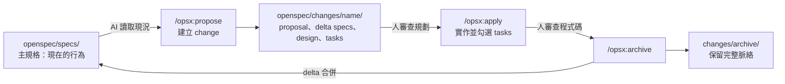
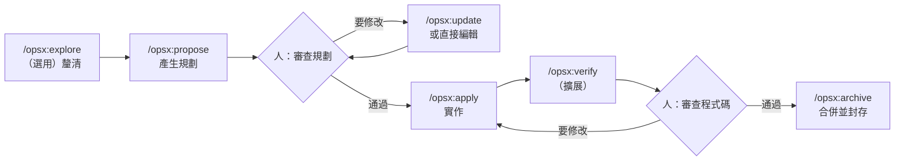

+++
date = '2025-12-31T20:06:08+08:00'
draft = false
title = 'OpenSpec使用教學'
lastmod = '2026-10-30T12:00:00+08:00'
tags = ['教學', 'AI開發']
categories = ['教學']
+++

## OpenSpec 使用教學手冊

> **版本**：8.0
> **更新日期**：2026-10-30
> **適用版本**：OpenSpec **v1.15.0**（2026-10-24 發布）；指令、旗標、預設值與驗證規則以 v1.15.0 tag 的原始碼與官方 `docs/` 為準
> **文件等級**：企業標準技術白皮書
> **適用對象**：軟體工程師、系統分析師、Tech Lead、負責審查 AI 產出的 Reviewer
> **官方網站**：[openspec.dev](https://openspec.dev/)　**原始碼**：[Fission-AI/OpenSpec](https://github.com/Fission-AI/OpenSpec)

---

**摘要**　AI 編碼助手很有能力，但如果需求只存在於聊天紀錄裡，產出結果就難以預測。OpenSpec 是一個輕量的「規格層」：在寫任何程式碼之前，先讓人與 AI 對「要做什麼」達成書面共識。共識以純 Markdown 的 **requirement（需求）＋ scenario（情境）** 呈現，並以 **delta（差異）** 的方式描述每次變更。變更完成後封存（archive），delta 會合併回「現況規格」，成為系統行為的單一事實來源。

本手冊以 v1.15.0 為基準重新撰寫，重點有三個：

1. **把人教會**：每個概念都附可直接套用的範例，並用同一個「帳戶餘額查詢」案例貫穿全書。
2. **讓人能審查與驗證 AI 的產出**：每一章都有「👀 審查與驗證」小節，說明要看什麼、用什麼指令驗證、什麼結果代表通過。
3. **可查證**：書中所有完整的 spec、delta、proposal、tasks 檔案範例，都以原檔嵌入，並經過離線檢查器 `check_spec.py` 實際驗證；另有 22 個反例。只示範單一需求的片段，則是說明用途。檢查器依 v1.15.0 validator 原始碼的規則撰寫，原始碼與測試結果收錄在[附錄 B](#附錄-b審查清單與-check_specpy)。

---

## 目錄

<!-- TOC-AUTO-BEGIN -->

- **[前言](#前言)**
  - [這份手冊的定位與讀者](#這份手冊的定位與讀者)
  - [版本基準與查證方式](#版本基準與查證方式)
  - [本手冊的貫穿範例](#本手冊的貫穿範例)
  - [閱讀符號說明](#閱讀符號說明)
  - [與 v7.0 的章節對照](#與-v70-的章節對照)
- **[第一章：OpenSpec 概念與定位](#第一章openspec-概念與定位)**
  - [1.1 為什麼需要規格層](#11-為什麼需要規格層)
  - [1.2 四個設計原則](#12-四個設計原則)
  - [1.3 核心心智模型](#13-核心心智模型)
  - [1.4 與其他做法的比較](#14-與其他做法的比較)
  - [1.5 何時不該用 OpenSpec](#15-何時不該用-openspec)
  - [1.6 👀 審查與驗證：判斷團隊是否適合導入](#16--審查與驗證判斷團隊是否適合導入)
- **[第二章：安裝、升級與 AI 工具整合](#第二章安裝升級與-ai-工具整合)**
  - [2.1 選擇安裝方式](#21-選擇安裝方式)
  - [2.2 初始化專案](#22-初始化專案)
  - [2.3 兩個輸入位置：終端機與 AI 聊天](#23-兩個輸入位置終端機與-ai-聊天)
  - [2.4 Profile、Delivery 與 Workflow](#24-profiledelivery-與-workflow)
  - [2.5 支援的 AI 工具與呼叫語法](#25-支援的-ai-工具與呼叫語法)
  - [2.6 升級與 openspec update](#26-升級與-openspec-update)
  - [2.7 遙測、版本檢查與企業網路](#27-遙測版本檢查與企業網路)
- **[第三章：目錄結構與 Artifact](#第三章目錄結構與-artifact)**
  - [3.1 openspec 目錄結構](#31-openspec-目錄結構)
  - [3.2 主規格格式](#32-主規格格式)
  - [3.3 Requirement 與 Scenario 的格式規則](#33-requirement-與-scenario-的格式規則)
  - [3.4 Delta spec 的四種區段](#34-delta-spec-的四種區段)
  - [3.5 proposal.md](#35-proposalmd)
  - [3.6 design.md](#36-designmd)
  - [3.7 tasks.md](#37-tasksmd)
  - [3.8 .openspec.yaml 變更中繼資料](#38-openspecyaml-變更中繼資料)
  - [3.9 👀 審查與驗證：artifact 結構檢核表](#39--審查與驗證artifact-結構檢核表)
- **[第四章：OPSX 標準工作流程](#第四章opsx-標準工作流程)**
  - [4.1 工作流程全貌：動作而非階段](#41-工作流程全貌動作而非階段)
  - [4.2 步驟 1：explore 釐清需求](#42-步驟-1explore-釐清需求)
  - [4.3 步驟 2：propose 產生規劃](#43-步驟-2propose-產生規劃)
  - [4.4 步驟 3：審查規劃（人工關卡）](#44-步驟-3審查規劃人工關卡)
  - [4.5 步驟 4：update 修訂規劃](#45-步驟-4update-修訂規劃)
  - [4.6 步驟 5：apply 實作](#46-步驟-5apply-實作)
  - [4.7 步驟 6：verify 驗證實作](#47-步驟-6verify-驗證實作)
  - [4.8 步驟 7：sync 與 archive](#48-步驟-7sync-與-archive)
  - [4.9 擴展流程：new、continue、ff、bulk-archive、onboard](#49-擴展流程newcontinueffbulk-archiveonboard)
  - [4.10 更新既有變更還是開新變更](#410-更新既有變更還是開新變更)
  - [4.11 情境範例：Bug 修復、純重構、能力汰除](#411-情境範例bug-修復純重構能力汰除)
- **[第五章：撰寫好規格](#第五章撰寫好規格)**
  - [5.1 規格是行為，不是程式碼](#51-規格是行為不是程式碼)
  - [5.2 好的 Requirement](#52-好的-requirement)
  - [5.3 好的 Scenario](#53-好的-scenario)
  - [5.4 選對 delta 類型](#54-選對-delta-類型)
  - [5.5 適當切分變更](#55-適當切分變更)
  - [5.6 漸進式嚴謹度](#56-漸進式嚴謹度)
  - [5.7 引導 AI 產出好草稿](#57-引導-ai-產出好草稿)
  - [5.8 反模式對照表](#58-反模式對照表)
- **[第六章：審查與驗證 AI 產出](#第六章審查與驗證-ai-產出)**
  - [6.1 兩個審查時機](#61-兩個審查時機)
  - [6.2 審查順序與每個檔案要回答的問題](#62-審查順序與每個檔案要回答的問題)
  - [6.3 CLI 驗證指令](#63-cli-驗證指令)
  - [6.4 strict 模式與 SHALL/MUST 的中文陷阱](#64-strict-模式與-shallmust-的中文陷阱)
  - [6.5 離線檢查器 check_spec.py](#65-離線檢查器-check_specpy)
  - [6.6 封存預演：在合併前看見結果](#66-封存預演在合併前看見結果)
  - [6.7 反例集：AI 常犯的錯誤](#67-反例集ai-常犯的錯誤)
  - [6.8 審查紀錄範本](#68-審查紀錄範本)
- **[第七章：客製化](#第七章客製化)**
  - [7.1 三個客製化層級](#71-三個客製化層級)
  - [7.2 config.yaml](#72-configyaml)
  - [7.3 繁體中文設定](#73-繁體中文設定)
  - [7.4 自訂 schema](#74-自訂-schema)
  - [7.5 社群 schema](#75-社群-schema)
  - [7.6 👀 審查與驗證：設定是否生效](#76--審查與驗證設定是否生效)
- **[第八章：團隊協作與治理](#第八章團隊協作與治理)**
  - [8.1 唯一的原則：OpenSpec 不碰 git](#81-唯一的原則openspec-不碰-git)
  - [8.2 分支與 PR 流程](#82-分支與-pr-流程)
  - [8.3 何時封存](#83-何時封存)
  - [8.4 平行變更與衝突](#84-平行變更與衝突)
  - [8.5 CI 整合](#85-ci-整合)
  - [8.6 Stores（Beta）跨 repo 規劃](#86-storesbeta跨-repo-規劃)
  - [8.7 doctor、context 與 workset](#87-doctorcontext-與-workset)
  - [8.8 安全性考量](#88-安全性考量)
- **[第九章：既有專案導入與遷移](#第九章既有專案導入與遷移)**
  - [9.1 只為要改的部分寫規格](#91-只為要改的部分寫規格)
  - [9.2 第一個真實變更](#92-第一個真實變更)
  - [9.3 既有的 PRD、SRS 怎麼處理](#93-既有的-prdsrs-怎麼處理)
  - [9.4 Monorepo 與能力的組織方式](#94-monorepo-與能力的組織方式)
  - [9.5 從舊版工作流程遷移到 OPSX](#95-從舊版工作流程遷移到-opsx)
  - [9.6 導入路線圖](#96-導入路線圖)
- **[第十章：實戰案例：帳戶餘額查詢端到端](#第十章實戰案例帳戶餘額查詢端到端)**
  - [10.1 時間線](#101-時間線)
  - [10.2 封存前的預演](#102-封存前的預演)
  - [10.3 封存後的主規格](#103-封存後的主規格)
  - [10.4 後續變更一：純重構](#104-後續變更一純重構)
  - [10.5 後續變更二：汰除與更名](#105-後續變更二汰除與更名)
  - [10.6 案例回顧](#106-案例回顧)
- **[第十一章：FAQ、疑難排解與常見陷阱](#第十一章faq疑難排解與常見陷阱)**
  - [11.1 常見問題（FAQ）](#111-常見問題faq)
  - [11.2 疑難排解](#112-疑難排解)
  - [11.3 常見陷阱](#113-常見陷阱)
  - [11.4 業界獨立評測摘要](#114-業界獨立評測摘要)
- **[附錄 A：指令參考](#附錄-a指令參考)**
  - [A.1 Slash 指令（AI 聊天）](#a1-slash-指令ai-聊天)
  - [A.2 CLI 指令](#a2-cli-指令)
  - [A.3 環境變數與結束碼](#a3-環境變數與結束碼)
  - [A.4 AI 工具 ID 與安裝路徑](#a4-ai-工具-id-與安裝路徑)
- **[附錄 B：審查清單與 check_spec.py](#附錄-b審查清單與-check_specpy)**
  - [B.1 審查清單](#b1-審查清單)
  - [B.2 check_spec.py 原始碼](#b2-check_specpy-原始碼)
  - [B.3 測試與執行結果](#b3-測試與執行結果)
- **[附錄 C：Prompt 範本](#附錄-cprompt-範本)**
  - [C.1 探索](#c1-探索)
  - [C.2 提案](#c2-提案)
  - [C.3 請 AI 自我審查規劃](#c3-請-ai-自我審查規劃)
  - [C.4 修訂](#c4-修訂)
  - [C.5 實作](#c5-實作)
  - [C.6 遷移 project.md](#c6-遷移-projectmd)
- **[附錄 D：版本沿革](#附錄-d版本沿革)**
  - [D.1 v1.10 至 v1.15（本版新增）](#d1-v110-至-v115本版新增)
  - [D.2 v1.0 至 v1.9（摘要）](#d2-v10-至-v19摘要)
- **[附錄 E：術語表與參考資源](#附錄-e術語表與參考資源)**
  - [E.1 術語表](#e1-術語表)
  - [E.2 官方資源](#e2-官方資源)
  - [E.3 第三方資源](#e3-第三方資源)
- **[附錄 F：修正紀錄與驗證紀錄](#附錄-f修正紀錄與驗證紀錄)**
  - [F.1 本版修正（v7.0 到 v8.0）](#f1-本版修正v70-到-v80)
  - [F.2 驗證方式與結果](#f2-驗證方式與結果)
  - [F.3 待確認事項](#f3-待確認事項)
- **[文件資訊](#文件資訊)**

<!-- TOC-AUTO-END -->

---

## 前言

### 這份手冊的定位與讀者

這是一份**導入與操作手冊**，不是官方文件的翻譯。官方文件告訴你「指令做什麼」，本手冊要回答企業團隊真正卡住的三個問題：

| 問題 | 本手冊的回答方式 |
| --- | --- |
| 我要怎麼開始？ | 第二章安裝、第四章用貫穿範例走完一次完整流程 |
| AI 寫出來的規格對不對？ | 第三、五章教「好規格長什麼樣」，第六章教「怎麼抓出 AI 的錯」 |
| 團隊要怎麼管？ | 第七章客製化、第八章 Git／PR／CI 治理、第九章既有專案導入 |

| 讀者 | 建議閱讀 |
| --- | --- |
| 第一次接觸 SDD 的工程師 | 前言 → 第一章 → 第二章 → 第四章 → 第五章 |
| 負責審查 AI 產出的 Reviewer、Tech Lead | 第三章 → 第五章 → 第六章 → 附錄 B |
| 導入負責人、架構師 | 第一章 → 第七章 → 第八章 → 第九章 → 第十一章 |
| 只想查指令 | 附錄 A |

### 版本基準與查證方式

OpenSpec 發版很快：從 v1.9.0（2026-08-13，即本手冊 v7.0 的基準）到 v1.15.0（2026-10-24），兩個半月內發了 10 個版本。為了讓內容可以查證，本手冊遵守以下規則：

| 項目 | 查證來源（皆為 v1.15.0 tag） |
| --- | --- |
| CLI 指令與旗標 | `src/cli/index.ts`、`src/cli/commands/*.ts`（以原始碼為準，官方 `docs/cli.md` 有部分落後之處會特別註明） |
| 支援的 AI 工具 ID | `src/core/config.ts` 的 `AI_TOOLS`（共 50 個） |
| Profile 與 workflow 清單 | `src/core/profiles.ts` |
| 驗證規則與門檻 | `src/core/validation/validator.ts`、`constants.ts` |
| 內建 schema 與範本 | `schemas/spec-driven/schema.yaml`、`templates/*.md` |
| `.openspec.yaml` 合法欄位 | `src/core/change-metadata/schema.ts` |
| 版本差異 | `CHANGELOG.md` 與 GitHub Releases 的發布日期 |

> ⚠️ **本版不在本機執行 OpenSpec CLI。** 所有事實都來自原始碼與官方文件，所有規格範例則以離線檢查器 `check_spec.py` 驗證。檢查器是依 v1.15.0 validator 規則撰寫的子集，並非官方工具。導入時，請在你的環境中以 `openspec validate --strict` 做最終確認。驗證方式與尚待實機確認的項目列在[附錄 F](#附錄-f修正紀錄與驗證紀錄)。

### 本手冊的貫穿範例

全書使用同一個情境：**網路銀行新增「帳戶餘額查詢」**。

| 項目 | 內容 |
| --- | --- |
| 業務目標 | 客服中心每月約 1.2 萬通來電只問餘額，目標降低 30% |
| 變更名稱 | `add-balance-inquiry` |
| 新增能力（capability） | `account-balance`：單一帳戶查詢、多帳戶彙總 |
| 修改能力 | `account-access`：允許已授權的代理人唯讀查詢 |
| 後續變更 | `refactor-balance-cache`（純重構，`skip_specs`）、`retire-legacy-balance-api`（REMOVED／RENAMED） |

這些檔案在第三、四、十章以原文完整呈現，並且都通過 `check_spec.py --strict` 檢查。

### 閱讀符號說明

| 符號 | 意義 |
| --- | --- |
| 👀 **審查與驗證** | AI 產出後，人要檢查的項目與驗證方法 |
| ✅ / ❌ | 正確範例／錯誤範例（錯誤範例都收錄在反例集，可重現） |
| ⚠️ | 容易出錯、會造成資料遺失或流程失效的地方 |
| 💡 | 實務建議 |
| 🧪 Beta | 官方標示為 Beta 的功能（目前為 Stores、workset），指令與格式可能在版本間變動 |

### 與 v7.0 的章節對照

v8.0 重新編排章節，主要是為了修正 v7.0 的結構性錯誤（詳見[附錄 F](#附錄-f修正紀錄與驗證紀錄)）：

| v7.0 | v8.0 | 說明 |
| --- | --- | --- |
| 第一、二章 概念與 SDD | 第一章 | 合併；補上「何時不該用」 |
| 第三章 Product/System/API/Data Spec | 第三章 目錄結構與 Artifact | **重寫**：OpenSpec 沒有這四種 Spec 類型，實際的 artifact 是 proposal／specs／design／tasks |
| 第四章 工作流程＋v1.x 版本更新 | 第四章＋附錄 D | 工作流程改以貫穿範例逐步示範；版本更新移到附錄 D |
| 第五章 新進同仁實作範例 | 第十章 | 改用通過檢查的真實 artifact |
| 第六章 反模式 | 第五章 5.8、第六章 6.7 | 反模式改為可重現的反例集 |
| 第七章 最佳實務 | 第八章 | 補上 CI、封存時機、平行變更衝突 |
| 第八章 學習建議 | 前言、第九章 | 改為導入路線圖 |
| 第九章 進階主題 | 第七、八、十一章 | 分散到客製化、治理與評測 |
| 附錄 A–I | 附錄 A–F | 指令參考依原始碼重建 |

## 第一章：OpenSpec 概念與定位

### 1.1 為什麼需要規格層

AI 編碼助手的問題通常不是「不會寫」，而是「寫得很有自信，但寫錯了方向」。根本原因是需求只存在於對話中，而對話有三個缺點：

| 對話中的需求 | 造成的問題 | 規格層如何補救 |
| --- | --- | --- |
| 散落在多輪對話 | AI 換個 session 就遺忘，人也找不到當初講了什麼 | 需求寫成檔案，存在 repo 裡 |
| 模糊（「要快」「要安全」） | AI 自行補完，補的不一定是你要的 | 每條需求要有 `SHALL`/`MUST` 與可測試的情境 |
| 無法事前審查 | 錯誤到程式碼階段才發現，修正成本高 | 在寫程式碼之前先審規格，一段文字改起來幾乎免費 |

OpenSpec 官方用一句話形容這個賭注：**在一段規劃文字裡抓到錯誤方向幾乎不花成本；在 300 行程式碼裡抓到同一個錯誤就不是了。**

### 1.2 四個設計原則

OpenSpec README 列出它的設計哲學。下表說明每個原則對日常操作的實際影響：

| 原則 | 意思 | 對你的影響 |
| --- | --- | --- |
| **fluid not rigid**（流動，不僵化） | 沒有階段門（phase gate） | 任何 artifact 隨時可以改，實作中發現設計不對，改 `design.md` 再繼續 |
| **iterative not waterfall**（迭代，不瀑布） | 邊做邊學、邊學邊修 | 不需要一次寫完所有規格 |
| **easy not complex**（簡單，不複雜） | 安裝與設定極少 | 一個執行檔加一個 `openspec/` 資料夾就能開始 |
| **brownfield-first**（既有系統優先） | 以 delta 描述變更 | 不必先為整個舊系統補寫規格，只為「這次要改的部分」寫 |

### 1.3 核心心智模型

整個 OpenSpec 只有五個名詞，搞懂它們之間的關係就搞懂了 80%：

| 名詞 | 是什麼 | 存放位置 |
| --- | --- | --- |
| **Spec（主規格）** | 系統**現在**的行為，是單一事實來源 | `openspec/specs/<capability>/spec.md` |
| **Change（變更）** | 一次提議的修改，一個資料夾 | `openspec/changes/<change-name>/` |
| **Artifact** | 變更資料夾內的文件：proposal、specs（delta）、design、tasks | 變更資料夾內 |
| **Delta spec（差異規格）** | 這次變更對主規格「加了／改了／刪了／更名了」什麼 | `openspec/changes/<name>/specs/<capability>/spec.md` |
| **Archive（封存）** | 完成後把 delta 合併回主規格，並把變更資料夾移到 `archive/` | `openspec/changes/archive/YYYY-MM-DD-<name>/` |



這個循環的關鍵在於：**specs 只在封存時改變**。進行中的變更彼此隔離，各自存放在自己的資料夾，所以多個變更可以平行進行，而主規格永遠描述「已經上線的行為」。

### 1.4 與其他做法的比較

| 面向 | OpenSpec | GitHub Spec Kit | AWS Kiro | 不用任何工具 |
| --- | --- | --- | --- | --- |
| 型態 | CLI＋產生給各 AI 工具的 skills／commands | CLI（Python）＋模板與擴充 | 整合式 IDE | 直接對 AI 下指令 |
| 流程 | 動作導向、無階段門 | 階段式（specify → plan → tasks → implement） | IDE 內建的需求 → 設計 → 任務 | 無 |
| 規格模型 | 主規格＋每次變更的 delta | 以功能為單位的獨立規格 | 以功能為單位 | 無 |
| 既有系統 | 強項（只描述變更） | 偏向新功能的完整規劃 | 中等 | — |
| 工具綁定 | 支援 50 個 AI 工具 ID | 支援多種 AI 工具 | 綁定 Kiro IDE | — |
| 適合 | 既有系統持續演進、小步快跑 | 新系統、需要完整前期規劃與治理 | 已採用 Kiro 的團隊 | 一次性腳本、拋棄式原型 |

> ℹ️ 官方 README 的比較：Spec Kit「完整但重量級」、Kiro「強大但綁定 IDE」。這是 OpenSpec 自己的說法。第三方評論普遍認為**差異主要在哲學而非能力**，選錯的挫折通常來自「期待錯誤」。詳見 [11.4 業界獨立評測摘要](#114-業界獨立評測摘要)。

### 1.5 何時不該用 OpenSpec

OpenSpec 官方文件反覆強調「讓儀式與風險相稱」（match the ceremony to the stakes）。以下情況建議**不要**走完整流程：

| 情況 | 建議做法 |
| --- | --- |
| 一行的錯字或設定值修正 | 直接修改，PR 描述寫清楚即可 |
| 拋棄式原型、技術驗證（spike） | 用 `/opsx:explore` 討論即可，不建立 change |
| 純重構、工具鏈、純文件 | 可以建立 change 記錄設計與任務，但在 `.openspec.yaml` 設定 `skip_specs: true`，**不要為了通過驗證而捏造需求** |
| 要一次補寫整個舊系統的規格 | **不要這麼做**。官方明確建議只為要改的部分寫規格，補寫的規格沒有變更驅動，很快就會過時 |

### 1.6 👀 審查與驗證：判斷團隊是否適合導入

導入前，用下列問題做自我評估。三題以上回答「是」，就值得試行：

- [ ] AI 產出的程式碼常常「做了不是我要的東西」，需要多輪來回修正
- [ ] 系統主要是既有系統的持續修改，而不是從零開始
- [ ] 團隊需要事後追溯「這個行為為什麼長這樣」（稽核、交接）
- [ ] PR 審查常常只能看程式碼差異，看不出這次變更「應該」做到什麼
- [ ] 團隊使用多種 AI 工具（Claude Code、Copilot、Cursor 等），需要一致的流程

**驗證方式**：挑一個這週本來就要做的小變更，依[第四章](#第四章opsx-標準工作流程)走完一次，量測兩件事：①規劃審查花了多少時間；②實作後需要退回修改的次數。與以往的同類工作比較，就是最便宜的試行判斷。

## 第二章：安裝、升級與 AI 工具整合

### 2.1 選擇安裝方式

v1.15.0 起，OpenSpec 提供**單一執行檔**（standalone binary），不再需要 Node.js。npm 等套件管理器的安裝方式仍然保留。

| 方式 | 指令 | 前置需求 | 適合 |
| --- | --- | --- | --- |
| 獨立執行檔（macOS／Linux） | `curl -fsSL https://raw.githubusercontent.com/Fission-AI/OpenSpec/main/scripts/binary/install.sh \| sh` | 無（Alpine 需先 `apk add libstdc++ libgcc`） | 個人電腦、沒有 Node 的環境 |
| 獨立執行檔（Windows PowerShell） | `irm https://raw.githubusercontent.com/Fission-AI/OpenSpec/main/scripts/binary/install.ps1 \| iex` | Windows 10 以上 | Windows 開發機 |
| npm | `npm install -g @fission-ai/openspec@latest` | Node.js **20.19.0** 以上 | 已統一用 npm 管理工具的團隊 |
| pnpm／bun／yarn 1.x | `pnpm add -g …`／`bun add -g …`／`yarn global add …` | 同上（bun 仍需 Node 在 PATH） | 同上 |
| Homebrew | `brew install openspec` | Homebrew | macOS |
| Nix | `nix run github:Fission-AI/OpenSpec -- init` | Nix | 宣告式開發環境 |

獨立執行檔的安裝腳本會挑選最新且檔案完整的 release，以 release 中的 `SHA256SUMS` 驗證後，安裝到 `~/.local/bin`（Windows：`%LOCALAPPDATA%\Programs\openspec`，並加入使用者 PATH）。另有兩個環境變數可用：

| 環境變數 | 用途 | 範例 |
| --- | --- | --- |
| `OPENSPEC_INSTALL_DIR` | 指定安裝目錄 | `OPENSPEC_INSTALL_DIR=/opt/tools/bin` |
| `OPENSPEC_VERSION` | 鎖定版本（企業建議） | `OPENSPEC_VERSION=v1.15.0` |

> 💡 **企業建議：鎖定版本。** OpenSpec 平均每週發一版，而且每次升級後都要執行 `openspec update` 重新產生 AI 指令檔。團隊應統一版本，例如在安裝腳本設定 `OPENSPEC_VERSION=v1.15.0`，或使用 `npm install -g @fission-ai/openspec@1.15.0`，避免成員之間產生的 skills 不一致。

> ⚠️ **管線執行遠端腳本（`curl … | sh`、`irm … | iex`）在多數企業的資安政策下需要審核。** 替代做法：從 [GitHub Releases](https://github.com/Fission-AI/OpenSpec/releases) 手動下載對應平台的檔案（例如 `openspec-windows-x64.exe`、`openspec-linux-x64`），自行比對 `SHA256SUMS` 後放進 PATH；或改用內部 npm mirror。

已經用 npm 安裝、想改成獨立執行檔的話：執行 `openspec install`，依提示移除舊版（例如 `npm uninstall -g @fission-ai/openspec`），再開新終端機執行 `openspec version`，應顯示 `OpenSpec <版本> (standalone)`。

#### 👀 審查與驗證：安裝是否正確

```bash
openspec --version          # 印出版本號，例如 1.15.0
openspec version --check    # 顯示安裝型態（standalone／npm…）與是否有新版
which -a openspec           # 確認 PATH 上只有一份；Windows 用 where.exe openspec
```

| 檢查 | 通過條件 | 未通過的常見原因 |
| --- | --- | --- |
| 版本號 | 等於團隊鎖定的版本 | PATH 上有舊版搶先執行（nvm／fnm 切換 Node 版本後最常見） |
| `which -a` | 只有一筆 | 同時存在 npm 版與 standalone 版 |
| npm 安裝時 | `node --version` ≥ 20.19.0 | 出現 "Requires Node.js 20.19.0 or higher" |

### 2.2 初始化專案

在專案根目錄執行：

```bash
cd your-project
openspec init                                  # 互動式：選擇 AI 工具
openspec init --tools claude,github-copilot    # 非互動：指定工具（逗號分隔）
openspec init --tools none                     # 只建立 openspec/ 結構，不產生任何工具檔
openspec init --language "繁體中文（zh-TW）"     # 新專案：把語言指示寫進 config.yaml
```

`openspec init` 的完整選項（依 v1.15.0 `src/cli/index.ts`）：

| 選項 | 說明 |
| --- | --- |
| `[path]` | 目標目錄，預設為目前目錄 |
| `--tools <list>` | 非互動指定工具：`all`、`none` 或逗號分隔的工具 ID |
| `--language <language>` | 只對**新建**的 `config.yaml` 生效；既有專案請直接編輯 `context` |
| `--profile <profile>` | 本次覆寫全域 profile：`core` 或 `custom` |
| `--force` | 不詢問、自動清理舊版遺留檔案 |
| `--no-animation` | 顯示靜態歡迎畫面（也可設 `OPENSPEC_NO_ANIMATION`） |
| `--copilot-cloud` / `--no-copilot-cloud` | 是否產生 GitHub Copilot 雲端代理檔案（見 2.5） |

產生的結構：

```text
your-project/
├── openspec/
│   ├── specs/              # 主規格（一開始是空的）
│   ├── changes/            # 進行中的變更
│   └── config.yaml         # 專案設定
├── .claude/skills/openspec-*/SKILL.md      # 選了 claude 才會有
├── .claude/commands/opsx/*.md              # delivery 含 commands 時
└── .github/skills/…、.github/prompts/…      # 選了 github-copilot 才會有
```

> ⚠️ **`openspec init --tools …` 會自動刪除舊版 OpenSpec 的遺留檔案，而且不會詢問**，包括 `…/commands/openspec/` 資料夾、`CLAUDE.md`／`AGENTS.md` 內的 OpenSpec 標記區塊，以及家目錄下的 `opsx-*.md` prompt（Codex 放在 `~/.codex/prompts`）。執行前先 `git status` 確認工作區乾淨；如果這些檔案有你自己的修改，先備份。

> 💡 `init` 會在**執行的目錄**建立 `openspec/`。在 monorepo 裡，請確認你站在 repo 根目錄，而不是某個套件目錄。

### 2.3 兩個輸入位置：終端機與 AI 聊天

新手最常見的困惑是「`/opsx:propose` 要在哪裡打？」。OpenSpec 有兩半：

| 指令 | 在哪裡執行 | 誰執行 | 例子 |
| --- | --- | --- | --- |
| `openspec …` | **終端機** | 你，或 AI 代你在終端機執行 | `openspec init`、`openspec validate` |
| `/opsx:…` | **AI 助手的聊天輸入框** | AI 助手 | `/opsx:propose add-balance-inquiry` |

沒有所謂的「互動模式」要啟動：在聊天框打 slash 指令，AI 就會照著 OpenSpec 產生的 skill 或 command 檔執行。這些檔案內部會再呼叫 `openspec status --json`、`openspec instructions … --json` 等 CLI 指令，取得要寫什麼、寫在哪裡。

### 2.4 Profile、Delivery 與 Workflow

這三個設定都存在**全域設定檔**（用 `openspec config path` 查看位置）。它們決定 `init`／`update` 要產生哪些檔案：

| 設定 | 可選值 | 預設 | 決定什麼 |
| --- | --- | --- | --- |
| **profile** | `core`、`custom` | `core` | 安裝**哪些** workflow |
| **delivery** | `both`、`skills`、`commands` | `both` | 以**什麼形式**安裝（skill 檔、command 檔或兩者） |
| **workflows** | 12 個 workflow ID 的子集合 | core 的 6 個 | `custom` profile 下實際選取的 workflow |

| Workflow | core | 用途 |
| --- | :---: | --- |
| `propose` | ✅ | 建立 change 並一次產生所有規劃 artifact |
| `explore` | ✅ | 不寫程式碼的思考夥伴，釐清需求 |
| `apply` | ✅ | 依 tasks 實作 |
| `update` | ✅ | 修訂既有規劃 artifact 並維持彼此一致（不改程式碼） |
| `sync` | ✅ | 把 delta 合併進主規格（不封存） |
| `archive` | ✅ | 封存變更 |
| `new` | | 只建立變更骨架 |
| `continue` | | 依相依關係建立下一個 artifact |
| `ff` | | fast-forward：一次建立所有規劃 artifact |
| `verify` | | 檢查實作是否符合 artifact |
| `bulk-archive` | | 一次封存多個變更 |
| `onboard` | | 用你的程式碼走一次完整教學（15～30 分鐘） |

切換方式：

```bash
openspec config profile          # 互動式精靈：改 delivery、改 workflows 或兩者
openspec config profile core     # 快速切回 core（保留 delivery 設定）
openspec update                  # ⚠️ 必須執行，才會把設定套用到專案檔案
```

> 💡 **企業建議**：Reviewer 和 Tech Lead 建議開啟 `verify`（第六章的程式碼審查會用到）；新進同仁可以開啟 `onboard` 走一次教學。其餘成員維持 `core` 即可。

### 2.5 支援的 AI 工具與呼叫語法

v1.15.0 共有 **50 個工具 ID**（完整清單見[附錄 A.4](#a4-ai-工具-id-與安裝路徑)）。官方 `docs/cli.md` 的清單只列到 40 個，是文件落後於原始碼；以 `src/core/config.ts` 為準。

不同工具「打指令的寫法」不同，而且由 OpenSpec 產生的檔案型態決定：

| 你的工具 | 你要輸入 | 原因 |
| --- | --- | --- |
| Claude Code、Gemini CLI、CodeBuddy、Crush、Lingma、Qoder、ZCode、EasyCode | `/opsx:propose` | command 檔放在 `…/commands/opsx/` 資料夾，資料夾成為命名空間 |
| Cursor、GitHub Copilot（IDE）、Cline、Kiro、OpenCode、Trae 等多數工具 | `/opsx-propose` | 檔名 `opsx-propose.*` 就是指令名 |
| Amazon Q Developer | `@opsx-propose` | 放在 prompt library，以 `@` 呼叫 |
| Devin Desktop（原 Windsurf） | `/opsx-propose`；Devin Local 用 `/openspec-propose` | Devin Local 不支援 workflows，只讀 skills |
| Codex | `$openspec-propose` | 只產生 skills（`.agents/skills/`），Codex 不認得 `/openspec-*` |
| Kimi Code | `/skill:openspec-propose` | 只有 skills |
| 其他只有 skills 的工具（Zed、Grok Build、DeepSeek Harness、Mistral Vibe 等） | `/openspec-propose` | 用 skill 名稱呼叫 |

> ⚠️ **skill 名稱與 command ID 不是一對一。** 例如 `/opsx:apply` 對應的 skill 叫 `openspec-apply-change`，`/opsx:sync` 對應 `openspec-sync-specs`。最可靠的做法是讀 `openspec init` 結束時印出的 "Getting started" 提示，或直接打開產生的檔案確認。

**GitHub Copilot 的三種形態**：

| 形態 | OpenSpec 產生的檔案 | 注意 |
| --- | --- | --- |
| IDE 擴充（VS Code、JetBrains、Visual Studio） | `.github/skills/openspec-*/SKILL.md`、`.github/prompts/opsx-*.prompt.md` | prompt 檔可當作 slash 指令 |
| Copilot CLI | 同上 | Copilot CLI **不讀** `.github/prompts/*.prompt.md`，只能用 skills |
| 雲端程式代理（Copilot coding agent） | `.github/workflows/copilot-setup-steps.yml`、`.github/agents/openspec.agent.md` | **預設關閉**；`init` 互動時預設回答 No，或用 `--copilot-cloud` 開啟。選擇記錄在 `config.yaml` 的 `githubCopilot.cloudAgent` |

> ⚠️ 雲端代理會在你的 repo 寫入一個 GitHub Actions workflow。啟用前，請依公司的 Actions 治理流程審查 `copilot-setup-steps.yml`。

### 2.6 升級與 openspec update

升級分成兩步，**兩步都要做**：

```bash
# 步驟 1：升級 CLI 本體（依安裝方式擇一）
openspec install                                  # standalone
npm install -g @fission-ai/openspec@latest        # npm
brew upgrade openspec                             # Homebrew

# 步驟 2：在每個專案內重新產生 AI 工具檔
openspec update
openspec update --dry-run --json                  # v1.15.0 新增：只預覽，不寫入
```

為什麼要兩步？AI 工具使用的 skill／command 檔是由「已安裝的 CLI」產生的。只升級 CLI、不執行 `update`，AI 用的仍是舊指令；反過來，在舊 CLI 上執行 `update`，會回報「已是最新」，卻拿不到新版的 workflow。

`openspec update` 的行為重點：

| 行為 | 說明 |
| --- | --- |
| 版本檢查 | 執行前會查詢 npm registry 是否有新版 CLI（最多延遲 1.5 秒）。若為 npm 全域安裝且在互動終端機，會詢問是否立即升級 |
| 判斷是否「最新」 | skill 檔記錄產生它的版本；只有 command 的工具則比對內容，**手改的 command 檔會被覆蓋** |
| `--force` | 即使判定為最新也重寫 |
| `--dry-run --json` | 列出將新增、修改、刪除的檔案（`changes`）、需要人工決定的事項（`notes`）與會失敗的工具（`failures`） |

> ⚠️ **產生的 skill／command 檔屬於 OpenSpec，不要手改。** 想加入團隊規範，請寫在 `openspec/config.yaml` 的 `context`、`rules`（第七章），或寫在你自己的 `CLAUDE.md`／`AGENTS.md` 中 OpenSpec 標記區塊**以外**的地方。

#### 👀 審查與驗證：升級前後

```bash
openspec update --dry-run --json > update-plan.json   # 升級前先預覽
git diff --stat                                       # update 後檢查變動範圍
```

在 PR 中，Reviewer 只需要確認兩件事：①變動的檔案都在 OpenSpec 產生的路徑內（`…/skills/openspec-*`、`…/opsx*`）；②`update-plan.json` 的 `failures` 是空陣列。

### 2.7 遙測、版本檢查與企業網路

OpenSpec 預設收集**匿名**使用統計，只包含指令名稱與版本，不含參數、路徑、內容或個資；在 CI 中自動停用。企業環境的常用設定如下：

| 需求 | 做法 |
| --- | --- |
| 關閉遙測 | `openspec config set telemetry.enabled false`，或設定環境變數 `OPENSPEC_TELEMETRY=0`、`DO_NOT_TRACK=1`（環境變數優先） |
| 關閉 `update` 的新版檢查 | `OPENSPEC_NO_UPDATE_CHECK=1`（任何值都可以） |
| 使用內部 npm mirror 做版本檢查 | 設定 `npm_config_registry=https://npm.internal.example.com`；OpenSpec **不讀** `.npmrc`，這是刻意的安全設計 |
| 停止提示安裝 shell 補全 | `OPENSPEC_NO_COMPLETIONS=1` |

> 💡 把上述環境變數寫進團隊的開發環境設定（例如 devcontainer 或公司配發的 shell profile），比要求每個人手動設定可靠。

## 第三章：目錄結構與 Artifact

> ⚠️ **v7.0 的錯誤修正**：舊版本章介紹的「Product Spec／System Spec／API Spec／Data Spec」**不是 OpenSpec 的概念**。OpenSpec 內建的 `spec-driven` schema 只有四種 artifact：**proposal、specs（delta）、design、tasks**。API 契約、資料模型等技術細節應放在 `design.md`；`spec.md` 只描述**外部可觀察的行為**。

### 3.1 openspec 目錄結構

```text
openspec/
├── config.yaml                          # 專案設定（第七章）
├── specs/                               # 主規格 = 系統現在的行為
│   ├── account-access/
│   │   └── spec.md
│   └── account-balance/
│       └── spec.md
├── changes/                             # 進行中的變更，一個變更一個資料夾
│   ├── add-balance-inquiry/
│   │   ├── .openspec.yaml               # 變更中繼資料（schema、created、skip_specs…）
│   │   ├── proposal.md                  # 為什麼、做什麼
│   │   ├── design.md                    # 怎麼做（技術決策）
│   │   ├── tasks.md                     # 實作清單（核取方塊）
│   │   └── specs/                       # delta specs
│   │       ├── account-balance/spec.md
│   │       └── account-access/spec.md
│   └── archive/
│       └── 2026-11-05-add-balance-inquiry/   # 封存後保留完整脈絡
└── schemas/                             # 自訂 schema（選用，第七章）
```

**能力（capability）路徑的命名規則**（來自內建 schema 的 instruction）：

| 規則 | ✅ 範例 | ❌ 範例 |
| --- | --- | --- |
| 以**長期存在的系統行為**命名，而不是這次的工作 | `account-balance`、`user-auth` | `add-balance-api`、`sprint-12-login` |
| kebab-case；可以分層 | `account-balance`、`banking/account-balance` | `AccountBalance`、`account_balance` |
| 修改既有能力時，路徑必須與 `openspec/specs/` 下**完全一致** | `account-access` | `account-accesses`（會變成「新能力」） |
| 不要建立包山包海的能力 | `account-balance` | `core`、`misc` |

**變更名稱的規則**（`openspec new change` 強制檢查）：只能使用小寫字母、數字和單一連字號，不能有空白、底線、大寫、連續或首尾連字號。可以用數字開頭來排序，例如 `100-add-feature`。

### 3.2 主規格格式

主規格描述「現在系統做什麼」，由封存流程自動維護，一般不需要手寫。以下是貫穿範例中 `account-access` 的主規格：

```markdown
# account-access Specification

## Purpose

定義網路銀行中「誰可以讀取哪一個帳戶的資料」的存取規則，涵蓋帳戶擁有者驗證與跨帳戶存取的拒絕行為，作為所有帳戶類 API 共用的授權基準。

## Requirements

### Requirement: 帳戶擁有者存取
系統 SHALL 僅允許已登入且為該帳戶擁有者的客戶讀取帳戶資料。

#### Scenario: 擁有者讀取自己的帳戶
- **GIVEN** 客戶 C001 已登入且擁有帳戶 0012-345678
- **WHEN** C001 讀取帳戶 0012-345678 的資料
- **THEN** 系統回傳該帳戶資料

#### Scenario: 讀取他人帳戶被拒
- **GIVEN** 客戶 C001 已登入但不擁有帳戶 0099-000001
- **WHEN** C001 讀取帳戶 0099-000001 的資料
- **THEN** 系統回傳 HTTP 403 與錯誤碼 ACC-403
- **AND** 回應內容不揭露該帳戶是否存在

### Requirement: 未登入請求
系統 MUST 拒絕所有未帶有效登入憑證的帳戶資料請求。

#### Scenario: 憑證過期
- **GIVEN** 客戶的存取權杖已過期
- **WHEN** 客戶讀取任一帳戶資料
- **THEN** 系統回傳 HTTP 401 與錯誤碼 AUTH-401
```

| 元素 | 規則（v1.15.0 validator） | 違反時 |
| --- | --- | --- |
| `## Purpose` | 必須存在且不可空白 | ERROR |
| Purpose 長度 | 至少 **50 個字元**（中文逐字計算） | WARNING（`--strict` 下失敗） |
| Purpose 佔位文字 | 不可是 `TBD - created by archiving change …` 或以 `TBD`／`TODO` 開頭 | WARNING |
| `## Requirements` | 必須存在，至少一個需求 | ERROR |
| `### Requirement:` | 必須位於 `## Requirements` 區段內，名稱不可重複 | ERROR |
| delta 標題（`## ADDED Requirements` 等） | 不可出現在主規格 | ERROR |

### 3.3 Requirement 與 Scenario 的格式規則

這是 AI 最常出錯、也最值得人審查的部分。以下規則全部來自 v1.15.0 的原始碼：

| 規則 | 正確寫法 | 違反時 |
| --- | --- | --- |
| 需求標題 | `### Requirement: <名稱>`（三個 `#`） | 不被辨識 |
| 需求內文 | 標題下一行開始，到第一個子標題為止 | 內文空白 → ERROR |
| 規範性關鍵字 | 內文要有 `SHALL` 或 `MUST`（**英文大寫、完整單字**） | 缺少 → WARNING（`--strict` 下失敗） |
| 關鍵字位置 | 必須在**內文**，只寫在標題不算 | WARNING，訊息提示「not only in the header」 |
| 內文長度 | ADDED 需求與主規格的需求內文 ≤ 500 字元 | WARNING |
| 情境標題 | `#### Scenario: <名稱>`（**剛好四個 `#`**） | 用 `###` 或項目符號 → 視為沒有情境 |
| 情境數量 | 每個需求至少一個**有內容**的情境 | ERROR |
| 情境內容 | 只有標題、沒有任何步驟 → 不算 | ERROR |
| fenced code 內的標題 | 不算數（validator 會略過 code block） | — |

**繁體中文團隊的關鍵慣例**：結構標題（`## Purpose`、`## ADDED Requirements`、`### Requirement:`、`#### Scenario:`）與 `SHALL`／`MUST` 保留英文，其餘內容可以使用中文。

```markdown
### Requirement: 單一帳戶餘額查詢
系統 SHALL 依帳號回傳該帳戶的可用餘額、帳上餘額、幣別與資料時間（ISO 8601，含時區）。
```

> ⚠️ 寫成「系統**應**依帳號回傳…」在一般模式下仍會通過，只產生 WARNING，但在 `openspec validate --strict` 會失敗。v1.8.0 起，非英文規格缺少關鍵字從 ERROR 降為 WARNING，目的是讓多語言團隊不被卡住；企業 CI 通常會用 `--strict`，所以請一律保留 `SHALL`/`MUST`。

**RFC 2119 關鍵字的使用**：

| 關鍵字 | 意義 | 何時用 |
| --- | --- | --- |
| `MUST` / `SHALL` | 絕對要求 | 預設使用 |
| `SHOULD` | 強烈建議，允許有正當理由的例外 | 確實存在例外時才用 |
| `MAY` | 選用 | 真的可有可無時 |

> 💡 一條需求可以同時有 `SHALL` 與 `MAY`（例如範例中「代理人 MAY 唯讀查詢」），但**至少要有一個 `SHALL` 或 `MUST`**，validator 才會把它視為規範性需求。

**情境的步驟寫法**：官方範本使用 `- **WHEN** …` / `- **THEN** …`，官方概念文件則使用 `- GIVEN …` / `- WHEN …` / `- THEN …`。validator 只要求情境內容非空白，不檢查步驟格式。本手冊統一使用 `- **GIVEN** / **WHEN** / **THEN** / **AND**`，方便直接轉換成測試案例。

### 3.4 Delta spec 的四種區段

delta spec 放在 `changes/<name>/specs/<capability>/spec.md`，描述這次變更對主規格的影響：

| 區段 | 意義 | 內容要求 | 封存時 |
| --- | --- | --- | --- |
| `## Purpose` | 新能力的用途說明（**只用於新能力**） | 1～2 句，建議 ≥ 50 字元 | 複製到新建主規格的 Purpose；既有能力的 delta 寫了也會被忽略 |
| `## ADDED Requirements` | 全新的行為 | 完整需求＋情境 | 附加到主規格末端 |
| `## MODIFIED Requirements` | 既有行為改變 | **完整的新版需求區塊，含所有要保留的情境** | 整塊取代主規格中的同名需求 |
| `## REMOVED Requirements` | 行為移除 | 只要名稱；官方要求附 `**Reason**` 與 `**Migration**` | 從主規格刪除 |
| `## RENAMED Requirements` | 只改名稱、行為不變 | `- FROM: ` 與 `- TO: ` 成對出現 | 原位置改名 |

**新能力的 delta**（`account-balance`，含 `## Purpose`）：

```markdown
# Delta for account-balance

## Purpose

提供客戶查詢單一帳戶與名下全部帳戶餘額的能力，回傳可用餘額、帳上餘額與資料時間，作為網銀與行動 App 共用的餘額查詢行為基準。

## ADDED Requirements

### Requirement: 單一帳戶餘額查詢
系統 SHALL 依帳號回傳該帳戶的可用餘額、帳上餘額、幣別與資料時間（ISO 8601，含時區）。

#### Scenario: 查詢成功
- **GIVEN** 客戶 C001 已登入且擁有帳戶 0012-345678，可用餘額 50,000 TWD
- **WHEN** C001 查詢帳戶 0012-345678 的餘額
- **THEN** 系統回傳 HTTP 200
- **AND** 回應包含 availableBalance=50000、currency=TWD 與 asOf 時間

#### Scenario: 帳號格式錯誤
- **GIVEN** 客戶 C001 已登入
- **WHEN** C001 以帳號 "12AB" 查詢餘額
- **THEN** 系統回傳 HTTP 400 與錯誤碼 BAL-400

#### Scenario: 核心帳務系統逾時
- **GIVEN** 核心帳務系統 3 秒內未回應
- **WHEN** 客戶查詢餘額
- **THEN** 系統回傳 HTTP 503 與錯誤碼 BAL-503
- **AND** 回應不得包含過期超過 30 秒的快取餘額

### Requirement: 多帳戶餘額彙總
系統 SHALL 依幣別彙總客戶名下所有有效帳戶的可用餘額，已結清帳戶 MUST 不列入。

#### Scenario: 多幣別彙總
- **GIVEN** 客戶 C001 擁有兩個 TWD 帳戶（10,000 與 20,000）與一個 USD 帳戶（500）
- **WHEN** C001 查詢餘額彙總
- **THEN** 系統回傳 TWD 合計 30,000 與 USD 合計 500 兩筆彙總

#### Scenario: 排除已結清帳戶
- **GIVEN** 客戶 C001 的帳戶 0012-000009 狀態為已結清
- **WHEN** C001 查詢餘額彙總
- **THEN** 彙總結果不包含帳戶 0012-000009
```

**修改既有能力的 delta**（`account-access`，不寫 Purpose）：

```markdown
# Delta for account-access

## MODIFIED Requirements

### Requirement: 帳戶擁有者存取
系統 SHALL 僅允許已登入且為該帳戶擁有者的客戶讀取帳戶資料；經擁有者授權且仍在有效期內的代理人 MAY 唯讀查詢餘額。

#### Scenario: 擁有者讀取自己的帳戶
- **GIVEN** 客戶 C001 已登入且擁有帳戶 0012-345678
- **WHEN** C001 讀取帳戶 0012-345678 的資料
- **THEN** 系統回傳該帳戶資料

#### Scenario: 讀取他人帳戶被拒
- **GIVEN** 客戶 C001 已登入但不擁有帳戶 0099-000001
- **WHEN** C001 讀取帳戶 0099-000001 的資料
- **THEN** 系統回傳 HTTP 403 與錯誤碼 ACC-403
- **AND** 回應內容不揭露該帳戶是否存在

#### Scenario: 代理人唯讀查詢餘額
- **GIVEN** C001 已授權 C002 為帳戶 0012-345678 的代理人，授權至 2026-12-31
- **WHEN** C002 於 2026-11-01 查詢帳戶 0012-345678 的餘額
- **THEN** 系統回傳餘額
- **AND** C002 對該帳戶的任何寫入操作回傳 HTTP 403

#### Scenario: 代理授權已過期
- **GIVEN** C002 對帳戶 0012-345678 的代理授權已於 2026-10-01 到期
- **WHEN** C002 查詢帳戶 0012-345678 的餘額
- **THEN** 系統回傳 HTTP 403 與錯誤碼 ACC-403
```

> ⚠️ **MODIFIED 是「整塊取代」，不是「追加」。** 正確步驟：①到 `openspec/specs/account-access/spec.md` 找到原需求；②**複製整個區塊**（從 `### Requirement:` 到最後一個情境）；③貼到 `## MODIFIED Requirements` 後再修改；④需求名稱必須與原本一致（比對時忽略空白差異）。上例保留了原有的兩個情境，再加上兩個新情境。如果只貼新情境，封存時舊情境會被刪除。v1.15.0 的 `validate` 與 `archive` 會偵測這種「情境遺失」並拒絕執行（見[6.6 封存預演](#66-封存預演在合併前看見結果)）。
>
> 如果只是**新增**一個關注點、不改變既有行為，請用 ADDED 新增一條需求，而不是 MODIFIED。

**REMOVED 與 RENAMED**（`retire-legacy-balance-api`）：

```markdown
# Delta for account-balance

## REMOVED Requirements

### Requirement: SOAP 餘額查詢
**Reason**: 6 個月零流量，且依賴已停止維護的加密套件
**Migration**: 改用 `GET /api/v1/accounts/{accountNo}/balance`

## RENAMED Requirements

- FROM: `### Requirement: 多帳戶餘額彙總`
- TO: `### Requirement: 客戶資產餘額總覽`
```

| 寫法細節 | 說明 |
| --- | --- |
| REMOVED 的兩種寫法 | `### Requirement: 名稱`，或項目符號 `` - `### Requirement: 名稱` ``（`-`、`*`、`+` 都可以） |
| RENAMED 必須成對 | `FROM:` 後面緊接 `TO:`；不成對時 v1.13.1 起直接拒絕，不再猜測 |
| 不可衝突 | 同一需求不可同時出現在 MODIFIED 與 REMOVED、ADDED 與 REMOVED、RENAMED 與 REMOVED；MODIFIED 必須使用 RENAMED 之後的**新名稱** |
| 刪除能力的最後一條需求 | 封存會刪除整份主規格檔，但必須在 `.openspec.yaml` 宣告 `retire_capabilities: true`，否則封存中止（見 3.8） |
| 不會被帶入主規格的內容 | delta 中 `## Purpose` 與四種 delta 區段以外的 `## ` 區段、第一個 `## ` 之前的文字、ADDED／MODIFIED 中第一條需求之前的文字。v1.14.2 起會產生 WARNING |

### 3.5 proposal.md

proposal 回答**為什麼做**與**做什麼**。v1.15.0 內建範本的區段如下：

| 區段 | 寫什麼 | 審查重點 |
| --- | --- | --- |
| `## Why` | 1～2 句：問題或機會、為什麼是現在 | 是否就是你要解決的問題 |
| `## What Changes` | 條列具體變更；破壞性變更標 **BREAKING** | 範圍有沒有偷偷擴大 |
| `## Capabilities` | `### New Capabilities` 與 `### Modified Capabilities`，每個能力對應一份 delta spec | 能力名稱是否沿用既有路徑、是否為長期行為命名 |
| `## Impact` | 受影響的程式碼、API、相依系統 | 是否遺漏下游系統 |

```markdown
# Proposal: 新增帳戶餘額查詢

## Why

客服中心每月約有 1.2 萬通來電只為詢問帳戶餘額，網銀目前沒有即時餘額查詢；本季目標是把這類來電降低 30%，因此需要一支可被行動 App 與網銀共用的餘額查詢 API。

## What Changes

- 新增單一帳戶餘額查詢：回傳可用餘額、帳上餘額與資料時間
- 新增「多帳戶彙總」查詢：依幣別彙總客戶名下所有帳戶
- 擴充帳戶存取規則：允許已授權的「代理人」唯讀查詢餘額
- 不在範圍內：交易明細、跨行帳戶、外幣即時匯率換算

## Capabilities

### New Capabilities
- `account-balance`: 帳戶餘額的查詢與彙總行為

### Modified Capabilities
- `account-access`: 新增代理人唯讀存取的情境

## Impact

- API：新增 `GET /api/v1/accounts/{accountNo}/balance`、`GET /api/v1/accounts/balance-summary`
- 系統：讀取核心帳務系統的餘額視圖；新增 30 秒快取
- 相依：客戶授權服務（代理人關係查詢）
```

> 💡 **Capabilities 區段是 proposal 和 specs 之間的契約**：這裡列出的每個能力都必須有一份 delta spec。官方 instruction 要求 AI 撰寫前先執行 `openspec list --specs` 盤點既有能力，再用 `openspec show <spec-id> --type spec` 讀取全文，避免建立與既有能力近似重複的名稱。審查時請自己也執行一次 `openspec list --specs` 對照。

> ℹ️ 封存時會對 proposal 做資訊性檢查（`## Why` 至少 50 字元、`## What Changes` 不可空白），**不會阻擋封存**，但會顯示警告。

### 3.6 design.md

design 回答**怎麼做**。它是選用的 artifact，官方建議只在以下情況撰寫：跨模組或跨服務的變更、新的外部相依或資料模型變動、涉及資安、效能或遷移的複雜度，以及需要先做技術決策的模糊地帶。

| 區段 | 寫什麼 |
| --- | --- |
| `## Context` | 只寫說明做法所需的現況與限制；動機請引用 proposal，不要重述 |
| `## Goals / Non-Goals` | 設計層級的目標與排除項目 |
| `## Decisions` | 每個關鍵決策的理由，**以及考慮過的替代方案** |
| `## Risks / Trade-offs` | 格式：`[風險] → 緩解措施` |
| `## Migration Plan` | 部署步驟與回滾策略（如適用） |
| `## Open Questions` | 只放「晚點回答也不會改變規格、做法或任務拆分」的問題 |

```markdown
# Design: 新增帳戶餘額查詢

## Context

餘額目前只存在於核心帳務系統（Mainframe），經由既有的 `core-gateway` 以同步 RPC 讀取，P95 延遲約 800 ms。動機見 proposal.md 的 Why。

## Goals / Non-Goals

**Goals:**
- 單一帳戶查詢 P95 < 1 秒
- 核心系統不可用時明確失敗，不回傳過期資料

**Non-Goals:**
- 不做交易明細與歷史餘額

## Decisions

### Decision: 30 秒讀取快取（Redis）
- 選擇：以 `accountNo` 為 key，TTL 30 秒
- 理由：餘額查詢尖峰集中於發薪日，快取可降低核心系統負載約 60%
- 替代方案：不快取（核心負載過高）；事件推播更新（需核心系統改版，超出本次範圍）

### Decision: 代理人關係由授權服務判定
- 選擇：每次查詢呼叫 `authz-service` 的 `/delegations/check`
- 理由：授權變更須立即生效，不快取授權結果

## Risks / Trade-offs

- [快取期間餘額落差最多 30 秒] → 回應帶 `asOf`，前端顯示「資料時間」
- [授權服務成為單點] → 逾時 500 ms 即拒絕（fail-closed）

## Migration Plan

新 API 以功能旗標 `balance-inquiry-v1` 灰度開放；回滾時關閉旗標即可，無資料遷移。
```

> ⚠️ **Open Questions 不是用來放「跳過的決策」的地方。** 如果某個問題會改變規格、做法或任務，必須在寫 tasks 之前解決。官方 tasks instruction 要求 AI 先檢查 design 的 Open Questions，遇到這類問題要先問人。

### 3.7 tasks.md

tasks 是 `/opsx:apply` 追蹤進度的依據，格式要求最嚴格：

| 規則 | 說明 |
| --- | --- |
| 核取方塊 | 每個要追蹤的任務必須是 `- [ ] X.Y 描述`；沒有核取方塊的行**不會被追蹤** |
| 完成判定 | 方塊內只有 `x`（大小寫皆可，可含空白，如 `- [ x]`）才算完成；`- [~]`、`- [-]`、`- []` 都算未完成 |
| 分組 | 用 `## 1. 群組名` 編號分組；任務編號的第一段要與群組一致，且不可重複（v1.15.0 會產生 WARNING） |
| 驗證方式 | 每個任務都要寫明怎麼驗證完成（測試、指令、可觀察結果）（v1.10.0 起） |
| 測試與文件就地完成 | 每個群組自己負責該群組需要的測試與文件，**不要**集中到最後一個「測試」群組（v1.13.2 起） |
| 封存後的步驟 | 放在選用的 `## Workflow follow-up` 區段，用一般項目符號，不列入進度（v1.14.1 起） |
| 全部是一般清單 | 如果整份 tasks.md 沒有任何核取方塊卻有清單項目，validator 會產生 WARNING |

```markdown
# Tasks

## 1. 基礎建設

- [ ] 1.1 新增功能旗標 `balance-inquiry-v1`（預設關閉），驗證：旗標關閉時兩支新 API 回傳 404
- [ ] 1.2 建立 Redis 快取設定（TTL 30 秒），驗證：整合測試確認第 31 秒重新讀取核心系統

## 2. 單一帳戶餘額查詢

- [ ] 2.1 實作 `GET /api/v1/accounts/{accountNo}/balance`，驗證：情境「查詢成功」「帳號格式錯誤」的 API 測試通過
- [ ] 2.2 實作核心系統 3 秒逾時與 BAL-503 回應，驗證：以 WireMock 延遲 4 秒時測試回傳 503 且無快取值
- [ ] 2.3 更新 `docs/api/balance.md`，驗證：文件中的 curl 範例可對測試環境執行成功

## 3. 多帳戶彙總與代理人存取

- [ ] 3.1 實作 `GET /api/v1/accounts/balance-summary`，驗證：情境「多幣別彙總」「排除已結清帳戶」測試通過
- [ ] 3.2 串接 `authz-service` 代理人判定（fail-closed 500 ms），驗證：情境「代理人唯讀查詢餘額」「代理授權已過期」測試通過

## Workflow follow-up

- PR 合併後執行 `/opsx:archive`，並確認 `openspec/specs/account-balance/spec.md` 已建立
```

> ⚠️ v7.0 的範例把「4. 測試」「5. 文件與部署」放在最後幾組，這正是 v1.13.2 起官方明確反對的寫法：前面群組的錯誤會一路累積到最後才爆發。本版範例改成每組自帶驗證。

### 3.8 .openspec.yaml 變更中繼資料

每個變更資料夾可以有一個 `.openspec.yaml`。v1.15.0 認得的頂層欄位如下：

| 欄位 | 用途 |
| --- | --- |
| `schema` | 這個變更使用的 schema（覆寫 config.yaml） |
| `created` | 建立日期 |
| `goal` | 目標說明（`openspec new change --goal`） |
| `affected_areas` | 受影響範圍 |
| `initiative` | 跨變更的倡議資訊（內部欄位有嚴格 schema） |
| `skip_specs` | `true` 表示這個變更**沒有規格層級的行為改變**（純重構、工具、文件）；接受零個 delta |
| `retire_capabilities` | `true` 表示允許封存時刪除「最後一條需求被移除」的能力主規格 |
| `x-*` | 自訂延伸欄位（小寫 `x-` 開頭），OpenSpec 不讀不寫，`--strict` 也不報錯（v1.14.2 起） |

```yaml
# 一般變更：附上追蹤單號
schema: spec-driven
created: 2026-10-30
x-jira: BANK-1024
```

```yaml
# 純重構：不改變任何外部行為
schema: spec-driven
skip_specs: true
```

| 常見錯誤 | 結果 |
| --- | --- |
| 寫成 `skip_design: true` | **不存在這個欄位**；會產生 WARNING「Unknown key」，而且 design 仍然被要求。v1.13.1 之前甚至不會警告 |
| `X-Tracker`（大寫 X） | 不算延伸欄位，產生 WARNING |
| `skip_specs: true` 但 `specs/` 下有檔案 | ERROR：兩者互相矛盾 |
| `skip_specs: "yes"` | ERROR：必須是布林值 |

### 3.9 👀 審查與驗證：artifact 結構檢核表

AI 產出 artifact 後，先做**結構檢查**（機器可判定），再做**內容審查**（第六章）：

| # | 檢查項目 | 驗證指令 | 通過條件 |
| --- | --- | --- | --- |
| 1 | delta 放在 `specs/<capability>/spec.md` | `openspec validate <change>` | 沒有「Delta spec found at specs/spec.md」 |
| 2 | 每個需求都有 SHALL/MUST 與至少一個 `####` 情境 | `openspec validate <change> --strict` | 無 ERROR、無 WARNING |
| 3 | MODIFIED 保留所有既有情境 | `openspec validate <change>`（v1.15.0 會比對主規格） | 沒有 scenario-loss 錯誤 |
| 4 | 修改的能力路徑真的存在 | `openspec list --specs` | proposal 的 Modified Capabilities 都在清單中 |
| 5 | tasks 都是核取方塊且編號一致 | `openspec status --change <name>` | 顯示正確的任務數量 |
| 6 | 沒有被靜默丟棄的內容 | `openspec validate <change> --strict` | 沒有「is not carried into the main spec」 |
| 7 | 新能力有 Purpose（≥ 50 字元） | 人工檢查 | 封存後不會留下 `TBD` 佔位 |

沒有安裝 CLI 的審查環境（例如只在 PR 網頁或受限的 CI runner 上審查），可以使用本手冊的離線檢查器，它涵蓋上表 1～7 的規則：

```bash
python check_spec.py change openspec/changes/add-balance-inquiry --strict
```

```text
$ python check_spec.py change openspec/changes/add-balance-inquiry --strict
✓ add-balance-inquiry: 0 error(s), 0 warning(s) [strict]
(exit 0)
```

## 第四章：OPSX 標準工作流程

### 4.1 工作流程全貌：動作而非階段

OPSX 是 OpenSpec v1.0 起的工作流程。它的核心理念是「**動作（action），而不是階段（phase）**」：每個 slash 指令都是你隨時可以做的動作，而不是必須依序通過的關卡。artifact 之間的相依關係是「**啟用條件，而不是關卡**」（enablers, not gates）：它告訴你現在**可以**建立什麼，而不是**必須**接著建立什麼。



| 步驟 | 指令（core） | 產出 | 人要做的事 |
| --- | --- | --- | --- |
| 1 | `/opsx:explore` | 對話與建議（預設不寫檔） | 回答問題、做決策 |
| 2 | `/opsx:propose <名稱或描述>` | `proposal.md`、`specs/`、`design.md`、`tasks.md` | — |
| 3 | （人工） | 審查意見 | **審查規劃**：第一個、也是最划算的關卡 |
| 4 | `/opsx:update` | 修訂後的 artifact | 確認每一處修改 |
| 5 | `/opsx:apply` | 程式碼、勾選的 tasks | — |
| 6 | `/opsx:verify`（擴展） | 完整性／正確性／一致性報告 | **審查程式碼**：第二個關卡 |
| 7 | `/opsx:archive` | 更新後的主規格、封存資料夾 | 確認合併結果 |

以下以 Claude Code 的寫法（`/opsx:…`）示範。其他工具請依 [2.5](#25-支援的-ai-工具與呼叫語法) 換成對應寫法。對話內容是**示意**，實際措辭依模型而異。

### 4.2 步驟 1：explore 釐清需求

**何時使用**：需求不清楚、有多種做法、或對程式碼不熟悉時。官方稱它為「最值得養成的習慣」，因為 AI 在需求模糊時會很有自信地做錯東西。

```text
你：/opsx:explore
AI：想探索什麼？
你：要做帳戶餘額查詢 API，給網銀和 App 共用。不確定要不要快取、代理人能不能查。
AI：我先看一下現有的帳務整合…
    - 餘額目前只能透過 core-gateway 同步讀取，P95 約 800 ms
    - 已有 authz-service 提供代理人關係查詢
    建議：30 秒讀取快取＋每次查詢都即時判定授權（授權不快取）。
    有兩個問題需要你決定：
    1. 核心系統逾時時，要回傳快取值還是明確失敗？
    2. 代理人只能查餘額，還是也能查明細？
你：逾時要明確失敗，不能給過期資料。代理人只能查餘額。
AI：這些決定值得保留。要我建立變更 add-balance-inquiry 嗎？只建立資料夾。
```

| explore 會做 | explore 不會做 |
| --- | --- |
| 讀程式碼、比較方案、畫圖（v1.11 起只用 ASCII） | 寫程式碼 |
| 提出有相依關係的問題，並給建議預設值 | 未經你明確同意就寫入任何檔案 |
| 你同意後，以 `openspec new change` 建立骨架或寫入指定 artifact | 用自己的判斷擅自開始實作 |

#### 👀 審查與驗證

- [ ] AI 是否先讀了程式碼才提問？好的 explore 不會問 repo 裡就查得到的事實（v1.12.0 起官方指引明確要求這一點）
- [ ] 你的關鍵決策（「逾時明確失敗」「代理人只能查餘額」）是否被複述確認？這些是後續 proposal 要出現的內容

### 4.3 步驟 2：propose 產生規劃

```text
你：/opsx:propose add-balance-inquiry
    依剛才的討論：逾時明確失敗不回傳過期資料；代理人只能唯讀查餘額；
    不做交易明細、跨行帳戶、匯率換算。
AI：Created openspec/changes/add-balance-inquiry/
    ✓ proposal.md
    ✓ specs/account-balance/spec.md
    ✓ specs/account-access/spec.md
    ✓ design.md
    ✓ tasks.md
    Ready for implementation. Run /opsx:apply.
```

propose 在幕後做的事（依內建 schema instruction）：

1. 讀取 `openspec/config.yaml` 的 context 與 rules（v1.13.0 起會先載入專案 context；如果專案從未 `init`，會停止並建議初始化）
2. 檢視相關程式碼、測試與文件（v1.12.0 起）
3. 執行 `openspec list --specs`，盤點既有能力
4. 依 `proposal → specs、design → tasks` 的相依順序撰寫，每寫完一份 spec 就立即寫入（v1.14.1 起）

> 💡 **給 propose 的描述，決定了草稿的品質。** 明確說出「範圍內」與「範圍外」，並點名你最在意的情境，例如「一定要有核心系統逾時的情境」。AI 只會涵蓋你指到的地方。

### 4.4 步驟 3：審查規劃（人工關卡）

這是整個流程中**最划算、也最常被跳過**的一步。依「最早能停下來」的順序閱讀：

| 順序 | 檔案 | 要回答的問題 | 有問題就… |
| --- | --- | --- | --- |
| 1 | `proposal.md` | 這是我要解決的問題嗎？範圍有沒有偷偷擴大？ | **停下來**，先修 proposal，不必讀後面的檔案 |
| 2 | `specs/**/spec.md` | 「完成」的定義對嗎？我最在意的情境有沒有寫到？ | 補情境、收緊模糊的需求 |
| 3 | `design.md` | 技術決策是否合理？有沒有替代方案的比較？ | 只在較大的變更才需要細讀 |
| 4 | `tasks.md` | 每個任務都對應得到需求嗎？有沒有範圍外的任務？ | 拆分過大的任務、刪除範圍外的任務 |

**最有價值的發現，往往是「漏了什麼」。** AI 會忠實寫下你說過的話，你的工作是找出你**忘了說**的部分。以本例而言，若規格中沒有「代理授權已過期」的情境，就該要求補上，因為這是最容易出現資安漏洞的地方。

搭配 CLI 檢查：

```bash
openspec validate add-balance-inquiry --strict     # 結構檢查
openspec show add-balance-inquiry --diff           # v1.11.0 起：逐需求顯示與主規格的差異
openspec status --change add-balance-inquiry       # artifact 進度
```

`--diff` 對審查 MODIFIED 特別有用：MODIFIED 區塊必須包含所有保留的情境，直接閱讀時很難看出「實際改了什麼」，`--diff` 會把它和主規格中的原需求對照顯示。

#### 👀 審查與驗證：兩分鐘檢核清單（改寫自官方 reviewing-changes）

- [ ] proposal 的意圖與我的要求一致
- [ ] 範圍沒有多出我沒要求的東西
- [ ] 每條需求都具體到可以測試
- [ ] 每條需求都有真正驗證它的情境
- [ ] 我最在意的情境有被寫出來
- [ ] 每個任務都對應得到需求，沒有範圍外或來路不明的任務
- [ ] 如果 AI「只做這些、不多做」，我能接受

七項都通過，就可以放心執行 `/opsx:apply`。

### 4.5 步驟 4：update 修訂規劃

審查發現問題時，有兩種修法，效果相同：

| 做法 | 適合 |
| --- | --- |
| **直接編輯檔案**（都是純 Markdown） | 小幅修改用字 |
| **請 AI 修訂**（`/opsx:update` 或一般對話） | 實質修改，需要連動其他 artifact |

```text
你：/opsx:update add-balance-inquiry 代理人授權要每次即時查，不能快取授權結果
AI：讀取 add-balance-inquiry 的 artifacts…
    design.md 的快取決策目前包含授權結果；tasks 3.2 沒有提到 fail-closed。
    建議修訂：
    1. design.md：授權結果不快取，逾時 500 ms 即拒絕
    2. tasks.md：3.2 加上 fail-closed 與兩個代理人情境的測試
    套用修訂 1？（design.md）
```

`/opsx:update` 的特性（v1.6.0 加入 core profile）：

| 特性 | 說明 |
| --- | --- |
| 只改規劃 artifact | **從不修改程式碼**；如果已經實作，事後要再執行 `/opsx:apply` |
| 雙向連動 | design 的修改可能回頭影響 proposal，update 會一起檢查 |
| 逐一確認 | 每個 artifact 都會先問你，確認後才寫入 |
| 沒有指定修改時 | 檢查 artifact 之間有沒有互相矛盾 |
| 補缺檔 | 對 `specs/**/*.md` 這類 glob artifact，可以補建缺少的檔案，但會先請你確認路徑 |
| 不會新建未開始的 artifact | 那是 `/opsx:continue` 的工作 |

> ⚠️ 如果修改改變了變更的**意圖**（例如從「餘額查詢」變成「完整的資產總覽系統」），不要 update，請開新的變更（見 [4.10](#410-更新既有變更還是開新變更)）。

### 4.6 步驟 5：apply 實作

```text
你：/opsx:apply add-balance-inquiry
AI：讀取 tasks.md…
    ✓ 1.1 新增功能旗標 balance-inquiry-v1
    ✓ 1.2 建立 Redis 快取設定（整合測試通過）
    ✓ 2.1 實作單一帳戶查詢（API 測試通過）
    …
    All tracked tasks are complete. Review or verify the change before archiving.
```

| 行為 | 說明 |
| --- | --- |
| 斷點續做 | 從第一個未勾選的任務開始，可隨時中斷 |
| 精確勾選 | v1.14.0 起，`instructions apply --json` 會提供每個任務的 `sourcePath` 與 `line`，AI 勾選前會先確認位置 |
| 沒有 delta 時提醒 | v1.13.0 起，如果變更沒有任何 delta spec，apply 會提醒你 |
| 完成時的措辭 | v1.14.1 起，全部勾選後提示「先審查或 verify 再封存」，不再直接說「可以封存了」 |

> 💡 **乾淨的 context 有助於品質。** 官方建議在實作前清空對話 context（例如開新的 session），並使用高推理能力的模型。規劃已經寫在檔案裡，新 session 讀檔就能接續，不需要保留之前的對話。

**實作中發現設計不對怎麼辦？** 直接改 `design.md`（或請 AI 修改），再繼續 `/opsx:apply`。這正是「沒有階段門」的意義：apply 每次都讀取檔案的**當下內容**。

### 4.7 步驟 6：verify 驗證實作

`/opsx:verify` 屬於擴展 workflow（需要用 `openspec config profile` 開啟）。它從三個維度比對 artifact 與程式碼：

| 維度 | 檢查內容 |
| --- | --- |
| **Completeness（完整性）** | 任務都勾選了、需求都有實作、情境都有對應的測試 |
| **Correctness（正確性）** | 實作符合規格的意圖、邊界情況有處理 |
| **Coherence（一致性）** | design 的決策確實反映在程式碼中 |

```text
你：/opsx:verify add-balance-inquiry
AI：COMPLETENESS
    ✓ 7/7 tasks checked
    ⚠ 情境「核心帳務系統逾時」找不到對應測試
    CORRECTNESS
    ✓ 錯誤碼 BAL-400 / BAL-503 / ACC-403 與規格一致
    COHERENCE
    ⚠ design 寫授權逾時 500 ms，程式碼設定為 1000 ms
    SUMMARY  Critical: 0  Warnings: 2  Ready to archive: Yes (with warnings)
```

結果分為 CRITICAL、WARNING、SUGGESTION 三級，**不會阻擋封存**：它把差距攤開，由你決定。

#### 👀 審查與驗證：verify 報告怎麼讀

| verify 說 | 你要做的 |
| --- | --- |
| 情境沒有測試 | 補測試；或確認該情境以其他方式驗證，並記錄在 PR |
| design 與程式碼不一致 | 判斷哪一邊才對：程式碼對就改 design，design 對就改程式碼 |
| 全部 ✓ | **仍要抽查**。verify 本身也是 AI，會誤判；至少親自執行一次測試套件 |

> ⚠️ verify 是 AI 的自我檢查，不能取代人工審查與自動化測試。第三方評論也指出，OpenSpec 不會執行應用程式來確認規格成立。真正的證據是**測試通過的紀錄**。

### 4.8 步驟 7：sync 與 archive

```text
你：/opsx:archive add-balance-inquiry
AI：Artifact status: ✓ proposal ✓ specs ✓ design ✓ tasks (7/7)
    Delta specs: Not yet synced → Sync now? (recommended)
你：Yes
AI：✓ Synced specs to openspec/specs/account-balance/spec.md（新建）
    ✓ Synced specs to openspec/specs/account-access/spec.md
    ✓ Moved to openspec/changes/archive/2026-11-05-add-balance-inquiry/
```

| 指令 | 做什麼 | 什麼時候單獨用 |
| --- | --- | --- |
| `/opsx:sync` | 只把 delta 合併進主規格，變更仍然保持進行中 | 長期變更想先讓主規格反映進度；或其他平行變更需要最新的基準規格 |
| `/opsx:archive` | 檢查完成狀態 → 必要時先 sync → 移到 `archive/YYYY-MM-DD-<name>/` | 一般情況直接用這個 |
| `openspec archive <name> --yes` | CLI 版封存（終端機、CI） | 非互動環境；沒有 `--yes` 會停在確認步驟並以 exit 1 結束 |

封存時的合併規則：

| delta 區段 | 合併結果 |
| --- | --- |
| ADDED | 附加到主規格；如果主規格不存在就新建，Purpose 取自 delta 的 `## Purpose`，沒有則留下 `TBD` 佔位 |
| MODIFIED | 整塊取代同名需求；**若遺漏既有情境，封存拒絕執行** |
| REMOVED | 刪除；刪除最後一條需求時需要 `retire_capabilities: true` |
| RENAMED | 原位置改名（v1.11.0 起保留原本的順序） |

> 💡 CLI 版 `openspec archive` 會先「預留」封存目的地，再修改主規格；任何一步失敗都會還原主規格，並把變更留在原位。v1.13.2 起，Windows 的 `EPERM` 問題也已處理。因此封存失敗時，不必擔心主規格被改了一半。

#### 👀 審查與驗證：封存前後

```bash
openspec validate add-balance-inquiry --strict    # 封存前：結構與情境遺失檢查
openspec archive add-balance-inquiry --yes        # 封存
openspec validate --specs --strict                # 封存後：所有主規格仍然合法
git diff openspec/specs/                          # 人工確認主規格的實際變化
```

封存後一定要看 `git diff openspec/specs/`：這是主規格（單一事實來源）真正改變的地方。確認三件事：①新能力的 Purpose 不是 `TBD`；②MODIFIED 的需求保留了舊情境；③沒有出現意料之外的刪除。

### 4.9 擴展流程：new、continue、ff、bulk-archive、onboard

開啟擴展 workflow 後，可以更細緻地控制流程：

```bash
openspec config profile     # 選擇 Change workflows only，勾選需要的 workflow
openspec update             # 套用到專案
```

| 指令 | 用途 | 與 core 的差別 |
| --- | --- | --- |
| `/opsx:new <名稱>` | 只建立資料夾與 `.openspec.yaml` | propose 會一路寫完所有 artifact |
| `/opsx:continue` | 依相依圖建立**下一個**可建立的 artifact | 一次一份，每份都能先審查再繼續 |
| `/opsx:ff` | 依相依順序一次建立全部規劃 artifact | 效果接近 propose，但從 new 之後才開始 |
| `/opsx:bulk-archive` | 一次封存多個完成的變更，並偵測彼此的規格衝突 | 依建立時間順序合併 |
| `/opsx:onboard` | 掃描你的程式碼、挑一個小改進，帶你走完整個流程 | 教學用，15～30 分鐘 |

`/opsx:continue` 顯示的狀態（取自 `openspec status`）：

```text
Change: add-balance-inquiry
Schema: spec-driven
Progress: 1/4 artifacts complete

[x] proposal
[ ] specs
[ ] design
[-] tasks (blocked by: specs, design)
```

> 💡 **ff 還是 continue？** 需求清楚、規模小到中等，用 ff 或 propose；規模大、風險高、想每一步都先審查，就用 continue。

### 4.10 更新既有變更還是開新變更

| 測試 | 更新既有變更 | 開新變更 |
| --- | --- | --- |
| **同一性** | 「同一件事，更精確了」 | 「不同的工作了」 |
| **範圍重疊** | 超過 50% 重疊 | 少於 50% 重疊 |
| **可完成性** | 不改就無法算完成 | 原變更可以先完成，新工作可以獨立 |
| **敘事** | 修改的歷程有助於理解 | 打補丁會比重寫更混亂 |

| 範例 | 判斷 |
| --- | --- |
| 發現漏了「代理授權過期」的情境 | 更新 |
| 「快取用 Redis」改成「快取用 Caffeine 本地快取」 | 更新（意圖不變，做法調整） |
| 範圍縮小：先上線單一帳戶查詢，彙總下一期 | 更新 → 封存 → 為第二期開新變更 |
| 「餘額查詢」變成「完整資產總覽，含基金、保險」 | 開新變更 |

官方的原則一句話：**更新保留脈絡，新變更提供清晰。**

### 4.11 情境範例：Bug 修復、純重構、能力汰除

**Bug 修復**：bug 代表「實際行為偏離了規格」，或是「規格本身沒寫清楚」。

| 情況 | 做法 |
| --- | --- |
| 規格寫對了，程式碼錯了 | 建立變更（例如 `fix-balance-timezone`）；delta 可以是空的並設定 `skip_specs: true`，或補一個能重現 bug 的情境（MODIFIED） |
| 規格本身漏寫 | 以 MODIFIED 補上缺漏的情境，讓這個 bug 未來會被測試擋下 |

**純重構**（`refactor-balance-cache`）：外部行為不變，所以**不寫 delta**，而是明確宣告：

```yaml
schema: spec-driven
skip_specs: true
```

```markdown
# Proposal: 抽離餘額快取模組

## Why

餘額快取邏輯散落在三個 Controller 中，每次調整 TTL 都要改三處並重跑整套回歸測試；抽成單一模組可讓後續調整只改一處，且對外行為完全不變。

## What Changes

- 將三處重複的 Redis 存取程式碼抽成 `BalanceCache` 類別
- 對外 API、回應格式、快取 TTL（30 秒）皆不變

## Capabilities

### New Capabilities
（無）

### Modified Capabilities
（無：純重構，無規格層級行為變動，`.openspec.yaml` 設定 `skip_specs: true`）

## Impact

- 程式碼：`BalanceController`、`SummaryController`、`AgentBalanceController`
```

封存時不需要任何旗標，因為沒有 delta 可合併。`openspec status` 會把 specs 顯示為 `[~] specs (skipped: change declares skip_specs)`。如果重構後發現行為其實改變了，就移除 `skip_specs` 並補寫 delta。

> ⚠️ **不要為了通過驗證而捏造需求。** 沒有 delta 又沒有 `skip_specs` 的變更會被 validate 拒絕，這是為了抓出「忘了寫規格」的情況。純重構的正確做法是宣告 `skip_specs`，不是寫一條沒有意義的需求。

**能力汰除**：移除某能力的**最後一條**需求時，封存會刪除整份主規格檔。因為這是封存流程中唯一會刪檔的步驟，必須明確宣告：

```yaml
# openspec/changes/retire-legacy-reports/.openspec.yaml
schema: spec-driven
retire_capabilities: true
```

沒有宣告時，封存會在修改任何檔案之前中止並提示你加上。主規格中如果有 `## Purpose` 與需求區塊以外的內容（例如 `## Notes`），汰除也會被拒絕，避免連帶刪掉人寫的筆記。

## 第五章：撰寫好規格

規格很少從空白頁開始寫：你用自然語言描述變更，`/opsx:propose` 起草需求與情境，然後**由你把它改好**。本章說明「好」的標準，以及如何引導 AI 往這個方向寫。

### 5.1 規格是行為，不是程式碼

規格描述系統**做什麼**，而且要用任何人都能檢查的方式描述，而不是描述**怎麼做出來**。

| 放在 spec.md | 放在 design.md 或程式碼 |
| --- | --- |
| 使用者或下游系統依賴的可觀察行為 | 內部類別、函式名稱 |
| 輸入、輸出、錯誤條件 | 函式庫或框架的選擇（Redis、Spring） |
| 外部限制：資安、隱私、可靠度、相容性 | 一步一步的實作細節 |
| 可以測試或明確驗證的情境 | 執行計畫（放在 tasks.md） |

**快速判斷法**：如果實作可以改變、而外部看到的行為不變，那段內容就不屬於規格。

❌ 混入實作細節：

```markdown
### Requirement: 餘額查詢
系統 SHALL 呼叫 BalanceService.getBalance() 並把結果存進 Redis，key 為 bal:{accountNo}。
```

✅ 只描述行為：

```markdown
### Requirement: 餘額查詢
系統 SHALL 依帳號回傳可用餘額與資料時間，且資料時間與查詢當下的落差 MUST 不超過 30 秒。
```

「30 秒內的資料」是使用者可以觀察到的承諾；「用 Redis」是實作選擇，放在 design.md。日後把 Redis 換成其他快取，規格完全不用改。

### 5.2 好的 Requirement

| 原則 | ❌ | ✅ |
| --- | --- | --- |
| **一條需求、一個 SHALL** | 系統 SHALL 查詢餘額、匯出 PDF，並寄送通知 | 拆成三條需求 |
| **可觀察** | 系統 SHALL 妥善處理大量請求 | 系統 SHALL 在每秒 500 次查詢下維持 P95 回應時間低於 1 秒 |
| **強度正確** | 系統 SHOULD 驗證帳戶擁有者（其實不可例外） | 系統 MUST 驗證帳戶擁有者 |
| **具體數值** | 系統 SHALL 快速回應 | 系統 SHALL 在 1 秒內回應（P95） |
| **內文 ≤ 500 字元** | 一段 800 字的需求，夾帶各種例外 | 例外改寫成情境，或拆成多條需求 |

**測試方法**：一個從沒看過程式碼的測試人員，能不能判斷這條需求是否通過？不能的話，就需要再磨。

### 5.3 好的 Scenario

| 原則 | 說明 | 範例 |
| --- | --- | --- |
| **真的在驗證需求** | 只是換句話重述需求的情境，等於沒有測試 | ❌「THEN 系統正確回傳餘額」✅「THEN 回應包含 availableBalance=50000、currency=TWD」 |
| **涵蓋重要的非正常路徑** | 空輸入、過期權杖、重複點擊、外部系統逾時，bug 都藏在這裡 | 「核心帳務系統逾時」「代理授權已過期」 |
| **標題說出情境** | Reviewer 一眼就知道涵蓋了什麼 | ❌ `Scenario: 測試 2` ✅ `Scenario: 帳號格式錯誤` |
| **使用具體資料** | 金額、帳號、日期用實際數值，方便直接轉成測試 | 「帳戶 0012-345678，可用餘額 50,000 TWD」 |
| **一個情境一個重點** | 一個情境塞了三種結果，失敗時不知道是哪一個 | 拆開成多個情境 |

**一個好習慣**：核准前問自己：「哪一個情境壞掉時，我會最生氣？」然後確認有一個情境寫出了它。

**情境如何對應到測試**（以 JUnit 為例）：

| 規格 | 測試 |
| --- | --- |
| `### Requirement: 單一帳戶餘額查詢` | `class BalanceInquiryTest` |
| `#### Scenario: 帳號格式錯誤` | `@Test void 帳號格式錯誤_回傳400與BAL_400()` |
| `**GIVEN** 客戶 C001 已登入` | 測試前置（arrange） |
| `**WHEN** C001 以帳號 "12AB" 查詢餘額` | 執行（act） |
| `**THEN** 系統回傳 HTTP 400 與錯誤碼 BAL-400` | 斷言（assert） |

> 💡 把情境名稱直接當作測試名稱，`/opsx:verify` 和人工審查都能輕易找到「這個情境的測試在哪裡」。

### 5.4 選對 delta 類型

| 情況 | 用 | 常見錯誤 |
| --- | --- | --- |
| 從來不存在的新行為 | ADDED | 既有需求的修改寫成 ADDED，封存後出現兩條互相競爭的需求 |
| 既有行為改變 | MODIFIED，**貼上完整區塊**再修改 | 只貼新增的情境，封存時舊情境被刪除 |
| 在既有能力上新增一個獨立的關注點 | ADDED（新增一條需求） | 硬塞進既有需求做 MODIFIED |
| 行為移除 | REMOVED，附 Reason 與 Migration | 只在程式碼裡刪除，規格卻沒改 |
| 只改名稱 | RENAMED（FROM/TO） | 用 REMOVED＋ADDED 代替，失去需求的歷史連續性 |

**不確定時**：先打開主規格（`openspec show <capability> --type spec`），看需求是否已經存在。

### 5.5 適當切分變更

**最常見的錯誤不是需求寫得不好，而是一個變更其實是三個變更。** 好的變更只有一個意圖，可以用一句話說完：「新增餘額查詢」「登入 API 加上速率限制」「把 session 從 cookie 搬走」。

| 變更太大的徵兆 | 變更太小的徵兆 |
| --- | --- |
| proposal 的範圍讀起來像不相關功能的清單 | 一行錯字修正卻寫了三條需求和一份 design |
| 審查要花一個下午，所以沒人會認真審 | 審查時間比修改時間還長 |
| 兩個人無法同時進行而不互相衝突 | — |
| 一半的任務可以各自獨立上線 | — |
| validator 提示 delta 超過 10 個（`MAX_DELTAS_PER_CHANGE`，封存時的資訊性檢查） | — |

### 5.6 漸進式嚴謹度

OpenSpec 刻意避免官僚化：**用最輕、但仍能驗證的程度**。

| 程度 | 適用 | 內容 |
| --- | --- | --- |
| **Lite（預設）** | 大多數變更 | 簡短的行為需求、明確的範圍與非目標、幾個具體的驗收情境；可以不寫 design |
| **Full** | 跨團隊或跨 repo、API／契約變更、資料遷移、資安或隱私、模糊時重工代價高 | 完整的 design（決策＋替代方案＋風險＋遷移）、完整的錯誤情境、更嚴格的審查 |

本手冊的 `add-balance-inquiry` 牽涉授權與金融資料，屬於 Full；`refactor-balance-cache` 則是 Lite，甚至不需要規格。

### 5.7 引導 AI 產出好草稿

| 技巧 | 範例 prompt |
| --- | --- |
| 說出意圖**與邊界** | 「新增餘額查詢，網銀與 App 共用；**不要**動既有的交易明細 API」 |
| 點名你在意的情境 | 「一定要有核心系統逾時、代理授權過期、帳號格式錯誤三個情境」 |
| 要求具體值 | 「情境裡的金額、帳號、日期都用具體數值」 |
| 指定錯誤格式 | 「錯誤回應一律是 HTTP 狀態碼加錯誤碼，例如 BAL-400」 |
| 寫完再磨 | 「逾時需求太模糊，固定為 3 秒」「刪掉『系統正確運作』這個情境，它沒有測試任何東西」 |

> 💡 把團隊共通的要求寫進 `config.yaml` 的 `rules.specs`（第七章），就不必每次都在 prompt 中重複。

### 5.8 反模式對照表

| 反模式 | 症狀 | 修正 |
| --- | --- | --- |
| **規格寫得像程式碼** | 出現類別名、SQL、虛擬碼 | 改寫成可觀察的行為；技術細節移到 design |
| **過度抽象** | 「系統 SHALL 安全可靠」 | 改成具體、可測的需求 |
| **過度細節** | 「密碼欄位寬 300px、字型 14px」 | 只保留影響行為的部分；視覺規範放到設計系統 |
| **只有快樂路徑** | 只有「查詢成功」一個情境 | 補上錯誤、邊界、權限的情境 |
| **把 AI 當自動寫程式機器** | 跳過規劃審查，直接 apply | 至少做兩分鐘審查（4.4） |
| **一次補寫整個舊系統** | 花兩週為不會改的程式碼寫規格 | 只為要改的部分寫（第九章） |
| **用 MODIFIED 追加** | MODIFIED 區塊只有新情境 | 貼上完整原區塊再修改；或改用 ADDED |
| **為了通過驗證而捏造需求** | 純重構也寫一條「系統 SHALL 維持原行為」 | 使用 `skip_specs: true` |
| **忘了封存** | 主規格好幾個月沒變，`changes/` 卻堆滿已上線的變更 | 把封存納入 PR 合併後的固定步驟；CI 加上 `validate --archived` |
| **在 config.yaml 塞整份專案文件** | context 超過數十 KB，AI 的注意力被稀釋 | context 上限 50 KB；只放技術棧、慣例與限制，詳細內容用連結指向 |

## 第六章：審查與驗證 AI 產出

本章是全書的重點：**AI 依照指引產出 artifact 與程式碼之後，人要如何確認它是對的。** 驗證分為三層，由便宜到昂貴：

| 層 | 誰做 | 抓什麼 | 工具 |
| --- | --- | --- | --- |
| 1. 結構驗證 | 機器 | 格式錯誤、遺漏情境、會被靜默丟棄的內容 | `openspec validate --strict`、`check_spec.py` |
| 2. 內容審查 | 人 | 問題是否正確、範圍是否膨脹、情境是否漏掉 | 兩分鐘檢核清單（4.4）、審查紀錄（6.8） |
| 3. 實作驗證 | 人＋機器 | 程式碼是否做到規格說的事 | 自動化測試、`/opsx:verify`、程式碼審查 |

### 6.1 兩個審查時機

```text
/opsx:propose ──► 審查規劃 ──► /opsx:apply ──► 審查程式碼 ──► /opsx:archive
                 （寫程式碼前）                （/opsx:verify）
```

| 時機 | 成本 | 最常被跳過？ | 建議投入 |
| --- | --- | --- | --- |
| 審查規劃 | 改幾行 Markdown | **是** | 高風險變更花 10～30 分鐘；一般變更 2 分鐘 |
| 審查程式碼 | 改程式碼與測試 | 否（PR 流程強制） | 依團隊既有 code review 規範 |

**審查深度要與風險相稱**：一個檔案的錯字修正，瞄 20 秒就夠了；涉及授權、金流、無法復原的資料的變更，值得每個問題都問一遍。

### 6.2 審查順序與每個檔案要回答的問題

| 檔案 | 核心問題 | 紅旗（看到就退回） |
| --- | --- | --- |
| `proposal.md` | 這是對的問題嗎？ | 解決的是「稍微不同」的問題；範圍偷偷變大（「順便改一下登入」）；模糊（「改善設定頁」） |
| `specs/**/spec.md` | 「完成」的定義正確嗎？ | 模糊的需求（「SHALL 很快」）；需求沒有情境，或情境沒有在驗證需求；**漏掉你最在意的情境** |
| `design.md` | 做法合理嗎？ | 沒有替代方案的比較；風險沒有緩解措施；Open Questions 裡藏著會改變任務的問題 |
| `tasks.md` | 工作計畫合理嗎？ | 任務對應不到任何需求；一個巨大的「實作功能」任務；範圍外的任務；測試全部集中在最後一組 |

**需求與任務的追溯矩陣**是發現遺漏最有效的工具。以下以貫穿範例示範（人工建立，約 5 分鐘）：

| 需求 / 情境 | 對應任務 | 驗證證據 |
| --- | --- | --- |
| 單一帳戶餘額查詢／查詢成功 | 2.1 | API 測試 |
| 單一帳戶餘額查詢／帳號格式錯誤 | 2.1 | API 測試 |
| 單一帳戶餘額查詢／核心帳務系統逾時 | 2.2 | WireMock 延遲測試 |
| 多帳戶餘額彙總／多幣別彙總 | 3.1 | API 測試 |
| 多帳戶餘額彙總／排除已結清帳戶 | 3.1 | API 測試 |
| 帳戶擁有者存取／代理人唯讀查詢餘額 | 3.2 | 整合測試 |
| 帳戶擁有者存取／代理授權已過期 | 3.2 | 整合測試 |
| （無） | 1.1、1.2、2.3 | 基礎建設與文件任務，不對應行為需求，屬正常 |

矩陣中如果出現「情境沒有任務」或「任務沒有需求、也不是基礎建設或文件」，就是要退回修改的訊號。

### 6.3 CLI 驗證指令

| 指令 | 用途 | 審查時怎麼用 |
| --- | --- | --- |
| `openspec validate <change>` | 檢查 delta 結構；比對主規格，偵測 MODIFIED 的情境遺失與合併衝突 | 每次 AI 改完 artifact 都執行 |
| `openspec validate <change> --strict` | WARNING 也視為失敗 | **CI 與正式審查使用這個** |
| `openspec validate --all --json` | 全部變更與主規格，JSON 輸出 | CI |
| `openspec validate --all --report findings` | 只列出有問題的項目（v1.12.0） | 大型 repo 的 CI 報告 |
| `openspec validate --archived` | 確認每個已封存的變更都勾完了 tasks | pre-commit 或 CI |
| `openspec show <change> --diff` | 逐需求顯示與主規格的差異（v1.11.0） | 審查 MODIFIED |
| `openspec show <change> --json --deltas-only` | 解析後的 delta（與封存實際套用的內容一致） | 寫自動化檢查 |
| `openspec status --change <name>` | artifact 進度、下一步指令 | 確認 skip_specs 等狀態 |
| `openspec status --all --json` | 所有進行中變更的狀態（v1.11.0） | 儀表板、週報 |
| `openspec list --specs` | 既有能力清單 | 確認 proposal 的能力路徑 |
| `openspec view` | 互動式儀表板（v1.14.0 起顯示每個變更的 artifact 狀態） | 人工瀏覽 |

`validate` 的結束碼：`0` 表示通過；`1` 表示有 ERROR（`--strict` 下有 WARNING 也算）。合併衝突以 INFO 回報，**不影響**結束碼。

### 6.4 strict 模式與 SHALL/MUST 的中文陷阱

validator 判定結果的規則（`validator.ts` 的 `createReport`）：

| 模式 | `valid` 的條件 |
| --- | --- |
| 一般 | ERROR = 0 |
| `--strict` | ERROR = 0 **且** WARNING = 0 |

以下 WARNING 在一般模式下會「靜默通過」，但在 `--strict` 下會失敗。中文團隊最常踩到的是前兩項：

| WARNING | 中文團隊常見原因 |
| --- | --- |
| 需求內文缺少 `SHALL`/`MUST` | 寫成「系統應…」「系統必須…」，沒有保留英文關鍵字 |
| Purpose 少於 50 字元 | 中文一句「帳戶餘額查詢。」只有 7 個字元 |
| 需求內文超過 500 字元 | 把例外狀況全部寫在需求內文 |
| 內容不會被帶入主規格 | 在 delta 中加了 `## 備註`、`## Notes` |
| `.openspec.yaml` 的未知欄位 | `skip_design`、大寫的 `X-Jira` |
| tasks 編號錯亂、沒有核取方塊 | 手動調整任務順序後沒有重新編號 |

> 💡 **團隊規範建議**：CI 一律使用 `--strict`。在 `config.yaml` 的 `context` 寫明「結構標題與 SHALL/MUST 保留英文」（範例見 7.3），從源頭讓 AI 產出合規的格式。

### 6.5 離線檢查器 check_spec.py

`openspec validate` 是最終的權威。但在以下情況，安裝 CLI 不方便或不允許：只在 PR 網頁審查、受限的 CI runner、或資安政策禁止安裝新工具。為此，本手冊提供一個**只用 Python 標準函式庫**的離線檢查器 `check_spec.py`，依 v1.15.0 validator 原始碼的規則撰寫。完整原始碼在[附錄 B.2](#b2-check_specpy-原始碼)。

| 模式 | 指令 | 檢查內容 |
| --- | --- | --- |
| change | `python check_spec.py change <change 目錄> [--strict]` | delta 位置與區段、需求內文與 SHALL/MUST、情境數量與內容、重複與衝突、RENAMED 配對、不會被帶入的內容、`.openspec.yaml` 欄位、`skip_specs`、tasks 核取方塊與編號、變更名稱 |
| spec | `python check_spec.py spec <spec.md> [--strict]` | Purpose（存在、長度、佔位）、Requirements 區段、需求位置與重複、delta 標題誤入主規格 |
| preview | `python check_spec.py preview <change> <openspec/specs> <輸出目錄> [--strict]` | **封存預演**：模擬合併，檢查情境遺失、目標需求是否存在，並以主規格規則檢查合併結果（6.6） |

> ⚠️ `check_spec.py` 是**規則子集**，不是官方工具。它不檢查自訂 schema、Stores、跨變更的合併衝突，也不檢查 proposal 的 Why 長度。審查流程中可以先用它快速篩檢，最終仍以 `openspec validate --strict` 為準。差異記錄在[附錄 F.2](#f2-驗證方式與結果)。

對貫穿範例執行的實際結果：

```bash
python check_spec.py change openspec/changes/add-balance-inquiry --strict
python check_spec.py change openspec/changes/refactor-balance-cache --strict
python check_spec.py spec openspec/specs/account-access/spec.md --strict
```

```text
$ python check_spec.py change openspec/changes/add-balance-inquiry --strict
✓ add-balance-inquiry: 0 error(s), 0 warning(s) [strict]
(exit 0)

$ python check_spec.py change openspec/changes/refactor-balance-cache --strict
[INFO] .openspec.yaml — skip_specs is set: change declares no spec-level behavior changes, zero deltas accepted
✓ refactor-balance-cache: 0 error(s), 0 warning(s) [strict]
(exit 0)

$ python check_spec.py spec openspec/specs/account-access/spec.md --strict
✓ spec.md: 0 error(s), 0 warning(s) [strict]
(exit 0)
```

### 6.6 封存預演：在合併前看見結果

MODIFIED 是封存中最危險的操作：它會**整塊取代**主規格中的需求。v1.15.0 的 `openspec validate` 已經會比對主規格並報出情境遺失；`check_spec.py preview` 則更進一步，把合併後的主規格**實際產生出來**，讓 Reviewer 在封存前就能讀到結果。

```bash
python check_spec.py preview openspec/changes/add-balance-inquiry openspec/specs out/preview --strict
```

```text
$ python check_spec.py preview openspec/changes/add-balance-inquiry openspec/specs out/preview --strict
[INFO] (after archive) account-access/spec.md — 2 requirement(s) → out/preview/account-access/spec.md
[INFO] (after archive) account-balance/spec.md — 2 requirement(s) → out/preview/account-balance/spec.md
✓ add-balance-inquiry: 0 error(s), 0 warning(s) [strict]
(exit 0)
```

合併後的 `account-balance` 主規格開頭（Purpose 取自 delta 的 `## Purpose`）：

```text
$ head -12 out/preview/account-balance/spec.md
# account-balance Specification

## Purpose

提供客戶查詢單一帳戶與名下全部帳戶餘額的能力，回傳可用餘額、帳上餘額與資料時間，作為網銀與行動 App 共用的餘額查詢行為基準。

## Requirements

### Requirement: 單一帳戶餘額查詢
系統 SHALL 依帳號回傳該帳戶的可用餘額、帳上餘額、幣別與資料時間（ISO 8601，含時區）。

#### Scenario: 查詢成功
```

**反例：MODIFIED 漏掉既有情境。** AI 常常只貼上「新增的代理人情境」。預演會直接指出哪些情境將被刪除：

```markdown
# Delta for account-access

## MODIFIED Requirements

### Requirement: 帳戶擁有者存取
系統 SHALL 僅允許帳戶擁有者讀取帳戶資料；經授權的代理人 MAY 唯讀查詢餘額。

#### Scenario: 代理人唯讀查詢餘額
- **GIVEN** C001 已授權 C002 為代理人
- **WHEN** C002 查詢帳戶餘額
- **THEN** 系統回傳餘額
```

```text
$ python check_spec.py preview openspec/changes/update-agent-access openspec/specs out/p01
[ERROR] specs/account-access/spec.md:5 — MODIFIED "帳戶擁有者存取" omits existing scenario(s) ['擁有者讀取自己的帳戶', '讀取他人帳戶被拒']; archive would drop them
✗ update-agent-access: 1 error(s), 0 warning(s) [normal]
(exit 1)
```

**反例：REMOVED／RENAMED 的目標在基準規格中不存在。** `retire-legacy-balance-api` 要移除「SOAP 餘額查詢」，並更名「多帳戶餘額彙總」。如果拿錯了基準（下例第一次執行用的是還沒有 `account-balance` 能力的 `openspec/specs`），兩項操作都會被擋下；改用包含這兩條需求的基準規格（`legacy-specs`），才會通過。這也提醒我們：**delta 是相對於「封存當下的主規格」**，所以平行變更的封存順序很重要。

```text
$ python check_spec.py preview openspec/changes/retire-legacy-balance-api openspec/specs out/retire-a
[ERROR] specs/account-balance/spec.md:5 — REMOVED "SOAP 餘額查詢" not found in account-balance/spec.md
[ERROR] specs/account-balance/spec.md:12 — RENAMED FROM "多帳戶餘額彙總" not found in account-balance/spec.md
✗ retire-legacy-balance-api: 2 error(s), 0 warning(s) [normal]
(exit 1)

$ python check_spec.py preview openspec/changes/retire-legacy-balance-api legacy-specs out/retire-b --strict
[INFO] (after archive) account-balance/spec.md — 2 requirement(s) → out/retire-b/account-balance/spec.md
✓ retire-legacy-balance-api: 0 error(s), 0 warning(s) [strict]
(exit 0)
```

### 6.7 反例集：AI 常犯的錯誤

以下 22 個反例都收錄在 `fixtures/neg/`，每一個都由 `run_tests.py` 確認 `check_spec.py` 能以正確訊息抓到。Reviewer 可以把這張表當作「AI 產出時最常出錯的地方」的速查表：

| # | 錯誤 | 等級 | 診斷訊息（節錄） |
| --- | --- | --- | --- |
| n01 | 情境用 `###` 而不是 `####` | ERROR | must include at least one scenario |
| n02 | 中文需求內文沒有 SHALL/MUST | WARNING（strict 失敗） | should contain SHALL or MUST |
| n03 | SHALL 只寫在需求標題 | WARNING | not only in the header |
| n04 | delta 放在 `specs/spec.md` | ERROR | Delta spec found at specs/spec.md |
| n05 | 區段標題拼錯（`## Added Reqs`） | ERROR＋WARNING | No delta sections found；not a delta section |
| n06 | 同一需求同時出現在 MODIFIED 與 REMOVED | ERROR | present in both MODIFIED and REMOVED |
| n07 | RENAMED 只有 FROM | ERROR | has no matching TO: line |
| n08 | `skip_specs: true` 但有 delta | ERROR | skip_specs is set … but spec files exist |
| n09 | 沒有 delta 也沒有 skip_specs | ERROR | Change must have at least one delta |
| n10 | 情境只有標題沒有步驟 | ERROR | a scenario header with no body does not count |
| n11 | `.openspec.yaml` 寫 `skip_design` | WARNING | skip_design is not a supported key |
| n12 | tasks 沒有核取方塊 | WARNING | no checkboxes |
| n13 | 任務編號與群組不符、重複 | WARNING | is under group 1；is duplicated |
| n14 | delta 中多了 `## Notes` | WARNING | is not carried into the main spec |
| — | 變更名稱 `Bad_Change_Name` | ERROR | lowercase kebab-case |
| m01 | 主規格出現 `## ADDED Requirements` | ERROR | Main spec contains delta header |
| m02 | Purpose 少於 50 字元 | WARNING | Purpose section is too brief |
| m03 | Purpose 是 `TBD` 佔位 | WARNING | still a placeholder |
| m04 | 主規格有同名需求 | ERROR | duplicates the requirement declared on line |
| p01 | MODIFIED 漏掉既有情境 | ERROR | omits existing scenario(s) |
| p02 | 修改既有需求卻寫成 ADDED | ERROR | already exists … use MODIFIED |
| p03 | REMOVED 名稱打錯 | ERROR | REMOVED … not found |

最典型的 n01（AI 把情境寫成三個 `#`）：

```markdown
# Delta for account-balance

## ADDED Requirements

### Requirement: 單一帳戶餘額查詢
系統 SHALL 依帳號回傳該帳戶的可用餘額與資料時間。

### Scenario: 查詢成功
- **WHEN** 客戶查詢自己的帳戶餘額
- **THEN** 系統回傳 HTTP 200 與可用餘額
```

```text
$ python check_spec.py change openspec/changes/add-balance-inquiry-draft --strict
[ERROR] specs/account-balance/spec.md:5 — ADDED "單一帳戶餘額查詢" must include at least one scenario
✗ add-balance-inquiry-draft: 1 error(s), 0 warning(s) [strict]
(exit 1)
```

n02 示範了 strict 的意義：同一份檔案，一般模式下通過，`--strict` 下失敗：

```text
$ python check_spec.py change openspec/changes/add-balance-inquiry-draft
[WARNING] specs/account-balance/spec.md:5 — ADDED "單一帳戶餘額查詢" should contain SHALL or MUST
✓ add-balance-inquiry-draft: 0 error(s), 1 warning(s) [normal]
(exit 0)

$ python check_spec.py change openspec/changes/add-balance-inquiry-draft --strict
[WARNING] specs/account-balance/spec.md:5 — ADDED "單一帳戶餘額查詢" should contain SHALL or MUST
✗ add-balance-inquiry-draft: 0 error(s), 1 warning(s) [strict]
(exit 1)
```

### 6.8 審查紀錄範本

高風險變更建議在 PR 描述中附上審查紀錄。以下是可直接複製的範本：

```markdown
## OpenSpec 審查紀錄：add-balance-inquiry

| 項目 | 結果 | 說明 |
|------|------|------|
| 結構驗證 `openspec validate --strict` | ✅ 通過 | 0 error / 0 warning |
| proposal 意圖與範圍 | ✅ | 範圍外：交易明細、跨行、匯率 |
| 需求可測試性 | ⚠️ → ✅ | 逾時情境補上「不得回傳過期超過 30 秒的快取」 |
| 遺漏情境 | ⚠️ → ✅ | 補上「代理授權已過期」 |
| 需求與任務追溯 | ✅ | 7 個情境皆有對應任務與測試 |
| MODIFIED 情境保留 | ✅ | `show --diff` 確認原 2 個情境保留 |
| 實作驗證 | ✅ | `/opsx:verify` 0 critical；測試報告連結：… |
| 封存後主規格 | ✅ | `git diff openspec/specs/` 已檢視，Purpose 非 TBD |

審查人：＿＿＿＿　日期：＿＿＿＿
```

## 第七章：客製化

### 7.1 三個客製化層級

| 層級 | 做什麼 | 適合 | 版本控管 |
| --- | --- | --- | --- |
| **專案設定** `openspec/config.yaml` | 預設 schema、注入專案 context 與 per-artifact rules | 大多數團隊 | ✅ 隨專案 |
| **自訂 schema** `openspec/schemas/<name>/` | 定義自己的 artifact 與相依關係 | 有特殊流程的團隊（例如需要資安審查 artifact） | ✅ 隨專案 |
| **使用者層級 schema** `~/.local/share/openspec/schemas/` | 跨專案共用 | 個人進階使用 | ❌（官方建議優先使用專案層級） |

### 7.2 config.yaml

貫穿範例使用的設定檔：

```yaml
schema: spec-driven

context: |
  Language: 繁體中文（zh-TW）
  所有 artifact 以繁體中文撰寫；OpenSpec 結構標題（## Purpose、## ADDED Requirements、
  ### Requirement:、#### Scenario:）與 SHALL/MUST 關鍵字保留英文，因為 validator 依賴它們。
  Tech stack: Java 21、Spring Boot、PostgreSQL、Redis
  API 規範: RESTful，錯誤回應格式 {code, message, traceId}
  合規: 金融業個資法、資安稽核要求所有授權失敗採 fail-closed

rules:
  proposal:
    - 必須列出不在範圍內（Out of scope）的項目
    - 涉及對外 API 時列出版本與相容性影響
  specs:
    - 每個 Requirement 至少一個錯誤情境（4xx/5xx）
    - 情境中的金額、帳號、日期使用具體數值
  tasks:
    - 每個任務寫明驗證方式（測試名稱或可觀察結果）

operations:
  apply:
    guidance:
      - 每完成一個任務群組先跑該群組的測試，再進入下一組
```

| 欄位 | 型別 | 作用 | 注入位置 |
| --- | --- | --- | --- |
| `schema` | 字串 | 新變更的預設 schema | — |
| `context` | 字串（上限 50 KB） | 專案背景：技術棧、慣例、限制 | **所有** artifact 的指示，包在 `<context>` 標籤內 |
| `rules.<artifact-id>` | 字串陣列 | 針對特定 artifact 的規則 | **只有**該 artifact，包在 `<rules>` 標籤內 |
| `operations.apply.guidance`、`operations.archive.guidance` | 字串陣列 | 執行 apply／archive 時的**建議性**做法 | `openspec instructions apply` 與 `openspec instructions archive`（`--json`）輸出的 `operationGuidance` |
| `githubCopilot.cloudAgent` | 布林 | 是否產生 Copilot 雲端代理檔案 | `init`／`update` 時讀取 |
| `references` | 陣列 | 🧪 Beta：引用的 Stores（第八章） | instructions 中附上被引用 store 的規格索引 |
| `store` | 字串 | 🧪 Beta：本 repo 的規劃全部放在某個 store | 指令自動在該 store 中執行 |

**rules 與 operations 的差別**：`rules` 約束 artifact 的**內容**（例如「proposal 必須有回滾計畫」）；`operations.*.guidance` 是執行操作時的**建議**（例如「每組任務先跑該組的測試」）。AI 只採納適用且與內建流程相容的 guidance，不適用時會說明原因。兩者都不是 CLI 會強制檢查的規則。

**schema 解析順序**（由高到低）：

1. CLI 旗標 `--schema <name>`
2. 變更的 `.openspec.yaml`
3. 專案的 `openspec/config.yaml`
4. 預設 `spec-driven`

**context 該放什麼**（官方 migration-guide 的建議，加上 v1.14.0 的「不要把專案文件塞進 context」）：

| 放進 `context` | 改放 `rules` | 不要放 |
| --- | --- | --- |
| 技術棧（語言、框架、資料庫） | 特定 artifact 的格式要求（「specs 用 Given/When/Then」） | AI 本來就知道的一般最佳實務 |
| 關鍵架構模式（微服務、monorepo） | 審查標準（「proposal 必須有回滾計畫」） | 可以摘要的冗長說明 |
| 不明顯的限制（「不能用 X 套件，因為…」） | | 不影響目前工作的歷史背景 |
| 常被忽略的關鍵慣例 | | 整份專案文件、程式碼事實（AI 可以自己讀 repo） |

> ⚠️ **安全性**：v1.13.1 起，`config.yaml` 的值無法再「提早關閉」`<context>` 區塊來注入額外指令。但 `context` 仍會原封不動地交給 AI，請把它當作程式碼審查：clone 來的 repo，先看過 `config.yaml` 再執行 `/opsx:*`。

### 7.3 繁體中文設定

新專案在初始化時指定語言：

```bash
openspec init --language "繁體中文（zh-TW）"
```

既有專案請直接編輯 `context`（`--language` 只對新建的 config 生效，避免覆蓋你已寫好的內容）：

```yaml
context: |
  Language: 繁體中文（zh-TW）
  所有 artifact 以繁體中文撰寫；OpenSpec 結構標題（## Purpose、## ADDED Requirements、
  ### Requirement:、#### Scenario:）與 SHALL/MUST 關鍵字保留英文，因為 validator 依賴它們。
  技術名詞（API、REST、JSON）、程式碼與檔案路徑保留英文。
```

> ⚠️ 官方 multi-language 文件的範例只寫了「所有產出物用某語言撰寫」，沒有提醒保留 SHALL/MUST。照抄的結果是 AI 寫出「系統應…」，在 `--strict` 下全部失敗（反例 n02）。上面的寫法明確要求保留英文關鍵字，請以此為準。

**驗證語言設定是否生效**：

```bash
openspec instructions proposal --change add-balance-inquiry
```

輸出中應包含 `<context>` 區塊與你的語言指示。

### 7.4 自訂 schema

當專案設定不夠用，例如團隊要求每個變更都要有**資安審查** artifact，就可以自訂 schema：

```bash
openspec schema fork spec-driven bank-secure     # 複製內建 schema 到 openspec/schemas/bank-secure/
openspec schema validate bank-secure             # 檢查語法、範本存在、無循環相依
openspec schema which bank-secure                # 確認從哪裡解析（project / user / package）
```

在 `schema.yaml` 中，於 `design` 之後加入 `security-review`，並讓 `tasks` 依賴它：

```yaml
  - id: security-review
    generates: security-review.md
    description: 資安審查紀錄
    template: security-review.md
    instruction: |
      依 design.md 檢查：授權模型、個資欄位、稽核日誌、失敗時的預設行為（fail-closed）。
      每個發現以「[風險] → 緩解措施 → 對應任務編號」列出。
    requires:
      - design

  - id: tasks
    generates: tasks.md
    description: Implementation checklist with trackable tasks
    template: tasks.md
    requires:
      - specs
      - design
      - security-review
```

| 欄位 | 說明 |
| --- | --- |
| `id` | 唯一識別，用於指令與 `rules` 的鍵 |
| `generates` | 輸出檔名，支援 glob（例如 `specs/**/*.md`）。v1.14.2 起拒絕巢狀超過 16 層或展開超過 1024 條路徑的 brace pattern |
| `template` | `templates/` 下的範本檔 |
| `instruction` | 給 AI 的撰寫指示 |
| `requires` | 相依的 artifact。**`artifacts:` 清單的順序**決定多個 artifact 同時可建立時誰先 |
| `apply.requires`、`apply.tracks` | 進入實作前必須完成的 artifact、追蹤進度的檔案。v1.13.1 起，`apply.requires` 引用不存在的 id 會被拒絕 |

```bash
openspec schema init rapid --description "快速迭代" --artifacts "proposal,tasks" --default
```

`schema init` 可以從零建立 schema，`--default` 會同時把它設為專案預設值。

> ⚠️ **OpenSpec 只檢查 artifact 是否存在，不會判斷內容是否「通過審查」。** 如果要讓 `security-review` 成為真正的關卡（例如必須有「核准」字樣才能 apply），要靠你自己的 CI 或 hook 強制執行。社群 schema `anvil` 的文件也特別指出這一點。

### 7.5 社群 schema

官方 customization 文件列出的社群 schema（不隨 OpenSpec 發布，各有自己的 repo 與發版節奏）：

| Schema | 流程 | 特色 |
| --- | --- | --- |
| `intent-driven` | 意圖 → 可觀察行為 → 設計 → ADR | 把長期有效的決策寫成不可變的 ADR |
| `superpowers-bridge` | 串接 obra/superpowers 的技能 | 加上以證據為主的 `retrospective` artifact |
| `nanopm` | audit → strategy → roadmap → PRD → OpenSpec | PM 導向，前段規劃 |
| `e2e-runbooks` | 能力層級的端到端測試 runbook | 每次執行留下帶時間戳的紀錄 |
| `anvil` | proposal → specs → design → review → test-plan → tasks → apply → verify | TDD 加上對抗式審查（由另一個模型以全新 context 審查） |
| `ml-research` | proposal → design → evaluation → tasks → apply → specs | 機器學習實驗；specs 只記錄有證據的發現 |

使用方式：把 schema 套件複製到 `openspec/schemas/<schema-name>/`，各 repo 的 README 有說明。

> ⚠️ 社群 schema 等同於第三方程式碼：它的 `instruction` 會直接交給 AI 執行。引入前請審查內容，並固定在特定 commit。

### 7.6 👀 審查與驗證：設定是否生效

| 檢查 | 指令 | 通過條件 |
| --- | --- | --- |
| config 語法 | `openspec instructions proposal --change <name>` | 沒有 YAML 錯誤；輸出包含 `<context>` |
| rules 的 artifact ID 正確 | 同上 | 沒有 "Unknown artifact ID in rules" 警告 |
| 使用的 schema | `openspec schema which --all` | 自訂 schema 的來源是 `project` |
| 自訂 schema 合法 | `openspec schema validate <name>` | 無錯誤 |
| 檔名 | `ls openspec/config.yaml` | 是 `.yaml`，不是 `.yml` |

設定修改**立即生效**，不需要重新啟動。

## 第八章：團隊協作與治理

### 8.1 唯一的原則：OpenSpec 不碰 git

OpenSpec 只讀寫 `openspec/` 下的純 Markdown。它**從不** commit、branch、push、pull，也不會自動 clone 或同步 Store。因此：

- `openspec/` 要像原始碼一樣 commit，**包括 `changes/archive/`**，因為它記錄了「為什麼這樣改」
- 一個變更就是分支上的一個資料夾
- 以下所有做法都是**慣例，不是強制**：OpenSpec 不會阻止你用別的方式

### 8.2 分支與 PR 流程

```text
git switch -c add-balance-inquiry       開分支
        │
/opsx:propose add-balance-inquiry       起草規劃
        │
審查規劃（4.4）                          寫程式碼之前
        │
git commit -m "spec: add-balance-inquiry"   ← 建議先單獨提交規劃，方便事後比對
        │
/opsx:apply                             實作；artifact 與程式碼一起變動
        │
git commit && 開 PR                     PR 同時包含 delta spec 與程式碼
        │
Reviewer 審查（順序見下表）、合併
        │
/opsx:archive（在 main 上）              delta 併入 specs/，變更移入 archive/
```

**Reviewer 在 PR 中的閱讀順序**：

| 順序 | 讀什麼 | 回答什麼 |
| --- | --- | --- |
| 1 | `openspec/changes/<name>/proposal.md` | 問題與範圍對嗎？ |
| 2 | `openspec/changes/<name>/specs/**` | 「完成」的定義對嗎？ |
| 3 | 程式碼差異 | 是否**剛好**做到那些需求？ |

對做法有異議的 Reviewer 可以直接在 proposal 上提出，不必在 300 行程式碼裡重新爭論一次。

**PR 描述範本**：

```markdown
## OpenSpec 變更：add-balance-inquiry

- 規劃：`openspec/changes/add-balance-inquiry/`（請先讀 proposal.md 與 specs/）
- 新增能力：`account-balance`；修改能力：`account-access`
- 驗證：`openspec validate add-balance-inquiry --strict` ✅；`/opsx:verify` 0 critical
- 審查紀錄：見下方（6.8 範本）
```

### 8.3 何時封存

因為 `specs/` 是**共享的單一事實來源**，封存時機對團隊很重要：

| 做法 | 優點 | 缺點 | 建議 |
| --- | --- | --- | --- |
| **PR 合併後在 main 上封存** | `specs/` 只反映真正上線的行為 | 需要一個後續的小提交（或排程整理） | ✅ 官方建議 |
| 在 PR 內封存 | 一次完成 | 規格與程式碼的差異混在一起，PR 較雜 | 小團隊可以考慮 |

無論選哪一種，**團隊要統一**。`/opsx:archive` 會檢查任務是否完成，並在需要時先 sync，所以不會意外合併半成品。

> ⚠️ 第三方評論指出的最大營運風險是**忘了封存**：`openspec/specs/` 會逐漸與實際程式碼脫節，最後變成過時文件。建議在 Sprint 結束檢查清單中加入「`openspec list` 中已上線的變更都已封存」。

### 8.4 平行變更與衝突

| 情況 | 會衝突嗎 | 處理 |
| --- | --- | --- |
| 不同人、不同變更 | 不會：不同資料夾、不同分支 | — |
| 兩個人編輯同一個變更 | 會，和編輯同一個檔案一樣 | 一個變更只有一位負責人；需要分工就拆成兩個變更 |
| 兩個變更修改**同一條**需求 | 會，衝突發生在封存第二個變更時 | 像一般 merge conflict 處理，保留反映真實行為的版本 |

第三種情況最需要注意：第二個變更的 MODIFIED 是以「它建立當時的主規格」為基準寫的。第一個變更封存後，主規格已經改變，第二個變更的 MODIFIED 可能會遺漏第一個變更新增的情境。v1.15.0 的 `openspec validate` 會以 INFO 報告合併衝突，並以 ERROR 報告情境遺失。**在封存第二個變更前，先重新執行 validate**，必要時用 `/opsx:update` 把第一個變更新增的情境補進來。

> 💡 這也是官方指出的「衝突是功能，不是缺陷」：git 在告訴你，兩個變更對系統應該如何運作有不同看法。

### 8.5 CI 整合

**GitHub Actions**（以 npm 安裝固定版本，Actions 以 commit SHA 固定版本）：

```yaml
# .github/workflows/openspec-validate.yml
# 只要 PR 動到 openspec/，就以固定版本的 OpenSpec 做 strict 驗證
name: openspec-validate

on:
  pull_request:
    paths:
      - "openspec/**"

permissions:
  contents: read

jobs:
  validate:
    runs-on: ubuntu-latest
    timeout-minutes: 10
    env:
      OPENSPEC_VERSION: "1.15.0"   # 與團隊開發機一致；升級時同步修改
    steps:
      - uses: actions/checkout@3d3c42e5aac5ba805825da76410c181273ba90b1  # v7.0.1
      - uses: actions/setup-node@949feb2413d6458794dcd2491c4babbbce0c15c1  # v7.1.0
        with:
          node-version: "22"
      - name: Install OpenSpec (pinned)
        run: npm install -g "@fission-ai/openspec@${OPENSPEC_VERSION}"
      - name: Validate all changes and specs (strict)
        run: openspec validate --all --strict --no-interactive
      - name: Archived changes must have every task checked
        run: openspec validate --archived
```

| 設計考量 | 說明 |
| --- | --- |
| 固定 OpenSpec 版本 | 避免 CI 與開發機的驗證規則不一致（validator 規則在小版本之間也會變嚴，例如 v1.14.1 起，超過 500 字元的需求改報 WARNING） |
| `--strict` | 讓 WARNING 也擋下 PR |
| `--no-interactive` | CI 沒有 TTY；v1.14.3 也修正了在零寬度 TTY 下 validate 卡住的問題 |
| `--archived` | 抓出「帶著未完成任務被封存」的變更 |
| 遙測 | CI 環境中自動停用，不需要額外設定 |

**本機 pre-commit hook**：

```sh
#!/bin/sh
# .githooks/pre-commit — 啟用：git config core.hooksPath .githooks
# 只在這次提交包含 openspec/ 的檔案時才執行，避免拖慢一般提交
if git diff --cached --name-only | grep -q '^openspec/'; then
  if ! command -v openspec >/dev/null 2>&1; then
    echo "openspec 未安裝：略過 OpenSpec 驗證（CI 仍會檢查）" >&2
    exit 0
  fi
  openspec validate --all --strict --no-interactive || exit 1
  openspec validate --archived || exit 1
fi
exit 0
```

**不安裝 CLI 的離線檢查**（受限環境的 CI runner、PR bot）：

```sh
#!/bin/sh
# tools/check-all.sh — 不安裝 OpenSpec CLI 時的離線檢查（需要 Python 3.9+）
# 用法：sh tools/check-all.sh [專案根目錄]
set -eu
root="${1:-.}"
checker="$(dirname "$0")/check_spec.py"
status=0
for d in "$root"/openspec/changes/*/; do
  [ -d "$d" ] || continue
  [ "$(basename "$d")" = "archive" ] && continue
  python3 "$checker" change "$d" --strict || status=1
done
find "$root/openspec/specs" -name spec.md | sort | while read -r f; do
  python3 "$checker" spec "$f" --strict || echo "FAIL $f" >> "${TMPDIR:-/tmp}/check-all.$$"
done
if [ -f "${TMPDIR:-/tmp}/check-all.$$" ]; then
  rm -f "${TMPDIR:-/tmp}/check-all.$$"
  status=1
fi
exit "$status"
```

對貫穿範例的專案執行的結果：

```text
$ sh tools/check-all.sh .
✓ add-balance-inquiry: 0 error(s), 0 warning(s) [strict]
[INFO] .openspec.yaml — skip_specs is set: change declares no spec-level behavior changes, zero deltas accepted
✓ refactor-balance-cache: 0 error(s), 0 warning(s) [strict]
✓ retire-legacy-balance-api: 0 error(s), 0 warning(s) [strict]
✓ spec.md: 0 error(s), 0 warning(s) [strict]
(exit 0)
```

> ⚠️ 離線檢查只是補充。只要環境允許安裝 OpenSpec，CI 就應該以 `openspec validate --all --strict` 為準。

### 8.6 Stores（Beta）跨 repo 規劃

> 🧪 **Beta**：Stores 與相關功能（references、working context、worksets）的指令名稱、旗標、檔案格式與 JSON 輸出都可能在版本間變動。

**解決的問題**：一個功能橫跨 API、Web、共用函式庫三個 repo，規劃該放在哪個 repo 的 `openspec/`？需求由平台團隊負責，其他團隊只讀取？**Store** 就是一個專門放規劃的獨立 git repo，結構和 `openspec/` 完全相同，另外多一個身分檔 `.openspec-store/store.yaml`。

```bash
# 建立並註冊一個 store（--remote 會寫入 store.yaml，讓 clone 的人知道來源）
openspec store setup team-plans --path ~/openspec/team-plans \
  --remote git@github.com:acme/team-plans.git

# 在 store 中建立變更；所有一般指令都加上 --store
openspec new change add-login --store team-plans
openspec status --change add-login --store team-plans

# 隊友 clone 後在自己的電腦註冊
openspec store register ~/openspec/team-plans --id team-plans
openspec store list
openspec store doctor
```

**程式碼 repo 引用 store**（唯讀參考，不改變指令執行的位置）：

```yaml
# web-app/openspec/config.yaml
schema: spec-driven
references:
  - { id: team-plans, remote: "git@github.com:acme/team-plans.git" }
```

宣告後，`openspec instructions` 的輸出會附上被引用 store 的**規格索引**（spec id、Purpose 摘要、取得指令），內容即時從本機 checkout 產生，不會複製規格全文。

**完全外部化的 repo**（本身沒有 `specs/`、`changes/`）：

```yaml
# openspec/config.yaml（openspec/ 下唯一的檔案）
store: team-plans
```

**指令決定在哪裡執行的順序**：

| 優先序 | 依據 | 結果 |
| --- | --- | --- |
| 1 | `--store <id>` | 該 store |
| 2 | 從目前目錄往上找到的 `openspec/` | 這個 repo |
| 3 | `config.yaml` 的 `store:` | 該 store |
| 4 | 全域 `defaultStore`（`openspec config set defaultStore <id>`） | 該 store |
| 5 | 以上皆無 | 有註冊 store 時報錯並提示；沒有則使用目前目錄 |

輸出中的 `Using OpenSpec root:` 一行（JSON 中為 `root` 區塊）會告訴你這次落在哪一種情況。

| 已知限制 | 說明 |
| --- | --- |
| 不會同步 | OpenSpec 永遠不 clone、pull、push；本機 checkout 過時，看到的就是過時的規格 |
| 一台機器一個 checkout | 同一個 store id 只能註冊一個 checkout |
| 部分指令不支援 `--store` | `templates` 與已棄用的名詞型指令（`openspec change show` 等）只作用於目前目錄 |
| JSON 欄位大小寫不一致 | store 類指令使用 snake_case，workflow 類使用 camelCase（官方 agent-contract 已記錄） |

### 8.7 doctor、context 與 workset

| 指令 | 回答的問題 | 會寫檔嗎 |
| --- | --- | --- |
| `openspec doctor [--store <id>] [--json]` | 「我的環境健康嗎？」：根目錄、store 中繼資料、引用是否可用，並附上可直接貼上執行的修正指令 | 否（任何健康問題都以 exit 0 結束，只有指令失敗才是 1） |
| `openspec context [--json] [--code-workspace <path>]` | 「我在處理哪些東西？」：根目錄加上被引用的 store | 只有 `--code-workspace` 會寫 VS Code workspace 檔（檔案已存在時需要 `--force`） |
| `openspec workset create/list/open/remove` | 🧪 個人的資料夾組合，用指定工具一次開啟 | 只寫本機資料目錄，不會 commit |

```bash
openspec workset create checkout --member ~/openspec/team-plans --member ~/src/checkout-api --tool claude
openspec workset open checkout
```

### 8.8 安全性考量

| 風險 | 說明 | 對策 |
| --- | --- | --- |
| `config.yaml` 的 context 等同 prompt | clone 來的 repo 可以在 context 中放入誘導 AI 的指示 | 執行 `/opsx:*` 前先審查 `config.yaml`；v1.13.1 起已無法跳出 `<context>` 區塊，但內容本身仍會交給 AI |
| 產生的 skill 檔被竄改 | 有人手改 `SKILL.md` 加入惡意步驟 | v1.13.1 起，`openspec update` 會偵測並還原被手改的 SKILL.md；PR 中 `…/skills/openspec-*` 的變動應視為敏感變更 |
| 社群 schema | `instruction` 直接交給 AI 執行 | 審查後固定在特定 commit |
| 版本檢查的 registry | 惡意 `.npmrc` 把版本檢查導向攻擊者的 registry | OpenSpec 不讀 `.npmrc`，只認 `npm_config_registry` 環境變數，且必須是 http(s) |
| 遠端安裝腳本 | `curl \| sh` | 企業環境改用手動下載並核對 `SHA256SUMS`，或使用內部 mirror |
| 雲端代理 workflow | Copilot cloud agent 會寫入 Actions workflow | 預設關閉；啟用前依 Actions 治理流程審查 |
| 規格中的敏感資訊 | 規格存放在 repo，情境中可能寫入真實帳號 | 情境一律使用測試資料（例如本手冊的 0012-345678） |

## 第九章：既有專案導入與遷移

### 9.1 只為要改的部分寫規格

導入既有系統時最重要的一句話：**不需要先為整個程式碼庫寫規格，只為接下來要改的部分寫。**

「我們的系統有 8 萬行，難道要先全部補寫規格？」不用，而且你也不會想這麼做。OpenSpec 讓規格隨變更逐步長出來：第一個變更記錄它碰到的那一塊，下一個變更記錄下一塊。幾個月後，常改的區域規格自然完整，不常改的區域也就不需要規格。

| 做法 | 結果 |
| --- | --- |
| ❌ 第一週先補寫所有模組的規格 | 規格沒有變更驅動，很快就與程式碼脫節，沒人信任 |
| ❌ 用 `/opsx:onboard` 產生「初始規格」 | onboard 是**教學**：它挑一個小改進帶你走一次流程，不是用來產生整份規格的工具（部分第三方文章的說法有誤） |
| ✅ 從這週本來就要做的小變更開始 | 規格精準描述被改動的部分，並隨後續變更擴充 |

### 9.2 第一個真實變更

```bash
cd your-existing-project
openspec init --tools claude,github-copilot
git add openspec .claude .github && git commit -m "chore: init OpenSpec"
```

接著在 AI 聊天中：

```text
/opsx:explore             讓 AI 先讀你要改的區域（大型程式碼庫最值得做的一步）
/opsx:propose add-api-rate-limiting
（審查規劃）
/opsx:apply
/opsx:archive
```

在不熟悉的大型程式碼庫，`/opsx:explore` 能讓 AI 先找出實際的請求流程與適合插入修改的位置，寫出來的 proposal 才會貼合你的程式碼，而不是一份通用範本。

**挑選第一個變更的條件**：

| 條件 | 理由 |
| --- | --- |
| 真實需求（本來就要做） | 練習的同時也有產出 |
| 小（1～3 天內可完成） | 流程循環快，學習成本低 |
| 有外部可觀察的行為 | 才寫得出有意義的需求與情境 |
| 不是最高風險的模組 | 第一次犯錯的代價要小 |

### 9.3 既有的 PRD、SRS 怎麼處理

把既有文件當作**探索的素材**，而不是要轉換的規格：

```text
你：/opsx:explore
你：這是 SRS 中「訪客結帳」的章節，我下一個要做的是它。
    [貼上相關章節]
AI：[閱讀、提出釐清問題、協助界定範圍]
你：/opsx:propose add-guest-checkout
```

| 不要 | 要 |
| --- | --- |
| 一次把 40 頁的 PRD 轉成 OpenSpec 規格 | 每次只把「這次要做的那一段」轉成 delta |
| 丟掉原本的文件 | 原文件保留在原處作為背景資料 |

原因：OpenSpec 的規格刻意以行為為主、以變更為範圍，和 PRD 是不同用途的文件。一次性大量轉換通常只會產出一份很快過時、沒人信任的大型規格。

### 9.4 Monorepo 與能力的組織方式

最簡單的模型：repo 根目錄一個 `openspec/`，能力依套件或服務分層。

| 組織方式 | 範例 | 適合 |
| --- | --- | --- |
| 依功能領域 | `auth/`、`payments/`、`search/` | 單一應用 |
| 依元件 | `api/`、`frontend/`、`workers/` | 前後端分離 |
| 依限界上下文（Bounded Context） | `ordering/`、`fulfillment/`、`inventory/` | 採用 DDD 的團隊 |
| 分層路徑 | `banking/account-balance/`、`banking/account-access/` | 大型 monorepo |

不需要一開始就設計完整的分類，第一個變更需要時再建立對應的資料夾即可。

> ⚠️ **變更資料夾不能巢狀。** 規格可以分層（`specs/mobile/tutorial-videos/spec.md`），但變更必須直接放在 `changes/` 下。v1.13.1 起，巢狀的變更資料夾會被明確回報，而不是被誤認為一個變更。

真正跨多個 repo 的規劃，請使用 Stores（8.6）。

### 9.5 從舊版工作流程遷移到 OPSX

如果專案使用 v1.0 以前的舊版指令（`/openspec:proposal`、`/openspec:apply`、`/openspec:archive`），執行 `openspec init` 或 `openspec update` 都會偵測遺留檔案並引導清理。

| 會保留 | 會刪除 |
| --- | --- |
| `openspec/changes/` 中進行中的變更（可直接用 OPSX 指令接續） | 舊版 slash command 檔（例如 `.claude/commands/openspec/`） |
| 已封存的變更 | `openspec/AGENTS.md` |
| `openspec/specs/` 主規格 | `CLAUDE.md`、`AGENTS.md` 中的 OpenSpec **標記區塊**（你寫的其他內容會保留） |

| 舊版 | OPSX |
| --- | --- |
| `/openspec:proposal` | `/opsx:propose`（或擴展流程的 `/opsx:new` → `/opsx:ff`） |
| `/openspec:apply` | `/opsx:apply` |
| `/openspec:archive` | `/opsx:archive` |
| `openspec/project.md` | `openspec/config.yaml` 的 `context` 與 `rules` |

**`project.md` 需要手動遷移**（不會自動刪除，因為裡面可能有你寫的內容）：

| `project.md`（舊） | `config.yaml`（新） |
| --- | --- |
| 自由格式的 Markdown | 結構化的 YAML |
| AI 可能讀、可能不讀 | `context` **主動注入**每一次規劃請求 |
| 一整塊文字 | `context`（全部 artifact）與 `rules`（特定 artifact）分開 |

v1.14.0 起，官方提供 AI 輔助遷移的引導。遷移原則：只保留「AI **每一次**規劃都需要知道」的內容，詳見 7.2 的取捨表。

> ⚠️ 遷移會刪除舊版 OpenSpec 建立的檔案。v1.13.1 之前曾有錯誤，會把使用者放在 `…/commands/openspec/` 資料夾中的自有檔案一併刪除。現在只刪除 OpenSpec 產生的檔案，但仍建議：**遷移前先 commit 或備份**，然後用 `git status` 檢查刪除清單。非互動環境（CI）中，遺留檔案需要 `--force` 才會清理。

### 9.6 導入路線圖

結合官方建議與第三方的導入經驗（例如「試行限定 30 天、事先定義成功與失敗標準、保留傳統開發作為退路」），建議分三個階段：

| 階段 | 期間 | 做什麼 | 完成標準 |
| --- | --- | --- | --- |
| **1. 個人試行** | 第 1～2 週 | 1～2 位種子成員用 `core` profile 完成 3 個真實小變更 | 能獨立走完 explore → archive；寫下踩過的坑 |
| **2. 團隊試行** | 第 3～6 週 | 一個團隊全面採用；建立 `config.yaml`（context、rules）；PR 範本加入 OpenSpec 欄位；CI 加入 `validate --strict` | 試行期內超過 80% 的功能變更有 OpenSpec 變更；規劃審查平均 ≤ 15 分鐘 |
| **3. 標準化** | 第 7 週起 | 鎖定版本與升級流程；必要時建立自訂 schema（例如資安審查）；評估是否需要 Stores | 寫入團隊開發規範；新人用 `/opsx:onboard` 完成教學 |

**試行時要量測的指標**：

| 指標 | 怎麼量 | 期望方向 |
| --- | --- | --- |
| 實作後退回修改的次數 | PR 的 review round | ↓ |
| 規劃審查時間 | 個人回報 | 穩定在數分鐘到 15 分鐘之間 |
| 主規格與程式碼的一致性 | 抽查 3 個已封存能力的情境是否都有測試 | ↑ |
| 未封存的已上線變更 | `openspec list` | 0 |
| 小變更的額外負擔 | 一行修正是否被迫走完整流程 | 不應發生（見 1.5） |

> 💡 **失敗標準也要事先定義**：例如連續兩週規劃審查超過 30 分鐘，或團隊普遍跳過審查直接 apply。發生時應檢討做法（變更是否切得太大、context 是否不足），而不是硬撐下去。

## 第十章：實戰案例：帳戶餘額查詢端到端

本章把前面分散在各章的貫穿範例串成一條完整時間線，並呈現**封存後主規格的實際樣貌**。這是 Reviewer 最終要確認的成果。proposal、delta、design、tasks 全文見第三章。

### 10.1 時間線

| 日期 | 角色 | 動作 | 產出／證據 |
| --- | --- | --- | --- |
| 10/30 | 工程師 | `git switch -c add-balance-inquiry`；`/opsx:explore` | 決定：逾時明確失敗、代理人只能唯讀查詢餘額 |
| 10/30 | 工程師 | `/opsx:propose add-balance-inquiry` | 4 份 artifact（3.4～3.7） |
| 10/30 | 工程師 | `openspec validate add-balance-inquiry --strict` | 0 error、0 warning |
| 10/31 | Tech Lead | 審查規劃，提出兩項意見 | ①「核心帳務系統逾時」情境要寫明不得回傳過期超過 30 秒的快取 ②補上「代理授權已過期」情境 |
| 10/31 | 工程師 | `/opsx:update` 修訂；`git commit -m "spec: add-balance-inquiry"` | 規劃單獨成為一個 commit |
| 11/01–11/04 | 工程師 | 開新 session，`/opsx:apply` | 程式碼與測試；tasks 7/7 勾選完成 |
| 11/04 | 工程師 | `/opsx:verify` | 2 個 WARNING：補逾時測試、把授權逾時設定改為 500 ms |
| 11/04 | Reviewer | PR 審查（proposal → specs → 程式碼），附審查紀錄（6.8） | 核准合併 |
| 11/05 | 工程師 | 在 main 上 `/opsx:archive`；`git diff openspec/specs/` | 新建 `account-balance`，更新 `account-access` |

### 10.2 封存前的預演

封存前，Reviewer 先用預演確認合併結果（6.6）：

```text
$ python check_spec.py preview openspec/changes/add-balance-inquiry openspec/specs out/preview --strict
[INFO] (after archive) account-access/spec.md — 2 requirement(s) → out/preview/account-access/spec.md
[INFO] (after archive) account-balance/spec.md — 2 requirement(s) → out/preview/account-balance/spec.md
✓ add-balance-inquiry: 0 error(s), 0 warning(s) [strict]
(exit 0)
```

### 10.3 封存後的主規格

**新建的 `openspec/specs/account-balance/spec.md`**：Purpose 取自 delta 的 `## Purpose`，所以不是 `TBD`：

```markdown
# account-balance Specification

## Purpose

提供客戶查詢單一帳戶與名下全部帳戶餘額的能力，回傳可用餘額、帳上餘額與資料時間，作為網銀與行動 App 共用的餘額查詢行為基準。

## Requirements

### Requirement: 單一帳戶餘額查詢
系統 SHALL 依帳號回傳該帳戶的可用餘額、帳上餘額、幣別與資料時間（ISO 8601，含時區）。

#### Scenario: 查詢成功
- **GIVEN** 客戶 C001 已登入且擁有帳戶 0012-345678，可用餘額 50,000 TWD
- **WHEN** C001 查詢帳戶 0012-345678 的餘額
- **THEN** 系統回傳 HTTP 200
- **AND** 回應包含 availableBalance=50000、currency=TWD 與 asOf 時間

#### Scenario: 帳號格式錯誤
- **GIVEN** 客戶 C001 已登入
- **WHEN** C001 以帳號 "12AB" 查詢餘額
- **THEN** 系統回傳 HTTP 400 與錯誤碼 BAL-400

#### Scenario: 核心帳務系統逾時
- **GIVEN** 核心帳務系統 3 秒內未回應
- **WHEN** 客戶查詢餘額
- **THEN** 系統回傳 HTTP 503 與錯誤碼 BAL-503
- **AND** 回應不得包含過期超過 30 秒的快取餘額

### Requirement: 多帳戶餘額彙總
系統 SHALL 依幣別彙總客戶名下所有有效帳戶的可用餘額，已結清帳戶 MUST 不列入。

#### Scenario: 多幣別彙總
- **GIVEN** 客戶 C001 擁有兩個 TWD 帳戶（10,000 與 20,000）與一個 USD 帳戶（500）
- **WHEN** C001 查詢餘額彙總
- **THEN** 系統回傳 TWD 合計 30,000 與 USD 合計 500 兩筆彙總

#### Scenario: 排除已結清帳戶
- **GIVEN** 客戶 C001 的帳戶 0012-000009 狀態為已結清
- **WHEN** C001 查詢餘額彙總
- **THEN** 彙總結果不包含帳戶 0012-000009
```

**更新後的 `openspec/specs/account-access/spec.md`**：原本的兩個情境都保留，新增兩個代理人情境：

```markdown
# account-access Specification

## Purpose

定義網路銀行中「誰可以讀取哪一個帳戶的資料」的存取規則，涵蓋帳戶擁有者驗證與跨帳戶存取的拒絕行為，作為所有帳戶類 API 共用的授權基準。

## Requirements

### Requirement: 帳戶擁有者存取
系統 SHALL 僅允許已登入且為該帳戶擁有者的客戶讀取帳戶資料；經擁有者授權且仍在有效期內的代理人 MAY 唯讀查詢餘額。

#### Scenario: 擁有者讀取自己的帳戶
- **GIVEN** 客戶 C001 已登入且擁有帳戶 0012-345678
- **WHEN** C001 讀取帳戶 0012-345678 的資料
- **THEN** 系統回傳該帳戶資料

#### Scenario: 讀取他人帳戶被拒
- **GIVEN** 客戶 C001 已登入但不擁有帳戶 0099-000001
- **WHEN** C001 讀取帳戶 0099-000001 的資料
- **THEN** 系統回傳 HTTP 403 與錯誤碼 ACC-403
- **AND** 回應內容不揭露該帳戶是否存在

#### Scenario: 代理人唯讀查詢餘額
- **GIVEN** C001 已授權 C002 為帳戶 0012-345678 的代理人，授權至 2026-12-31
- **WHEN** C002 於 2026-11-01 查詢帳戶 0012-345678 的餘額
- **THEN** 系統回傳餘額
- **AND** C002 對該帳戶的任何寫入操作回傳 HTTP 403

#### Scenario: 代理授權已過期
- **GIVEN** C002 對帳戶 0012-345678 的代理授權已於 2026-10-01 到期
- **WHEN** C002 查詢帳戶 0012-345678 的餘額
- **THEN** 系統回傳 HTTP 403 與錯誤碼 ACC-403

### Requirement: 未登入請求
系統 MUST 拒絕所有未帶有效登入憑證的帳戶資料請求。

#### Scenario: 憑證過期
- **GIVEN** 客戶的存取權杖已過期
- **WHEN** 客戶讀取任一帳戶資料
- **THEN** 系統回傳 HTTP 401 與錯誤碼 AUTH-401
```

#### 👀 審查與驗證：封存結果

| 檢查 | 方法 | 本例結果 |
| --- | --- | --- |
| 新能力的 Purpose 不是佔位 | 閱讀 `account-balance/spec.md` | ✅ 為 delta 中撰寫的 Purpose |
| MODIFIED 保留舊情境 | 比對封存前後的 `account-access` | ✅ 4 個情境（原 2 個＋新 2 個） |
| 主規格合法 | `openspec validate --specs --strict` | ✅（離線檢查：0 error、0 warning） |
| 變更已移到封存區 | `openspec list` 不再出現；`openspec list --archived` 出現 | ✅ |
| 封存的 tasks 全部勾選 | `openspec validate --archived` | ✅ |

### 10.4 後續變更一：純重構

兩週後，團隊把散落在三個 Controller 的快取邏輯抽成單一模組（`refactor-balance-cache`，4.11）。外部行為不變，所以設定 `skip_specs: true`，不寫任何 delta。封存後，主規格**完全不變**，這正是我們要的：規格描述行為，行為沒變，規格就不該變。

### 10.5 後續變更二：汰除與更名

半年後（假設此時主規格中還留有一條為舊版櫃員系統保留的「SOAP 餘額查詢」需求），團隊提出 `retire-legacy-balance-api`：移除 SOAP 介面，並把「多帳戶餘額彙總」更名為「客戶資產餘額總覽」。

delta 全文見 3.4。以包含 SOAP 需求的基準規格做預演，結果如下：

```text
$ python check_spec.py preview openspec/changes/retire-legacy-balance-api legacy-specs out/retire-b --strict
[INFO] (after archive) account-balance/spec.md — 2 requirement(s) → out/retire-b/account-balance/spec.md
✓ retire-legacy-balance-api: 0 error(s), 0 warning(s) [strict]
(exit 0)
```

封存後的需求清單：

```text
封存前（legacy-specs）：
### Requirement: 單一帳戶餘額查詢
### Requirement: 多帳戶餘額彙總
### Requirement: SOAP 餘額查詢

封存後：
### Requirement: 單一帳戶餘額查詢
### Requirement: 客戶資產餘額總覽
```

| 觀察 | 說明 |
| --- | --- |
| SOAP 需求消失 | REMOVED 生效 |
| 「多帳戶餘額彙總」變成「客戶資產餘額總覽」，**位置不變** | RENAMED 會保留原本的順序（v1.11.0 起） |
| 能力仍有需求 | 不需要 `retire_capabilities` |

### 10.6 案例回顧

| 環節 | 若沒有 OpenSpec 會發生什麼 | 本例如何避免 |
| --- | --- | --- |
| explore | AI 可能預設「逾時回傳快取值」 | 在探索階段就做出決策並寫入規格 |
| 規劃審查 | 「代理授權過期」要到上線後的資安測試才被發現 | 審查時發現漏寫的情境 |
| MODIFIED | 改寫存取規則時，不小心刪掉「讀取他人帳戶被拒」的情境 | validate 與預演擋下情境遺失 |
| verify | 授權逾時設定與設計不一致 | verify 標出不一致 |
| 封存 | 半年後沒人知道代理人規則的由來 | `changes/archive/2026-11-05-add-balance-inquiry/` 保留完整的 why／how |

## 第十一章：FAQ、疑難排解與常見陷阱

### 11.1 常見問題（FAQ）

| 問題 | 回答 |
| --- | --- |
| 每件事都要用 OpenSpec 嗎？ | 不用。讓儀式與風險相稱：一行修正直接改；純重構用 `skip_specs`（見 1.5） |
| 可以用在大型既有系統嗎？ | 可以，這正是它的強項：只為要改的部分寫規格（第九章） |
| 綁定某個 AI 工具嗎？ | 不綁定。v1.15.0 支援 50 個工具 ID，同一個 repo 可以同時為多種工具產生檔案 |
| `/opsx:propose` 要在哪裡打？ | AI 助手的**聊天框**；`openspec …` 才是在終端機（2.3） |
| 為什麼有的工具是 `/opsx:propose`，有的是 `/opsx-propose`？ | 由 OpenSpec 產生的檔案型態決定（2.5）；以 `init` 印出的提示為準 |
| skill 和 command 有什麼不同？ | skill 是 AI 依描述自動比對或用名稱呼叫的能力包；command 是明確的 slash 指令檔。delivery 設定決定產生哪一種（2.4） |
| propose 和 new 有什麼不同？ | propose 一次寫完所有規劃 artifact；new 只建立骨架，搭配 continue／ff（4.9） |
| 一定要執行 `/opsx:sync` 嗎？ | 通常不用，archive 會在需要時先 sync |
| 開始實作後還能改規劃嗎？ | 隨時都可以；artifact 是「活的計畫」，不是簽了字的合約（4.5） |
| 我手動改了程式碼，規格怎麼辦？ | 看哪一邊才是對的：程式碼對就更新 delta，規格對就修程式碼；`/opsx:verify` 能列出差異。**封存前規格必須與程式碼一致** |
| session 的 context 用完了怎麼辦？ | 開新 session 執行 `/opsx:apply <name>`，它會從第一個未勾選的任務接續 |
| `openspec/` 要 commit 嗎？ | 要，**整個資料夾**都要，包括 `changes/archive/` |
| spec 和 design 要怎麼分？ | spec 寫外部可觀察的行為；design 寫技術做法與決策（5.1） |
| 可以用中文寫嗎？ | 可以，但結構標題與 SHALL/MUST 要保留英文（7.3） |
| 推薦用什麼模型？ | 官方建議使用高推理能力的模型，規劃與實作都一樣（README 寫作當時舉的例子是 Codex 5.5 與 Opus 4.7）；實作前清空 context |
| 會收集資料嗎？ | 只收集匿名的指令名稱與版本；可以關閉（2.7） |
| 被否決的提案怎麼記錄？ | OpenSpec 沒有「已否決」狀態。第三方建議的做法是保留變更資料夾並加上一份 `decision.md` 說明否決原因，避免 AI 日後重複提出 |

### 11.2 疑難排解

| 症狀 | 可能原因 | 處理 |
| --- | --- | --- |
| `openspec: command not found` | 安裝目錄不在 PATH | standalone 安裝在 `~/.local/bin`（Windows 會自動加入 PATH，開新終端機即可）；npm 安裝請確認全域 bin 目錄 |
| "Requires Node.js 20.19.0 or higher" | npm 安裝但 Node 版本太舊 | 升級 Node，或改用 standalone（不需要 Node） |
| 版本號比剛安裝的舊 | PATH 上有另一份 openspec 搶先執行 | `which -a openspec`／`where.exe openspec`；nvm、fnm 切換 Node 版本時特別常見 |
| 打 slash 指令沒有反應 | 沒有重新啟動 IDE；CLI 太舊，沒有產生新 workflow；打錯寫法 | 執行 `openspec update`、重新啟動 IDE、確認 `.claude/skills/openspec-*` 等目錄存在；改用工具對應的寫法（2.5） |
| `init` 沒有設定我的 AI 工具 | 沒有選到該工具 | `openspec init --tools <id>`；工具 ID 見附錄 A.4 |
| "Change not found" | 沒指定變更名稱或目錄不對 | `/opsx:apply <name>`；`openspec list` 確認 |
| "No artifacts ready" | 相依的 artifact 還沒完成 | `openspec status --change <name>` 查看阻擋原因 |
| `validate` 回報 warnings | 一般模式通過、strict 失敗 | 依 6.4 的表格逐一修正 |
| AI 產出的 artifact 不完整或錯誤 | context 不足；變更太大 | 在 `config.yaml` 加入 context 與 rules；描述更具體；改用 continue 逐份產生 |
| archive 一直警告 tasks 未完成 | 有未勾選的核取方塊（含 `- [~]`） | 完成或刪除該任務；不再需要的步驟移到 `## Workflow follow-up` |
| "User force closed the prompt with 0 null" | 在非互動環境執行需要確認的指令 | 加上 `--yes`（archive）或 `--no-interactive`（validate） |
| `config.yaml` 沒有生效 | 副檔名是 `.yml`；YAML 語法錯誤 | 改為 `.yaml`；用 `openspec instructions proposal --change <name>` 檢查 |
| "Unknown artifact ID in rules: X" | rules 的鍵與 schema 的 artifact ID 不符 | `openspec schemas --json` 查看正確的 ID |
| "Context too large" | context 超過 50 KB | 摘要化，改用連結 |
| "Schema not found" | 名稱拼錯或不在解析路徑 | `openspec schemas`；`openspec schema which --all` |
| "Legacy files detected in non-interactive mode" | CI 中發現舊版檔案 | `openspec init --force` |
| `project.md` 沒有被遷移 | 這是設計如此 | 手動搬到 `config.yaml`（9.5） |
| Windows 上 archive 失敗並還原 | v1.13.2 以前的 `EPERM`／鎖檔問題 | 升級到 v1.13.2 以上 |
| 封存後 Windows 規格檔整份出現 diff | v1.13.2 以前把 CRLF 改成 LF | 升級；v1.13.2 起會保留原本的換行字元 |

### 11.3 常見陷阱

| # | 陷阱 | 後果 | 正確做法 |
| --- | --- | --- | --- |
| 1 | 情境寫成 `### Scenario:` | 視為沒有情境 → ERROR | 剛好四個 `#` |
| 2 | 中文需求不寫 SHALL/MUST | `--strict` 失敗 | 「系統 SHALL …」 |
| 3 | MODIFIED 只貼新增內容 | 封存時刪除舊情境（新版會擋下） | 複製完整區塊再修改 |
| 4 | 既有需求的修改寫成 ADDED | 兩條需求互相競爭 | 先查主規格，存在就用 MODIFIED |
| 5 | delta 放在 `specs/spec.md` | 封存時被忽略 | `specs/<capability>/spec.md` |
| 6 | 修改既有能力時路徑拼錯 | 變成一個「新能力」 | `openspec list --specs` 確認路徑 |
| 7 | 新能力沒寫 `## Purpose` | 主規格留下 `TBD` 佔位 | delta 第一個區段寫 Purpose（≥ 50 字元） |
| 8 | 只升級 CLI 沒執行 `update` | AI 仍用舊指令 | 兩步都要做（2.6） |
| 9 | 手改產生的 skill 檔 | 下次 `update` 被覆蓋 | 規範寫在 `config.yaml` |
| 10 | 寫 `skip_design: true` | 不存在的欄位，被忽略 | 只有 `skip_specs` |
| 11 | 純重構捏造需求 | 規格出現無意義的需求 | `skip_specs: true` |
| 12 | 忘了封存 | 主規格過時 | PR 合併後固定封存；CI 加入 `--archived` |
| 13 | 一個變更塞三件事 | 審查無法進行 | 一個意圖一個變更 |
| 14 | 只看 verify 的 ✓ 就封存 | verify 也是 AI，會誤判 | 以測試結果為準 |
| 15 | 照抄官方 multi-language 範例 | AI 不寫 SHALL/MUST | 在 context 明確要求保留（7.3） |
| 16 | 平行變更修改同一需求 | 第二個封存時遺失第一個的情境 | 封存前重新執行 validate，必要時 update |

**本手冊 v7.0 的錯誤**（如果你依照舊版操作過，請特別留意）：

| v7.0 寫法 | 實際（v1.15.0） |
| --- | --- |
| `openspec schema list`、`schema show`、`schema export`、`schema install` | **不存在**。schema 子指令只有 `init`、`fork`、`validate`、`which`；列出 schema 用 `openspec schemas` |
| `openspec sync <change>` | **不存在**。同步只有 slash 指令 `/opsx:sync`（或在 archive 時同步） |
| Product／System／API／Data Spec 四種類型 | **不是 OpenSpec 的概念**（見第三章） |
| proposal 區段為「變更編號／變更摘要／預計完成時間／風險評估」 | 內建範本是 Why／What Changes／Capabilities／Impact |
| 只介紹 npm 安裝 | v1.15.0 起有不需要 Node 的 standalone 執行檔 |
| 「40+ 個 AI 工具」 | 50 個工具 ID（`src/core/config.ts`） |
| 把測試、文件集中在 tasks 的最後幾組 | v1.13.2 起官方要求每組自帶測試與文件 |

### 11.4 業界獨立評測摘要

> ℹ️ 本節整理**非官方、第三方**的評測與評論，提供較平衡的視角。數據來自單一實務工作者的實測，不是同儕審查的研究，僅供參考。

| 來源 | 重點 |
| --- | --- |
| Token 效率實測（Medium／IT Chronicles） | 同一個串流多會話功能，OpenSpec 總 token 約 9.2 萬，spec-kit 約 18.1 萬；OpenSpec 第一次嘗試就成功。作者認為「規格結構越重，不代表結果越好」 |
| 反面案例（dev.to） | 一個前端改版任務走完整 OpenSpec 流程，兩小時後幾乎沒有改善；改用一份手寫的 `Instructions.md` 反而更快。結論：**低模糊度、範圍明確的小任務**，結構化 SDD 可能只增加負擔 |
| 三方比較（ranthebuilder.cloud） | 以一個涉及資安與 IaC 的後端功能評分：OpenSpec 4.00、BMAD 3.65、spec-kit 2.77。但作者也指出：**三套工具都還沒成熟到大型企業不客製化就能直接採用** |
| 結構化比較（cameronsjo/spec-compare） | 優勢：specs／changes 雙資料夾很適合更新既有功能；context＋rules＋template 修改後即時生效。限制：新系統的規劃深度較淺、沒有內建多代理協調與 git worktree |
| 快速入門與陷阱（glukhov.org） | AI 可能把小功能寫成數百行的規格，需要修剪；`/opsx:archive` 沒有「已否決」狀態；建議以 `decision.md` 記錄否決的提案 |
| 「憲政式」vs「交易式」（avasdream.com） | spec-kit 以 constitution 統一原則、階段分明；OpenSpec 每次只描述 delta。最大的營運風險是忘了封存 |
| 工具選擇（intent-driven.dev） | 既有系統、快速迭代、重度依賴 AI 代理 → OpenSpec；新系統、複雜互動、以 GitHub 為中心 → spec-kit |
| 跨工具比較（多篇） | 差異主要在設計哲學而非能力；**規格品質比選用哪套工具更重要**；這些工具都不會執行應用程式來確認規格成立 |

**導入建議彙整**：

| 情境 | 建議 |
| --- | --- |
| 既有系統的擴充與維護 | ✅ OpenSpec 的 delta 設計具優勢 |
| 全新的大型系統，需要完整的架構決策 | ⚠️ 評估 spec-kit 等前期規劃較完整的工具，或在 OpenSpec 中提高 Full 嚴謹度、強化 design.md |
| 範圍明確、低風險的小任務 | ⚠️ 不一定需要走完整流程 |
| 不做任何客製化就作為企業標準 | ❌ 需要依團隊情況調整 context、rules、schema 與審查流程 |

出處連結見[附錄 E.3](#e3-第三方資源)。

## 附錄 A：指令參考

> 依 v1.15.0 的 `src/cli/index.ts`、`src/cli/commands/*.ts` 與 `docs/commands.md` 整理。語法區塊以 `text` 標示，表示是格式說明，不是可以直接貼上執行的指令。

### A.1 Slash 指令（AI 聊天）

| 指令 | Profile | 參數 | 作用 | 會改程式碼？ |
| --- | --- | --- | --- | :---: |
| `/opsx:propose` | core | `[名稱或描述]` | 建立變更並產生所有規劃 artifact | 否 |
| `/opsx:explore` | core | `[主題]` | 思考夥伴；經同意才會建立變更或寫入 artifact | 否 |
| `/opsx:apply` | core | `[change]` | 依 tasks 實作並勾選 | **是** |
| `/opsx:update` | core | `[change]` | 修訂規劃 artifact 並維持一致 | 否 |
| `/opsx:sync` | core | `[change]` | delta 合併進主規格，變更保持進行中 | 否 |
| `/opsx:archive` | core | `[change]` | 檢查 → 必要時 sync → 移至 archive | 否 |
| `/opsx:new` | 擴展 | `[名稱] [--schema <name>]` | 只建立骨架與 `.openspec.yaml` | 否 |
| `/opsx:continue` | 擴展 | `[change]` | 建立下一個可建立的 artifact | 否 |
| `/opsx:ff` | 擴展 | `[change]` | 依序建立全部規劃 artifact | 否 |
| `/opsx:verify` | 擴展 | `[change]` | 完整性／正確性／一致性報告 | 否 |
| `/opsx:bulk-archive` | 擴展 | `[change…]` | 批次封存並處理規格衝突 | 否 |
| `/opsx:onboard` | 擴展 | — | 以實際程式碼進行的教學 | 是（小而安全的修改） |
| `/openspec:proposal`、`/openspec:apply`、`/openspec:archive` | 舊版 | — | v1.0 以前的指令；建議遷移到 OPSX（9.5） | — |

### A.2 CLI 指令

#### 設定與安裝

```text
openspec init [path] [--tools <all|none|id,id>] [--language <lang>] [--profile <core|custom>]
              [--force] [--no-animation] [--copilot-cloud | --no-copilot-cloud]
openspec update [path] [--force] [--dry-run [--json]]
openspec install [version]                 # 安裝 standalone（不需要 Node.js）
openspec version [--check] [--json]        # 版本、安裝型態、是否有新版
openspec --version | -V
```

#### 瀏覽與驗證

```text
openspec list [--specs | --changes] [--archived | --all] [--sort recent|name] [--json] [--store <id>]
openspec view [--store <id>]
openspec show [item] [--type change|spec] [--json] [--no-interactive] [--store <id>]
              [--deltas-only] [--diff]                                   # change
              [--requirements] [--no-scenarios] [-r, --requirement <n>]   # spec（JSON）
openspec validate [item] [--all | --changes | --specs | --archived] [--type change|spec]
              [--strict] [--json] [--report full|findings] [--concurrency <n>]
              [--no-interactive] [--store <id>]
openspec archive [change] [-y, --yes] [--skip-specs] [--no-validate] [--json] [--store <id>]
```

#### 工作流程（AI 代理常用，皆支援 `--json`）

```text
openspec new change <name> [--description <text>] [--goal <text>] [--schema <name>] [--json] [--store <id>]
openspec status [--change <id> | --all] [--schema <name>] [--json] [--store <id>]
openspec instructions [artifact|apply|archive] [--change <id>] [--schema <name>] [--json] [--store <id>]
openspec templates [--schema <name>] [--json]
openspec schemas [--json] [--store <id>]
```

#### Schema

```text
openspec schema init <name> [--description <text>] [--artifacts <list>] [--default | --no-default] [--force] [--json]
openspec schema fork <source> [name] [--force] [--json]
openspec schema validate [name] [--verbose] [--json]
openspec schema which [name] [--all] [--json]
```

#### 設定、Stores 與其他

```text
openspec config path | list [--json] | get <key> | set <key> <value> [--string] [--allow-unknown] | unset <key>
openspec config reset --all [-y, --yes] | edit | profile [core]
openspec store setup [id] [--path <path>] [--remote <url>] [--init-git | --no-init-git] [--json]
openspec store register [path] [--id <id>] [--yes] [--json]
openspec store unregister <id> [--json]
openspec store remove <id> [--yes] [--json]
openspec store list | ls [--json]
openspec store doctor [id] [--json]
openspec doctor [--store <id>] [--json]
openspec context [--store <id>] [--json] [--code-workspace <path> [--force]]
openspec workset create [name] [--member <path>|<name>=<path>]... [--tool <id>] [--json]
openspec workset list | ls [--json] | open <name> [--tool <id>] | remove <name> [--yes] [--json]
openspec feedback <message> [--body <text>]          # 需要已登入的 gh CLI
openspec completion generate|install|uninstall [bash|zsh|fish|powershell]
```

> ⚠️ **不存在的指令**（v7.0 曾誤列）：`openspec schema list`、`schema show`、`schema export`、`schema install`、`openspec sync`。
>
> ℹ️ `openspec change show`、`openspec spec show` 等「名詞在前」的舊寫法仍然存在但已棄用，請改用 `openspec show`。

### A.3 環境變數與結束碼

| 環境變數 | 作用 |
| --- | --- |
| `OPENSPEC_TELEMETRY=0`、`DO_NOT_TRACK=1` | 關閉遙測與 `update` 的新版檢查（優先於設定檔） |
| `OPENSPEC_NO_UPDATE_CHECK` | 關閉 `update` 的新版檢查（任何值） |
| `OPENSPEC_CONCURRENCY` | 批次驗證的並行數（預設 6） |
| `OPENSPEC_NO_ANIMATION` | 關閉 `init` 的歡迎動畫 |
| `OPENSPEC_NO_COMPLETIONS=1` | 不再提示安裝 shell 補全 |
| `OPENSPEC_INSTALL_DIR`、`OPENSPEC_VERSION` | standalone 安裝腳本：安裝目錄、鎖定版本 |
| `npm_config_registry` | 版本檢查使用的 registry（必須是 http(s)；不讀 `.npmrc`） |
| `EDITOR`、`VISUAL` | `openspec config edit` 使用的編輯器（v1.13.1 起可帶參數，如 `code --wait`） |
| `NO_COLOR` | 關閉彩色輸出 |
| `CI` | 設定為真值時停用遙測、新版檢查與 spinner |

| 結束碼 | 意義 |
| --- | --- |
| `0` | 成功（`doctor` 即使有健康問題也回傳 0） |
| `1` | 錯誤：驗證失敗、找不到檔案、非互動環境缺少 `--yes` 等 |
| `130` | `openspec config profile` 被 Ctrl+C 取消 |

### A.4 AI 工具 ID 與安裝路徑

由 v1.15.0 的 `src/core/config.ts`（`AI_TOOLS`）與 `src/core/command-generation/adapters/*.ts` 自動產生，共 50 個工具。`<id>` 為 workflow ID（例如 `propose`），`<skill>` 為 skill 名稱（例如 `propose`、`apply-change`）。`windsurf` 仍可作為 `devin` 的別名使用。

| ID | 工具 | Skills 位置 | Command 檔 | 呼叫寫法 |
| --- | --- | --- | --- | --- |
| `agents` | Other / Universal (shared .agents skills) | `.agents/skills/openspec-*/` | —（只有 skills） | `/openspec-<skill>` |
| `amazon-q` | Amazon Q Developer | `.amazonq/skills/openspec-*/` | `.amazonq/prompts/opsx-<id>.md` | `@opsx-<id>` |
| `amp` | Amp | `.agents/skills/openspec-*/` | —（只有 skills） | `/openspec-<skill>` |
| `antigravity` | Antigravity | `.agents/skills/openspec-*/` | `.agents/workflows/opsx-<id>.md` | `/opsx-<id>` |
| `atomcode` | AtomCode | `.atomcode/skills/openspec-*/` | `.atomcode/commands/opsx-<id>.md` | `/opsx-<id>` |
| `auggie` | Auggie (Augment CLI) | `.augment/skills/openspec-*/` | `.augment/commands/opsx-<id>.md` | `/opsx-<id>` |
| `bob` | IBM Bob | `.bob/skills/openspec-*/` | `.bob/commands/opsx-<id>.md` | `/opsx-<id>` |
| `claude` | Claude Code | `.claude/skills/openspec-*/` | `.claude/commands/opsx/<id>.md` | `/opsx:<id>` |
| `cline` | Cline | `.cline/skills/openspec-*/` | `.clinerules/workflows/opsx-<id>.md` | `/opsx-<id>` |
| `codeartsagent` | CodeArts | `.codeartsdoer/skills/openspec-*/` | —（只有 skills） | `/openspec-<skill>` |
| `codeassistant` | SourceCraft Code Assistant | `.codeassistant/skills/openspec-*/` | `.codeassistant/commands/opsx-<id>.md` | `/opsx-<id>` |
| `codebuddy` | CodeBuddy Code (CLI) | `.codebuddy/skills/openspec-*/` | `.codebuddy/commands/opsx/<id>.md` | `/opsx:<id>` |
| `codestudio` | Code Studio | `.codestudio/skills/openspec-*/` | `.codestudio/prompts/opsx-<id>.prompt.md` | `/opsx-<id>` |
| `codex` | Codex | `.agents/skills/openspec-*/` | —（只有 skills） | `$openspec-<skill>` |
| `command-code` | Command Code | `.commandcode/skills/openspec-*/` | `.commandcode/commands/opsx-<id>.md` | `/opsx-<id>` |
| `continue` | Continue | `.continue/skills/openspec-*/` | `.continue/prompts/opsx-<id>.prompt` | `/opsx-<id>` |
| `costrict` | CoStrict | `.cospec/skills/openspec-*/` | `.cospec/openspec/commands/opsx-<id>.md` | `/opsx-<id>` |
| `crush` | Crush | `.crush/skills/openspec-*/` | `.crush/commands/opsx/<id>.md` | `/opsx:<id>` |
| `cursor` | Cursor | `.cursor/skills/openspec-*/` | `.cursor/commands/opsx-<id>.md` | `/opsx-<id>` |
| `devin` | Devin Desktop (formerly Windsurf) | `.devin/skills/openspec-*/` | `.devin/workflows/opsx-<id>.md` | `/opsx-<id>` |
| `dsh` | DeepSeek Harness | `.dsh/skills/openspec-*/` | —（只有 skills） | `/openspec-<skill>` |
| `easycode` | EasyCode | `.easycode/skills/openspec-*/` | `.easycode/commands/opsx/<id>.toml` | `/opsx:<id>` |
| `factory` | Factory Droid | `.factory/skills/openspec-*/` | `.factory/commands/opsx-<id>.md` | `/opsx-<id>` |
| `forgecode` | ForgeCode | `.forge/skills/openspec-*/` | —（只有 skills） | `/openspec-<skill>` |
| `gemini` | Gemini CLI | `.gemini/skills/openspec-*/` | `.gemini/commands/opsx/<id>.toml` | `/opsx:<id>` |
| `gigacode` | GigaCode | `.gigacode/skills/openspec-*/` | `.gigacode/commands/opsx-<id>.md` | `/opsx-<id>` |
| `github-copilot` | GitHub Copilot | `.github/skills/openspec-*/` | `.github/prompts/opsx-<id>.prompt.md` | `/opsx-<id>` |
| `grok` | Grok Build | `.grok/skills/openspec-*/` | —（只有 skills） | `/openspec-<skill>` |
| `gsd` | GSD | `.agents/skills/openspec-*/` | —（只有 skills） | `/openspec-<skill>` |
| `hermes` | Hermes Agent | `.hermes/skills/openspec-*/` | —（只有 skills） | `/openspec-<skill>` |
| `iflow` | iFlow | `.iflow/skills/openspec-*/` | `.iflow/commands/opsx-<id>.md` | `/opsx-<id>` |
| `junie` | Junie | `.junie/skills/openspec-*/` | `.junie/commands/opsx-<id>.md` | `/opsx-<id>` |
| `kilocode` | Kilo Code | `.kilocode/skills/openspec-*/` | `.kilo/command/opsx-<id>.md` | `/opsx-<id>` |
| `kimi` | Kimi Code | `.kimi-code/skills/openspec-*/` | —（只有 skills） | `/skill:openspec-<skill>` |
| `kiro` | Kiro | `.kiro/skills/openspec-*/` | `.kiro/prompts/opsx-<id>.prompt.md` | `/opsx-<id>` |
| `lingma` | Lingma | `.lingma/skills/openspec-*/` | `.lingma/commands/opsx/<id>.md` | `/opsx:<id>` |
| `minimax-code` | MiniMax Code | ~/.minimax/skills/openspec-*/（全域） | —（只有 skills） | `/openspec-<skill>` |
| `oh-my-pi` | Oh My Pi | `.omp/skills/openspec-*/` | `.omp/commands/opsx-<id>.md` | `/opsx-<id>` |
| `opencode` | OpenCode | `.opencode/skills/openspec-*/` | `.opencode/commands/opsx-<id>.md` | `/opsx-<id>` |
| `pi` | Pi | `.pi/skills/openspec-*/` | `.pi/prompts/opsx-<id>.md` | `/opsx-<id>` |
| `qoder` | Qoder | `.qoder/skills/openspec-*/` | `.qoder/commands/opsx/<id>.md` | `/opsx:<id>` |
| `qwen` | Qwen Code | `.qwen/skills/openspec-*/` | `.qwen/commands/opsx-<id>.md` | `/opsx-<id>` |
| `roocode` | Zoo Code | `.roo/skills/openspec-*/` | `.roo/commands/opsx-<id>.md` | `/opsx-<id>` |
| `rovodev` | Rovo Dev CLI | `.rovodev/skills/openspec-*/` | —（只有 skills） | 依提示詞比對 skill（無 slash） |
| `trae` | Trae | `.trae/skills/openspec-*/` | `.trae/commands/opsx-<id>.md` | `/opsx-<id>` |
| `veai` | Veai | `.veai/skills/openspec-*/` | —（只有 skills） | `/openspec-<skill>` |
| `vibe` | Mistral Vibe | `.vibe/skills/openspec-*/` | —（只有 skills） | `/openspec-<skill>` |
| `warp` | Warp | `.warp/skills/openspec-*/` | —（只有 skills） | `/openspec-<skill>` |
| `zcode` | ZCode | `.zcode/skills/openspec-*/` | `.zcode/commands/opsx/<id>.md` | `/opsx:<id>` |
| `zed` | Zed Agent | `.agents/skills/openspec-*/` | —（只有 skills） | `/openspec-<skill>` |

**產生的 skill 名稱**：`openspec-propose`、`openspec-explore`、`openspec-new-change`、`openspec-continue-change`、`openspec-apply-change`、`openspec-update-change`、`openspec-ff-change`、`openspec-sync-specs`、`openspec-archive-change`、`openspec-bulk-archive-change`、`openspec-verify-change`、`openspec-onboard`。

## 附錄 B：審查清單與 check_spec.py

### B.1 審查清單

#### 環境設定（導入時一次）

- [ ] 團隊鎖定 OpenSpec 版本（2.1），CI 與開發機一致（8.5）
- [ ] `openspec init --tools …` 前已 `git status` 確認乾淨（遺留檔會被自動刪除）
- [ ] `openspec/config.yaml` 有 context（技術棧、限制、語言＋保留 SHALL/MUST）與 rules（7.2、7.3）
- [ ] 需要的擴展 workflow（`verify`、`onboard`）已開啟並 `openspec update`
- [ ] 遙測／新版檢查依公司政策設定（2.7）
- [ ] CI 加入 `openspec validate --all --strict` 與 `--archived`

#### 規劃審查（每個變更，`/opsx:apply` 之前）

- [ ] proposal 的意圖與要求一致；範圍沒有膨脹；範圍外已列出
- [ ] Capabilities 中「修改」的能力路徑存在於 `openspec list --specs`
- [ ] 每條需求只有一個行為、內文有 SHALL/MUST、可測試
- [ ] 每條需求至少一個有內容的 `####` 情境；錯誤與邊界情境齊全
- [ ] 最在意的情境有被寫出來
- [ ] MODIFIED 帶齊既有情境（`openspec show <change> --diff`）
- [ ] 新能力的 delta 有 `## Purpose`（≥ 50 字元）
- [ ] design 有替代方案、風險與緩解；Open Questions 不影響任務
- [ ] tasks 全是核取方塊、編號一致、每項有驗證方式、測試就地完成
- [ ] `openspec validate <change> --strict` 通過

#### 實作審查（PR）

- [ ] 需求／情境與任務、測試的追溯矩陣沒有缺口（6.2）
- [ ] `/opsx:verify` 無 CRITICAL；WARNING 已處理或記錄
- [ ] 測試實際執行通過（不只看 verify）
- [ ] 手動修改程式碼後，delta 已同步更新

#### 封存（PR 合併後）

- [ ] `openspec validate <change> --strict` 再執行一次（平行變更可能改變基準）
- [ ] `openspec archive <change> --yes` 成功
- [ ] `git diff openspec/specs/`：Purpose 不是 TBD、舊情境保留、沒有意外刪除
- [ ] `openspec validate --specs --strict` 與 `--archived` 通過

### B.2 check_spec.py 原始碼

只使用 Python 3.9+ 標準函式庫，可直接放進 repo 的 `tools/`。各規則對應的 v1.15.0 原始碼位置寫在檔頭註解。

```python
#!/usr/bin/env python3
"""check_spec.py — OpenSpec 規格離線檢查器（對齊 OpenSpec v1.15.0 validator 規則子集）

用途：在「不安裝 OpenSpec CLI」的環境（審查者筆電、受限 CI、PR bot）中，
先對 AI 產出的 change 或主規格做結構檢查。它不取代 `openspec validate --strict`，
而是讓人能在 PR 裡快速看出「哪一條規則被違反、在第幾行」。

用法：
  python check_spec.py change <change 目錄>   [--strict] [--json]
  python check_spec.py spec   <spec.md 檔案>  [--strict] [--json]
  python check_spec.py preview <change 目錄> <openspec/specs 目錄> <輸出目錄> [--strict]
      ↑ 封存預演：模擬 archive 合併（情境遺失、目標不存在），並以主規格規則檢查合併結果

結束碼：0 = 通過；1 = 有 ERROR（或 --strict 下有 WARNING）；2 = 參數錯誤
規則來源（v1.15.0）：src/core/validation/validator.ts、constants.ts、
task-checkboxes.ts、task-numbering.ts、parsers/requirement-text.ts、
parsers/requirement-blocks.ts、parsers/spec-structure.ts、change-metadata/schema.ts
"""
from __future__ import annotations

import json
import re
import sys
from dataclasses import dataclass, asdict
from pathlib import Path

MIN_PURPOSE_LENGTH = 50
MAX_REQUIREMENT_TEXT_LENGTH = 500
KNOWN_METADATA_KEYS = {
    "schema", "created", "goal", "affected_areas", "initiative",
    "skip_specs", "retire_capabilities",
}
DELTA_TITLES = {"added requirements", "modified requirements",
                "removed requirements", "renamed requirements"}

REQ_HEADER = re.compile(r"^###\s+Requirement:\s*(.+?)\s*$", re.I)
SECTION = re.compile(r"^##\s+(.+?)\s*$")
HEADER_LINE = re.compile(r"^#{1,6}\s")
SCENARIO_HEADER = re.compile(r"^####\s+")
SCENARIO_BODY_END = re.compile(r"^#{1,4}\s")
METADATA_LINE = re.compile(r"^\*\*[^*]+\*\*:")
SHALL_MUST = re.compile(r"\b(SHALL|MUST)\b")
FENCE_OPEN = re.compile(r"^\s*(`{3,}|~{3,})")
FENCE_CLOSE = re.compile(r"^\s*(`{3,}|~{3,})\s*$")
REMOVED_BULLET = re.compile(r"^\s*[-*+]\s*`?###\s*Requirement:\s*(.+?)`?\s*$")
FROM_LINE = re.compile(r"^\s*[-*+]?\s*FROM:\s*`?###\s*Requirement:\s*(.+?)`?\s*$")
TO_LINE = re.compile(r"^\s*[-*+]?\s*TO:\s*`?###\s*Requirement:\s*(.+?)`?\s*$")
CHECKBOX = re.compile(r"^\s*(?:[-*+]|\d{1,9}[.)])\s+\[[^\]]*\]")
LIST_ITEM = re.compile(r"^\s*(?:[-*+]|\d{1,9}[.)])\s+\S")
GROUP_HEADING = re.compile(r"^ {0,3}##[ \t]+(\d+)\.(?:[ \t]|$)")
LEVEL2 = re.compile(r"^ {0,3}##(?!#)(?:[ \t]+|[ \t]*$)")
TASK_ID = re.compile(r"^\s*(?:[-*+]|\d{1,9}[.)])\s+\[[^\]]*\]\s+(\d+(?:\.\d+)+(?:[A-Za-z]+)?)(?=\s|$)")
KEBAB = re.compile(r"^[a-z0-9]+(?:-[a-z0-9]+)*$")


@dataclass
class Issue:
    level: str      # ERROR | WARNING | INFO
    path: str
    line: int
    message: str


def fence_mask(lines: list[str]) -> list[bool]:
    """與 code-fence.ts 相同：開/關 fence 行本身也算在 fence 內。"""
    mask = [False] * len(lines)
    active = None
    for i, line in enumerate(lines):
        if active is None:
            m = FENCE_OPEN.match(line)
            if m:
                active = (m.group(1)[0], len(m.group(1)))
                mask[i] = True
            continue
        mask[i] = True
        m = FENCE_CLOSE.match(line)
        if m and m.group(1)[0] == active[0] and len(m.group(1)) >= active[1]:
            active = None
    return mask


def norm_name(name: str) -> str:
    """去掉 CommonMark 結尾 # 序列並壓縮空白（normalizeRequirementName）。"""
    name = re.sub(r"\s+#+\s*$", "", name.strip())
    return re.sub(r"\s+", " ", name).strip()


def requirement_body(body: list[str]) -> str:
    """extractRequirementBody：header 之後到第一個標題前的非空白、非 fence 行。"""
    mask = fence_mask(body)
    captured, metadata = [], []
    for i, line in enumerate(body):
        if mask[i]:
            continue
        if HEADER_LINE.match(line):
            break
        t = line.strip()
        if not t:
            continue
        (metadata if METADATA_LINE.match(t) else captured).append(t)
    return "\n".join(captured) if captured else "\n".join(metadata)


def scenario_bodies(body: list[str]) -> list[str]:
    mask = fence_mask(body)
    out = []
    for i, line in enumerate(body):
        if mask[i] or not SCENARIO_HEADER.match(line):
            continue
        end = i + 1
        while end < len(body) and (mask[end] or not SCENARIO_BODY_END.match(body[end])):
            end += 1
        out.append("\n".join(body[i + 1:end]))
    return out


def split_sections(lines: list[str], mask: list[bool]):
    """回傳 [(title, header_line_index, body_start, body_end)]，以非 fence 的 `## ` 切分。"""
    heads = [(i, SECTION.match(l).group(1)) for i, l in enumerate(lines)
             if not mask[i] and SECTION.match(l)]
    out = []
    for n, (i, title) in enumerate(heads):
        end = heads[n + 1][0] if n + 1 < len(heads) else len(lines)
        out.append((title.strip(), i, i + 1, end))
    return out


def requirement_blocks(lines, mask, start, end):
    """在 [start,end) 內切出 (name, header_idx, body_lines)。"""
    idx = [i for i in range(start, end) if not mask[i] and REQ_HEADER.match(lines[i])]
    blocks = []
    for n, i in enumerate(idx):
        stop = idx[n + 1] if n + 1 < len(idx) else end
        blocks.append((norm_name(REQ_HEADER.match(lines[i]).group(1)), i, lines[i + 1:stop]))
    return blocks


def shall_message(prefix: str, name: str, guidance: bool) -> str:
    base = f"{prefix} {'should' if guidance else 'must'} contain SHALL or MUST"
    if SHALL_MUST.search(name):
        return base + " in the requirement body, not only in the header"
    return base


def check_requirement(kind, name, body, rel, line, issues, check_length):
    text = requirement_body(body)
    prefix = f'{kind} "{name}"' if kind else f'Requirement "{name}"'
    if not text:
        issues.append(Issue("ERROR", rel, line, shall_message(prefix, name, False)
                            if SHALL_MUST.search(name) else f"{prefix} is missing requirement text"))
    elif not SHALL_MUST.search(text):
        issues.append(Issue("WARNING", rel, line, shall_message(prefix, name, True)))
    if check_length and text and len(text) > MAX_REQUIREMENT_TEXT_LENGTH:
        issues.append(Issue("WARNING", rel, line,
                            f"{prefix}: requirement text is very long (>{MAX_REQUIREMENT_TEXT_LENGTH} characters)"))
    bodies = scenario_bodies(body)
    real = [b for b in bodies if b.strip()]
    if not real:
        hint = " (a scenario header with no body does not count)" if bodies else ""
        issues.append(Issue("ERROR", rel, line, f"{prefix} must include at least one scenario{hint}"))


def read_lines(path: Path) -> list[str]:
    return path.read_text(encoding="utf-8").replace("\r\n", "\n").replace("\r", "\n").split("\n")


# ───────────────────────── delta spec（change 內） ─────────────────────────
def check_delta_file(path: Path, rel: str, issues: list[Issue]) -> int:
    lines = read_lines(path)
    mask = fence_mask(lines)
    sections = split_sections(lines, mask)
    deltas = 0
    found_delta_section = False
    seen = {k: set() for k in ("ADDED", "MODIFIED", "REMOVED")}
    renamed_from, renamed_to = set(), set()
    pairs = []

    # 位於 delta 區段以外的 requirement → 封存時被丟棄
    current = None
    for i, l in enumerate(lines):
        if mask[i]:
            continue
        m = SECTION.match(l)
        if m:
            current = m.group(1).strip()
            continue
        if current is not None and current.lower() in DELTA_TITLES:
            continue
        r = REQ_HEADER.match(l)
        if r:
            where = "above the first \"## \" section" if current is None else f'under "## {current}"'
            issues.append(Issue("WARNING", rel, i + 1,
                                f'Requirement "{norm_name(r.group(1))}" is {where}, which is not a delta section, so it is ignored'))

    # 第一個 ## 之前的文字（# 標題、HTML 註解除外）
    first_sec = sections[0][1] if sections else len(lines)
    in_comment = False
    for i in range(first_sec):
        t = lines[i].strip()
        if mask[i]:
            continue
        if in_comment or t.startswith("<!--"):
            in_comment = "-->" not in t
            continue
        if t and not re.match(r"^#\s", t):
            issues.append(Issue("WARNING", rel, i + 1,
                                'Text above the first "## " section is not carried into the main spec by archive'))
            break

    for title, hidx, s, e in sections:
        folded = title.lower()
        if folded == "purpose":
            body = "\n".join(lines[s:e]).strip()
            body = re.sub(r"<!--[\s\S]*?-->", "", body).strip()
            if body and len(body) < MIN_PURPOSE_LENGTH:
                issues.append(Issue("INFO", rel, hidx + 1,
                                    f"Purpose is {len(body)} characters; archive copies it into a NEW main spec, "
                                    f"where `validate --strict` warns below {MIN_PURPOSE_LENGTH}"))
            continue
        if folded not in DELTA_TITLES:
            text = [lines[k] for k in range(s, e) if lines[k].strip()]
            if text:
                issues.append(Issue("WARNING", rel, hidx + 1,
                                    f'Section "## {title}" is not carried into the main spec by archive'))
            continue
        found_delta_section = True
        op = folded.split()[0].upper()
        if op in ("ADDED", "MODIFIED"):
            blocks = requirement_blocks(lines, mask, s, e)
            first_req = blocks[0][1] if blocks else e
            for k in range(s, first_req):
                if not mask[k] and lines[k].strip() and not lines[k].startswith("###") \
                        and not lines[k].strip().startswith("<!--"):
                    issues.append(Issue("WARNING", rel, k + 1,
                                        f'Text before the first requirement in "## {title}" is not carried into the main spec'))
                    break
            for name, line_idx, body in blocks:
                deltas += 1
                key = name.lower()
                if key in seen[op]:
                    issues.append(Issue("ERROR", rel, line_idx + 1, f'Duplicate requirement in {op}: "{name}"'))
                seen[op].add(key)
                check_requirement(op, name, body, rel, line_idx + 1, issues, check_length=(op == "ADDED"))
        elif op == "REMOVED":
            for k in range(s, e):
                if mask[k]:
                    continue
                m = REQ_HEADER.match(lines[k]) or REMOVED_BULLET.match(lines[k])
                if m:
                    deltas += 1
                    name = norm_name(m.group(1))
                    if name.lower() in seen["REMOVED"]:
                        issues.append(Issue("ERROR", rel, k + 1, f'Duplicate requirement in REMOVED: "{name}"'))
                    seen["REMOVED"].add(name.lower())
        else:  # RENAMED
            pending = None
            for k in range(s, e):
                if mask[k]:
                    continue
                f, t = FROM_LINE.match(lines[k]), TO_LINE.match(lines[k])
                if f:
                    if pending:
                        issues.append(Issue("ERROR", rel, pending[1] + 1,
                                            f'RENAMED FROM: "{pending[0]}" has no matching TO: line'))
                    pending = (norm_name(f.group(1)), k)
                elif t:
                    if not pending:
                        issues.append(Issue("ERROR", rel, k + 1,
                                            f'RENAMED TO: "{norm_name(t.group(1))}" has no matching FROM: line'))
                    else:
                        pairs.append((pending[0], norm_name(t.group(1)), k))
                        pending = None
            if pending:
                issues.append(Issue("ERROR", rel, pending[1] + 1,
                                    f'RENAMED FROM: "{pending[0]}" has no matching TO: line'))
            for frm, to, k in pairs:
                deltas += 1
                if frm.lower() in renamed_from:
                    issues.append(Issue("ERROR", rel, k + 1, f'Duplicate FROM in RENAMED: "{frm}"'))
                if to.lower() in renamed_to:
                    issues.append(Issue("ERROR", rel, k + 1, f'Duplicate TO in RENAMED: "{to}"'))
                renamed_from.add(frm.lower())
                renamed_to.add(to.lower())

    for n in seen["MODIFIED"]:
        if n in seen["REMOVED"]:
            issues.append(Issue("ERROR", rel, 0, f'Requirement present in both MODIFIED and REMOVED: "{n}"'))
        if n in seen["ADDED"]:
            issues.append(Issue("ERROR", rel, 0, f'Requirement present in both MODIFIED and ADDED: "{n}"'))
    for n in seen["ADDED"]:
        if n in seen["REMOVED"]:
            issues.append(Issue("ERROR", rel, 0, f'Requirement present in both ADDED and REMOVED: "{n}"'))
    for frm, to, _ in pairs:
        if frm.lower() in seen["MODIFIED"]:
            issues.append(Issue("ERROR", rel, 0, f'MODIFIED references old name from RENAMED. Use new header for "{to}"'))
        if to.lower() in seen["ADDED"]:
            issues.append(Issue("ERROR", rel, 0, f'RENAMED TO collides with ADDED for "{to}"'))
        if frm.lower() in seen["REMOVED"]:
            issues.append(Issue("ERROR", rel, 0, f'Requirement present in both RENAMED and REMOVED: "{frm}"'))

    if not found_delta_section:
        issues.append(Issue("ERROR", rel, 0,
                            'No delta sections found. Add headers such as "## ADDED Requirements"'))
    elif deltas == 0:
        issues.append(Issue("ERROR", rel, 0,
                            'Delta sections were found, but no requirement entries parsed'))
    return deltas


def read_metadata(change: Path, issues: list[Issue]) -> dict:
    """極簡 YAML 讀取：只看頂層 `key: value`（足以處理 .openspec.yaml）。"""
    meta_file = change / ".openspec.yaml"
    meta: dict = {}
    if not meta_file.exists():
        return meta
    for i, raw in enumerate(read_lines(meta_file)):
        if not raw.strip() or raw.lstrip().startswith("#") or raw[:1] in (" ", "\t"):
            continue
        m = re.match(r"^([^:\s][^:]*):\s*(.*?)\s*(?:#.*)?$", raw)
        if not m:
            continue
        key, val = m.group(1).strip(), m.group(2).strip()
        meta[key] = val
        if key not in KNOWN_METADATA_KEYS and not re.match(r"^x-\S+$", key):
            hint = " (skip_design is not a supported key; only skip_specs exists)" if key == "skip_design" else ""
            issues.append(Issue("WARNING", ".openspec.yaml", i + 1,
                                f'Unknown key "{key}" has no effect{hint}'))
    for marker in ("skip_specs", "retire_capabilities"):
        if marker in meta and meta[marker] not in ("true", "false"):
            issues.append(Issue("ERROR", ".openspec.yaml", 0,
                                f"{marker} must be a boolean (true/false), got {meta[marker]!r}"))
    return meta


def check_tasks(change: Path, issues: list[Issue]) -> None:
    tasks = change / "tasks.md"
    if not tasks.exists():
        return
    lines = read_lines(tasks)
    mask = fence_mask(lines)
    content = [(i, l) for i, l in enumerate(lines) if not mask[i]]
    boxes = [(i, l) for i, l in content if CHECKBOX.match(l)]
    if not boxes:
        for i, l in content:
            if LIST_ITEM.match(l) and len(l) - len(l.lstrip()) < 4:
                issues.append(Issue("WARNING", "tasks.md", i + 1,
                                    "tasks.md has list items but no checkboxes; write tasks as `- [ ] 1.1 ...` "
                                    "or they are not tracked"))
                break
    if not any(GROUP_HEADING.match(l) for _, l in content):
        return
    group, first = None, {}
    for i, l in content:
        if LEVEL2.match(l):
            g = GROUP_HEADING.match(l)
            group = g.group(1) if g else None
        if group is None:
            continue
        m = TASK_ID.match(l)
        if not m:
            continue
        tid = m.group(1)
        if tid.split(".")[0].lstrip("0") != group.lstrip("0"):
            issues.append(Issue("WARNING", "tasks.md", i + 1,
                                f'Task "{tid}" is under group {group}, but its leading number points to group {tid.split(".")[0]}'))
        if tid in first:
            issues.append(Issue("WARNING", "tasks.md", i + 1,
                                f'Task ID "{tid}" is duplicated; it was first declared on line {first[tid]}'))
        else:
            first[tid] = i + 1


def check_change(change: Path) -> list[Issue]:
    issues: list[Issue] = []
    if not KEBAB.match(change.name):
        issues.append(Issue("ERROR", change.name, 0,
                            "Change names must be lowercase kebab-case (letters, digits, single hyphens)"))
    meta = read_metadata(change, issues)
    skip = meta.get("skip_specs") == "true"
    specs = change / "specs"
    md_files = sorted(p for p in specs.rglob("*.md")) if specs.is_dir() else []
    total = 0
    for p in md_files:
        rel = p.relative_to(change).as_posix()
        if p.parent == specs:
            issues.append(Issue("ERROR", rel, 0,
                                f"Delta spec found at {rel}. Delta specs must be specs/<capability-path>/spec.md "
                                "— this file is ignored when the change is archived"))
            continue
        if p.name != "spec.md":
            issues.append(Issue("ERROR", rel, 0,
                                f"{rel} is not named spec.md, so archive never reads it"))
            continue
        total += check_delta_file(p, rel, issues)
    if skip and md_files:
        issues.append(Issue("ERROR", "specs/", 0,
                            "skip_specs is set in .openspec.yaml but spec files exist under specs/"))
    elif skip:
        issues.append(Issue("INFO", ".openspec.yaml", 0,
                            "skip_specs is set: change declares no spec-level behavior changes, zero deltas accepted"))
    elif total == 0 and not any(i.level == "ERROR" and i.path.startswith("specs") for i in issues):
        issues.append(Issue("ERROR", "specs/", 0,
                            "Change must have at least one delta (or set skip_specs: true in .openspec.yaml)"))
    check_tasks(change, issues)
    return issues


# ───────────────────────── 主規格（openspec/specs/**/spec.md） ─────────────────────────
# 大寫 TBD/TODO 一律視為佔位；其他大小寫只在其後是結尾、換行或標點時才算（v1.13.2 起，避免誤判西文 "Todo el…"）
PLACEHOLDER = re.compile(r"^(TBD - created by archiving change |TBD\b|TODO\b|(?i:tbd|todo)(?:$|\n|\s*[.:\-]))")


def check_main_spec(path: Path) -> list[Issue]:
    rel = path.name
    issues: list[Issue] = []
    lines = read_lines(path)
    mask = fence_mask(lines)
    sections = split_sections(lines, mask)
    titles = {t.lower(): (h, s, e) for t, h, s, e in sections}
    if "purpose" not in titles:
        issues.append(Issue("ERROR", rel, 0, 'Spec must have a Purpose section ("## Purpose")'))
    if "requirements" not in titles:
        issues.append(Issue("ERROR", rel, 0, 'Spec must have a Requirements section ("## Requirements")'))
    for i, l in enumerate(lines):
        m = SECTION.match(l)
        if not mask[i] and m and m.group(1).strip().lower() in DELTA_TITLES:
            issues.append(Issue("ERROR", rel, i + 1,
                                f'Main spec contains delta header "{l.strip()}"; delta headers belong only in changes'))
    if "purpose" in titles:
        h, s, e = titles["purpose"]
        purpose = "\n".join(lines[s:e]).strip()
        if not purpose:
            issues.append(Issue("ERROR", rel, h + 1, "Purpose section cannot be empty"))
        elif PLACEHOLDER.match(purpose):
            issues.append(Issue("WARNING", rel, h + 1, "Purpose section is still a placeholder (TBD/TODO)"))
        elif len(purpose) < MIN_PURPOSE_LENGTH:
            issues.append(Issue("WARNING", rel, h + 1,
                                f"Purpose section is too brief ({len(purpose)} < {MIN_PURPOSE_LENGTH} characters)"))
    req_range = titles.get("requirements")
    names: dict[str, int] = {}
    for i, l in enumerate(lines):
        r = REQ_HEADER.match(l)
        if mask[i] or not r:
            continue
        inside = req_range and req_range[1] <= i < req_range[2]
        if not inside:
            issues.append(Issue("ERROR", rel, i + 1,
                                f'Requirement header "{l.strip()}" appears outside the ## Requirements section'))
    if req_range:
        blocks = requirement_blocks(lines, mask, req_range[1], req_range[2])
        if not blocks:
            issues.append(Issue("ERROR", rel, req_range[0] + 1, "Spec must have at least one requirement"))
        for name, idx, body in blocks:
            if name.lower() in names:
                issues.append(Issue("ERROR", rel, idx + 1,
                                    f'Requirement "{name}" duplicates the requirement declared on line {names[name.lower()]}'))
            else:
                names[name.lower()] = idx + 1
            check_requirement("", name, body, rel, idx + 1, issues, check_length=True)
    return issues


# ───────────────────────── 封存預演（archive dry-run） ─────────────────────────
def parse_main_blocks(lines: list[str]):
    mask = fence_mask(lines)
    secs = {t.lower(): (h, s, e) for t, h, s, e in split_sections(lines, mask)}
    if "requirements" not in secs:
        return [], ""
    _, s, e = secs["requirements"]
    purpose = ""
    if "purpose" in secs:
        _, ps, pe = secs["purpose"]
        purpose = "\n".join(lines[ps:pe]).strip()
    return requirement_blocks(lines, mask, s, e), purpose


def scenario_names(body: list[str]) -> list[str]:
    mask = fence_mask(body)
    return [re.sub(r"^####\s+(Scenario:\s*)?", "", l).strip()
            for i, l in enumerate(body) if not mask[i] and SCENARIO_HEADER.match(l)]


def preview_change(change: Path, main_specs: Path, out_dir: Path) -> list[Issue]:
    """模擬 archive 的合併：MODIFIED 必須帶齊既有情境、目標需求必須存在，
    合併結果寫到 out_dir 並以主規格規則再檢查一次。"""
    issues = check_change(change)
    if any(i.level == "ERROR" for i in issues):
        return issues
    specs = change / "specs"
    for delta in sorted(specs.rglob("spec.md")) if specs.is_dir() else []:
        cap = delta.parent.relative_to(specs).as_posix()
        rel = delta.relative_to(change).as_posix()
        main_file = main_specs / cap / "spec.md"
        main_lines = read_lines(main_file) if main_file.exists() else []
        blocks, purpose = parse_main_blocks(main_lines) if main_lines else ([], "")
        order = [n for n, _, _ in blocks]
        content = {n.lower(): (n, b) for n, _, b in blocks}
        d_lines = read_lines(delta)
        d_mask = fence_mask(d_lines)
        d_purpose = ""
        for title, h, s, e in split_sections(d_lines, d_mask):
            op = title.lower()
            if op == "purpose" and not main_lines:
                d_purpose = re.sub(r"<!--[\s\S]*?-->", "", "\n".join(d_lines[s:e])).strip()
            elif op == "added requirements":
                for name, idx, body in requirement_blocks(d_lines, d_mask, s, e):
                    if name.lower() in content:
                        issues.append(Issue("ERROR", rel, idx + 1,
                                            f'ADDED "{name}" already exists in {cap}/spec.md — use MODIFIED'))
                        continue
                    order.append(name)
                    content[name.lower()] = (name, body)
            elif op == "modified requirements":
                for name, idx, body in requirement_blocks(d_lines, d_mask, s, e):
                    cur = content.get(name.lower())
                    if not cur:
                        issues.append(Issue("ERROR", rel, idx + 1,
                                            f'MODIFIED "{name}" not found in {cap}/spec.md — nothing to replace'))
                        continue
                    lost = [n for n in scenario_names(cur[1]) if n not in scenario_names(body)]
                    if lost:
                        issues.append(Issue("ERROR", rel, idx + 1,
                                            f'MODIFIED "{name}" omits existing scenario(s) {lost}; archive would drop them'))
                        continue
                    content[name.lower()] = (cur[0], body)
            elif op == "removed requirements":
                for k in range(s, e):
                    m = None if d_mask[k] else (REQ_HEADER.match(d_lines[k]) or REMOVED_BULLET.match(d_lines[k]))
                    if m:
                        name = norm_name(m.group(1))
                        if name.lower() not in content:
                            issues.append(Issue("ERROR", rel, k + 1,
                                                f'REMOVED "{name}" not found in {cap}/spec.md'))
                            continue
                        order = [n for n in order if n.lower() != name.lower()]
                        content.pop(name.lower())
            elif op == "renamed requirements":
                frm = None
                for k in range(s, e):
                    f, t = FROM_LINE.match(d_lines[k]), TO_LINE.match(d_lines[k])
                    if f:
                        frm = norm_name(f.group(1))
                    elif t and frm:
                        to = norm_name(t.group(1))
                        if frm.lower() not in content:
                            issues.append(Issue("ERROR", rel, k + 1, f'RENAMED FROM "{frm}" not found in {cap}/spec.md'))
                        else:
                            _, body = content.pop(frm.lower())
                            order = [to if n.lower() == frm.lower() else n for n in order]
                            content[to.lower()] = (to, body)
                        frm = None
        if any(i.level == "ERROR" and i.path == rel for i in issues):
            continue
        if not order:
            issues.append(Issue("INFO", rel, 0,
                                f"{cap}: last requirement removed — archive deletes the spec only when "
                                ".openspec.yaml declares retire_capabilities: true"))
            continue
        if not main_lines:
            purpose = d_purpose or f"TBD - created by archiving change {change.name}. Update Purpose after archive."
        title = main_lines[0] if main_lines and main_lines[0].startswith("# ") else f"# {cap} Specification"
        out = [title, "", "## Purpose", "", purpose, "", "## Requirements", ""]
        for n in order:
            body = content[n.lower()][1]
            while body and not body[-1].strip():
                body = body[:-1]
            out += [f"### Requirement: {n}", *body, ""]
        target = out_dir / cap / "spec.md"
        target.parent.mkdir(parents=True, exist_ok=True)
        target.write_text("\n".join(out), encoding="utf-8")
        for i in check_main_spec(target):
            i.path = f"(after archive) {cap}/spec.md"
            issues.append(i)
        issues.append(Issue("INFO", f"(after archive) {cap}/spec.md", 0,
                            f"{len(order)} requirement(s) → {target.as_posix()}"))
    return issues


# ───────────────────────── CLI ─────────────────────────
def main(argv: list[str]) -> int:
    args = [a for a in argv if not a.startswith("--")]
    strict, as_json = "--strict" in argv, "--json" in argv
    if args[:1] == ["preview"]:
        if len(args) != 4:
            print("usage: check_spec.py preview <change 目錄> <openspec/specs 目錄> <輸出目錄> [--strict]", file=sys.stderr)
            return 2
        target = Path(args[1])
        issues = preview_change(target, Path(args[2]), Path(args[3]))
        args = ["preview", args[1]]
    elif len(args) != 2 or args[0] not in ("change", "spec"):
        print(__doc__, file=sys.stderr)
        return 2
    else:
        target = Path(args[1])
        if args[0] == "change" and not target.is_dir():
            print(f"not a directory: {target}", file=sys.stderr)
            return 2
        if args[0] == "spec" and not target.is_file():
            print(f"not a file: {target}", file=sys.stderr)
            return 2
        issues = check_change(target) if args[0] == "change" else check_main_spec(target)
    errors = sum(i.level == "ERROR" for i in issues)
    warnings = sum(i.level == "WARNING" for i in issues)
    valid = errors == 0 and (warnings == 0 or not strict)
    if as_json:
        print(json.dumps({"target": target.name, "valid": valid, "strict": strict,
                          "summary": {"errors": errors, "warnings": warnings},
                          "issues": [asdict(i) for i in issues]}, ensure_ascii=False, indent=2))
    else:
        for i in issues:
            loc = f"{i.path}:{i.line}" if i.line else i.path
            print(f"[{i.level}] {loc} — {i.message}")
        mode = "strict" if strict else "normal"
        print(f"{'✓' if valid else '✗'} {target.name}: {errors} error(s), {warnings} warning(s) [{mode}]")
    return 0 if valid else 1


if __name__ == "__main__":
    sys.exit(main(sys.argv[1:]))
```

### B.3 測試與執行結果

`make_neg.py` 產生 22 個反例 fixtures（每個附上預期的結束碼與訊息），`run_tests.py` 執行全部正例與反例：

| 類別 | 數量 | 通過條件 |
| --- | --- | --- |
| 正例（change、spec、preview） | 7 | `--strict` 下結束碼 0 |
| 反例 change（n01～n14 與命名） | 15 | 結束碼 1，且輸出包含預期訊息 |
| 反例 spec（m01～m04） | 4 | 同上 |
| 反例 preview（p01～p03） | 3 | 同上 |

n02 另外驗證「一般模式結束碼 0、strict 結束碼 1」。

```bash
python -X utf8 -I make_neg.py .
python -X utf8 -I run_tests.py .
```

```text
$ python run_tests.py .
PASS  pos change  add-balance-inquiry
PASS  pos change  refactor-balance-cache
PASS  pos change  retire-legacy-balance-api
PASS  pos spec    account-access
PASS  pos spec    account-balance
PASS  pos preview add-balance-inquiry
PASS  pos preview retire-legacy-balance-api
PASS  neg change  Bad_Change_Name
PASS  neg spec    m01-delta-header-in-main
PASS  neg spec    m02-purpose-too-brief
PASS  neg spec    m03-purpose-placeholder
PASS  neg spec    m04-duplicate-requirement
PASS  neg change  n01-scenario-three-hashes
PASS  neg change  n02-no-shall-keyword
PASS  neg change  n03-shall-only-in-header
PASS  neg change  n04-spec-at-specs-root
PASS  neg change  n05-misspelled-delta-header
PASS  neg change  n06-modified-and-removed
PASS  neg change  n07-renamed-unpaired
PASS  neg change  n08-skip-specs-conflict
PASS  neg change  n09-zero-deltas
PASS  neg change  n10-empty-scenario
PASS  neg change  n11-unknown-metadata-key
PASS  neg change  n12-tasks-without-checkbox
PASS  neg change  n13-task-numbering
PASS  neg change  n14-unapplied-notes-section
PASS  neg preview p01-modified-drops-scenario
PASS  neg preview p02-added-but-exists
PASS  neg preview p03-removed-target-missing

29/29 cases passed
(exit 0)
```

**run_tests.py**：

```python
"""run_tests.py — 驗證 check_spec.py：正例必須在 --strict 下通過、反例必須被抓到且訊息正確。
執行：python -X utf8 -I run_tests.py <val 目錄>
"""
import json
import subprocess
import sys
import tempfile
from pathlib import Path

VAL = Path(sys.argv[1]).resolve()
CHECK = VAL / "check_spec.py"
POS = VAL / "fixtures" / "pos"
NEG = VAL / "fixtures" / "neg"


def run(*args):
    r = subprocess.run([sys.executable, "-X", "utf8", "-I", str(CHECK), *args],
                       capture_output=True, text=True, encoding="utf-8")
    return r.returncode, r.stdout + r.stderr


results = []
proj = POS / "project" / "openspec"
with tempfile.TemporaryDirectory() as tmp:
    pos_cases = [("change", str(c)) for c in sorted((proj / "changes").iterdir())]
    pos_cases += [("spec", str(proj / "specs" / "account-access" / "spec.md")),
                  ("spec", str(POS / "legacy-specs" / "account-balance" / "spec.md")),
                  ("preview", str(proj / "changes" / "add-balance-inquiry"), str(proj / "specs"), tmp + "/a"),
                  ("preview", str(proj / "changes" / "retire-legacy-balance-api"),
                   str(POS / "legacy-specs"), tmp + "/b")]
    for case in pos_cases:
        code, out = run(*case, "--strict")
        label = f"pos {case[0]:7} {Path(case[1]).name if case[0] != 'spec' else Path(case[1]).parent.name}"
        results.append((label, code == 0, out))

    for expect in sorted(NEG.glob("*.expect.json")):
        meta = json.loads(expect.read_text(encoding="utf-8"))
        name = expect.name.removesuffix(".expect.json")
        d = NEG / name
        if meta["mode"] == "spec":
            args = ["spec", str(d / "spec.md")]
        elif meta["mode"] == "preview":
            args = ["preview", str(d), str(proj / "specs"), tmp + "/" + name]
        else:
            args = ["change", str(d)]
        code, out = run(*args, *(["--strict"] if meta["strict"] else []))
        ok = code == meta["exit"] and all(s in out for s in meta["contains"])
        if ok and "also_normal_exit" in meta:          # 同一份檔案在一般模式下的結果
            code2, _ = run(*args)
            ok = code2 == meta["also_normal_exit"]
        results.append((f"neg {meta['mode']:7} {name}", ok, out))

passed = sum(ok for _, ok, _ in results)
for label, ok, out in results:
    print(f"{'PASS' if ok else 'FAIL'}  {label}")
    if not ok:
        print("      " + out.replace("\n", "\n      "))
print(f"\n{passed}/{len(results)} cases passed")
sys.exit(0 if passed == len(results) else 1)
```

## 附錄 C：Prompt 範本

以下範本可以直接貼進 AI 聊天，替換 `〈…〉` 的部分即可。

### C.1 探索

```text
/opsx:explore
我要〈功能／問題〉。目前不確定〈不確定的點 1〉、〈不確定的點 2〉。
請先閱讀〈相關目錄或模組〉了解現況，再提出最多三個方案並比較優缺點。
repo 裡查得到的事實請自己查，只問我需要做決策的問題，並附上你建議的預設值。
在我明確同意之前，不要建立或修改任何檔案。
```

### C.2 提案

```text
/opsx:propose 〈change-name〉
目標：〈一句話意圖〉
範圍內：〈條列〉
範圍外：〈條列〉
必須有的情境：〈例如：外部系統逾時、權限不足、輸入格式錯誤〉
限制：〈例如：不得變更既有 API 的回應格式〉
規格中的 Requirement 內文請保留英文 SHALL/MUST；情境使用具體數值。
```

### C.3 請 AI 自我審查規劃

```text
請以 Reviewer 的角色檢查 openspec/changes/〈name〉/，依序回答：
1. proposal 是否只有一個意圖？有沒有範圍外的項目混進來？
2. 每條 Requirement 是否只有一個行為、可以測試？列出模糊的需求。
3. 哪些重要的錯誤或邊界情境沒有被寫出來？
4. MODIFIED 是否帶齊主規格中既有的所有情境？
5. 列出「需求／情境 → 任務」對照表，標出沒有任務的情境與沒有需求的任務。
只列出問題與建議修改，不要直接修改檔案。最後執行 openspec validate 〈name〉 --strict 並貼出結果。
```

> ⚠️ AI 的自我審查只能當作輔助，**不能取代**人工審查（6.1）。它最常漏掉的，正是「你忘了說的需求」。

### C.4 修訂

```text
/opsx:update 〈name〉
〈修改內容，例如：代理人授權改為每次即時查詢，不快取〉
請列出所有受影響的 artifact，逐一請我確認後再寫入。
```

### C.5 實作

```text
/opsx:apply 〈name〉
每完成一個任務群組，先執行該群組的測試；測試未通過不得勾選。
遇到規格沒有定義的行為，請停下來問我，不要自行假設。
```

### C.6 遷移 project.md

```text
請閱讀 openspec/project.md，把內容分成三類：
(a) 每次規劃都需要的背景：放進 openspec/config.yaml 的 context
(b) 只與特定 artifact 有關的規則：放進 rules.〈proposal|specs|design|tasks〉
(c) AI 已知的一般知識或已過時的內容：刪除
先列出分類結果讓我確認，確認後再修改 config.yaml，不要刪除 project.md。
```

## 附錄 D：版本沿革

> 日期取自 GitHub Releases；內容摘自 CHANGELOG，並以本手冊的角度重新整理。v1.10.0 以後的完整變更請見 [CHANGELOG](https://github.com/Fission-AI/OpenSpec/blob/main/CHANGELOG.md)。

### D.1 v1.10 至 v1.15（本版新增）

| 版本 | 日期 | 重點 |
| --- | --- | --- |
| **1.15.0** | 2026-10-24 | **standalone 單一執行檔**（不需要 Node.js，提供 macOS／Linux glibc 與 musl／Windows 的 x64 與 arm64 版本）與 `openspec install`；`openspec update --dry-run [--json]`；`--json` 指令啟動更快；`/opsx:verify` 以精確名稱比對 REMOVED 需求 |
| 1.14.3 | 2026-10-17 | 專案內 symlink 的 spec 檔不再被拒絕；拒絕過深的 brace pattern；修正 `validate --all` 在零寬度 TTY 下卡住；`CI`、`OPEN_SPEC_INTERACTIVE=0` 會停用 spinner |
| 1.14.2 | 2026-10-15 | archive 接受 symlink 的 `openspec/`；**delta 中不會被帶入主規格的內容改報 WARNING**；`.openspec.yaml` 的 **`x-*` 自訂欄位**；verify 先讀取主規格中 REMOVED 需求的基準內容 |
| 1.14.1 | 2026-10-06 | **需求內文超過 500 字元改報 WARNING**（strict 會失敗）；specs 改為寫完一份就存檔；全部勾選後提示先審查再封存；`## Workflow follow-up`；CLI 延遲載入、啟動更快；`view` 不再列出已封存的變更 |
| 1.14.0 | 2026-09-30 | 新工具：Code Studio、DeepSeek Harness（`dsh`）、GigaCode、AtomCode、GSD、Amp、EasyCode、Veai、Grok Build、Warp；**`openspec version [--check] [--json]`**；`list --archived`／`--all`；`view` 顯示每個變更的 artifact 狀態；Nix overlay；`show --json` 帶出需求與情境名稱；**`.openspec.yaml` 未知欄位改報 WARNING**；AI 輔助從 `project.md` 遷移；引導使用「長期行為」命名能力 |
| 1.13.2 | 2026-09-23 | **每個任務群組自帶測試與文件**；Windows `EPERM` 封存修正；**保留 CRLF 換行**；Kilo Code 改用 `.kilo/command/`；修正西文「Todo el…」被誤判為佔位；verify 不再把正確移除的需求或略過的檢查誤報 |
| 1.13.1 | 2026-09-17 | **安全強化**（context 注入、ReDoS、`.npmrc` registry、被手改的 SKILL.md 會被還原、遙測 opt-out 拼法）；RENAMED 不成對直接拒絕；delta 區段以外的需求會被回報；舊版清理不再刪除使用者自己的檔案；巢狀變更目錄會被回報；**只有標題的情境不算數**；沒有核取方塊的 tasks 會被警告 |
| 1.13.0 | 2026-09-09 | apply 提醒沒有 delta；archive 不再改寫 fenced code 的內容；REMOVED／RENAMED 接受 `*`、`+` 項目符號；重複的 delta 區段全部套用；propose 前先載入專案 context；生成指引開始使用 `openspec list --specs` |
| 1.12.0 | 2026-09-03 | SourceCraft Code Assistant；**`validate --report findings`**；validate 以 INFO 回報合併衝突；explore 先查程式碼再提問；propose 先檢視既有程式碼 |
| 1.11.0 | 2026-08-26 | **`status --all`**；**`show --diff`**；Antigravity 改用 `.agents/`；RENAMED 保留原本位置；explore 寫入前需要明確同意；validate 回報 Purpose 佔位文字 |
| 1.10.0 | 2026-08-19 | **`init --language`**；移除 npm postinstall；只有 IDE 型工具才提示重新啟動；**tasks 必須寫明驗證方式** |

### D.2 v1.0 至 v1.9（摘要）

| 版本 | 日期 | 重點 |
| --- | --- | --- |
| 1.9.0 | 2026-08-13 | Command Code；**`validate --archived`**；情境遺失偵測涵蓋所有 `####` 標題；非 TTY 不再輸出 ANSI 跳脫碼；在非 OpenSpec 根目錄執行 `validate --all` 會明確失敗 |
| 1.8.0 | 2026-08-05 | MiniMax Code、Rovo Dev CLI、中立的 **`agents`** 目標；Copilot 雲端代理（**預設關閉**）；**`retire_capabilities`**；`operations.*.guidance`；`isPlanningComplete`；**SHALL/MUST 缺漏改報 WARNING** |
| 1.7.0 | 2026-07-29 | CodeArts、Hermes、ZCode；**Codex 改為只有 skills**；**`skip_specs`**；`update` 主動提示升級 CLI；可用 `npx skills add Fission-AI/OpenSpec` 安裝；Windsurf 更名為 Devin Desktop、Kimi CLI 更名為 Kimi Code、Roo Code 的後繼者 Zoo Code |
| 1.6.0 | 2026-07-10 | **`/opsx:update` 加入 core profile**；Trae command adapter；Oh My Pi |
| 1.5.0 | 2026-06-28 | **Stores（Beta）**，取代先前的 workspace／initiative 模型 |
| 1.4.0／1.4.1 | 2026-06-01／06-03 | Kimi CLI、Mistral Vibe；**core profile 預設包含 sync**；需求標題不分大小寫 |
| 1.3.0／1.3.1 | 2026-04-11／04-21 | Junie、Lingma、ForgeCode、IBM Bob |
| 1.2.0 | 2026-02-23 | **Profiles（core／custom）**；**`/opsx:propose`**；自動偵測 AI 工具；Pi、Kiro |
| 1.1.0／1.1.1 | 2026-01-30 | 跨裝置或受限路徑的封存改用 copy＋remove；Windsurf workflow 路徑修正 |
| 1.0.0～1.0.2 | 2026-01-26～27 | **OPSX 重建**：動態指令（context＋rules＋template）、語義規格同步、Agent Skills；舊版 `/openspec:*` 指令進入遷移期 |
| 0.1.0～0.23.0 | 2025-09-06～2026-01-21 | 早期版本：proposal／apply／archive 三段式流程 |

## 附錄 E：術語表與參考資源

### E.1 術語表

| 術語 | 定義 |
| --- | --- |
| **Spec（主規格）** | `openspec/specs/<capability>/spec.md`，描述系統現在的行為，是單一事實來源 |
| **Capability（能力）** | 一組相關行為的長期邊界，例如 `account-balance`；對應 `specs/` 下的一個路徑 |
| **Requirement（需求）** | `### Requirement:` 區塊，一個以 SHALL/MUST 陳述的行為 |
| **Scenario（情境）** | `#### Scenario:` 區塊，需求的具體範例，通常是 GIVEN/WHEN/THEN |
| **Change（變更）** | `openspec/changes/<name>/`，一次提議的修改 |
| **Artifact** | 變更中的文件：proposal、specs（delta）、design、tasks |
| **Delta spec（差異規格）** | 以 ADDED／MODIFIED／REMOVED／RENAMED 描述對主規格的修改 |
| **Sync（同步）** | 把 delta 合併進主規格，但變更仍保持進行中 |
| **Archive（封存）** | 合併 delta 並把變更移到 `changes/archive/YYYY-MM-DD-<name>/` |
| **Schema** | 定義 artifact 種類與相依關係的工作流程，內建為 `spec-driven` |
| **Profile** | 安裝哪些 workflow：`core` 或 `custom` |
| **Delivery** | 以什麼形式安裝：`skills`、`commands` 或 `both` |
| **Workflow** | 一個 slash 指令對應的流程，共 12 個 |
| **Skill** | `…/skills/openspec-*/SKILL.md`，AI 工具載入的能力包 |
| **OPSX** | v1.0 起的流程與指令系統（`/opsx:*`） |
| **Progressive Rigor（漸進式嚴謹度）** | 依風險選擇 Lite 或 Full 規格 |
| **Store** 🧪 | 專門存放規劃的獨立 OpenSpec repo |
| **Reference** 🧪 | 在 `config.yaml` 宣告引用某個 store（唯讀） |
| **Working context** | `openspec context`：根目錄加上被引用的 store（不同於 `config.yaml` 的 `context:` 欄位） |
| **Workset** 🧪 | 個人的資料夾組合，僅存於本機 |
| **RFC 2119** | 定義 MUST、SHALL、SHOULD、MAY 意義的標準 |

### E.2 官方資源

| 資源 | 連結 |
| --- | --- |
| 官方網站與文件 | <https://openspec.dev/>、<https://openspec.dev/docs> |
| GitHub | <https://github.com/Fission-AI/OpenSpec> |
| CHANGELOG | <https://github.com/Fission-AI/OpenSpec/blob/main/CHANGELOG.md> |
| Releases（standalone 執行檔、SHA256SUMS） | <https://github.com/Fission-AI/OpenSpec/releases> |
| npm | <https://www.npmjs.com/package/@fission-ai/openspec> |
| Getting Started | <https://github.com/Fission-AI/OpenSpec/blob/main/docs/getting-started.md> |
| Concepts | <https://github.com/Fission-AI/OpenSpec/blob/main/docs/concepts.md> |
| Writing Good Specs | <https://github.com/Fission-AI/OpenSpec/blob/main/docs/writing-specs.md> |
| Reviewing a Change | <https://github.com/Fission-AI/OpenSpec/blob/main/docs/reviewing-changes.md> |
| Editing Changes | <https://github.com/Fission-AI/OpenSpec/blob/main/docs/editing-changes.md> |
| Existing Projects | <https://github.com/Fission-AI/OpenSpec/blob/main/docs/existing-projects.md> |
| Team Workflow | <https://github.com/Fission-AI/OpenSpec/blob/main/docs/team-workflow.md> |
| Commands（slash 指令） | <https://github.com/Fission-AI/OpenSpec/blob/main/docs/commands.md> |
| CLI | <https://github.com/Fission-AI/OpenSpec/blob/main/docs/cli.md> |
| OPSX | <https://github.com/Fission-AI/OpenSpec/blob/main/docs/opsx.md> |
| Workflows | <https://github.com/Fission-AI/OpenSpec/blob/main/docs/workflows.md> |
| Customization | <https://github.com/Fission-AI/OpenSpec/blob/main/docs/customization.md> |
| Multi-Language | <https://github.com/Fission-AI/OpenSpec/blob/main/docs/multi-language.md> |
| Supported Tools | <https://github.com/Fission-AI/OpenSpec/blob/main/docs/supported-tools.md> |
| Installation | <https://github.com/Fission-AI/OpenSpec/blob/main/docs/installation.md> |
| Migration Guide | <https://github.com/Fission-AI/OpenSpec/blob/main/docs/migration-guide.md> |
| Stores User Guide | <https://github.com/Fission-AI/OpenSpec/blob/main/docs/stores-beta/user-guide.md> |
| Agent Contract（JSON 格式） | <https://github.com/Fission-AI/OpenSpec/blob/main/docs/agent-contract.md> |
| FAQ／Troubleshooting | <https://github.com/Fission-AI/OpenSpec/blob/main/docs/faq.md>、<https://github.com/Fission-AI/OpenSpec/blob/main/docs/troubleshooting.md> |
| 內建 schema | <https://github.com/Fission-AI/OpenSpec/tree/main/schemas/spec-driven> |
| Discord | <https://discord.gg/YctCnvvshC> |

### E.3 第三方資源

> 以下為非官方來源，內容與觀點屬於原作者。

| 主題 | 連結 |
| --- | --- |
| Token 效率實測：OpenSpec vs spec-kit | <https://medium.com/it-chronicles/is-your-safe-choice-burning-your-budget-1cfddf8782e4> |
| 反面案例：簡單任務的實驗 | <https://dev.to/incomplete_developer/openspec-spec-driven-development-failed-my-experiment-instructionsmd-was-simpler-and-faster-3a5d> |
| 三方比較：BMAD／spec-kit／OpenSpec | <https://ranthebuilder.cloud/blog/i-tested-three-spec-driven-ai-tools-here-s-my-honest-take/> |
| 結構化比較（spec-compare） | <https://github.com/cameronsjo/spec-compare/blob/main/docs/tools/openspec.md> |
| 快速入門與常見陷阱 | <https://glukhov.org/ai-devtools/openspec/> |
| 「憲政式」vs「交易式」 | <https://avasdream.com/blog/openspec-vs-spec-kit-ai-development> |
| Spec Kit vs OpenSpec 選擇指引 | <https://intent-driven.dev/knowledge/spec-kit-vs-openspec/> |
| SDD 工具比較（2026） | <https://ssojet.com/blog/best-spec-driven-development-tools> |
| SDD 團隊導入策略 | <https://www.softwareseni.com/rolling-out-spec-driven-development-the-team-adoption-and-change-management-playbook> |
| GitHub Spec Kit | <https://github.com/github/spec-kit> |
| Kiro | <https://kiro.dev> |
| RFC 2119 | <https://www.rfc-editor.org/rfc/rfc2119> |

## 附錄 F：修正紀錄與驗證紀錄

### F.1 本版修正（v7.0 到 v8.0）

| # | 位置（v7.0） | 問題 | 修正（v8.0） |
| --- | --- | --- | --- |
| 1 | 第三章 | 自創 Product／System／API／Data Spec 四種類型 | 改為實際的 artifact：proposal、specs、design、tasks（第三章） |
| 2 | 4.1 proposal 範例 | 區段為「變更編號／變更摘要／預計完成時間／風險評估」 | 依內建範本：Why／What Changes／Capabilities／Impact（3.5） |
| 3 | 4.2、附錄 E | `openspec schema list`、`schema show`、`schema export` | 指令不存在；改為 `openspec schemas`、`schema which`（A.2） |
| 4 | 9.3 | `openspec schema install` | 指令不存在；社群 schema 以手動複製安裝（7.5） |
| 5 | 附錄 E | `openspec sync <change>` | 指令不存在；只有 `/opsx:sync`（4.8） |
| 6 | 全文 | 只有 npm 安裝方式（需要 Node 20.19） | 新增 v1.15.0 standalone 安裝、`openspec install`、版本鎖定（2.1） |
| 7 | 標題、附錄 G | 「40+ 個 AI 工具」 | 50 個工具 ID，由原始碼產生的完整表格（A.4） |
| 8 | 附錄 G | Antigravity 路徑 `.agent/` | v1.11.0 起為 `.agents/`（A.4） |
| 9 | tasks 範例 | 測試、文件集中在最後的群組 | 每組自帶驗證（v1.13.2 起的官方指引）（3.7） |
| 10 | tasks 範例 | 任務沒有寫驗證方式 | 每個任務寫明驗證方式（v1.10.0 起）（3.7） |
| 11 | 多處 spec 範例 | 中文需求沒有 SHALL/MUST、情境格式不一 | 所有完整範例都保留 SHALL/MUST，並以 `check_spec.py --strict` 驗證（第三、六章） |
| 12 | 2.3 | 只說明「規格可被 AI 理解」，沒有說明 validator 規則 | 新增完整的格式規則表與門檻（3.3） |
| 13 | 4.2 | 版本更新混在工作流程章節，從 v1.3 一路累積 | 移到附錄 D，並補上 v1.10～v1.15 |
| 14 | — | 沒有 MODIFIED 情境遺失的說明 | 新增 3.4 警告、6.6 封存預演與反例 p01 |
| 15 | — | 沒有 `skip_specs`、`retire_capabilities`、`x-*` 的完整說明 | 3.8、4.11 |
| 16 | — | 沒有 CI 範例 | 8.5：GitHub Actions、pre-commit、離線檢查 |
| 17 | — | 審查方法只有清單，沒有可執行的驗證 | 第六章、附錄 B：checker、22 個反例、追溯矩陣、審查紀錄範本 |
| 18 | —（新增） | 部分第三方文章宣稱可以用 `/opsx:onboard` 產生初始規格，與官方說明不符 | 9.1 明確更正：onboard 是教學，不是補寫規格的工具 |
| 19 | 第五章 | 案例 artifact 未經驗證 | 第十章使用通過驗證的 fixture，並呈現封存後的主規格 |
| 20 | 目錄 | 手動維護，深度不一致 | 由建置腳本依 `##`／`###` 自動產生，並以 Hugo 輸出比對錨點 |

### F.2 驗證方式與結果

| 項目 | 方法 | 結果 |
| --- | --- | --- |
| CLI 指令與旗標 | 逐一比對 v1.15.0 的 `src/cli/index.ts`、`src/cli/commands/*.ts` | 附錄 A 的所有旗標都可以在原始碼中找到 |
| 工具 ID 與路徑 | 由 `src/core/config.ts` 與 `command-generation/adapters/*.ts` **以腳本產生** | 50 個工具、34 個 command adapter |
| 驗證規則與門檻 | 閱讀 `validator.ts`、`constants.ts`、`requirement-text.ts`、`requirement-blocks.ts`、`spec-structure.ts`、`task-checkboxes.ts`、`task-numbering.ts` | 規則實作在 `check_spec.py` |
| spec／delta／tasks 範例 | `check_spec.py --strict`，執行 7 個正例、22 個反例 | 29/29 通過（B.3） |
| 封存合併 | `check_spec.py preview`：模擬 ADDED／MODIFIED／REMOVED／RENAMED 的合併 | 合併結果（10.3）再以主規格規則檢查：0 error、0 warning |
| CI 範例 | YAML 解析；shell 腳本 `bash -n`；`check-all.sh` 正例與反例 | 通過；反例結束碼為 1 |
| bash 範例 | 抽出全文的 `bash`／`sh` 區塊執行 `bash -n` | 21 個區塊全部通過 |
| Mermaid 圖 | 以 mermaid-cli 11.17.0（與網站使用的 mermaid@11 一致）渲染；另執行 repo 的 `test-mermaid-syntax.ps1` | 2 張圖都渲染成功，無語法問題 |
| 目錄錨點 | Hugo v0.151 建置後，比對頁面上每個 `href="#…"` 與 `<h*>` 的 id；另執行 repo 的 `check-toc.ps1` | 279 個頁內連結全部可解析；TOC 124 筆對應 124 個 `##`／`###` 標題；無重複錨點 |
| Markdown 格式 | repo 的 `check-md.ps1`；Hugo 輸出的 116 個表格逐一比對各列欄數 | 0 筆問題（v7.0 為 5 筆行尾空白）；表格欄數全部一致 |
| 範例與原檔一致 | 以腳本確認每個被嵌入的測試檔案在文中逐字出現 | 19 個嵌入檔案逐字一致 |
| 第三方資料 | WebSearch／WebFetch，均標示為非官方 | 11.4、E.3 |

**`check_spec.py` 與官方 validator 的已知差異**：

| 官方有、check_spec.py 沒有 | 說明 |
| --- | --- |
| 自訂 schema 的 artifact 與 `apply.tracks` | 只支援內建的 `spec-driven` 結構 |
| proposal 的 Why／What Changes 檢查 | 官方只在封存時做資訊性檢查 |
| 多個變更之間的合併衝突 | preview 一次只模擬一個變更 |
| Stores、`--store` 根目錄解析 | 不支援 |
| symlink 與路徑包含檢查 | 不支援 |
| `.openspec.yaml` 的完整 YAML 解析 | 只讀取頂層的 `key: value` |

| check_spec.py 有、官方沒有 | 說明 |
| --- | --- |
| delta 中新能力的 Purpose 少於 50 字元時提示（INFO） | 官方要到封存後的主規格才會警告；提早提示可以避免封存後再修 |
| preview 會把合併後的主規格寫成檔案 | 讓 Reviewer 能在封存前閱讀結果 |

### F.3 待確認事項

以下項目因為本版不在本機執行 OpenSpec CLI，**尚未實機確認**。導入時請在你的環境中驗證：

| # | 項目 | 建議的確認方式 |
| --- | --- | --- |
| 1 | 貫穿範例在官方 CLI 上的結果 | 把 `fixtures/pos/project/` 複製到測試 repo，執行 `openspec validate --all --strict`，應為 0 error、0 warning |
| 2 | 22 個反例在官方 CLI 上的訊息措辭 | 逐一執行 `openspec validate <change> --strict`；訊息可能與 `check_spec.py` 的英文措辭略有不同 |
| 3 | `openspec archive` 實際產生的主規格格式 | 與 10.3 比對（標題、空行、Purpose 位置） |
| 4 | standalone 執行檔在公司 Windows 端點防護下的行為 | SmartScreen 與 EDR 是否攔截；必要時申請白名單 |
| 5 | `openspec update --dry-run --json` 的輸出欄位 | 與 2.6 的說明比對 |
| 6 | 新增工具（Code Studio、GigaCode、AtomCode、EasyCode 等）實際產生的檔名與呼叫寫法 | 以 `openspec init --tools <id>` 在空 repo 中測試；A.4 是由原始碼推導 |
| 7 | 官方 `docs/cli.md` 的工具清單（40 個）與原始碼（50 個）不一致 | 後續版本的文件是否修正 |
| 8 | Stores／workset（Beta）在 v1.16 之後的變動 | 每次升級時查閱 CHANGELOG |

## 文件資訊

| 項目 | 內容 |
| --- | --- |
| **文件名稱** | OpenSpec 使用教學手冊 |
| **版本** | 8.0 |
| **建立日期** | 2025-12-30 |
| **更新日期** | 2026-10-30 |
| **適用版本** | OpenSpec v1.15.0 |
| **文件等級** | 企業標準技術白皮書 |
| **維護者** | Eric Cheng |
| **適用對象** | 軟體工程師、系統分析師、Tech Lead、Reviewer |

| 版本 | 日期 | 摘要 |
| --- | --- | --- |
| 8.0 | 2026-10-30 | 對齊 v1.15.0；重組為白皮書結構；修正 20 項錯誤（F.1）；新增離線檢查器、反例集、封存預演、CI 範例 |
| 7.0 | 2026-08-15 | 對齊 v1.9.0 |
| 1.0 | 2025-12-30 | 初版 |
