+++
date = '2026-07-01T10:00:00+08:00'
draft = false
title = 'Agency Agents教學手冊'
tags = ['教學', 'AI開發']
categories = ['教學']
+++

# agency-agents 教學手冊（企業標準技術白皮書）

> **版本**：v4.0 ｜ **最後更新**：2026-11-13
> **上游基準**：`msitarzewski/agency-agents` main@`8ae6164`（2026-11-08）：283 個 Agent、18 個部門、17 種工具
> **適用對象**：資深工程師、架構師、技術主管、資安與品質負責人
> **授權**：內部教育訓練使用（上游專案為 MIT License）

---

## 目錄

<!-- TOC-AUTO-BEGIN -->

- [0. 文件資訊與閱讀指南](#0-文件資訊與閱讀指南)
  - [0.1 本手冊的目標](#01-本手冊的目標)
  - [0.2 版本基準與查核方式](#02-版本基準與查核方式)
  - [0.3 符號說明](#03-符號說明)
  - [0.4 建議閱讀路線](#04-建議閱讀路線)
  - [0.5 本章審查與驗證清單](#05-本章審查與驗證清單)
- [1. 總覽（Overview）](#1-總覽overview)
  - [1.1 agency-agents 是什麼](#11-agency-agents-是什麼)
  - [1.2 核心設計理念](#12-核心設計理念)
    - [與泛用 Prompt、Prompt 庫、封閉工具的差異](#與泛用-promptprompt-庫封閉工具的差異)
  - [1.3 與傳統開發模式的差異](#13-與傳統開發模式的差異)
  - [1.4 適用與不適用場景](#14-適用與不適用場景)
    - [適用場景](#適用場景)
    - [不適用或需特別小心的場景](#不適用或需特別小心的場景)
  - [1.5 部門總覽](#15-部門總覽)
  - [1.6 社群生態](#16-社群生態)
    - [官方管道](#官方管道)
    - [社群翻譯版本](#社群翻譯版本)
  - [1.7 發展歷程與路線圖](#17-發展歷程與路線圖)
    - [發展歷程](#發展歷程)
    - [路線圖（上游 README，2026-11）](#路線圖上游-readme2026-11)
  - [1.8 本章審查與驗證清單](#18-本章審查與驗證清單)
- [2. 系統架構設計（Architecture）](#2-系統架構設計architecture)
  - [2.1 整體架構圖](#21-整體架構圖)
  - [2.2 四份「單一真實來源」合約檔](#22-四份單一真實來源合約檔)
    - [tools.json 實際結構](#toolsjson-實際結構)
  - [2.3 轉換與安裝管線](#23-轉換與安裝管線)
    - [轉換產物不提交](#轉換產物不提交)
  - [2.4 Agent 檔的兩個語意群組](#24-agent-檔的兩個語意群組)
  - [2.5 NEXUS 協作層](#25-nexus-協作層)
  - [2.6 多 Agent 協作模型](#26-多-agent-協作模型)
  - [2.7 與企業系統的整合邊界](#27-與企業系統的整合邊界)
  - [2.8 本章審查與驗證清單](#28-本章審查與驗證清單)
- [3. 安裝與環境建置（Installation & Setup）](#3-安裝與環境建置installation--setup)
  - [3.1 前置需求](#31-前置需求)
  - [3.2 取得專案](#32-取得專案)
  - [3.3 目錄結構](#33-目錄結構)
  - [3.4 方式一：桌面 App（最簡單）](#34-方式一桌面-app最簡單)
  - [3.5 方式二：CLI 安裝（install.sh 完整參考）](#35-方式二cli-安裝installsh-完整參考)
    - [參數總表（取自 install.sh 的 usage 區塊）](#參數總表取自-installsh-的-usage-區塊)
    - [各工具安裝範例](#各工具安裝範例)
  - [3.6 選擇性安裝](#36-選擇性安裝)
    - [依 NEXUS runbook 安裝整個團隊](#依-nexus-runbook-安裝整個團隊)
  - [3.7 以環境變數覆寫安裝路徑](#37-以環境變數覆寫安裝路徑)
  - [3.8 複製（預設）與符號連結（--link）](#38-複製預設與符號連結--link)
  - [3.9 Windows 環境](#39-windows-環境)
  - [3.10 平行轉換與安裝](#310-平行轉換與安裝)
  - [3.11 驗證安裝](#311-驗證安裝)
  - [3.12 本章審查與驗證清單](#312-本章審查與驗證清單)
- [4. Agent 結構解析（Agent Design）](#4-agent-結構解析agent-design)
  - [4.1 Agent 檔案的完整結構](#41-agent-檔案的完整結構)
  - [4.2 Frontmatter 規格（以 lint-agents.sh 為準）](#42-frontmatter-規格以-lint-agentssh-為準)
    - [4.2.1 services 欄位](#421-services-欄位)
  - [4.3 color 規則](#43-color-規則)
  - [4.4 章節標題與轉換的關係](#44-章節標題與轉換的關係)
  - [4.5 程式碼區塊的巢狀規則](#45-程式碼區塊的巢狀規則)
  - [4.6 Qwen Code 保留的 placeholder](#46-qwen-code-保留的-placeholder)
  - [4.7 Persona 設計原則](#47-persona-設計原則)
    - [✅ 好的 Persona](#-好的-persona)
    - [❌ 不良 Persona](#-不良-persona)
  - [4.8 Workflow 與交付物設計](#48-workflow-與交付物設計)
    - [任務輸入格式（給 Agent 的 prompt）](#任務輸入格式給-agent-的-prompt)
  - [4.9 完整範例：企業版 API Reviewer](#49-完整範例企業版-api-reviewer)
  - [4.10 離線驗證工具：check_agent.py](#410-離線驗證工具check_agentpy)
    - [驗證結果](#驗證結果)
  - [4.11 本章審查與驗證清單](#411-本章審查與驗證清單)
- [5. 與 AI Coding 工具整合（Integration）](#5-與-ai-coding-工具整合integration)
  - [5.1 整合方式總覽](#51-整合方式總覽)
  - [5.2 Claude Code](#52-claude-code)
    - [5.2.1 安裝](#521-安裝)
    - [5.2.2 呼叫方式](#522-呼叫方式)
    - [5.2.3 Claude Code 如何解讀 agency-agents 的欄位](#523-claude-code-如何解讀-agency-agents-的欄位)
    - [5.2.4 企業做法：專案層副本加上工具白名單](#524-企業做法專案層副本加上工具白名單)
    - [5.2.5 組織層統一派發](#525-組織層統一派發)
  - [5.3 GitHub Copilot](#53-github-copilot)
  - [5.4 Codex](#54-codex)
  - [5.5 Gemini CLI 與 Antigravity](#55-gemini-cli-與-antigravity)
  - [5.6 Qwen Code、ZCode](#56-qwen-codezcode)
  - [5.7 Cursor](#57-cursor)
  - [5.8 OpenCode](#58-opencode)
  - [5.9 Osaurus、DeepSeek Harness（skill-md 家族）](#59-osaurusdeepseek-harnessskill-md-家族)
  - [5.10 Kimi Code](#510-kimi-code)
  - [5.11 OpenClaw](#511-openclaw)
  - [5.12 Aider 與 Windsurf（roster 類）](#512-aider-與-windsurfroster-類)
  - [5.13 Hermes（延遲載入 router plugin）](#513-hermes延遲載入-router-plugin)
  - [5.14 Mistral Vibe](#514-mistral-vibe)
  - [5.15 工具選擇建議](#515-工具選擇建議)
  - [5.16 MCP Memory 整合（跨 session 記憶）](#516-mcp-memory-整合跨-session-記憶)
    - [設定步驟](#設定步驟)
    - [記憶治理](#記憶治理)
  - [5.17 本章審查與驗證清單](#517-本章審查與驗證清單)
- [6. 實戰：AI 開發流程（End-to-End Workflow）](#6-實戰ai-開發流程end-to-end-workflow)
  - [6.1 案例說明：企業客戶管理系統（CRM）](#61-案例說明企業客戶管理系統crm)
    - [系統需求](#系統需求)
    - [技術棧（2026-11 基準）](#技術棧2026-11-基準)
  - [6.2 Agent 協作流程](#62-agent-協作流程)
    - [交接規則](#交接規則)
  - [6.3 Phase 1：需求分析（Product Manager）](#63-phase-1需求分析product-manager)
    - [Prompt](#prompt)
    - [Phase 1 預期產出（節錄）](#phase-1-預期產出節錄)
    - [🔍 Phase 1 人工驗收](#-phase-1-人工驗收)
  - [6.4 Phase 2：架構設計（Backend Architect、UX Architect）](#64-phase-2架構設計backend-architectux-architect)
    - [Prompt（Backend Architect）](#promptbackend-architect)
    - [Phase 2 預期產出（節錄）](#phase-2-預期產出節錄)
    - [🔍 Phase 2 人工驗收](#-phase-2-人工驗收)
  - [6.5 Phase 3：實作（Backend Architect 實作模式、Frontend Developer）](#65-phase-3實作backend-architect-實作模式frontend-developer)
    - [Prompt（後端）](#prompt後端)
    - [Phase 3 預期產出（節錄）](#phase-3-預期產出節錄)
    - [🔍 Phase 3 人工驗收](#-phase-3-人工驗收)
  - [6.6 Phase 4：程式碼與 AI 產出安全審查](#66-phase-4程式碼與-ai-產出安全審查)
    - [🔍 Phase 4 人工驗收（審查「審查報告」）](#-phase-4-人工驗收審查審查報告)
  - [6.7 Phase 5：測試（API Tester、Evidence Collector）](#67-phase-5測試api-testerevidence-collector)
    - [🔍 Phase 5 人工驗收](#-phase-5-人工驗收)
  - [6.8 Phase 6：放行審查（Reality Checker）](#68-phase-6放行審查reality-checker)
    - [🔍 Phase 6 人工驗收](#-phase-6-人工驗收)
  - [6.9 Phase 0 選配：全面產品探索](#69-phase-0-選配全面產品探索)
  - [6.10 使用 NEXUS runbook 快速組隊](#610-使用-nexus-runbook-快速組隊)
  - [6.11 本章審查與驗證清單](#611-本章審查與驗證清單)
- [7. SSDLC（安全開發流程）](#7-ssdlc安全開發流程)
  - [7.1 agency-agents 在 SSDLC 中的定位](#71-agency-agents-在-ssdlc-中的定位)
  - [7.2 Security 部門角色對照（12 位）](#72-security-部門角色對照12-位)
  - [7.3 需求與設計階段](#73-需求與設計階段)
    - [安全需求](#安全需求)
    - [STRIDE 威脅建模](#stride-威脅建模)
    - [🔍 威脅模型人工驗收](#-威脅模型人工驗收)
  - [7.4 開發階段：OWASP Top 10:2025 審查](#74-開發階段owasp-top-102025-審查)
    - [🔍 OWASP 審查人工驗收](#-owasp-審查人工驗收)
  - [7.5 測試與發佈階段](#75-測試與發佈階段)
    - [DevSecOps 管線範本](#devsecops-管線範本)
  - [7.6 資料分級：哪些東西不能進 prompt](#76-資料分級哪些東西不能進-prompt)
  - [7.7 Agent 檔的供應鏈安全](#77-agent-檔的供應鏈安全)
    - [升級前掃描：scan_agent_risk.py](#升級前掃描scan_agent_riskpy)
    - [🔍 升級審查程序](#-升級審查程序)
  - [7.8 本章審查與驗證清單](#78-本章審查與驗證清單)
- [8. 系統維運（Maintenance）](#8-系統維運maintenance)
  - [8.1 日常維運工作一覽](#81-日常維運工作一覽)
  - [8.2 修改 Agent 之後的標準流程](#82-修改-agent-之後的標準流程)
  - [8.3 上游的 CI 合約（企業 Fork 應保留）](#83-上游的-ci-合約企業-fork-應保留)
  - [8.4 企業 Fork 的附加 CI](#84-企業-fork-的附加-ci)
  - [8.5 Prompt 優化循環](#85-prompt-優化循環)
    - [使用紀錄範本](#使用紀錄範本)
  - [8.6 版本資訊放哪裡](#86-版本資訊放哪裡)
  - [8.7 成本控制](#87-成本控制)
  - [8.8 疑難排解](#88-疑難排解)
  - [8.9 本章審查與驗證清單](#89-本章審查與驗證清單)
- [9. 系統升級（Upgrade Strategy）](#9-系統升級upgrade-strategy)
  - [9.1 升級流程](#91-升級流程)
  - [9.2 升級指令](#92-升級指令)
  - [9.3 客製化策略（避免衝突）](#93-客製化策略避免衝突)
    - [方案比較](#方案比較)
    - [9.3.1 方案 A：新增企業部門的完整步驟](#931-方案-a新增企業部門的完整步驟)
    - [9.3.2 方案 B：專案層覆蓋（Claude Code）](#932-方案-b專案層覆蓋claude-code)
  - [9.4 安裝紀錄（可重現性）](#94-安裝紀錄可重現性)
  - [9.5 自動同步上游（GitHub Actions）](#95-自動同步上游github-actions)
  - [9.6 分支策略](#96-分支策略)
  - [9.7 本章審查與驗證清單](#97-本章審查與驗證清單)
- [10. 最佳實踐（Best Practices）](#10-最佳實踐best-practices)
  - [10.1 Agent 設計原則](#101-agent-設計原則)
    - [✅ DO](#-do)
    - [❌ DON'T](#-dont)
  - [10.2 審查 AI 產出的通用框架](#102-審查-ai-產出的通用框架)
    - [幻覺偵測清單](#幻覺偵測清單)
  - [10.3 什麼時候該用多 Agent](#103-什麼時候該用多-agent)
    - [五種協作策略](#五種協作策略)
    - [常見組合速查](#常見組合速查)
  - [10.4 Prompt Engineering 技巧](#104-prompt-engineering-技巧)
    - [結構化 Prompt 骨架](#結構化-prompt-骨架)
  - [10.5 常見錯誤](#105-常見錯誤)
  - [10.6 本章審查與驗證清單](#106-本章審查與驗證清單)
- [11. 企業導入建議（Enterprise Adoption）](#11-企業導入建議enterprise-adoption)
  - [11.1 導入路線圖](#111-導入路線圖)
    - [Phase 1：試點（約 9 週）](#phase-1試點約-9-週)
    - [Phase 2：擴展](#phase-2擴展)
    - [Phase 3：優化（持續）](#phase-3優化持續)
  - [11.2 教育訓練](#112-教育訓練)
    - [入門課大綱](#入門課大綱)
  - [11.3 治理（Governance）](#113-治理governance)
    - [最小代理權原則（Least Agency）](#最小代理權原則least-agency)
    - [使用規範範本](#使用規範範本)
    - [角色與責任（RACI）](#角色與責任raci)
  - [11.4 KPI 設計](#114-kpi-設計)
    - [成效指標](#成效指標)
    - [使用指標](#使用指標)
    - [月報範例](#月報範例)
  - [11.5 本章審查與驗證清單](#115-本章審查與驗證清單)
- [12. 附錄（Appendix）](#12-附錄appendix)
  - [12.1 常用 Prompt 模板](#121-常用-prompt-模板)
    - [模板 A：需求分析](#模板-a需求分析)
    - [模板 B：API 設計](#模板-bapi-設計)
    - [模板 C：程式碼審查](#模板-c程式碼審查)
    - [模板 D：安全審查](#模板-d安全審查)
    - [模板 E：測試案例](#模板-e測試案例)
    - [模板 F：審查 AI 產出的「審查者」Prompt](#模板-f審查-ai-產出的審查者prompt)
  - [12.2 新 Agent 模板](#122-新-agent-模板)
  - [12.3 完整 Agent 名冊（2026-11-08，283 個）](#123-完整-agent-名冊2026-11-08283-個)
  - [12.4 FAQ](#124-faq)
    - [Q1：需要付費嗎？](#q1需要付費嗎)
    - [Q2：支援哪些模型？](#q2支援哪些模型)
    - [Q3：可以修改 Agent 嗎？](#q3可以修改-agent-嗎)
    - [Q4：一次用幾個 Agent？](#q4一次用幾個-agent)
    - [Q5：Agent 的品質如何保證？](#q5agent-的品質如何保證)
    - [Q6：Windows 可以用嗎？](#q6windows-可以用嗎)
    - [Q7：不同 Agent 的建議互相衝突怎麼辦？](#q7不同-agent-的建議互相衝突怎麼辦)
    - [Q8：上游支援哪些工具？](#q8上游支援哪些工具)
    - [Q9：如何貢獻新 Agent？](#q9如何貢獻新-agent)
    - [Q10：Healthcare 與 Research 是新部門嗎？](#q10healthcare-與-research-是新部門嗎)
    - [Q11：如何回報安全問題？](#q11如何回報安全問題)
    - [Q12：桌面 App 與 CLI 該選哪個？](#q12桌面-app-與-cli-該選哪個)
    - [Q13：上游有版本號嗎？](#q13上游有版本號嗎)
- [13. 檢查清單（Checklist）](#13-檢查清單checklist)
  - [13.1 新進成員快速上手](#131-新進成員快速上手)
    - [環境（新進成員）](#環境新進成員)
    - [基本使用](#基本使用)
    - [安全意識](#安全意識)
  - [13.2 專案導入](#132-專案導入)
    - [前置](#前置)
    - [環境（專案）](#環境專案)
    - [規範](#規範)
    - [持續改善](#持續改善)
  - [13.3 上游升級](#133-上游升級)
- [14. 參考資源與社群（Resources & Community）](#14-參考資源與社群resources--community)
  - [14.1 官方資源](#141-官方資源)
  - [14.2 工具官方文件](#142-工具官方文件)
  - [14.3 延伸閱讀](#143-延伸閱讀)
  - [14.4 社群管道](#144-社群管道)
  - [14.5 企業內部資源建議結構](#145-企業內部資源建議結構)
- [附錄 A：v3.1 → v4.0 修正紀錄](#附錄-av31--v40-修正紀錄)
  - [A.1 事實更正](#a1-事實更正)
  - [A.2 新增內容](#a2-新增內容)
- [附錄 B：驗證紀錄](#附錄-b驗證紀錄)
  - [B.1 驗證環境](#b1-驗證環境)
  - [B.2 名冊與工具計數](#b2-名冊與工具計數)
  - [B.3 手冊工具表與 tools.json 比對](#b3-手冊工具表與-toolsjson-比對)
  - [B.4 runbook 組隊工具](#b4-runbook-組隊工具)
  - [B.5 手冊本身的自動檢查](#b5-手冊本身的自動檢查)
  - [B.6 待驗證項目](#b6-待驗證項目)

<!-- TOC-AUTO-END -->

---

# 0. 文件資訊與閱讀指南

## 0.1 本手冊的目標

本手冊不是上游 README 的翻譯。它是一份**企業導入白皮書**，目標有三個：

1. **教會人**：讀完能自己安裝、挑選、客製、串接 agency-agents 的 Agent。
2. **能驗證**：每條指引都附範例，也附「怎麼確認 AI 照指引產出的東西是對的」的方法。
3. **能治理**：提供升級、CI 合約、權限、成本與 KPI 的做法，讓 Agent 庫可以長期維運。

## 0.2 版本基準與查核方式

| 項目 | 本版基準 | 查核方式 |
|------|---------|---------|
| 上游 commit | main@`8ae6164`（2026-11-08 推送） | `git log -1` |
| Agent 數 | 283（含 frontmatter 的 `.md`） | 依 `divisions.json` 走訪各部門目錄計數（附錄 B.2） |
| 部門數 | 18 | `divisions.json` 的 `divisions` 鍵 |
| 工具數 | 17 | `tools.json` 的 `tools` 鍵 |
| 桌面 App | agency-agents-app v0.3.2（2026-10-03） | GitHub Releases |
| GitHub 統計 | ⭐ 約 16.8 萬、Fork 約 2.7 萬、貢獻者 110+ | `gh api repos/msitarzewski/agency-agents`（2026-11-13） |

> **⚠️ 數字會變**：上游平均每週合併數十個 PR。引用任何數字前，請以 §0.2 的查核方式重算，不要直接引用本手冊。README 的「230+ agents」是行銷用的下限值，不是精確數。

## 0.3 符號說明

| 符號 | 意義 |
|------|------|
| ✅ | 建議做法／檢查通過 |
| ❌ | 避免做法／檢查失敗 |
| ⚠️ | 常見陷阱或與舊版不同之處 |
| 🔍 | 審查重點：人工 review AI 產出時要看的地方 |
| 🧪 | 已在本手冊驗證環境實際執行過（結果見附錄 B） |
| ⏳ | 尚未實測，列入附錄 B.6 待驗證清單 |

## 0.4 建議閱讀路線

| 角色 | 必讀 | 選讀 |
|------|------|------|
| 開發人員 | 第 1、3、4、5、6、10 章 | 第 7 章 |
| Tech Lead／架構師 | 第 2、4、6、8、9、10 章 | 第 11 章 |
| 資安／品質負責人 | 第 4、7、10 章、附錄 B | 第 8 章 |
| 主管／PMO | 第 1、11 章 | 第 13 章 |

## 0.5 本章審查與驗證清單

| 檢查項 | 驗證方式 | 通過標準 |
|--------|---------|---------|
| 引用的數字是否為最新 | 依 §0.2 的指令重算 | 與本手冊差異已在內部文件註明日期 |
| 讀者路線是否適合團隊 | 導入前與 Tech Lead 確認 | 每個角色都有指定必讀章節 |

---

# 1. 總覽（Overview）

## 1.1 agency-agents 是什麼

agency-agents（專案自稱 **The Agency**）是一個開源的 **AI 專家角色庫**。它不是執行引擎，也不是 SaaS，而是一批 Markdown 檔：每個檔案定義一位「虛擬專家」的身分、任務、規則、交付物、工作流程與成功指標。專案再附上轉換與安裝腳本，把同一份定義轉成 17 種 AI 開發工具的原生格式。

專案起源於 Reddit 上關於「AI Agent 專業化」的討論串，2025-10-13 建立 GitHub repo，一年內成長為 GitHub 上星數最多的 Agent 角色庫之一。

| 項目 | 內容（2026-11-13） |
|------|------|
| **GitHub** | [msitarzewski/agency-agents](https://github.com/msitarzewski/agency-agents) |
| **授權** | MIT（可商用，不強制署名） |
| **規模** | 283 個 Agent、18 個部門、4 份 NEXUS runbook、7 份階段 playbook |
| **支援工具** | Claude Code、GitHub Copilot、Codex、Gemini CLI、Qwen Code、Cursor、OpenCode、Osaurus、Aider、Antigravity、Kimi Code、OpenClaw、Windsurf、Hermes、Mistral Vibe、ZCode、DeepSeek Harness |
| **桌面 App** | [Agency Agents](https://agencyagents.app)（macOS／Linux／Windows，v0.3.2） |
| **社群** | ⭐ 約 16.8 萬、Fork 約 2.7 萬、貢獻者 110+、9 個社群翻譯版本 |

**一句話理解**：agency-agents 把「找一位有經驗的專家來帶你做」這件事，變成可以版本控管、可以 review、可以安裝到任何 AI 工具的設定檔。

## 1.2 核心設計理念

```text
Agent = Persona（他是誰）+ Operations（他做什麼）+ Evidence（怎麼證明做好了）
```

上游 [CONTRIBUTING.md](https://github.com/msitarzewski/agency-agents/blob/main/CONTRIBUTING.md) 列出五個設計原則。下表加上「企業 review 時要看什麼」：

| 原則 | 上游的意思 | 🔍 企業審查重點 |
|------|-----------|----------------|
| 強烈人格（Strong Personality） | 有辨識度的語氣與立場，不是「我是個有用的助理」 | 人格是否帶出**明確的判斷標準**，而不只是口吻 |
| 明確交付物（Clear Deliverables） | 提供程式碼、範本、框架 | 交付物格式是否能直接被下游（人或 Agent）使用 |
| 成功指標（Success Metrics） | 可量化的結果 | 指標是否可在你的環境量測（例：有沒有 Lighthouse／JaCoCo） |
| 經驗證的流程（Proven Workflows） | 一步一步、實戰測過 | 每一步是否有輸入、輸出與完成條件 |
| 學習記憶（Learning Memory） | 記得模式並持續改善 | 記憶內容是否會帶入機敏資料（見 §5.19） |

### 與泛用 Prompt、Prompt 庫、封閉工具的差異

| 面向 | 泛用 Prompt | Prompt 庫 | 封閉 AI 工具 | agency-agents |
|------|------------|-----------|-------------|---------------|
| 角色深度 | 「Act as a developer」 | 一次性片段 | 黑箱 | 有規則、流程、指標的完整角色 |
| 可審查性 | 無 | 低 | 無 | 純文字，可 diff、可 code review |
| 可移植性 | 手動複製 | 手動複製 | 綁定供應商 | 一份來源、17 種工具格式 |
| 可客製 | 每次重寫 | 片段拼湊 | 不可 | Fork 後改 Markdown |

## 1.3 與傳統開發模式的差異

| 面向 | 傳統模式 | 使用 agency-agents |
|------|---------|-------------------|
| 專業知識取得 | 招聘、外包、內訓 | 安裝對應角色，再由人驗證產出 |
| 一致性 | 依個人經驗 | 角色規則寫在檔案裡，可版本控管 |
| 擴展 | 增加人力 | 同時啟用多個角色（受 context 與成本限制） |
| 知識傳承 | 人員流動即流失 | 寫進客製 Agent 與 runbook |
| **責任歸屬** | 人 | **仍然是人**：Agent 只產出草稿與建議 |

> **⚠️ 最常見的誤解**：「有了 283 位專家就不用找人。」Agent 的知識來自模型與 prompt，**沒有對你系統的責任，也看不到你沒給它的 context**。企業導入的核心是第 10 章的「人工驗收」流程，而不是角色數量。

## 1.4 適用與不適用場景

### 適用場景

| 場景 | 建議角色組合 | 預期效益 |
|------|------------|---------|
| 人力缺口補位 | 缺資安：Application Security Engineer；缺 UX：UX Researcher | 先有一份可審查的初稿 |
| 標準化審查 | Code Reviewer + AI-Generated Code Security Auditor | 每個 PR 有一致的審查面向 |
| MVP 啟動 | NEXUS `startup-mvp` runbook（§6.10） | 現成的團隊名單與階段閘門 |
| 個人開發 | 1～2 個角色 + Reality Checker 驗收 | 一人也有「第二雙眼睛」 |

### 不適用或需特別小心的場景

| 場景 | 原因 | 替代做法 |
|------|------|---------|
| 法規判斷（醫療、法律、金融監理） | 角色可能自信地給出錯誤結論 | 只當作「準備問題清單」，由合格人員判斷 |
| 需要即時存取內部系統的任務 | Agent 只有你提供的 context | 以 MCP 或內部工具提供資料，並限制權限 |
| 高度機敏資料 | prompt 會送到模型供應商 | 依 §7.6 做資料分級與遮罩 |
| 一次載入整個角色庫 | context 變大、品質下降，OpenCode 還有約 119 個 Agent 的上限 | 依部門或 runbook 選擇性安裝（§3.6） |

> **💡 起步建議**：先挑 1 個角色解決 1 個痛點（例如 Code Reviewer），跑完「Prompt → 產出 → 人工驗收」的完整循環三次，再擴展到多角色協作。

## 1.5 部門總覽

`divisions.json` 是部門清單的唯一真實來源。下表依 2026-11-08 的 main 計數：

| 部門（目錄） | 顯示名稱 | Agent 數 | 代表角色 |
|-------------|---------|---------:|---------|
| `engineering` | Engineering | 66 | Backend Architect、Frontend Developer、Code Reviewer、SRE |
| `specialized` | Specialized | 59 | Agents Orchestrator、MCP Builder、Workflow Architect |
| `marketing` | Marketing | 37 | Growth Hacker、SEO Specialist、Content Creator |
| `game-development` | Game Development | 21 | Game Designer、Unity Architect、Godot Gameplay Scripter |
| `gis` | GIS | 13 | GIS Analyst、Web GIS Developer、BIM/GIS Specialist |
| `security` | Security | 12 | Security Architect、Application Security Engineer、AI-Generated Code Security Auditor |
| `design` | Design | 10 | UI Designer、UX Researcher、UI Finish-Gate Reviewer |
| `sales` | Sales | 9 | Deal Strategist、Sales Engineer、Pipeline Analyst |
| `testing` | Testing | 9 | Reality Checker、Evidence Collector、API Tester |
| `paid-media` | Paid Media | 7 | PPC Campaign Strategist、Paid Media Auditor |
| `project-management` | Project Management | 7 | Senior Project Manager、Project Shepherd |
| `academic` | Academic | 6 | Historian、Psychologist、Statistician |
| `product` | Product | 6 | Product Manager、Sprint Prioritizer |
| `spatial-computing` | Spatial Computing | 6 | visionOS Spatial Engineer、XR Interface Architect |
| `support` | Support | 6 | Analytics Reporter、Legal Compliance Checker |
| `finance` | Finance | 5 | Financial Analyst、FP&A Analyst、Tax Strategist |
| `healthcare` | Healthcare | 3 | Clinical Evidence Agent、Healthcare Innovation Strategist |
| `research` | Research | 1 | Research Synthesist |
| **合計** | | **283** | |

完整名冊見 §12.3。

## 1.6 社群生態

### 官方管道

| 資源 | 用途 | 連結 |
|------|------|------|
| GitHub Discussions | 分享案例、提案新部門或新工具（「先討論再寫碼」） | [Discussions](https://github.com/msitarzewski/agency-agents/discussions) |
| GitHub Issues | 回報錯誤 | [Issues](https://github.com/msitarzewski/agency-agents/issues) |
| SECURITY.md | 私密回報漏洞（48 小時內確認） | [SECURITY.md](https://github.com/msitarzewski/agency-agents/blob/main/SECURITY.md) |
| 桌面 App | 圖形介面瀏覽與安裝 | [agency-agents-app](https://github.com/msitarzewski/agency-agents-app) |

### 社群翻譯版本

| 語言 | 維護者 | 專案 | 說明 |
|------|--------|------|------|
| 简体中文 | @jnMetaCode | [agency-agents-zh](https://github.com/jnMetaCode/agency-agents-zh) | 141 個翻譯 + 46 個中國市場原創 |
| 简体中文 | @dsclca12 | [agent-teams](https://github.com/dsclca12/agent-teams) | 含 Bilibili、微信、小紅書在地化 |
| Português (pt-BR) | @jnMetaCode | [agency-agents-pt-BR](https://github.com/jnMetaCode/agency-agents-pt-BR) | 184 個上游 Agent |
| Русский | @jnMetaCode | [agency-agents-ru](https://github.com/jnMetaCode/agency-agents-ru) | 184 個上游 Agent |
| Bahasa Indonesia | @jnMetaCode | [agency-agents-id](https://github.com/jnMetaCode/agency-agents-id) | 184 個上游 Agent |
| العربية | @jnMetaCode | [agency-agents-ar](https://github.com/jnMetaCode/agency-agents-ar) | 184 個上游 Agent |
| 한국어 | @jnMetaCode | [agency-agents-ko](https://github.com/jnMetaCode/agency-agents-ko) | 184 個上游 Agent |
| 日本語 | @sscodeai | [agency-agents-ja](https://github.com/sscodeai/agency-agents-ja) | 281 個在地化 + 97 個日本市場原創 + 27 個工作流 |
| Tiếng Việt | @rodonguyen | [agency-agents](https://github.com/rodonguyen/agency-agents) | 入門版，以 README 與快速開始為主 |

> **⚠️ 翻譯版的版本落差**：多數翻譯版停在 184 個 Agent，落後上游約 100 個，也不一定跟上 `lint-agents.sh` 的新規則。企業若以翻譯版為基礎，請用 §4.10 的 checker 重新檢查一次。

## 1.7 發展歷程與路線圖

### 發展歷程

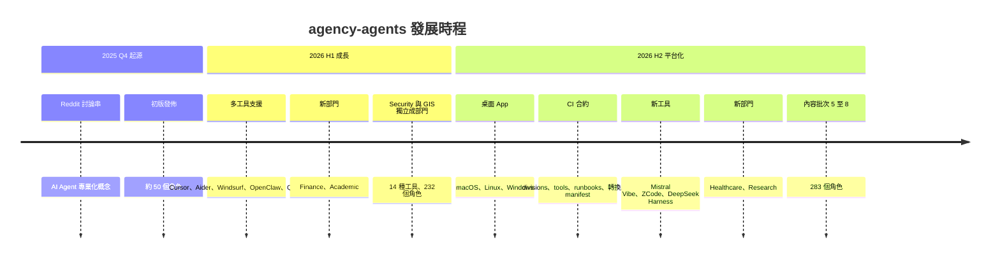

### 路線圖（上游 README，2026-11）

| 狀態 | 項目 |
|------|------|
| ✅ 完成 | 多 Agent 工作流範例（`examples/`） |
| ✅ 完成 | 多工具整合腳本（README 列 14 種；`tools.json` 實際 17 種） |
| ✅ 完成 | 原生桌面 App |
| 📋 計畫中 | 互動式 Agent 選擇器網頁、設計教學影片、社群市集、專案配對測驗、每週 Agent 專欄 |

## 1.8 本章審查與驗證清單

| 檢查項 | 驗證方式 | 通過標準 |
|--------|---------|---------|
| 導入動機是否明確 | 寫下 1～3 個要解決的痛點 | 每個痛點對應 §1.4 的一個角色組合 |
| 不適用場景是否排除 | 對照 §1.4 下表 | 法規判斷、機敏資料有替代流程 |
| 部門與數量是否最新 | `python -c` 讀 `divisions.json` 並計數（附錄 B.2） | 與 §1.5 一致或已更新 |
| 是否誤用翻譯版 | 比對翻譯版 Agent 數與上游 | 差異已記錄，並跑過 §4.10 checker |

---

# 2. 系統架構設計（Architecture）

## 2.1 整體架構圖

agency-agents 的架構可以分成五層：**來源層**（Agent Markdown 與四份合約檔）、**轉換層**（`convert.sh`）、**安裝層**（`install.sh` 或桌面 App）、**工具層**（各 AI 工具）、**協作層**（NEXUS runbook 與 Orchestrator）。

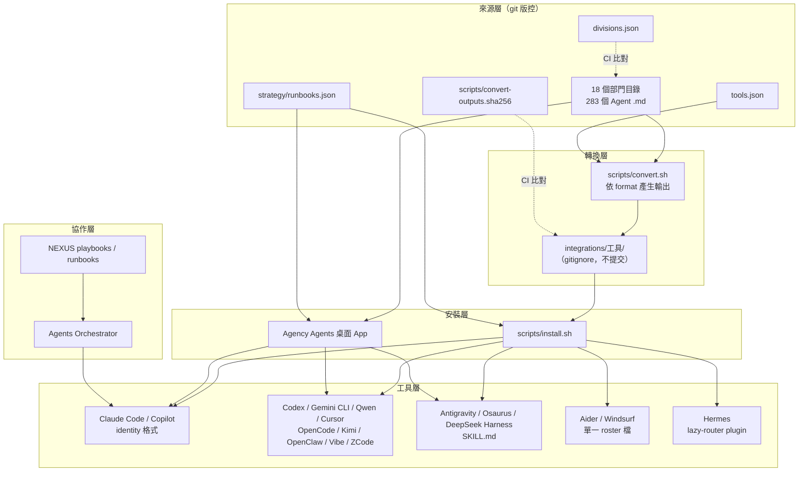

## 2.2 四份「單一真實來源」合約檔

上游用四份檔案定義「什麼是正確的」，並由 CI 強制檢查。企業 Fork 後若要新增部門或工具，**一定要同時改這些檔案**，否則 CI 會失敗。

| 合約檔 | 內容 | CI 檢查腳本 | 失敗條件（節錄） |
|--------|------|------------|-----------------|
| `divisions.json` | 部門鍵 → `label`、`icon`（Lucide 圖示名）、`color` | `scripts/check-divisions.sh` | 磁碟目錄、`convert.sh` 與 `lint-agents.sh` 的 `AGENT_DIRS`、`lint-agents.yml` 路徑過濾不一致；部門目錄內沒有任何含 frontmatter 的 `.md` |
| `tools.json` | 工具鍵 → `id`、`label`、`kebab`、`format`、`installKind`、`dest`、`detect`、`version`、`scope` | `scripts/check-tools.sh` | 與 `install.sh` 的 `ALL_TOOLS` 不一致；`convert.sh` 的工具不在清單中；缺少必要欄位；`installKind` 不是 `per-agent`／`roster`／`plugin` |
| `strategy/runbooks.json` | NEXUS 情境 → 團隊名單（以 Agent 檔名主幹為 slug） | `scripts/check-runbooks.sh` | JSON 不合法、slug 對不到 Agent 檔、`doc` 路徑不存在、runbook slug 重複 |
| `scripts/convert-outputs.sha256` | 每個 Agent、每個工具的轉換產物雜湊 | `scripts/test-convert-outputs.sh` | 轉換產物漂移（對貢獻者 PR 為警告性質，維護者合併時更新） |

不屬於部門的頂層目錄由 `check-divisions.sh` 的 `NON_DIVISION_DIRS` 排除：`examples`、`scripts`、`integrations`、`strategy`。

> **⚠️ v3.1 的錯誤更正**：舊版把 `installKind` 寫成 `copy`／`generate`／`merge`，並舉了 `targetDir` 欄位。這兩者在 `tools.json` 中都不存在。正確值是 `per-agent`（每個 Agent 一個檔或目錄）、`roster`（所有 Agent 合併成一個檔）、`plugin`（建置出的外掛，不能逐一渲染）。路徑欄位是 `dest.user` 與 `dest.project`。

### tools.json 實際結構

以下節錄 Claude Code 與 Osaurus 兩筆（格式化後）：

```json
{
  "tools": {
    "claude-code": {
      "id": "claudeCode",
      "label": "Claude Code",
      "kebab": "claude-code",
      "order": 1,
      "scope": { "user": true, "project": true },
      "detect": { "dirs": [".claude"], "agentsDir": ".claude/agents" },
      "version": { "bin": "claude", "args": ["--version"] },
      "format": "identity",
      "installKind": "per-agent",
      "slugFrom": "source",
      "dest": {
        "user": [".claude/agents/{slug}.md"],
        "project": [".claude/agents/{slug}.md"]
      }
    },
    "osaurus": {
      "id": "osaurus",
      "label": "Osaurus",
      "kebab": "osaurus",
      "order": 8,
      "scope": { "user": true, "project": false },
      "detect": { "dirs": [".osaurus"], "agentsDir": ".osaurus/skills" },
      "version": { "bin": "osaurus", "args": ["--version"] },
      "format": "skill-md",
      "installKind": "per-agent",
      "slugFrom": "name",
      "slugPrefix": "agency-",
      "dest": { "user": [".osaurus/skills/{slug}/SKILL.md"], "project": [] }
    }
  }
}
```

| 欄位 | 意義 | 範例 |
|------|------|------|
| `format` | 渲染器合約。**同一個 `format` 保證輸出位元組完全相同** | `skill-md` 由 Antigravity、Osaurus、DeepSeek Harness 共用 |
| `installKind` | 安裝機制 | `per-agent`／`roster`／`plugin` |
| `slugFrom` | 安裝檔名取自來源檔名主幹（`source`）或 `name` 欄位（`name`） | Claude Code 用 `source`，因此檔名為 `engineering-frontend-developer.md` |
| `slugPrefix` | 檔名前綴，避免與工具內建技能撞名 | `agency-frontend-developer` |
| `dest.user`／`dest.project` | 相對於家目錄／專案根目錄的安裝位置 | 空陣列表示不支援該範圍 |

## 2.3 轉換與安裝管線

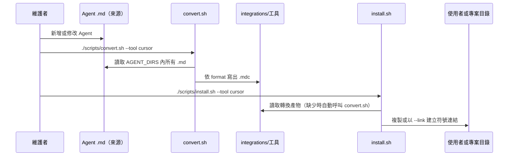

下表為 17 種工具的轉換結果，全部取自 `tools.json`（`~` 表示家目錄，`./` 表示專案根目錄）：

| # | 工具（`--tool`） | format | installKind | 使用者範圍 | 專案範圍 |
|--:|-----------------|--------|-------------|-----------|---------|
| 1 | `claude-code` | identity | per-agent | `~/.claude/agents/{slug}.md` | `./.claude/agents/{slug}.md` |
| 2 | `codex` | codex-toml | per-agent | `~/.codex/agents/{slug}.toml` | `./.codex/agents/{slug}.toml` |
| 3 | `gemini-cli` | gemini-md | per-agent | `~/.gemini/agents/{slug}.md` | `./.gemini/agents/{slug}.md` |
| 4 | `copilot` | identity | per-agent | `~/.copilot/agents/` 與 `~/.github/agents/` | `./.github/agents/{slug}.md` |
| 5 | `qwen` | qwen-md | per-agent | `~/.qwen/agents/{slug}.md` | `./.qwen/agents/{slug}.md` |
| 6 | `cursor` | cursor-mdc | per-agent | — | `./.cursor/rules/{slug}.mdc` |
| 7 | `opencode` | opencode-md | per-agent | `~/.config/opencode/agents/{slug}.md` | `./.opencode/agents/{slug}.md` |
| 8 | `osaurus` | skill-md | per-agent | `~/.osaurus/skills/agency-{slug}/SKILL.md` | — |
| 9 | `aider` | aider-conventions | roster | — | `./CONVENTIONS.md` |
| 10 | `antigravity` | skill-md | per-agent | `~/.gemini/config/skills/agency-{slug}/SKILL.md` | `./.agents/skills/agency-{slug}/SKILL.md` |
| 11 | `kimi` | kimi-agent | per-agent | `~/.config/kimi/agents/{slug}/agent.yaml` + `system.md` | — |
| 12 | `openclaw` | openclaw-workspace | per-agent | `~/.openclaw/agency-agents/{slug}/` 下 `SOUL.md`、`AGENTS.md`、`IDENTITY.md` | — |
| 13 | `windsurf` | windsurf-rules | roster | — | `./.windsurfrules` |
| 14 | `hermes` | hermes-router-plugin | plugin | `~/.hermes/plugins/agency-agents-router` | — |
| 15 | `vibe` | vibe-toml | per-agent | `~/.vibe/agents/{slug}.toml` + `~/.vibe/prompts/{slug}.md` | `./.vibe/` 同結構 |
| 16 | `zcode` | zcode-md | per-agent | `~/.zcode/agents/{slug}.md` | `./.zcode/agents/{slug}.md` |
| 17 | `dsh` | skill-md | per-agent | `~/.dsh/skills/agency-{slug}/SKILL.md` | `./.dsh/skills/agency-{slug}/SKILL.md` |

> **⚠️ 舊版路徑更正**：Antigravity 的使用者範圍路徑是 `~/.gemini/config/skills/`，不是 v3.1 寫的 `~/.gemini/antigravity/skills/`。

### 轉換產物不提交

`integrations/<tool>/` 目錄下**只有 `README.md` 會被提交**，其餘產物由 `.gitignore` 排除。上游會關閉「提交轉換產物」的 PR。企業 Fork 也應維持這個規則，改以 CI 產生並發佈（§8.5）。

## 2.4 Agent 檔的兩個語意群組

`convert.sh` 依 `##` 標題的關鍵字，把 Agent 內文拆成兩群。OpenClaw 會拆成兩個檔，其他工具也用這個分組判斷段落用途：

| 群組 | 標題關鍵字（不分大小寫） | OpenClaw 輸出 | 內容 |
|------|------------------------|--------------|------|
| Persona（他是誰） | `identity`、`learning & memory`、`communication`、`style`、`critical rules`、`rules you must follow` | `SOUL.md` | 身分、語氣、邊界 |
| Operations（他做什麼） | 其他所有標題（mission、deliverables、workflow、metrics…） | `AGENTS.md` | 任務、交付物、流程、指標 |

> **🔍 審查重點**：自訂 Agent 若把所有內容寫在一個 `## Overview` 標題下，OpenClaw 的 `SOUL.md` 會是空的，`lint-agents.sh` 也會發出 `no section headers map to SOUL.md` 警告。

## 2.5 NEXUS 協作層

`strategy/` 目錄不是部門，而是**多 Agent 協作的作業手冊**，名稱為 NEXUS：

| 文件 | 用途 |
|------|------|
| `QUICKSTART.md` | 三種模式的啟動範例 |
| `nexus-strategy.md` | 完整策略、各模式的 Agent 子集 |
| `EXECUTIVE-BRIEF.md` | 給主管的摘要 |
| `playbooks/phase-0-discovery.md` ～ `phase-6-operate.md` | 7 個階段的執行手冊：0 Intelligence & Discovery、1 Strategy & Architecture、2 Foundation & Scaffolding、3 Build & Iterate、4 Quality & Hardening、5 Launch & Growth、6 Operate & Evolve |
| `runbooks/scenario-*.md` + `runbooks.json` | 4 個情境：`startup-mvp`、`enterprise-feature`、`marketing-campaign`、`incident-response` |
| `coordination/handoff-templates.md` | 7 種交接範本：標準交接、QA PASS、QA FAIL、升級報告、階段閘門、Sprint、事件 |
| `coordination/agent-activation-prompts.md` | 各角色的啟動 prompt |

| NEXUS 模式 | 參與 Agent 數 | 適用 | 期程 |
|-----------|-------------|------|------|
| NEXUS-Full | 全部 | 企業產品全生命週期 | 12～24 週 |
| NEXUS-Sprint | 15～25 | 功能開發、MVP | 2～6 週 |
| NEXUS-Micro | 5～10 | 修 bug、單一交付物 | 1～5 天 |

NEXUS 的六個核心觀念：品質閘門（沒有證據不進下一階段）、Dev↔QA 迴圈（最多重試 3 次，第 3 次失敗升級給 Orchestrator）、結構化交接（不冷啟動）、Reality Checker 為最終品質權威（預設判定 `NEEDS WORK`）、Agents Orchestrator 控制流程、證據優先於宣稱。

## 2.6 多 Agent 協作模型

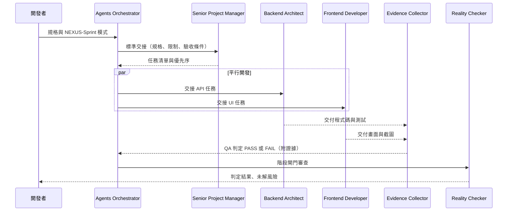

| 策略 | 說明 | 適用 |
|------|------|------|
| 串行（Sequential） | 前一角色的產出是下一角色的輸入 | 需求 → 設計 → 實作 |
| 平行（Parallel） | 互不相依的任務同時進行 | 前後端分離 |
| 審查迴圈（Review Loop） | Dev↔QA，最多 3 次 | 品質敏感的交付物 |
| 專家會診（Expert Panel） | 同一問題請多個角色從不同面向回答 | 架構決策、技術選型 |

> **⚠️ 不要預設就用多 Agent**：Anthropic 應用 AI 團隊在[《Building agents: When to fold subagents into your main agent loop》](https://claude.com/blog/building-agents-when-to-fold-subagents-into-your-main-agent-loop)指出，多數企業案例中「單一主 Agent + 技能」的品質優於拆成許多 subagent。每一次交接都會損失資訊。subagent 適合用在**驗證、平行處理、權限隔離**三種情況（詳見 §10.3）。

## 2.7 與企業系統的整合邊界

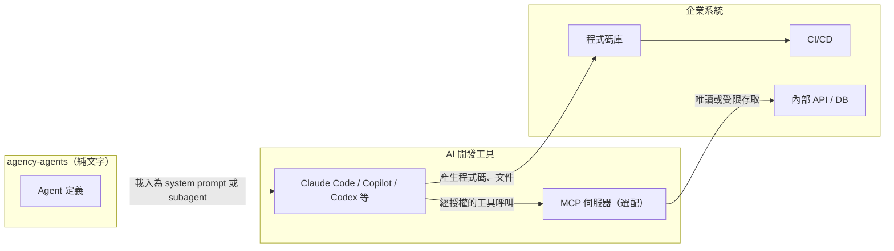

> **⚠️ 責任邊界**：agency-agents 本身**不執行任何程式、不連線任何系統**。所有存取能力都來自 AI 工具與你設定的 MCP 或工具權限。因此權限治理要在工具層做（§5.2 的 `tools` 白名單、§11.3 的最小代理權原則），不是在 Agent 檔裡寫「請不要刪除資料」就好。

## 2.8 本章審查與驗證清單

| 檢查項 | 驗證方式 | 通過標準 |
|--------|---------|---------|
| 合約檔是否同步 | 在 Fork 執行 `check-divisions.sh`、`check-tools.sh`、`check-runbooks.sh` ⏳ | 三支腳本結束碼皆為 0 |
| 文件中的工具路徑是否正確 | 以附錄 B.3 的腳本把 §2.3 表格與 `tools.json` 比對 🧪 | 17 筆全部一致 |
| 轉換產物是否誤提交 | `git ls-files integrations/ \| grep -v README.md` | 沒有輸出 |
| 自訂 Agent 是否有 Persona 與 Operations 標題 | §4.10 checker 的 W03／W04 | 無警告 |
| 是否誤用多 Agent | 對照 §2.6 的三種適用情況 | 每個 subagent 有明確理由 |

---

# 3. 安裝與環境建置（Installation & Setup）

## 3.1 前置需求

| 工具 | 版本建議 | 用途 | 備註 |
|------|---------|------|------|
| Git | 2.40+ | 取得與同步上游 | Windows 建議 Git for Windows（附 Git Bash） |
| Bash | 3.2+ | 執行 `convert.sh`、`install.sh` | 上游刻意相容 macOS 內建 bash 3.2；Windows 用 Git Bash 或 WSL2 |
| Python | 3.9+ | `check-agent-originality.sh`、`check-runbooks.sh`、`test-convert-outputs.sh` | 安裝本身不需要 Python |
| 目標 AI 工具 | 最新穩定版 | 實際使用 Agent | 安裝程式以「設定目錄是否存在」偵測工具 |

> **💡 不想碰終端機**：直接用 §3.4 的桌面 App。

## 3.2 取得專案

```bash
# 方式一：直接 clone（個人試用）
git clone https://github.com/msitarzewski/agency-agents.git
cd agency-agents

# 方式二：Fork 後 clone（企業團隊，方便客製與 review）
git clone https://github.com/your-org/agency-agents.git
cd agency-agents
git remote add upstream https://github.com/msitarzewski/agency-agents.git
git remote -v
```

> **⚠️ 換行字元**：上游以 `.gitattributes` 強制 LF，`lint-agents.sh` 遇到 CRLF 會直接報錯。Windows 使用者請**不要**對這個 repo 設定 `core.autocrlf=true`，或在 clone 後執行 `git config core.autocrlf false`。

## 3.3 目錄結構

```text
agency-agents/
├── academic/ … testing/        # 18 個部門目錄（以 divisions.json 為準）
│   └── engineering/
│       ├── engineering-frontend-developer.md
│       └── engineering-backend-architect.md
├── strategy/                   # NEXUS 協作手冊（不是部門）
│   ├── QUICKSTART.md
│   ├── nexus-strategy.md
│   ├── EXECUTIVE-BRIEF.md
│   ├── playbooks/              # phase-0 ~ phase-6
│   ├── runbooks/               # 4 個情境
│   ├── runbooks.json           # 情境 → 團隊名單
│   └── coordination/           # 交接範本、啟動 prompt
├── examples/                   # 多 Agent 工作流範例（含 workflow-with-memory.md）
├── integrations/               # 每個工具一個資料夾，只提交 README.md
│   └── mcp-memory/             # MCP 記憶整合範例
├── scripts/
│   ├── convert.sh              # 轉換
│   ├── install.sh              # 安裝
│   ├── lib.sh                  # 共用函式（fence 判斷等）
│   ├── lint-agents.sh          # Agent 格式檢查
│   ├── check-divisions.sh      # 部門合約
│   ├── check-tools.sh          # 工具合約
│   ├── check-runbooks.sh       # runbook 合約
│   ├── check-agent-originality.sh  # 抄襲檢查
│   ├── convert-outputs.sha256  # 轉換產物 manifest
│   ├── test-*.sh               # 30 多支安裝與轉換測試
│   └── agents-to-install.example   # --agents-file 範例
├── .github/workflows/          # check-divisions、check-runbooks、check-tools、
│                               # check-hermes-config-rewrite、lint-agents、test-install
├── divisions.json
├── tools.json
├── CONTRIBUTING.md / CONTRIBUTING_zh-CN.md
├── SECURITY.md
└── README.md
```

## 3.4 方式一：桌面 App（最簡單）

[Agency Agents App](https://agencyagents.app) 是原生桌面程式，不需 clone，可瀏覽完整名冊、一鍵安裝到工具，並自動更新。

```bash
# macOS（Homebrew cask）
brew install --cask msitarzewski/agency-agents/agency-agents
```

Windows 與 Linux 請從 [GitHub Releases](https://github.com/msitarzewski/agency-agents-app/releases/latest) 下載。

| 項目 | 桌面 App | CLI（`install.sh`） |
|------|---------|--------------------|
| App 可安裝的工具 | README 列出：Claude Code、Cursor、Codex、Gemini CLI、OpenCode、Qwen、Osaurus | 全部 17 種 |
| `plugin` 類工具（Hermes） | 不支援（`tools.json` 註明為 CLI 專用） | 支援 |
| 選擇性安裝 | 圖形介面勾選 | `--division`、`--agent`、`--agents-file` |
| 自動化／CI | 不適合 | 適合 |
| 企業客製 Fork | 讀上游名冊 | 讀你的 Fork |

> **🔍 企業建議**：有客製 Agent 的團隊請用 CLI 從**自己的 Fork** 安裝。App 讀的是上游名冊，不會包含你的內部 Agent。

## 3.5 方式二：CLI 安裝（install.sh 完整參考）

```bash
# 1. 產生所有工具的轉換檔（install.sh 偵測到缺檔時也會自動呼叫）
./scripts/convert.sh

# 2. 互動式安裝：在終端機執行時預設開啟精靈，自動偵測已安裝的工具
./scripts/install.sh

# 3. 非互動式：安裝到所有偵測到的工具
./scripts/install.sh --no-interactive
```

### 參數總表（取自 install.sh 的 usage 區塊）

| 類別 | 參數 | 說明 |
|------|------|------|
| 選擇 | `--tool <a,b>` | 只安裝到這些工具；可逗號分隔，如 `--tool claude-code,cursor` |
| 選擇 | `--division <a,b>` | 只安裝這些部門 |
| 選擇 | `--agent <id,id>` | 只安裝這些 Agent；可用安裝 slug、顯示名稱或檔名主幹（如 `engineering-frontend-developer`） |
| 選擇 | `--agents-file <path>` | 從檔案讀取 Agent 清單，一行一個，可用 `#` 註解 |
| 模式 | `--link` | 建立符號連結而非複製；上游更新會直接生效 |
| 模式 | `--path <dir>` | 覆寫安裝目錄（單一目的地），優先於環境變數 |
| 行為 | `--interactive` / `--no-interactive` | 強制開啟或略過精靈 |
| 行為 | `--no-convert` | 缺少轉換檔時不要自動執行 `convert.sh` |
| 行為 | `--dry-run` | 只列出計畫，不寫任何檔案 |
| 行為 | `--list [tools\|teams\|agents]` | 列出後結束；`teams` 會顯示每個部門的 Agent 數 |
| 行為 | `--parallel`、`--jobs N` | 多工具平行安裝；`N` 預設為 `nproc` 或 4 |
| 說明 | `--help` | 顯示說明 |

三類選擇條件可以自由組合，沒有指定就代表「全部」。

### 各工具安裝範例

```bash
./scripts/install.sh --tool claude-code
./scripts/install.sh --tool copilot
./scripts/install.sh --tool codex
./scripts/install.sh --tool gemini-cli
./scripts/install.sh --tool qwen
./scripts/install.sh --tool antigravity
./scripts/install.sh --tool osaurus
./scripts/install.sh --tool kimi
./scripts/install.sh --tool openclaw
./scripts/install.sh --tool hermes
./scripts/install.sh --tool vibe
./scripts/install.sh --tool dsh
./scripts/install.sh --tool zcode

# 以下工具安裝到「目前目錄」，請先 cd 到專案根目錄
cd /your/project
/path/to/agency-agents/scripts/install.sh --tool cursor
/path/to/agency-agents/scripts/install.sh --tool opencode
/path/to/agency-agents/scripts/install.sh --tool aider
/path/to/agency-agents/scripts/install.sh --tool windsurf
```

## 3.6 選擇性安裝

```bash
# 依部門
./scripts/install.sh --tool claude-code --division engineering,security,testing

# 依 Agent（三種寫法皆可）
./scripts/install.sh --tool cursor --agent frontend-developer,ui-designer
./scripts/install.sh --tool cursor --agent "Frontend Developer"
./scripts/install.sh --tool cursor --agent engineering-frontend-developer

# 依清單檔
./scripts/install.sh --tool claude-code --agents-file team.txt

# 先看會裝哪些（不寫入）
./scripts/install.sh --tool opencode --division engineering --dry-run

# 列出部門與數量
./scripts/install.sh --list teams
```

### 依 NEXUS runbook 安裝整個團隊

`runbooks.json` 的團隊名單用的是 Agent 檔名主幹，`--agents-file` 也接受這種寫法，所以可以直接把 runbook 轉成清單。上游 README 提供一行 Python。本手冊提供加強版 `runbook_team.py`（附錄 B.4）。它會**同時檢查每個 slug 都存在**，並在清單中保留群組與啟用時機的註解：

```bash
python3 runbook_team.py . startup-mvp > team.txt
./scripts/install.sh --tool claude-code --agents-file team.txt --dry-run
./scripts/install.sh --tool claude-code --agents-file team.txt
```

🧪 實際輸出（`startup-mvp`，18 位成員）：

```text
# Startup MVP Build (NEXUS-Sprint, 4-6 weeks)
# --- Core Team (activation: always)
agents-orchestrator
project-manager-senior
product-sprint-prioritizer
design-ux-architect
engineering-frontend-developer
engineering-backend-architect
engineering-devops-automator
testing-evidence-collector
testing-reality-checker
# --- Growth Team (activation: week 3+)
marketing-growth-hacker
marketing-content-creator
marketing-social-media-strategist
# --- Support Team (activation: as needed)
design-brand-guardian
support-analytics-reporter
engineering-rapid-prototyper
engineering-ai-engineer
testing-performance-benchmarker
support-infrastructure-maintainer
```

> **⚠️ OpenCode 上限**：OpenCode 目前只會註冊約 119 個 Agent，多出的會被**靜默丟棄**（[anomalyco/opencode#27988](https://github.com/anomalyco/opencode/issues/27988)）。安裝程式在選擇超過上限時會警告。請用 `--division` 或 runbook 清單控制數量。

## 3.7 以環境變數覆寫安裝路徑

`install.sh` 會先讀環境變數，沒有才用預設路徑。`--path` 的優先序又高於環境變數。

| 環境變數 | 影響工具 |
|---------|---------|
| `CLAUDE_CONFIG_DIR` | Claude Code |
| `COPILOT_AGENT_DIR` | GitHub Copilot |
| `CURSOR_RULES_DIR` | Cursor |
| `GEMINI_AGENTS_DIR` | Gemini CLI |
| `OPENCODE_AGENTS_DIR` | OpenCode |
| `OPENCLAW_DIR` | OpenClaw |
| `QWEN_AGENTS_DIR` | Qwen Code |
| `ZCODE_AGENTS_DIR` | ZCode |
| `CODEX_AGENTS_DIR` | Codex |
| `OSAURUS_SKILLS_DIR` | Osaurus |
| `HERMES_HOME`、`HERMES_PLUGIN_DIR` | Hermes |
| `VIBE_HOME` | Mistral Vibe |
| `DSH_HOME`、`DSH_SKILLS_DIR` | DeepSeek Harness（`DSH_SKILLS_DIR` 優先） |

```bash
# 範例：安裝到專案範圍而不是家目錄（DeepSeek Harness）
cd /your/project
DSH_SKILLS_DIR=.dsh/skills /path/to/agency-agents/scripts/install.sh --tool dsh

# 範例：在暫存目錄試裝，確認檔案數量後再正式安裝
./scripts/install.sh --tool claude-code --division security --path /tmp/aa-try
ls /tmp/aa-try | wc -l
```

## 3.8 複製（預設）與符號連結（`--link`）

| 面向 | 複製 | `--link` |
|------|------|----------|
| 上游更新 | 要重新安裝 | `git pull` 後立即生效 |
| 可重現性 | 高：安裝當下即凍結 | 低：同一台機器隨 repo 狀態改變 |
| 適合 | 企業正式環境、需鎖版本 | 個人開發、Agent 作者本人 |
| Windows | 正常 | 需要開發人員模式或系統管理員權限才能建立 symlink ⏳ |

> **🔍 企業建議**：正式環境用複製，並記錄安裝時的上游 commit（§9.4）。

## 3.9 Windows 環境

```powershell
# 方式一：透過 Git Bash 執行官方腳本（在 repo 根目錄）
& "C:\Program Files\Git\bin\bash.exe" -c "./scripts/install.sh --tool claude-code --division engineering --no-interactive"

# 方式二：手動複製 identity 格式（Claude Code、Copilot 不需轉換）
New-Item -ItemType Directory -Force "$env:USERPROFILE\.claude\agents" | Out-Null
Copy-Item engineering\*.md "$env:USERPROFILE\.claude\agents\" -Force

# 確認換行字元為 LF（輸出 0 表示沒有 CRLF）
(Get-Content -Raw engineering\engineering-code-reviewer.md) -split "`r`n" | Measure-Object | ForEach-Object { $_.Count - 1 }
```

> **⚠️ 手動複製的限制**：只有 `identity` 格式（Claude Code、Copilot）可以直接複製原始檔。其他工具必須先跑 `convert.sh`，否則格式不對，工具會讀不到或讀錯。

## 3.10 平行轉換與安裝

```bash
./scripts/convert.sh --parallel             # 平行轉換所有工具（輸出順序可能不同）
./scripts/convert.sh --parallel --jobs 8
./scripts/install.sh --no-interactive --parallel
./scripts/install.sh --no-interactive --parallel --jobs 4
```

上游有 `test-install-parallel-logs.sh` 與 `test-convert-parallel-failure.sh` 測試平行模式下的日誌與失敗處理：單一工具失敗不會吞掉其他工具的結果。

## 3.11 驗證安裝

```bash
# 1. 檔案數量：Claude Code 安裝 engineering 部門後應為 66（再加上原有的自訂 Agent）
ls ~/.claude/agents/engineering-*.md | wc -l

# 2. 抽查內容：frontmatter 必須以 --- 開頭，並有 name 與 description
head -5 ~/.claude/agents/engineering-code-reviewer.md

# 3. Skill 類工具：資料夾名稱帶 agency- 前綴
ls ~/.osaurus/skills | head

# 4. 實際呼叫（Claude Code）
claude -p "List the subagents you can delegate to whose name contains Reviewer."
```

> **🔍 驗證重點**：數量對了不代表內容對了。至少抽查 3 個檔案，確認 (1) 換行是 LF；(2) `description` 沒有出現 `>-` 之類的 YAML 殘留；(3) 工具真的能列出該 Agent。

## 3.12 本章審查與驗證清單

| 檢查項 | 驗證方式 | 通過標準 |
|--------|---------|---------|
| 換行字元 | `git config core.autocrlf` 與 §3.9 的 CRLF 計數 | `false`；計數為 0 |
| 安裝前預覽 | `--dry-run` | 計畫的檔案數符合預期 |
| 安裝數量 | §3.11 步驟 1 | 與 `--list teams` 的數字一致 |
| runbook 清單完整 | `runbook_team.py` 結束碼 🧪 | 0（沒有缺員） |
| OpenCode 上限 | 安裝數量 | ≤ 119 |
| 工具能看到 Agent | §3.11 步驟 4 | 列出的名稱包含剛安裝的 Agent |
| 正式環境可重現 | 記錄上游 commit 與安裝參數 | 寫入 §9.4 的安裝紀錄 |

---

# 4. Agent 結構解析（Agent Design）

## 4.1 Agent 檔案的完整結構

每個 Agent 是一個 UTF-8、LF 換行的 Markdown 檔，由 **YAML frontmatter** 與 **Markdown 內文**組成。以下是上游 CONTRIBUTING.md 的官方骨架（中文註解為本手冊所加）：

```markdown
---
name: Agent Name                       # 必填：顯示名稱
description: One-line description      # 必填：單行，工具用它決定何時委派
color: colorname or "#hexcode"         # 必填：#RRGGBB 或已知色名（§4.3）
emoji: 🎯                              # 選填
vibe: One-line personality hook        # 選填：一句話人格鉤子
services:                              # 選填：只有依賴外部服務時才寫
  - name: Service Name
    url: https://service-url.com
    tier: free                         # free / freemium / paid
---

# Agent Name

## 🧠 Your Identity & Memory
- **Role**: 角色定位
- **Personality**: 個性與溝通風格
- **Memory**: 會記住、會學習什麼
- **Experience**: 領域經驗與觀點

## 🎯 Your Core Mission
- 主要職責 1（附明確交付物）
- **Default requirement**: 永遠要做到的最佳實務

## 🚨 Critical Rules You Must Follow
領域規則與限制

## 📋 Your Technical Deliverables
程式碼範例、範本、框架、文件

## 🔄 Your Workflow Process
1. Phase 1: Discovery and research
2. Phase 2: Planning and strategy
3. Phase 3: Execution and implementation
4. Phase 4: Review and optimization

## 💭 Your Communication Style
語氣、範例句型

## 🔄 Learning & Memory
從成功模式、失敗、回饋中學到什麼

## 🎯 Your Success Metrics
可量化的成果

## 🚀 Advanced Capabilities
進階技巧
```

## 4.2 Frontmatter 規格（以 lint-agents.sh 為準）

| 欄位 | 必填 | lint 結果 | 規則 | 範例 |
|------|:----:|----------|------|------|
| `name` | ✅ | 缺少或空值 → **ERROR** | 單行字串；Claude Code 允許空白，最長 256 字元，不可含 `:` | `Code Reviewer` |
| `description` | ✅ | 缺少或空值 → **ERROR** | **單行** scalar；工具用它判斷何時委派，要寫出「什麼時候該叫我」 | `Expert code reviewer who provides constructive, actionable feedback...` |
| `color` | ✅ | 缺少、空值或未知色名 → **ERROR** | `#RRGGBB` 或 §4.3 的已知色名 | `purple`、`"#3B82F6"` |
| `emoji` | — | 不檢查 | 單一 emoji | `👁️` |
| `vibe` | — | 不檢查 | 一句話人格鉤子 | `Reviews code like a mentor, not a gatekeeper.` |
| `services` | — | 不檢查 | 外部服務清單：`name`、`url`、`tier` | 見 §4.2.1 |
| 任何欄位用 folded scalar（`>`、`>-`、`>+`） | — | **ERROR** | 轉換器只讀單行或加引號的 scalar，folded 語法會把 `>-` 漏進產物 | ❌ `description: >-` |

> **⚠️ 不要在上游 Agent 加工具專屬欄位**：上游曾經移除 Agent frontmatter 中「非標準的 `tools` 鍵」。像 Claude Code 的 `tools`、`model`、`effort` 這類欄位，請只加在**企業專案層的副本**（§5.2.4），不要提交回共用來源，以免其他 16 種工具的轉換器出錯。

### 4.2.1 `services` 欄位

```yaml
services:
  - name: Vercel
    url: https://vercel.com
    tier: freemium
```

上游對外部服務的四條規則：

1. 在 frontmatter 宣告依賴。
2. **Agent 必須能獨立存在**：拿掉 API 呼叫，仍然是有用的人格、流程與專業知識。
3. 不要複製供應商文件，引用即可。
4. 優先選有免費方案的服務，方便貢獻者測試。

判斷標準：這個 Agent 是「為使用者解決問題，剛好用到某服務」，還是「某服務的快速入門指南，穿上 Agent 的外衣」？前者歡迎，後者會被關閉。

## 4.3 `color` 規則

`#RRGGBB` 一定可用。色名則必須是 `convert.sh` 的 `resolve_opencode_color()` 認得的名字，否則 OpenCode 會**靜默**變成灰色。`lint-agents.sh` 直接從轉換器讀出這份清單，遇到未知色名就報錯。

| 已知色名（2026-11-08） |
|------------------------|
| `cyan`、`blue`、`green`、`red`、`purple`、`orange`、`teal`、`indigo`、`pink`、`gold`、`amber`、`neon-green`、`neon-cyan`、`metallic-blue`、`yellow`、`violet`、`rose`、`lime`、`gray`、`fuchsia`、`slate`、`navy` |

> **💡 跨工具注意**：Claude Code 的 subagent `color` 只接受 `red`、`blue`、`green`、`yellow`、`purple`、`orange`、`pink`、`cyan`，其他值不會報錯但不會套用。想在 Claude Code 中看到顏色，請優先選這 8 個色名。

## 4.4 章節標題與轉換的關係

lint 會**警告**缺少三個建議章節（不分大小寫，在內文中出現該字串即可）：`Identity`、`Core Mission`、`Critical Rules`。另外，§2.4 的 Persona 與 Operations 群組各至少要有一個 `##` 標題，否則會出現 `no section headers map to SOUL.md`（或 `AGENTS.md`）警告。

| 建議標題 | 群組 | 為什麼重要 |
|---------|------|-----------|
| `## 🧠 Your Identity & Memory` | Persona | 決定專業深度與判斷立場 |
| `## 💭 Your Communication Style` | Persona | 決定產出的語氣與格式 |
| `## 🚨 Critical Rules You Must Follow` | Persona | **最重要的品質護欄**，審查時第一個看 |
| `## 🎯 Your Core Mission` | Operations | 任務邊界 |
| `## 📋 Your Technical Deliverables` | Operations | 讓輸出格式可預期 |
| `## 🔄 Your Workflow Process` | Operations | 讓人可以逐步驗收 |
| `## 🎯 Your Success Metrics` | Operations | 讓人知道什麼叫「做完」 |

## 4.5 程式碼區塊的巢狀規則

Agent 經常在範本中示範 Markdown，而 Markdown 裡又有程式碼區塊。**Markdown 沒有「同長度巢狀」**，內層的 ```` ```bash ```` 不會被當成內層開頭，下一個裸 ```` ``` ```` 會直接結束外層。lint 會把這種情況報為錯誤。

❌ 錯誤寫法（逐行說明，外層與內層都是 3 個反引號）：

| 行 | 內容 | GitHub 與轉換器的解讀 |
|---:|------|---------------------|
| 1 | 三個反引號 + `markdown` | 開啟外層區塊 |
| 2 | `## Deploy checklist` | 區塊內文字 |
| 3 | 三個反引號 + `bash` | **仍是區塊內文字**（同長度不能巢狀；lint 報 E08） |
| 4 | `./deploy.sh` | 區塊內文字 |
| 5 | 三個反引號 | **關閉外層區塊**（本來想關閉內層） |
| 6 | 三個反引號 | 開啟一個新區塊，直到檔案結尾都沒關閉（lint 報 E09） |

✅ 解法一：外層改用 4 個反引號，內層維持 3 個（上游多數 Agent 採用）。

✅ 解法二：外層用 3 個反引號，內層改用波浪號 `~~~`（不同字元的 fence 互不干擾）：

```markdown
## Deploy checklist
~~~bash
./deploy.sh
~~~
```

本手冊的範例一律採用解法二，以相容 repo 內的 Markdown 檢查工具。

> **⚠️ 不要用零寬空格**：v3.1 用「零寬空格 + 反引號」偽裝內層 fence。畫面看起來正常，但複製貼上的程式碼會帶著看不見的字元，工具也讀不到正確的區塊。v4.0 已全部改用上述兩種合法解法。

未關閉的程式碼區塊會讓之後的所有內容在 GitHub 與每個轉換產物中都變成程式碼，lint 會報 `code block is never closed`。

## 4.6 Qwen Code 保留的 placeholder

Qwen Code 啟動 SubAgent 時會替換 `${task_prompt}`、`${hook_context}`、`${external_inputs_override}` 三個變數。Agent 內文若出現這三個字串，會被**靜默替換**，所以 lint 視為錯誤。其他 `${name}` 形式自 Qwen Code 0.25.1 起會原樣保留（較舊版本會拒絕所有無法填入的變數）。

## 4.7 Persona 設計原則

### ✅ 好的 Persona

```markdown
## 🧠 Your Identity & Memory
- **Role**: Backend architect for high-traffic payment systems (10K+ RPS)
- **Personality**: Skeptical of premature optimization, intolerant of missing timeouts
- **Memory**: You remember which retries caused duplicate charges in past incidents
- **Experience**: You have run postmortems where a missing idempotency key cost real money
```

### ❌ 不良 Persona

```markdown
## Identity
You are a helpful backend developer.
```

| 設計要素 | 好的寫法要回答的問題 | 🔍 審查方法 |
|---------|-------------------|------------|
| 角色定位 | 在哪個領域、什麼規模 | 能否推導出 3 條以上具體判斷規則 |
| 個性 | 對什麼特別嚴格 | 嚴格的點是否與 Critical Rules 對應 |
| 記憶 | 從哪些失敗學到什麼 | 是否為可驗證的模式，而非空泛「很有經驗」 |
| 經驗 | 看過什麼樣的事故 | 經驗是否支持 Success Metrics 的門檻 |

## 4.8 Workflow 與交付物設計

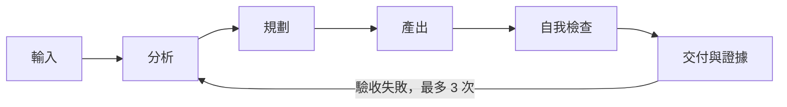

每個 Workflow 步驟都應該定義下列四項，否則人無法逐步驗收：

| 項目 | 範例（Code Reviewer 的「安全檢查」步驟） |
|------|----------------------------------------|
| 輸入 | PR diff、相依套件清單 |
| 動作 | 依 OWASP Top 10:2025 逐項比對 |
| 輸出 | 發現表：嚴重度、檔案:行號、問題、修正建議 |
| 完成條件 | 每一列都有檔案:行號；無發現時明確寫「未發現」並列出檢查過的類別 |

### 任務輸入格式（給 Agent 的 prompt）

```markdown
Use the Backend Architect agent.

## Task
Design the login API.

## Requirements
- Username/password and OAuth2 (Google, GitHub)
- JWT access token 15 min, refresh token 7 days

## Constraints
- Java 25, Spring Boot 4.x, PostgreSQL 18, Redis 8
- Response time p95 < 200 ms at 1,000 RPS

## Expected Output
1. OpenAPI 3.1 snippet
2. DDL
3. Sequence diagram (Mermaid)
4. Threat list (STRIDE) with mitigations

## Definition of Done
- Every endpoint has request validation and error schema
- No library outside the constraints list
```

> **🔍 為什麼要寫 Definition of Done**：它讓你在驗收時有可以逐條打勾的標準，而不是憑感覺判斷「好像不錯」。

## 4.9 完整範例：企業版 API Reviewer

以下 Agent 是本手冊驗證用的正例（附錄 B 的 `pos-good.md`），通過全部 lint 規則：

```markdown
---
name: Enterprise API Reviewer
description: Reviews REST endpoints for contract, security and error-handling defects
color: "#3B82F6"
emoji: 🔎
vibe: Finds the unbounded page size before your DBA does
---
# Enterprise API Reviewer

## 🧠 Your Identity & Memory
- **Role**: Senior API reviewer for regulated financial systems
- **Personality**: Direct, evidence-driven, explains every finding with a reason
- **Memory**: Remembers recurring API anti-patterns seen in this codebase

## 🎯 Your Core Mission
- Review every REST endpoint for contract, security and error-handling defects
- **Default requirement**: every finding cites file, line and a fix

## 🚨 Critical Rules You Must Follow
1. Never approve an endpoint without input validation.
2. Never invent a library or API that is not in the dependency list.

## 📋 Your Technical Deliverables
~~~markdown
| # | Severity | File:Line | Finding | Fix |
|---|----------|-----------|---------|-----|
~~~

## 🔄 Your Workflow Process
1. Read the OpenAPI contract. 2. Read the controller. 3. Report findings.

## 💭 Your Communication Style
- "Blocking: CustomerController.java:42 accepts an unbounded page size."

## 🎯 Your Success Metrics
- Zero blocking findings escape to production in a quarter.
```

> **⚠️ v3.1 的範例錯誤**：舊版 §4.6 的 Code Reviewer 範例沒有 `color` 欄位，依上游 lint 規則會直接報錯。上游實際的 Code Reviewer 位於 `engineering/engineering-code-reviewer.md`，`color: purple`。

## 4.10 離線驗證工具：check_agent.py

上游的 `lint-agents.sh` 需要 bash，且會掃整個 repo。本手冊提供一支**對照上游規則**的 Python 版本，方便在 Windows 或 CI 中檢查單一檔案，也能用來驗收「AI 依本章指引產出的 Agent」。

| 規則代碼 | 等級 | 對應上游檢查 |
|---------|------|-------------|
| E01 | ERROR | CRLF 換行 |
| E02、E03 | ERROR | frontmatter 開頭／結尾 `---`、空的 frontmatter |
| E04 | ERROR | folded scalar |
| E05 | ERROR | 缺少或空的 `name`、`description`、`color` |
| E06 | ERROR | 未知色名 |
| E07 | ERROR | Qwen 保留 placeholder |
| E08、E09 | ERROR | 巢狀 fence 長度不足、區塊未關閉 |
| W01 | WARN | 缺少 Identity／Core Mission／Critical Rules |
| W02 | WARN | 內文少於 50 字 |
| W03、W04 | WARN | 沒有對應 SOUL.md／AGENTS.md 的標題 |

```python
#!/usr/bin/env python3
"""check_agent.py — 離線檢查 agency-agents 格式的 Agent Markdown 檔。

規則對照上游 scripts/lint-agents.sh（2026-11-08, 8ae6164）：
  E01 CRLF 換行（上游要求 LF）
  E02 缺少 frontmatter 開頭或結尾 ---
  E03 frontmatter 為空
  E04 使用 folded scalar（key: > / >- / >+）
  E05 缺少必要欄位 name / description / color，或值為空
  E06 color 不是 #RRGGBB，也不在 convert.sh 已知色名中
  E07 內文使用 Qwen Code 保留 placeholder
  E08 巢狀程式碼區塊長度不足（內層帶 info string 的 fence 不能關閉外層）
  E09 程式碼區塊未關閉
  W01 缺少建議章節 Identity / Core Mission / Critical Rules
  W02 內文少於 50 字
  W03 沒有任何 ## 標題對應到 SOUL.md（persona）
  W04 沒有任何 ## 標題對應到 AGENTS.md（operations）

用法：python check_agent.py FILE [FILE ...]
結束碼：0 = 無錯誤（可有警告）；1 = 至少一個錯誤
"""
import re
import sys

REQUIRED = ("name", "description", "color")
RECOMMENDED = ("Identity", "Core Mission", "Critical Rules")
# 與 scripts/convert.sh 的 resolve_opencode_color() 同步
KNOWN_COLORS = {
    "cyan", "blue", "green", "red", "purple", "orange", "teal", "indigo",
    "pink", "gold", "amber", "neon-green", "neon-cyan", "metallic-blue",
    "yellow", "violet", "rose", "lime", "gray", "fuchsia", "slate", "navy",
}
QWEN_RESERVED = ("${task_prompt}", "${hook_context}", "${external_inputs_override}")
# convert.sh 把下列關鍵字的 ## 章節放進 SOUL.md，其餘放進 AGENTS.md
SOUL_RE = re.compile(
    r"identity|learning\s*&\s*memory|communication|style|critical rules|rules you must follow",
    re.I,
)
FOLDED_RE = re.compile(r"^\s*[\w-]+:\s*>([-+][1-9]?|[1-9][-+]?)?(\s+#.*)?\s*$")
FENCE_RE = re.compile(r"^( {0,3})(`{3,}|~{3,})(.*)$")


def field(fm_lines, key):
    for ln in fm_lines:
        if ln.startswith(key + ":"):
            return ln[len(key) + 1:].strip().strip("'\"")
    return None


def check(path):
    errs, warns = [], []
    raw = open(path, "rb").read()
    if b"\r\n" in raw:
        errs.append("E01 CRLF line endings detected (upstream requires LF)")
        raw = raw.replace(b"\r\n", b"\n")
    lines = raw.decode("utf-8").split("\n")

    if not lines or lines[0].strip() != "---":
        return ["E02 missing frontmatter opening ---"], warns
    try:
        end = next(i for i in range(1, len(lines)) if lines[i].strip() == "---")
    except StopIteration:
        return ["E02 missing frontmatter closing ---"], warns
    fm = lines[1:end]
    if not any(l.strip() for l in fm):
        return ["E03 empty or malformed frontmatter"], warns

    if any(FOLDED_RE.match(l) for l in fm):
        errs.append("E04 folded YAML frontmatter is unsupported - use a single-line scalar")

    for key in REQUIRED:
        val = field(fm, key)
        if val is None:
            errs.append(f"E05 missing frontmatter field '{key}'")
        elif not val:
            errs.append(f"E05 frontmatter field '{key}' must not be empty")

    color = (field(fm, "color") or "").lower()
    if color and not re.fullmatch(r"#?[0-9a-f]{6}", color) and color not in KNOWN_COLORS:
        errs.append(f"E06 color '{color}' is not #RRGGBB or a known name")

    body_lines = lines[end + 1:]
    body = "\n".join(body_lines)
    for token in QWEN_RESERVED:
        if token in body:
            errs.append(f"E07 uses Qwen Code reserved placeholder {token}")

    # 逐行走訪：略過程式碼區塊內的 ## 行，並檢查巢狀與未關閉
    marker, flen, open_at = None, 0, 0
    soul = agents = 0
    headers = []
    for idx, line in enumerate(body_lines, start=end + 2):
        m = FENCE_RE.match(line)
        if marker:
            if m and m.group(2)[0] == marker and len(m.group(2)) >= flen:
                if m.group(3).strip():
                    errs.append(
                        f"E08 line {idx}: '{line.strip()}' inside block opened at line "
                        f"{open_at} does not nest - use a longer outer fence"
                    )
                else:
                    marker = None
            continue
        if m:
            marker, flen, open_at = m.group(2)[0], len(m.group(2)), idx
            continue
        if re.match(r"^##\s", line):
            headers.append(line)
            if SOUL_RE.search(line):
                soul += 1
            else:
                agents += 1
    if marker:
        errs.append(f"E09 line {open_at}: code block is never closed")

    # 上游以「不分大小寫的子字串」判斷建議章節是否存在
    for sec in RECOMMENDED:
        if sec.lower() not in body.lower():
            warns.append(f"W01 missing recommended section '{sec}'")
    if len(body.split()) < 50:
        warns.append("W02 body seems very short (< 50 words)")
    if soul == 0:
        warns.append("W03 no section headers map to SOUL.md")
    if agents == 0:
        warns.append("W04 no section headers map to AGENTS.md")
    return errs, warns


def main(argv):
    if not argv:
        print(__doc__)
        return 2
    total_e = total_w = 0
    for p in argv:
        errs, warns = check(p)
        for e in errs:
            print(f"ERROR {p}: {e}")
        for w in warns:
            print(f"WARN  {p}: {w}")
        total_e += len(errs)
        total_w += len(warns)
    print(f"Results: {total_e} error(s), {total_w} warning(s) in {len(argv)} files.")
    return 1 if total_e else 0


if __name__ == "__main__":
    sys.exit(main(sys.argv[1:]))
```

### 驗證結果

🧪 **對上游全部 283 個 Agent 執行**：0 個錯誤，58 個警告（全為 W01，上游 CI 也只把 W01 當警告）。這證明 checker 的錯誤判定與上游 CI 一致，不會誤殺合格檔案。

🧪 **對 12 個正例／反例 fixture 執行**（每個反例只違反一條規則）：

````text
ERROR neg-e01-crlf.md: E01 CRLF line endings detected (upstream requires LF)
ERROR neg-e02-no-frontmatter.md: E02 missing frontmatter opening ---
ERROR neg-e04-folded.md: E04 folded YAML frontmatter is unsupported - use a single-line scalar
ERROR neg-e05-empty-name.md: E05 frontmatter field 'name' must not be empty
ERROR neg-e05-missing-color.md: E05 missing frontmatter field 'color'
ERROR neg-e06-bad-color.md: E06 color 'corporate-blue' is not #RRGGBB or a known name
ERROR neg-e07-qwen-placeholder.md: E07 uses Qwen Code reserved placeholder ${task_prompt}
ERROR neg-e08-bad-nesting.md: E08 line 40: '```bash' inside block opened at line 38 does not nest - use a longer outer fence
ERROR neg-e08-bad-nesting.md: E09 line 43: code block is never closed
ERROR neg-e09-unclosed.md: E09 line 38: code block is never closed
WARN  warn-w01-w02-short.md: W01 missing recommended section 'Identity'
WARN  warn-w01-w02-short.md: W01 missing recommended section 'Core Mission'
WARN  warn-w01-w02-short.md: W01 missing recommended section 'Critical Rules'
WARN  warn-w01-w02-short.md: W02 body seems very short (< 50 words)
WARN  warn-w01-w02-short.md: W03 no section headers map to SOUL.md
Results: 10 error(s), 5 warning(s) in 12 files.
````

讀法：

- `neg-e08-bad-nesting.md` 同時出現 E08 與 E09 是正確的。外層被第一個裸 ```` ``` ```` 關閉之後，最後一個 ```` ``` ```` 又開了一個新區塊，GitHub 的渲染結果也是如此。
- `pos-color-name.md` 使用 `teal` 色名，通過檢查。`neg-e06-bad-color.md` 使用 `corporate-blue`，被擋下。

## 4.11 本章審查與驗證清單

| 檢查項 | 驗證方式 | 通過標準 |
|--------|---------|---------|
| frontmatter 必填欄位 | `python check_agent.py agent.md` | 無 E02～E06 |
| 單行 description | 同上 | 無 E04；且描述包含「何時該叫我」 |
| 換行字元 | 同上 | 無 E01 |
| 巢狀範例 | 同上 | 無 E08、E09 |
| Persona／Operations 分組 | 同上 | 無 W03、W04 |
| 原創性 | `./scripts/check-agent-originality.sh agent.md` ⏳ | 與任何既有 Agent 的相似度 < 20%（上游 WARN 門檻；FAIL 門檻為 40%） |
| 人工審查 | 對照 §4.7 與 §4.8 的表格 | Critical Rules ≥ 3 條且可驗證；每個 Workflow 步驟有完成條件 |
| 轉換完整性 | `./scripts/test-convert-outputs.sh` ⏳ | 每個工具都有一份輸出，description 原樣保留 |

---

# 5. 與 AI Coding 工具整合（Integration）

## 5.1 整合方式總覽

所有工具的整合都遵循同一個模式：**轉換 → 安裝 → 用名稱或描述呼叫 → 驗證工具確實載入**。差異在於格式、安裝範圍，以及工具是「自動委派」還是「手動指定」。

| 工具 | 呼叫方式 | 自動委派 | 範圍 | 轉換 |
|------|---------|:-------:|------|:----:|
| Claude Code | 自然語言、`@` 提及、`claude --agent` | ✅ 依 description | 使用者／專案 | 不需 |
| GitHub Copilot | Agent 下拉選單、Copilot CLI | 視介面而定 | 使用者／專案 | 不需 |
| Codex | 自然語言指名 | ✅ | 使用者／專案 | 需要 |
| Gemini CLI | 自然語言委派 | ✅ | 使用者／專案 | 需要 |
| Qwen Code | 自然語言、`/agents` 管理 | ✅ | 使用者／專案 | 需要 |
| Cursor | 依 description 自動附加、`@` 指定規則 | ✅ | 專案 | 需要 |
| OpenCode | `@名稱`、自動 | ✅ | 使用者／專案 | 需要 |
| Antigravity／Osaurus／DeepSeek Harness | 技能名稱或 slash 指令 | ✅ | 依工具 | 需要 |
| Kimi Code | `--agent-file` 啟動 | ❌ 一次一個 | 使用者 | 需要 |
| OpenClaw | workspace | 依設定 | 使用者 | 需要 |
| Aider | 名稱 + `/read-only` 讀完整檔 | ❌ | 專案 | 需要（索引） |
| Windsurf | 名稱 | ❌ | 專案 | 需要（合併檔） |
| Hermes | router plugin 搜尋、載入、委派 | ✅ 延遲載入 | 使用者 | 需要（plugin） |
| Mistral Vibe | system prompt id | 依設定 | 使用者／專案 | 需要 |
| ZCode | 自然語言 | ✅ | 使用者／專案 | 需要 |

## 5.2 Claude Code

Claude Code 是上游的原生目標，`identity` 格式代表**原檔照搬**，不做任何轉換。

### 5.2.1 安裝

```bash
# 使用者範圍（所有專案可用）
./scripts/install.sh --tool claude-code --division engineering,testing,security

# 專案範圍（隨 repo 版控，團隊共用）
./scripts/install.sh --tool claude-code --agent code-reviewer,security-ai-generated-code-auditor \
  --path /your/project/.claude/agents
```

### 5.2.2 呼叫方式

| 方式 | 範例 | 適用 |
|------|------|------|
| 自然語言 | `Use the Code Reviewer agent to review the staged diff.` | 日常 |
| `@` 提及 | 輸入 `@` 從選單挑選 Agent，或手打 `@agent-` 加名稱 | 想確保一定委派給該 Agent |
| 整個 session 以 Agent 身分執行 | `claude --agent "Code Reviewer"` ⏳ | 長時間的專門任務 |
| 非互動 | `claude -p "Use the Reality Checker agent to assess ./docs/release-notes.md"` | CI、批次 |

> **💡 「Activate X mode」還能用嗎**：可以。README 的 `Hey Claude, activate Frontend Developer mode` 只是一般 prompt。主對話會讀到 Agent 清單與描述，再自行判斷是否委派。若要**確保**委派，請用 `@` 提及或明確寫「Use the X agent」。

### 5.2.3 Claude Code 如何解讀 agency-agents 的欄位

| agency-agents 欄位 | Claude Code 行為 |
|-------------------|-----------------|
| `name` | subagent 識別名稱（可含空白，最長 256 字元，不可含 `:`） |
| `description` | 主對話判斷何時委派的依據 |
| `color` | 只套用 8 個色名，其他值忽略（§4.3） |
| `emoji`、`vibe`、`services` | 不認得的欄位會被**靜默忽略** |
| 未設定 `tools` | **繼承主對話所有可用工具**（含 Bash、Edit） |
| 未設定 `model` | 依 Claude Code 的 subagent 模型順序決定 |

> **⚠️ 權限重點**：上游 Agent 都沒有 `tools` 欄位，安裝後每個 Agent 都能使用主對話的全部工具。審查型 Agent（Code Reviewer、Reality Checker）其實只需要讀取權限。企業應在**專案層副本**加上白名單（下一節）。

### 5.2.4 企業做法：專案層副本加上工具白名單

在專案的 `.claude/agents/` 放一份收斂權限的副本。Claude Code 從工作目錄往上找 `.claude/agents/`；同名定義以最靠近工作目錄者為準，專案層會優先於使用者層。

```markdown
---
name: Code Reviewer
description: Expert code reviewer who provides constructive, actionable feedback focused on correctness, maintainability, security, and performance. Use proactively after any code change.
color: purple
tools: Read, Grep, Glob
model: sonnet
---

（以下貼上 engineering/engineering-code-reviewer.md 的內文，並在 Critical Rules 末尾加入公司規則）

## 🚨 Company Rules (appended)
1. Flag any SQL built by string concatenation as Blocking.
2. Every finding must cite file:line from the diff you were given.
```

| 角色類型 | 建議 `tools` | 理由 |
|---------|-------------|------|
| 審查、稽核（Code Reviewer、Reality Checker、各類 Auditor） | `Read, Grep, Glob` | 只讀，避免「審查者順手改程式」 |
| 測試（API Tester、Evidence Collector） | `Read, Grep, Glob, Bash` | 需要執行測試；搭配權限規則限制 Bash 指令 |
| 實作（Backend Architect、Frontend Developer） | 不設（繼承） | 需要編輯；由 PR 審查把關 |

🔍 **驗證方式**：在專案中執行 `claude -p "Use the Code Reviewer agent to create a file named probe.txt"`。正確結果是 Agent 回報**無法寫檔**，且 `probe.txt` 沒有被建立 ⏳。

### 5.2.5 組織層統一派發

Claude Code 支援 **managed subagents**：把 Agent 檔放在 managed settings 目錄下的 `.claude/agents/`，由組織管理員集中派發，使用者無法覆寫。適合「全公司共用、已審查過的 Agent 集合」。

## 5.3 GitHub Copilot

```bash
./scripts/install.sh --tool copilot
# 使用者範圍同時寫入 ~/.copilot/agents/ 與 ~/.github/agents/
# 專案範圍寫入 ./.github/agents/
```

| 介面 | 讀取位置 | 使用方式 |
|------|---------|---------|
| Copilot CLI | `~/.copilot/agents/`、專案 `.github/agents/` | `/agent` 選擇，或在 prompt 中指名 |
| GitHub.com coding agent | repo 的 `.github/agents/` | 指派任務時選擇 custom agent |
| VS Code Copilot Chat | `chat.agentFilesLocations` 設定的路徑 | Chat 的 Agent 下拉選單 |

> **⚠️ VS Code 看不到 Agent**：`install.sh` 安裝完會提醒你確認 VS Code 設定 `chat.agentFilesLocations` 是否包含安裝路徑。VS Code 官方文件的 custom agent 副檔名是 `.agent.md`，若下拉選單沒出現，請檢查該設定與檔名規則 ⏳。

```text
在 Copilot Chat 選擇「Code Reviewer」後：
Review #file:src/main/java/com/acme/crm/CustomerController.java.
Report findings as a table: severity, file:line, issue, fix.
```

## 5.4 Codex

`codex-toml` 格式為最小 1:1 對應：`name`、`description` 原樣複製，內文成為 `developer_instructions`，`color`、`emoji`、`vibe` 等欄位會被省略。

```bash
./scripts/convert.sh --tool codex
./scripts/install.sh --tool codex      # → ~/.codex/agents/<slug>.toml
```

```toml
name = "Code Reviewer"
description = "Expert code reviewer who provides constructive, actionable feedback ..."
developer_instructions = "# Code Reviewer Agent\n\n..."
```

```text
Use the Code Reviewer agent to review the changes on this branch.
```

Codex 以 TOML 內的 `name` 為準，檔名 slug 只是為了檔案系統安全。

> **⚠️ v3.1 的錯誤更正**：舊版寫的 `codex --agent backend-architect` 與 `/agent` 指令並非上游文件記載的用法，v4.0 已移除。

## 5.5 Gemini CLI 與 Antigravity

兩者都是 Google 生態，但**格式與路徑不同**：

| 項目 | Gemini CLI | Antigravity |
|------|-----------|-------------|
| `--tool` | `gemini-cli` | `antigravity` |
| format | `gemini-md`（原生 subagent） | `skill-md`（技能） |
| 使用者路徑 | `~/.gemini/agents/<slug>.md` | `~/.gemini/config/skills/agency-<slug>/SKILL.md` |
| 專案路徑 | `.gemini/agents/<slug>.md` | `.agents/skills/agency-<slug>/SKILL.md` |
| `name` 欄位 | 轉為 kebab-case slug | 帶 `agency-` 前綴的 slug |

```bash
./scripts/convert.sh --tool gemini-cli && ./scripts/install.sh --tool gemini-cli
./scripts/convert.sh --tool antigravity && ./scripts/install.sh --tool antigravity
```

```text
# Gemini CLI
Delegate to the backend-architect subagent: design the order service API.

# Antigravity
Use the agency-backend-architect skill to design the order service API.
```

## 5.6 Qwen Code、ZCode

兩者的格式相近：`name` 為 slug、保留 `description`；若來源有 `tools` 欄位，也會一併轉入。

```bash
./scripts/convert.sh --tool qwen  && ./scripts/install.sh --tool qwen    # ~/.qwen/agents/
./scripts/convert.sh --tool zcode && ./scripts/install.sh --tool zcode   # ~/.zcode/agents/
```

- Qwen Code：用 `/agents` 管理，或直接說「Use the frontend-developer agent…」。注意 §4.6 的保留 placeholder。參考 [Qwen SubAgents 文件](https://qwenlm.github.io/qwen-code-docs/en/users/features/sub-agents/)。
- ZCode（Z.ai 以 GLM 為核心的 coding agent harness）：從 `~/.zcode/agents/` 讀 subagent，可用 `ZCODE_AGENTS_DIR` 覆寫路徑。

## 5.7 Cursor

```bash
cd /your/project
/path/to/agency-agents/scripts/install.sh --tool cursor   # → .cursor/rules/<slug>.mdc
```

轉換後的 `.mdc` frontmatter：

```yaml
---
description: "Expert code reviewer who provides constructive, actionable feedback ..."
globs: ""
alwaysApply: false
---
```

`alwaysApply: false` 加上空的 `globs`，代表這是「由 AI 依 description 決定是否套用」的規則。要強制套用，請在對話中以 `@` 指定規則名稱。

> **🔍 審查重點**：不要把 `alwaysApply` 改成 `true`。每個請求都會帶入整份角色內文，成本與 context 都會暴增。

## 5.8 OpenCode

```bash
# 專案範圍（install.sh 預設，寫入目前目錄的 .opencode/agents/）
cd /your/project && /path/to/agency-agents/scripts/install.sh --tool opencode --division engineering

# 使用者範圍
OPENCODE_AGENTS_DIR=~/.config/opencode/agents ./scripts/install.sh --tool opencode --division engineering
```

轉換結果帶有 `mode: subagent` 與轉成 hex 的 `color`。使用 `@backend-architect` 之類的提及（slug 取自 `name` 欄位），或讓 OpenCode 自動委派。

> **⚠️** 一定要控制在約 119 個 Agent 以內（§3.6）。

## 5.9 Osaurus、DeepSeek Harness（skill-md 家族）

兩者與 Antigravity 共用 `skill-md` 格式，輸出位元組完全相同，每個 Agent 都有 `agency-` 前綴，避免與內建技能衝突。

```bash
./scripts/install.sh --tool osaurus     # ~/.osaurus/skills/agency-<slug>/SKILL.md
./scripts/install.sh --tool dsh         # ~/.dsh/skills/agency-<slug>/SKILL.md
```

DeepSeek Harness 掃描技能根目錄的優先序如下（數字越小越優先）。專案層會遮蔽同名的使用者層技能，而且**不需要重啟**，新增或刪除會在下一次目錄掃描時生效：

| 優先序 | 來源 | 路徑 |
|-------:|------|------|
| 100 | 專案 | `<project>/.dsh/skills` |
| 200 | 專案 | `<project>/.agents/skills` |
| 300 | 自訂 | `customSkillDirs` 設定 |
| 400 | 使用者 | `${DSH_HOME:-$HOME/.dsh}/skills`（預設安裝位置） |
| 500 | 使用者 | `~/.agents/skills` |

```text
/agency-frontend-developer review this React component
```

## 5.10 Kimi Code

```bash
./scripts/convert.sh --tool kimi && ./scripts/install.sh --tool kimi
kimi --agent-file ~/.config/kimi/agents/frontend-developer/agent.yaml \
     --work-dir /your/project \
     "Review this React component for performance issues"
```

每個 Agent 是一個資料夾，內含 `agent.yaml`（繼承 Kimi 內建 `default` agent，並指向 `system.md`）與 `system.md`。

## 5.11 OpenClaw

```bash
./scripts/convert.sh --tool openclaw
./scripts/install.sh --tool openclaw
openclaw gateway restart
```

```text
~/.openclaw/agency-agents/
└── frontend-developer/
    ├── SOUL.md       # Persona 群組（§2.4）
    ├── AGENTS.md     # Operations 群組
    └── IDENTITY.md   # 名稱、emoji、vibe
```

上游有 `test-install-openclaw-registration.sh` 驗證註冊行為。若 `SOUL.md` 是空的，請回頭檢查來源 Agent 的標題（§4.4）。

## 5.12 Aider 與 Windsurf（roster 類）

| 項目 | Aider | Windsurf |
|------|-------|----------|
| 產物 | `CONVENTIONS.md`：**索引**（名稱、用途、部門、檔案路徑） | `.windsurfrules`：整個名冊合併成單一檔 |
| 原因 | 全部內文約 380 萬字元、約 100 萬 token，任何模型都放不下；索引約 9.7 萬字元（約 2.4 萬 token） | — |
| 安裝 | 在專案根目錄執行 `--tool aider` | 在專案根目錄執行 `--tool windsurf` |

```bash
aider --read CONVENTIONS.md     # 以唯讀方式載入，可被 prompt cache
```

```text
/read-only /path/to/agency-agents/engineering/engineering-frontend-developer.md
Use the Frontend Developer agent to refactor this component.
```

> **⚠️ Windsurf 規則大小**：整個名冊合併後的檔案非常大，可能超過 Windsurf 的規則長度上限而被截斷。建議只安裝必要部門，例如 `--tool windsurf --division engineering`，並在 Windsurf 中確認規則有完整載入 ⏳。

## 5.13 Hermes（延遲載入 router plugin）

Hermes 不把幾百個技能塞進啟動 context，而是安裝**一個** plugin `agency-agents-router`，名冊存在 `data/agents.json`，需要時才搜尋、載入。

```bash
./scripts/convert.sh --tool hermes
./scripts/install.sh --tool hermes
# → ${HERMES_HOME:-~/.hermes}/plugins/agency-agents-router
# 並在 Hermes 設定的 plugins.enabled 加入 agency-agents-router（不會寫入 skills.external_dirs）
```

| 工具 | 參數 | 用途 |
|------|------|------|
| `agency_agents_search` | `query`（必填）、`division`、`limit` | 依能力搜尋 |
| `agency_agents_inspect` | `agent` 或 `slug`、`include_body` | 檢視中繼資料或全文 |
| `agency_agents_load` | `agent` 或 `slug`、`task` | 為目前任務組合 prompt |
| `agency_agents_delegate` | `agent` 或 `slug`、`task`（必填） | 透過 Hermes subagent 生命週期委派 |

建議的專案指示：

```text
Use the agency-agents-router plugin. Search the Agency roster for the right
specialists, then load or delegate only the specific agents needed for each
part of the project. Do not preload the full Agency roster and do not add
agency-agents to skills.external_dirs.
```

安裝後請重啟 Hermes 或開新 session。上游另有 `check-hermes-config-rewrite` CI，確保安裝程式改寫 Hermes 設定時不會破壞既有內容。

> **⚠️ v3.1 的錯誤更正**：舊版畫的 `router.json` 加上一堆 `.md` 的結構，以及 `hermes --agent` 指令，都與上游不符。

## 5.14 Mistral Vibe

每個 Agent 產生兩個檔：

```text
~/.vibe/agents/<slug>.toml     # agent_type = "agent"、system_prompt_id = "<slug>"
~/.vibe/prompts/<slug>.md      # 標題 + description + 完整內文
```

```bash
./scripts/convert.sh --tool vibe
cd /your/project && /path/to/agency-agents/scripts/install.sh --tool vibe
VIBE_HOME=~/.config/vibe ./scripts/install.sh --tool vibe     # 自訂路徑
```

可在 agent TOML 加上 `active_model`，或沿用 Vibe 的預設模型。

## 5.15 工具選擇建議

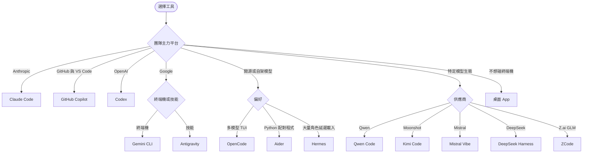

| 情境 | 建議 |
|------|------|
| 企業主力開發 | Claude Code 或 Copilot：原檔照搬、專案層可控權限 |
| 多工具並存 | 用 `convert.sh` 一次產生全部，再依團隊需求安裝 |
| 角色很多但 context 有限 | Hermes（延遲載入）或 Aider（索引） |
| 嚴格控管模型與資料 | 自架模型 + OpenCode／Aider，並依 §7.6 分級資料 |

## 5.16 MCP Memory 整合（跨 session 記憶）

上游 `integrations/mcp-memory/` 示範如何讓 Agent 透過 MCP 記憶伺服器跨 session 保留決策、交接與檢查點。它**不綁定特定套件**：任何提供 `remember`、`recall`、`rollback`、`search` 四個工具的 MCP 伺服器都可以。

### 設定步驟

1. 在 MCP 客戶端註冊記憶伺服器。以 Claude Code 為例，專案根目錄的 `.mcp.json` 寫法如下：

    ```json
    {
      "mcpServers": {
        "memory": {
          "command": "your-mcp-memory-server",
          "args": []
        }
      }
    }
    ```

2. 在客製 Agent 的內文加入 `## Memory Integration` 章節：

    ```markdown
    ## Memory Integration

    When you start a session:
    - Recall relevant context using your role and the current project as search terms

    When you make key decisions or complete deliverables:
    - Remember the decision with tags: your agent name, the project, the topic

    When handing off to another agent:
    - Remember your deliverables tagged for the receiving agent, with what is done and what is pending

    When something fails:
    - Search for the last known-good state and roll back instead of rebuilding
    ```

3. 參考上游完整範例：`integrations/mcp-memory/backend-architect-with-memory.md` 與 `examples/workflow-with-memory.md`。

> **⚠️ v3.1 的錯誤更正**：舊版寫的 `~/.claude/mcp_servers.json` 與 `@anthropic/mcp-memory-server` 都不是實際存在的設定檔與套件。Claude Code 的 MCP 設定請用 `claude mcp add` 或專案的 `.mcp.json`。

### 記憶治理

| 風險 | 對應 OWASP Agentic | 控制措施 |
|------|-------------------|---------|
| 記憶被汙染，影響之後所有 session | ASI06 Memory & Context Poisoning | 只允許寫入「決策與交付物摘要」，不寫入外部網頁內容 |
| 機敏資料長期留存 | — | 禁止寫入金鑰、個資；定期清理 |
| 跨專案洩漏 | — | 標籤一定要包含專案名稱，recall 時以專案過濾 |

## 5.17 本章審查與驗證清單

| 檢查項 | 驗證方式 | 通過標準 |
|--------|---------|---------|
| 工具確實載入 Agent | 各工具的列表功能，或請 AI 列出可委派的 Agent | 安裝的 Agent 全部出現 |
| Claude Code 權限 | §5.2.4 的寫檔探測 ⏳ | 審查型 Agent 無法寫檔 |
| Copilot 在 VS Code 可見 | `chat.agentFilesLocations` 設定 ⏳ | 下拉選單出現 Agent |
| Cursor 不濫用 alwaysApply | `grep -l "alwaysApply: true" .cursor/rules/*.mdc` | 沒有輸出 |
| OpenCode 數量 | `ls .opencode/agents \| wc -l` | ≤ 119 |
| Hermes 設定 | 檢查 Hermes 設定的 `plugins.enabled` | 含 `agency-agents-router`，`skills.external_dirs` 未被改寫 |
| MCP 記憶內容 | 抽查記憶庫 | 無金鑰與個資，標籤含專案名 |

---

# 6. 實戰：AI 開發流程（End-to-End Workflow）

## 6.1 案例說明：企業客戶管理系統（CRM）

本章以一個企業 CRM 的「客戶管理模組」為例，走完需求 → 架構 → 實作 → 審查 → 測試 → 安全的完整流程。每個 Phase 都包含四個部分：**使用的 Agent、Prompt、預期產出、人工驗收方法**。

### 系統需求

| 模組 | 功能 |
|------|------|
| 客戶管理 | 客戶資料 CRUD、分級、標籤、模糊搜尋 |
| 聯繫紀錄 | 通話、郵件、會議紀錄 |
| 商機管理 | 銷售漏斗、預測 |
| 權限控管 | RBAC、多租戶資料隔離 |
| 通知 | 郵件與站內通知 |

### 技術棧（2026-11 基準）

| 層 | 選型 |
|----|------|
| Backend | Java 25 LTS、Spring Boot 4.x、Clean Architecture |
| Frontend | Vue 3.5、TypeScript、Tailwind CSS 4、Pinia |
| Database | PostgreSQL 18（`pg_trgm` 擴充） |
| Cache／MQ | Redis 8、Apache Kafka 4.x |
| Auth | Spring Security、OAuth2 Resource Server（JWT） |
| CI/CD | GitHub Actions |

## 6.2 Agent 協作流程

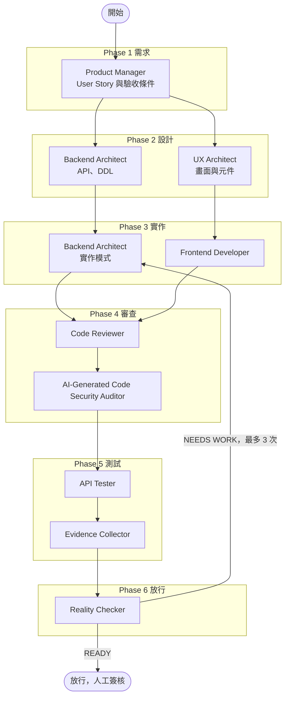

### 交接規則

每個 Phase 之間使用 NEXUS 標準交接範本（`strategy/coordination/handoff-templates.md`），避免下一位 Agent「冷啟動」：

```markdown
# NEXUS Handoff Document

## Metadata
| Field | Value |
|-------|-------|
| **From** | Product Manager (Product) |
| **To** | Backend Architect (Engineering) |
| **Phase** | Phase 1 — Strategy & Architecture |
| **Task Reference** | CRM-CUST-001 |
| **Priority** | High |
| **Timestamp** | 2026-11-13T02:00:00Z |

## Context
**Project**: CRM customer module
**Current State**: US-001..US-003 approved by the product owner
**Relevant Files**:
- docs/prd/customer.md — approved user stories and NFRs
**Dependencies**: none
**Constraints**: Java 25, Spring Boot 4.x, PostgreSQL 18; no new libraries without approval

## Deliverable Request
**What is needed**: OpenAPI 3.1 for /api/v1/customers, DDL, module boundaries
**Acceptance criteria**:
- [ ] Every endpoint has a request schema and an error schema
- [ ] DDL runs on PostgreSQL 18 without errors
- [ ] Every user story ID is traced to at least one endpoint

## Quality Expectations
**Must pass**: Redocly lint with 0 errors; DDL executes in a clean database
**Evidence required**: lint output and psql log
**Handoff to next**: Backend Architect (implementation mode) and API Tester
```

## 6.3 Phase 1：需求分析（Product Manager）

### Prompt

```markdown
Use the Product Manager agent.

## Background
We are building the customer module of an internal CRM for 200 sales reps.

## Users
Sales Rep, Sales Manager, Admin

## Must cover
1. Create, edit and search customers (fuzzy search on company and contact)
2. Customer grade A/B/C and free tags
3. Every change keeps history

## Deliverables
1. User stories with Given/When/Then acceptance criteria, IDs US-001...
2. MoSCoW priority table
3. MVP scope (in / out)
4. Non-functional requirements with numbers

## Definition of Done
- Every story has at least one negative acceptance criterion
- No feature outside "Must cover" is marked Must Have
```

### Phase 1 預期產出（節錄）

```markdown
### US-001 Create customer
As a Sales Rep, I want to create a customer record so that the team shares one source of truth.

Acceptance criteria
- Given valid company, contact and email, when I submit, then the customer is saved with grade C.
- Given an email already used by another customer in my tenant, when I submit, then I see "duplicate email" and nothing is saved.
- Given I am not authenticated, when I call the API, then I get 401.

| Story | Priority | Sprint |
|-------|----------|--------|
| US-001 Create customer | Must | 1 |
| US-002 Search customer | Must | 1 |
| US-003 Change history  | Should | 2 |
```

### 🔍 Phase 1 人工驗收

| 檢查 | 方法 | 不通過的典型徵兆 |
|------|------|----------------|
| 驗收條件可測 | 每條 AC 能否直接寫成一個測試案例 | 出現「系統應該好用」「快速」等無數字描述 |
| 有負向條件 | 數每個 Story 的負向 AC | 只有 happy path |
| 範圍沒有膨脹 | 對照 Prompt 的 Must cover | 出現 AI 自己加的「AI 推薦客戶」等功能 |
| 非功能需求有數字 | 檢查 NFR 表 | 只寫「高可用」，沒有 SLO |

## 6.4 Phase 2：架構設計（Backend Architect、UX Architect）

### Prompt（Backend Architect）

```markdown
Use the Backend Architect agent.

## Input
[paste the Phase 1 handoff document and user stories]

## Constraints
- Java 25, Spring Boot 4.x, Clean Architecture, PostgreSQL 18, Redis 8, Kafka 4.x
- Multi-tenant: every table carries tenant_id; every query filters by it

## Deliverables
1. Layer diagram (Mermaid)
2. OpenAPI 3.1 for /api/v1/customers (list, create, get, update)
3. PostgreSQL DDL with indexes
4. Traceability table: user story → endpoint

## Definition of Done
- Pagination has a maximum page size
- Every error uses RFC 9457 problem details
```

### Phase 2 預期產出（節錄）

```yaml
openapi: 3.1.0
info:
  title: CRM Customer API
  version: 1.0.0
paths:
  /api/v1/customers:
    get:
      summary: Search customers
      parameters:
        - name: keyword
          in: query
          schema: { type: string, maxLength: 100 }
        - name: page
          in: query
          schema: { type: integer, minimum: 0, default: 0 }
        - name: size
          in: query
          schema: { type: integer, minimum: 1, maximum: 100, default: 20 }
      responses:
        '200':
          description: OK
        '400':
          description: Invalid query
          content:
            application/problem+json:
              schema: { $ref: '#/components/schemas/Problem' }
components:
  schemas:
    Problem:
      type: object
      properties:
        type: { type: string, format: uri }
        title: { type: string }
        status: { type: integer }
        detail: { type: string }
```

```sql
CREATE EXTENSION IF NOT EXISTS pg_trgm;

CREATE TABLE customer (
    id          UUID PRIMARY KEY DEFAULT uuidv7(),
    tenant_id   UUID         NOT NULL,
    company     VARCHAR(200) NOT NULL,
    contact     VARCHAR(100) NOT NULL,
    email       VARCHAR(200) NOT NULL,
    grade       CHAR(1)      NOT NULL DEFAULT 'C' CHECK (grade IN ('A', 'B', 'C')),
    tags        TEXT[]       NOT NULL DEFAULT '{}',
    created_by  UUID         NOT NULL,
    created_at  TIMESTAMPTZ  NOT NULL DEFAULT now(),
    updated_at  TIMESTAMPTZ  NOT NULL DEFAULT now(),
    version     INTEGER      NOT NULL DEFAULT 0,
    CONSTRAINT uq_customer_tenant_email UNIQUE (tenant_id, email)
);

CREATE INDEX ix_customer_tenant_company_trgm ON customer USING gin (company gin_trgm_ops);
CREATE INDEX ix_customer_tenant_contact_trgm ON customer USING gin (contact gin_trgm_ops);
CREATE INDEX ix_customer_tenant_grade ON customer (tenant_id, grade);
```

### 🔍 Phase 2 人工驗收

| 檢查 | 方法 | 通過標準 |
|------|------|---------|
| OpenAPI 合法 | `npx @redocly/cli lint openapi.yaml` | 0 error |
| DDL 可執行 | 在 PostgreSQL 18 容器執行 DDL | 無錯誤；`uuidv7()` 是 PostgreSQL 18 新增的函式，舊版會失敗 |
| 多租戶 | 搜尋 DDL 與查詢的 `tenant_id` | 每張業務表都有，唯一鍵包含 `tenant_id` |
| 分頁上限 | 檢查 `size.maximum` | 有上限（此例為 100） |
| 可追溯 | Story → Endpoint 對照表 | 每個 Must Story 都有對應 |

> **⚠️ AI 常見錯誤**：v3.1 範例的 DDL 用 `REFERENCES users(id)`，但沒有建立 `users` 表，直接執行會失敗。驗收時**一定要實際執行**，不要只用肉眼看。

## 6.5 Phase 3：實作（Backend Architect 實作模式、Frontend Developer）

### Prompt（後端）

```markdown
Use the Backend Architect agent in implementation mode.

## Input
[paste the approved OpenAPI and DDL]

## Task
Implement "create customer" end to end:
Domain entity, use case, JPA adapter, REST controller, unit tests.

## Rules
- Java records for DTOs and commands
- Jakarta Validation on every request field
- tenant_id comes from the authenticated principal, never from the request body
- Return 409 with problem details on duplicate email
```

### Phase 3 預期產出（節錄）

```java
public record CreateCustomerRequest(
        @NotBlank @Size(max = 200) String company,
        @NotBlank @Size(max = 100) String contact,
        @NotBlank @Email @Size(max = 200) String email) {
}

@RestController
@RequestMapping("/api/v1/customers")
class CustomerController {

    private final CreateCustomerUseCase createCustomer;

    CustomerController(CreateCustomerUseCase createCustomer) {
        this.createCustomer = createCustomer;
    }

    @PostMapping
    ResponseEntity<CustomerCreated> create(@Valid @RequestBody CreateCustomerRequest request,
                                           @AuthenticationPrincipal Jwt jwt) {
        var tenantId = UUID.fromString(jwt.getClaimAsString("tenant_id"));
        var userId = UUID.fromString(jwt.getSubject());
        var id = createCustomer.execute(new CreateCustomerCommand(
                tenantId, request.company(), request.contact(), request.email(), userId));
        return ResponseEntity.created(URI.create("/api/v1/customers/" + id)).body(new CustomerCreated(id));
    }
}
```

### 🔍 Phase 3 人工驗收

| 檢查 | 方法 | 通過標準 |
|------|------|---------|
| 能編譯、能測試 | `./mvnw -q verify` | BUILD SUCCESS |
| 租戶來源 | 搜尋 `tenant_id` 的讀取位置 | 只來自 JWT，不來自 request body |
| 驗證完整 | 每個 DTO 欄位都有 `@NotBlank`／`@Size` 等註解 | 欄位長度與 DDL 一致 |
| 沒有幻覺套件 | 比對 `pom.xml` 差異 | 未經核准不得新增依賴 |
| 錯誤格式 | 送出重複 email | 409，`Content-Type: application/problem+json` |

## 6.6 Phase 4：程式碼與 AI 產出安全審查

建議兩個角色**依序**審查：Code Reviewer 看正確性與可維護性；AI-Generated Code Security Auditor 專抓 AI 助理常留下的問題，例如寫死的密鑰、失效的資料列層級權限、prompt injection 的落點。後者會跑「掃描 → 修正 → 重掃」迴圈，並以 CWE 對應發現。

```markdown
Use the Code Reviewer agent.
Review the diff of branch feature/crm-create-customer against main.
Output: table with severity (Blocking / Should fix / Nit), file:line, issue, why, fix.
Only report issues you can point to in the diff.
```

```markdown
Use the AI-Generated Code Security Auditor agent.
Scope: the same diff plus application.yml and the Dockerfile.
Map every finding to a CWE ID. Mark each finding as "verified by reading code" or "suspected".
```

### 🔍 Phase 4 人工驗收（審查「審查報告」）

| 檢查 | 方法 | 通過標準 |
|------|------|---------|
| 發現可定位 | 隨機挑 3 筆，開啟對應檔案與行號 | 3 筆都真的存在 |
| 沒有幻覺問題 | 「suspected」類別逐筆確認 | 誤報率可接受，並記錄在 §8.2 的優化紀錄 |
| CWE 正確 | 到 cwe.mitre.org 查編號 | 編號與問題描述相符 |
| 修正被驗證 | 修正後重跑同一個 prompt | 原發現消失，沒有新增 Blocking |

## 6.7 Phase 5：測試（API Tester、Evidence Collector）

```markdown
Use the API Tester agent.
## Input
OpenAPI: [paste]. User stories: [paste US-001..US-003].
## Deliverables
1. Test matrix: story AC → test case ID (positive, negative, boundary)
2. JUnit 6 + RestAssured tests using Testcontainers PostgreSQL 18
3. Each test creates its own tenant and cleans up after itself
```

```markdown
Use the Evidence Collector agent.
Run the test suite and the UI flow "create customer".
Deliver evidence only: test report path, screenshot paths, and the exact commands you ran.
Do not claim a pass without an artifact.
```

### 🔍 Phase 5 人工驗收

| 檢查 | 方法 | 通過標準 |
|------|------|---------|
| AC 覆蓋 | 測試矩陣中每條 AC 都有 ID | 100% Must Story 的 AC 有測試 |
| 測試會失敗 | 故意改壞一行（例如移除 `@Email`），重跑 | 至少一個測試失敗（證明測試有效） |
| 證據可重現 | 依 Evidence Collector 列出的指令自己跑一次 | 結果相同 |
| 隔離 | 平行執行兩次 | 沒有互相干擾的失敗 |

## 6.8 Phase 6：放行審查（Reality Checker）

Reality Checker 是 NEXUS 的最終品質權威，**預設判定為 `NEEDS WORK`**，必須有充分證據才會改判。

```markdown
Use the Reality Checker agent.
Evidence package: [test report, screenshots, review tables, open risks].
Decide READY or NEEDS WORK for release to staging.
For NEEDS WORK, list blocking items with the evidence that is missing.
```

### 🔍 Phase 6 人工驗收

- Reality Checker 的判定只是**建議**，放行簽核仍由人負責。
- 若 Reality Checker 判 `READY`，抽查它引用的證據是否真的存在。
- 同一任務 `NEEDS WORK` 第 3 次時，依 NEXUS 規則升級給 Agents Orchestrator，並由 Tech Lead 介入。

## 6.9 Phase 0 選配：全面產品探索

上游範例 `examples/nexus-spatial-discovery.md` 示範同時部署 8 個角色，產出統一的產品藍圖：

| Agent | 部門 | 負責 |
|-------|------|------|
| Trend Researcher | Product | 市場驗證、競品 |
| Backend Architect | Engineering | 技術可行性 |
| Brand Guardian | Design | 品牌策略 |
| Growth Hacker | Marketing | 上市策略 |
| Support Responder | Support | 支援系統 |
| UX Researcher | Design | 使用者研究 |
| Project Shepherd | Project Management | 執行計畫 |
| XR Interface Architect | Spatial Computing | 空間 UI |

```markdown
Activate Agents Orchestrator in NEXUS-Full mode for "Spatial collaboration tool".
Project specification: docs/discovery-brief.md
Run Phase 0 discovery only. Each division delivers one section of a unified product blueprint.
Stop at the Phase 0 gate and report gate criteria results.
```

> **🔍 驗收重點**：多角色產出最常見的問題是**彼此矛盾**（例如 Growth Hacker 假設免費增值，Financial 假設授權制）。驗收時先列出各段的關鍵假設，再檢查一致性。

## 6.10 使用 NEXUS runbook 快速組隊

| runbook slug | 模式 | 期程 | 團隊（群組：人數） |
|--------------|------|------|------------------|
| `startup-mvp` | NEXUS-Sprint | 4～6 週 | Core 9、Growth 3、Support 6 |
| `enterprise-feature` | NEXUS-Sprint | 6～12 週 | Core 15、Compliance & Governance 4、Quality Assurance 3 |
| `marketing-campaign` | NEXUS-Sprint | 2～4 週 | Campaign Core 5、Platform Specialists 5、Support 4 |
| `incident-response` | NEXUS-Micro | 數分鐘到數小時 | P0 Critical Response 6、Verification & Post-Mortem 4 |

```bash
python3 runbook_team.py /path/to/agency-agents enterprise-feature > team.txt
./scripts/install.sh --tool claude-code --agents-file team.txt --path /your/project/.claude/agents
```

```markdown
Activate Agents Orchestrator in NEXUS-Sprint mode for "CRM customer module".
Requirements: docs/prd/customer.md
Follow strategy/runbooks/scenario-enterprise-feature.md.
Skip Phase 0. Begin at Phase 1 with architecture and sprint planning.
Use the Dev-QA loop with a maximum of 3 attempts per task.
```

## 6.11 本章審查與驗證清單

| 檢查項 | 驗證方式 | 通過標準 |
|--------|---------|---------|
| 每個 Phase 有交接文件 | 檢查 handoff 文件 | Metadata、Context、Quality Expectations 皆完整 |
| AI 產出經過執行驗證 | OpenAPI lint、DDL 執行、`mvn verify` | 全部成功 |
| 審查報告可定位 | 抽查 3 筆 | 100% 可在程式中找到 |
| 測試有效 | 故意改壞重跑 | 至少一個測試失敗 |
| 放行有人簽核 | PR 或變更單 | Reality Checker 判定 + 人工簽核 |
| Dev↔QA 次數 | 交接紀錄 | 單一任務 ≤ 3 次；超過即升級 |

---

# 7. SSDLC（安全開發流程）

## 7.1 agency-agents 在 SSDLC 中的定位

agency-agents 在 SSDLC 中有**兩種身分**，治理方式不同：

| 身分 | 說明 | 治理重點 |
|------|------|---------|
| 安全**助手** | 用 Security 部門等角色協助威脅建模、審查、測試 | 產出要經人工驗證（§7.3～§7.5） |
| 安全**標的** | Agent 檔本身就是會被執行的 prompt，屬於軟體供應鏈的一部分 | 升級前掃描與審查（§7.7） |

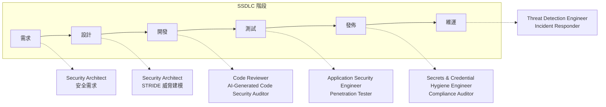

## 7.2 Security 部門角色對照（12 位）

| Agent | 檔案 | 最適合的 SSDLC 活動 |
|-------|------|-------------------|
| Security Architect | `security/security-architect.md` | 安全需求、架構審查、威脅建模 |
| Application Security Engineer | `security/security-appsec-engineer.md` | 安全編碼、SAST／DAST 設計 |
| AI-Generated Code Security Auditor | `security/security-ai-generated-code-auditor.md` | **審查 AI 產生的程式碼**：寫死密鑰、RLS 失效、prompt injection 落點 |
| Secrets & Credential Hygiene Engineer | `security/security-secrets-credential-engineer.md` | 密鑰管理、輪替、外洩應變 |
| Cloud Security Architect | `security/security-cloud-security-architect.md` | 雲端設定、IAM |
| Penetration Tester | `security/security-penetration-tester.md` | 授權範圍內的滲透測試規劃 |
| Compliance Auditor | `security/security-compliance-auditor.md` | 合規差距分析 |
| Threat Detection Engineer | `security/security-threat-detection-engineer.md` | 偵測規則、ATT&CK 對照 |
| Threat Intelligence Analyst | `security/security-threat-intelligence-analyst.md` | 威脅情資 |
| Incident Responder | `security/security-incident-responder.md` | 事件處理 |
| Senior SecOps Engineer | `security/security-senior-secops.md` | 安全維運 |
| Blockchain Security Auditor | `security/security-blockchain-security-auditor.md` | 智慧合約稽核 |

其他部門的相關角色：Identity & Access Engineer、Privacy Engineer、Incident Response Commander（engineering）、Legal Compliance Checker（support）、Data Privacy Officer、FedRAMP & RMF Compliance Engineer（specialized）、Accessibility Auditor（testing）。

> **⚠️ v3.1 的角色名稱更正**：上游已經沒有名為「Security Engineer」的 Agent。安全工作請改用上表的 Security Architect 或 Application Security Engineer。

## 7.3 需求與設計階段

### 安全需求

```markdown
Use the Security Architect agent.

## Feature
Customer management with PII (name, email, phone), file attachments, OAuth2 login.

## Deliverables
1. Security requirements, each with an ID (SR-01...) and a verification method
2. Data classification: Public / Internal / Confidential / Restricted per field
3. Applicable regulations: Taiwan Personal Data Protection Act; GDPR only if EU customers exist

## Definition of Done
Every SR has a verification method that a tester can execute.
```

### STRIDE 威脅建模

```markdown
Use the Security Architect agent.

## System
Vue SPA → API gateway → Spring Boot service → PostgreSQL 18, Redis 8, Kafka 4.x.
Trust boundaries: internet / DMZ / internal network.

## Task
STRIDE threat model per component and per data flow crossing a trust boundary.

## Output
Table: ID, STRIDE category, component or flow, threat, likelihood, impact, mitigation, verification.
Mermaid data-flow diagram with trust boundaries.
```

#### 預期產出（節錄）

| ID | 類別 | 元件 | 威脅 | 緩解 | 驗證方式 |
|----|------|------|------|------|---------|
| T-01 | Spoofing | API gateway | 偽造 JWT | 驗簽、`aud`／`iss` 檢查、15 分鐘效期 | 送出竄改簽章的 token，預期 401 |
| T-02 | Tampering | SPA | XSS 竄改頁面 | CSP、輸出編碼 | ZAP 主動掃描無 XSS 高風險 |
| T-03 | Info Disclosure | DB | SQL injection | 參數化查詢 | SAST 無 CWE-89；人工抽查查詢 |
| T-04 | DoS | API | 大量請求 | Rate limit、分頁上限 | 壓測超過門檻回 429 |
| T-05 | Elevation | Service | IDOR 跨租戶存取 | 物件層級授權 + `tenant_id` 過濾 | 用租戶 B 的 token 讀租戶 A 的資料，預期 404 |

### 🔍 威脅模型人工驗收

| 檢查 | 通過標準 |
|------|---------|
| 每個跨信任邊界的資料流都有威脅 | DFD 上的每條跨界箭頭至少對應一列 |
| 每個緩解都有驗證方式 | 「驗證方式」欄沒有空白，且可以執行 |
| 沒有只寫「加強安全」的緩解 | 每個緩解都是具體控制項 |

## 7.4 開發階段：OWASP Top 10:2025 審查

```markdown
Use the Application Security Engineer agent.
Review the diff against OWASP Top 10:2025:
A01 Broken Access Control, A02 Security Misconfiguration, A03 Software Supply Chain Failures,
A04 Cryptographic Failures, A05 Injection, A06 Insecure Design, A07 Authentication Failures,
A08 Software or Data Integrity Failures, A09 Security Logging and Alerting Failures,
A10 Mishandling of Exceptional Conditions.
For each category: "finding at file:line" or "checked, nothing found" with what you checked.
```

> **⚠️ 版本更新**：v3.1 使用 OWASP Top 10 **2021**。2025 版新增「A03 軟體供應鏈失敗」與「A10 例外狀況處理不當」，SSRF 併入 A01。請同步更新內部檢查表。

### 🔍 OWASP 審查人工驗收

- 每個類別都必須有回應，「checked, nothing found」也要寫出檢查了什麼。沒寫的類別等於沒檢查。
- 抽查 1 個「nothing found」的類別，自己用 SAST 工具（例如 Semgrep、SpotBugs + Find Security Bugs）交叉驗證。

## 7.5 測試與發佈階段

```markdown
Use the Application Security Engineer agent.
Design a security test plan:
1. SAST: tool choice for Java 25 / Spring Boot 4, rule set, CI gate (fail on High)
2. SCA: dependency and container scanning, CVE gate
3. DAST: OWASP ZAP baseline on staging, authenticated scan
4. Secrets: pre-commit and CI secret scanning
Each item: tool, command, pass criteria, owner.
```

### DevSecOps 管線範本

```yaml
# .github/workflows/security.yml
# 所有第三方 action 請釘選到完整 commit SHA，並以註解記錄版本。
name: Security Pipeline

on:
  pull_request:
  push:
    branches: [main]

permissions:
  contents: read

jobs:
  sast:
    runs-on: ubuntu-latest
    steps:
      - uses: actions/checkout@v5
      - uses: actions/setup-java@v5
        with:
          distribution: temurin
          java-version: '25'
      - name: SpotBugs + Find Security Bugs
        run: ./mvnw -B spotbugs:check

  sca:
    runs-on: ubuntu-latest
    steps:
      - uses: actions/checkout@v5
      - name: OWASP Dependency-Check
        run: ./mvnw -B org.owasp:dependency-check-maven:check -DfailBuildOnCVSS=7

  secrets:
    runs-on: ubuntu-latest
    steps:
      - uses: actions/checkout@v5
        with:
          fetch-depth: 0
      - name: Gitleaks
        uses: gitleaks/gitleaks-action@v2
        env:
          GITHUB_TOKEN: ${{ secrets.GITHUB_TOKEN }}

  container:
    runs-on: ubuntu-latest
    needs: [sast, sca]
    steps:
      - uses: actions/checkout@v5
      - run: docker build -t crm-api:${{ github.sha }} .
      - name: Trivy image scan
        run: |
          docker run --rm -v /var/run/docker.sock:/var/run/docker.sock \
            aquasec/trivy:latest image --exit-code 1 --severity HIGH,CRITICAL crm-api:${{ github.sha }}
```

> **🔍 審查重點**：v3.1 範本使用 `aquasecurity/trivy-action@master`。浮動分支等於把 CI 權限交給上游的任何一次提交，屬於 OWASP A03 供應鏈風險。請釘選版本或 SHA，並設定最小 `permissions`。上例的 `aquasec/trivy:latest` 也應在正式環境改為固定版本。

## 7.6 資料分級：哪些東西不能進 prompt

| 等級 | 範例 | 可否放進 prompt | 條件 |
|------|------|:--------------:|------|
| Public | 開源程式碼、公開文件 | ✅ | — |
| Internal | 內部程式碼、架構圖 | ✅ | 使用企業授權、不訓練的方案 |
| Confidential | 客戶名單、合約、未公開財報 | ⚠️ | 遮罩後才可；需主管核准 |
| Restricted | 密碼、私鑰、身分證號、病歷 | ❌ | 一律禁止；以假資料替代 |

```text
❌ Here is our production application.yml: [含 DB 密碼的完整檔案]
✅ Here is application.yml with secrets replaced by ${ENV_VAR} placeholders: [遮罩後的檔案]
```

## 7.7 Agent 檔的供應鏈安全

Agent 檔會被工具當成 system prompt 載入，**等同可執行的指令**。對應 OWASP Top 10 for Agentic Applications（2026）的幾個風險：

| 風險 | 在 agency-agents 的樣子 | 控制措施 |
|------|----------------------|---------|
| ASI01 Agent Goal Hijack | 上游某次更新在 Agent 中夾帶「忽略之前的指示」 | 升級時用 `scan_agent_risk.py` 掃描，並人工審查 diff |
| ASI02 Tool Misuse | 審查型 Agent 繼承了 Bash 與寫檔權限 | §5.2.4 的 `tools` 白名單 |
| ASI03 Identity & Privilege Abuse | Agent 使用開發者的完整憑證 | 最小權限、短效憑證 |
| ASI04 Agentic Supply Chain | 直接 `--link` 到上游 main，未審查即生效 | 正式環境用複製安裝 + 升級審查（§9） |
| ASI06 Memory & Context Poisoning | MCP 記憶寫入外部內容 | §5.16 的記憶治理 |
| ASI07 Insecure Inter-Agent Communication | 交接文件被竄改 | 交接文件放在版控，由人審查 |
| ASI08 Cascading Failures | 一個 Agent 的錯誤假設被後續 Agent 放大 | 每個 Phase 的人工驗收（第 6 章） |

上游 SECURITY.md 也要求：Agent 檔中**不得**放 API 金鑰或可執行程式碼；發現試圖做 prompt injection 的 Agent 定義，應私下回報。

### 升級前掃描：scan_agent_risk.py

這支工具**不判定善惡**，只把需要人看一眼的行列出來：

```python
#!/usr/bin/env python3
"""scan_agent_risk.py — 升級上游前，掃描 Agent 檔中值得人工複核的「提示詞供應鏈」風險。

Agent 檔會被當成 system prompt 載入，等同可執行的指令。本工具不判定善惡，
只把需要人看一眼的地方列出來（對應 OWASP Agentic ASI01 目標劫持、ASI04 供應鏈）。

  R01 隱藏字元：零寬字元、雙向控制字元（可藏指令或混淆審查）
  R02 管線執行遠端腳本：curl/wget ... | sh/bash/python
  R03 覆寫指令的句型：ignore previous instructions、do not tell the user ...
  R04 外送資料的句型：send/upload/post ... (secrets|credentials|env|tokens) to http...
  R05 長段 base64（≥ 120 字元），可能夾帶編碼指令
  R06 非允許清單網域的 URL（允許清單可用 --allow 增加）

用法：python scan_agent_risk.py [--allow domain,...] FILE [FILE ...]
結束碼：0 = 無發現；1 = 有發現（需人工複核，不代表一定有問題）
"""
import re
import sys

HIDDEN = re.compile("[\u200b\u200c\u200d\u2060\ufeff\u202a-\u202e\u2066-\u2069]")
PIPE_EXEC = re.compile(r"\b(curl|wget)\b[^\n|]*\|\s*(sudo\s+)?(ba|z)?sh\b|\b(curl|wget)\b[^\n|]*\|\s*python", re.I)
OVERRIDE = re.compile(
    r"ignore (all |any )?(previous|prior|above) instructions|disregard (the )?(system|previous) prompt"
    r"|do not (tell|inform|reveal to) the user|without (telling|informing) the user",
    re.I,
)
EXFIL = re.compile(
    r"\b(send|upload|post|exfiltrate|forward)\b[^\n]{0,80}\b(secret|credential|api[ _-]?key|token|password|\.env)s?\b"
    r"[^\n]{0,80}https?://",
    re.I,
)
B64 = re.compile(r"[A-Za-z0-9+/]{120,}={0,2}")
URL = re.compile(r"https?://([A-Za-z0-9.-]+)")
DEFAULT_ALLOW = {
    "github.com", "docs.github.com", "owasp.org", "cwe.mitre.org", "developer.mozilla.org",
    "modelcontextprotocol.io", "example.com", "localhost",
}


def scan(path, allow):
    hits = []
    text = open(path, encoding="utf-8", errors="replace").read()
    in_fence = False
    for no, line in enumerate(text.splitlines(), start=1):
        if re.match(r"^ {0,3}(`{3,}|~{3,})", line):
            in_fence = not in_fence
        if HIDDEN.search(line):
            hits.append((no, "R01", "hidden/bidi unicode character"))
        if PIPE_EXEC.search(line):
            hits.append((no, "R02", "pipes a remote download into an interpreter"))
        if OVERRIDE.search(line):
            hits.append((no, "R03", "instruction-override phrasing" + (" (inside code block)" if in_fence else "")))
        if EXFIL.search(line):
            hits.append((no, "R04", "possible secret exfiltration phrasing"))
        if B64.search(line):
            hits.append((no, "R05", "long base64-like blob"))
        for host in URL.findall(line):
            h = host.lower().rstrip(".")
            if not any(h == a or h.endswith("." + a) for a in allow):
                hits.append((no, "R06", f"URL host not in allowlist: {h}"))
    return hits


def main(argv):
    allow = set(DEFAULT_ALLOW)
    if argv[:1] == ["--allow"]:
        allow |= {d.strip().lower() for d in argv[1].split(",") if d.strip()}
        argv = argv[2:]
    if not argv:
        print(__doc__)
        return 2
    total = 0
    for p in argv:
        for no, code, msg in scan(p, allow):
            print(f"{code} {p}:{no}: {msg}")
            total += 1
    print(f"Findings: {total} in {len(argv)} files (review manually; not a verdict).")
    return 1 if total else 0


if __name__ == "__main__":
    sys.exit(main(sys.argv[1:]))
```

🧪 **反例驗證**（每個 fixture 植入一種風險）：

```text
R01 r01-hidden.md:9: hidden/bidi unicode character
R02 r02-pipe.md:9: pipes a remote download into an interpreter
R06 r02-pipe.md:9: URL host not in allowlist: get.example.net
R03 r03-override.md:9: instruction-override phrasing
R04 r04-exfil.md:9: possible secret exfiltration phrasing
R06 r04-exfil.md:9: URL host not in allowlist: collector.example.net
R05 r05-base64.md:9: long base64-like blob
R06 r06-url.md:9: URL host not in allowlist: intranet.acme.example
Findings: 8 in 7 files (review manually; not a verdict).
```

🧪 **對上游 283 個 Agent 執行**：

```text
R03 engineering/engineering-prompt-engineer.md:176: instruction-override phrasing
R06 x76 (external documentation hosts, e.g. developer.apple.com x7, attack.mitre.org x5; see allowlist tuning)
Findings: 77 in 283 files (review manually; not a verdict).
```

讀法：

- 唯一的 R03 位於 Prompt Engineer 的「Prompt Injection Defense」段落，內容是**把攻擊句當成測試範例**。這是正常內容，但正因為它和惡意句型長得一樣，才需要人看一眼。這就是「列出待複核，而不是自動判定」的原因。
- R06 多半是官方文件網域。請把團隊認可的網域加入 `--allow`，讓真正陌生的網址浮現出來。

### 🔍 升級審查程序

1. `git diff upstream-prev..upstream/main -- '*.md'` 取得變更的 Agent。
2. 對變更檔案執行 `scan_agent_risk.py` 與 `check_agent.py`。
3. 每一筆 R01～R05 都要人工確認，並記錄在升級 PR 中。
4. 新增的 Agent 在試用環境跑過一次代表性任務後，才合併到正式分支。

## 7.8 本章審查與驗證清單

| 檢查項 | 驗證方式 | 通過標準 |
|--------|---------|---------|
| 角色名稱正確 | 對照 §7.2 | 不再使用「Security Engineer」 |
| 威脅模型可驗證 | §7.3 驗收表 | 每個緩解都有可執行的驗證方式 |
| OWASP 版本 | 內部檢查表 | 已更新為 Top 10:2025 |
| CI action 釘選 | `grep -n "@master\|@main" .github/workflows/*.yml` | 沒有輸出 |
| prompt 資料分級 | 抽查使用紀錄 | 沒有 Restricted 等級資料 |
| Agent 供應鏈 | 升級 PR 附上 `scan_agent_risk.py` 結果 🧪 | R01～R05 全部有人工結論 |

---

# 8. 系統維運（Maintenance）

## 8.1 日常維運工作一覽

| 頻率 | 工作 | 負責 | 產出 |
|------|------|------|------|
| 每次修改 Agent | 本地 lint、轉換、重新安裝 | Agent 作者 | 通過的 PR |
| 每週 | 檢查上游更新（§9.5 自動 PR） | Agent 管理員 | 升級 PR |
| 每月 | 檢視 Agent 使用紀錄、優化 prompt | Prompt 管理員 | 優化紀錄 |
| 每月 | 成本與用量報表 | 效益分析師 | 月報（§11.4） |
| 每季 | 盤點未使用的 Agent、移除或下架 | Tech Lead | 安裝清單更新 |

## 8.2 修改 Agent 之後的標準流程

```bash
# 1. 格式檢查（擇一）
./scripts/lint-agents.sh engineering/engineering-code-reviewer.md      # 上游 bash 版
python3 check_agent.py engineering/engineering-code-reviewer.md         # 本手冊 Python 版

# 2. 原創性（新增 Agent 時）
./scripts/check-agent-originality.sh specialized/acme-api-reviewer.md

# 3. 重新轉換（全部或單一工具）
./scripts/convert.sh --parallel
./scripts/convert.sh --tool cursor

# 4. 確認轉換產物完整（會回報 manifest drift，屬預期）
./scripts/test-convert-outputs.sh

# 5. 重新安裝
./scripts/install.sh --no-interactive --parallel
```

> **⚠️ 最常見的維運錯誤**：改了 Agent 卻沒重新轉換。Claude Code 與 Copilot 是原檔照搬（重新安裝即可），其他 15 種工具讀的是轉換產物，不重跑 `convert.sh` 就會繼續使用舊版。

## 8.3 上游的 CI 合約（企業 Fork 應保留）

| Workflow | 呼叫的腳本 | 擋下什麼 |
|----------|-----------|---------|
| `lint-agents.yml` | `lint-agents.sh` | frontmatter、色名、fence、Qwen placeholder 錯誤 |
| `check-divisions.yml` | `check-divisions.sh` | 部門清單不一致 |
| `check-tools.yml` | `check-tools.sh` | 工具清單不一致 |
| `check-runbooks.yml` | `check-runbooks.sh` | runbook 名單對不到 Agent |
| `test-install.yml` | `test-install.sh` 等 | 安裝合約：落點、`--path` 優先於環境變數、篩選、`--dry-run` 不寫檔、路徑含空白（Linux 與 macOS） |
| `check-hermes-config-rewrite.yml` | `check-hermes-config-rewrite.sh` | 安裝程式改壞 Hermes 設定 |

另外，`check-agent-originality.sh` 會在 PR 中檢查變更的 Agent。它使用「實體中和後的 8 字 shingle 重疊率」，換掉國名或平台名也騙不過。預設門檻：≥ 20% 警告、≥ 40% 失敗（可用 `ORIGINALITY_WARN`、`ORIGINALITY_FAIL` 調整）。上游自述既有名冊中，任兩個 Agent 的最高相似度約 1.5%，中位數為 0%。

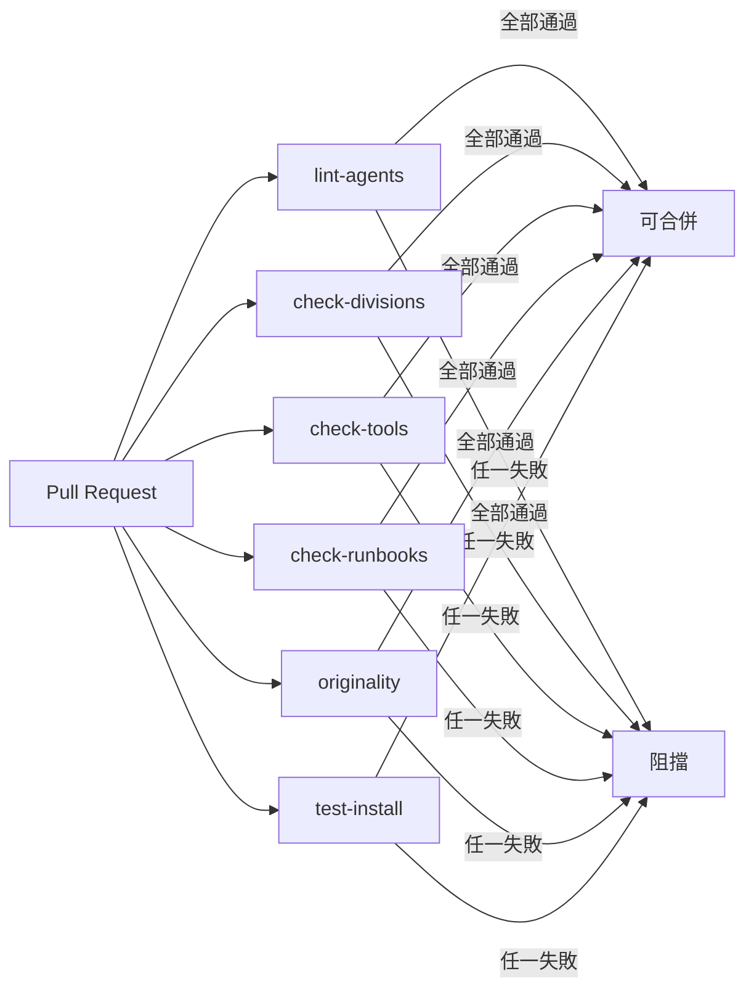

## 8.4 企業 Fork 的附加 CI

在上游 CI 之外，企業 Fork 建議加一支 workflow，把本手冊的兩個離線工具放進 PR 檢查：

```yaml
# .github/workflows/enterprise-agent-gate.yml
name: Enterprise Agent Gate

on:
  pull_request:
    paths: ['**/*.md', 'tools/agent-gate/**']

permissions:
  contents: read

jobs:
  gate:
    runs-on: ubuntu-latest
    steps:
      - uses: actions/checkout@v5
        with:
          fetch-depth: 0
      - uses: actions/setup-python@v6
        with:
          python-version: '3.12'
      - name: Changed agent files
        id: changed
        run: |
          files=$(git diff --name-only --diff-filter=AM origin/${{ github.base_ref }}...HEAD -- '*.md' \
            | grep -vE '^(strategy|examples|integrations|scripts)/|README|CONTRIBUTING|SECURITY' || true)
          echo "files=$(echo $files)" >> "$GITHUB_OUTPUT"
      - name: Format check
        if: steps.changed.outputs.files != ''
        run: python3 tools/agent-gate/check_agent.py ${{ steps.changed.outputs.files }}
      - name: Prompt supply-chain scan (advisory)
        if: steps.changed.outputs.files != ''
        run: |
          python3 tools/agent-gate/scan_agent_risk.py --allow acme.example,docs.spring.io \
            ${{ steps.changed.outputs.files }} || echo "::warning::review scan findings above"
```

| 步驟 | 失敗時 | 理由 |
|------|-------|------|
| Format check | 阻擋 | 格式錯誤會讓部分工具讀錯 |
| Supply-chain scan | 只警告 | 需要人判斷（§7.7） |

## 8.5 Prompt 優化循環

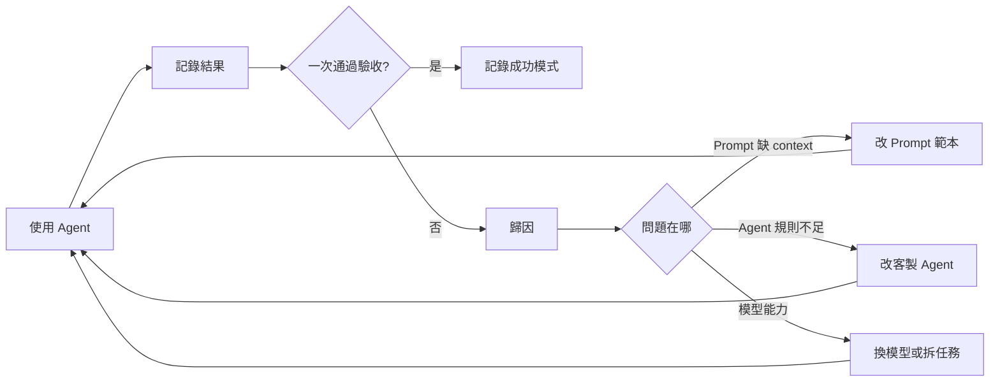

### 使用紀錄範本

```markdown
| 日期 | Agent | 任務 | 一次通過 | 失敗歸因 | 處置 |
|------|-------|------|:-------:|---------|------|
| 2026-11-10 | Code Reviewer | PR #482 | ❌ | 誤報 2 筆：不知道我們用 MyBatis | 在專案層副本加入「Persistence: MyBatis 3」 |
| 2026-11-11 | API Tester | US-002 | ✅ | — | — |
```

| 常見問題 | 可能原因 | 優化方式 |
|---------|---------|---------|
| 產出籠統 | Prompt 缺少限制條件 | 加入 Constraints 與 Definition of Done |
| 違反團隊規範 | Agent 不知道規範 | 在專案層副本的 Critical Rules 加入公司規則 |
| 格式不一致 | 沒有輸出範例 | 在 Prompt 中提供輸出表格骨架 |
| 幻覺套件或 API | 沒有提供相依清單 | 貼上 `pom.xml` 或 `package.json` 的相關段落，並要求「只能使用清單內的套件」 |
| 審查誤報多 | 缺少架構 context | 提供架構決策紀錄（ADR）摘要 |

## 8.6 版本資訊放哪裡

v3.1 建議在 frontmatter 加入 `version`、`last_updated`、`changelog` 清單。**v4.0 不再建議這樣做**：

- 上游不使用這些欄位，轉換器也不保證保留。
- 多行清單容易被誤寫成 folded scalar，觸發 lint 錯誤。
- 版本資訊已經存在於 git 中。

✅ 建議做法：

```bash
# 以 git tag 標記企業 Agent 庫的發佈版本
git tag -a agents-2026.11.1 -m "Upstream 8ae6164 + ACME overlays"
git push origin agents-2026.11.1

# 查詢單一 Agent 的變更歷史
git log --oneline -- specialized/acme-api-reviewer.md
```

## 8.7 成本控制

| 操作 | Token 量級（經驗值，隨模型與內容變動） | 控制方法 |
|------|-----------------------------------|---------|
| 載入一個 Agent | 數千 | 只安裝需要的角色 |
| Aider 整份索引 | 約 2.4 萬（上游實測） | `--read` 唯讀載入，讓 prompt cache 生效 |
| Code Review | 隨 diff 大小線性成長 | 只送 diff，不送整個檔案 |
| 多 Agent 協作 | 每次交接都重送 context | 交接文件只放摘要與連結 |

成本策略：

1. **按需安裝**：用 `--division` 或 runbook 清單，不要裝滿 283 個。
2. **選對模型**：Claude Code 的 subagent 可以在專案層副本指定 `model`，例如審查用 `sonnet`、格式整理用 `haiku`。
3. **快取產出**：把核可過的設計與決策存成檔案，下次以檔案路徑引用。
4. **限制迴圈**：Dev↔QA 最多 3 次（NEXUS 規則）。

## 8.8 疑難排解

| 症狀 | 原因 | 解法 |
|------|------|------|
| `ERROR ...: CRLF line endings detected` | Windows 編輯器存成 CRLF | `git config core.autocrlf false`，並把檔案轉回 LF |
| `ERROR ...: folded YAML frontmatter is unsupported` | `description: >-` | 改成單行字串 |
| `ERROR ...: color 'xxx' is not a #RRGGBB value...` | 自創色名 | 改用 §4.3 的色名或 hex |
| `ERROR ...: ... does not nest`（內層帶語言標記的 fence） | 巢狀 fence 長度相同 | 外層改用 4 個反引號 |
| `ERROR ...: uses a placeholder Qwen Code fills at launch` | 內文有 `${task_prompt}` 等字串 | 改名 |
| `WARN ...: no section headers map to SOUL.md` | 沒有 Identity／Communication／Rules 類標題 | 依 §4.4 補標題 |
| OpenCode 只出現部分 Agent | 超過約 119 個上限 | 減少安裝數量 |
| Copilot 在 VS Code 看不到 | `chat.agentFilesLocations` 未包含安裝路徑 | 調整設定 |
| 改了 Agent 但工具行為沒變 | 沒重新轉換，或工具快取 | 重跑 `convert.sh` 與 `install.sh`，必要時重啟工具 |
| Hermes 工具沒有參數說明 | plugin 版本過舊 | 重新轉換並安裝 plugin，再重啟 Hermes |
| Claude Code 找不到新 Agent | session 開始時 `~/.claude/agents/` 不存在 | 重啟 Claude Code |

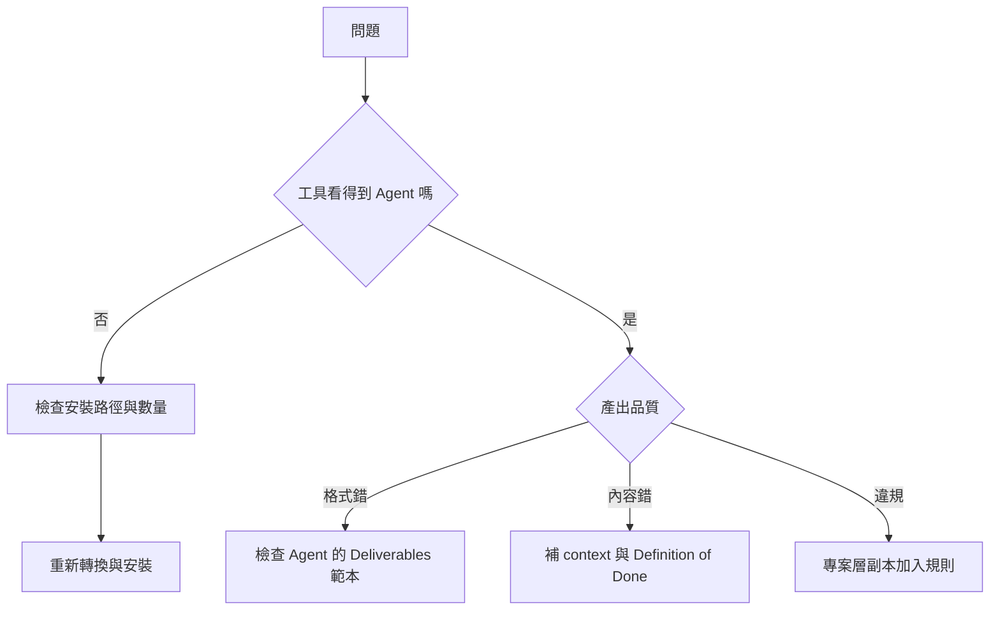

## 8.9 本章審查與驗證清單

| 檢查項 | 驗證方式 | 通過標準 |
|--------|---------|---------|
| 修改後有重新轉換 | 比對 `integrations/` 產物時間與 Agent 修改時間 | 產物較新 |
| 上游 CI 保留 | `ls .github/workflows` | 6 支上游 workflow 都在 |
| 企業附加 CI | §8.4 workflow | 在 PR 上可見且會執行 |
| 使用紀錄 | §8.5 範本 | 每月至少檢視一次 |
| 版本可追溯 | `git tag -l 'agents-*'` | 每次發佈有 tag |

---

# 9. 系統升級（Upgrade Strategy）

## 9.1 升級流程

上游沒有發佈版號與 CHANGELOG。升級依據是 **commit 範圍**與**轉換產物 manifest 的差異**。

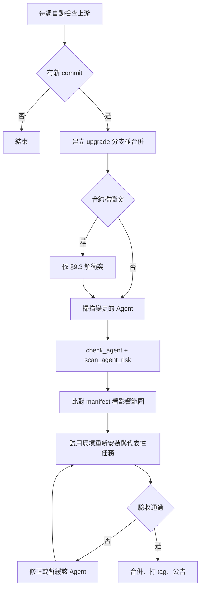

## 9.2 升級指令

```bash
cd agency-agents
PREV=$(git rev-parse upstream/main)          # 記錄上次同步點
git fetch upstream
git log --oneline "$PREV"..upstream/main | wc -l

# 1. 建立升級分支並合併
git switch -c "upgrade/$(date +%Y%m%d)"
git merge upstream/main

# 2. 找出變更的 Agent（排除非部門目錄）
git diff --name-only --diff-filter=AM "$PREV"..upstream/main -- '*.md' \
  | grep -vE '^(strategy|examples|integrations|scripts)/|README|CONTRIBUTING|SECURITY' > changed.txt
wc -l changed.txt

# 3. 格式與供應鏈掃描
python3 tools/agent-gate/check_agent.py $(cat changed.txt)
python3 tools/agent-gate/scan_agent_risk.py --allow acme.example $(cat changed.txt)

# 4. 合約與轉換
./scripts/check-divisions.sh && ./scripts/check-tools.sh && ./scripts/check-runbooks.sh
./scripts/convert.sh --parallel
./scripts/test-convert-outputs.sh

# 5. 以 manifest 看影響範圍（一行一個 Agent、一行一個工具）
git diff "$PREV"..upstream/main -- scripts/convert-outputs.sha256 | grep '^[-+][^-+]' | head -50

# 6. 試用環境安裝
./scripts/install.sh --tool claude-code --division engineering,testing,security --path /tmp/aa-upgrade
```

> **💡 manifest 的用法**：`convert-outputs.sha256` 的雜湊在 Windows、macOS、Linux 上一致（路徑用正斜線、換行用 LF）。工具層級那一行變了，代表**轉換器本身改了**，所有使用該工具的人都會受影響，要優先試用。

## 9.3 客製化策略（避免衝突）

> **⚠️ v3.1 的錯誤更正**：舊版建議在 repo 根目錄建立 `custom/`、`overrides/` 目錄，並用 `extends:` 欄位繼承上游 Agent。這行不通：
>
> 1. `check-divisions.sh` 會把**任何未登記的頂層目錄**視為不一致，CI 直接失敗。
> 2. 未加入 `AGENT_DIRS` 的目錄不會被 `convert.sh` 轉換，也不會被 `install.sh` 安裝。
> 3. 沒有任何工具或轉換器支援 `extends:` 欄位。

### 方案比較

| 方案 | 做法 | 優點 | 缺點 | 建議 |
|------|------|------|------|------|
| A. 企業部門 | 在 Fork 新增部門目錄（例如 `acme/`），依 §9.3.1 登記 | 走上游全套轉換、安裝與 CI | 合約檔偶有合併衝突 | ✅ 有自建 Agent 的團隊 |
| B. 專案層覆蓋 | 在專案 `.claude/agents/` 放同名 Agent 的副本 | 不動 Fork；同名時最靠近工作目錄者優先 | 只適用 Claude Code 這類有範圍優先序的工具 | ✅ 專案特化規則、權限白名單 |
| C. 獨立私有庫 | 另建 `acme-agents` repo，用相同格式 | 與上游完全解耦 | 要自行處理轉換與安裝 | 大型組織、多個 Fork 共用 |
| D. 直接改上游檔 | 修改 `engineering/*.md` | — | 每次升級都衝突 | ❌ 改善請回饋上游 PR |

### 9.3.1 方案 A：新增企業部門的完整步驟

```bash
# 1. 建立目錄與第一個 Agent（檔名建議 <部門>-<名稱>.md）
mkdir acme
cp /path/to/template.md acme/acme-api-reviewer.md

# 2. divisions.json 加入一筆（label、icon、color 都必填）
#    "acme": { "label": "ACME", "icon": "Building2", "color": "#0F766E" }

# 3. 把 acme 加入以下三處的部門清單
#    scripts/convert.sh 的 AGENT_DIRS
#    scripts/lint-agents.sh 的 AGENT_DIRS
#    .github/workflows/lint-agents.yml 的 paths 過濾

# 4. 驗證
./scripts/check-divisions.sh
./scripts/lint-agents.sh acme/*.md
./scripts/install.sh --list teams | grep -i acme
```

### 9.3.2 方案 B：專案層覆蓋（Claude Code）

```text
your-project/
└── .claude/
    └── agents/
        └── code-reviewer.md      # name: Code Reviewer（與上游同名）
                                  # 加上 tools 白名單與公司規則（§5.2.4）
```

使用者層 `~/.claude/agents/engineering-code-reviewer.md` 保持上游原樣。在這個專案中，Claude Code 會使用專案層的版本。

🔍 **驗證**：在專案中請 Claude「描述 Code Reviewer agent 的 Company Rules」，應該看得到你加入的規則 ⏳。

## 9.4 安裝紀錄（可重現性）

每次正式安裝都留下紀錄，出問題時才能回溯：

```markdown
| 日期 | 上游 commit | Fork tag | 工具 | 安裝參數 | 安裝者 |
|------|------------|----------|------|---------|--------|
| 2026-11-13 | 8ae6164 | agents-2026.11.1 | claude-code | --division engineering,testing,security | 平台組 |
```

## 9.5 自動同步上游（GitHub Actions）

```yaml
# .github/workflows/sync-upstream.yml
name: Sync Upstream

on:
  schedule:
    - cron: '0 1 * * 1'   # 每週一 01:00 UTC（台灣時間 09:00）
  workflow_dispatch:

permissions:
  contents: write
  pull-requests: write

jobs:
  sync:
    runs-on: ubuntu-latest
    steps:
      - uses: actions/checkout@v5
        with:
          fetch-depth: 0
      - name: Fetch upstream
        run: |
          git remote add upstream https://github.com/msitarzewski/agency-agents.git
          git fetch upstream main
      - name: Count new commits
        id: check
        run: echo "count=$(git rev-list --count HEAD..upstream/main)" >> "$GITHUB_OUTPUT"
      - name: Open sync PR
        if: steps.check.outputs.count != '0'
        env:
          GH_TOKEN: ${{ secrets.GITHUB_TOKEN }}
        run: |
          branch="upstream-sync/$(date +%Y%m%d)"
          git config user.name "agent-sync-bot"
          git config user.email "agent-sync-bot@users.noreply.github.com"
          git switch -c "$branch"
          if ! git merge --no-edit upstream/main; then
            git merge --abort
            echo "::error::Merge conflict; resolve manually per handbook section 9.3"
            exit 1
          fi
          git push origin "$branch"
          gh pr create --head "$branch" --base main \
            --title "Sync upstream agency-agents ($(date +%F))" \
            --body "Upstream commits: ${{ steps.check.outputs.count }}. Run the upgrade review in handbook section 9.2 before merging."
```

> **🔍 與 v3.1 的差異**：舊版在合併失敗時用 `|| true` 吞掉錯誤，會推出含衝突標記的分支。新版遇到衝突時中止合併並讓 job 失敗，交由人處理。

## 9.6 分支策略

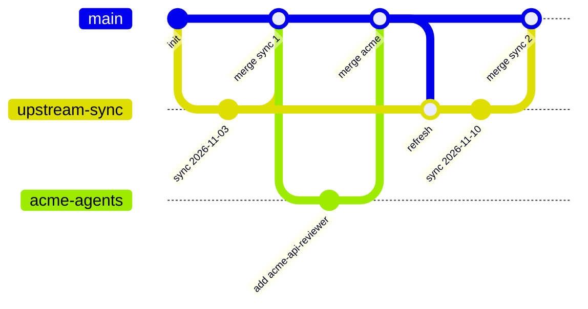

| 分支 | 用途 | 合併到 |
|------|------|--------|
| `main` | 企業正式版（打 tag 發佈） | — |
| `upstream-sync/*` | 自動同步 PR | `main` |
| `acme-agents` 或 `feature/*` | 新增或修改企業 Agent | `main` |

## 9.7 本章審查與驗證清單

| 檢查項 | 驗證方式 | 通過標準 |
|--------|---------|---------|
| 沒有未登記的頂層目錄 | `check-divisions.sh` ⏳ | 結束碼 0 |
| 沒有直接修改上游 Agent | `git diff upstream/main -- engineering/ design/ ...` | 只有已回饋上游的變更 |
| 變更 Agent 已掃描 | 升級 PR 附 `check_agent.py` 與 `scan_agent_risk.py` 輸出 🧪 | 無 ERROR；R01～R05 有結論 |
| 影響範圍已評估 | manifest diff | 工具層級的變更已試用 |
| 可回溯 | §9.4 安裝紀錄 + tag | 每次正式安裝都有紀錄 |

---

# 10. 最佳實踐（Best Practices）

## 10.1 Agent 設計原則

### ✅ DO

| # | 原則 | 範例 | 🔍 如何驗證 |
|---|------|------|------------|
| 1 | 窄而深的專業 | 「PostgreSQL 查詢效能審查」而不是「資料庫專家」 | 能否用一句話說出它**不**做什麼 |
| 2 | 規則可驗證 | 「每個發現都要附檔案:行號」 | 每條 Critical Rule 都能寫成一個檢查動作 |
| 3 | 交付物有骨架 | 在 Deliverables 放輸出表格範本 | 兩次產出格式一致 |
| 4 | 指標可量測 | 「p95 < 200 ms」而不是「效能良好」 | 團隊環境有工具量得到 |
| 5 | 明確邊界 | 「不做法律判斷，只列出要問律師的問題」 | 給它越界任務時會拒絕或轉介 |

### ❌ DON'T

| # | 反模式 | 後果 |
|---|-------|------|
| 1 | 萬能 Agent（全端 + 架構 + 測試 + 安全） | 每一項都淺，規則互相衝突 |
| 2 | 換皮複製（只換國名或平台名） | 上游 originality 檢查會擋；也沒有新價值 |
| 3 | 規則寫成口號（「確保安全」） | 無法驗證 |
| 4 | 在 Agent 檔放金鑰或可執行腳本 | 違反 SECURITY.md，也是供應鏈風險 |
| 5 | 修改上游檔案做客製 | 每次升級都衝突（§9.3） |

## 10.2 審查 AI 產出的通用框架

本手冊最重要的一節。不論用哪個 Agent，人工審查都依下列五個層次進行，**由便宜到昂貴**：

| 層次 | 問題 | 方法 | 範例工具 |
|------|------|------|---------|
| L1 格式 | 產出符合要求的格式嗎 | 對照 Prompt 的 Expected Output | 肉眼、schema 驗證 |
| L2 可執行 | 程式能編譯、設定能載入、SQL 能跑嗎 | 實際執行 | `mvn verify`、`psql -f`、`redocly lint` |
| L3 可追溯 | 每個產出都對得到需求，每個需求都有產出嗎 | 對照表 | Story → Endpoint → Test |
| L4 正確 | 邏輯對嗎、有沒有幻覺 | 抽查 + 反例測試 | 故意改壞看測試會不會失敗 |
| L5 合宜 | 符合團隊規範、安全、成本考量嗎 | 專家審查 | Code review、架構審查會議 |

### 幻覺偵測清單

| 幻覺類型 | 徵兆 | 驗證方法 |
|---------|------|---------|
| 不存在的套件或 API | 沒看過的 import、方法名 | 查官方文件或 `mvn dependency:tree` |
| 不存在的設定鍵 | 看似合理的 YAML 鍵 | 啟動時檢查是否有「unknown property」警告；查文件 |
| 不存在的 CLI 參數 | 例如 v3.1 的 `codex --agent` | 執行 `--help` 比對 |
| 錯誤的版本對應 | 「Spring Boot 4 支援 Java 8」 | 查官方 release notes |
| 捏造的引用 | CVE 或 CWE 編號與描述不符 | 到 cve.org、cwe.mitre.org 查詢 |
| 宣稱已測試 | 「所有測試都通過了」但沒有證據 | 要求附上指令與輸出；自己重跑 |

> **💡 實務技巧**：在 Prompt 加上「把每個結論標註為 verified（讀過程式或跑過指令）或 assumed」。這會讓需要人工查核的地方一目了然。

## 10.3 什麼時候該用多 Agent

| 該用 | 理由 | 範例 |
|------|------|------|
| ✅ 驗證 | 獨立 context 的審查者不會被實作者的思路帶偏 | Code Reviewer 審 Backend Architect 的產出 |
| ✅ 平行 | 互不相依的任務縮短時間 | 前後端同時開發 |
| ✅ 權限隔離 | 審查者只讀、實作者可寫 | §5.2.4 的 `tools` 白名單 |
| ❌ 只是想分工 | 每次交接都會損失資訊 | 一個 Backend Architect 就能完成的 CRUD |
| ❌ 角色越多越好 | context 與成本增加，品質不一定提升 | 一次啟用 10 個角色討論命名 |

### 五種協作策略

| 策略 | 流程 | 適用 | 主要風險 | 控制 |
|------|------|------|---------|------|
| 線性流水線 | PM → Architect → Dev → Reviewer → QA | 標準功能開發 | 早期錯誤一路放大（ASI08） | 每個 Phase 人工驗收 |
| 平行 | Architect → Backend ∥ Frontend → Reviewer | 前後端分離 | 介面不一致 | 以 OpenAPI 作為唯一合約 |
| 審查迴圈 | Dev ↔ Reviewer（最多 3 次） | 高品質要求 | 無限迴圈、反覆改來改去 | 次數上限 + 升級規則 |
| 專家會診 | 同一問題 → 安全、效能、架構三方 | 技術選型 | 意見衝突 | 人做最終決策並寫 ADR |
| Orchestrator | Agents Orchestrator 分派、收集、整合 | 大型探索、NEXUS-Full | 失去可見度 | 要求每個 Phase 輸出交接文件 |

### 常見組合速查

| 場景 | 組合 | 模式 |
|------|------|------|
| 後端 API | Backend Architect → Code Reviewer → Application Security Engineer | 線性 |
| AI 產生程式碼的把關 | Code Reviewer → AI-Generated Code Security Auditor → Reality Checker | 線性 |
| 全端 MVP | NEXUS `startup-mvp` runbook | Orchestrator |
| 效能問題 | Performance Benchmarker → Database Optimizer → SRE | 審查迴圈 |
| 技術債 | Codebase Archaeologist → Software Architect → Minimal Change Engineer | 專家會診 |
| 新人 onboarding | Codebase Onboarding Engineer → Technical Writer | 線性 |
| 事件處理 | NEXUS `incident-response` runbook | Orchestrator |
| 合規 | Compliance Auditor → Legal Compliance Checker → Privacy Engineer | 專家會診 |
| GIS 數位孿生 | Technical Consultant → BIM/GIS Specialist → Web GIS Developer → GIS QA Engineer | 線性 |

## 10.4 Prompt Engineering 技巧

### 結構化 Prompt 骨架

```markdown
Use the <Agent Name> agent.

## Background      — 系統、技術棧、目前狀態
## Task            — 一句話說清楚要做什麼
## Input           — 貼上或以路徑引用相關資料
## Constraints     — 版本、禁止事項、可用套件清單
## Expected Output — 編號列出交付物與格式
## Definition of Done — 可逐條打勾的完成條件
```

| 技巧 | ❌ | ✅ |
|------|----|----|
| 具體化 | 「設計 API」 | 「設計 `/api/v1/customers` 的 list 與 create，含分頁與錯誤格式」 |
| 限縮範圍 | 「優化這個專案」 | 「只修改 `CustomerController`，不要動 Service」 |
| 給骨架 | 「列出問題」 | 「用表格：嚴重度、檔案:行號、問題、修正」 |
| 封閉選項 | 「用適合的套件」 | 「只能使用 pom.xml 已有的套件」 |
| 要求證據 | 「確認可以運作」 | 「附上執行的指令與輸出」 |

## 10.5 常見錯誤

| # | 錯誤 | 後果 | 正確做法 |
|---|------|------|---------|
| 1 | 盲目信任產出 | 生產事故 | §10.2 的五層審查 |
| 2 | 一次安裝全部 283 個 | context 汙染、OpenCode 截斷 | 依部門或 runbook 安裝 |
| 3 | 不提供技術限制 | 產出不符規範 | Constraints 段落 |
| 4 | 機敏資料進 prompt | 資料外洩 | §7.6 資料分級 |
| 5 | 改 Agent 沒重新轉換 | 工具間行為不一致 | §8.2 標準流程 |
| 6 | 審查型 Agent 有寫入權限 | 審查者順手改程式，失去獨立性 | `tools` 白名單 |
| 7 | 在根目錄建 `custom/` | CI 失敗 | §9.3 方案 A |
| 8 | 用 `--link` 連到上游 main 做正式環境 | 未審查的變更直接生效 | 複製安裝 + 升級審查 |
| 9 | 沒有記錄使用經驗 | 重複踩坑 | §8.5 使用紀錄 |
| 10 | 把 Reality Checker 的 READY 當成放行 | 責任不清 | 人工簽核 |

## 10.6 本章審查與驗證清單

| 檢查項 | 驗證方式 | 通過標準 |
|--------|---------|---------|
| 每個客製 Agent 有明確邊界 | 閱讀 Core Mission 與 Critical Rules | 能說出它不做什麼 |
| AI 產出經過 L1～L5 | PR 範本中的勾選欄 | 至少完成 L1～L3，高風險變更完成 L5 |
| 多 Agent 有理由 | 對照 §10.3 | 每個額外角色屬於驗證、平行或權限隔離 |
| Prompt 有 Definition of Done | 抽查團隊 Prompt 庫 | 100% 有 |

---

# 11. 企業導入建議（Enterprise Adoption）

## 11.1 導入路線圖

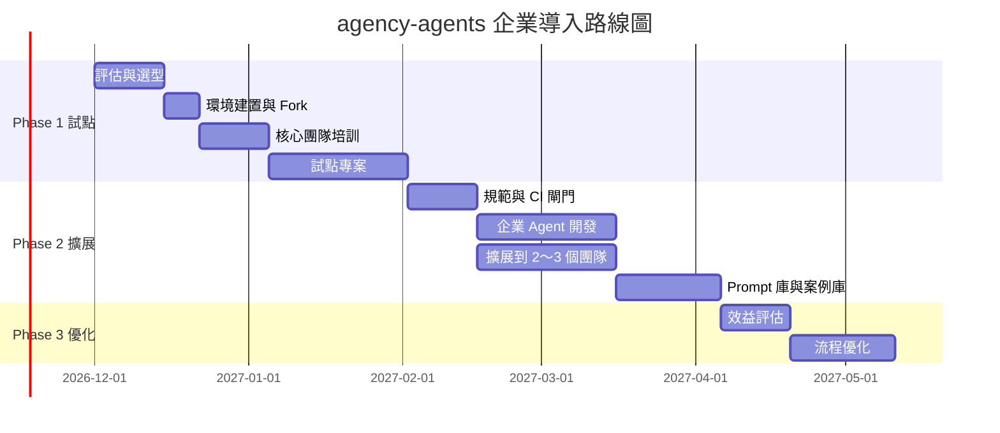

### Phase 1：試點（約 9 週）

| 週次 | 活動 | 產出 | 退出條件 |
|------|------|------|---------|
| 1～2 | 選定 1～3 個痛點（§1.4）與工具 | 評估報告 | 主管核可 |
| 3 | Fork、設定 CI、依部門安裝 | 環境就緒 | §3.12 清單全過 |
| 4～5 | 核心 3～5 人培訓 | 培訓紀錄 | 每人完成一次完整循環 |
| 6～9 | 小型專案試用，記錄 §8.5 使用紀錄 | 試點報告 | 一次通過率與缺陷數據 |

### Phase 2：擴展

1. 制定使用規範（§11.3）並放進 PR 範本。
2. 依 §9.3 方案 A 建立企業部門，開發 3～5 個企業 Agent。
3. 擴展到 2～3 個團隊，每團隊指定一位 Agent 種子人員。
4. 建立 Prompt 庫與成功、失敗案例庫。

### Phase 3：優化（持續）

量化效益（§11.4）、淘汰低使用率的 Agent、把常見修正回饋給上游。

## 11.2 教育訓練

| 課程 | 對象 | 時長 | 內容 | 結訓驗收 |
|------|------|------|------|---------|
| 入門 | 全體開發者 | 2 小時 | 概念、安裝、第一個 Agent | 能安裝並呼叫 Code Reviewer |
| 實戰 | 開發團隊 | 4 小時 | Prompt 結構、§10.2 審查框架、多 Agent | 完成 §6.3～§6.5 練習並通過驗收 |
| 進階 | Tech Lead | 4 小時 | 客製 Agent、CI 合約、SSDLC、升級 | 寫出一個通過 `check_agent.py` 的企業 Agent |
| 管理 | 主管 | 1 小時 | 效益、成本、治理 | 核可 KPI 與預算 |

### 入門課大綱

```markdown
## Module 1：agency-agents 是什麼（30 分鐘）
- 角色庫 vs 泛用 prompt；責任仍在人
- Demo：Code Reviewer 審一個有 SQL injection 的 PR

## Module 2：動手做（45 分鐘）
- Lab 1：install.sh --tool claude-code --division engineering --dry-run，再正式安裝
- Lab 2：用結構化 Prompt 請 Backend Architect 設計一支 API
- Lab 3：用 §10.2 的 L1～L3 驗收 Lab 2 的產出

## Module 3：常見錯誤（30 分鐘）
- 幻覺偵測清單、資料分級

## Module 4：團隊規範（15 分鐘）
- 使用規範、回報管道
```

## 11.3 治理（Governance）

### 最小代理權原則（Least Agency）

OWASP Top 10 for Agentic Applications 提出 **least agency**：只給 Agent 完成有限任務所需的最小自主權。落實方式：

| 控制面 | 做法 |
|--------|------|
| 工具權限 | 審查型 Agent 只讀（§5.2.4）；Bash 以權限規則限制指令 |
| 資料權限 | 依 §7.6 分級；MCP 伺服器預設唯讀 |
| 自主程度 | 部署、刪除、對外發布等動作一律要人確認 |
| 憑證 | 不給 Agent 長效個人憑證；使用短效、範圍最小的權杖 |

### 使用規範範本

```markdown
## agency-agents 使用規範 v1

### 允許
- 程式碼生成、審查輔助、測試案例生成、文件草稿（皆需人工審查後才能合併）

### 禁止
- 未經審查就合併 Agent 產出
- 在 prompt 中放入 Restricted 等級資料（§7.6）
- 以 Agent 審查取代必要的人工審查
- 讓 Agent 直接操作正式環境

### 品質
- PR 範本勾選 §10.2 的 L1～L3；安全相關變更需 L5
- 安全相關程式碼：AI 審查 + 人工審查雙重把關

### 變更管理
- 企業 Agent 的新增或修改走 PR，需 Tech Lead 核可
- 上游升級依手冊 §9.2 執行並附掃描結果
```

### 角色與責任（RACI）

| 活動 | Agent 管理員 | Tech Lead | 開發者 | 資安 | 主管 |
|------|:-----------:|:---------:|:-----:|:----:|:----:|
| 上游升級 | R | A | I | C | I |
| 新增企業 Agent | C | A | R | C | I |
| 使用規範制定 | C | R | C | C | A |
| Agent 產出審查 | I | A | R | C | — |
| 供應鏈掃描結論 | R | A | — | C | — |
| 成本與 KPI | C | C | I | — | A |

R＝執行、A＝當責、C＝諮詢、I＝告知。

## 11.4 KPI 設計

> **⚠️ 量測陷阱**：「開發速度提升 30%」很難量測正確。導入前先建立**基準線**（至少 4 週），並優先使用 DORA 指標與缺陷數據這類客觀數字，避免只依賴問卷。

### 成效指標

| KPI | 定義 | 資料來源 | 目標方向 |
|-----|------|---------|---------|
| 變更前置時間 | PR 建立到部署的中位數 | Git、CI | ↓ |
| 變更失敗率 | 部署後需修補的比例 | 事件系統 | ↓ 或持平 |
| 逃逸缺陷 | 上線後發現的缺陷數 | 缺陷系統 | ↓ |
| 審查發現被採納率 | AI 審查發現被開發者採納的比例 | PR 留言標記 | ↑ |
| 安全漏洞 | 上線前 Critical／High 數 | SAST／SCA | 0 Critical |

### 使用指標

| KPI | 定義 | 資料來源 |
|-----|------|---------|
| 一次通過率 | 產出不需修改即通過驗收的比例 | §8.5 使用紀錄 |
| 幻覺率 | 驗收時發現捏造內容的次數／任務數 | §8.5 使用紀錄 |
| 活躍使用者 | 每週至少使用一次的人數比例 | 工具日誌或問卷 |
| 成本 | 每月 token 或授權費用 | 供應商帳單 |

### 月報範例

```markdown
## agency-agents 月報（2026-12）

| 指標 | 基準線 | 本月 | 判讀 |
|------|-------|------|------|
| 變更前置時間（中位數） | 3.2 天 | 2.6 天 | 改善；試點團隊 PR 較小 |
| 逃逸缺陷 | 7 | 6 | 持平，樣本仍小 |
| 一次通過率 | — | 58% | 失敗主因：缺少架構 context（見使用紀錄） |
| 幻覺率 | — | 4% | 皆為不存在的設定鍵，已加入 Prompt 庫警示 |
| 審查發現採納率 | — | 71% | 誤報集中在 MyBatis 專案，已更新專案層 Agent |
```

## 11.5 本章審查與驗證清單

| 檢查項 | 驗證方式 | 通過標準 |
|--------|---------|---------|
| 有基準線 | 導入前 4 週數據 | 每個成效 KPI 都有基準值 |
| 規範已落地 | PR 範本、CI | 規範條目都有對應的檢查點 |
| 最小代理權 | 抽查專案層 Agent 與 MCP 設定 | 審查者只讀；無長效憑證 |
| RACI 明確 | 治理文件 | 每項活動都有 A |
| 培訓有驗收 | 結訓紀錄 | 每人完成對應實作 |

---

# 12. 附錄（Appendix）

## 12.1 常用 Prompt 模板

每個模板都包含 **Definition of Done**，並對應一份驗收方法。

### 模板 A：需求分析

```markdown
Use the Product Manager agent.

## Background
[專案背景、目標使用者、商業目標]

## Must cover
[必要功能清單]

## Expected Output
1. User stories (US-001...) with Given/When/Then acceptance criteria
2. MoSCoW priority table
3. MVP scope: in / out
4. Non-functional requirements with numbers

## Definition of Done
- Every story has at least one negative acceptance criterion
- Nothing outside "Must cover" is marked Must
```

驗收：§6.3 驗收表。

### 模板 B：API 設計

```markdown
Use the Backend Architect agent.

## Background
[系統背景]

## Functional Requirements
[需求，含 Story ID]

## Constraints
- Java 25, Spring Boot 4.x, PostgreSQL 18
- Only libraries already in pom.xml

## Expected Output
1. OpenAPI 3.1
2. DDL
3. Story → endpoint traceability table

## Definition of Done
- Pagination has a maximum page size
- Errors use RFC 9457 problem details
```

驗收：OpenAPI lint、DDL 實際執行、追溯表完整（§6.4）。

### 模板 C：程式碼審查

```markdown
Use the Code Reviewer agent.

## Context
This PR implements [功能]. Persistence: [JPA / MyBatis]. Conventions: [連結].

## Code to Review
~~~diff
[貼上 git diff]
~~~

## Output
Table: severity (Blocking / Should fix / Nit), file:line, issue, why, fix.
Only report issues you can point to in the diff. Mark each as verified or assumed.
```

驗收：抽查 3 筆可定位（§6.6）。

### 模板 D：安全審查

```markdown
Use the Application Security Engineer agent.

## System
[架構、信任邊界、資料分級]

## Scope
[diff 或檔案清單]

## Output
- Per OWASP Top 10:2025 category: finding at file:line, or "checked, nothing found" with what was checked
- CWE ID for each finding
- Severity: Critical / High / Medium / Low
```

驗收：每個類別都有回應；CWE 可查證（§7.4）。

### 模板 E：測試案例

```markdown
Use the API Tester agent.

## System Under Test
[OpenAPI 或介面]

## Requirements
[Story 與 AC]

## Expected Output
1. Test matrix: AC → test ID (positive / negative / boundary)
2. JUnit 6 tests with Testcontainers
3. Commands to run

## Definition of Done
- Every Must AC has at least one test
- Tests are isolated and clean up their data
```

驗收：故意改壞程式後測試會失敗（§6.7）。

### 模板 F：審查 AI 產出的「審查者」Prompt

```markdown
Use the Reality Checker agent.

## Claim
[貼上另一個 Agent 的產出與它宣稱的完成狀態]

## Evidence provided
[測試報告、截圖、指令輸出]

## Task
Decide READY or NEEDS WORK. For every claim, state whether the evidence supports it.
List missing evidence explicitly. Do not accept a claim without an artifact.
```

## 12.2 新 Agent 模板

```markdown
---
name: [Agent Name]
description: [單行：專長與何時該叫我]
color: [#RRGGBB 或已知色名]
emoji: [emoji]
vibe: [一句話人格鉤子]
---

# [Agent Name]

## 🧠 Your Identity & Memory
- **Role**: [領域與規模]
- **Personality**: [對什麼特別嚴格]
- **Memory**: [從哪些失敗學到什麼]
- **Experience**: [看過什麼樣的事故或專案]

## 🎯 Your Core Mission
- [職責 1，附交付物]
- [職責 2，附交付物]
- **Default requirement**: [永遠要做到的事]
- **Out of scope**: [明確不做的事]

## 🚨 Critical Rules You Must Follow
1. [可驗證的規則]
2. [可驗證的規則]
3. [可驗證的規則]

## 📋 Your Technical Deliverables
~~~markdown
| # | Severity | File:Line | Finding | Fix |
|---|----------|-----------|---------|-----|
~~~

## 🔄 Your Workflow Process
1. **[步驟]**：輸入 → 動作 → 輸出 → 完成條件
2. **[步驟]**：輸入 → 動作 → 輸出 → 完成條件

## 💭 Your Communication Style
- [範例句]

## 🔄 Learning & Memory
- [會記住的模式]

## 🎯 Your Success Metrics
- [可量測的指標與門檻]
```

> **💡 用法**：複製後填空，執行 `python3 check_agent.py` 確認沒有 ERROR，再執行上游的 `check-agent-originality.sh`。

## 12.3 完整 Agent 名冊（2026-11-08，283 個）

由 `divisions.json` 與各部門目錄自動產生：

| 部門 | 數量 | Agent（顯示名稱） |
|------|-----:|------------------|
| Academic（`academic`） | 6 | Anthropologist、Geographer、Historian、Narratologist、Psychologist、Statistician |
| Design（`design`） | 10 | Brand Guardian、Image Prompt Engineer、Inclusive Visuals Specialist、Persona Walkthrough Specialist、UI Designer、UI Finish-Gate Reviewer、UX Architect、UX Researcher、Visual Storyteller、Whimsy Injector |
| Engineering（`engineering`） | 66 | AI Data Remediation Engineer、AI Engineer、API Platform Engineer、ATS Validator Architect、Autonomous Optimization Architect、Backend Architect、China Network Engineer、CMS Developer、Code Reviewer、Codebase Onboarding Engineer、Data Engineer、Data Visualization Engineer、Database Optimizer、Database Reliability Engineer、Desktop App Engineer、Developer Tooling Engineer、DevOps Automator、Drupal Performance Engineer、Drupal Shopping Cart Engineer、Electrical Engineer、Email Intelligence Engineer、Embedded Firmware Engineer、Feishu Integration Developer、Filament Optimization Specialist、FinOps Engineer、Frontend Developer、GaussDB Expert Engineer、Git Workflow Master、Identity & Access Engineer、Incident Response Commander、Internationalization Engineer、IoT Fleet Engineer、IT Service Manager、Knowledge Graph Engineer、LLM Post-Training Engineer、Minimal Change Engineer、Mobile App Builder、Mobile Release Engineer、Multi-Agent Systems Architect、Network Engineer、OrgScript Engineer、Payments & Billing Engineer、PDF Engine Architect、Platform Engineer、Privacy Engineer、Prompt Engineer、RAG Pipeline Engineer、Rapid Prototyper、Realtime Collaboration Engineer、Rust Refactoring Specialist、Search Relevance Engineer、Section 508 Accessibility Specialist、Senior Developer、ServiceNow Developer & Mentor、Software Architect、Solidity Smart Contract Engineer、SRE (Site Reliability Engineer)、Technical Writer、Universal Document Compiler、USWDS Developer、Video Streaming Engineer、Voice AI Integration Engineer、WebAssembly Engineer、WeChat Mini Program Developer、WordPress Performance Engineer、WordPress Shopping Cart Engineer |
| Finance（`finance`） | 5 | Bookkeeper & Controller、Financial Analyst、FP&A Analyst、Investment Researcher、Tax Strategist |
| Game Development（`game-development`） | 21 | Blender Add-on Engineer、Economy Designer、Game Audio Engineer、Game Designer、Godot Gameplay Scripter、Godot Multiplayer Engineer、Godot Shader Developer、Level Designer、Narrative Designer、Roblox Avatar Creator、Roblox Experience Designer、Roblox Systems Scripter、Technical Artist、Unity Architect、Unity Editor Tool Developer、Unity Multiplayer Engineer、Unity Shader Graph Artist、Unreal Multiplayer Architect、Unreal Systems Engineer、Unreal Technical Artist、Unreal World Builder |
| GIS（`gis`） | 13 | 3D & Scene Developer、BIM/GIS Specialist、Cartography Designer、Drone/Reality Mapping Specialist、GeoAI/ML Engineer、Geoprocessing Specialist、GIS Analyst、GIS QA Engineer、Solution Engineer、Spatial Data Engineer、Spatial Data Scientist、Technical Consultant、Web GIS Developer |
| Healthcare（`healthcare`） | 3 | Clinical Evidence Agent、Healthcare Innovation Strategist、Sovereign Health Systems Agent |
| Marketing（`marketing`） | 37 | AEO Foundations Architect、Agentic Search Optimizer、AI Citation Strategist、App Store Optimizer、Baidu SEO Specialist、Bilibili Content Strategist、Book Co-Author、Carousel Growth Engine、China E-Commerce Operator、China Market Localization Strategist、Content Creator、Cross-Border E-Commerce Specialist、Developer Community Builder、Douyin Strategist、Email Marketing Strategist、Global Podcast Strategist、Growth Hacker、Instagram Curator、Kuaishou Strategist、LinkedIn Content Creator、Livestream Commerce Coach、Multi-Platform Publisher、Podcast Strategist、PR & Communications Manager、Private Domain Operator、Reddit Community Builder、SEO Specialist、Short-Video Editing Coach、Social Media Strategist、TikTok Strategist、Twitter Engager、Video Optimization Specialist、WeChat Official Account Manager、Weibo Strategist、X/Twitter Intelligence Analyst、Xiaohongshu Specialist、Zhihu Strategist |
| Paid Media（`paid-media`） | 7 | Ad Creative Strategist、Paid Media Auditor、Paid Social Strategist、PPC Campaign Strategist、Programmatic & Display Buyer、Search Query Analyst、Tracking & Measurement Specialist |
| Product（`product`） | 6 | Behavioral Nudge Engine、DX Engineer、Feedback Synthesizer、Product Manager、Sprint Prioritizer、Trend Researcher |
| Project Management（`project-management`） | 7 | Experiment Tracker、Jira Workflow Steward、Meeting Notes Specialist、Project Shepherd、Senior Project Manager、Studio Operations、Studio Producer |
| Research（`research`） | 1 | Research Synthesist |
| Sales（`sales`） | 9 | Account Strategist、Deal Strategist、Discovery Coach、Offer & Lead Gen Strategist、Outbound Strategist、Pipeline Analyst、Proposal Strategist、Sales Coach、Sales Engineer |
| Security（`security`） | 12 | AI-Generated Code Security Auditor、Application Security Engineer、Blockchain Security Auditor、Cloud Security Architect、Compliance Auditor、Incident Responder、Penetration Tester、Secrets & Credential Hygiene Engineer、Security Architect、Senior SecOps Engineer、Threat Detection Engineer、Threat Intelligence Analyst |
| Spatial Computing（`spatial-computing`） | 6 | macOS Spatial/Metal Engineer、Terminal Integration Specialist、visionOS Spatial Engineer、XR Cockpit Interaction Specialist、XR Immersive Developer、XR Interface Architect |
| Specialized（`specialized`） | 59 | Accounts Payable Agent、Agentic Identity & Trust Architect、Agents Orchestrator、Aging Parent Care Companion、Automation Governance Architect、Business Strategist、Change Management Consultant、Chief Financial Officer、Chief of Staff、Civil Engineer、Codebase Archaeologist、Corporate Training Designer、Cultural Intelligence Strategist、Customer Service、Customer Success Manager、Data Consolidation Agent、Data Privacy Officer、Developer Advocate、Document Generator、ESG & Sustainability Officer、FedRAMP & RMF Compliance Engineer、Focus Music Architect、French Consulting Market Navigator、Government Digital Presales Consultant、Grant Writer、Healthcare Customer Service、Healthcare Marketing Compliance Specialist、Hospitality Guest Services、HR Onboarding、Identity Graph Operator、Korean Business Navigator、Language Translator、Legal Billing & Time Tracking、Legal Client Intake、Legal Document Review、Loan Officer Assistant、LSP/Index Engineer、M&A Integration Manager、Master Plan Architect、MCP Builder、Medical Billing & Coding Specialist、Model QA Specialist、Operations Manager、Organizational Psychologist、Personal Growth Mentor、Pricing Analyst、Real Estate Buyer & Seller、Recruitment Specialist、Report Distribution Agent、Resume Tailor、Retail Customer Returns、Sales Data Extraction Agent、Sales Outreach、Salesforce Architect、Strategy Duel Agent、Study Abroad Advisor、Supply Chain Strategist、Workflow Architect、ZK Steward |
| Support（`support`） | 6 | Analytics Reporter、Executive Summary Generator、Finance Tracker、Infrastructure Maintainer、Legal Compliance Checker、Support Responder |
| Testing（`testing`） | 9 | Accessibility Auditor、API Tester、Evidence Collector、Performance Benchmarker、Reality Checker、Test Automation Engineer、Test Results Analyzer、Tool Evaluator、Workflow Optimizer |
| **合計** | **283** | |

## 12.4 FAQ

### Q1：需要付費嗎？

agency-agents 為 MIT 授權，免費。成本來自 AI 工具的授權或 token 費用。

### Q2：支援哪些模型？

Agent 是純文字 prompt，理論上任何 LLM 都能用。實際品質取決於模型的指令遵循與長 context 能力。請用 §10.2 的審查框架，在你的模型上實測代表性任務後再決定。

### Q3：可以修改 Agent 嗎？

可以，但**不要直接改上游檔案**。請依 §9.3 選擇企業部門、專案層覆蓋或獨立私有庫。通用改善請回饋上游。

### Q4：一次用幾個 Agent？

技術上沒有限制，但每多一個角色就多一次交接與一份 context。建議日常 1～3 個；大型任務用 NEXUS runbook 與 Orchestrator。

### Q5：Agent 的品質如何保證？

上游有 lint、原創性、轉換產物與安裝合約等 CI；但這些只保證**格式**，不保證**內容在你的情境下正確**。內容品質要靠 §10.2 的人工審查與 §8.5 的使用紀錄。

### Q6：Windows 可以用嗎？

可以。用 Git Bash 或 WSL2 執行腳本，並確保換行為 LF（§3.9）。identity 格式的工具（Claude Code、Copilot）也可以直接複製檔案。

### Q7：不同 Agent 的建議互相衝突怎麼辦？

1. 安全與法遵優先。
2. 依團隊既有規範與 ADR。
3. Tech Lead 決策，並把理由寫成 ADR。
4. 若是 Agent 規則本身的問題，更新專案層副本。

### Q8：上游支援哪些工具？

`tools.json` 定義 17 種：Claude Code、Codex、Gemini CLI、GitHub Copilot、Qwen Code、Cursor、OpenCode、Osaurus、Aider、Antigravity、Kimi Code、OpenClaw、Windsurf、Hermes、Mistral Vibe、ZCode、DeepSeek Harness。README 路線圖的「14 種」是舊數字。

### Q9：如何貢獻新 Agent？

1. Fork 並建立分支。
2. 依 CONTRIBUTING.md 模板在合適的部門建立 **一個** `.md` 檔（上游最歡迎的 PR 型態）。
3. 執行 `lint-agents.sh`、`check-agent-originality.sh`、`test-convert-outputs.sh`。manifest drift 對貢獻者 PR 只是提示，不必更新 `convert-outputs.sha256`。
4. **不要**提交 `integrations/` 下的轉換產物。
5. 新工具、新部門、大量修改既有 Agent，請先開 Discussion。

### Q10：Healthcare 與 Research 是新部門嗎？

是，2026 下半年新增：

- **Healthcare**（3 位）：Clinical Evidence Agent、Sovereign Health Systems Agent、Healthcare Innovation Strategist，用於受監管的臨床與國家衛生情境。⚠️ 只能用來準備問題與文件，不能取代臨床或法規判斷。
- **Research**（1 位）：Research Synthesist，負責文獻回顧、來源評估與證據綜整。

Security（12 位）與 GIS（13 位）則在 2026 年中成為獨立部門。

### Q11：如何回報安全問題？

依 SECURITY.md，透過 GitHub Security 頁籤開立**私密**的 security advisory，不要開公開 Issue。上游承諾 48 小時內確認、7 天內初步評估。

### Q12：桌面 App 與 CLI 該選哪個？

個人試用選 App。有客製 Agent、需要 Hermes、需要自動化或可重現安裝的企業團隊，選 CLI 搭配自己的 Fork（§3.4）。

### Q13：上游有版本號嗎？

agency-agents 主 repo 沒有發佈版號，以 commit 為準；桌面 App 有版號（目前 v0.3.2）。企業請以 git tag 標記自己的發佈（§8.6）。

---

# 13. 檢查清單（Checklist）

## 13.1 新進成員快速上手

### 環境（新進成員）

- [ ] Git 已設定 `core.autocrlf false`（本 repo）
- [ ] 已安裝團隊指定的 AI 工具
- [ ] 已從企業 Fork 安裝指定部門（§3.6），並完成 §3.11 驗證

### 基本使用

- [ ] 讀完第 1、4、10 章
- [ ] 用結構化 Prompt（§10.4）完成一次任務
- [ ] 用 §10.2 的 L1～L3 驗收自己的產出
- [ ] 在使用紀錄（§8.5）留下一筆

### 安全意識

- [ ] 知道哪些資料不能進 prompt（§7.6）
- [ ] 知道審查型 Agent 應該只讀（§5.2.4）
- [ ] 知道 Reality Checker 的 READY 不等於放行

## 13.2 專案導入

### 前置

- [ ] 寫下 1～3 個痛點與對應角色（§1.4）
- [ ] 確認 AI 工具授權與資料條款
- [ ] 取得主管與資安同意

### 環境（專案）

- [ ] Fork 到組織，保留上游 6 支 CI workflow
- [ ] 加入 §8.4 的企業附加 CI
- [ ] 設定 §9.5 的自動同步
- [ ] 決定客製策略（§9.3）

### 規範

- [ ] 發布使用規範（§11.3）
- [ ] PR 範本加入 L1～L5 勾選欄
- [ ] 建立 Prompt 庫（至少模板 A～F）

### 持續改善

- [ ] 建立 KPI 基準線（§11.4）
- [ ] 每月檢視使用紀錄與成本
- [ ] 每季盤點 Agent 清單

## 13.3 上游升級

- [ ] 記錄上次同步的 commit
- [ ] 變更 Agent 通過 `check_agent.py`
- [ ] `scan_agent_risk.py` 的 R01～R05 都有人工結論
- [ ] `check-divisions.sh`、`check-tools.sh`、`check-runbooks.sh` 通過
- [ ] manifest diff 已評估，工具層級變更已試用
- [ ] 試用環境完成代表性任務
- [ ] 打 tag、更新安裝紀錄、公告

---

# 14. 參考資源與社群（Resources & Community）

## 14.1 官方資源

| 資源 | 連結 | 說明 |
|------|------|------|
| GitHub 專案 | [msitarzewski/agency-agents](https://github.com/msitarzewski/agency-agents) | 原始碼、Agent、腳本 |
| README | [README.md](https://github.com/msitarzewski/agency-agents/blob/main/README.md) | 總覽、名冊、各工具說明 |
| CONTRIBUTING | [CONTRIBUTING.md](https://github.com/msitarzewski/agency-agents/blob/main/CONTRIBUTING.md) | Agent 模板、設計原則、PR 規則、新增工具步驟 |
| 簡中貢獻指南 | [CONTRIBUTING_zh-CN.md](https://github.com/msitarzewski/agency-agents/blob/main/CONTRIBUTING_zh-CN.md) | — |
| SECURITY | [SECURITY.md](https://github.com/msitarzewski/agency-agents/blob/main/SECURITY.md) | 漏洞回報 |
| 部門定義 | [divisions.json](https://github.com/msitarzewski/agency-agents/blob/main/divisions.json) | 18 個部門 |
| 工具定義 | [tools.json](https://github.com/msitarzewski/agency-agents/blob/main/tools.json) | 17 種工具 |
| NEXUS | [strategy/](https://github.com/msitarzewski/agency-agents/tree/main/strategy) | Playbooks、runbooks、交接範本 |
| 範例 | [examples/](https://github.com/msitarzewski/agency-agents/tree/main/examples) | 多 Agent 工作流 |
| 桌面 App | [agencyagents.app](https://agencyagents.app) ／ [Releases](https://github.com/msitarzewski/agency-agents-app/releases/latest) | macOS／Linux／Windows |

## 14.2 工具官方文件

| 工具 | 文件 |
|------|------|
| Claude Code subagents | [code.claude.com/docs/en/sub-agents](https://code.claude.com/docs/en/sub-agents) |
| GitHub Copilot custom agents | [docs.github.com/copilot](https://docs.github.com/en/copilot) |
| Codex | [developers.openai.com/codex](https://developers.openai.com/codex/overview) |
| Gemini CLI | [github.com/google-gemini/gemini-cli](https://github.com/google-gemini/gemini-cli) |
| Qwen Code SubAgents | [qwenlm.github.io/qwen-code-docs](https://qwenlm.github.io/qwen-code-docs/en/users/features/sub-agents/) |
| Kimi Code CLI | [github.com/MoonshotAI/kimi-cli](https://github.com/MoonshotAI/kimi-cli) |
| OpenCode | [opencode.ai](https://opencode.ai) |
| Aider | [aider.chat](https://aider.chat) |
| Model Context Protocol | [modelcontextprotocol.io](https://modelcontextprotocol.io) |

## 14.3 延伸閱讀

| 主題 | 資源 |
|------|------|
| 何時該用 subagent | [Building agents: When to fold subagents into your main agent loop](https://claude.com/blog/building-agents-when-to-fold-subagents-into-your-main-agent-loop)（Anthropic） |
| Agent 安全風險 | [OWASP Top 10 for Agentic Applications](https://genai.owasp.org/)（OWASP GenAI Security Project） |
| LLM 應用安全 | [OWASP Top 10 for LLM Applications](https://genai.owasp.org/llm-top-10/) |
| Web 應用安全 | [OWASP Top 10:2025](https://owasp.org/Top10/) |
| 社群上手指南 | [A hands-on guide to The Agency](https://flaviocopes.com/agency-agents/)（Flavio Copes） |

## 14.4 社群管道

| 管道 | 用途 |
|------|------|
| GitHub Discussions | 案例分享、提案（新工具、新部門、架構變更先討論） |
| GitHub Issues | 錯誤回報 |
| Pull Requests | 新增或改善單一 Agent |
| Reddit r/ClaudeAI、X `#TheAgency` | 社群交流 |

## 14.5 企業內部資源建議結構

```text
企業 AI Agent 資源中心/
├── 規範/
│   ├── agent-usage-policy.md         # §11.3
│   └── data-classification.md        # §7.6
├── prompt-library/
│   ├── A-requirements.md … F-reality-check.md   # §12.1
├── tools/agent-gate/
│   ├── check_agent.py                # §4.10
│   ├── scan_agent_risk.py            # §7.7
│   └── runbook_team.py               # §3.6
├── 使用紀錄/2026-12.md               # §8.5
├── 安裝紀錄.md                        # §9.4
└── 月報/2026-12.md                    # §11.4
```

---

# 附錄 A：v3.1 → v4.0 修正紀錄

## A.1 事實更正

| # | 位置（v3.1） | v3.1 內容 | v4.0 更正 | 依據 |
|--:|-------------|----------|----------|------|
| 1 | §1.1 | 232 個 Agent、16 個部門、14 種工具 | 283 個、18 個部門、17 種工具 | `count_roster.py`（B.2） |
| 2 | §1.1 | 121k Stars、19.8k Forks、90+ 貢獻者 | 約 16.8 萬、2.7 萬、110+ | GitHub API（2026-11-13） |
| 3 | §2.2 | `installKind` 值為 `copy`／`generate`／`merge`，欄位 `targetDir` | `per-agent`／`roster`／`plugin`；路徑欄位為 `dest.user`／`dest.project` | `tools.json`、`check-tools.sh` |
| 4 | §2.2、§5.5 | Antigravity 路徑 `~/.gemini/antigravity/skills/` | `~/.gemini/config/skills/`（專案：`.agents/skills/`） | `tools.json` |
| 5 | §2.2 | OpenCode「無需轉換」 | 需轉換（`opencode-md`，加入 `mode: subagent`） | `convert.sh` |
| 6 | §3.3 | 部門數量（engineering 35+、design 9、security 10…） | 依實際計數更新（§1.5） | B.2 |
| 7 | §3.4 | 安裝精靈畫面 14 個工具 | 17 個工具；新增 Vibe、ZCode、DeepSeek Harness | `install.sh` |
| 8 | §4.2 | `emoji` 為必填 | 必填只有 `name`、`description`、`color`；`emoji` 選填 | `lint-agents.sh` |
| 9 | §4.6 | Code Reviewer 範例沒有 `color` | 會被 lint 判為錯誤；改用通過 lint 的範例 | B.1 |
| 10 | §4.1 等 | 以零寬空格偽裝巢狀 fence | 改用加長外層 fence | `lint-agents.sh` fence 規則 |
| 11 | §5.1 | `.claude/settings.json` 的 `agents_directory`、`preferred_agents`、`agent_activation` | 這些設定鍵不存在，已移除 | Claude Code 文件 |
| 12 | §5.2 | `./scripts/convert.sh --tool copilot` | Copilot 是 `identity` 格式，不需轉換 | `convert.sh` 工具清單 |
| 13 | §5.4 | `aider --model claude-3-opus`；CONVENTIONS.md 合併所有 Agent | Aider 使用索引檔，用 `--read` 唯讀載入 | `integrations/aider/README.md` |
| 14 | §5.10 | `codex --agent`、`/agent` 指令 | 以自然語言指名 Agent | `integrations/codex/README.md` |
| 15 | §5.12 | Hermes `router.json` 結構、`hermes --agent` | plugin `agency-agents-router` 與 4 個工具 | `integrations/hermes/README.md` |
| 16 | §5.14 | `~/.claude/mcp_servers.json`、`@anthropic/mcp-memory-server` | 任何提供 remember／recall／rollback／search 的 MCP 伺服器；Claude Code 用 `.mcp.json` 或 `claude mcp add` | `integrations/mcp-memory/README.md` |
| 17 | §6、§7 | 「Security Engineer」角色 | 已不存在；改用 Security Architect、Application Security Engineer | B.2 名冊 |
| 18 | §6.4 | DDL `REFERENCES users(id)` 但沒有 users 表 | 移除外鍵，加入 `tenant_id` 與唯一鍵 | — |
| 19 | §7.2 | OWASP Top 10 2021 | OWASP Top 10:2025 | owasp.org/Top10 |
| 20 | §7.4 | `trivy-action@master` | 釘選版本，並設定最小 `permissions` | OWASP A03 |
| 21 | §8.1 | check-tools 驗證 `copy`／`generate`／`merge` | 驗證 `per-agent`／`roster`／`plugin` | `check-tools.sh` |
| 22 | §8.2 | frontmatter 加 `version`、`changelog` | 改用 git tag | §8.6 |
| 23 | §9.2 | 根目錄 `custom/`、`overrides/`，`extends:` 欄位 | 會讓 `check-divisions.sh` 失敗；改用 §9.3 方案 | `check-divisions.sh` |
| 24 | §9.3 | 同步 workflow 用 `git merge ... \|\| true` | 衝突時中止並讓 job 失敗 | — |
| 25 | §10.1 | 原創性檢查輸出「87% match」 | 實際門檻：WARN 20%、FAIL 40%，演算法為 8 字 shingle | `check-agent-originality.sh` |
| 26 | §12.4 Q15 | Security 部門 10 位 | 12 位（新增 AI-Generated Code Security Auditor、Secrets & Credential Hygiene Engineer） | B.2 名冊 |

## A.2 新增內容

| 章節 | 新增 |
|------|------|
| 第 0 章 | 版本基準、查核方式、閱讀路線 |
| §2.2～§2.5 | 四份合約檔、17 工具轉換表、Persona／Operations 分組、NEXUS |
| §3.5～§3.8 | install.sh 完整參數、環境變數、runbook 組隊、複製與連結比較 |
| §4.2～§4.6、§4.10 | lint 規則逐條說明、離線 checker 與 fixture 驗證 |
| §5.2.3～§5.2.5 | Claude Code 欄位解讀、工具白名單、managed subagents |
| §5.6、§5.9、§5.14 | Qwen／ZCode、Osaurus／DeepSeek Harness、Mistral Vibe |
| 第 6 章 | 每個 Phase 的人工驗收表、NEXUS 交接範本 |
| §7.6、§7.7 | 資料分級、Agent 供應鏈安全與 `scan_agent_risk.py` |
| §8.3、§8.4 | 上游 6 支 CI 與企業附加 CI |
| §10.2、§10.3 | AI 產出五層審查框架、幻覺偵測、何時用多 Agent |
| §11.3、§11.4 | 最小代理權、RACI、以基準線為主的 KPI |
| §12.1 F、§12.3 | 審查者 Prompt、283 位完整名冊 |
| 每章末 | 本章審查與驗證清單 |

---

# 附錄 B：驗證紀錄

## B.1 驗證環境

| 項目 | 內容 |
|------|------|
| 日期 | 2026-11-13 |
| 上游 | `msitarzewski/agency-agents` main@`8ae6164`（shallow clone） |
| 平台 | Windows 11、Python 3.12.8 |
| 範圍 | 本手冊的 5 支 Python 工具與其 fixture；手冊與上游的事實比對 |
| 未執行 | 上游 bash 腳本（安全政策不允許在驗證機直接執行下載的腳本），列入 B.6 |

## B.2 名冊與工具計數

```python
#!/usr/bin/env python3
"""count_roster.py — 依 divisions.json 計算各部門 Agent 數與工具數（§0.2、§1.5 的數字來源）。

用法：python count_roster.py <agency-agents 根目錄>
Agent 的定義與 check-divisions.sh 相同：以 '---' frontmatter 開頭的 .md 檔。
"""
import json
import os
import sys

root = sys.argv[1]
divisions = json.load(open(os.path.join(root, "divisions.json"), encoding="utf-8"))["divisions"]
tools = json.load(open(os.path.join(root, "tools.json"), encoding="utf-8"))["tools"]
total = 0
for div in divisions:
    n = 0
    for base, _, files in os.walk(os.path.join(root, div)):
        for f in files:
            if f.endswith(".md"):
                with open(os.path.join(base, f), encoding="utf-8") as fh:
                    if fh.readline().strip() == "---":
                        n += 1
    total += n
    print(f"{div:<20}{n:>4}")
print(f"{'TOTAL agents':<20}{total:>4}")
print(f"{'divisions':<20}{len(divisions):>4}")
print(f"{'tools':<20}{len(tools):>4}  ({', '.join(tools)})")
```

🧪 輸出：

```text
academic               6
design                10
engineering           66
finance                5
game-development      21
gis                   13
healthcare             3
marketing             37
paid-media             7
product                6
project-management     7
research               1
sales                  9
security              12
spatial-computing      6
specialized           59
support                6
testing                9
TOTAL agents         283
divisions             18
tools                 17  (claude-code, codex, gemini-cli, copilot, qwen, cursor, opencode, osaurus, aider, antigravity, kimi, openclaw, windsurf, hermes, vibe, zcode, dsh)
```

## B.3 手冊工具表與 tools.json 比對

```python
#!/usr/bin/env python3
"""check_doc_tools.py — 比對手冊 §2.3 的工具表與上游 tools.json。

用法：python check_doc_tools.py <handbook.md> <tools.json>
檢查：每個工具都在表中；format、installKind 欄位一致；
      dest.user 與 dest.project 的每個路徑（去掉 {slug} 與檔名）都出現在該列。
"""
import json
import re
import sys


def main(doc_path, tools_path):
    tools = json.load(open(tools_path, encoding="utf-8"))["tools"]
    text = open(doc_path, encoding="utf-8").read()
    start = text.index("## 2.3 ")
    section = text[start:text.index("\n## 2.4 ", start)]
    rows = {}
    for line in section.splitlines():
        m = re.match(r"^\|\s*\d+\s*\|\s*`([a-z-]+)`\s*\|(.*)\|\s*$", line)
        if m:
            rows[m.group(1)] = [c.strip() for c in m.group(2).split("|")]
    problems = 0
    for key, spec in tools.items():
        row = rows.get(key)
        if row is None:
            print(f"MISSING {key}: not in section 2.3 table")
            problems += 1
            continue
        fmt, kind, cells = row[0], row[1], " ".join(row[2:])
        if fmt != spec["format"]:
            print(f"MISMATCH {key}: format doc={fmt} json={spec['format']}")
            problems += 1
        if kind != spec["installKind"]:
            print(f"MISMATCH {key}: installKind doc={kind} json={spec['installKind']}")
            problems += 1
        for scope in ("user", "project"):
            for dest in spec["dest"][scope]:
                # 只比對目錄部分，例如 .claude/agents/{slug}.md -> .claude/agents/
                folder = dest.split("{slug}")[0] if "{slug}" in dest else dest
                if folder not in cells:
                    print(f"MISMATCH {key}: {scope} path '{folder}' not found in row")
                    problems += 1
    extra = set(rows) - set(tools)
    for key in sorted(extra):
        print(f"EXTRA {key}: in doc but not in tools.json")
        problems += 1
    print(f"Checked {len(tools)} tools in tools.json against {len(rows)} doc rows: {problems} problem(s).")
    return 1 if problems else 0


if __name__ == "__main__":
    sys.exit(main(*sys.argv[1:3]))
```

🧪 正例（本手冊 §2.3）：

```text
Checked 17 tools in tools.json against 17 doc rows: 0 problem(s).
```

🧪 反例（刻意改回 v3.1 的 Antigravity 路徑、改錯 Aider 的 installKind、刪除 dsh 一列）：

```text
MISMATCH aider: installKind doc=merge json=roster
MISMATCH antigravity: user path '.gemini/config/skills/' not found in row
MISSING dsh: not in section 2.3 table
Checked 17 tools in tools.json against 16 doc rows: 3 problem(s).
```

## B.4 runbook 組隊工具

```python
#!/usr/bin/env python3
"""runbook_team.py — 從 strategy/runbooks.json 產生 install.sh --agents-file 用的團隊清單。

用法：python runbook_team.py <agency-agents 根目錄> <runbook slug> [--group 名稱] > team.txt
會同時檢查每個 slug 都對應到某個部門目錄下的 <slug>.md（與 check-runbooks.sh 同一規則），
找不到就輸出到 stderr 並以結束碼 1 結束，避免安裝出缺員的團隊。
"""
import json
import os
import sys


def main(argv):
    if len(argv) < 2:
        print(__doc__, file=sys.stderr)
        return 2
    root, slug = argv[0], argv[1]
    group = argv[argv.index("--group") + 1] if "--group" in argv else None
    data = json.load(open(os.path.join(root, "strategy", "runbooks.json"), encoding="utf-8"))
    divisions = json.load(open(os.path.join(root, "divisions.json"), encoding="utf-8"))["divisions"]
    stems = set()
    for div in divisions:
        for base, _, files in os.walk(os.path.join(root, div)):
            stems.update(f[:-3] for f in files if f.endswith(".md"))

    book = next((r for r in data["runbooks"] if r["slug"] == slug), None)
    if book is None:
        print(f"unknown runbook '{slug}'; known: {[r['slug'] for r in data['runbooks']]}", file=sys.stderr)
        return 1
    missing = 0
    print(f"# {book['title']} ({book['mode']}, {book['duration']})")
    for g in book["roster"]:
        if group and g["group"] != group:
            continue
        print(f"# --- {g['group']} (activation: {g['activation']})")
        for agent in g["agents"]:
            if agent not in stems:
                print(f"MISSING agent file for slug '{agent}'", file=sys.stderr)
                missing += 1
            print(agent)
    return 1 if missing else 0


if __name__ == "__main__":
    sys.exit(main(sys.argv[1:]))
```

🧪 正例：四個 runbook 的結束碼皆為 0；`startup-mvp` 輸出見 §3.6。

🧪 反例（runbook 中有拼錯的 slug `engineering-backend-architec`）：

```text
MISSING agent file for slug 'engineering-backend-architec'
exit=1
```

## B.5 手冊本身的自動檢查

| 檢查 | 工具 | 結果 |
|------|------|------|
| 目錄錨點 | `hugo` 輸出頁面，比對所有 `href="#..."` 與標題 `id` | 239 個標題、476 個頁內連結，只有主題的 `#top` 不在本文中 |
| 目錄完整性 | repo 的 `check-toc.ps1` | 236 個目錄連結；未收錄 0、找不到 0、重複錨點 0 |
| Markdown 格式 | repo 的 `check-md.ps1` | 0 筆（v3.1 為 11 筆） |
| Mermaid | mermaid-cli 11.17（與網站載入的 Mermaid 11 同一主版本） | 15 張圖全部渲染成功，無 `Syntax error` |
| JSON／YAML／TOML 區塊 | Python `json`、PyYAML、`tomllib` | 全部可解析 |
| bash 區塊 | `bash -n` | 27 個區塊皆無語法錯誤 |
| PowerShell 區塊 | PowerShell Parser | 0 個錯誤 |
| GitHub Actions | actionlint 1.7.12 | `security.yml`、`enterprise-agent-gate.yml`、`sync-upstream.yml` 皆 0 個問題 |
| 外部連結 | HTTP HEAD | 第 14 章主要連結皆回應 200 |

## B.6 待驗證項目

以下項目因驗證環境限制尚未實測，導入時請依「驗證方式」補做，並把結果回填本表：

| # | 項目 | 章節 | 驗證方式 | 預期 |
|--:|------|------|---------|------|
| 1 | 上游 `lint-agents.sh` 對 §4.10 fixtures 的結果與 `check_agent.py` 一致 | §4.10 | 在 Git Bash 對 fixtures 執行 `./scripts/lint-agents.sh` | ERROR 檔案集合相同 |
| 2 | `check-divisions.sh`、`check-tools.sh`、`check-runbooks.sh` 在乾淨 clone 通過 | §2.8 | 依序執行 | 結束碼皆為 0 |
| 3 | `check-agent-originality.sh` 門檻行為 | §4.11 | 複製一個 Agent 只換國名後執行 | 相似度 ≥ 40%，結束碼 1 |
| 4 | `install.sh --dry-run` 不寫檔、`--path` 優先於環境變數 | §3.5 | 在暫存目錄執行並比對檔案 | 與上游 `test-install.sh` 描述一致 |
| 5 | Windows 上 `--link` 的權限需求 | §3.8 | 一般使用者帳號執行 | 未開啟開發人員模式時失敗 |
| 6 | Claude Code `tools: Read, Grep, Glob` 能阻止寫檔 | §5.2.4 | 寫檔探測 prompt | 回報無法寫檔，檔案未建立 |
| 7 | `claude --agent "Code Reviewer"` 支援含空白的名稱 | §5.2.2 | 實際執行 | 以該 Agent 身分啟動 |
| 8 | 專案層同名 Agent 覆蓋使用者層 | §9.3.2 | 詢問 Company Rules | 回答包含專案層規則 |
| 9 | VS Code 是否需要 `.agent.md` 副檔名 | §5.3 | 調整 `chat.agentFilesLocations` 後觀察下拉選單 | 記錄實際行為 |
| 10 | Windsurf 合併檔是否超過規則長度上限 | §5.12 | 安裝全部與單一部門比較 | 記錄截斷門檻 |
| 11 | 第 6 章 OpenAPI、DDL、Java 範例的可執行性 | §6.4、§6.5 | Redocly lint、PostgreSQL 18 容器、Spring Boot 4 專案 | 全部成功 |

---

> **文件結束**
>
> 本手冊由團隊 AI 開發小組維護，問題與建議請洽 Agent 管理員。
>
> **最後更新**：2026-11-13 ｜ **版本**：v4.0
>
> **變更紀錄**：
>
> | 版本 | 日期 | 變更內容 |
> |------|------|---------|
> | v1.0 | 2026-04-22 | 初版 |
> | v1.1 | 2026-04-22 | 147+ Agents、14 部門、11 工具；新增第 14 章 |
> | v3.0 | 2026-07-01 | 232 Agents、16 部門、14 工具；Security／GIS 部門、桌面 App、Codex／Osaurus／Hermes |
> | v3.1 | 2026-07-01 | MCP Memory、Gemini CLI 原生 subagent、CI 合約、原創性檢查、工作流速查表 |
> | v4.0 | 2026-11-13 | 全面改寫為企業白皮書：對齊上游 8ae6164（283 Agents、18 部門、17 工具）；更正 26 項事實錯誤（附錄 A）；每章新增審查與驗證清單；新增 5 支經正反例測試的驗證工具（附錄 B）；重建兩層目錄並以 Hugo 輸出驗證錨點 |
