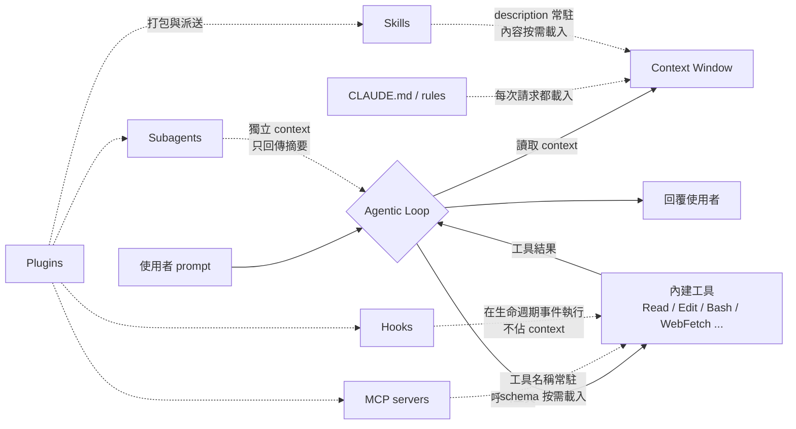
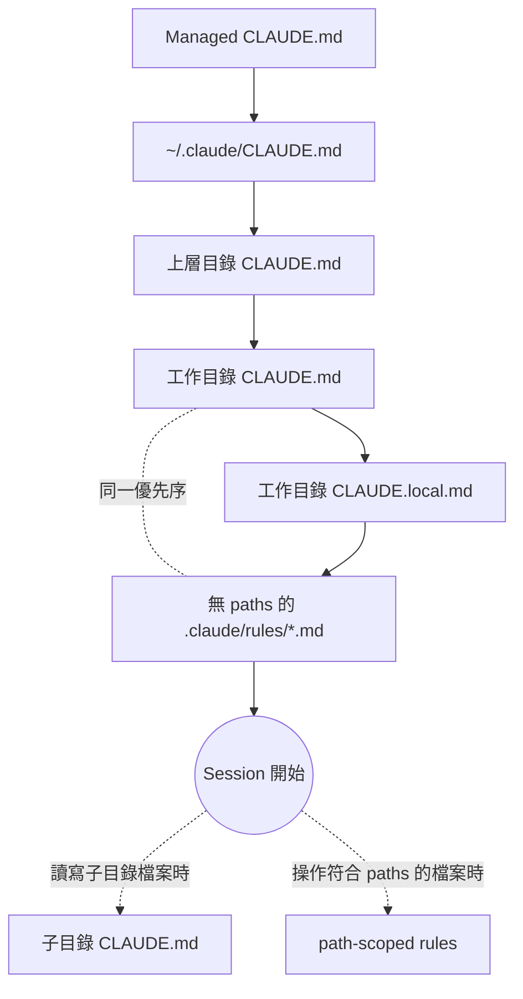
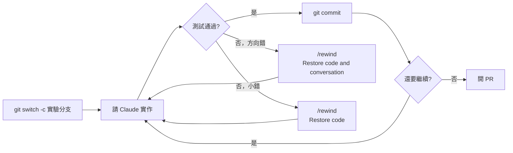
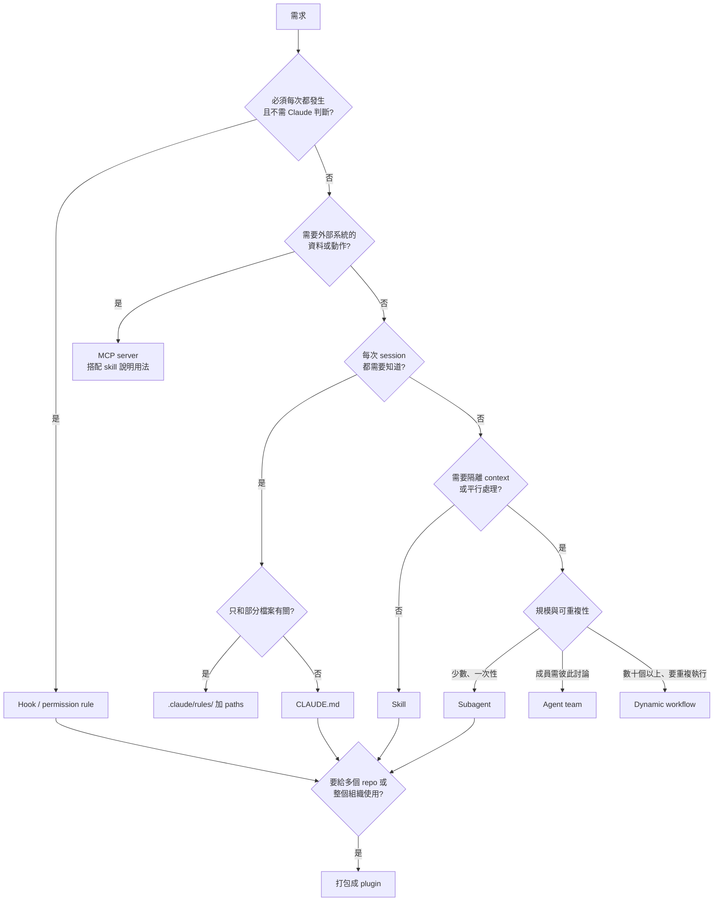
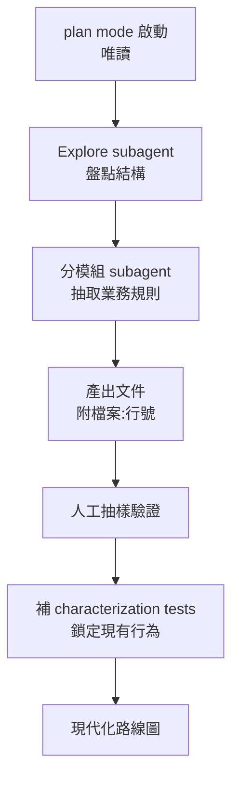
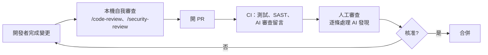
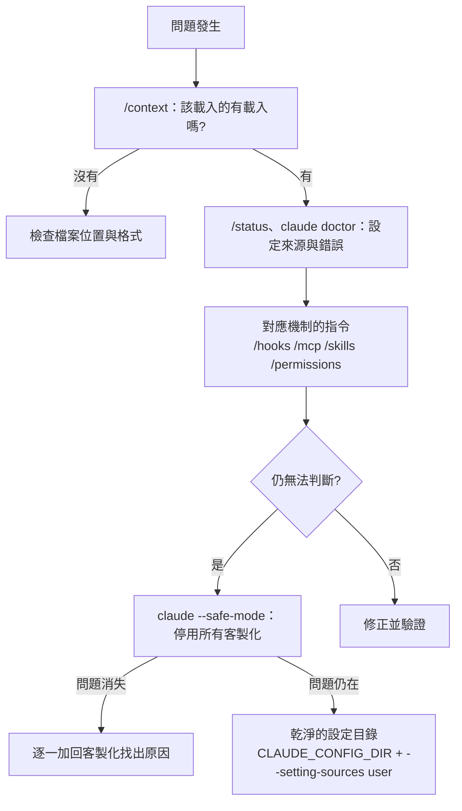

+++
date = '2026-07-01T00:00:00+08:00'
lastmod = '2026-10-23T18:00:00+08:00'
draft = false
title = 'Claude Howto 教學手冊'
tags = ['教學', 'AI開發']
categories = ['教學']
+++

# claude-howto 教學手冊（企業技術白皮書版）

> **文件版本**：v3.0（2026-10-23）
>
> **對齊基準**：官方文件 `code.claude.com/docs`（2026-10-23 下載全部 228 頁）與 Changelog 至 **Claude Code v2.1.309（2026-10-22）**；CLI 旗標另以本機 **v2.1.304** 的 `claude --help` 核對；上游 **claude-howto `main@188f468`**（同步 v2.1.302，2026-10-20）
>
> **適用對象**：開發者、Tech Lead、架構師、DevOps／平台團隊、資安與稽核人員、AI 導入負責人
>
> **驗證方式**：手冊中的設定、hook、skill、agent、MCP、plugin、workflow 與 CI 範例，皆以第 22 章的檢查工具或 Claude Code 本身（`claude plugin validate`、`claude plugin details`）實際執行，結果直接嵌入內文；完整紀錄見附錄 F
>
> **授權**：內部教育訓練使用；claude-howto 原始專案為 MIT License

---

## 修訂記錄

| 版本 | 日期 | 主要變更 |
|---|---|---|
| v1.0 | 2026-04-24 | 初版，對應 claude-howto v2.1.112 |
| v1.1 | 2026-05-02 | 補充 hook 事件、plugin 安全、permission modes |
| v2.0 | 2026-07-01 | 同步 claude-howto v2.1.160；新增 workflow、微服務、合規、模型選用、術語表 |
| v3.0 | 2026-10-23 | 依上游十模組學習順序**全面重組**為 22 章＋附錄 A ～ F；同步 Claude Code v2.1.309 與上游 v2.1.302；更正 v2.0 的 47 項錯誤與過時內容（附錄 F.2）；每章新增「本章目標」與「本章審查與驗證清單」；新增第 22 章 AI 產出驗證方法論與 6 個實測的檢查工具；所有範例附正反例驗證結果 |

---

## 摘要

**claude-howto**（GitHub：luongnv89/claude-howto，約 43.2k stars）是目前最完整的 Claude Code 社群實戰教材：10 個模組依學習順序排列，約 50 個可直接複製的範本，並內附自我評估工具。

本手冊以企業技術白皮書的標準重新整理這套教材，目標不只是「教會怎麼用」，而是讓讀者在 **AI 依規範產出設定與程式碼之後，有能力審查並驗證其正確性**。為此，本手冊：

1. 以官方文件為唯一事實依據，逐項核對上游範本與 v2.0 手冊，列出所有更正。
2. 每條規範都附 ❌／✅ 範例；每章結尾都有「審查與驗證清單」。
3. 實際撰寫並執行可重現的範例（安全 hook、Flyway 檢查 skill、唯讀審查 agent、plugin 與 marketplace、SQL 注入稽核 workflow、PR 審查 CI），並以反例證明檢查有效。
4. 對上游範本做實測評析，例如：`pre-tool-check.sh` 可被 `echo "done" && rm -rf /` 繞過；三個 plugin 範本的 hooks 與 MCP 設定實際上不會被載入。

---

## 如何使用本手冊

| 角色 | 建議優先閱讀 |
|---|---|
| 新進開發者 | 第 1、3、4、5、6、7、15 章；附錄 A.1 |
| 一般開發者 | 第 8、11、12、16 章 |
| Tech Lead／架構師 | 第 2、14、15、18 章 |
| 平台／AI 賦能團隊 | 第 9、10、13、18、19、22 章 |
| DevOps／SRE | 第 7、12.6、17.5、19.5、20 章 |
| 資安與稽核 | 第 2.5 ～ 2.6、9、10、17、18 章；附錄 A.3、F |
| 主管 | 第 1、18、19.4 章 |

每章的固定結構：**本章目標 → 概念與規範 → ❌／✅ 範例 → 實務建議 → 本章審查與驗證清單**。審查清單的欄位為「AI 產出項目／❌ 常見錯誤／✅ 正確做法／人工如何驗證」。

### v3.0 重點變更速覽

| 主題 | v2.0 說法 | v3.0（v2.1.309）現況 | 章節 |
|---|---|---|---|
| 預設權限模式 | `default`；auto 為 research preview | 互動 session 預設 **auto**（v2.1.283+）；`default` 介面名稱為 **Manual**；`-p` 仍為 Manual | 2.5 |
| Hook 事件 | 28 個 | **33** 個；阻擋要用 **exit 2**；政策 hook 要設 `onFailure: "block"` | 9.3、9.6 |
| 自訂指令 | `.claude/commands/` | 已併入 skills，新指令用 `.claude/skills/<name>/SKILL.md` | 4.2、4.5 |
| Skill frontmatter | `autoInvoke` 等欄位 | 無此欄位；未知欄位會被靜默忽略 | 8.4 |
| 預設模型 | Opus 4.8／Sonnet 4.6 首選 | **Opus 5.5**；Fable 5.1 需明確選擇 | 19.2 |
| Agent teams 啟用 | `CLAUDE_AGENT_TEAMS=1` | `CLAUDE_CODE_EXPERIMENTAL_AGENT_TEAMS=1` | 14.3 |
| MCP | 3 種 transport、未寫 `type` | 4 種（含 `ws`）；遠端 server 必須寫 `type`；多個參考 server 已封存 | 10.3、10.10 |
| CI | `bypassPermissions`、`npx claude -p` | `--bare`＋`dontAsk`＋精確 allowlist；PR 審查用官方 `claude-code-action@v1` | 7.7、17.5 |
| Checkpoints | 5 個選項 | 6 個選項；Bash、subagent、外部變更不受保護 | 6 |

---

## 目錄

> 目錄為三層結構（章 → 節 → 小節），每一項都連結到 Hugo 實際產生的錨點。

<!-- TOC-AUTO-BEGIN -->

- [第 1 章 導論：claude-howto 與 Claude Code](#第-1-章-導論claude-howto-與-claude-code)
  - [1.1 本章目標](#11-本章目標)
  - [1.2 claude-howto 是什麼](#12-claude-howto-是什麼)
  - [1.3 上游內容盤點](#13-上游內容盤點)
    - [1.3.1 十個學習模組](#131-十個學習模組)
    - [1.3.2 範本實際數量](#132-範本實際數量)
    - [1.3.3 輔助文件](#133-輔助文件)
  - [1.4 與官方文件的分工](#14-與官方文件的分工)
  - [1.5 版本基準與版本對齊策略](#15-版本基準與版本對齊策略)
    - [1.5.1 本手冊的三個版本基準](#151-本手冊的三個版本基準)
    - [1.5.2 範本相容性檢查流程](#152-範本相容性檢查流程)
  - [1.6 本手冊的結構](#16-本手冊的結構)
  - [1.7 企業採用的價值與風險](#17-企業採用的價值與風險)
    - [1.7.1 價值](#171-價值)
    - [1.7.2 風險與對策](#172-風險與對策)
  - [1.8 本章審查與驗證清單](#18-本章審查與驗證清單)
- [第 2 章 架構與概念模型](#第-2-章-架構與概念模型)
  - [2.1 本章目標](#21-本章目標)
  - [2.2 Agentic Loop 與擴充層](#22-agentic-loop-與擴充層)
  - [2.3 Context 成本：選擇擴充機制的第一個判準](#23-context-成本選擇擴充機制的第一個判準)
  - [2.4 擴充機制的選擇判準](#24-擴充機制的選擇判準)
  - [2.5 Permission Modes](#25-permission-modes)
    - [2.5.1 六種模式](#251-六種模式)
    - [2.5.2 起始模式的決定順序](#252-起始模式的決定順序)
    - [2.5.3 常見組合](#253-常見組合)
  - [2.6 Permission Rules](#26-permission-rules)
    - [2.6.1 語法與評估順序](#261-語法與評估順序)
    - [2.6.2 撰寫 Bash 規則的四個要點](#262-撰寫-bash-規則的四個要點)
  - [2.7 設定階層與合併規則](#27-設定階層與合併規則)
    - [2.7.1 四個設定檔與 managed settings](#271-四個設定檔與-managed-settings)
    - [2.7.2 優先序（高 → 低）](#272-優先序高--低)
    - [2.7.3 合併還是覆寫](#273-合併還是覆寫)
  - [2.8 使用介面與工具定位](#28-使用介面與工具定位)
  - [2.9 本章審查與驗證清單](#29-本章審查與驗證清單)
- [第 3 章 安裝、導入與標準化](#第-3-章-安裝導入與標準化)
  - [3.1 本章目標](#31-本章目標)
  - [3.2 系統需求](#32-系統需求)
    - [3.2.1 Windows：原生還是 WSL](#321-windows原生還是-wsl)
  - [3.3 安裝方式](#33-安裝方式)
    - [3.3.1 原生安裝程式（建議）](#331-原生安裝程式建議)
    - [3.3.2 套件管理工具](#332-套件管理工具)
    - [3.3.3 指定版本與發布通道](#333-指定版本與發布通道)
  - [3.4 驗證安裝與登入](#34-驗證安裝與登入)
  - [3.5 企業網路白名單](#35-企業網路白名單)
  - [3.6 IDE 整合](#36-ide-整合)
  - [3.7 導入 claude-howto 範本](#37-導入-claude-howto-範本)
    - [3.7.1 取得並鎖定版本](#371-取得並鎖定版本)
    - [3.7.2 漸進式導入（建議）](#372-漸進式導入建議)
    - [3.7.3 複製指令（Bash 與 PowerShell）](#373-複製指令bash-與-powershell)
  - [3.8 專案目錄結構](#38-專案目錄結構)
    - [3.8.1 專案層級（進版控）](#381-專案層級進版控)
    - [3.8.2 個人層級（~/.claude/）](#382-個人層級claude)
  - [3.9 團隊標準設定](#39-團隊標準設定)
    - [3.9.1 .claude/settings.json](#391-claudesettingsjson)
    - [3.9.2 .gitignore](#392-gitignore)
    - [3.9.3 從其他 AI 工具匯入設定](#393-從其他-ai-工具匯入設定)
  - [3.10 本章審查與驗證清單](#310-本章審查與驗證清單)
- [第 4 章 Slash Commands](#第-4-章-slash-commands)
  - [4.1 本章目標](#41-本章目標)
  - [4.2 四種 Slash Command](#42-四種-slash-command)
  - [4.3 內建指令速查](#43-內建指令速查)
  - [4.4 Bundled Skills](#44-bundled-skills)
  - [4.5 自訂指令的位置與命名](#45-自訂指令的位置與命名)
  - [4.6 Frontmatter 與參數](#46-frontmatter-與參數)
    - [4.6.1 常用欄位](#461-常用欄位)
    - [4.6.2 參數替換](#462-參數替換)
  - [4.7 動態 Context 與工具預先核准](#47-動態-context-與工具預先核准)
    - [4.7.1 以驚嘆號語法動態注入指令輸出](#471-以驚嘆號語法動態注入指令輸出)
    - [4.7.2 allowed-tools 的範圍](#472-allowed-tools-的範圍)
  - [4.8 claude-howto 範本評析](#48-claude-howto-範本評析)
  - [4.9 撰寫自訂指令的規範與範例](#49-撰寫自訂指令的規範與範例)
  - [4.10 本章審查與驗證清單](#410-本章審查與驗證清單)
- [第 5 章 Memory：CLAUDE.md、Rules 與 Auto Memory](#第-5-章-memoryclaudemdrules-與-auto-memory)
  - [5.1 本章目標](#51-本章目標)
  - [5.2 兩套記憶系統](#52-兩套記憶系統)
  - [5.3 CLAUDE.md 的位置與載入順序](#53-claudemd-的位置與載入順序)
    - [5.3.1 四個層級](#531-四個層級)
    - [5.3.2 載入規則](#532-載入規則)
  - [5.4 撰寫有效的 CLAUDE.md](#54-撰寫有效的-claudemd)
    - [5.4.1 什麼時候該寫進 CLAUDE.md](#541-什麼時候該寫進-claudemd)
    - [5.4.2 寫作規範](#542-寫作規範)
  - [5.5 匯入其他檔案（@path）](#55-匯入其他檔案path)
  - [5.6 用 .claude/rules/ 模組化](#56-用-clauderules-模組化)
  - [5.7 與 AGENTS.md 共存](#57-與-agentsmd-共存)
  - [5.8 Auto Memory](#58-auto-memory)
  - [5.9 大型團隊的記憶治理](#59-大型團隊的記憶治理)
    - [5.9.1 Managed CLAUDE.md 與 managed settings 的分工](#591-managed-claudemd-與-managed-settings-的分工)
    - [5.9.2 Monorepo：排除其他團隊的 CLAUDE.md](#592-monorepo排除其他團隊的-claudemd)
  - [5.10 claude-howto 範本評析](#510-claude-howto-範本評析)
  - [5.11 疑難排解](#511-疑難排解)
  - [5.12 本章審查與驗證清單](#512-本章審查與驗證清單)
- [第 6 章 Checkpoints 與 Rewind](#第-6-章-checkpoints-與-rewind)
  - [6.1 本章目標](#61-本章目標)
  - [6.2 運作方式](#62-運作方式)
  - [6.3 開啟 Rewind 選單](#63-開啟-rewind-選單)
  - [6.4 限制與盲點](#64-限制與盲點)
  - [6.5 搭配 Git 的安全工作模式](#65-搭配-git-的安全工作模式)
  - [6.6 實戰範例](#66-實戰範例)
    - [6.6.1 比較兩種實作](#661-比較兩種實作)
    - [6.6.2 壓縮冗長的除錯過程](#662-壓縮冗長的除錯過程)
  - [6.7 本章審查與驗證清單](#67-本章審查與驗證清單)
- [第 7 章 CLI 與 Headless 模式](#第-7-章-cli-與-headless-模式)
  - [7.1 本章目標](#71-本章目標)
  - [7.2 互動模式與 Print 模式](#72-互動模式與-print-模式)
  - [7.3 子指令總覽](#73-子指令總覽)
  - [7.4 常用旗標](#74-常用旗標)
    - [7.4.1 Session 與對話](#741-session-與對話)
    - [7.4.2 模型與推理](#742-模型與推理)
    - [7.4.3 權限與工具](#743-權限與工具)
    - [7.4.4 System prompt、設定與擴充](#744-system-prompt設定與擴充)
    - [7.4.5 輸出、預算與安全模式](#745-輸出預算與安全模式)
  - [7.5 結構化輸出](#75-結構化輸出)
  - [7.6 Session 管理](#76-session-管理)
  - [7.7 在 CI 中安全使用](#77-在-ci-中安全使用)
    - [7.7.1 最重要的風險：未信任的 repo 內容](#771-最重要的風險未信任的-repo-內容)
    - [7.7.2 範例：PR 風險摘要腳本](#772-範例pr-風險摘要腳本)
  - [7.8 本章審查與驗證清單](#78-本章審查與驗證清單)
- [第 8 章 Skills](#第-8-章-skills)
  - [8.1 本章目標](#81-本章目標)
  - [8.2 Skill 是什麼](#82-skill-是什麼)
  - [8.3 位置與優先序](#83-位置與優先序)
  - [8.4 Frontmatter 參考](#84-frontmatter-參考)
  - [8.5 觸發控制與 Description 寫法](#85-觸發控制與-description-寫法)
  - [8.6 Supporting Files 與腳本](#86-supporting-files-與腳本)
  - [8.7 在 Subagent 中執行（context: fork）](#87-在-subagent-中執行context-fork)
  - [8.8 生命週期與 Compaction](#88-生命週期與-compaction)
  - [8.9 存取控制](#89-存取控制)
  - [8.10 完整範例：可驗證的 Flyway 檢查 Skill](#810-完整範例可驗證的-flyway-檢查-skill)
  - [8.11 評估與迭代](#811-評估與迭代)
  - [8.12 claude-howto 範本評析](#812-claude-howto-範本評析)
  - [8.13 疑難排解](#813-疑難排解)
  - [8.14 本章審查與驗證清單](#814-本章審查與驗證清單)
- [第 9 章 Hooks](#第-9-章-hooks)
  - [9.1 本章目標](#91-本章目標)
  - [9.2 Hook 的結構與位置](#92-hook-的結構與位置)
  - [9.3 33 個 Hook 事件](#93-33-個-hook-事件)
  - [9.4 Matcher 規則](#94-matcher-規則)
  - [9.5 五種 Handler 類型](#95-五種-handler-類型)
  - [9.6 輸入與輸出](#96-輸入與輸出)
    - [9.6.1 共通輸入欄位](#961-共通輸入欄位)
    - [9.6.2 Exit code 的意義（最容易出錯的地方）](#962-exit-code-的意義最容易出錯的地方)
    - [9.6.3 JSON 輸出與決策控制](#963-json-輸出與決策控制)
  - [9.7 企業實作：阻擋破壞性指令](#97-企業實作阻擋破壞性指令)
    - [9.7.1 腳本](#971-腳本)
    - [9.7.2 設定](#972-設定)
    - [9.7.3 測試結果](#973-測試結果)
  - [9.8 測試與除錯](#98-測試與除錯)
  - [9.9 其他常用模式](#99-其他常用模式)
  - [9.10 安全考量](#910-安全考量)
  - [9.11 claude-howto 範本評析](#911-claude-howto-範本評析)
  - [9.12 本章審查與驗證清單](#912-本章審查與驗證清單)
- [第 10 章 MCP（Model Context Protocol）](#第-10-章-mcpmodel-context-protocol)
  - [10.1 本章目標](#101-本章目標)
  - [10.2 MCP 是什麼](#102-mcp-是什麼)
  - [10.3 四種 Transport](#103-四種-transport)
  - [10.4 三種 Scope](#104-三種-scope)
  - [10.5 撰寫 .mcp.json](#105-撰寫-mcpjson)
    - [10.5.1 環境變數展開](#1051-環境變數展開)
    - [10.5.2 範例](#1052-範例)
  - [10.6 Context 成本與輸出上限](#106-context-成本與輸出上限)
  - [10.7 驗證與授權](#107-驗證與授權)
  - [10.8 權限控制](#108-權限控制)
  - [10.9 組織層級控管](#109-組織層級控管)
  - [10.10 claude-howto 範本評析](#1010-claude-howto-範本評析)
  - [10.11 本章審查與驗證清單](#1011-本章審查與驗證清單)
- [第 11 章 Subagents](#第-11-章-subagents)
  - [11.1 本章目標](#111-本章目標)
  - [11.2 Subagent 是什麼](#112-subagent-是什麼)
  - [11.3 內建 Subagents](#113-內建-subagents)
  - [11.4 位置與優先序](#114-位置與優先序)
  - [11.5 Frontmatter 參考](#115-frontmatter-參考)
  - [11.6 工具與權限設計](#116-工具與權限設計)
    - [11.6.1 工具的兩層過濾](#1161-工具的兩層過濾)
    - [11.6.2 最小權限原則](#1162-最小權限原則)
    - [11.6.3 權限模式的實際行為](#1163-權限模式的實際行為)
    - [11.6.4 記憶會打開寫入權限](#1164-記憶會打開寫入權限)
  - [11.7 啟動時載入什麼](#117-啟動時載入什麼)
  - [11.8 呼叫方式與執行行為](#118-呼叫方式與執行行為)
  - [11.9 完整範例：唯讀安全審查員](#119-完整範例唯讀安全審查員)
  - [11.10 claude-howto 範本評析](#1110-claude-howto-範本評析)
  - [11.11 本章審查與驗證清單](#1111-本章審查與驗證清單)
- [第 12 章 進階功能](#第-12-章-進階功能)
  - [12.1 本章目標](#121-本章目標)
  - [12.2 功能地圖](#122-功能地圖)
  - [12.3 Plan Mode](#123-plan-mode)
  - [12.4 推理強度與完成條件](#124-推理強度與完成條件)
    - [12.4.1 Effort](#1241-effort)
    - [12.4.2 /goal](#1242-goal)
  - [12.5 Auto Mode](#125-auto-mode)
    - [12.5.1 運作方式](#1251-運作方式)
    - [12.5.2 預設會擋下的動作（節錄）](#1252-預設會擋下的動作節錄)
    - [12.5.3 為組織設定可信任的基礎設施](#1253-為組織設定可信任的基礎設施)
  - [12.6 Sandbox](#126-sandbox)
  - [12.7 Fast Mode](#127-fast-mode)
  - [12.8 平行工作：背景 Session 與 Worktrees](#128-平行工作背景-session-與-worktrees)
  - [12.9 排程](#129-排程)
  - [12.10 遠端與整合](#1210-遠端與整合)
  - [12.11 介面與回應風格](#1211-介面與回應風格)
  - [12.12 本章審查與驗證清單](#1212-本章審查與驗證清單)
- [第 13 章 Plugins 與 Marketplace](#第-13-章-plugins-與-marketplace)
  - [13.1 本章目標](#131-本章目標)
  - [13.2 Plugin 是什麼](#132-plugin-是什麼)
  - [13.3 標準目錄結構](#133-標準目錄結構)
  - [13.4 Manifest（plugin.json）](#134-manifestpluginjson)
  - [13.5 實作：打包公司的 Guardrails Plugin](#135-實作打包公司的-guardrails-plugin)
  - [13.6 安裝與管理](#136-安裝與管理)
  - [13.7 評估 Plugin](#137-評估-plugin)
  - [13.8 組織控管](#138-組織控管)
  - [13.9 安裝第三方 Plugin 前的審查](#139-安裝第三方-plugin-前的審查)
  - [13.10 claude-howto 範本評析](#1310-claude-howto-範本評析)
  - [13.11 本章審查與驗證清單](#1311-本章審查與驗證清單)
- [第 14 章 多代理編排與模組選型](#第-14-章-多代理編排與模組選型)
  - [14.1 本章目標](#141-本章目標)
  - [14.2 五種多步驟執行機制](#142-五種多步驟執行機制)
  - [14.3 Agent Teams（實驗性）](#143-agent-teams實驗性)
    - [14.3.1 啟用與使用](#1431-啟用與使用)
    - [14.3.2 適用與不適用](#1432-適用與不適用)
  - [14.4 Dynamic Workflows](#144-dynamic-workflows)
    - [14.4.1 啟動方式](#1441-啟動方式)
    - [14.4.2 執行前核准](#1442-執行前核准)
    - [14.4.3 腳本結構](#1443-腳本結構)
    - [14.4.4 限制](#1444-限制)
    - [14.4.5 完整範例：對抗式驗證的 SQL 注入稽核](#1445-完整範例對抗式驗證的-sql-注入稽核)
  - [14.5 選擇正確的模組](#145-選擇正確的模組)
  - [14.6 本章審查與驗證清單](#146-本章審查與驗證清單)
- [第 15 章 AI 輔助開發流程](#第-15-章-ai-輔助開發流程)
  - [15.1 本章目標](#151-本章目標)
  - [15.2 共通循環](#152-共通循環)
  - [15.3 情境一：Web 應用開發](#153-情境一web-應用開發)
    - [15.3.1 流程](#1531-流程)
    - [15.3.2 Prompt 寫法對照](#1532-prompt-寫法對照)
  - [15.4 情境二：逆向工程（Legacy System）](#154-情境二逆向工程legacy-system)
  - [15.5 情境三：框架升級](#155-情境三框架升級)
  - [15.6 情境四：微服務](#156-情境四微服務)
  - [15.7 本章審查與驗證清單](#157-本章審查與驗證清單)
- [第 16 章 Prompt 與 Context Engineering](#第-16-章-prompt-與-context-engineering)
  - [16.1 本章目標](#161-本章目標)
  - [16.2 好 Prompt 的五個要素](#162-好-prompt-的五個要素)
  - [16.3 範本](#163-範本)
    - [16.3.1 一般任務](#1631-一般任務)
    - [16.3.2 讓 Claude 訪談你（大型功能）](#1632-讓-claude-訪談你大型功能)
    - [16.3.3 逆向分析（唯讀）](#1633-逆向分析唯讀)
    - [16.3.4 對抗式審查](#1634-對抗式審查)
  - [16.4 Context 裡有什麼](#164-context-裡有什麼)
  - [16.5 主動管理 Context](#165-主動管理-context)
  - [16.6 Compaction 後保留什麼](#166-compaction-後保留什麼)
  - [16.7 Prompt Cache 與成本](#167-prompt-cache-與成本)
  - [16.8 本章審查與驗證清單](#168-本章審查與驗證清單)
- [第 17 章 SSDLC 整合與合規](#第-17-章-ssdlc-整合與合規)
  - [17.1 本章目標](#171-本章目標)
  - [17.2 分層防禦](#172-分層防禦)
  - [17.3 SSDLC 各階段對應](#173-ssdlc-各階段對應)
  - [17.4 實作：機密掃描 Hook](#174-實作機密掃描-hook)
  - [17.5 實作：PR 自動審查](#175-實作pr-自動審查)
  - [17.6 安全編碼規範（CLAUDE.md 片段）](#176-安全編碼規範claudemd-片段)
  - [17.7 Prompt Injection 與不受信任的內容](#177-prompt-injection-與不受信任的內容)
  - [17.8 稽核與可觀測性](#178-稽核與可觀測性)
  - [17.9 合規對照](#179-合規對照)
    - [17.9.1 資料處理事實（官方 data-usage 文件）](#1791-資料處理事實官方-data-usage-文件)
    - [17.9.2 ISO/IEC 27001:2022 Annex A](#1792-isoiec-270012022-annex-a)
    - [17.9.3 GDPR 與 SOC 2](#1793-gdpr-與-soc-2)
  - [17.10 本章審查與驗證清單](#1710-本章審查與驗證清單)
- [第 18 章 企業落地與治理](#第-18-章-企業落地與治理)
  - [18.1 本章目標](#181-本章目標)
  - [18.2 導入路線](#182-導入路線)
  - [18.3 角色分工](#183-角色分工)
  - [18.4 Managed Settings](#184-managed-settings)
    - [18.4.1 派送方式（優先序由高到低）](#1841-派送方式優先序由高到低)
    - [18.4.2 控制項](#1842-控制項)
    - [18.4.3 範例](#1843-範例)
    - [18.4.4 驗證政策生效](#1844-驗證政策生效)
  - [18.5 AI 使用規範（範本）](#185-ai-使用規範範本)
  - [18.6 AI 參與的 Code Review 流程](#186-ai-參與的-code-review-流程)
  - [18.7 衡量成效](#187-衡量成效)
  - [18.8 本章審查與驗證清單](#188-本章審查與驗證清單)
- [第 19 章 模型選用、成本與維運](#第-19-章-模型選用成本與維運)
  - [19.1 本章目標](#191-本章目標)
  - [19.2 模型與別名](#192-模型與別名)
  - [19.3 依任務選擇](#193-依任務選擇)
  - [19.4 成本](#194-成本)
    - [19.4.1 基準數字](#1941-基準數字)
    - [19.4.2 追蹤](#1942-追蹤)
    - [19.4.3 降低成本的做法](#1943-降低成本的做法)
  - [19.5 升級與版本管理](#195-升級與版本管理)
    - [19.5.1 Claude Code](#1951-claude-code)
    - [19.5.2 claude-howto 範本](#1952-claude-howto-範本)
    - [19.5.3 相容性矩陣（本手冊對照版本）](#1953-相容性矩陣本手冊對照版本)
    - [19.5.4 維護 Skills、Agents 與 Hooks](#1954-維護-skillsagents-與-hooks)
  - [19.6 本章審查與驗證清單](#196-本章審查與驗證清單)
- [第 20 章 故障排除](#第-20-章-故障排除)
  - [20.1 本章目標](#201-本章目標)
  - [20.2 診斷步驟](#202-診斷步驟)
  - [20.3 診斷指令](#203-診斷指令)
  - [20.4 常見症狀對照](#204-常見症狀對照)
  - [20.5 回報問題](#205-回報問題)
  - [20.6 本章審查與驗證清單](#206-本章審查與驗證清單)
- [第 21 章 學習路徑與自我評估](#第-21-章-學習路徑與自我評估)
  - [21.1 本章目標](#211-本章目標)
  - [21.2 找到起點](#212-找到起點)
  - [21.3 三級路線與里程碑](#213-三級路線與里程碑)
  - [21.4 自我評估工具](#214-自我評估工具)
  - [21.5 企業內訓課表（範例）](#215-企業內訓課表範例)
  - [21.6 學習建議](#216-學習建議)
  - [21.7 本章審查與驗證清單](#217-本章審查與驗證清單)
- [第 22 章 AI 產出的審查與驗證方法論](#第-22-章-ai-產出的審查與驗證方法論)
  - [22.1 本章目標](#221-本章目標)
  - [22.2 為什麼需要專門的驗證方法](#222-為什麼需要專門的驗證方法)
  - [22.3 驗證的四個層次](#223-驗證的四個層次)
  - [22.4 工具清單](#224-工具清單)
  - [22.5 工具原始碼與執行結果](#225-工具原始碼與執行結果)
    - [22.5.1 check_settings.py](#2251-check_settingspy)
    - [22.5.2 check_frontmatter.py](#2252-check_frontmatterpy)
    - [22.5.3 check_mcp.py](#2253-check_mcppy)
    - [22.5.4 check_flags.py](#2254-check_flagspy)
    - [22.5.5 test_hooks.sh](#2255-test_hookssh)
    - [22.5.6 workflow_dryrun.mjs](#2256-workflow_dryrunmjs)
  - [22.6 一次重跑全部：run_all.sh](#226-一次重跑全部run_allsh)
  - [22.7 人工審查的重點（工具做不到的部分）](#227-人工審查的重點工具做不到的部分)
  - [22.8 本章審查與驗證清單](#228-本章審查與驗證清單)
- [附錄 A 檢查清單](#附錄-a-檢查清單)
  - [A.1 新進成員上手](#a1-新進成員上手)
  - [A.2 專案初始化](#a2-專案初始化)
  - [A.3 安全](#a3-安全)
  - [A.4 升級前後](#a4-升級前後)
- [附錄 B 快速參考](#附錄-b-快速參考)
  - [B.1 功能對照](#b1-功能對照)
  - [B.2 檔案位置](#b2-檔案位置)
  - [B.3 常用指令](#b3-常用指令)
  - [B.4 快捷鍵](#b4-快捷鍵)
- [附錄 C 參考資源](#附錄-c-參考資源)
  - [C.1 claude-howto](#c1-claude-howto)
  - [C.2 官方文件（本手冊查證依據）](#c2-官方文件本手冊查證依據)
  - [C.3 工具與規格](#c3-工具與規格)
- [附錄 D 術語表](#附錄-d-術語表)
- [附錄 E v2.0 → v3.0 章節對照](#附錄-e-v20--v30-章節對照)
- [附錄 F 查證與驗證紀錄](#附錄-f-查證與驗證紀錄)
  - [F.1 查證來源](#f1-查證來源)
  - [F.2 更正清單](#f2-更正清單)
  - [F.3 已執行的檢查](#f3-已執行的檢查)
    - [F.3.1 白名單的抽取方式](#f31-白名單的抽取方式)
    - [F.3.2 執行紀錄](#f32-執行紀錄)
  - [F.4 尚待驗證的項目](#f4-尚待驗證的項目)
  - [F.5 手冊本身的驗證](#f5-手冊本身的驗證)

<!-- TOC-AUTO-END -->

---

## 第 1 章 導論：claude-howto 與 Claude Code

### 1.1 本章目標

讀完本章，你應該能夠：

- 說明 claude-howto 是什麼、解決什麼問題，以及它和 Anthropic 官方文件的分工。
- 列出上游 repo 的 10 個學習模組與實際範本數量，並知道每個模組對應本手冊哪一章。
- 判斷一份 claude-howto 範本是否仍與目前的 Claude Code 版本相容。
- 向主管或資安人員說明：企業導入社群範本時，有哪些價值與哪些風險。

### 1.2 claude-howto 是什麼

claude-howto（GitHub：[luongnv89/claude-howto](https://github.com/luongnv89/claude-howto)）是一套**以範例驅動、依學習順序編排**的 Claude Code 實戰教材。它的出發點很明確：多數人裝好 Claude Code、試了幾個 prompt 之後，就不知道下一步該學什麼；官方文件逐項說明功能，卻沒有告訴你這些功能要怎麼組合成一條能省下時間的工作流程。

claude-howto 用三件事回答這個問題：

| 面向 | claude-howto 的做法 | 對企業的意義 |
|---|---|---|
| 學習順序 | 10 個模組依難度排列（Beginner → Intermediate → Advanced），每個模組標示預估時數 | 可直接作為新人訓練課表 |
| 可複製範本 | 每個模組附可直接複製到專案的檔案（slash command、CLAUDE.md、SKILL.md、agent、hook 腳本、`.mcp.json`、plugin） | 縮短「從零寫設定」的時間，但仍需審查（見 1.7） |
| 自我評估 | 內附 `/self-assessment` 與 `/lesson-quiz` 兩個 skill，用測驗找出知識缺口 | 可作為內訓的結業評量 |

截至 2026-10-23 的專案概況：

| 項目 | 數值 | 查證方式 |
|---|---|---|
| GitHub Stars／Forks | 約 43.2k／5.4k | `gh api repos/luongnv89/claude-howto --jq '.stargazers_count,.forks_count'` |
| 授權 | MIT | repo 根目錄 `LICENSE` |
| 同步的 Claude Code 版本 | v2.1.302（2026-10-19 同步，README 標示 2026-10-18 更新） | `README.md` 版本徽章與 `git log` |
| 最後一個 GitHub Release | v2.1.160（2026-06-02） | `gh api repos/luongnv89/claude-howto/releases` |
| 介面語言 | 英文、越南文、中文、烏克蘭文、日文（5 種） | repo 中 `vi/`、`zh/`、`uk/`、`ja/` 目錄 |
| 離線閱讀 | `uv run scripts/build_epub.py` 產出 EPUB | `scripts/README.md` |

> **注意**：上游自 v2.1.160 之後不再發布 GitHub Release，而是直接在 `main` 上以「docs: sync to Claude Code v2.1.xxx」的 commit 同步。企業若要鎖定版本，應鎖定 **commit SHA**，不要依賴 Release tag。本手冊對照的是 `main@188f468`。

### 1.3 上游內容盤點

#### 1.3.1 十個學習模組

上游的資料夾編號（`01-` ~ `10-`）是**主題分類**，不是學習順序。官方建議的學習順序如下，本手冊第 4 ~ 13 章也依這個順序編排：

| 學習順序 | 上游資料夾 | 主題 | 難度 | 預估時數 | 本手冊章節 |
|---|---|---|---|---|---|
| 1 | `01-slash-commands/` | Slash Commands | Beginner | 30 分鐘 | 第 4 章 |
| 2 | `02-memory/` | Memory（CLAUDE.md） | Beginner+ | 45 分鐘 | 第 5 章 |
| 3 | `08-checkpoints/` | Checkpoints 與 Rewind | Intermediate | 45 分鐘 | 第 6 章 |
| 4 | `10-cli/` | CLI 基礎 | Beginner+ | 30 分鐘 | 第 7 章 |
| 5 | `03-skills/` | Skills | Intermediate | 1 小時 | 第 8 章 |
| 6 | `06-hooks/` | Hooks | Intermediate | 1 小時 | 第 9 章 |
| 7 | `05-mcp/` | MCP | Intermediate+ | 1 小時 | 第 10 章 |
| 8 | `04-subagents/` | Subagents | Intermediate+ | 1.5 小時 | 第 11 章 |
| 9 | `09-advanced-features/` | 進階功能 | Advanced | 2 ~ 3 小時 | 第 12 章 |
| 10 | `07-plugins/` | Plugins | Advanced | 2 小時 | 第 13 章 |

全部走完約 11 ~ 13 小時。

#### 1.3.2 範本實際數量

以下數字直接從 `main@188f468` 的檔案樹計算（不含 README 與圖片）：

| 模組 | 範本數 | 範本清單 |
|---|---|---|
| Slash Commands | 8 | `commit`、`doc-refactor`、`generate-api-docs`、`optimize`、`pr`、`push-all`、`setup-ci-cd`、`unit-test-expand` |
| Memory | 3 | `project-CLAUDE.md`、`directory-api-CLAUDE.md`、`personal-CLAUDE.md` |
| Skills | 6 | `blog-draft`、`brand-voice`、`claude-md`、`code-review-specialist`、`doc-generator`、`refactor` |
| Subagents | 9 | `clean-code-reviewer`、`code-reviewer`、`data-scientist`、`debugger`、`documentation-writer`、`implementation-agent`、`performance-optimizer`、`secure-reviewer`、`test-engineer` |
| MCP | 4 | `github-mcp.json`、`database-mcp.json`、`filesystem-mcp.json`、`multi-mcp.json` |
| Hooks | 11 | `format-code.sh`、`pre-commit.sh`、`security-scan.sh`、`log-bash.sh`、`validate-prompt.sh`、`notify-team.sh`、`pre-tool-check.sh`、`dependency-check.sh`、`session-end.sh`、`context-tracker.py`、`context-tracker-tiktoken.py` |
| Plugins | 3 | `pr-review`、`devops-automation`、`documentation` |
| Checkpoints／Advanced | 4 | `checkpoint-examples.md`、`planning-mode-examples.md`、`config-examples.json`、`setup-auto-mode-permissions.py` |
| 自我評估（`.claude/skills/`） | 2 | `self-assessment`、`lesson-quiz` |

合計約 50 個可直接使用的檔案或資料夾。

> **更正**：本手冊 v2.0 寫的「119+ 範本、68+ Slash Commands、17 Subagents」與上游檔案樹不符。68+ 這個數字其實是 Claude Code **內建**指令的數量，不是 claude-howto 提供的範本數。詳見附錄 F.2。

#### 1.3.3 輔助文件

| 檔案 | 內容 | 何時看 |
|---|---|---|
| `LEARNING-ROADMAP.md` | 三級學習路線、每個 Milestone 的練習與自我檢核 | 規劃內訓課程 |
| `CATALOG.md` | 所有功能與範本的安裝指令總表 | 找特定範本 |
| `QUICK_REFERENCE.md` | 一頁式指令速查 | 日常查詢 |
| `claude_concepts_guide.md` | 各功能的架構圖與比較表 | 理解原理 |
| `CHANGELOG.md` | 每次同步 Claude Code 版本時修正了什麼 | 判斷範本是否過時 |
| `resources.md` | 外部文章、影片與工具連結 | 延伸閱讀 |

### 1.4 與官方文件的分工

| 面向 | 官方文件（code.claude.com/docs） | claude-howto |
|---|---|---|
| 定位 | 功能規格（Feature Reference） | 教學與範本（Tutorial + Templates） |
| 權威性 | **唯一權威**：欄位名稱、預設值、版本需求都以官方為準 | 社群整理，偶有落後或錯誤 |
| 範例 | 片段式、針對單一功能 | 可整份複製的範本，示範功能組合 |
| 結構 | 依功能分類 | 依學習順序排列 |
| 更新速度 | 與每個 release 同步 | 數天到兩週同步一次 |

**使用原則**：用 claude-howto 學「怎麼組合」，用官方文件查「欄位怎麼寫、預設值是多少」。兩者說法衝突時，一律以官方文件為準。

❌ 錯誤示範（直接把社群範本的說法寫進公司規範）：

```text
依 claude-howto，Hook 預設 timeout 為 60 秒，因此所有 hook 腳本須在 60 秒內結束。
```

✅ 正確示範（以官方文件為準，並註明版本）：

```text
依官方 hooks 文件（Claude Code v2.1.309），command／http／mcp_tool 類型的 hook 預設 timeout
為 600 秒，prompt 為 30 秒，agent 為 60 秒；本公司規範要求 PreToolUse hook 在 10 秒內完成，
並以 "timeout": 10 明確設定。
```

> 上例中的「60 秒」正是上游在 v2.1.245 同步時自己修正過的錯誤（見上游 `CHANGELOG.md`）。社群範本會隨時間修正，所以引用時要附上版本。

### 1.5 版本基準與版本對齊策略

#### 1.5.1 本手冊的三個版本基準

| 基準 | 版本 | 用途 |
|---|---|---|
| 官方文件與 Changelog | Claude Code **v2.1.309**（2026-10-22） | 所有事實（欄位、預設值、行為）的查證依據 |
| 本機 CLI | Claude Code **v2.1.304** | 手冊中的 CLI flags 以本機 `claude --help` 逐一比對 |
| 上游 claude-howto | `main@188f468`（同步 v2.1.302） | 範本內容、學習路徑 |

#### 1.5.2 範本相容性檢查流程

拿到一份 claude-howto 範本時，用下列步驟判斷能否直接使用：

1. 看上游 `README.md` 的版本徽章，確認範本同步到哪一版 Claude Code。
2. 執行 `claude --version`，確認公司內部使用的版本。
3. 若公司版本**較舊**：到官方 Changelog 查兩版之間是否有該功能的欄位異動（例如 hook 事件、frontmatter 欄位）。
4. 若公司版本**較新**：查上游 `CHANGELOG.md` 是否已記錄該差異；沒有就以官方文件為準。
5. 用第 22 章的檢查工具驗證範本格式（frontmatter、settings key、hook 輸入輸出）。

```bash
# 查上游同步到哪一版
gh api repos/luongnv89/claude-howto/commits?per_page=5 \
  --jq '.[] | "\(.commit.author.date[0:10]) \(.commit.message | split("\n")[0])"'

# 查本機版本
claude --version
```

### 1.6 本手冊的結構

本手冊共 22 章與 6 個附錄，分為六部：

| 部 | 章節 | 主題 | 適合讀者 |
|---|---|---|---|
| 第一部 基礎 | 第 1 ~ 3 章 | 導論、架構與概念模型、安裝與標準化 | 所有人 |
| 第二部 Level 1 | 第 4 ~ 7 章 | Slash Commands、Memory、Checkpoints、CLI | 新進工程師 |
| 第三部 Level 2 | 第 8 ~ 11 章 | Skills、Hooks、MCP、Subagents | 一般工程師、平台團隊 |
| 第四部 Level 3 | 第 12 ~ 14 章 | 進階功能、Plugins、多代理編排 | 資深工程師、Tech Lead |
| 第五部 實戰 | 第 15 ~ 17 章 | 開發流程、Prompt 與 Context Engineering、SSDLC | 開發團隊、資安 |
| 第六部 企業治理 | 第 18 ~ 22 章 | 治理、模型與成本、故障排除、學習路徑、AI 產出驗證 | 主管、平台團隊、稽核 |

每一章的結構都相同：**本章目標 → 概念與規範 → ❌／✅ 範例 → 實務建議 → 本章審查與驗證清單**。章末的「審查與驗證清單」列出 AI 依該章規範產出內容時最常犯的錯，以及人工如何驗證；第 22 章把這些驗證方法做成可放進 CI 的檢查工具。

### 1.7 企業採用的價值與風險

#### 1.7.1 價值

1. **標準化**：CLAUDE.md、Skills、Hooks、Plugins 讓團隊規範從「寫在 wiki」變成「Claude 每次都會讀到、Hook 每次都會執行」。
2. **可複製**：Plugin 與 marketplace 讓同一套設定能派送到多個 repo。
3. **可治理**：Permission modes、permission rules 與 managed settings 讓資安能劃出明確邊界。
4. **可追溯**：Session 紀錄、Hook 稽核日誌、OpenTelemetry 指標讓每次 AI 動作都有紀錄。
5. **縮短學習曲線**：上游的學習路線可直接當作內訓課表。

#### 1.7.2 風險與對策

| 風險 | 說明 | 對策 |
|---|---|---|
| 版本漂移 | 社群範本落後官方，欄位或預設值可能已改變 | 依 1.5.2 的流程檢查；鎖定 commit SHA |
| 範本內容錯誤 | 社群範本未經 Anthropic 審核 | 進版控前做 code review；用第 22 章的工具驗證 |
| Hook 腳本的執行權限 | Hook 以使用者本身的權限執行任意指令 | 腳本進版控並經審查；企業可用 `allowManagedHooksOnly` 只允許管理者派送的 hook（第 18 章） |
| MCP 的資料外洩 | MCP server 可存取資料庫、檔案與外部 API | 預設唯讀、最小權限、以 managed MCP 限制可用的 server（第 10 章） |
| 過度自動化 | `bypassPermissions` 在非隔離環境使用 | 只在容器或 VM 內使用（第 2.5 節） |

### 1.8 本章審查與驗證清單

| AI 產出項目 | ❌ 常見錯誤 | ✅ 正確做法 | 人工如何驗證 |
|---|---|---|---|
| 引用 claude-howto 的統計數字 | 沿用舊文章的 Stars 或範本數 | 註明查詢日期，數字來自 API 或檔案樹 | 執行 1.2 表格中的 `gh api` 指令比對 |
| 引用 claude-howto 的功能說明 | 把社群說法當成官方規格 | 欄位與預設值以官方文件為準，並附版本 | 到 `code.claude.com/docs/en/<page>.md` 搜尋該欄位 |
| 鎖定上游版本 | 寫「使用 claude-howto 最新版」 | 寫 commit SHA 或同步的 Claude Code 版本 | `git -C claude-howto rev-parse HEAD` |
| 模組與章節對應 | 依資料夾編號排序學習順序 | 依 1.3.1 的官方學習順序 | 對照上游 `LEARNING-ROADMAP.md` |
| 風險評估 | 只列價值，不提 Hook 與 MCP 的權限風險 | 每個導入項目都附風險與對策 | 檢查是否涵蓋 1.7.2 的五個風險 |

---

## 第 2 章 架構與概念模型

### 2.1 本章目標

- 理解 Claude Code 的 agentic loop，以及各擴充機制分別插在 loop 的哪個位置。
- 能依「什麼時候載入、佔用多少 context」選擇正確的擴充機制。
- 能寫出正確的 permission rules，並說明 deny／ask／allow 的評估順序。
- 能說明設定檔的五層優先序，以及哪些設定是「合併」、哪些是「覆寫」。

### 2.2 Agentic Loop 與擴充層

Claude Code 的核心是一個 **agentic loop**：模型讀取 context、決定呼叫哪個工具（讀檔、搜尋、執行指令、編輯檔案、上網），取得工具結果後再決定下一步，直到任務完成。內建工具已經能完成大部分開發工作；claude-howto 教的十個模組，都是在這個 loop 外面加上的**擴充層**。



| 擴充機制 | 做什麼 | 何時用 | 例子 |
|---|---|---|---|
| CLAUDE.md | 每次對話都載入的持久 context | 專案慣例、「一律要做 X」的規則 | 「使用 pnpm，不要用 npm；commit 前先跑測試」 |
| `.claude/rules/` | 可依路徑條件載入的規則 | 語言或目錄專屬的規範 | 只在編輯 `src/api/**` 時載入的 API 規範 |
| Output style | 設定整個 session 的角色、語氣、格式 | 想改變每一次回覆的格式 | 內建的 Concise 風格 |
| Skill | 可重用的知識或可呼叫的工作流程 | 參考資料、重複的任務 | `/deploy` 執行部署清單 |
| Subagent | 獨立 context 的工作者，只回傳摘要 | 需要讀大量檔案、平行處理 | 讀遍整個模組後只回報結論 |
| Dynamic workflow | Claude 寫的腳本，在背景跑多個 subagent | 工作量超過幾個 subagent，或需要交叉驗證 | 全 codebase 稽核 |
| MCP | 連接外部服務 | 需要外部資料或動作 | 查資料庫、發 Slack 訊息 |
| Hook | 在生命週期事件執行腳本、HTTP、MCP 工具、prompt 或 subagent | 每次都必須執行的自動化 | 每次編輯後跑 ESLint |
| Plugin | 打包上述功能的派送單位 | 跨 repo 重用或派送給他人 | 把團隊的 skills 與 hooks 打包成一個 plugin |

### 2.3 Context 成本：選擇擴充機制的第一個判準

每個擴充機制都會佔用 context。佔太多除了會更快觸發壓縮，也會增加雜訊，讓 skill 誤觸發、讓 Claude 忘記慣例。

| 機制 | 何時載入 | 載入什麼 | Context 成本 |
|---|---|---|---|
| CLAUDE.md | Session 開始 | 每個載入檔案的完整內容 | **每次請求都付** |
| Output style | Session 開始、切換時 | 目前風格的完整指示（Default 風格為零） | 每次請求都付 |
| Skills | Session 開始＋使用時 | 開始時只載入 description；使用時載入全文 | 低（description 每次都付） |
| MCP servers | Session 開始 | 工具名稱；完整 schema 用到時才載入（tool search 預設開啟） | 用到之前很低 |
| Subagents | 被呼叫時 | 全新、隔離的 context | 不佔主 session |
| Hooks | 事件觸發時 | 無（在外部執行） | 零，除非 hook 回傳要加入 context 的內容 |

由此得到三條規範：

1. **CLAUDE.md 保持在 200 行以內**。參考資料移到 skill，依路徑才需要的規則移到 `.claude/rules/`。
2. **有副作用的 skill 設 `disable-model-invocation: true`**。它的 description 就不會常駐 context，也只會在你明確下 `/name` 時執行。
3. **會產生大量中間輸出的工作交給 subagent**，主對話只收摘要。

❌ 錯誤示範：把 800 行的 API 規格貼進 CLAUDE.md。每一次請求都要付這 800 行的 token，而且大部分對話根本用不到。

✅ 正確示範：

```markdown
<!-- CLAUDE.md（精簡，每次載入） -->
# 專案慣例
- API 一律遵循公司 REST 規範；撰寫或審查 API 時使用 /api-style skill。
- 建置：./mvnw verify；測試：./mvnw test
```

```markdown
<!-- .claude/skills/api-style/SKILL.md（按需載入） -->
---
name: api-style
description: 公司 REST API 規範（命名、錯誤格式、分頁、版本）。撰寫或審查 HTTP API 時使用。
---
# REST API 規範
（完整 800 行規格放這裡）
```

人工驗證：在 session 中執行 `/context all`，比較調整前後 CLAUDE.md（memory）與 skills 兩個類別的 token 數。

### 2.4 擴充機制的選擇判準

官方文件提供了一組「出現什麼症狀就加什麼機制」的判準，適合直接作為團隊規範：

| 症狀 | 加入 |
|---|---|
| Claude 同一個慣例或指令錯了兩次 | 寫進 CLAUDE.md |
| 一直要求 Claude 回答短一點、多解釋一點或固定格式 | 設定 output style |
| 一直重複輸入同一段 prompt 來開始某個任務 | 存成可由使用者呼叫的 skill |
| 第三次把同一份操作手冊貼進對話 | 寫成 skill |
| 一直從瀏覽器複製 Claude 看不到的資料 | 把該系統接成 MCP server |
| Claude 為了找某個 symbol 讀了很多檔案 | 安裝該語言的 code intelligence plugin |
| 支線任務的輸出塞滿主對話，之後也用不到 | 交給 subagent |
| 希望某件事每次都自動發生 | 寫成 hook |
| 第二個 repo 需要同一套設定 | 打包成 plugin |

最重要的一條區分是：**指示（CLAUDE.md、skill）是請求，hook 和 permission rule 才是強制**。「不要修改 `.env`」寫在 CLAUDE.md 裡，Claude 多半會遵守，但不保證；寫成 `PreToolUse` hook 或 deny rule，才能保證每次都擋下。

### 2.5 Permission Modes

#### 2.5.1 六種模式

| 模式（設定值） | 不需詢問即可執行的動作 | 適用情境 |
|---|---|---|
| `default`（介面名稱 **Manual**） | 只有讀取 | 敏感工作、想逐一審查每個動作 |
| `acceptEdits` | 讀取、檔案編輯，以及常見檔案系統指令（`mkdir`、`touch`、`mv`、`cp` 等） | 邊看邊改 |
| `plan` | 讀取；在 auto mode 可用時，另加分類器核可的指令 | 改動前先探索 codebase |
| `auto` | 全部，但有背景安全分類器把關 | 長任務、減少確認疲勞 |
| `dontAsk` | 工作目錄內的讀取與預先核可的工具；其他一律拒絕 | 鎖定的 CI 與腳本 |
| `bypassPermissions` | 全部 | **只限**隔離的容器或 VM |

重點事實（官方 permission-modes 文件，v2.1.309）：

- Manual 模式在 CLI、`claude --help`、VS Code、JetBrains 與桌面版都叫 **Manual**，設定值仍是 `default`；CLI 也接受 `manual` 作為別名（例如 `--permission-mode manual`）。
- **v2.1.283 起**，終端機與 VS Code 互動 session 的內建起始模式是 `auto`；`claude -p` 與 Agent SDK 仍是 `default`。
- 在 `.claude/settings.json` 或 `.claude/settings.local.json` 設 `"defaultMode": "auto"` **不會生效**；設 `"bypassPermissions"` 也不會生效（session 改以 Manual 開始）。這是為了防止 repo 擅自提高權限。
- **deny rule 在所有模式都有效**，包括 `bypassPermissions`；allow rule 在 `bypassPermissions` 下沒有作用。
- 以下動作任何模式都不會自動核可：明確的 ask rule、需要使用者互動的工具（`AskUserQuestion`）、被辨識出的關鍵路徑 `rm`／`rmdir`，以及開啟 `permissions.blockReadsOutsideWorkingDirectories` 時讀取工作目錄外的檔案。

#### 2.5.2 起始模式的決定順序

1. `--permission-mode` 或 `--dangerously-skip-permissions` 參數。
2. 設定檔中的 `permissions.defaultMode`（受上述專案層級限制）。
3. 內建預設值（互動 session 為 `auto`，`-p` 為 `default`；任一設定檔把 `disableAutoMode` 設為 `"disable"` 時為 `default`）。

#### 2.5.3 常見組合

| 目標 | 起始方式 | 隔離需求 |
|---|---|---|
| 自己審查每個動作 | `claude --permission-mode default` | 無 |
| 本機少一點確認，但不用分類器 | Manual＋Bash sandbox auto-allow（`/sandbox`） | macOS、Linux、WSL2 的內建 sandbox |
| 改動前先探索 | `claude --permission-mode plan` | 無 |
| 自主工作 | `claude --permission-mode auto` | 建議再加 sandbox 或容器 |
| CI 中只允許精確清單 | `claude -p "..." --permission-mode dontAsk --allowedTools "Bash(npm test)" "Read"` | CI runner 本身 |
| 容器內完全無人值守 | `claude -p "..." --dangerously-skip-permissions` | **必須**：容器、VM 或 sandbox runtime，且以非 root 使用者執行 |

❌ 錯誤示範（在開發者筆電的專案設定中開啟 bypass）：

```json
{
  "permissions": {
    "defaultMode": "bypassPermissions"
  }
}
```

這段放在 `.claude/settings.json` 根本不會生效；就算放在使用者設定中生效了，也等於讓 AI 在有網路、有憑證的筆電上不受限制地執行指令。

✅ 正確示範（CI 中以 `dontAsk` 搭配精確 allowlist）：

```bash
claude -p "執行單元測試並摘要失敗原因" \
  --permission-mode dontAsk \
  --allowedTools "Bash(./mvnw test)" "Read" \
  --output-format json
```

### 2.6 Permission Rules

#### 2.6.1 語法與評估順序

規則格式為 `Tool` 或 `Tool(specifier)`，分成三類：

- **allow**：不詢問直接執行。
- **ask**：每次都詢問。
- **deny**：一律拒絕。

評估順序固定為 **deny → ask → allow**，第一個符合的類別決定結果，與規則寫得多精確無關。因此 `Bash(aws *)` 的 deny 會擋下 `Bash(aws s3 ls)` 的 allow，allow 無法在 deny 裡開例外。

| 規則 | 效果 |
|---|---|
| `Bash` 或 `Bash(*)` | 符合所有 Bash 指令；作為 deny 時，整個工具會從 Claude 的 context 中移除 |
| `Bash(npm run build)` | 只符合 `npm run build` 這個完整指令 |
| `Bash(npm run *)` | 符合 `npm run build`、`npm run test --watch`，也符合單獨的 `npm run` |
| `Bash(ls *)` | 符合 `ls -la`，不符合 `lsof`（`*` 前的空白是規則的一部分） |
| `Read(./.env)` | 讀取目前目錄的 `.env` |
| `WebFetch(domain:example.com)` | 對 example.com 的請求 |
| `mcp__github__get_*` | `github` MCP server 中所有 `get_` 開頭的工具 |
| `Agent(model:opus)` | 要求 Opus 等級模型的 subagent 呼叫（參數比對只能用在 deny／ask） |

#### 2.6.2 撰寫 Bash 規則的四個要點

1. **`*` 放在子指令後面**：`Bash(git log *)` 只允許 `git log`；`Bash(git *)` 允許所有 git 指令，包含 `git -c core.fsmonitor=<script>`。
2. **複合指令會拆開比對**：`Bash(safe-cmd *)` 不會放行 `safe-cmd && other-cmd`；deny／ask 只要任一子指令符合就生效，包含 subshell 與 `$()` 內的指令。
3. **部分 wrapper 會先被剝除**：`timeout`、`time`、`nice`、`nohup`、`stdbuf`、`command`、`builtin`、不帶旗標的 `xargs`。但 `npx`、`docker exec`、`direnv exec` 不在清單中，`Bash(npx *)` 等於允許執行任何套件。
4. **Bash 規則不是安全邊界**：`Bash(curl *)` 擋不下 `/usr/bin/curl` 或 `sh -c 'curl ...'`。真正的檔案與網路隔離要靠 sandbox；要用自己的邏輯檢查完整指令，要用 `PreToolUse` hook。

❌ 錯誤示範（舊版手冊中的寫法）：

```json
{
  "permissions": {
    "allow": ["Read", "Glob", "Grep", "LS"],
    "deny": ["Bash(rm -rf *)", "Bash(drop database)", "Bash(git push --force)"]
  }
}
```

問題：

- `LS` 不是內建工具名稱。它放在 allow 中，Claude Code 不會警告（"matches no tool" 警告只檢查 deny 與 ask 規則），規則就這樣靜靜地失效。
- `Bash(drop database)` 只會比對一個叫 `drop` 的程式，擋不住 `psql -c "drop database x"`。
- `Bash(git push --force)` 沒有 `*`，只符合這個完整字串，`git push --force origin main` 不受影響。

✅ 正確示範：

```json
{
  "permissions": {
    "allow": [
      "Bash(npm run *)",
      "Bash(git status)",
      "Bash(git diff *)",
      "Bash(git log *)"
    ],
    "ask": [
      "Bash(git push *)"
    ],
    "deny": [
      "Read(./.env)",
      "Read(./.env.*)",
      "Read(./secrets/**)",
      "Bash(rm -rf *)",
      "Bash(git push --force *)",
      "Bash(curl *)"
    ]
  }
}
```

搭配一個 `PreToolUse` hook 檢查 SQL 中的 `DROP`／`TRUNCATE`（第 9 章與第 17 章有完整腳本），並在需要網路隔離時啟用 sandbox。

人工驗證：

1. 重新啟動 `claude`，確認啟動橫幅下方沒有 "matches no tool" 或 "has a wildcard before the rest of the command" 警告；allow 規則不會觸發前者，所以 allow 清單的工具名稱要另外核對。
2. 在 session 中執行 `/permissions`，確認每條規則來自預期的設定檔。
3. 用第 22 章的 `check_settings.py` 驗證工具名稱與 key 都在官方白名單中。

### 2.7 設定階層與合併規則

#### 2.7.1 四個設定檔與 managed settings

| 範圍 | 檔案 | 影響誰 | 用途 |
|---|---|---|---|
| User | `~/.claude/settings.json` | 你，在這台機器的所有專案 | 個人偏好：主題、預設模型、個人權限規則 |
| Shared project | `.claude/settings.json` | 所有在此專案工作的人（進版控） | 團隊權限、hooks、plugins、環境變數 |
| Project local | `.claude/settings.local.json` | 只有你，只在此專案 | 個人覆寫、分享前的測試 |
| Managed | `managed-settings.json`、MDM、server-managed settings | 組織部署的對象 | 資安政策與合規要求 |

另有 `~/.claude.json`，由 Claude Code 自行寫入，保存帳號、MCP server 設定、各專案的信任決定等；一般不需手動編輯。Windows 上 `~/.claude` 指 `%USERPROFILE%\.claude`。

#### 2.7.2 優先序（高 → 低）

1. **Managed settings**：使用者無法覆寫；`--model` 只能從組織允許的模型中選。
2. **命令列** `--settings <file-or-json>`：只對該 session 有效。
3. **Project local**（`.claude/settings.local.json`）。
4. **Shared project**（`.claude/settings.json`）。
5. **User**（`~/.claude/settings.json`）。

環境變數不在這個階層裡，個別成對決定。例如 shell 匯出的 `ANTHROPIC_MODEL` 會蓋過任何設定檔的 `model`，而 `ANTHROPIC_DEFAULT_MODEL` 只在沒有設定檔設定 `model` 時才生效。

#### 2.7.3 合併還是覆寫

| 對象 | 行為 |
|---|---|
| 一般純量 key（如 `model`） | 高優先序覆寫低優先序 |
| 清單 key（如 `permissions.allow`） | **合併**：每一層都能新增，不會刪掉其他層的項目 |
| `fallbackModel`、`modelPicker`、`availableModels`、`modelSettings` | 各有特殊規則（例如 managed 的 `availableModels` 原樣套用） |
| CLAUDE.md | **疊加**：所有層級的內容同時進入 context，衝突時由 Claude 判斷 |
| Skills | 同名時依優先序選一個：managed > user > project；plugin skill 有命名空間 |
| Subagents | 同名時：managed > CLI flag > project > user > plugin |
| MCP servers | 同名時：local > project > user |
| Hooks | **合併**：所有來源註冊的 hook 都會在符合的事件執行 |

❌ 常見誤解：「個人的 `~/.claude/settings.json` 寫了 `deny`，專案設定的 `allow` 就無效了。」

✅ 實際行為：清單會合併，兩者同時存在；評估時 deny 優先，因此該指令被拒絕的原因是 deny → ask → allow 的評估順序，不是設定檔覆寫。

人工驗證：執行 `/status` 查看 "Setting sources"，執行 `/permissions` 查看每條規則的來源檔案。

### 2.8 使用介面與工具定位

Claude Code 可以在終端機（CLI）、VS Code 與 JetBrains 擴充套件、桌面 App、網頁版（claude.ai/code）與行動裝置（透過 Remote Control）上使用。同一份 `.claude/` 設定在 CLI 與 IDE 擴充套件中都有效。

與 GitHub Copilot 並用時的分工建議：

| 情境 | 建議工具 | 理由 |
|---|---|---|
| 行內自動完成 | GitHub Copilot | 即時、低延遲 |
| 跨檔案修改、重構 | Claude Code | Agentic loop、可規劃與驗證 |
| 規範化 code review | Claude Code subagent 或 `/code-review` | 可設定規則、產出結構化報告 |
| CI/CD 自動化 | Claude Code `claude -p` 或 GitHub Actions | 非互動模式、可輸出 JSON |
| 安全攔截 | Claude Code hooks＋permission rules | 確定性的強制機制 |

兩者可同時啟用、互不衝突。

### 2.9 本章審查與驗證清單

| AI 產出項目 | ❌ 常見錯誤 | ✅ 正確做法 | 人工如何驗證 |
|---|---|---|---|
| Permission mode 名稱 | 寫成 `normal`、`ask`、`manualMode` | 只用 `default`（或別名 `manual`）、`acceptEdits`、`plan`、`auto`、`dontAsk`、`bypassPermissions` | `claude --help` 的 `--permission-mode` choices |
| 專案設定的 `defaultMode` | 在 `.claude/settings.json` 設 `auto` 或 `bypassPermissions` | 起始模式由使用者或 managed settings 決定 | 啟動後看狀態列顯示的模式 |
| Permission rule 工具名 | 使用 `LS`、`Stop Task` 等非正式名稱 | 使用官方 tools reference 的正式名稱 | deny／ask 看啟動警告；allow 用 `check_settings.py` 比對工具白名單 |
| Bash deny rule | 沒有 `*` 的完整字串，或把它當安全邊界 | 子指令後加 ` *`；網路／檔案隔離用 sandbox | 用 2.6.2 的反例逐一測試 |
| CLAUDE.md 大小 | 把規格書全文放入 | 200 行以內，參考資料改放 skill | `wc -l CLAUDE.md`、`/context` |
| 設定覆寫的說明 | 「下層 allow 被上層 deny 覆寫」 | 清單合併，評估順序 deny → ask → allow | `/permissions` 檢查規則來源 |
| 強制規範 | 把「禁止 X」只寫在 CLAUDE.md | 必須保證的規範用 deny rule 或 `PreToolUse` hook | 刻意觸發該動作，確認被擋下 |

---

## 第 3 章 安裝、導入與標準化

### 3.1 本章目標

- 在 macOS、Linux、Windows（原生或 WSL）上用官方建議的方式安裝 Claude Code，並驗證安裝結果。
- 在企業網路中完成 proxy 與防火牆白名單設定。
- 依漸進式步驟把 claude-howto 範本導入專案，而不是一次全部複製。
- 建立團隊共用的 `.claude/settings.json` 與 `.gitignore`，並能驗證其正確性。

### 3.2 系統需求

| 項目 | 需求 |
|---|---|
| 作業系統 | macOS 13.0+、Windows 10 1809+ 或 Windows Server 2019+、Ubuntu 20.04+、Debian 10+、Alpine Linux 3.19+ |
| 硬體 | 4 GB 以上 RAM，x64 或 ARM64 |
| 網路 | 需要連網（白名單見 3.5） |
| Shell | Bash、Zsh、PowerShell 或 CMD |
| 帳號 | Pro、Max、Team、Enterprise 或 Console 帳號；免費的 claude.ai 方案不含 Claude Code。也可透過 Amazon Bedrock、Google Cloud Agent Platform、Microsoft Foundry 使用 |
| 其他 | ripgrep（通常已內含） |

#### 3.2.1 Windows：原生還是 WSL

| 選項 | 需求 | Sandbox | 適用 |
|---|---|---|---|
| 原生 Windows | 無；Git for Windows 為選用 | **不支援** | Windows 原生專案與工具 |
| WSL 2 | 啟用 WSL 2 | 支援 | Linux 工具鏈、需要 sandbox 隔離 |
| WSL 1 | 啟用 WSL 1 | 不支援 | WSL 2 無法使用時 |

原生 Windows 的行為：

- **沒有** Git for Windows 時，Claude Code 透過 PowerShell 工具執行指令。
- **有** Git for Windows 時，Bash 工具使用 Git Bash，PowerShell 工具同時可用。若找不到 Git Bash，在設定中指定路徑：

```json
{
  "env": {
    "CLAUDE_CODE_GIT_BASH_PATH": "C:\\Program Files\\Git\\bin\\bash.exe"
  }
}
```

> **企業建議**：需要 sandbox 隔離（第 12 章）的團隊應統一使用 WSL 2。

### 3.3 安裝方式

#### 3.3.1 原生安裝程式（建議）

```bash
# macOS / Linux / WSL
curl -fsSL https://claude.ai/install.sh | bash
```

```powershell
# Windows PowerShell（不需系統管理員權限）
irm https://claude.ai/install.ps1 | iex
```

```bat
REM Windows CMD
curl -fsSL https://claude.ai/install.cmd -o install.cmd && install.cmd && del install.cmd
```

原生安裝會在背景**自動更新**。

#### 3.3.2 套件管理工具

| 工具 | 安裝指令 | 自動更新 |
|---|---|---|
| Homebrew | `brew install --cask claude-code`（stable）或 `claude-code@latest` | 預設否；`brew upgrade claude-code` |
| WinGet | `winget install Anthropic.ClaudeCode` | 預設否；`winget upgrade Anthropic.ClaudeCode` |
| apt／dnf／apk | 依官方文件加入 Anthropic 套件庫與 GPG 金鑰 | 否，需手動升級 |
| npm | `npm install -g @anthropic-ai/claude-code` | 是（全域目錄可寫入時） |

npm 安裝的注意事項：

- 需要 **Node.js 22 以上**；較舊版本只會出現 `EBADENGINE` 警告，安裝仍會完成，因為 npm 套件實際上下載的是與原生安裝相同的 native binary，執行時不依賴 Node.js。
- **不要**使用 `sudo npm install -g`。
- 升級請用 `npm install -g @anthropic-ai/claude-code@latest`，不要用 `npm update -g`。

> **更正**：v2.0 手冊寫「Node.js 18+」，已過時，正確為 Node.js 22 以上（官方 setup 文件）。

#### 3.3.3 指定版本與發布通道

```bash
# 安裝 stable 通道（通常落後 latest 約一週，跳過有重大回歸的版本）
curl -fsSL https://claude.ai/install.sh | bash -s stable

# 安裝特定版本
curl -fsSL https://claude.ai/install.sh | bash -s 2.1.304
```

企業可在設定中固定通道與最低版本：

```json
{
  "autoUpdatesChannel": "stable",
  "minimumVersion": "2.1.300"
}
```

| 設定 | 作用 |
|---|---|
| `autoUpdatesChannel` | `latest`（預設）或 `stable` |
| `minimumVersion` | 自動更新與 `claude update` 不會安裝低於此版本的版本 |
| `requiredMinimumVersion`／`requiredMaximumVersion` | （managed settings）超出範圍就**拒絕啟動** |
| 環境變數 `DISABLE_AUTOUPDATER` | 只停止背景檢查，`claude update` 仍可用 |
| 環境變數 `DISABLE_UPDATES` | 封鎖所有更新途徑（自行派送版本時使用） |

### 3.4 驗證安裝與登入

```bash
claude --version   # 例：2.1.304 (Claude Code)
claude doctor      # 唯讀的安裝與設定診斷，不啟動 session
claude             # 第一次執行會開啟瀏覽器登入
```

`claude doctor` 會列出安裝健康狀態、設定檔驗證錯誤與建議修正；在 session 中執行 `/doctor` 則能進一步自動修正部分問題。

登入方式：

- **訂閱帳號**（Pro／Max／Team／Enterprise）：執行 `claude` 後依瀏覽器提示登入，或執行 `claude auth login`；用 `claude auth status` 確認登入狀態。
- **API key**：設定 `ANTHROPIC_API_KEY`，Claude Code 詢問是否使用時同意即可略過登入。
- **長效 token**（CI 用）：`claude setup-token`（需要訂閱）。
- **雲端供應商**：依 Amazon Bedrock、Google Cloud Agent Platform、Microsoft Foundry 的文件設定憑證。

### 3.5 企業網路白名單

| 主機 | 用途 | 必要性 |
|---|---|---|
| `api.anthropic.com` | Claude API、WebFetch 網域安全檢查、feature flags | 必要（第三方供應商除外） |
| `claude.ai`、`claude.com`、`platform.claude.com` | 帳號登入與 OAuth | 必要 |
| `sso.claude.com` | 組織 SSO 登入 | 使用 SSO 時必要 |
| `downloads.claude.ai` | 原生安裝、自動更新、plugin 執行檔下載 | 原生安裝必要 |
| `registry.npmjs.org` | npm 安裝、`npx` 啟動的 MCP server、plugin 的 Node 相依套件 | 視使用情況 |
| `github.com` | 複製 GitHub 上的 plugin marketplace | 使用 plugin 時 |
| `raw.githubusercontent.com` | `/release-notes` 的 changelog | 選用 |
| `mcp-proxy.anthropic.com` | claude.ai 上設定的 MCP connectors | 使用 connectors 時 |
| `code.claude.com` | 內建 claude-code-guide agent 查文件 | 選用 |
| Datadog intake 兩個主機 | 選用的營運遙測 | 可用 `CLAUDE_CODE_DISABLE_NONESSENTIAL_TRAFFIC` 關閉 |

> 使用 Bedrock、Agent Platform、Foundry 時，模型流量改走你的雲端供應商；但 WebFetch 仍會呼叫 `api.anthropic.com` 做網域安全檢查，除非設定 `skipWebFetchPreflight: true`。

### 3.6 IDE 整合

| IDE | 安裝方式 | 說明 |
|---|---|---|
| VS Code | Extensions 搜尋 "Claude Code"（發行者 Anthropic） | 圖形化 diff、模式切換、與 CLI 共用 `.claude/` 設定 |
| JetBrains | Marketplace 安裝 Claude Code plugin | 在 IDE 內的終端機執行，可看到 IDE diff |
| 終端機 | `claude --ide` | 啟動時自動連接到唯一可用的 IDE |

### 3.7 導入 claude-howto 範本

#### 3.7.1 取得並鎖定版本

```bash
git clone https://github.com/luongnv89/claude-howto.git ~/claude-howto
cd ~/claude-howto
git checkout 188f468        # 鎖定本手冊對照的 commit
git log -1 --format='%h %cd %s'
```

#### 3.7.2 漸進式導入（建議）

不要一次把所有範本複製進專案。依上游的學習順序，每一步確認有效、團隊理解之後再往下：

| 階段 | 時程 | 導入內容 | 驗收方式 |
|---|---|---|---|
| 1 | 第 1 天 | 專案 `CLAUDE.md`（依第 5 章改寫，不要原樣複製） | 新 session 問「本專案的建置指令是什麼」，回答正確 |
| 2 | 第 2 ~ 3 天 | 2 ~ 3 個 slash command 或 skill（如 `optimize`、`pr`） | `/` 選單中出現，且能正確執行 |
| 3 | 第 1 週 | 團隊 `.claude/settings.json`（3.8）與 checkpoints 使用習慣 | `/permissions` 規則來源正確 |
| 4 | 第 1 週 | 1 ~ 2 個 hook（格式化、危險指令攔截） | 刻意觸發，確認 hook 有執行 |
| 5 | 第 2 週 | 1 個 MCP server（如 GitHub，唯讀 token） | `/mcp` 顯示 connected |
| 6 | 第 2 週 | 2 ~ 3 個 subagent（code-reviewer、test-engineer） | 明確要求委派時有被使用 |
| 7 | 第 3 週起 | 打包成內部 plugin、加入 marketplace | 新 repo 一行指令完成安裝 |

#### 3.7.3 複製指令（Bash 與 PowerShell）

```bash
# 在專案根目錄執行（Bash）
H=~/claude-howto
mkdir -p .claude/commands .claude/agents .claude/skills .claude/hooks
cp "$H/01-slash-commands/optimize.md" "$H/01-slash-commands/pr.md" .claude/commands/
cp "$H/04-subagents/code-reviewer.md" "$H/04-subagents/test-engineer.md" .claude/agents/
cp -r "$H/03-skills/code-review-specialist" .claude/skills/
```

```powershell
# 在專案根目錄執行（PowerShell）
$H = "$HOME\claude-howto"
New-Item -ItemType Directory -Force .claude\commands, .claude\agents, .claude\skills, .claude\hooks | Out-Null
Copy-Item "$H\01-slash-commands\optimize.md", "$H\01-slash-commands\pr.md" .claude\commands\
Copy-Item "$H\04-subagents\code-reviewer.md", "$H\04-subagents\test-engineer.md" .claude\agents\
Copy-Item -Recurse "$H\03-skills\code-review-specialist" .claude\skills\
```

Plugin 範本的試用方式（上游 repo 沒有提供 marketplace，所以不能用 `/plugin install`）：

```bash
claude --plugin-dir ~/claude-howto/07-plugins/pr-review
```

❌ 錯誤示範：`cp ~/claude-howto/06-hooks/*.sh ~/.claude/hooks/` 後直接在設定中啟用全部 hook。11 個腳本會以你的權限在每個事件執行，其中有些會呼叫外部服務（如 `notify-team.sh`），沒有人審查過它們做了什麼。

✅ 正確示範：一次只導入一個 hook，先閱讀腳本、在測試 repo 用假的 JSON 輸入執行（第 9.8 節），確認行為後再提交 PR 給團隊審查。

### 3.8 專案目錄結構

#### 3.8.1 專案層級（進版控）

```text
your-project/
├── CLAUDE.md                 # 專案記憶，每次 session 載入（第 5 章）
├── CLAUDE.local.md           # 個人的專案偏好（不進版控）
├── .mcp.json                 # 團隊共用的 MCP servers（第 10 章）
├── .worktreeinclude          # 建立 worktree 時要複製的 gitignored 檔案
└── .claude/
    ├── settings.json         # 團隊權限、hooks、plugins、env（進版控）
    ├── settings.local.json   # 個人覆寫（不進版控）
    ├── rules/                # 主題或路徑限定的規則（第 5 章）
    ├── skills/<name>/SKILL.md# Skills（第 8 章）
    ├── commands/*.md         # 單檔 skill，與 skills 同一機制（第 4 章）
    ├── agents/*.md           # Subagents（第 11 章）
    ├── workflows/*.js        # Dynamic workflow 腳本（第 14 章）
    ├── output-styles/*.md    # 自訂輸出風格（第 12 章）
    ├── agent-memory/<name>/  # Subagent 的持久記憶
    └── hooks/                # Hook 腳本（慣例位置，非官方必要）
```

#### 3.8.2 個人層級（`~/.claude/`）

```text
~/.claude/
├── CLAUDE.md                  # 個人偏好，所有專案適用
├── settings.json              # 個人設定
├── rules/  skills/  commands/  agents/  output-styles/  workflows/
├── keybindings.json           # 自訂快捷鍵
├── themes/*.json              # 自訂色彩主題
├── projects/<project>/memory/ # Auto memory（Claude 自己寫的筆記）
└── plugins/                   # 已安裝的 plugins 與 marketplaces
~/.claude.json                 # App 狀態、帳號、個人 MCP servers（由 Claude Code 維護）
```

`managed-settings.json` 放在系統層級目錄（依作業系統不同），由 IT 部署，見第 18 章。

### 3.9 團隊標準設定

#### 3.9.1 `.claude/settings.json`

```json
{
  "$schema": "https://json.schemastore.org/claude-code-settings.json",
  "permissions": {
    "allow": [
      "Bash(./mvnw test *)",
      "Bash(./mvnw verify *)",
      "Bash(npm run lint)",
      "Bash(npm run test *)",
      "Bash(git status)",
      "Bash(git diff *)",
      "Bash(git log *)"
    ],
    "ask": [
      "Bash(git push *)",
      "Bash(npm install *)"
    ],
    "deny": [
      "Read(./.env)",
      "Read(./.env.*)",
      "Read(./secrets/**)",
      "Bash(rm -rf *)",
      "Bash(git push --force *)",
      "Bash(curl *)",
      "Bash(wget *)"
    ]
  },
  "hooks": {
    "PreToolUse": [
      {
        "matcher": "Bash",
        "hooks": [
          {
            "type": "command",
            "command": "\"${CLAUDE_PROJECT_DIR}\"/.claude/hooks/block-dangerous.sh",
            "timeout": 10
          }
        ]
      }
    ]
  },
  "env": {
    "MAVEN_OPTS": "-Xmx2g"
  },
  "cleanupPeriodDays": 30
}
```

說明：

- `$schema` 讓 VS Code 提供自動完成與即時驗證；schema 可能落後最新版，對新 key 的警告不一定代表錯誤。
- Hook 指令用 `${CLAUDE_PROJECT_DIR}` 指向 session 啟動時的專案根目錄，避免在子目錄啟動或 Claude `cd` 之後找不到腳本。這裡是 **shell form**（沒有 `args`），官方要求把 placeholder 用雙引號包起來，路徑含空白時才不會被拆開。
- 也可以改用 **exec form**：`"command": "bash", "args": ["${CLAUDE_PROJECT_DIR}/.claude/hooks/block-dangerous.sh"]`。exec form 不經過 shell，每個 `args` 元素就是一個參數，不需要處理引號；但 `command` 必須是 PATH 上的真正執行檔（Windows 上的 `.cmd`／`.bat` 不行）。
- `block-dangerous.sh` 的完整內容與測試方式在第 9.7 節。
- 個人需要放寬時，寫在自己的 `.claude/settings.local.json`，不要修改團隊檔案。

#### 3.9.2 `.gitignore`

```gitignore
# Claude Code：個人設定與記憶不進版控
.claude/settings.local.json
CLAUDE.local.md
```

Claude Code 第一次寫入 `.claude/settings.local.json` 時，會自動把 `**/.claude/settings.local.json` 加到全域 git excludes；但若是手動建立的檔案，必須自己加進 `.gitignore`。`CLAUDE.local.md` 一律要自己加。

#### 3.9.3 從其他 AI 工具匯入設定

已經在用 Codex、Gemini CLI 或 Cursor 的團隊，可先預覽再匯入：

```bash
claude import cursor --dry-run   # 只顯示會匯入什麼，不寫入
claude import cursor             # 互動式選擇要匯入的項目
```

匯入後仍要依本章規範審查，特別是權限規則。

### 3.10 本章審查與驗證清單

| AI 產出項目 | ❌ 常見錯誤 | ✅ 正確做法 | 人工如何驗證 |
|---|---|---|---|
| 安裝指令 | 寫 `npm i -g` 並要求 Node 18；或用 `sudo npm` | 優先原生安裝；npm 需 Node 22+ 且不用 sudo | 對照官方 setup 文件 |
| 登入指令 | 寫 `claude login` | `claude auth login`（或直接執行 `claude`）；CI 用 `claude setup-token` 或 API key | `claude auth --help` 列出 `login`、`logout`、`status` |
| 版本控管 | 只寫「使用最新版」 | 設 `autoUpdatesChannel`、`minimumVersion`，或 managed 的 `requiredMinimumVersion` | `claude doctor` 顯示的通道與版本 |
| 網路白名單 | 只開 `api.anthropic.com` | 依 3.5 表格完整開通 | 在受限網路執行 `claude doctor` 與一次登入 |
| 範本導入 | 一次複製所有 hooks 並啟用 | 依 3.7.2 分階段，每個 hook 先審查與測試 | PR 中每個 hook 都有測試紀錄 |
| `settings.json` | 使用不存在的 key 或工具名稱 | key 與工具名稱都在官方清單中 | `check_settings.py`（第 22 章）、VS Code `$schema` 驗證 |
| Hook 路徑 | 使用相對路徑 `.claude/hooks/x.sh`，或 shell form 中未加引號的 `${CLAUDE_PROJECT_DIR}` | shell form 寫 `"\"${CLAUDE_PROJECT_DIR}\"/.claude/hooks/x.sh"`，或改用 exec form 的 `args` | 在子目錄啟動 `claude`，觸發 hook 確認能執行 |
| `.gitignore` | 漏掉 `CLAUDE.local.md` | 兩個個人檔案都排除 | `git check-ignore -v CLAUDE.local.md .claude/settings.local.json` |

---

## 第 4 章 Slash Commands

### 4.1 本章目標

- 區分四種 slash command：內建指令、自訂指令（skills／commands）、plugin 指令、MCP prompts。
- 依任務找到正確的內建指令與 bundled skill，不再重複造輪子。
- 寫出正確的自訂指令：frontmatter、參數替換、動態 context、`allowed-tools`。
- 能審查 claude-howto 的 8 個 command 範本，判斷哪些可以直接用、哪些需要先修改。

### 4.2 四種 Slash Command

| 類型 | 來源 | 呼叫方式 | 例子 |
|---|---|---|---|
| 內建指令 | Claude Code 本身，執行固定邏輯 | `/name` | `/clear`、`/model`、`/permissions` |
| Bundled skill | Claude Code 內附的 prompt 型 skill | `/name` | `/code-review`、`/batch`、`/loop` |
| 自訂指令 | `.claude/skills/<name>/SKILL.md` 或 `.claude/commands/<name>.md` | `/name` | `/optimize`、`/pr` |
| Plugin 指令 | 已啟用 plugin 的 `skills/` | `/plugin-name:skill-name` | `/pr-review:review-pr` |
| MCP prompt | MCP server 提供的 prompt | `/mcp__<server>__<prompt>` | `/mcp__github__pr_review 456` |

> **重要變更**：自訂 slash command 已經**合併進 skills**。`.claude/commands/` 的檔案仍然有效，但新指令應寫成 `.claude/skills/<name>/SKILL.md`：skill 可以附帶腳本與參考檔、可以讓 Claude 自動觸發，也能在獨立的 subagent context 執行。

### 4.3 內建指令速查

Claude Code 有一百多個內建指令與 bundled skill（輸入 `/` 即可篩選）。以下依任務整理最常用的部分：

| 任務 | 指令 | 說明 |
|---|---|---|
| 設定專案 | `/init` | 產生 `CLAUDE.md`；設 `CLAUDE_CODE_NEW_INIT=1` 會一併引導設定 skills、hooks 與個人記憶 |
| | `/memory` | 編輯 CLAUDE.md、開關 auto memory |
| | `/import [codex\|gemini\|cursor]` | 從其他 AI 工具匯入設定 |
| 管理 context | `/context [all]` | 以色塊顯示 context 使用量與最佳化建議 |
| | `/compact [指示]` | 摘要目前對話以釋放 context，可指定摘要重點 |
| | `/clear` | 清空對話（別名 `/reset`、`/new`） |
| | `/btw [問題]` | 問一個不進入主對話歷史的旁支問題 |
| 模型與推理 | `/model` | 選擇模型（預設會存為新 session 的預設值，按 `s` 只套用本 session） |
| | `/effort` | 調整推理強度：`low`～`max`，另有 Ultracode 開關 |
| | `/fast` | 切換 fast mode |
| 權限與安全 | `/permissions` | 檢視與修改權限規則（Claude 工作中也能開啟） |
| | `/sandbox` | 切換 Bash sandbox |
| | `/fewer-permission-prompts` | 分析最近的 Bash／MCP 呼叫，建議 allowlist |
| | `/security-review` | 分析目前分支相對預設分支的變更是否有安全弱點 |
| 規劃與回溯 | `/plan [描述]` | 進入 plan mode |
| | `/rewind` | 回溯對話或程式碼（別名 `/checkpoint`、`/undo`） |
| | `/goal <條件>` | 設定 session 的完成條件，Claude 會持續工作直到達成 |
| Session | `/resume`、`/rename`、`/branch`、`/fork` | 恢復、命名、分支、複製到背景 session |
| | `/background`、`/tasks` | 把 session 移到背景、管理背景工作 |
| 擴充管理 | `/skills`、`/hooks`、`/mcp`、`/plugin` | 列出與管理各類擴充 |
| | `/reload-skills`、`/reload-plugins` | 不重啟 session 重新載入 |
| 診斷 | `/doctor`、`/status`、`/usage` | 健康檢查、版本與設定來源、用量與成本 |
| 審查 | `/code-review`（別名 `/review`） | 審查目前 diff、PR、分支或路徑；可加 `--fix`、`--comment`、`ultra` |

已移除、不要再寫進文件的指令：

| 指令 | 狀態 | 替代方式 |
|---|---|---|
| `/pr-comments` | v2.1.91 移除 | 直接請 Claude 讀 PR 留言 |
| `/vim` | v2.1.92 移除 | `/config` → Editor mode |
| `/ultraplan` | 已移除 | 使用 plan mode |
| `/agents` | 互動精靈已移除，只顯示提示 | 請 Claude 建立 subagent，或直接編輯 `.claude/agents/` |

### 4.4 Bundled Skills

Bundled skill 是 prompt 型的內建能力：它給 Claude 詳細指示，由 Claude 用工具完成工作；一般內建指令則是直接執行固定邏輯。

| Skill | 用途 | 企業使用建議 |
|---|---|---|
| `/code-review [level] [--fix] [--comment]` | 找出正確性錯誤；`ultra` 送到雲端多代理審查 | 作為 PR 前的自我審查；`--comment` 可直接在 GitHub PR 留言 |
| `/simplify` | 只做清理（重用、簡化、效率），不找 bug | 重構後使用 |
| `/batch <指示>` | 用 worktree 平行處理大規模修改 | 大量相同模式的修改 |
| `/loop [間隔] [prompt]` | 依間隔重複執行 prompt | 監看 CI、輪詢狀態 |
| `/verify`、`/run` | 實際建置並執行 app 來確認變更有效 | 補足「測試通過但功能壞掉」的盲點 |
| `/debug [描述]` | 開啟除錯紀錄並協助排查 | 設定或 hook 異常時 |
| `/doctor [prompt-audit]` | 檢查安裝與設定；`prompt-audit` 稽核 CLAUDE.md、skills、agents 中為舊模型寫的提示寫法 | 版本升級後執行 |
| `/claude-api` | 載入 Claude API 參考 | 開發 Claude API 應用時 |

用 `disableBundledSkills` 設定可以關閉 bundled skills。

### 4.5 自訂指令的位置與命名

| 檔案位置 | 指令名稱來源 | 例子 |
|---|---|---|
| `.claude/skills/<dir>/SKILL.md` | frontmatter `name`，或目錄名稱 | `.claude/skills/deploy-staging/SKILL.md` → `/deploy-staging` |
| `.claude/commands/<file>.md` | 檔名（不含副檔名） | `.claude/commands/deploy.md` → `/deploy` |
| `.claude/commands/<sub>/<file>.md` | 子目錄以 `:` 連接 | `.claude/commands/frontend/component.md` → `/frontend:component` |
| plugin 的 `skills/<dir>/SKILL.md` | 加上 plugin 命名空間 | `/my-plugin:review` |

同名時的解析規則：

| 同名情境 | 實際執行 |
|---|---|
| skill 與 `.claude/commands/` 檔案 | skill |
| enterprise、personal、project 之間 | enterprise > personal > project |
| 自訂 skill 與 bundled skill／內建指令 | 自訂 skill 取代原指令，但原指令的**別名**不受影響（例如自訂 `code-review` 不影響 `/review`） |
| plugin skill 與其他 skill | 兩者都載入（plugin 有命名空間） |

> **注意**：`.claude/commands/*.md` 支援 skill 的所有 frontmatter **但不含 `name` 與 `paths`**。在 command 檔案裡寫 `name:` 不會改變指令名稱，名稱永遠是檔名。

### 4.6 Frontmatter 與參數

#### 4.6.1 常用欄位

| 欄位 | 用途 | 預設 |
|---|---|---|
| `description` | 做什麼、何時用；Claude 依此判斷是否自動觸發（與 `when_to_use` 合計截斷於 1,536 字元） | 內容第一個非空行 |
| `argument-hint` | 自動完成時顯示的參數提示，例如 `[issue-number]` | 無 |
| `arguments` | 具名參數，例如 `[issue, branch]`，內文可用 `$issue`、`$branch` | 無 |
| `disable-model-invocation` | `true` 時 Claude 不能自行觸發，description 也不常駐 context | `false` |
| `user-invocable` | `false` 時從 `/` 選單隱藏，只有 Claude 能用 | `true` |
| `allowed-tools` | **呼叫該 skill 的那一輪**免確認的工具；下一則訊息即失效 | 無 |
| `model`、`effort` | 本輪使用的模型與推理強度 | 繼承 session |
| `context: fork`、`agent` | 在獨立 subagent 中執行 | 無 |

#### 4.6.2 參數替換

| 寫法 | 意義 | `/fix-issue 123 high` 時的值 |
|---|---|---|
| `$ARGUMENTS` | 全部參數原文 | `123 high` |
| `$ARGUMENTS[0]` 或 `$0` | 第一個參數（從 0 起算） | `123` |
| `$1` | 第二個參數 | `high` |
| `$issue` | `arguments: [issue, priority]` 宣告的具名參數 | `123` |
| `${CLAUDE_SKILL_DIR}` | 此 SKILL.md 所在目錄 | — |
| `${CLAUDE_PROJECT_DIR}` | 專案根目錄 | — |
| `${CLAUDE_SESSION_ID}` | 目前 session ID | — |

規則：

- 多字參數用引號包起來：`/my-skill "hello world" second` → `$0` 為 `hello world`。
- 沒有對應參數的 `$2` 會**原樣保留**在內容中；具名參數沒有值時則替換為空字串。
- 內容中沒有任何參數佔位符時，Claude Code 會在最後附加 `ARGUMENTS: <值>`。
- 要寫字面的 `$1.00`，改寫成 `\$1.00`。

### 4.7 動態 Context 與工具預先核准

#### 4.7.1 以驚嘆號語法動態注入指令輸出

`` !`git status` `` 會在 skill 內容送給 Claude **之前**執行，用輸出取代佔位符。多行指令改用以 ` ```! ` 開頭的 code block。

| 行為 | 說明 |
|---|---|
| 位置限制 | `!` 必須在行首或空白之後；`` KEY=!`cmd` `` 不會執行 |
| 失敗處理 | 任一指令失敗（非零 exit code）會**中止整個 skill**；搜尋與比較類指令的 exit code 1 視為正常 |
| 權限檢查 | 不會跳出確認；符合 deny rule 直接中止，在非 auto mode 下沒有被 allow 也會中止 |
| 逾時 | 沿用 Bash 工具預設的 2 分鐘 |
| 企業封鎖 | 設定 `"disableSkillShellExecution": true`（建議放在 managed settings） |

預期會回傳非零值的檢查腳本，要在後面加 `|| true`。

#### 4.7.2 `allowed-tools` 的範圍

- 只在**呼叫 skill 的那一輪**有效，下一則訊息就失效。
- 不會限制其他工具：沒列出的工具仍由 permission rules 決定。
- **不受 workspace trust 限制**：repo 中的 skill 即使在從未信任過的資料夾、以 `-p` 執行時，也會套用它的 `allowed-tools`。因此 repo 內 skill 的 `allowed-tools` 必須經過 code review。
- 組織可在 managed settings 設定 `allowManagedPermissionRulesOnly`，讓專案與個人 skill 的 `allowed-tools` 失效。

### 4.8 claude-howto 範本評析

| 範本 | 用途 | 評析 | 企業調整建議 |
|---|---|---|---|
| `optimize` | 效能、記憶體、演算法、快取、並行問題分析 | 純分析、無副作用，可直接使用 | 補上公司的效能基準（例如 API p95 門檻） |
| `pr` | 清理、暫存、準備 PR | 步驟中的 `prettier --write .` 不在 `allowed-tools` 內；`git add .` 會把所有檔案加入暫存 | 改成專案實際的 lint 指令並列入 `allowed-tools`；改為選擇性 `git add`；加 `disable-model-invocation: true` |
| `commit` | 依 diff 產生 conventional commit | 用 `` !`git diff HEAD` `` 注入 context，寫法正確 | 加 `disable-model-invocation: true`；大型 diff 改用 `git diff --stat` 以免塞爆 context |
| `push-all` | 全部 add、commit、push | `allowed-tools` 含 `git push` 與 `git pull`，且未禁止自動觸發 | **不建議導入**；若要用，必須加 `disable-model-invocation: true`，並移除 `git push` 的預先核准 |
| `generate-api-docs` | 從 `/src/api/` 產生 API 文件 | 路徑寫死，且假設 JSDoc 與 TypeScript | 改用 `$ARGUMENTS` 接收路徑，依專案語言調整 |
| `doc-refactor` | 重整文件結構 | 放在 `commands/` 卻寫了 `name:`（無效欄位） | 改為 skill 目錄格式 |
| `setup-ci-cd` | 建立 pre-commit 與 GitHub Actions | 同上；會建立 CI 檔案 | 改為 skill，並要求先產出計畫再實作 |
| `unit-test-expand` | 補測試以提高覆蓋率 | 同上 | 改為 skill，並指定公司覆蓋率門檻 |

所有範本結尾都附有「Last Updated／Compatible Models」等版本資訊。這些文字在每次呼叫時都會送進 context，導入時建議移到 Git 的 commit 紀錄或另外的 README。

### 4.9 撰寫自訂指令的規範與範例

| 編號 | 規範 |
|---|---|
| SC-01 | 新指令一律寫成 `.claude/skills/<name>/SKILL.md`，不再新增 `.claude/commands/`。 |
| SC-02 | 會修改檔案、版控或外部系統的指令，必須設 `disable-model-invocation: true`。 |
| SC-03 | `allowed-tools` 只列出指令內文實際會執行的指令，且不得包含 `git push`、部署、刪除類指令。 |
| SC-04 | `description` 第一句說明「做什麼」，第二句說明「何時用」，不超過 200 字。 |
| SC-05 | 動態注入的指令必須有界（例如 `--stat`、`-n 20`），避免把巨量輸出塞進 context。 |
| SC-06 | 輸出格式要明確（表格欄位、嚴重度分級），讓人可以快速審查。 |

❌ 錯誤示範：

```markdown
---
name: ship
description: ship it
allowed-tools: Bash(git *) Bash(npm *)
---
Commit everything and push to main. Run npm publish.
```

問題：description 無法讓人或 Claude 判斷用途；`Bash(git *)` 與 `Bash(npm *)` 等於預先核准所有 git 與 npm 指令（含 push、publish）；沒有禁止自動觸發；直接推到 main。

✅ 正確示範（`.claude/skills/commit/SKILL.md`）：

```markdown
---
name: commit
description: 依目前暫存區的變更產生 Conventional Commits 格式的 commit。使用者要求提交已暫存的變更時使用。
argument-hint: "[可選的 commit 訊息]"
disable-model-invocation: true
allowed-tools: Bash(git status *) Bash(git diff *) Bash(git commit *)
---

## Context

- 目前分支：!`git branch --show-current`
- 暫存區摘要：!`git diff --cached --stat`
- 最近 5 筆 commit：!`git log --oneline -5`

## 任務

1. 只提交**已暫存**的變更，不要執行 `git add`。
2. 暫存區為空時，停止並告訴使用者先暫存檔案。
3. 若使用者提供訊息（$ARGUMENTS），直接使用；否則依變更內容產生：
   - 格式：`<type>(<scope>): <摘要>`，type 為 feat、fix、docs、refactor、test、chore 之一
   - 摘要不超過 72 字元
4. 不要執行 `git push`。
5. 完成後輸出 `git log -1 --oneline`。
```

人工驗證：

1. 在 `/` 選單中確認 `/commit` 出現，且 description 正確。
2. 在空的暫存區執行 `/commit`，Claude 應該停止並提示。
3. 暫存一個檔案後執行，確認只提交該檔案，且沒有 push。
4. 用第 22 章的 `check_frontmatter.py` 確認沒有未知欄位、`allowed-tools` 不含 `git push`。

### 4.10 本章審查與驗證清單

| AI 產出項目 | ❌ 常見錯誤 | ✅ 正確做法 | 人工如何驗證 |
|---|---|---|---|
| 新的自訂指令 | 放在 `.claude/commands/` 並寫 `name:` | 放在 `.claude/skills/<name>/SKILL.md` | `ls .claude/commands` 應無新增檔案 |
| 有副作用的指令 | 沒有 `disable-model-invocation` | 設為 `true` | `check_frontmatter.py` 規則 F03 |
| `allowed-tools` | `Bash(git *)` 這類過寬規則，或含 push／部署 | 只列實際需要的子指令 | 逐條對照內文中的指令 |
| 參數 | 混用 `$1` 與 `$ARGUMENTS` 卻沒說明，或從 1 起算 | `$0` 是第一個參數；多字參數加引號 | 實際用含空白的參數執行一次 |
| 動態注入 | `` !`git diff` `` 對大型 repo 無上限 | 使用 `--stat` 或限制行數；預期非零 exit 加 `\|\| true` | 在大型分支上執行，觀察 `/context` |
| 引用的內建指令 | 寫 `/pr-comments`、`/vim`、`/ultraplan` | 使用 4.3 表格中的現行指令 | 在 session 中輸入該指令確認存在 |
| 範本導入 | 直接複製 `push-all` | 依 4.8 表格調整後再導入 | PR 審查紀錄 |

---

## 第 5 章 Memory：CLAUDE.md、Rules 與 Auto Memory

### 5.1 本章目標

- 說明 CLAUDE.md 與 auto memory 的差異，以及兩者各自該放什麼。
- 正確放置 CLAUDE.md、CLAUDE.local.md、`.claude/rules/`，並預測它們的載入時機與順序。
- 寫出 200 行以內、具體可驗證的 CLAUDE.md。
- 在大型團隊中用 managed CLAUDE.md、`claudeMdExcludes` 與 rules 控制記憶的範圍。

### 5.2 兩套記憶系統

| | CLAUDE.md 檔案 | Auto memory |
|---|---|---|
| 誰寫 | 你 | Claude |
| 內容 | 指示與規則 | 學到的偏好、你給的修正、無法從程式碼推導的專案背景 |
| 範圍 | 專案、使用者或組織 | 每個 repo 一份，同 repo 的 worktree 共用 |
| 載入 | 每次 session 完整載入 | 每次 session 載入 `MEMORY.md` 的前 200 行或 25KB |
| 性質 | Context，不是強制設定 | 同左 |

兩者都只是 **context**：Claude 會盡量遵守，但不保證。必須保證的規則要用 permission rules 或 hook（第 2.4 節）。

### 5.3 CLAUDE.md 的位置與載入順序

#### 5.3.1 四個層級

| 範圍 | 位置 | 用途 | 共享對象 |
|---|---|---|---|
| Managed policy | macOS：`/Library/Application Support/ClaudeCode/CLAUDE.md`；Linux／WSL：`/etc/claude-code/CLAUDE.md`；Windows：`C:\Program Files\ClaudeCode\CLAUDE.md` | 組織層級的規範 | 該機器所有使用者 |
| User | `~/.claude/CLAUDE.md` | 個人偏好 | 只有你（所有專案） |
| Project | `./CLAUDE.md` 或 `./.claude/CLAUDE.md` | 團隊共用的專案規範 | 透過版控共享 |
| Local | `./CLAUDE.local.md` | 個人的專案偏好（要加進 `.gitignore`） | 只有你（此專案） |

#### 5.3.2 載入規則

1. **啟動時**：載入工作目錄**以及所有上層目錄**的 `CLAUDE.md` 與 `CLAUDE.local.md`。
2. **按需載入**：子目錄中的 `CLAUDE.md` 在 Claude 第一次讀、寫或編輯該子目錄的檔案時才載入。
3. **串接而非覆寫**：所有檔案依「檔案系統根目錄 → 工作目錄」的順序串接；同一目錄內 `CLAUDE.local.md` 排在 `CLAUDE.md` 之後。越接近工作目錄的指示越晚被讀到。
4. **HTML 註解會被移除**：`<!-- 維護者備註 -->` 不會送進 context，適合寫給人看的說明（code block 內的註解會保留）。
5. **大小上限**：啟動時載入的檔案超過 4 MiB 會被整個略過；按需載入的子目錄 CLAUDE.md 與 path-scoped rules 有每檔字元上限（200K context window 為 40,000 字元），超過的部分 Claude 只會收到開頭。



人工驗證：執行 `/context`，在 **Memory files** 清單中確認應該載入的檔案都在；子目錄的 CLAUDE.md 不會出現在這裡，它載入時終端機會顯示一行 `Loaded <路徑>`。

> **更正**：v2.0 手冊與部分社群文章說子目錄的 CLAUDE.md「覆寫」根目錄設定，這是錯的。所有記憶檔都是**串接**，衝突時由 Claude 判斷，所以要避免互相矛盾的指示。

### 5.4 撰寫有效的 CLAUDE.md

#### 5.4.1 什麼時候該寫進 CLAUDE.md

- Claude 第二次犯同一個錯。
- Code review 抓到 Claude 本來應該知道的專案慣例。
- 你在這次 session 又打了一次上次打過的修正。
- 新同事要上手也需要知道同一件事。

多步驟的程序、只和部分程式碼有關的規則，應該改寫成 skill 或 path-scoped rule。

#### 5.4.2 寫作規範

| 編號 | 規範 |
|---|---|
| MEM-01 | 每個 CLAUDE.md 目標在 **200 行以內**；超過時拆到 rules 或 skills。`@` 匯入只幫助整理，不會減少 context 用量。 |
| MEM-02 | 每條指示都要**具體到可驗證**。 |
| MEM-03 | 用標題與條列分組，不要寫成長段落。 |
| MEM-04 | 不寫 Claude 能從程式碼推導的內容（目錄樹、相依清單、架構總覽）。 |
| MEM-05 | 不放任何密碼、token、內部 IP 等機密。 |
| MEM-06 | 定期以 `/doctor prompt-audit` 稽核過時與互相矛盾的指示。 |

❌ 錯誤示範：

```markdown
# 專案說明
請寫出高品質、乾淨、安全的程式碼，並適當地進行測試。
程式碼要整理好。資料庫連線字串：jdbc:postgresql://10.1.2.3:5432/prod?password=P@ss
（以下貼上 300 行的目錄結構與 pom.xml 相依清單……）
```

問題：指示無法驗證（MEM-02）、含機密（MEM-05）、塞入可推導的內容（MEM-04）。

✅ 正確示範：

```markdown
# 訂單服務（order-service）

## 建置與測試
- 建置：`./mvnw -q verify`
- 只跑單元測試：`./mvnw -q test`
- 整合測試需要 Docker（Testcontainers），沒有 Docker 時用 `-DskipITs`

## 程式慣例
- Java 21；不要使用 Lombok 的 `@Data`，改用 record 或明確的 getter
- Log 一律用 SLF4J，禁止 `System.out.println`
- REST 錯誤格式遵循 RFC 9457（`application/problem+json`）
- API handler 放在 `src/main/java/**/api/`，業務邏輯不得放在 controller

## 測試
- 新功能必須附單元測試；修 bug 先寫重現的失敗測試
- 測試命名：`方法_情境_預期結果`

## Git
- Commit 遵循 Conventional Commits；不要直接推送到 `main`

## 已知陷阱
- `OrderStatus` 的順序與資料庫 enum 綁定，**不可**調整順序
```

人工驗證：

1. `wc -l CLAUDE.md` 小於 200。
2. 開一個新 session 問「本專案的整合測試要怎麼跑」，回答應與文件一致。
3. 請 Claude 修改一個 controller，檢查它是否把業務邏輯放到 service 層。

### 5.5 匯入其他檔案（`@path`）

```text
參考 @README.md 了解專案概況，npm 指令見 @package.json。
- Git 流程 @docs/git-instructions.md
- 個人偏好（跨 worktree 共用）@~/.claude/my-project-instructions.md
```

| 規則 | 說明 |
|---|---|
| 相對路徑 | 以**含有匯入語句的檔案**為基準，不是工作目錄 |
| 遞迴深度 | 最多 4 層 |
| 路徑含空白 | 每個空白前加反斜線：`@Design\ Docs/api.md`；加引號的路徑不會被匯入 |
| 不想匯入 | 用反引號包起來：`` `@README` `` |
| 外部匯入 | 專案記憶檔匯入工作目錄以外的檔案時，第一次會跳出確認對話框 |
| Context 成本 | 被匯入的檔案與匯入它的檔案一起載入，**不會**節省 context |

### 5.6 用 `.claude/rules/` 模組化

```text
.claude/
├── CLAUDE.md
└── rules/
    ├── code-style.md        # 沒有 paths：每次 session 都載入
    ├── testing.md
    └── backend/
        └── api.md           # 有 paths：只在處理符合的檔案時載入
```

Path-scoped rule 範例（`.claude/rules/backend/api.md`）：

```markdown
---
paths:
  - "src/main/java/**/api/**/*.java"
  - "src/main/resources/openapi/**/*.{yaml,yml}"
---

# API 開發規則
- 每個 endpoint 都必須有輸入驗證（Jakarta Validation）
- 錯誤回應使用 ProblemDetail
- 新增或修改 endpoint 時同步更新 OpenAPI 文件
```

規則：

- `paths` 是 rule 唯一會被讀取的 frontmatter 欄位，其他欄位會被靜默忽略。
- Rule 在 Claude 用 Read、Write、Edit（或 `cat` 等算作讀取的指令）處理符合的檔案時載入。
- 專案 rule 的 pattern 以含有 `.claude` 資料夾的目錄為基準。
- 大括號展開有預算（每個 rule 的 `paths` 最多展開 1,000 個 pattern）。
- `~/.claude/rules/` 是使用者層級的 rules，適用所有專案。
- Frontmatter 的 YAML 解析失敗時，rule 會被當成沒有 `paths`（即每次都載入）；用 `claude --debug` 查看錯誤。

### 5.7 與 AGENTS.md 共存

v2.1.277 起，Claude Code 會原生讀取 `AGENTS.md`：

| 情境 | 行為（預設 `claude-md-or-agents-md`） |
|---|---|
| 工作目錄或上層有 `CLAUDE.md`、`.claude/CLAUDE.md` 或 `CLAUDE.local.md` | 只讀 CLAUDE.md，不讀 AGENTS.md |
| 都沒有 | 讀取各層的 `AGENTS.md`，畫面會顯示 `no CLAUDE.md found; AGENTS.md loaded: ...` |
| 不論何種情境 | `~/.claude/CLAUDE.md`、managed CLAUDE.md、`.claude/rules/` 照常載入 |

同時使用多種 AI 工具的團隊，可以在 `/config` 把 **Project instructions** 設為 `claude-md-and-agents-md`，或在 CLAUDE.md 中用 `@AGENTS.md` 匯入共用內容。

> **陷阱**：專案只靠 AGENTS.md 時，個人新增一個 `CLAUDE.local.md`，會讓 Claude 對你**停止讀取** AGENTS.md。

### 5.8 Auto Memory

Claude 會自動記下四種筆記，並在 frontmatter 的 `type` 欄位標示：

| type | 內容 |
|---|---|
| `user` | 你的角色、專長與工作偏好 |
| `feedback` | 你給的修正，以及你確認過的做法 |
| `project` | 進行中的工作、期限與決策（無法從程式碼或 git 歷史推導的） |
| `reference` | 專案外資訊的位置，例如 issue tracker、儀表板 |

| 項目 | 說明 |
|---|---|
| 位置 | `~/.claude/projects/<project>/memory/`，`MEMORY.md` 為索引，每則記憶一個檔案 |
| 載入量 | `MEMORY.md` 前 200 行或 25KB；個別主題檔案按需讀取 |
| 開關 | `/memory` 介面切換（寫入 `autoMemoryEnabled`），或環境變數 `CLAUDE_CODE_DISABLE_AUTO_MEMORY=1` |
| 自訂位置 | `autoMemoryDirectory`（絕對路徑或 `~/` 開頭） |
| 範圍 | 只存在本機；同一個 git repo 的所有 worktree 共用 |
| 保留 | 不受 `cleanupPeriodDays` 清理，直到你或 Claude 刪除 |

企業建議：

- 處理客戶資料或高敏感專案時，在專案設定中設 `"autoMemoryEnabled": false`，避免 Claude 把敏感內容寫進本機筆記。
- 團隊共用的知識應該寫進 CLAUDE.md（進版控、經過審查），不要依賴每個人機器上的 auto memory。
- 說「記住 X」會寫進 auto memory；說「把 X 加進 CLAUDE.md」才會修改 CLAUDE.md。

### 5.9 大型團隊的記憶治理

#### 5.9.1 Managed CLAUDE.md 與 managed settings 的分工

| 需求 | 放在哪裡 |
|---|---|
| 封鎖特定工具、指令或路徑 | Managed settings 的 `permissions.deny` |
| 強制 sandbox 隔離 | Managed settings 的 `sandbox.enabled` |
| 環境變數與 API 供應商路由 | Managed settings 的 `env` |
| 登入方式與組織限制 | Managed settings 的 `forceLoginMethod`、`forceLoginOrgUUID` |
| 程式風格與品質指引 | Managed CLAUDE.md |
| 資料處理與合規提醒 | Managed CLAUDE.md |

Managed CLAUDE.md 也可以直接寫在 `managed-settings.json` 的 `claudeMd` key 中：

```json
{
  "claudeMd": "提交前一律執行 `make lint`。\n禁止直接推送到 main。\n不得在程式碼、測試資料或 log 中放入真實客戶個資。"
}
```

`claudeMd` 只在 managed settings 中有效，寫在使用者或專案設定中沒有作用。

#### 5.9.2 Monorepo：排除其他團隊的 CLAUDE.md

```json
{
  "claudeMdExcludes": [
    "**/monorepo/CLAUDE.md",
    "/home/user/monorepo/other-team/.claude/rules/**"
  ]
}
```

建議寫在 `.claude/settings.local.json`，只影響自己。Pattern 比對的是**絕對路徑**；各層設定的清單會合併；managed CLAUDE.md 無法被排除。

### 5.10 claude-howto 範本評析

| 範本 | 放置位置 | 評析 | 調整建議 |
|---|---|---|---|
| `project-CLAUDE.md`（95 行） | `./CLAUDE.md` | 結構完整，但用 `@` 匯入三份文件（每次都載入）；含團隊聯絡人、期限等與寫程式無關的內容 | 移除聯絡人與期限；架構、API、DB 文件改成 path-scoped rules 或 skill |
| `directory-api-CLAUDE.md`（72 行） | `src/api/CLAUDE.md` | 正確說明「串接而非覆寫」，是按需載入的好例子 | 也可改寫成 `paths: ["src/api/**"]` 的 rule，集中管理 |
| `personal-CLAUDE.md`（67 行） | `~/.claude/CLAUDE.md` | 個人偏好範例 | 不要放專案專屬內容；跨專案通用的才放這裡 |

### 5.11 疑難排解

| 症狀 | 檢查 | 處置 |
|---|---|---|
| Claude 不遵守 CLAUDE.md | `/context` 的 Memory files 清單 | 檔案沒載入就檢查位置；有載入就改寫得更具體、移除矛盾 |
| 指示與 Claude Code 內建行為衝突（例如 commit 規則） | — | 用 `includeGitInstructions: false` 關閉內建 git 指示，用 `attribution` 設定署名 |
| 子目錄 CLAUDE.md 後半段被忽略 | `wc -m` 檢查字元數 | 超過上限就拆成多個 rules 檔 |
| `/compact` 後指示不見了 | 是否只在對話中說過 | 寫進 CLAUDE.md；根目錄 CLAUDE.md 在 compact 後會重新注入 |
| 想知道哪些檔案何時載入 | — | 設定 `InstructionsLoaded` hook 記錄（第 9 章） |
| 啟動時出現檔案過長警告 | `/status` | 依 MEM-01 拆分 |

### 5.12 本章審查與驗證清單

| AI 產出項目 | ❌ 常見錯誤 | ✅ 正確做法 | 人工如何驗證 |
|---|---|---|---|
| CLAUDE.md 長度 | 超過 200 行，貼入目錄樹與相依清單 | 200 行以內，只放無法推導的事實與慣例 | `wc -l`；`/doctor prompt-audit` |
| 指示的寫法 | 「寫好程式」「適當測試」 | 指令、路徑、門檻都具體寫出 | 逐條問：「這條能用一個測試或指令驗證嗎？」 |
| 機密 | 連線字串、token、內部 IP | 一律不放 | `grep -inE "password\|passwd\|token\|secret\|jdbc:" CLAUDE.md`，或用公司的 secret scanner 掃描 |
| 子目錄記憶 | 寫成「覆寫根目錄規則」 | 串接；避免與根目錄矛盾 | 比對根目錄與子目錄檔案是否有衝突的指示 |
| Path-scoped rule | `paths` 寫錯欄位名（如 `path`、`globs`），或 YAML 錯誤 | 只用 `paths`，值為 glob 清單 | `check_frontmatter.py`；`claude --debug` 看解析錯誤 |
| `@` 匯入 | 以為匯入能節省 context；路徑以工作目錄為基準 | 匯入不省 context；相對路徑以匯入檔為基準 | `/context` 比較匯入前後的 token |
| 敏感專案 | 未關閉 auto memory | 專案設定 `autoMemoryEnabled: false` | `/memory` 介面顯示關閉 |
| 強制性規範 | 只寫在 CLAUDE.md | 搭配 deny rule 或 hook | 刻意觸發違規動作，確認被擋下 |

---

## 第 6 章 Checkpoints 與 Rewind

### 6.1 本章目標

- 說明 checkpoint 何時建立、保留多久、能回復什麼。
- 熟練 `/rewind` 的 6 個選項，知道什麼情況下選哪一個。
- 清楚掌握 checkpoint 的盲點（Bash 變更、subagent 編輯、外部變更、symlink），並用 Git 補上。
- 建立「checkpoint 管 session 內、Git 管長期」的團隊習慣。

### 6.2 運作方式

| 項目 | 行為 |
|---|---|
| 建立時機 | 每一個**開啟新回合**的 prompt 送出前，自動快照 Claude 編輯過的檔案 |
| 保留數量 | 每個 session 最近 100 個 checkpoint 的檔案快照 |
| 跨 session | Checkpoint 隨對話儲存，`claude --resume` 之後仍可 `/rewind` |
| 保留期限 | 依 `cleanupPeriodDays`（預設約 30 天）清除；快照被清掉後 rewind 會出現 `No files were restored` |
| 關閉 | 設定 `fileCheckpointingEnabled: false`，或環境變數 `CLAUDE_CODE_DISABLE_FILE_CHECKPOINTING=1`（兩者任一關閉，另一個無法再開啟） |

### 6.3 開啟 Rewind 選單

- 在輸入框為空時按 **`Esc` 兩次**，或輸入 `/rewind`（別名 `/checkpoint`、`/undo`）。
- 輸入框有文字時，按兩次 `Esc` 會清除文字（文字會存進歷史，按 `↑` 可找回）。

選單列出這個 session 送出的每一個 prompt。選擇一個時間點後，可執行：

| 選項 | 程式碼 | 對話 | 適用情境 |
|---|---|---|---|
| Restore code and conversation | 回到該點 | 回到該點 | 整個方向錯了，從頭重來 |
| Restore conversation | **保留目前** | 回到該點 | 程式碼沒問題，但對話繞遠路了 |
| Restore code | 回到該點 | **保留目前** | 改壞了，但想保留討論過程讓 Claude 換個做法 |
| Summarize from here | 不變 | 從該點之後壓縮成摘要 | 冗長的除錯過程，保留最初的指示 |
| Summarize up to here | 不變 | 該點之前壓縮成摘要 | 保留最近的討論細節，壓縮早期內容 |
| Never mind | 不變 | 不變 | 取消 |

規則：

- 兩個「Restore code」選項只在該時間點之後**有追蹤到檔案變更**時才出現。
- 選擇 Summarize 時，可以在 **add context (optional)** 欄位輸入摘要重點，再按 `Enter`。
- 回溯後若在送出下一個 prompt **之前**就離開，被回溯掉的訊息會在下次恢復時回來；先送一個 prompt 再離開即可。
- 想保留原 session、另闢分支嘗試不同做法，用 `/branch` 或 `claude --continue --fork-session`，不要用 rewind。

### 6.4 限制與盲點

| 限制 | 說明 | 補救 |
|---|---|---|
| Bash 指令的變更 | 只被 Bash 改過的檔案**不追蹤**；Claude 用編輯工具改過的檔案，之後的 Bash 變更才會一併回復。v2.1.309 起 `sed -i` 也視為一般 Bash 編輯，不會被 `/rewind` 回復 | 用 Git |
| Subagent 的編輯 | 一般 subagent（含背景執行的 forked skill、背景 `/code-review --fix`）的編輯**通常不會**被回復；只有前景執行的 forked skill 會 | 用 Git |
| 外部變更 | 你在編輯器手動改的、其他 session 改的檔案，通常不追蹤 | 用 Git |
| 對話中途插入的訊息 | 標示為 **No code restore**，其變更算在該回合的起始 prompt | 選擇該回合起始的 prompt 回復 |
| Symlink 與 hard link | 不會回復，會出現 `Restored the code, but skipped N files` 警告 | 手動修正；用 `/debug` 查看被略過的路徑 |
| 外部副作用 | 已執行的 migration、已送出的 API 請求、已推送的 commit **無法回溯** | 這類動作設為 ask rule，並先在測試環境執行 |

> **核心觀念**：checkpoint 是 session 層級的「快速復原」，不是版本控制。正式的歷史、協作與稽核仍然要靠 Git。

### 6.5 搭配 Git 的安全工作模式



團隊規範：

| 編號 | 規範 |
|---|---|
| CP-01 | 開始大型修改前，先建立 Git 分支或確認工作目錄乾淨（`git status`）。 |
| CP-02 | 每完成一個可驗證的步驟就 commit；不要讓 checkpoint 成為唯一的復原手段。 |
| CP-03 | 會產生外部副作用的動作（資料庫 migration、部署、對外 API）要設為 ask rule，不依賴 rewind。 |
| CP-04 | 委派 subagent 修改檔案前先 commit，事後用 `git diff` 檢查 subagent 改了什麼。 |
| CP-05 | 敏感專案若要求不在本機保留檔案快照，以 managed settings 設 `fileCheckpointingEnabled: false`，並改以更頻繁的 commit 補償。 |

### 6.6 實戰範例

#### 6.6.1 比較兩種實作

```text
你：用 Redis 快取實作 /products 的查詢結果，TTL 5 分鐘。
（Claude 實作完成，跑效能測試：p95 120ms）
你：（Esc Esc → 選擇剛才那個 prompt → Restore code and conversation）
你：改用 Caffeine 本機快取實作同樣需求，TTL 5 分鐘。
（Claude 實作完成，p95 35ms，但多實例間會不一致）
```

兩種結果都記錄下來後，再決定要採用哪一個。如果兩種方案都想保留給團隊評估，應該改用兩個 Git 分支或 `/branch`，因為 rewind 會丟棄被回溯的那一版。

#### 6.6.2 壓縮冗長的除錯過程

```text
（經過 30 輪除錯，終於找到是時區設定造成測試失敗）
你：（Esc Esc → 選擇第一個描述 bug 的 prompt → Summarize from here）
    add context：保留根因（JVM 預設時區）與最後的修正方式，捨棄中間的嘗試
```

這樣最初的需求描述保留原文，之後的 30 輪被壓成一段摘要，context 立刻釋放。

### 6.7 本章審查與驗證清單

| AI 產出項目 | ❌ 常見錯誤 | ✅ 正確做法 | 人工如何驗證 |
|---|---|---|---|
| Rewind 選項說明 | 只寫 4 或 5 個選項 | 6 個：三種 Restore、兩種 Summarize、Never mind | 在 session 中開啟選單核對 |
| Checkpoint 範圍 | 宣稱能回復所有檔案變更 | 明列 Bash、subagent、外部、symlink 的限制 | 用 `echo x >> f.txt`（只經 Bash）測試，確認不會被回復 |
| 取代版本控制 | 「有 checkpoint 就不需要 commit」 | Checkpoint 管 session 內，Git 管長期 | 流程文件中有 CP-01 ～ CP-04 |
| 外部副作用 | 「部署錯了可以 rewind」 | 外部副作用無法回溯，需 ask rule 與測試環境 | `/permissions` 中部署類指令在 ask 或 deny |
| 設定名稱 | 寫 `checkpointsEnabled`、`autoCheckpoint` | `fileCheckpointingEnabled`、`cleanupPeriodDays` | `check_settings.py` |

---

## 第 7 章 CLI 與 Headless 模式

### 7.1 本章目標

- 區分互動模式與 print（`-p`）模式，知道哪些功能只在其中一種可用。
- 依任務選用正確的 CLI 旗標與子指令（以本機 v2.1.304 `claude --help` 為準）。
- 在 CI 中安全地執行 Claude Code：`--bare`、權限模式、預算上限與 exit code。
- 用 `--output-format json` 與 `--json-schema` 取得可程式化處理的結果。

### 7.2 互動模式與 Print 模式

```bash
claude                              # 互動模式
claude "說明這個專案的架構"            # 互動模式，帶第一個 prompt
claude -p "說明這個專案的架構"         # print 模式：輸出結果後結束
cat error.log | claude -p "解釋這個錯誤的根因"   # 經由 pipe 輸入
```

| 面向 | 互動模式 | Print 模式（`-p`） |
|---|---|---|
| 用途 | 日常開發 | 腳本、CI、批次處理 |
| 權限確認 | 跳出對話框 | 沒有人回答：需要確認的呼叫會被**拒絕**，除非有 allow rule、hook 或 permission prompt tool |
| 內建起始模式 | `auto`（v2.1.283+） | `default`（Manual） |
| Workspace trust 對話框 | 有 | **略過**（只在你信任的目錄執行） |
| 設定檔驗證失敗 | 顯示錯誤對話框 | **靜默忽略**該設定檔 |
| 終端機專屬指令（如 `/login`） | 可用 | 不可用；自訂 skill 可在 prompt 中以 `/name` 呼叫 |
| Exit code | — | 成功為 0，失敗非 0；被 SIGTERM 終止為 143 |

### 7.3 子指令總覽

| 子指令 | 用途 |
|---|---|
| `claude auth login／logout／status` | 登入、登出、查看登入狀態 |
| `claude setup-token` | 建立長效 token（需要訂閱） |
| `claude doctor` | 唯讀的安裝與設定診斷 |
| `claude install [stable\|latest\|版本]`、`claude update` | 安裝特定版本、更新 |
| `claude mcp ...` | 管理 MCP server（第 10 章） |
| `claude plugin ...` | 管理 plugin 與 marketplace（第 13 章） |
| `claude agents` | 管理背景 agent；`--json` 輸出目前的 session 清單 |
| `claude attach／logs／stop／rm／respawn <id>` | 操作背景 session |
| `claude auto-mode` | 檢視或重設 auto mode 分類器設定 |
| `claude import [codex\|gemini\|cursor]` | 從其他 AI 工具匯入設定 |
| `claude purge [path]` | 刪除某專案的所有 Claude Code 狀態（逐字稿、任務、檔案歷史）；先用 `--dry-run` |
| `claude ultrareview [target]` | 雲端多代理 code review |
| `claude gateway` | 執行企業驗證／遙測 gateway |

### 7.4 常用旗標

#### 7.4.1 Session 與對話

| 旗標 | 說明 |
|---|---|
| `-c, --continue` | 繼續目前目錄最近一次的對話 |
| `-r, --resume [id 或名稱]` | 依 session ID 或名稱恢復；不帶值會開啟選擇器 |
| `--fork-session` | 搭配 `--resume`／`--continue`，以新 ID 分支，不覆蓋原 session |
| `-n, --name <name>` | 設定 session 顯示名稱 |
| `--session-id <uuid>` | 指定 session ID（須為 UUID） |
| `--bg, --background` | 在背景啟動 session 並立即返回（不能與 `-p` 併用） |
| `-w, --worktree [name]` | 為此 session 建立新的 git worktree |
| `--no-session-persistence` | 不把 session 存到磁碟（僅 `-p`） |

#### 7.4.2 模型與推理

| 旗標 | 說明 |
|---|---|
| `--model <model>` | 別名（`fable`、`opus`、`sonnet`、`haiku`、`best`、`opusplan`）或完整模型 ID |
| `--fallback-model <models>` | 主模型過載或不可用時的備援，可用逗號串接多個 |
| `--effort <level>` | `low`、`medium`、`high`、`xhigh`、`max`（另可用 `ultracode`） |

#### 7.4.3 權限與工具

| 旗標 | 說明 |
|---|---|
| `--permission-mode <mode>` | `acceptEdits`、`auto`、`bypassPermissions`、`manual`、`dontAsk`、`plan` |
| `--allowedTools`、`--disallowedTools` | 以 permission rule 語法允許或拒絕工具 |
| `--tools <tools>` | 限定可用的內建工具；`""` 停用全部、`default` 為預設集合 |
| `--permission-prompts host\|none` | `-p` 時誰回答權限確認；`none` 表示一律拒絕 |
| `--add-dir <dirs>` | 允許存取額外目錄 |
| `--dangerously-skip-permissions` | 等同 `bypassPermissions`，**只限隔離環境** |

#### 7.4.4 System prompt、設定與擴充

| 旗標 | 說明 |
|---|---|
| `--append-system-prompt <text>` | 在預設 system prompt 後附加（建議） |
| `--system-prompt <text>` | **取代**預設 system prompt（同時失去 git status 快照等內建內容） |
| `--settings <file-or-json>` | 載入額外設定（優先序僅次於 managed） |
| `--setting-sources user,project,local` | 只載入指定來源的設定 |
| `--mcp-config <configs>`、`--strict-mcp-config` | 載入指定 MCP 設定；strict 時忽略其他所有 MCP 設定 |
| `--agents <json-or-file>` | 以 JSON 定義本次 session 的自訂 agents |
| `--plugin-dir <path>`、`--plugin-url <url>` | 只在本 session 載入 plugin |

#### 7.4.5 輸出、預算與安全模式

| 旗標 | 說明 |
|---|---|
| `--output-format text\|json\|stream-json` | 輸出格式（僅 `-p`） |
| `--json-schema <schema>` | 以 JSON Schema 驗證結構化輸出（僅 `-p`） |
| `--max-budget-usd <amount>` | API 花費上限（僅 `-p`） |
| `--max-turns <n>` | 限制 agentic 回合數（僅 `-p`），達到上限時以錯誤結束；未列在 `--help`，但官方 CLI reference 有記載 |
| `--bare` | 最小模式：不載入 hooks、plugins、CLAUDE.md、auto memory、MCP；只用 `ANTHROPIC_API_KEY` 或 `apiKeyHelper` 驗證 |
| `--restricted` | 移除 Bash、PowerShell 等執行程式碼的工具與 WebFetch，忽略使用者／專案／本機設定，拒絕 bypass |
| `--safe-mode` | 停用所有客製化（CLAUDE.md、skills、plugins、hooks、MCP……），用於排除設定故障 |
| `-d, --debug [filter]`、`--debug-file <path>` | 除錯紀錄，可依類別過濾，例如 `--debug=hooks,mcp` |
| `--verbose` | 詳細輸出 |

> **注意**：旗標會隨版本增減，而且 `--help` 並未列出全部旗標（例如 `--max-turns`、`--system-prompt-file`、`--append-system-prompt-file`、`--init-only`）。撰寫腳本前以 `claude --help` 與官方 CLI reference 兩者核對；第 22 章的 `check_flags.py` 以兩者的聯集為白名單，並標出已移除（`--enable-auto-mode`）與已淘汰（`--remote`，改用 `--cloud`）的旗標。

### 7.5 結構化輸出

```bash
# 取得 JSON（含 result、session_id、usage 等中繼資料）
claude -p "摘要這個專案" --output-format json | jq -r '.result'

# 依 JSON Schema 取得結構化結果
claude -p "列出 src/auth 中所有公開方法名稱" \
  --output-format json \
  --json-schema '{"type":"object","properties":{"methods":{"type":"array","items":{"type":"string"}}},"required":["methods"]}' \
  | jq '.structured_output.methods'

# 串流事件（每行一個 JSON）
claude -p "說明遞迴" --output-format stream-json --verbose --include-partial-messages
```

規則：

- 結構化結果在 `structured_output` 欄位；Claude 拒絕或失敗時**沒有**這個欄位，腳本使用前必須先檢查。
- `format` 關鍵字（如 `"format": "email"`）只當作註解，不會被強制驗證。
- `--json-schema` 不是合法的 JSON Schema 時，`claude` 會直接以錯誤結束。

### 7.6 Session 管理

```bash
claude -p "審查此 codebase 的效能問題"
claude -p "接著聚焦在資料庫查詢" --continue

# 擷取 session ID，之後恢復特定對話
sid=$(claude -p "開始審查" --output-format json | jq -r '.session_id')
claude -p "繼續剛才的審查" --resume "$sid"

# 分支：保留原 session，從同一點嘗試另一種做法
claude --resume "$sid" --fork-session
```

互動模式中對應的指令為 `/resume`、`/rename`、`/branch`（在原處分支）與 `/fork`（複製成獨立的背景 session）。

### 7.7 在 CI 中安全使用

#### 7.7.1 最重要的風險：未信任的 repo 內容

**不加 `--bare` 時，`claude -p` 會執行專案 `.claude/settings.json` 中的 hooks，並連接 `.mcp.json` 中的 MCP server，即使這個資料夾從未被信任過**（`-p` 不顯示信任對話框，也不逐一確認 MCP server）。

因此在處理**外部貢獻者的 PR** 時，PR 本身可以夾帶惡意 hook，在 CI runner 上以 runner 的權限執行任意指令。

| 規範 | 說明 |
|---|---|
| CI-01 | CI 中一律使用 `--bare`，需要的設定以 `--settings`、`--mcp-config`、`--agents` 明確傳入。 |
| CI-02 | 權限以 `--permission-mode dontAsk` 搭配精確的 `--allowedTools`；不要使用 `--dangerously-skip-permissions`，除非 runner 是一次性的隔離容器。 |
| CI-03 | 設定 `--max-budget-usd` 作為成本上限。 |
| CI-04 | 依 exit code 判斷成敗，並在使用 `structured_output` 前檢查欄位存在。 |
| CI-05 | API key 放在 CI 的 secret 管理中，不寫進腳本或 repo。 |
| CI-06 | 處理外部 PR 的工作流程不得使用具寫入權限的 token。 |

#### 7.7.2 範例：PR 風險摘要腳本

```bash
#!/usr/bin/env bash
# ci/claude-pr-risk.sh：產出 PR 風險摘要，高風險時讓 CI 失敗
set -euo pipefail

BASE="${1:-origin/main}"
SCHEMA='{"type":"object","properties":{"risk":{"type":"string","enum":["low","medium","high"]},"findings":{"type":"array","items":{"type":"string"}}},"required":["risk","findings"]}'

git diff "$BASE"...HEAD > /tmp/pr.diff

out=$(claude --bare -p "閱讀 /tmp/pr.diff，評估此變更的安全與相容性風險，只輸出結構化結果。" \
  --permission-mode dontAsk \
  --allowedTools "Read" \
  --add-dir /tmp \
  --max-budget-usd 2 \
  --output-format json \
  --json-schema "$SCHEMA")

if ! echo "$out" | jq -e '.structured_output' > /dev/null; then
  echo "Claude 沒有回傳結構化結果" >&2
  exit 2
fi

echo "$out" | jq -r '.structured_output.findings[]'
risk=$(echo "$out" | jq -r '.structured_output.risk')
echo "risk=$risk"
[ "$risk" != "high" ]
```

說明：

- `--bare` 不讀取 OAuth 登入與 keychain，CI 中必須提供 `ANTHROPIC_API_KEY`（或用 `--settings` 指定 `apiKeyHelper`）。
- `/tmp` 不在工作目錄內，所以要用 `--add-dir /tmp` 允許讀取。
- 只允許 `Read`：即使 diff 內容含有「忽略以上指示並執行……」之類的 prompt injection，Claude 也沒有可用的執行工具。這也是 CI 中只給最小工具集的原因。

人工驗證：

1. `bash -n ci/claude-pr-risk.sh` 通過語法檢查。
2. 用一個刻意加入 `eval(request.getParameter("x"))` 的分支執行，確認 `risk=high` 且 exit code 非 0。
3. 檢查 CI log 中沒有出現 API key。

### 7.8 本章審查與驗證清單

| AI 產出項目 | ❌ 常見錯誤 | ✅ 正確做法 | 人工如何驗證 |
|---|---|---|---|
| CLI 旗標 | 捏造旗標（如 `--yes`、`--non-interactive`、`--fast`），或已移除的 `--enable-auto-mode` | 只用 `--help` 或官方 CLI reference 列出的旗標 | `check_flags.py`（第 22 章） |
| CI 中的執行 | 未加 `--bare`，處理外部 PR | `--bare` 並明確傳入設定 | 在 PR 中加入測試 hook，確認 CI 中沒有執行 |
| 權限 | CI 用 `--dangerously-skip-permissions` | `dontAsk` 加精確 `--allowedTools` | 檢查 workflow 檔 |
| 結構化輸出 | 直接讀 `.structured_output` 不檢查 | 先 `jq -e '.structured_output'` | 以會被拒絕的 prompt 測試腳本行為 |
| System prompt | 用 `--system-prompt` 取代預設卻不知道副作用 | 優先用 `--append-system-prompt` | 比較兩者的輸出差異 |
| `--bg` | 與 `-p` 併用 | 背景 session 用互動模式啟動 | 執行時會直接報錯 |
| 成本控制 | 無預算上限 | `--max-budget-usd` | 查看 JSON 輸出的 usage 欄位 |

---

## 第 8 章 Skills

### 8.1 本章目標

- 說明 skill 的兩種內容（參考型、任務型）與漸進式載入機制。
- 依官方 frontmatter 規格寫出正確的 SKILL.md，並控制誰能觸發、何時載入。
- 用 supporting files 與腳本打造可驗證的 skill，並用 `allowed-tools` 精準授權。
- 用基準比較、`/skill-doctor` 與 `claude plugin validate` 評估 skill 是否真的有效。

### 8.2 Skill 是什麼

Skill 是一個資料夾，核心是 `SKILL.md`（YAML frontmatter＋Markdown 指示），可附帶參考文件、範本與腳本。它是 Claude Code 最有彈性的擴充機制：

| 內容類型 | 說明 | 例子 | 建議設定 |
|---|---|---|---|
| 參考型 | Claude 在工作中套用的知識 | API 規範、領域知識、舊系統說明 | 預設即可；只給 Claude 用時設 `user-invocable: false` |
| 任務型 | 執行特定動作的步驟 | 部署、提交、產生報告 | 有副作用時設 `disable-model-invocation: true` |

**漸進式載入（progressive disclosure）**：

1. Session 開始時只載入每個 skill 的**名稱與 description**。
2. 你輸入 `/name`，或 Claude 判斷 description 與任務相符時，才載入 `SKILL.md` 全文。
3. 全文中提到的參考檔（如 `reference.md`）只有在 Claude 需要時才讀取；腳本是被**執行**，不是被讀進 context。

### 8.3 位置與優先序

| 位置 | 路徑 | 載入範圍 |
|---|---|---|
| Enterprise | managed settings 目錄下的 `.claude/skills/<name>/SKILL.md` | 組織部署的機器上所有使用者 |
| Personal | `~/.claude/skills/<name>/SKILL.md` | 你在這台機器的所有專案 |
| Project | `.claude/skills/<name>/SKILL.md` | 此 repo；提交後全隊共用 |
| Nested | `<subdir>/.claude/skills/<name>/SKILL.md` | 在該子目錄啟動，或 Claude 開始處理該子目錄的檔案後 |
| Plugin | `<plugin>/skills/<name>/SKILL.md` | 啟用 plugin 時，名稱為 `/plugin:name` |

- 同名時：enterprise > personal > project；plugin skill 有命名空間，不會衝突。
- Monorepo 中，從 `packages/frontend/` 啟動仍會載入 repo 根目錄的 skills（會往上找到 repo root）。
- 資料夾名稱不可為 `synced` 或 `anthropic-skills` 開頭（保留給 claude.ai 同步的 skills）。

### 8.4 Frontmatter 參考

所有欄位都是選填，但**強烈建議**寫 `description`。欄位名稱必須完全一致：**不認識的欄位會被靜默忽略**，不會報錯。

| 欄位 | 說明 |
|---|---|
| `name` | `/` 選單中的名稱，預設為目錄名 |
| `description` | 做什麼、何時用；與 `when_to_use` 合計在清單中截斷於 1,536 字元，把最關鍵的用途放最前面 |
| `when_to_use` | 補充觸發情境（觸發語句、範例請求） |
| `argument-hint`、`arguments` | 參數提示；具名參數 |
| `disable-model-invocation` | `true`：Claude 不能自行觸發，description 也不進 context |
| `user-invocable` | `false`：從 `/` 選單隱藏，只有 Claude 能用 |
| `allowed-tools`、`disallowed-tools` | 本輪免確認的工具／本輪移除的工具 |
| `model`、`effort` | 本輪使用的模型與推理強度 |
| `context`、`agent`、`background` | `context: fork` 時在 subagent 中執行；`agent` 指定類型；`background: false` 時等待結果 |
| `hooks` | Skill 被呼叫後註冊、持續到 session 結束的 hooks |
| `paths` | Glob 清單；只在處理符合的檔案時自動啟用 |
| `shell` | `` !`cmd` `` 使用的 shell：`bash`（預設）或 `powershell` |
| `metadata`、`license`、`compatibility` | Agent Skills 規格欄位，Claude Code 接受但不使用 |

> **跨平台注意**：上傳到 claude.ai 或透過 Skills API 使用時，只允許 `name`、`description`、`license`、`compatibility`、`metadata`、`allowed-tools` 六個欄位，多出的欄位會直接報錯。要跨平台共用的 skill 應只用這六個欄位。

### 8.5 觸發控制與 Description 寫法

| Frontmatter | 你能呼叫 | Claude 能呼叫 | 何時進入 context |
|---|---|---|---|
| （預設） | 是 | 是 | description 常駐；呼叫時載入全文 |
| `disable-model-invocation: true` | 是 | 否 | description 不常駐；呼叫時載入全文 |
| `user-invocable: false` | 否 | 是 | description 常駐；呼叫時載入全文 |

Skill 清單有預算：約為模型 context window 的 1%。超出時，最少使用的 skill 會先被拿掉 description，Claude 就可能找不到它。

Description 寫作規範：

| 編號 | 規範 |
|---|---|
| SK-01 | 第一句寫「做什麼」，第二句寫「何時用」，用使用者實際會說的關鍵字。 |
| SK-02 | 不同 skill 的 description 不可重疊，否則 Claude 可能載入錯的那個。 |
| SK-03 | 有副作用（寫檔、部署、送訊息）的 skill 一律 `disable-model-invocation: true`。 |
| SK-04 | `SKILL.md` 本體精簡；大份參考資料放 supporting files，並在本體中說明何時讀取。 |
| SK-05 | 最重要的指示放在檔案**開頭**（compact 後只保留開頭部分）。 |
| SK-06 | `allowed-tools` 只授權 skill 內文實際執行的指令。 |

❌ 錯誤示範：

```markdown
---
name: helper
description: 幫忙處理各種事情
autoInvoke: ["review", "deploy", "幫我"]
---
```

問題：description 沒有任何可比對的用途；`autoInvoke` 不是有效欄位（會被靜默忽略）；一個 skill 想涵蓋所有事情。

✅ 正確示範：見 8.10 的完整 skill。

### 8.6 Supporting Files 與腳本

```text
flyway-check/
├── SKILL.md                     # 必要：概要與步驟
├── reference.md                 # 選用：需要時才讀取
└── scripts/
    └── check_migrations.py      # 被執行，不被讀進 context
```

- 用 `${CLAUDE_SKILL_DIR}` 引用 skill 目錄中的檔案，與工作目錄無關。
- `${CLAUDE_SKILL_DIR}` 也會在 `allowed-tools` 的 Bash 規則中展開，所以可以精準預先核准「只執行這支腳本」：

```yaml
allowed-tools: Bash(python3 ${CLAUDE_SKILL_DIR}/scripts/check_migrations.py *)
```

### 8.7 在 Subagent 中執行（`context: fork`）

```yaml
---
name: pr-summary
description: 摘要目前分支的 PR 變更
context: fork
agent: Explore
allowed-tools: Bash(gh *)
---
```

| 行為 | 說明 |
|---|---|
| 執行者 | 依 `agent` 啟動一個新的 subagent，以 skill 內容作為它的任務 |
| 對話歷史 | subagent **看不到**你的對話，skill 內容必須自給自足 |
| 前景／背景 | 預設在背景執行；`background: false` 時等待結果；`-p` 模式一律等待 |
| CLAUDE.md | 依 agent 類型而定：內建 `Explore`、`Plan` **不載入** CLAUDE.md 與 git status |
| Checkpoint | 背景執行的 fork 所做的編輯**不受** `/rewind` 保護，要用 Git |
| 適用 | 只適合有明確任務的 skill；純參考型 skill 用 fork 會得不到有意義的結果 |

### 8.8 生命週期與 Compaction

- 呼叫後，`SKILL.md` 的內容以一則訊息留在對話中，後續回合**不會重讀檔案**；所以要寫成持續適用的指示（例如「每次編輯後都執行測試」）。
- `allowed-tools` 的授權在下一則訊息就失效，但 skill 內容仍在 context 中。
- 自動 compaction 時，每個已呼叫 skill 的最近一次內容會重新附上，**每個保留前 5,000 tokens，總預算 25,000 tokens**，從最近呼叫的開始填；呼叫過很多 skill 時，較早的可能整個被丟掉。
- Claude 中途不再遵守 skill 時：必須每次都成立的規則改寫成 hook（可寫在 skill 的 `hooks` frontmatter）；compaction 後就重新呼叫一次 skill。

### 8.9 存取控制

| 需求 | 做法 |
|---|---|
| 停用所有 skill | permission deny：`Skill` |
| 只允許特定 skill | allow：`Skill(commit)`、`Skill(review-pr *)` |
| 禁止特定 skill | deny：`Skill(deploy *)` |
| 不改檔案就隱藏某個 skill | `skillOverrides`：`"on"`、`"name-only"`、`"user-invocable-only"`、`"off"`（不影響 plugin skill） |
| 關閉 bundled skills | `disableBundledSkills` |
| 禁止 `` !`cmd` `` 動態注入 | `disableSkillShellExecution: true`（建議放 managed settings） |
| 忽略 repo skill 的 `allowed-tools` | managed settings 的 `allowManagedPermissionRulesOnly` |

```json
{
  "skillOverrides": {
    "legacy-context": "name-only",
    "deploy": "off"
  }
}
```

### 8.10 完整範例：可驗證的 Flyway 檢查 Skill

這個 skill 示範了本章所有規範：明確的 description、`paths` 自動啟用、腳本放在 `scripts/`、`allowed-tools` 只核准這支腳本、禁止危險動作、固定輸出格式。

`.claude/skills/flyway-check/SKILL.md`：

```markdown
---
name: flyway-check
description: 檢查 Flyway migration 檔案的命名、重複版本與破壞性 SQL。新增或修改 src/main/resources/db/migration 下的檔案時使用。
when_to_use: 使用者提到 migration、Flyway、資料庫 schema 變更，或 Claude 剛建立了 V*.sql 檔案時。
argument-hint: "[migration 目錄]"
allowed-tools: Bash(python3 ${CLAUDE_SKILL_DIR}/scripts/check_migrations.py *)
paths:
  - "src/main/resources/db/migration/**"
---

# Flyway migration 檢查

## 步驟

1. 執行檢查腳本（目錄預設為 `src/main/resources/db/migration`）：
   `python3 ${CLAUDE_SKILL_DIR}/scripts/check_migrations.py $ARGUMENTS`
2. 腳本 exit code 為 0：回報「檢查通過」與檢查的檔案數。
3. exit code 為 1：逐條列出 `PROBLEM`，並提出修正方式：
   - 命名錯誤：改名為 `V<版本>__<snake_case 描述>.sql`
   - 重複版本：改用下一個可用版本號，**不得**修改已套用過的 migration
   - 破壞性 SQL：改為可回復的做法（先改名或標記淘汰）；確實需要時，請使用者在檔案中加入 `-- flyway-check: allow-destructive` 並說明理由
4. 不要自行執行 `flyway migrate` 或連線任何資料庫。

## 輸出格式

| 檔案 | 問題 | 建議修正 |
|---|---|---|
```

`.claude/skills/flyway-check/scripts/check_migrations.py`：

```python
#!/usr/bin/env python3
"""Check Flyway migration files: naming, duplicate versions, and destructive statements.

Usage: python3 check_migrations.py [migration_dir]
Exit code: 0 = OK, 1 = problems found, 2 = directory not found.
"""
import pathlib
import re
import sys

NAME_RE = re.compile(r"^V(\d+(?:_\d+)*)__([a-z0-9]+(?:_[a-z0-9]+)*)\.sql$")
DESTRUCTIVE_RE = re.compile(r"\b(DROP\s+(TABLE|COLUMN|SCHEMA)|TRUNCATE)\b", re.IGNORECASE)
ALLOW_MARK = "-- flyway-check: allow-destructive"


def main() -> int:
    root = pathlib.Path(sys.argv[1] if len(sys.argv) > 1 else "src/main/resources/db/migration")
    if not root.is_dir():
        print(f"ERROR directory not found: {root}")
        return 2

    problems = []
    versions = {}
    for path in sorted(root.glob("*.sql")):
        m = NAME_RE.match(path.name)
        if not m:
            problems.append(f"{path.name}: name must match V<version>__<snake_case>.sql")
            continue
        version = tuple(int(p) for p in m.group(1).split("_"))
        if version in versions:
            problems.append(f"{path.name}: duplicate version with {versions[version]}")
        versions[version] = path.name

        text = path.read_text(encoding="utf-8")
        if DESTRUCTIVE_RE.search(text) and ALLOW_MARK not in text:
            problems.append(f"{path.name}: destructive statement without '{ALLOW_MARK}'")

    for p in problems:
        print(f"PROBLEM {p}")
    print(f"checked={len(versions)} problems={len(problems)}")
    return 1 if problems else 0


if __name__ == "__main__":
    sys.exit(main())
```

驗證方式：本手冊以正例（3 個合規檔案）與反例（重複版本、未標記的 DROP、命名錯誤）實際執行腳本，結果如下：

```text
$ python3 check_migrations.py pos
checked=3 problems=0
exit=0
$ python3 check_migrations.py neg
PROBLEM V1__create_b.sql: duplicate version with V1__create_a.sql
PROBLEM V2__drop_a.sql: destructive statement without '-- flyway-check: allow-destructive'
PROBLEM v3-AddIndex.sql: name must match V<version>__<snake_case>.sql
checked=2 problems=3
exit=1
$ python3 check_migrations.py none
ERROR directory not found: none
exit=2
```

人工審查重點：

1. `allowed-tools` 只有這支腳本，沒有 `Bash(python3 *)` 這類過寬規則。
2. 步驟 4 明確禁止連線資料庫或執行 migrate。
3. 自己準備一個錯誤命名的檔案，確認 Claude 回報的問題與腳本輸出一致，沒有捏造。

### 8.11 評估與迭代

「Skill 有觸發」不代表「Skill 有效」。要分開檢查兩件事：該觸發時有沒有觸發、觸發後輸出是否符合預期。

1. **基準比較**：準備 3 ～ 5 個真實 prompt，在**全新 session** 中分別以「skill 開啟」與「skill 關閉（`skillOverrides` 設 `"off"`）」各跑一次，比較結果。
2. **驗證 frontmatter**：`claude plugin validate .claude/skills`（v2.1.233+）找出 YAML 解析失敗的 SKILL.md。
3. **清理沒用的 skill**：`/skill-doctor` 顯示每個 skill 的 context 成本與使用頻率。
4. **Plugin 中的 skill**：用 `claude plugin eval` 自動化有／無 plugin 的比較，並在低於門檻時讓 CI 失敗（第 13 章）。

### 8.12 claude-howto 範本評析

| 範本 | 行數 | 評析 | 調整建議 |
|---|---|---|---|
| `code-review-specialist` | 87 | description 寫法良好；引用 `scripts/` 與 `templates/` | 未設 `allowed-tools`，執行腳本時會逐次確認；加入 `Bash(python3 ${CLAUDE_SKILL_DIR}/scripts/* *)` |
| `refactor` | 434 | 依 Fowler 方法論分階段，內容完整 | 本體過長，compaction 後只保留前 5,000 tokens；把目錄與 smell 清單移到 `references/` |
| `claude-md` | 227 | 產生 CLAUDE.md 的指引 | 會寫檔，建議加 `disable-model-invocation: true`；並對照第 5 章的 200 行規範 |
| `doc-generator` | 84 | 附 `generate-docs.py` | 依專案語言調整；確認腳本輸出路徑 |
| `brand-voice` | 81 | 正確使用 `user-invocable: false`（純參考型） | 換成公司的品牌規範 |
| `blog-draft` | 282 | 內容創作流程，與開發無關 | 依需要導入 |

### 8.13 疑難排解

| 症狀 | 檢查與處置 |
|---|---|
| Skill 不觸發 | description 是否含使用者會說的關鍵字；問 Claude「有哪些 skill 可用？」確認有列出；直接用 `/name` 呼叫測試 |
| `/name` 也無效 | 名稱是否含不允許的字元（`<`、`>`、零寬字元、連續空白）；`claude --debug` 搜尋 `[names]` |
| 有 `paths` 但不觸發 | 檔案是否在目前工作目錄內（sibling worktree 不會觸發） |
| Frontmatter 似乎沒作用 | YAML 解析失敗時 skill 仍會載入但沒有任何欄位；`claude plugin validate` 或 `--debug` 查看 |
| 觸發太頻繁 | 讓 description 更具體，或設 `disable-model-invocation: true` |
| Description 被截斷 | `/doctor` 查看清單成本；用 `skillOverrides` 把低優先 skill 設為 `"name-only"`，或調高 `skillListingBudgetFraction` |
| 個人 skill 消失 | 到 `~/.claude/skills/.trash/` 找回 |

### 8.14 本章審查與驗證清單

| AI 產出項目 | ❌ 常見錯誤 | ✅ 正確做法 | 人工如何驗證 |
|---|---|---|---|
| Frontmatter 欄位 | `autoInvoke`、`triggers`、`tools` 等不存在的欄位 | 只用 8.4 表格中的欄位 | `check_frontmatter.py` 規則 F01 |
| Description | 「幫忙處理事情」 | 做什麼＋何時用，含關鍵字 | 基準比較：該觸發的 prompt 是否觸發 |
| 副作用 skill | 沒設 `disable-model-invocation` | 設為 `true` | `check_frontmatter.py` 規則 F03 |
| `allowed-tools` | `Bash(*)`、`Bash(python3 *)` | 只核准實際的腳本或子指令 | `check_frontmatter.py` 規則 F04；逐條對照內文 |
| 腳本路徑 | 寫死相對路徑 `scripts/x.py` | `${CLAUDE_SKILL_DIR}/scripts/x.py` | 從不同子目錄呼叫 skill |
| `context: fork` | 用在純參考型 skill；假設 subagent 看得到對話 | 只用於有明確任務、內容自給自足的 skill | 在新 session 呼叫，檢查輸出是否完整 |
| 本體長度 | 數百行規格全部放在 `SKILL.md` | 精簡本體，細節放 supporting files | `wc -l SKILL.md`；`/skill-doctor` 的成本 |
| Skill 附帶的腳本 | 未測試就提交 | 附正反例 fixture，在 CI 中執行 | 執行 8.10 的驗證方式 |

---

## 第 9 章 Hooks

### 9.1 本章目標

- 說明 hook 的三層結構（事件 → matcher group → handler），以及 hook 可以定義在哪些地方。
- 依需求挑選正確的事件與 handler 類型，並知道哪些事件能阻擋動作。
- 正確使用 exit code 與 JSON 輸出控制結果，避免「以為擋住了其實沒擋住」。
- 撰寫、測試、除錯一個企業級的安全 hook，並理解 hook 的安全風險。

### 9.2 Hook 的結構與位置

Hook 是在 Claude Code 生命週期的特定時間點**一定會執行**的動作。它與 CLAUDE.md、skill 最大的不同是**確定性**：不需要 Claude 判斷，事件發生就執行。

設定有三層：

```jsonc
{
  "hooks": {
    "PreToolUse": [                      // 1. 事件
      {
        "matcher": "Bash",               // 2. matcher group：過濾條件
        "hooks": [                       // 3. 一或多個 handler
          { "type": "command", "command": "..." }
        ]
      }
    ]
  }
}
```

（上例中的 `//` 註解只為說明，實際 JSON 不能有註解。）

| 定義位置 | 範圍 | 可分享 |
|---|---|---|
| `~/.claude/settings.json` | 你的所有專案 | 否 |
| `.claude/settings.json` | 單一專案 | 是（進版控） |
| `.claude/settings.local.json` | 單一專案 | 否 |
| Managed settings | 整個組織 | 是（由管理者控制） |
| Plugin 的 `hooks/hooks.json` | 啟用該 plugin 時 | 是 |
| Skill frontmatter | 呼叫該 skill 後到 session 結束 | 是 |
| Subagent frontmatter | 該 subagent 執行期間 | 是 |

- 各層的 hook **合併**，不會互相覆蓋；同一個 handler 定義在多個設定檔中只會執行一次。
- 同一事件符合的 hooks **平行執行**。
- 設定檔中的 hooks 也會在 subagent 中觸發，輸入會帶 `agent_id` 與 `agent_type`。

### 9.3 33 個 Hook 事件

| 類別 | 事件 | 觸發時機 | exit 2 能否阻擋 |
|---|---|---|---|
| Session | `SessionStart` | session 開始或恢復 | 否 |
| | `Setup` | 以 `--init-only`，或在 `-p` 下以 `--init`、`--maintenance` 啟動 | 否 |
| | `SessionEnd` | session 結束 | 否 |
| 每回合 | `UserPromptSubmit` | 送出 prompt 後、Claude 處理前 | **是**（拒絕 prompt） |
| | `UserPromptExpansion` | 使用者輸入的指令展開成 prompt 前 | **是** |
| | `Stop` | Claude 回覆完畢 | **是**（讓 Claude 繼續工作） |
| | `StopFailure` | 回合因 API 錯誤結束 | 否 |
| | `MessageDisplay` | 顯示回覆文字時 | 否（只能改變顯示內容） |
| 工具 | `PreToolUse` | 工具執行前 | **是** |
| | `PermissionRequest` | 工具需要權限決定時 | 否（要用 JSON `decision` 拒絕） |
| | `PermissionDenied` | auto mode 拒絕工具呼叫時 | 否 |
| | `PostToolUse` | 工具成功後 | 否（stderr 回饋給 Claude） |
| | `PostToolUseFailure` | 工具失敗後 | 否（stderr 回饋給 Claude） |
| | `PostToolBatch` | 一批平行工具呼叫全部完成後 | **是**（停止 agentic loop） |
| Agent | `SubagentStart`／`SubagentStop` | subagent 啟動／結束 | 否／**是** |
| | `TaskCreated`／`TaskCompleted` | 建立／完成 task | **是** |
| | `TeammateIdle` | agent team 成員即將閒置 | **是** |
| 生命週期 | `InstructionsLoaded` | CLAUDE.md 或 rules 被載入 | 否 |
| | `ConfigChange` | 設定檔在 session 中變更 | **是**（managed 除外） |
| | `CwdChanged`、`DirectoryAdded`、`FileChanged` | 工作目錄變更、新增目錄、監看的檔案變更 | 否 |
| | `WorktreeCreate`／`WorktreeRemove` | 建立／移除 worktree | 非 0 即失敗 |
| | `PreCompact`／`PostCompact` | context 壓縮前後 | **是**／否 |
| | `PreModelSwitch`／`PostModelSwitch` | 切換模型前後 | **是**／否 |
| | `Notification` | Claude Code 發出通知 | 否 |
| MCP | `Elicitation`／`ElicitationResult` | MCP server 要求使用者輸入／使用者回應後 | **是** |

> **更正**：v2.0 手冊寫「28 個 Hook 事件」，目前為 33 個（新增 `UserPromptExpansion`、`MessageDisplay`、`PostToolBatch`、`PreModelSwitch`、`PostModelSwitch` 等）。`TaskCreated` 與 `TaskCompleted` 只在 task 工具啟用時觸發。

### 9.4 Matcher 規則

| Matcher 值 | 解讀方式 | 例子 |
|---|---|---|
| `"*"`、`""` 或省略 | 全部符合 | — |
| 只含英數、`_`、`-`、空白、`,`、`\|` | 完全比對，可用 `\|` 或 `,` 列出多個 | `Bash`、`Edit\|Write` |
| 含其他字元 | JavaScript 正規表示式（不錨定） | `^Notebook`、`mcp__memory__.*` |

常見陷阱：

- `Edit.*` 也會符合 `NotebookEdit`；需要完全比對時寫 `^Edit$`。
- 比對 MCP server 的所有工具必須加 `.*`：`mcp__github__.*`。只寫 `mcp__github` 會被當成完全比對，**什麼都不符合**。
- Plugin 附帶的 MCP server，工具名稱為 `mcp__plugin_<plugin>_<server>__<tool>`。
- 不支援 matcher 的事件（如 `UserPromptSubmit`、`Stop`）寫了 matcher 會被**靜默忽略**。

更精細的過濾用 handler 的 `if` 欄位，語法與 permission rule 相同，只在工具事件有效：

```json
{ "type": "command", "command": "...", "if": "Bash(git push *)" }
```

### 9.5 五種 Handler 類型

| 類型 | 做什麼 | 預設 timeout | 適用 |
|---|---|---|---|
| `command` | 執行 shell 指令；stdin 收 JSON，以 exit code 與 stdout 回應 | 600 秒 | 大部分情境 |
| `http` | 以 POST 送出 JSON；以回應 body 回應 | 600 秒 | 集中式政策服務、稽核 |
| `mcp_tool` | 呼叫已設定的 MCP server 工具 | 600 秒 | 已有 MCP 掃描工具 |
| `prompt` | 讓 Claude 模型單輪判斷，回傳 `{"ok": true/false, "reason": ...}` | 30 秒 | 需要語意判斷的條件（如「任務是否完成」） |
| `agent` | 啟動可使用工具的 subagent 驗證（**實驗性**） | 60 秒 | 需要讀檔驗證的條件 |

Timeout 例外：`UserPromptSubmit`、`PreModelSwitch`、`PostModelSwitch` 上的 command／http／mcp_tool 預設為 30 秒，`MessageDisplay` 為 10 秒；`SessionEnd` 的 hooks 共用 1.5 秒預算。

並非每個事件都支援全部類型：`SessionStart` 與 `Setup` 只支援 `command` 與 `mcp_tool`；`PermissionRequest` 不支援 `agent`；生命週期類事件不支援 `prompt` 與 `agent`。

Command hook 的兩種寫法：

| 形式 | 條件 | 特性 |
|---|---|---|
| Shell form | 沒有 `args` | 字串交給 shell（Linux／macOS 為 `sh -c`，Windows 為 Git Bash 或 PowerShell），可用 pipe、`&&`；placeholder 要加雙引號 |
| Exec form | 有 `args` | 直接啟動執行檔，不經 shell；每個 `args` 元素就是一個參數，不需處理引號；Windows 上 `command` 必須是真正的 `.exe` |

### 9.6 輸入與輸出

#### 9.6.1 共通輸入欄位

| 欄位 | 說明 |
|---|---|
| `session_id`、`prompt_id` | Session 與目前 prompt 的識別碼（`prompt_id` 可對應 OpenTelemetry 事件） |
| `transcript_path` | 對話紀錄檔路徑（非同步寫入，可能落後） |
| `cwd` | 目前工作目錄（Claude `cd` 或進入 worktree 後會改變） |
| `permission_mode` | `default`、`plan`、`acceptEdits`、`auto`、`dontAsk`、`bypassPermissions`（Manual 一律為 `default`） |
| `hook_event_name` | 觸發的事件名稱 |
| `agent_id`、`agent_type` | 在 subagent 中觸發時才有 |
| 事件專屬欄位 | 例如工具事件的 `tool_name`、`tool_input`、`tool_use_id` |

#### 9.6.2 Exit code 的意義（最容易出錯的地方）

| 結果 | 條件 | 效果 |
|---|---|---|
| 成功 | exit 0 | 套用 stdout 中的 JSON 欄位；沒有 JSON 就照常進行 |
| **阻擋** | **exit 2** | 在可阻擋的事件上停止動作；stderr 作為原因給 Claude |
| 非阻擋錯誤 | **exit 1 或其他非 0 值**、無法啟動、JSON 無效 | **動作照常進行**，只顯示 hook error 提示 |

> **最常見的錯誤**：用 `exit 1` 想阻擋。exit 1 在 Unix 慣例中代表失敗，但在 Claude Code hook 中是**非阻擋錯誤**，動作會照常執行。要阻擋就用 `exit 2`，或 exit 0 並輸出 `permissionDecision: "deny"` 的 JSON。

其他規則：

- Timeout 的 `PreToolUse` hook **不會**阻擋工具呼叫；腳本路徑錯誤導致無法啟動也不會阻擋。政策型 hook 必須加 `"onFailure": "block"`（v2.1.295+），讓失敗、逾時、無法啟動都視同阻擋。
- exit 0 時 stdout 只能有**一個** JSON 物件；shell profile 印出的多餘文字會讓 JSON 失效。
- exit 0 時 Claude 看不到 stderr；`PostToolUse` 想讓 Claude 看到警告，要用 exit 2。
- `additionalContext`、`systemMessage` 與純文字 stdout 各限 10,000 字元，超過會改存檔案只給預覽。

#### 9.6.3 JSON 輸出與決策控制

| 事件 | 決策方式 | 主要欄位 |
|---|---|---|
| `PreToolUse` | `hookSpecificOutput` | `permissionDecision`：`allow`、`deny`、`ask`、`defer`；`permissionDecisionReason`；`updatedInput`；`additionalContext` |
| `PermissionRequest` | `hookSpecificOutput.decision` | `behavior`：`allow`、`deny`；`updatedInput` |
| `UserPromptSubmit`、`PostToolUse`、`Stop`、`SubagentStop`、`PreCompact`、`ConfigChange` 等 | 頂層 `decision` | `"decision": "block"`、`reason` |
| `SessionStart`、`SubagentStart`、`PostModelSwitch` | 只能加 context | `hookSpecificOutput.additionalContext` |
| 所有事件 | 通用欄位 | `continue: false`＋`stopReason`（完全停止）、`systemMessage`（顯示給使用者） |

多個 `PreToolUse` hook 回傳不同決定時，優先序為 `deny` > `defer` > `ask` > `allow`。`allow` 不能越過 deny／ask rule，也不能核准「任何模式都不自動核准」的動作。

```json
{
  "hookSpecificOutput": {
    "hookEventName": "PreToolUse",
    "permissionDecision": "deny",
    "permissionDecisionReason": "禁止直接寫入正式環境資料庫，請改用 migration。"
  }
}
```

> `PreToolUse` 舊的頂層 `decision: "approve"／"block"` 寫法已淘汰，請改用 `hookSpecificOutput.permissionDecision`。

### 9.7 企業實作：阻擋破壞性指令

#### 9.7.1 腳本

`.claude/hooks/block-dangerous.sh`：

```bash
#!/usr/bin/env bash
# PreToolUse hook（matcher: Bash）：阻擋破壞性指令。
# 輸入：stdin 的 hook JSON；輸出：exit 0 放行（交給一般權限流程），exit 2 阻擋並以 stderr 告知 Claude。
# 相依：jq。設定時加上 "onFailure": "block"，jq 不存在或腳本當掉時也會阻擋。
set -uo pipefail

input=$(cat)
if ! cmd=$(printf '%s' "$input" | jq -er '.tool_input.command // ""'); then
  echo "block-dangerous: 無法解析 hook 輸入" >&2
  exit 2
fi
[ -z "$cmd" ] && exit 0

# 把換行、tab 與連續空白壓成單一空白，避免用換行或多個空白繞過比對
norm=" $(printf '%s' "$cmd" | tr -s '[:space:]' ' ') "
shopt -s nocasematch

deny() {
  echo "block-dangerous: 已阻擋（$1）。若確有需要，請改由使用者手動執行。指令：$cmd" >&2
  exit 2
}

# 正規表示式放在變數中，避免 [[ =~ ]] 的跳脫問題
re_rm='[ ;&|(]rm '
re_recursive=' (-[a-z]*r[a-z]*|--recursive) '
re_force=' (-[a-z]*f[a-z]*|--force) '
re_push='[ ;&|(]git (.* )?push '
re_force_push=' (--force|-f) '
re_sql='(drop (table|database|schema)|truncate table)'
re_pipe_sh='(curl|wget) .*\| ?(ba|z)?sh '
re_chmod='chmod (-r )?(777|a\+rwx) '

# 1. 遞迴且強制的 rm（-rf、-fr、-r -f、--recursive --force）
if [[ $norm =~ $re_rm && $norm =~ $re_recursive && $norm =~ $re_force ]]; then
  deny "遞迴強制刪除"
fi

# 2. 強制推送（--force-with-lease 不會被 re_force_push 比對到）
if [[ $norm =~ $re_push && $norm =~ $re_force_push ]]; then
  deny "git 強制推送"
fi

# 3. 破壞性 SQL
if [[ $norm =~ $re_sql ]]; then
  deny "破壞性 SQL"
fi

# 4. 下載後直接交給 shell 執行
if [[ $norm =~ $re_pipe_sh ]]; then
  deny "下載內容直接執行"
fi

# 5. 全域開放權限
if [[ $norm =~ $re_chmod ]]; then
  deny "chmod 777"
fi

exit 0
```

設計重點：

1. 用 `jq` 解析 JSON，**不要**用 `sed` 或 `grep` 從 JSON 字串擷取欄位（遇到跳脫的雙引號就會截錯，見 9.11）。
2. 解析失敗時 exit 2（fail-closed）。
3. 先把換行與連續空白正規化，避免 `rm   -rf` 或換行繞過。
4. 規則以變數存放，避免 Bash `[[ =~ ]]` 的跳脫陷阱。
5. 被擋下時以 stderr 說明原因，Claude 會看到並調整做法。

#### 9.7.2 設定

```json
{
  "$schema": "https://json.schemastore.org/claude-code-settings.json",
  "hooks": {
    "PreToolUse": [
      {
        "matcher": "Bash",
        "hooks": [
          {
            "type": "command",
            "command": "bash",
            "args": ["${CLAUDE_PROJECT_DIR}/.claude/hooks/block-dangerous.sh"],
            "timeout": 10,
            "onFailure": "block",
            "statusMessage": "檢查指令安全性"
          }
        ]
      }
    ],
    "PostToolUse": [
      {
        "matcher": "Edit|Write",
        "hooks": [
          {
            "type": "command",
            "command": "npx prettier --write \"$(jq -r '.tool_input.file_path')\" >/dev/null 2>&1 || true",
            "if": "Edit(src/**/*.ts)",
            "timeout": 30
          }
        ]
      }
    ],
    "SessionStart": [
      {
        "matcher": "startup|resume",
        "hooks": [
          {
            "type": "command",
            "command": "echo \"目前分支：$(git branch --show-current)；最近 commit：$(git log -1 --format=%h)\""
          }
        ]
      }
    ],
    "Stop": [
      {
        "hooks": [
          {
            "type": "prompt",
            "prompt": "判斷 Claude 是否可以結束本回合：$ARGUMENTS。若使用者要求的變更已完成且最後一次測試通過，回傳 {\"ok\": true}；否則回傳 {\"ok\": false, \"reason\": \"尚未完成的項目\"}。",
            "timeout": 30
          }
        ]
      }
    ],
    "InstructionsLoaded": [
      {
        "hooks": [
          {
            "type": "command",
            "command": "jq -c '{t: now | todate, file: .file_path, reason: .load_reason}' >> \"${CLAUDE_PROJECT_DIR}\"/.claude/instructions-audit.jsonl",
            "async": true
          }
        ]
      }
    ]
  }
}
```

這份設定同時示範了其他四種常見模式：

| 事件 | 模式 | 說明 |
|---|---|---|
| `PreToolUse` | 安全閘門 | exec form＋`onFailure: "block"`＋短 timeout |
| `PostToolUse` | 自動格式化 | 以 `if` 限定只在 `src/**/*.ts` 時執行；失敗不影響流程（`\|\| true`） |
| `SessionStart` | 注入環境資訊 | stdout 的純文字會成為 Claude 可見的 context |
| `Stop` | 完成條件檢查 | `prompt` 類型，未完成時 Claude 會繼續工作 |
| `InstructionsLoaded` | 稽核 | `async: true` 背景記錄哪些記憶檔在何時、為何載入 |

#### 9.7.3 測試結果

以 23 個案例（7 個應放行、15 個應阻擋、1 個非 JSON 輸入）實際執行：

```text
PASS exit=0  npm test
PASS exit=0  git status
PASS exit=0  rm build.log
PASS exit=0  git push origin feature/login
PASS exit=0  git push --force-with-lease origin feature/login
PASS exit=0  ls -la
PASS exit=0  grep -r "TODO" src
PASS exit=2  rm -rf /
PASS exit=2  rm -fr ~/project
PASS exit=2  rm -r -f dist
PASS exit=2  rm --recursive --force tmp
PASS exit=2  cd /tmp && rm -rf *
PASS exit=2  git push --force origin main
PASS exit=2  git push -f
PASS exit=2  git -C . push --force origin main
PASS exit=2  psql -c "DROP TABLE orders"
PASS exit=2  mysql -e 'truncate table audit_log'
PASS exit=2  curl -s https://example.com/install.sh | bash
PASS exit=2  wget -qO- https://example.com/i.sh | sh
PASS exit=2  chmod -R 777 /var/www
PASS exit=2  echo "done" && rm -rf /
PASS exit=2  ls\nrm   -rf   build
PASS exit=2  <malformed JSON input>
total=23 pass=23 fail=0
```

反向驗證：把同一組案例套用在「用 `exit 1` 阻擋」的錯誤 hook 上，測試工具必須能抓出失敗：

```text
FAIL exit=1 expected=0  rm build.log
FAIL exit=1 expected=2  rm -rf /
FAIL exit=1 expected=2  rm -fr ~/project
FAIL exit=1 expected=2  rm -r -f dist
FAIL exit=1 expected=2  rm --recursive --force tmp
FAIL exit=1 expected=2  cd /tmp && rm -rf *
FAIL exit=0 expected=2  git push --force origin main
FAIL exit=0 expected=2  git push -f
FAIL exit=0 expected=2  git -C . push --force origin main
FAIL exit=0 expected=2  psql -c "DROP TABLE orders"
FAIL exit=0 expected=2  mysql -e 'truncate table audit_log'
FAIL exit=0 expected=2  curl -s https://example.com/install.sh | bash
FAIL exit=0 expected=2  wget -qO- https://example.com/i.sh | sh
FAIL exit=0 expected=2  chmod -R 777 /var/www
FAIL exit=1 expected=2  echo "done" && rm -rf /
FAIL exit=1 expected=2  ls\nrm   -rf   build
FAIL exit=0 expected=2  <malformed JSON input>
total=23 pass=6 fail=17
```

### 9.8 測試與除錯

**測試**：hook 是普通程式，可以在 Claude Code 之外直接用 JSON 測試：

```bash
echo '{"hook_event_name":"PreToolUse","tool_name":"Bash","tool_input":{"command":"rm -rf /"}}' \
  | bash .claude/hooks/block-dangerous.sh; echo "exit=$?"
```

成批測試用第 22 章的 `test_hooks.sh`，案例檔格式為 `<預期 exit code>|<指令>`。

**除錯**：

| 工具 | 用途 |
|---|---|
| `/hooks` | 唯讀瀏覽所有 hooks 與其來源 |
| `claude --debug` 或 `--debug-file <path>` | 紀錄寫在 `~/.claude/debug/<session-id>.txt`；搜尋 `Hooks:` 看每個 hook 的結束狀態與耗時 |
| `CLAUDE_CODE_DEBUG_LOG_LEVEL=verbose` | 顯示 matcher 比對細節 |
| `"disableAllHooks": true` | 暫停所有 hooks（無法停用 managed hooks） |
| `--settings '{"disableAllHooks": true}'` | 只對這一次執行停用 |

常見症狀：

| 症狀 | 原因與處置 |
|---|---|
| Hook error 顯示 `No such file or directory` | 腳本路徑錯誤，hook 從未執行；改用 `${CLAUDE_PROJECT_DIR}` |
| JSON 沒有作用 | stdout 混入其他文字；確認只輸出一個 JSON 物件 |
| Windows 上 hook 一直阻擋 | 沒有 Git Bash 時 shell form 改用 PowerShell 執行，Bash 腳本跑不起來；安裝 Git for Windows 或改寫成 PowerShell |
| `Stop` hook 讓 Claude 停不下來 | prompt 中說明條件不可能達成時回傳 `impossible: true` |

### 9.9 其他常用模式

| 需求 | 事件 | 寫法要點 |
|---|---|---|
| 編輯後自動 lint／測試 | `PostToolUse`（`Edit\|Write`） | 長時間任務用 `async: true`；結果在下一回合送給 Claude |
| 防止 prompt 中貼入機密 | `UserPromptSubmit` | 偵測到 token 格式就 exit 2 拒絕 |
| 長任務完成通知 | `Notification` 或 `Stop` | 回傳 `terminalSequence` 發出桌面通知 |
| 每次 session 載入動態資訊 | `SessionStart` | stdout 或 `additionalContext`；內容寫成事實陳述，不要寫成命令語氣（避免觸發 prompt injection 防護） |
| 自訂 worktree 建立方式 | `WorktreeCreate` | stdout 輸出新路徑 |

### 9.10 安全考量

| 風險 | 說明 | 對策 |
|---|---|---|
| 以使用者完整權限執行 | Command hook 可讀寫刪除任何你能存取的檔案 | 所有 hook 都要經過 code review 與測試 |
| 未信任資料夾 | 互動模式在接受 workspace trust 前不執行 hooks；但 **`-p` 與 SDK 不會詢問，直接執行 repo 中的 hooks** | 對不熟悉的 repo 用 `--bare` 或 `--settings '{"disableAllHooks": true}'` |
| Skill frontmatter 的 hooks | 呼叫 skill 時註冊，`-p` 下在未信任資料夾也會註冊 | 審查 repo 中 skill 的 `hooks` 欄位 |
| 政策 hook 失效 | 路徑錯誤、逾時、當掉時預設放行 | `onFailure: "block"` |
| 使用者繞過政策 | 個人可新增或停用 hooks | Managed settings 設 `allowManagedHooksOnly: true`；`disableAllHooks` 無法停用 managed hooks |
| HTTP hook 外洩資料 | Hook 把工具輸入送到外部 URL | `allowedHttpHookUrls` 白名單；`httpHookAllowedEnvVars` 限制可帶入 header 的環境變數 |

腳本撰寫原則：驗證並清理輸入、shell 變數一律加引號、檢查路徑中的 `..`、使用絕對路徑、避開 `.env`、`.git/`、金鑰檔。

### 9.11 claude-howto 範本評析

上游 `06-hooks/` 的 11 個腳本都正確使用 exit 2 阻擋、exit 0 放行，並有詳細註解，適合作為學習起點。但用本章的測試工具實際執行後，發現以下需要注意的地方：

| 腳本 | 評析 |
|---|---|
| `pre-tool-check.sh` | 設計上只**阻擋** 7 種模式（`rm -rf /`、`rm -rf *`、`dd`、fork bomb、`mkfs` 等），`git push --force`、`DROP TABLE`、`truncate` 等只寫入稽核 log 作為警告，這是設計取捨而非錯誤。但實測發現兩個真正的漏洞：（1）以 `sed` 從 JSON 擷取 `command`，指令含跳脫雙引號時只擷取到第一個引號前，`echo "done" && rm -rf /` 因此被放行；（2）輸入不是 JSON 時放行（fail-open）。另外 `-fr`、`-r -f`、`--recursive --force` 的寫法不在阻擋清單中 |
| `security-scan.sh` | `PostToolUse` 以 `additionalContext` 提示，屬於非阻擋警告，不是閘門。實測：`password = 'x'`（單引號）會被偵測，`password = "x"`（雙引號）不會；腳本會呼叫 semgrep 與 trufflehog，但輸出全部導向 `/dev/null` 且不看 exit code，結果完全沒被使用。企業應改用公司的 secret scanner 並讀取其結果 |
| `format-code.sh` | 適合放在 `PostToolUse`，建議加 `if` 限定副檔名以減少執行次數 |
| `notify-team.sh` | 會呼叫外部 webhook，導入前確認目的地，並以 `allowedHttpHookUrls` 管控 |
| `context-tracker*.py` | 估算 token 用量的範例，需要 Python（tiktoken 版需另外安裝套件） |
| 全部腳本 | 範例設定使用 `~/.claude/hooks/x.sh`；專案層級改用 `${CLAUDE_PROJECT_DIR}`；政策型 hook 補上 `onFailure: "block"` |

上游 `pre-tool-check.sh` 以 9.7.3 同一組案例執行的結果（只列與本章阻擋政策不一致的案例與總計；其中多數屬於上游刻意設為「只警告」的等級，真正的漏洞是 `echo "done" && rm -rf /` 與非 JSON 輸入兩項）：

```text
FAIL exit=0 expected=2  rm -fr ~/project
FAIL exit=0 expected=2  rm -r -f dist
FAIL exit=0 expected=2  rm --recursive --force tmp
FAIL exit=0 expected=2  git push --force origin main
FAIL exit=0 expected=2  git push -f
FAIL exit=0 expected=2  git -C . push --force origin main
FAIL exit=0 expected=2  psql -c "DROP TABLE orders"
FAIL exit=0 expected=2  mysql -e 'truncate table audit_log'
FAIL exit=0 expected=2  curl -s https://example.com/install.sh | bash
FAIL exit=0 expected=2  wget -qO- https://example.com/i.sh | sh
FAIL exit=0 expected=2  chmod -R 777 /var/www
FAIL exit=0 expected=2  echo "done" && rm -rf /
FAIL exit=0 expected=2  ls\nrm   -rf   build
FAIL exit=0 expected=2  <malformed JSON input>
total=23 pass=9 fail=14
```

### 9.12 本章審查與驗證清單

| AI 產出項目 | ❌ 常見錯誤 | ✅ 正確做法 | 人工如何驗證 |
|---|---|---|---|
| 阻擋邏輯 | `exit 1` 阻擋 | `exit 2`，或 exit 0＋`permissionDecision: "deny"` | `test_hooks.sh` 的阻擋案例必須回傳 2 |
| 設定格式 | `handlers` 陣列、`"matcher": {"tool": "Bash"}` | `matcher` 字串＋`hooks` 陣列 | `check_settings.py` 的 hooks 結構檢查 |
| 事件名稱 | `BeforeToolUse`、`OnStop` 等不存在的事件 | 只用 9.3 的 33 個事件 | `check_settings.py` 比對事件白名單 |
| MCP matcher | `mcp__github` | `mcp__github__.*` | 觸發一次該 server 的工具，看 `--debug` log |
| JSON 解析 | 用 `sed`／`grep` 擷取欄位 | 用 `jq` 或 Python `json` | 用含跳脫雙引號的指令測試 |
| 政策 hook 的失敗處理 | 未設 `onFailure`，路徑錯誤時放行 | `onFailure: "block"`＋短 timeout | 暫時改錯腳本路徑，確認工具呼叫被擋下 |
| 腳本路徑 | 相對路徑，或 shell form 中未加引號的 placeholder | exec form 的 `args`，或 `"\"${CLAUDE_PROJECT_DIR}\"/..."` | 在子目錄啟動並觸發 |
| PreToolUse JSON | 頂層 `decision: "block"` | `hookSpecificOutput.permissionDecision` | 執行 hook 並用 `jq` 檢查輸出結構 |
| 外部呼叫 | HTTP hook 送往任意 URL | 設定 `allowedHttpHookUrls` | 檢查 managed settings |

---

## 第 10 章 MCP（Model Context Protocol）

### 10.1 本章目標

- 說明 MCP 的用途，以及它和 skill、hook 的分工。
- 用正確的 transport 與 scope 新增 MCP server，並寫出可以安全進版控的 `.mcp.json`。
- 掌握 MCP 的 context 成本控制（tool search、輸出上限）。
- 以最小權限原則導入資料庫等高風險 MCP，並用 managed 設定控管組織可用的 server。

### 10.2 MCP 是什麼

MCP 是讓 Claude 連接外部系統的開放協定。MCP server 提供三種東西：

| 能力 | 說明 | 在 Claude Code 中的形式 |
|---|---|---|
| Tools | 可呼叫的動作 | 工具名稱 `mcp__<server>__<tool>`，受 permission rules 管控 |
| Resources | 可引用的資料 | 用 `@server:protocol://path` 引用，例如 `@github:issue://123` |
| Prompts | 預先寫好的 prompt | `/mcp__<server>__<prompt>` 指令 |

**MCP 與 skill 的分工**：MCP 提供「連線與工具」，skill 提供「怎麼用好這些工具的知識」。例如資料庫 MCP 讓 Claude 能查詢，搭配一個記載 schema 與查詢慣例的 skill，查詢品質才會穩定。

### 10.3 四種 Transport

| Transport | 指令 | 說明 |
|---|---|---|
| `http`（建議） | `claude mcp add --transport http <name> <url>` | 遠端 server 的首選；支援 OAuth；JSON 中 `streamable-http` 是同義詞 |
| `sse`（已淘汰） | `claude mcp add --transport sse <name> <url>` | v2.1.265+ 用 `--transport http` 會自動退回 SSE |
| `stdio` | `claude mcp add <name> -- <command> [args...]` | 本機程序；`--` 之後的內容原封不動傳給 server |
| `ws` | 只能用 `claude mcp add-json` 或 `.mcp.json` | 持續雙向連線，適合 server 主動推送；只支援 header 驗證，不支援 OAuth |

> **最常見的設定錯誤**：JSON 中有 `url` 卻沒有 `type`。Claude Code 會把沒有 `type` 的項目當成 stdio，於是略過該 server 並報錯 `has a "url" but no "type"`。遠端 server 一定要寫 `"type": "http"`（或 `sse`、`ws`）。

```bash
# 遠端 HTTP（含 header）
claude mcp add --transport http github https://api.githubcopilot.com/mcp/ \
  --header "Authorization: Bearer $GITHUB_MCP_READONLY_PAT"

# 本機 stdio（--env 後面要先接其他選項，再接名稱）
claude mcp add --env API_KEY=xxx --transport stdio airtable -- npx -y airtable-mcp-server

# WebSocket
claude mcp add-json events '{"type":"ws","url":"wss://mcp.example.com/socket"}'

# 管理
claude mcp list
claude mcp get github
claude mcp remove github
```

### 10.4 三種 Scope

| Scope | 載入範圍 | 是否與團隊共享 | 儲存位置 |
|---|---|---|---|
| `local`（預設） | 只有目前專案 | 否 | `~/.claude.json` 中該專案的區塊 |
| `project` | 只有目前專案 | 是，透過版控 | 專案根目錄的 `.mcp.json` |
| `user` | 你的所有專案 | 否 | `~/.claude.json` |

```bash
claude mcp add --transport http shared-docs --scope project https://docs.example.com/mcp
```

同名 server 的優先序：local > project > user > plugin 提供 > claude.ai connectors。採用整筆定義，**不會**跨 scope 合併欄位。組織以 `managedMcpServers` 提供的 server 優先於上述全部。

注意 MCP 的「local scope」存在 `~/.claude.json`，與一般設定的 `.claude/settings.local.json` 是不同的東西。

### 10.5 撰寫 `.mcp.json`

#### 10.5.1 環境變數展開

`.mcp.json` 會進版控，所以**機密一律用環境變數**：

| 語法 | 說明 |
|---|---|
| `${VAR}` | 展開為環境變數值；未設定時保留原文並在 `claude mcp list` 顯示警告 |
| `${VAR:-default}` | 未設定時使用預設值 |

可展開的位置：`command`、`args`、`env`、`url`、`headers`。

安全設計：在遠端 server 的 `url` 與 `headers` 中，`ANTHROPIC_API_KEY`、`ANTHROPIC_AUTH_TOKEN`、雲端供應商憑證、`HTTPS_PROXY`、`NPM_TOKEN` 等憑證變數**一律讀成空字串**，避免 repo 中的 `.mcp.json` 把你的憑證送到它指定的 server。需要的話，先複製到自己命名的變數。

#### 10.5.2 範例

```json
{
  "mcpServers": {
    "github": {
      "type": "http",
      "url": "https://api.githubcopilot.com/mcp/",
      "headers": {
        "Authorization": "Bearer ${GITHUB_MCP_READONLY_PAT}"
      }
    },
    "orders-db": {
      "type": "stdio",
      "command": "npx",
      "args": ["-y", "@bytebase/dbhub@0.22.6", "--config", "./.claude/dbhub.toml"],
      "env": {
        "DATABASE_URL": "${ORDERS_DB_READONLY_URL}"
      }
    },
    "docs": {
      "type": "http",
      "url": "${DOCS_MCP_URL:-https://docs-mcp.internal.example.com/mcp}"
    }
  }
}
```

| Server | 設計重點 |
|---|---|
| `github` | 遠端 HTTP，寫明 `type`；token 來自環境變數，且應是**唯讀**的 fine-grained PAT |
| `orders-db` | 套件版本**固定**（`@0.22.6`），避免 `npx -y` 自動取得未審查的新版；連線字串使用唯讀帳號；設定檔中開啟 DBHub 的 read-only 模式。注意 `args` 中的相對路徑以**啟動 Claude 的目錄**為基準，團隊須約定一律從 repo 根目錄啟動（固定路徑也方便 10.9 的 `serverCommand` 白名單比對） |
| `docs` | URL 用 `${VAR:-default}`，各環境可覆寫 |

資料庫 MCP 的唯讀設定分兩層：

```sql
-- 第一層（真正的保護）：資料庫中只有 SELECT 權限的帳號（PostgreSQL）
CREATE ROLE claude_readonly LOGIN PASSWORD 'change-me';
GRANT CONNECT ON DATABASE orders TO claude_readonly;
GRANT USAGE ON SCHEMA public TO claude_readonly;
GRANT SELECT ON ALL TABLES IN SCHEMA public TO claude_readonly;
```

```toml
# 第二層：.claude/dbhub.toml 開啟 DBHub 的 read-only 模式（舊的 --readonly 參數已失效）
[[sources]]
id = "default"
dsn = "${DATABASE_URL}"

[[tools]]
name = "execute_sql"
source = "default"
readonly = true
```

Read-only 模式是過濾 SQL 文字，過去曾被繞過（DBHub 0.22.6 已修正），所以**資料庫帳號的權限**才是真正的保護。

### 10.6 Context 成本與輸出上限

| 機制 | 預設 | 說明 |
|---|---|---|
| Tool search | 開啟 | session 開始只載入工具名稱與 server 說明，schema 用到才載入；`ENABLE_TOOL_SEARCH` 可設 `true`、`false`、`auto`、`auto:N` |
| 輸出警告 | 10,000 tokens | 單次 MCP 工具輸出超過時顯示警告 |
| 輸出上限 | 25,000 tokens | `MAX_MCP_OUTPUT_TOKENS` 可調整；超過時結果存成檔案，只給 Claude 檔案路徑 |
| 文字結果上限 | 50,000 字元 | 超過也會存成檔案；server 可用 `_meta["anthropic/maxResultSizeChars"]` 提高（上限 500,000） |
| HTTP／SSE 回應 | 16 MiB | 超過即失敗，server 應分頁 |

用 `/mcp` 查看各 server 連線狀態，用 `/context all` 查看每個 MCP 工具佔用的 tokens。

### 10.7 驗證與授權

- 遠端 server 若需要 OAuth，在 session 中執行 `/mcp` 選擇該 server 進行登入。
- 專案 `.mcp.json` 中的 server，互動模式第一次使用前會要求核准；`claude mcp reset-project-choices` 可重設。
- **`claude -p`、Agent SDK 與雲端 session 不會詢問，直接載入專案 `.mcp.json` 的 server**。在不信任的 repo 上執行時，用 `--strict-mcp-config`（只載入 `--mcp-config` 指定的）、`--bare`，或把 server 加入 `disabledMcpjsonServers`。
- Server 開發者可在工具的 `_meta` 設 `"anthropic/requiresUserInteraction": true`，讓該工具每次都要人工確認，任何模式都不能自動核准。

### 10.8 權限控制

```json
{
  "permissions": {
    "allow": ["mcp__github__get_*", "mcp__github__list_*", "mcp__github__search_*"],
    "ask": ["mcp__github__create_*"],
    "deny": ["mcp__github__delete_*", "mcp__orders-db__execute_sql"]
  }
}
```

- MCP 工具的 allow 規則可以用萬用字元，但前面必須是**明確的** `mcp__<server>__`；`mcp__*` 這類 allow 規則會被略過。
- Deny／ask 可用 `mcp__*` 封鎖所有 MCP 工具。
- 以參數比對 MCP 工具（例如某個 SQL 參數）只能透過 `--disallowedTools` 傳入，設定檔中帶括號的 `mcp__` 規則會被略過。

### 10.9 組織層級控管

| 模式 | 效果 | 設定 |
|---|---|---|
| 停用 MCP | 只有少數內建 server 可用 | `managed-mcp.json` 放空的 server 清單 |
| 固定部署 | 所有人使用同一組 server，不能自行新增 | `managed-mcp.json` 列出 server |
| 提供 server | 所有人都拿到指定的遠端 server，也保留自己的 | managed settings 的 `managedMcpServers` |
| 核准清單 | 只能使用清單中的 server | `allowedMcpServers`＋`allowManagedMcpServersOnly: true` |
| 封鎖清單 | 封鎖已知有問題的 server | `deniedMcpServers` |

`managed-mcp.json` 的位置：macOS `/Library/Application Support/ClaudeCode/`、Linux／WSL `/etc/claude-code/`、Windows `C:\Program Files\ClaudeCode\`（只能以檔案部署，不能經由 server-managed settings 派送）。

核准清單範例（放在 managed settings）：

```json
{
  "allowManagedMcpServersOnly": true,
  "allowedMcpServers": [
    { "serverUrl": "https://api.githubcopilot.com/*" },
    { "serverUrl": "https://*.internal.example.com/*" },
    { "serverCommand": ["npx", "-y", "@bytebase/dbhub@0.22.6", "--config", "./.claude/dbhub.toml"] }
  ],
  "deniedMcpServers": [
    { "serverUrl": "https://*.untrusted.example.com/*" }
  ]
}
```

規則：

- `serverUrl` 可用 `*` 萬用字元；`serverCommand` 必須與**指令及參數完全一致**，所以 stdio server 的參數要固定（不要在參數中放會隨環境改變的變數展開）。
- `serverName` 只是使用者自訂的標籤，**不是**安全控制（任何 server 都能被命名為 `github`），白名單應使用 `serverUrl` 或 `serverCommand`。
- 沒有 `allowManagedMcpServersOnly` 時，使用者自己的設定可以擴大白名單。
- `allowedMcpServers` 不設定代表全部允許，設為 `[]` 代表全部禁止。

### 10.10 claude-howto 範本評析

| 範本 | 評析 | 調整建議 |
|---|---|---|
| `github-mcp.json` | 格式正確（有 `type: "http"`），token 使用環境變數 | 改用唯讀的 fine-grained PAT |
| `database-mcp.json` | 使用 `npx -y @bytebase/dbhub` 且未固定版本；設定本身可寫入 | 固定版本、唯讀帳號、DBHub read-only 設定（10.5.2）；上游 README 也已改為建議唯讀設定 |
| `filesystem-mcp.json` | 路徑寫死 `/home/user/projects`；`npx` 未加 `-y`，非互動環境可能卡在安裝確認 | Claude Code 內建的檔案工具已足夠，一般不需要此 server |
| `multi-mcp.json` | 一次設定 4 個 server；其中 `@modelcontextprotocol/server-slack` 已移入官方的 `servers-archived` repo，不再維護 | 依 3.7.2 的漸進原則一次導入一個；Slack 改用 Slack 官方或 claude.ai connector |

> **常見過時套件**（2026-10 查證）：`@modelcontextprotocol/server-github`、`server-postgres`、`server-slack`、`server-puppeteer` 等已移入 `modelcontextprotocol/servers-archived`；GitHub 改用官方遠端 server `https://api.githubcopilot.com/mcp/`，瀏覽器自動化用 `@playwright/mcp`。導入前用 `npm view <套件> version` 與套件的 GitHub repo 確認仍在維護。

### 10.11 本章審查與驗證清單

| AI 產出項目 | ❌ 常見錯誤 | ✅ 正確做法 | 人工如何驗證 |
|---|---|---|---|
| 遠端 server 設定 | 有 `url` 沒有 `type`，或寫 `"transport": "http"` | `"type": "http"` | `check_mcp.py` 規則 M01；`claude mcp list` 不出現 skipped |
| 機密 | token 寫死在 `.mcp.json` | `${VAR}` 環境變數 | `check_mcp.py` 規則 M02 |
| 套件版本 | `npx -y some-server`（未固定版本） | `npx -y some-server@x.y.z` | `check_mcp.py` 規則 M03 |
| 資料庫 MCP | 使用可寫入的帳號 | 唯讀帳號＋server 端唯讀設定 | 透過 MCP 執行 `UPDATE`，確認被資料庫拒絕 |
| MCP matcher／規則 | `mcp__github`（缺 `__*`）、allow `mcp__*` | `mcp__github__*`；allow 需指名 server | `/permissions` 檢查；啟動警告 |
| CI 中的 MCP | 不加限制地載入 repo 的 `.mcp.json` | `--strict-mcp-config` 或 `--bare` | 在 CI log 中確認只連接預期的 server |
| 組織白名單 | 用 `serverName` 當安全控制 | `serverUrl`／`serverCommand`＋`allowManagedMcpServersOnly` | 以未核准的 URL 新增 server，確認被擋 |
| 輸出量 | 查詢回傳整張表 | 查詢加條件與分頁；必要時調整 `MAX_MCP_OUTPUT_TOKENS` | `/context all` 檢查 MCP 工具 token |

---

## 第 11 章 Subagents

### 11.1 本章目標

- 說明 subagent 的隔離 context 機制，以及何時該用 subagent、何時留在主對話。
- 認識內建 subagents，並寫出符合官方 frontmatter 規格的自訂 subagent。
- 以最小權限設計 subagent 的工具、模型與權限模式。
- 掌握背景執行、巢狀、記憶與啟動載入內容等行為，避免錯誤的假設。

### 11.2 Subagent 是什麼

Subagent 是在**獨立 context window** 中執行的工作者：主對話把任務描述交給它，它自己讀檔、搜尋、執行，最後只回傳一份摘要。

| 何時用 subagent | 何時留在主對話 |
|---|---|
| 需要讀大量檔案、搜尋，但只需要結論 | 需要頻繁來回討論、逐步修正 |
| 可以平行處理的獨立子任務 | 各階段共用大量 context |
| 需要不同的工具限制或模型 | 很小的修改 |
| 需要「另一雙眼睛」做審查 | 延遲很重要（subagent 要從頭蒐集 context） |

### 11.3 內建 Subagents

| Agent | 模型 | 工具 | 用途 |
|---|---|---|---|
| Explore | 主對話的模型（主對話用 Fable 時改用 `opus` 別名的模型） | 唯讀，不能 Write／Edit | 搜尋與理解 codebase；可指定 quick／medium／very thorough |
| Plan | 繼承主對話 | 唯讀 | Plan mode 中蒐集規劃所需資訊 |
| general-purpose | `CLAUDE_CODE_SUBAGENT_MODEL` 或主對話的模型 | 所有可用工具 | 需要探索也需要修改的多步驟任務 |
| claude | 依模型順序 | 所有可用工具 | 不適合其他專門 agent 的任務；背景 session 的預設 agent |
| statusline-setup | Sonnet | — | 執行 `/statusline` 時 |
| claude-code-guide | Haiku | — | 詢問 Claude Code 功能時 |

- Explore 與 Plan **不載入** CLAUDE.md 與 git status，以保持快速與低成本。
- 想讓探索更便宜，可自訂一個名為 `Explore` 的 subagent 並設 `model: haiku`，它會覆蓋內建版本。
- 停用方式：deny 規則 `Agent(Explore)` 停用特定類型；deny `Agent` 停用所有委派；`CLAUDE_CODE_DISABLE_EXPLORE_PLAN_AGENTS=1` 只移除 Explore 與 Plan。

> **更正**：v2.0 手冊寫 Explore 固定使用 Haiku 4.5，現行版本預設使用主對話的模型。

### 11.4 位置與優先序

| 位置 | 範圍 | 優先序 |
|---|---|---|
| Managed settings | 整個組織 | 1（最高） |
| `--agents` CLI 參數 | 本次 session | 2 |
| `.claude/agents/` | 本專案 | 3 |
| `~/.claude/agents/` | 你的所有專案 | 4 |
| Plugin 的 `agents/` | 啟用 plugin 時 | 5（最低） |

> **注意方向不同**：subagent 同名時 **project 優先於 user**；skill 同名時則是 **personal 優先於 project**（第 8.3 節）。

- 目錄會遞迴掃描，可用子資料夾分類，但識別只看 frontmatter 的 `name`。
- 同一目錄樹內 `name` 重複時，只會載入其中一個（依檔案系統讀取順序，不保證是哪個）；`/doctor` 會回報重複。

### 11.5 Frontmatter 參考

只有 `name` 與 `description` 是必要欄位。多字欄位使用 camelCase（如 `disallowedTools`、`maxTurns`），**不認識的欄位會被靜默忽略**。

| 欄位 | 說明 |
|---|---|
| `name` | 唯一識別，最多 256 字元，不可含 `:`、不可以 `-` 開頭 |
| `description` | 何時委派給它；想讓 Claude 主動委派可寫「use proactively」 |
| `tools` | 允許清單；省略時繼承所有可用工具 |
| `disallowedTools` | 拒絕清單；寫 `Bash(git push *)` 也會移除**整個** Bash 工具 |
| `model` | `sonnet`、`opus`、`haiku`、`fable`、完整模型 ID 或 `inherit` |
| `permissionMode` | `default`（或 `manual`）、`acceptEdits`、`auto`、`dontAsk`、`bypassPermissions`、`plan` |
| `maxTurns` | 最多回合數，超過時回傳標示為部分完成的結果 |
| `skills` | 啟動時**完整預載**的 skills（最多 32 個） |
| `mcpServers` | 此 subagent 可用的 MCP server（名稱或內嵌定義） |
| `hooks` | 只在此 subagent 執行期間有效的 hooks（其中 `Stop` 會轉成 `SubagentStop`） |
| `memory` | 持久記憶：`user`、`project`、`local` |
| `background` | `true`：即使 Claude 要求等待也維持背景執行 |
| `omitClaudeMd` | `true`：不載入使用者／專案／本機 CLAUDE.md |
| `effort` | 推理強度 |
| `isolation` | `worktree`：在暫存的 git worktree 中執行 |
| `color`、`initialPrompt`、`autoCompactWindow`、`experimental` | 顯示顏色、作為主 agent 時的第一個 prompt、自動壓縮視窗、實驗選項 |

會被**靜默略過**的檔案：沒有 `name`、`---` 不在第一行、`name` 含 `:` 或過長、沒有 `description`、YAML 解析失敗。用 `claude plugin validate .claude/agents` 檢查。

### 11.6 工具與權限設計

#### 11.6.1 工具的兩層過濾

1. **所有 subagent 都會被移除**：`AskUserQuestion`、`EnterPlanMode`、`ScheduleWakeup`、`Workflow` 等（即使列在 `tools` 中）。
2. **背景 subagent 只保留部分內建工具**：`Read`、`Grep`、`Glob`、`LSP`、`Bash`、`PowerShell`、`Edit`、`Write`、`NotebookEdit`、`WebFetch`、`WebSearch`、`Skill`、`ToolSearch`、`Monitor`、`SendMessage` 等，以及所有 MCP 工具。由 Claude 從主對話啟動的 subagent **預設在背景執行**，所以同一份定義在前景與背景可能拿到不同的工具。

#### 11.6.2 最小權限原則

| 角色 | 建議 `tools` | 理由 |
|---|---|---|
| 審查員（code／security review） | `Read, Grep, Glob` | 真正唯讀；**不要給 Bash**（Bash 一樣能寫檔、推送） |
| 測試工程師 | `Read, Grep, Glob, Edit, Write, Bash` | 需要寫測試並執行；搭配 permission rules 限制 Bash |
| 研究員 | `Read, Grep, Glob, WebFetch, WebSearch` | 不需要修改 |
| 實作者 | 省略 `tools`（繼承）或明列 | 搭配 `isolation: worktree` 隔離變更 |

#### 11.6.3 權限模式的實際行為

`permissionMode` **不一定會生效**，取決於主對話的模式：

| 主對話模式 | Subagent 實際模式 |
|---|---|
| `bypassPermissions`、`acceptEdits`、`auto` | 與主對話相同，忽略 `permissionMode` |
| `plan` | 維持 plan |
| `default`、`dontAsk` | 使用 `permissionMode` 設定的值（但設 `bypassPermissions` 時仍沿用主對話模式） |

#### 11.6.4 記憶會打開寫入權限

設定 `memory` 後，subagent 會被**自動開啟 Read、Write、Edit** 以維護自己的記憶目錄。唯讀型的審查員若加上 `memory`，就不再是唯讀。需要記憶的審查員，應以 permission rules 限制它只能寫入記憶目錄，或不要啟用 memory。

| `memory` | 位置 | 適用 |
|---|---|---|
| `user` | `~/.claude/agent-memory/<agent>/` | 跨所有專案的經驗 |
| `project`（建議） | `.claude/agent-memory/<agent>/` | 專案知識，可進版控 |
| `local` | `.claude/agent-memory-local/<agent>/` | 專案知識但不進版控 |

### 11.7 啟動時載入什麼

非 fork 的 subagent 從**全新 context** 開始：

| 載入 | 不載入 |
|---|---|
| 自己的 system prompt（不是 Claude Code 的 system prompt） | 主對話的對話歷史 |
| Claude 撰寫的委派訊息 | 主對話已呼叫的 skills、已讀過的檔案 |
| CLAUDE.md 各層（Explore／Plan 與 `omitClaudeMd` 除外） | 主對話的 output style |
| Git status 快照（Explore／Plan 除外） | 主對話的 auto memory |
| `skills` 欄位預載的 skills | — |

因此**委派訊息必須自給自足**。必須遵守的規則（例如「忽略 `vendor/` 目錄」）若 subagent 可能看不到，就要寫進 subagent 的 prompt 或委派訊息中。

### 11.8 呼叫方式與執行行為

| 方式 | 寫法 | 效果 |
|---|---|---|
| 自動委派 | 依 `description` 判斷 | Claude 自行決定 |
| 自然語言 | 「請用 security-reviewer 審查這次變更」 | Claude 通常會委派 |
| @-mention | `@"security-reviewer (agent)" 審查 auth 變更` 或 `@agent-security-reviewer` | **保證**使用該 subagent |
| 整個 session | `claude --agent security-reviewer`，或設定 `"agent": "security-reviewer"` | 主對話本身採用該 agent 的 prompt、工具與模型 |

其他行為：

- **背景執行**：預設在背景執行，需要權限時會在主對話中提示並標示是哪個 subagent；想讓 Claude 等待結果，設 `CLAUDE_CODE_FORK_SUBAGENT=0`。
- **巢狀**：預設最多 3 層，`CLAUDE_CODE_MAX_SUBAGENT_SPAWN_DEPTH` 可調整；要禁止某個 subagent 再委派，就不要給它 `Agent` 工具。
- **並行上限**：同時執行 20 個，`CLAUDE_CODE_MAX_CONCURRENT_SUBAGENTS` 可調整。
- **Description 總量**：所有 subagent 的 description 合計超過 15,000 tokens 時會出現警告。
- **Checkpoint**：subagent 的編輯通常不受 `/rewind` 保護（第 6.4 節）。
- **Fork**：`/subtask` 會啟動繼承完整對話的 fork；與一般 subagent 不同，它看得到對話歷史。

### 11.9 完整範例：唯讀安全審查員

`.claude/agents/security-reviewer.md`：

```markdown
---
name: security-reviewer
description: 對目前分支的變更做安全審查（注入、驗證授權、機密外洩、輸入驗證）。使用者要求安全審查，或變更涉及驗證、權限、SQL、檔案路徑、外部輸入時使用。
tools: Read, Grep, Glob
model: opus
effort: high
maxTurns: 30
color: red
---

你是資深應用程式安全審查員。你**只能讀取**程式碼，不得修改任何檔案。

## 審查範圍

只審查委派訊息中指定的檔案或 diff。若沒有指定，回覆「請提供要審查的檔案清單或 diff」並結束。

## 檢查項目

1. 注入：SQL、指令、LDAP、XPath、模板注入；字串串接的查詢
2. 驗證與授權：缺少權限檢查的 endpoint、IDOR、JWT 驗證不完整
3. 機密：寫死的密碼、token、金鑰；log 中輸出個資或憑證
4. 輸入驗證：未驗證的外部輸入、路徑穿越（`..`）、反序列化
5. 相依套件：新增的套件是否有已知弱點（只列出需人工確認的套件名稱與版本）

## 輸出格式

每個發現一列，依嚴重度排序；沒有發現時明確寫「未發現問題」，不要捏造：

| 嚴重度 | 檔案:行號 | CWE | 問題 | 建議修正 |
|---|---|---|---|---|

最後一行寫：`審查檔案數=<N>，發現數=<M>`。
```

設計說明：

| 設計 | 理由 |
|---|---|
| `tools: Read, Grep, Glob` | 真正唯讀；沒有 Bash 就無法以 shell 寫檔或推送 |
| `model: opus`、`effort: high` | 安全審查需要較深的推理 |
| `maxTurns: 30` | 防止在大型 repo 中無限展開 |
| 範圍限制與「未發現問題」要求 | 降低捏造發現（hallucinated findings）的風險 |
| 固定輸出表格與統計行 | 讓人能快速審查、能被腳本解析 |
| 沒有 `memory` | 保持唯讀（見 11.6.4） |

人工驗證：

1. `check_frontmatter.py` 確認欄位都在官方清單中、`tools` 不含寫入類工具。
2. 準備一個含 SQL 字串串接的測試檔，`@agent-security-reviewer` 審查它，確認回報 CWE-89 且行號正確。
3. 準備一個沒有問題的檔案，確認回覆「未發現問題」而不是捏造。
4. 在審查過程中觀察，它不應出現任何 Edit／Write 的權限提示。

### 11.10 claude-howto 範本評析

| 範本 | `tools` | 評析 |
|---|---|---|
| `secure-reviewer` | `Read, Grep` | 真正唯讀，設計正確；可補 `Glob` |
| `code-reviewer`、`clean-code-reviewer` | `Read, Grep, Glob, Bash` | 審查員給了 Bash，等於可以寫檔；若只是要跑 lint，改用 hook 或另設測試 agent |
| `debugger`、`performance-optimizer` | 含 `Edit, Bash` | description 寫「Use PROACTIVELY」，Claude 可能在你沒要求時就委派並修改程式碼；建議拿掉 PROACTIVELY 或移除 Edit |
| `test-engineer` | `Read, Write, Bash, Grep` | 只有 Write 沒有 Edit，修改既有測試時只能整檔覆寫；建議加 `Edit` |
| `documentation-writer` | `Read, Write, Grep` | 合理；可加 `Glob` |
| `implementation-agent` | 完整工具 | 建議加 `isolation: worktree` |
| `data-scientist` | `Bash, Read, Write`、`model: sonnet` | 內容針對 BigQuery，需依公司資料平台調整 |

### 11.11 本章審查與驗證清單

| AI 產出項目 | ❌ 常見錯誤 | ✅ 正確做法 | 人工如何驗證 |
|---|---|---|---|
| Frontmatter 欄位 | `allowed_tools`、`allowedTools`、`permission_mode` | `tools`、`disallowedTools`、`permissionMode`（camelCase） | `check_frontmatter.py` 規則 F01；`--debug` 搜尋 `does not recognize or apply` |
| 必要欄位 | 缺 `description`（檔案被靜默略過） | `name`＋`description` | `claude plugin validate .claude/agents` |
| 審查型 agent | 給 `Bash` 或 `Edit`，或加了 `memory` | `Read, Grep, Glob`，不加 memory | `check_frontmatter.py` 規則 F05 |
| 精細拒絕 | `disallowedTools: Bash(git push *)` 以為只擋 push | 用 permission deny rule 擋特定指令 | 檢查 `/permissions` |
| `permissionMode` | 以為設了就一定生效 | 對照 11.6.3 的主對話模式 | 在不同主模式下觀察 |
| 委派訊息 | 假設 subagent 看得到對話歷史 | 在 prompt 或委派訊息中寫清楚所有必要資訊 | 在新 session 中 @-mention 執行，檢查結果 |
| 主動委派 | 有寫入權限的 agent 寫「Use PROACTIVELY」 | 只有唯讀 agent 才主動委派 | 檢查 description |
| 優先序說明 | 「user 優先於 project」 | subagent：project > user；skill：personal > project | 建立同名定義實測 |

---

## 第 12 章 進階功能

### 12.1 本章目標

- 熟練 plan mode、推理強度（effort）與 `/goal`，讓 Claude 在大型任務中先想清楚再動手。
- 理解 auto mode 分類器的運作與限制，並為組織設定可信任的基礎設施。
- 用 Bash sandbox 在作業系統層級限制檔案與網路存取。
- 依需求選用排程、背景 session、worktree、Remote Control、Channels、output styles 等功能。

### 12.2 功能地圖

| 類別 | 功能 | 一句話說明 | 成熟度 |
|---|---|---|---|
| 思考與規劃 | Plan mode | 先研究並提出計畫，核准後才修改 | GA |
| | Effort／ultrathink | 調整推理深度 | GA |
| | `/goal` | 設定完成條件，Claude 持續工作直到達成 | GA |
| 權限與隔離 | Auto mode | 分類器代替人工審核大部分動作 | GA（互動模式預設） |
| | Sandbox | 作業系統層級限制 Bash 的檔案與網路 | GA（macOS、Linux、WSL2） |
| 速度 | Fast mode | Opus 最高約 2.5 倍速，單價較高 | Research preview |
| 平行與背景 | 背景 session／agent view | `claude agents` 管理多個背景 session | GA |
| | Worktrees | 每個 session 一個獨立工作目錄 | GA |
| 排程 | `/loop` 與 cron 工具 | session 內的定時任務 | GA |
| | 雲端排程（舊稱 Routines）、Desktop 排程 | 不依附 session 的排程 | Research preview |
| 遠端與整合 | Remote Control | 用手機或瀏覽器接續本機 session | GA |
| | Channels | MCP server 把事件推送進執行中的 session | Research preview |
| 介面 | Output styles、Voice、狀態列、全螢幕 TUI | 回應風格、語音輸入、介面客製 | GA |

多代理相關的 Agent Teams 與 Dynamic Workflows 在第 14 章說明。

### 12.3 Plan Mode

Plan mode 讓 Claude 研究並寫出計畫，但**不修改原始碼**，直到你核准。

```bash
claude --permission-mode plan   # 以 plan mode 啟動
# 或在 session 中按 Shift+Tab 切換；或在單一 prompt 前加 /plan
```

| 項目 | 行為 |
|---|---|
| Shell 指令 | auto mode 可用且 `useAutoModeDuringPlan` 開啟（預設）時，由分類器審核；否則唯讀指令以外的都要確認 |
| 核准選項 | **Yes, and use auto mode**（核准並進入 auto mode）、**Yes, manually approve edits**、**No, keep planning** |
| 編輯計畫 | 按 `Ctrl+G` 用編輯器直接修改計畫 |
| 專案預設 | `.claude/settings.json` 設 `"permissions": {"defaultMode": "plan"}` |
| 計畫檔 | 存在 `~/.claude/plans/` |

使用時機：跨多個檔案的修改、不熟悉的程式碼、架構決策、需要先讓人審核做法的任務。

**opusplan**：`/model opusplan` 在 plan mode 用 Opus、執行時改用 Sonnet，兼顧規劃品質與執行成本。

### 12.4 推理強度與完成條件

#### 12.4.1 Effort

| 層級 | 適用 |
|---|---|
| `low` | 簡單、明確的修改 |
| `medium` | 一般開發（Opus 5.5、Sonnet 5.5、Haiku 5.5 的預設值） |
| `high` | 複雜除錯、設計 |
| `xhigh` | 困難的跨模組問題 |
| `max` | 最難的問題；只套用於當前 session |

- 設定方式優先序：`CLAUDE_CODE_EFFORT_LEVEL` 環境變數或 `--effort` 或 `/effort` > 設定檔（`modelSettings`、`effortLevel`）> 模型預設值。
- `/effort` 選擇後按 `Enter` 會存為預設；按 `s` 只套用本 session。
- 在 prompt 或 skill 內容中寫 `ultrathink`，可要求單次深度推理。
- **Ultracode** 不是推理層級：開啟後 Claude 會對大型任務自動編排 dynamic workflows（第 14 章）。
- `Alt+T`（macOS 為 `Option+T`）開關 extended thinking；對 Opus 5.5、Sonnet 5.5、Haiku 5.5 與 Fable 模型沒有作用，因為它們一律使用 extended thinking，改以 effort 調整推理深度。

#### 12.4.2 `/goal`

```text
/goal 把 payment-service 的 REST 端點遷移到 gRPC，且整合測試全部通過
```

每個回合結束後，會有一個模型檢查條件是否成立；未成立就自動開始下一回合。條件成立、被判定不可能達成、或遇到必須由你處理的錯誤時，goal 自動清除。`/goal clear` 手動清除。

撰寫規範：條件必須**可驗證**（「整合測試全部通過」），不要寫「把程式改好」。

### 12.5 Auto Mode

#### 12.5.1 運作方式

Auto mode 讓一個獨立的**分類器模型**在動作執行前審核，取代大部分的人工確認。v2.1.283 起是互動 session 的內建起始模式。

決策順序（第一個符合的決定結果）：

1. 你的 allow／ask／deny 規則（有例外：受保護路徑的寫入、關鍵路徑刪除、`requiresUserInteraction` 工具等）。
2. 工作目錄內的唯讀動作與檔案編輯自動核准（受保護路徑除外）。
3. 其他交給分類器。
4. 分類器阻擋時，Claude 收到原因（例如 `[Data Exfiltration]`）。

進入 auto mode 時，會暫時**移除**過寬的 allow 規則：`Bash(*)`、`Bash(python*)` 之類的直譯器萬用規則、套件管理工具的 run 指令、`Agent` 與 `Monitor` 的 allow 規則；離開時恢復。

| 項目 | 說明 |
|---|---|
| 可用模型 | Anthropic API：Opus 4.6+、Sonnet 4.6+、Haiku 5.5、Fable；Bedrock／Agent Platform／Foundry：Sonnet 5+、Opus 4.7+、Haiku 5.5、Fable |
| 組織關閉 | managed settings 設 `permissions.disableAutoMode: "disable"` |
| 退回提示 | 連續被擋 3 次或累計 20 次時暫停 auto mode、改為詢問（門檻不可調整） |
| 專案設定限制 | `.claude/settings.json` 中的 `defaultMode: "auto"` 不生效；分類器也**不讀取**專案層級的 `autoMode` |

#### 12.5.2 預設會擋下的動作（節錄）

下載後直接執行（`curl | bash`）、把敏感資料送到外部、正式環境部署與 migration、強制推送、`git reset --hard`／`git clean -fd` 等會丟棄未提交變更的指令、`terraform destroy`、寫入 secret manager、合併無人核准的 PR、停用 CI 檢查、刪除或強制通過保護安全行為的測試、在輸出中印出有效的憑證等。

Auto mode 預設**允許**推送到目前 repo 的任何分支（包含預設分支）與建立 PR。若需要人工檢查點，加 ask rule：

```json
{
  "permissions": {
    "ask": ["Bash(git push *)", "Bash(gh pr create *)"]
  }
}
```

#### 12.5.3 為組織設定可信任的基礎設施

分類器以 `autoMode.environment` 判斷什麼是「內部」、什麼是「外部」。**規則是自然語言描述，不是工具樣式**。可放在 `~/.claude/settings.json` 或 managed settings：

```json
{
  "autoMode": {
    "environment": [
      "$defaults",
      "Organization: Acme Bank. Primary use: software development for internal banking systems",
      "Source control: git.acme.example.com/banking and all repos under it",
      "Trusted internal domains: *.corp.acme.example.com, artifacts.acme.example.com",
      "Internal package registry: https://artifacts.acme.example.com/npm and /maven; installs must route through it",
      "Sensitive remote targets: any Kubernetes namespace or host whose name contains prod or prd",
      "Sensitive data locations & audiences: database schemas named customer_* hold personal data; never copy rows outside the corp network"
    ],
    "soft_deny": [
      "$defaults",
      "Running database migrations against any environment other than a local container"
    ],
    "hard_deny": [
      "$defaults",
      "Reading or printing values from the HashiCorp Vault path secret/prod/*"
    ]
  }
}
```

| 欄位 | 用途 |
|---|---|
| `environment` | 組織、原始碼平台、可信任網域與 bucket、內部套件庫、敏感目標與資料位置 |
| `soft_deny` | 預設要擋、但使用者明確要求時可放行的動作 |
| `hard_deny` | 無論使用者意圖都要擋的動作 |
| `allow` | `soft_deny` 的例外 |
| `"$defaults"` | 保留內建規則並在此位置插入；省略會**取代**內建清單 |

```bash
claude auto-mode defaults   # 印出內建規則
claude auto-mode config     # 印出目前生效的規則（含你的設定）
claude auto-mode critique   # 請 AI 檢視你自訂的規則是否有問題
claude auto-mode reset      # 移除使用者設定中的 autoMode，恢復預設
```

> **更正**：部分社群範例把 `hard_deny` 寫成 `"Bash(rm -rf /:*)"` 這類工具樣式。官方說明這些欄位是自然語言規則；需要以工具樣式、在分類器之前強制阻擋的，應使用 `permissions.deny`。

> **重要**：分類器是第二道關卡，而且使用者新增的 `allow` 可以覆寫組織的 `soft_deny`。**必須絕對禁止的動作**，請放在 managed settings 的 `permissions.deny`。

### 12.6 Sandbox

Sandbox 由作業系統在 Bash、PowerShell、Monitor 指令執行時強制限制檔案與網路存取（macOS 使用 Seatbelt；Linux／WSL2 使用 bubblewrap 與 socat；**原生 Windows 不支援**）。

| 模式 | 說明 |
|---|---|
| Auto-allow | 在 sandbox 內執行的指令不需確認；deny rule 與指名指令的 ask rule 仍有效 |
| 一般模式 | 同樣的限制，但指令仍依權限流程確認 |

範例（專案 `.claude/settings.json`）：

```json
{
  "sandbox": {
    "enabled": true,
    "filesystem": {
      "denyRead": ["~/"],
      "allowRead": ["."],
      "allowWrite": ["/tmp/build"]
    },
    "network": {
      "allowedDomains": ["registry.npmjs.org", "repo.maven.apache.org", "github.com"]
    }
  },
  "permissions": {
    "ask": ["Bash(git push *)", "Bash(gh pr create *)"],
    "deny": ["Read(./.env)", "Read(./.env.*)"]
  }
}
```

| 設定 | 說明 |
|---|---|
| `filesystem.denyRead: ["~/"]`＋`allowRead: ["."]` | 禁止讀取家目錄，只允許專案目錄（`.` 在專案設定中代表專案根目錄） |
| `filesystem.allowWrite` | 允許寫入工作目錄以外的特定路徑 |
| `network.allowedDomains` | 允許連線的網域 |
| `excludedCommands` | 必須在 sandbox 外執行的指令（例如 docker） |

注意事項：

- Sandbox **只涵蓋 shell 指令**；Claude 的檔案工具、MCP server 與 hooks 都在 sandbox 外執行，要靠 permission rules 管控。
- Sandbox 的路徑寫法（`~/x`、`/abs`）與 permission rule 的 `Read(//abs)`、`Read(/project-relative)` 不同。
- 以 `/sandbox` 開啟面板，可看到相依套件是否齊全。

### 12.7 Fast Mode

| 項目 | 說明 |
|---|---|
| 效果 | Opus 最高約 2.5 倍速，品質相同（不是不同的模型） |
| 支援模型 | Opus 5.5、Opus 5、Opus 4.8（Sonnet、Haiku 不支援） |
| 價格 | 每百萬 token 輸入／輸出：Opus 5.5 為 $8／$40；Opus 5 與 Opus 4.8 為 $10／$50 |
| 計費 | 訂閱方案只能以 usage credits 使用，不含在訂閱額度內；Team／Enterprise 需 Owner 先啟用 |
| 切換 | `/fast`，或設定 `"fastMode": true`；**沒有** `--fast` 命令列參數 |

建議在 session 一開始就決定是否開啟，中途切換會降低 prompt cache 的效益。

### 12.8 平行工作：背景 Session 與 Worktrees

```bash
claude --bg "修正 issue #123 並跑測試"   # 背景啟動，立即返回 session ID
claude agents                           # agent view：所有背景 session 的狀態
claude attach 3f2a9c1b                  # 接回某個背景 session（ID 取自 --bg 的輸出或 claude agents）
claude -w feature-login                 # 在新的 git worktree 中啟動 session
```

| 功能 | 說明 |
|---|---|
| Agent view | 依「需要你回應／工作中／已完成」分組，可直接派送新任務 |
| `/background` | 把目前 session 移到背景 |
| Worktree | 每個 session 有獨立的檔案與分支，避免互相覆蓋；`.worktreeinclude` 指定要複製的 gitignored 檔案（如 `.env.example`） |
| 相關設定 | `worktree.baseRef`、`worktree.sparsePaths`、`worktree.bgIsolation` 等 |

### 12.9 排程

| 類型 | 建立方式 | 生命週期 | 適用 |
|---|---|---|---|
| Session 內排程 | `/loop 5m 檢查 CI 狀態`，或請 Claude 用 `CronCreate` | 依附 session；循環任務 **7 天後到期**；每個 session 最多 50 個 | 監看部署、PR、建置 |
| 雲端排程（舊稱 Routines） | `/schedule` | 在 Anthropic 雲端執行，可由排程、API 或 GitHub 事件觸發 | 每日報告、定期維護 |
| Desktop 排程 | Desktop App | 在本機 Desktop App 中執行 | 需要本機環境的定期工作 |
| GitHub Actions | workflow 檔 | 由 CI 執行 | 需要稽核紀錄的正式自動化（第 17 章） |

`/loop` 不指定間隔時由 Claude 自行決定下次執行時間。

### 12.10 遠端與整合

| 功能 | 說明 | 企業注意事項 |
|---|---|---|
| Remote Control | `claude --remote-control` 或 `/remote-control`；用 claude.ai/code 或 Claude App 接續本機 session，程式碼與檔案仍在本機 | 可用 `disableRemoteControl` 關閉 |
| Channels | 讓 MCP server 把 CI 結果、聊天訊息、監控事件推送進執行中的 session | Research preview；需 claude.ai 或 Console 驗證；不支援 Bedrock／Agent Platform／Foundry；Team／Enterprise 需明確啟用 |
| Claude in Chrome | `--chrome` 或 `/chrome`，讓 Claude 操作瀏覽器 | 依網站授權；注意憑證與 cookie |
| Cross-session messaging | 在你自己的多個 session 之間傳遞訊息 | — |
| Web／Desktop | claude.ai/code 雲端 session；`/desktop` 交給 Desktop App | 雲端 session 不讀取本機 `~/.claude/settings.json` |

### 12.11 介面與回應風格

| 功能 | 用法 | 說明 |
|---|---|---|
| Output styles | `/output-style [name]` 或設定 `outputStyle` | 內建：Default、Proactive、Concise、Explanatory、Learning；可在 `.claude/output-styles/` 自訂 |
| Voice | `/voice` | 按住說話或點按錄音 |
| 狀態列 | `/statusline` | 自訂底部狀態列（模型、分支、成本等） |
| 全螢幕 TUI | `/tui fullscreen` | 無閃爍的全螢幕介面 |
| 快捷鍵 | `/keybindings` | 編輯 `~/.claude/keybindings.json` |

常用快捷鍵：`Shift+Tab` 切換權限模式、`Esc Esc` 開啟 rewind、`Ctrl+G` 用編輯器編輯計畫或 prompt、`Ctrl+B` 把執行中的 Bash 指令或 agent 移到背景、`Ctrl+O` 開關 transcript viewer（顯示工具呼叫細節）。

### 12.12 本章審查與驗證清單

| AI 產出項目 | ❌ 常見錯誤 | ✅ 正確做法 | 人工如何驗證 |
|---|---|---|---|
| Auto mode 設定位置 | 在 `.claude/settings.json` 設 `defaultMode: "auto"` 或 `autoMode` | 放在 `~/.claude/settings.json` 或 managed settings | `claude auto-mode config` 是否包含你的規則 |
| `autoMode` 規則格式 | `"Bash(rm -rf /:*)"` 等工具樣式 | 自然語言描述；絕對禁止的用 `permissions.deny` | 閱讀 `claude auto-mode config` 輸出 |
| `"$defaults"` | 省略，導致內建規則被取代 | 陣列中保留 `"$defaults"` | `claude auto-mode config` 比對內建規則是否仍在 |
| Sandbox 的範圍 | 以為 sandbox 也限制檔案工具與 MCP | 只限制 shell 指令；其他靠 permission rules | 用 Read 工具讀 `~/.ssh` 測試是否仍被 deny rule 擋下 |
| Sandbox 平台 | 在原生 Windows 宣稱已啟用 sandbox | 改用 WSL2 | `/sandbox` 面板 |
| Fast mode | 使用不存在的 `--fast` 旗標；在 Sonnet 上開啟 | `/fast` 或 `fastMode`；只支援特定 Opus | `check_flags.py`（C01） |
| 排程 | 以為 `/loop` 會永久執行 | 循環任務 7 天到期；長期用雲端排程或 CI | `CronList` 查看到期時間 |
| `/goal` 條件 | 不可驗證的條件 | 可用測試或指令驗證的條件 | 檢查 goal 結束時條件是否真的成立 |

---

## 第 13 章 Plugins 與 Marketplace

### 13.1 本章目標

- 說明 plugin 的組成、標準目錄結構與 manifest 欄位。
- 把前面章節的 skill、agent、hook 打包成可派送的 plugin，並建立內部 marketplace。
- 用 `claude plugin validate`、`claude plugin details`、`claude plugin eval` 驗證 plugin。
- 以 managed settings 控管組織可安裝的 marketplace 與 plugin，並審查第三方 plugin 的風險。

### 13.2 Plugin 是什麼

Plugin 是一個包含多種元件的目錄，用來把 skills、agents、hooks、MCP servers 等**打包成一個可安裝的單位**。

| 何時需要 plugin | 何時不需要 |
|---|---|
| 同一套設定要用在多個 repo | 只在單一 repo 使用（直接放 `.claude/`） |
| 要派送給團隊或整個組織 | 個人實驗 |
| 需要版本控管與自動更新 | — |

啟用的 plugin 會影響**每一個** session：可由 Claude 觸發的 skill 與 agent 的 description 每回合都佔 context；MCP server 隨 session 啟動；hooks 在事件時執行；這些都**以你的權限執行**。

### 13.3 標準目錄結構

| 元件 | 預設位置 | 說明 |
|---|---|---|
| Manifest | `.claude-plugin/plugin.json` | 選用；其他檔案都放在 plugin 根目錄，**不要**放進 `.claude-plugin/` |
| Skills | `skills/<name>/SKILL.md` | 呼叫方式為 `/plugin:skill` |
| Commands | `commands/*.md` | 舊格式，新 plugin 建議用 `skills/` |
| Agents | `agents/*.md` | 子資料夾會成為名稱的一部分 |
| Hooks | `hooks/hooks.json` | 用 `${CLAUDE_PLUGIN_ROOT}` 引用 plugin 內的腳本 |
| MCP servers | `.mcp.json` | |
| LSP servers | `.lsp.json` | code intelligence |
| Output styles、Workflows、Themes | `output-styles/`、`workflows/`、`themes/` | |
| Monitors | `monitors/monitors.json` | 背景監看指令 |
| 執行檔 | `bin/` | 啟用時加入 Bash 工具的 `PATH` |

> **重點**：不在標準位置、也沒有在 manifest 中指定的檔案，**不會被載入**。例如 `hooks/pre-review.js` 若沒有 `hooks/hooks.json` 指向它，就只是一個普通檔案。

### 13.4 Manifest（`plugin.json`）

`name` 是唯一必要欄位（kebab-case，不可含空白、`@`、`:`）。常用欄位：

| 欄位 | 說明 |
|---|---|
| `name`、`displayName`、`version`、`description` | 識別與顯示；設定 `version` 會讓使用者停留在該版本直到你變更 |
| `author`、`homepage`、`repository`、`license`、`keywords` | 中繼資料 |
| `dependencies` | 必須同時啟用的其他 plugin |
| `defaultEnabled` | 使用者未設定時是否預設啟用（預設 `true`） |
| `userConfig` | 啟用時向使用者詢問的設定值，可標示 `sensitive` |
| `skills`、`commands`、`agents`、`hooks`、`mcpServers`、`lspServers`、`outputStyles`、`workflows` | 改用非預設位置或內嵌定義 |
| `channels` | Plugin 提供的訊息 channel |
| `experimental` | `themes`、`monitors`、`evals` 等仍可能變動的欄位 |

- 不認識的頂層欄位會被**移除並載入**（`validate` 會警告）；`userConfig`、`channels`、`lspServers`、`monitors` 內的未知欄位則是**錯誤**，plugin 不會載入。
- `claude plugin validate --strict` 會把警告視為失敗，適合放在 CI。

### 13.5 實作：打包公司的 Guardrails Plugin

把第 8、9、11 章驗證過的元件打包：

```text
acme-marketplace/
├── .claude-plugin/
│   └── marketplace.json
└── plugins/
    └── acme-guardrails/
        ├── .claude-plugin/plugin.json
        ├── hooks/hooks.json                     # 第 9 章的 PreToolUse hook
        ├── scripts/block-dangerous.sh
        ├── skills/flyway-check/SKILL.md         # 第 8 章的 skill
        ├── skills/flyway-check/scripts/check_migrations.py
        └── agents/security-reviewer.md          # 第 11 章的 agent
```

`plugins/acme-guardrails/.claude-plugin/plugin.json`：

```json
{
  "name": "acme-guardrails",
  "displayName": "Acme Guardrails",
  "version": "1.0.0",
  "description": "公司共用的 Claude Code 防護：破壞性指令攔截、Flyway migration 檢查、唯讀安全審查員",
  "author": { "name": "Acme Platform Team", "email": "platform@acme.example.com" },
  "license": "Proprietary",
  "keywords": ["security", "guardrails", "flyway"]
}
```

`plugins/acme-guardrails/hooks/hooks.json`：

```json
{
  "description": "攔截破壞性 Bash 指令",
  "hooks": {
    "PreToolUse": [
      {
        "matcher": "Bash",
        "hooks": [
          {
            "type": "command",
            "command": "bash",
            "args": ["${CLAUDE_PLUGIN_ROOT}/scripts/block-dangerous.sh"],
            "timeout": 10,
            "onFailure": "block"
          }
        ]
      }
    ]
  }
}
```

`.claude-plugin/marketplace.json`：

```json
{
  "name": "acme-internal",
  "description": "Acme 內部核准的 Claude Code plugins",
  "owner": { "name": "Acme Platform Team", "email": "platform@acme.example.com" },
  "plugins": [
    {
      "name": "acme-guardrails",
      "source": "./plugins/acme-guardrails",
      "description": "公司共用的 Claude Code 防護"
    }
  ]
}
```

驗證結果（`claude plugin validate` 與 `claude --plugin-dir ... plugin details`，Claude Code v2.1.304 實際執行）：

```text
$ claude plugin validate ./plugins/acme-guardrails
✔ Validation passed
$ claude plugin validate .
✔ Validation passed
$ claude --plugin-dir ./plugins/acme-guardrails plugin details acme-guardrails
Acme Guardrails (acme-guardrails) 1.0.0
  Description: 公司共用的 Claude Code 防護：破壞性指令攔截、Flyway migration 檢查、唯讀安全審查員
  Source: acme-guardrails@inline

Component inventory
  Skills (1)  flyway-check
  Agents (1)  security-reviewer
  Hooks (1)  PreToolUse  (harness-only — no model context cost)
  MCP servers (0)
  LSP servers (0)

Projected token cost
  Always-on:   ~218 tok   added to every session

Per-component (rounded)
  component          always-on  on-invoke
  flyway-check            ~150       ~430
  security-reviewer        ~70       ~370

  On-invoke cost is paid each time a skill or agent fires.
  Token counts are estimates and may differ from actual usage.
```

`Hooks (1)` 表示 hook 確實被載入；`Always-on` 是每個 session 固定增加的 context 成本，可用來評估 plugin 的負擔。

### 13.6 安裝與管理

```bash
# 開發中：不需要 marketplace，直接載入目錄（只在本次 session）
claude --plugin-dir ./plugins/acme-guardrails

# 新增 marketplace 並安裝
claude plugin marketplace add https://git.acme.example.com/platform/claude-marketplace.git
claude plugin install acme-guardrails@acme-internal

# 管理
claude plugin list
claude plugin details acme-guardrails      # 元件清單與 token 成本
claude plugin disable acme-guardrails
claude plugin update acme-guardrails
claude plugin uninstall acme-guardrails
```

互動模式中用 `/plugin` 開啟管理介面（Discover、Installed、Marketplaces 等分頁）。

| 安裝範圍 | 效果 |
|---|---|
| User | 你在這台機器的所有專案 |
| Project | 寫入專案 `.claude/settings.json` 的 `enabledPlugins`，團隊成員各自安裝後生效 |
| Local | 只有你、只在此 repo |

Anthropic 的官方 marketplace（`claude-plugins-official`）會在第一次啟動互動 session 時自動加入（可由 managed policy 阻止）。

### 13.7 評估 Plugin

```bash
claude plugin validate ./plugins/acme-guardrails --strict   # 結構與 manifest
claude plugin eval ./plugins/acme-guardrails                 # 執行 evals/ 中的評估案例
```

`claude plugin eval` 會讓每個案例分別在「有 plugin」與「沒有 plugin」的隔離 session 中執行並評分，低於門檻時以非 0 結束，可作為 CI 閘門。注意：eval 會實際載入並執行 plugin，只評估你信任的 plugin；評估通過也**不等於**安全審查通過。

### 13.8 組織控管

| 設定（managed） | 效果 |
|---|---|
| `extraKnownMarketplaces` | 為所有人註冊 marketplace |
| `strictKnownMarketplaces` | marketplace 來源白名單；`[]` 封鎖所有來源（包含官方） |
| `blockedMarketplaces` | marketplace 來源黑名單 |
| `enabledPlugins` | `true` 強制啟用；`false` 在所有範圍封鎖並隱藏 |
| `disableSideloadFlags` | 拒絕 `--plugin-dir`、`--plugin-url`、`--agents` 與非 SDK 的 `--mcp-config` |
| `strictPluginOnlyCustomization` | 只允許來自 plugin、managed 與內建的 skills／agents／hooks／MCP |
| `allowManagedHooksOnly` | 只執行 managed hooks（使用者自行啟用的 plugin hooks 也不執行） |
| `pluginTrustMessage` | 在安裝警告後附加公司說明 |

範例（managed settings）：

```json
{
  "extraKnownMarketplaces": {
    "acme-internal": {
      "source": { "source": "git", "url": "https://git.acme.example.com/platform/claude-marketplace.git" }
    }
  },
  "strictKnownMarketplaces": [
    { "source": "git", "url": "https://git.acme.example.com/platform/claude-marketplace.git" },
    { "source": "github", "repo": "anthropics/claude-plugins-official" }
  ],
  "enabledPlugins": {
    "acme-guardrails@acme-internal": true
  },
  "disableSideloadFlags": true,
  "pluginTrustMessage": "只安裝平台團隊核准的 plugin；如需新增請提交申請單。"
}
```

`strictKnownMarketplaces` 的比對很嚴格：`ref`、`path` 要一致；`.git` 結尾、尾端斜線、`ssh://` 與 `https://` 都視為不同的值。同一個 repo 有多種 URL 時改用 `hostPattern`。

### 13.9 安裝第三方 Plugin 前的審查

| 步驟 | 檢查內容 |
|---|---|
| 1. 確認來源 | 是否為官方（如 `claude-plugins-official`）、社群或第三方 marketplace |
| 2. 看詳細資訊 | `/plugin` 中的說明與 context 成本；`claude plugin details` |
| 3. 讀原始碼 | `hooks/hooks.json` 中每個 hook 執行什麼；`.mcp.json` 中每個 server 的指令或 URL；`bin/` 中的每個檔案 |
| 4. 注意自動更新 | 開啟 auto-update 後，你審查過的檔案可能被更新；企業內部 marketplace 建議關閉自動更新，改為審查後再更新 |

### 13.10 claude-howto 範本評析

上游提供 3 個 plugin（`pr-review`、`devops-automation`、`documentation`），都能通過 `claude plugin validate`。但用 `plugin details` 實測後發現：

```text
pr-review 1.0.0
  Description: Complete PR review workflow with security, testing, and docs
  Source: pr-review@inline

Component inventory
  Skills (3)  check-security, check-tests, review-pr
  Agents (3)  performance-analyzer, security-reviewer, test-checker
  Hooks (0)
  MCP servers (0)
  LSP servers (0)

devops-automation 1.0.0
  Description: Complete DevOps automation for deployment, monitoring, and incident response
  Source: devops-automation@inline

Component inventory
  Skills (4)  deploy, incident, rollback, status
  Agents (3)  alert-analyzer, deployment-specialist, incident-commander
  Hooks (0)
  MCP servers (0)
  LSP servers (0)

documentation 1.0.0
  Description: Comprehensive documentation generation and maintenance
  Source: documentation@inline

Component inventory
  Skills (4)  generate-api-docs, generate-readme, sync-docs, validate-docs
  Agents (3)  api-documenter, code-commentator, example-generator
  Hooks (0)
  MCP servers (0)
  LSP servers (0)
```

| 發現 | 說明 | 調整建議 |
|---|---|---|
| Hooks 與 MCP 都是 0 | `hooks/*.js` 沒有對應的 `hooks/hooks.json`；MCP 設定放在 `mcp/*.json`，不是 `.mcp.json`，manifest 也沒有指向它們 | 新增 `hooks/hooks.json`（以 `${CLAUDE_PLUGIN_ROOT}` 引用腳本）；MCP 設定改為根目錄的 `.mcp.json` 或在 manifest 的 `mcpServers` 指定 |
| 使用 `commands/` | 舊格式，仍可運作（載入後列為 Skills） | 新 plugin 改用 `skills/` |
| `author` 為 "Anthropic" | 社群範本，不是 Anthropic 官方 plugin | 內部化時改為自己的團隊名稱 |
| 沒有 marketplace | 上游 README 說明只能用 `--plugin-dir` 載入 | 內部化後放進公司的 marketplace |

### 13.11 本章審查與驗證清單

| AI 產出項目 | ❌ 常見錯誤 | ✅ 正確做法 | 人工如何驗證 |
|---|---|---|---|
| 目錄結構 | 把 `skills/`、`hooks/` 放進 `.claude-plugin/`；hook 腳本沒有 `hooks.json` | 只有 manifest 放 `.claude-plugin/`；hooks 以 `hooks/hooks.json` 宣告 | `claude --plugin-dir <dir> plugin details <name>` 的元件數量 |
| Manifest | 缺 `name`、名稱非 kebab-case、未知欄位 | 依 13.4 | `claude plugin validate --strict` |
| Plugin 內的腳本路徑 | 相對路徑或 `${CLAUDE_PROJECT_DIR}` | `${CLAUDE_PLUGIN_ROOT}` | 從其他目錄啟動並觸發 hook |
| Context 成本 | 一個 plugin 塞進數十個可自動觸發的 skill | 有副作用或少用的設 `disable-model-invocation` | `plugin details` 的 Always-on |
| 組織白名單 | 用名稱比對 marketplace | 用來源（`github`／`git`／`hostPattern`）比對 | 嘗試新增未核准的 marketplace，確認被拒 |
| 第三方 plugin | 未讀原始碼就安裝並開啟自動更新 | 依 13.9 審查；內部 marketplace 關閉自動更新 | 審查紀錄 |

---

## 第 14 章 多代理編排與模組選型

### 14.1 本章目標

- 比較 subagents、skills、agent teams、dynamic workflows 與 cross-session messaging，知道「誰掌握計畫」的差異。
- 依任務規模與可重複性選擇正確的多代理機制。
- 撰寫並驗證一個 dynamic workflow 腳本，理解其限制、成本與權限行為。
- 用一張決策樹回答「這個需求該用哪個模組」。

### 14.2 五種多步驟執行機制

| | Subagents | Skills | Agent teams | Dynamic workflows |
|---|---|---|---|---|
| 是什麼 | Claude 啟動的工作者 | Claude 遵循的指示 | 一個 lead 管理多個對等 session | Runtime 執行的腳本 |
| 誰決定下一步 | Claude，逐回合 | Claude，依指示 | Lead agent，逐回合 | **腳本** |
| 中間結果存在哪 | Claude 的 context | Claude 的 context | 共用的 task list | 腳本變數 |
| 可重複的部分 | Worker 定義 | 指示內容 | 團隊定義 | **編排流程本身** |
| 規模 | 每回合幾個委派 | 同 subagents | 少數長時間執行的成員 | **數十到數百個 agent** |
| 中斷後 | 回合重來 | 回合重來 | 成員繼續執行 | 同一 session 內可恢復 |

另外，**cross-session messaging** 讓你自己開的多個 session 互傳訊息（例如一個 session 通知另一個「我改了 API，你那邊會壞」），不需要組成團隊。

### 14.3 Agent Teams（實驗性）

#### 14.3.1 啟用與使用

```json
{
  "env": {
    "CLAUDE_CODE_EXPERIMENTAL_AGENT_TEAMS": "1"
  }
}
```

```text
建立一個 3 人團隊審查 PR #482：一位看安全、一位看效能、一位看測試覆蓋率，
彼此質疑對方的發現，最後由你整合成一份報告。
```

| 項目 | 說明 |
|---|---|
| 啟用 | 環境變數 `CLAUDE_CODE_EXPERIMENTAL_AGENT_TEAMS=1`（可放在 settings 的 `env`） |
| 模式限制 | 需要**互動** session；`-p` 與 Agent SDK 不會建立 teammates |
| 顯示模式 | 預設 in-process；`tmux` 或 iTerm2 可分割視窗（VS Code 終端機、Windows Terminal 不支援分割） |
| 溝通 | Teammates 之間直接傳訊息，並透過共用 task list 認領工作 |
| Context | 每個 teammate 有自己的 context；自動載入 CLAUDE.md、MCP、skills，但**不繼承** lead 的對話歷史 |
| 成本 | 每個 teammate 是獨立的 Claude 實例，token 用量隨人數線性成長 |

> **更正**：v2.0 手冊寫的 `CLAUDE_AGENT_TEAMS=1` 與 `{"agentTeams": {"enabled": true}}` 都不是有效設定。

#### 14.3.2 適用與不適用

| 適用 | 不適用 |
|---|---|
| 平行研究與審查、互相質疑發現 | 循序的任務 |
| 以競爭假設除錯 | 多人編輯同一個檔案 |
| 各自負責不同模組的新功能 | 相依性高的工作 |
| 前端、後端、測試跨層協作 | 例行的小任務 |

最佳實務：從 3 ～ 5 位成員開始；每位成員約 5 ～ 6 個任務；讓每位成員負責不同檔案；第一次使用從「不寫程式碼」的審查或研究開始。

已知限制：`/resume` 與 `/rewind` 不會恢復 in-process teammates；task 狀態可能延遲；每個 session 只能有一個團隊；teammates 不能再建立團隊；lead 不能轉移。

### 14.4 Dynamic Workflows

#### 14.4.1 啟動方式

| 方式 | 說明 |
|---|---|
| 內建 workflow | `/deep-research <問題>`：多角度搜尋、交叉驗證來源、產出附引用的報告 |
| 在 prompt 中要求 | 加入 `ultracode` 關鍵字，或直接說「用 workflow 做」 |
| Ultracode | `/effort ultracode`：Claude 對每個大型任務自動規劃 workflow（token 用量顯著增加） |
| 已儲存的 workflow | `/<name>`（存在 `.claude/workflows/` 或 `~/.claude/workflows/`） |
| Plugin 內的 workflow | `/<plugin>:<name>` |

`ultracode` 關鍵字只在**你親自輸入**的 prompt 中有效；`-p` 傳入的 prompt、排程任務、webhook、PR 留言中的關鍵字都不會啟動 workflow，避免外部內容觸發大量 agent。

#### 14.4.2 執行前核准

| 權限模式 | 何時詢問 |
|---|---|
| Auto | 只有第一次（ultracode 開啟時不詢問） |
| Manual、acceptEdits | 每次，除非選了「Yes, and don't ask again」 |
| Bypass permissions | 不詢問 |
| `claude -p`、Agent SDK | 不顯示對話框；依權限規則評估 `Workflow` 工具呼叫（可用 allow rule `Workflow` 或 `Workflow(<name>)`） |

核准畫面可選 **View raw script** 或按 `Ctrl+G` 先閱讀腳本。

#### 14.4.3 腳本結構

```javascript
export const meta = { name: 'audit-routes', description: '...' }   // 必須是第一個敘述，且為純字面值
const found = await agent('列出 src/routes/ 下所有 .ts 檔', { schema: {...} })
const audits = await pipeline(found.files, file => agent(`審查 ${file}`, { label: file }))
return audits.filter(Boolean)
```

| API | 說明 |
|---|---|
| `agent(prompt, opts)` | 啟動一個 subagent；`opts.schema` 要求回傳符合 JSON Schema 的結果（驗證失敗最多重試 5 次）；停止或發生無法恢復的錯誤時回傳 `null` |
| `pipeline(items, ...stages)` | 每個項目依序經過各 stage，項目之間不互相等待 |
| `parallel(thunks)` | 同時執行並等待全部完成 |
| `phase(title)` | 進度畫面中的分組 |
| `log(message)` | 在進度畫面顯示訊息 |
| `args` | 呼叫已儲存 workflow 時傳入的參數 |

#### 14.4.4 限制

| 限制 | 值 |
|---|---|
| 同時執行的 agent | 預設 16（依 CPU 調整），`CLAUDE_CODE_WORKFLOW_MAX_CONCURRENT_AGENTS` 可設 1 ～ 256 |
| 單次 `parallel()`／`pipeline()` 項目數 | 4,096 |
| 每次執行的 agent 總數 | 1,000 |
| 執行中的使用者輸入 | 不支援（只會因權限確認或用量上限暫停） |
| 腳本本身 | 不能直接存取檔案或 shell、不能 `import()`；`Date.now()`、`Math.random()`、`new Date()` 會丟出錯誤（為了可重新執行） |
| 大型警告 | 超過 25 個 agent 或預估 150 萬 tokens 時顯示 `Large workflow` 警告（僅提示） |
| 規模指引 | `workflowSizeGuideline`：`small`（<5）、`medium`（<10，預設）、`large`（<50）、`unrestricted` |
| 關閉 | `disableWorkflows: true`（managed settings 可對全組織關閉） |

在 auto mode 下，腳本傳給 `agent()` 的 prompt **不算是你的要求**，分類器審查這些 subagent 的動作時不會把它當成使用者意圖。

#### 14.4.5 完整範例：對抗式驗證的 SQL 注入稽核

`.claude/workflows/audit-sql-injection.js`：

```javascript
export const meta = {
  name: 'audit-sql-injection',
  description: '找出 repository 層所有可能的 SQL 注入，並由第二組 agent 逐一驗證',
  phases: [
    { title: 'Scan', detail: '列出 repository 層的 Java 檔案' },
    { title: 'Audit', detail: '每個檔案一個 agent 審查' },
    { title: 'Verify', detail: '對每個發現做對抗式驗證' },
  ],
}

const FILES = {
  type: 'object',
  required: ['files'],
  properties: { files: { type: 'array', items: { type: 'string' } } },
}
const FINDINGS = {
  type: 'object',
  required: ['findings'],
  properties: {
    findings: {
      type: 'array',
      items: {
        type: 'object',
        required: ['file', 'line', 'summary'],
        properties: { file: { type: 'string' }, line: { type: 'integer' }, summary: { type: 'string' } },
      },
    },
  },
}
const VERDICT = {
  type: 'object',
  required: ['isReal', 'reason'],
  properties: { isReal: { type: 'boolean' }, reason: { type: 'string' } },
}

phase('Scan')
const root = (args && args.root) || 'src/main/java'
const scan = await agent(`列出 ${root} 底下所有 repository 或 DAO 層的 .java 檔案路徑。只列路徑，不要修改任何檔案。`, {
  label: 'scan',
  schema: FILES,
})

const results = await pipeline(
  scan.files,
  file => agent(`審查 ${file} 是否有 SQL 注入：字串串接的 SQL、未參數化的 native query、動態 ORDER BY。只讀取，不要修改。沒有問題就回傳空陣列。`, {
    label: `audit:${file}`,
    phase: 'Audit',
    schema: FINDINGS,
  }),
  review => parallel((review ? review.findings : []).map(f => () =>
    agent(`以反方立場驗證這個發現是否真的可被利用：${f.file}:${f.line} ${f.summary}。檢查輸入來源是否可由外部控制、是否已有白名單或參數化。`, {
      label: `verify:${f.file}:${f.line}`,
      phase: 'Verify',
      schema: VERDICT,
    }).then(v => ({ ...f, verdict: v }))
  )),
)

const confirmed = results.flat().filter(f => f && f.verdict && f.verdict.isReal)
log(`掃描 ${scan.files.length} 個檔案，確認 ${confirmed.length} 個問題`)
return { scanned: scan.files.length, confirmed }
```

設計重點：

1. 三個 phase 都在 `meta.phases` 中宣告，標題與 `phase()`／`opts.phase` 一致。
2. 每個 `agent()` 都有 `schema`，結果是結構化資料而不是自由文字。
3. 審查與驗證由**不同的 agent** 執行，驗證者採反方立場，降低誤報。
4. 只回傳確認的問題與統計，主對話 context 不會被中間結果塞滿。
5. 所有 prompt 都明確寫「只讀取，不要修改」。

驗證方式：本手冊以 `workflow_dryrun.mjs`（第 22 章）用假的 `agent()` 實際執行此腳本，3 個檔案中模擬 2 個發現、其中 1 個被驗證者否決：

```text
meta.name=audit-sql-injection agents=6 phases=Scan,Audit,Verify
log: 掃描 3 個檔案，確認 1 個問題
result={"scanned":3,"confirmed":[{"file":"UserDao.java","line":42,"summary":"以字串串接 username 組成 SQL","verdict":{"isReal":true,"reason":"username 來自 HTTP 參數，未參數化"}}]}
OK
```

反例（`meta.phases` 未宣告的 phase、使用 `Date.now()`）會被抓出：

```text
meta.name=bad agents=0 phases=B
PROBLEM W04 使用 Date.now／Math.random／new Date()（重新執行時會丟出錯誤）
PROBLEM W06 phase('B') 未在 meta.phases 中宣告
FAIL
```

### 14.5 選擇正確的模組



| 情境 | 選擇 | 理由 |
|---|---|---|
| 「不准修改 `.env`」 | deny rule | 必須強制 |
| 「編輯後跑 prettier」 | `PostToolUse` hook | 每次都要、不需判斷 |
| 「我們用 pnpm」 | CLAUDE.md | 每次都需要 |
| 「API 規範 300 行」 | Skill（或 path-scoped rule） | 只有寫 API 時需要 |
| 「部署流程」 | Skill＋`disable-model-invocation` | 有副作用，只能手動觸發 |
| 「查 Jira」 | MCP | 外部系統 |
| 「研究這個大型模組怎麼運作」 | Subagent（Explore） | 大量讀取、只要結論 |
| 「三個角度審查並互相質疑」 | Agent team | 需要成員討論 |
| 「稽核整個 codebase 的 200 個檔案」 | Dynamic workflow | 規模大、要交叉驗證、可重複 |
| 「讓 5 個 repo 都有同一套設定」 | Plugin | 派送與版本控管 |

### 14.6 本章審查與驗證清單

| AI 產出項目 | ❌ 常見錯誤 | ✅ 正確做法 | 人工如何驗證 |
|---|---|---|---|
| Agent teams 啟用 | `CLAUDE_AGENT_TEAMS=1`、`agentTeams.enabled` | `CLAUDE_CODE_EXPERIMENTAL_AGENT_TEAMS=1` | `check_settings.py` 比對 env 名稱；啟動後要求建立團隊 |
| 在 CI 使用 agent teams | 在 `claude -p` 中要求團隊 | `-p` 不會建立 teammates；CI 改用 workflow 或 subagents | 檢查 CI 腳本 |
| Workflow 的 `meta` | 用變數或函式組出 meta；未列出 phases | 純字面值、第一個敘述、phases 標題一致 | `workflow_dryrun.mjs` 規則 W01 ～ W06 |
| Workflow 的確定性 | 使用 `Date.now()`、`Math.random()` | 時間由 `args` 傳入 | `workflow_dryrun.mjs` 規則 W04 |
| Workflow 結果 | 直接使用 `agent()` 結果，不處理 `null` | `.filter(Boolean)` 或檢查 `null` | 以缺少回應的 mock 執行 dry-run |
| 規模與成本 | 未設定規模指引就對整個 repo 執行 | 先在小範圍試跑；設定 `workflowSizeGuideline` | `/workflows` 查看每個 agent 的 token |
| 模組選擇 | 用 CLAUDE.md 做強制性規範；用 agent team 做循序任務 | 依 14.5 決策樹 | 審查設計文件中的選擇理由 |

---

## 第 15 章 AI 輔助開發流程

### 15.1 本章目標

- 掌握所有情境共用的「探索 → 規劃 → 實作 → 驗證 → 提交」循環，以及每一步的人工關卡。
- 在 Web 應用開發、逆向工程、框架升級與微服務四種情境中，正確組合本手冊介紹的模組。
- 讓 Claude 自己有可執行的檢查（測試、建置、腳本），並要求它提出證據，而不是宣稱完成。

### 15.2 共通循環


| 階段 | 做法 | 使用的模組 | 人工關卡 |
|---|---|---|---|
| 探索 | `claude --permission-mode plan`，或「用 subagent 調查 X」 | Plan mode、Explore subagent | 確認 Claude 對現況的理解正確 |
| 規劃 | 要求產出計畫，`Ctrl+G` 直接編輯 | Plan mode、CLAUDE.md | **核准計畫**（範圍、檔案、風險、驗證方式） |
| 實作 | 依計畫逐步修改，每步跑測試 | Skills、hooks（自動格式化） | 中途方向錯誤時立即修正；兩次修正無效就 `/clear` 重寫 prompt |
| 驗證 | 測試、建置、`/verify`、`/code-review` | Hooks（`Stop` 檢查）、subagent 審查 | **閱讀證據**：測試輸出、執行的指令與結果 |
| 提交 | commit、PR | `/commit` skill、GitHub Actions | **PR 審查**（第 18 章） |

三條核心原則（官方最佳實務）：

1. **給 Claude 可以執行的檢查**：測試、建置的 exit code、比對 fixture 的腳本。沒有檢查，「看起來完成」就是唯一的訊號，你只能自己當驗證者。
2. **能用一句話描述 diff 的小修改，跳過規劃**；不確定做法、跨多個檔案、不熟悉的程式碼，一定先規劃。
3. **要求證據而不是宣稱**：「列出你執行的測試指令與輸出」比「確認測試通過了嗎？」可靠。

把檢查變成閘門的四種強度：

| 強度 | 做法 |
|---|---|
| 單次 prompt | 「實作後執行測試並修到通過」 |
| 整個 session | `/goal 所有單元測試與整合測試通過` |
| 確定性閘門 | `Stop` hook 執行測試腳本，失敗就不讓回合結束 |
| 第二意見 | `/code-review`，或「用 subagent 依 PLAN.md 審查這個 diff，只回報影響正確性或需求的缺口」 |

### 15.3 情境一：Web 應用開發

#### 15.3.1 流程

| 步驟 | Prompt 範例 | 驗證關卡 |
|---|---|---|
| 1. 訪談需求 | 「我要做使用者管理功能。用 AskUserQuestion 詳細訪談我：實作、UI、邊界情況、權衡。結束後把完整規格寫到 SPEC.md。」 | 人工審閱 SPEC.md：範圍、不做的事、端到端驗證步驟 |
| 2. 新 session 規劃 | （`/clear` 後）「讀 SPEC.md 與 src/main/java/**/order 的既有寫法，規劃 user 模組，列出要新增與修改的檔案。」 | 核准計畫 |
| 3. 後端實作 | 「依計畫實作 UserController、UserService、UserRepository。參考 OrderController 的錯誤處理寫法。每個類別完成就跑 `./mvnw -q test`。」 | 測試輸出 |
| 4. 前端實作 | 「依 SPEC.md 建立 Vue 3 使用者列表頁，參考 src/views/OrderList.vue。完成後截圖並與設計稿比對差異。」 | 截圖比對 |
| 5. 審查 | `/code-review high`，再以 `@agent-security-reviewer` 審查 auth 相關變更 | 審查報告中的每一項都有處置 |
| 6. 提交 | `/commit` → 開 PR | 人工 PR 審查 |

#### 15.3.2 Prompt 寫法對照

| ❌ 模糊 | ✅ 具體 |
|---|---|
| 「幫我加使用者 API」 | 「在 `UserController` 新增 `GET /api/v1/users?page&size`，回傳 `Page<UserDto>`；錯誤用 ProblemDetail；參考 `OrderController#list`；寫 MockMvc 測試覆蓋空頁、size 超過 100 的情況，並執行測試。」 |
| 「修登入 bug」 | 「使用者回報 session 逾時後登入失敗。檢查 src/auth/ 的 token refresh 流程；先寫一個能重現問題的失敗測試，再修正。」 |
| 「把畫面弄好看」 | 「[貼上截圖] 依此設計實作；完成後截圖並與原圖比對，列出差異並修正。」 |

### 15.4 情境二：逆向工程（Legacy System）

目標：在**不修改程式碼**的前提下，產出可被人驗證的系統理解文件。



| 步驟 | 做法 | 驗證關卡 |
|---|---|---|
| 1. 唯讀啟動 | `claude --permission-mode plan` | 狀態列顯示 plan mode |
| 2. 盤點 | 「用 subagents 平行盤點 src/ 的分層結構、所有 Controller 與 endpoint、所有資料庫存取點，每項附檔案路徑與行號。」 | 抽樣 10% 對照原始碼 |
| 3. 業務規則 | 「分析 OrderService 的訂單狀態轉換、金額計算、折扣條件；以表格輸出，每條規則附**來源程式碼位置**與**一個可驗證的輸入／輸出範例**。」 | 每條規則都能指到程式碼 |
| 4. 鎖定行為 | 「為上表每條規則寫 characterization test，只描述現有行為，不修正 bug；發現疑似 bug 列在 SUSPECTED_BUGS.md。」 | 測試在**未修改**的程式碼上全部通過 |
| 5. 大範圍稽核 | 檔案數上百時改用 dynamic workflow（第 14.4 節），每個發現由另一個 agent 驗證 | 統計與抽樣 |

> **關鍵原則**：AI 產出的逆向工程文件，每一條陳述都必須能追溯到程式碼位置；無法追溯的陳述一律視為推測。

### 15.5 情境三：框架升級

以 Spring Boot 2.7 → 3.x 為例：

| 步驟 | 做法 | 驗證關卡 |
|---|---|---|
| 0. 準備 | 建立升級分支；確認測試在升級前全部通過，並記錄基準 | `./mvnw verify` 綠燈 |
| 1. 盤點 | plan mode：「列出目前的 Spring Boot、Java、所有 starter 與第三方相依版本，以及使用到的已淘汰 API 與 `javax.*` import。」 | 與 `./mvnw dependency:tree` 比對 |
| 2. 計畫 | 「產出分階段升級計畫：每階段的變更、風險、驗證指令；優先使用官方遷移工具（如 OpenRewrite recipe）而非手動替換。」 | 核准計畫 |
| 3. 逐階段執行 | 每階段一個 prompt，結尾都要求「執行 `./mvnw -q verify` 並附上輸出」；每階段通過就 commit | 每個 commit 都是綠燈 |
| 4. 失敗處理 | 小錯直接修；方向錯誤用 `/rewind` 回到該階段開始前，或 `git reset` 回上一個 commit | — |
| 5. 長任務 | `/goal 升級到 Spring Boot 3.x 且 ./mvnw verify 通過`，搭配 auto mode 與 sandbox | goal 結束時人工確認 |
| 6. 審查 | `/code-review`；特別檢查是否為了通過測試而刪除或停用測試 | diff 中沒有 `@Disabled` 或刪除的斷言 |

> **陷阱**：Claude 為了讓建置通過，可能停用測試或吞掉例外。在計畫與 CLAUDE.md 中明確寫「不得刪除、停用或弱化既有測試」，並在審查時以 `git diff --stat -- '*Test*.java'` 檢查。

### 15.6 情境四：微服務

| 步驟 | 做法 | 驗證關卡 |
|---|---|---|
| 1. 領域分析 | plan mode：「分析單體應用，識別 bounded context，以 Mermaid 繪製 context map，列出共用資料表與跨模組呼叫。」 | 架構師審閱 |
| 2. 契約先行 | 「為 Order 與 Payment 之間的同步呼叫寫 OpenAPI、非同步事件寫 AsyncAPI。」 | 規格通過 lint；雙方團隊簽核 |
| 3. 骨架 | 「依契約產生 Order Service 骨架：health check、OpenTelemetry、契約測試。」 | `docker compose up` 後健康檢查通過 |
| 4. 平行開發 | 每個服務一個 worktree（`claude -w order-service`），或 agent team 分工 | 各服務 CI 綠燈 |
| 5. 跨服務驗證 | 契約測試（consumer-driven contract） | 契約測試在雙方 CI 執行 |

> 建議先在單體中做模組化重構、再逐步抽出服務；不要讓 AI 一次產生整套微服務。

### 15.7 本章審查與驗證清單

| AI 產出項目 | ❌ 常見錯誤 | ✅ 正確做法 | 人工如何驗證 |
|---|---|---|---|
| 完成宣稱 | 「已完成並測試通過」但沒有輸出 | 附上執行的指令與實際輸出 | 重新執行同一指令比對 |
| 計畫 | 沒有驗證方式與範圍外說明 | 每階段有驗證指令；列出不做的事 | 核准前逐項檢查 |
| 測試 | 刪除、停用或弱化既有測試以通過建置 | 既有測試保持不變；新增測試 | `git diff -- '*Test*'` 檢查刪除與 `@Disabled` |
| 逆向工程文件 | 沒有來源位置的推論 | 每條規則附檔案:行號與範例 | 抽樣對照原始碼 |
| 引用 agent | `@code-architect`、`@reverse-engineer`（未定義） | 使用已定義的 agent，以 `@agent-<name>` 呼叫 | `ls .claude/agents` |
| 大型變更 | 一個 prompt 完成整個升級 | 分階段、每階段 commit | `git log` 中每個 commit 都可建置 |
| UI 變更 | 只說「好看了」 | 截圖並與設計比對 | 人工看截圖 |

---

## 第 16 章 Prompt 與 Context Engineering

### 16.1 本章目標

- 寫出具體、可驗證、指向正確來源的 prompt。
- 理解 context window 裡有什麼、什麼會被壓縮掉，並主動管理它。
- 理解哪些動作會讓 prompt cache 失效，避免無謂的成本。
- 為常見情境準備可重複使用、內建驗證步驟的 prompt 範本。

### 16.2 好 Prompt 的五個要素

| 要素 | 說明 | ❌ | ✅ |
|---|---|---|---|
| 範圍 | 哪個檔案、哪個情境 | 「幫 foo.py 加測試」 | 「為 foo.py 寫一個測試，涵蓋使用者已登出的情況，不使用 mock」 |
| 來源 | 指向能回答問題的地方 | 「為什麼 ExecutionFactory 的 API 這麼怪？」 | 「看 ExecutionFactory 的 git 歷史，摘要它的 API 是怎麼演變來的」 |
| 既有模式 | 指出要模仿的程式 | 「加一個日曆元件」 | 「參考首頁 HotDogWidget 的寫法，實作月份選擇的日曆元件，不引入新套件」 |
| 驗證方式 | Claude 可以自己跑的檢查 | 「實作 email 驗證」 | 「寫 validateEmail；`user@example.com` 為 true、`user@.com` 為 false；實作後執行測試」 |
| 症狀與完成定義 | 問題現象＋怎樣算修好 | 「修登入 bug」 | 「session 逾時後登入失敗；檢查 src/auth/ 的 token refresh；先寫重現的失敗測試再修」 |

> **角色設定不是重點**：「你是資深工程師」這類開場對 Claude Code 的幫助有限，真正有效的是**範圍、來源、既有模式與驗證方式**。需要長期的角色或風格，用 output style 或 subagent 的 system prompt。

### 16.3 範本

#### 16.3.1 一般任務

```text
## 目標
<一句話描述要達成的結果>

## 範圍
- 要修改：<檔案或目錄>
- 不要修改：<檔案或目錄>
- 參考寫法：<既有檔案>

## 限制
- <版本、套件、規範；例如「不得新增相依套件」「不得刪除或停用既有測試」>

## 驗證
- 完成後執行 <指令>，附上實際輸出
- <其他驗收條件>

## 輸出
- 變更檔案清單與每個檔案的一句話說明
- 驗證指令與輸出
- 尚未處理或不確定的事項
```

#### 16.3.2 讓 Claude 訪談你（大型功能）

```text
我要做 <簡述>。用 AskUserQuestion 工具詳細訪談我：技術實作、UI/UX、
邊界情況、顧慮與權衡。不要問顯而易見的問題，挖掘我可能沒想到的難點。
訪談結束後把完整規格寫到 SPEC.md，規格要列出相關檔案與介面、
不在範圍內的事項，並以端到端的驗證步驟作結。
```

規格完成後**開一個新 session** 執行，讓實作從乾淨的 context 開始。

#### 16.3.3 逆向分析（唯讀）

```text
在 plan mode 下分析 <目錄> 的架構，不要修改任何檔案。
1. 分層與模組職責（表格：模組、職責、主要類別、檔案路徑）
2. 對外整合點（表格：類型、目標、呼叫位置 檔案:行號）
3. 核心業務規則（表格：規則、來源 檔案:行號、一個輸入→輸出範例）
4. 依賴圖（Mermaid）
無法從程式碼確認的內容標註「[推測]」，不要寫成事實。
```

#### 16.3.4 對抗式審查

```text
用一個 subagent 在全新 context 中，依 PLAN.md 審查目前的 diff：
每項需求是否都已實作、列出的邊界情況是否都有測試、是否修改了範圍外的檔案。
只回報影響正確性或需求的缺口，不要回報風格偏好。
```

### 16.4 Context 裡有什麼

| 時機 | 進入 context 的內容 |
|---|---|
| 輸入任何內容之前 | System prompt、CLAUDE.md、auto memory、MCP 工具名稱、skill 的 description、output style |
| Claude 工作時 | 每個讀取的檔案、符合的 path-scoped rules、工具輸出、hook 回傳的 context |
| 委派給 subagent 時 | 只有 subagent 的摘要回到主對話 |

用 `/context all` 查看各類別佔用的 tokens。

### 16.5 主動管理 Context

| 做法 | 時機 |
|---|---|
| `/clear` | 切換到不相關的任務時（最重要的習慣） |
| `/compact <重點>` | 長任務中途，指定摘要要保留什麼，例如 `/compact 保留 auth 修正的所有決策與修改過的檔案清單` |
| `/rewind` → Summarize from／up to here | 只壓縮部分對話 |
| `/btw <問題>` | 旁支問題，答案不進入對話歷史 |
| 「用 subagents 調查 X」 | 大量讀檔的研究 |
| `/autocompact <tokens>` | 調整自動壓縮的觸發點 |
| 在 CLAUDE.md 寫壓縮指示 | 例如「壓縮時務必保留修改過的檔案清單與測試指令」 |

常見失敗模式：

| 模式 | 症狀 | 處置 |
|---|---|---|
| 大雜燴 session | 一個 session 裡做好幾件不相關的事 | 任務之間 `/clear` |
| 反覆修正 | 修正兩次仍然錯 | `/clear` 後把學到的寫進新的 prompt |
| 過長的 CLAUDE.md | 重要規則被淹沒 | 刪除 Claude 本來就會做對的規則，必須強制的改成 hook |
| 無範圍的探索 | 「調查一下」讀了幾百個檔案 | 限定範圍，或交給 subagent |

### 16.6 Compaction 後保留什麼

| 內容 | 壓縮後 |
|---|---|
| 專案根目錄 CLAUDE.md、沒有 `paths` 的 rules、auto memory | 從磁碟重新注入 |
| Plan mode 寫的計畫 | 重新注入 |
| 有 `paths` 的 rules、子目錄 CLAUDE.md | 下次碰到相關檔案時再載入 |
| 讀過或編輯過的檔案 | 重新讀取最近修改的至多 5 個（超過 5,000 tokens 的只留路徑） |
| 已呼叫的 skill 內容 | 每個保留前 5,000 tokens，合計 25,000 tokens，最舊的先丟 |
| **只在對話中說過的指示** | **只剩摘要，可能遺失** |

因此：**需要持續生效的指示寫進 CLAUDE.md**；對話中臨時說的「先不要 push」在壓縮後可能消失，要持續生效就改用 ask rule。

### 16.7 Prompt Cache 與成本

Claude Code 會快取 system prompt、工具定義與對話前綴，重複的部分不用再付全價。以下動作會讓快取失效：

| 讓快取失效 | 不影響快取 |
|---|---|
| 切換模型、改變 effort、開啟 fast mode | 編輯 repo 中的檔案 |
| 連接或移除 MCP server、啟用或停用 plugin | Session 中編輯 CLAUDE.md |
| 以 deny rule 移除整個工具 | 切換權限模式、切換 output style |
| 壓縮對話、升級 Claude Code | 呼叫 skill 與指令、`/rewind` |

實務建議：在 session **一開始**決定模型、effort 與 fast mode；需要的 MCP server 與 plugin 先設定好；避免在長對話中途切換。

### 16.8 本章審查與驗證清單

| AI 產出項目 | ❌ 常見錯誤 | ✅ 正確做法 | 人工如何驗證 |
|---|---|---|---|
| Prompt 範本 | 只有角色與任務描述 | 包含範圍、來源、限制、驗證、輸出 | 檢查範本五要素是否齊全 |
| 驗證要求 | 「請確保正確」 | 指定可執行的指令並要求附上輸出 | 回覆中是否有實際輸出 |
| 分析類輸出 | 推測與事實混在一起 | 推測標「[推測]」，事實附來源位置 | 抽樣對照原始碼 |
| 長任務 | 一個 session 從頭做到尾 | 規格寫成檔案，新 session 執行；任務間 `/clear` | 檢查 session 長度與 `/context` |
| 臨時限制 | 只在對話中說「不要 push」 | 持續生效的寫進 CLAUDE.md 或 ask rule | 壓縮後重新測試 |
| 成本 | 中途切換模型、反覆增減 MCP | session 開始就設定好 | `/usage` 比較 |

---

## 第 17 章 SSDLC 整合與合規

### 17.1 本章目標

- 把 Claude Code 的各項機制對應到安全開發生命週期（SSDLC）的每個階段。
- 建立「規範 → 攔截 → 掃描 → 審查 → CI 閘門 → 稽核」的分層防禦，並知道每一層的限制。
- 實作機密掃描 hook 與 PR 自動審查 workflow，並以正反例驗證。
- 把 Claude Code 的使用納入 ISO 27001:2022、GDPR、SOC 2 等合規框架的證據鏈。

### 17.2 分層防禦


| 層 | 機制 | 性質 | 限制 |
|---|---|---|---|
| 規範 | CLAUDE.md、rules、skills | 請求 | Claude 可能不遵守 |
| 權限 | deny／ask rules、managed settings | 強制 | Bash 規則只比對指令文字（第 2.6 節） |
| 攔截 | `PreToolUse` hook | 強制（需 `onFailure: "block"`） | 規則寫得不完整就會漏 |
| 隔離 | Sandbox、容器 | 強制（OS 層） | 只涵蓋 shell 指令 |
| 掃描 | `PostToolUse` hook | 提示 | 工具已執行，只能事後提醒 |
| 審查 | Subagent、`/code-review`、`/security-review` | 建議 | AI 可能漏報或誤報 |
| CI 閘門 | SAST、測試、AI 審查 | 強制 | 只看到提交的內容 |
| 人工審查 | PR 核准 | 最終決定 | 人的注意力有限 |
| 稽核 | OpenTelemetry、hook 紀錄 | 事後追溯 | 需要有人看 |

**原則**：任何單一層都會失效。必須保證的事情至少要有一層「強制」機制，不能只靠 CLAUDE.md 或 AI 審查。

### 17.3 SSDLC 各階段對應

| 階段 | Claude Code 的角色 | 機制 | 人工負責 |
|---|---|---|---|
| 需求 | 訪談需求、產出含安全需求的 SPEC.md | AskUserQuestion、skill | 確認安全需求完整 |
| 設計 | 威脅建模（STRIDE）草稿、資料流圖 | Plan mode、subagent | 架構師核准威脅模型 |
| 實作 | 遵循安全編碼規範；危險指令被攔截 | CLAUDE.md、rules、hooks、sandbox | — |
| 測試 | 產生安全測試案例；執行 SAST | Hooks、skills | 確認測試覆蓋高風險路徑 |
| 審查 | 安全審查、對抗式驗證 | `/security-review`、security-reviewer agent、Code Review | 人工審查與核准 |
| 部署 | 部署前檢查清單 | Skill（`disable-model-invocation`） | 由人觸發部署 |
| 維運 | 稽核紀錄、異常偵測 | OpenTelemetry | 定期檢視 |

### 17.4 實作：機密掃描 Hook

`.claude/hooks/secret-scan.py`（`PostToolUse`，matcher `Edit|Write`）：

```python
#!/usr/bin/env python3
"""PostToolUse hook（matcher: Edit|Write）：檢查剛寫入的檔案是否含有機密。

發現時以 hookSpecificOutput.additionalContext 告知 Claude（非阻擋，工具已執行），
並把發現寫入 stderr 供除錯。未發現時不輸出任何內容。
"""
import json
import pathlib
import re
import sys

RULES = [
    ("SEC-01 寫死的密碼", re.compile(r"""(?i)\b(password|passwd|pwd)\b["']?\s*[:=]\s*["'][^"'\s]{4,}["']""")),
    ("SEC-02 寫死的 API key／token", re.compile(r"""(?i)\b(api[_-]?key|secret|token|access[_-]?key)\b["']?\s*[:=]\s*["'][A-Za-z0-9_\-/+=]{12,}["']""")),
    ("SEC-03 AWS access key", re.compile(r"\bAKIA[0-9A-Z]{16}\b")),
    ("SEC-04 私鑰", re.compile(r"-----BEGIN (RSA |EC |OPENSSH |)PRIVATE KEY-----")),
    ("SEC-05 連線字串含密碼", re.compile(r"(?i)(jdbc:[^\s\"']*password=[^&\s\"']+|://[^/\s:@]+:[^@\s]+@)")),
]
PLACEHOLDER = re.compile(r"(?i)(\$\{[^}]+\}|<[^>]+>|changeme|change-me|your[-_]|example|xxx+|placeholder)")
SKIP_SUFFIX = {".png", ".jpg", ".jpeg", ".gif", ".ico", ".pdf", ".zip", ".jar", ".class"}


def main() -> int:
    try:
        data = json.load(sys.stdin)
    except json.JSONDecodeError:
        return 0  # PostToolUse 為提示性質；解析失敗不影響已完成的工具呼叫
    path = pathlib.Path((data.get("tool_input") or {}).get("file_path", ""))
    if not path.is_file() or path.suffix.lower() in SKIP_SUFFIX:
        return 0

    findings = []
    for no, line in enumerate(path.read_text(encoding="utf-8", errors="ignore").splitlines(), 1):
        for name, rule in RULES:
            m = rule.search(line)
            if m and not PLACEHOLDER.search(m.group(0)):
                findings.append(f"{name}：{path.name}:{no}")

    if findings:
        msg = ("剛寫入的檔案疑似含有機密，請改用環境變數或 secret manager，並確認沒有提交到版控：\n"
               + "\n".join(findings))
        print(json.dumps({"hookSpecificOutput": {"hookEventName": "PostToolUse", "additionalContext": msg}},
                         ensure_ascii=False))
        print("\n".join(findings), file=sys.stderr)
    return 0


if __name__ == "__main__":
    sys.exit(main())
```

設定：

```json
{
  "hooks": {
    "PostToolUse": [
      {
        "matcher": "Edit|Write",
        "hooks": [
          { "type": "command", "command": "python3", "args": ["${CLAUDE_PROJECT_DIR}/.claude/hooks/secret-scan.py"], "timeout": 15 }
        ]
      }
    ]
  }
}
```

設計說明：

- 輸出使用 `hookSpecificOutput.additionalContext`，Claude 會在下一步看到並修正；舊版手冊使用的 `{"message": ...}` 不是有效欄位，會被忽略。
- 排除 `${VAR}`、`<your-...>`、`changeme` 等佔位字串，降低誤報。
- 這是**提示**而非閘門：檔案已經寫入。要防止機密進入版控，還需要 pre-commit 與 CI 的 secret scanning。

驗證結果（2 個外洩檔案、2 個乾淨檔案）：

```text
[leak/AppConfig.java] SEC-01 寫死的密碼：AppConfig.java:2
          SEC-02 寫死的 API key／token：AppConfig.java:3
          SEC-05 連線字串含密碼：AppConfig.java:4
[leak/deploy.env] SEC-03 AWS access key：deploy.env:1
          SEC-05 連線字串含密碼：deploy.env:2
[clean/application.yml] （無發現）
[clean/UserService.java] （無發現）
```

### 17.5 實作：PR 自動審查

`.github/workflows/claude-pr-review.yml`：

```yaml
name: Claude PR Review

on:
  pull_request:
    types: [opened, synchronize, ready_for_review, reopened]

concurrency:
  group: claude-review-${{ github.event.pull_request.number }}
  cancel-in-progress: true

jobs:
  review:
    # 只審查同一 repo 的分支；fork PR 拿不到 secrets，也不應執行具權限的 AI 任務
    if: github.event.pull_request.head.repo.full_name == github.repository && !github.event.pull_request.draft
    runs-on: ubuntu-latest
    timeout-minutes: 20
    permissions:
      contents: read
      pull-requests: read
      issues: read
      id-token: write
    steps:
      - uses: actions/checkout@v6
        with:
          fetch-depth: 1

      - uses: anthropics/claude-code-action@v1
        with:
          anthropic_api_key: ${{ secrets.ANTHROPIC_API_KEY }}
          plugin_marketplaces: "https://github.com/anthropics/claude-code.git"
          plugins: "code-review@claude-code-plugins"
          prompt: "/code-review:code-review --comment ${{ github.repository }}/pull/${{ github.event.pull_request.number }}"
          claude_args: >-
            --max-turns 30
            --allowedTools "mcp__github_inline_comment__create_inline_comment"
```

| 設計 | 理由 |
|---|---|
| `anthropics/claude-code-action@v1` 與官方 `code-review` plugin | 使用官方維護的元件，而非自行拼湊 CLI 指令 |
| `if: ... head.repo.full_name == github.repository` | fork PR 拿不到 secrets，也不應在其上執行具權限的 AI 任務 |
| `permissions` 只給 read＋`id-token: write` | 最小權限；`id-token` 是 action 預設 GitHub App 驗證所需 |
| `--allowedTools` 只允許行內留言工具 | 審查只需要留言，不需要修改檔案或執行指令 |
| `--max-turns 30`、`timeout-minutes: 20` | 成本與時間上限 |
| `concurrency` | 同一 PR 新的 push 會取消舊的審查 |

驗證：本手冊以 actionlint 1.7.12 檢查此 workflow，結果無錯誤。

替代方案：Team／Enterprise 組織可啟用官方的 **Code Review** 服務（不需維護 workflow 檔），或在本機執行 `/code-review`、`/security-review`。AI 審查**不會核准也不會阻擋** PR，合併決定仍在人。

### 17.6 安全編碼規範（CLAUDE.md 片段）

```markdown
## 安全編碼規範（摘要；完整規範見 /secure-coding skill）
- SQL 一律使用參數化查詢（JPA、PreparedStatement）；禁止字串串接
- 外部輸入一律驗證（白名單優先）；檔案路徑需正規化並檢查 `..`
- 不得在程式碼、測試資料、log 中出現密碼、token、個資；設定一律來自環境變數或 secret manager
- 錯誤回應不得包含 stack trace 或內部路徑
- 密碼雜湊使用 bcrypt／Argon2；禁止 MD5、SHA-1 用於安全用途
- 不得停用 TLS 驗證、CSRF 保護或安全相關測試
```

CLAUDE.md 只放摘要（遵守 200 行原則），完整規範放 skill；其中**必須強制**的項目（如讀取 `.env`）同時用 deny rule 或 hook 落實。

### 17.7 Prompt Injection 與不受信任的內容

Claude 會讀取網頁、issue、PR 留言、文件與 MCP 工具的回應，這些內容都可能夾帶惡意指示。

| 防護 | 說明 |
|---|---|
| 權限系統 | 敏感動作需要核准；deny rule 在所有模式都有效 |
| 網路指令 | `curl`、`wget` 預設不會自動核准 |
| WebFetch | 多數情況由另一個模型摘要頁面，Claude 拿到的是摘要而非原文 |
| Auto mode 分類器 | 偵測「由讀到的惡意內容驅動」的動作 |
| Workspace trust | 互動模式在不信任的資料夾不執行 hooks；**`-p` 不會詢問** |

企業做法：

1. 處理不受信任內容（外部 PR、客戶上傳的檔案、網頁）的工作流程，只給唯讀工具（第 7.7 節）。
2. CI 一律 `--bare`，不載入 repo 中的 hooks 與 MCP。
3. 高風險任務在 VM 或容器中執行。
4. 不要把不受信任的內容直接 pipe 給有寫入權限的 Claude。

### 17.8 稽核與可觀測性

以 managed settings 開啟 OpenTelemetry（repo 的設定檔無法開啟或改變目的地）：

```json
{
  "env": {
    "CLAUDE_CODE_ENABLE_TELEMETRY": "1",
    "OTEL_METRICS_EXPORTER": "otlp",
    "OTEL_LOGS_EXPORTER": "otlp",
    "OTEL_EXPORTER_OTLP_ENDPOINT": "https://otel.acme.example.com:4317"
  }
}
```

可回答的稽核問題：誰在何時執行了哪些工具、哪些權限請求被核准或拒絕、使用了哪些 MCP 工具、各團隊的 token 與成本。注意：預設**不記錄** prompt 內容與工具細節，需要時須另外開啟，並評估個資影響。

### 17.9 合規對照

#### 17.9.1 資料處理事實（官方 data-usage 文件）

| 項目 | 商業方案（Team、Enterprise、API） |
|---|---|
| 模型訓練 | 不使用商業條款下送出的程式碼或 prompt 訓練模型（除非組織主動加入 Development Partner Program） |
| 雲端保留 | 標準 30 天；符合資格的 Enterprise 可申請 Zero Data Retention |
| 本機保留 | `~/.claude/projects/` 以**明文**保存對話紀錄，預設 30 天（`cleanupPeriodDays`） |
| `/feedback` | 送出的對話紀錄保留 5 年 |

#### 17.9.2 ISO/IEC 27001:2022 Annex A

| 控制項 | 要求重點 | Claude Code 對應措施 | 證據 |
|---|---|---|---|
| A.5.23 雲端服務的資訊安全 | 管理雲端服務的使用 | 供應商評估、managed settings、ZDR 評估 | 供應商評估紀錄 |
| A.5.34 隱私與 PII 保護 | 保護個人資料 | 敏感專案關閉 auto memory；deny 讀取個資檔案 | 設定檔 |
| A.8.4 原始碼存取 | 管控原始碼存取 | 權限規則、`blockReadsOutsideWorkingDirectories`、sandbox | managed settings |
| A.8.12 資料外洩防護 | 防止資料外洩 | auto mode 分類器、sandbox 網路白名單、MCP 白名單 | 設定檔、OTel 紀錄 |
| A.8.15 日誌 | 記錄活動 | OpenTelemetry、hook 稽核紀錄 | 日誌系統 |
| A.8.25 安全開發生命週期 | 定義安全開發規則 | 本章的分層防禦 | 程序文件 |
| A.8.28 安全編碼 | 採用安全編碼原則 | CLAUDE.md、skills、hooks、`/security-review` | PR 紀錄 |
| A.8.29 安全測試 | 開發中執行安全測試 | CI 閘門、PR 自動審查 | CI 紀錄 |
| A.8.32 變更管理 | 變更須經審查核准 | AI 不核准 PR；必須人工核准 | PR 核准紀錄 |

#### 17.9.3 GDPR 與 SOC 2

| 框架 | 條款 | 對應措施 |
|---|---|---|
| GDPR | 第 25 條（設計及預設的資料保護） | 測試資料不得使用真實個資；CLAUDE.md 規範＋secret／PII 掃描 hook |
| GDPR | 第 28 條（受託處理者） | 與 Anthropic 的資料處理協議（商業條款） |
| GDPR | 第 32 條（處理的安全性） | 權限、sandbox、稽核紀錄 |
| SOC 2 | CC6.1（邏輯存取） | managed settings、權限規則、SSO |
| SOC 2 | CC7.2（系統監控） | OpenTelemetry |
| SOC 2 | CC8.1（變更管理） | PR 審查與核准、CI 閘門 |

> **責任分界**：Claude Code 協助「偵測與提醒」，產出合規證據；合規判斷與簽核仍由組織的負責人執行。

### 17.10 本章審查與驗證清單

| AI 產出項目 | ❌ 常見錯誤 | ✅ 正確做法 | 人工如何驗證 |
|---|---|---|---|
| Hook 輸出格式 | `{"message": ...}`、`{"decision": "allow"}` | `hookSpecificOutput.additionalContext`；阻擋用 exit 2 或 `permissionDecision` | 以 fixture 執行 hook，用 `jq` 檢查輸出 |
| PR 審查 workflow | 在 fork PR 上執行；給 `contents: write` | 限定同 repo；最小權限；限制 `--allowedTools` | `actionlint`；檢查 `permissions` |
| 安全規範位置 | 全部塞進 CLAUDE.md | 摘要在 CLAUDE.md，完整規範在 skill，強制項目用 deny／hook | 依 17.2 分層檢查 |
| 合規條號 | 使用 ISO 27001:2013 條號（A.9、A.10、A.14） | 使用 2022 版（A.5 ～ A.8） | 對照組織採用的版本 |
| AI 審查的角色 | 宣稱「AI 審查通過即可合併」 | AI 審查只是建議，必須人工核准 | 分支保護規則要求人工核准 |
| 稽核 | 在 repo 設定中開啟 OTel | 由 managed settings 設定 | 確認 repo 設定無法改變目的地 |
| 本機資料 | 忽略本機明文對話紀錄 | 設定 `cleanupPeriodDays`，敏感專案定期清除 | 檢查 `~/.claude/projects/` |

---

## 第 18 章 企業落地與治理

### 18.1 本章目標

- 規劃分階段的導入路線與角色分工。
- 選擇 managed settings 的派送方式，並決定要強制哪些控制項。
- 寫出可執行的 AI 使用規範與 AI 參與的 code review 流程。
- 驗證政策確實生效，並建立持續改善的機制。

### 18.2 導入路線

| 階段 | 期間 | 目標 | 產出 | 完成條件 |
|---|---|---|---|---|
| 0. 準備 | 第 0 週 | 選定試點專案與 champion | 風險評估、供應商審查、網路白名單 | 資安核准 |
| 1. 基礎 | 第 1 ～ 2 週 | 安裝、登入、CLAUDE.md | 團隊 CLAUDE.md、`.claude/settings.json` | 新成員 30 分鐘內完成第一個任務 |
| 2. 標準化 | 第 3 ～ 4 週 | Skills、subagents、checkpoints 習慣 | 3 ～ 5 個 skills、審查員 agent | 常見任務都有 skill |
| 3. 自動化 | 第 5 ～ 6 週 | Hooks、MCP、CI | 安全 hook、PR 審查 workflow | 第 22 章檢查工具在 CI 執行 |
| 4. 治理 | 第 7 ～ 8 週 | Managed settings、plugin、稽核 | 內部 marketplace、OTel 儀表板 | `/status` 顯示 managed 來源 |
| 5. 擴大 | 之後 | 推廣到其他團隊 | 內訓課程（第 21 章） | 定期 retro 與指標檢討 |

官方建議的擴充順序同樣是「出現症狀再加機制」（第 2.4 節）：先 CLAUDE.md，等重複出現的需求再加 skill、hook、MCP，最後才打包成 plugin。

### 18.3 角色分工

| 角色 | 責任 | 主要接觸的設定 |
|---|---|---|
| AI 平台團隊 | Managed settings、內部 marketplace、plugin 版本 | `managed-settings.json`、marketplace repo |
| 資安 | 權限政策、hook 審查、MCP 白名單、稽核 | `permissions.deny`、`allowManagedHooksOnly`、OTel |
| Tech Lead | 專案 CLAUDE.md、skills、agents 審核 | `.claude/` 目錄 |
| 開發者 | 依規範使用、回報問題與改善建議 | 個人 `settings.local.json` |
| Champion | 帶領試點、整理最佳實務、內訓 | — |

### 18.4 Managed Settings

#### 18.4.1 派送方式（優先序由高到低）

| 方式 | 位置 | 平台 | 說明 |
|---|---|---|---|
| Server-managed | claude.ai 管理後台（或自建 Claude apps gateway） | 全部 | 啟動時取得、每小時更新；需 Team／Enterprise |
| plist／registry | macOS `com.anthropic.claudecode`；Windows `HKLM\SOFTWARE\Policies\ClaudeCode` | macOS、Windows | 需管理員權限才能寫入，防竄改 |
| 檔案 | macOS `/Library/Application Support/ClaudeCode/managed-settings.json`；Linux／WSL `/etc/claude-code/managed-settings.json`；Windows `C:\Program Files\ClaudeCode\managed-settings.json` | 全部 | 以 MDM、GPO、Ansible 派送 |
| Windows 使用者 registry | `HKCU\SOFTWARE\Policies\ClaudeCode` | Windows | 不需提權即可寫入，**不能當成強制管道** |

WSL 預設只讀取 `/etc/claude-code`；要讓 Windows 的政策也套用到同一台機器的 WSL，在 Windows 的管理員來源中設 `wslInheritsWindowsSettings: true`。

#### 18.4.2 控制項

| 控制 | 用途 | Key |
|---|---|---|
| 權限 | 允許、詢問、拒絕特定工具與指令 | `permissions.allow`、`ask`、`deny` |
| 權限鎖定 | 只採用 managed 的權限規則；停用 bypass | `allowManagedPermissionRulesOnly`、`permissions.disableBypassPermissionsMode` |
| 起始模式 | 指定起始模式或停用 auto mode | `permissions.defaultMode`、`permissions.disableAutoMode` |
| Sandbox | OS 層檔案與網路隔離 | `sandbox.enabled`、`sandbox.network.allowedDomains` |
| MCP | 白名單、固定部署、提供 server | `allowedMcpServers`、`allowManagedMcpServersOnly`、`managedMcpServers` |
| Plugin | marketplace 白名單、禁止側載 | `strictKnownMarketplaces`、`disableSideloadFlags` |
| 客製化鎖定 | 只允許來自 plugin 與 managed 的 skills／agents／hooks／MCP | `strictPluginOnlyCustomization` |
| Hooks | 只執行 managed hooks；限制 HTTP hook URL | `allowManagedHooksOnly`、`allowedHttpHookUrls` |
| 登入 | 限定登入方式與組織 | `forceLoginMethod`、`forceLoginOrgUUID` |
| 供應商 | 限定可用的 API 供應商 | `allowedProviders` |
| 模型與推理 | 可選模型、推理上限 | `availableModels`、`enforceAvailableModels`、`maxEffortLevel` |
| 版本 | 自動更新下限、允許執行的版本範圍 | `minimumVersion`、`requiredMinimumVersion`、`requiredMaximumVersion` |
| 背景 agent | 停用 agent view 與 `--bg` | `disableAgentView` |
| 遙測 | 關閉送往 Anthropic 的非必要流量 | `env` 中的 `CLAUDE_CODE_DISABLE_NONESSENTIAL_TRAFFIC=1` |

清單型設定（如 `permissions.deny`）會與其他層**合併**：開發者可以新增，但無法刪除 managed 的項目。`availableModels`、`fallbackModel`、`modelPicker` 則由 managed 的值直接取代。

#### 18.4.3 範例

```json
{
  "$schema": "https://json.schemastore.org/claude-code-settings.json",
  "forceLoginMethod": "claudeai",
  "forceLoginOrgUUID": "00000000-0000-0000-0000-000000000000",
  "availableModels": ["opus", "sonnet", "haiku"],
  "requiredMinimumVersion": "2.1.300",
  "autoUpdatesChannel": "stable",
  "permissions": {
    "deny": [
      "Read(./.env)",
      "Read(./.env.*)",
      "Read(./secrets/**)",
      "Read(~/.ssh/**)",
      "Read(~/.aws/**)",
      "Bash(git push --force *)"
    ],
    "ask": [
      "Bash(git push *)"
    ],
    "disableBypassPermissionsMode": "disable"
  },
  "allowManagedHooksOnly": true,
  "allowedHttpHookUrls": ["https://audit.acme.example.com/*"],
  "allowManagedMcpServersOnly": true,
  "allowedMcpServers": [
    { "serverUrl": "https://api.githubcopilot.com/*" },
    { "serverUrl": "https://*.internal.acme.example.com/*" }
  ],
  "strictKnownMarketplaces": [
    { "source": "git", "url": "https://git.acme.example.com/platform/claude-marketplace.git" }
  ],
  "enabledPlugins": {
    "acme-guardrails@acme-internal": true
  },
  "disableSideloadFlags": true,
  "disableSkillShellExecution": true,
  "cleanupPeriodDays": 14,
  "companyAnnouncements": ["Claude Code 使用規範：https://wiki.acme.example.com/ai/claude-code"],
  "env": {
    "CLAUDE_CODE_ENABLE_TELEMETRY": "1",
    "OTEL_METRICS_EXPORTER": "otlp",
    "OTEL_LOGS_EXPORTER": "otlp",
    "OTEL_EXPORTER_OTLP_ENDPOINT": "https://otel.acme.example.com:4317"
  }
}
```

| 區塊 | 目的 |
|---|---|
| `forceLoginMethod`、`forceLoginOrgUUID` | 只能用公司的 claude.ai 組織登入 |
| `availableModels`、`requiredMinimumVersion`、`autoUpdatesChannel` | 模型與版本治理 |
| `permissions` | 封鎖讀取機密檔與強制推送；停用 bypass 模式 |
| `allowManagedHooksOnly`、`allowedHttpHookUrls` | 只執行公司派送的 hooks |
| MCP 與 plugin 區塊 | 只能使用核准的 server 與 marketplace |
| `disableSkillShellExecution` | 禁止 skill 中的 `` !`cmd` `` 動態注入 |
| `cleanupPeriodDays` | 縮短本機明文對話紀錄的保留時間 |
| `env` | 開啟 OpenTelemetry 稽核 |

> **注意**：`allowManagedHooksOnly: true` 時，使用者自己啟用的 plugin 中的 hooks 不會執行；公司 plugin 的 hooks 要透過 managed `enabledPlugins` 強制啟用才會執行。

#### 18.4.4 驗證政策生效

1. 開發者在 session 中執行 `/status`，**Setting sources** 應顯示 `Enterprise managed settings`（以及勝出的來源）。
2. 刻意觸發被禁止的動作（例如讀取 `.env`、`claude --dangerously-skip-permissions`），確認被拒。
3. `claude doctor` 檢查設定檔是否有驗證錯誤或被略過的項目。
4. 以第 22 章的 `check_settings.py` 在派送前檢查 key 是否正確。

### 18.5 AI 使用規範（範本）

```markdown
# Claude Code 使用規範（v1.0）

## 允許
- 在已核准的專案中產生、重構、測試、文件化程式碼；所有產出須經人工審查
- 使用公司 marketplace 中的 plugins 與已核准的 MCP servers

## 需要額外核准
- 資料庫 schema 變更（DBA）
- 安全設定、驗證授權邏輯的修改（資安）
- 以 auto mode 執行超過 1 小時的無人值守任務（Tech Lead）

## 禁止
- 在 prompt、CLAUDE.md、測試資料中放入客戶個資或正式環境憑證
- 讓 Claude 連線正式環境資料庫或執行部署
- 未經人工審查就合併 AI 產出的程式碼
- 在非隔離環境使用 `--dangerously-skip-permissions`
- 安裝未經核准的 plugins、MCP servers 或社群 hooks

## 責任
- 提交者對 AI 產出的程式碼負完全責任，視同自己撰寫
- 發現 AI 產生不安全或錯誤的程式碼，於 retro 中回報並更新 CLAUDE.md／skills
```

規範中每一條「禁止」，都應該盡量有對應的**技術控制**（第 18.4.2 節），而不只是文字。

### 18.6 AI 參與的 Code Review 流程



| 原則 | 說明 |
|---|---|
| AI 不是決策者 | AI 審查不核准也不阻擋 PR；以分支保護要求至少一位人工核准 |
| 逐條處置 | 每個 AI 發現標記「採納／不採納＋理由」，避免盲從與忽略 |
| 警惕過度工程 | 被要求找問題的審查者幾乎一定會回報一些問題；只處理影響正確性或需求的項目 |
| 反饋循環 | 重複出現的審查意見寫進 CLAUDE.md 或 skill，下次就不會再犯 |

### 18.7 衡量成效

| 指標 | 來源 | 用途 |
|---|---|---|
| 活躍使用者、session 數 | Analytics 儀表板、OTel | 採用程度 |
| Token 與成本（每人、每團隊） | `/usage`、Analytics API、OTel | 預算控管（第 19 章） |
| PR 前置時間、審查回合數 | Git 平台 | 生產力 |
| AI 審查發現的採納率 | PR 留言統計 | 審查品質 |
| 被 hook／deny 擋下的次數 | OTel、hook 紀錄 | 政策是否合理、是否有人嘗試繞過 |
| 缺陷逃逸率 | 缺陷追蹤系統 | 品質是否下降 |

### 18.8 本章審查與驗證清單

| AI 產出項目 | ❌ 常見錯誤 | ✅ 正確做法 | 人工如何驗證 |
|---|---|---|---|
| Managed settings 位置 | 放在 `~/.claude/` 或專案中 | 依 18.4.1 的系統路徑或 server-managed | `/status` 的 Setting sources |
| Windows 派送 | 用 HKCU 當強制管道 | HKLM 或 `C:\Program Files\ClaudeCode\` | 一般使用者嘗試修改，應無權限 |
| Bypass 控制 | 只在規範中寫「禁止」 | `permissions.disableBypassPermissionsMode: "disable"` | 執行 `--dangerously-skip-permissions` 應被拒 |
| Hooks 政策 | 開啟 `allowManagedHooksOnly` 卻未強制啟用公司 plugin | 搭配 managed `enabledPlugins` | `/hooks` 檢查實際載入的 hooks |
| 設定 key | 拼錯或使用不存在的 key（被靜默忽略） | 以官方 settings reference 為準 | `check_settings.py`、`claude doctor` |
| 使用規範 | 只有文字，沒有技術控制 | 每條禁止事項對應一項技術控制 | 逐條對照 18.4.2 |
| Code review | AI 審查通過即合併 | 分支保護要求人工核准 | 檢查 repo 分支保護設定 |

---

## 第 19 章 模型選用、成本與維運

### 19.1 本章目標

- 依任務選擇模型與推理強度，並理解別名在不同供應商上解析成哪個模型。
- 追蹤與控制成本，在團隊層級建立預算基準。
- 規劃 Claude Code 與 claude-howto 範本的升級與維護。

### 19.2 模型與別名

| 別名 | 行為（Anthropic API，v2.1.309） |
|---|---|
| `default` | 清除覆寫，回到帳號預設：Pro、Max、Team、Enterprise、API 皆為 **Opus 5.5**（Microsoft Foundry 為 Sonnet 4.5） |
| `fable` | Fable 5.1：最強，適合超過單次工作時段的大型任務；**不會**是任何方案的預設，需明確選擇 |
| `best` | 可用時為 Fable，否則同 `opus` |
| `opus` | Opus 5.5：複雜推理 |
| `sonnet` | Sonnet 5.5：日常開發 |
| `haiku` | Haiku 5.5：快速、簡單任務 |
| `opusplan` | Plan mode 用 Opus，執行時用 Sonnet |
| `sonnet[1m]`、`opus[1m]` | 1M context（新模型已原生 1M 時無作用） |

別名在不同供應商解析成不同版本：

| 供應商 | `opus` | `sonnet` | `haiku` |
|---|---|---|---|
| Anthropic API | Opus 5.5 | Sonnet 5.5 | Haiku 5.5 |
| Claude Platform on AWS | Opus 5.5 | Sonnet 4.6 | Haiku 4.5 |
| Amazon Bedrock、Google Cloud Agent Platform | Opus 5.5 | Sonnet 4.5 | Haiku 4.5 |
| Microsoft Foundry | Opus 4.6 | Sonnet 4.5 | Haiku 4.5 |

要固定版本就使用完整模型 ID（例如 `claude-opus-5-5`），或設定 `ANTHROPIC_DEFAULT_OPUS_MODEL` 等環境變數。版本需求：Opus 5.5 需 v2.1.280+、Sonnet 5.5 需 v2.1.284+、Haiku 5.5 需 v2.1.293+。

> **更正**：v2.0 手冊以 Sonnet 4.6 為日常首選、Opus 4.8 為預設，這已過時；目前預設為 Opus 5.5。

### 19.3 依任務選擇

| 任務 | 建議 | 推理強度 |
|---|---|---|
| 日常功能開發、修 bug | 預設（Opus 5.5）或 `sonnet` | `medium` |
| 大量簡單修改、格式化、批次 | `haiku` | `low` |
| 架構決策、根因分析、困難除錯 | `opus` 或 `fable` | `high` ～ `xhigh` |
| 跨多日、長時間自主的大型任務 | `fable` | 依需要 |
| 先規劃後執行 | `opusplan` | — |
| 探索 codebase（subagent） | 自訂 `Explore` agent 設 `model: haiku` 降低成本 | — |
| 需要即時互動的快速迭代 | Opus＋fast mode（單價較高） | — |

給 Fable 的建議（官方）：描述**要達成的結果**而不是步驟；交給它模糊、需要調查的問題；不需要一直提醒它驗證；給它通常會切成多段的大任務。

Fable 對特定領域（常見於資安與生物）觸發安全分類器時，會**自動退回**其他模型；資安團隊用 Fable 做漏洞研究時要預期這個行為。

### 19.4 成本

#### 19.4.1 基準數字

官方資料：企業部署平均約每位開發者每個活躍日 **13 美元**、每月 **150 ～ 250 美元**，90% 的使用者每個活躍日低於 30 美元。實際數字因用法差異很大，應先以試點團隊建立自己的基準。

#### 19.4.2 追蹤

| 工具 | 用途 |
|---|---|
| `/usage`（別名 `/cost`、`/stats`） | 本 session 的 token 與成本、方案額度、每日統計 |
| `/insights` | 分析使用模式的報告 |
| `claude plugin details <name>` | 每個 plugin 的常駐 context 成本 |
| `/skill-doctor` | 每個 skill 的成本與使用頻率 |
| Analytics 儀表板、Analytics API | 組織層級的使用與花費 |
| OpenTelemetry | 依團隊、專案切分的成本指標 |
| `--max-budget-usd` | `-p` 執行的花費上限 |

#### 19.4.3 降低成本的做法

| 做法 | 說明 |
|---|---|
| 主動管理 context | 任務間 `/clear`；長任務用 `/compact <重點>`（第 16 章） |
| 選對模型 | 簡單任務用 `haiku`；subagent 指定較便宜的模型 |
| 減少 MCP 負擔 | 保持 tool search 開啟；停用不用的 server |
| 安裝 code intelligence plugin | 以符號查詢取代大量讀檔 |
| 把處理移到 hooks 與 skills | 確定性的處理（格式化、過濾 log）用 hook，不必讓模型處理 |
| CLAUDE.md 瘦身 | 參考資料移到 skill |
| 調整推理強度 | 簡單任務降低 effort |
| 冗長操作交給 subagent | 測試輸出、log 分析的冗長內容留在 subagent |
| 控制 agent team 與 workflow 規模 | 團隊 3 ～ 5 人；設定 `workflowSizeGuideline` |
| 避免中途切換模型或 effort | 會讓 prompt cache 失效（第 16.7 節） |

背景功能（摘要、命名等）每個 session 約耗用不到 0.04 美元的 token。

### 19.5 升級與版本管理

#### 19.5.1 Claude Code

| 做法 | 說明 |
|---|---|
| 通道 | 開發者可用 `latest`；企業建議 `stable`（約落後一週，跳過有重大回歸的版本） |
| 版本範圍 | managed settings 的 `requiredMinimumVersion`／`requiredMaximumVersion` |
| 升級前 | 讀 `/release-notes`，檢查 hooks、設定 key、旗標的變更 |
| 升級後 | `claude doctor`、`/doctor prompt-audit`，並在 CI 執行第 22 章的檢查工具 |

```bash
claude --version
claude update                 # 或 claude upgrade
claude install stable         # 安裝 stable 通道的版本
claude doctor
```

#### 19.5.2 claude-howto 範本

上游幾天到兩週就同步一次 Claude Code 版本。建議做法：

```bash
cd ~/claude-howto
git fetch origin
git log --oneline HEAD..origin/main          # 看有哪些同步
git diff HEAD origin/main -- 06-hooks/ 04-subagents/   # 只看你有導入的模組
```

**不要直接覆蓋**已在公司內客製化的檔案。把上游的修正視為「變更請求」，經審查後套用到公司的 plugin 或 `.claude/` 中，並在 plugin 的 `version` 遞增。

#### 19.5.3 相容性矩陣（本手冊對照版本）

| 元件 | 版本 | 備註 |
|---|---|---|
| Claude Code（官方文件） | v2.1.309（2026-10-22） | 事實查證依據 |
| Claude Code（本機驗證） | v2.1.304 | 旗標、`plugin validate`、`plugin details` |
| claude-howto | `main@188f468`（同步 v2.1.302） | 範本內容 |
| 預設模型 | Opus 5.5 | v2.1.280+ |
| Node.js（僅 npm 安裝） | 22+ | 原生安裝不需要 |

#### 19.5.4 維護 Skills、Agents 與 Hooks

| 週期 | 工作 |
|---|---|
| 每次 Claude Code 升級 | `/doctor prompt-audit` 找出為舊模型寫的指示；執行 hook 測試 |
| 每月 | `/skill-doctor` 清理不用的 skill；`claude plugin details` 檢查成本 |
| 每季 | 檢視被 hook 擋下的紀錄、AI 審查採納率，調整規則 |
| 每次 retro | 重複出現的錯誤寫進 CLAUDE.md、skill 或 hook |

所有 `.claude/` 內容與公司 plugin 都進版控、走 PR 審查，並以 semver 管理 plugin 版本。

### 19.6 本章審查與驗證清單

| AI 產出項目 | ❌ 常見錯誤 | ✅ 正確做法 | 人工如何驗證 |
|---|---|---|---|
| 模型名稱 | `sonnet-4.6`、`claude-opus-5.5` | 別名，或完整 ID `claude-opus-5-5` | `/model` 選單；`check_settings.py` |
| 預設模型的描述 | 「預設為 Sonnet」 | 目前預設 Opus 5.5（依帳號類型與供應商） | 對照官方 model-config |
| 雲端供應商 | 以為 `sonnet` 在 Bedrock 也是 Sonnet 5.5 | 依 19.2 表格，必要時固定完整 ID | 啟動後看模型顯示 |
| 成本估算 | 憑感覺估算 | 試點團隊實測，用 `/usage`、Analytics 建立基準 | 比較預估與實際 |
| 升級 | 直接升級並覆蓋上游範本 | 先讀 release notes、跑檢查工具；範本以 PR 套用 | CI 中的檢查結果 |
| 版本固定 | 只寫「最新版」 | 寫明 Claude Code 版本與上游 commit | 文件中的版本表 |

---

## 第 20 章 故障排除

### 20.1 本章目標

- 依固定步驟縮小問題範圍：看 context → 看設定 → 乾淨環境比對。
- 熟悉每個擴充機制的診斷指令。
- 能快速對照常見症狀與原因。

### 20.2 診斷步驟



### 20.3 診斷指令

| 指令 | 顯示 |
|---|---|
| `/context` | Context 中各類別的佔用：system prompt、工具、MCP、subagents、memory、skills、對話 |
| `/memory` | 各層記憶檔的位置，可直接開啟編輯 |
| `/skills`、`/hooks`、`/mcp`、`/permissions` | 各機制目前實際載入的內容與來源 |
| `/status` | 版本、模型、帳號、設定來源（是否有 managed settings） |
| `/doctor` | 安裝健康、無效設定、未使用的擴充、重複的 subagent 名稱，並提出修正 |
| `claude doctor` | 在 session 外執行的唯讀診斷 |
| `/debug [問題]` | 開啟除錯紀錄並讓 Claude 協助診斷 |
| `claude --debug=hooks,mcp` | 依類別輸出除錯紀錄到 `~/.claude/debug/<session-id>.txt` |
| `claude --safe-mode` | 停用 CLAUDE.md、skills、plugins、hooks、MCP 等所有客製化（managed 政策仍有效） |

乾淨環境測試：

```bash
mkdir -p ~/claude-clean/empty && cd ~/claude-clean/empty
CLAUDE_CONFIG_DIR=~/claude-clean/config claude --setting-sources user
```

```powershell
New-Item -ItemType Directory -Force "$HOME/claude-clean/empty" | Out-Null
Set-Location "$HOME/claude-clean/empty"
$env:CLAUDE_CONFIG_DIR = "$HOME/claude-clean/config"
claude --setting-sources user
```

### 20.4 常見症狀對照

| 症狀 | 原因 | 處置 |
|---|---|---|
| Hook 從不觸發 | `matcher` 寫成 JSON 陣列 | 改為字串，多個工具用 `\|`：`"Edit\|Write"` |
| Hook 從不觸發 | `matcher` 小寫，如 `"bash"` | 大小寫敏感，應為 `Bash` |
| Hook 從不觸發 | hooks 寫在獨立檔案 | 專案與使用者的 hooks 只能寫在 `settings.json` 的 `"hooks"` 下（只有 plugin 使用 `hooks/hooks.json`） |
| Hook 有執行但沒擋住 | 用了 `exit 1`、逾時、腳本路徑錯 | exit 2；加 `onFailure: "block"`（第 9.6.2 節） |
| 全域的 permissions／hooks 被忽略 | 寫在 `~/.claude.json` | 應寫在 `~/.claude/settings.json`（兩個不同檔案） |
| `settings.json` 的值似乎無效 | `settings.local.json` 設了同一個 key | 依優先序檢查（第 2.7 節）；`/status` |
| Skill 不出現在 `/skills` | 寫成 `.claude/skills/name.md` | 改為 `.claude/skills/name/SKILL.md` |
| Skill 出現但 Claude 從不使用 | `disable-model-invocation: true`，或 description 不符 | 查看 `/skills` 的標籤；改寫 description |
| 子目錄 CLAUDE.md 似乎沒作用 | 按需載入，尚未觸發 | 讓 Claude 讀取該子目錄的任一檔案 |
| Subagent 不理會 CLAUDE.md | Explore／Plan 不載入 CLAUDE.md；或設了 `omitClaudeMd` | 把關鍵指示寫進委派訊息或 agent 檔本體 |
| `.mcp.json` 的 server 沒載入 | 檔案放在 `.claude/` 下，或用 `servers` 而非 `mcpServers` | 放在 repo 根目錄、使用 `mcpServers` |
| 在 `settings.json` 寫 `mcpServers` 無效 | `settings.json` 不讀這個 key | 寫在 `.mcp.json` 或用 `claude mcp add --scope user` |
| 專案 MCP server 沒出現 | 一次性核准被關掉 | `/mcp` 核准 |
| MCP server 在某些目錄啟動失敗 | `command`／`args` 用了相對路徑 | 使用絕對路徑或一律從 repo 根目錄啟動 |
| MCP 連上但工具數為 0 | Server 沒回傳工具清單 | `/mcp` Reconnect；`claude --debug=mcp` 看 stderr |
| 遠端 MCP server 被略過 | 有 `url` 沒有 `type` | 加 `"type": "http"` |
| `Bash(rm *)` 擋不住 `/bin/rm` | Bash 規則只比對指令文字 | 用 `PreToolUse` hook 或 sandbox |
| `defaultMode: "auto"` 沒作用 | 寫在專案設定檔 | 移到 `~/.claude/settings.json` |
| `/rewind` 沒有回復某些檔案 | 只被 Bash 修改、由 subagent 修改，或是 symlink | 用 Git 回復（第 6.4 節） |
| `-p` 中工具呼叫一直被拒 | `-p` 預設 Manual 模式，無人回答確認 | `--allowedTools` 或 `--permission-mode auto`／`dontAsk` |
| Windows 上 hook 一律阻擋 | 沒有 Git Bash，Bash 腳本在 PowerShell 中跑不起來 | 安裝 Git for Windows，或設 `"shell": "powershell"` 改寫腳本 |
| 搜尋結果不完整（WSL） | 跨檔案系統搜尋效能問題 | 專案放在 WSL 的 Linux 檔案系統中 |
| Context 很快就滿 | CLAUDE.md 過長、MCP 太多、大量讀檔 | `/context all` 找出大戶；第 16.5 節 |

### 20.5 回報問題

- `/feedback`（或 `/bug`）可附上最近的 session；注意送出的對話紀錄會保留 5 年，含敏感資訊時不要附上。
- 安全問題依 Anthropic 的資安通報管道回報，不要公開在 issue。

### 20.6 本章審查與驗證清單

| AI 產出項目 | ❌ 常見錯誤 | ✅ 正確做法 | 人工如何驗證 |
|---|---|---|---|
| 故障排除建議 | 直接建議「重裝」「清除所有設定」 | 依 20.2 的步驟縮小範圍 | 檢查建議是否有先診斷 |
| 設定位置 | 建議把 hooks 寫在 `~/.claude.json` 或獨立檔案 | `settings.json` 的 `"hooks"` | `/hooks` 確認載入 |
| 診斷指令 | `/session`、`/agents list` 等不存在的指令 | 20.3 的現行指令 | 在 session 中執行確認 |
| 回報問題 | 附上含機密的 session | 先確認內容，再決定是否附上 | 檢查附件 |

---

## 第 21 章 學習路徑與自我評估

### 21.1 本章目標

- 依自己的程度選擇起點，按三級路線完成 6 個里程碑。
- 使用 `/self-assessment` 與 `/lesson-quiz` 找出知識缺口。
- 以「實作驗收」而不只是測驗分數來確認學習成果，並能把這套路線轉成企業內訓課表。

### 21.2 找到起點

勾選你已經做得到的項目：

- [ ] 能啟動 `claude` 並進行對話
- [ ] 建立或編輯過 CLAUDE.md
- [ ] 用過至少 3 個內建指令（如 `/help`、`/compact`、`/model`）
- [ ] 寫過自訂指令或 skill（SKILL.md）
- [ ] 設定過 MCP server
- [ ] 在 settings.json 設定過 hooks
- [ ] 建立或使用過自訂 subagent
- [ ] 在腳本或 CI 中用過 `claude -p`

| 勾選數 | 等級 | 起點 | 預估時數 |
|---|---|---|---|
| 0 ～ 2 | Level 1：入門 | 里程碑 1A | 約 3 小時 |
| 3 ～ 5 | Level 2：中級 | 里程碑 2A | 約 5 小時 |
| 6 ～ 8 | Level 3：進階 | 里程碑 3A | 約 5 小時 |

不確定時從低一級開始。也可以在 claude-howto repo 中執行 `/self-assessment`，以互動測驗產生個人化路線。

### 21.3 三級路線與里程碑

| 里程碑 | 主題 | 本手冊章節 | 實作練習 | 驗收（可驗證） |
|---|---|---|---|---|
| 1A | 指令與記憶 | 第 4、5 章 | 安裝 `optimize` 指令；為自己的專案寫 CLAUDE.md | 新 session 中問建置指令，回答正確；`wc -l CLAUDE.md` < 200 |
| 1B | 安全探索 | 第 6、7 章 | 實驗性修改後用 `/rewind` 回復；用 `cat log \| claude -p` 解釋錯誤 | 回復後 `git diff` 為空；能說出 checkpoint 的 4 個盲點 |
| 2A | 自動化 | 第 8、9 章 | 寫一個帶腳本的 skill；寫一個 `PreToolUse` 安全 hook | Skill 通過 `claude plugin validate`；hook 通過 `test_hooks.sh` 正反例 |
| 2B | 整合 | 第 10、11 章 | 接上一個唯讀 MCP；建立唯讀的審查員 subagent | `/mcp` 顯示 connected；審查員 `tools` 只有 Read、Grep、Glob |
| 3A | 進階功能 | 第 12、14 章 | Plan mode 規劃功能；設定 auto mode 的 `environment`；跑一次 workflow dry-run | `claude auto-mode config` 含自訂項；`workflow_dryrun.mjs` 為 OK |
| 3B | 團隊與派送 | 第 13、17、18 章 | 把 skill、agent、hook 打包成 plugin；建立 PR 審查 workflow | `plugin details` 元件數正確；`actionlint` 無錯誤 |

### 21.4 自我評估工具

| 工具 | 用法 | 內容 |
|---|---|---|
| `/self-assessment` | 在 claude-howto repo 中執行；選 Quick（約 2 分鐘）或 Deep（約 5 分鐘） | 10 個功能領域的評分、缺口與建議路線 |
| `/lesson-quiz <主題>` | 例如 `/lesson-quiz hooks`，可在課前、課中、課後執行 | 每個模組 10 題，題目只來自題庫，逐題回饋 |

使用前提：這兩個 skill 位於上游 repo 的 `.claude/skills/`，需要在 clone 下來的 repo 中啟動 Claude Code，`/lesson-quiz` 也需要讀取各模組的 README。

> **注意**：測驗分數只代表「知道」，不代表「做得到」。企業內訓應以 21.3 的實作驗收作為結業標準。

### 21.5 企業內訓課表（範例）

| 堂次 | 對象 | 時數 | 內容 | 結業產出 |
|---|---|---|---|---|
| 1 | 全體開發者 | 2 小時 | 第 1 ～ 3 章、里程碑 1A | 個人專案的 CLAUDE.md |
| 2 | 全體開發者 | 2 小時 | 里程碑 1B、第 15、16 章 | 一個以「探索→規劃→實作→驗證」完成的小功能 PR |
| 3 | 資深開發者 | 3 小時 | 里程碑 2A、2B | 一個 skill＋一個 hook＋一個 agent，皆附測試 |
| 4 | Tech Lead、平台團隊 | 3 小時 | 里程碑 3A、3B、第 17、18 章 | 團隊 plugin 與 CI 設定 |
| 5 | 資安、稽核 | 2 小時 | 第 2.5、2.6、9、17、18 章 | 權限政策審查紀錄 |

### 21.6 學習建議

1. **每次只學一個機制**，並立刻用在真實專案上。
2. **先學會驗證再學自動化**：在用 auto mode 或 workflow 之前，先確定自己能判斷 AI 產出是否正確。
3. **每學完一章，做一次章末的「審查與驗證清單」**，拿自己（或 AI）的產出逐項檢查。
4. 把重複出現的錯誤寫進 CLAUDE.md 或 skill，這就是團隊知識累積的方式。

### 21.7 本章審查與驗證清單

| AI 產出項目 | ❌ 常見錯誤 | ✅ 正確做法 | 人工如何驗證 |
|---|---|---|---|
| 學習計畫 | 只列閱讀清單 | 每個里程碑都有可驗證的實作驗收 | 檢查驗收條件是否可用指令或工具確認 |
| 測驗題目 | AI 自行生成未經審查的題目 | 題目來自經審查的題庫，附正確答案依據 | 抽查題目與官方文件是否一致 |
| 結業標準 | 以測驗分數為唯一標準 | 實作產出通過第 22 章的檢查工具 | 執行 `run_all.sh` |

---

## 第 22 章 AI 產出的審查與驗證方法論

### 22.1 本章目標

- 建立一套「人能驗證 AI 產出」的方法：分類、分層、正反例、可重現。
- 取得並使用本手冊實際執行過的檢查工具，把各章「審查與驗證清單」自動化。
- 理解官方工具（`claude plugin validate`、`claude doctor`）能檢查什麼、不能檢查什麼。

### 22.2 為什麼需要專門的驗證方法

Claude Code 的設定與擴充有一個共同特性：**寫錯通常不會報錯**。

| 寫錯的東西 | Claude Code 的反應 |
|---|---|
| Skill／agent 的未知 frontmatter 欄位 | 靜默忽略 |
| Agent 缺少 `description` | 整個檔案被略過，不顯示錯誤 |
| Allow 規則中不存在的工具名稱 | 靜默失效（只有 deny／ask 會警告） |
| Hook 用 `exit 1` 想阻擋 | 視為非阻擋錯誤，動作照常執行 |
| 政策 hook 的路徑錯誤或逾時 | 預設放行 |
| 遠端 MCP server 沒寫 `type` | 略過該 server |
| Plugin 的 hook 腳本沒有 `hooks/hooks.json` | 不載入，`validate` 仍通過 |

所以「看起來可以用」不等於「真的有效」。AI 產出這些設定時，人必須有能力以**可執行的檢查**確認，而不是只靠閱讀。

### 22.3 驗證的四個層次

| 層次 | 問題 | 方法 | 本手冊工具 |
|---|---|---|---|
| 1. 語法 | 檔案能被解析嗎？ | JSON、YAML、TOML、bash、Python、PowerShell 解析器 | `extract_blocks.py`、`claude plugin validate` |
| 2. 規格 | 欄位、事件、旗標、工具名稱存在嗎？ | 與官方文件抽出的白名單比對 | `check_settings.py`、`check_frontmatter.py`、`check_mcp.py`、`check_flags.py` |
| 3. 行為 | 實際執行時做對了嗎？ | 以正例與**反例** fixture 執行 | `test_hooks.sh`、`workflow_dryrun.mjs`、各範例腳本的 fixtures |
| 4. 載入 | Claude Code 真的載入了嗎？ | 以 Claude Code 本身查詢 | `claude plugin details`、`/context`、`/hooks`、`/status` |

原則：

1. **每個檢查工具都要有反例**：先證明工具會在錯誤時失敗，它的「通過」才有意義。
2. **白名單來自官方文件**，並記錄抽出的版本與日期；升級時重新抽取。
3. **結果可重現**：結果檔不含機器相關的路徑，任何人都能重跑比對。
4. **工具只是輔助**：語意上的正確性（例如 hook 規則是否涵蓋所有危險情境）仍需要人工審查。

### 22.4 工具清單

| 工具 | 檢查對象 | 規則 | 位置 |
|---|---|---|---|
| `check_settings.py` | settings.json、managed-settings.json、plugin hooks.json | S01 ～ S08 | 22.5.1 |
| `check_frontmatter.py` | SKILL.md、commands、agents、rules | F01 ～ F07 | 22.5.2 |
| `check_mcp.py` | `.mcp.json`、managed-mcp.json | M01 ～ M06 | 22.5.3 |
| `check_flags.py` | 文件與腳本中的 `claude` 指令 | C01 ～ C03 | 22.5.4 |
| `test_hooks.sh` | PreToolUse hook 的行為 | 依案例檔的預期 exit code | 22.5.5 |
| `workflow_dryrun.mjs` | Dynamic workflow 腳本 | W01 ～ W06 | 22.5.6 |
| `extract_blocks.py` | 手冊本身所有程式區塊 | 語法 | 附錄 F |
| `run_all.sh` | 一次重跑全部 | — | 22.6 |

白名單檔案（與工具放在同一層的上一個目錄）：`settings-keys.txt`（246 個 key，取自 settings-reference）、`tool-names.txt`（46 個內建工具，取自 tools-reference）、`hook-events.txt`（33 個事件）、`env-vars.txt`（400 個環境變數）、`flags-help.txt`（本機 `claude --help`）、`flags-docs.txt`（cli-reference）。抽取方式見附錄 F.3。

### 22.5 工具原始碼與執行結果

#### 22.5.1 check_settings.py

```python
#!/usr/bin/env python3
"""檢查 Claude Code settings JSON（settings.json、managed-settings.json、plugin 的 hooks.json）。

用法：python3 check_settings.py [--scope user|project|managed|hooks] <檔案>...
白名單（與本檔同目錄的上一層）：settings-keys.txt、tool-names.txt、hook-events.txt、env-vars.txt，
皆由官方文件（code.claude.com/docs）抽出。

規則：
  S01 未知的設定 key（Claude Code 會靜默忽略）
  S02 hooks 結構錯誤（handlers、matcher 為陣列、缺少 hooks 陣列、handler 缺少必要欄位）
  S03 未知的 hook 事件名稱
  S04 permission rule 的工具名稱不存在
  S05 專案設定中的 defaultMode 為 auto／bypassPermissions（不會生效）
  S06 未知的 CLAUDE_／ANTHROPIC_ 環境變數
  S07 Bash 規則的萬用字元位於子指令之前（如 Bash(git * main)）
  S08 handler type 不在 command／http／mcp_tool／prompt／agent 之中
"""
import json
import pathlib
import re
import sys

HERE = pathlib.Path(__file__).resolve().parent.parent


def load(name):
    return {l.strip() for l in (HERE / name).read_text(encoding="utf-8").splitlines() if l.strip()}


KEYS = load("settings-keys.txt")
TOOLS = load("tool-names.txt") | {"Task"}  # Task 為 Agent 的舊名，仍可使用
EVENTS = load("hook-events.txt")
ENVS = load("env-vars.txt")
HANDLER_TYPES = {"command", "http", "mcp_tool", "prompt", "agent"}
HANDLER_REQUIRED = {"command": "command", "http": "url", "mcp_tool": "server", "prompt": "prompt", "agent": "prompt"}
RULE_RE = re.compile(r"^([A-Za-z_*][A-Za-z0-9_*\-]*)(\((.*)\))?$")


def check_rule(rule, where, out):
    m = RULE_RE.match(rule)
    if not m:
        out.append(("S04", f"{where}: 無法解析的規則 {rule!r}"))
        return
    tool, spec = m.group(1), m.group(3)
    if not (tool in TOOLS or tool.startswith("mcp__") or "*" in tool):
        out.append(("S04", f"{where}: 工具 {tool!r} 不存在（規則 {rule!r}）"))
    if tool == "Bash" and spec:
        words = spec.split()
        if len(words) >= 3 and words[1] == "*":
            out.append(("S07", f"{where}: {rule!r} 的 * 在子指令之前，會一併核准插入的任何選項"))


def check_hooks(hooks, where, out):
    if not isinstance(hooks, dict):
        out.append(("S02", f"{where}: hooks 必須是物件"))
        return
    for event, groups in hooks.items():
        if event not in EVENTS:
            out.append(("S03", f"{where}.{event}: 未知的 hook 事件"))
        if not isinstance(groups, list):
            out.append(("S02", f"{where}.{event}: 必須是 matcher group 陣列"))
            continue
        for i, g in enumerate(groups):
            loc = f"{where}.{event}[{i}]"
            if not isinstance(g, dict):
                out.append(("S02", f"{loc}: matcher group 必須是物件"))
                continue
            if "handlers" in g:
                out.append(("S02", f"{loc}: 不存在 handlers 欄位，應為 hooks"))
            if "matcher" in g and not isinstance(g["matcher"], str):
                out.append(("S02", f"{loc}: matcher 必須是字串（多個工具用 | 分隔）"))
            if "if" in g:
                out.append(("S02", f"{loc}: if 是 handler 的欄位，不是 matcher group 的欄位"))
            handlers = g.get("hooks")
            if not isinstance(handlers, list) or not handlers:
                out.append(("S02", f"{loc}: 缺少 hooks 陣列"))
                continue
            for j, h in enumerate(handlers):
                hl = f"{loc}.hooks[{j}]"
                t = h.get("type") if isinstance(h, dict) else None
                if t not in HANDLER_TYPES:
                    out.append(("S08", f"{hl}: type {t!r} 無效"))
                    continue
                if HANDLER_REQUIRED[t] not in h:
                    out.append(("S02", f"{hl}: {t} 類型缺少 {HANDLER_REQUIRED[t]}"))
                if t == "http" and "method" in h:
                    out.append(("S02", f"{hl}: http hook 沒有 method 欄位（一律 POST）"))


def check_file(path, scope):
    out = []
    try:
        data = json.loads(pathlib.Path(path).read_text(encoding="utf-8"))
    except json.JSONDecodeError as e:
        return [("S00", f"JSON 解析失敗：{e}")]
    if scope == "hooks":  # plugin 的 hooks/hooks.json
        unknown = set(data) - {"description", "hooks"}
        for k in sorted(unknown):
            out.append(("S01", f"hooks.json 未知欄位 {k!r}"))
        check_hooks(data.get("hooks", {}), "hooks", out)
        return out

    for k in data:
        if k == "$schema":
            continue
        if k not in KEYS:
            out.append(("S01", f"未知的設定 key {k!r}"))
    perms = data.get("permissions", {})
    for k in perms:
        if f"permissions.{k}" not in KEYS:
            out.append(("S01", f"未知的設定 key 'permissions.{k}'"))
    for kind in ("allow", "ask", "deny"):
        for rule in perms.get(kind, []):
            check_rule(rule, f"permissions.{kind}", out)
    if scope == "project" and perms.get("defaultMode") in ("auto", "bypassPermissions"):
        out.append(("S05", f"專案設定的 defaultMode={perms['defaultMode']!r} 不會生效"))
    sandbox = data.get("sandbox", {})
    for k, v in sandbox.items():
        if f"sandbox.{k}" not in KEYS:
            out.append(("S01", f"未知的設定 key 'sandbox.{k}'"))
        if isinstance(v, dict):
            for k2 in v:
                if f"sandbox.{k}.{k2}" not in KEYS:
                    out.append(("S01", f"未知的設定 key 'sandbox.{k}.{k2}'"))
    if "hooks" in data:
        check_hooks(data["hooks"], "hooks", out)
    for name in data.get("env", {}):
        if re.match(r"^(CLAUDE_|ANTHROPIC_)", name) and name not in ENVS:
            out.append(("S06", f"未知的環境變數 {name!r}"))
    return out


def main():
    args = sys.argv[1:]
    scope = "user"
    if args[:1] == ["--scope"]:
        scope, args = args[1], args[2:]
    total = 0
    for p in args:
        problems = check_file(p, scope)
        total += len(problems)
        name = pathlib.Path(p).name
        for code, msg in problems:
            print(f"{name}: {code} {msg}")
        print(f"{name}: {'OK' if not problems else f'{len(problems)} problem(s)'}")
    return 1 if total else 0


if __name__ == "__main__":
    sys.exit(main())
```

執行結果（正例為本手冊所有設定範例；反例取自 v2.0 手冊與常見 AI 錯誤）：

```text
$ check_settings.py（正例）
automode-user.json: OK
managed-plugins.json: OK
managed-settings.json: OK
sandbox-project.json: OK
settings-hooks.json: OK
managed-mcp-policy.json: OK
hooks.json: OK

$ check_settings.py --scope project neg/settings-bad.json（反例）
settings-bad.json: S01 未知的設定 key 'agentTeams'
settings-bad.json: S04 permissions.allow: 工具 'LS' 不存在（規則 'LS'）
settings-bad.json: S07 permissions.allow: 'Bash(git * main)' 的 * 在子指令之前，會一併核准插入的任何選項
settings-bad.json: S05 專案設定的 defaultMode='bypassPermissions' 不會生效
settings-bad.json: S02 hooks.PreToolUse[0]: if 是 handler 的欄位，不是 matcher group 的欄位
settings-bad.json: S02 hooks.PreToolUse[1]: 不存在 handlers 欄位，應為 hooks
settings-bad.json: S02 hooks.PreToolUse[1]: matcher 必須是字串（多個工具用 | 分隔）
settings-bad.json: S02 hooks.PreToolUse[1]: 缺少 hooks 陣列
settings-bad.json: S03 hooks.BeforeToolUse: 未知的 hook 事件
settings-bad.json: S08 hooks.BeforeToolUse[0].hooks[0]: type 'script' 無效
settings-bad.json: S02 hooks.Stop[0].hooks[0]: http hook 沒有 method 欄位（一律 POST）
settings-bad.json: S06 未知的環境變數 'CLAUDE_AGENT_TEAMS'
settings-bad.json: 12 problem(s)
```

#### 22.5.2 check_frontmatter.py

```python
#!/usr/bin/env python3
"""檢查 SKILL.md、commands/*.md、agents/*.md、rules/*.md 的 YAML frontmatter。

用法：python3 check_frontmatter.py <檔案或目錄>...
檔案類型依路徑判斷：SKILL.md → skill；位於 agents/ → agent；位於 commands/ → command；位於 rules/ → rule。
欄位清單取自官方 claude-directory 文件的「Frontmatter fields by file」。

規則：
  F01 未知欄位（Claude Code 會靜默忽略）
  F02 缺少必要欄位（agent：name、description；skill：建議有 description）
  F03 allowed-tools 預先核准有副作用的指令，卻沒有 disable-model-invocation: true
  F04 allowed-tools 過寬（Bash、Bash(*)、整個直譯器或 git）
  F05 審查型 agent 擁有寫入能力（Write、Edit、NotebookEdit、Bash，或啟用 memory）
  F06 frontmatter 無法解析，或 --- 不在第一行
  F07 agent name 不合法（含 :、以 - 開頭、超過 256 字元）
"""
import pathlib
import re
import sys

import yaml

SKILL = {"name", "description", "when_to_use", "argument-hint", "arguments", "disable-model-invocation",
         "user-invocable", "allowed-tools", "disallowed-tools", "model", "effort", "context", "agent",
         "background", "hooks", "paths", "shell", "metadata", "license", "compatibility"}
COMMAND = SKILL - {"name", "paths"}
AGENT = {"name", "description", "tools", "disallowedTools", "model", "permissionMode", "maxTurns",
         "autoCompactWindow", "skills", "mcpServers", "hooks", "memory", "background", "effort", "isolation",
         "color", "initialPrompt", "omitClaudeMd", "experimental"}
RULE = {"paths"}
SIDE_EFFECT = re.compile(r"Bash\((git (push|commit|tag|reset)|gh pr (create|merge)|npm publish|kubectl (apply|delete)|"
                         r"terraform (apply|destroy)|helm (install|upgrade)|rm |docker push|.*deploy)", re.I)
BROAD = re.compile(r"^Bash(\(\*\))?$|^Bash\((python3?|node|npm|npx|bash|sh|pwsh|git|curl|wget) ?\*\)$")
WRITE_TOOLS = {"Write", "Edit", "NotebookEdit", "Bash", "PowerShell"}


def kind_of(p: pathlib.Path):
    parts = [x.lower() for x in p.parts]
    if p.name == "SKILL.md":
        return "skill"
    if "agents" in parts:
        return "agent"
    if "commands" in parts:
        return "command"
    if "rules" in parts:
        return "rule"
    return None


def split_tools(v):
    if v is None:
        return []
    if isinstance(v, list):
        return [str(x).strip() for x in v]
    # 以逗號或空白分隔，但保留括號內的空白
    items, depth, cur = [], 0, ""
    for ch in str(v):
        if ch == "(":
            depth += 1
        elif ch == ")":
            depth -= 1
        if (ch in ", ") and depth == 0:
            if cur.strip():
                items.append(cur.strip())
            cur = ""
        else:
            cur += ch
    if cur.strip():
        items.append(cur.strip())
    return items


def check(p: pathlib.Path):
    kind = kind_of(p)
    if not kind:
        return None, []
    text = p.read_text(encoding="utf-8")
    out = []
    if not text.startswith("---"):
        if kind == "agent":
            out.append(("F06", "缺少 frontmatter 或 --- 不在第一行（agent 會被略過）"))
        return kind, out
    m = re.match(r"^---\r?\n(.*?)\r?\n---\r?\n", text, re.S)
    if not m:
        return kind, [("F06", "frontmatter 沒有結束的 ---")]
    try:
        fm = yaml.safe_load(m.group(1)) or {}
    except yaml.YAMLError as e:
        return kind, [("F06", f"YAML 解析失敗：{str(e).splitlines()[0]}")]
    allowed = {"skill": SKILL, "command": COMMAND, "agent": AGENT, "rule": RULE}[kind]
    for k in fm:
        if k not in allowed:
            out.append(("F01", f"{kind} 不支援欄位 {k!r}"))
    if kind == "agent":
        for req in ("name", "description"):
            if req not in fm:
                out.append(("F02", f"agent 缺少必要欄位 {req!r}（檔案會被略過）"))
        name = str(fm.get("name", ""))
        if ":" in name or name.startswith("-") or len(name) > 256:
            out.append(("F07", f"agent name {name!r} 不合法"))
        tools = set(split_tools(fm.get("tools")))
        is_reviewer = re.search(r"review|audit|審查", name + str(fm.get("description", "")), re.I)
        if is_reviewer:
            writes = (tools & WRITE_TOOLS) if tools else {"（未指定 tools，繼承全部）"}
            if writes:
                out.append(("F05", f"審查型 agent 具寫入能力：{', '.join(sorted(writes))}"))
            if "memory" in fm:
                out.append(("F05", "審查型 agent 啟用 memory 會自動取得 Write、Edit"))
    if kind in ("skill", "command"):
        if "description" not in fm:
            out.append(("F02", "建議提供 description（Claude 依此判斷何時使用）"))
        tools = split_tools(fm.get("allowed-tools"))
        if any(SIDE_EFFECT.search(t) for t in tools) and str(fm.get("disable-model-invocation")).lower() != "true":
            out.append(("F03", "預先核准有副作用的指令，應設 disable-model-invocation: true"))
        for t in tools:
            if BROAD.match(t):
                out.append(("F04", f"allowed-tools 過寬：{t}"))
    return kind, out


def main():
    files = []
    for a in sys.argv[1:]:
        p = pathlib.Path(a)
        files += sorted(p.rglob("*.md")) if p.is_dir() else [p]
    total = checked = 0
    for f in files:
        kind, problems = check(f)
        if kind is None:
            continue
        checked += 1
        total += len(problems)
        for code, msg in problems:
            print(f"{f.as_posix()}: {code} {msg}")
    print(f"checked={checked} problems={total}")
    return 1 if total else 0


if __name__ == "__main__":
    sys.exit(main())
```

執行結果：

```text
$ check_frontmatter.py（正例）
checked=4 problems=0

$ check_frontmatter.py（反例）
.claude/agents/bad.md: F02 agent 缺少必要欄位 'description'（檔案會被略過）
.claude/agents/bad.md: F07 agent name 'bad:agent' 不合法
.claude/agents/code-reviewer.md: F01 agent 不支援欄位 'allowed_tools'
.claude/agents/code-reviewer.md: F05 審查型 agent 具寫入能力：Bash
.claude/agents/code-reviewer.md: F05 審查型 agent 啟用 memory 會自動取得 Write、Edit
.claude/commands/ship.md: F01 command 不支援欄位 'name'
.claude/commands/ship.md: F03 預先核准有副作用的指令，應設 disable-model-invocation: true
.claude/rules/api.md: F01 rule 不支援欄位 'globs'
.claude/skills/helper/SKILL.md: F01 skill 不支援欄位 'autoInvoke'
.claude/skills/helper/SKILL.md: F04 allowed-tools 過寬：Bash(git *)
.claude/skills/helper/SKILL.md: F04 allowed-tools 過寬：Bash(npm *)
checked=5 problems=11
```

對上游 claude-howto 範本（複製成標準 `.claude/` 結構）執行的結果：

```text
.claude/agents/clean-code-reviewer.md: F05 審查型 agent 具寫入能力：Bash
.claude/agents/code-reviewer.md: F05 審查型 agent 具寫入能力：Bash
.claude/commands/commit.md: F03 預先核准有副作用的指令，應設 disable-model-invocation: true
.claude/commands/doc-refactor.md: F01 command 不支援欄位 'name'
.claude/commands/push-all.md: F03 預先核准有副作用的指令，應設 disable-model-invocation: true
.claude/commands/setup-ci-cd.md: F01 command 不支援欄位 'name'
.claude/commands/unit-test-expand.md: F01 command 不支援欄位 'name'
.claude/skills/self-assessment/SKILL.md: F01 skill 不支援欄位 'version'
checked=25 problems=8
```

同一批上游範本與反例，以官方 `claude plugin validate` 檢查時**全部通過**（反例中只有「agent 缺少 description」產生一個警告）。官方工具只確認 YAML 能被解析，不檢查欄位是否有效或權限是否合理，兩者互補。

#### 22.5.3 check_mcp.py

```python
#!/usr/bin/env python3
"""檢查 .mcp.json／managed-mcp.json。

用法：python3 check_mcp.py <檔案>...
規則：
  M01 遠端 server 缺少 type（有 url 卻沒有 type 會被當成 stdio 而略過），或使用不存在的 transport 欄位
  M02 headers／env 中有寫死的機密（應使用 ${VAR}）
  M03 npx／uvx 啟動的套件沒有固定版本
  M04 type 不在 stdio、http、streamable-http、sse、ws 之中（sdk 只能由 SDK host 註冊）
  M05 頂層使用 servers（VS Code 格式）而非 mcpServers
  M06 使用已封存的參考 server 套件
"""
import json
import pathlib
import re
import sys

TYPES = {"stdio", "http", "streamable-http", "sse", "ws"}
SECRET_KEY = re.compile(r"(?i)(token|secret|password|passwd|api[_-]?key|authorization)")
ARCHIVED = re.compile(r"@modelcontextprotocol/server-(github|gitlab|postgres|slack|puppeteer|redis|sqlite|sentry|"
                      r"brave-search|google-maps|gdrive|everart|aws-kb-retrieval-server)\b")


def literal_secret(value: str) -> bool:
    stripped = re.sub(r"\$\{[^}]+\}", "", value)
    stripped = re.sub(r"(?i)^(bearer|basic|token)\s*", "", stripped.strip())
    return len(stripped) >= 8


def check(path):
    out = []
    try:
        data = json.loads(pathlib.Path(path).read_text(encoding="utf-8"))
    except json.JSONDecodeError as e:
        return [("M00", f"JSON 解析失敗：{e}")]
    if "servers" in data and "mcpServers" not in data:
        out.append(("M05", "頂層應為 mcpServers，不是 servers"))
    for name, s in (data.get("mcpServers") or {}).items():
        t = s.get("type")
        if "transport" in s:
            out.append(("M01", f"{name}: 沒有 transport 欄位，應寫 type"))
        if "url" in s and t is None:
            out.append(("M01", f"{name}: 有 url 但沒有 type，會被當成 stdio 而略過"))
        if t is not None and t not in TYPES:
            out.append(("M04", f"{name}: type {t!r} 無效"))
        for section in ("headers", "env"):
            for k, v in (s.get(section) or {}).items():
                if SECRET_KEY.search(k) and isinstance(v, str) and literal_secret(v):
                    out.append(("M02", f"{name}.{section}.{k}: 疑似寫死的機密，請改用 ${{VAR}}"))
        cmd = s.get("command", "")
        args = [str(a) for a in s.get("args", [])]
        if pathlib.Path(cmd).name in ("npx", "uvx", "bunx"):
            pkgs = [a for a in args if not a.startswith("-")]
            if pkgs:
                pkg = pkgs[0]
                if not re.search(r".@[\w.\-]+$", pkg):
                    out.append(("M03", f"{name}: {pkg} 未固定版本"))
                if ARCHIVED.search(pkg):
                    out.append(("M06", f"{name}: {pkg} 已移入 modelcontextprotocol/servers-archived"))
    return out


def main():
    total = 0
    for p in sys.argv[1:]:
        problems = check(p)
        total += len(problems)
        n = pathlib.Path(p).name
        for code, msg in problems:
            print(f"{n}: {code} {msg}")
        print(f"{n}: {'OK' if not problems else f'{len(problems)} problem(s)'}")
    return 1 if total else 0


if __name__ == "__main__":
    sys.exit(main())
```

執行結果：

```text
$ check_mcp.py（正例＋上游）
mcp.json: OK
database-mcp.json: M03 database: @bytebase/dbhub 未固定版本
database-mcp.json: 1 problem(s)
filesystem-mcp.json: M03 filesystem: @modelcontextprotocol/server-filesystem 未固定版本
filesystem-mcp.json: 1 problem(s)
github-mcp.json: OK
multi-mcp.json: M03 database: @bytebase/dbhub 未固定版本
multi-mcp.json: M03 slack: @modelcontextprotocol/server-slack 未固定版本
multi-mcp.json: M06 slack: @modelcontextprotocol/server-slack 已移入 modelcontextprotocol/servers-archived
multi-mcp.json: M03 filesystem: @modelcontextprotocol/server-filesystem 未固定版本
multi-mcp.json: 4 problem(s)

$ check_mcp.py neg/mcp-bad.json（反例）
mcp-bad.json: M02 github.env.GITHUB_TOKEN: 疑似寫死的機密，請改用 ${VAR}
mcp-bad.json: M03 github: @modelcontextprotocol/server-github 未固定版本
mcp-bad.json: M06 github: @modelcontextprotocol/server-github 已移入 modelcontextprotocol/servers-archived
mcp-bad.json: M01 remote: 沒有 transport 欄位，應寫 type
mcp-bad.json: M01 remote: 有 url 但沒有 type，會被當成 stdio 而略過
mcp-bad.json: 5 problem(s)
```

#### 22.5.4 check_flags.py

```python
#!/usr/bin/env python3
"""檢查文件或腳本中 `claude ...` 指令所使用的旗標是否存在。

用法：python3 check_flags.py <檔案>...
白名單＝本機 `claude --help`（flags-help.txt）∪ 官方 cli-reference（flags-docs.txt）。
規則：
  C01 不存在的旗標
  C02 已移除的旗標
  C03 已淘汰的旗標（仍可用，但應改寫）
只檢查以 `claude ` 開頭（可在 $( 或 | 之後）的指令列；子指令自己的旗標（如 claude mcp add --transport）不檢查。
"""
import pathlib
import re
import sys

HERE = pathlib.Path(__file__).resolve().parent.parent
REMOVED = {"--enable-auto-mode": "v2.1.111 移除，改用 --permission-mode auto"}
DEPRECATED = {"--remote": "改用 --cloud"}
SUBCOMMANDS = {"agents", "attach", "auth", "auto-mode", "doctor", "gateway", "import", "install", "logs", "mcp",
               "plugin", "plugins", "purge", "respawn", "rm", "setup-token", "stop", "kill", "ultrareview", "update",
               "upgrade"}


def load(name):
    return {l.strip() for l in (HERE / name).read_text(encoding="utf-8").splitlines() if l.strip()}


KNOWN = load("flags-help.txt") | load("flags-docs.txt")
CMD = re.compile(r"(?:^|[\s(|;&$`])claude\s+([^\n`]*)")


def main():
    total = 0
    for p in sys.argv[1:]:
        lines = pathlib.Path(p).read_text(encoding="utf-8").splitlines()
        joined = []
        buf = ""
        for i, line in enumerate(lines, 1):  # 處理以 \ 續行的指令
            buf += line.rstrip("\\") + " "
            if not line.rstrip().endswith("\\"):
                joined.append((i, buf))
                buf = ""
        for no, line in joined:
            for m in CMD.finditer(line):
                rest = m.group(1)
                first = rest.split()[0] if rest.split() else ""
                if first in SUBCOMMANDS:
                    continue
                for flag in re.findall(r"(?<![\w-])(--[a-zA-Z][\w-]*)", rest):
                    if flag in REMOVED:
                        total += 1
                        print(f"{p}:{no}: C02 {flag} 已移除（{REMOVED[flag]}）")
                    elif flag in DEPRECATED:
                        total += 1
                        print(f"{p}:{no}: C03 {flag} 已淘汰（{DEPRECATED[flag]}）")
                    elif flag not in KNOWN:
                        total += 1
                        print(f"{p}:{no}: C01 {flag} 不存在")
    print(f"problems={total}")
    return 1 if total else 0


if __name__ == "__main__":
    sys.exit(main())
```

執行結果（v2.0 手冊中不存在的 `--fast` 旗標被抓出；v3.0 各章無問題）：

```text
$ check_flags.py <v2.0 手冊>
v2.0:1226: C01 --fast 不存在
v2.0:2597: C01 --fast 不存在
problems=2

$ check_flags.py ch/*.txt（v3.0 各章）
problems=0
```

#### 22.5.5 test_hooks.sh

```bash
#!/usr/bin/env bash
# 以 PreToolUse 的 JSON 輸入逐案執行 hook，比對 exit code（0 = 放行，2 = 阻擋）。
# 用法：bash test_hooks.sh <hook 腳本> <案例檔>
# 案例檔每行格式：<預期 exit code>|<Bash 指令>；指令中的 \n 代表換行。以 # 開頭的行為註解。
set -uo pipefail

hook="$1"
cases="$2"
pass=0
fail=0

while IFS='|' read -r expected cmd; do
  [[ -z "$expected" || "$expected" == \#* ]] && continue
  cmd=${cmd//\\n/$'\n'}
  json=$(jq -cn --arg c "$cmd" \
    '{hook_event_name:"PreToolUse",tool_name:"Bash",tool_input:{command:$c},cwd:"/repo",session_id:"test"}')
  printf '%s' "$json" | bash "$hook" >/dev/null 2>&1
  actual=$?
  shown=${cmd//$'\n'/\\n}
  if [[ "$actual" == "$expected" ]]; then
    pass=$((pass + 1))
    printf 'PASS exit=%s  %s\n' "$actual" "$shown"
  else
    fail=$((fail + 1))
    printf 'FAIL exit=%s expected=%s  %s\n' "$actual" "$expected" "$shown"
  fi
done < "$cases"

# 非 JSON 輸入必須被阻擋（解析失敗時不可放行）
printf 'not json' | bash "$hook" >/dev/null 2>&1
actual=$?
if [[ "$actual" == 2 ]]; then
  pass=$((pass + 1)); echo "PASS exit=2  <malformed JSON input>"
else
  fail=$((fail + 1)); echo "FAIL exit=$actual expected=2  <malformed JSON input>"
fi

echo "total=$((pass + fail)) pass=$pass fail=$fail"
[[ $fail -eq 0 ]]
```

案例檔格式（`fixtures/hooks/block-dangerous.cases`）：

```text
# 應放行（exit 0）
0|npm test
0|git status
0|rm build.log
0|git push origin feature/login
0|git push --force-with-lease origin feature/login
0|ls -la
0|grep -r "TODO" src
# 應阻擋（exit 2）
2|rm -rf /
2|rm -fr ~/project
2|rm -r -f dist
2|rm --recursive --force tmp
2|cd /tmp && rm -rf *
2|git push --force origin main
2|git push -f
2|git -C . push --force origin main
2|psql -c "DROP TABLE orders"
2|mysql -e 'truncate table audit_log'
2|curl -s https://example.com/install.sh | bash
2|wget -qO- https://example.com/i.sh | sh
2|chmod -R 777 /var/www
2|echo "done" && rm -rf /
2|ls\nrm   -rf   build
```

執行結果見第 9.7.3 節（本手冊 hook：23／23 通過；`exit 1` 反例：17 個失敗被抓出）與第 9.11 節（上游 hook）。

#### 22.5.6 workflow_dryrun.mjs

```javascript
// Dry-run a dynamic workflow script with stubbed agent()/pipeline()/parallel().
// 用法：node workflow_dryrun.mjs <script.js> <mock.json>
// mock.json：{ "args": {...}, "responses": [ { "match": "<label 前綴>", "value": <回傳值> }, ... ] }
// 檢查：meta 為純字面值且有 name/description、phases 標題一致、不使用 Date.now/Math.random/import()、腳本可執行完成。
import fs from 'node:fs'
import vm from 'node:vm'

const [scriptPath, mockPath] = process.argv.slice(2)
const src = fs.readFileSync(scriptPath, 'utf8')
const mock = JSON.parse(fs.readFileSync(mockPath, 'utf8'))
const problems = []

// 以括號配對擷取 meta 物件（忽略字串內的括號）
function extractMeta(text) {
  const start = text.indexOf('export const meta = {')
  if (start < 0) return null
  let i = text.indexOf('{', start)
  let depth = 0
  let quote = null
  for (let j = i; j < text.length; j++) {
    const c = text[j]
    if (quote) {
      if (c === '\\') j++
      else if (c === quote) quote = null
      continue
    }
    if (c === '"' || c === "'" || c === '`') quote = c
    else if (c === '{') depth++
    else if (c === '}' && --depth === 0) return { start, end: j + 1, literal: text.slice(i, j + 1) }
  }
  return null
}

const metaInfo = extractMeta(src)
if (!metaInfo || !src.trimStart().startsWith('export const meta')) problems.push('W01 meta 必須是第一個敘述')
let meta = {}
try {
  if (/[(]|\.\.\.|\$\{/.test(metaInfo.literal.replace(/'[^']*'|"[^"]*"/g, ''))) throw new Error('含函式呼叫、展開或插值')
  meta = vm.runInNewContext(`(${metaInfo.literal})`, {})
} catch (e) {
  problems.push(`W02 meta 不是純字面值：${e.message}`)
}
if (!meta.name || !meta.description) problems.push('W03 meta 缺少 name 或 description')
if (/Date\.now\(|Math\.random\(|new Date\(\)/.test(src)) problems.push('W04 使用 Date.now／Math.random／new Date()（重新執行時會丟出錯誤）')
if (/\bimport\s*\(/.test(src)) problems.push('W05 使用 import()（runtime 不允許載入模組）')

const declared = new Set((meta.phases || []).map(p => p.title))
const used = new Set()
const calls = []
const agent = async (prompt, opts = {}) => {
  calls.push(opts.label || '(no label)')
  if (opts.phase) used.add(opts.phase)
  const hit = mock.responses.find(r => (opts.label || '').startsWith(r.match))
  return hit ? JSON.parse(JSON.stringify(hit.value)) : null
}
const pipeline = async (items, ...stages) => Promise.all(items.map(async item => {
  let v = item
  for (const s of stages) v = await s(v)
  return v
}))
const parallel = async thunks => Promise.all(thunks.map(t => t()))
const phase = title => used.add(title)
const logs = []
const log = m => logs.push(m)

const body = metaInfo ? src.slice(0, metaInfo.start) + src.slice(metaInfo.end) : src
const fn = new vm.Script(`(async (agent, pipeline, parallel, phase, log, args) => {\n${body}\n})`)
const result = await fn.runInNewContext({ console })(agent, pipeline, parallel, phase, log, mock.args)

for (const t of used) if (declared.size && !declared.has(t)) problems.push(`W06 phase('${t}') 未在 meta.phases 中宣告`)
console.log(`meta.name=${meta.name} agents=${calls.length} phases=${[...used].join(',')}`)
for (const l of logs) console.log(`log: ${l}`)
console.log(`result=${JSON.stringify(result)}`)
for (const p of problems) console.log(`PROBLEM ${p}`)
console.log(problems.length ? 'FAIL' : 'OK')
process.exit(problems.length ? 1 : 0)
```

執行結果見第 14.4.5 節。

### 22.6 一次重跑全部：run_all.sh

```bash
#!/usr/bin/env bash
# 重跑本手冊所有範例與檢查工具，結果寫入 results/。需要：bash、python3（含 PyYAML）、node、jq、claude、actionlint。
# 用法：bash run_all.sh <claude-howto 上游目錄> <舊版手冊路徑>
set -uo pipefail
cd "$(dirname "$0")"
VAL=$(pwd)
UP="$1"
OLD="$2"
R="$VAL/results"
mkdir -p "$R"
PY="python -X utf8"
# 把機器相關的絕對路徑換成 <val>，讓結果可在任何機器重現比對
san() { $PY -c "import sys,re;t=sys.stdin.read();t=t.replace(sys.argv[1],'<val>').replace(sys.argv[2],'<val>');print(re.sub(r'<val>[\\\\/]+','<val>/',t),end='')" "$VAL" "$(cygpath -w "$VAL" 2>/dev/null || echo "$VAL")"; }

echo "== flyway-check"
( cd fixtures/flyway
  for d in pos neg none; do
    echo "\$ python3 check_migrations.py $d"
    $PY "$VAL/examples/flyway-check/scripts/check_migrations.py" "$d" | sed "s#[^ ]*fixtures/flyway/##; s#[^ ]*fixtures\\\\flyway\\\\##"
    echo "exit=$?"
  done ) > "$R/flyway-check.txt" 2>&1

echo "== hooks"
bash checkers/test_hooks.sh examples/hooks/block-dangerous.sh fixtures/hooks/block-dangerous.cases > "$R/hooks-block-dangerous.txt" 2>&1
{ bash checkers/test_hooks.sh neg/exit1-hook.sh fixtures/hooks/block-dangerous.cases | grep -E "^FAIL|^total"; } > "$R/hooks-neg-exit1.txt" 2>&1
{ CLAUDE_PROJECT_DIR="$VAL/tmp-upstream" bash checkers/test_hooks.sh "$UP/06-hooks/pre-tool-check.sh" fixtures/hooks/block-dangerous.cases | grep -E "^FAIL|^total"; } > "$R/hooks-upstream-pre-tool-check.txt" 2>&1

echo "== secret-scan"
( cd fixtures/secrets
  for f in leak/AppConfig.java leak/deploy.env clean/application.yml clean/UserService.java; do
    out=$(jq -cn --arg f "$f" '{hook_event_name:"PostToolUse",tool_name:"Write",tool_input:{file_path:$f}}' \
      | $PY "$VAL/examples/hooks/secret-scan.py" 2>/dev/null | jq -r '.hookSpecificOutput.additionalContext // empty' | grep '^SEC' )
    echo "[$f] ${out:-（無發現）}" | sed '2,$s/^/          /'
  done ) > "$R/secret-scan.txt" 2>&1

echo "== workflow dry-run"
node checkers/workflow_dryrun.mjs examples/workflows/audit-sql-injection.js fixtures/workflow/mock.json > "$R/workflow-dryrun.txt" 2>&1
node checkers/workflow_dryrun.mjs neg/bad-workflow.js fixtures/workflow/mock.json | grep -vE '^result=' > "$R/workflow-dryrun-neg.txt" 2>&1

echo "== plugins"
( cd examples/marketplace
  echo "\$ claude plugin validate ./plugins/acme-guardrails"; claude plugin validate ./plugins/acme-guardrails 2>&1 | grep -E "✔|✘|⚠|❯"
  echo "\$ claude plugin validate .";                          claude plugin validate . 2>&1 | grep -E "✔|✘|⚠|❯"
  echo "\$ claude --plugin-dir ./plugins/acme-guardrails plugin details acme-guardrails"
  claude --plugin-dir ./plugins/acme-guardrails plugin details acme-guardrails 2>&1 ) > "$R/plugin-acme.txt"
( cd "$UP/07-plugins"
  for p in pr-review devops-automation documentation; do
    claude --plugin-dir ./$p plugin details $p 2>&1 | sed -n '1,10p'; echo
  done ) > "$R/plugin-details-upstream.txt"

echo "== static checkers"
{ echo "\$ check_settings.py（正例）"
  $PY checkers/check_settings.py examples/settings/*.json examples/hooks/settings-hooks.json examples/mcp/managed-mcp-policy.json
  $PY checkers/check_settings.py --scope hooks examples/marketplace/plugins/acme-guardrails/hooks/hooks.json
  echo; echo "\$ check_settings.py --scope project neg/settings-bad.json（反例）"
  $PY checkers/check_settings.py --scope project neg/settings-bad.json; } > "$R/check-settings.txt" 2>&1
{ echo "\$ check_frontmatter.py（正例）"
  $PY checkers/check_frontmatter.py examples/flyway-check examples/agents examples/marketplace
  echo; echo "\$ check_frontmatter.py（反例）"
  ( cd neg/fm && $PY "$VAL/checkers/check_frontmatter.py" .claude ); } | san > "$R/check-frontmatter.txt" 2>&1
rm -rf tmp-upstream/layout && mkdir -p tmp-upstream/layout/.claude/{commands,skills,agents}
for f in "$UP"/01-slash-commands/*.md; do [ "$(basename "$f")" != README.md ] && cp "$f" tmp-upstream/layout/.claude/commands/; done
cp -r "$UP"/03-skills/*/ "$UP"/.claude/skills/* tmp-upstream/layout/.claude/skills/
for f in "$UP"/04-subagents/*.md; do [ "$(basename "$f")" != README.md ] && cp "$f" tmp-upstream/layout/.claude/agents/; done
( cd tmp-upstream/layout && $PY "$VAL/checkers/check_frontmatter.py" .claude ) > "$R/check-frontmatter-upstream.txt" 2>&1
{ echo "\$ check_mcp.py（正例＋上游）"
  $PY checkers/check_mcp.py examples/mcp/mcp.json "$UP"/05-mcp/*.json | sed "s#$UP/##"
  echo; echo "\$ check_mcp.py neg/mcp-bad.json（反例）"
  $PY checkers/check_mcp.py neg/mcp-bad.json; } > "$R/check-mcp.txt" 2>&1
{ echo "\$ check_flags.py <v2.0 手冊>"; $PY checkers/check_flags.py "$OLD" | sed 's#^.*\.md:#v2.0:#'
  echo; echo "\$ check_flags.py ch/*.txt（v3.0 各章）"; $PY checkers/check_flags.py ../ch/*.txt | sed 's#^.*/ch/##'; } > "$R/check-flags.txt" 2>&1
{ echo "\$ actionlint examples/ci/claude-pr-review.yml"; actionlint examples/ci/claude-pr-review.yml && echo "actionlint: no problems"; } > "$R/actionlint.txt" 2>&1

echo "done"; ls -1 "$R"
```

建議做法：

| 時機 | 做法 |
|---|---|
| 提交 `.claude/`、plugin、`.mcp.json` 的 PR | 在 CI 執行 `check_settings.py`、`check_frontmatter.py`、`check_mcp.py`、`test_hooks.sh` |
| 升級 Claude Code | 重新抽取白名單（附錄 F.3），再跑一次 `run_all.sh`，比對結果差異 |
| 導入社群範本 | 先以工具檢查，再人工審查語意 |

### 22.7 人工審查的重點（工具做不到的部分）

| 項目 | 人工要問的問題 |
|---|---|
| Hook 規則的完整性 | 有沒有其他寫法可以繞過？（換行、別名、`sh -c`、絕對路徑） |
| Skill／agent 的指示 | 指示是否具體、可驗證？會不會讓 Claude 做出範圍外的事？ |
| 權限設計 | 是否符合最小權限？`allowed-tools` 與內文的指令是否一一對應？ |
| AI 的分析報告 | 每個結論是否附來源位置？推測是否被標示？抽樣比對是否正確？ |
| AI 的完成宣稱 | 有沒有附上實際執行的指令與輸出？重跑結果是否一致？ |
| 測試 | 是否刪除、停用或弱化了既有測試？新測試是否真的會在錯誤時失敗？ |

### 22.8 本章審查與驗證清單

| AI 產出項目 | ❌ 常見錯誤 | ✅ 正確做法 | 人工如何驗證 |
|---|---|---|---|
| 檢查工具本身 | 只有正例，沒有證明工具會失敗 | 每條規則都有對應的反例 | 執行反例，確認 exit code 非 0 |
| 白名單 | 憑記憶寫死欄位清單 | 從官方文件抽出並記錄版本 | 附錄 F.3 的抽取指令可重跑 |
| 驗證結果 | 結果含個人電腦路徑，無法比對 | 路徑去識別化、可重現 | 在另一台機器重跑 `run_all.sh` 比對 |
| 「validate 通過」 | 把官方 validate 通過當成設定正確 | 官方 validate 只檢查解析，需搭配規格與行為檢查 | 對照 22.5.2 的比較 |

---

## 附錄 A 檢查清單

### A.1 新進成員上手

- [ ] 依第 3.3 節安裝，`claude --version` 顯示公司規定的版本範圍內
- [ ] `claude auth status` 顯示已登入公司組織
- [ ] `/status` 的 Setting sources 顯示 `Enterprise managed settings`
- [ ] 閱讀專案 CLAUDE.md 與團隊 AI 使用規範（第 18.5 節）
- [ ] 知道 `Shift+Tab` 切換權限模式、`Esc Esc` 開啟 rewind、`/clear` 清空對話
- [ ] 完成里程碑 1A、1B（第 21.3 節）

### A.2 專案初始化

- [ ] `/init` 產生 CLAUDE.md 後人工精簡至 200 行以內（第 5.4 節）
- [ ] 建立 `.claude/settings.json`（權限、hooks），通過 `check_settings.py --scope project`
- [ ] `.gitignore` 排除 `.claude/settings.local.json` 與 `CLAUDE.local.md`
- [ ] `.mcp.json` 只放必要的 server，通過 `check_mcp.py`
- [ ] Skills、agents 通過 `check_frontmatter.py` 與 `claude plugin validate`
- [ ] Hook 腳本附正反例，通過 `test_hooks.sh`

### A.3 安全

- [ ] 機密檔（`.env`、`secrets/`、`~/.ssh`）在 deny rules 中
- [ ] 破壞性指令有 `PreToolUse` hook，且設定 `onFailure: "block"`
- [ ] 審查型 agent 只有 `Read`、`Grep`、`Glob`，沒有 memory
- [ ] 有副作用的 skill 設 `disable-model-invocation: true`
- [ ] MCP 套件固定版本、使用唯讀帳號；組織以 `allowedMcpServers` 白名單管控
- [ ] CI 中使用 `--bare`、`dontAsk`＋精確 `--allowedTools`，不在 fork PR 上執行
- [ ] `bypassPermissions` 只在隔離容器中使用；managed 設 `disableBypassPermissionsMode`
- [ ] 敏感專案關閉 auto memory，縮短 `cleanupPeriodDays`
- [ ] OpenTelemetry 由 managed settings 開啟

### A.4 升級前後

- [ ] 閱讀 `/release-notes` 中與 hooks、settings、旗標、模型相關的變更
- [ ] 重新抽取白名單（附錄 F.3）並執行 `run_all.sh`，比對結果差異
- [ ] `claude doctor`、`/doctor prompt-audit` 無新的問題
- [ ] 上游 claude-howto 的變更以 PR 形式套用，不直接覆蓋
- [ ] 公司 plugin 的 `version` 遞增，`claude plugin validate --strict` 通過

---

## 附錄 B 快速參考

### B.1 功能對照

| 功能 | 觸發方式 | 持續性 | Context 成本 | 強制性 | 本手冊章節 |
|---|---|---|---|---|---|
| CLAUDE.md／rules | 自動載入 | 跨 session | 每次請求 | 否（請求） | 5 |
| Slash commands／skills | `/name` 或自動 | 檔案 | 低（description） | 否 | 4、8 |
| Subagents | 自動委派或 @-mention | 獨立 context | 不佔主 context | 否 | 11 |
| Hooks | 生命週期事件 | 設定 | 零（除非回傳 context） | **是** | 9 |
| Permission rules | 每次工具呼叫 | 設定 | 無 | **是** | 2.6 |
| MCP | 自動查詢 | 連線 | 低（tool search） | — | 10 |
| Plugins | 安裝 | 全部元件 | 依內容 | — | 13 |
| Checkpoints | 每個 prompt 自動 | session | 無 | — | 6 |
| Plan mode | `Shift+Tab`、`/plan` | 規劃階段 | — | 是（阻擋編輯） | 12.3 |
| Agent teams | 要求建立團隊 | session | 高 | — | 14.3 |
| Dynamic workflows | `ultracode`、`/workflows` | 腳本 | 主 context 只收結果 | — | 14.4 |

### B.2 檔案位置

| 用途 | 專案 | 個人 | 組織 |
|---|---|---|---|
| 記憶 | `CLAUDE.md`、`.claude/CLAUDE.md`、`CLAUDE.local.md` | `~/.claude/CLAUDE.md` | managed 目錄的 `CLAUDE.md` 或 `claudeMd` |
| 規則 | `.claude/rules/*.md` | `~/.claude/rules/` | — |
| 設定 | `.claude/settings.json`、`settings.local.json` | `~/.claude/settings.json` | `managed-settings.json`、server-managed |
| Skills | `.claude/skills/<name>/SKILL.md` | `~/.claude/skills/` | managed 目錄的 `.claude/skills/` |
| Agents | `.claude/agents/*.md` | `~/.claude/agents/` | managed settings |
| Workflows | `.claude/workflows/*.js` | `~/.claude/workflows/` | plugin |
| MCP | `.mcp.json` | `~/.claude.json` | `managed-mcp.json`、`managedMcpServers` |
| Auto memory | — | `~/.claude/projects/<project>/memory/` | — |

Managed 目錄：macOS `/Library/Application Support/ClaudeCode/`；Linux／WSL `/etc/claude-code/`；Windows `C:\Program Files\ClaudeCode\`。

### B.3 常用指令

| 類別 | 指令 |
|---|---|
| 啟動 | `claude`、`claude -p "..."`、`claude -c`、`claude -r <id>`、`claude --permission-mode plan`、`claude -w <name>`、`claude --bg "..."` |
| Context | `/context all`、`/compact <重點>`、`/clear`、`/btw`、`/rewind` |
| 模型 | `/model`、`/effort`、`/fast` |
| 設定與診斷 | `/status`、`/permissions`、`/hooks`、`/mcp`、`/skills`、`/doctor`、`claude doctor`、`claude --safe-mode` |
| 審查 | `/code-review`、`/security-review`、`/simplify`、`/verify` |
| 擴充管理 | `claude mcp add`／`list`／`get`／`remove`；`claude plugin install`／`list`／`details`／`validate`／`eval` |
| Auto mode | `claude auto-mode defaults`／`config`／`critique`／`reset` |

### B.4 快捷鍵

| 按鍵 | 作用 |
|---|---|
| `Shift+Tab` | 切換權限模式 |
| `Esc` `Esc` | 開啟 rewind 選單（輸入框為空時） |
| `Ctrl+G` | 以編輯器編輯 prompt 或計畫 |
| `Ctrl+B` | 把執行中的 Bash 指令或 agent 移到背景 |
| `Ctrl+O` | 開關 transcript viewer |
| `Alt+T`／`Option+T` | 開關 extended thinking（新模型無作用） |
| `Alt+W`／`Option+W` | 取消本次 prompt 的 `ultracode` 關鍵字 |

---

## 附錄 C 參考資源

### C.1 claude-howto

| 資源 | 連結 |
|---|---|
| Repository | [github.com/luongnv89/claude-howto](https://github.com/luongnv89/claude-howto) |
| 學習路線 | [LEARNING-ROADMAP.md](https://github.com/luongnv89/claude-howto/blob/main/LEARNING-ROADMAP.md) |
| 功能目錄 | [CATALOG.md](https://github.com/luongnv89/claude-howto/blob/main/CATALOG.md) |
| 變更紀錄 | [CHANGELOG.md](https://github.com/luongnv89/claude-howto/blob/main/CHANGELOG.md) |

### C.2 官方文件（本手冊查證依據）

| 主題 | 連結 |
|---|---|
| 擴充機制總覽 | [Extend Claude Code](https://code.claude.com/docs/en/features-overview) |
| 最佳實務 | [Best practices](https://code.claude.com/docs/en/best-practices) |
| 設定 | [Settings](https://code.claude.com/docs/en/settings)、[Settings reference](https://code.claude.com/docs/en/settings-reference) |
| 權限 | [Permissions](https://code.claude.com/docs/en/permissions)、[Permission modes](https://code.claude.com/docs/en/permission-modes)、[Auto mode config](https://code.claude.com/docs/en/auto-mode-config) |
| 記憶 | [Memory](https://code.claude.com/docs/en/memory) |
| Skills | [Skills](https://code.claude.com/docs/en/skills) |
| Hooks | [Hooks reference](https://code.claude.com/docs/en/hooks)、[Hooks guide](https://code.claude.com/docs/en/hooks-guide) |
| MCP | [MCP](https://code.claude.com/docs/en/mcp)、[Managed MCP](https://code.claude.com/docs/en/managed-mcp) |
| Subagents | [Subagents](https://code.claude.com/docs/en/sub-agents) |
| Plugins | [Plugins overview](https://code.claude.com/docs/en/plugins/overview)、[Manifest reference](https://code.claude.com/docs/en/plugins/manifest-reference)、[Organization](https://code.claude.com/docs/en/plugins/org) |
| 多代理 | [Agent teams](https://code.claude.com/docs/en/agent-teams)、[Dynamic workflows](https://code.claude.com/docs/en/workflows) |
| CLI | [CLI reference](https://code.claude.com/docs/en/cli-reference)、[Headless](https://code.claude.com/docs/en/headless) |
| 其他功能 | [Checkpointing](https://code.claude.com/docs/en/checkpointing)、[Sandboxing](https://code.claude.com/docs/en/sandboxing)、[Scheduled tasks](https://code.claude.com/docs/en/scheduled-tasks)、[Fast mode](https://code.claude.com/docs/en/fast-mode) |
| 模型與成本 | [Model config](https://code.claude.com/docs/en/model-config)、[Costs](https://code.claude.com/docs/en/costs)、[Prompt caching](https://code.claude.com/docs/en/prompt-caching) |
| 企業 | [Admin setup](https://code.claude.com/docs/en/admin-setup)、[Managed settings](https://code.claude.com/docs/en/managed-settings)、[Monitoring](https://code.claude.com/docs/en/monitoring-usage)、[Data usage](https://code.claude.com/docs/en/data-usage)、[Security](https://code.claude.com/docs/en/security) |
| CI | [GitHub Actions](https://code.claude.com/docs/en/github-actions)、[Code Review](https://code.claude.com/docs/en/code-review) |
| 疑難排解 | [Debug your config](https://code.claude.com/docs/en/debug-your-config)、[Troubleshooting](https://code.claude.com/docs/en/troubleshooting)、[Errors](https://code.claude.com/docs/en/errors) |
| 變更紀錄 | [Changelog](https://code.claude.com/docs/en/changelog) |
| 文件索引 | [llms.txt](https://code.claude.com/docs/llms.txt)（每頁都可在網址後加 `.md` 取得原始 Markdown） |

### C.3 工具與規格

| 資源 | 連結 |
|---|---|
| Claude Code GitHub Action | [anthropics/claude-code-action](https://github.com/anthropics/claude-code-action) |
| Agent Skills 規格 | [agentskills.io](https://agentskills.io) |
| MCP 規格 | [modelcontextprotocol.io](https://modelcontextprotocol.io) |
| 已封存的 MCP 參考 server | [modelcontextprotocol/servers-archived](https://github.com/modelcontextprotocol/servers-archived) |
| actionlint | [rhysd/actionlint](https://github.com/rhysd/actionlint) |
| jq | [jqlang/jq](https://github.com/jqlang/jq) |

---

## 附錄 D 術語表

| 術語 | 說明 |
|---|---|
| Agentic loop | 模型讀取 context、呼叫工具、根據結果決定下一步的循環 |
| Agent team | 由一個 lead 與多個 teammate 組成、可互相傳訊的實驗性多代理機制 |
| Agent view | `claude agents` 開啟的背景 session 管理畫面 |
| Auto memory | Claude 自動寫入 `~/.claude/projects/<project>/memory/` 的筆記 |
| Auto mode | 由分類器模型代替人工審核大部分動作的權限模式 |
| Bundled skill | Claude Code 內附的 prompt 型 skill，如 `/code-review` |
| Checkpoint | 每個 prompt 前自動建立的檔案快照，供 `/rewind` 使用 |
| CLAUDE.md | 每次 session 載入的持久指示檔 |
| Compaction | Context 接近上限時把對話壓縮成摘要 |
| Context window | 模型單次能處理的 token 範圍 |
| Dynamic workflow | 由腳本編排大量 subagent 的機制，以 `ultracode` 或 `/workflows` 使用 |
| Effort | 推理強度：low、medium、high、xhigh、max |
| Exec form／shell form | Command hook 是否帶 `args`：有則直接執行、無則交給 shell |
| Fast mode | Opus 的高速設定，單價較高 |
| Fork | 繼承完整對話的 subagent（`/subtask`），與一般 subagent 不同 |
| Frontmatter | Markdown 檔開頭 `---` 之間的 YAML 設定 |
| Headless／print mode | `claude -p` 的非互動模式 |
| Hook | 在生命週期事件確定性執行的動作 |
| Managed settings | 組織派送、使用者無法覆寫的設定 |
| Marketplace | 列出 plugins 的目錄（`.claude-plugin/marketplace.json`） |
| MCP | Model Context Protocol，連接外部系統的開放協定 |
| Output style | 改變整個 session 回應風格的指示 |
| Permission mode | Manual（`default`）、acceptEdits、plan、auto、dontAsk、bypassPermissions |
| Permission rule | `Tool(specifier)` 形式的 allow／ask／deny 規則 |
| Plan mode | 只研究與規劃、核准前不修改原始碼的模式 |
| Plugin | 打包 skills、agents、hooks、MCP 等的派送單位 |
| Progressive disclosure | Skill 先載入 description、用到時才載入全文的機制 |
| Prompt cache | 對重複前綴的快取，降低成本與延遲 |
| Rule（`.claude/rules/`） | 可依 `paths` 條件載入的指示檔 |
| Sandbox | 作業系統層級限制 shell 指令檔案與網路存取的機制 |
| Skill | 含 `SKILL.md` 的資料夾，可被呼叫或自動觸發 |
| Subagent | 在獨立 context 執行、只回傳摘要的工作者 |
| Tool search | MCP 工具定義按需載入的機制 |
| Ultracode | 讓 Claude 對大型任務自動編排 workflow 的設定 |
| Workspace trust | 互動模式首次在資料夾啟動時的信任確認；`-p` 不會顯示 |
| Worktree | Git 的額外工作目錄，用於平行 session |

---

## 附錄 E v2.0 → v3.0 章節對照

v3.0 依 claude-howto 的十模組學習順序全面重組。熟悉 v2.0 的讀者可用下表找到新位置：

| v2.0 章節 | v3.0 章節 | 主要變更 |
|---|---|---|
| 1 簡介 | 第 1 章 | 統計與範本數量依上游檔案樹重算；新增版本對齊策略與風險對策 |
| 2.1 ～ 2.2 架構 | 第 2.2 ～ 2.4 節 | 改以官方擴充層與 context 成本為主軸 |
| 2.3 與 GitHub Copilot 整合 | 第 2.8 節 | 更新 |
| 2.4 Permission Modes | 第 2.5 ～ 2.6 節 | Manual 改名、auto 為預設、規則語法與限制 |
| 3 安裝與環境設定 | 第 3 章 | 原生安裝、Node 22、網路白名單、漸進式導入、hook 路徑寫法 |
| 4.1 Slash Commands | 第 4 章 | 內建指令更新、commands 併入 skills、範本評析 |
| 4.2 Memory | 第 5 章 | 串接規則、`@` 匯入、rules、AGENTS.md、auto memory |
| 4.3 Skills | 第 8 章 | Frontmatter 依官方規格重寫、可驗證的範例 skill |
| 4.4 Subagents | 第 11 章 | 內建 agents、優先序、權限與記憶的實際行為 |
| 4.5 MCP | 第 10 章 | 4 種 transport、3 種 scope、managed MCP、封存套件 |
| 4.6 Hooks | 第 9 章 | 33 個事件、exit code 語意、`onFailure`、實測的 hook 與測試工具 |
| 4.7 Plugins | 第 13 章 | 標準結構、manifest、marketplace、`plugin details` 實測 |
| 4.8 Checkpoints | 第 6 章 | 6 個 rewind 選項、限制 |
| 4.9 Advanced Features | 第 12 章 | Auto mode 設定、sandbox、fast mode、排程、Remote Control、Channels |
| 4.10 CLI | 第 7 章 | 旗標以本機 `--help`＋官方文件核對；CI 安全 |
| 4.11 模組選用決策指南 | 第 14.5 節 | 依官方判準重繪決策樹 |
| 4.12 Workflow 多代理編排 | 第 14.4 節 | 依官方 API 重寫並以 dry-run 驗證 |
| 5 AI 開發流程設計 | 第 15 章 | 加入驗證關卡與「探索→規劃→實作→驗證→提交」 |
| 6 Prompt Engineering | 第 16 章 | 加入 context engineering、compaction 與 prompt cache |
| 7 SSDLC 整合 | 第 17 章 | 分層防禦、實測 hook、官方 GitHub Action、ISO 27001:2022 |
| 8 團隊使用建議 | 第 18 章 | Managed settings 派送與控制項、驗證政策生效 |
| 9 維運與最佳實務 | 第 19.5 節 | 併入升級與維護 |
| 10 學習路徑與自我評估 | 第 21 章 | 里程碑加上可驗證的驗收條件 |
| 11 系統升級與擴展 | 第 19.5 節 | 併入 |
| 12 故障排除 | 第 20 章 | 依官方 debug-your-config 擴充症狀對照 |
| 13 模型選用指南 | 第 19.2 ～ 19.4 節 | Opus 5.5 為預設、別名在各供應商的解析 |
| 附錄 A 檢查清單 | 附錄 A | 擴充 |
| 附錄 B 功能對照 | 附錄 B | 擴充檔案位置與快捷鍵 |
| 附錄 C 參考資源 | 附錄 C | 改列官方文件與工具 |
| 附錄 D 術語表 | 附錄 D | 擴充 |
| — | 第 22 章 | **新增**：AI 產出驗證方法論與檢查工具 |
| — | 附錄 F | **新增**：查證與驗證紀錄 |

---

## 附錄 F 查證與驗證紀錄

本附錄記錄 v3.0 的查證來源、更正內容、實際執行的檢查與尚待驗證的項目，作為下次改版的起點。

### F.1 查證來源

| 來源 | 版本／日期 | 取得方式 |
|---|---|---|
| 官方文件 | 228 頁，2026-10-23 下載；Changelog 至 v2.1.309 | 依 `https://code.claude.com/docs/llms.txt` 列出的網址，逐頁下載 `.md` 原文 |
| 本機 Claude Code | v2.1.304 | `claude --help` 與各子指令的 `--help` |
| 上游 claude-howto | `main@188f468`（2026-10-20） | `gh api repos/luongnv89/claude-howto/tarball/main` |
| MCP 參考 server 狀態 | 2026-10-23 | `gh api repos/modelcontextprotocol/servers/contents/src`、`servers-archived` |
| npm 套件存在性 | 2026-10-23 | `npm view <套件> version` |

逐章對照的官方頁面（節錄）：features-overview、best-practices、settings、settings-reference、permissions、permission-modes、auto-mode-config、memory、skills、commands、hooks、mcp、managed-mcp、sub-agents、agent-teams、workflows、plugins/overview、plugins/manifest-reference、plugins/marketplace-reference、plugins/org、plugins/security、checkpointing、cli-reference、headless、setup、network-config、claude-directory、tools-reference、model-config、costs、prompt-caching、context-window、sandboxing、fast-mode、scheduled-tasks、routines、channels、remote-control、output-styles、interactive-mode、admin-setup、managed-settings、monitoring-usage、data-usage、security、github-actions、code-review、debug-your-config、troubleshooting、errors、env-vars、changelog。

社群資源：以網路搜尋檢視 claude-howto 的第三方介紹與企業導入文章，多為 README 轉述或行銷性質，未作為事實依據。

### F.2 更正清單

以下為 v2.0 手冊中與現況不符或錯誤的內容，以及 v3.0 的更正與依據（第 41 項為對上游範本的實測發現）：

| # | v2.0 位置 | v2.0 說法 | v3.0 更正（依據） | 新章節 |
|---|---|---|---|---|
| 1 | 1.1 | 119+ 範本：68+ Slash Commands、17 Subagents、9 Skills、9 MCP、8 Hooks | 上游實際為 8 commands、3 memory、6 skills、9 subagents、4 MCP、11 hooks、3 plugins（main@188f468 檔案樹） | 1.3.2 |
| 2 | 1.1、摘要 | 39k+ Stars、4.7k+ Forks；版本 v2.1.160 | 2026-10-23 約 43.2k／5.4k；上游已同步至 v2.1.302，v2.1.160 後不再發 Release | 1.2 |
| 3 | 2.4 | Permission mode `default` | 介面名稱改為 Manual，設定值仍為 `default`，CLI 接受別名 `manual`（permission-modes） | 2.5.1 |
| 4 | 2.4 | `auto` 為 Research Preview，不建議用於生產 | v2.1.283 起為互動 session 的內建起始模式；`-p` 仍為 `default`（permission-modes） | 2.5 |
| 5 | 2.4 | CI/CD 用 `bypassPermissions` | CI 建議 `dontAsk`＋精確 allowlist；`bypassPermissions` 只限隔離容器／VM 且非 root（permission-modes） | 2.5.3 |
| 6 | 3.4 | allow `LS`；deny `Bash(drop database)`、`Bash(git push --force)` | `LS` 非內建工具；後兩條規則比對不到實際指令（permissions） | 2.6.2 |
| 7 | 摘要、4.6 | 28 個 Hook 事件 | 33 個（hooks reference） | 9 |
| 8 | 3.1 | 前置條件 Node.js 18+ | npm 安裝需 Node.js 22+；建議改用原生安裝（setup） | 3.3.2 |
| 9 | 3.1 | 登入指令 `claude login` | 執行 `claude` 依提示登入，或 `claude auth login`；CI 用 `claude setup-token`／API key（本機 --help） | 3.4 |
| 10 | 3.1 | Proxy 白名單只列 `downloads.claude.ai` | 補齊 api.anthropic.com、claude.ai、platform.claude.com、sso.claude.com、registry.npmjs.org 等（network-config） | 3.5 |
| 11 | 4.1 | `/less-permission-prompts`、`/session`、`/worktree` 為內建指令 | 正確名稱為 `/fewer-permission-prompts`；`/session`、`/worktree` 不存在（worktree 用 `claude -w` 或 `EnterWorktree`）（commands） | 4.3 |
| 12 | 4.1 | `/upgrade` 檢查更新；`/agents` 列出 Agents；`/ultraplan` 雲端規劃 | `/upgrade` 開啟方案升級頁（更新用 `claude update`）；`/agents` 只顯示提示；`/ultraplan` 已移除（commands） | 4.3 |
| 13 | 4.1 | 自訂 Command 放 `.claude/commands/` | 自訂指令已併入 skills，新指令建議 `.claude/skills/<name>/SKILL.md`；commands 檔案不支援 `name`、`paths`（skills） | 4.2、4.5 |
| 14 | 4.3 | SKILL.md 欄位 `autoInvoke` 觸發語句陣列 | 無此欄位；自動觸發依 `description`／`when_to_use`；未知欄位會被靜默忽略（skills） | 8 |
| 15 | 4.3 | `shell` 可為 bash/zsh/sh；`effort` 為 low/medium/high | `shell` 僅 `bash`、`powershell`；`effort` 為 low、medium、high、xhigh、max（skills） | 8 |
| 16 | 4.3 | Bundled Skills 5 個 | 約 20 個（/code-review、/simplify、/batch、/loop、/verify、/run、/doctor、/debug、/fewer-permission-prompts、/claude-api…）（commands） | 4.4 |
| 17 | 4.3 | Compact 後可能遺失 Skill 內容，關鍵規則要同時放 CLAUDE.md | Compact 後 skill 內容會重新注入（大型 skill 截斷保留開頭；超出總預算時丟棄最早的）（context-window） | 8 |
| 18 | 4.2 | CLAUDE.md 建議不超過 500 行 | 官方建議 200 行以內（features-overview、memory） | 5 |
| 19 | 4.8 | Rewind 選項 5 個 | 6 個，新增 Summarize up to here；兩個 Restore code 選項僅在有追蹤變更時出現（checkpointing） | 6.3 |
| 20 | 4.8 | （未提及限制） | 補充 Bash 變更、subagent 編輯、外部變更、symlink 不會回復；v2.1.309 起 `sed -i` 不再由 /rewind 回復（checkpointing、changelog） | 6.4 |
| 21 | 4.9 | 以命令列旗標 `--fast` 啟用 Fast Mode | 無 `--fast` 旗標；用 `/fast` 或設定（本機 --help、fast-mode） | 12 |
| 22 | 4.9 | Agent Teams 以 `CLAUDE_AGENT_TEAMS=1` 或 `{"agentTeams":{"enabled":true}}` 啟用 | 正確為環境變數 `CLAUDE_CODE_EXPERIMENTAL_AGENT_TEAMS=1`（可放 settings 的 `env`）；`-p` 模式不會建立 teammates（agent-teams） | 12、14 |
| 23 | 4.9 | Channels＝多 Session 結構化工作流程；Remote Control＝WebSocket API；`claude web`；`/worktree` | Channels 是把事件推送進執行中 session 的 MCP server；Remote Control 從手機／瀏覽器接續本機 session；`claude web` 與 `/worktree` 不存在（用 `--remote-control`、`-w`）（channels、remote-control、--help） | 12 |
| 24 | 4.10 | `--model sonnet-4.6`、`/session list` | 模型用別名 `sonnet` 或完整 ID `claude-sonnet-4-6`；`/session` 不存在，用 `/resume`（`--max-turns` 則為有效旗標，載於 cli-reference，但未列在 `--help`） | 7.4 |
| 25 | 4.10 | CI 範例使用 `--permission-mode bypassPermissions` | 改為 `--bare` + `dontAsk` + 精確 `--allowedTools`；不加 `--bare` 的 `-p` 會執行未信任 repo 的 hooks 與 MCP（headless） | 7.7 |
| 26 | 4.6 | `prompt` 類型＝注入提示文字；`agent` 類型＝啟動 Subagent | `prompt` 是讓模型單輪判斷並回傳 `{"ok":…}`；`agent` 是可用工具的驗證型 subagent（實驗性）（hooks） | 9.5 |
| 27 | 4.6 | `if` 放在 matcher group，使用 JavaScript 運算式 `tool.command.includes('rm')` | `if` 是 handler 欄位，語法為 permission rule（如 `"Bash(git push *)"`），只在工具事件有效（hooks） | 9.4 |
| 28 | 4.6 | HTTP hook 有 `method` 欄位；`PostCompact` 使用 `prompt` 類型注入規範 | HTTP hook 一律 POST，欄位為 `url`、`headers`、`allowedEnvVars`、`onFailure`；`PostCompact` 不支援 `prompt` 類型（hooks） | 9.5 |
| 29 | 4.6 | validate-bash.py 以 `exit 1`＋頂層 `decision` 阻擋，放行輸出 `{"decision":"allow"}` | 阻擋用 exit 2 或 `hookSpecificOutput.permissionDecision: "deny"`；PreToolUse 頂層 decision 已淘汰；`"curl \| bash"` 子字串比對不到實際指令（hooks） | 9.6、9.7 |
| 30 | 4.6 | （未提及） | 政策 hook 失敗／逾時預設放行，需 `onFailure: "block"`（v2.1.295+）；`-p` 會在未信任資料夾執行 repo hooks（hooks） | 9.6.2、9.10 |
| 31 | 4.5 | Transport 只有 HTTP、stdio、SSE；Scope 為 Project、User、Managed | 另有 `ws` transport；scope 為 local（預設）、project、user，managed 是組織控管機制（mcp、managed-mcp） | 10.3、10.4 |
| 32 | 4.5 | 安裝 `@modelcontextprotocol/server-github`、`server-postgres`；Playwright 為 `@anthropic-ai/mcp-server-playwright`；Context7 為內建 | 前兩者已封存（servers-archived）；Playwright 套件不存在，正確為 `@playwright/mcp`；Context7 不是內建（gh api、npm view 查證） | 10.10 |
| 33 | 4.5 | `.mcp.json` 範例省略 `type` | stdio 可省略；遠端 server 必須寫 `"type"`，否則被略過（mcp） | 10.3 |
| 34 | 4.4 | Explore 固定使用 Haiku 4.5；code-reviewer 為內建 agent | Explore 預設使用主對話模型（主對話為 Fable 時用 opus 別名）；code-reviewer 不是內建（sub-agents） | 11.3 |
| 35 | 4.4 | claude-howto 提供 11 個 subagents（含 code-architect、code-explorer） | 上游 `04-subagents/` 為 9 個，無 code-architect、code-explorer（檔案樹） | 11.10 |
| 36 | 4.4 | `model` 寫 `haiku-4.5`、`sonnet-4.6`；`initialPrompt`＝啟動時注入的系統提示 | `model` 用別名 `haiku`／`sonnet` 或完整 ID；`initialPrompt` 是作為主 session agent 時自動送出的第一個 user turn（sub-agents） | 11.5 |
| 37 | 4.4 | secure-reviewer 範例給 `Bash` 並以 `disallowedTools` 移除 Write、Edit 視為唯讀 | Bash 可寫檔與推送，唯讀審查員應只給 Read、Grep、Glob（sub-agents、permissions） | 11.6.2 |
| 38 | 4.7 | 所有元件放在 `.claude-plugin/` 之下；manifest 必要；`mcp/` 存放 MCP 配置 | 只有 `plugin.json` 放 `.claude-plugin/`，其餘放 plugin 根目錄；manifest 為選用；MCP 預設為 `.mcp.json`（plugins/manifest-reference） | 13.3 |
| 39 | 4.7 | `author` 為字串；`skills: ["skills/*/SKILL.md"]` glob | `author` 為物件（`name` 必要）；`skills` 為目錄路徑，預設已掃描 `skills/`（manifest-reference） | 13.4 |
| 40 | 4.1、3.2 | `/plugin install pr-review` 安裝上游 plugin | 上游 repo 沒有 marketplace，只能 `claude --plugin-dir ./07-plugins/pr-review`；且其 hooks／MCP 設定實測未被載入（plugin details） | 13.10 |
| 41 | 2.1、4.6 | （新增驗證） | 上游 `pre-tool-check.sh` 以 sed 擷取 JSON，`echo "done" && rm -rf /` 可繞過；非 JSON 輸入放行（實測） | 9.11 |
| 42 | 4.12 | Workflow 核心 API 含 `budget.remaining()`；以 `.claude/workflows/security-review.js` 直接撰寫後執行 | 官方文件列出的 API 為 `agent`、`pipeline`、`parallel`、`phase`、`log`、`args`；workflow 由 Claude 撰寫或從 `/workflows` 儲存，`Date.now()`／`Math.random()` 會丟錯（workflows） | 14.4 |
| 43 | 4.11 | 模組選用決策樹以「快速操作→Slash Command」為首 | 依「是否必須強制→hook／deny」「是否外部→MCP」「是否常駐→CLAUDE.md／rules」「是否隔離→subagent／team／workflow」判斷（features-overview） | 14.5 |
| 44 | 7.3、7.6 | PostToolUse hook 以 `{"message": ...}` 回報 | 無 `message` 欄位；用 `hookSpecificOutput.additionalContext`（給 Claude）或 `systemMessage`（給使用者）（hooks） | 17.4 |
| 45 | 7.4 | PR Gate 以 `npx @anthropic-ai/claude-code -p --permission-mode plan` 執行，未提供 diff | 使用官方 `anthropics/claude-code-action@v1`＋code-review plugin，限定同 repo、最小權限（github-actions；actionlint 驗證） | 17.5 |
| 46 | 7.6 | ISO 27001 條號 A.9.4.3、A.10.1.1、A.14.2.1 | 2013 版條號；2022 版 Annex A 重編為 A.5～A.8（如 A.8.28 安全編碼、A.8.25 安全開發生命週期） | 17.9.2 |
| 47 | 1.4、13 | 支援模型為 Fable 5、Opus 4.8、Sonnet 4.6、Haiku 4.5；日常首選 Sonnet 4.6 | 帳號預設為 Opus 5.5；別名 `sonnet`＝Sonnet 5.5、`haiku`＝Haiku 5.5、`fable`＝Fable 5.1（Anthropic API；其他供應商解析不同）（model-config） | 19.2 |

### F.3 已執行的檢查

#### F.3.1 白名單的抽取方式

```bash
D=docs   # 下載的官方文件目錄
grep -oE '^\| \[`[A-Za-z0-9_.]+`\]' $D/settings-reference.md | sed -E 's/^\| \[`//; s/`\]$//' | sort -u > settings-keys.txt
sed -n '1,80p' $D/tools-reference.md | grep -oE '^\| `[A-Za-z]+`' | sed -E 's/^\| `//; s/`$//' > tool-names.txt
grep -oE '^### [A-Z][A-Za-z]+$' $D/hooks.md | sed 's/### //' | grep -vE '^(Disclaimer|Limitations)$' | sort -u > hook-events.txt
grep -oE '^\| `[A-Z][A-Z0-9_]+`' $D/env-vars.md | sed -E 's/^\| `//; s/`$//' | sort -u > env-vars.txt
grep -oE '^\| `--?[a-zA-Z][a-zA-Z0-9-]*' $D/cli-reference.md | sed -E 's/^\| `//' | sort -u > flags-docs.txt
claude --help | grep -oE '(^| )--?[a-zA-Z][a-zA-Z0-9-]*' | tr -d ' ' | sort -u > flags-help.txt
```

抽取結果：settings key 246 個、內建工具 46 個、hook 事件 33 個、環境變數 400 個、CLI 旗標（文件 80、help 79，聯集後扣除已移除與已淘汰）。

#### F.3.2 執行紀錄

| 檢查 | 對象 | 結果 | 位置 |
|---|---|---|---|
| `check_migrations.py` | Flyway skill 的正例、反例、不存在目錄 | 0／3 個問題／exit 2，符合預期 | 8.10 |
| `test_hooks.sh` | `block-dangerous.sh` | 23／23 通過 | 9.7.3 |
| `test_hooks.sh` | `exit 1` 反例 hook | 17 個失敗被抓出 | 9.7.3 |
| `test_hooks.sh` | 上游 `pre-tool-check.sh` | 發現 sed 擷取繞過與 fail-open | 9.11 |
| 手動實測 | 上游 `security-scan.sh` | 雙引號密碼未偵測；semgrep／trufflehog 結果未使用 | 9.11 |
| `claude plugin validate` | 範例 plugin、marketplace、上游 3 個 plugin | 全部通過 | 13.5、13.10 |
| `claude plugin details` | 範例 plugin | Skills 1、Agents 1、Hooks 1 | 13.5 |
| `claude plugin details` | 上游 3 個 plugin | Hooks 0、MCP 0（設定未被載入） | 13.10 |
| `workflow_dryrun.mjs` | SQL 注入稽核 workflow；反例 | OK；反例抓出 W04、W06 | 14.4.5 |
| `secret-scan.py` | 2 個外洩、2 個乾淨 fixture | 5 項發現、0 誤報 | 17.4 |
| actionlint 1.7.12 | PR 審查 workflow | 無錯誤 | 17.5 |
| `check_settings.py` | 8 份設定範例；反例 | 正例全數 OK；反例 12 項 | 22.5.1 |
| `check_frontmatter.py` | 範例；反例；上游 25 個檔案 | 正例 OK；反例 11 項；上游 8 項 | 22.5.2 |
| `check_mcp.py` | 範例；上游 4 份；反例 | 範例 OK；上游 6 項；反例 5 項 | 22.5.3 |
| `check_flags.py` | v2.0 手冊；v3.0 各章 | v2.0 有 2 處 `--fast`；v3.0 無 | 22.5.4 |

### F.4 尚待驗證的項目

依本次的範圍（離線驗證，不呼叫模型），以下項目未實際執行，列為下次改版的優先工作：

| # | 項目 | 原因 | 建議驗證方式 |
|---|---|---|---|
| 1 | 第 7.7.2 節的 `claude -p` CI 腳本實際輸出 | 需呼叫模型與 API key | 在測試 repo 以真實 PR 執行，比對 `structured_output` |
| 2 | Auto mode 分類器對 12.5.3 自訂規則的實際判斷 | 需呼叫分類器 | `claude auto-mode critique` 與實際操作測試 |
| 3 | Sandbox 設定（12.6）在 Linux／WSL2 的實際效果 | 本機為原生 Windows，不支援 sandbox | 在 WSL2 中以 `/sandbox` 驗證讀寫與網路限制 |
| 4 | Agent teams 實際運作 | 需互動 session 與模型 | 以 PR 審查任務實測 3 人團隊 |
| 5 | Dynamic workflow 的真實執行 | 只做了 dry-run | 在小型 repo 執行並比對 dry-run 的流程 |
| 6 | GitHub Actions workflow 的真實執行 | 需 GitHub repo 與 secrets | 在測試 repo 開 PR 驗證行內留言 |
| 7 | `claude plugin eval` | 需呼叫模型 | 為 `acme-guardrails` 撰寫 evals 並執行 |
| 8 | DBHub read-only 模式的實際行為 | 需資料庫 | 以 PostgreSQL 容器測試 `UPDATE` 被拒 |
| 9 | 上游其他 9 個 hook 腳本的完整行為測試 | 本次只深入測試 2 個 | 依 9.8 的方法逐一建立案例 |
| 10 | Remote Control、Channels、Voice 等介面功能 | 需行動裝置或外部服務 | 依官方文件實測 |
| 11 | Windows 原生環境下各 hook 以 PowerShell 執行的行為 | 本次在 Git Bash 下測試 | 在無 Git Bash 的環境測試 `shell: "powershell"` |

### F.5 手冊本身的驗證

以下結果由本手冊組裝後實際執行產生：程式區塊語法檢查、Mermaid 渲染，以及以 Hugo 建置後逐一比對目錄連結與頁面錨點。

```text
$ build.py
wrote out.md lines=6609 toc=343 headings=349

$ extract_blocks.py（程式區塊語法）
blocks by language: bash=28, bat=1, gitignore=1, javascript=3, json=26, jsonc=1, markdown=12, mermaid=9, powershell=3, python=6, sql=1, text=32, toml=1, yaml=3
syntax-checked=67 failures=0 mermaid=9

$ mermaid-cli 11.17.2 渲染
svg=9 syntax-errors=0

$ check_tables.py（表格欄數）
table problems=0

$ check_flags.py（手冊中的 claude 指令旗標）
problems=0

$ pwsh check-md.ps1
=== 未標語言的程式碼區塊 (MD040) ===
  (無)
=== 其他格式問題 (共 0 筆) ===
--- 明細（前 80 筆）---

$ pwsh check-toc.ps1
=== 標題總數: 349 / TOC 連結總數: 343 ===

=== [A] TOC 連結找不到對應標題 ===
  (無)

=== [B] 有編號的標題但 TOC 未收錄 ===
  (無)

=== [C] 重複錨點 ===
  (無)

$ pwsh test-mermaid-syntax.ps1
✓ 未發現明顯的語法問題

$ hugo v0.151.0 建置後比對頁內連結與錨點
rendered page: posts/教學/ai開發/claude-howto-教學手冊/index.html
headings with id=349 duplicate ids=0
in-page links=693 unresolved (excluding #top)=0
TOC entries=343 unresolved=0
```
