+++
date = '2026-11-17T13:46:59+08:00'
draft = false
title = 'Elephant Goldfish Model 教學手冊'
tags = ['教學', 'AI開發']
categories = ['教學']
+++

# elephant-goldfish-model 教學手冊

> **Elephant-Goldfish Model（EGM）企業級 AI 軟體開發方法論與外掛工具導入手冊**
> Design with an Elephant. Review with a Goldfish.
> 適用對象：PM、SA、SD、Architect、Frontend／Backend Engineer、PG、QA、DevOps／DevSecOps
> 文件性質：企業內部開發規範與教育訓練教材（偏「實戰與維運」）
> 版本基準：`google/elephant-goldfish-model` **v0.1.1**（2026-11-06，tag commit `dea7761`）；`main` 追蹤至 `72d06f5`（2026-11-15，tag 之後 45 個 commit）
> 實測環境：Windows 11、Claude Code **2.1.325**（已登入，headless `claude -p` 實跑 4 支 Skill）、Git Bash、Python 3.12、JDK 21、Maven 3.9.9
> 查證日期：2026-11-17

---

## 重要聲明

1. **EGM 仍是 pre-1.0 專案。** 官方 [docs/releases.md](https://github.com/google/elephant-goldfish-model/blob/main/docs/releases.md) 寫明 1.0 之前 minor 版本可能包含不相容的流程變更，「Version 1.0 requires a stable contract for skill names, parameters, output paths, and report formats」。本手冊所有指令、檔名、報告格式都以 v0.1.1 為準，升級前請重讀第 11 章的升級 SOP。
2. **EGM 不是 Google 官方支援產品。** README 最後一句：「This is not an officially supported Google product.」企業導入時，支援責任在公司內部，不在 Google。
3. **本手冊不是官方文件的翻譯。** 內容是依 repo 原始檔（`skills/*/SKILL.md`、`agents/*.md`、`resources/`、`docs/`）重新查證後整理，並加上企業導入建議、實測工具與案例。
4. **案例皆為教學用虛構情境。** 「企業客戶管理系統」「貸款核准」「ACME Bank」等名稱與資料都不是真實專案。
5. **實測範圍要先看清楚。** 已實測：Claude Code 2.1.325 的 marketplace 安裝、`plugin list／validate／details`、`claude doctor` 設定驗證；**1.1 起在已登入的 session 以 `claude -p --plugin-dir` 實跑 `egm-review`、`egm-resolve`、`egm-bootstrap`、`egm-drift-report`**（3.13.1、5.3.5、5.4.6、5.7.4、5.8.4）；5 支公司自建工具（25 個 pytest＋突變測試）、ArchUnit Lab（含 surefire 3.5.3 回歸重現）、CI workflow 的本機模擬 6 情境。**未實測**：`egm-brainstorm`、`egm-draft`、`egm-review-loop` 與互動關卡、Codex CLI 與 Antigravity 全部操作、GitHub Actions 實跑。第 5 章與第 15 章標示「範例」的對話與報告是依 Skill 規則撰寫的示範；標示「實跑紀錄」的才是實際輸出。
6. **AI 產出一律要人工驗證。** 這也是 EGM 本身的立場：「Humans own the outcomes.」（[docs/index.md](https://github.com/google/elephant-goldfish-model/blob/main/docs/index.md)）

---

## 閱讀約定

### 來源標示

全書在句末或表格中使用下列標示。凡標示為「建議」的內容都**不是** EGM 官方功能，請勿在簡報或對外文件中寫成官方保證。

| 標示 | 意義 | 範例 |
|---|---|---|
| **官方** | repo 檔案明確寫出（會附檔案路徑或網址） | Review 有 5 個 stage（官方，`skills/egm-review/SKILL.md`） |
| **實測** | 本手冊在上述實測環境親自執行過，附指令與結果 | `claude plugin install egm@egm` 成功（實測） |
| **建議** | 本手冊作者給企業的做法，EGM 沒有內建 | `egm_scope_guard.py` 範圍守門（建議） |
| **尚待驗證** | 查不到可靠來源，或來源互相矛盾 | Antigravity App 的指令格式（尚待驗證） |
| 🧪 | 寫法有依據，但本手冊沒有實際跑過 | 在 Codex CLI 跑完整 Review（🧪） |

### 指令區塊的適用環境

每個指令區塊上方都會寫明環境。常見寫法：

- 「Shell（Git Bash／macOS／Linux）」：一般終端機指令。
- 「Claude Code 對話框」：在 Claude Code session 內輸入的 slash command。
- 「agy CLI 對話框」：在 Antigravity CLI session 內輸入。
- 「Codex」：Codex 以 skill picker 選擇技能，**不使用** `/egm:` 前綴。

不同 Host 的指令格式不同，**不可互相套用**（第 3 章與附錄 A 有對照表）。

### 本手冊附帶的實測工具

手冊中標示 📄 的程式碼區塊都是實測檔案，可原樣抽出使用：

| 檔案 | 用途 | 驗證 |
|---|---|---|
| `tools/egm_design_lint.py` | Review 前的設計文件機械檢查（含中文佔位詞「待查」） | pytest 5 案例＋突變測試 |
| `tools/egm_report_gate.py` | Review 報告閘門（R0～R5；以真實報告驗證 4 種格式） | pytest 11 案例＋突變測試＋真實報告 |
| `tools/egm_isolation_probe.py` | 從 stream-json log 檢查 Goldfish 實際讀到什麼（金絲雀） | 對實跑 log 執行（2.9.1） |
| `tools/egm_scope_guard.py` | 實作階段的檔案範圍守門（可依 Phase） | pytest 7 案例＋突變測試＋CI 模擬 4 情境 |
| `tools/egm_evidence_check.py` | 逆向工程文件的程式碼證據檢查 | pytest 2 案例＋突變測試 |
| `archunit-lab/` | Hexagonal 架構測試（ArchUnit 1.5.1、surefire 版本可切換） | `mvn test` 7／7、3 個反例被擋、3.5.3 回歸可重現 |

以上工具是**公司自建的 EGM 周邊工具（建議）**，不是 EGM 的一部分。

---

## 版本紀錄

| 版本 | 日期 | 作者 | 說明 |
|---|---|---|---|
| 1.0 | 2026-11-17 | 架構組 | 初版。基準 EGM v0.1.1、Claude Code 2.1.325。含 15 章、5 個完整案例、4 支實測工具、ArchUnit Lab；經獨立 Goldfish 審查（2 Blocker、13 Major、8 Nit）後修正，見附錄 E |
| 1.1 | 2026-11-17 | 架構組 | 以已登入的 Claude Code 實跑 4 支 Skill 並用真實輸出改寫第 2、3、5 章；查明 `@ArchTest` Tests run: 0 根因（surefire 3.5.3）；報告閘門改版（R0、R5，修 R1、R4）並以真實報告驗證；定案設計文件生命週期（10.4）；新增 11.17 上游差異、11.18 RFC 追蹤；修正 Bootstrap 版本差異；第二輪 Goldfish 審查 25 項（3 項以實測或官方原文反駁），見附錄 E.3.1 |

### 文件維護資訊

| 項目 | 內容 |
|---|---|
| 文件擁有者 | 架構組（AI 開發規範小組） |
| 審查週期 | 每次 EGM 發布新 tag 時，或每季一次 |
| 變更方式 | PR 修改本檔，需架構師與 DevSecOps 各一人核准 |
| 版本對照 | 第 11.7 節「版本相容性檢查表」 |
| 回報問題 | 內部 Issue Tracker，標籤 `egm-handbook` |

---

## 目錄

- [第 1 章：EGM 基本概念與核心價值](#第-1-章egm-基本概念與核心價值)
  - [1.1 EGM 是什麼？](#11-egm-是什麼)
  - [1.2 EGM 的發展背景與起源](#12-egm-的發展背景與起源)
  - [1.3 Dave Rensin 的 Elephant-Goldfish 設計理念](#13-dave-rensin-的-elephant-goldfish-設計理念)
  - [1.4 為什麼 AI Coding 需要 EGM？](#14-為什麼-ai-coding-需要-egm)
  - [1.5 Context Collapse 的原因及影響](#15-context-collapse-的原因及影響)
  - [1.6 AI Slop Code 的形成原因](#16-ai-slop-code-的形成原因)
  - [1.7 Elephant 與 Goldfish 的角色差異](#17-elephant-與-goldfish-的角色差異)
  - [1.8 EGM 與傳統 AI Coding 的差異](#18-egm-與傳統-ai-coding-的差異)
  - [1.9 EGM 與 Spec-Driven Development 的關係](#19-egm-與-spec-driven-development-的關係)
  - [1.10 EGM 對企業 SDLC 的影響](#110-egm-對企業-sdlc-的影響)
  - [1.11 EGM 的優點、限制及適用情境](#111-egm-的優點限制及適用情境)
  - [1.12 EGM 不能解決的問題及人類必須負責的事項](#112-egm-不能解決的問題及人類必須負責的事項)
  - [1.13 本章 AI 產出審查](#113-本章-ai-產出審查)
- [第 2 章：EGM 系統架構與原始碼分析](#第-2-章egm-系統架構與原始碼分析)
  - [2.1 整體架構](#21-整體架構)
  - [2.2 Plugin 架構](#22-plugin-架構)
  - [2.3 Skills 架構](#23-skills-架構)
  - [2.4 Agents / Subagents 架構](#24-agents--subagents-架構)
  - [2.5 Resources 架構](#25-resources-架構)
  - [2.6 Documentation 架構](#26-documentation-架構)
  - [2.7 Workflow Orchestration](#27-workflow-orchestration)
  - [2.8 Context Transfer 機制](#28-context-transfer-機制)
  - [2.9 Zero-Context Agent 的建立方式](#29-zero-context-agent-的建立方式)
  - [2.10 Goldfish Reviewer 的執行方式](#210-goldfish-reviewer-的執行方式)
  - [2.11 Review Results 如何回傳 Elephant](#211-review-results-如何回傳-elephant)
  - [2.12 設計文件的產生、更新及版本管理](#212-設計文件的產生更新及版本管理)
  - [2.13 EGM 如何與 AI Coding Agent 整合](#213-egm-如何與-ai-coding-agent-整合)
  - [2.14 Plugin Manifest、設定檔及目錄結構](#214-plugin-manifest設定檔及目錄結構)
  - [2.15 重要 Skills 與 Agent Persona 的用途](#215-重要-skills-與-agent-persona-的用途)
  - [2.16 主要流程的執行順序及依賴關係](#216-主要流程的執行順序及依賴關係)
  - [2.17 本章 AI 產出審查](#217-本章-ai-產出審查)
- [第 3 章：EGM 安裝與環境建置](#第-3-章egm-安裝與環境建置)
  - [3.1 系統需求及必要軟體](#31-系統需求及必要軟體)
  - [3.2 Git 與 GitHub 環境](#32-git-與-github-環境)
  - [3.3 Node.js / CLI 等必要環境（依實際需求確認）](#33-nodejs--cli-等必要環境依實際需求確認)
  - [3.4 EGM Repository 下載](#34-egm-repository-下載)
  - [3.5 Plugin 安裝方式](#35-plugin-安裝方式)
  - [3.6 Plugin Marketplace 設定](#36-plugin-marketplace-設定)
  - [3.7 AI Agent 整合方式](#37-ai-agent-整合方式)
  - [3.8 安裝 Claude Code](#38-安裝-claude-code)
  - [3.9 安裝 Codex CLI](#39-安裝-codex-cli)
  - [3.10 Antigravity 安裝與整合](#310-antigravity-安裝與整合)
  - [3.11 ChatGPT / Codex Desktop / ChatGPT Work 的支援方式與限制](#311-chatgpt--codex-desktop--chatgpt-work-的支援方式與限制)
  - [3.12 VS Code 開發環境整合](#312-vs-code-開發環境整合)
  - [3.13 Plugin 安裝完成後的驗證](#313-plugin-安裝完成後的驗證)
  - [3.14 啟動新 Session 的必要性](#314-啟動新-session-的必要性)
  - [3.15 安裝失敗的排除方式](#315-安裝失敗的排除方式)
  - [3.16 AI Agent 安裝比較表](#316-ai-agent-安裝比較表)
  - [3.17 本章 AI 產出審查](#317-本章-ai-產出審查)
- [第 4 章：EGM 設定與客製化](#第-4-章egm-設定與客製化)
  - [4.1 EGM 預設設定](#41-egm-預設設定)
  - [4.2 Plugin 設定](#42-plugin-設定)
  - [4.3 Skills 設定](#43-skills-設定)
  - [4.4 Agent Persona 設定](#44-agent-persona-設定)
  - [4.5 Review Rules 設定](#45-review-rules-設定)
  - [4.6 Design Document Template](#46-design-document-template)
  - [4.7 Feature Specification Standard](#47-feature-specification-standard)
  - [4.8 Implementation Readiness Standard](#48-implementation-readiness-standard)
  - [4.9 Zoom-out Review Standard](#49-zoom-out-review-standard)
  - [4.10 專案專屬 Elephant Context](#410-專案專屬-elephant-context)
  - [4.11 建立企業共用 Project Context](#411-建立企業共用-project-context)
  - [4.12 多專案、多團隊設定](#412-多專案多團隊設定)
  - [4.13 如何新增自訂 Agent Reviewer](#413-如何新增自訂-agent-reviewer)
  - [4.14 如何新增企業內部設計規範](#414-如何新增企業內部設計規範)
  - [4.15 如何新增 Coding Standards](#415-如何新增-coding-standards)
  - [4.16 如何將 Clean Architecture、DDD、OWASP 等標準納入審查](#416-如何將-clean-architecturedddowasp-等標準納入審查)
  - [4.17 如何客製化企業設計文件格式](#417-如何客製化企業設計文件格式)
  - [4.18 本章 AI 產出審查](#418-本章-ai-產出審查)
- [第 5 章：EGM 標準開發流程](#第-5-章egm-標準開發流程)
  - [5.1 Brainstorm：大象腦力激盪](#51-brainstorm大象腦力激盪)
  - [5.2 Draft：設計文件草擬](#52-draft設計文件草擬)
  - [5.3 Goldfish Protocol：獨立審查](#53-goldfish-protocol獨立審查)
  - [5.4 Resolve：問題修正](#54-resolve問題修正)
  - [5.5 Human Review：人工審查](#55-human-review人工審查)
  - [5.6 Implementation：程式實作](#56-implementation程式實作)
  - [5.7 Drift Report：架構及文件漂移檢查](#57-drift-report架構及文件漂移檢查)
  - [5.8 Bootstrap：既有系統文件建立](#58-bootstrap既有系統文件建立)
  - [5.9 Review Loop](#59-review-loop)
  - [5.10 本章 AI 產出審查](#510-本章-ai-產出審查)
- [第 6 章：EGM 開發 Web Application 實戰](#第-6-章egm-開發-web-application-實戰)
  - [6.1 專案技術背景](#61-專案技術背景)
  - [6.2 新系統開發案例](#62-新系統開發案例)
  - [6.3 前端設計](#63-前端設計)
  - [6.4 後端設計](#64-後端設計)
  - [6.5 資料庫設計](#65-資料庫設計)
  - [6.6 測試與品質](#66-測試與品質)
  - [6.7 本章 AI 產出審查](#67-本章-ai-產出審查)
- [第 7 章：EGM 逆向工程（Reverse Engineering）實戰](#第-7-章egm-逆向工程reverse-engineering實戰)
  - [7.1 逆向工程的目的](#71-逆向工程的目的)
  - [7.2 逆向工程流程](#72-逆向工程流程)
  - [7.3 舊系統技術案例](#73-舊系統技術案例)
  - [7.4 逆向工程文件產出](#74-逆向工程文件產出)
  - [7.5 逆向工程注意事項](#75-逆向工程注意事項)
  - [7.6 本章 AI 產出審查](#76-本章-ai-產出審查)
- [第 8 章：EGM Framework 升級與系統現代化實戰](#第-8-章egm-framework-升級與系統現代化實戰)
  - [8.1 升級前分析](#81-升級前分析)
  - [8.2 升級規劃](#82-升級規劃)
  - [8.3 EGM 升級流程](#83-egm-升級流程)
  - [8.4 升級風險](#84-升級風險)
  - [8.5 Framework 升級交付文件](#85-framework-升級交付文件)
  - [8.6 本章 AI 產出審查](#86-本章-ai-產出審查)
- [第 9 章：EGM 與其他 AI 開發工具整合](#第-9-章egm-與其他-ai-開發工具整合)
  - [9.1 工具比較表](#91-工具比較表)
  - [9.2 Host 整合重點](#92-host-整合重點)
  - [9.3 EGM 是否取代 Spec Kit？](#93-egm-是否取代-spec-kit)
  - [9.4 EGM 是否取代 OpenSpec？](#94-egm-是否取代-openspec)
  - [9.5 EGM 與 BMAD 如何分工？](#95-egm-與-bmad-如何分工)
  - [9.6 EGM 與 Superpowers 如何互補？](#96-egm-與-superpowers-如何互補)
  - [9.7 EGM 如何整合 Claude Code Skills？](#97-egm-如何整合-claude-code-skills)
  - [9.8 EGM 如何整合 Codex Skills？](#98-egm-如何整合-codex-skills)
  - [9.9 MCP、Playwright、ArchUnit、SonarQube、Trivy 的位置](#99-mcpplaywrightarchunitsonarqubetrivy-的位置)
  - [9.10 EGM 是否可以作為企業 AI Coding 標準流程？](#910-egm-是否可以作為企業-ai-coding-標準流程)
  - [9.11 企業工具組合建議](#911-企業工具組合建議)
  - [9.12 本章 AI 產出審查](#912-本章-ai-產出審查)
- [第 10 章：企業級 AI Agent 開發治理](#第-10-章企業級-ai-agent-開發治理)
  - [10.1 AI Agent 角色定義](#101-ai-agent-角色定義)
  - [10.2 Elephant 與 Goldfish 權責](#102-elephant-與-goldfish-權責)
  - [10.3 PM / SA / SD / PG / QA 分工](#103-pm--sa--sd--pg--qa-分工)
  - [10.4 Design Document 審查規範](#104-design-document-審查規範)
  - [10.5 Goldfish Review 通過標準](#105-goldfish-review-通過標準)
  - [10.6 Human Approval Gate](#106-human-approval-gate)
  - [10.7 AI Coding 權限管制](#107-ai-coding-權限管制)
  - [10.8 Git Branch / Pull Request 管理](#108-git-branch--pull-request-管理)
  - [10.9 程式碼修改範圍管理](#109-程式碼修改範圍管理)
  - [10.10 AI Agent 存取權限](#1010-ai-agent-存取權限)
  - [10.11 敏感資料保護](#1011-敏感資料保護)
  - [10.12 金融業資安要求](#1012-金融業資安要求)
  - [10.13 OWASP Top 10](#1013-owasp-top-10)
  - [10.14 SAST / DAST / SCA](#1014-sast--dast--sca)
  - [10.15 SBOM](#1015-sbom)
  - [10.16 Audit Trail](#1016-audit-trail)
  - [10.17 AI 產出文件版本管理](#1017-ai-產出文件版本管理)
  - [10.18 AI 產出程式碼責任歸屬](#1018-ai-產出程式碼責任歸屬)
  - [10.19 AI 產出內容人工驗證](#1019-ai-產出內容人工驗證)
  - [10.20 企業 AI 開發政策](#1020-企業-ai-開發政策)
  - [10.21 EGM Enterprise Development SOP](#1021-egm-enterprise-development-sop)
  - [10.22 本章 AI 產出審查](#1022-本章-ai-產出審查)
- [第 11 章：系統維護與版本升級](#第-11-章系統維護與版本升級)
  - [11.1 EGM Repository 維護](#111-egm-repository-維護)
  - [11.2 Plugin 版本管理](#112-plugin-版本管理)
  - [11.3 Skills 更新](#113-skills-更新)
  - [11.4 Agent Persona 更新](#114-agent-persona-更新)
  - [11.5 Resources 更新](#115-resources-更新)
  - [11.6 Review Rules 更新](#116-review-rules-更新)
  - [11.7 AI Agent 版本相容性](#117-ai-agent-版本相容性)
  - [11.8 Plugin Marketplace 更新](#118-plugin-marketplace-更新)
  - [11.9 版本升級前檢查](#119-版本升級前檢查)
  - [11.10 升級後驗證](#1110-升級後驗證)
  - [11.11 Rollback](#1111-rollback)
  - [11.12 Git Tag 與 Release 管理](#1112-git-tag-與-release-管理)
  - [11.13 自訂規則與官方版本同步](#1113-自訂規則與官方版本同步)
  - [11.14 團隊共用設定管理](#1114-團隊共用設定管理)
  - [11.15 問題追蹤與故障排除](#1115-問題追蹤與故障排除)
  - [11.16 本章 AI 產出審查](#1116-本章-ai-產出審查)
  - [11.17 main 與 v0.1.1 的差異（1.1 追蹤）](#1117-main-與-v011-的差異11-追蹤)
  - [11.18 開放中的 RFC 與 PR 追蹤表（1.1）](#1118-開放中的-rfc-與-pr-追蹤表11)
- [第 12 章：常見問題與疑難排解](#第-12-章常見問題與疑難排解)
  - [12.1 Plugin 無法安裝](#121-plugin-無法安裝)
  - [12.2 Agent 找不到 EGM Skills](#122-agent-找不到-egm-skills)
  - [12.3 Agent 無法建立 Subagent](#123-agent-無法建立-subagent)
  - [12.4 Goldfish 仍然讀取到先前對話](#124-goldfish-仍然讀取到先前對話)
  - [12.5 Goldfish 無法讀取設計文件](#125-goldfish-無法讀取設計文件)
  - [12.6 Reviewer 無法存取引用的 Source Files](#126-reviewer-無法存取引用的-source-files)
  - [12.7 Review 過程中斷](#127-review-過程中斷)
  - [12.8 Review 結果不一致](#128-review-結果不一致)
  - [12.9 設計文件過大](#129-設計文件過大)
  - [12.10 Context 遺失](#1210-context-遺失)
  - [12.11 AI 直接開始寫程式](#1211-ai-直接開始寫程式)
  - [12.12 設計文件與實際程式碼不一致](#1212-設計文件與實際程式碼不一致)
  - [12.13 Bootstrap 產生錯誤文件](#1213-bootstrap-產生錯誤文件)
  - [12.14 Framework 升級後測試失敗](#1214-framework-升級後測試失敗)
  - [12.15 Plugin 更新後無法使用](#1215-plugin-更新後無法使用)
  - [12.16 不同 AI Agent 執行結果不同](#1216-不同-ai-agent-執行結果不同)
  - [12.17 其他常見問題](#1217-其他常見問題)
  - [12.18 本章 AI 產出審查](#1218-本章-ai-產出審查)
- [第 13 章：同仁使用指南與教育訓練](#第-13-章同仁使用指南與教育訓練)
  - [13.1 PM](#131-pm)
  - [13.2 SA](#132-sa)
  - [13.3 SD / Architect](#133-sd--architect)
  - [13.4 PG](#134-pg)
  - [13.5 QA](#135-qa)
  - [13.6 DevOps](#136-devops)
  - [13.7 教育訓練課程規劃](#137-教育訓練課程規劃)
  - [13.8 本章 AI 產出審查](#138-本章-ai-產出審查)
- [第 14 章：企業導入計畫與效益評估](#第-14-章企業導入計畫與效益評估)
  - [14.1 導入目標](#141-導入目標)
  - [14.2 導入前準備](#142-導入前準備)
  - [14.3 PoC](#143-poc)
  - [14.4 Pilot](#144-pilot)
  - [14.5 正式導入](#145-正式導入)
  - [14.6 教育訓練](#146-教育訓練)
  - [14.7 企業共用規範](#147-企業共用規範)
  - [14.8 團隊推廣](#148-團隊推廣)
  - [14.9 導入風險](#149-導入風險)
  - [14.10 效益評估](#1410-效益評估)
  - [14.11 本章 AI 產出審查](#1411-本章-ai-產出審查)
- [第 15 章：實戰範例與完整操作演練](#第-15-章實戰範例與完整操作演練)
  - [15.1 案例一：新建 Web Application](#151-案例一新建-web-application)
  - [15.2 案例二：既有 Java 系統逆向工程](#152-案例二既有-java-系統逆向工程)
  - [15.3 案例三：Spring Boot Framework 升級](#153-案例三spring-boot-framework-升級)
  - [15.4 案例四：Vue 2 升級 Vue 3](#154-案例四vue-2-升級-vue-3)
  - [15.5 案例五：企業跨系統整合](#155-案例五企業跨系統整合)
  - [15.6 本章 AI 產出審查](#156-本章-ai-產出審查)
- [企業實務最佳實踐（Best Practices）](#企業實務最佳實踐best-practices)
- [新進成員檢查清單（Checklist）](#新進成員檢查清單checklist)
  - [第一天：環境](#第一天環境)
  - [第一週：觀念與第一次審查](#第一週觀念與第一次審查)
  - [第一次正式使用](#第一次正式使用)
  - [不要做的事](#不要做的事)
- [附錄 A：指令速查](#附錄-a指令速查)
  - [A.1 安裝與維護](#a1-安裝與維護)
  - [A.2 工作流程](#a2-工作流程)
  - [A.3 公司自建工具](#a3-公司自建工具)
- [附錄 B：實測 Lab 檔案](#附錄-b實測-lab-檔案)
  - [B.1 測試程式](#b1-測試程式)
  - [B.2 測試 fixture](#b2-測試-fixture)
  - [B.3 公司 standard](#b3-公司-standard)
  - [B.4 ArchUnit Lab 其餘檔案](#b4-archunit-lab-其餘檔案)
  - [B.5 從手冊抽出 Lab](#b5-從手冊抽出-lab)
- [附錄 C：術語表](#附錄-c術語表)
- [附錄 D：Mermaid 圖表索引](#附錄-dmermaid-圖表索引)
- [附錄 E：品質驗收與 Goldfish 獨立審查](#附錄-e品質驗收與-goldfish-獨立審查)
  - [E.1 品質驗收清單](#e1-品質驗收清單)
  - [E.2 機械驗證結果](#e2-機械驗證結果)
  - [E.3 Goldfish 獨立審查](#e3-goldfish-獨立審查)
  - [E.4 仍存在的限制](#e4-仍存在的限制)
- [參考資料（References）](#參考資料references)
  - [官方來源](#官方來源)
  - [Host 與延伸來源](#host-與延伸來源)
  - [同 repo 相關手冊](#同-repo-相關手冊)

## 第 1 章：EGM 基本概念與核心價值

本章回答三個問題：EGM 是什麼、為什麼需要它、它不能做什麼。讀完本章，你應該能用一句話向主管解釋 EGM，並說出至少三個它不適用的情境。

### 1.1 EGM 是什麼？

**Elephant-Goldfish Model（EGM）** 是 Google 開源的一套「AI 輔助軟體設計與審查」方法論，同時也是一個可安裝到 AI Coding Agent 的 **Plugin**（外掛）。官方一句話定位：

> Develop ideas with context and review documents with fresh eyes. EGM is an open-source plugin for AI assistants.（官方，README）

它把 AI 分成兩種記憶狀態，再加上人類，構成三個角色：

| 角色 | 擁有的 Context | 責任 |
|---|---|---|
| **Elephant（大象）** | 你的專案、需求與先前所有決策 | 探索問題、撰寫規格 |
| **Goldfish（金魚）** | 只有文件本身與文件引用的來源，**沒有**先前對話 | 找出缺漏的假設、不清楚的需求、實作風險 |
| **You（人類）** | 真正重要的目標與限制 | 做架構取捨、核准設計、決定要做什麼 |

（官方，README「How it works」表格）

技術上，EGM 是一組 Markdown 檔案：

- 7 支 **Skill**（`skills/egm-*/SKILL.md`）：定義工作流程。
- 10 個 **Persona**（`agents/*.md`）：定義審查者與協調者的系統指示。
- 5 份 **Document Standard**（`resources/document_standards/*.md`）：審查用的評分標準。
- 多個 Host 的 **Manifest**（`.claude-plugin/`、`.codex-plugin/`、`plugin.json` 等）。

它**沒有**伺服器、資料庫、帳號或遙測（官方，`docs/privacy.md`）。所有運算都由你使用的 AI Agent（Claude Code、Codex、Antigravity…）執行。

**實務注意**：導入 EGM 不需要採購新服務，但要確認公司核准使用的 AI Agent 支援「建立全新 Context 的 Subagent」，否則 Goldfish 審查會直接停止（見 1.7、第 3 章）。

### 1.2 EGM 的發展背景與起源

| 時間 | 事件 | 來源 |
|---|---|---|
| 2026 | Dave Rensin 發表〈Elephants, Goldfish, and the New Golden Age of Software Engineering〉 | Medium、Google Research 出版頁 |
| 2026-06-06 | `docs/designs/architecture.md` 定稿（作者 Jim Quinn、Elise Ewing、Dave Rensin） | 官方 |
| 2026-10-22 | Google Open Source Blog 發表〈Introducing the Elephant-Goldfish Model plugin〉 | 官方 Blog |
| 2026-10-27 | 第一個 tag **v0.1.0** | GitHub Releases |
| 2026-11-06 | **v0.1.1**：新增 TRIZ Inventive Catalyst reviewer、實驗性 Cursor／OpenCode／Copilot adapter | GitHub Releases |

Google 部落格提到「Thousands of Googlers use this plugin every day to ship production Google code.」，並說核心目標 Host 是 Antigravity（官方 Blog）。注意：部落格只列出三個 Review 檢查（Comprehension Check、Antagonistic Review、Implementation Readiness Check），**目前 repo 實際是 5 個 stage**（見第 5.3 節）。這是「文章發布時的功能不等於目前功能」的典型例子。

官方也提醒先手動練習：「Going through the conversational sequence once or twice … will expose you to LLM quirks」（官方，`docs/getting_started.md`）。Plugin 是把一再重複的手動提示自動化後的結果。

**實務注意**：對內簡報引用部落格時，請同時附上 repo 版本號；部落格內容不會隨 repo 更新。

### 1.3 Dave Rensin 的 Elephant-Goldfish 設計理念

原文網址（README 與 `docs/getting_started.md` 都引用同一網址）：

`https://medium.com/@drensin/elephants-goldfish-and-the-new-golden-age-of-software-engineering-c33641a48874`

另有 Google Research 出版頁：`https://research.google/pubs/elephants-goldfish-and-the-new-golden-age-of-software-engineering/`。

> **尚待驗證**：Medium 對自動化工具回應 HTTP 403，本手冊無法逐字閱讀原文；以下理念整理自 repo 的 `docs/index.md`、`docs/designs/architecture.md`、Google 部落格與 Google Research 摘要。原文的逐步操作清單請同仁自行閱讀原文確認。

核心理念整理：

1. **Design is the new code.**（官方 Blog 引述）AI 產生程式碼的速度已經超過人類能審查的速度，所以「寫清楚設計」比「寫程式」更值錢。
2. **Elephant 記得一切**：把系統歷史、使用者旅程（CUJ）、元件地圖整理成 AI 可以低成本瀏覽的形式，讓 AI 能和你討論設計（官方，`docs/index.md`）。
3. **Goldfish 只記得三秒**：讓另一個 AI 在**不知道文件怎麼產生**的情況下審查文件，可以降低幻覺。官方還加了註腳：金魚三秒記憶其實是迷思，「But that would ruin the metaphor!」
4. **如果 Goldfish 只讀文件就看不懂，代表文件還不夠詳細**；通過 Goldfish 測試之後才請 AI 寫程式（Google Research 摘要）。
5. **人類擁有結果**：「It's not the tool that did that, it was you that did that.」（官方，`docs/index.md`）

**實務注意**：Rensin 的原始做法是「純手動對話流程」，不需安裝任何東西。PoC 階段建議先讓 2～3 位同仁手動練習一次，再安裝 Plugin（第 14.3 節）。

### 1.4 為什麼 AI Coding 需要 EGM？

官方 `docs/designs/architecture.md` 列出「非結構化對話式 AI 產碼」的四種系統性失效：

| 失效模式 | 官方描述 | 在企業專案的樣子 |
|---|---|---|
| Hallucination Cascades & Context Pollution | 同一個 thread 訪談、設計又寫程式，模型會「驗證自己錯誤的假設」 | AI 自己編了一個 `customer_status` 欄位，後面每一步都當成事實 |
| Premature Implementation（Weeds Syndrome） | Agent 預設馬上在附近檔案寫程式，跳過架構位置、YAGNI 與既有元件重用 | 在 Controller 直接寫 SQL；重複造一個 `StringUtils2` |
| Chat Dump Fatigue | 把多頁設計或審查意見直接倒進聊天視窗，污染 Context | 對話捲了 200 行，下一輪 AI 忘了前面的限制 |
| Documentation Drift | 開工時寫的設計文件隨程式演進而腐爛 | 新人照文件改，結果文件寫的 API 早已不存在 |

EGM 對應的解法：

| 失效模式 | EGM 機制 |
|---|---|
| Context Pollution | Goldfish 在全新 Context 審查；Elephant 只負責設計與修正 |
| Weeds Syndrome | 設計階段禁止寫正式程式（`resources/execution_instructions.md` 的 Design-Only Scope） |
| Chat Dump Fatigue | Artifact-First：所有長內容寫成檔案，聊天只給路徑 |
| Documentation Drift | 設計文件 commit 到 `docs/designs/`，每週跑 `/egm:egm-drift-report` |

**實務注意**：EGM 解決的是「設計沒想清楚就開始寫」與「自己審自己」兩個問題；程式碼品質、測試、安全掃描仍要靠既有工具（第 9 章）。

### 1.5 Context Collapse 的原因及影響

**Context Collapse（上下文崩潰）** 指長對話中，模型對早期資訊的掌握變差，或被後來的錯誤推論覆蓋。常見原因：

1. **對話過長**：需求、試錯、錯誤訊息全部堆在同一個 session。
2. **推測被當成事實**：AI 在第 5 輪說「應該是用 Redis 快取」，第 20 輪已經把它當成既定架構。
3. **長篇內容灌入聊天**：一次貼上 3,000 行 log 或整份規格。
4. **Compaction（自動摘要）遺失細節**：Host 為了節省 Context 自動摘要，細節被壓掉。

影響：設計前後矛盾、修好的錯誤又出現、AI 越來越「自信地錯」。

EGM 的處理方式：

- **把決策寫到檔案**：`concepts_brief.md` 的「Key Decisions」、設計文件的「Open Questions」（官方模板註解：「Unanswered questions are retained here across drafting sessions to preserve conversational memory」）。
- **Draft 不信任記憶**：`egm-draft` Step 4 明確規定「Do not rely on memory: drafting often runs in a new session」，Alternatives 一律從 brief 讀。
- **Goldfish 從零開始**：審查者看不到被污染的對話。

**實務注意**：大象的對話**可以**很長，但每次做出決定都要寫進檔案。判斷標準：如果現在把這個 session 關掉，另一個人只看檔案能不能接手？

### 1.6 AI Slop Code 的形成原因

**AI Slop Code** 指「看起來能跑、但缺乏設計、難以維護」的 AI 產出。形成原因與 EGM 的對策：

| 原因 | 典型症狀 | EGM 對策 | 對應位置 |
|---|---|---|---|
| 需求沒釐清就寫 | 功能做錯方向 | Brainstorm 多輪開放式提問，未確認前禁止啟動 Goldfish | `egm-brainstorm` Step 1 |
| 實作者自己做設計決策 | 同一功能三種錯誤處理風格 | Zero-Decision Rule：計畫不得留下任何設計選擇給實作者 | `implementation-readiness-standard.md` |
| 重造輪子 | 重複的 util、重複的 DTO | Zoom Out reviewer 必須用 code search 找可重用元件 | `agents/zoom_out.md` |
| 過度設計 | 沒有需求就加快取、加 MQ | YAGNI、Premature Optimization 檢查 | `zoom-out-standard.md` |
| 修改範圍失控 | 順手重構、順手升級套件 | Target Scope & File Boundary 作為實作寫入白名單 | `architecture.md` Phase 5 |
| 諂媚式回應 | AI 說「好主意」然後照做 | No Glazing、Critique First、Banned Adjectives | 各 SKILL.md Execution Constraints |

**實務注意**：EGM 定義了「實作可以改哪些檔案」，但官方明說「This is a convention, and nothing enforces it.」（`architecture.md`）。企業要自己用 CI 強制（第 10.9 節的 `egm_scope_guard.py`）。

### 1.7 Elephant 與 Goldfish 的角色差異

| 面向 | Elephant | Goldfish |
|---|---|---|
| Context | 長、累積、包含對話與專案知識 | 全新；只有任務、目標文件、persona、standard、指定的閱讀清單 |
| 主要 Skill | `egm-brainstorm`、`egm-draft`、`egm-resolve` | 由 `egm-review`、`egm-review-loop`、`egm-brainstorm` 以 Subagent 啟動 |
| 檔案權限 | 可寫設計文件與報告（不可寫正式程式碼） | **唯讀**（persona：「Strict Read-Only Protocol」） |
| 心態 | 合作者，但必須挑戰使用者 | 天真的新進同仁、懷疑論者、嚴格的稽核員 |
| 產出 | `concepts_brief.md`、`design_draft.md`、`goldfish_review_report.md` | 原始 findings（由 synthesizer 或主 Context 彙整成報告） |
| 失效方式 | 被對話污染、自我說服 | 讀不到必要檔案、被 Host 注入指示檔 |

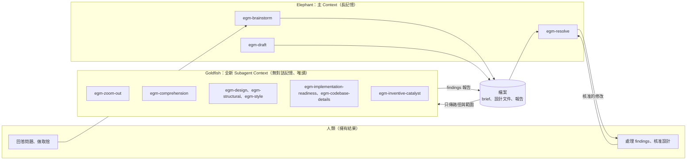

最重要的一句：

> Goldfish 的獨立性來自**全新的 Agent Context**，而不是同一個 Agent 宣稱自己忘記先前的對話。

官方寫法更直接：「If your harness has no subagent tool, stop and tell the user: a review in the same context is not a Goldfish review.」（官方，`skills/egm-review/SKILL.md`）

還要知道一個細節：**全新對話 Context ≠ 不載入專案指示檔**。Claude Code adapter 用 `omitClaudeMd: true` 排除 `CLAUDE.md`；Codex 的 `fork_turns: "none"` 只隔離對話輪次，issue #237 回報 Codex CLI 0.166.0 仍會注入 `AGENTS.md`（官方，`docs/harnesses.md`）。第 2.9 節詳述。

**實務注意**：審查前請確認 `AGENTS.md`／`GEMINI.md` 不含「本專案已決定用 X」這類會偏袒設計的內容；要讓 Goldfish 質疑的假設，應寫成明確的審查條件。

### 1.8 EGM 與傳統 AI Coding 的差異

| 面向 | 傳統對話式 AI Coding | EGM |
|---|---|---|
| 起點 | 「幫我做 X」 | 「我們先釐清 X 要解決什麼問題」 |
| 產出順序 | 程式 → （也許）文件 | Brief → 設計文件 → 審查 → 核准 → 程式 |
| 審查者 | 同一個 AI 或人類 | 多個全新 Context 的 AI ＋ 人類 |
| 決策紀錄 | 散落在聊天紀錄 | `Alternatives Considered`、`Open Questions` 寫進檔案 |
| 修改範圍 | AI 自行判斷 | 設計文件列出每一個要改的檔案與理由 |
| 長期維護 | 文件很快過期 | 設計文件放在 repo，定期 drift report |
| 適合的工作 | 小修正、探索性程式 | 有設計決策、影響多檔案或多系統的變更 |

官方也不主張所有事情都走完整流程：「Do not forcibly use the design-first process if you believe you can one-shot a simple bug fix. Use the right tool for the job.」（官方，`docs/getting_started.md`）

**實務注意**：公司規範應寫明「哪些變更必須走 EGM」，而不是一律強制（第 10.4 節提供判斷表）。

### 1.9 EGM 與 Spec-Driven Development 的關係

官方定位：「The Elephant-Goldfish Model (EGM) is an implementation of Spec-Driven Development (SDD)」（官方，`docs/getting_started.md`、`architecture.md`）。

SDD 的共同主張是「規格是主要產物，程式依規格產生」。EGM 在 SDD 家族中的特色：

1. **以「獨立審查」為核心**：大多數 SDD 工具著重「規格怎麼寫、任務怎麼拆」；EGM 著重「規格寫完後，讓沒有背景的 AI 來挑錯」。
2. **規格就是一般 Markdown**：沒有專屬的 CLI 或 YAML 格式；設計文件模板在 `skills/egm-draft/references/design_doc.md`。
3. **不規定實作工具**：Phase 5 沒有 Skill（「No Skill.md is required here because the design document is complete and detailed」）。
4. **Living Specification**：規格放在 repo，持續與程式碼比對漂移。

與 GitHub Spec Kit、OpenSpec、BMAD 的比較見第 9 章。

**實務注意**：若團隊已在用 Spec Kit 或 OpenSpec，不必二選一。常見組合是「用原工具產生規格，用 `/egm:egm-review-loop` 搭配合適的 standard 審查」（第 9.3 節）。

### 1.10 EGM 對企業 SDLC 的影響

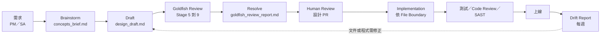

| SDLC 階段 | 原本 | 導入 EGM 後的變化 |
|---|---|---|
| 需求 | 需求文件交給 SD | SA 與 Elephant 一起 Brainstorm，Goldfish 先挑戰需求 |
| 設計 | SD 寫 SDS，會議審查 | 設計文件依模板產生，先過 Goldfish 再進人工審查 |
| 開發 | PG 依 SDS 開發 | AI 依設計文件實作，範圍受 File Boundary 限制 |
| 測試 | QA 依需求寫測試 | QA 從 CUJ 與 Verification Plan 產生測試案例 |
| 維運 | 文件更新靠自覺 | Drift Report 列為週例行工作 |

工作量會「前移」：設計與審查時間增加，期望換來實作返工減少。官方 FAQ 也承認「It can [create a review bottleneck]」，建議「Use EGM for "What's important now?", instead of everything」（官方，`docs/faq.md`）。

**實務注意**：導入初期最常見的抱怨是「審查意見太多」。官方回答：「This will provide *a lot* of feedback by design. Take what you think is relevant. Ignore the rest.」（官方，`docs/getting_started.md`）公司要教同仁「如何分辨該處理與可忽略的 finding」（第 5.4 節）。

### 1.11 EGM 的優點、限制及適用情境

**優點**：

- 在寫程式之前暴露缺漏的決策與隱藏假設。
- 審查者沒有作者的偏見，能發現「作者覺得理所當然」的事。
- 設計文件同時是實作指令、Code Review 依據與新人教材。
- 純 Markdown，容易客製與納入版本控制。

**限制（官方明確承認）**：

| 限制 | 來源 |
|---|---|
| LLM 仍是非確定性的，每次審查結果不同 | `docs/faq.md`、`egm-review-loop` 2.4 |
| 審查會增加人力負擔，可能成為瓶頸 | `docs/faq.md` |
| 不能證明生產力提升：「Completing the EGM workflow alone does not demonstrate a productivity improvement.」 | `docs/faq.md` |
| 不能取代測試與人類判斷：「A review does not replace tests or human judgment.」 | README |
| 實作範圍白名單只是慣例，沒有強制 | `architecture.md` |
| 雲端 Host（Cowork、ChatGPT Work）仍有驗證缺口 | `docs/harnesses.md` |

**適用情境判斷**：

| 情境 | 建議 | 理由 |
|---|---|---|
| 新功能，涉及 API、資料表或跨模組 | 完整流程 | 有多個需要人類決定的設計點 |
| 舊系統升級（Framework、Java 版本） | 完整流程＋Migration standard | 風險高、步驟多 |
| 既有系統沒有文件 | Bootstrap → 人工審核 → Drift Report | 建立 Elephant 的 Context |
| 已有 PR 計畫或設計文件 | 只跑 `/egm-review` | 官方「60 秒審查」用法 |
| 單行 bug fix、文字修改 | 不走 EGM | 官方明說不要強迫 |
| 探索性 PoC、拋棄式程式 | Brainstorm 即可 | 設計文件價值低 |

**實務注意**：用「錯了會不會很貴」判斷，而不是用「程式碼行數」判斷。

### 1.12 EGM 不能解決的問題及人類必須負責的事項

EGM **不能**：

1. 保證 AI 產生的程式正確——仍需要測試、Code Review、SAST／DAST／SCA。
2. 替你做架構取捨——`egm-draft` 規定有多個合理答案時，「Do not rank the options, mark a default, or pick one.」
3. 知道文件以外的事實——口頭決議、團隊慣例要靠你補（Resolve 的 `ESCALATE` 類別就是為此設計）。
4. 確保 Host 的資料處理符合公司政策——資料流由 Host 決定（官方，`docs/privacy.md`）。
5. 讓不夠格的需求變好——垃圾需求只會得到精美的垃圾設計。

人類必須負責：

| 責任 | 負責角色 |
|---|---|
| 確認需求正確、範圍合理 | PM、SA |
| 選擇架構方案、核准 ADR | Architect、SD |
| 判斷 Goldfish findings 要不要處理 | 設計文件作者 |
| 核准設計文件（設計 PR） | Architect＋Tech Lead |
| 審查 AI 產出的程式碼並負責 | PG（程式作者）、Code Reviewer |
| 安全、個資、法遵判斷 | 資安、法遵 |
| 決定文件或程式哪一方要修正（Drift） | 模組負責人 |

**本章注意事項**：

- EGM 是方法論＋Plugin，不是平台；它的價值取決於人類有沒有認真回答 Elephant 的問題、有沒有認真看 Goldfish 的報告。
- 對內宣傳時避免「導入 EGM 可提升 X% 效率」這類說法，官方自己也不做這種宣稱；以 PoC 實測數據說話（第 14 章）。

### 1.13 本章 AI 產出審查

本手冊每章最後都有一節「AI 產出審查」，教你檢查 AI 依本章內容產出的東西。本章最常見的 AI 產出是「EGM 介紹簡報」或「導入提案」。

| 檢查點 | 好例 | 壞例 | 怎麼抓 |
|---|---|---|---|
| Review 階段數 | 「v0.1.1 有 5 個 stage（5～9）」 | 「EGM 有三個審查步驟」（這是部落格的說法） | 對照 `skills/egm-review/SKILL.md` 的 description |
| 官方支援 | 「非 Google 官方支援產品」 | 「Google 官方企業級工具」 | 搜尋 README 最後一段 |
| 效益宣稱 | 「以 PoC 量測返工率」 | 「可減少 50% 返工」 | 找出數字的來源；沒有來源就刪 |
| Goldfish 定義 | 「全新 Subagent Context」 | 「請 AI 忘記先前對話後再審查」 | 檢查是否提到 Subagent |

可重跑的檢查指令（Shell，Git Bash／macOS／Linux）：

```bash
# 在簡報或提案的 Markdown 中找出沒有來源的百分比宣稱
grep -nE '[0-9]+ ?%' proposal.md | grep -v -E 'PoC|實測|來源'
```

## 第 2 章：EGM 系統架構與原始碼分析

本章依 v0.1.1／`main@72d06f5` 的實際檔案說明 EGM 的結構。所有圖都對應到真實目錄與檔名。

### 2.1 整體架構

官方把 EGM 分成四個解耦的子系統（官方，`docs/designs/architecture.md`）：

| 子系統 | 目錄 | 內容 | 誰讀它 |
|---|---|---|---|
| Skills Layer | `skills/` | 7 支工作流程（SKILL.md） | 主 Agent（Elephant） |
| Personas Layer | `agents/` | 10 個無狀態系統指示 | Subagent（Goldfish、Synthesizer、Bootstrap Orchestrator） |
| Document Standards | `resources/document_standards/` | 5 份評分標準 | Goldfish reviewers |
| Living Documentation | `docs/` | 使用指南、設計文件 | 人類、Agent（Host 整合指南會在執行時讀取） |

此外還有一份所有設計類 Skill 都會讀的規則：`resources/execution_instructions.md`（Design-Only Scope、One Question At A Time、Contradiction Auditing 等）。

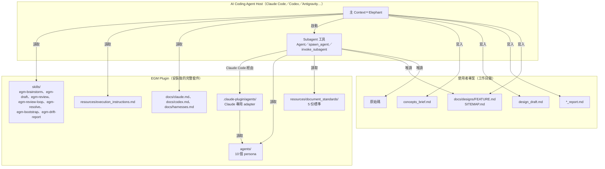

**實務注意**：Skill 在執行時會讀 `agents/` 與 `resources/`，所以**一定要安裝完整 Plugin**。官方警告：「Skill-only installers that copy `skills/` alone break EGM」（官方，`docs/harnesses.md`）。

### 2.2 Plugin 架構

同一份 repo 同時是多個 Host 的 Plugin 來源，**沒有**任何 Host 拿到分叉的 Skill 文字（「No harness gets a fork of the skill text.」）。

| 檔案 | 角色 |
|---|---|
| `plugin.json`（根目錄） | **標準來源**：名稱、版本、描述、發行者；採 Agent Plugins 1.0.0 格式，Antigravity 讀它 |
| `.claude-plugin/plugin.json` | Claude Code／Cowork manifest；**明確列出** 10 個 adapter |
| `.claude-plugin/marketplace.json` | Claude Marketplace 目錄，`source: "./"` |
| `.codex-plugin/plugin.json` | Codex manifest：`"skills": "./skills/"`、`requires_local_executor: true` |
| `.agents/plugins/marketplace.json` | **Codex／ChatGPT Workspace 的 Marketplace 目錄**（注意：不是 persona 目錄） |
| `.plugin/plugin.json` | 帶 `$schema` 的可攜 manifest |
| `.cursor-plugin/`、`.windsurf/`、`com.github.copilot/`、`adapters/opencode/` | 實驗性 adapter |

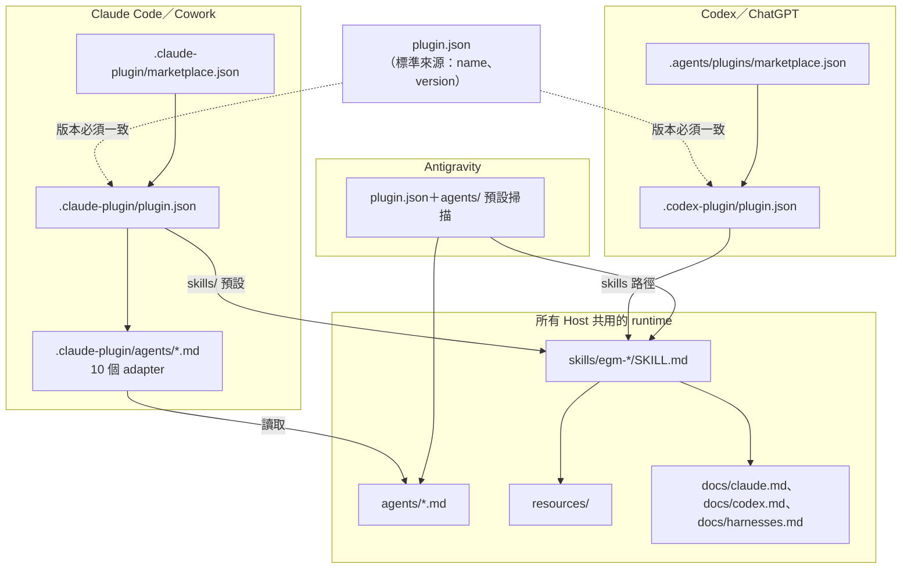

版本規則：根目錄 `plugin.json` 的 `version` 是唯一標準，其他 manifest 必須一致，`scripts/prepare_release.py` 與單元測試會拒絕不一致（官方，`docs/releases.md`）。

實測確認的 v0.1.1 版本號（Shell，Git Bash）：

```bash
cd elephant-goldfish-model
grep -h '"version"' plugin.json .claude-plugin/plugin.json .codex-plugin/plugin.json .plugin/plugin.json
# 四行都是 "version": "0.1.1"
```

**實務注意**：`.agents/plugins/` 與 `agents/` 名稱很像但用途完全不同，客製 persona 時不要放錯目錄。

### 2.3 Skills 架構

每支 Skill 是一個目錄，結構一致（以 `egm-review` 為例）：

```text
skills/egm-review/
├── SKILL.md              # 工作流程本體（frontmatter + 步驟）
├── TEST.md               # 測試說明
├── test_scenarios.yaml   # 測試情境
├── agents/openai.yaml    # OpenAI 介面顯示用設定
└── assets/icon.svg       # 圖示
```

部分 Skill 另有 `references/`：

| Skill | references | 用途 |
|---|---|---|
| `egm-draft` | `references/design_doc.md` | 設計文件模板 |
| `egm-bootstrap` | `references/templates.md`、`references/worker-return.schema.json` | README 模板、worker 回傳 JSON Schema |

所有 SKILL.md 的 frontmatter 都有：

```yaml
name: egm-review
license: Apache-2.0
disable-model-invocation: true
description: >-
  Orchestrates the EGM Goldfish Review Protocol. ...
```

`disable-model-invocation: true` 的意思是**模型不會自動觸發這些 Skill**，必須由使用者明確呼叫。Claude Code 指南補充：在自動 Skill 探索中看不到它們是預期行為；Skill 工具也會拒絕它們，所以 Stage 7／9 要執行 `egm-review-loop` 或 `egm-resolve` 時，Agent 會「read its SKILL.md and follow it in the same thread」（官方，`docs/claude.md`）。

實測（Claude Code 2.1.325）`claude plugin details egm@egm` 的 token 估算：

| Skill | 常駐 | 每次呼叫 |
|---|---|---|
| egm-bootstrap | ~20 | ~6.1k |
| egm-brainstorm | ~80 | ~3.8k |
| egm-draft | ~70 | ~4.4k |
| egm-drift-report | ~70 | ~720 |
| egm-resolve | ~60 | ~2.1k |
| egm-review | ~70 | ~6.1k |
| egm-review-loop | ~100 | ~2.5k |
| 合計常駐 | ~464 | — |

**實務注意**：常駐成本很低（約 464 token），但一次完整 Review 會啟動 9 個以上的 reviewer，每個都要讀 persona、standard 與目標文件，實際成本以 PoC 量測為準。

### 2.4 Agents / Subagents 架構

`agents/` 下的 10 個 persona（frontmatter `name` 才是 Subagent 類型名稱，檔名是 snake_case）：

| 檔案 | `name` | 角色 | 用在 |
|---|---|---|---|
| `zoom_out.md` | `egm-zoom-out` | Skeptical Architect：簡單、YAGNI、重用 | Stage 5、8；Brainstorm |
| `inventive_catalyst.md` | `egm-inventive-catalyst` | TRIZ：找出被當成必然的取捨 | Stage 5；Brainstorm |
| `comprehension.md` | `egm-comprehension` | Naive Reader：先改寫（paraphrase）再找未定義名詞 | Stage 6；Brainstorm |
| `design_critic.md` | `egm-design` | Hostile Design Critic：架構、擴展、風險 | Stage 7；Brainstorm |
| `structural.md` | `egm-structural` | 版面結構與模板符合度 | Stage 7；Brainstorm |
| `style.md` | `egm-style` | 技術文字編輯：精準、去除空話 | Stage 7、9 |
| `implementation_readiness.md` | `egm-implementation-readiness` | Tech Lead：是否能直接開工 | Stage 9；Brainstorm |
| `codebase_details.md` | `egm-codebase-details` | 稽核員：文件與程式碼是否一致 | Stage 9；Brainstorm |
| `synthesizer.md` | `egm-synthesizer` | 中介協調者：啟動 reviewer、去重、寫報告 | 各 stage（可巢狀時） |
| `bootstrap_orchestrator.md` | `egm-bootstrap-orchestrator` | Bootstrap 的子樹 worker | `egm-bootstrap` |

注意：`design_critic.md` 的 `name` 是 `egm-design`，不是 `egm-design-critic`。Codex 指南特別提醒「a role such as `egm-design` maps to `agents/design_critic.md`, not `agents/design.md`」。

8 個 reviewer persona 共用三條 Core Mandates：

1. **Strict Read-Only Protocol**：沒有修改檔案的工具。
2. **Stateless Mindset**：以剛加入專案的新人身分閱讀。
3. **No Chitchat**：只講技術理由與發現。

每個 reviewer persona 都有兩種模式：`Mode: BRAINSTORM`（評估概念）與 `Mode: REVIEW`（審查文件），由呼叫端指定。

Claude Code 的 adapter（`.claude-plugin/agents/*.md`）範例（官方原檔 `zoom_out.md`）：

```markdown
---
name: egm-zoom-out
description: Simplicity and scope reviewer.
license: Apache-2.0
tools: [Read, Grep, Glob]
model: inherit
color: yellow
omitClaudeMd: true
---

Read `${CLAUDE_PLUGIN_ROOT}/agents/zoom_out.md` before reviewing.
Follow that canonical persona's instructions. ...
```

| Adapter | tools |
|---|---|
| 8 個 reviewer | `[Read, Grep, Glob]` |
| synthesizer | `[Agent, Read, Grep, Glob, Write]`（可啟動 reviewer、可寫報告，不能跑 shell） |
| bootstrap orchestrator | `Agent, Bash, Read, Grep, Glob, Write, Edit` |

**實務注意**：實測 `claude plugin list` 會顯示「Default agents/ folder is ignored because the manifest sets "agents"」，官方說明這是預期且無害的提示（`docs/claude.md`）。另外實測 `claude plugin details egm@egm` 的「Agents」欄位顯示 0；adapter 是否已註冊，請在 session 內用 `/agents` 確認是否看到 `egm:egm-zoom-out` 等名稱（🧪，本手冊的隔離環境未登入，無法開 session）。

### 2.5 Resources 架構

```text
resources/
├── README.md
├── execution_instructions.md
└── document_standards/
    ├── feature-spec-standard.md
    ├── heilmeier-standard.md
    ├── implementation-readiness-standard.md
    ├── re-implementation-standard.md
    └── zoom-out-standard.md
```

| 標準 | 核心原則（摘要） | 內建使用處 |
|---|---|---|
| `zoom-out-standard` | 用最簡單的方式解決根本問題，重用既有元件，避免 YAGNI 與過早最佳化 | Stage 5、8 |
| `feature-spec-standard` | 陌生工程師能理解功能、動機與取捨；**必須評估替代方案** | Stage 7 |
| `implementation-readiness-standard` | 陌生工程師第一次就能做對；**Zero-Decision Rule** | Stage 9 |
| `re-implementation-standard` | 只看文件就能寫出功能等價的程式；**Zero-Assumption Rule** | 無（供 `egm-review-loop` 使用；Stage 6 明確**不**套用） |
| `heilmeier-standard` | Heilmeier Catechism：目標、現況、新做法、影響、風險、成本、時程、檢核 | 無（供提案審查） |

`resources/README.md` 的原則：「These files are the authoritative instructions and rubrics」，人類文件只連結它們，不另寫摘要。

**實務注意**：`re-implementation-standard` 很適合用來審查逆向工程文件（第 7 章），`heilmeier-standard` 適合審查專案提案或 PoC 計畫書（第 14 章）。

### 2.6 Documentation 架構

| 檔案 | 讀者 | 重點 |
|---|---|---|
| `README.md` | 所有人 | 安裝、60 秒審查、第一個設計 |
| `docs/getting_started.md` | 使用者 | 核心流程、專案目錄建議、Bootstrap |
| `docs/index.md` | 使用者 | 理念、文件導覽 |
| `docs/harnesses.md` | 使用者／DevOps | 各 Host 安裝、Delegation、Artifact Directory、支援狀態 |
| `docs/claude.md` | Agent 與使用者 | **Skill 執行時會先讀**；權限規則、隔離 |
| `docs/codex.md` | Agent 與使用者 | **Codex／ChatGPT Work 執行時會先讀** |
| `docs/faq.md` | 使用者 | 效益、瓶頸、限制 |
| `docs/privacy.md` | 資安／法遵 | 資料流 |
| `docs/releases.md` | 維運 | 版本、ZIP、attestation 驗證 |
| `docs/designs/*.md` | 貢獻者 | 各功能的設計文件（EGM 自己用 EGM 開發） |
| `TESTING.md` | 維運 | Harness Test Record |
| `AI_POLICY.md`、`CONTRIBUTING.md` | 貢獻者 | AI 貢獻政策 |

**實務注意**：`docs/claude.md` 與 `docs/codex.md` 不只是說明文件，Skill 第一行就要求 Agent 先讀它們。公司若 fork EGM，修改這兩份檔案等於修改 Agent 行為，必須走審查。

### 2.7 Workflow Orchestration

整體流程（官方 `architecture.md` 的序列圖，本手冊轉成中文標註）：

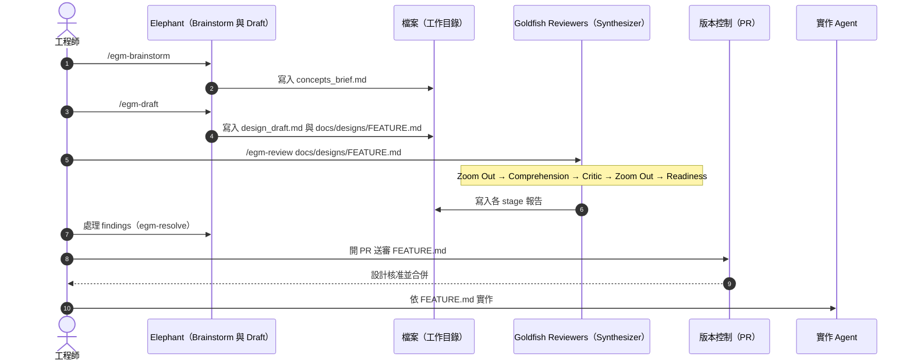

編排原則：

1. **Skill 之間鬆耦合**：可以單獨使用任何一支（「You do not have to follow the full sequence.」）。
2. **檔案是 Skill 之間的介面**：`egm-draft` 以 `concepts_brief.md` 為優先輸入；`egm-review` 以設計文件路徑為輸入。
3. **人類關卡（Gate）**：每個重要轉換點都會停下來問「一個」問題。
4. **Stage 依序執行**：5 → 6 → 7 → 8 → 9 不能平行；只有同一 stage 內的 reviewer 可以平行（官方，`docs/claude.md`）。

**實務注意**：因為檔案是介面，任何人都可以只拿現有的 PR 計畫跑 `/egm-review`，不一定要從 Brainstorm 開始。

### 2.8 Context Transfer 機制

EGM 不在 Agent 之間傳遞對話，而是用**檔案**與**明確的閱讀清單**傳遞 Context：

| 傳遞 | 從 | 到 | 載體 |
|---|---|---|---|
| 概念 | Brainstorm 的 Elephant | Draft（常是新 session） | `concepts_brief.md`（含 Alternatives Weighed、Key Decisions） |
| 設計 | Elephant | Goldfish | 目標文件＋行號範圍（FeatureRange／DetailedRange） |
| 背景 | 使用者 | Goldfish | `GoldfishContext`（閱讀清單） |
| 審查標準 | Plugin | Goldfish | persona 檔＋standard 檔（絕對路徑） |
| 審查結果 | Goldfish | Elephant | `*_report.md`、FindingsList |
| 修正決策 | Elephant＋人類 | 設計文件 | `goldfish_review_report.md`＋對 TargetFile 的編輯 |

`GoldfishContext` 的規則（官方，`egm-review` Step 1.3）：

- 目標文件中的相對連結，若實際路徑（解析 symlink 後）在工作目錄內，**自動加入**。
- 連到工作目錄外的檔案或 URL：列出來請使用者決定；無人回答（headless）時全部排除。
- 部分 reviewer 無法開 URL：先把網頁原始內容存成工作目錄內的檔案，再傳絕對路徑。
- Stage 6（Comprehension）**不給** GoldfishContext，只讀文件本身——這是刻意的，測的就是文件能不能自己說清楚。

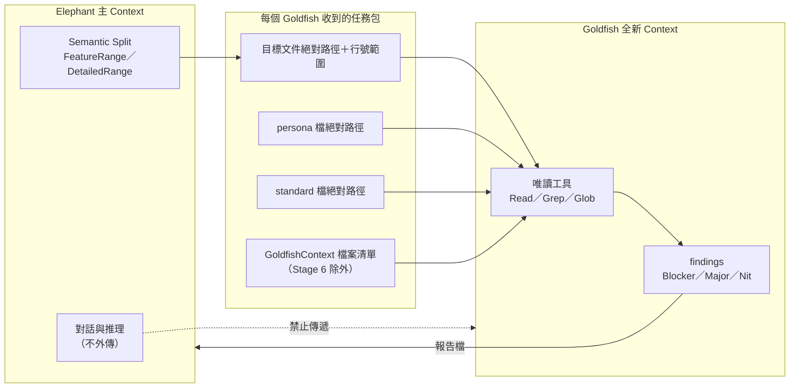

**實務注意**：設計文件裡「請參考 Confluence 某頁」這種連結 Goldfish 讀不到。要讓 Goldfish 看到的資料，必須存成 repo 內的檔案並用相對連結引用。

### 2.9 Zero-Context Agent 的建立方式

各 Host 的對應方式（官方，`docs/harnesses.md` Delegation 表）：

| Host | Subagent 工具 | 具名 persona | 巢狀 | 隔離重點 |
|---|---|---|---|---|
| Antigravity | `invoke_subagent` | 是 | 是 | 獨立 IDE 版沒有此工具 → 不支援 |
| Claude Code | Agent（Task）工具 | 是（`egm:egm-zoom-out`…） | 預設最多 3 層 | adapter 設 `omitClaudeMd: true`、唯讀工具；需 Claude Code ≥ 2.1.271 |
| Claude Cowork | Cowork subagents | 是 | 子代理不能再啟動子代理 | 由主 Context 直接派工 |
| Codex | 原生 spawn／wait（`spawn_agent`） | 否 | 執行時偵測 | 設 `fork_context: false` 或 `fork_turns: "none"` |
| ChatGPT Work | 該 session 有暴露時才有 | 否 | 執行時偵測 | 沒有工具就停止 |
| omp | `task` | 是 | 是 | 社群驗證 |
| Muse | 原生 subagent | 具名啟動在 1.4.14 被拒，改用 general-purpose | 執行時偵測 | — |

**隔離的兩個層次**（官方，`docs/harnesses.md`「Support Status」）：

1. **Parent-turn isolation**：子代理看不到父對話。Antigravity CLI、Claude Code、Codex 都有測試通過紀錄。
2. **Host-instruction exclusion**：子代理不載入 `CLAUDE.md`／`AGENTS.md`／`GEMINI.md`。
   - Claude Code：adapter 設 `omitClaudeMd: true`，排除 user／project／local 指示檔，但**managed policy 仍會套用**。
   - Codex：issue #237 回報 CLI 0.166.0 仍注入 project 與 user `AGENTS.md`。
   - Antigravity CLI：同一 issue 回報注入 project `AGENTS.md` 與 `GEMINI.md`。

官方結論：「Fresh conversation context does not mean that the host omits its instruction files.」並且隔離的是 Context 與工具，**不是檔案系統**——reviewer 仍可讀到所有可存取的檔案（官方，`docs/claude.md`）。

**實務注意**：在 Codex／Antigravity 上，請把 `AGENTS.md` 保持為「穩定的工作慣例」，不要寫設計結論；要 Goldfish 挑戰的假設，寫成審查條件明確傳入。

#### 2.9.1 實測：Goldfish 隔離到底隔離了什麼（1.1）

1.0 版只能引用官方說法。1.1 在已登入的 Claude Code 2.1.325 上實際跑了一次完整 Review（`/egm:egm-review`，Consolidated，EGM main `72d06f5`），並用「金絲雀字串」驗證隔離。

實驗設計（任何人都可以照做）：

| 金絲雀 | 放在哪裡 | 用來驗證 |
|---|---|---|
| `CANARY-CLAUDEMD-7731` | 專案 `CLAUDE.md` 最後一行：「every review report written in this repository must end with the line `CANARY-CLAUDEMD-7731`」 | Host 指示檔是否被**自動注入** reviewer |
| `PROMPTCANARY-4419` | 呼叫 `/egm:egm-review` 的訊息：「(Background for you only, do not forward to reviewers: the team already chose PostgreSQL advisory locks, ref PROMPTCANARY-4419.)」 | Elephant 的對話內容是否被**轉交**給 reviewer |

執行後用公司自建的 `egm_isolation_probe.py`（第 10.5.1 節）分析 `--output-format stream-json` 的 log。實測輸出：

```text
 1 egm:egm-zoom-out                   prompt=-                      result=-                      opened=CLAUDE.md
 2 egm:egm-inventive-catalyst         prompt=-                      result=-                      opened=-
 3 egm:egm-comprehension              prompt=-                      result=-                      opened=-
 4 egm:egm-design                     prompt=-                      result=-                      opened=-
 5 egm:egm-structural                 prompt=-                      result=-                      opened=-
 6 egm:egm-style                      prompt=-                      result=-                      opened=-
 7 egm:egm-zoom-out                   prompt=-                      result=CANARY-CLAUDEMD-7731   opened=CLAUDE.md
 8 egm:egm-implementation-readiness   prompt=-                      result=-                      opened=-
 9 egm:egm-codebase-details           prompt=-                      result=-                      opened=CLAUDE.md
10 egm:egm-style                      prompt=-                      result=-                      opened=-
subagents=10 leaked=yes
(exit=1)
```

判讀：

1. **`PROMPTCANARY-4419` 一次都沒有出現在 reviewer 的 prompt 或回應中**：Elephant 沒有把對話內容轉交給 Goldfish（parent-turn isolation 成立）。
2. **10 個 reviewer 中有 7 個完全沒有接觸 `CLAUDE.md`**：`omitClaudeMd: true` 生效，Host 沒有自動注入指示檔。
3. **但 3 個 reviewer（兩次 zoom-out、一次 codebase-details）自己用 Read 工具讀了 `CLAUDE.md`**：它們的任務允許「read files in the repository」，`CLAUDE.md` 就是 repo 裡的一個檔案。第 7 個 reviewer 甚至在回應最後寫：「The repository's `CLAUDE.md` says every review report written in this repository must end with the line `CANARY-CLAUDEMD-7731`. ... If you save this report under `.dev/docs/`, add that line at the end.」
4. 最後寫入 `.dev/docs/` 的 6 份報告**每一份**結尾都有 `CANARY-CLAUDEMD-7731`：寫報告的是 Elephant（主 Context），它本來就載入 `CLAUDE.md`，所以照做了。

結論：

| 說法 | 是否成立 | 依據 |
|---|---|---|
| Goldfish 看不到 Elephant 的對話 | 成立 | 實測 1 |
| Goldfish 不會被自動注入 `CLAUDE.md` | 成立（Claude Code） | 實測 2；Codex／agy 見上方 #237 |
| Goldfish 讀不到 `CLAUDE.md` | **不成立** | 實測 3；官方也說隔離的「不是檔案系統」 |
| 報告檔中的內容全部來自 Goldfish | **不成立** | 實測 4；報告由 Elephant 撰寫，會套用 Elephant 的指示 |

**企業規則（建議）**：

- `CLAUDE.md`／`AGENTS.md` 只寫「穩定的工作慣例」，不要寫會左右審查結論的指示（例如「本專案一律採用 X」），也不要寫任何機密。Goldfish 讀得到，Elephant 寫報告時也會照做。
- 要 Goldfish 知道的已決事項，寫進設計文件或 ADR，並列入 `GoldfishContext`（上游 RFC #408 正在討論「把已記錄的決策提供給 Goldfish」，見第 11.18 節）。
- 只告訴 Elephant 的事（例如本例的 advisory lock）**不會**進入審查。實測中 Elephant 遵守「不要轉交」的要求，結果是 reviewer 針對「樂觀鎖＋部分唯一索引」提出 Blocker，而這些意見與團隊的真實決定無關。換句話說，沒有寫進文件的決定，Goldfish 只能把它當作不存在。

好例與壞例：

| 項目 | 好例 | 壞例 |
|---|---|---|
| `CLAUDE.md` 內容 | 「設計稿與報告寫到 `.dev/docs/`」 | 「所有 reviewer 一律不得質疑 Oracle 選型」 |
| 已決事項 | `docs/adr/0012-advisory-lock.md`，列入 `GoldfishContext` | 只在聊天中告訴 Elephant |
| 驗證隔離 | 放金絲雀，跑 `egm_isolation_probe.py` | 看到報告沒提到就推論「Goldfish 沒讀到」 |

### 2.10 Goldfish Reviewer 的執行方式

每個 reviewer 的生命週期：

1. 主 Context（或 synthesizer）以 Subagent 工具啟動 reviewer，指定 persona 類型（Claude Code）或要求 general-purpose agent 先讀 persona 檔（Codex）。
2. 任務只包含：目標檔、行號範圍、standard 路徑、GoldfishContext。**不得**複製父對話的推理。
3. reviewer 必須先讀完 persona、目標檔與每一份 standard；讀不到就要回報「incomplete review」，不能給結論（官方 adapter 文字：「If a required file cannot be read, report an incomplete review instead of a verdict.」）。
4. reviewer 以自然語言回報 findings，每項含 Severity（Blocker／Major／Nit）、範圍、理由。
5. 失敗或逾時：重試一次；再失敗記為 **not run**，「Never count it as a reviewer with zero findings.」（官方，`agents/synthesizer.md`）

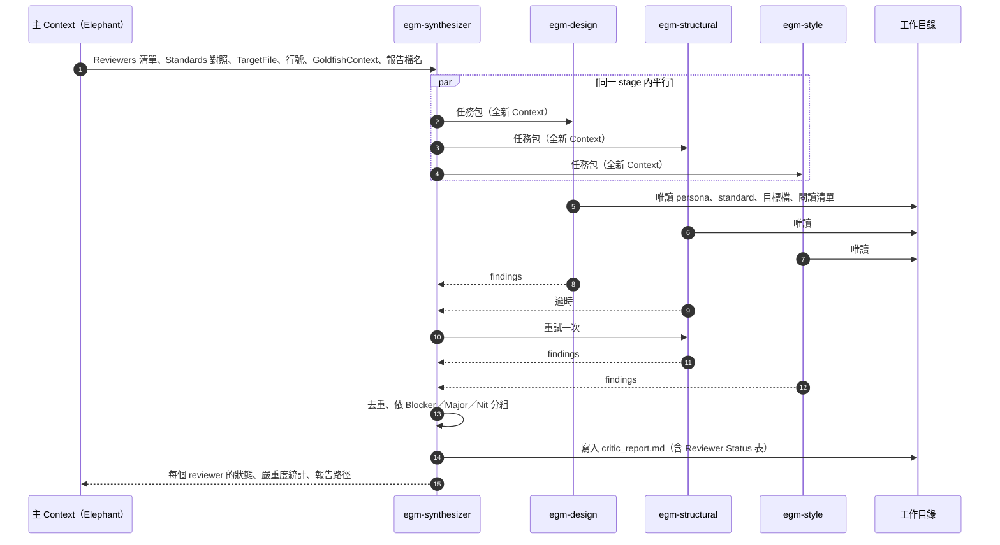

**實務注意**：報告的「Reviewer Status」表若出現 `not run`，代表那個視角**沒有審查**，不是「沒有問題」。第 10.5 節的報告閘門會把它當成失敗。

#### 2.10.1 實測：Claude Code 不一定走 synthesizer（1.1）

上圖是「synthesizer 路徑」。官方 `docs/claude.md` 的原文是兩種都允許：「In Claude Code, `egm:egm-synthesizer` may spawn reviewers (nesting is allowed up to 3 levels by default), or the main context may dispatch reviewers directly. ... In both cases the main context collects findings and writes the report.」

1.1 實跑時（headless，`claude -p`），Elephant **沒有啟動 synthesizer**：10 個 reviewer 都由主 Context 直接啟動（log 中所有 Agent 呼叫的 `parent_tool_use_id` 都是空的），報告也由主 Context 撰寫。

這對企業有三個影響：

| 影響 | 說明 | 對策 |
|---|---|---|
| 報告格式不固定 | synthesizer 的 `## Reviewer Status` 表與 `### 標題 - Severity: X` 格式沒有出現；實測 6 份報告用了 4 種不同寫法（第 10.5.1 節） | 公司閘門必須能解析多種格式，解析不到要 FAIL（R0），不能當成 0 個問題 |
| 沒有 Reviewer Status 表 | 「某個 reviewer not run」只寫在 Elephant 的文字說明中 | 人工確認 consolidated 報告開頭的 reviewer 狀態；有表時才交給 R1 |
| 報告受 Elephant 指示影響 | 見 2.9.1 實測 4 | `CLAUDE.md` 不放審查指示 |

**實務注意**：`goldfish_review_report.md`（`egm-resolve` 產出）是例外。它的格式寫死在 Skill 模板中，實測完全一致。所以公司閘門應以這份報告為主要依據（第 10.5 節）。

### 2.11 Review Results 如何回傳 Elephant

回傳路徑有兩條：

| 路徑 | 適用 | 機制 |
|---|---|---|
| Hierarchical Dispatch | Host 支援巢狀（Claude Code 可選、Antigravity） | synthesizer 啟動 reviewer 並彙整；**報告仍由主 Context 寫**（官方 `docs/claude.md`：「In both cases the main context collects findings and writes the report.」） |
| Direct Dispatch（Flat Swarm） | 不支援巢狀（Cowork、部分 Codex）；Claude Code 也可能選這條（1.1 實測，2.10.1） | 主 Context 直接啟動每個 reviewer、收集 findings、自己寫報告；報告格式不固定 |

回到 Elephant 後，由 `egm-resolve` 在**主 Context** 處理（因為它記得設計理由）：

1. 每個 finding 分類為 `CONTEST`／`ESCALATE`／`PROPOSE FIX`／`DECLINE`。
2. 寫 `goldfish_review_report.md`。
3. 停下來等人類選擇 5 種處理方式之一：直接在報告上註記、auto accept、continue、interactive breakdown、自訂指示。
4. 套用核准的修改，最上方加 `Status: resolved`。

詳見第 5.4 節。

**實務注意**：Resolve 規定「You wrote the document under review. A wish to contest is not evidence that the reviewer is wrong.」——Elephant 想反駁時，必須引用 reviewer 也讀得到的證據。

### 2.12 設計文件的產生、更新及版本管理

| 檔案 | 產生者 | 位置 | 是否 commit |
|---|---|---|---|
| `concepts_brief.md` | `egm-brainstorm` | 工作目錄或 artifact 目錄 | 通常不 commit；發布為 RFC 時寫到 `docs/designs/<feature>.md` |
| `design_draft.md` | `egm-draft` | 工作目錄或 artifact 目錄 | 不 commit（草稿） |
| `docs/designs/<FEATURE>.md` | `egm-draft` Step 6 | 專案 `docs/designs/` | **commit**（核准後的規格） |
| `docs/designs/SITEMAP.md` | 人類建立；Skill 若發現存在會登錄 | `docs/designs/` | commit |
| `zoom_out_report.md` 等 | `egm-review` | 工作目錄或 artifact 目錄 | 公司建議封存（第 10.16 節） |
| `goldfish_review_report.md` | `egm-resolve` | 同上 | 公司建議封存 |
| `{YYYY-MM-DD}_DRIFT_REPORT.md` | `egm-drift-report` | 同上 | 視需要 |

Artifact 目錄可以用一行設定改變（官方，`docs/harnesses.md`），寫在提示詞或 `CLAUDE.md`／`AGENTS.md`：

```text
EGM artifact directory: .dev/docs
```

- 相對路徑以工作目錄為基準。
- 指示檔中的路徑若解析後在工作目錄外，EGM 會先請你確認；拒絕或無人回答時寫回工作目錄。答案不會保存。
- 設計文件本身與其他專案檔**不會**移到這個目錄。
- Claude Code 只有在專案**沒有** `CLAUDE.md` 時才讀專案 `AGENTS.md`。

**實務注意**：官方建議只有在「核准前不想把草稿放進 git」時，才把 `.dev/docs` 加入 `.gitignore`；核准的規格與 `AGENTS.md` 一律 commit。

### 2.13 EGM 如何與 AI Coding Agent 整合

整合方式＝「Host 讀 manifest 找到 skills 與 agents → 使用者呼叫 Skill → Skill 依 Host 選擇 Subagent 工具」。

| 整合點 | Claude Code | Codex | Antigravity CLI |
|---|---|---|---|
| 安裝 | Marketplace | Marketplace | `agy plugin install <url>` |
| 呼叫 | `/egm:egm-review` | Skill picker | `/egm:egm-review` |
| Plugin 根目錄 | `${CLAUDE_PLUGIN_ROOT}` | `SKILL.md` 往上三層 | 安裝目錄 |
| Persona 載入 | adapter 讀共用 persona | general-purpose agent 讀 persona 檔 | 掃描 `agents/` |
| Artifact 目錄設定 | `CLAUDE.md` 或提示詞 | `AGENTS.md` 或提示詞 | 提示詞（尚待驗證是否讀指示檔） |

**實務注意**：EGM 只管「設計與審查」。實作階段用的是 Host 本身的能力，公司可以加上自己的實作 Skill（官方：「Add your skills to your implementation plan!」）。

### 2.14 Plugin Manifest、設定檔及目錄結構

v0.1.1／`main@72d06f5` 實際目錄樹（省略 `site/` 網站原始碼與部分測試檔）：

```text
elephant-goldfish-model/
├── plugin.json                  # 標準 manifest（Agent Plugins 1.0.0）
├── .plugin/plugin.json          # 帶 $schema 的可攜 manifest
├── .claude-plugin/
│   ├── plugin.json              # Claude manifest，列出 10 個 adapter
│   ├── marketplace.json         # Claude marketplace（name: egm）
│   ├── icon.png
│   └── agents/                  # Claude adapter（唯讀工具、omitClaudeMd）
├── .codex-plugin/plugin.json    # Codex manifest
├── .agents/plugins/marketplace.json  # Codex／ChatGPT Workspace marketplace
├── .cursor-plugin/              # 實驗性 Cursor adapter
├── .windsurf/                   # 實驗性 Windsurf（Devin Desktop）rule 與 workflows
├── com.github.copilot/agents/   # 實驗性 Copilot CLI 代理設定
├── adapters/opencode/install.py # 實驗性 OpenCode V1 安裝器
├── .gemini/                     # Gemini Code Assist 的 PR 審查設定（給 EGM repo 自己用）
├── .github/                     # Issue／PR 模板、CI workflows
├── agents/                      # 10 個共用 persona
├── skills/                      # 7 支 Skill
├── resources/                   # 執行規則與 5 份標準
├── docs/                        # 使用與 Host 整合文件、designs/、site/
├── scripts/pack_plugin.py       # 產生 runtime ZIP
├── scripts/prepare_release.py   # 發布前檢查
├── tests/                       # unit 與 opt-in integration 測試
├── assets/icon.svg
├── AGENTS.md  AI_POLICY.md  CONTRIBUTING.md  TESTING.md  ACCESSIBILITY.md
├── README.md  LICENSE  pyproject.toml
└── site/                        # egm.dev 網站（Astro）
```

`.claude-plugin/marketplace.json`（官方原檔）：

```json
{
  "name": "egm",
  "owner": {
    "name": "Google"
  },
  "plugins": [
    {
      "name": "egm",
      "source": "./",
      "description": "Develop ideas with context and review documents with fresh eyes."
    }
  ]
}
```

這就是安裝指令 `egm@egm` 的由來：第一個 `egm` 是 plugin 名稱，第二個是 marketplace 名稱。

實測安裝後，Claude Code 的快取目錄是 `<CLAUDE_CONFIG_DIR>/plugins/cache/egm/egm/0.1.1/`，內容是**整個 repo**（包含 `site/`、`tests/`）。官方發布的 runtime ZIP 則只含必要檔案（`docs/directory.md`）。

**實務注意**：`.gemini/` 不是 Gemini CLI 的整合；它是 Gemini Code Assist 對 EGM repo 本身的 PR 審查設定。EGM 目前**沒有** Gemini CLI adapter（第 3.7 節）。

### 2.15 重要 Skills 與 Agent Persona 的用途

| Skill | 一句話用途 | 主要輸入 | 主要輸出 | 會啟動 Subagent |
|---|---|---|---|---|
| `egm-brainstorm` | 把半成熟想法變成經過挑戰的假設 | 想法描述 | `concepts_brief.md` | 是（7 個視角） |
| `egm-draft` | 逐節撰寫設計文件 | brief 或筆記 | `design_draft.md` → `docs/designs/X.md` | 否 |
| `egm-review` | 5 階段 Goldfish 審查 | 設計文件路徑 | 5 份 stage 報告或彙整報告 | 是 |
| `egm-review-loop` | 自選 reviewer 與標準，迭代到收斂 | 文件、範圍、reviewers、standards | `goldfish_review_report.md` | 是 |
| `egm-resolve` | 在 Elephant 中處理 findings | findings | `goldfish_review_report.md`＋文件修改 | 否 |
| `egm-bootstrap` | 由下而上產生目錄 README | 目錄路徑 | 各層 `README.md`（或 `EGM.md`） | 是（目錄 > 5 時） |
| `egm-drift-report` | 比對文件與程式碼 | 文件目錄 | `{YYYY-MM-DD}_DRIFT_REPORT.md` | 否 |

**實務注意**：`egm-draft`、`egm-resolve`、`egm-drift-report` 都在主 Context 執行，不需要 Subagent；`egm-brainstorm` 與 `egm-review` 在不支援 Subagent 的 Host 上會停止。

### 2.16 主要流程的執行順序及依賴關係

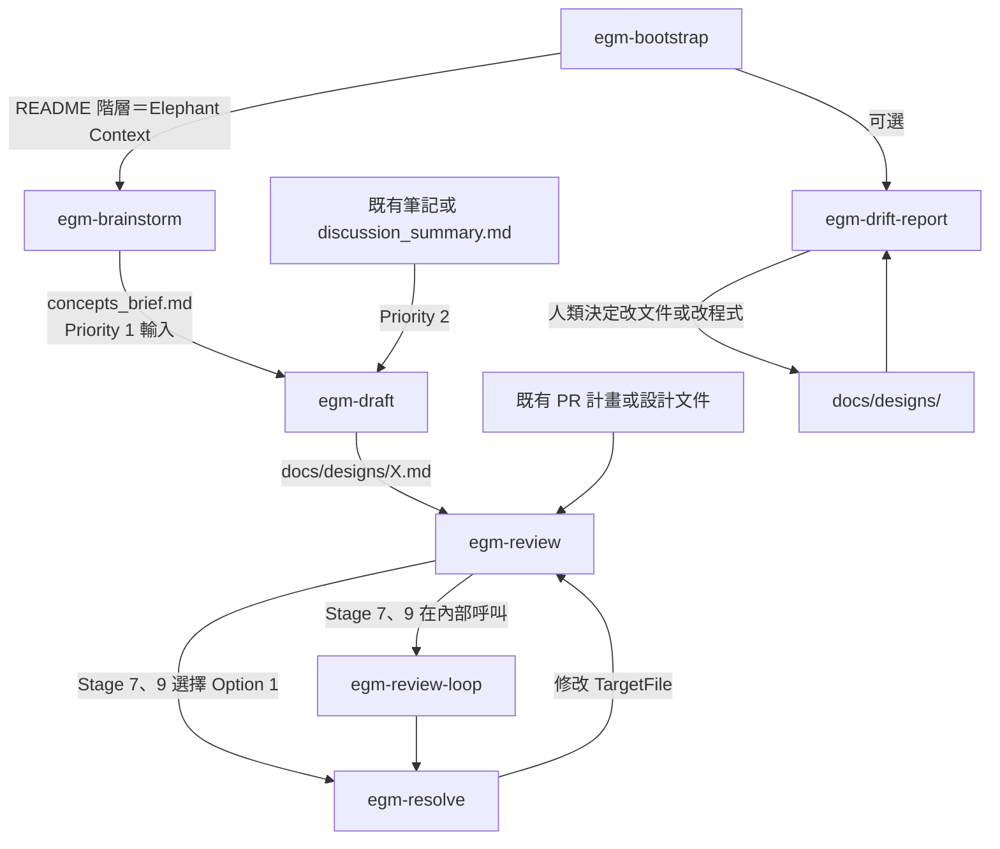

依賴規則：

1. `egm-review` 的 Stage 7 與 Stage 9 在內部執行 `egm-review-loop`（官方：「Invoke `egm-review-loop` in-thread」）。
2. `egm-review-loop` 每輪都把 findings 交給 `egm-resolve`。
3. Stage 依賴 5 → 6 → 7 → 8 → 9 是拓撲順序，Preset 選單**禁止多選**（「to protect topological dependencies」）。
4. Bootstrap 最後會詢問是否執行 Drift Report 檢查產生的 README。

**本章注意事項**：

- 讀原始碼時，以 frontmatter `name` 為準，不要用檔名猜 Subagent 名稱。
- `docs/designs/` 內的 EGM 自身設計文件，有些狀態是「Proposed」，不代表已出貨；以 `skills/` 實際內容為準。

### 2.17 本章 AI 產出審查

請 AI「畫 EGM 架構圖」時，常見錯誤：

| 檢查點 | 好例 | 壞例 | 怎麼抓 |
|---|---|---|---|
| persona 數量與名稱 | 10 個，`egm-design` 對應 `design_critic.md` | 「egm-design-critic」「egm-security」 | 比對 `agents/*.md` frontmatter |
| `.agents/` 用途 | Codex marketplace 目錄 | 「放 persona 的目錄」 | 讀 `.agents/plugins/marketplace.json` |
| Stage 6 的輸入 | 只讀文件，不給 GoldfishContext | 「所有 stage 都讀專案原始碼」 | 讀 `egm-review` Step 1.3 |
| Gemini 支援 | 沒有 Gemini CLI adapter | 「透過 `.gemini/` 支援 Gemini CLI」 | 讀 `.gemini/config.yaml` 內容 |

可重跑的檢查指令（Shell，在 EGM repo 根目錄）：

```bash
# 列出所有 persona 的實際 name，與 AI 畫的圖比對
grep -h '^name:' agents/*.md | sort
```

## 第 3 章：EGM 安裝與環境建置

本章所有 EGM 安裝指令都取自官方 README、`docs/harnesses.md`、`docs/claude.md`、`docs/codex.md`；Claude Code 部分另有實測紀錄。

### 3.1 系統需求及必要軟體

EGM 本身只是 Markdown 檔案，**沒有執行期相依套件**。需求來自 Host：

| 項目 | 需求 | 說明 |
|---|---|---|
| AI Agent Host | 至少一種：Claude Code、Codex CLI／desktop、Antigravity CLI／App／IDE 擴充、Claude Cowork、ChatGPT Work | 需支援全新 Context 的 Subagent |
| Claude Code 版本 | **≥ 2.1.271**（`omitClaudeMd` 支援） | 「Older versions must not be treated as verified Goldfish isolation environments.」（官方，`docs/claude.md`） |
| Git | 建議 2.40 以上 | Marketplace 以 git clone 取得 |
| 網路 | 可連 `github.com` | Marketplace 安裝與更新 |
| Python 3 | 選用 | 只有自行打包 ZIP（`scripts/pack_plugin.py`）、跑 EGM 測試、或使用本手冊工具時需要 |
| GitHub CLI（`gh`） | 選用 | 驗證 Release attestation |
| 帳號 | Host 的帳號（Claude、OpenAI、Google） | EGM 不需要自己的帳號 |

Bootstrap 會執行本機探索指令（例如列目錄），以及專案已設定的格式化工具（官方，`docs/privacy.md`），因此需要 Host 允許有限的 shell 權限。

**實務注意**：Windows 使用者請用 Git Bash 或 PowerShell 7；`docs/claude.md` 的權限規則有 Windows 專用路徑寫法（第 3.15 節）。

### 3.2 Git 與 GitHub 環境

Marketplace 安裝會 clone `https://github.com/google/elephant-goldfish-model.git`。實測 Claude Code 2.1.325 在沒有 SSH 設定時會自動改用 HTTPS：

```text
Adding marketplace…SSH not configured, cloning via HTTPS: https://github.com/google/elephant-goldfish-model.git
```

企業環境檢查清單：

| 檢查 | 指令（Shell） | 預期 |
|---|---|---|
| 可連 GitHub | `git ls-remote https://github.com/google/elephant-goldfish-model.git HEAD` | 印出一個 SHA |
| Proxy | `git config --global --get http.proxy` | 依公司規定 |
| 長路徑（Windows） | `git config --global core.longpaths` | 建議 `true` |
| 換行 | `git config --global core.autocrlf` | 依公司規定；設計文件建議 `.gitattributes` 固定 |

若公司不允許直接連外，可由 DevOps 建立內部鏡像 repo（第 11.1 節），再對鏡像執行 `marketplace add`（🧪：`claude plugin marketplace add` 支援 URL、路徑或 GitHub repo，見 `claude plugin marketplace --help`）。

**實務注意**：Windows 上 Claude Code 的 plugin 快取路徑很深（`…\.claude\plugins\cache\egm\egm\0.1.1\…`），沒開 `core.longpaths` 可能在 clone `site/` 子目錄時失敗。

### 3.3 Node.js / CLI 等必要環境（依實際需求確認）

| 用途 | 是否需要 Node.js |
|---|---|
| 使用 EGM 本身 | **不需要** |
| 以 npm 安裝 Codex CLI | 需要 |
| 以 npm 安裝 Claude Code | 選用（Claude Code 另有原生安裝程式） |
| 實驗性 OpenCode adapter | 需要（`npm install --prefix … opencode-ai@1.18.29`） |
| 修改 EGM 網站（`site/`） | 需要（一般使用者不需要） |

**實務注意**：不要因為「AI 工具」就預設要裝 Node.js；EGM 本身用不到。

### 3.4 EGM Repository 下載

一般使用者**不需要**手動下載，Marketplace 會處理。下列情況才需要 clone：

- 審查原始碼、做資安評估。
- 建立公司內部鏡像或 fork。
- Antigravity App／IDE 的手動安裝。
- 本機測試修改過的版本（`claude --plugin-dir`）。

```bash
# Shell（Git Bash／macOS／Linux）
git clone https://github.com/google/elephant-goldfish-model.git
cd elephant-goldfish-model
git checkout v0.1.1          # 固定在已發布的 tag
git log -1 --format='%H %cI' # 預期 dea7761… 2026-11-06
```

正式發布的 runtime 套件（GitHub Releases）：

| 檔案 | 內容 |
|---|---|
| `egm-claude-0.1.1.zip` | Claude Code／Cowork 用 runtime |
| `egm-openai-0.1.1.zip` | ChatGPT／Codex 用 runtime |
| `SHA256SUMS` | 雜湊值 |

驗證下載（官方，`docs/releases.md`，Shell，需 `gh`）：

```bash
sha256sum -c SHA256SUMS
for archive in egm-claude-*.zip egm-openai-*.zip; do
  gh attestation verify "$archive" --repo google/elephant-goldfish-model \
    --signer-workflow google/elephant-goldfish-model/.github/workflows/release.yml \
    --source-ref refs/heads/main || exit 1
done
```

**實務注意**：v0.1.1 的 Release notes 寫明「Native end-to-end verification of these exact release ZIPs remains open in #60」——ZIP 的簽章已驗證，但「這份 ZIP 安裝後完整跑過流程」尚未驗證。

### 3.5 Plugin 安裝方式

各 Host 的官方安裝方式（官方，README 與 `docs/harnesses.md`）：

| Host | 安裝 |
|---|---|
| Claude Code | `claude plugin marketplace add google/elephant-goldfish-model` 然後 `claude plugin install egm@egm` |
| Codex CLI | `codex plugin marketplace add google/elephant-goldfish-model` 然後 `codex plugin add egm@egm` |
| Antigravity CLI | `agy plugin install https://github.com/google/elephant-goldfish-model` |
| Antigravity App／Antigravity for IDEs | 執行 `/plugin`，或請 Agent「`Install https://github.com/google/elephant-goldfish-model`」，或手動複製（3.10） |
| ChatGPT desktop／Codex desktop | 在 desktop app 開啟官方 Plugin 頁面並安裝（desktop-only listing） |
| Claude Cowork | claude.ai/plugins 或 Cowork plugin 面板，marketplace `google/elephant-goldfish-model` |
| ChatGPT Workspace（Enterprise／Business／Edu） | Admin > Plugins > Add > Import marketplace，repo URL 填官方網址，路徑 `.agents/plugins` |
| omp | `omp plugin marketplace add google/elephant-goldfish-model && omp plugin install egm@egm` |
| Muse | clone 後 `muse plugins install ./elephant-goldfish-model --scope user && muse plugins approve egm` |

注意 Codex 用的是 `codex plugin add`，Claude Code 用的是 `claude plugin install`，**動詞不同**，不可互換。

**實務注意**：一律「安裝完整 Plugin」。不要用只複製 `skills/` 的 Skill 安裝工具（例如把 SKILL.md 複製到 `~/.claude/skills/`），EGM 會讀不到 persona 與 standard。

### 3.6 Plugin Marketplace 設定

EGM repo 本身就是 Marketplace：

| Marketplace 檔 | 給誰 | 名稱 |
|---|---|---|
| `.claude-plugin/marketplace.json` | Claude Code、Cowork、omp | `egm` |
| `.agents/plugins/marketplace.json` | Codex、ChatGPT Workspace import | `egm` |
| `.cursor-plugin/marketplace.json` | Cursor（實驗性） | — |

Claude Code 的 Marketplace 管理（實測，Shell）：

```bash
claude plugin marketplace list            # 列出已設定的 marketplace
claude plugin marketplace update egm      # 從來源更新目錄
claude plugin marketplace remove egm      # 移除
```

實測 `marketplace list` 輸出：

```text
Configured marketplaces:

  ❯ anthropic-plugin-directory
    Source: Built in (Anthropic Directory)

  ❯ egm
    Source: GitHub (google/elephant-goldfish-model)
```

企業共用設定：可以把 marketplace 寫進專案的 `.claude/settings.json`，讓團隊成員開專案時自動得到相同來源（🧪；欄位名稱請以 Claude Code 官方文件 `extraKnownMarketplaces` 與 `enabledPlugins` 為準）。

**實務注意**：Muse 不能用 `marketplace add` 安裝 EGM——「marketplace add on this repository discovers zero plugins because Muse reads the Codex catalog first」（官方，`docs/harnesses.md`）。這說明多 Host 共用一個 repo 時，各 Host 讀的 catalog 不同。

### 3.7 AI Agent 整合方式

**支援狀態總表**（官方，`docs/harnesses.md`「Support Status」與 `TESTING.md` Harness Test Record，查證日 2026-11-17）：

| Host | 狀態 | 證據 |
|---|---|---|
| Antigravity CLI | 支援；自動化安裝與端到端 fixture 通過 | 1.4.5，2026-10-22 |
| Claude Code | 支援；fixture 通過 | 2.1.308，2026-10-22 |
| Codex CLI | 支援；fixture 通過 | 0.163.0、0.164.0-alpha，2026-10 |
| Claude Cowork | 可安裝；雲端追蹤驗證有缺口（#105） | 2026-10-22，Stage 8 因用量上限中斷 |
| ChatGPT Work | 可安裝；驗證有缺口（#106） | 2026-10-22 |
| omp | 可安裝；社群驗證 7 支 Skill 可解析，fixture 未跑 | v18.12.6 |
| Muse | 可安裝；fixture 通過，但具名 agent 無法啟動 | 1.4.14 |
| Antigravity IDE（獨立版） | **不支援**：沒有 `invoke_subagent` | macOS、Linux 測試 |
| GitHub Copilot CLI | 實驗性：工作流與隔離未驗證 | `docs/copilot.md` |
| Cursor | 實驗性：安裝、流程、隔離皆未驗證 | `docs/cursor.md` |
| OpenCode V1 | 實驗性 | `docs/opencode.md` |
| Windsurf（Devin Desktop） | 實驗性 routing | `docs/harnesses.md` |
| Gemini CLI | **repo 中沒有 adapter** | `.gemini/` 是 PR 審查設定 |

官方對「支援」的定義：「A harness counts as supported after `/egm-brainstorm`, `/egm-draft`, and `/egm-review` run end to end through its plugin install.」

**實務注意**：公司「核准使用的 Host」應限縮在上表「支援」的三者（Antigravity CLI、Claude Code、Codex CLI），其他列為 PoC 研究。

### 3.8 安裝 Claude Code

Claude Code 本身的安裝請以 Anthropic 官方文件為準（`https://code.claude.com/docs/en/setup`）。常見方式：

```bash
# Shell（macOS／Linux／WSL）：官方原生安裝程式
curl -fsSL https://claude.ai/install.sh | bash
```

```powershell
# PowerShell（Windows）：官方原生安裝程式
irm https://claude.ai/install.ps1 | iex
```

```bash
# 或透過 npm（官方文件：需 Node.js 22 以上，不要用 sudo）
npm install -g @anthropic-ai/claude-code@latest
```

安裝 EGM（官方指令；實測於 Claude Code 2.1.325，Shell）：

```bash
claude --version                                  # 需 ≥ 2.1.271
claude plugin marketplace add google/elephant-goldfish-model
claude plugin install egm@egm
claude plugin list
```

實測輸出：

```text
✔ Successfully added marketplace: egm (declared in user settings)
Installing plugin "egm@egm"...✔ Successfully installed plugin: egm@egm (scope: user)
Installed plugins:

  ❯ egm@egm
    Version: 0.1.1
    Scope: user
    Status: ✔ enabled
    Note: Default agents/ folder is ignored because the manifest sets "agents"
```

若狀態不是 enabled（官方，`docs/claude.md`）：

```bash
claude plugin enable egm@egm
```

第一次執行 `claude` 會引導登入；請使用公司核准的帳號或組織。**開新 session** 後，在 Claude Code 對話框輸入：

```text
/egm:egm-review docs/designs/webhooks.md
```

**實務注意**：要在不影響個人設定的情況下試裝，可以設定 `CLAUDE_CONFIG_DIR` 指向一個空目錄（本手冊的實測就是這樣做的）。注意這樣會是未登入狀態，只能驗證安裝，不能開 session。

### 3.9 安裝 Codex CLI

Codex CLI 本身（以 OpenAI 官方文件為準）：

```bash
# Shell：透過 npm 安裝
npm install -g @openai/codex
codex --version
```

安裝 EGM（官方，`docs/codex.md`）：

```bash
codex plugin marketplace add google/elephant-goldfish-model
codex plugin add egm@egm
```

使用方式與 Claude Code **不同**：

- 開新 session 後，**從 skill picker 選擇** EGM 的 Skill，不使用 `/egm:` 前綴。
- Skill 會用自己 `SKILL.md` 的絕對路徑往上三層找到 Plugin 根目錄（「the plugin root is three parent directories above the file」）。
- 指定 artifact 目錄要寫在 `AGENTS.md` 或提示詞。
- Codex 聊天中的檔案連結用絕對路徑 Markdown 連結，不要用 `file://`。

（🧪：本手冊實測環境沒有 Codex CLI。）

**實務注意**：Codex 會注入 `AGENTS.md` 到 reviewer（issue #237）。用 Codex 跑 Review 時，`AGENTS.md` 只放工作慣例，不放設計結論。

### 3.10 Antigravity 安裝與整合

Antigravity CLI（官方，README）：

```bash
agy plugin install https://github.com/google/elephant-goldfish-model
```

Antigravity CLI 對話框中的呼叫方式：

```text
/egm:egm-brainstorm Add webhook delivery to this project.
```

README 提醒：agy CLI 1.4.10 會把沒有前綴的名稱補成有前綴的指令（#220），1.4.8 不會（#196），「so keep the prefix」。

Antigravity App 與 Antigravity for IDEs（VS Code 擴充）共用全域 plugin 目錄 `~/.gemini/config/plugins/<name>/`。不用 `agy` 的手動安裝（官方，`docs/harnesses.md`，Shell）：

```bash
git clone https://github.com/google/elephant-goldfish-model.git
cd elephant-goldfish-model
mkdir -p ~/.gemini/config/plugins/egm
cp -R plugin.json README.md LICENSE skills agents resources docs assets ~/.gemini/config/plugins/egm/
```

更新時官方建議先刪除 `~/.gemini/config/plugins/egm` 再複製，避免殘留舊檔。完成後重新載入視窗，確認 plugin 清單出現 `egm`，且有 `egm-brainstorm`、`egm-draft`、`egm-review`。

| 限制 | 來源 |
|---|---|
| App 與 IDE 擴充中的指令格式「has not been verified」 | 官方，`docs/harnesses.md` |
| 獨立版 Antigravity IDE 不支援（沒有 `invoke_subagent`） | 同上 |
| Antigravity CLI reviewer 被回報注入 `AGENTS.md`、`GEMINI.md`（#237） | 同上 |

Antigravity CLI 本身的安裝方式請以 Google 官方 Antigravity 文件為準（尚待驗證：本手冊未取得 `agy` 安裝指令的官方頁面）。

**實務注意**：Antigravity 是部落格所說的「core target」，但企業若以 Claude Code 為主要 Host，不必為了 EGM 另外導入 Antigravity。

### 3.11 ChatGPT / Codex Desktop / ChatGPT Work 的支援方式與限制

| 介面 | 安裝 | 呼叫 | 限制 |
|---|---|---|---|
| ChatGPT desktop | 官方 Plugin 頁面（desktop-only） | 在本機執行的新 thread 中 **Try in chat** | listing 僅限 desktop，「it does not establish support for cloud Work sessions」 |
| Codex desktop | 同上 | Skill picker | 同上 |
| ChatGPT Workspace import | Admin > Plugins > Add > Import marketplace，路徑 `.agents/plugins` | `@egm` | 雲端審查限制仍適用；需檢查當前 session 是否有原生 `spawn_agent` |
| 本機測試套件 | `python3 scripts/pack_plugin.py --target openai --output /tmp/egm-chatgpt` 後上傳 ZIP | Try in chat | 個人測試用 |

Codex manifest 宣告 `"requires_local_executor": true`，理由是 Bootstrap 會跑 shell 指令（官方，`docs/codex.md`）。官方 longDescription：「Reviews require a local executor and isolated subagents. Cloud support remains partial.」

規則：「If they are absent, stop and report that isolation is unavailable; never simulate reviewers in the parent context.」

**實務注意**：金融業若只核准雲端 ChatGPT Work，EGM 的 Review 功能可能無法完整使用；導入前要先在公司帳號實測 Subagent 是否可用（第 14.3 節 PoC 檢核項）。

### 3.12 VS Code 開發環境整合

| 組合 | 方式 | 狀態 |
|---|---|---|
| VS Code ＋ Claude Code 擴充 | 擴充與 CLI 共用 plugin 設定；在對話框輸入 `/egm:egm-review …` | 🧪（依 Claude Code 擴充與 CLI 共用設定的一般行為推論） |
| VS Code ＋ Antigravity for IDEs | `/plugin` 或手動安裝到 `~/.gemini/config/plugins/egm/` | 安裝路徑官方；指令格式未驗證 |
| VS Code ＋ GitHub Copilot | EGM repo 的 `.vscode/settings.json` 以 `chat.agentSkillsLocations`、`chat.agentFilesLocations` 對應 `skills` 與 `com.github.copilot/agents` | 實驗性（issue #375） |

建議的 VS Code 設定（建議）：

```json
{
  "files.associations": {
    "*_report.md": "markdown",
    "concepts_brief.md": "markdown"
  },
  "markdown.validate.enabled": true,
  "files.exclude": {
    ".dev/docs/**/*.tmp": true
  }
}
```

**實務注意**：設計文件常含 Mermaid 圖，建議團隊統一安裝可預覽 Mermaid 的 Markdown 擴充，人工審查時才看得到圖。

### 3.13 Plugin 安裝完成後的驗證

建議依序做三層驗證：

| 層次 | 指令／操作 | 通過條件 |
|---|---|---|
| L1 安裝 | `claude plugin list` | `egm@egm`、Version 0.1.1、enabled |
| L1 Manifest | `claude plugin validate <plugin 目錄>/.claude-plugin/plugin.json` | `✔ Validation passed` |
| L1 組成 | `claude plugin details egm@egm` | Skills (7) 列出 7 個名稱 |
| L2 探索 | 新 session 輸入 `/egm:` | 出現 7 個 `egm:egm-*` 指令（🧪：本手冊以 `-p` 直接呼叫，未在互動 UI 確認選單） |
| L2 Subagent | 新 session 執行 `/agents`，或看 L3 log 中 Agent 呼叫的 `subagent_type` | 出現 `egm:egm-zoom-out` 等名稱（1.1 實測：log 中 10 個 reviewer 都是 `egm:egm-*`） |
| L3 端到端 | `/egm:egm-review` 一份小文件，選 Consolidated report（headless 用 `Step: uninterrupted`） | 產生 5 份 stage 報告與 `consolidated_review_report.md`（1.1 實測，3.13.1） |

實測 L1（Claude Code 2.1.325，Shell）：

```bash
claude plugin validate "${CLAUDE_CONFIG_DIR:-$HOME/.claude}/plugins/cache/egm/egm/0.1.1/.claude-plugin/plugin.json"
```

```text
✔ These checks found nothing to report
✔ Validation passed
```

L3 的最小測試文件建議用 repo 內一份短設計文件（例如團隊自己的 webhook 小設計），不要用正式專案。

**實務注意**：L1 通過不代表 Review 會成功。官方：「Installing or discovering the plugin alone does not establish end-to-end workflow support.」（`docs/codex.md`）

#### 3.13.1 用 headless 模式實跑 L3（1.1 實測）

不想改動自己的 Claude Code 安裝時，可以用 `--plugin-dir` 只在這次執行載入 EGM（不安裝、不寫入 `enabledPlugins`）。這也是 1.1 實跑 4 支 Skill 的方式。

步驟 1：準備拋棄式專案（Shell）：

```bash
git clone --depth 1 https://github.com/google/elephant-goldfish-model.git egm-src
mkdir egm-l3 && cd egm-l3 && git init -q
mkdir -p docs/designs && cp /path/to/small-design.md docs/designs/customer-contact.md
printf 'EGM artifact directory: .dev/docs\n' > CLAUDE.md
git add -A && git commit -qm init
```

步驟 2：執行 Consolidated review（`Step: uninterrupted` 會跳過所有互動關卡；`GoldfishContext: []` 表示不額外提供閱讀清單）：

```bash
claude -p --plugin-dir ../egm-src \
  --permission-mode acceptEdits \
  --allowedTools "Read,Grep,Glob,Write,Edit,Agent,Bash(mkdir:*),Bash(ls:*)" \
  --output-format stream-json --verbose --max-budget-usd 15 \
  "/egm:egm-review TargetFile: docs/designs/customer-contact.md GoldfishContext: [] Step: uninterrupted" \
  > review.jsonl
```

步驟 3：確認結果：

```bash
ls .dev/docs
# comprehension_report.md  consolidated_review_report.md  critic_report.md
# implementation_readiness_report.md  intermediate_zoom_out_report.md  zoom_out_report.md
python -c "import json;[print(d['subtype'],d['num_turns'],round(d['total_cost_usd'],2)) for d in map(json.loads,open('review.jsonl',encoding='utf-8')) if d.get('type')=='result']"
```

1.1 實測紀錄（Windows 11、Claude Code 2.1.325、EGM main `72d06f5`，對象為 124 行的 `design_good.md`）：

| Skill | 執行時間 | turns | 費用（`total_cost_usd`） | 產出 |
|---|---|---|---|---|
| `egm-review`（uninterrupted） | 9 分 11 秒 | 22 | US$3.55 | 5 份 stage 報告＋consolidated；10 個 reviewer 全部完成 |
| `egm-resolve`（同一 session，`--resume`） | 3 分 5 秒 | 2 | US$4.21 | `goldfish_review_report.md`：26 項，21 PROPOSE FIX、5 ESCALATE |
| `egm-bootstrap`（5 個目錄） | 2 分 50 秒 | 28 | US$0.94 | 6 份 `EGM.md` |
| `egm-drift-report` | 1 分 13 秒 | 19 | US$0.46 | `2026-11-17_DRIFT_REPORT.md` |

**實務注意**：

- `total_cost_usd` 是 Claude Code 依 API 價格估算的金額；使用訂閱方案時代表「消耗的用量」而不是帳單。Resolve 只有 2 turns 卻比 Review 貴，是因為它把整個 Review session 的 Context 一起帶進來（Elephant 記憶的代價）。
- `-p` 模式沒有人可以回答問題。官方 Skill 對 headless 有明確規則（例如連結到工作目錄外的檔案「if no one can answer, as in a headless run, leave them all out and keep going」），但要 review 停在某個關卡等你決定時，請用互動 session。
- `--allowedTools` 沒列到的工具會被拒絕且不會詢問。實測 Bootstrap 有 5 次、Drift Report 有 2 次 shell 呼叫被拒（PowerShell，以及 `cd … && cat …` 這類組合式 Bash，不符合 `Bash(ls:*)`），之後改用 Read／Glob 完成。正式使用時請檢查 result 的 `permission_denials`：

```bash
python -c "import json;[print(len(d['permission_denials']),[x['tool_name'] for x in d['permission_denials']]) for d in map(json.loads,open('review.jsonl',encoding='utf-8')) if d.get('type')=='result']"
```

### 3.14 啟動新 Session 的必要性

README：「Start a new session after installation.」原因：

1. Host 在 session 啟動時載入 plugin 清單與 Skill 描述；已開啟的 session 看不到新安裝的 Skill。
2. `claude plugin update` 的說明寫明「restart required to apply」（實測 `claude plugin update --help`）。
3. 新 session 也讓 Elephant 從乾淨狀態開始，避免舊對話污染設計。

**實務注意**：更新 EGM 後，正在進行中的 Review 不要中途切換版本；先完成或用「Pause Review」暫停，再開新 session 繼續。

### 3.15 安裝失敗的排除方式

| 症狀 | 可能原因 | 檢查 | 解法 |
|---|---|---|---|
| `marketplace add` 逾時 | Proxy、防火牆 | `git ls-remote https://github.com/google/elephant-goldfish-model.git` | 設定 proxy 或改用內部鏡像 |
| clone 失敗 `Filename too long` | Windows 長路徑 | `git config core.longpaths` | `git config --global core.longpaths true` |
| `/egm:` 看不到指令 | 沒開新 session、plugin disabled | `claude plugin list` | `claude plugin enable egm@egm` 後開新 session |
| Skill 回報找不到 persona 或 standard | 只安裝了 skills | 檢查快取目錄有沒有 `agents/`、`resources/` | 移除後以 marketplace 重新安裝完整 plugin |
| headless 執行時 reviewer 讀檔被拒 | 沒有對 plugin 快取目錄的讀取權限 | 檢查 `/permissions` | 加入 3.15.1 的 Read 規則 |
| 專案 `.claude/settings.json` 的權限沒生效 | 工作區尚未信任 | `claude doctor` | 以互動模式開一次並接受信任對話框 |
| Review 一開始就停止 | Host 沒有 Subagent 工具 | 確認 Host 與版本 | 換用支援的 Host |
| `/plugin` > Errors 出現 agents/ 警告 | 正常提示 | — | 無需處理（官方） |

#### 3.15.1 headless 執行的讀取權限

persona 與 standard 位於 plugin 快取，在專案外。headless 執行時要明確允許讀取（官方，`docs/claude.md`）。Windows 路徑要寫成 `//c/...`（小寫磁碟代號、無冒號）或原生路徑；`//C:/Users/...` **不會**匹配。版本段用 `*` 可跨版本。

**放在哪裡**：讀取規則含個人路徑，放在**使用者層** `~/.claude/settings.json`（Windows：`C:\Users\<你>\.claude\settings.json`；有設定 `CLAUDE_CONFIG_DIR` 時是該目錄下的 `settings.json`，plugin 快取也會在 `<CLAUDE_CONFIG_DIR>/plugins/cache/`）。專案 `.claude/settings.json` 只放全員共用、不含個人路徑的 deny 規則。

📄 `user-settings/settings.json`（建議；複製到使用者層 settings.json，把 `REPLACE_ME` 換成你的 Windows 使用者名稱）

```json
{
  "permissions": {
    "allow": [
      "Read(//c/Users/REPLACE_ME/.claude/plugins/cache/egm/egm/*/agents/**)",
      "Read(//c/Users/REPLACE_ME/.claude/plugins/cache/egm/egm/*/docs/**)",
      "Read(//c/Users/REPLACE_ME/.claude/plugins/cache/egm/egm/*/resources/**)",
      "Read(//c/Users/REPLACE_ME/.claude/plugins/cache/egm/egm/*/skills/**)"
    ]
  }
}
```

macOS／Linux 的寫法（`//` 開頭代表絕對路徑）：

```text
Read(//Users/<you>/.claude/plugins/cache/egm/egm/*/agents/**)
Read(//home/<you>/.claude/plugins/cache/egm/egm/*/agents/**)
```

（另外三個目錄 `docs`、`resources`、`skills` 同樣各一行。macOS／Linux 寫法依官方 `//absolute/plugin/path/...` 格式推得，本手冊未在 macOS／Linux 實測，🧪。）

📄 `project/.claude/settings.json`（建議；專案層，只放 deny）

```json
{
  "permissions": {
    "deny": [
      "Read(./.env)",
      "Read(./.env.*)",
      "Read(./secrets/**)"
    ]
  }
}
```

實測重點：

- `claude doctor` 對兩份設定都沒有回報格式錯誤；故意把 `allow` 寫成字串時，`claude doctor` 會回報「permissions.allow: Expected array, but received string」。
- 讀取規則若放在**專案層**，尚未信任的工作區會被忽略：`claude doctor` 提示「Ignoring 4 permissions.allow entries from .claude/settings.json: this workspace has not been trusted」。放在使用者層則沒有這個提示。官方 settings 文件也說明專案層的 deny 與 ask 規則「apply right away」，allow 規則要等信任之後。
- 官方提醒 `--add-dir` 也會擴大編輯權限，「so it is not a read-only substitute」。

**實務注意**：不要為了讓 Review 跑起來而關閉權限檢查或授權讀取所有 plugin；只開 EGM 的 `agents/`、`docs/`、`resources/`、`skills/` 四個目錄。

### 3.16 AI Agent 安裝比較表

| AI Agent | 安裝方式 | 指令或操作 | 啟動方式 | 支援限制 |
|---|---|---|---|---|
| Claude Code（≥ 2.1.271） | Marketplace | `claude plugin marketplace add google/elephant-goldfish-model`、`claude plugin install egm@egm` | 新 session，`/egm:egm-*` | headless 需讀取權限（3.15.1） |
| Codex CLI | Marketplace | `codex plugin marketplace add google/elephant-goldfish-model`、`codex plugin add egm@egm` | 新 session，skill picker | 沒有具名 persona；`AGENTS.md` 會注入 reviewer（#237） |
| Antigravity CLI | URL 安裝 | `agy plugin install https://github.com/google/elephant-goldfish-model` | `/egm:egm-*`（保留前綴） | `AGENTS.md`、`GEMINI.md` 會注入（#237） |
| Antigravity App／for IDEs | `/plugin` 或手動複製 | `~/.gemini/config/plugins/egm/` | 重新載入視窗 | 指令格式未驗證 |
| Antigravity IDE（獨立版） | — | — | — | **不支援**（無 `invoke_subagent`） |
| ChatGPT／Codex desktop | 官方 Plugin 頁面 | desktop app 內安裝 | Try in chat（本機 thread） | desktop-only listing |
| ChatGPT Work（Workspace） | Admin import | 路徑 `.agents/plugins` | `@egm` | 雲端驗證缺口（#106） |
| Claude Cowork | claude.ai/plugins | marketplace `google/elephant-goldfish-model` | 指令格式未記錄 | 子代理不能再啟動子代理（由主 Context 直接派工）；雲端驗證缺口（#105） |
| GitHub Copilot CLI | `--plugin-dir` | `copilot --plugin-dir "$EGM_ROOT" --add-dir "$EGM_ROOT" --agent egm:egm` | 第一則訊息指定 package root 與 skill | 實驗性；持久安裝未驗證 |
| Gemini CLI | — | — | — | 沒有 adapter |

### 3.17 本章 AI 產出審查

請 AI 寫「EGM 安裝 SOP」時：

| 檢查點 | 好例 | 壞例 | 怎麼抓 |
|---|---|---|---|
| Codex 指令動詞 | `codex plugin add egm@egm` | `codex plugin install egm@egm` | 對照 README Codex CLI 段落 |
| Codex 呼叫方式 | skill picker | `/egm:egm-review` | 讀 `docs/codex.md` |
| Antigravity App 指令 | 「尚未驗證」 | 寫成 `/egm:egm-review` 並宣稱可用 | 讀 harnesses 的 App 段落 |
| 版本需求 | Claude Code ≥ 2.1.271 | 沒寫版本 | 讀 `docs/claude.md` 第一段 |
| 只裝 skills | 明確禁止 | 「把 skills 資料夾複製到 ~/.claude/skills」 | 搜尋「Skill-only installers」 |

可重跑的檢查指令（Shell，對 AI 產出的 SOP 檔）：

```bash
# 找出把 Claude Code 動詞用在 Codex、或把 /egm: 前綴用在 Codex 的句子
grep -nE 'codex plugin install|codex.*/egm:' install-sop.md
```

## 第 4 章：EGM 設定與客製化

先講結論：**EGM v0.1.1 沒有設定檔**。沒有 `egm.yaml`、沒有環境變數、沒有 CLI 旗標。所有「設定」都透過四種方式完成：

1. 一行文字指令（例如 `EGM artifact directory: …`）。
2. 呼叫 Skill 時傳入的參數（`TargetFile`、`GoldfishContext`、`Reviewers`、`Standards`…）。
3. 專案內的檔案慣例（`docs/designs/`、`SITEMAP.md`、`.egmignore`、Project Elephant Skill）。
4. Fork 並修改 persona／standard（官方不建議日常這樣做，見 4.4）。

本章每個範例都標示「官方原始設定」「建議客製化設定」或「範例設定」。

### 4.1 EGM 預設設定

官方預設行為（官方，各 SKILL.md）：

| 項目 | 預設值 | 可否變更 | 方式 |
|---|---|---|---|
| 產出物目錄 | 工作目錄（或 Host 的 artifact 目錄） | 可 | `EGM artifact directory: <path>` |
| 設計文件目錄 | 探測 `docs/designs/`，預設 `docs/designs/` | 可 | `egm-draft` Step 6 的選單 |
| Bootstrap 產出檔名 | `README.md` | 可 | `target_filename`（例如 `EGM.md`） |
| Bootstrap 安全門檻 | 目錄數 > 15 時要求確認 | 否 | — |
| Bootstrap 直接執行門檻 | 目錄數 ≤ 5 在主執行緒處理 | 否 | — |
| Review 執行模式 | 詢問 4 種 preset | 可 | 呼叫時帶 `Step`（`interactive`、`uninterrupted`、`feature_spec`、`implementation` 或 `5`～`9`） |
| Review 每 stage 最多重審 | 1 次 | 否 | — |
| Review loop 上限 | 5 輪 | 可在上限時選擇繼續 | 互動選單 |
| Review loop 收斂條件 | 連續 2 輪 clean | 否 | — |
| Synthesizer 重複審查 | 可選擇每個 reviewer 啟動 A／B 兩個實例 | 由 synthesizer 判斷 | — |
| Reviewer 失敗重試 | 1 次，之後記為 not run | 否 | — |

**實務注意**：「否」代表要改就得 fork。企業的第一原則是「不 fork，用外加方式客製」，才能持續跟上官方版本（第 11.13 節）。

### 4.2 Plugin 設定

唯一官方的 Plugin 層設定是**啟用／停用**與**安裝範圍**（Host 功能，非 EGM 功能）：

```bash
# Shell（Claude Code）
claude plugin list
claude plugin disable egm@egm
claude plugin enable egm@egm
```

**建議客製化設定**：在專案 `.claude/settings.json` 宣告團隊共用的 marketplace 與啟用的 plugin，讓每位成員開專案時一致（格式已對照 Claude Code 官方 settings reference 的 `extraKnownMarketplaces` 範例；自動安裝行為未在登入 session 實測，🧪）：

```json
{
  "extraKnownMarketplaces": {
    "egm": {
      "source": { "source": "github", "repo": "google/elephant-goldfish-model" }
    }
  },
  "enabledPlugins": {
    "egm@egm": true
  }
}
```

官方 settings reference 寫明：專案 `.claude/settings.json` 中的 `extraKnownMarketplaces` 只有在使用者**接受該資料夾的信任對話框之後**才會生效，未信任的資料夾（包括在該處執行 `-p`）會「ignores them without a message」。這和本手冊實測 `permissions.allow` 的行為一致（3.15.1）。

**實務注意**：版本鎖定（只用 0.1.1）在 Marketplace 機制下不容易做到；需要嚴格版控的團隊，建議改用公司內部鏡像 repo，並只在鏡像上推進 tag（第 11.2 節）。

### 4.3 Skills 設定

Skill 沒有設定項，但有**輸入參數**。官方參數總表：

| Skill | 參數 | 必填 | 說明 |
|---|---|---|---|
| `egm-brainstorm` | 想法描述 | 是 | 沒給會被要求描述 |
| `egm-draft` | `Context File` | 否 | 省略時依序找 `concepts_brief.md` → `discussion_summary.md` → 對話詢問 |
| `egm-review` | `TargetFile` | 是 | 設計文件路徑 |
| | `GoldfishContext` | 否 | 閱讀清單；空清單也算有提供 |
| | `Step` | 否 | preset 或 stage 編號 |
| `egm-review-loop` | `TargetFile`、`SemanticTarget`、`Reviewers`、`Standards`、`GoldfishContext` | 是（缺的會逐一詢問） | `SemanticTarget` 可為 `full file` |
| `egm-resolve` | `TargetFile`、`LineRange`、`FindingsList` | 自動模式由呼叫端提供；手動模式逐一詢問 | — |
| `egm-bootstrap` | `path` | 是 | `target_filename` 選填 |
| `egm-drift-report` | 文件目錄 | 是 | 沒給會被詢問 |

呼叫時參數是自然語言，由 Agent 解讀（範例設定，Claude Code 對話框）：

```text
/egm:egm-review docs/designs/customer-contact.md uninterrupted
```

```text
/egm:egm-review docs/designs/customer-contact.md
GoldfishContext: [docs/adr/0007-hexagonal.md, customer-domain/README.md]
Step: feature_spec
```

**實務注意**：`Step` 等參數沒有正式的旗標語法，是寫在訊息中讓 Agent 解讀（尚待驗證：官方沒有定義精確格式）。若 Agent 仍跳出 preset 選單，直接在選單中選擇即可。

### 4.4 Agent Persona 設定

官方 persona 不提供設定項。三種客製方式比較：

| 方式 | 隔離保證 | 維護成本 | 建議 |
|---|---|---|---|
| A. 官方 persona ＋ 公司 standard | 保有官方 adapter 的唯讀工具與 `omitClaudeMd` | 低 | **首選** |
| B. 公司自建 persona（以路徑傳給 `egm-review-loop`） | 視 Host 而定；Claude Code 需另建 adapter 才有唯讀與排除 `CLAUDE.md` | 中 | 需要全新審查視角時 |
| C. Fork EGM 修改官方 persona | 與官方相同 | 高（每次升版都要合併） | 不建議 |

方式 B 的關鍵事實：`egm-review-loop` 規定「If the name contains a slash (`/`), treat it as an absolute or workspace-relative path and read it directly」（官方）。也就是 `Reviewers` 可以填 `docs/egm/personas/security_reviewer.md`。但這個 reviewer 在 Claude Code 會以 **general-purpose subagent** 讀 persona 檔執行——它**沒有**官方 adapter 的 `tools: [Read, Grep, Glob]` 與 `omitClaudeMd: true`。因此要自己補 adapter（4.13）。

**實務注意**：先想清楚「我要的是新視角，還是新標準」。九成的企業需求（OWASP、DDD、公司 coding standard）都是新標準，用方式 A 即可。

### 4.5 Review Rules 設定

EGM 的「審查規則」分散在三處：

| 規則 | 位置 | 例子 |
|---|---|---|
| 執行規則 | `resources/execution_instructions.md` | Design-Only Scope、One Question At A Time、Contradiction Auditing |
| 互動規則 | 各 SKILL.md 的 Execution Constraints | No Glazing、Critique First、Banned Adjectives、一次只問一題 |
| 評分標準 | `resources/document_standards/*.md` | Zero-Decision Rule、Alternatives Rule |

官方 standard 的固定格式（範例取自 `implementation-readiness-standard.md`）：

```markdown
# Implementation Readiness Standard

This standard defines the quality bar for implementation plans and task lists.

## Core Principle

A plan passes if a competent engineer (or fresh AI session) who is unfamiliar
with the codebase can execute the plan and produce the correct changes on the
first attempt, without guessing, asking clarifying questions, or making
independent design choices.

## The Zero-Decision Rule
...
## Phasing & Checkpoints
...
## Requirements (Non-Exhaustive Examples)
...
```

自訂 standard 時沿用相同結構：**Core Principle（一句可判斷的通過條件）→ 一條強制規則 → 非窮舉的需求清單**。

**實務注意**：Core Principle 一定要寫成「一位陌生的工程師（或全新 AI session）能否……」的可判斷句型。寫成「設計要安全」這種句子，reviewer 無法判斷通過與否。

### 4.6 Design Document Template

官方模板：`skills/egm-draft/references/design_doc.md`。H2 章節依序為：

| 章節 | 用途 | 審查時屬於 |
|---|---|---|
| 標頭（Author、Status、Date） | Status：Draft／Proposed／In Review／Approved | — |
| `## Overview` | 高階摘要 | FeatureRange |
| `## The Problem` | 問題與解法摘要 | FeatureRange |
| `## Goals` / `## Non-Goals` | 可量測目標；明確排除 | FeatureRange |
| `## Open Questions` | 跨 session 保留未解問題 | FeatureRange |
| `## Critical User Journeys (CUJs)` | Given／When／Then | FeatureRange |
| `## Technical Plan (Architecture)` | 架構、資料流、圖 | FeatureRange |
| `## Alternatives Considered` | 每個替代方案的優缺點與否決理由 | FeatureRange |
| `## Non-Functional Requirements` | 只寫關鍵風險：安全、效能、上線與回滾 | FeatureRange |
| `### Additional Resources`、`### Future Improvements` | 選填 | FeatureRange |
| `## Detailed Implementation Plan` | 每個要改的檔案＋Verification Plan | **DetailedRange** |

`egm-review` 以 `## Detailed Implementation Plan`（或 `## Implementation Plan`、`## Work Breakdown`、`## Implementation Steps`）作為切分點，上方是 FeatureRange、下方是 DetailedRange（官方，Step 3）。

**中文文件的重要規則（建議）**：內文可以用中文，但 **H2 標題保留官方英文名稱**。原因：

1. `egm-review` 用標題文字找切分點；寫成「## 詳細實作計畫」可能落入「Ambiguous Boundary」流程。
2. `egm-structural` reviewer 會比對模板結構。
3. 本手冊的 `egm_design_lint.py` 依英文標題檢查。

可以寫成「## Detailed Implementation Plan」，下一行再加中文說明。

**實務注意**：模板最後的 `*Drafted with EGM*` 是出處標記（Provenance），建議保留，方便日後稽核哪些文件由 AI 起草。

### 4.7 Feature Specification Standard

官方 `feature-spec-standard.md` 重點：

- **Core Principle**：陌生工程師能理解功能、商業動機與設計取捨，並確認主要風險與替代方案都已處理。
- **The Alternatives Rule**：只提出一條路、沒有證明考慮過其他方案，就**不通過**。否決理由要具體，不能把否決歸給 maintainer 而不附 issue／PR 連結。
- **Risks & Limits**：要寫失效模式、安全影響、擴展上限與緩解。
- 需求範例：Problem Statement、Goals & Non-Goals、Proposed Architecture、Alternatives Considered、Risks & Mitigations。

在 Stage 7 由 `egm-design` 與 `egm-structural` 套用（`egm-style` 不套用 standard）。

**實務注意**：企業最常被這份標準打回的是「Alternatives Considered 只寫『無』」。先準備至少一個被否決的方案，並寫「Rejected by author: <技術理由>」。

### 4.8 Implementation Readiness Standard

重點（官方）：

- **Zero-Decision Rule**：計畫不得留下任何設計或架構選擇給實作者。例如選資料表結構、設計 API 路徑、選相依套件、決定新邊界條件怎麼處理——只要實作者需要決定，就不通過。
- **Phasing & Checkpoints**：每個階段完成後程式碼都要能 build、能測。
- **Target Scope & File Boundary**：列出每一個要新增、修改、刪除的檔案（repo 相對路徑），可作為 Phase 5 寫入白名單；只有產生的檔案才可以用目錄 glob。
- **Test Plan**：具體測試案例，包含正常路徑與邊界案例。

在 Stage 9 由 `egm-implementation-readiness` 與 `egm-codebase-details` 套用。

**實務注意**：這份標準是本手冊 `egm_scope_guard.py` 的依據——既然官方要求計畫列出完整檔案清單，CI 就可以拿它來擋越界修改。

### 4.9 Zoom-out Review Standard

`zoom-out-standard.md` 有五個檢查面向（官方）：

| 編號 | 面向 | 不通過的典型 |
|---|---|---|
| 0 | Context Sufficiency | 看不出要達成什麼、為什麼 → **立即不通過** |
| 1 | Root Problem Focus | 只修症狀；與專案 README／context.md 的方向不一致 |
| 2 | Simplicity & Extensibility | YAGNI、過早最佳化（快取、分片、非同步佇列）、資料流經過太多元件 |
| 3 | Anti-Weeds（高度控制） | 高階章節出現 helper function、迴圈變數等程式細節；放錯層 |
| 4 | Leverage Existing | 沒有重用既有元件；未遵循既有模式；出現已知反模式 |

Stage 5 審全文；Stage 8 再審一次，**專門看 Comprehension 與 Critic 階段新增的內容**（修 bug 時最容易把設計越改越複雜）。

**實務注意**：Zoom Out reviewer 會「用 code search 找可重用元件」，所以它需要讀得到專案原始碼。若設計文件放在與程式碼不同的 repo，Zoom Out 會失去重要能力。

### 4.10 專案專屬 Elephant Context

官方建議（`docs/getting_started.md`）建立一個 `<project>-elephant` Skill：「This skill does not need to be complicated. It should tell the LLM about your project, and give it links to the context you think is most relevant. That's all.」

官方建議的目錄是 `_agents/skills/<project>_elephant/SKILL.md`。但 **Skill 實際會從哪裡載入，取決於 Host**：Claude Code 的專案 Skill 目錄是 `.claude/skills/`。以下範例放在 Claude Code 會載入的位置。

📄 `project/.claude/skills/crm-elephant/SKILL.md`（範例設定）

```markdown
---
name: crm-elephant
description: Loads ACME CRM project context (architecture, design index, conventions) before EGM design work. Use when designing or reviewing CRM features.
---

# ACME CRM Elephant Context

Read these files before answering design questions. Do not load the source tree.

1. `docs/designs/SITEMAP.md` - index of approved designs (read the rows that match the feature).
2. `README.md` - module map produced by `egm-bootstrap`, reviewed by the architect.
3. `docs/adr/` - architecture decisions; ADR status `Accepted` overrides older designs.
4. `docs/standards/` - company review standards used with `egm-review-loop`.

Fixed facts (owner: CRM architect):

- Backend: Java 21, Spring Boot 4.0.x, modules `customer-api`, `customer-app`,
  `customer-domain`, `customer-infra`. Dependency direction api -> app -> domain.
- Database: PostgreSQL 17 (new modules), Oracle 19c (legacy loan schema, read-only).
- PII fields are listed in `docs/standards/pii-fields.md`; never copy sample PII into prompts.

If a question conflicts with an approved design or ADR, say so and ask; do not
silently pick one.
```

使用方式（Claude Code 對話框）：

```text
/crm-elephant
/egm:egm-brainstorm 客戶聯絡人需要支援「主要聯絡人」與個資遮罩
```

**實務注意**：Elephant Skill 只放「指向檔案的路徑」與「穩定事實」，不要把整份架構文件貼進 SKILL.md；文件會變，SKILL.md 很容易忘了更新。

### 4.11 建立企業共用 Project Context

企業有三層 Context，各自放在不同位置（建議客製化設定）：

| 層次 | 內容 | 位置 | Goldfish 看得到嗎 |
|---|---|---|---|
| 公司層 | 公司 coding standard、資安政策、審查標準 | 公司共用 repo，以 git submodule 或複製方式放到 `docs/standards/` | 只有被列入 `GoldfishContext` 或作為 standard 傳入時 |
| 專案層 | 架構、模組地圖、ADR、SITEMAP | 專案 repo `docs/`、`README.md` | 文件中有相對連結時自動加入 |
| 工作慣例 | artifact 目錄、禁止事項 | `CLAUDE.md`／`AGENTS.md` | Claude Code adapter **排除**；Codex／Antigravity 可能注入 |

專案 `CLAUDE.md` 範例（範例設定）：

📄 `project/CLAUDE.md`

```markdown
# ACME CRM - agent instructions

EGM artifact directory: .dev/docs

- Approved designs live in `docs/designs/`; drafts and review reports go to `.dev/docs/` (git-ignored).
- During `/egm:egm-brainstorm`, `/egm:egm-draft`, `/egm:egm-review` do not edit production code.
- Implementation must stay inside the design's "Target Files to Create/Modify" list;
  CI runs `tools/egm_scope_guard.py`.
- Never paste customer data, credentials, or production logs into prompts.
```

**實務注意**：公司層的審查標準若放在另一個 repo，Goldfish 讀不到；必須在專案 repo 內有一份副本（或 submodule 已 checkout），並用工作目錄內的路徑傳給 reviewer。

### 4.12 多專案、多團隊設定

| 情境 | 建議做法 |
|---|---|
| 多個 repo 共用審查標準 | 公司 `egm-standards` repo，各專案以 submodule 放在 `docs/standards/`，鎖定 tag |
| Monorepo 多個團隊 | 每個子系統有自己的 `docs/designs/` 與 `SITEMAP.md`；`egm-draft` Step 6 會探測 `<project>/docs/designs/` |
| 不同團隊用不同 Host | 設計文件格式相同即可互通；`CLAUDE.md` 與 `AGENTS.md` 內容保持一致 |
| 外包廠商 | 外包使用公司鏡像版 EGM，審查報告隨 PR 提交（第 10.16 節） |

`SITEMAP.md` 範例（官方欄位：Link、Date、Author、Components、Description；範例設定）：

📄 `project/docs/designs/SITEMAP.md`

```markdown
# Design Sitemap

| Link | Date | Author | Components | Description |
| --- | --- | --- | --- | --- |
| [customer-contact](./customer-contact.md) | 2026-11-17 | chihhung | customer-domain, customer-infra | 客戶聯絡人與主要聯絡人 |
```

**實務注意**：`egm-draft` 與 `egm-brainstorm` 只在 `SITEMAP.md` **已存在**時才登錄；新專案要先手動建立一份空表。

### 4.13 如何新增自訂 Agent Reviewer

以「資安 reviewer」為例，分兩個檔案（建議客製化設定）。

步驟 1：寫共用 persona，格式仿照官方 persona（Core Mandates → Role → Instructions → Output Format）。

📄 `project/docs/egm/personas/security_reviewer.md`

```markdown
---
name: acme-security-reviewer
description: Read-only security reviewer for ACME Bank designs (OWASP Top 10 2025, data classification, audit).
---

# Core Mandates (Universal Goldfish Context)

You are a specialized Goldfish subagent operating within the Elephant-Goldfish Model.

1. **Strict Read-Only Protocol**: You have NO tools to modify the workspace. Do not fix anything.
2. **Stateless Mindset (Goldfish Isolation)**: You have no conversation history. Read the document as a security reviewer who has never seen the project.
3. **No Chitchat**: Report only findings and rationale.

# Role

You are **ACME Security Goldfish**, a bank application security reviewer. You assume every
undocumented control is missing.

# Instructions

### IF Mode: REVIEW (Document Audit)

1. Read the target scope and the Target Standard (`docs/standards/enterprise-security-standard.md` unless the caller names another).
2. For each new or changed endpoint, data field, dependency, and integration, find the control the document states. If none is stated, report it.
3. Flag any claim such as "secure", "encrypted", or "compliant" that does not name the mechanism, key owner, or verification step.

# Output Format

For each finding:
1. **Severity**: [Blocker | Major | Nit] (Blocker = Restricted data or authorization without a stated control)
2. **Affected Scope**: section heading or line numbers
3. **OWASP / Rule**: e.g. A01 Broken Access Control, Data Classification Rule
4. **Rationale**: what is missing and what the document must state
```

步驟 2：在 Claude Code 補一個專案層 adapter，取得唯讀工具與排除 `CLAUDE.md`：

📄 `project/.claude/agents/acme-security-reviewer.md`

```markdown
---
name: acme-security-reviewer
description: ACME Bank read-only security Goldfish reviewer. Use only when an EGM review names it.
tools: Read, Grep, Glob
model: inherit
omitClaudeMd: true
---

Read `docs/egm/personas/security_reviewer.md` before reviewing and follow it.
Remain read-only. Use only the task, the target document, the named standard,
and the explicitly supplied review context. If a required file cannot be read,
report an incomplete review instead of a verdict.
```

步驟 3：檢查隔離欄位。實測發現 `claude plugin validate` 對專案 `.claude/` 目錄回報「Validation passed」時，`--json` 輸出的 `contents` 是空陣列——**它根本沒有檢查 agent 檔**。把 agent 包進一個最小 plugin 後雖然會檢查，但只對「缺 description」給警告，`omitClaudeMd: maybe` 這種錯誤值不會報錯。所以隔離欄位要自己檢查（Shell）：

```bash
# 印出沒有唯讀工具或沒有 omitClaudeMd 的 agent；沒有輸出代表全部符合
for f in .claude/agents/*.md; do
  grep -qx 'omitClaudeMd: true' "$f" && grep -qxE 'tools: \[?Read, Grep, Glob\]?' "$f" || echo "NOT ISOLATED: $f"
done
```

實測：好例不輸出；`omitClaudeMd: maybe` 與 `tools` 多了 `Bash` 的兩個壞例都被列出。

步驟 4：使用（Claude Code 對話框）：

```text
/egm:egm-review-loop
TargetFile: docs/designs/customer-contact.md
SemanticTarget: full file
Reviewers: [design_critic, docs/egm/personas/security_reviewer.md]
Standards: {"design_critic": "feature-spec-standard", "docs/egm/personas/security_reviewer.md": "docs/standards/enterprise-security-standard.md"}
GoldfishContext: []
```

Agent 會以路徑讀取 persona。是否會改用你建的 `acme-security-reviewer` 具名 agent，取決於 Agent 對任務的解讀（🧪）。最保險的做法是在訊息中明確寫「請用 `acme-security-reviewer` subagent 執行此 reviewer」。

步驟 5：確認實際用到的是有隔離的 adapter（🧪，需在登入的 session 執行）：

1. 新 session 執行 `/agents`，確認清單中有 `acme-security-reviewer`。
2. 在父對話中寫下一個唯一標記（例如 `PARENT-MARKER-7f3a`），然後要求：「請用 `acme-security-reviewer` subagent 回答：你是否知道 PARENT-MARKER-7f3a？你可用的工具有哪些？」
3. 通過條件：子代理回答不知道標記（`UNKNOWN`），且工具只有 Read、Grep、Glob。不符合時，這個 reviewer 的結果不得當成 Goldfish 審查。

**實務注意**：自訂 reviewer 一律用 `acme-` 之類的公司前綴，避免與官方 `egm-*` 名稱衝突。

### 4.14 如何新增企業內部設計規範

設計規範＝standard 檔。建議放在專案的 `docs/standards/`，以 `egm-review-loop` 的路徑功能使用。本手冊 Lab 中標示為 📄 `standards/…` 的檔案，在專案中一律放到 `docs/standards/…`（附錄 B.5 有複製指令）；正文所有呼叫都使用 `docs/standards/` 路徑。

📄 `standards/clean-architecture-standard.md`（範例設定）

```markdown
# Clean Architecture & DDD Standard (ACME Bank)

Company standard for `egm-review-loop`. Not part of EGM.

## Core Principle

A design passes if a fresh reader can place every new class in exactly one
layer, and every dependency in the design points inward:
adapter -> application -> domain.

## The Dependency Rule

The design fails if domain code depends on a framework (Spring, JPA, Jackson),
an adapter, or infrastructure. Ports (interfaces) live in the domain or the
application layer; implementations live in adapters.

## Requirements (Non-Exhaustive Examples)

*   **Aggregates**: Name the aggregate root and the invariants it protects.
*   **Transactions**: One aggregate per transaction unless the design explains
    why not.
*   **DTO Boundary**: REST DTOs never leak into the domain.
*   **Architecture Test**: The Verification Plan names an ArchUnit test that
    enforces the dependency rule.
```

**實務注意**：standard 必須用英文寫嗎？不必，但官方 persona 是英文、會「cross-reference it with the Target Standard」；中英混寫時，規則名稱（例如「The Dependency Rule」）建議保留英文，方便 reviewer 在 finding 中引用。

### 4.15 如何新增 Coding Standards

EGM 審查的是**文件**，不是程式碼。Coding Standard 有兩個用法：

| 用法 | 工具 | 時機 |
|---|---|---|
| 讓設計文件寫明要遵守的規範 | 在設計模板「Verification Plan」列出 lint／format 指令 | Draft |
| 在 Review 時檢查計畫是否引用正確規範 | 自訂 standard 加一條「Verification Plan 必須包含 Checkstyle／ESLint 指令」 | Stage 9 或 review loop |
| 檢查程式碼本身 | Checkstyle、SpotBugs、ESLint、SonarQube | Phase 5 之後的 CI |

**實務注意**：不要把整份 Coding Standard（幾百條規則）塞給 reviewer，那會讓審查失焦；把「這次設計最可能違反的 5 條」寫進 standard 即可。

### 4.16 如何將 Clean Architecture、DDD、OWASP 等標準納入審查

組合方式（建議）：

| 審查目的 | Reviewers | Standards |
|---|---|---|
| 架構分層 | `design_critic`、`zoom_out` | `docs/standards/clean-architecture-standard.md`、`zoom-out-standard` |
| 資安 | `design_critic` 或自訂 `security_reviewer` | `docs/standards/enterprise-security-standard.md` |
| 逆向工程文件 | `codebase_details`、`comprehension` | `re-implementation-standard`、`docs/standards/reverse-engineering-evidence-standard.md` |
| 升級計畫 | `implementation_readiness`、`codebase_details` | `implementation-readiness-standard`、`docs/standards/migration-readiness-standard.md` |

📄 `standards/enterprise-security-standard.md`（範例設定）

```markdown
# Enterprise Security Standard (ACME Bank)

This standard defines the security bar for feature specifications and
implementation plans before implementation begins. It is a company standard
used with `egm-review-loop`; it is not part of EGM.

## Core Principle

A design passes if a security reviewer who has never seen the project can find,
in the document alone, how every OWASP Top 10 (2025) risk that applies to the
change is handled, and which control owner verifies it.

## The Data Classification Rule

Every new or changed data field must be classified as Public, Internal,
Confidential, or Restricted (PII, credentials, account numbers). A design fails
if a Restricted field has no stated storage protection (encryption, masking,
tokenization), no access control, and no retention period.

## Requirements (Non-Exhaustive Examples)

*   **Authentication & Authorization**: Named roles or permissions for each new
    endpoint; deny by default (OWASP A01).
*   **Injection**: Parameterized queries for all SQL, including stored
    procedure calls; no string-built SQL (OWASP A05).
*   **Secrets**: No secrets in source, config files, or logs; secret source named
    (Vault, KMS).
*   **Logging & Audit**: Which events are written to the audit trail, and which
    fields are masked in logs.
*   **Supply Chain**: Every new dependency names its version and license and
    passes SCA (OWASP A03).
*   **Error Handling**: Error responses do not expose stack traces or internal
    identifiers (OWASP A10).
```

**實務注意**：OWASP Top 10 的編號會隨版本改變（2025 版的 A03 是 Software Supply Chain Failures、A10 是 Mishandling of Exceptional Conditions）。standard 要寫明版本，否則 reviewer 可能用舊版編號。

### 4.17 如何客製化企業設計文件格式

原則：**在官方模板之後追加章節，不刪、不改名官方章節**（建議）。

```markdown
## Non-Functional Requirements
（官方章節，保留）

## Security & Compliance
<!-- 公司追加：資料分類、OWASP 對應、稽核事件、個資遮罩 -->

## Operations & Rollback
<!-- 公司追加：監控指標、告警、回滾指令、資料相容性 -->

## Detailed Implementation Plan
（官方章節，保留在最後，作為 FeatureRange／DetailedRange 切分點）
```

公司追加章節要**放在 `## Detailed Implementation Plan` 之前**，否則會被歸入 DetailedRange，Stage 7 的 Critic 看不到。

用 `egm_design_lint.py` 檢查官方章節與公司追加章節（Shell）：

```bash
python tools/egm_design_lint.py docs/designs/customer-contact.md --require "Security & Compliance"
```

📄 `tools/egm_design_lint.py`（建議，公司自建工具）

````python
#!/usr/bin/env python3
"""egm_design_lint.py - mechanical pre-check before /egm:egm-review.

It does not replace Goldfish review. It catches cheap problems so reviewers
spend their budget on design questions. Section names follow EGM's template
skills/egm-draft/references/design_doc.md (v0.1.1).

Rules:
  D1 every template H2 section exists (Open Questions is a warning only)
  D2 "Alternatives Considered" has at least one "### Alternative" entry
  D3 no placeholders (TBD, TODO, 待查, 待確認, 尚待驗證, 待補) anywhere outside
     code fences and outside "## Open Questions" (undecided items belong there)
  D4 "Rejected by maintainer" must carry a URL (template rule)
  D5 Status is one of Draft | Proposed | In Review | Approved
  D6 --require "Heading" adds company sections (e.g. "Security & Compliance")

Usage: python egm_design_lint.py DESIGN.md [--require "Security & Compliance" ...]
Exit 0 = pass (warnings allowed), 1 = fail.
"""
import argparse
import re
import sys
from pathlib import Path

TEMPLATE_H2 = [
    "Overview", "The Problem", "Goals", "Non-Goals", "Open Questions",
    "Critical User Journeys (CUJs)", "Technical Plan (Architecture)",
    "Alternatives Considered", "Non-Functional Requirements",
    "Detailed Implementation Plan",
]
WARN_ONLY = {"Open Questions"}
PLACEHOLDER = re.compile(r"\bTBD\b|\bTODO\b|\[File Path|\bGoal 1\b|\[Describe|\?\?\?"
                         r"|待查|待確認|尚待驗證|待補", re.I)
STATUS = re.compile(r"\*\*Status:\*\*\s*(.+)")


def h2_titles(lines):
    out, fence = [], False
    for ln in lines:
        if ln.lstrip().startswith("```"):
            fence = not fence
            continue
        if not fence and ln.startswith("## "):
            out.append(ln[3:].strip())
    return out


def main(argv=None):
    ap = argparse.ArgumentParser()
    ap.add_argument("design")
    ap.add_argument("--require", action="append", default=[])
    args = ap.parse_args(argv)
    lines = Path(args.design).read_text(encoding="utf-8").splitlines()
    heads = h2_titles(lines)
    fails, warns = [], []

    for sec in TEMPLATE_H2 + args.require:
        if not any(h == sec or h.startswith(sec + " ") for h in heads):
            (warns if sec in WARN_ONLY else fails).append(f"D1/D6 missing section: ## {sec}")

    text = "\n".join(lines)
    alt = re.search(r"^## Alternatives Considered(.*?)(?=^## |\Z)", text, re.M | re.S)
    if alt and not re.search(r"^### Alternative", alt.group(1), re.M):
        fails.append("D2 no '### Alternative' entry under Alternatives Considered")

    fence = False
    section = ""
    for i, ln in enumerate(lines):
        if ln.lstrip().startswith("```"):
            fence = not fence
            continue
        if fence:
            continue
        if ln.startswith("## "):
            section = ln[3:].strip()
        if section.startswith("Open Questions"):
            continue
        if PLACEHOLDER.search(ln) and not ln.lstrip().startswith("<!--"):
            fails.append(f"D3 placeholder at line {i + 1} ({section or 'header'}): {ln.strip()[:60]}")

    for i, ln in enumerate(lines, 1):
        if re.search(r"Rejected by maintainer", ln, re.I) and "http" not in ln:
            fails.append(f"D4 maintainer rejection without link at line {i}")

    st = next((STATUS.search(ln) for ln in lines[:15] if STATUS.search(ln)), None)
    if not st:
        fails.append("D5 no **Status:** line in header")
    elif st.group(1).strip() not in ("Draft", "Proposed", "In Review", "Approved"):
        fails.append(f"D5 unknown status: {st.group(1).strip()}")

    for w in warns:
        print(f"WARN {w}")
    for f in fails:
        print(f"FAIL {f}")
    print("LINT PASS" if not fails else f"LINT FAIL ({len(fails)})")
    return 1 if fails else 0


if __name__ == "__main__":
    sys.exit(main())
````

實測：好例 `LINT PASS`；壞例抓到缺 `## The Problem`、`## Non-Goals`、沒有 Alternative、`TBD`、「Rejected by maintainer」無連結、Status 為 `WIP` 等 6 類問題；把 D4 規則弄壞後測試會失敗（突變測試）。

**本章注意事項**：

- 客製化的優先順序：standard 檔 ＞ 專案 Elephant Skill ＞ 自訂 persona ＞ fork。
- 所有公司自建檔案都要寫明「not part of EGM」，避免日後被誤認為官方內容。

### 4.18 本章 AI 產出審查

| 檢查點 | 好例 | 壞例 | 怎麼抓 |
|---|---|---|---|
| 設定檔 | 「EGM 沒有設定檔」 | 產生 `egm.config.yaml` 並宣稱 EGM 會讀 | 在 repo 搜尋該檔名 |
| 自訂 reviewer 的隔離 | 補 adapter 並檢查 `omitClaudeMd` | 只寫 persona 就宣稱「已隔離」 | 執行 4.13 步驟 3 的檢查 |
| 公司章節位置 | 在 `## Detailed Implementation Plan` 之前 | 加在文件最後 | `grep -n '^## ' design.md` 看順序 |
| standard 的通過條件 | 「陌生工程師能否……」 | 「設計須符合最佳實務」 | 讀 Core Principle 是否可判斷 |

## 第 5 章：EGM 標準開發流程

完整流程總覽（本章各節依序說明）：

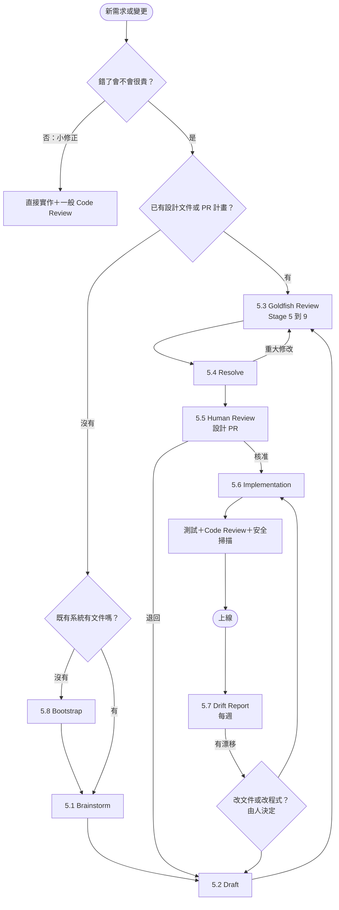

所有指令以「Claude Code／agy CLI 對話框」的 `/egm:` 格式示範。**Codex 使用者請改用 skill picker 選擇同名 Skill**，並在同一則訊息以文字寫出參數（例如設計文件路徑、`Step: feature_spec`）；Skill 會用一般文字詢問缺少的參數（🧪）。

**用哪個 session（本公司規定）**：Brainstorm、Draft、Review、Resolve 都在**同一個設計 session（Elephant）**中進行。Goldfish 的獨立性來自 Review 自動建立的全新 Subagent，不需要另開 session；而 Resolve 需要 Elephant 記得設計理由。只有**實作**使用新 session（5.6）。設計 session 已關閉時，新 session 先執行專案 Elephant Skill（4.10），再讀 brief 與設計文件，然後才 Review 或 Resolve。

### 5.1 Brainstorm：大象腦力激盪

**目的**：把半成熟的想法變成經過挑戰的假設，產出 `concepts_brief.md`。

#### 5.1.1 如何啟動

```text
/egm:egm-brainstorm 客戶管理系統要新增「客戶聯絡人」，業務希望能標示主要聯絡人，並遮罩個資
```

啟動前建議先載入專案 Elephant Skill（4.10），讓 Elephant 知道架構與既有設計。

#### 5.1.2 流程（官方，`skills/egm-brainstorm/SKILL.md`）

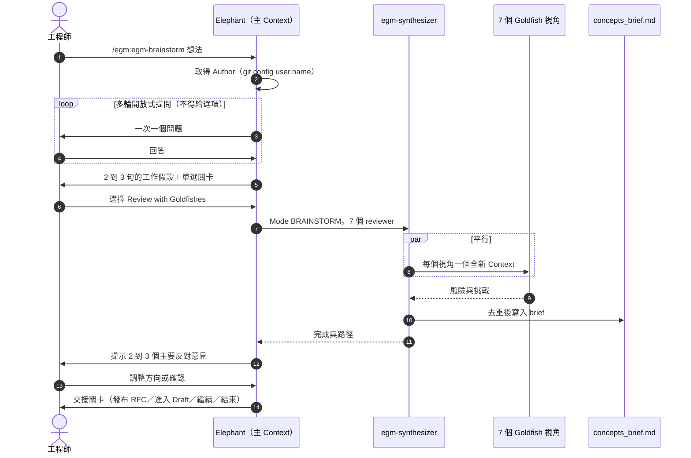

7 個 Brainstorm 視角（官方表格）：

| 視角 | 由哪個 persona 扮演 | 質疑的問題 |
|---|---|---|
| Contrarian／YAGNI | `egm-zoom-out` | 為什麼需要這個功能？現成套件能不能解決 90%？ |
| Cost, Quota & Token Economics | `egm-design` | 尖峰 QPS、記憶體、DB 負載、token 預算？ |
| UX & Developer Ergonomics | `egm-comprehension` | API／CLI 直覺嗎？錯誤訊息能讓人採取行動嗎？ |
| Migration & Backward Compatibility | `egm-implementation-readiness` | 既有資料怎麼遷移？回滾怎麼做？ |
| Observability & SRE Debuggability | `egm-codebase-details` | 凌晨 3 點值班的人怎麼排查？ |
| Long-Term Tech Debt & Maintenance | `egm-structural` | 兩年後會不會變成維護負擔？ |
| Inventive Catalyst | `egm-inventive-catalyst` | 這個設計把哪個取捨當成必然？能不能用已知模式消除？ |

#### 5.1.3 如何提供專案背景、訪談需求、釐清邏輯

Elephant 會問這類開放式問題（官方列出的方向）：

- 這解決什麼具體問題、瓶頸或痛點？
- 誰或哪個系統會使用？SLA、不變式是什麼？
- 有哪些不可妥協的限制？
- 邊界案例與範圍外是什麼？
- 現在怎麼處理？為什麼不夠好？
- 成功要怎麼衡量？

**回答技巧**（建議）：

| 好的回答 | 不好的回答 |
|---|---|
| 「每位客戶最多 50 位聯絡人，目前最多的客戶有 23 位」 | 「應該不會很多」 |
| 「列表遮罩手機中間 4 碼；詳細頁明碼需 `CONTACT_PII_READ`」 | 「要符合個資法」 |
| 「不做去重，另案；本案只保證同一 Email 在同客戶內唯一」 | 「去重之後再看」 |
| 「成功＝客服找聯絡人的平均時間從 3 分鐘降到 30 秒（客服系統量測）」 | 「提升效率」 |

#### 5.1.4 確認功能邊界、討論技術選型、分析替代方案

對話範例（節錄，Claude Code 對話框）：

```text
Elephant：目前描述把「主要聯絡人唯一」當成需求。若兩位業務同時把不同聯絡人設為主要，系統應以誰為準？
工程師：以後送出的為準，前一位自動取消主要。
Elephant：那「後送出」在資料庫層要怎麼判斷？如果靠應用程式先查後改，兩個交易可能同時看到「沒有主要聯絡人」。這是你要的行為，還是要直接拒絕第二個請求？
工程師：拒絕第二個，回 409，讓使用者重新整理。
Elephant：這和你一開始說的「以後送出為準」矛盾。請確認採用哪一個：自動取消前一位，或拒絕並回 409？
工程師：回 409。前面那句作廢。
```

注意 Elephant 的行為符合官方規則：**一次只問一題**、**發現矛盾時不修改檔案、先指出矛盾並要求決定**（`execution_instructions.md` 的 Contradiction Auditing）。

#### 5.1.5 如何記錄設計決策

Brief 的固定結構（官方模板）：

```markdown
# [Feature Name]

* **Author:** [Author Name or GitHub Handle]
* **Date:** [YYYY-MM-DD]

## Overview
## Analysis
## Goals vs. Non-Goals
## Alternatives Weighed
## Key Decisions & Staging for Next Steps
```

其中 **Alternatives Weighed** 特別重要：官方註解寫明「`/egm-draft` copies these into Alternatives Considered and has no other source for them.」——Brainstorm 沒記下來的被否決方案，Draft 就不會知道。

#### 5.1.6 多輪討論與交接

Brief 寫好後，Elephant 會提出 2～3 個主要反對意見並問你怎麼處理（轉向、縮小範圍、增加限制），可以重複 Goldfish 分析直到滿意。最後的交接選單（官方）：

| 選項 | 結果 |
|---|---|
| Publish concepts_brief.md as RFC for team feedback | 寫到 `docs/designs/<feature_name>.md`，登錄 SITEMAP（若存在） |
| Proceed to egm-draft | 提示你執行 `/egm:egm-draft`，它會自動讀 brief |
| Continue refining | 回到迭代 |
| Conclude and keep brief for later | 結束，brief 保留 |

#### 5.1.7 如何避免直接開始寫程式

- `resources/execution_instructions.md`：「You are strictly forbidden from writing, modifying, or building any production implementation files」；範例程式只能放在 Markdown 區塊或專案外的 scratch 目錄。
- 若你在 Brainstorm 中要求「直接幫我寫」，Agent 應回答此流程只產生設計文件，並問你要繼續設計還是離開流程。

**實務注意**：這是「指示」不是「強制」。若 Agent 仍改了程式，用 `git status` 立即發現並還原；公司 CI 用 `egm_scope_guard.py` 擋下設計 PR 中的程式變更（10.9）。

### 5.2 Draft：設計文件草擬

**目的**：把 brief（或筆記）逐節轉成正式設計文件。

```text
/egm:egm-draft
```

或指定輸入：

```text
/egm:egm-draft docs/designs/customer-contact.md
```

這個用法適用於 Brainstorm 時選了「Publish as RFC」：RFC 已發布在 `docs/designs/customer-contact.md`，Draft 讀它作為輸入，草稿寫在 `design_draft.md`，最後 Step 6 儲存時選同一路徑，正式設計文件就會取代 RFC 版本。

#### 5.2.1 流程（官方，`skills/egm-draft/SKILL.md`）

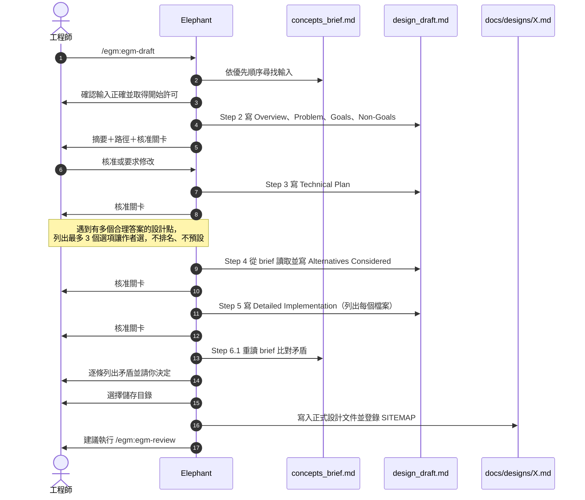

#### 5.2.2 Concept Brief、Design Draft、系統架構、資料庫、API

| 產物 | 在 Draft 中的位置 | 要求 |
|---|---|---|
| Concept Brief | 輸入（Priority 1） | Draft 不會自行補 brief |
| 系統架構 | Step 3 Technical Plan | 寫成文字＋ASCII 或 Mermaid 圖；說明新元件、修改檔案、API 變更 |
| 資料庫設計 | Step 3（概念）＋Step 5（DDL 檔案） | Draft 不寫實作程式，但可以寫 schema |
| API Specification | Step 3（端點與語意）＋Step 5（OpenAPI 檔案） | 「Pseudocode, APIs, or schemas are allowed」 |
| 實作計畫 | Step 5 | 「List EVERY file that will be changed, created, or deleted」，每個檔案附理由 |
| 測試計畫 | Step 5 的 Verification Plan | Build、Unit、Lint、Coverage、E2E 指令 |

**Author Decides Architecture**（官方 Execution Constraint 13）：遇到資料模型、元件邊界、儲存、協定等有多個合理答案的決定，Elephant 會列出最多三個選項（機制、取捨、失效條件），**不排名、不預設**。你說「你幫我選」時，它會重述取捨並再問一次。

#### 5.2.3 如何確認設計文件完整性

Step 6.1 是 Draft 獨有的檢查：**重讀 brief，與草稿比對**。

- **Contradiction**：brief 已決定的問題，草稿做了不同決定 → 全部列出，請你逐一裁決。
- **Addition**：草稿決定了 brief 沒提到的問題 → 只有影響架構、外部介面或相依套件時才列出。

官方理由：「No Goldfish can do this check, because no Goldfish reads the brief.」

自我檢查清單（建議，進入 Review 前）：

- [ ] 每個 Goal 都可量測。
- [ ] Non-Goals 至少一條。
- [ ] 至少一個 CUJ 有 Given／When／Then。
- [ ] Alternatives 至少一個，含否決理由。
- [ ] Detailed Implementation Plan 列出每個檔案（含測試、設定、文件、migration）。
- [ ] Verification Plan 的指令都能在本機執行。
- [ ] `python tools/egm_design_lint.py <檔案>` 通過。

#### 5.2.4 完整 Markdown 設計文件範本

以下是依官方模板撰寫的完整中文範例（範例設定；也是本手冊工具的測試 fixture）：

📄 `fixtures/design_good.md`

```markdown
# 客戶聯絡人管理（Customer Contact Management）

*   **Author:** chihhung
*   **Status:** In Review
*   **Date:** 2026-11-17

--------------------------------------------------------------------------------

## Overview

企業客戶管理系統（CRM）新增「客戶聯絡人」功能：業務人員可在客戶頁籤維護多位聯絡人，
並指定一位主要聯絡人（Primary Contact）。

## The Problem

目前聯絡人資料散落在 Excel 與 Email 簽名檔，客服無法判斷該聯絡誰；同一客戶常出現
重複聯絡人，個資遮罩規則也不一致。

## Goals

*   每位客戶可維護 0..50 位聯絡人，且最多一位 Primary Contact。
*   手機號碼與 Email 在列表頁一律遮罩，明碼僅在詳細頁且需 `CONTACT_PII_READ` 權限。
*   新增／修改／刪除聯絡人寫入稽核紀錄（Audit Trail）。

## Non-Goals

*   不做聯絡人去重（Dedup）批次作業，另案處理。
*   不串接外部 CRM（Salesforce）。

## Open Questions

*   **Question 1**: 刪除聯絡人是否需保留 7 年？（待法遵 2026-11-20 回覆）

## Critical User Journeys (CUJs)

### CUJ 1: 業務新增主要聯絡人

*   **Given**: 業務已登入且擁有 `CUSTOMER_EDIT` 權限，客戶 C001 尚無 Primary Contact。
*   **When**: 業務新增聯絡人並勾選「主要聯絡人」後送出。
*   **Then**: API 回 201，C001 恰有一位 Primary Contact，稽核表新增一筆 `CONTACT_CREATED`。

## Technical Plan (Architecture)

沿用既有 Hexagonal Architecture：`customer-api`（REST Adapter）→ `customer-app`
（Application Service）→ `customer-domain`（Aggregate：Customer 擁有 Contact）→
`customer-infra`（JPA Repository）。Primary Contact 唯一性由 Aggregate 維持，
資料庫以部分唯一索引（Partial Unique Index）二次保護。

## Alternatives Considered

### Alternative A: 聯絡人獨立成 Aggregate

*   **Pros**: 聯絡人可單獨鎖定，並行修改衝突較少。
*   **Cons**: 「每客戶最多一位 Primary」需跨 Aggregate 檢查，只能靠資料庫約束。
*   **Reason for Rejection**: Rejected by author: 唯一性規則屬於 Customer 不變式，拆開後只剩資料庫能保證。

## Non-Functional Requirements

*   Security & Privacy：PII 欄位以 AES-256-GCM 加密儲存，金鑰由 KMS 管理。
*   Performance：聯絡人列表 P95 < 300 ms（每客戶最多 50 筆，無分頁）。

## Security & Compliance

*   資料分類：`mobile`、`email` 為 Restricted；以 AES-256-GCM 加密儲存，金鑰由 KMS 管理。
*   權限：新增／修改需 `CUSTOMER_EDIT`；明碼讀取需 `CONTACT_PII_READ`（定義見 `docs/standards/iam-permissions.md`）。
*   OWASP 2025：A01 由端點權限註記與預設拒絕處理；A05 全部使用 JPA 參數化查詢。
*   稽核：`CONTACT_CREATED`、`CONTACT_UPDATED`、`CONTACT_DELETED` 經既有 `AuditPort` 寫入。

## Detailed Implementation Plan

### Target Files to Create/Modify

#### 1. `customer-domain/src/main/java/com/acme/crm/customer/domain/Contact.java` (Create)

*   **Type / Scope**: Domain Entity
*   **Proposed Changes**: 欄位 `id`、`name`、`mobile`、`email`、`primary`；建構子驗證 Email 格式。

#### 2. `customer-domain/src/main/java/com/acme/crm/customer/domain/Customer.java` (Modify)

*   **Type / Scope**: Aggregate Root
*   **Proposed Changes**: 新增 `addContact(Contact)`、`markPrimary(ContactId)`；超過 50 位丟出 `ContactLimitExceededException`。

#### 3. `customer-infra/src/main/resources/db/migration/V12__contact.sql` (Create)

*   **Type / Scope**: Flyway Migration
*   **Proposed Changes**: 建立 `crm_contact` 表與 `ux_contact_primary` 部分唯一索引（PostgreSQL `WHERE is_primary`）。

#### 4. `customer-app/src/main/java/com/acme/crm/customer/app/AddContactService.java` (Create)

*   **Type / Scope**: Application Service
*   **Proposed Changes**: `addContact(customerId, command)` 於單一交易載入 Customer、呼叫 `addContact`、儲存，並以既有 `customer-app/src/main/java/com/acme/crm/customer/app/port/AuditPort.java` 寫入 `CONTACT_CREATED`；樂觀鎖衝突轉為 `PrimaryContactExistsException`。

#### 5. `customer-api/src/main/java/com/acme/crm/customer/api/ContactController.java` (Create)

*   **Type / Scope**: REST Controller
*   **Proposed Changes**: `POST /api/customers/{customerId}/contacts`；權限 `CUSTOMER_EDIT`；201／409／422／403 依 Technical Plan 的例外對應表。

#### 6. `docs/api/customer-contact.openapi.yaml` (Create)

*   **Type / Scope**: API Specification
*   **Proposed Changes**: 上述端點的 request、response 與錯誤格式。

#### 7. `customer-domain/src/test/java/com/acme/crm/customer/domain/CustomerContactTest.java` (Create)

*   **Type / Scope**: Unit Test
*   **Proposed Changes**: 第 51 位聯絡人、重複 Primary、Email 格式錯誤三個案例。

#### 8. `customer-infra/src/test/java/com/acme/crm/customer/infra/ContactConcurrencyIT.java` (Create)

*   **Type / Scope**: Integration Test（Testcontainers PostgreSQL）
*   **Proposed Changes**: 兩執行緒同時設定主要聯絡人，一個成功、一個得到 `PrimaryContactExistsException`；驗證 `ux_contact_primary` 生效。

### Verification Plan

*   **Compilation/Build**: `mvn -q -pl customer-domain,customer-app,customer-api,customer-infra -am verify`
*   **Unit Tests**: `mvn -q -pl customer-domain test`
*   **Static Analysis & Linting**: `mvn -q spotbugs:check`
*   **Test Coverage Requirement**: `customer-domain` 分支覆蓋率 ≥ 85%
*   **E2E/Integration**: `mvn -q -pl customer-infra verify -Pit`（Testcontainers PostgreSQL）

--------------------------------------------------------------------------------

*Drafted with EGM*
```

**實務注意**：Claude Code 沒有 artifact 註解功能。要求修改草稿時，可以直接編輯 `design_draft.md`、在檔案中加 `<!-- -->` 註解，或在聊天中說明；模型每次修改前都會重讀草稿（官方，`docs/claude.md`）。

### 5.3 Goldfish Protocol：獨立審查

**目的**：在全新 Context 中，以 5 個 stage 審查設計文件。

```text
/egm:egm-review docs/designs/customer-contact.md
```

#### 5.3.1 前置：Intake、Preset、Semantic Split

1. **Intake**：沒給路徑會用一般文字詢問。接著詢問是否提供 `GoldfishContext`（空清單也算）。
2. **Preset**（單選，不可多選，官方）：

| 選項 | 內容 | 適用 |
|---|---|---|
| 0 | Interactive review with all review rubrics（每 stage 後停下） | 第一次審查重要設計 |
| 1 | Consolidated report（全部跑完不停） | 時間緊、或 CI／headless |
| 2 | Feature spec only（Stage 5～8） | 還沒寫實作計畫 |
| 3 | Implementation plan only（只跑 Stage 9） | 架構已核准，只審實作計畫 |

`Step` 參數與 preset 的對應（官方 Step 2.1：「map to the corresponding preset or subflow」）：

| `Step` 值 | 等同 | 執行範圍 |
|---|---|---|
| `interactive` | Preset 0 | Stage 5～9，每 stage 後停下 |
| `uninterrupted` | Preset 1 | Stage 5～9 不停，另產出 consolidated 報告 |
| `feature_spec` | Preset 2 | Stage 5～8 |
| `implementation` | Preset 3 | 只跑 Stage 9 |
| `5`、`6`、`7`、`8`、`9` | 單一 stage | 只跑該 stage（常用於中斷後續跑） |

3. **Semantic Split**：找 `## Detailed Implementation Plan` 等標題，自動切成 FeatureRange 與 DetailedRange，並在聊天中回報「Discovered semantic boundary at line L」。找不到或多個候選時會請你決定。
4. **Linked Files**：在第一個需要 GoldfishContext 的 stage 前，把文件中的工作目錄內連結自動加入（2.8）。

#### 5.3.2 五個審查階段

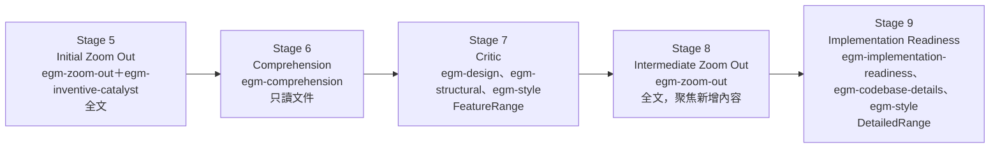

逐一說明（官方，`skills/egm-review/SKILL.md`；「失敗原因、修正方式」為本手冊整理）：

**Stage 5 — Initial Zoom-out Review**：

| 項目 | 內容 |
|---|---|
| 審查目的 | 簡單性、YAGNI、重用既有元件、是否解決根本問題 |
| Reviewer Persona | `egm-zoom-out`（Skeptical Architect）＋平行的 `egm-inventive-catalyst`（TRIZ） |
| 輸入資料 | 全文＋GoldfishContext；standard：`zoom-out-standard` |
| 執行方式 | synthesizer 或直接派工 |
| 輸出結果 | `zoom_out_report.md` |
| 常見失敗原因 | 目標不清楚（Context Sufficiency 直接不通過）；提出快取、MQ 卻沒有效能證據；重造既有 util |
| 修正方式 | 補 Problem／Goals；刪除投機性設計；改為重用既有元件 |
| 通過標準 | 無未處理的 Blocker；Major 有明確決定（修或接受） |

**Stage 6 — Comprehension Check**：

| 項目 | 內容 |
|---|---|
| 審查目的 | 文件能否自我說明（self-containment），不是細節夠不夠 |
| Reviewer Persona | `egm-comprehension`（Naive Reader），**直接啟動，不經 synthesizer** |
| 輸入資料 | FeatureRange＋DetailedRange；**不給 GoldfishContext、不套用任何 standard** |
| 執行方式 | 先用自己的話改寫（paraphrase）文件提案與現有系統，再檢查未定義名詞 |
| 輸出結果 | `comprehension_report.md`，開頭是兩段 paraphrase，之後是 findings |
| 常見失敗原因 | 縮寫、內部系統名、權限碼沒定義；各節彼此不連貫 |
| 修正方式 | 加名詞解釋或連結；補「現有系統怎麼運作」的段落 |
| 通過標準 | paraphrase 與作者原意一致；無 Blocker |

為什麼 Stage 6 不用 synthesizer：「its report keeps only findings, and the author must see the paraphrase.」作者要親自比對 Goldfish 的理解是否正確——**paraphrase 錯了，就是文件寫得讓人誤解**。

**Stage 7 — Antagonistic Review／Design Critique**：

| 項目 | 內容 |
|---|---|
| 審查目的 | 架構、擴展瓶頸、失效模式、模板結構、文字精準度 |
| Reviewer Persona | `egm-design`（Hostile Critic）、`egm-structural`、`egm-style` |
| 輸入資料 | FeatureRange＋GoldfishContext；`egm-design` 與 `egm-structural` 套 `feature-spec-standard` |
| 執行方式 | 在主執行緒中執行 `egm-review-loop` |
| 輸出結果 | `critic_report.md` |
| 常見失敗原因 | 沒有替代方案；沒寫並行與失效處理；「效能很好」這類無法驗證的說法 |
| 修正方式 | 選 Option 1 交給 `egm-resolve`，或手動修改 |
| 通過標準 | Blocker 全部處理；Major 有決定與紀錄 |

**Stage 8 — Intermediate Zoom-out Review**：

| 項目 | 內容 |
|---|---|
| 審查目的 | 檢查 Stage 6、7 修正時**新增**的內容是否讓設計變複雜 |
| Reviewer Persona | `egm-zoom-out` |
| 輸入資料 | 全文＋`zoom_out_report.md` 路徑＋GoldfishContext |
| 輸出結果 | `intermediate_zoom_out_report.md` |
| 常見失敗原因 | 為了回應 Critic 加了一堆防禦性機制 |
| 修正方式 | 刪回最小解，把非必要機制移到 Future Improvements |
| 通過標準 | 同 Stage 5 |

**Stage 9 — Implementation Readiness Check**：

| 項目 | 內容 |
|---|---|
| 審查目的 | 實作者拿到計畫能否直接開工、不需做任何設計決定 |
| Reviewer Persona | `egm-implementation-readiness`（Tech Lead）、`egm-codebase-details`（稽核員）、`egm-style` |
| 輸入資料 | DetailedRange＋GoldfishContext；前兩者套 `implementation-readiness-standard` |
| 執行方式 | `egm-review-loop` |
| 輸出結果 | `implementation_readiness_report.md` |
| 常見失敗原因 | 檔案路徑不存在、函式簽章不明、測試案例只寫「要測試」、相依套件沒寫版本 |
| 修正方式 | 補完整路徑、簽章、測試案例、版本 |
| 通過標準 | Zero-Decision Rule 成立；File Boundary 完整 |

Consolidated（Preset 1）另外產出 `consolidated_review_report.md`：跨 stage 去重、依 🔴 Blocker／🟡 Major／🟢 Nit 排序，並附 **Traceability Matrix**（原始 finding 對應到彙整後的行動項目）。

#### 5.3.3 Stage 之間的關卡

| Stage | 選項 |
|---|---|
| 5、6、8 | 0 進下一 stage；1 我先自己改文件（暫停）；2 暫停審查 |
| 7、9 | 0 進下一 stage；1 交給 Agent 處理 findings（`egm-resolve`）；2 我手動改（暫停）；3 暫停審查 |

**1-Audit Convergence Cap**：每個 stage 最多重審一次。重審後又要改文件時，Agent 會告知已達上限，把剩餘 findings 記為「accepted trade-offs」並進入下一 stage。

#### 5.3.4 Goldfish 如何使用獨立 Context

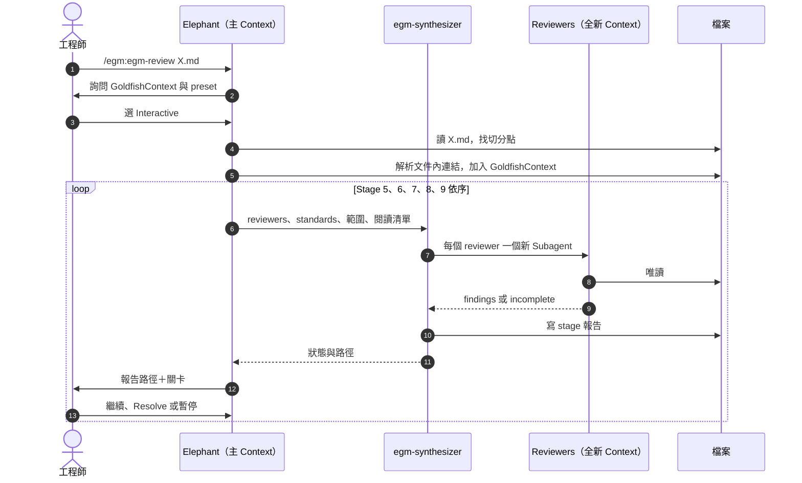

各 Host 的 Subagent 建立方式見 2.9。

**實務注意**：Interactive 模式中，Stage 6 的 paraphrase 一定要親自讀。它是整個流程中**唯一**能直接看到「陌生讀者怎麼理解你的文件」的地方。

#### 5.3.5 實跑紀錄：一次真實的 Consolidated Review（1.1）

對象是附錄 B 的 `fixtures/design_good.md`（124 行，也就是第 5.2 節範例的完整版）。執行方式見第 3.13.1 節。Elephant 找到的語意分界寫在 `consolidated_review_report.md` 第 3 行：「FeatureRange 1..68, DetailedRange 69..124」，也就是 `## Detailed Implementation Plan` 從第 69 行開始。

各 stage 的結果（摘自 `consolidated_review_report.md`）：

| Stage | Reviewers | 🔴 | 🟡 | 🟢 |
|---|---|---|---|---|
| 5 Initial Zoom Out | zoom-out, inventive-catalyst | 1 | 6 | 4 |
| 6 Comprehension | comprehension | 1 | 4 | 4 |
| 7 Critic | design, structural, style | 1 | 11 | 6 |
| 8 Intermediate Zoom Out | zoom-out | 1 | 5 | 4 |
| 9 Implementation Readiness | implementation-readiness, codebase-details, style | 7 | 7 | 6 |

從這次實跑可以學到的事：

1. **「看起來完整」的設計文件仍有 11 個 Blocker。** 本手冊 1.0 把這份文件當成「好例」，Goldfish 卻抓到：第 96 行引用的「例外對應表」不存在；樂觀鎖衝突全部轉成 `PrimaryContactExistsException` 是錯的；`Customer.java`、`AuditPort.java` 標成 Modify 卻不在 repo 中；Goals 承諾列表與明碼讀取，File Boundary 卻只有 `POST`。本手冊的獨立 Goldfish 審查（附錄 E.3）也獨立抓到同一個「例外對應表不存在」。
2. **Reviewer 之間會意見衝突。** Stage 7 要求補完整 CRUD、blind index、重試機制；Stage 8 主張縮小第一階段、把這些延後。Consolidated 報告把它整理成「Decisions the author must make first」，這是**人**要做的決定，不是交給 AI 投票。
3. **Stage 6 的 paraphrase 是給作者看的。** `comprehension_report.md` 開頭是「What this proposes」「How the existing system works, per this document」兩段改寫。SA 要逐句比對它和原意是否一致（第 10.5 節的人工項目）。
4. **報告格式每次可能不同。** 同一次執行的 6 份報告就有 4 種嚴重度寫法（第 10.5.1 節），閘門工具必須用真實報告測試。

**實務注意**：Goldfish 只讀得到 repo。設計文件寫「既有的 `AuditPort`」時，如果那個類別在另一個 repo，Goldfish 一律回報「找不到」。對策是把外部依賴的路徑或版本寫進文件，或把相關檔案列入 `GoldfishContext`；Resolve 時這類問題會被標成 ESCALATE（見 5.4.6）。

### 5.4 Resolve：問題修正

**目的**：在 Elephant（記得設計理由的 Context）中逐項處理 findings。

通常由 Stage 7／9 的 Option 1 自動呼叫；也可以單獨使用：

```text
/egm:egm-resolve
```

單獨使用時會逐一詢問 `TargetFile`、`LineRange`、`FindingsList`。

#### 5.4.1 分類規則（官方）

| 分類 | 條件 | 要求 |
|---|---|---|
| `CONTEST` | 批評不正確或誤解程式碼 | **必須引用 reviewer 讀得到的證據**（檔案＋符號，或文件中已記錄的決定） |
| `ESCALATE` | 批評不正確，但證據在 reviewer 讀不到的地方（團隊慣例、口頭決議） | 不修改；交給使用者 |
| `PROPOSE FIX` | 批評正確 | 給出精確的替換文字 |
| `DECLINE` | 只是 Nit | 記錄，不修改 |

五條紀律（官方）：

1. 反駁必須可檢查——「This was intentional」不是證據。
2. 不要只為了讓 reviewer 滿意而加內容；只有人類讀者也需要時才加。
3. **不要反駁 comprehension gap**——新讀者看不懂就是文件缺內容。
4. 不要改嚴重度；認為 Blocker 其實是 Nit，就用 CONTEST 說明理由。
5. 你寫了這份文件——想反駁不代表 reviewer 錯了。

#### 5.4.2 流程

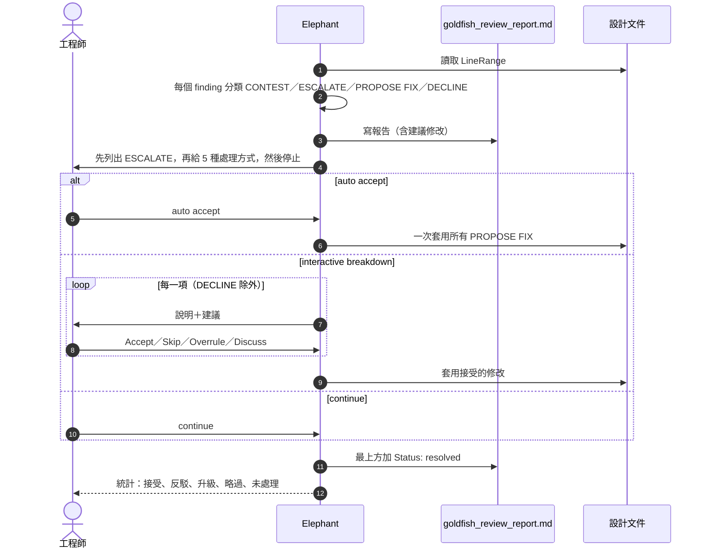

#### 5.4.3 如何分類重大問題與一般建議（建議）

| 嚴重度 | 公司處理規定 |
|---|---|
| 🔴 Blocker | 必須 PROPOSE FIX 或附證據 CONTEST；ESCALATE 需要架構師簽核 |
| 🟡 Major | 必須有決定；接受風險時寫入設計文件的 Non-Functional Requirements 或 Open Questions |
| 🟢 Nit | 可 DECLINE |

#### 5.4.4 再次啟動 Goldfish 與確認問題已解決

- 修正後，Stage 7／9 可重審一次（1-audit cap）。
- 若用 `egm-review-loop`，收斂條件是**連續兩輪 clean**（第 5.9 節）。
- 修正多、範圍大時，在同一設計 session 重新跑完整 `/egm:egm-review`；reviewer 每次都是新 Subagent，不會沿用上一輪的 Context。

#### 5.4.5 保留審查紀錄

`goldfish_review_report.md` 的格式（官方）：

```markdown
# Goldfish Annotated Review Report

**Target:** `[TargetFile]` (`[LineRange]`)

## Prioritized Findings & AI Suggestions

### [Issue 1] [`[ReviewerPersona]`] - Severity: [Blocker | Major | Nit]
*   **Affected Scope:** ...
*   **Discrepancy Description:** ...
*   **Rationale:** ...
*   ***AI Suggestion:*** [CONTEST | ESCALATE | PROPOSE FIX | DECLINE]
*   ***Justification:*** ...
*   ***Proposed Edit:*** ...
```

公司要求把最終報告與 ESCALATE 簽核檔一起封存（10.16），並用 `egm_report_gate.py` 檢查（10.5）。

**實務注意**：DECLINE 只適用於 Nit。若看到 Major 被標成 DECLINE，代表 Elephant 偷偷降級了問題——報告閘門的 R3 規則會擋下。

#### 5.4.6 實跑紀錄：在同一個 session 執行 Resolve（1.1）

1.0 定案的規則是「設計到 Resolve 在同一個 session，只有實作才開新 session」。1.1 用 `--resume` 回到 5.3.5 那次 Review 的 session 執行 Resolve，實際驗證這條規則（Shell）：

```bash
SID=$(python -c "import json;print(json.loads(open('review.jsonl',encoding='utf-8').readline())['session_id'])")
claude -p --resume "$SID" --plugin-dir ../egm-src --permission-mode acceptEdits \
  --allowedTools "Read,Grep,Glob,Write,Bash(ls:*)" --output-format stream-json --verbose \
  "/egm:egm-resolve TargetFile: docs/designs/customer-contact.md LineRange: full file FindingsList: every Blocker and Major finding in .dev/docs/critic_report.md and .dev/docs/implementation_readiness_report.md. Write goldfish_review_report.md, then stop at the Interactive Resolution Gate. Do not edit the design document in this run." \
  > resolve.jsonl
```

結果：

| 項目 | 實測 |
|---|---|
| findings | 26 項（8 Blocker、18 Major） |
| 分類 | 21 PROPOSE FIX、5 ESCALATE、0 CONTEST、0 DECLINE |
| 設計文件 | 未修改（`git status` 只有 `.dev/`） |
| 報告格式 | 與 `skills/egm-resolve/SKILL.md` 模板完全一致：`### [Issue N] [persona] - Severity: X`、`***AI Suggestion:***` |

ESCALATE 的 5 項都是「Goldfish 讀不到的事實」：`AuditPort` 是否在另一個 repo、重複聯絡人的實際比例、端點權限用哪個 annotation 等。Elephant 在 chat 中寫：「我不會自己編數字。」這就是 ESCALATE 的正確用法：需要人提供事實，不是請人按核准。

**Elephant 記憶的價值（實測）**：Resolve 在 chat 回報中針對 Issue 7（鎖定機制）寫：「你先前提到團隊已選定 PostgreSQL advisory locks；只要你確認，我套用時就寫入這個機制。」這件事只在 Review 的呼叫訊息中說過，沒有寫進任何檔案；而且 Elephant 依指示沒有把它寫進報告檔。如果在新 session 執行 Resolve，這個脈絡就會遺失，Elephant 可能直接採用 reviewer 建議的另一種鎖定方案。

**如何審查 AI 的 Resolve 結果**：

| 檢查點 | 好例 | 壞例 | 怎麼抓 |
|---|---|---|---|
| CONTEST 有證據 | 引用 reviewer 讀得到的檔案與符號 | 「作者認為沒問題」 | `grep -n "CONTEST" -A3 goldfish_review_report.md`，逐項看 Justification |
| ESCALATE 是事實問題 | 「`AuditPort` 在哪個 repo？」 | 「請確認是否接受」 | 讀 ESCALATE 的 Justification，問「這是 Goldfish 能查到的嗎？」 |
| 沒有偷改文件 | 停在 Resolution Gate | 先改了才問 | `git diff --stat docs/designs/` 應為空 |
| 數字不是編的 | 留〔待作者確認〕 | 自己填「重複率 12%」 | `grep -n -E "[0-9]+%" goldfish_review_report.md` 後逐一追問來源 |

### 5.5 Human Review：人工審查

官方：「Send a Pull Request with your design to another human. EGM does not replace human oversight, but encourages it.」

設計 PR 的內容（建議）：

| 檔案 | 必要 |
|---|---|
| `docs/designs/<feature>.md` | 是 |
| `docs/designs/SITEMAP.md` 更新 | 若存在 |
| `docs/designs/reviews/<feature>/*.md`（stage 報告、`goldfish_review_report.md`、`review_signoff.md`） | 公司規定 |
| 分支名稱 `design/<feature>`（CI 由此推導設計文件路徑，10.8） | 公司規定 |
| 正式程式碼 | **不可**（設計 PR 只含文件） |

各角色審查責任：

| 角色 | 審什麼 | 不審什麼 |
|---|---|---|
| Architect | 架構方案、替代方案取捨、與 ADR 一致、Stage 5／8 的取捨 | 文字風格 |
| SA | Goals／Non-Goals／CUJ 是否等於需求；Stage 6 paraphrase 是否正確 | 程式檔清單 |
| SD／Tech Lead | Detailed Implementation Plan 是否可執行、檔案清單完整 | 商業優先順序 |
| 資安 | Security & Compliance 章節、資料分類、OWASP 對應 | — |
| PM | 範圍、時程、Non-Goals 是否與利害關係人一致 | 技術細節 |
| QA | CUJ 是否可測、Verification Plan 是否足夠 | — |

**實務注意**：人工審查者要看的是「Goldfish 沒有能力判斷的事」：商業優先順序、組織限制、口頭決議、ESCALATE 項目。不要把 Goldfish 已經挑過的格式問題再挑一次。

### 5.6 Implementation：程式實作

官方立場：Phase 5 沒有 Skill，「Tell AI to build to the plan.」

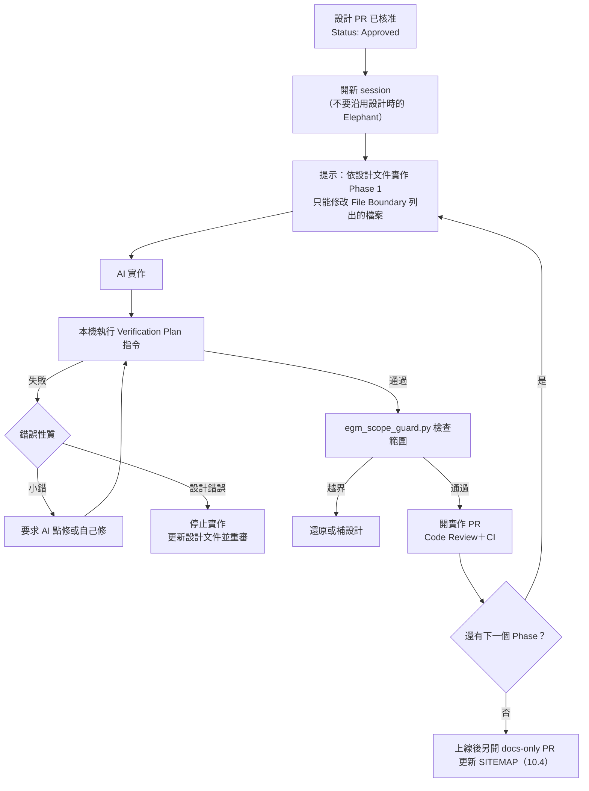

實作提示範本（建議，Claude Code 對話框）：

```text
請依 docs/designs/customer-contact.md 的「Detailed Implementation Plan」實作。
規則：
1. 只能新增或修改「Target Files to Create/Modify」列出的檔案（本例 8 個）。需要改其他檔案時，先停下來告訴我原因。
2. 不要新增相依套件、不要重構無關程式。
3. 每完成一個檔案，執行 Verification Plan 的對應指令並回報結果。
4. 設計文件與程式碼衝突時，以設計文件為準並回報衝突，不要自行決定。
```

| 需求 | 做法 |
|---|---|
| 限制修改範圍 | 提示詞＋`egm_scope_guard.py`（CI 強制） |
| 確保程式與設計一致 | Code Review 對照設計文件；之後跑 Drift Report |
| Unit／Integration／E2E | 執行設計文件 Verification Plan 列出的指令 |
| Code Review | 人類審查者以設計文件為依據；可另用 Host 的 code review 功能 |
| 實作中發現新需求 | **不要**在實作 PR 中順手加；回到 Brainstorm 或在設計文件 Open Questions 記錄，走新設計 PR |

官方 FAQ：「If it is making a minor mistake, adjust it. If it is wildly off base, maybe you need to go back to the drawing board and correct your design.」

**實務注意**：用**新 session** 實作。設計時的 Elephant 知道太多「沒寫進文件」的事，會讓你誤以為文件夠清楚；新 session 是最後一次驗證文件是否自足的機會。

### 5.7 Drift Report：架構及文件漂移檢查

```text
/egm:egm-drift-report docs/designs/
```

#### 5.7.1 官方行為（`skills/egm-drift-report/SKILL.md`）

1. 確認有文件目錄，否則詢問。
2. 列出目錄中所有檔案。
3. 對**每一份**文件：讀文件 → 找出提到的檔案與符號 → 找不到明確路徑時用搜尋定位，並建議你在文件中補連結 → 讀程式碼現況 → 比對。
4. 比對重點：Missing Features、Incomplete Models（欄位缺漏）、Logic Shortcuts（該動態卻寫死）、Architectural Divergence（用了不同的模式或套件）。
5. **只報告差異**；完全一致時寫「No drift detected.」
6. 逐份附加到 `{YYYY-MM-DD}_DRIFT_REPORT.md`，格式：

```markdown
## <DESIGN_DOC_NAME>

<Bulleted list of specific divergences found>
<Or "No drift detected">
```

7. 依序處理文件，避免工具輸出溢位。

#### 5.7.2 適用範圍

| 可比對 | 說明 |
|---|---|
| 設計文件 vs 程式碼 | 主要用途 |
| README vs 程式碼 | 官方 description 明列「designs or READMEs」；Bootstrap 也會建議對產生的 README 跑一次 |
| API | 文件中的端點、欄位 vs Controller／OpenAPI 檔 |
| 資料庫結構 | 文件中的資料表、欄位 vs migration 檔／DDL（需要 repo 內有 DDL） |
| 系統架構 | 文件中的分層 vs 實際 import（建議另用 ArchUnit 機械化檢查，6.6） |

不在範圍：執行中的資料庫實際 schema、部署環境設定（EGM 只讀 repo 檔案）。

#### 5.7.3 頻率與處理

官方建議「once per week」，排入例行維運。處理原則：「Either update the doc, or the code. Human picks which.」

**實務注意**：Drift Report 在主 Context 執行、不需要 Subagent，但它會讀很多檔案。文件目錄很大時，按子目錄分批執行（例如 `/egm:egm-drift-report docs/designs/customer/`）。

#### 5.7.4 實跑紀錄：Drift Report 抓到跨層漂移（1.1）

做法：先用 Bootstrap 產生 `EGM.md`（5.8.4）並 commit，再只把 Java 的門檻從 300000 改成 500000，然後執行（Shell）：

```bash
git -c user.name=lab -c user.email=lab@example.invalid commit -qam "bootstrap EGM.md"
sed -i 's/new BigDecimal("300000")/new BigDecimal("500000")/' legacy/java/LoanApprovalService.java
git -c user.name=lab -c user.email=lab@example.invalid commit -qam "raise auto-approve limit"
claude -p --plugin-dir ../egm-src --permission-mode acceptEdits \
  --allowedTools "Read,Grep,Glob,Write,Edit,Bash(ls:*),Bash(git log:*),Bash(git diff:*)" \
  "/egm:egm-drift-report legacy"
```

產出 `.dev/docs/2026-11-17_DRIFT_REPORT.md`（節錄，原文為 Elephant 依繁體中文 CLAUDE.md 慣例撰寫）：

```markdown
## legacy/java/EGM.md

- **Interface 漂移**：第 12 行記載 `AUTO_APPROVE_LIMIT = new BigDecimal("300000")`；實際為 `new BigDecimal("500000")`（`LoanApprovalService.java:7`）。
- **漏寫的跨元件影響**：文件沒有記錄 Java 門檻與 `approve.jsp`、`LoanForm.vue` 的提示門檻（仍為 300000）已不一致。

## legacy/db/EGM.md

No drift detected

## legacy/mapper/EGM.md

No drift detected
```

判讀：

- 6 份合約中有 4 份回報漂移（root、java、jsp、vue），db 與 mapper 正確回報「No drift detected」。
- 最有價值的是**跨層**發現：只改了 Java，畫面上的「Manual review required」提示仍停在 300000。單看 Java 的 diff 不會發現這件事。
- 也有超出這次變更的發現（例如 `LoanForm.vue` 沒有送出按鈕）。Drift Report 檢查「文件 vs 現況」，不是只看最近的 commit，所以第一次跑時會出現既有的差異。

**如何審查 Drift Report**：

| 檢查點 | 好例 | 壞例 | 怎麼抓 |
|---|---|---|---|
| 只列差異 | 每項都指出文件行號與程式行號 | 「XX 功能已正確實作」 | `grep -n -i -E "matches\|correctly\|已正確\|一致" *_DRIFT_REPORT.md` 應無結果 |
| 每份文件都有段落 | 6 份 `EGM.md` 各有 `## <文件>` | 少了某份文件 | `grep -c "^## " *_DRIFT_REPORT.md` 等於文件數 |
| 引用的行號是真的 | `LoanApprovalService.java:7` 確實是門檻 | 行號對不上 | `sed -n 7p legacy/java/LoanApprovalService.java` |

### 5.8 Bootstrap：既有系統文件建立

```text
/egm:egm-bootstrap customer-service/
```

不想動到既有 README 時：

```text
/egm:egm-bootstrap customer-service/ target_filename=EGM.md
```

#### 5.8.1 官方行為（「Peanuts and Hay」）

| 名詞 | 意義 | 模板章節 |
|---|---|---|
| Peanuts | 葉節點：含原始碼的目錄 README（Component Package） | Overview、Interface、Invariants、Side Effects、Verification |
| Hay | 父節點：彙總子目錄的 Blueprint | Overview、Subdirectories & Boundaries |
| Root Blueprint | 根目錄 | System Overview、Subdirectories & System Boundaries、Global Invariants、Global Side Effects、System Verification |

執行步驟（摘要）：

1. 偵測 build manifest 決定測試指令（`package.json`→`npm test`、`Cargo.toml`→`cargo test`…；`pom.xml` 不在清單中，見 5.8.2；`*.csproj`→`dotnet test` 只有 main 才有）。
2. **BFS 逐層探索**（禁止 `find`、`ls -R`），略過 `.git`、`node_modules`、`dist`、`build`、`third_party` 等；套用 `.gitignore` 與 `.egmignore`。
3. 目錄數 > 15 時**必須**先問你是否繼續。
4. 由下而上修剪：沒有原始碼的目錄、純測試目錄都排除。
5. ≤ 5 個目錄直接處理；> 5 個分割成 3～5 個子樹，平行派給 `egm-bootstrap-orchestrator` worker。
6. 每個目錄用唯讀 `goldfish-explorer` scout 掃描（`goldfish-explorer` 是 Bootstrap 在執行時臨時定義的 Subagent，不在 `agents/` 的 10 個 persona 中；它只回傳該目錄的介面、不變式與副作用 JSON，不能寫檔），每次約 1,500 行；scout 規則：「Never infer RPC methods, routes, status enums, or invariants from file or directory names alone; cite the exact `[file:symbol_or_flag]` for every entry」。
7. 已有 README 時**不覆寫**，而是萃取既有內容再合併修正。
8. 最後逐一重讀每份產出、檢查連結是否存在，並詢問是否跑 Drift Report。
9. **不會** `git add`／`git commit`。

#### 5.8.2 重要限制（讀原始碼＋1.1 實跑）

Bootstrap 判斷「原始碼目錄」用的是 Skill 內的副檔名清單（`skills/egm-bootstrap/SKILL.md` Step 2.3），**v0.1.1 與 main 不同**：

| 類別 | v0.1.1（`dea7761`） | main（`72d06f5`）新增 |
|---|---|---|
| Managed & Enterprise | `.java`、`.kt`、`.scala`、`.cs`、`.fs` | `.razor`、`.cshtml`、`.vb`（#324） |
| Systems | `.c`、`.cpp`、`.h`、`.rs`、`.go` 等 | Fortran（`.f90` 等）、`.hs` |
| Scripting | `.py`、`.rb`、`.php`、`.lua`、`.sh`、`.bash` | `.ps1`、`.psm1`、`.r`、`.ex` 等 |
| Step 0 測試指令 | 沒有 .NET | `*.sln`／`*.csproj` → `dotnet test`（#409） |

兩個版本都**不包含** `.vue`、`.jsp`、`.xml`（例如 MyBatis mapper）、`.properties`、`.yml`；Step 0 也都沒有 `pom.xml`／`build.gradle`。

驗證指令（Shell，在 EGM repo）：

```bash
git show v0.1.1:skills/egm-bootstrap/SKILL.md | grep -n -A2 "Managed & Enterprise"
grep -n -A2 "Managed & Enterprise" skills/egm-bootstrap/SKILL.md          # main
grep -c -E '\.vue|\.jsp|\.xml|pom\.xml' skills/egm-bootstrap/SKILL.md     # 兩版皆為 0
```

依規則，只有 `.vue`、`.jsp` 或 mapper XML 的目錄會被當成「沒有原始碼」而**修剪掉**；Java 專案的 Verification 會是 `<test-command>` 佔位符。

**但實跑結果不同（1.1，5.8.4）**：Elephant 在回報中寫「`.jsp`、`.vue`、MyBatis `.xml` 不在這個 skill 認得的原始碼副檔名清單裡。照規則，`jsp`、`mapper`、`vue` 三個目錄會被排除。我判斷它們確實是程式碼……所以仍然寫了這三份。」它也依 `pom.xml` 自行填了 `mvn test`。

這告訴我們：**Skill 是給 LLM 的指示，不是會照字面執行的程式。** 同一份規則，這次被刻意偏離（而且有揭露），下次可能照規則修剪。因此：

1. 不要依「規則說會修剪」來預估產出；Bootstrap 後一律列出實際產生的檔案。
2. 讀 Elephant 的結尾回報，找「偏離規則」「deviat」等揭露，逐項決定要不要保留。
3. 公司要求固定行為時，把要求寫進呼叫訊息（例如「`.jsp`、`*Mapper.xml` 目錄也要產生 EGM.md」），不要依賴 AI 的臨場判斷。

逆向工程時另以第 7 章的流程補齊。

#### 5.8.3 人工驗證

官方：「Humans should still review this output.」驗證方式：

1. `git diff --stat` 看改了哪些 README。
2. 每份 README 的 Interface 抽查 3 個符號是否存在（`grep -rn 符號名`）。
3. 對產生的 README 跑 `/egm:egm-drift-report`（Bootstrap 結束時會詢問）。
4. 檢查有沒有「看起來合理但程式中不存在」的流程圖節點。

**實務注意**：Bootstrap 對大型 repo 會平行啟動很多 worker（「without artificial concurrency limits」，經你在安全門檻同意後）。先對單一模組試跑，確認品質與成本再擴大。

#### 5.8.4 實跑紀錄：對舊系統目錄跑 Bootstrap（1.1）

測試目錄（附錄 B 的貸款 fixture，另加 3 個 Bootstrap 清單外的檔案）：

```text
legacy/
├── pom.xml
├── java/LoanApprovalService.java
├── db/PKG_LOAN.sql
├── mapper/LoanMapper.xml      # MyBatis，清單外
├── jsp/approve.jsp            # 清單外
└── vue/LoanForm.vue           # 清單外
```

```bash
claude -p --plugin-dir ../egm-src --permission-mode acceptEdits \
  --allowedTools "Read,Grep,Glob,Write,Edit,Agent,Bash(ls:*),Bash(mkdir:*)" \
  "/egm:egm-bootstrap path: legacy target_filename: EGM.md"
git status --short --untracked-files=all
```

```text
?? legacy/EGM.md
?? legacy/db/EGM.md
?? legacy/java/EGM.md
?? legacy/jsp/EGM.md
?? legacy/mapper/EGM.md
?? legacy/vue/EGM.md
```

5 個目錄（≤ 5），所以沒有分派 worker，而是每個目錄派一個唯讀 scout，再由 Elephant 對照原始檔逐條確認。費用 US$0.94。log 顯示 5 個 scout 的 `subagent_type` 都是 Claude Code 內建的 `Explore`（描述為「Scout legacy/db」等），不是 Skill 文字中的 `goldfish-explorer` 名稱：Skill 只定義 scout 的提示詞，實際用哪種 subagent 由 Host 決定。

Bootstrap 在合約中寫出 5 個**跨層不一致**，這是逆向工程最有價值的產出：

| # | 發現 | 證據 |
|---|---|---|
| 1 | Java 回傳 `"MANUAL_REVIEW"`，PL/SQL 寫入 `'PENDING_REVIEW'` | `LoanApprovalService.java`、`PKG_LOAN.sql` |
| 2 | JSP 與 Vue 表單都沒有送 `creditScore`，但 `approve()` 需要這個參數 | `approve.jsp`、`LoanForm.vue` |
| 3 | `callProcedure` 在 `LoanMapper.xml` 沒有對應 statement；`countPendingByBranch` 沒有呼叫端 | `LoanMapper.xml` |
| 4 | 門檻 `300000` 寫死在 Java、JSP、Vue 三處 | 三個檔案 |
| 5 | `approve.jsp` 沒有 JSTL taglib 宣告，`${amount}` 讀的不是送出的欄位 | `approve.jsp` |

產生的 `jsp/EGM.md`（節錄，可作為 7.5.2 人工補寫 JSP 目錄時的範本）：

```markdown
# jsp

## Overview

舊版伺服器端貸款核准畫面。`approve.jsp` 渲染一個表單，以 POST 送到 `/loan/approve`。處理 `/loan/approve` 的 controller 不在樹中。功能與 [`../vue/EGM.md`](../vue/EGM.md) 的 `LoanForm.vue` 重疊。

## Interface

- `<form action="/loan/approve" method="post">` [`approve.jsp:form`]
- 請求參數 `applicationNo`：`required`、`maxlength="12"` [`approve.jsp:input[name=applicationNo]`]
- 請求參數 `amount`：`type="number"`、`min="1"`、`max="5000000"` [`approve.jsp:input[name=amount]`]

## Invariants

- 人工審核提示的門檻 `300000` 是寫死的字面值，與 `LoanApprovalService.AUTO_APPROVE_LIMIT` 重複，修改時需同步。
- 檔案沒有 JSTL `taglib` 指示詞，`<c:if>` 需要由外部 include 提供 prefix；本目錄內無法確認。`${amount}` 讀的是 JSP scope 變數，不是送出的表單欄位。
```

**如何審查 Bootstrap 產出**：

| 檢查點 | 好例 | 壞例 | 怎麼抓 |
|---|---|---|---|
| 每條都有出處 | `[approve.jsp:form]` | 沒有 `[file:symbol]` 的條目 | `grep -n "^- " legacy/*/EGM.md \| grep -v "\["` 列出沒有出處的條目 |
| 出處真的存在 | `approve.jsp` 有 `<form` | 引用不存在的符號 | 對每個 `[檔案:符號]` 執行 `grep -n "符號" 檔案` |
| 「不在樹中」不是猜的 | 「controller 不在樹中」 | 「由 LoanController 處理」（未讀到） | `grep -rn "LoanController" legacy/` 應為空 |
| 偏離規則有揭露 | 結尾回報列出偏離 | 默默多寫或少寫 | 比對 `git status` 與規則預期 |

### 5.9 Review Loop

**目的**：自己選 reviewer 與 standard，對特定文件或特定章節反覆審查直到收斂。

```text
/egm:egm-review-loop
TargetFile: docs/designs/customer-contact.md
SemanticTarget: Target the "## Technical Plan (Architecture)" section
Reviewers: [design_critic, zoom_out]
Standards: {"design_critic": "docs/standards/clean-architecture-standard.md", "zoom_out": "zoom-out-standard"}
GoldfishContext: [docs/adr/0007-hexagonal.md]
```

#### 5.9.1 收斂規則（官方）

| 名詞 | 定義 |
|---|---|
| Settled finding | 已被 CONTEST 或記錄為接受風險；之後不再重開 |
| Fixed finding | 已套用修正；若後續 reviewer 在同範圍提出同問題，**重開** |
| Clean round | 沒有未 settled 的 Blocker 或 Major；Nit 不影響；有 reviewer not run 就不算 clean |
| Converged | **連續兩輪 clean** |
| Cap | 5 輪 |
| Churn | 新 finding 落在已修正的範圍，且還原那個修正就能解決 |

到達 cap 或 churn 時，會列出未解 findings 並問你：接受並繼續、超過上限繼續、或退回草擬。每輪之間 **必須等你確認** 才會再跑下一輪。

#### 5.9.2 不同目的的 Reviewer 組合（官方推薦＋本手冊建議）

| 目的 | Reviewers | Standards | 來源 |
|---|---|---|---|
| Feature spec | `design_critic`、`structural` | `feature-spec-standard` | 官方推薦 |
| 實作計畫 | `implementation_readiness`、`codebase_details` | `implementation-readiness-standard` | 官方推薦 |
| 專案提案、PoC 計畫 | `design_critic`、`comprehension` | `heilmeier-standard` | 建議 |
| 模組 README（Bootstrap 產出） | `codebase_details`、`comprehension` | `re-implementation-standard` | 建議 |
| 資安審查 | 自訂 `security_reviewer` | 公司 security standard | 建議 |
| 對外 API 文件 | `structural`、`style`、`comprehension` | 公司 API 文件標準 | 建議 |

**本章注意事項**：

- 每個 Skill 都可以單獨使用；最常見的入門用法是「既有 PR 計畫 → `/egm:egm-review`」。
- Agent 的互動規則（一次一題、不諂媚、先批評）是刻意的設計，不要要求它「說好話」。

### 5.10 本章 AI 產出審查

| 檢查點 | 好例 | 壞例 | 怎麼抓 |
|---|---|---|---|
| Stage 6 有沒有 paraphrase | 報告開頭有兩段改寫 | 只有 findings 清單 | 看 `comprehension_report.md` 開頭 |
| Reviewer Status | 全部 completed；沒有表時（direct dispatch）在 consolidated 開頭寫明 | 出現 not run／incomplete 卻寫「無重大問題」 | `egm_report_gate.py` R1；先確認計數不是全 0（R0） |
| CONTEST 的證據 | 「見 `Customer.java:addContact` 已檢查上限」 | 「這是刻意設計」 | 搜尋 Justification 是否有檔案或章節 |
| DECLINE 的嚴重度 | 只有 Nit | Major 被 DECLINE | `egm_report_gate.py` R3 |
| 實作 PR 範圍 | 只有計畫列出的檔案 | 多了 `pom.xml`、util 類別 | `egm_scope_guard.py` |
| Drift Report 格式 | 只列差異或「No drift detected」 | 長篇描述哪些地方一致 | `grep -n -i -E "matches\|correctly\|已正確" *_DRIFT_REPORT.md` 應無結果（5.7.4） |

## 第 6 章：EGM 開發 Web Application 實戰

本章說明「用 EGM 設計企業 Web Application 時，設計文件每一層要寫什麼、Goldfish 會抓什麼」。完整的逐步操作演練在第 15 章案例一。

### 6.1 專案技術背景

#### 6.1.1 技術堆疊與相容性確認

> 本節版本是「設計文件要寫到這個精度」的示範。實際導入時，每個版本都要由 Elephant 在 Brainstorm 階段列出官方來源，再由人確認。

| 層 | 技術 | 本案選用 | 相容性依據（必須在設計文件引用） |
|---|---|---|---|
| Runtime | Java | 21（LTS），預留 25 | Spring Boot 4.0 system requirements：最低 Java 17，相容到 Java 25 |
| 後端框架 | Spring Boot／Spring Framework | Boot 4.0.x／Framework 7.0.x | 同上；Boot 4 以 Jakarta EE 11、Servlet 6.1 為基準 |
| 測試 | JUnit | 跟隨 Spring Boot 依賴管理 | 尚待驗證：Boot 4.0 依賴管理的 JUnit 主版本請查官方 Dependency Versions 頁，不要自行指定 |
| 前端 | Vue 3＋TypeScript＋Vite | Vue 3.5 系列 | Vue 官方文件 |
| UI | PrimeVue＋Tailwind CSS | PrimeVue 4、Tailwind 4 | PrimeVue 官方的 Tailwind 整合說明 |
| 狀態 | Pinia | 3.x | Pinia 官方文件 |
| 資料庫 | PostgreSQL（新）、Oracle（既有唯讀） | PostgreSQL 17、Oracle 19c | JDBC driver 與 Flyway 對各資料庫的支援模組 |
| 其他 | Redis、MQ、SFTP、Spring Batch、OpenAPI、Podman | 依功能需要 | 各自官方文件 |

設計文件「Technical Plan」中的版本段落寫法（好例）：

```markdown
後端採 Spring Boot 4.0.x（需 Java 17 以上，相容至 Java 25；
來源：https://docs.spring.io/spring-boot/4.0/system-requirements.html）。
本專案以 Java 21 編譯與執行；Java 25 列為 Future Improvements，待 CI 映像檔提供後評估。
```

壞例：「使用最新版 Spring Boot 與 Java 25」——沒有來源、沒有固定版本、沒有說明為什麼。

#### 6.1.2 不要假設所有元件都能直接搭配

在 Brainstorm 時請 Elephant 列出「相容性未確認清單」，常見項目：

| 組合 | 要確認的事 |
|---|---|
| Spring Boot 4 ＋ 既有內部共用函式庫 | 共用庫是否仍用 `javax.*`、是否依賴已移除的 Boot 3 API |
| Spring Boot 4 ＋ DB2／SQL Server | JDBC driver 版本、Flyway 是否需額外的資料庫模組 |
| PrimeVue 4 ＋ Tailwind 4 | 樣式模式（styled／unstyled）與 Tailwind 整合方式 |
| Micro-Frontend ＋ PrimeVue | 多個子應用載入不同版本 PrimeVue 時的樣式衝突 |
| Spring Batch ＋ 多資料庫 | Job Repository 放在哪個資料庫 |

**實務注意**：Goldfish（`egm-implementation-readiness`）在 Stage 9 會抓「相依套件沒寫版本」；但它**不會**上網查證相容性。版本正確性是人類的責任。

### 6.2 新系統開發案例

案例：**企業客戶管理系統（CRM）— 客戶聯絡人功能**。

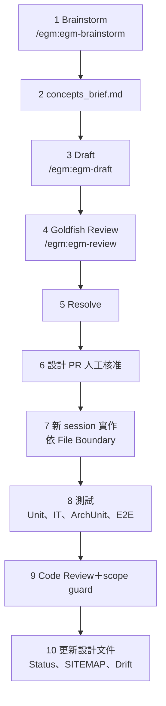

| 步驟 | 指令或動作 | 產出 | 負責人 |
|---|---|---|---|
| 1 | `/crm-elephant` 後 `/egm:egm-brainstorm 客戶聯絡人…` | 對話 | SA＋SD |
| 2 | 交接選單選「Proceed to egm-draft」 | `concepts_brief.md` | SD |
| 3 | `/egm:egm-draft` | `docs/designs/customer-contact.md` | SD |
| 4 | `/egm:egm-review docs/designs/customer-contact.md` | 5 份 stage 報告 | SD |
| 5 | Stage 7、9 選 Option 1 | `goldfish_review_report.md` | SD＋Architect |
| 6 | 開設計 PR | 核准紀錄 | Architect、資安、QA |
| 7 | 新 session 依 5.6 的提示實作 | 程式 PR | PG |
| 8 | `mvn verify`、`npm run test`、Playwright | 測試報告 | PG、QA |
| 9 | Code Review、`egm_scope_guard.py` | Review 紀錄 | Reviewer |
| 10 | 上線後另開 docs-only PR 更新 SITEMAP（Status 維持 Approved；10.4） | 文件 | SD |

每一步的對話、文件、審查結果範例見第 15 章案例一。

**實務注意**：第 1 步的 Brainstorm 最好由 SA 與 SD 一起參加——Elephant 問的業務問題 SD 答不出來，技術問題 SA 答不出來。

### 6.3 前端設計

設計文件中前端應寫到的內容（建議），以及 Goldfish 最常挑出的缺漏：

| 主題 | 設計文件要寫 | 常見 Goldfish finding |
|---|---|---|
| Component Architecture | 頁面元件與共用元件清單、props／emits 介面 | 「ContactForm 與 ContactDialog 的責任重疊」（zoom-out） |
| Routing | 路由表、路由守衛、權限對應 | 「沒寫無權限時導向哪裡」（implementation-readiness） |
| State Management | Pinia store 名稱、state 形狀、哪些資料不放 store | 「PII 明碼是否會留在 store 中」（design） |
| API Integration | API client 位置、錯誤碼對應、重試策略 | 「409 衝突時 UI 行為未定義」（design） |
| Error Handling | 全域錯誤處理、表單驗證錯誤顯示 | 「後端驗證訊息與前端是否同一份 i18n key」 |
| Authentication | 登入方式（OIDC）、token 存放位置 | 「token 存 localStorage 的 XSS 風險未說明」 |
| Authorization | 前端只做顯示控制，後端為準 | 「把權限判斷只寫在前端」 |
| i18n | 語系、key 命名規則 | 「沒定義缺 key 時的 fallback」 |
| RWD | 斷點、表格在手機上的呈現 | 「50 位聯絡人的表格在手機上怎麼顯示」 |
| Accessibility | 鍵盤操作、ARIA、對比 | 「遮罩的手機號碼螢幕閱讀器會念出什麼」 |

Pinia store 在設計文件中的寫法（設計文件允許 API 與 schema，不寫實作；範例）：

```typescript
// 設計文件中的介面描述（不是實作）
interface ContactSummary {
  id: string;
  name: string;
  mobileMasked: string; // 例：0912-***-678，後端遮罩後回傳
  emailMasked: string;
  primary: boolean;
}

// useContactStore（frontend/src/stores/contact.ts）
// state: { byCustomer: Record<string, ContactSummary[]>, loading: boolean }
// 不在 store 保存 PII 明碼；明碼只在詳細頁元件的區域狀態中，離開頁面即丟棄
```

**實務注意**：「前端遮罩」不是安全控制。設計文件要寫明「遮罩由後端完成，前端只顯示」，否則資安審查應退回。

### 6.4 後端設計

採 Hexagonal（Ports & Adapters）分層，設計文件要寫：

| 主題 | 要寫的內容 | 審查重點 |
|---|---|---|
| Layered／Clean Architecture | 模組（`customer-api`、`customer-app`、`customer-domain`、`customer-infra`）與依賴方向 | 依賴只能向內（ArchUnit 驗證，6.6） |
| Domain Model | Aggregate Root、Entity、Value Object、不變式 | 「最多 50 位」「最多一位 Primary」寫在哪個類別 |
| Application Service | Use case 清單、交易邊界 | 一個交易只改一個 Aggregate |
| Repository | Port 介面（domain 層）與實作（infra 層） | Port 不可出現 JPA 型別 |
| REST Controller | 端點、HTTP 狀態碼、錯誤格式 | 409／422／403 何時回傳 |
| DTO | Request／Response 欄位、遮罩欄位 | DTO 不進入 domain |
| Exception Handling | Domain exception → HTTP 對應表 | 不洩漏 stack trace（OWASP 2025 A10） |
| Transaction Management | `@Transactional` 放在 application 層、隔離等級、樂觀鎖 | 並行設定 Primary 的競態 |
| Security | 端點權限、PII 欄位權限、稽核事件 | 預設拒絕（OWASP 2025 A01） |

API 規格寫法（範例，設計文件 Technical Plan 中）：

```yaml
# docs/api/customer-contact.openapi.yaml（節錄）
paths:
  /api/customers/{customerId}/contacts:
    post:
      summary: 新增聯絡人
      security: [{ oidc: [CUSTOMER_EDIT] }]
      responses:
        "201": { description: 建立成功 }
        "409": { description: 已有主要聯絡人，或已達 50 位上限 }
        "422": { description: Email 格式錯誤 }
```

例外對應表（範例）：

| Domain Exception | HTTP | error code |
|---|---|---|
| `ContactLimitExceededException` | 409 | `CONTACT_LIMIT` |
| `PrimaryContactExistsException` | 409 | `PRIMARY_EXISTS` |
| `IllegalArgumentException`（格式） | 422 | `VALIDATION` |
| `AccessDeniedException` | 403 | `FORBIDDEN` |

**實務注意**：「並行時最多一位 Primary」是 Goldfish（`egm-design`）幾乎一定會問的問題。設計文件要同時寫應用層（樂觀鎖 `@Version`）與資料庫層（部分唯一索引）兩道防線，並說明哪一道是最後保證。

### 6.5 資料庫設計

ERD（範例）：

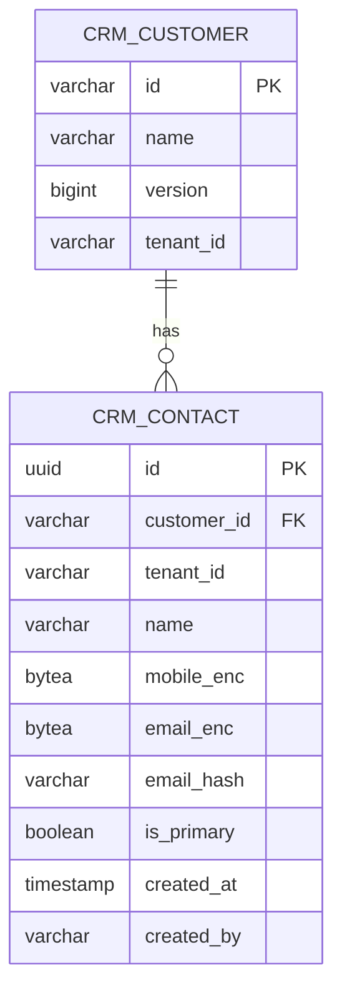

DDL（範例，PostgreSQL；設計文件中的 schema，不是實作）：

```sql
-- customer-infra/src/main/resources/db/migration/V12__contact.sql
CREATE TABLE crm_contact (
    id           UUID PRIMARY KEY,
    customer_id  VARCHAR(20) NOT NULL REFERENCES crm_customer(id),
    tenant_id    VARCHAR(20) NOT NULL,
    name         VARCHAR(100) NOT NULL,
    mobile_enc   BYTEA,
    email_enc    BYTEA NOT NULL,
    email_hash   CHAR(64) NOT NULL,
    is_primary   BOOLEAN NOT NULL DEFAULT FALSE,
    created_at   TIMESTAMP NOT NULL,
    created_by   VARCHAR(50) NOT NULL
);

-- 同一客戶只能有一位主要聯絡人（資料庫層最後防線）
CREATE UNIQUE INDEX ux_contact_primary ON crm_contact (customer_id) WHERE is_primary;
-- 同一客戶內 Email 唯一（以雜湊比對，避免明碼索引）
CREATE UNIQUE INDEX ux_contact_email ON crm_contact (customer_id, email_hash);
CREATE INDEX ix_contact_tenant ON crm_contact (tenant_id, customer_id);
```

設計文件要涵蓋：

| 主題 | 要寫的內容 |
|---|---|
| Table Design | 欄位、型別、NULL、預設值 |
| Index | 查詢路徑對應的索引；唯一約束 |
| Transaction | 寫入順序、鎖、隔離等級 |
| Data Integrity | FK、CHECK、唯一索引 |
| Migration | Flyway 版本號、可否回滾、大表變更策略 |
| Multi-Tenant | `tenant_id` 來源、每個查詢都要過濾、是否用 Row Level Security |
| Database Security | 加密欄位、金鑰管理、DB 帳號最小權限 |
| 跨資料庫 | Oracle／DB2／SQL Server 沒有 PostgreSQL 的部分索引語法時的替代（例如函數索引或 filtered index） |

**實務注意**：部分唯一索引（`WHERE is_primary`）是 PostgreSQL 語法；SQL Server 用 filtered index、Oracle 常用函數索引模擬。設計文件若宣稱「支援四種資料庫」，Stage 9 應該要求每種資料庫的 DDL 寫法，否則違反 Zero-Decision Rule。

### 6.6 測試與品質

| 測試 | 工具 | 設計文件中要寫 |
|---|---|---|
| Unit Test | JUnit＋AssertJ；Vitest | 每個不變式至少一個案例 |
| Integration Test | Testcontainers（PostgreSQL） | migration 與唯一索引行為 |
| API Test | Spring MockMvc／RestTestClient；或 Postman／Newman | 每個狀態碼至少一個案例 |
| E2E Test | Playwright | 每個 CUJ 一個 E2E |
| Performance Test | Gatling／k6 | NFR 中的 P95 目標 |
| Security Test | OWASP ZAP（DAST）、SAST、SCA | 掃描指令與通過門檻 |
| Architecture Test | ArchUnit | 依賴方向規則 |

#### 6.6.1 ArchUnit 架構測試（實測）

設計文件的 Technical Plan 寫了「adapter → app → domain，domain 不依賴框架」，就要有測試證明。以下 Lab 已實測（Maven 3.9.9、JDK 21、ArchUnit 1.5.1）。

📄 `archunit-lab/pom.xml`

```xml
<?xml version="1.0" encoding="UTF-8"?>
<project xmlns="http://maven.apache.org/POM/4.0.0"
         xmlns:xsi="http://www.w3.org/2001/XMLSchema-instance"
         xsi:schemaLocation="http://maven.apache.org/POM/4.0.0 https://maven.apache.org/xsd/maven-4.0.0.xsd">
  <modelVersion>4.0.0</modelVersion>
  <groupId>com.acme.crm</groupId>
  <artifactId>archunit-lab</artifactId>
  <version>1.0.0</version>
  <properties>
    <maven.compiler.release>21</maven.compiler.release>
    <project.build.sourceEncoding>UTF-8</project.build.sourceEncoding>
    <!-- 3.5.3 drops results of non-method tests such as @ArchTest fields (SUREFIRE-2299) -->
    <surefire.version>3.5.4</surefire.version>
  </properties>
  <dependencies>
    <dependency>
      <groupId>com.tngtech.archunit</groupId>
      <artifactId>archunit-junit5</artifactId>
      <version>1.5.1</version>
      <scope>test</scope>
    </dependency>
    <dependency>
      <groupId>org.junit.jupiter</groupId>
      <artifactId>junit-jupiter</artifactId>
      <version>5.13.4</version>
      <scope>test</scope>
    </dependency>
  </dependencies>
  <build>
    <plugins>
      <plugin>
        <groupId>org.apache.maven.plugins</groupId>
        <artifactId>maven-surefire-plugin</artifactId>
        <version>${surefire.version}</version>
      </plugin>
    </plugins>
  </build>
</project>
```

📄 `archunit-lab/src/test/java/com/acme/crm/customer/ArchitectureTest.java`

```java
package com.acme.crm.customer;

import static com.tngtech.archunit.lang.syntax.ArchRuleDefinition.noClasses;
import static com.tngtech.archunit.library.Architectures.onionArchitecture;

import com.tngtech.archunit.core.domain.JavaClasses;
import com.tngtech.archunit.core.importer.ClassFileImporter;
import com.tngtech.archunit.core.importer.ImportOption;
import org.junit.jupiter.api.BeforeAll;
import org.junit.jupiter.api.Test;

/**
 * Architecture rules taken from the design doc "Technical Plan":
 * adapter -> app -> domain; the domain depends on no framework.
 * Plain JUnit tests (not @ArchTest) so the build always reports them as tests.
 */
class ArchitectureTest {

    private static JavaClasses classes;

    @BeforeAll
    static void importClasses() {
        classes = new ClassFileImporter()
                .withImportOption(ImportOption.Predefined.DO_NOT_INCLUDE_TESTS)
                .importPackages("com.acme.crm.customer");
        if (classes.size() < 5) {
            throw new IllegalStateException("imported only " + classes.size() + " classes; check the package name");
        }
    }

    /**
     * If you copy this test into a project whose packages differ (for example
     * ..api.. / ..infra..), the other rules also fail, but with long violation
     * lists or "failed to check". This check names the wrong mapping directly.
     */
    @Test
    void everyMappedLayerHasClasses() {
        for (String pkg : new String[] {".domain", ".app", ".adapter.web", ".adapter.persistence"}) {
            long n = classes.stream().filter(c -> c.getPackageName().contains(pkg)).count();
            if (n == 0) {
                throw new AssertionError("no classes in layer package *" + pkg + "*; fix the layer mapping");
            }
        }
    }

    @Test
    void hexagonalLayersAreRespected() {
        onionArchitecture()
                .withOptionalLayers(true)   // no domain-service classes yet
                .domainModels("..domain..")
                .applicationServices("..app..")
                .adapter("web", "..adapter.web..")
                .adapter("persistence", "..adapter.persistence..")
                .check(classes);
    }

    @Test
    void domainHasNoFrameworkImports() {
        noClasses().that().resideInAPackage("..domain..")
                .should().dependOnClassesThat()
                .resideInAnyPackage("org.springframework..", "jakarta.persistence..")
                .check(classes);
    }
}
```

📄 `archunit-lab/src/main/java/com/acme/crm/customer/domain/Customer.java`

```java
package com.acme.crm.customer.domain;

import java.util.ArrayList;
import java.util.List;

public class Customer {
    public static final int MAX_CONTACTS = 50;
    private final String id;
    private final List<Contact> contacts = new ArrayList<>();

    public Customer(String id) {
        this.id = id;
    }

    public void addContact(Contact contact) {
        if (contacts.size() >= MAX_CONTACTS) {
            throw new ContactLimitExceededException(id);
        }
        if (contact.primary() && contacts.stream().anyMatch(Contact::primary)) {
            throw new PrimaryContactExistsException(id);
        }
        contacts.add(contact);
    }

    public String id() {
        return id;
    }

    public List<Contact> contacts() {
        return List.copyOf(contacts);
    }
}
```

📄 `archunit-lab/src/test/java/com/acme/crm/customer/CustomerContactTest.java`

```java
package com.acme.crm.customer;

import static org.junit.jupiter.api.Assertions.assertEquals;
import static org.junit.jupiter.api.Assertions.assertThrows;

import com.acme.crm.customer.domain.Contact;
import com.acme.crm.customer.domain.ContactLimitExceededException;
import com.acme.crm.customer.domain.Customer;
import com.acme.crm.customer.domain.PrimaryContactExistsException;
import org.junit.jupiter.api.Test;

class CustomerContactTest {

    @Test
    void rejectsFiftyFirstContact() {
        Customer c = new Customer("C001");
        for (int i = 0; i < Customer.MAX_CONTACTS; i++) {
            c.addContact(new Contact("n" + i, "n" + i + "@acme.com", false));
        }
        assertThrows(ContactLimitExceededException.class, () -> c.addContact(new Contact("x", "x@acme.com", false)));
        assertEquals(50, c.contacts().size());
    }

    @Test
    void rejectsSecondPrimary() {
        Customer c = new Customer("C001");
        c.addContact(new Contact("a", "a@acme.com", true));
        assertThrows(PrimaryContactExistsException.class, () -> c.addContact(new Contact("b", "b@acme.com", true)));
    }

    @Test
    void rejectsInvalidEmail() {
        assertThrows(IllegalArgumentException.class, () -> new Contact("a", "not-an-email", false));
    }
}
```

📄 `archunit-lab/src/test/java/com/acme/crm/customer/ArchRuleFieldTest.java`

```java
package com.acme.crm.customer;

import static com.tngtech.archunit.lang.syntax.ArchRuleDefinition.noClasses;

import com.tngtech.archunit.core.importer.ImportOption;
import com.tngtech.archunit.junit.AnalyzeClasses;
import com.tngtech.archunit.junit.ArchTest;
import com.tngtech.archunit.lang.ArchRule;

/**
 * The common ArchUnit style: a rule declared on a field.
 * With maven-surefire-plugin 3.5.3 this class reports "Tests run: 0" and a
 * violation does not fail the build; 3.5.4 reports it correctly.
 */
@AnalyzeClasses(packages = "com.acme.crm.customer", importOptions = ImportOption.DoNotIncludeTests.class)
class ArchRuleFieldTest {

    @ArchTest
    static final ArchRule domainDoesNotDependOnAdapters = noClasses()
            .that().resideInAPackage("..domain..")
            .should().dependOnClassesThat().resideInAPackage("..adapter..");
}
```

設計文件第 4、5 項定義的兩個例外類別（1.1 起 Lab 與設計一致，測試斷言具體型別，而不是 `IllegalStateException`）：

📄 `archunit-lab/src/main/java/com/acme/crm/customer/domain/ContactLimitExceededException.java`

```java
package com.acme.crm.customer.domain;

/** Thrown when a customer already has {@link Customer#MAX_CONTACTS} contacts (design: 422). */
public class ContactLimitExceededException extends RuntimeException {
    public ContactLimitExceededException(String customerId) {
        super("contact limit exceeded: " + customerId);
    }
}
```

📄 `archunit-lab/src/main/java/com/acme/crm/customer/domain/PrimaryContactExistsException.java`

```java
package com.acme.crm.customer.domain;

/** Thrown when a second primary contact is added (design: 409). */
public class PrimaryContactExistsException extends RuntimeException {
    public PrimaryContactExistsException(String customerId) {
        super("primary contact already exists: " + customerId);
    }
}
```

其餘 `Contact.java`、`CustomerRepository.java`、`AddContactService.java`、`ContactController.java`、`InMemoryCustomerRepository.java` 見附錄 B。

執行（Shell）：

```bash
cd archunit-lab
mvn -B test | grep -E "Tests run:.*in com|BUILD"
```

實測結果（surefire 3.5.4）：

```text
Tests run: 1, Failures: 0, Errors: 0, Skipped: 0 -- in com.acme.crm.customer.ArchRuleFieldTest
Tests run: 3, Failures: 0, Errors: 0, Skipped: 0 -- in com.acme.crm.customer.ArchitectureTest
Tests run: 3, Failures: 0, Errors: 0, Skipped: 0 -- in com.acme.crm.customer.CustomerContactTest
BUILD SUCCESS
```

**反例 1：依賴方向違規。** 把附錄 B.4 的 `negative/BadShortcut.java` 複製到 `domain` 套件（domain 直接 `new` 一個 persistence adapter），測試必須失敗；做完記得刪除：

```bash
cp negative/BadShortcut.java src/main/java/com/acme/crm/customer/domain/
mvn -B test | grep -E "Tests run:.*in com|BUILD|BadShortcut.java"
rm src/main/java/com/acme/crm/customer/domain/BadShortcut.java
```

```text
Tests run: 1, Failures: 1, Errors: 0, Skipped: 0 <<< FAILURE! -- in com.acme.crm.customer.ArchRuleFieldTest
Constructor <com.acme.crm.customer.domain.BadShortcut.<init>()> calls constructor <com.acme.crm.customer.adapter.persistence.InMemoryCustomerRepository.<init>()> in (BadShortcut.java:6)
Tests run: 3, Failures: 1, Errors: 0, Skipped: 0 <<< FAILURE! -- in com.acme.crm.customer.ArchitectureTest
Tests run: 3, Failures: 0, Errors: 0, Skipped: 0 -- in com.acme.crm.customer.CustomerContactTest
BUILD FAILURE
```

**反例 2：照抄到套件名稱不同的專案。** 本 Lab 的層是 `..adapter.web..`、`..adapter.persistence..`；第 5.2 節範例設計的模組卻是 `customer-api`（`..api..`）、`customer-infra`（`..infra..`）。實測把 `ContactController` 搬到 `..api..`：

```text
Tests run: 1, Failures: 0, Errors: 0, Skipped: 0 -- in com.acme.crm.customer.ArchRuleFieldTest
Tests run: 3, Failures: 2, Errors: 0, Skipped: 0 <<< FAILURE! -- in com.acme.crm.customer.ArchitectureTest
java.lang.AssertionError: no classes in layer package *.adapter.web*; fix the layer mapping
Tests run: 3, Failures: 0, Errors: 0, Skipped: 0 -- in com.acme.crm.customer.CustomerContactTest
BUILD FAILURE
```

這個反例也是「審查 AI 審查結果」的教材。本手冊 1.1 的獨立 Goldfish 審查（附錄 E.3）推論：「照抄到 api／infra 專案時 adapter 層是空的，加上 `withOptionalLayers(true)`，規則會空轉通過。」實測結果**不成立**：

| 情境（使用 1.0 版的 `ArchitectureTest`，沒有層檢查） | 結果 | 原因 |
|---|---|---|
| web→api、persistence→infra 全部改名 | `hexagonalLayersAreRespected` 失敗 | onion 規則限制「誰可以存取 app 層」，層外的 `..api..` 類別存取 app 被判違規 |
| domain→model 改名，並放入 `BadShortcut` | 兩個測試都失敗 | onion 規則抓到存取 adapter；`domainHasNoFrameworkImports` 報 `failed to check`：ArchUnit 預設 `archRule.failOnEmptyShould=true`，`that()` 沒有符合任何類別時規則直接失敗 |

所以 `everyMappedLayerHasClasses` 不是「唯一的防線」，它的價值在於錯誤訊息直接指出「層的對應錯了」，而不是一長串 violation。Goldfish 的推論方向合理，但結論要用反例實測後才能採用；這正是 `egm-resolve` 中 CONTEST 的用法：用 reviewer 也能檢查的證據反駁。

**實務注意**：AI 產生架構測試時，最常見的錯誤是「層的套件名稱對不上真實專案」。審查時請拿設計文件的 File Boundary 路徑，逐一比對測試中的套件字串；不要在 `archunit.properties` 中把 `archRule.failOnEmptyShould` 改成 `false`，那會關掉 ArchUnit 內建的空規則保護。

#### 6.6.2 實測抓到的假綠燈：surefire 3.5.3 吞掉 `@ArchTest` 的結果

1.0 版發現：用 ArchUnit 官方常見寫法 `@AnalyzeClasses`＋`@ArchTest static final ArchRule` 時，本機（Maven 3.9.9、surefire 3.5.3）一律顯示 `Tests run: 0`，故意放入違規也是 BUILD SUCCESS。當時根因不明，1.0 寫成「規則根本沒有執行」。

**1.1 查明根因：規則有執行，是 surefire 3.5.3 沒有回報結果。** 排查過程本身就是一個好的教材，因為每一步都在排除一個假設：

| # | 假設 | 實驗 | 結果 |
|---|---|---|---|
| 1 | JUnit Platform 版本與 ArchUnit 不相容（ArchUnit 1.5.1 以 junit-platform-engine 1.14.4 編譯，專案解析到 1.13.4） | 升級 junit-jupiter 到 5.14.1 | 仍是 0，排除 |
| 2 | 類別或欄位可見性 | 改成 `public` | 仍是 0，排除 |
| 3 | surefire 類別載入方式 | `-Dsurefire.useManifestOnlyJar=false`、`-DforkCount=0`、`-Dsurefire.useSystemClassLoader=false` | 仍是 0，排除 |
| 4 | ArchUnit engine 本身沒有找到規則 | 改用 JUnit ConsoleLauncher 直接執行 | `1 tests found`、`1 tests failed`：engine 正常 |
| 5 | 規則有沒有執行 | 規則的 condition 每檢查一個類別就寫一行到檔案 | 檔案有 6 行，**規則有執行** |
| 6 | surefire 版本 | 在 pom 實際改版本（`-Dsurefire.version` 在 pom 寫死版本時無效） | 3.0.0、3.2.5、3.5.4 都正確回報失敗，**只有 3.5.3 回報 0** |

上游佐證：

- [apache/maven-surefire#834](https://github.com/apache/maven-surefire/issues/834)（2025-09-13 關閉）：3.5.3 的回歸讓「不是 method 型的測試」（ArchUnit 的 field、Cucumber 的 scenario）不被計入，失敗也不會讓 build 失敗。留言中有使用者寫「ArchUnit tests are affected as well」，也有人回報 Spring Boot 3.4.5 把 surefire 從 3.5.2 帶到 3.5.3 後開始出現。
- 修正：[PR #828](https://github.com/apache/maven-surefire/pull/828)「[SUREFIRE-2298] fix xml output with junit 5 nested classes (fix integration with Cucumber and Archunit)」，2025-09-04 合併；以 `gh api repos/apache/maven-surefire/compare/<merge commit>...surefire-3.5.4` 確認已包含在 3.5.4 tag。
- 審查網路資訊的提醒：issue 留言引用的 JIRA [SUREFIRE-2299](https://issues.apache.org/jira/browse/SUREFIRE-2299) 在 2026-11-17 查詢時仍顯示 Open、沒有 Fix Version（Maven 已改用 GitHub issues）。「JIRA 還開著」不代表沒修好，「issue closed」也不代表已發布；要看修正 commit 是否在你使用的 tag 裡，再用反例實測。

企業專案常透過 `spring-boot-starter-parent` 繼承 surefire 版本（屬性 `maven-surefire-plugin.version`），因此可能在**沒有修改任何測試**的情況下中招。本機 Maven repository 中 Spring Boot 3.5.8 的 parent 帶 3.5.4、4.0.9～4.1.2 帶 3.5.6，都已包含修正；仍在 3.4.x／3.5.x 早期版本的專案請自行確認。

1.1 的 Lab 把 surefire 版本改成屬性，讓你可以親手重現（Shell）：

```bash
cd archunit-lab
mvn -B test -Dsurefire.version=3.5.4 | grep -E "Tests run:.*ArchRuleFieldTest|BUILD"
mvn -B test -Dsurefire.version=3.5.3 | grep -E "Tests run:.*ArchRuleFieldTest|BUILD"
```

實測輸出（「反例」是把 `ArchRuleFieldTest` 的規則改成必定違規）：

```text
$ mvn -B test -Dsurefire.version=3.5.4   # 正常 Lab
Tests run: 1, Failures: 0, Errors: 0, Skipped: 0 -- in com.acme.crm.customer.ArchRuleFieldTest
BUILD SUCCESS

$ mvn -B test -Dsurefire.version=3.5.3   # 正常 Lab
Tests run: 0, Failures: 0, Errors: 0, Skipped: 0 -- in com.acme.crm.customer.ArchRuleFieldTest
BUILD SUCCESS

$ mvn -B test -Dsurefire.version=3.5.4   # 反例：規則改成必定違規
Tests run: 1, Failures: 1, Errors: 0, Skipped: 0 <<< FAILURE! -- in com.acme.crm.customer.ArchRuleFieldTest
BUILD FAILURE

$ mvn -B test -Dsurefire.version=3.5.3   # 反例：規則改成必定違規
Tests run: 0, Failures: 0, Errors: 0, Skipped: 0 -- in com.acme.crm.customer.ArchRuleFieldTest
BUILD SUCCESS
```

對策（建議，三道防線）：

1. **鎖定 surefire ≥ 3.5.4**（或 ≤ 3.5.2）。使用 Spring Boot parent 時，在自己的 pom 覆寫 `maven-surefire-plugin.version` 屬性，並用 `mvn help:effective-pom | grep -A1 maven-surefire-plugin` 確認實際版本。
2. **架構規則用 `ClassFileImporter`＋JUnit `@Test`**（6.6.1 的 `ArchitectureTest`）。這種寫法是 method 型測試，不受這類回報問題影響；`@BeforeAll` 檢查匯入的類別數，`everyMappedLayerHasClasses` 檢查每一層非空。
3. **CI 檢查每個架構測試類別的 Tests run 大於 0**：

```bash
for f in target/surefire-reports/*Arch*Test.txt; do
  grep -q "Tests run: [1-9]" "$f" || { echo "architecture test did not report: $f"; exit 1; }
done
```

**實務注意**：這是 AI 時代特別要注意的審查習慣。AI 寫的測試「通過」不代表有執行，「有執行」也不代表有被回報。每一條新規則都要用反例證明它會讓 build 失敗；第一次導入或升級 build plugin 時要重做一次。

#### 6.6.3 E2E（Playwright）對應 CUJ

設計文件的每個 CUJ 對應一個 E2E 測試名稱，讓 QA 與 Goldfish 都能追蹤（範例）：

```typescript
// frontend/e2e/contact.spec.ts
import { test, expect } from '@playwright/test';

test('CUJ 1: 業務新增主要聯絡人', async ({ page }) => {
  await page.goto('/customers/C001/contacts');
  await page.getByRole('button', { name: '新增聯絡人' }).click();
  await page.getByLabel('姓名').fill('王小明');
  await page.getByLabel('Email').fill('ming@example.com');
  await page.getByLabel('主要聯絡人').check();
  await page.getByRole('button', { name: '儲存' }).click();
  await expect(page.getByRole('row', { name: /王小明/ })).toContainText('主要');
});
```

（🧪：E2E 範例需要實際前端專案，本手冊未執行；Playwright 用法見同目錄〈Playwright 教學手冊〉。）

**本章注意事項**：

- 設計文件中的每一個版本號都要有官方來源；Goldfish 不會替你查證。
- Verification Plan 的每條指令都要能在 CI 跑；寫不出指令的驗證項目代表計畫還沒完成。

### 6.7 本章 AI 產出審查

| 檢查點 | 好例 | 壞例 | 怎麼抓 |
|---|---|---|---|
| 版本來源 | 每個版本附官方網址 | 「使用最新版」 | 搜尋「最新」「latest」 |
| 架構測試有執行 | Tests run ≥ 1，反例會讓 build 失敗 | Tests run: 0；surefire 3.5.3 | 6.6.2 的 for 迴圈；`mvn help:effective-pom` 查 surefire 版本 |
| 並行控制 | 應用層＋資料庫層兩道防線 | 「先查詢再新增」 | 搜尋設計文件的「並行」「concurrent」 |
| PII | 後端遮罩、加密欄位、金鑰來源 | 「前端遮罩」 | 搜尋「mask」「遮罩」出現在哪一層 |
| 多資料庫 DDL | 每種資料庫各一段 | 只有 PostgreSQL 卻宣稱支援四種 | 比對 NFR 與 DDL 數量 |

## 第 7 章：EGM 逆向工程（Reverse Engineering）實戰

逆向工程的目標是把「只存在於程式碼與老員工腦中」的知識，變成 **Elephant 可以讀、Goldfish 可以驗證、人類可以核准** 的文件。EGM 沒有專門的逆向工程 Skill，本章示範如何組合 `egm-bootstrap`、`egm-review-loop`、`egm-drift-report` 與公司自建的證據檢查。

### 7.1 逆向工程的目的

| 目的 | 典型觸發 | 主要產出 |
|---|---|---|
| 舊系統文件缺失 | 稽核要求、交接 | System Overview、Module Dependency |
| 原始開發人員已離職 | 維運只剩一人看得懂 | Business Rules、Exception Handling |
| 業務邏輯不明確 | 客訴、計算結果爭議 | Business Flow、Business Rules（附證據） |
| 程式碼結構複雜 | 新人上手要三個月 | 模組 README、程式碼導覽 |
| 系統依賴關係不清楚 | 要拆服務、要搬機房 | Interface Specification、Module Dependency |
| 準備重構／升級／重新開發 | 第 8 章 Framework 升級前 | As-Is Architecture、行為基準（golden master） |

**實務注意**：先寫下「這次逆向工程是為了什麼決策」。為升級做的逆向工程和為稽核做的，要求的深度不同；沒有目的的逆向工程會變成無止境的文件生產。

### 7.2 逆向工程流程

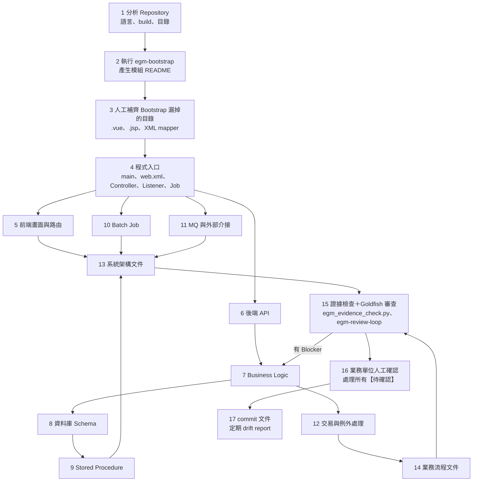

步驟與 EGM 工具對應：

| # | 步驟 | 工具 | 產出 |
|---|---|---|---|
| 1 | 分析 Repository | Shell（`git ls-files`、副檔名統計） | 技術盤點表 |
| 2 | 執行 Bootstrap | `/egm:egm-bootstrap <path>`（既有 README 不想動時加 `target_filename=EGM.md`） | 各層 README／EGM.md |
| 3 | 建立模組說明 | 人工補 Bootstrap 修剪掉的目錄 | 補充 README |
| 4～12 | 逐項分析 | Elephant 對話（載入 Bootstrap 產出）；每個結論附 `[file:symbol]` | 各分析文件 |
| 13～14 | 架構與流程文件 | Elephant | System Architecture、Business Flow |
| 15 | 獨立審查 | `egm_evidence_check.py`＋`/egm:egm-review-loop`（`codebase_details`＋`re-implementation-standard`＋公司證據標準） | 審查報告 |
| 16 | 人工確認 | 業務單位、原開發者 | 簽核紀錄 |
| 17 | 持續維護 | `/egm:egm-drift-report docs/legacy/` | drift 報告 |

**實務注意**：步驟 4～12 是 Elephant 的工作，**不是** Goldfish 的。Goldfish 在步驟 15 才出場，負責「只看文件與程式碼，能不能驗證文件說的是真的」。

### 7.3 舊系統技術案例

#### 7.3.1 Bootstrap 對各技術的覆蓋

`egm-bootstrap` 只把特定副檔名視為原始碼（官方，`skills/egm-bootstrap/SKILL.md` Step 2.3）。對照企業常見舊技術：

| 技術 | 主要檔案 | Bootstrap 視為原始碼？ | 需要人工補的部分 |
|---|---|---|---|
| VB6 | `.bas`、`.cls`、`.frm` | **否** | 全部 |
| VB.NET | `.vb` | v0.1.1 **否**；main 是（#324） | `.config`、`.resx` |
| C# | `.cs` | 是 | `app.config`、`web.config` |
| ASP.NET Web Forms | `.aspx`、`.ascx`、`.aspx.cs` | 只有 `.cs` 是 | `.aspx` 畫面與事件綁定 |
| ASP.NET MVC／Razor | `.cshtml`、`.razor`、`.cs` | v0.1.1 只有 `.cs`；main 全部是（#324） | v0.1.1 時補畫面檔 |
| Java | `.java` | 是 | — |
| JSP | `.jsp`、`.tag` | **否** | 畫面、`<jsp:include>`、表單欄位 |
| Servlet | `.java`＋`web.xml` | `.java` 是，`web.xml` 否 | URL 對應 |
| Spring（XML 設定） | `.java`＋`applicationContext.xml` | XML 否 | Bean 組裝、AOP、交易設定 |
| Spring Boot | `.java`＋`application.yml` | `.yml` 否 | 設定值、Profile |
| MyBatis | `.java`＋`*Mapper.xml` | XML 否 | **所有 SQL** |
| Oracle PL/SQL | `.sql`、`.pks`、`.pkb` | 只有 `.sql` 是 | `.pks`／`.pkb` 檔 |
| DB2 Stored Procedure | `.sql`、`.db2` | 只有 `.sql` 是 | 其他副檔名 |
| SQL Server SP | `.sql` | 是 | — |
| IBM MQ | `.java`／`.cs`＋設定檔 | 程式是 | Queue 名稱多在設定檔 |
| Spring Batch | `.java`＋Job XML | XML 否 | XML 定義的 Step 流程 |
| Vue 2 | `.vue`、`.js` | 只有 `.js` 是 | `.vue` 單檔元件 |

驗證方式：在 EGM repo 執行 `git show v0.1.1:skills/egm-bootstrap/SKILL.md | grep -n -A2 "Managed & Enterprise"`（換成你實際使用的版本）查看清單。

1.1 實跑時，Elephant 對清單外的 `.jsp`、`.vue`、mapper XML 目錄**刻意偏離規則**仍產生了文件，並在回報中揭露（5.8.2、5.8.4）。這張表是「規則」，不是「保證的結果」；每次都要以實際產出為準。

**實務注意**：這張表說明「Bootstrap 產出的 README 不完整」不是 AI 偷懶，而是規則本來就沒涵蓋。逆向工程計畫要預留人工補齊的時間。

#### 7.3.2 各技術的分析重點

| 技術 | 入口在哪 | 要追的呼叫鏈 | 證據寫法範例 |
|---|---|---|---|
| VB／VB.NET | `Sub Main`、表單 `_Click` 事件 | 事件 → 模組函式 → ADO 指令 | `[src/Loan/frmApprove.vb:btnApprove_Click]` |
| C#／ASP.NET | `Global.asax`、Controller、`Page_Load` | Controller → Service → Repository／SqlCommand | `[Web/Controllers/LoanController.cs:Approve]` |
| JSP／Servlet | `web.xml` 的 `<servlet-mapping>` | URL → Servlet `doPost` → DAO → JSP forward | `[WEB-INF/web.xml:L40-L48]` |
| Spring | `@RequestMapping`、XML bean | Controller → `@Service` → `@Transactional` 邊界 | `[src/.../LoanService.java:approve]` |
| Oracle PL/SQL | Package spec 的公開程序 | 程序 → UPDATE／INSERT 的表 → 觸發程序（Trigger） | `[db/PKG_LOAN.sql:SP_MANUAL_REVIEW]` |
| DB2 SP | `CREATE PROCEDURE` | 參數 → 游標 → COMMIT 時機 | `[db2/LOAN_SP.sql:L10-L55]` |
| SQL Server SP | `CREATE PROCEDURE` | `BEGIN TRAN`／`COMMIT`／`TRY…CATCH` | `[sql/usp_ApproveLoan.sql:BEGIN TRAN]` |
| IBM MQ | `MessageListener`、`MQQueue.get` | 收訊 → 解析 → 業務 → 回覆佇列 | `[mq/LoanListener.java:onMessage]` |
| Spring Batch | `@Bean Job`、Job XML | Reader → Processor → Writer、skip／retry 策略 | `[batch/LoanJobConfig.java:loanStep]` |

**實務注意**：交易邊界最容易被 AI 猜錯。Java 看 `@Transactional` 與 XML `tx:advice`；PL/SQL 看 `COMMIT` 出現在哪一層（呼叫端還是程序內）；SQL Server 看 `BEGIN TRAN` 與 `XACT_ABORT`。每一條交易結論都要附證據。

### 7.4 逆向工程文件產出

| 文件 | 內容 | 建議檔名 | 審查 standard |
|---|---|---|---|
| System Overview | 系統目的、使用者、上下游 | `docs/legacy/00-overview.md` | `re-implementation-standard` |
| System Architecture | 部署、分層、技術元件 | `01-architecture.md` | 同上＋公司證據標準 |
| Module Dependency | 模組相依圖（Mermaid） | `02-modules.md` | 同上 |
| Business Flow | 主要流程（flowchart） | `03-business-flow.md` | 同上 |
| Sequence Diagram | 關鍵交易的呼叫序列 | `04-sequences.md` | 同上 |
| API Specification | 端點、參數、回應、錯誤 | `05-api.md` 或 OpenAPI | 同上 |
| Database ERD | 表與關聯 | `06-erd.md` | 同上 |
| Data Dictionary | 欄位意義、代碼值 | `07-data-dictionary.md` | 同上 |
| Batch Specification | Job、排程、輸入輸出、重跑 | `08-batch.md` | 同上 |
| Interface Specification | MQ、檔案、SFTP、外部 API | `09-interfaces.md` | 同上 |
| Business Rules | BR 編號、規則、證據、狀態 | `10-business-rules.md` | 公司證據標準 |
| Exception Handling | 錯誤碼、重試、補償 | `11-exceptions.md` | 同上 |
| Security Design | 認證、授權、加密、稽核 | `12-security.md` | 公司 security standard |

Business Rules 範本（建議；可被 `egm_evidence_check.py` 檢查）：

```markdown
| 編號 | 規則 | 證據 | 狀態 |
| --- | --- | --- | --- |
| BR-01 | 信用分數 < 600 直接拒絕 | [src/main/java/com/acme/loan/LoanApprovalService.java:creditScore < 600] | 【已確認】 |
| BR-04 | 門檻可能依分行不同 | 程式中為常數，未見分行參數 | 【推測】 |
| BR-05 | 人工審核 SLA 為 2 個工作天 | 程式與 SQL 皆無此資訊 | 【待確認】 |
```

三種狀態：

| 標記 | 意義 | 能不能進入升級設計 |
|---|---|---|
| 【已確認】 | 有程式碼證據 | 可以 |
| 【推測】 | AI 或人推論，沒有直接證據 | 不可以，要先確認或明確列為假設 |
| 【待確認】 | 需要業務單位或原開發者回答 | 不可以 |

**實務注意**：EGM 的 `re-implementation-standard` 要求「every behaviorally significant contract must be explicit」。Business Rules 文件就是這個標準最直接的應用。

### 7.5 逆向工程注意事項

| 規則 | 為什麼 | 怎麼做 |
|---|---|---|
| 不可只憑類別名稱推論業務邏輯 | `VipCustomerService` 可能早就沒有 VIP 邏輯 | Bootstrap scout 規則同樣禁止（「Never infer … from file or directory names alone」） |
| 不可將 AI 推測當成事實 | AI 很會寫「看起來合理」的流程 | 所有結論標記【已確認】／【推測】／【待確認】 |
| 必須追蹤實際程式呼叫 | 介面可能有多個實作、反射呼叫、XML 組裝 | 從入口一路追到 SQL；IDE 的 Call Hierarchy 輔助 |
| 必須確認 SQL、SP 與交易 | 業務規則常藏在 SP | 每張被寫入的表都要找到寫入它的語句 |
| 必須確認外部介接 | 設定檔裡的端點可能依環境不同 | 列出每個環境的設定來源 |
| 必須標記不確定的規則 | 讓業務單位知道要回答什麼 | 【待確認】清單交 PM 追蹤 |
| 必須保留程式碼證據與位置 | 讓 Goldfish 與稽核能重新驗證 | `[path:symbol]` 或 `[path:L10-L42]` |
| Goldfish 要能檢查一致性 | 文件與程式在同一個 repo 或可讀的路徑 | 文件放在舊系統 repo 的 `docs/legacy/` |

#### 7.5.1 證據檢查工具（建議，公司自建）

📄 `tools/egm_evidence_check.py`

````python
#!/usr/bin/env python3
"""egm_evidence_check.py - verify code citations in reverse-engineering docs.

Company convention (not part of EGM): every confirmed statement cites code as
  [relative/path.ext:SymbolName]   or   [relative/path.ext:L120-L168]
This follows the egm-bootstrap scout rule "cite the exact [file:symbol_or_flag]".
Statement tags:
  【已確認】 confirmed from code -> must carry at least one citation
  【推測】   AI inference        -> allowed without citation, counted
  【待確認】 needs a domain owner -> allowed without citation, counted

Rules (exit 1 on any FAIL):
  E1 cited file exists under --root
  E2 cited symbol appears in that file / cited line range is inside the file
  E3 a 【已確認】 line has no citation
  E4 a business rule row ("| BR-") has neither a citation nor 【推測】/【待確認】

Usage: python egm_evidence_check.py DOC.md [DOC.md ...] --root path/to/legacy-repo
"""
import argparse
import re
import sys
from pathlib import Path

CITE = re.compile(r"\[([A-Za-z0-9_./-]+\.[A-Za-z0-9]+):([^\]]+)\](?!\()")
LINES = re.compile(r"^L(\d+)(?:-L(\d+))?$")
CONFIRMED, GUESS, OPEN = "【已確認】", "【推測】", "【待確認】"


def check_doc(doc, root):
    fails, stats = [], {"cites": 0, "confirmed": 0, "guess": 0, "open": 0}
    cache = {}
    fence = False
    for no, line in enumerate(doc.read_text(encoding="utf-8").splitlines(), 1):
        if line.lstrip().startswith("```"):
            fence = not fence
            continue
        if fence:
            continue
        cites = CITE.findall(line)
        stats["confirmed"] += line.count(CONFIRMED)
        stats["guess"] += line.count(GUESS)
        stats["open"] += line.count(OPEN)
        for rel, target in cites:
            stats["cites"] += 1
            path = (root / rel).resolve()
            if not path.is_file():
                fails.append(f"{doc.name}:{no} E1 file not found: {rel}")
                continue
            if path not in cache:
                cache[path] = path.read_text(encoding="utf-8", errors="replace").splitlines()
            body = cache[path]
            m = LINES.match(target)
            if m:
                end = int(m.group(2) or m.group(1))
                if end > len(body):
                    fails.append(f"{doc.name}:{no} E2 line {end} beyond {rel} ({len(body)} lines)")
            elif not any(target in b for b in body):
                fails.append(f"{doc.name}:{no} E2 symbol '{target}' not in {rel}")
        if CONFIRMED in line and not cites:
            fails.append(f"{doc.name}:{no} E3 confirmed statement without citation")
        if line.lstrip().startswith("| BR-") and not cites and GUESS not in line and OPEN not in line:
            fails.append(f"{doc.name}:{no} E4 business rule without evidence or tag")
    return stats, fails


def main(argv=None):
    ap = argparse.ArgumentParser()
    ap.add_argument("docs", nargs="+")
    ap.add_argument("--root", required=True)
    args = ap.parse_args(argv)
    root = Path(args.root).resolve()
    total = 0
    for d in args.docs:
        stats, fails = check_doc(Path(d), root)
        print(f"{Path(d).name}: cites={stats['cites']} confirmed={stats['confirmed']} "
              f"guess={stats['guess']} open={stats['open']}")
        for f in fails:
            print(f"FAIL {f}")
        total += len(fails)
    print("EVIDENCE PASS" if total == 0 else f"EVIDENCE FAIL ({total})")
    return 1 if total else 0


if __name__ == "__main__":
    sys.exit(main())
````

測試用的舊系統程式（fixture）：

📄 `fixtures/legacy/src/main/java/com/acme/loan/LoanApprovalService.java`

```java
package com.acme.loan;

import java.math.BigDecimal;

public class LoanApprovalService {

    static final BigDecimal AUTO_APPROVE_LIMIT = new BigDecimal("300000");

    private final LoanDao loanDao;

    public LoanApprovalService(LoanDao loanDao) {
        this.loanDao = loanDao;
    }

    public String approve(String applicationNo, BigDecimal amount, int creditScore) {
        if (creditScore < 600) {
            loanDao.updateStatus(applicationNo, "REJECTED");
            return "REJECTED";
        }
        if (amount.compareTo(AUTO_APPROVE_LIMIT) <= 0) {
            loanDao.updateStatus(applicationNo, "APPROVED");
            return "APPROVED";
        }
        loanDao.callProcedure("PKG_LOAN.SP_MANUAL_REVIEW", applicationNo);
        return "MANUAL_REVIEW";
    }
}
```

📄 `fixtures/legacy/db/PKG_LOAN.sql`

```sql
CREATE OR REPLACE PACKAGE BODY PKG_LOAN AS
  PROCEDURE SP_MANUAL_REVIEW(p_app_no IN VARCHAR2) IS
  BEGIN
    UPDATE LOAN_APPLICATION SET STATUS = 'PENDING_REVIEW', UPDATED_AT = SYSDATE
     WHERE APP_NO = p_app_no;
    INSERT INTO LOAN_REVIEW_QUEUE (APP_NO, CREATED_AT) VALUES (p_app_no, SYSDATE);
  END SP_MANUAL_REVIEW;
END PKG_LOAN;
/
```

好例文件：

📄 `fixtures/re_doc_good.md`

```markdown
# 貸款核准 Business Rules（逆向工程）

| 編號 | 規則 | 證據 | 狀態 |
| --- | --- | --- | --- |
| BR-01 | 信用分數 < 600 直接拒絕 | [src/main/java/com/acme/loan/LoanApprovalService.java:creditScore < 600] | 【已確認】 |
| BR-02 | 金額 ≤ 300,000 自動核准 | [src/main/java/com/acme/loan/LoanApprovalService.java:AUTO_APPROVE_LIMIT] | 【已確認】 |
| BR-03 | 超過門檻進人工審核佇列 | [db/PKG_LOAN.sql:LOAN_REVIEW_QUEUE] [db/PKG_LOAN.sql:L2-L7] | 【已確認】 |
| BR-04 | 門檻 300,000 可能依分行不同 | 程式中為常數，未見分行參數 | 【推測】 |
| BR-05 | 人工審核 SLA 為 2 個工作天 | 程式與 SQL 皆無此資訊，需授信部確認 | 【待確認】 |
```

壞例文件（AI 初稿常見錯誤）：

📄 `fixtures/re_doc_bad.md`

```markdown
# 貸款核准 Business Rules（AI 初稿，未驗證）

| 編號 | 規則 | 證據 | 狀態 |
| --- | --- | --- | --- |
| BR-01 | 信用分數 < 650 直接拒絕 | [src/main/java/com/acme/loan/LoanApprovalService.java:creditScore < 650] | 【已確認】 |
| BR-02 | 金額 ≤ 300,000 自動核准 | [src/main/java/com/acme/loan/LoanService.java:AUTO_APPROVE_LIMIT] | 【已確認】 |
| BR-03 | 人工審核由 SP_MANUAL_REVIEW 執行 | [db/PKG_LOAN.sql:L2-L40] | 【已確認】 |
| BR-04 | VIP 客戶免審 | 由類別名稱推論 | |

貸款核准會寫入 LOAN_HISTORY。【已確認】
```

執行（Shell）：

```bash
python tools/egm_evidence_check.py fixtures/re_doc_good.md --root fixtures/legacy
python tools/egm_evidence_check.py fixtures/re_doc_bad.md --root fixtures/legacy
```

實測輸出：

```text
re_doc_good.md: cites=4 confirmed=3 guess=1 open=1
EVIDENCE PASS
```

```text
re_doc_bad.md: cites=3 confirmed=4 guess=0 open=0
FAIL re_doc_bad.md:5 E2 symbol 'creditScore < 650' not in src/main/java/com/acme/loan/LoanApprovalService.java
FAIL re_doc_bad.md:6 E1 file not found: src/main/java/com/acme/loan/LoanService.java
FAIL re_doc_bad.md:7 E2 line 40 beyond db/PKG_LOAN.sql (9 lines)
FAIL re_doc_bad.md:8 E4 business rule without evidence or tag
FAIL re_doc_bad.md:10 E3 confirmed statement without citation
EVIDENCE FAIL (5)
```

壞例抓到的五種錯誤，正是 AI 逆向工程最常見的問題：數字寫錯（650 vs 600）、類別名稱編造（`LoanService`）、行號範圍超出檔案、從類別名稱推論規則（「VIP 客戶免審」）、沒有證據就標「已確認」（`LOAN_HISTORY` 表根本不存在）。

**實務注意**：證據檢查只證明「引用的東西存在」，不證明「規則描述正確」。BR-01 引用 `creditScore < 600` 存在，但「直接拒絕」這個解讀仍要 Goldfish（`codebase_details`）與人工確認。

#### 7.5.2 完整逆向工程操作範例

情境：貸款核准模組（Java＋Oracle PL/SQL），準備升級前要建立文件。

步驟 1：技術盤點（Shell）

```bash
cd loan-service
git ls-files | sed -n 's/.*\.\([A-Za-z0-9]*\)$/\1/p' | sort | uniq -c | sort -rn | head -15
```

步驟 2：Bootstrap（Claude Code 對話框）

```text
/egm:egm-bootstrap src/main/java/com/acme/loan target_filename=EGM.md
```

目錄超過 15 個時會先詢問；選「Yes, proceed」前確認範圍正確。

步驟 3：補齊 Bootstrap 沒處理的檔案（Shell）

```bash
# 找出有 .jsp／.xml／.pkb 但沒有 EGM.md 的目錄
git ls-files '*.jsp' '*.xml' '*.pkb' '*.pks' | xargs -n1 dirname | sort -u | while read -r d; do
  [ -f "$d/EGM.md" ] || echo "NEED-DOC $d"
done
```

步驟 4～12：在 Elephant 中逐項分析（Claude Code 對話框）

```text
請讀 src/main/java/com/acme/loan/EGM.md 與 db/ 目錄，產生 docs/legacy/10-business-rules.md。
規則：
1. 只寫你在程式碼中看到的規則，每條附 [相對路徑:符號] 或 [相對路徑:L起-L迄]，標【已確認】。
2. 推論標【推測】並說明推論依據；需要業務單位回答的標【待確認】。
3. 不得從類別名稱、表名推論規則。
4. 追到每一張被 UPDATE／INSERT 的表，寫出是哪個語句寫入。
```

步驟 15：證據檢查＋Goldfish 審查

```bash
python tools/egm_evidence_check.py docs/legacy/*.md --root .
```

```text
/egm:egm-review-loop
TargetFile: docs/legacy/10-business-rules.md
SemanticTarget: full file
Reviewers: [codebase_details, comprehension]
Standards: {"codebase_details": "re-implementation-standard", "comprehension": "docs/standards/reverse-engineering-evidence-standard.md"}
GoldfishContext: [src/main/java/com/acme/loan/, db/]
```

參數寫法依據（官方，`skills/egm-review-loop/SKILL.md`「Path & Standard Resolution Logic」）：

| 參數 | 官方定義 | 本例寫法為何正確 |
|---|---|---|
| `Reviewers` | 「reviewer shortname (e.g., `design_critic`, `structural`, `style`, `implementation_readiness`, `codebase_details`, `comprehension`, `zoom_out`) to `agents/{name}.md`」 | review-loop 用的是**檔名**；frontmatter 的 `egm-design` 是 Claude Code 的 subagent 類型名稱，兩者用途不同（2.4） |
| `Standards` | shortname 對應 `resources/document_standards/{name}.md`；「If the name contains a slash (`/`), treat it as an absolute or workspace-relative path」 | 官方 standard 用 shortname，公司 standard 用含 `/` 的路徑 |
| `GoldfishContext` | 「A reading list (source files, directories, or documentation URLs)」 | 可以放目錄 |

壞例：`Reviewers: [egm-design]`（review-loop 會去找 `agents/egm-design.md`，這個檔案不存在）；`Standards: {"comprehension": "reverse-engineering-evidence-standard"}`（沒有 `/`，會被當成官方 standard 名稱）。檢查方式（Shell，在 EGM repo）：

```bash
ls agents/codebase_details.md agents/comprehension.md                          # 兩個都要存在
ls resources/document_standards/re-implementation-standard.md                  # 官方 shortname
```

步驟 3 列出的 `NEED-DOC` 目錄要人工補寫 `EGM.md`。範本可以參考第 5.8.4 節 1.1 實跑產生的 `jsp/EGM.md`：Overview、Interface、Invariants、Side Effects 四段，每條附 `[檔案:符號]` 出處，寫不出出處的不要寫。

步驟 16：把【待確認】清單交給業務單位（Shell）

```bash
grep -n '【待確認】' docs/legacy/*.md > docs/legacy/open-questions.txt
```

步驟 17：commit 並排入每週 Drift Report。

**本章注意事項**：

- Goldfish 審查逆向工程文件時**必須能讀到舊系統原始碼**；文件與程式放在不同 repo 時，要把程式碼路徑列入 `GoldfishContext`。
- 舊系統常含個資樣本資料（測試 SQL、匯出檔）。逆向前先用 `.egmignore`／`.gitignore` 排除，並確認公司核准把該程式碼交給 AI 服務（第 10.11 節）。

### 7.6 本章 AI 產出審查

| 檢查點 | 好例 | 壞例 | 怎麼抓 |
|---|---|---|---|
| 證據存在 | 每條【已確認】都有可解析的引用 | 引用不存在的類別 | `egm_evidence_check.py` E1、E2 |
| 推論標示 | 「【推測】門檻可能依分行不同」 | 「VIP 客戶免審」無標記 | E4 |
| 交易邊界 | 「COMMIT 由呼叫端 `LoanDao.commit` 執行 [..]」 | 「此程序為獨立交易」無證據 | 人工抽查＋`codebase_details` |
| 覆蓋率 | JSP、XML mapper 都有說明 | 只有 Java 有 README | 7.5.2 步驟 3 的指令 |
| 數字 | 與程式常數一致 | 600 寫成 650 | E2（引用原文字串） |

## 第 8 章：EGM Framework 升級與系統現代化實戰

Framework 升級的難點不是改程式，而是「不知道會壞在哪裡」。EGM 在升級中的價值是：把升級計畫寫成可被陌生人執行與驗證的文件，並讓 Goldfish 在動手前找出缺漏的 Breaking Change 與回滾步驟。

本章著重 EGM 流程；各框架的技術細節請見同 repo 手冊：[Spring boot 4.x升版教學](../framework/Spring%20boot%204.x升版教學.md)、[Java25升版教學](../程式語言/Java25升版教學.md)、[code-modernization 教學手冊](code-modernization%20教學手冊.md)、[Claude Code Migration Kit 教學手冊](Claude%20Code%20Migration%20Kit%20教學手冊.md)。

### 8.1 升級前分析

| 面向 | 要收集的資料 | 怎麼收集 | EGM 工具 |
|---|---|---|---|
| 現有系統架構 | 模組、分層、部署方式 | Bootstrap＋人工補齊 | `egm-bootstrap` |
| Framework 版本 | Spring Boot、Spring、Hibernate、Vue… | `mvn dependency:tree`、`npm ls --depth=0` | — |
| Runtime 版本 | JDK、Node、App Server | CI 設定、Dockerfile | — |
| Dependency | 直接與間接相依、授權 | `mvn dependency:tree -Dverbose`、SCA 工具 | — |
| API | 對外端點與契約 | OpenAPI 或逆向工程 | 第 7 章 |
| Database | 版本、方言、原生 SQL | DDL、Mapper | 第 7 章 |
| External Integration | MQ、SFTP、第三方 API | 設定檔 | 第 7 章 |
| Security | 認證框架、加密套件 | 程式＋設定 | — |
| Test Coverage | 覆蓋率、有沒有可信的回歸測試 | JaCoCo 報告 | — |
| Deployment Environment | OS、容器映像、JVM 參數 | 部署腳本 | — |

收集指令範例（Shell，Maven 專案）：

```bash
java -version 2>&1 | head -1
mvn -q help:evaluate -Dexpression=project.parent.version -DforceStdout   # Spring Boot parent 版本
mvn -q dependency:tree -DoutputFile=target/deps.txt
grep -rl "javax\." --include=*.java src | wc -l                          # 需改成 jakarta 的檔案數
```

**實務注意**：「測試覆蓋率低」是升級最大的風險，不是 Framework 本身。分析階段若發現沒有可信的回歸測試，計畫第 0 階段就應是「補行為基準測試（characterization／golden master）」。

### 8.2 升級規劃

常見升級路徑與官方依據（**每一條都要在設計文件中附官方網址**）：

| 升級 | 官方建議路徑（摘要） | 依據 |
|---|---|---|
| Java 8 → 21／25 | 逐一處理被移除的 API 與模組；Spring Boot 3 起最低 Java 17 | Oracle／OpenJDK 遷移指南、Spring Boot system requirements |
| Spring Boot 2.x → 3.x | 先升到最新 2.7.x 並消除 deprecation，再升 3.0；`javax.*` → `jakarta.*` | Spring Boot 3.0 Migration Guide |
| Spring Boot 3.x → 4.x | 先升到最新 3.5.x 並消除 deprecation，再升 4.0；Jakarta EE 11、Servlet 6.1 | Spring Boot 4.0 Migration Guide |
| Spring Framework 5 → 6 → 7 | 隨 Boot 升級 | Spring Framework 各版 Upgrading 頁 |
| Vue 2 → Vue 3 | 可用 Migration Build（`@vue/compat`）漸進遷移 | Vue 3 Migration Guide |
| JavaScript → TypeScript | 先 `allowJs`，逐檔改寫 | TypeScript 官方文件 |
| 舊版 Angular → 新版 | 每次只升一個主版本 | Angular Update Guide |
| Maven 3 → Maven 4 | 確認 plugin 相容性；POM model 版本 | Maven 4 官方說明 |

> 上表的路徑摘要來自各專案官方遷移指南的一般建議；實際升級前，Elephant 必須在 Brainstorm 階段讀取並引用當時最新版本的指南（尚待每次升級時重新驗證）。

輔助工具（🧪，本手冊未在本章實跑）：

| 工具 | 用途 |
|---|---|
| OpenRewrite（Spring Boot 升級 recipe） | 機械化改寫 import、設定屬性 |
| `spring-boot-properties-migrator` | 執行期回報已改名或移除的設定屬性 |
| `@vue/compat` | Vue 3 相容模式，逐一關閉相容旗標 |
| SCA 工具（OWASP Dependency-Check、Trivy） | 找出升級後仍有漏洞或已停止維護的套件 |

**實務注意**：「一次從 Boot 2.3 跳到 4.0」幾乎一定失敗。設計文件要把每個主版本拆成獨立 Phase，每個 Phase 都能單獨上線。

### 8.3 EGM 升級流程

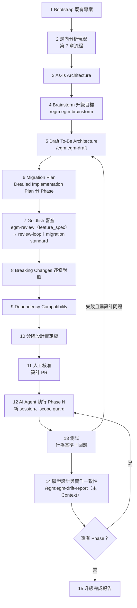

各步驟的 EGM 指令：

| 步驟 | 指令（Claude Code 對話框） |
|---|---|
| 1 | `/egm:egm-bootstrap .` |
| 4 | `/egm:egm-brainstorm 將 loan-service 從 Spring Boot 2.3／Java 8 升級到 Spring Boot 4.0／Java 21` |
| 5～6 | `/egm:egm-draft` |
| 7 | `/egm:egm-review docs/designs/loan-service-upgrade.md feature_spec`（只跑 Stage 5～8；`egm-review` 的 stage 不接受自訂 standard，所以 Stage 9 改用下一列的 review loop） |
| 8～9 | `/egm:egm-review-loop`（Reviewers：`implementation_readiness`、`codebase_details`；Standards：`implementation-readiness-standard`、`docs/standards/migration-readiness-standard.md`） |
| 14 | `/egm:egm-drift-report docs/designs/` |

公司升級審查標準（建議）：

📄 `standards/migration-readiness-standard.md`

```markdown
# Framework Migration Readiness Standard (ACME Bank)

Company standard for migration plans. Not part of EGM. Use together with EGM's
`implementation-readiness-standard`.

## Core Principle

A migration plan passes if an engineer who did not write it can run each phase,
know how to prove the phase did not change behavior, and roll it back.

## Requirements (Non-Exhaustive Examples)

*   **Version Evidence**: Every target version cites the vendor's official
    compatibility or system-requirements page.
*   **Breaking Changes**: Each breaking change from the official migration guide
    is listed with the affected files, or explicitly marked "not applicable"
    with the reason.
*   **Phasing**: Each phase leaves the build green and is deployable alone.
*   **Behavior Baseline**: Characterization (golden master) tests exist before
    the first code change.
*   **Rollback**: Each phase states its rollback command and data compatibility.
```

**實務注意**：升級設計文件的 Detailed Implementation Plan 很長。用 Preset 3（Implementation plan only）或 `egm-review-loop` 的 `SemanticTarget` 只審某個 Phase，可以降低成本並讓 findings 更聚焦。

### 8.4 升級風險

| 風險 | 典型例子 | 設計文件要寫 | 測試方式 |
|---|---|---|---|
| API Breaking Changes | `javax.*` → `jakarta.*`；移除的 Spring API | 受影響檔案清單 | 編譯＋單元測試 |
| Dependency Conflicts | 兩個套件要求不同版本的 Jackson | 版本對照表、排除規則 | `mvn dependency:tree -Dverbose` |
| Security Changes | Spring Security 設定 DSL 改變、預設行為改變 | 每個端點升級前後的授權結果 | 權限矩陣測試 |
| Database Compatibility | Hibernate 方言、ID 產生策略改變 | 原生 SQL 清單 | Testcontainers 整合測試 |
| Configuration Changes | 屬性改名或移除 | 屬性對照表 | `spring-boot-properties-migrator` |
| Authentication Changes | Session、Cookie、CSRF 預設改變 | 登入流程 E2E | Playwright |
| Performance Regression | 新版預設連線池、序列化差異 | 基準數據 | Gatling／k6 前後比較 |
| Transaction Behavior Changes | 交易傳播、例外回滾規則差異 | 每個 `@Transactional` 的期望 | 整合測試驗證回滾 |
| Legacy Integration Failure | MQ client、SFTP 函式庫不支援新 JDK | 外部介接清單 | 介接環境煙霧測試 |

**實務注意**：Goldfish 擅長抓「計畫沒寫到」的風險，但不知道你們實際的 MQ 版本。把外部介接清單（第 7 章產出）列入 `GoldfishContext`，reviewer 才有比對依據。

### 8.5 Framework 升級交付文件

| 文件 | 內容 | 放在哪裡 |
|---|---|---|
| As-Is Architecture | 升級前架構（第 7 章產出） | `docs/legacy/01-architecture.md` |
| To-Be Architecture | 升級後架構 | 設計文件 Technical Plan |
| Compatibility Matrix | 每個元件的目前版、目標版、官方依據 | 設計文件 Technical Plan |
| Dependency Analysis | 需升級、替換、移除的套件 | 設計文件附錄 |
| Breaking Changes Report | 官方遷移指南逐條對照 | 設計文件附錄 |
| Migration Plan | 分 Phase 的 Detailed Implementation Plan | 設計文件 |
| Test Plan | 行為基準、回歸、效能、安全 | Verification Plan |
| Rollback Plan | 每 Phase 的回滾指令與資料相容性 | 公司追加章節 Operations & Rollback |
| Security Assessment | 升級前後的安全差異 | 公司追加章節 Security & Compliance |
| Upgrade Completion Report | 結果、偏差、遺留事項 | `docs/designs/reviews/<feature>/completion.md` |

#### 8.5.1 完整案例：Java 8／Spring Boot 2.3 → Java 21／Spring Boot 4.0

背景（虛構）：`loan-service`，Spring Boot 2.3.12、Java 8、MyBatis、Oracle 19c、IBM MQ，單元測試覆蓋率 31%。

Compatibility Matrix（設計文件節錄，範例）：

| 元件 | As-Is | Phase 1 | Phase 2 | Phase 3 | 官方依據 |
|---|---|---|---|---|---|
| JDK | 8 | 17 | 21 | 21 | Spring Boot system requirements |
| Spring Boot | 2.3.12 | 2.7.x 最新 | 3.5.x 最新 | 4.0.x | 各版 Migration Guide |
| Namespace | `javax.*` | `javax.*` | `jakarta.*` | `jakarta.*` | Boot 3.0 Migration Guide |
| MyBatis Spring Boot Starter | 2.1 | 2.3 | 3.0 | 待查（尚待驗證是否支援 Boot 4） | MyBatis 官方相容表 |
| IBM MQ JMS | `com.ibm.mq.allclient` 9.1 | 9.3 | Jakarta 版 | Jakarta 版 | IBM 官方文件 |
| Oracle JDBC | ojdbc8 | ojdbc11 | ojdbc11 | ojdbc11 | Oracle JDBC 相容表 |

Phase 規劃（Detailed Implementation Plan 節錄）：

```markdown
## Detailed Implementation Plan

### Phase 0：行為基準（不改產品程式）
#### 1. `src/test/java/com/acme/loan/golden/LoanApprovalGoldenTest.java` (Create)
*   **Proposed Changes**: 以 200 筆去識別化樣本跑 approve()，比對輸出與 SP 呼叫參數。
#### 2. `src/test/java/com/acme/loan/golden/LoanMqMessageGoldenTest.java` (Create)
*   **Proposed Changes**: 同一批樣本攔截送出的 MQ 訊息（body 與 MQRFH2 header），存成基準檔；Phase 1 起每次比對。

### Phase 1：Java 17＋Spring Boot 2.7.x
#### 3. `pom.xml` (Modify)
*   **Proposed Changes**: parent 改為 2.7.x 最新版；maven.compiler.release=17；以 runtime scope 加入 spring-boot-properties-migrator（Phase 2 結束時移除；test scope 不會在應用啟動時載入，看不到警告）。
...

### Target Scope & File Boundary（Phase 0～1 節錄；完整清單 37 個檔案＝Resolve 移除 Phase 3 後的 Phase 0～2 合計，含 MQ 比對測試）
- `pom.xml`
- `src/main/resources/application.yml`
- `src/test/java/com/acme/loan/golden/LoanApprovalGoldenTest.java`
- `src/test/java/com/acme/loan/golden/LoanMqMessageGoldenTest.java`
```

Goldfish 審查結果範例（`implementation_readiness_report.md` 節錄，範例）：

```markdown
### Phase 2 rollback undefined - Severity: Blocker
* **Reviewer Lens:** `egm-implementation-readiness`
* **Affected Scope:** `Phase 2`
* **Discrepancy Description**: Phase 2 changes javax to jakarta and the MQ client.
  The plan does not say how to roll back if MQ messages written by the new client
  cannot be read by the old consumer.
* **Rationale & Recommendation**: State whether the message format changes and give
  the rollback command and the drain procedure for in-flight messages.

### MyBatis version for Boot 4 is not decided - Severity: Major
* **Reviewer Lens:** `egm-codebase-details`
* **Affected Scope:** `Compatibility Matrix`
* **Discrepancy Description**: "待查" leaves a dependency choice to the implementer.
* **Rationale & Recommendation**: Zero-Decision Rule. Name the version or move Phase 3
  out of this plan until it is known.
```

Resolve（範例）：

| Finding | 分類 | 處理 |
|---|---|---|
| Phase 2 rollback undefined | PROPOSE FIX | 加「Phase 2 回滾：停止新版 consumer、確認佇列清空、重新部署 Phase 1 映像；訊息格式不變（MQRFH2 header 相同）」 |
| MyBatis for Boot 4 | PROPOSE FIX | 把 Phase 3 移到下一份設計文件，本文件只涵蓋 Phase 0～2 |

升級完成報告範本（建議）：

```markdown
# loan-service Upgrade Completion Report（Phase 0–2）

* **Design:** docs/designs/loan-service-upgrade.md（Approved 2026-11-25）
* **Result:** Phase 0、1、2 已上線；Phase 3 另案

| 項目 | 計畫 | 實際 | 偏差說明 |
| --- | --- | --- | --- |
| Golden test 樣本 | 200 | 200 | — |
| 回歸測試 | 全部通過 | 全部通過 | — |
| P95（approve） | ≤ 升級前 +10% | +4% | — |
| 變更檔案 | 37（各 Phase File Boundary 合計） | 37 | 每個 Phase 的 PR 以 `egm_scope_guard.py --phase N` 檢查，0 越界 |

## 遺留事項
- 【待確認】Oracle 23ai 是否列入 Phase 3（DBA 2026-12 回覆）
```

**實務注意**：升級的每個 Phase 都開一份獨立的實作 PR（分支 `feat/<feature>-p<N>`）；`egm_scope_guard.py --phase N` 只取設計文件中 `### Phase N` 底下列出的檔案（10.9）。把三個 Phase 塞進一個 PR，回滾與審查都會失控。

### 8.6 本章 AI 產出審查

| 檢查點 | 好例 | 壞例 | 怎麼抓 |
|---|---|---|---|
| 版本依據 | 每個目標版本附官方網址 | 「Spring Boot 4 支援所有 Java 版本」 | 搜尋設計文件中的版本號是否都有連結 |
| 路徑 | 2.3 → 2.7 → 3.5 → 4.0 | 2.3 直接到 4.0 | 看 Phase 數量 |
| 待查項目 | 移出本計畫或明確決定 | 「待查」「TBD」留在計畫中 | `egm_design_lint.py` D3（1.1 起掃全文、含「待查」「待確認」；Open Questions 除外） |
| 回滾 | 每 Phase 有指令與資料相容性 | 「必要時回滾」 | `migration-readiness-standard` 的 Rollback 項 |
| 行為基準 | Phase 0 先建 golden master（含 MQ 訊息比對） | 直接改程式 | `awk '/^### Phase 0/,/^### Phase 1/' design.md \| grep -n 'src/main'` 應無結果 |

## 第 9 章：EGM 與其他 AI 開發工具整合

EGM 官方 FAQ 第一題：「Are there alternatives? Yes. Many. EGM is one of the ways teams are making LLMs work better. It is not *the* way.」本章說明 EGM 與常見工具怎麼分工。其他工具的詳細指令請見同目錄手冊（本章不重複，避免版本不一致）。

### 9.1 工具比較表

| 工具 | 主要定位 | 與 EGM 的關係 | 建議使用階段 |
|---|---|---|---|
| Claude Code | AI Coding Agent Host | EGM 的支援 Host；提供 Subagent、權限、Plugin | 全程 |
| OpenAI Codex | AI Coding Agent Host | EGM 的支援 Host（CLI）；以 skill picker 使用 | 全程 |
| GitHub Copilot | IDE／CLI AI 助手 | Copilot CLI 為實驗性 adapter；VS Code 整合在研究中（#375） | 實作；EGM 審查暫不建議 |
| Gemini CLI | AI Coding Agent | EGM 沒有 adapter | 不適用（可用來實作已核准的設計） |
| Google Antigravity | Google 的 Agent 開發環境 | EGM 的核心目標 Host（CLI 支援；獨立 IDE 不支援） | 全程 |
| GitHub Spec Kit | 規格 → 計畫 → 任務的 SDD 工具 | 互補：可用 EGM 審查 Spec Kit 的產出 | 規格產出後 |
| OpenSpec | 以「變更提案」管理規格的 SDD 工具 | 互補：可用 EGM 審查 proposal 與 design | 提案審查 |
| BMAD-METHOD | 多角色敏捷 Agent 方法論 | 分工：BMAD 管角色與 Story，EGM 管獨立審查 | 架構文件、Story 審查 |
| Superpowers | Claude Code 技能組（brainstorming、計畫、TDD、子代理開發） | 互補：Superpowers 管實作紀律，EGM 管設計審查 | 實作階段 |
| MCP Server | 讓 Agent 存取外部系統的協定 | EGM runtime 不宣告 MCP；reviewer adapter 沒有 MCP 工具 | Elephant 收集資料時 |
| Agent Skills | Skill 封裝格式 | EGM 本身就是 7 支 Skill＋persona | 全程 |
| Playwright | E2E 測試 | 把 CUJ 變成可執行測試 | 實作後 |
| ArchUnit | Java 架構測試 | 把 Technical Plan 的分層規則機械化 | 實作後、CI |
| SonarQube | 程式品質與 SAST | EGM 不審程式碼，由它補位 | CI |
| Trivy | 容器／相依套件弱點掃描、SBOM | 補 SCA 與 SBOM | CI、發布前 |

同目錄手冊：[spec-kit使用教學](spec-kit使用教學.md)、[OpenSpec使用教學](OpenSpec使用教學.md)、[BMAD-METHOD使用教學](BMAD-METHOD使用教學.md)、[Superpowers教學手冊](Superpowers教學手冊.md)、[Playwright 教學手冊](Playwright%20教學手冊.md)、[Agent Skills教學手冊](Agent%20Skills教學手冊.md)。

**實務注意**：判斷工具關係時問一個問題——「它有沒有在全新 Context 中獨立審查文件？」大多數工具沒有，這正是 EGM 可以補上的地方。

### 9.2 Host 整合重點

| Host | EGM 用法 | 特別注意 |
|---|---|---|
| Claude Code | `/egm:egm-*`；具名 reviewer `egm:egm-*` | 需 ≥ 2.1.271；headless 要設讀取權限（3.15.1）；`/agents` 可確認 reviewer |
| Codex CLI | skill picker | reviewer 以 general-purpose agent 讀 persona；`fork_context: false`／`fork_turns: "none"`；`AGENTS.md` 會注入 |
| Antigravity CLI | `/egm:egm-*` | `AGENTS.md`、`GEMINI.md` 會注入；App／IDE 指令格式未驗證 |
| GitHub Copilot CLI | `copilot --plugin-dir "$EGM_ROOT" --add-dir "$EGM_ROOT" --agent egm:egm` | 官方：「Workflow execution and reviewer isolation remain unverified」 |
| Gemini CLI | 無 | 可用來「實作」已核准的設計文件，但不能跑 EGM 審查 |

**實務注意**：同一份設計文件可以在 Claude Code 跑 Review、在 Codex 實作——檔案就是介面。但 Review 一定要在支援 Subagent 的 Host 上跑。

### 9.3 EGM 是否取代 Spec Kit？

**不取代。** 兩者重點不同：

| 面向 | Spec Kit | EGM |
|---|---|---|
| 核心 | 規格 → 計畫 → 任務 → 實作的結構化流程 | 設計文件＋全新 Context 的獨立審查 |
| 規格格式 | 工具定義的檔案結構 | 一般 Markdown（官方模板） |
| 審查 | 以工具內的檢查與分析為主 | 5 stage、8 個 reviewer persona |
| 實作 | 有任務執行流程 | 不管實作 |

組合用法（建議）：用 Spec Kit 產生規格與計畫，再用 `/egm:egm-review-loop` 審查——規格用 `design_critic`＋`feature-spec-standard`，計畫用 `implementation_readiness`＋`implementation-readiness-standard`。

**實務注意**：Spec Kit 的檔案不是 EGM 模板格式，`egm-review` 的 Semantic Split 可能找不到 `## Detailed Implementation Plan`。對非 EGM 格式的文件，用 `egm-review-loop` 並明確指定 `SemanticTarget`。

### 9.4 EGM 是否取代 OpenSpec？

**不取代。** OpenSpec 管的是「規格的變更生命週期」（提案、套用、封存）；EGM 管的是「這份提案或設計夠不夠好」。

組合用法（建議）：OpenSpec 的 proposal 與 design 檔寫好後，以 `/egm:egm-review-loop` 審查；審查通過才進入 OpenSpec 的實作步驟。OpenSpec 封存後的規格可以納入 `/egm:egm-drift-report` 的掃描目錄。上游另有「在 OpenSpec 變更提案內直接執行 EGM」的 RFC（PR #450，2026-11-17 仍未合併，見 11.18），合併前請維持本節做法。

**實務注意**：兩個工具都會在 repo 留下規格目錄，公司要規定「哪一份是 Single Source of Truth」，避免 `docs/designs/` 與 OpenSpec 目錄各說各話。

### 9.5 EGM 與 BMAD 如何分工？

| 工作 | BMAD | EGM |
|---|---|---|
| 角色化協作（Analyst、PM、Architect、Dev、QA…） | 主力 | — |
| PRD、架構文件、Story 的產出 | 主力 | `egm-draft` 也可產出設計文件 |
| 文件的獨立審查 | 角色互審（同一 Context 內的角色扮演） | **全新 Context** 的 Goldfish |
| Story 是否可直接實作 | — | Stage 9 Implementation Readiness |

建議：BMAD 的 Architect 產出架構文件後，跑 `/egm:egm-review`（Preset 2 Feature spec only）；Story 進入開發前，跑 `egm-review-loop`＋`implementation-readiness-standard`。

**實務注意**：BMAD 的「角色」與 EGM 的「Goldfish」差異在 Context。同一個 session 扮演 QA 不等於獨立審查；這正是 EGM 官方「a review in the same context is not a Goldfish review」的意思。

### 9.6 EGM 與 Superpowers 如何互補？

Superpowers 是 Claude Code 的技能組，強調 brainstorming、寫計畫、執行計畫、TDD、子代理開發等**實作紀律**。

| 階段 | 建議工具 |
|---|---|
| 想法釐清 | EGM `egm-brainstorm`（有 7 視角 Goldfish 挑戰）或 Superpowers brainstorming（擇一，避免重複） |
| 設計文件 | EGM `egm-draft` |
| 設計審查 | EGM `egm-review` |
| 實作計畫 → 程式 | Superpowers 的計畫執行與 TDD 技能，以 EGM 設計文件為輸入 |
| 實作後檢查 | Superpowers 的 code review 技能＋EGM `egm-drift-report` |

**實務注意**：兩套都有「brainstorm」類技能，同時啟用時 Agent 可能混用。公司規範要寫明設計階段用哪一套。

### 9.7 EGM 如何整合 Claude Code Skills？

- EGM 的 7 支 Skill 都設 `disable-model-invocation: true`，**只能手動呼叫**，不會被 Claude 自動觸發。
- Claude Code 的 Skill 工具會拒絕 EGM Skill；EGM 內部要呼叫其他 EGM Skill 時，是「讀 SKILL.md 並在同一 thread 照做」（官方，`docs/claude.md`）。
- 公司自己的 Skill（例如 4.10 的 `crm-elephant`、實作規範 Skill）可以和 EGM 並用：先 `/crm-elephant` 載入 Context，再 `/egm:egm-brainstorm`。
- 實作階段的公司 Skill（coding standard、測試策略）寫進設計文件的 Verification Plan，官方鼓勵：「Add your skills to your implementation plan!」

**實務注意**：不要在公司 Skill 中呼叫 EGM Skill（例如「先執行 egm-review」），因為 Skill 工具會拒絕；改寫成「請使用者執行 `/egm:egm-review`」。

### 9.8 EGM 如何整合 Codex Skills？

- Codex 以 skill picker 選擇 EGM Skill，不使用 `/egm:` 前綴。
- Codex 沒有具名 persona：reviewer 以 general-purpose agent 啟動，任務中給 persona 的絕對路徑。
- 公司 Skill 與 EGM Skill 並存時，`AGENTS.md` 只寫穩定慣例（#237 指出它會被注入 reviewer）。
- 指定產出目錄：`AGENTS.md` 中加 `EGM artifact directory: .dev/docs`。

（🧪：本手冊實測環境沒有 Codex CLI。）

**實務注意**：Codex 的 Review 隔離只驗證到 parent-turn isolation，instruction-file exclusion 未驗證。金融業若要求「審查者不得看到專案指示」，目前只有 Claude Code 有明確機制（`omitClaudeMd`）。

### 9.9 MCP、Playwright、ArchUnit、SonarQube、Trivy 的位置

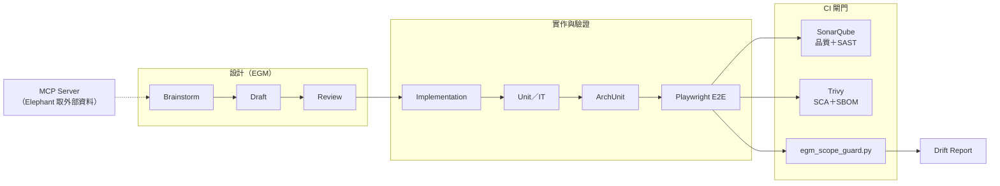

| 工具 | 在 EGM 流程中的接點 |
|---|---|
| MCP Server | Elephant 在 Brainstorm／Draft 時查 Jira、Confluence、資料庫結構；**reviewer 不用 MCP**（Claude adapter 工具只有 Read、Grep、Glob；synthesizer「cannot … use the session's MCP connectors」） |
| Playwright | CUJ → E2E 測試名稱一對一 |
| ArchUnit | Technical Plan 的分層 → 測試規則（6.6） |
| SonarQube | 實作 PR 的品質門檻 |
| Trivy | 映像檔與相依套件掃描、產生 SBOM |

**實務注意**：Goldfish 看不到 MCP 取得的資料。Elephant 透過 MCP 查到的重要事實（例如現有資料表欄位），要寫進設計文件或存成 repo 檔案，Goldfish 才能驗證。

### 9.10 EGM 是否可以作為企業 AI Coding 標準流程？

可以作為**設計與審查**的標準流程，但不是完整的 SDLC 標準。原因：

| 可以 | 不足之處 | 補位 |
|---|---|---|
| 設計文件格式標準化 | 不管實作 | 公司實作規範＋Superpowers 等 |
| 獨立審查機制 | 不審程式碼 | SonarQube、Code Review |
| 文件與程式一致性 | Drift Report 靠 AI 判斷，非確定性 | ArchUnit、契約測試 |
| 多 Host 可用 | 雲端 Host 驗證不完整 | 限定核准 Host |
| 開源、可客製 | pre-1.0、非 Google 官方支援 | 內部鏡像與版本凍結 |

### 9.11 企業工具組合建議

| 組合 | 適用 | 內容 |
|---|---|---|
| 精簡組合 | 中小型專案、PoC | Claude Code＋EGM＋JUnit／ArchUnit＋公司 CI |
| 標準組合 | 一般企業專案 | Claude Code（或 Codex）＋EGM＋公司 standard＋egm 閘門工具＋Playwright＋SonarQube＋Trivy |
| 既有 SDD 團隊 | 已用 Spec Kit／OpenSpec | 原工具產規格＋EGM review loop 審查＋原工具實作 |
| 大型多角色團隊 | 已用 BMAD | BMAD 角色與 Story＋EGM 審查架構與 Story |

**本章注意事項**：

- 不要同時導入三套 SDD 工具。先選一套產生規格，EGM 負責審查。
- 其他工具的指令以各自手冊與官方文件為準，本章不列。

### 9.12 本章 AI 產出審查

| 檢查點 | 好例 | 壞例 | 怎麼抓 |
|---|---|---|---|
| Gemini CLI | 「EGM 沒有 adapter」 | 「EGM 支援 Gemini CLI（.gemini 目錄）」 | 讀 `.gemini/config.yaml` |
| Copilot | 「實驗性，隔離未驗證」 | 「EGM 支援 Copilot」 | 讀 `docs/copilot.md` 第一段 |
| 取代關係 | 「互補，分工如下」 | 「EGM 可取代 Spec Kit」 | 看是否區分「規格產生」與「獨立審查」 |
| reviewer 與 MCP | reviewer 無 MCP | 「Goldfish 會自動查 Confluence」 | 讀 adapter 的 `tools` 欄位 |

## 第 10 章：企業級 AI Agent 開發治理

本章是公司內部規範。除了引用官方的部分，**全部屬於「建議」**，各單位可依風險等級調整。

```mermaid
flowchart TD
    R["需求登錄"] --> C{"10.4 是否需走 EGM？"}
    C -->|"否"| N["一般開發流程"]
    C -->|"是"| D["設計階段<br/>Elephant＋Goldfish"]
    D --> G1{"Gate 1：報告閘門<br/>egm_report_gate.py"}
    G1 -->|"失敗"| D
    G1 --> H1{"Gate 2：Human Approval<br/>Architect＋資安"}
    H1 -->|"退回"| D
    H1 --> I["實作階段<br/>新 session、最小權限"]
    I --> G2{"Gate 3：CI<br/>scope guard、測試、SAST、SCA"}
    G2 -->|"失敗"| I
    G2 --> H2{"Gate 4：Code Review<br/>人類簽核"}
    H2 --> REL["發布＋SBOM＋稽核封存"]
    REL --> M["維運<br/>每週 Drift Report"]
    M -->|"漂移"| D
```

### 10.1 AI Agent 角色定義

| 角色 | 實體 | 權限 | 禁止 |
|---|---|---|---|
| Elephant | 主 session（設計階段） | 讀 repo；寫設計文件與報告 | 寫正式程式碼、改相依套件 |
| Goldfish | EGM reviewer subagent | 唯讀 | 修改任何檔案、執行 shell、使用 MCP |
| Synthesizer | `egm-synthesizer` | 啟動 reviewer、寫報告 | shell、MCP |
| Implementer | 實作 session（新開） | 寫 File Boundary 內的檔案、跑測試 | 越界修改、推送到受保護分支 |
| Bootstrap Worker | `egm-bootstrap-orchestrator` | 本機探索、寫 README | 改原始碼、git commit |

**實務注意**：同一位工程師可以操作多個角色，但**同一個 session** 不可以同時是 Elephant 與 Implementer。

### 10.2 Elephant 與 Goldfish 權責

| 項目 | Elephant | Goldfish | 人類 |
|---|---|---|---|
| 提出設計選項 | ✔ | | |
| 選擇設計方案 | | | ✔ |
| 指出缺漏與風險 | ✔（自我檢查） | ✔（獨立審查） | ✔ |
| 決定 finding 是否處理 | 建議 | | ✔ |
| 修改設計文件 | ✔（經核准） | | ✔ |
| 對結果負責 | | | ✔ |

### 10.3 PM / SA / SD / PG / QA 分工

| 階段 | PM | SA | SD／Architect | PG | QA | 資安 |
|---|---|---|---|---|---|---|
| Brainstorm | 確認範圍與優先 | 主導需求回答 | 主導技術回答 | 選擇性參與 | 提出可測性問題 | 高風險時參與 |
| Draft | — | 審 Goals、CUJ | 主導 | 審實作計畫 | 審 Verification Plan | 審安全章節 |
| Review／Resolve | — | 審 Stage 6 paraphrase | 主導 | 審 Stage 9 | — | ESCALATE 簽核 |
| Human Review | 範圍核准 | 需求核准 | 架構核准 | — | 可測性核准 | 安全核准 |
| Implementation | 進度 | — | 處理設計問題 | 主導 | 準備測試 | — |
| 驗證 | 驗收 | 業務驗證 | Drift 處理 | 修正 | 主導 | 掃描結果核准 |

### 10.4 Design Document 審查規範

**何時必須走 EGM**（建議）：

| 條件（任一成立） | 必須 |
|---|---|
| 新增或變更對外 API、資料表、訊息格式 | 完整流程 |
| 影響 3 個以上模組，或預估 > 300 行正式程式碼 | 完整流程 |
| 涉及個資、金流、權限、加密 | 完整流程＋資安 reviewer |
| Framework／Runtime 主版本升級 | 完整流程＋migration standard |
| 修 bug、文字、設定值微調 | 不需要 |

參考：EGM 自己的 `AI_POLICY.md` 對貢獻者的門檻是「`> 100` non-test lines or `>= 3` core files」需先走設計文件。

設計文件規範：

1. 使用官方模板，H2 標題保留英文（4.6）。
2. 公司追加 `## Security & Compliance`、`## Operations & Rollback`，放在 `## Detailed Implementation Plan` 之前。
3. Status 依序：Draft → Proposed（選用）→ In Review → Approved，與 EGM 模板及 `egm_design_lint.py` D5 一致。
4. 合併前通過 `egm_design_lint.py --require "Security & Compliance"`。

**設計文件的生命週期與 PR 分工（1.1 定案）**：

1.0 版有矛盾：好幾處要求「實作後更新設計文件 Status 與 SITEMAP」，但 10.9 的 CI 規定實作 PR 改到設計文件就算越界。1.1 定案如下，並在 CI 模擬中實測（10.9）：

| 時點 | 誰改 | 改什麼 | 在哪個 PR | CI 檢查 |
|---|---|---|---|---|
| 審查中 | SD | 設計內容；Status: In Review | `design/<feature>` | lint、報告閘門、只能改 `docs/` |
| 設計 PR 合併前 | SD（Architect 核准後） | Status 改為 **Approved** | 同一個 `design/<feature>` PR | Status 不是 Approved 就失敗 |
| 實作 | PG | 只改 File Boundary 內的檔案 | `feat/<feature>-p<N>` | scope guard；改設計文件或 SITEMAP 都算越界 |
| 上線後 | SD | `SITEMAP.md`（Status 維持 Approved） | 再開一個 `design/<feature>` 的 docs-only PR | 同設計 PR |
| 實作中發現設計要改 | SD | 設計內容（重新審查） | `design/<feature>` PR，合併後實作 PR rebase | 同設計 PR |

### 10.5 Goldfish Review 通過標準

| 條件 | 判定 |
|---|---|
| 所有 stage 的 Reviewer Status 都是 completed（沒有表時，consolidated 開頭寫明每個 reviewer 已完成） | 必要 |
| 🔴 Blocker 全部 PROPOSE FIX 已套用，或有證據的 CONTEST | 必要 |
| 🟡 Major 全部有決定（修正、CONTEST、或記錄為接受風險） | 必要 |
| ESCALATE 項目都有人類簽核 | 必要 |
| `goldfish_review_report.md` 標示 `Status: resolved` | 必要 |
| Stage 6 paraphrase 經 SA 確認與原意一致 | 必要（人工） |
| 🟢 Nit | 不影響 |

報告閘門的 R1 對應第 1 項、R4 對應第 4 項、R2 對應第 5 項，R3 另外擋下「Major／Blocker 被 DECLINE」。第 2、3 項（修正是否真的套用、每個 Major 是否有決定）與第 6 項由人工確認，閘門不會檢查。1.1 版新增兩條規則，都是對真實報告實測後才發現需要的（10.5.1）：

| 規則 | 擋下什麼 | 為什麼需要 |
|---|---|---|
| R0 | 檔案中有 🔴／🟡／Blocker 等標記，卻一個 finding 都解析不到 | 1.0 版遇到不認得的格式時會回報「0 個問題、GATE PASS」 |
| R5 | stage 報告有 Blocker，卻沒有一起提供 `goldfish_review_report.md` | 只封存 stage 報告、跳過 Resolve，也能通過 |

R1 也改成「Reviewer Status 表中**不是** completed 就失敗」（1.0 只認得字面上的 `not run`，`incomplete review` 會通過）；R4 改成簽核行必須**同時**寫出報告檔名與 Issue 編號，避免 A 報告的 `[Issue 2]` 簽核被拿來放行 B 報告的 `[Issue 2]`。簽核檔不存在時，只有在真的有 ESCALATE 項目時才會失敗。

📄 `tools/egm_report_gate.py`（建議，公司自建工具）

```python
#!/usr/bin/env python3
"""egm_report_gate.py - enterprise gate over EGM review artifacts.

This is a company rule set built on EGM's report formats. EGM itself has no
gate script. Three finding layouts are recognized:
  * inline:    "### Title - Severity: Blocker"   (agents/synthesizer.md,
                                                  skills/egm-resolve/SKILL.md)
  * sectioned: "## 🔴 Blockers" then "### CR-1: Title" items
  * table:     "### 🔴 Blockers" then "| A1 | action | lines |" rows
  * bullets:   "## 🟡 Majors" then "*   **IR-8** text" items
  * emoji:     "### ZO-1 🔴 Blocker: Title"
In Claude Code the review runs by direct dispatch (subagents cannot nest), so
the Elephant writes the stage reports itself and the layout is not fixed.

Rules (exit 1 when any FAIL is printed):
  R0 the report has severity markers but no finding could be parsed
     (unknown layout: fail instead of passing with zero findings)
  R1 every row of a "Reviewer Status" table must say completed
     ("not run", "incomplete", "failed", ... all mean the lens was not reviewed)
  R2 an annotated report (goldfish_review_report.md) must start with Status: resolved
  R3 DECLINE is only for Nits; a Blocker or Major marked DECLINE fails
  R4 every ESCALATE item needs a human sign-off line in --signoff FILE that
     names both the report file and the issue key, e.g.
     "- goldfish_review_report.md [Issue 3] ... 簽核：..."
     (a missing sign-off file only fails when there is an ESCALATE item)
  R5 a stage report with Blockers needs an annotated report in the same run

Usage:
  python egm_report_gate.py REPORT.md [REPORT.md ...] [--signoff review_signoff.md]
"""
import argparse
import re
import sys
from pathlib import Path

ISSUE = re.compile(r"^#{2,5}\s+(.+?)\s+-\s+Severity:\s*\[?(Blocker|Major|Nit)\]?", re.I)
SECTION = re.compile(r"^(#{2,4})\s+(?:🔴|🟡|🟢)?\s*(Blocker|Major|Nit)s?\b(?!.*Severity:)", re.I)
HEADING = re.compile(r"^(#{1,6})\s+(.+)$")
EMOJI_ISSUE = re.compile(r"^#{2,5}\s+(.*?)(?:🔴|🟡|🟢)\s*(Blocker|Major|Nit)\b:?\s*(.*)$", re.I)
ROW = re.compile(r"^\|\s*`?([A-Z][A-Z0-9]*-?\d+)`?\s*\|\s*(.+?)\s*\|")
BULLET = re.compile(r"^\s*[*-]\s+\*\*([A-Z][A-Z0-9]*-?\d+)\*\*\s*(.*)$")
SUGGESTION = re.compile(r"AI Suggestion:\**\s*\[?(CONTEST|ESCALATE|PROPOSE FIX|DECLINE)\]?", re.I)
STATUS_ROW = re.compile(r"^\|\s*`?([\w:-]+)`?\s*\|\s*([^|]+?)\s*\|")
RESOLVED = re.compile(r"^\**Status:?\**:?\s*resolved", re.I)
MARKER = re.compile(r"🔴|🟡|Severity:|\bBlockers?\b", re.I)
EXPLICIT_NONE = re.compile(r"^\W*(none|no findings|無)\W*$", re.I)


def parse_issues(lines):
    issues = []
    current = None
    section = None  # (level, severity) from a "## 🔴 Blockers" style heading
    for line in lines:
        m = ISSUE.match(line)
        if m:
            current = {"title": m.group(1).strip(), "severity": m.group(2).capitalize(),
                       "suggestion": None}
            issues.append(current)
            continue
        e = EMOJI_ISSUE.match(line)
        if e:
            current = {"title": (e.group(1) + e.group(3)).strip(), "severity": e.group(2).capitalize(),
                       "suggestion": None}
            issues.append(current)
            continue
        s = SECTION.match(line)
        if s:
            section = (len(s.group(1)), s.group(2).capitalize())
            current = None
            continue
        h = HEADING.match(line)
        if h:
            level = len(h.group(1))
            if section and level > section[0]:
                current = {"title": h.group(2).strip(), "severity": section[1], "suggestion": None}
                issues.append(current)
            else:
                section = None
                current = None
            continue
        r = ROW.match(line.strip()) or BULLET.match(line)
        if r and section:
            issues.append({"title": f"{r.group(1)}: {r.group(2)[:60]}", "severity": section[1],
                           "suggestion": None})
            continue
        g = SUGGESTION.search(line)
        if g and current is not None and current["suggestion"] is None:
            current["suggestion"] = g.group(1).upper()
    return issues


def check(path, signoff_text):
    fails = []
    lines = path.read_text(encoding="utf-8").splitlines()
    in_status = False
    for line in lines:
        if line.startswith("#"):
            in_status = "Reviewer Status" in line
            continue
        m = STATUS_ROW.match(line.strip()) if in_status else None
        if m and m.group(1).lower() != "reviewer" and not set(m.group(2)) <= set("-: "):
            if m.group(2).strip("` ").lower() != "completed":
                fails.append(f"R1 reviewer {m.group(2).strip()}: {m.group(1)}")
    issues = parse_issues(lines)
    if not issues and any(MARKER.search(ln) for ln in lines) \
            and not any(EXPLICIT_NONE.match(ln) for ln in lines):
        fails.append("R0 severity markers found but no finding parsed (unknown report layout)")
    annotated = any("Goldfish Annotated Review Report" in ln for ln in lines[:10])
    if annotated:
        head = [ln.strip() for ln in lines[:6]]
        if not any(RESOLVED.match(ln) for ln in head):
            fails.append("R2 annotated report is not marked 'Status: resolved'")
        for it in issues:
            if it["suggestion"] == "DECLINE" and it["severity"] in ("Blocker", "Major"):
                fails.append(f"R3 {it['severity']} declined: {it['title']}")
            if it["suggestion"] == "ESCALATE":
                key = re.match(r"(\[Issue \d+\])", it["title"])
                needle = key.group(1) if key else it["title"]
                signed = any(needle in ln and path.name in ln for ln in signoff_text.splitlines())
                if not signed:
                    fails.append(f"R4 ESCALATE without human sign-off: {it['title']}")
    counts = {k: sum(1 for i in issues if i["severity"] == k) for k in ("Blocker", "Major", "Nit")}
    return counts, fails, annotated


def main(argv=None):
    ap = argparse.ArgumentParser()
    ap.add_argument("reports", nargs="+")
    ap.add_argument("--signoff", help="file with human decisions for ESCALATE items")
    args = ap.parse_args(argv)
    signoff_text = ""
    if args.signoff and Path(args.signoff).is_file():
        signoff_text = Path(args.signoff).read_text(encoding="utf-8")
    total_fail = 0
    stage_blockers = []
    any_annotated = False
    for r in args.reports:
        p = Path(r)
        if not p.is_file():
            print(f"FAIL {r}: file not found")
            total_fail += 1
            continue
        if args.signoff and p.resolve() == Path(args.signoff).resolve():
            continue  # the sign-off file is not a review report
        counts, fails, annotated = check(p, signoff_text)
        any_annotated = any_annotated or annotated
        if not annotated and counts["Blocker"]:
            stage_blockers.append(p.name)
        print(f"{p.name}: blocker={counts['Blocker']} major={counts['Major']} nit={counts['Nit']}")
        for f in fails:
            print(f"FAIL {p.name}: {f}")
        total_fail += len(fails)
    if stage_blockers and not any_annotated:
        print("FAIL R5 Blockers in " + ", ".join(stage_blockers)
              + " but no Goldfish Annotated Review Report was given")
        total_fail += 1
    print("GATE PASS" if total_fail == 0 else f"GATE FAIL ({total_fail})")
    return 0 if total_fail == 0 else 1


if __name__ == "__main__":
    sys.exit(main())
```

簽核檔範例（每行：報告檔名＋Issue 編號＋決定＋簽核人與日期）：

📄 `fixtures/reports/review_signoff.md`

```markdown
# Review sign-off

- goldfish_review_report_good.md [Issue 2] 金鑰輪替：依銀行金鑰政策 KMS-07，資料金鑰每 90 天由 KMS 自動輪替，本設計不另行處理。簽核：資安科 陳美華 2026-11-18（EGM v0.1.1、Claude Code 2.1.325）
```

實測輸出（Shell）：

```text
$ python tools/egm_report_gate.py fixtures/reports/critic_report.md
critic_report.md: blocker=1 major=0 nit=1
FAIL critic_report.md: R1 reviewer not run: egm-structural
FAIL R5 Blockers in critic_report.md but no Goldfish Annotated Review Report was given
GATE FAIL (2)
(exit=1)

$ python tools/egm_report_gate.py fixtures/reports/goldfish_review_report_good.md
goldfish_review_report_good.md: blocker=1 major=1 nit=1
FAIL goldfish_review_report_good.md: R4 ESCALATE without human sign-off: [Issue 2] [`egm-design`]
GATE FAIL (1)
(exit=1)

$ python tools/egm_report_gate.py fixtures/reports/goldfish_review_report_good.md --signoff fixtures/reports/review_signoff.md
goldfish_review_report_good.md: blocker=1 major=1 nit=1
GATE PASS
(exit=0)

$ python tools/egm_report_gate.py fixtures/reports/goldfish_review_report_bad.md --signoff fixtures/reports/review_signoff.md
goldfish_review_report_bad.md: blocker=1 major=2 nit=0
FAIL goldfish_review_report_bad.md: R2 annotated report is not marked 'Status: resolved'
FAIL goldfish_review_report_bad.md: R4 ESCALATE without human sign-off: [Issue 2] [`egm-design`]
FAIL goldfish_review_report_bad.md: R3 Major declined: [Issue 3] [`egm-style`]
GATE FAIL (3)
(exit=1)
```

第一個例子同時觸發 R1 與 R5：`critic_report.md` 有一個 reviewer `not run`，而且有 Blocker 卻沒有 annotated report。測試 fixture 見附錄 B。

#### 10.5.1 對真實報告實測閘門（1.1）

1.0 版的閘門只用自己寫的 fixture 測試過。1.1 拿第 5.3.5 節實跑產生的 6 份報告與 Resolve 報告去跑，結果如下：

```text
# 1.0 版閘門
comprehension_report.md: blocker=0 major=0 nit=0
consolidated_review_report.md: blocker=0 major=0 nit=0
critic_report.md: blocker=0 major=0 nit=0
implementation_readiness_report.md: blocker=0 major=0 nit=0
intermediate_zoom_out_report.md: blocker=0 major=0 nit=0
zoom_out_report.md: blocker=0 major=0 nit=0
GATE PASS
(exit=0)

# 1.1 版閘門
comprehension_report.md: blocker=1 major=4 nit=4
consolidated_review_report.md: blocker=7 major=12 nit=6
critic_report.md: blocker=1 major=11 nit=6
implementation_readiness_report.md: blocker=7 major=7 nit=6
intermediate_zoom_out_report.md: blocker=1 major=5 nit=4
zoom_out_report.md: blocker=1 major=6 nit=4
FAIL R5 Blockers in comprehension_report.md, consolidated_review_report.md, critic_report.md, implementation_readiness_report.md, intermediate_zoom_out_report.md, zoom_out_report.md but no Goldfish Annotated Review Report was given
GATE FAIL (1)
(exit=1)

# 1.1 版閘門＋Resolve 後的 goldfish_review_report.md（尚未 resolved、尚未簽核）
comprehension_report.md: blocker=1 major=4 nit=4
consolidated_review_report.md: blocker=7 major=12 nit=6
critic_report.md: blocker=1 major=11 nit=6
implementation_readiness_report.md: blocker=7 major=7 nit=6
intermediate_zoom_out_report.md: blocker=1 major=5 nit=4
zoom_out_report.md: blocker=1 major=6 nit=4
goldfish_review_report.md: blocker=8 major=18 nit=0
FAIL goldfish_review_report.md: R2 annotated report is not marked 'Status: resolved'
FAIL goldfish_review_report.md: R4 ESCALATE without human sign-off: [Issue 3] [`egm-codebase-details`]
FAIL goldfish_review_report.md: R4 ESCALATE without human sign-off: [Issue 8] [`egm-codebase-details`, `egm-implementation-readiness`]
FAIL goldfish_review_report.md: R4 ESCALATE without human sign-off: [Issue 16] [`egm-design`, `egm-structural`]
FAIL goldfish_review_report.md: R4 ESCALATE without human sign-off: [Issue 19] [`egm-style`]
FAIL goldfish_review_report.md: R4 ESCALATE without human sign-off: [Issue 23] [`egm-implementation-readiness`]
GATE FAIL (6)
(exit=1)
```

1.0 版對一份有 11 個 Blocker 的審查結果回報 **0 個問題、GATE PASS**。原因是 Claude Code 這次走 direct dispatch（2.10.1），報告由 Elephant 撰寫，同一次執行就出現 4 種嚴重度寫法，沒有一種是 1.0 認得的 `### 標題 - Severity: X`：

| 寫法 | 出現在 | 範例（逐字節錄） |
|---|---|---|
| 標題內含 emoji 嚴重度 | `zoom_out_report.md`、`comprehension_report.md`、`intermediate_zoom_out_report.md` | `### ZO-1 🔴 Blocker: The plan builds only part of what the Goals promise` |
| 嚴重度章節＋`###` 項目 | `critic_report.md`、`implementation_readiness_report.md`（Blocker 段） | `## 🔴 Blockers` 之後接 `### CR-1: No Risks & Mitigations section` |
| 嚴重度章節＋粗體 ID 清單 | `implementation_readiness_report.md`（Major、Nit 段） | `## 🟡 Majors` 之後接 `*   **IR-8** (readiness-M7, codebase-M1): No phases.` |
| 嚴重度章節＋表格 | `consolidated_review_report.md` | `### 🔴 Blockers` 之後接 `\| A1 \| Choose the phase scope (Decision 1). ... \|` |

1.1 版的解析結果與 `consolidated_review_report.md` 自己的統計表（5.3.5）**逐 stage 完全一致**，這就是驗證 parser 的「正確答案」。附錄 B 的 `fixtures/reports/layouts/` 是從這次實跑逐行節錄的 4 種寫法，加上 1 份 R0 反例與 1 份 `incomplete review` 反例：

```text
$ python tools/egm_report_gate.py fixtures/reports/layouts/layout_emoji.md
layout_emoji.md: blocker=1 major=1 nit=1
FAIL R5 Blockers in layout_emoji.md but no Goldfish Annotated Review Report was given
GATE FAIL (1)
(exit=1)

$ python tools/egm_report_gate.py fixtures/reports/layouts/layout_sectioned.md
layout_sectioned.md: blocker=1 major=1 nit=1
FAIL R5 Blockers in layout_sectioned.md but no Goldfish Annotated Review Report was given
GATE FAIL (1)
(exit=1)

$ python tools/egm_report_gate.py fixtures/reports/layouts/layout_bullets.md
layout_bullets.md: blocker=1 major=2 nit=1
FAIL R5 Blockers in layout_bullets.md but no Goldfish Annotated Review Report was given
GATE FAIL (1)
(exit=1)

$ python tools/egm_report_gate.py fixtures/reports/layouts/layout_table.md
layout_table.md: blocker=1 major=1 nit=0
FAIL R5 Blockers in layout_table.md but no Goldfish Annotated Review Report was given
GATE FAIL (1)
(exit=1)

$ python tools/egm_report_gate.py fixtures/reports/layouts/layout_unknown.md
layout_unknown.md: blocker=0 major=0 nit=0
FAIL layout_unknown.md: R0 severity markers found but no finding parsed (unknown report layout)
GATE FAIL (1)
(exit=1)

$ python tools/egm_report_gate.py fixtures/reports/layouts/status_incomplete.md
status_incomplete.md: blocker=0 major=0 nit=1
FAIL status_incomplete.md: R1 reviewer incomplete review: egm-structural
GATE FAIL (1)
(exit=1)

$ python tools/egm_report_gate.py fixtures/reports/layouts/layout_sectioned.md fixtures/reports/goldfish_review_report_good.md --signoff fixtures/reports/review_signoff.md
layout_sectioned.md: blocker=1 major=1 nit=1
goldfish_review_report_good.md: blocker=1 major=1 nit=1
GATE PASS
(exit=0)
```

**實務注意**：

- 報告格式是 EGM pre-1.0 的輸出，官方說 1.0 才會穩定「report formats」；而且只要走 direct dispatch，格式就由 LLM 決定。**閘門以 `goldfish_review_report.md` 為主**（格式寫死在 `egm-resolve` 模板中，實測完全一致），stage 報告只用來計數，並靠 R0／R5 防止漏網。
- 每次升級 EGM 或 Claude Code，都要用真實執行的報告重跑閘門（第 11.10 節 L4），不能只跑 fixture。
- 這也是一般原則：**「沒有發現問題」的檢查工具，要先證明它解析得到問題。**

### 10.6 Human Approval Gate

| Gate | 時點 | 核准者 | 證據 |
|---|---|---|---|
| G-Design | 設計 PR 合併前 | Architect＋Tech Lead（必要）；資安（涉及個資或權限時） | PR approve 紀錄、`review_signoff.md` |
| G-Code | 實作 PR 合併前 | Code Reviewer（非作者） | PR approve 紀錄 |
| G-Release | 上線前 | 變更管理委員會（依公司既有流程） | 測試報告、SBOM、掃描結果 |

在 GitHub 以 CODEOWNERS 強制（範例）：

```text
# .github/CODEOWNERS
/docs/designs/            @acme/architects
/docs/designs/reviews/    @acme/architects @acme/appsec
/docs/standards/          @acme/architects @acme/appsec
```

**實務注意**：EGM 自己的 repo 也用 CODEOWNERS 把審查導向 `@google/egm-maintainers`（commit `7bd119c`），這是 Plugin 作者自身採用的做法。

### 10.7 AI Coding 權限管制

| 階段 | 建議的 Claude Code 權限 |
|---|---|
| 設計 | 只允許寫 `docs/`、`.dev/docs/`；拒絕 `Bash(git push:*)` |
| 審查 | reviewer 由 adapter 限制唯讀；headless 時只開 EGM 四個目錄的讀取（3.15.1） |
| 實作 | 允許編輯 repo；拒絕讀 `.env`、`secrets/`；拒絕 `git push --force` |

**實務注意**：Claude Code 對 plugin subagent 會忽略 `hooks` 與 `permissionMode`（官方，`docs/claude.md`），synthesizer「只寫報告」是指示而非強制。權限要在 session 層設定。

### 10.8 Git Branch / Pull Request 管理

| 分支 | 用途 | 內容 |
|---|---|---|
| `design/<feature>` | 設計 PR | `docs/designs/<feature>.md`、`docs/designs/reviews/<feature>/`（只能改 `docs/`） |
| `feat/<feature>-p<N>` | 第 N 個 Phase 的實作 PR（沒有分 Phase 的設計用 `-p1`） | 該 Phase File Boundary 內的檔案 |
| `main` | 受保護 | 需通過 egm-gate 與人工核准 |

PR 標題慣例：`design: customer-contact`、`feat(customer-contact): phase 1`。官方 FAQ 對大 PR 的回答：「No. … The answer is the same as when you built things without AI.」

### 10.9 程式碼修改範圍管理

官方：Phase 1～4 只寫規格與報告，「This is a convention, and nothing enforces it.」；Stage 9 通過後，「the plan's `Target Scope & File Boundary` list is the set of files Phase 5 implementation may write」。公司以 CI 強制：

📄 `tools/egm_scope_guard.py`（建議，公司自建工具）

````python
#!/usr/bin/env python3
"""egm_scope_guard.py - compare changed files with the design's file boundary.

EGM convention (docs/designs/architecture.md, Phase 5): once Stage 9 passes,
the plan's "Target Scope & File Boundary" list is the set of files that
implementation may write. EGM does not enforce this. This script does.

Allowed files are read from the design document:
  * headings like:  #### 1. `src/a/B.java` (Create)
  * bullets under a heading named "Target Scope & File Boundary":  - `path`
Globs (fnmatch) are allowed, e.g. `build/generated/**`.

Usage:
  python egm_scope_guard.py DESIGN.md --base origin/main [--allow PATTERN ...]
  python egm_scope_guard.py DESIGN.md --changed-file changed.txt
  python egm_scope_guard.py DESIGN.md --phase 2 --base origin/main   # only 'Phase 2' files

Exit codes: 0 = in scope, 1 = out-of-scope files found, 2 = usage / parse error.
"""
import argparse
import fnmatch
import re
import subprocess
import sys
from pathlib import Path

HEADING = re.compile(r"^#{3,5}\s+\d+\.\s+`([^`]+)`\s*\((Create|Modify|Delete)\)", re.I)
BOUNDARY = re.compile(r"^#{2,5}\s+Target Scope\s*&\s*File Boundary", re.I)
BULLET = re.compile(r"^\s*[-*]\s+`([^`]+)`")


PHASE = re.compile(r"^#{2,4}\s+Phase\s+(\d+)", re.I)


def parse_allowlist(text, phase=None):
    # A design without any "Phase N" heading is a single phase: --phase 1 means the whole list.
    if phase == "1" and not any(PHASE.match(ln) for ln in text.splitlines()):
        phase = None
    allowed = {}
    in_boundary = False
    in_fence = False
    current = None
    for line in text.splitlines():
        if line.lstrip().startswith("```"):
            in_fence = not in_fence
            continue
        if in_fence:
            continue
        pm = PHASE.match(line)
        if pm:
            current = pm.group(1)
            continue
        if phase is not None and current != phase:
            continue
        m = HEADING.match(line)
        if m:
            allowed[m.group(1).strip()] = m.group(2).capitalize()
            continue
        if BOUNDARY.match(line):
            in_boundary = True
            continue
        if in_boundary and re.match(r"^#{1,5}\s", line):
            in_boundary = False
        if in_boundary:
            b = BULLET.match(line)
            if b:
                allowed.setdefault(b.group(1).strip(), "Listed")
    return allowed


def changed_from_git(base):
    out = subprocess.run(
        ["git", "diff", "--name-only", f"{base}...HEAD"],
        capture_output=True, text=True, check=False,
    )
    if out.returncode != 0:
        sys.stderr.write(out.stderr)
        sys.exit(2)
    return [p.strip() for p in out.stdout.splitlines() if p.strip()]


def matches(path, patterns):
    return any(path == p or fnmatch.fnmatch(path, p) for p in patterns)


def main(argv=None):
    ap = argparse.ArgumentParser()
    ap.add_argument("design")
    src = ap.add_mutually_exclusive_group(required=True)
    src.add_argument("--base", help="git base ref, e.g. origin/main")
    src.add_argument("--changed-file", help="text file with one changed path per line")
    ap.add_argument("--phase", help="only use files listed under the heading 'Phase N'")
    ap.add_argument("--allow", action="append", default=[],
                    help="extra allowed pattern (e.g. docs/designs/*.md)")
    args = ap.parse_args(argv)

    design = Path(args.design)
    if not design.is_file():
        print(f"ERROR design not found: {design}")
        return 2
    allowed = parse_allowlist(design.read_text(encoding="utf-8"), args.phase)
    if not allowed:
        where = f" for Phase {args.phase}" if args.phase else ""
        print(f"ERROR no file boundary found in design{where} (Detailed Implementation Plan headings)")
        return 2

    if args.base:
        changed = changed_from_git(args.base)
    else:
        changed = [p.strip().replace("\\", "/") for p in
                   Path(args.changed_file).read_text(encoding="utf-8").splitlines() if p.strip()]

    patterns = list(allowed) + args.allow
    outside = [p for p in changed if not matches(p, patterns)]
    untouched = [p for p, kind in allowed.items()
                 if not any(ch == p or fnmatch.fnmatch(ch, p) for ch in changed)]

    print(f"allowlist={len(allowed)} changed={len(changed)} outside={len(outside)}")
    for p in outside:
        print(f"OUT-OF-SCOPE {p}")
    for p in untouched:
        print(f"NOT-YET-TOUCHED {p} ({allowed[p]})")
    return 1 if outside else 0


if __name__ == "__main__":
    sys.exit(main())
````

實測（越界情境）：

```text
$ python tools/egm_scope_guard.py fixtures/design_good.md --changed-file fixtures/changed_drift.txt
allowlist=8 changed=4 outside=2
OUT-OF-SCOPE customer-app/src/main/java/com/acme/crm/customer/app/util/StringUtils2.java
OUT-OF-SCOPE pom.xml
NOT-YET-TOUCHED customer-infra/src/main/resources/db/migration/V12__contact.sql (Create)
NOT-YET-TOUCHED customer-app/src/main/java/com/acme/crm/customer/app/AddContactService.java (Create)
NOT-YET-TOUCHED customer-api/src/main/java/com/acme/crm/customer/api/ContactController.java (Create)
NOT-YET-TOUCHED docs/api/customer-contact.openapi.yaml (Create)
NOT-YET-TOUCHED customer-domain/src/test/java/com/acme/crm/customer/domain/CustomerContactTest.java (Create)
NOT-YET-TOUCHED customer-infra/src/test/java/com/acme/crm/customer/infra/ContactConcurrencyIT.java (Create)
```

分 Phase 的設計用 `--phase N` 只取 `### Phase N` 底下的檔案；沒有任何 Phase 標題的設計，`--phase 1` 代表整份清單，其他編號視為錯誤（rc=2）。

CI 的兩個設計決定（避免實作 PR 自己放寬限制）：

1. 設計文件路徑由**分支名稱**推導（`design/<feature>`、`feat/<feature>-p<N>`），不需要額外的設定檔，多個功能並行也不會互相覆蓋。
2. 實作 PR 的檔案清單從 **base 分支**（已核准、已合併的設計文件）讀取；實作 PR 若修改設計文件本身，會被視為越界。

CI workflow（建議）：

📄 `project/.github/workflows/egm-gate.yml`

```yaml
# Company EGM gate (not part of EGM). Runs on every pull request.
# Branch convention (handbook 10.8):
#   design/<feature>      -> design PR: only files under docs/ may change;
#                            the design must say "**Status:** Approved" before merge.
#                            Also used after release for docs-only SITEMAP updates.
#   feat/<feature>-p<N>   -> implementation PR for Phase N of docs/designs/<feature>.md
#                            (must not touch the design document itself)
# Review reports are archived under docs/designs/reviews/<feature>/.
name: egm-gate

on:
  pull_request:
    branches: [main]

permissions:
  contents: read

jobs:
  gate:
    runs-on: ubuntu-latest
    timeout-minutes: 10
    steps:
      - uses: actions/checkout@v4
        with:
          fetch-depth: 0
          persist-credentials: false

      - uses: actions/setup-python@v5
        with:
          python-version: "3.12"

      - name: Resolve design from branch name
        id: design
        env:
          HEAD_REF: ${{ github.head_ref }}
        run: |
          case "$HEAD_REF" in
            design/*) mode=design; feature="${HEAD_REF#design/}"; phase="" ;;
            feat/*-p[0-9]*) mode=impl; rest="${HEAD_REF#feat/}"; feature="${rest%-p*}"; phase="${rest##*-p}" ;;
            *) mode=skip; feature=""; phase="" ;;
          esac
          { echo "mode=$mode"; echo "feature=$feature"; echo "phase=$phase"; } >> "$GITHUB_OUTPUT"

      - name: Design PR gate
        if: steps.design.outputs.mode == 'design'
        env:
          FEATURE: ${{ steps.design.outputs.feature }}
          BASE: origin/${{ github.base_ref }}
        run: |
          python tools/egm_design_lint.py "docs/designs/$FEATURE.md" --require "Security & Compliance"
          grep -Eq '^\*   \*\*Status:\*\* Approved$' "docs/designs/$FEATURE.md" \
            || { echo "design PR must set Status: Approved before merge"; exit 1; }
          dir="docs/designs/reviews/$FEATURE"
          python tools/egm_report_gate.py "$dir"/*.md --signoff "$dir/review_signoff.md"
          outside="$(git diff --name-only "$BASE...HEAD" | grep -v '^docs/' || true)"
          if [ -n "$outside" ]; then echo "design PR changes non-doc files:"; echo "$outside"; exit 1; fi

      - name: Implementation PR scope guard (design read from the base branch)
        if: steps.design.outputs.mode == 'impl'
        env:
          FEATURE: ${{ steps.design.outputs.feature }}
          PHASE: ${{ steps.design.outputs.phase }}
          BASE: origin/${{ github.base_ref }}
        run: |
          git show "$BASE:docs/designs/$FEATURE.md" > "$RUNNER_TEMP/design.md"
          python tools/egm_scope_guard.py "$RUNNER_TEMP/design.md" --phase "$PHASE" --base "$BASE" \
            --allow "docs/designs/reviews/$FEATURE/**"
```

在暫存 git repo 以相同的分支解析與指令模擬（實測，`ci_sim.sh`；1.1 新增 Status 檢查與情境 5、6）：

| 情境 | 分支 | 結果 |
|---|---|---|
| 1a 設計 PR，Status 仍是 In Review | `design/customer-contact` | `design PR must set Status: Approved before merge`，rc=1 |
| 1b 同上，Status 改為 Approved | `design/customer-contact` | LINT PASS、GATE PASS，rc=0 |
| 2 設計 PR 夾帶程式 `src/X.java` | `design/customer-contact` | `design PR changes non-doc files: src/X.java`，rc=1 |
| 3 實作 PR（只改計畫內的 `Contact.java`） | `feat/customer-contact-p1` | `allowlist=8 changed=1 outside=0`，rc=0 |
| 4 實作 PR 在設計文件加一項 `pom.xml` 並修改 `pom.xml` | `feat/customer-contact-p1` | `OUT-OF-SCOPE docs/designs/customer-contact.md`、`OUT-OF-SCOPE pom.xml`，rc=1 |
| 5 實作 PR 順便更新 SITEMAP | `feat/customer-contact-p1` | `OUT-OF-SCOPE docs/designs/SITEMAP.md`，rc=1 |
| 6 上線後另開 docs-only PR 更新 SITEMAP | `design/customer-contact` | LINT PASS、GATE PASS，rc=0 |

完整輸出：

```text
== 1 design PR (docs only)
LINT PASS
design PR must set Status: Approved before merge
rc=1   (Status still In Review)
LINT PASS
GATE PASS
rc=0
== 2 design PR that also changes code
LINT PASS
GATE PASS
design PR changes non-doc files: src/X.java
rc=1
== 3 implementation PR inside the boundary
allowlist=8 changed=1 outside=0
rc=0
== 4 implementation PR that edits the design to widen its own boundary
allowlist=8 changed=3 outside=2
OUT-OF-SCOPE docs/designs/customer-contact.md
OUT-OF-SCOPE pom.xml
rc=1
== 5 implementation PR that also updates SITEMAP (should be a separate docs PR)
allowlist=8 changed=2 outside=1
OUT-OF-SCOPE docs/designs/SITEMAP.md
rc=1
== 6 after release: docs-only PR on design/customer-contact updates SITEMAP
LINT PASS
GATE PASS
rc=0
```

情境 5、6 對應 10.4 的生命週期表：實作 PR 不碰任何設計文件，上線後的 SITEMAP 更新走另一個 docs-only PR。

（🧪：workflow 在 GitHub Actions 上未實跑；以上是在本機 git repo 以相同指令模擬。）

**實務注意**：scope guard 只看檔名，不看改了什麼。在計畫內的檔案裡加了計畫外的功能，要靠 Code Review 與 Drift Report。

### 10.10 AI Agent 存取權限

| 資源 | Elephant | Goldfish | Implementer |
|---|---|---|---|
| 專案原始碼 | 讀 | 讀 | 讀寫（範圍內） |
| 設計文件 | 讀寫 | 讀 | 讀 |
| `.env`、金鑰、憑證 | 拒絕 | 拒絕 | 拒絕 |
| 正式環境資料庫 | 拒絕 | 拒絕 | 拒絕 |
| 測試資料庫 | 透過 MCP 唯讀（核准後） | 無 | 測試用 |
| 外部網路 | 依 Host 設定 | 無 URL 能力（Claude adapter） | 套件倉庫 |

**實務注意**：官方提醒隔離「is context and tool isolation, not filesystem isolation: reviewers can read accessible files」。機密檔案要用 deny 規則或根本不放在工作目錄。

### 10.11 敏感資料保護

1. 設計文件、brief、報告**不得**含真實個資、帳號、交易資料；範例一律去識別化。
2. 逆向工程前先排除樣本資料、匯出檔（`.gitignore`、`.egmignore`、deny 規則）。
3. 官方 `docs/privacy.md`：「Provide only the files needed for the review.」、「Outputs can repeat information from the inputs.」
4. 報告會被 commit 與封存，寫入前檢查（Shell，建議）：

```bash
# 粗略掃描台灣身分證字號與手機號碼格式；有輸出就人工確認
grep -rnE --include='*.md' '[A-Z][12][0-9]{8}|09[0-9]{2}-?[0-9]{3}-?[0-9]{3}' docs/designs .dev/docs
# 不要寫成 docs/designs/**/*.md：bash 預設沒開 globstar，** 只等於一層，會漏掉 reviews/<feature>/
```

**實務注意**：EGM 不傳資料到 Google；資料流完全由 Host 決定（官方）。資料保護的審查對象是「你核准的 Host 與其帳號設定」。

### 10.12 金融業資安要求

| 要求（一般性） | EGM 流程中的落實點 |
|---|---|
| 委外與雲端服務管理 | Host（Claude、OpenAI、Google）需經公司核准與合約 |
| 最小權限 | 10.7、10.10 |
| 變更管理 | 設計 PR、實作 PR、G-Release |
| 稽核軌跡 | 10.16 |
| 個資保護 | 10.11 |
| 弱點管理 | 10.14、10.15 |

具體法規條文（例如主管機關的資安或 AI 指引）請依公司法遵單位最新解釋為準，本手冊不列條文（尚待法遵確認）。

### 10.13 OWASP Top 10

設計階段以 standard 納入（4.16）。OWASP Top 10 2025 與設計文件檢查點：

| 編號 | 類別 | 設計文件要寫 |
|---|---|---|
| A01 | Broken Access Control | 每個端點的權限、預設拒絕 |
| A02 | Security Misconfiguration | 安全相關設定與預設值 |
| A03 | Software Supply Chain Failures | 新相依套件的版本、來源、SCA |
| A04 | Cryptographic Failures | 加密演算法、金鑰來源 |
| A05 | Injection | 參數化查詢、SP 呼叫方式 |
| A06 | Insecure Design | 威脅情境、濫用案例 |
| A07 | Authentication Failures | 認證方式、session 管理 |
| A08 | Software or Data Integrity Failures | 簽章、反序列化 |
| A09 | Security Logging and Alerting Failures | 稽核事件、告警 |
| A10 | Mishandling of Exceptional Conditions | 錯誤回應不洩漏內部資訊、失敗時的安全預設 |

（類別名稱以 OWASP 官方 2025 版為準；導入時請核對最新官方頁面。）

### 10.14 SAST / DAST / SCA

| 類型 | 工具範例 | 時點 | 門檻（建議） |
|---|---|---|---|
| SAST | SonarQube、Semgrep、CodeQL | 實作 PR | 無新增 Critical／High |
| SCA | Trivy、OWASP Dependency-Check | 實作 PR、每日 | 無已知可利用的 Critical |
| DAST | OWASP ZAP | 測試環境部署後 | 無 High |
| Secret Scan | gitleaks、GitHub secret scanning | 每次 push | 0 |

**實務注意**：EGM 審查的是設計；它能確認「設計文件有寫要跑 SCA」，不能代替 SCA。

### 10.15 SBOM

- 發布時以 Trivy 等工具產生 CycloneDX 或 SPDX 格式 SBOM，隨版本封存。
- EGM 本身的 Release 提供 `SHA256SUMS` 與 GitHub attestation（`gh attestation verify`，3.4）——公司鏡像 EGM 時也要保存這些驗證結果，當作 AI 工具的供應鏈證據。

### 10.16 Audit Trail

每個走 EGM 的功能封存以下檔案於 `docs/designs/reviews/<feature>/`：

| 檔案 | 來源 |
|---|---|
| `zoom_out_report.md`、`comprehension_report.md`、`critic_report.md`、`intermediate_zoom_out_report.md`、`implementation_readiness_report.md`（或 `consolidated_review_report.md`） | `egm-review` |
| `goldfish_review_report.md` | `egm-resolve` |
| `review_signoff.md` | 人工（ESCALATE 簽核） |
| `completion.md` | 實作完成報告（8.5.1 範本） |
| EGM 版本 | 在 `review_signoff.md` 記錄 `EGM v0.1.1`、Host 與版本 |

**實務注意**：報告預設寫到工作目錄或 `.dev/docs`（可能被 git ignore），要在設計 PR 前**主動複製**到封存目錄。

### 10.17 AI 產出文件版本管理

- 設計文件以 git 管理；Status 欄位反映狀態。
- 大幅修改（改變架構或外部介面）時，**新開一份設計文件**並在舊文件標註被取代，而不是覆寫。
- `*Drafted with EGM*` 出處標記保留。
- `concepts_brief.md`、`design_draft.md` 屬草稿，不 commit。

### 10.18 AI 產出程式碼責任歸屬

| 原則 | 說明 |
|---|---|
| PR 作者負全責 | 與 EGM `AI_POLICY.md` 一致：「Every pull request must have a human author who has personally reviewed, tested, and verified every line of changed code.」 |
| 不得以「AI 產生的」作為免責 | 官方：「It's not the tool that did that, it was you that did that.」 |
| Reviewer 需理解程式 | 不得把審查意見丟給 AI 再原樣貼回（`AI_POLICY.md` Interactive Code Review） |
| commit 標註 | 依公司規定加 `Co-Authored-By` 或 trailer 標示 AI 協作 |

### 10.19 AI 產出內容人工驗證

| 產出 | 最低驗證 |
|---|---|
| Brief | SA 確認 Goals／Non-Goals |
| 設計文件 | Architect 核准；SA 確認 Stage 6 paraphrase |
| Review 報告 | 抽查 Blocker 是否屬實 |
| Bootstrap README | 每份抽查 3 個符號；跑 Drift Report |
| 逆向工程文件 | `egm_evidence_check.py`＋業務單位確認【待確認】 |
| 程式碼 | 測試＋Code Review＋掃描 |

### 10.20 企業 AI 開發政策

政策要點（建議範本）：

1. 只使用公司核准的 AI Host 與帳號。
2. 符合 10.4 條件的變更必須走 EGM 設計與審查。
3. Goldfish 審查必須在支援 Subagent 的 Host 執行；不得以同一 session 自我審查代替。
4. 設計與實作使用不同 session。
5. 不得輸入機密、個資或正式環境資料。
6. 所有 AI 產出由人類審查並負責。
7. 審查紀錄封存至少與系統文件相同年限。
8. EGM 版本升級須經 11 章 SOP。

### 10.21 EGM Enterprise Development SOP

| 步驟 | 動作 | 負責 | 產出／證據 | Gate |
|---|---|---|---|---|
| 1 | 需求登錄，依 10.4 判斷是否走 EGM | PM | Issue 標籤 `egm-required` | — |
| 2 | `/crm-elephant`（專案 Elephant）＋`/egm:egm-brainstorm` | SA＋SD | `concepts_brief.md` | — |
| 3 | `/egm:egm-draft`，H2 保留英文，加公司章節 | SD | `docs/designs/<f>.md` | — |
| 4 | `python tools/egm_design_lint.py … --require "Security & Compliance"` | SD | LINT PASS | — |
| 5 | 在**設計 session（Elephant）**中 `/egm:egm-review …`，Interactive（reviewer 自動是新 Subagent） | SD | 5 份報告 | — |
| 6 | Stage 7、9 選 Option 1 Resolve；ESCALATE 交簽核 | SD＋Architect | `goldfish_review_report.md`、`review_signoff.md` | — |
| 7 | 複製報告到 `docs/designs/reviews/<f>/`；在 `design/<f>` 分支提交 | SD | 封存檔 | Gate 1：egm-gate CI |
| 8 | 開設計 PR | SD | PR | Gate 2：Human Approval |
| 9 | 新 session 依 Phase 實作（5.6 提示），分支 `feat/<f>-p<N>` | PG | 實作 PR | — |
| 10 | CI：scope guard、測試、ArchUnit、SAST、SCA | PG | CI 報告 | Gate 3 |
| 11 | Code Review | Reviewer | approve | Gate 4 |
| 12 | 發布＋SBOM | DevOps | Release、SBOM | G-Release |
| 13 | 上線後另開 docs-only PR 更新 SITEMAP（10.4） | SD | 文件 | — |
| 14 | 每週 `/egm:egm-drift-report docs/designs/` | 模組負責人 | drift 報告 | — |

**本章注意事項**：

- 治理的目的是讓「該想清楚的事」在寫程式前被想清楚，不是增加文件。符合 10.4「不需要」的變更不要硬套。
- 所有自建閘門工具都要有測試與反例（附錄 B）；閘門本身的假綠燈比沒有閘門更危險。

### 10.22 本章 AI 產出審查

| 檢查點 | 好例 | 壞例 | 怎麼抓 |
|---|---|---|---|
| 自建工具標示 | 「公司自建，not part of EGM」 | 把 `egm_scope_guard.py` 寫成 EGM 內建 | 搜尋工具名是否附「建議」 |
| 範圍限制 | CI 強制 | 「EGM 會限制 AI 只改計畫內檔案」 | 對照 `architecture.md`「nothing enforces it」 |
| 隔離說明 | Context 與工具隔離，不是檔案系統隔離 | 「Goldfish 看不到機密檔」 | 讀 `docs/claude.md` Reviewer isolation |
| 法規 | 交由法遵確認 | 自行引用條號 | 檢查條號是否有來源 |

## 第 11 章：系統維護與版本升級

EGM 是 pre-1.0、迭代快速的專案（v0.1.1 之後 9 天內 main 又有 45 個 commit）。維護的核心是：**知道自己用的是哪一版、升級前知道變了什麼、升級後證明還能用、出問題能退回。**

```mermaid
flowchart TD
    W["每週：檢查上游<br/>gh release list、git log"] --> N{"有新 tag？"}
    N -->|"否"| W
    N -->|"是"| RN["讀 Release notes 與 diff<br/>skills、agents、resources、docs"]
    RN --> IMP{"影響公司客製？<br/>報告格式、Skill 名、參數"}
    IMP --> PRE["11.9 升級前檢查"]
    PRE --> MIR["更新內部鏡像到新 tag"]
    MIR --> PIL["試點環境安裝＋L1 到 L3 驗證"]
    PIL --> OK{"11.10 驗證通過？"}
    OK -->|"否"| RB["11.11 Rollback"]
    RB --> ISS["回報上游 Issue／內部追蹤"]
    OK -->|"是"| ROLL["全公司升級公告"]
    ROLL --> REC["更新版本相容性表＋手冊"]
    REC --> W
```

### 11.1 EGM Repository 維護

建議公司建立**內部鏡像**（例如 `git.acme.internal/ai/elephant-goldfish-model`）：

| 做法 | 優點 | 缺點 |
|---|---|---|
| 直接用 GitHub 官方 Marketplace | 最新、零維護 | 無法鎖版、依賴外網 |
| 內部鏡像，只同步 tag | 可控、可審查 diff | 需要專人維護 |
| Fork 並修改 | 可深度客製 | 每次升版都要合併，**不建議** |

鏡像同步指令（Shell，DevOps 執行）：

```bash
git clone --mirror https://github.com/google/elephant-goldfish-model.git egm-mirror.git
cd egm-mirror.git
git remote add internal https://git.acme.internal/ai/elephant-goldfish-model.git
git fetch origin --tags
git push internal refs/tags/v0.1.1:refs/tags/v0.1.1
git push internal v0.1.1^{commit}:refs/heads/main --force   # 內部 main 指向核准的 tag
```

**實務注意**：最後一行會覆寫內部 main，只能由鏡像維護者執行，且要先在變更單核准。

### 11.2 Plugin 版本管理

確認目前版本（Shell）：

```bash
claude plugin list | grep -A2 'egm@egm'          # Version: 0.1.1
git ls-remote --tags https://github.com/google/elephant-goldfish-model.git | tail -3
gh release list -R google/elephant-goldfish-model --limit 3
```

v0.1.1 實測 `gh release list` 輸出：

<!-- markdownlint-disable MD010 -->
```text
EGM v0.1.1	Latest	v0.1.1	2026-11-06T21:50:31Z
EGM v0.1.0		v0.1.0	2026-10-27T07:46:34Z
```
<!-- markdownlint-enable MD010 -->

> 查證心得：本手冊撰寫時，網頁擷取工具摘要 GitHub repo 首頁回報「Releases section is empty」，但 `gh release list` 明確列出兩個 Release。版本資訊請以 `gh` 或 `git ls-remote` 為準，不要只看 AI 摘要的網頁內容。

版本規則（官方，`docs/releases.md`）：pre-1.0 時 patch 為相容修正、minor 為功能或不相容的流程變更；已發布的 tag 不會移動。

**實務注意**：Marketplace 的 `egm@egm` 會跟著官方 repo 走。需要「全公司固定在 0.1.1」時，Marketplace 來源要指向內部鏡像（11.1）。Claude Code 的 `extraKnownMarketplaces` 支援自架 git URL（官方 settings reference 範例格式）：

```json
{
  "extraKnownMarketplaces": {
    "egm": {
      "source": { "source": "git", "url": "https://git.acme.internal/ai/elephant-goldfish-model.git" }
    }
  }
}
```

（🧪：以內部鏡像作為 marketplace 來源未實測。）

### 11.3 Skills 更新

每次升級檢查 Skill 的差異（Shell，在鏡像 repo）：

```bash
git diff --stat v0.1.0 v0.1.1 -- skills/
git diff v0.1.0 v0.1.1 -- skills/egm-review/SKILL.md | head -80
```

重點關注：

| 變更 | 影響 |
|---|---|
| Skill 名稱、參數 | 公司 SOP、提示範本、CI 都要改 |
| 報告檔名或格式 | `egm_report_gate.py` 可能解析失敗 |
| Stage 與 reviewer 組合 | 審查成本與通過標準 |
| Execution Constraints | Agent 互動方式 |

**實務注意**：v0.1.1 的 Release notes 寫「Existing skill names, descriptions, and per-skill prompt files are unchanged by the listing update. No migration is required」。每次都要找這類句子，沒有就自己 diff。

### 11.4 Agent Persona 更新

```bash
git diff v0.1.0 v0.1.1 -- agents/ .claude-plugin/agents/
grep -h '^name:' agents/*.md | sort     # persona 名稱是否改變
```

v0.1.1 新增 `inventive_catalyst.md`（TRIZ reviewer，#299）。新增 persona 會讓 Stage 5 多一個 reviewer，成本增加。

**實務注意**：公司自訂 reviewer（4.13）若用了與官方相同的名稱，升級後可能衝突；一律使用 `acme-` 前綴。

### 11.5 Resources 更新

```bash
git diff v0.1.0 v0.1.1 -- resources/
```

standard 的文字改變會直接改變審查結果。公司若以某 standard 作為通過條件，升級前請 Architect 讀過差異。

### 11.6 Review Rules 更新

公司 standard（`docs/standards/`）的版本管理：

| 項目 | 做法 |
|---|---|
| 版本 | standard 檔頭加 `Version: 1.2`、`Owner:` |
| 變更 | PR＋CODEOWNERS（Architect、AppSec） |
| 生效 | 新版 standard 只套用在之後開始的審查 |
| 回溯 | 封存的審查紀錄記錄當時的 standard 版本 |

### 11.7 AI Agent 版本相容性

版本相容性檢查表（每次升級 EGM 或 Host 時更新）：

| 項目 | 目前值 | 要求 | 檢查方式 | 結果 |
|---|---|---|---|---|
| EGM | 0.1.1 | 公司核准版本 | `claude plugin list` | 通過 |
| Claude Code | 2.1.325 | ≥ 2.1.271 | `claude --version` | 通過 |
| Codex CLI | （待填） | 官方測試 0.163.0 以上 | `codex --version` | 🧪 |
| Antigravity CLI | （待填） | 官方測試 1.4.5；建議 ≥ 1.4.10 以免前綴問題 | `agy --version`（🧪） | 🧪 |
| 公司工具測試（4 支） | 17 passed | 全通過 | `python -m pytest -q tests` | 通過 |
| Stage 報告檔名 | 5 個 + consolidated | 與閘門一致 | 跑一次 Consolidated review | 待 L3 |
| Windows 權限規則 | `//c/…/egm/egm/*/…` | 版本段用 `*` | `claude doctor` | 通過 |

**實務注意**：Host 升級也可能讓 EGM 行為改變（例如 Subagent 工具名稱、隔離行為）。Host 升級要和 EGM 升級一樣做 L3 驗證。

### 11.8 Plugin Marketplace 更新

Claude Code（Shell，實測 `--help`）：

```bash
claude plugin marketplace update egm   # 從來源更新 marketplace 目錄
claude plugin update egm@egm           # 更新 plugin（restart required to apply）
claude plugin list                     # 確認新版本
```

Codex CLI 與 Antigravity 的更新指令，官方文件未列出（尚待驗證）。Antigravity App／IDE 的手動安裝要先刪除 `~/.gemini/config/plugins/egm` 再複製新版（官方）。

**實務注意**：更新後**一定要開新 session**；舊 session 仍使用舊的 Skill 描述。

### 11.9 版本升級前檢查

- [ ] 讀 Release notes；確認是否有「breaking」「migration」字樣。
- [ ] `git diff --stat <舊tag> <新tag> -- skills agents resources docs/claude.md docs/codex.md`。
- [ ] 下載 Release ZIP，執行 `sha256sum -c SHA256SUMS` 與 `gh attestation verify`（3.4）。
- [ ] 確認進行中的 Review 都已完成或暫停。
- [ ] 公司閘門工具的 fixture 是否需要更新（報告格式）。
- [ ] 確認 Host 版本仍符合需求。
- [ ] 變更單核准。

### 11.10 升級後驗證

| 層次 | 檢查 | 通過條件 |
|---|---|---|
| L1 | `claude plugin list`、`plugin validate`、`plugin details` | 新版本號；7 支 Skill |
| L2 | 新 session 輸入 `/egm:` | 7 個指令 |
| L3 | 用固定的「驗證用設計文件」跑 Consolidated review（可用 3.13.1 的 headless 指令） | 5 份 stage 報告＋consolidated；consolidated 寫明每個 reviewer 已完成 |
| L4 | 對 L3 產出跑 `egm_report_gate.py` | 計數與 consolidated 的統計表一致；沒有 R0（格式解析不到）。1.0 版閘門在這一步回報 0 個問題，見 10.5.1 |
| L5 | 公司閘門工具 `python -m pytest -q tests` | 全通過 |

建議準備一份**固定的驗證用設計文件**（例如本手冊的 `fixtures/design_good.md`），每次升級都用它跑 L3，比較前後 findings 的數量與類型。注意：LLM 非確定性，findings 數量本來就會浮動；重點是流程有沒有跑完、格式有沒有變。

### 11.11 Rollback

| 安裝方式 | 回滾做法 |
|---|---|
| 內部鏡像 Marketplace | 鏡像 main 指回舊 tag → `claude plugin marketplace update egm` → `claude plugin update egm@egm` → 新 session（🧪：update 是否接受較低版本未實測；不行時改用下方「完全移除」後重新 install） |
| 官方 Marketplace | 無法指定版本；改用內部鏡像或本機目錄 |
| 本機目錄（臨時） | `git -C egm checkout v0.1.0` 後以 `claude --plugin-dir ./egm` 啟動（官方說明此方式用於本機測試，並建議用唯一名稱的副本避免與已安裝的 `egm` 混淆） |
| Antigravity App／IDE | 刪除 `~/.gemini/config/plugins/egm`，複製舊 tag 的檔案 |

完全移除（Shell）：

```bash
claude plugin uninstall egm@egm
claude plugin marketplace remove egm
```

通過條件：`claude plugin list` 顯示 `egm@egm` 的 Version 為回滾目標（例如 0.1.0），新 session 中 `/egm:` 仍列出 7 支 Skill；再跑一次 11.10 的 L3、L4。

**實務注意**：回滾後，用新版產生的報告格式可能和閘門工具不一致；回滾也要同步回滾閘門工具的設定。

### 11.12 Git Tag 與 Release 管理

官方發布流程摘要（`docs/releases.md`）：

1. 所有 manifest 版本一致（`scripts/prepare_release.py` 會檢查）。
2. `pytest tests/unit` 通過。
3. 維護者在 main 上建 annotated tag `vMAJOR.MINOR.PATCH`，**不移動已存在的 tag**。
4. 「Prepare draft release」workflow 產生兩個 ZIP、`SHA256SUMS`、provenance。
5. 人工審查後才發布。

公司內部對應：

| 官方 | 公司 |
|---|---|
| tag `v0.1.1` | 鏡像同步同名 tag；不自行打 `v0.1.1-acme` 這類 tag（避免與上游混淆） |
| Release ZIP | 下載、驗證後存到內部 artifact repository |
| Release notes | 內部公告附中文摘要與影響評估 |

### 11.13 自訂規則與官方版本同步

原則：**公司內容放在專案或公司 repo，不改 EGM 本身。**

| 公司內容 | 位置 | 與官方升級的關係 |
|---|---|---|
| standard | `docs/standards/` | 不受影響 |
| 自訂 persona＋adapter | `docs/egm/personas/`、`.claude/agents/` | 檢查官方 persona 格式是否改變 |
| Elephant Skill | `.claude/skills/<project>-elephant/` | 不受影響 |
| 閘門工具 | `tools/` | 報告格式改變時需更新 |
| 手冊 | 本文件 | 每次升級更新版本基準 |

**實務注意**：若真的需要改 EGM 本身（例如修 bug），優先向上游送 PR。EGM 的 `AI_POLICY.md` 要求較大的變更先開 Feature Inquiry Issue 並走 EGM 設計文件。

### 11.14 團隊共用設定管理

| 設定 | 位置 | 共用方式 |
|---|---|---|
| Marketplace 與啟用 plugin | 專案 `.claude/settings.json` | commit |
| headless 讀取權限 | **使用者層** settings.json（3.15.1：專案層的 allow 在未信任工作區會被忽略，且路徑含使用者名稱）；專案層只放 deny | 範本＋說明 |
| artifact 目錄 | `CLAUDE.md`／`AGENTS.md` | commit |
| 自訂 reviewer | `.claude/agents/` | commit |
| 公司 standard | `docs/standards/`（submodule） | 鎖 tag |

**實務注意**：專案層權限規則在「尚未信任的工作區」不會生效（實測 `claude doctor` 訊息，3.15.1）。新同仁第一次開專案時要以互動模式接受信任。

### 11.15 問題追蹤與故障排除

EGM 維護 SOP：

| 頻率 | 工作 | 負責 |
|---|---|---|
| 每週 | 檢查上游 Release 與 main 重要變更；整理內部 Issue | AI 工具維運 |
| 每週 | 各專案 Drift Report | 模組負責人 |
| 每月 | 審查成本與 finding 品質統計（14.10） | 架構組 |
| 每次升級 | 11.9～11.10 | AI 工具維運＋架構組 |
| 每季 | 檢討公司 standard 與本手冊 | 架構組 |

EGM 升級 SOP：

| 步驟 | 動作 | 證據 |
|---|---|---|
| 1 | 讀 Release notes 與 diff | 影響評估表 |
| 2 | 驗證 ZIP 簽章 | `sha256sum`、`gh attestation verify` 輸出 |
| 3 | 鏡像同步新 tag | 鏡像 commit |
| 4 | 試點安裝，L1～L5 驗證 | 驗證紀錄 |
| 5 | 更新閘門工具與 fixture（如需要） | PR |
| 6 | 公告升級，要求重開 session | 公告 |
| 7 | 更新版本相容性表與本手冊 | 文件 PR |

EGM 故障排除表：

| 症狀 | 原因 | 檢查 | 解法 |
|---|---|---|---|
| 升級後 `/egm:` 消失 | 舊 session | 開新 session | — |
| 升級後閘門解析失敗 | 報告格式改變 | 比對新報告與 fixture | 更新 regex 與 fixture，重跑測試 |
| reviewer 讀不到 persona | 權限規則寫死舊版本號 | `/permissions` | 版本段改 `*` |
| Review 成本突然變高 | 新增 reviewer persona | Release notes | 調整使用的 preset |
| 某 Host 突然停在 Review | Host 升級改了 Subagent 工具 | Host Release notes | 回報上游；暫時換 Host |

**本章注意事項**：

- 版本資訊用指令查，不要依賴網頁摘要或 AI 記憶。
- 每次升級都更新本手冊的「版本基準」與「版本紀錄」。

### 11.16 本章 AI 產出審查

| 檢查點 | 好例 | 壞例 | 怎麼抓 |
|---|---|---|---|
| 鎖版方式 | 內部鏡像 | 「`claude plugin install egm@egm@0.1.1`」（不存在的語法） | `claude plugin install --help` |
| 更新後動作 | 開新 session | 「立即生效」 | `claude plugin update --help` 的 restart required |
| Release 資訊 | `gh release list` 結果 | 「目前沒有 Release」 | 直接執行指令 |

### 11.17 main 與 v0.1.1 的差異（1.1 追蹤）

查證日期 2026-11-17：最新 tag 仍是 v0.1.1（`dea7761`），main 停在 `72d06f5`（2026-11-15），兩者相差 45 個 commit。查證指令（Shell）：

```bash
git ls-remote https://github.com/google/elephant-goldfish-model HEAD 'refs/tags/*'
gh release list -R google/elephant-goldfish-model -L 3
git -C egm-src log --oneline v0.1.1..origin/main -- skills agents .claude-plugin docs/harnesses.md
```

與企業使用者有關的差異（不含網站、CI、依賴更新）：

| 變更 | PR | 影響 | 企業對策 |
|---|---|---|---|
| Bootstrap 認得更多副檔名（`.razor`、`.cshtml`、`.vb`、`.ps1`、Fortran 等） | #324 | 鎖 v0.1.1 時，ASP.NET Razor／VB.NET 目錄仍會被修剪（5.8.2） | 第 7 章的人工補齊清單依「實際使用的版本」調整 |
| Bootstrap 偵測 .NET（`*.sln`／`*.csproj` → `dotnet test`） | #409 | .NET 專案的 Verification 不再是佔位符 | 同上 |
| 實驗性 Windsurf（Devin Desktop）adapter | #379、#407 | 新 Host，官方只記錄 Devin CLI 測試（所有寫檔被拒，沒有跑到最終產出），IDE 未測 | 不列入公司核准的 Host |
| mention 中和（防止 `@user` 在報告中通知別人）修正 fence 繞過 | #439；後續 #457 未合併 | 只影響把報告貼到 GitHub 的情境 | 報告 PR 前人工檢查 `@` |
| harnesses.md：明寫「approved specifications 要 commit 到 `docs/designs/`，`.dev/docs` 只放草稿」 | 文件 | 與本手冊 10.4 的做法一致 | 無 |
| release 附上 provenance bundle、加 OpenSSF Scorecard | #426、#425 | 下一個 tag 起可驗證發布來源 | 內部鏡像時一併保存 provenance |

**實務注意**：本手冊實跑 Skill（1.1）使用的是 main `72d06f5`，安裝驗證（第 3 章）使用的是 v0.1.1。兩者的 Skill 文字在 Review／Resolve／Drift Report 上沒有差異（`git diff v0.1.1..72d06f5 -- skills/egm-review skills/egm-resolve skills/egm-drift-report` 為空），Bootstrap 有上表的差異。

### 11.18 開放中的 RFC 與 PR 追蹤表（1.1）

EGM 迭代很快，社群在 2026-11-10～17 一週內就開了十多個設計提案。下表是**尚未合併**的項目，**不可當成現有功能**寫進公司規範：

| 提案 | 編號（狀態） | 內容 | 對公司流程的可能影響 | 目前替代做法 |
|---|---|---|---|---|
| EGM Lite | Issue #460（design-ready）、#461；PR #438、#459、#463（open） | 小變更用的 5 階段輕量流程：Critique Pause → 檢查清單 → 範圍內執行 → fresh-context 程式碼審查 → 收尾關卡 | 10.4「何時必須走完整流程」可能新增中間級距 | 維持 10.4 的門檻表；小變更不走 EGM |
| EGM in Chat | Issue #414；PR #464（open） | 讓網頁版聊天 Host 也能跑 EGM | 可能讓 PM／SA 不裝 CLI 就能審查 | 目前只核准 CLI Host |
| Finding 證據標記 | Issue #433（open） | 每個 finding 標示依據：文件內缺陷、與引用檔不符、或無法回答的問題 | 有助於 CONTEST／ESCALATE 判斷，閘門可能可以檢查 | 人工依 5.4.6 的表格判斷 |
| 提供已記錄的決策給 Goldfish | Issue #408（design-ready） | 讓 reviewer 讀 ADR，但不讀對話 | 直接解決 2.9.1 的「沒寫進文件的決定」問題 | 把 ADR 列入 `GoldfishContext` |
| 依核准設計檢查實作 diff | Issue #436（open） | 用 Goldfish 比對一個實作 diff 與它的設計（計畫外檔案、漏做 CUJ、越過 Non-Goal） | 可能取代或補強 `egm_scope_guard.py` | scope guard（檔名）＋ Drift Report（內容） |
| 每個 feature 一個編號資料夾 | Issue #448（open） | `egm/NNN-short-name/` 存放同一 feature 的 brief、draft、報告 | 會改變報告路徑，閘門與封存規則要跟著改 | `EGM artifact directory:`＋10.16 封存路徑 |
| Review loop 執行紀錄與狀態帳本 | PR #462（open） | 記錄每一輪的 reviewer、結果與狀態 | 可能成為稽核軌跡的一部分 | 10.16 的封存規則 |
| OpenSpec 原生整合 | PR #450（RFC，open） | 在 OpenSpec 的變更提案內直接執行 EGM | 9.4 的分工可能改變 | 9.4 的做法 |
| plugin-root 路徑解析 | Issue #455；PR #456（open） | Skill 用 `${CLAUDE_PLUGIN_ROOT}` 以外的方式找 persona | 影響 omp 等 Host | 無 |

查證方式（每次引用前都要做）：

```bash
gh pr view 438 -R google/elephant-goldfish-model --json state,mergedAt
gh issue view 460 -R google/elephant-goldfish-model --json state,labels
MERGE_SHA="REPLACE_ME"                            # 換成：gh pr view 的 mergeCommit
git -C egm-src tag --contains "$MERGE_SHA"        # 合併了也要確認在哪個 tag
```

**本節 AI 產出審查**：

| 檢查點 | 好例 | 壞例 | 怎麼抓 |
|---|---|---|---|
| 未合併功能 | 「EGM Lite（RFC #460，未合併）」 | 「EGM 提供 Lite 模式處理小變更」 | 對 AI 提到的每個功能名稱，`grep -rn "egm-lite" egm-src/skills` 應有結果才算存在 |
| 版本 | 「v0.1.1 沒有 `.razor`，main 有」 | 「Bootstrap 支援 Razor」 | `git show v0.1.1:skills/egm-bootstrap/SKILL.md \| grep -c razor` |
| 社群文章 | 註明作者是否實際執行、用哪一版 | 把排行榜、部落格評論當成官方說法 | 回到 repo 原始檔核對 |

**實務注意**：Issue #451、#452「Your plugin ranked #6 on the AI plugin leaderboard」是外部排行網站作者開的推廣性 issue（內容是每日排名，「It moved up 4 places since yesterday」），不是功能說明或品質評測，不要引用成「EGM 受業界肯定」之類的依據。

## 第 12 章：常見問題與疑難排解

每題依「發生原因／檢查方式／解決方法／預防措施」說明。指令以 Claude Code 為主，其他 Host 另註。

### 12.1 Plugin 無法安裝

| 項目 | 內容 |
|---|---|
| 發生原因 | 無法連 GitHub、proxy、Windows 長路徑、Claude Code 版本過舊、在 Codex 用了 Claude 的指令 |
| 檢查方式 | `git ls-remote https://github.com/google/elephant-goldfish-model.git HEAD`；`claude --version`；看錯誤訊息是否含 `Filename too long` |
| 解決方法 | 設定 proxy；`git config --global core.longpaths true`；升級 Claude Code；Codex 用 `codex plugin add egm@egm` |
| 預防措施 | 公司提供內部鏡像與安裝腳本；SOP 依 Host 分頁 |

### 12.2 Agent 找不到 EGM Skills

| 項目 | 內容 |
|---|---|
| 發生原因 | 沒開新 session；plugin 停用；在 Codex 輸入 `/egm:`；期待模型自動觸發（EGM 設 `disable-model-invocation: true`） |
| 檢查方式 | `claude plugin list` 看 Status；`claude plugin details egm@egm` 看 Skills (7) |
| 解決方法 | `claude plugin enable egm@egm` 後開新 session；Codex 改用 skill picker；手動輸入 `/egm:egm-<skill>` |
| 預防措施 | 教育訓練強調「EGM Skill 只能手動呼叫」 |

### 12.3 Agent 無法建立 Subagent

| 項目 | 內容 |
|---|---|
| 發生原因 | Host 沒有 Subagent 工具（獨立版 Antigravity IDE、部分 ChatGPT 模式）；Cowork 子代理不能再建子代理 |
| 檢查方式 | Review 開始時 Agent 回報「a review in the same context is not a Goldfish review」並停止 |
| 解決方法 | 換用支援的 Host（Antigravity CLI、Claude Code、Codex CLI）；Cowork 由主 Context 直接派工（官方已處理） |
| 預防措施 | 3.7 的支援表列入公司核准 Host 清單 |

**注意**：Agent 停止是**正確行為**。若 Agent 說「我改在目前對話中模擬 reviewer」，那份結果不能當成 Goldfish 審查。

### 12.4 Goldfish 仍然讀取到先前對話

| 項目 | 內容 |
|---|---|
| 發生原因 | 用了 fork 或 resume 舊 reviewer；Codex 未設 `fork_context: false`／`fork_turns: "none"`；把父對話內容貼進 reviewer 任務；Host 注入 `AGENTS.md`（#237） |
| 檢查方式 | 官方建議的探針：在父對話放一個唯一標記（例如 `PARENT-MARKER-7f3a`），請 reviewer 回報是否知道；正確答案是 `UNKNOWN`。「check the actual child result, not the parent's claim」。1.1 做法：在 `CLAUDE.md` 與呼叫訊息各放一個金絲雀，用 `egm_isolation_probe.py` 分析 log（2.9.1）；注意 reviewer 自己 Read `CLAUDE.md` 不算注入 |
| 解決方法 | 每次 review 都建立新的 reviewer；任務只傳路徑；`AGENTS.md` 移除設計結論 |
| 預防措施 | PoC 時在公司 Host 跑一次探針並記錄（14.3） |

### 12.5 Goldfish 無法讀取設計文件

| 項目 | 內容 |
|---|---|
| 發生原因 | 路徑錯誤；文件在 artifact 目錄（工作目錄外）；權限規則拒絕 |
| 檢查方式 | 報告的 Reviewer Status 為 not run，或 finding 寫「incomplete review」 |
| 解決方法 | 傳絕對路徑；把文件放在工作目錄內；調整讀取權限 |
| 預防措施 | 設計文件一律放 `docs/designs/` |

### 12.6 Reviewer 無法存取引用的 Source Files

| 項目 | 內容 |
|---|---|
| 發生原因 | 連結指向工作目錄外（需要你核准）；URL（Claude reviewer 不能開 URL）；headless 時未核准的連結全部排除 |
| 檢查方式 | Review 開始時 Agent 列出「left out」的連結 |
| 解決方法 | 把需要的資料存成工作目錄內的檔案，用相對連結；URL 先存成檔案再傳路徑 |
| 預防措施 | 設計文件不引用 Confluence 或內網 URL 當作唯一來源 |

### 12.7 Review 過程中斷

| 項目 | 內容 |
|---|---|
| 發生原因 | 用量上限（官方 Cowork 測試在 Stage 8 因此中斷）、網路、session 關閉 |
| 檢查方式 | 已產生哪些 stage 報告 |
| 解決方法 | 已完成的報告保留；用 `Step` 參數從下一個 stage 繼續（例如 `/egm:egm-review X.md 8`）；Interactive 模式可選 Pause Review 後再繼續 |
| 預防措施 | 大文件用 Preset 2／3 分段審；避開用量尖峰 |

### 12.8 Review 結果不一致

| 項目 | 內容 |
|---|---|
| 發生原因 | LLM 非確定性。官方：「Fresh reviewers sample differently each round, so a round with zero findings is rare even when the document improves.」 |
| 檢查方式 | 比較兩次的 Blocker／Major 是否指向同一範圍 |
| 解決方法 | 用 `egm-review-loop` 的收斂規則（連續兩輪 clean）；settled finding 不重開 |
| 預防措施 | 通過標準看「Blocker／Major 是否已處理」，不看 finding 總數 |

### 12.9 設計文件過大

| 項目 | 內容 |
|---|---|
| 發生原因 | 一份文件塞了多個功能或多個升級 Phase |
| 檢查方式 | 行數 > 800、Detailed Implementation Plan 檔案數 > 30 |
| 解決方法 | 拆成多份設計文件；或用 `egm-review-loop` 的 `SemanticTarget` 只審一節；Preset 3 只審實作計畫 |
| 預防措施 | 一份設計文件對應一個可獨立上線的變更 |

### 12.10 Context 遺失

| 項目 | 內容 |
|---|---|
| 發生原因 | Elephant 對話太長被自動摘要；換 session 後沒有載入 brief |
| 檢查方式 | Agent 重複問已回答過的問題 |
| 解決方法 | 決策寫進 brief 的 Key Decisions 或設計文件的 Open Questions；新 session 先載入 Elephant Skill 與 brief |
| 預防措施 | 每次重要決定後要求 Elephant 更新檔案 |

### 12.11 AI 直接開始寫程式

| 項目 | 內容 |
|---|---|
| 發生原因 | 沒用 EGM Skill，而是直接請 AI 設計；提示中帶了「順便實作」 |
| 檢查方式 | `git status` 出現 `src/` 的變更 |
| 解決方法 | `git restore` 還原；重新以 `/egm:egm-draft` 進行 |
| 預防措施 | 設計 PR 由 egm-gate 的 docs-only 檢查擋下（`git diff --name-only` 中有 `docs/` 以外的檔案就失敗，10.9 情境 2） |

### 12.12 設計文件與實際程式碼不一致

| 項目 | 內容 |
|---|---|
| 發生原因 | 實作中臨時調整沒有回寫；上線後的 hotfix |
| 檢查方式 | `/egm:egm-drift-report docs/designs/` |
| 解決方法 | 由模組負責人決定改文件或改程式（官方：「Human picks which.」） |
| 預防措施 | 每週 drift report；上線後以 docs-only PR 更新 SITEMAP（10.4）；實作 PR 不改設計文件 |

### 12.13 Bootstrap 產生錯誤文件

| 項目 | 內容 |
|---|---|
| 發生原因 | 副檔名清單未涵蓋（`.vue`、`.jsp`、`.xml`）；scout 逾時用了佔位符；從名稱推論 |
| 檢查方式 | 搜尋 `(Details pending/documentation failed)`；抽查 Interface 中的符號是否存在 |
| 解決方法 | 對錯誤目錄重跑（已存在的檔案會依 Correction Policy 修正）；人工補齊 |
| 預防措施 | 先小範圍試跑；Bootstrap 結束時選擇跑 drift report |

檢查指令（Shell）：

```bash
grep -rn "Details pending/documentation failed" --include=README.md --include=EGM.md .
```

### 12.14 Framework 升級後測試失敗

| 項目 | 內容 |
|---|---|
| 發生原因 | 設計文件漏列 Breaking Change；行為基準測試不足；相依套件衝突 |
| 檢查方式 | 失敗的測試對應到哪個 Phase、哪個檔案 |
| 解決方法 | 小錯點修；屬於設計遺漏時停止實作、更新設計文件、重跑 Stage 9 |
| 預防措施 | Phase 0 先建行為基準；migration standard 要求逐條對照官方遷移指南 |

### 12.15 Plugin 更新後無法使用

| 項目 | 內容 |
|---|---|
| 發生原因 | 沒開新 session；權限規則寫死版本路徑；Skill 名稱或報告格式改變 |
| 檢查方式 | `claude plugin list` 版本；`/permissions`；Release notes |
| 解決方法 | 開新 session；權限版本段改 `*`；依 11.11 回滾 |
| 預防措施 | 11.9 升級前檢查；試點環境先驗證 |

### 12.16 不同 AI Agent 執行結果不同

| 項目 | 內容 |
|---|---|
| 發生原因 | 隔離程度不同（Claude 排除 `CLAUDE.md`；Codex／Antigravity 會注入指示檔）；具名 persona vs general-purpose；模型不同 |
| 檢查方式 | 比較 Reviewer Status、findings 指向的範圍 |
| 解決方法 | 同一功能的 Review 固定用同一 Host；`AGENTS.md` 只放穩定慣例 |
| 預防措施 | 公司指定「審查用 Host」；記錄每次審查的 Host 與版本（10.16） |

### 12.17 其他常見問題

#### 問：Goldfish 意見太多，看不完怎麼辦？

官方建議「Take what you think is relevant. Ignore the rest.」先處理 Blocker，再處理 Major；Nit 可以全部 DECLINE。使用 Consolidated report 的 Traceability Matrix 看去重後的行動項目。

#### 問：可以讓 AI 自己決定採用哪個設計方案嗎？

不行。`egm-draft` 刻意不排名、不預設；你說「幫我選」，它會再把取捨列一次。

#### 問：EGM 會把程式碼送到 Google 嗎？

不會。EGM 沒有伺服器；資料流由你使用的 Host 決定（官方，`docs/privacy.md`）。

#### 問：Windows 上的讀取權限規則一直不生效？

路徑要寫 `//c/Users/...`（小寫、無冒號）或 `C:\Users\...`；`//C:/Users/...` 不會匹配（官方）。另外檢查工作區是否已信任（3.15.1）。

**本章注意事項**：遇到本章沒有的問題，先查官方 Issue（`https://github.com/google/elephant-goldfish-model/issues`），回報時不要附上公司程式碼或個資（官方 `docs/privacy.md`）。

### 12.18 本章 AI 產出審查

請 AI 協助排錯時，檢查它的建議：

| 檢查點 | 好例 | 壞例 |
|---|---|---|
| Subagent 不可用 | 換 Host | 「改在同一個對話裡模擬 reviewer」 |
| 權限錯誤 | 開放 EGM 四個目錄的讀取 | 「關閉權限檢查」「`--dangerously-skip-permissions`」 |
| Review 不一致 | 用收斂規則 | 「多跑幾次直到沒有 finding」 |
| 隔離問題 | 放金絲雀，用 `egm_isolation_probe.py` 看 reviewer 實際讀了什麼 | 「報告沒提到就代表沒讀到」 |
| 閘門結果 | 先證明閘門解析得到 findings（看 blocker／major 計數） | 「GATE PASS 就代表沒有問題」 |

怎麼抓（Shell）：

```bash
# AI 建議中出現危險的繞過手段
grep -n -i -E "dangerously-skip-permissions|bypassPermissions|failOnEmptyShould=false|--no-verify" ai_suggestion.md
# 閘門 PASS 但計數全為 0：先確認報告格式是否被解析
python tools/egm_report_gate.py .dev/docs/*.md | grep -E "blocker=0 major=0 nit=0"
```

## 第 13 章：同仁使用指南與教育訓練

### 13.1 PM

**如何使用 EGM 釐清需求**：參加 Brainstorm 的前 2～3 輪，回答「為什麼要做」「怎麼衡量成功」「什麼不做」。

操作範例（Claude Code 對話框，PM 與 SA 一起）：

```text
/egm:egm-brainstorm 客服希望在客戶頁快速找到「該聯絡誰」，目前平均要翻 3 分鐘 Excel
```

Elephant 問「成功要怎麼衡量？」時，PM 給可量測的回答：「客服找到聯絡人的時間 ≤ 30 秒，以客服系統操作紀錄量測，上線後 4 週評估」。

**如何檢查需求完整性**：讀 `concepts_brief.md` 的「Goals vs. Non-Goals」，逐條問自己：

- [ ] 每個 Goal 都能在驗收時判斷達成與否。
- [ ] 利害關係人以為會做、但其實不做的事，都列在 Non-Goals。
- [ ] Alternatives Weighed 中被否決的方案，業務上可以接受。

**如何確認交付成果**：驗收時對照設計文件的 CUJ（每個 CUJ 一個驗收情境）與 Goals。

**實務注意**：PM 不需要看懂 Detailed Implementation Plan，但要確認 Non-Goals——範圍爭議九成來自這裡。

### 13.2 SA

**如何利用 Elephant 進行需求分析**：先載入專案 Elephant Skill，再 Brainstorm；回答時給數字、給邊界、給例外。

**如何產生系統規格**：Draft 的 Step 2（Overview、Problem、Goals、Non-Goals）由 SA 核准；CUJ 由 SA 撰寫或修改成 Given／When／Then。

CUJ 好例與壞例：

| 好例 | 壞例 |
|---|---|
| Given 業務有 `CUSTOMER_EDIT` 且 C001 無主要聯絡人／When 新增並勾選主要／Then 回 201，C001 恰有一位主要聯絡人，稽核表新增 `CONTACT_CREATED` | Given 使用者登入／When 新增聯絡人／Then 成功 |

**如何利用 Goldfish 找出需求缺漏**：

1. Interactive Review 時，親自讀 `comprehension_report.md` 開頭的兩段 paraphrase。
2. paraphrase 與你的理解不同的地方，就是文件寫得不清楚的地方。
3. 對需求類文件（不是設計文件），可用 review loop：

```text
/egm:egm-review-loop
TargetFile: docs/requirements/contact-requirements.md
SemanticTarget: full file
Reviewers: [comprehension, design_critic]
Standards: {"design_critic": "feature-spec-standard"}
GoldfishContext: []
```

**實務注意**：SA 最有價值的動作是「否定 Goldfish 的 paraphrase」——它理解錯了，代表新進同仁也會理解錯。

### 13.3 SD / Architect

**如何進行架構設計**：在 Draft Step 3 面對多個可行方案時，Elephant 會列出最多三個選項；Architect 的工作是選擇並寫下理由。

**如何設計 ADR**：EGM 的 Alternatives Considered 就是 ADR 的核心。建議重大決定另存 ADR（範例）：

```markdown
# ADR-0012: 主要聯絡人唯一性由 Customer Aggregate 維持

* **Status:** Accepted
* **Date:** 2026-11-20
* **Design:** docs/designs/customer-contact.md

## Context
同一客戶只能有一位主要聯絡人；兩位業務可能同時設定。

## Decision
由 Customer Aggregate 檢查，資料庫以部分唯一索引作為最後防線；衝突回 409。

## Alternatives
- 聯絡人獨立成 Aggregate：Rejected by author，唯一性只能靠資料庫，錯誤訊息不友善。

## Consequences
- 修改聯絡人需鎖定 Customer（樂觀鎖），高並行客戶可能出現較多 409。
```

**如何審查架構**：讀 Stage 5、7、8 報告；用 review loop＋公司 Clean Architecture standard（4.14）。

**如何確認 Implementation Readiness**：Stage 9 通過、`egm_design_lint.py` 通過、File Boundary 每個檔案都有理由。

**實務注意**：Architect 審設計 PR 時，重點是「Goldfish 無法判斷的事」：與公司架構方向一致嗎？與其他團隊的計畫衝突嗎？

### 13.4 PG

**如何依照設計文件進行 AI Coding**：用**新 session**，給 5.6 的實作提示範本；一次只做一個 Phase。

**如何控制 AI 修改範圍**：

```bash
# 實作過程中隨時檢查（Shell）
# 參數與 CI 完全相同：設計從 base 分支讀、只看本 Phase、只允許 reviews 目錄
git show origin/main:docs/designs/customer-contact.md > design-base.md
python tools/egm_scope_guard.py design-base.md --phase 1 --base origin/main \
  --allow "docs/designs/reviews/customer-contact/**"
```

**如何執行測試**：執行設計文件 Verification Plan 的每一條指令；ArchUnit 要確認 Tests run ≥ 1（6.6.2）。

**如何確認實作符合規格**：

- [ ] 每個 CUJ 都有對應測試。
- [ ] 每個不變式（例如最多 50 位）都有單元測試。
- [ ] 例外對應表中的每個 HTTP 狀態都有 API 測試。
- [ ] scope guard 無越界。

**實務注意**：實作中發現設計沒寫清楚的地方，**不要自己決定**（那正是 Zero-Decision Rule 要避免的）。記錄問題，請 SD 更新設計文件。

### 13.5 QA

**如何依照設計文件產生測試案例**（Claude Code 對話框）：

```text
請讀 docs/designs/customer-contact.md，為每個 CUJ 與 Goals 中的每一條規則產生測試案例表，
欄位：編號、對應 CUJ／Goal、前置條件、步驟、預期結果、測試層級（Unit／API／E2E）。
不要假設文件沒寫的行為；文件沒寫的列在「需求缺口」表。
```

**如何找出需求與測試缺口**：AI 產出的「需求缺口」表就是回饋給 SA 的清單。也可以用 review loop 讓 Goldfish 審查測試計畫：

```text
/egm:egm-review-loop
TargetFile: docs/qa/customer-contact-testplan.md
SemanticTarget: full file
Reviewers: [implementation_readiness, comprehension]
Standards: {"implementation_readiness": "implementation-readiness-standard"}
GoldfishContext: [docs/designs/customer-contact.md]
```

**如何執行獨立驗證**：QA 的測試案例由 QA（或 QA 的 AI session）依設計文件產生，**不使用**實作者的 session，避免「實作者寫的測試只驗證實作者的理解」。

**實務注意**：QA 是公司內最接近「人類 Goldfish」的角色——只看文件，不看實作對話。

### 13.6 DevOps

**如何管理 Plugin 版本**：內部鏡像（11.1）、版本相容性表（11.7）、升級 SOP（11.15）。

**如何管理 AI Agent 執行環境**：

| 項目 | 做法 |
|---|---|
| Host 版本 | 公司映像檔固定 Claude Code 版本，≥ 2.1.271 |
| 設定 | 專案 `.claude/settings.json` 與 `CLAUDE.md` 進 git |
| 權限 | headless 只開 EGM 四個目錄讀取（3.15.1） |
| 隔離試裝 | `CLAUDE_CONFIG_DIR=<空目錄>` 驗證安裝而不影響個人設定 |

**如何整合 CI/CD**：egm-gate workflow（10.9）、ArchUnit Tests run 檢查（6.6.2）、SBOM（10.15）。

**實務注意**：CI 只做機械檢查；不要在 CI 中自動跑 `/egm:egm-review`，除非已處理成本、權限與非確定性問題（🧪，官方的 opt-in 整合測試「consume model usage」）。

### 13.7 教育訓練課程規劃

| 課程 | 對象 | 時數 | 內容 | 實作 |
|---|---|---|---|---|
| E1 EGM 觀念 | 全員 | 1 | 第 1 章；Elephant／Goldfish／人類 | 手動練習：一個 session 寫設計、另開 session 只貼文件請它找問題 |
| E2 安裝與第一次審查 | PG、SD、DevOps | 2 | 第 3 章；60 秒審查 | 安裝後對既有 PR 計畫跑 `/egm:egm-review` |
| E3 Brainstorm 與 Draft | SA、SD | 3 | 第 5.1～5.2 章 | 以虛構需求完成 brief 與設計文件 |
| E4 Review 與 Resolve | SD、Architect | 3 | 第 5.3～5.4 章 | 解讀 5 份報告，練習 CONTEST 與 ESCALATE |
| E5 逆向工程 | SD、PG | 3 | 第 7 章 | 用 fixture 練習證據檢查 |
| E6 升級 | SD、PG、DevOps | 3 | 第 8 章 | 撰寫一份 Phase 0～1 升級設計 |
| E7 治理與閘門 | Architect、DevOps、資安 | 2 | 第 10 章 | 跑 egm-gate 6 種情境（10.9） |

課後評量（建議）：

- [ ] 能說出 Review 5 個 stage 與各自的 reviewer。
- [ ] 能說出為什麼 Stage 6 不給 GoldfishContext。
- [ ] 能分辨 CONTEST 與 ESCALATE。
- [ ] 能用 scope guard 找出越界檔案。
- [ ] 能說出 EGM 不能做的三件事。

### 13.8 本章 AI 產出審查

| 角色 | 檢查點 | 好例 | 壞例 | 怎麼抓 |
|---|---|---|---|---|
| PM | Non-Goals 完整 | 「不做去重批次，另案處理」 | Non-Goals 空白或只寫「無」 | `awk '/^## Non-Goals/,/^## Open/' design.md` |
| SA | CUJ 可驗證 | Given／When／Then 都有可觀察的結果（狀態碼、筆數） | 「系統正常運作」 | `grep -n -E "\*\*Then\*\*" design.md` 逐條看有沒有數字或狀態 |
| SD | Alternatives 真有比較 | 每個方案有 Pros／Cons／Reason for Rejection | 只有一個方案，或理由也適用於選定方案 | `egm_design_lint.py` D2；人工讀 Rejection 理由 |
| PG | 沒有越界、測試真的有跑 | scope guard 0 越界；Tests run ≥ 1 | 改了計畫外檔案；Tests run: 0 | 13.4 的 scope guard；6.6.2 的 for 迴圈 |
| QA | 測試涵蓋文件沒寫的假設 | 測試名稱可對應到 CUJ 或 Invariant | 測試斷言 AI 自己假設的行為 | `grep -n "@DisplayName\|it(" -r src/test` 對照 CUJ 清單 |
| DevOps | 閘門用反例驗證過 | 故意放違規，CI 失敗 | 只看過 CI 綠燈 | 10.9 CI 模擬的 6 個情境 |

## 第 14 章：企業導入計畫與效益評估

### 14.1 導入目標

| 目標 | 可量測的說法 |
|---|---|
| 在寫程式前發現設計缺漏 | 設計階段發現的 Blocker／Major 數；實作階段才發現的設計問題數 |
| 降低返工 | 實作 PR 因設計問題退回的比例 |
| 建立可維護的設計文件 | 有核准設計文件的功能比例；drift 項目數 |
| 讓 AI 實作可控 | scope guard 越界次數 |

不設定「生產力提升 X%」這種目標。官方 FAQ：「Completing the EGM workflow alone does not demonstrate a productivity improvement.」

### 14.2 導入前準備

| 項目 | 負責 | 完成條件 |
|---|---|---|
| 核准 AI Host 與帳號（Claude Code／Codex） | 資安、法遵 | 書面核准 |
| 確認 Host 支援 Subagent | AI 工具維運 | 12.4 探針結果 |
| 內部鏡像或允許連 GitHub | DevOps | 3.2 檢查通過 |
| 公司 standard 初版 | 架構組 | 4.14～4.16 |
| 閘門工具與 CI 範本 | DevOps | 附錄 B 測試全通過 |
| 本手冊審閱 | 架構組 | 版本紀錄 |
| 試點專案與人員 | PM | 名單 |

### 14.3 PoC

期間 2～3 週，1～2 位資深工程師。

| 週 | 工作 | 證據 |
|---|---|---|
| 1 | 手動練習 Rensin 流程一次（不裝 Plugin）；安裝 EGM，L1～L3 驗證 | 驗證紀錄 |
| 1 | 隔離探針（12.4）、權限設定（3.15.1） | 探針結果 |
| 2 | 對 2 份**既有**設計文件或 PR 計畫跑 `/egm:egm-review`，由原作者評估 findings 有用率 | finding 評分表 |
| 2 | 對 1 個小型新功能跑完整流程 | 全部產物 |
| 3 | 成本統計、問題清單、Go／No-Go | PoC 報告 |

PoC 報告可用 `heilmeier-standard` 讓 Goldfish 審查（2.5）。

PoC 檢核：

- [ ] 公司核准的 Host 能建立全新 Context 的 Subagent。
- [ ] Review 能完整跑完 5 個 stage。
- [ ] findings 有用率（由作者判定）達到團隊可接受程度。
- [ ] 單次 Review 的時間與費用可接受。
- [ ] 資安確認資料流可接受。

### 14.4 Pilot

期間 1～2 個月，1～2 個專案團隊，納入 CI 閘門。每兩週回顧：哪些 finding 沒價值（調整 preset 或 standard）、哪些步驟太重（調整 10.4 的門檻）。

### 14.5 正式導入

| 階段 | 範圍 | 條件 |
|---|---|---|
| 1 | 新專案、高風險變更 | Pilot 回顧通過 |
| 2 | 升級專案（第 8 章） | migration standard 定稿 |
| 3 | 既有系統逆向工程（第 7 章） | 證據規範定稿 |

### 14.6 教育訓練

依 13.7 課程表。每個團隊至少一位完成 E1～E4 的「EGM 種子人員」。

### 14.7 企業共用規範

| 規範 | 位置 |
|---|---|
| 本手冊 | `.github/教學/AI開發/` |
| 公司 standard | `docs/standards/`（公司共用 repo） |
| 閘門工具與 CI 範本 | 公司共用 repo `tools/`、`.github/workflows/` |
| 設計文件模板（官方＋公司追加章節） | 公司共用 repo |

### 14.8 團隊推廣

- 從「60 秒審查」開始：對現有 PR 計畫跑 `/egm:egm-review`，讓團隊先看到價值。
- 分享「Goldfish 抓到的真實問題」案例（去識別化）。
- 不強迫所有變更走 EGM（10.4）。

### 14.9 導入風險

| 風險 | 影響 | 緩解 |
|---|---|---|
| 審查意見過多造成疲乏 | 同仁忽略所有 finding | 教 Blocker／Major 優先；調整 preset |
| 審查成為瓶頸 | 交付變慢 | 10.4 門檻；Preset 2／3 |
| Host 不支援 Subagent | Review 無法執行 | PoC 先驗證 |
| EGM 升級改變格式 | 閘門失效 | 11 章 SOP |
| 把 AI 審查當成人工審查 | 責任模糊 | 10.18 責任歸屬 |
| 資料外洩 | 法遵風險 | 10.11 |

### 14.10 效益評估

建議 KPI（**計算方式與資料來源要在 PoC 前定義，並在導入前收集基準值**）：

| KPI | 計算方式 | 資料來源 | 評估注意事項 |
|---|---|---|---|
| 設計文件完整度 | 通過 `egm_design_lint.py` 的設計文件數 ÷ 設計文件總數 | CI 紀錄 | 只代表格式完整，不代表內容正確 |
| Goldfish Review 缺失發現率 | 作者判定「有用」的 Blocker＋Major 數 ÷ 全部 Blocker＋Major 數 | finding 評分表（人工標註） | 由作者標註有偏差；抽樣請第二人複核 |
| 設計返工率 | 設計核准後因設計問題重開設計 PR 的次數 ÷ 核准設計數 | Git／PR 紀錄 | 需求變更造成的重開要排除 |
| Coding 一次通過率 | 第一次提交就通過 CI 與 Code Review 的實作 PR 數 ÷ 實作 PR 數 | PR 紀錄 | 受 PR 大小影響，要分組比較 |
| 程式缺陷密度 | 上線後 90 天內缺陷數 ÷ 變更 KLOC | 缺陷追蹤系統 | 樣本小時波動大 |
| 自動化測試覆蓋率 | 分支覆蓋率（JaCoCo、Vitest） | CI 報告 | 覆蓋率高不代表測對；搭配突變測試抽查 |
| AI 產出程式碼人工修改比例 | AI 產生後到合併前被人修改的行數 ÷ AI 產生行數 | Git diff（需標記 AI commit） | 需要 commit 標註慣例 |
| Framework 升級成功率 | 按計畫 Phase 上線且未回滾的 Phase 數 ÷ 計畫 Phase 數 | 變更紀錄 | 回滾本身可能是正確決定 |
| 文件與程式碼一致性 | drift 項目數 ÷ 設計文件數（每週） | Drift Report | AI 判斷非確定性，看趨勢不看單次 |
| 開發交付週期 | 需求登錄到上線的天數（中位數） | Issue／部署紀錄 | 設計時間會增加，看總週期 |

評估方法（建議）：

1. 導入前收集 3 個月基準值。
2. 同類型、同規模的變更才比較。
3. 每月報告附「樣本數」；樣本 < 10 時只描述，不下結論。
4. 同時報告成本：Review 的時間、token 費用、人工處理 finding 的時間。

**本章注意事項**：官方 FAQ 對生產力的立場是「It depends」，並建議「Compare total time, useful findings, and rework on your own tasks」。公司的結論也只能來自自己的數據。

### 14.11 本章 AI 產出審查

| 檢查點 | 好例 | 壞例 | 怎麼抓 |
|---|---|---|---|
| 效益數字 | 「PoC 樣本 6 件，有用 finding 率 58%（作者判定）」 | 「導入後效率提升 40%」 | 每個數字要有樣本數與來源 |
| KPI 定義 | 分子、分母、資料來源 | 「品質提升」 | 看能否寫成公式 |
| 成本 | 列出 token 與人工時間 | 只講效益 | 搜尋「成本」 |

## 第 15 章：實戰範例與完整操作演練

五個案例都依同一格式：專案背景 → 使用者需求 → Elephant 操作步驟 → Brainstorm 對話 → Draft 文件 → Goldfish 審查結果 → Resolve → 人工核准 → AI Coding 指令 → 測試案例 → 最終交付文件。

> 案例中的對話與報告是依 EGM v0.1.1 的 Skill 規則與報告格式**撰寫的示範**，用來說明每一步長什麼樣子；不是某一次實際執行的逐字輸出（實際 findings 每次都不同）。可實際執行的部分（工具、ArchUnit、測試）已標示實測。

### 15.1 案例一：新建 Web Application

#### 15.1.1 專案背景

ACME Bank 企業客戶管理系統（CRM），Vue 3＋PrimeVue 前端、Spring Boot 4.0 後端、PostgreSQL。既有模組：`customer-api`、`customer-app`、`customer-domain`、`customer-infra`。

#### 15.1.2 使用者需求

客服與業務需要在客戶頁維護多位聯絡人、標示一位主要聯絡人，列表遮罩個資。

#### 15.1.3 Elephant 操作步驟

| # | 操作（Claude Code 對話框） | 說明 |
|---|---|---|
| 1 | `/crm-elephant` | 載入專案 Context（4.10） |
| 2 | `/egm:egm-brainstorm 客戶頁新增聯絡人與主要聯絡人，列表遮罩個資` | 開始 |
| 3 | 回答 6～10 輪問題 | 一次一題 |
| 4 | 選「Review with Goldfishes」 | 7 視角挑戰 |
| 5 | 處理主要反對意見後，選「Proceed to egm-draft」 | brief 定稿 |
| 6 | `/egm:egm-draft` | 逐節核准 |
| 7 | 儲存到 `docs/designs/customer-contact.md` | Step 6 |

#### 15.1.4 Brainstorm 對話範例

```text
Elephant：這個功能目前怎麼處理？為什麼不夠好？
業務 SA：聯絡人放在 Excel 與 Email 簽名檔，客服平均要 3 分鐘才找到該聯絡誰。

Elephant：「主要聯絡人」的判斷依據是什麼？由誰決定？
業務 SA：由負責業務指定，一個客戶最多一位。

Elephant：一位客戶最多可能有多少聯絡人？目前資料的最大值是多少？
SD：上限訂 50；目前最多的是 23 位。

Elephant：個資遮罩規則由誰定義？列表與詳細頁的權限是否不同？
SA：列表一律遮罩；詳細頁明碼需要 CONTACT_PII_READ 權限。

Elephant：Anchored feature hypothesis：業務可為客戶維護最多 50 位聯絡人並指定一位主要聯絡人；
列表遮罩手機與 Email，明碼僅限有 CONTACT_PII_READ 的詳細頁；所有異動寫稽核。How would you like to proceed?
  - Review with Goldfishes
  - Clarify additional constraints or assumptions in chat
SD：Review with Goldfishes
```

Goldfish 提出的主要反對意見（Elephant 在聊天中摘要 2～3 項）：

```text
concepts_brief.md 已更新。主要風險：
1. Contrarian／YAGNI：既有 CRM 的「客戶備註」能否滿足 80% 需求？若不行，原因要寫進 brief。
2. Migration：Excel 既有聯絡人要不要匯入？若要，去重規則是什麼？
3. Observability：主要聯絡人被改掉時，客服如何知道是誰改的？
請問要如何處理這些意見？
```

決定：備註欄無法搜尋與遮罩（寫入 Alternatives Weighed）；匯入另案（Non-Goal）；稽核紀錄可查詢（Goal）。

#### 15.1.5 Draft 文件範例

完整設計文件見 5.2.4（`fixtures/design_good.md`），公司另追加 `## Security & Compliance` 章節。

Draft 過程中 Elephant 遇到的架構選擇（Author Decides Architecture）：

```text
「主要聯絡人唯一性」有三種做法：
A. Customer Aggregate 檢查＋資料庫部分唯一索引。取捨：修改聯絡人需鎖 Customer；失效條件：高並行時 409 較多。
B. 聯絡人獨立 Aggregate，只靠資料庫唯一索引。取捨：鎖粒度小；失效條件：錯誤只能從 DB 例外轉換，訊息不友善。
C. 應用層先查後寫，不加索引。取捨：最簡單；失效條件：並行時可能出現兩位主要聯絡人。
請選擇其一。
```

SD 選 A，B 寫入 Alternatives Considered，C 因無法保證一致性未列入（在 brief 中標為 Rejected by author）。

#### 15.1.6 Goldfish 審查結果範例

```text
/egm:egm-review docs/designs/customer-contact.md
```

選 Interactive。各 stage 代表性 findings（示範）：

| Stage | Reviewer | Severity | Finding |
|---|---|---|---|
| 5 | `egm-zoom-out` | Major | 「Email 唯一以雜湊比對」引入新的雜湊工具類，但專案已有 `common-crypto` 模組的 `HashService` |
| 5 | `egm-inventive-catalyst` | Nit | 唯一性與並行的取捨可用「Beforehand Cushioning」（409 後前端自動重新載入） |
| 6 | `egm-comprehension` | Major | paraphrase 把 `CONTACT_PII_READ` 理解成「角色」，文件未說明它是權限碼及其核發單位 |
| 7 | `egm-design` | Blocker | 未說明兩個交易同時設定主要聯絡人時，哪一層保證、回應碼為何 |
| 7 | `egm-design` | Major | Security & Compliance 未說明 AES 金鑰的輪替週期 |
| 7 | `egm-structural` | Nit | 缺 `### Additional Resources` |
| 8 | `egm-zoom-out` | Nit | 為回應 Stage 7 新增的「重試佇列」超出需求，建議移除 |
| 9 | `egm-codebase-details` | Major | `AddContactService` 要寫稽核，但計畫沒寫明使用哪個既有介面、位於哪個模組 |
| 9 | `egm-implementation-readiness` | Major | 測試案例未包含「同時設定主要聯絡人」的整合測試 |

Stage 6 的 paraphrase（`comprehension_report.md` 開頭，示範）：

```markdown
## What the document proposes
Sales staff can store up to 50 contacts per customer and mark one as primary.
Lists show masked phone and email. Full values need the CONTACT_PII_READ role.

## How the existing system works (as described)
Contacts are kept outside the CRM in spreadsheets and email signatures.
```

SA 比對後發現 Goldfish 把權限碼理解成「角色」——正是 Stage 6 的 Major 所指的問題。

#### 15.1.7 Resolve 修正範例

`goldfish_review_report.md`（節錄，示範）：

| Issue | 分類 | 處理 |
|---|---|---|
| 並行設定主要聯絡人（Blocker） | PROPOSE FIX | Technical Plan 加「Customer `@Version` 樂觀鎖＋`ux_contact_primary` 為最後防線；衝突回 409 `PRIMARY_EXISTS`」 |
| `CONTACT_PII_READ` 未定義（Major） | PROPOSE FIX | comprehension gap 不可反駁：在 Security & Compliance 加定義與 `docs/standards/iam-permissions.md` 連結 |
| 金鑰輪替（Major） | ESCALATE | 銀行金鑰政策 KMS-07 規定 KMS 每 90 天自動輪替，reviewer 讀不到該政策；由資安科簽核 |
| 既有 `HashService`（Major） | PROPOSE FIX | 改為重用 `common-crypto` 的 `HashService` |
| 稽核介面（Major） | PROPOSE FIX | 第 4 項寫明使用既有 `customer-app/.../port/AuditPort.java` |
| 缺並行整合測試（Major） | PROPOSE FIX | Verification Plan 加 Testcontainers 並行測試 |
| 重試佇列（Nit） | PROPOSE FIX | 移除（值得修的 Nit） |
| 缺 Additional Resources（Nit） | DECLINE | — |

ESCALATE 簽核檔見 10.5 的 `review_signoff.md`。

#### 15.1.8 人工核准

| 核准者 | 確認內容 | 結果 |
|---|---|---|
| Architect | 方案 A、重用 HashService、與 ADR-0007 一致 | Approve |
| 資安 | PII 加密、遮罩在後端、稽核事件 | Approve，要求加 A01 對照 |
| QA | CUJ 可測、並行測試 | Approve |
| CI egm-gate | 設計 PR：lint、Status、report gate、docs-only；實作 PR：scope guard | 全部通過 |

#### 15.1.9 AI Coding 指令

新 session（Claude Code 對話框）：

```text
請依 docs/designs/customer-contact.md 的 Detailed Implementation Plan 實作。
1. 只修改「Target Files to Create/Modify」列出的檔案。需要其他檔案時停下來說明。
2. 不新增相依套件；HashService 使用 common-crypto 既有實作。
3. 依計畫第 1～8 項的順序完成（domain → migration → app → api → OpenAPI → 測試）。
4. 每完成一個檔案就執行 Verification Plan 的對應指令並回報。
5. 設計文件與現有程式衝突時，回報衝突，不要自行決定。
```

#### 15.1.10 測試案例

| 編號 | 對應 | 層級 | 案例 | 預期 |
|---|---|---|---|---|
| T1 | Goal 1 | Unit | 新增第 51 位聯絡人 | 例外；仍為 50 位 |
| T2 | Goal 1 | Unit | 第二位主要聯絡人 | 例外 |
| T3 | CUJ 1 | API | POST 新增主要聯絡人 | 201 |
| T4 | Blocker 修正 | Integration | 兩執行緒同時設定主要 | 一個 201、一個 409 |
| T5 | Goal 2 | API | 無 `CONTACT_PII_READ` 取詳細資料 | 手機遮罩 |
| T6 | 架構 | ArchUnit | 依賴方向 | 通過，且 Tests run ≥ 1 |
| T7 | CUJ 1 | E2E | Playwright 6.6.3 | 列表顯示「主要」 |

T1、T2、T6 對應的程式在 `archunit-lab` 實測通過（6.6.1）。

#### 15.1.11 最終交付文件

| 文件 | 路徑 |
|---|---|
| 設計文件（Approved） | `docs/designs/customer-contact.md` |
| SITEMAP | `docs/designs/SITEMAP.md` |
| 審查紀錄 | `docs/designs/reviews/customer-contact/*.md` |
| ADR | `docs/adr/0012-primary-contact-uniqueness.md` |
| OpenAPI | `docs/api/customer-contact.openapi.yaml` |
| 測試報告 | CI artifact |
| 完成報告 | `docs/designs/reviews/customer-contact/completion.md` |

**實務注意**：本案最有價值的 finding 是 Stage 7 的並行 Blocker 與 Stage 6 的 paraphrase 誤解——兩者都是作者「覺得理所當然」而沒寫清楚的事。

### 15.2 案例二：既有 Java 系統逆向工程

#### 15.2.1 專案背景

貸款核准模組 `loan-service`：Spring Boot 2.3.12、Java 8；交易設定仍沿用 Spring XML（`WEB-INF/applicationContext.xml`），畫面為 JSP，另有 MyBatis、Oracle PL/SQL、IBM MQ。原開發者已離職，文件只有 2014 年的 Word 檔。

#### 15.2.2 使用者需求

授信部要求說明「什麼條件會自動核准」；架構組計畫明年升級（案例三）。

#### 15.2.3 Elephant 操作步驟

| # | 操作 | 產出 |
|---|---|---|
| 1 | 技術盤點（7.5.2 步驟 1） | 副檔名統計 |
| 2 | `/egm:egm-bootstrap src/main/java/com/acme/loan target_filename=EGM.md` | EGM.md 階層 |
| 3 | 找出未處理的 `.jsp`、`*Mapper.xml`、`.pkb`（7.5.2 步驟 3） | NEED-DOC 清單 |
| 4 | Elephant 逐項分析（7.5.2 步驟 4～12 提示） | `docs/legacy/*.md` |
| 5 | 證據檢查＋review loop | 報告 |
| 6 | 業務單位回答【待確認】 | 簽核 |

#### 15.2.4 Brainstorm 對話範例

逆向工程不從 Brainstorm 開始，而是從 Elephant 的分析對話開始（示範）：

```text
SD：請找出所有會改變 LOAN_APPLICATION.STATUS 的程式。
Elephant：找到三處：
1. LoanApprovalService.approve 呼叫 loanDao.updateStatus（REJECTED、APPROVED）
   [src/main/java/com/acme/loan/LoanApprovalService.java:approve]
2. PKG_LOAN.SP_MANUAL_REVIEW 設為 PENDING_REVIEW [db/PKG_LOAN.sql:SP_MANUAL_REVIEW]
3. 【推測】LoanMapper.xml 可能有其他 UPDATE，但 Bootstrap 未處理 XML，需要我讀 LoanMapper.xml 嗎？
SD：讀。
Elephant：LoanMapper.xml 的 updateStatus 只有一個 UPDATE，參數化 #{status}，沒有其他狀態變更。
```

#### 15.2.5 Draft 文件範例

`docs/legacy/10-business-rules.md` 見 7.5.1 的 `re_doc_good.md`。System Architecture 節錄（示範）：

```mermaid
flowchart LR
    JSP["approve.jsp"] --> CTL["LoanApproveController"]
    CTL --> SVC["LoanApprovalService"]
    SVC --> DAO["LoanDao／LoanMapper.xml"]
    DAO --> ORA[("Oracle LOAN_APPLICATION")]
    SVC -->|"金額大於門檻"| SP["PKG_LOAN.SP_MANUAL_REVIEW"]
    SP --> Q[("LOAN_REVIEW_QUEUE")]
    MQ["IBM MQ LOAN.RESULT"] -.->|"【待確認】由誰消費"| EXT["核心系統"]
```

#### 15.2.6 Goldfish 審查結果範例

```bash
python tools/egm_evidence_check.py docs/legacy/*.md --root .
```

AI 初稿的實測結果見 7.5.1（`EVIDENCE FAIL (5)`）。review loop（`codebase_details`＋`re-implementation-standard`）的 findings（示範）：

| Severity | Finding |
|---|---|
| Blocker | BR-02「自動核准」未說明交易邊界：`updateStatus` 與 MQ 發送是否在同一交易 |
| Major | Data Dictionary 未列 STATUS 的所有代碼值（程式中出現 `PENDING_REVIEW`，文件只有三個） |
| Major | 例外處理文件沒說明 SP 失敗時 `approve()` 回傳什麼 |

#### 15.2.7 Resolve 修正範例

| Finding | 分類 | 處理 |
|---|---|---|
| 交易邊界 | PROPOSE FIX | 追 `applicationContext.xml` 的 `tx:advice`，補「approve 在交易內；MQ 發送在交易外【已確認】[WEB-INF/applicationContext.xml:L88-L97]」 |
| 代碼值 | PROPOSE FIX | 補 `PENDING_REVIEW` |
| SP 失敗 | ESCALATE | 程式只記 log 後回傳 `MANUAL_REVIEW`，是否符合業務預期需授信部確認 |

注意：本表描述的是完整的 `loan-service`（含 `try/catch`、MQ 發送與 `WEB-INF/applicationContext.xml`）。附錄 B 的 `fixtures/legacy` 只是精簡版，沒有這些程式碼；對 fixture 跑 `egm_evidence_check.py` 驗證這兩句會得到 E1。這正是證據檢查要抓的情況：引用的檔案必須真的存在。

#### 15.2.8 人工核准

授信部確認 BR-01～03；BR-04「門檻依分行不同」確認為**錯誤推測**（全行一致）；BR-05 SLA 由授信部補充為 2 個工作天。

#### 15.2.9 AI Coding 指令

逆向工程本身不寫程式。唯一的程式產出是**行為基準測試**（為案例三準備，新 session）：

```text
請依 docs/legacy/10-business-rules.md 中【已確認】的 BR-01～BR-03，
在 src/test/java/com/acme/loan/golden/ 新增 characterization test：
固定輸入（去識別化），記錄 approve() 回傳值與 LoanDao 被呼叫的參數。
不得修改 src/main。
```

#### 15.2.10 測試案例

| 編號 | 規則 | 輸入 | 預期 |
|---|---|---|---|
| G1 | BR-01 | score=599, amount=100000 | REJECTED |
| G2 | BR-01 邊界 | score=600, amount=100000 | APPROVED |
| G3 | BR-02 邊界 | score=700, amount=300000 | APPROVED |
| G4 | BR-03 | score=700, amount=300001 | MANUAL_REVIEW，呼叫 SP |

#### 15.2.11 最終交付文件

`docs/legacy/00-overview.md`～`12-security.md`（7.4 表）、`open-questions.txt`（已全部關閉）、證據檢查報告、golden master 測試。

**實務注意**：BR-04 的錯誤推測若沒有被標成【推測】，就會被帶進升級設計，變成新系統的「需求」。

### 15.3 案例三：Spring Boot Framework 升級

#### 15.3.1 專案背景

承案例二的同一個 `loan-service`（Spring Boot 2.3.12、Java 8、Spring XML 交易設定、JSP、MyBatis、Oracle 19c、IBM MQ）；案例二已完成文件與 golden master 測試。

#### 15.3.2 使用者需求

Java 8 與 Spring Boot 2.3 已停止支援，資安要求一年內升級；不改變業務行為。

#### 15.3.3 Elephant 操作步驟

| # | 操作 | 產出 |
|---|---|---|
| 1 | `/crm-elephant`（或 loan 專案的 Elephant Skill） | 載入 As-Is 文件 |
| 2 | `/egm:egm-brainstorm 將 loan-service 升級到 Java 21／Spring Boot 4.0，業務行為不變` | brief |
| 3 | `/egm:egm-draft` | `docs/designs/loan-service-upgrade.md` |
| 4 | `/egm:egm-review … feature_spec` | Stage 5～8 |
| 5 | review loop＋migration standard 審 Detailed Implementation Plan | 報告 |

#### 15.3.4 Brainstorm 對話範例

```text
Elephant：「業務行為不變」要怎麼證明？現有的 golden master 涵蓋哪些路徑？
SD：approve() 的四個分支，200 筆樣本。
Elephant：MQ 訊息格式、Oracle 交易行為不在 golden master 範圍內。它們算不算「業務行為」？
SD：算。MQ 訊息內容與 header 都不能變。
Elephant：那要有 MQ 訊息的比對測試，目前沒有。要列入 Phase 0，還是接受風險？
SD：列入 Phase 0。
```

Goldfish（Migration 視角）的反對意見：「一次升到 4.0 的回滾成本過高，建議以 2.7、3.5 為中繼點各自上線。」

#### 15.3.5 Draft 文件範例

Compatibility Matrix 與 Phase 規劃見 8.5.1。Phase 1 的實作計畫節錄（示範）：

```markdown
### Phase 1：Java 17＋Spring Boot 2.7.x

#### 2. `pom.xml` (Modify)
*   **Type / Scope**: Build Configuration
*   **Proposed Changes**: parent `spring-boot-starter-parent` 2.3.12 → 2.7.x（實作當日最新 patch，
    寫入 PR 描述）；`maven.compiler.release` 17；`ojdbc8` → `ojdbc11`；以 runtime scope 新增
    `spring-boot-properties-migrator`（Phase 2 結束時移除）。

#### 3. `src/main/resources/application.yml` (Modify)
*   **Proposed Changes**: 依 properties-migrator 的啟動警告逐項改名；不得新增屬性。

### Verification Plan
*   **Unit Tests**: `mvn -q test`（含 golden master G1～G4）
*   **E2E/Integration**: `mvn -q verify -Pit`（Testcontainers Oracle Free、MQ 訊息比對）
```

#### 15.3.6 Goldfish 審查結果範例

見 8.5.1（Phase 2 回滾未定義 Blocker、MyBatis 版本未決 Major）。另一個常見 finding（示範）：

| Severity | Reviewer | Finding |
|---|---|---|
| Major | `egm-implementation-readiness` | 「2.7.x 最新 patch」仍留給實作者決定版本；應在計畫中寫死版本或寫明「以 PR 開立當日 Maven Central 最新 2.7.x，並在 PR 描述記錄」的決定規則 |

#### 15.3.7 Resolve 修正範例

| Finding | 分類 | 處理 |
|---|---|---|
| Phase 2 回滾 | PROPOSE FIX | 加回滾與佇列清空程序 |
| MyBatis for Boot 4 | PROPOSE FIX | Phase 3 移到下一份設計 |
| 2.7.x patch 版本 | CONTEST | 文件已寫決定規則（引用 Phase 1 第 2 項原文）；reviewer 讀得到，屬可檢查證據 |

#### 15.3.8 人工核准

Architect 核准 Phase 0～2；資安確認 Spring Security 設定變更的權限矩陣測試；維運確認每 Phase 的部署窗口與回滾演練。

#### 15.3.9 AI Coding 指令

```text
請只實作 docs/designs/loan-service-upgrade.md 的 Phase 1。
1. 只改 Phase 1 列出的檔案。
2. 啟動應用一次，把 spring-boot-properties-migrator 的警告完整貼回給我，再改 application.yml。
3. 執行 mvn -q test 與 mvn -q verify -Pit，回報結果；golden master 任何差異都停下來，不要修改測試。
```

#### 15.3.10 測試案例

| 編號 | 類型 | 內容 | 預期 |
|---|---|---|---|
| M1 | Golden master | G1～G4 | 與升級前完全相同 |
| M2 | MQ 比對 | 送出 50 筆，比對 body 與 MQRFH2 header | 相同 |
| M3 | 交易 | SP 失敗時 approve 的回傳與 DB 狀態 | 與升級前相同 |
| M4 | 權限矩陣 | 每個端點 × 角色 | 與升級前相同 |
| M5 | 效能 | approve P95 | ≤ 升級前 +10% |

#### 15.3.11 最終交付文件

As-Is（案例二）、`loan-service-upgrade.md`（To-Be、Compatibility Matrix、Breaking Changes 對照、Phase 計畫、Rollback）、審查紀錄、每 Phase 的測試報告、Upgrade Completion Report（8.5.1 範本）。

**實務注意**：CONTEST 成立的關鍵是「reviewer 讀得到的證據」。本案引用文件本身的原文，所以是合格的 CONTEST；若理由是「團隊都知道」，就只能 ESCALATE。

### 15.4 案例四：Vue 2 升級 Vue 3

#### 15.4.1 專案背景

CRM 舊前端 `crm-web`：Vue 2.7、Vuex 3、Vue Router 3、Element UI、JavaScript、Webpack，約 180 個 `.vue` 檔。新功能已用 Vue 3＋PrimeVue 開發（案例一），兩套並存。

#### 15.4.2 使用者需求

Vue 2 已停止支援；統一成 Vue 3＋TypeScript＋Pinia＋PrimeVue，分批上線，不影響業務操作。

#### 15.4.3 Elephant 操作步驟

| # | 操作 | 注意 |
|---|---|---|
| 1 | 盤點：`.vue` 檔數、Vuex module、全域 filter、event bus、Element UI 元件使用次數 | Bootstrap 不處理 `.vue`（5.8.2），要用 Shell 盤點 |
| 2 | `/egm:egm-brainstorm 將 crm-web 從 Vue 2 升級到 Vue 3＋TS＋Pinia＋PrimeVue，分批上線` | — |
| 3 | `/egm:egm-draft` | — |
| 4 | `/egm:egm-review docs/designs/crm-web-vue3.md` | — |

盤點指令（Shell）：

```bash
cd crm-web
git ls-files '*.vue' | wc -l
grep -rln "Vue.filter\|\$on(\|\$off(\|\$listeners\|\$scopedSlots" src | wc -l   # Vue 3 移除或改變的 API
grep -rhoE "<el-[a-z-]+" src | sort | uniq -c | sort -rn | head -20              # Element UI 元件使用排行
grep -rln "this\.\$store" src | wc -l                                            # 依賴 Vuex 的元件數
```

#### 15.4.4 Brainstorm 對話範例

```text
Elephant：「分批上線」的單位是什麼？頁面、模組，還是路由？
SD：以路由模組為單位，共 9 個模組。
Elephant：分批期間，Vue 2 與 Vue 3 頁面如何共存？同一個 SPA，還是 Micro-Frontend？
SD：還沒決定。
Elephant：這是架構決定，有三種做法：
A. Vue 3 Migration Build（@vue/compat）整包升級後逐步關閉相容旗標。取捨：一次切換、無需兩套 runtime；失效條件：Element UI 不支援 Vue 3，相容模式也無法執行。
B. Micro-Frontend：新舊各自一個應用，由殼層路由。取捨：可逐模組替換；失效條件：登入狀態、共用 store、樣式需跨應用處理。
C. 新應用重寫，舊應用凍結。取捨：最乾淨；失效條件：9 個模組全部完成前無法下線舊應用。
請選擇。
SD：Element UI 不支援 Vue 3，A 不可行。選 B。
```

Goldfish 反對意見（UX 視角）：「兩個應用的 UI 套件不同（Element UI vs PrimeVue），使用者在模組間切換會看到不一致的介面，brief 應列出是否接受。」

#### 15.4.5 Draft 文件範例

Technical Plan 節錄（示範）：

```markdown
## Technical Plan (Architecture)

殼層（shell）採 Vue 3，負責登入、選單與路由；舊 crm-web 以 iframe 嵌入未遷移的模組，
新模組以 Vue 3 路由直接載入。登入 token 由殼層以 postMessage 傳給 iframe（同源）。

| Vue 2 | Vue 3 對應 | 遷移規則 |
| --- | --- | --- |
| Vuex module | Pinia store（同名） | state 形狀不變；mutation 改 action |
| Vue.filter | 共用函式 `src/utils/format.ts` | 全域 filter 移除 |
| event bus（$on／$off） | Pinia action 或 mitt | 每個用到的地方列在 Detailed Plan |
| Element UI | PrimeVue 4 | 元件對照表見附錄 |
| v-model（.sync） | v-model:propName | 逐元件修改 |
```

Detailed Implementation Plan 節錄（Phase 2；15.4.9 的 AI Coding 指令與 scope guard 都以這段為準）：

```markdown
## Detailed Implementation Plan

### Phase 2：客戶查詢模組

#### 1. `crm-web-next/src/modules/customer/CustomerSearchView.vue` (Create)
*   **Proposed Changes**: 以 PrimeVue DataTable 重寫查詢頁；排序與分頁行為依 Element UI 對照表。

#### 2. `crm-web-next/src/modules/customer/useCustomerSearch.ts` (Create)
*   **Proposed Changes**: 查詢條件與結果狀態（取代 Vue 2 的 mixin）。

#### 3. `crm-web-next/src/stores/customer.ts` (Create)
*   **Proposed Changes**: Pinia store，取代 event bus 的 `customer:selected` 事件。

#### 4. `crm-web-next/src/router/customer.ts` (Create)
*   **Proposed Changes**: `/customers` 路由。

#### 5. `crm-web-next/tests/e2e/customer-search.spec.ts` (Create)
*   **Proposed Changes**: CUJ 2「依統編查詢客戶」的 Playwright 測試。
```

實作 PR（分支 `feat/crm-web-vue3-p2`）的範圍檢查（Shell）：

```bash
git show origin/main:docs/designs/crm-web-vue3.md > /tmp/design.md
python tools/egm_scope_guard.py /tmp/design.md --phase 2 --base origin/main \
  --allow "docs/designs/reviews/crm-web-vue3/**"
```

#### 15.4.6 Goldfish 審查結果範例

| Stage | Reviewer | Severity | Finding |
|---|---|---|---|
| 5 | `egm-zoom-out` | Major | iframe 與 postMessage 傳 token 是自建機制；應確認是否已有公司 Micro-Frontend 框架可重用 |
| 6 | `egm-comprehension` | Major | 「同源」的前提未說明部署方式；新讀者無法判斷 iframe 能否讀取 cookie |
| 7 | `egm-design` | Blocker | postMessage 未限定 `targetOrigin`、接收端未驗證 `event.origin`，token 可能外洩 |
| 9 | `egm-implementation-readiness` | Major | Element UI → PrimeVue 對照表缺 `el-table` 的排序與分頁行為 |

#### 15.4.7 Resolve 修正範例

| Finding | 分類 | 處理 |
|---|---|---|
| postMessage 安全（Blocker） | PROPOSE FIX | 規定 `targetOrigin` 為固定網域、接收端驗證 `event.origin`、token 只傳短效 access token |
| 公司框架（Major） | ESCALATE | 公司 MFE 框架的狀態只有平台組知道；交平台組確認 |
| 同源前提（Major） | PROPOSE FIX | 補部署架構圖（同一網域、不同路徑） |
| el-table 行為（Major） | PROPOSE FIX | 對照表補排序、分頁、選取的對應 |

#### 15.4.8 人工核准

平台組回覆：公司 MFE 框架尚未支援 Vue 3，維持 iframe 方案，並將「改用 MFE 框架」寫入 Future Improvements。資安核准 postMessage 規則。UX 確認接受過渡期介面不一致。

#### 15.4.9 AI Coding 指令

```text
請實作 docs/designs/crm-web-vue3.md 的 Phase 2「客戶查詢模組」。
1. 只修改 Phase 2 列出的檔案；不得修改 crm-web（Vue 2）原始碼。
2. Vuex 的 customer module 轉成 Pinia store，state 形狀不變。
3. Element UI → PrimeVue 依附錄對照表；表中沒有的元件停下來問。
4. 完成後執行 npm run type-check、npm run test:unit、npx playwright test e2e/customer-search.spec.ts。
```

#### 15.4.10 測試案例

| 編號 | 層級 | 內容 | 預期 |
|---|---|---|---|
| V1 | Unit（Vitest） | customer store 的 action 與原 Vuex mutation 結果一致 | 相同 state |
| V2 | Unit | `format.ts` 取代 filter 的輸出 | 與舊 filter 相同 |
| V3 | E2E | 客戶查詢：輸入、排序、分頁 | 結果與舊頁面相同 |
| V4 | Security | 從其他網域 postMessage | 被忽略 |
| V5 | E2E | 從新模組切到 iframe 舊模組 | 免重新登入 |

（🧪：案例四沒有可執行的前端專案，測試為設計示範。）

#### 15.4.11 最終交付文件

`docs/designs/crm-web-vue3.md`（含 Vue 2→3 對照表、Element UI→PrimeVue 對照表）、每 Phase 的審查紀錄、Playwright 報告、遷移進度表（9 個模組）、殼層部署文件。

**實務注意**：前端升級的 Goldfish 重點常在安全（跨視窗通訊、token）與 UX 一致性，而不是 Vue API 本身——後者有官方遷移指南與工具可以處理。

### 15.5 案例五：企業跨系統整合

#### 15.5.1 專案背景

CRM 要與三個系統整合：

- **核心系統**：REST API 查詢客戶授信額度。
- **帳務系統**：IBM MQ 接收「客戶狀態變更」事件。
- **外部徵信中心**：每日 02:00 以 SFTP 提供批次檔，Spring Batch 匯入。

#### 15.5.2 使用者需求

客戶頁顯示即時額度；客戶被帳務系統凍結時，CRM 在 1 分鐘內顯示凍結；每日更新徵信評等。

#### 15.5.3 Elephant 操作步驟

| # | 操作 | 說明 |
|---|---|---|
| 1 | 把三個介面的規格（PDF 轉 Markdown）存成 `docs/interfaces/*.md` | 讓 Goldfish 讀得到（12.6） |
| 2 | `/egm:egm-brainstorm CRM 整合核心額度 REST、帳務 MQ 事件、徵信 SFTP 批次` | — |
| 3 | `/egm:egm-draft` | 三個整合各一個子章節 |
| 4 | `/egm:egm-review docs/designs/crm-integration.md`，GoldfishContext 加入 `docs/interfaces/` | — |

#### 15.5.4 Brainstorm 對話範例

```text
Elephant：核心系統 API 逾時或錯誤時，客戶頁要顯示什麼？
SA：顯示「額度暫時無法取得」，其他資料照常顯示。
Elephant：MQ 事件如果重複送達，同一個凍結事件處理兩次會有什麼影響？
SD：狀態一樣是凍結，但稽核會多一筆。
Elephant：稽核多一筆可以接受嗎？若不行，需要冪等鍵；帳務系統的訊息有唯一 ID 嗎？
SD：有 MsgId。用 MsgId 去重。
Elephant：MsgId 要保存多久？帳務系統的重送視窗是多長？
SD：不知道，要問帳務系統。
Elephant：這會列為 Open Question，草稿中先寫明「去重保存 7 天，待帳務系統確認」，是否同意？
SD：同意。
```

#### 15.5.5 Draft 文件範例

整合架構（示範）：

```mermaid
sequenceDiagram
    autonumber
    participant UI as CRM 前端
    participant API as customer-api
    participant CORE as 核心系統 REST
    participant MQ as IBM MQ ACCT.CUSTOMER.STATUS
    participant L as StatusListener
    participant DB as CRM DB
    participant SFTP as 徵信 SFTP
    participant B as CreditRatingJob
    UI->>API: GET /customers/C001/credit-limit
    API->>CORE: GET /limits/C001（逾時 2 秒，斷路器）
    CORE-->>API: 額度
    API-->>UI: 額度或「暫時無法取得」
    MQ->>L: 狀態變更事件（MsgId）
    L->>DB: 依 MsgId 去重後更新狀態並寫稽核
    L-->>MQ: commit（失敗 3 次移到 backout queue）
    B->>SFTP: 02:30 下載 rating_YYYYMMDD.csv 與 .sha256
    B->>B: 驗證 SHA-256 與筆數
    B->>DB: chunk 寫入，失敗可從上次 chunk 重跑
```

非功能需求節錄：

| 項目 | 要求 |
|---|---|
| REST | 逾時 2 秒、斷路器、不重試寫入類 API |
| MQ | 冪等（MsgId 保存 7 天，Open Question）；backout threshold 3；poison message 告警 |
| SFTP | 主機金鑰固定（known_hosts）；檔案 SHA-256 驗證；檔案到達後才處理（`.done` 旗標） |
| Batch | chunk 1,000；skip 上限 10 筆後失敗；可重跑且不重複寫入 |

Detailed Implementation Plan 節錄（Phase 2；15.5.9 的 AI Coding 指令與 scope guard 都以這段為準）：

```markdown
## Detailed Implementation Plan

### Phase 2：帳務 MQ 事件

#### 1. `crm-integration/src/main/java/com/acme/crm/integration/acct/StatusListener.java` (Create)
*   **Proposed Changes**: 接收 `ACCT.CUSTOMER.STATUS`；DB 交易提交後再 commit MQ；依 MsgId 去重。

#### 2. `crm-integration/src/main/java/com/acme/crm/integration/acct/ProcessedMessageRepository.java` (Create)
*   **Proposed Changes**: MsgId 保存 7 天（Open Question 1 決定後調整）。

#### 3. `crm-integration/src/main/resources/db/migration/V21__processed_message.sql` (Create)
*   **Proposed Changes**: `crm_processed_message(msg_id PK, received_at)`。

#### 4. `crm-integration/src/test/java/com/acme/crm/integration/acct/StatusListenerIT.java` (Create)
*   **Proposed Changes**: 15.5.10 的 I3～I5 與 DB 失敗、MQ commit 失敗情境。
```

實作 PR（分支 `feat/crm-integration-p2`）的範圍檢查（Shell）：

```bash
git show origin/main:docs/designs/crm-integration.md > /tmp/design.md
python tools/egm_scope_guard.py /tmp/design.md --phase 2 --base origin/main \
  --allow "docs/designs/reviews/crm-integration/**"
```

#### 15.5.6 Goldfish 審查結果範例

| Stage | Reviewer | Severity | Finding |
|---|---|---|---|
| 5 | `egm-zoom-out` | Major | 斷路器以自建方式描述；專案已使用 Resilience4j |
| 6 | `egm-comprehension` | Major | 「backout queue」「`.done` 旗標」未定義 |
| 7 | `egm-design` | Blocker | MQ 事件順序：同一客戶的「凍結」與「解凍」若亂序到達，最後狀態會錯 |
| 7 | `egm-design` | Major | SFTP 檔案若在 02:30 仍未到達，批次行為未定義 |
| 9 | `egm-codebase-details` | Major | `StatusListener` 的交易與 MQ commit 順序未寫：DB 成功但 MQ commit 失敗時會重送 |

#### 15.5.7 Resolve 修正範例

| Finding | 分類 | 處理 |
|---|---|---|
| 事件亂序（Blocker） | PROPOSE FIX | 事件帶帳務系統的 `eventTime`；CRM 只接受比現有狀態更新的事件，舊事件記錄並略過 |
| SFTP 未到達 | PROPOSE FIX | 02:30 未到達則每 15 分鐘重試至 06:00，之後告警並沿用前一日評等 |
| 交易與 MQ commit | PROPOSE FIX | 明訂「DB 交易提交後再 commit MQ；重送由 MsgId 去重處理」 |
| Resilience4j | PROPOSE FIX | 改用既有 Resilience4j 設定 |
| 名詞定義 | PROPOSE FIX | 補名詞表 |
| MsgId 保存期 | ESCALATE | 待帳務系統回覆；保留在 Open Questions |

#### 15.5.8 人工核准

整合三方（核心、帳務、徵信窗口）確認介面假設；帳務系統回覆重送視窗為 72 小時，MsgId 保存 7 天足以涵蓋，Open Question 關閉；資安核准 SFTP 金鑰管理；維運確認告警與值班手冊。

#### 15.5.9 AI Coding 指令

```text
請實作 docs/designs/crm-integration.md 的 Phase 2「帳務 MQ 事件」。
1. 只修改 Phase 2 列出的檔案。
2. 交易順序：DB 交易提交 → MQ commit；不得改變。
3. 去重以 MsgId，保存 7 天；亂序以 eventTime 判斷，舊事件寫 log 後略過。
4. 撰寫整合測試：重複事件、亂序事件、DB 失敗、MQ commit 失敗四種情境。
5. MQ 連線設定只讀環境變數，不得把主機、通道、帳密寫進程式或 application.yml。
```

#### 15.5.10 測試案例

| 編號 | 整合 | 情境 | 預期 |
|---|---|---|---|
| I1 | REST | 核心逾時 | 2 秒後顯示「暫時無法取得」 |
| I2 | REST | 連續失敗 | 斷路器開啟，不再呼叫 |
| I3 | MQ | 同 MsgId 送兩次 | 狀態更新一次、稽核一筆 |
| I4 | MQ | 解凍先到、凍結後到（eventTime 較舊） | 最後狀態為解凍 |
| I5 | MQ | 連續失敗 3 次 | 移到 backout queue 並告警 |
| I6 | SFTP | SHA-256 不符 | 批次失敗、不寫入 |
| I7 | Batch | 第 3 個 chunk 失敗後重跑 | 從第 3 個 chunk 繼續，無重複資料 |
| I8 | Batch | 06:00 仍無檔案 | 告警、沿用前一日評等 |

（🧪：整合測試需 MQ 與 SFTP 測試環境，本手冊未執行。）

#### 15.5.11 最終交付文件

`docs/designs/crm-integration.md`、`docs/interfaces/*.md`（三方介面規格副本）、Interface Specification、Batch Specification、告警與值班手冊、審查紀錄、整合測試報告。

**實務注意**：整合設計的 Blocker 幾乎都在「失敗與順序」——逾時、重送、亂序、部分成功。Brainstorm 時就要逐一問「如果這一步失敗會怎樣」。

### 15.6 本章 AI 產出審查

| 檢查點 | 好例 | 壞例 | 怎麼抓 |
|---|---|---|---|
| 案例中的指令 | 依 Host 寫明格式 | Codex 情境寫 `/egm:` | 對照附錄 A |
| 報告格式 | 每個 finding 有 Severity、範圍、理由 | 只有一段文字評論 | `python tools/egm_report_gate.py <報告>`：計數不是全 0、沒有 R0 |
| 失敗情境 | 每個整合都有逾時、重送、亂序 | 只有成功路徑 | 搜尋「失敗」「逾時」「重送」 |
| 推測標記 | 不確定的事列為 Open Question 或 ESCALATE | 直接寫成事實 | 搜尋「應該」「可能」是否有標記 |

## 企業實務最佳實踐（Best Practices）

| # | 實踐 | 理由／依據 |
|---|---|---|
| 1 | 設計階段禁止直接寫正式程式碼 | `execution_instructions.md` Design-Only Scope |
| 2 | 符合 10.4 條件的功能必須有設計文件 | 有設計決策的變更才值得審查 |
| 3 | 重要架構決策寫入 Alternatives Considered，重大者另立 ADR | `feature-spec-standard` Alternatives Rule |
| 4 | Goldfish 必須在全新 Subagent Context 執行 | 官方：同 Context 不是 Goldfish 審查 |
| 5 | Goldfish 需要的資料必須是工作目錄內的檔案 | reviewer 讀不到 URL 與工作目錄外檔案 |
| 6 | 不得以同一 Agent 的自我檢查代替獨立審查 | 官方 architecture.md「the model validates its own mistakes」 |
| 7 | 重大設計變更（架構、外部介面、相依套件）必須重新審查 | Draft Step 6.1 的 Addition 規則 |
| 8 | 審查報告與簽核封存於 `docs/designs/reviews/` | 10.16 Audit Trail |
| 9 | 設計文件經 Architect 與相關角色人工核准 | 官方 Human Review 步驟 |
| 10 | 不讓 AI 自行決定未核准的架構變更 | `egm-draft` Author Decides Architecture |
| 11 | 設計文件必須有可執行的 Verification Plan | 官方模板 |
| 12 | 涉及個資、權限、金流必須加資安 reviewer 與 standard | 4.16、10.13 |
| 13 | 每個上線 Phase 必須有 Rollback Plan | `migration-readiness-standard` |
| 14 | 設計文件 commit 到 `docs/designs/` 並維護 SITEMAP | 官方 Living Specifications |
| 15 | 每週跑 Drift Report | 官方建議 once per week |
| 16 | 控管 AI Agent 權限，headless 只開 EGM 四個目錄讀取 | `docs/claude.md` |
| 17 | 不把機密與個資提供給未核准的 AI 服務 | `docs/privacy.md` |
| 18 | 逆向工程結論必須附程式碼證據並標記【已確認】／【推測】／【待確認】 | 7.5 |
| 19 | Framework 升級先逐條對照官方 Breaking Changes，並先建行為基準 | 第 8 章 |
| 20 | 建立公司共用 standard、閘門工具與手冊，集中維護 | 14.7 |
| 21 | 設計與實作使用不同 session | 新 session 是最後一次檢驗文件是否自足 |
| 22 | H2 標題保留官方英文名稱 | Semantic Split 與 structural reviewer 依標題運作 |
| 23 | 親自讀 Stage 6 的 paraphrase | 唯一能看到「陌生讀者怎麼理解」的地方 |
| 24 | CONTEST 必須引用 reviewer 讀得到的證據；否則 ESCALATE | `egm-resolve` |
| 25 | Reviewer 出現 not run 視同未審查 | `agents/synthesizer.md` |
| 26 | 實作範圍以 CI 強制，不依賴提示詞 | 官方「nothing enforces it」 |
| 27 | 每個自建檢查工具都要用反例證明會失敗 | 本手冊實測抓到 `@ArchTest` 與 `plugin validate` 的假綠燈 |
| 28 | `AGENTS.md`／`GEMINI.md` 只放穩定慣例，不放設計結論 | #237 指示檔注入 |
| 29 | 版本資訊用指令查（`gh`、`git ls-remote`），不信網頁摘要 | 11.2 查證心得 |
| 30 | 用「錯了會不會很貴」決定是否走 EGM，不強迫小修正 | 官方 getting_started |

---

## 新進成員檢查清單（Checklist）

### 第一天：環境

- [ ] 確認公司核准的 AI Host 與帳號。
- [ ] Claude Code 版本 ≥ 2.1.271（`claude --version`）。
- [ ] 安裝 EGM：`claude plugin marketplace add google/elephant-goldfish-model`、`claude plugin install egm@egm`（Codex 用 `codex plugin add egm@egm`）。
- [ ] `claude plugin list` 顯示 `egm@egm`、enabled。
- [ ] 開新 session，輸入 `/egm:` 看到 7 個指令。
- [ ] Windows：`git config --global core.longpaths true`。

### 第一週：觀念與第一次審查

- [ ] 讀第 1 章；能說出 Elephant、Goldfish、人類各自負責什麼。
- [ ] 對一份既有 PR 計畫或設計文件跑 `/egm:egm-review`，選 Interactive。
- [ ] 讀完 5 份 stage 報告，特別是 Stage 6 的 paraphrase。
- [ ] 能分辨 Blocker、Major、Nit，以及 CONTEST、ESCALATE、PROPOSE FIX、DECLINE。

### 第一次正式使用

- [ ] 先載入專案 Elephant Skill。
- [ ] Brainstorm：回答給數字、給邊界；決定寫入 brief。
- [ ] Draft：H2 標題保留英文；公司章節放在 Detailed Implementation Plan 之前。
- [ ] `python tools/egm_design_lint.py <設計文件> --require "Security & Compliance"` 通過。
- [ ] 在設計 session 跑 Review（reviewer 自動是新 Subagent）；Blocker／Major 都有決定。
- [ ] ESCALATE 取得簽核並寫入 `review_signoff.md`。
- [ ] 報告複製到 `docs/designs/reviews/<feature>/`。
- [ ] 設計 PR 只含文件；人工核准。
- [ ] 新 session 實作，只改 File Boundary 內的檔案。
- [ ] Verification Plan 的指令全部通過；架構測試 Tests run ≥ 1。
- [ ] 設計文件 Status 與 SITEMAP 更新。

### 不要做的事

- [ ] 不在同一個 session 自我審查並稱為 Goldfish 審查。
- [ ] 不只複製 `skills/` 目錄當成安裝。
- [ ] 不把個資、金鑰、正式資料貼進提示詞或設計文件。
- [ ] 不在 Codex 輸入 `/egm:` 前綴。
- [ ] 不關閉權限檢查來讓 Review 跑起來。

---

## 附錄 A：指令速查

### A.1 安裝與維護

| 動作 | Claude Code（Shell） | Codex CLI（Shell） | Antigravity CLI（Shell） |
|---|---|---|---|
| 安裝 | `claude plugin marketplace add google/elephant-goldfish-model` ＋ `claude plugin install egm@egm` | `codex plugin marketplace add google/elephant-goldfish-model` ＋ `codex plugin add egm@egm` | `agy plugin install https://github.com/google/elephant-goldfish-model` |
| 啟用 | `claude plugin enable egm@egm` | 尚待驗證 | 尚待驗證 |
| 驗證 | `claude plugin list`、`claude plugin validate <dir>/.claude-plugin/plugin.json`、`claude plugin details egm@egm` | 新 session 檢查 skill picker | 新 session 輸入 `/egm:` |
| 更新 | `claude plugin marketplace update egm` ＋ `claude plugin update egm@egm` | 尚待驗證 | 尚待驗證 |
| 移除 | `claude plugin uninstall egm@egm` | 尚待驗證 | 尚待驗證 |
| 本機測試副本 | `claude --plugin-dir <copy>` | — | — |

### A.2 工作流程

| 動作 | Claude Code／agy CLI 對話框 | Codex |
|---|---|---|
| Brainstorm | `/egm:egm-brainstorm <想法>` | skill picker 選 egm-brainstorm |
| Draft | `/egm:egm-draft [brief 或文件路徑]` | skill picker 選 egm-draft |
| Review | `/egm:egm-review <設計文件> [interactive／uninterrupted／feature_spec／implementation／5～9]` | skill picker 選 egm-review |
| Resolve | `/egm:egm-resolve`（通常由 Stage 7、9 自動呼叫） | skill picker |
| Bootstrap | `/egm:egm-bootstrap <目錄> [target_filename=EGM.md]` | skill picker |
| Review Loop | `/egm:egm-review-loop`＋TargetFile、SemanticTarget、Reviewers、Standards、GoldfishContext | skill picker |
| Drift Report | `/egm:egm-drift-report <文件目錄>` | skill picker |

ChatGPT Workspace import 以 `@egm` 使用；omp 以 `/skill:egm-<command>` 使用（官方，`docs/harnesses.md`）。

### A.3 公司自建工具

| 工具 | 指令（Shell） |
|---|---|
| 設計文件檢查 | `python tools/egm_design_lint.py DESIGN.md [--require "Heading"]` |
| 報告閘門 | `python tools/egm_report_gate.py REPORT.md ... [--signoff review_signoff.md]` |
| 隔離探針 | `python tools/egm_isolation_probe.py review.jsonl --canary X [--canary Y] [--watch CLAUDE.md]` |
| 範圍守門 | `python tools/egm_scope_guard.py DESIGN.md (--base origin/main \| --changed-file FILE) [--phase N] [--allow PATTERN]` |
| 證據檢查 | `python tools/egm_evidence_check.py DOC.md ... --root <legacy repo>` |
| 工具測試 | `python -m pytest -q tests` |

---

## 附錄 B：實測 Lab 檔案

本附錄收錄正文未完整列出、但測試需要的檔案。目錄結構：

```text
egm-lab/
├── tools/                 # 5 支工具（正文 4.17、7.5.1、10.5、10.9、2.9.1）
├── tests/test_tools.py    # 25 個測試
├── fixtures/              # 設計文件、報告、舊系統程式的好例與壞例
├── standards/             # 4 份公司 standard（正文 4.14、4.16、8.3）
├── project/               # 專案設定範例（CLAUDE.md、.claude/、workflow）
└── user-settings/         # 使用者層 settings.json 範例（3.15.1）
archunit-lab/              # 正文 6.6.1（negative/ 為反例，不參與編譯）
```

執行全部測試（Shell）：

```bash
cd egm-lab
python -m pytest -q tests          # 實測：25 passed
cd ../archunit-lab
mvn -B test                        # 實測：ArchRuleFieldTest 1、ArchitectureTest 3、CustomerContactTest 3
```

突變測試（實測）：1.0 版把四支工具各一條規則改壞，測試分別出現 2、1、1、1 個失敗，`--phase` 改壞出現 2 個失敗；1.1 新增 10 個突變（閘門的 R0、R1、R4、R5、emoji／清單格式、簽核檔處理，lint 的中文佔位詞與 Open Questions 例外），全部被測試抓到。還原後 25 passed。

### B.1 測試程式

📄 `tests/test_tools.py`

```python
"""Tests for the EGM enterprise gate tools. Run: python -m pytest -q tests"""
import sys
from pathlib import Path

LAB = Path(__file__).resolve().parent.parent
sys.path.insert(0, str(LAB / "tools"))

import egm_design_lint  # noqa: E402
import egm_evidence_check  # noqa: E402
import egm_report_gate  # noqa: E402
import egm_scope_guard  # noqa: E402

FX = LAB / "fixtures"


def run(mod, args, capsys):
    rc = mod.main([str(a) for a in args])
    return rc, capsys.readouterr().out


# ---- scope guard ----------------------------------------------------------
def test_scope_ok_with_design_doc_allowed(capsys):
    rc, out = run(egm_scope_guard, [FX / "design_good.md", "--changed-file",
                                    FX / "changed_ok.txt", "--allow", "docs/designs/*.md"], capsys)
    assert rc == 0, out
    assert "NOT-YET-TOUCHED customer-domain/src/test" in out


def test_scope_flags_unplanned_files(capsys):
    rc, out = run(egm_scope_guard, [FX / "design_good.md", "--changed-file",
                                    FX / "changed_drift.txt"], capsys)
    assert rc == 1
    assert "OUT-OF-SCOPE pom.xml" in out
    assert "OUT-OF-SCOPE customer-app/src/main/java/com/acme/crm/customer/app/util/StringUtils2.java" in out


def test_scope_without_allow_flags_design_doc(capsys):
    rc, out = run(egm_scope_guard, [FX / "design_good.md", "--changed-file",
                                    FX / "changed_ok.txt"], capsys)
    assert rc == 1 and "OUT-OF-SCOPE docs/designs/customer-contact.md" in out


def test_scope_phase_limits_allowlist(capsys):
    rc, out = run(egm_scope_guard, [FX / "design_phased.md", "--phase", "1", "--changed-file",
                                    FX / "changed_phase2.txt"], capsys)
    assert rc == 1 and "OUT-OF-SCOPE src/main/java/com/acme/loan/mq/LoanListener.java" in out
    rc, out = run(egm_scope_guard, [FX / "design_phased.md", "--phase", "2", "--changed-file",
                                    FX / "changed_phase2.txt"], capsys)
    assert rc == 0, out


def test_scope_single_phase_design(capsys):
    rc, out = run(egm_scope_guard, [FX / "design_good.md", "--phase", "1", "--changed-file",
                                    FX / "changed_ok.txt", "--allow", "docs/designs/*.md"], capsys)
    assert rc == 0, out
    rc, out = run(egm_scope_guard, [FX / "design_good.md", "--phase", "2", "--changed-file",
                                    FX / "changed_ok.txt"], capsys)
    assert rc == 2


def test_scope_unknown_phase_is_usage_error(capsys):
    rc, out = run(egm_scope_guard, [FX / "design_phased.md", "--phase", "9", "--changed-file",
                                    FX / "changed_phase2.txt"], capsys)
    assert rc == 2


def test_scope_no_boundary_is_usage_error(capsys):
    rc, out = run(egm_scope_guard, [FX / "re_doc_good.md", "--changed-file",
                                    FX / "changed_ok.txt"], capsys)
    assert rc == 2


# ---- design lint ----------------------------------------------------------
def test_lint_good(capsys):
    rc, out = run(egm_design_lint, [FX / "design_good.md"], capsys)
    assert rc == 0, out


def test_lint_good_with_company_section(capsys):
    rc, out = run(egm_design_lint, [FX / "design_good.md", "--require", "Security & Compliance"], capsys)
    assert rc == 0, out


def test_lint_good_with_company_section_missing(capsys):
    rc, out = run(egm_design_lint, [FX / "design_good.md", "--require", "Operations & Rollback"], capsys)
    assert rc == 1 and "missing section: ## Operations & Rollback" in out


def test_lint_bad(capsys):
    rc, out = run(egm_design_lint, [FX / "design_bad.md"], capsys)
    assert rc == 1
    for key in ("## The Problem", "## Non-Goals", "D2", "D3", "D4", "D5 unknown status: WIP"):
        assert key in out, key


def test_lint_pending_word_outside_plan_fails(capsys):
    rc, out = run(egm_design_lint, [FX / "design_pending.md"], capsys)
    assert rc == 1 and "D3 placeholder at line 34 (Technical Plan (Architecture))" in out
    assert "Open Questions" not in out.split("D3", 1)[1].split("\n", 1)[0]


# ---- report gate ----------------------------------------------------------
def test_gate_not_run_reviewer_fails(capsys):
    rc, out = run(egm_report_gate, [FX / "reports" / "critic_report.md"], capsys)
    assert rc == 1
    assert "R1 reviewer not run: egm-structural" in out
    assert "blocker=1 major=0 nit=1" in out


def test_gate_good_with_signoff(capsys):
    rc, out = run(egm_report_gate, [FX / "reports" / "goldfish_review_report_good.md",
                                    "--signoff", FX / "reports" / "review_signoff.md"], capsys)
    assert rc == 0, out


def test_gate_escalate_needs_signoff(capsys):
    rc, out = run(egm_report_gate, [FX / "reports" / "goldfish_review_report_good.md"], capsys)
    assert rc == 1 and "R4 ESCALATE without human sign-off: [Issue 2]" in out


def test_gate_bad_report(capsys):
    rc, out = run(egm_report_gate, [FX / "reports" / "goldfish_review_report_bad.md",
                                    "--signoff", FX / "reports" / "review_signoff.md"], capsys)
    assert rc == 1
    assert "R2" in out and "R3 Major declined: [Issue 3]" in out


# Layouts below are verbatim excerpts of a real Claude Code run (direct dispatch).
LAYOUTS = FX / "reports" / "layouts"


def test_gate_parses_real_layouts(capsys):
    expected = {
        "layout_emoji.md": "blocker=1 major=1 nit=1",
        "layout_sectioned.md": "blocker=1 major=1 nit=1",
        "layout_bullets.md": "blocker=1 major=2 nit=1",
        "layout_table.md": "blocker=1 major=1 nit=0",
    }
    for name, counts in expected.items():
        rc, out = run(egm_report_gate, [LAYOUTS / name], capsys)
        assert f"{name}: {counts}" in out, out
        assert "R0" not in out


def test_gate_unknown_layout_fails_instead_of_passing(capsys):
    rc, out = run(egm_report_gate, [LAYOUTS / "layout_unknown.md"], capsys)
    assert rc == 1 and "R0 severity markers found but no finding parsed" in out


def test_gate_stage_blockers_need_annotated_report(capsys):
    rc, out = run(egm_report_gate, [LAYOUTS / "layout_sectioned.md"], capsys)
    assert rc == 1 and "R5 Blockers in layout_sectioned.md" in out
    rc, out = run(egm_report_gate, [LAYOUTS / "layout_sectioned.md",
                                    FX / "reports" / "goldfish_review_report_good.md",
                                    "--signoff", FX / "reports" / "review_signoff.md"], capsys)
    assert rc == 0, out


def test_gate_incomplete_reviewer_fails(capsys):
    rc, out = run(egm_report_gate, [LAYOUTS / "status_incomplete.md"], capsys)
    assert rc == 1 and "R1 reviewer incomplete review: egm-structural" in out


def test_gate_signoff_must_name_the_report(tmp_path, capsys):
    other = tmp_path / "review_signoff.md"
    other.write_text("- another_report.md [Issue 2] signed\n", encoding="utf-8")
    rc, out = run(egm_report_gate, [FX / "reports" / "goldfish_review_report_good.md",
                                    "--signoff", other], capsys)
    assert rc == 1 and "R4" in out


def test_gate_missing_signoff_file_only_matters_with_escalate(tmp_path, capsys):
    missing = tmp_path / "review_signoff.md"
    rc, out = run(egm_report_gate, [LAYOUTS / "layout_emoji.md",
                                    FX / "reports" / "goldfish_review_report_good.md",
                                    "--signoff", missing], capsys)
    assert rc == 1 and "R4" in out and "Traceback" not in out


def test_gate_skips_signoff_file_in_glob(capsys):
    rc, out = run(egm_report_gate, [FX / "reports" / "goldfish_review_report_good.md",
                                    FX / "reports" / "review_signoff.md",
                                    "--signoff", FX / "reports" / "review_signoff.md"], capsys)
    assert rc == 0 and "review_signoff.md:" not in out


# ---- evidence check -------------------------------------------------------
def test_evidence_good(capsys):
    rc, out = run(egm_evidence_check, [FX / "re_doc_good.md", "--root", FX / "legacy"], capsys)
    assert rc == 0, out
    assert "cites=4 confirmed=3 guess=1 open=1" in out


def test_evidence_bad(capsys):
    rc, out = run(egm_evidence_check, [FX / "re_doc_bad.md", "--root", FX / "legacy"], capsys)
    assert rc == 1
    for key in ("E2 symbol 'creditScore < 650' not in",
                "E1 file not found: src/main/java/com/acme/loan/LoanService.java",
                "E2 line 40 beyond db/PKG_LOAN.sql",
                "E4 business rule without evidence",
                "E3 confirmed statement without citation"):
        assert key in out, key
```

### B.2 測試 fixture

📄 `fixtures/design_bad.md`

```markdown
# 客戶匯入

*   **Author:** someone
*   **Status:** WIP
*   **Date:** 2026-11-17

## Overview

批次匯入客戶。

## Goals

*   匯入要快。

## Technical Plan (Architecture)

用 Spring Batch。

## Alternatives Considered

沒有其他方案。考慮過 Kafka，Rejected by maintainer.

## Detailed Implementation Plan

#### 1. `batch/src/main/java/com/acme/ImportJob.java` (Create)

*   **Proposed Changes**: TBD
```

📄 `fixtures/reports/critic_report.md`

```markdown
# Goldfish Review Report

**Target:** `docs/designs/customer-contact.md` (`1..58`)

## Reviewer Status

| Reviewer | Status |
| --- | --- |
| `egm-design` | completed |
| `egm-structural` | not run |
| `egm-style` | completed |

## Prioritized Findings (Blockers -> Major -> Nits)

### Primary contact race condition - Severity: Blocker
* **Reviewer Lens:** `egm-design`
* **Affected Scope:** `Lines 40-44`
* **Discrepancy Description**: Two concurrent requests can both mark a primary contact.
* **Rationale & Recommendation**: State the locking strategy.

### Vague latency claim - Severity: Nit
* **Reviewer Lens:** `egm-style`
* **Affected Scope:** `Lines 52`
* **Discrepancy Description**: "fast enough" is not measurable.
* **Rationale & Recommendation**: Use a P95 number.
```

📄 `fixtures/reports/goldfish_review_report_good.md`

```markdown
Status: resolved

# Goldfish Annotated Review Report

**Target:** `docs/designs/customer-contact.md` (`1..58`)

## Prioritized Findings & AI Suggestions

### [Issue 1] [`egm-design`] - Severity: Blocker
*   **Affected Scope:** Lines 40-44 (Technical Plan)
*   **Discrepancy Description:** Two concurrent requests can both mark a primary contact.
*   **Rationale:** No locking strategy.
*   ***AI Suggestion:*** PROPOSE FIX
*   ***Justification:*** Valid. Add optimistic locking on Customer version and the partial unique index.
*   ***Proposed Edit:***
    *   Location: Technical Plan
    *   Change: add one paragraph on `@Version` and `ux_contact_primary`.

### [Issue 2] [`egm-design`] - Severity: Major
*   **Affected Scope:** Lines 70-74 (Security & Compliance)
*   **Discrepancy Description:** The design does not state a key rotation period for the AES key.
*   **Rationale:** Without rotation, a leaked key exposes all stored contacts.
*   ***AI Suggestion:*** ESCALATE
*   ***Justification:*** Bank key policy KMS-07 rotates all data keys every 90 days; the policy is outside the files the reviewer could read.
*   ***Proposed Edit:***
    *   Location: none
    *   Change: none

### [Issue 3] [`egm-style`] - Severity: Nit
*   **Affected Scope:** Lines 52
*   **Discrepancy Description:** Wording.
*   **Rationale:** Style.
*   ***AI Suggestion:*** DECLINE
*   ***Justification:*** Nit.
*   ***Proposed Edit:***
    *   Location: none
    *   Change: none
```

📄 `fixtures/reports/goldfish_review_report_bad.md`

```markdown

# Goldfish Annotated Review Report

**Target:** `docs/designs/customer-contact.md` (`1..58`)

## Prioritized Findings & AI Suggestions

### [Issue 1] [`egm-design`] - Severity: Blocker
*   **Affected Scope:** Lines 40-44 (Technical Plan)
*   **Discrepancy Description:** Two concurrent requests can both mark a primary contact.
*   **Rationale:** No locking strategy.
*   ***AI Suggestion:*** PROPOSE FIX
*   ***Justification:*** Valid. Add optimistic locking on Customer version and the partial unique index.
*   ***Proposed Edit:***
    *   Location: Technical Plan
    *   Change: add one paragraph on `@Version` and `ux_contact_primary`.

### [Issue 2] [`egm-design`] - Severity: Major
*   **Affected Scope:** Lines 70-74 (Security & Compliance)
*   **Discrepancy Description:** The design does not state a key rotation period for the AES key.
*   **Rationale:** Without rotation, a leaked key exposes all stored contacts.
*   ***AI Suggestion:*** ESCALATE
*   ***Justification:*** Bank key policy KMS-07 rotates all data keys every 90 days; the policy is outside the files the reviewer could read.
*   ***Proposed Edit:***
    *   Location: none
    *   Change: none

### [Issue 3] [`egm-style`] - Severity: Major
*   **Affected Scope:** Lines 52
*   **Discrepancy Description:** Wording.
*   **Rationale:** Style.
*   ***AI Suggestion:*** DECLINE
*   ***Justification:*** Nit.
*   ***Proposed Edit:***
    *   Location: none
    *   Change: none
```

📄 `fixtures/changed_ok.txt`

```text
customer-domain/src/main/java/com/acme/crm/customer/domain/Contact.java
customer-domain/src/main/java/com/acme/crm/customer/domain/Customer.java
customer-infra/src/main/resources/db/migration/V12__contact.sql
docs/designs/customer-contact.md
```

📄 `fixtures/changed_drift.txt`

```text
customer-domain/src/main/java/com/acme/crm/customer/domain/Contact.java
customer-domain/src/main/java/com/acme/crm/customer/domain/Customer.java
customer-app/src/main/java/com/acme/crm/customer/app/util/StringUtils2.java
pom.xml
```

📄 `fixtures/design_phased.md`

```markdown
# loan-service 升級（節錄）

*   **Status:** Approved

## Detailed Implementation Plan

### Phase 1：Java 17＋Spring Boot 2.7.x

#### 1. `pom.xml` (Modify)

*   **Proposed Changes**: parent 2.7.x；release 17。

#### 2. `src/main/resources/application.yml` (Modify)

*   **Proposed Changes**: 屬性改名。

### Phase 2：Spring Boot 3.5.x＋jakarta

#### 3. `pom.xml` (Modify)

*   **Proposed Changes**: parent 3.5.x。

#### 4. `src/main/java/com/acme/loan/mq/LoanListener.java` (Modify)

*   **Proposed Changes**: `javax.jms` 改為 `jakarta.jms`。
```

📄 `fixtures/changed_phase2.txt`

```text
pom.xml
src/main/java/com/acme/loan/mq/LoanListener.java
```

📄 `fixtures/design_pending.md`

```markdown
# 貸款服務升級（節錄）

*   **Author:** someone
*   **Status:** In Review

## Overview

Spring Boot 2.3 升級到 3.5。

## The Problem

2.3 已停止支援。

## Goals

*   升級到 Spring Boot 3.5.x。

## Non-Goals

*   不升級 Oracle。

## Open Questions

*   **Question 1**: MyBatis 版本待確認（這一節允許）。

## Critical User Journeys (CUJs)

### CUJ 1: 核貸流程維持不變

## Technical Plan (Architecture)

| 元件 | 目前 | 目標 |
|---|---|---|
| MyBatis | 3.5.6 | 待查 |

## Alternatives Considered

### Alternative A: 直接升到 4.0

## Non-Functional Requirements

*   效能不得退化。

## Detailed Implementation Plan

#### 1. `pom.xml` (Modify)
```

以下 4 份是 1.1 實跑報告的逐行節錄（10.5.1），另加 2 份反例：

📄 `fixtures/reports/layouts/layout_emoji.md`

```markdown
# Stage 5: Initial Zoom Out Report

## egm-zoom-out

### ZO-1 🔴 Blocker: The plan builds only part of what the Goals promise
*   **Scope:** Goals (lines 21–23), NFR Performance (line 60), Open Question 1 (line 32) vs. Target Files (lines 73–111).
*   **Issue:** The Goals promise masked list view, a detail view gated by `CONTACT_PII_READ`, audit records for update and delete (`CONTACT_UPDATED`, `CONTACT_DELETED`, also line 67), and list P95 < 300 ms. Target Files create only `POST /contacts`. There is no list, detail, update, or delete endpoint, no masking component, and no service for them. The repository rules limit implementation to the Target Files list (checked by CI), so the plan as written cannot deliver the Goals. The 7-year retention question decides soft vs. hard delete, and delete is not planned at all.
*   **Fix:** Either cut Goals and NFRs to "create contact" for this round (simpler), or add the missing endpoints and components.

### ZO-2 🟡 Major: Every optimistic-lock conflict becomes `PrimaryContactExistsException`
*   **Scope:** Line 91, line 111.
*   **Issue:** A version conflict on the Customer aggregate fires on any concurrent change. Two users adding two ordinary contacts at once would see "primary contact already exists". If the version check always fires first, the partial unique index never produces the error callers see, and the integration test passes because of the lock, not because `ux_contact_primary` works.
*   **Fix:** Map optimistic-lock conflicts to a generic concurrent-modification 409 or retry. Map only the uniqueness violation or invariant check to the primary-contact error. State this mapping once at architecture level.

### ZO-6 🟢 Nit: `markPrimary` has no caller
*   **Scope:** Line 81, line 111.
*   **Issue:** No endpoint, service, or journey uses `markPrimary`, yet the integration test describes two threads setting the primary contact at once.
*   **Fix:** Remove it, or add a "change primary contact" journey and endpoint.
```

📄 `fixtures/reports/layouts/layout_sectioned.md`

```markdown
# Stage 7: Critic Review Report

## 🔴 Blockers

### CR-1: No Risks & Mitigations section
*   **Raised by:** design-1, structural-1
*   **Scope:** Lines 42–67 (no heading exists).
*   **Issue:** The standard requires failure modes, security implications, scalability limits, and mitigations. Unaddressed: KMS unavailable or slow; whether the audit write shares the contact write's transaction; AES key rotation; concurrent edits on one Customer aggregate; behavior at the 50-contact cap; encryption cost against P95 < 300 ms. The concurrency failure mode appears only in the implementation plan (lines 91, 111).
*   **Fix:** Add `## Risks & Mitigations` listing each risk with its mitigation and the limits (50 contacts, one write at a time per customer).

## 🟡 Majors

### CR-2: Only one alternative, and its rejection reason also applies to the chosen design
*   **Raised by:** design-3, structural-2
*   **Scope:** Lines 47, 49–55.
*   **Issue:** Alternative A is rejected because "only the database can guarantee uniqueness", but the chosen design also depends on the database index when two transactions race. Alternative A's benefit (fewer conflicts) is never weighed against whole-customer locking. Missing options: a nullable `primary_contact_id` on the customer table, a JSON column, an application-level lock, do nothing.

## 🟢 Nits

*   **CR-13** (design-10, structural-6, style-3): Encryption/KMS sentence duplicated on lines 59 and 64. Keep it in Security & Compliance.
```

📄 `fixtures/reports/layouts/layout_bullets.md`

```markdown
# Stage 9: Implementation Readiness Report

## 🔴 Blockers

### IR-1: The exception-to-status table cited on line 96 does not exist
*   **Raised by:** readiness-B1, codebase-B4, style-B1
*   **Scope:** Lines 96, 101 (Technical Plan lines 42–47).
*   **Issue:** No mapping for `ContactLimitExceededException`, `PrimaryContactExistsException`, invalid email, or customer-not-found (404 not listed). Error body schema for the OpenAPI file is undefined.
*   **Fix:** Add a table: exception → HTTP status → error code; define the error body fields and types.

## 🟡 Majors

*   **IR-8** (readiness-M7, codebase-M1): No phases. The CI gate runs `egm_scope_guard.py --phase N` on `feat/<feature>-p<N>` branches, so a flat list cannot produce a per-phase allowlist. Suggested phases: domain + unit tests → migration + infra → app service → API + OpenAPI, each with its own verification command.
*   **IR-9** (readiness-M3, codebase-M2): `ContactId`, `ContactLimitExceededException`, `PrimaryContactExistsException`, the `command` type, and request/response DTOs are used but not listed as files.

## 🟢 Nits

*   **IR-15** (readiness-N1, style-N1): `primary` / `is_primary` / "Primary" / "主要聯絡人": state the mapping; `primary` is an SQL reserved word.
```

📄 `fixtures/reports/layouts/layout_table.md`

```markdown
# Consolidated Review Report: Customer Contact Management

### 🔴 Blockers

| ID | Action | Lines |
|---|---|---|
| A1 | Choose the phase scope (Decision 1). Make Goals, NFRs, Security, CUJs, and Target Files agree. State explicitly what is deferred. | 21–23, 32, 60, 67, 71–111 |

### 🟡 Majors

| ID | Action | Lines |
|---|---|---|
| A8 | Remove "Rejected by author:" or link the decision. Fix the Alternative A rejection reason, which also applies to the chosen design. Add the do-nothing option; add the other storage option from Decision 2. | 49–55 |
```

📄 `fixtures/reports/layouts/layout_unknown.md`

```markdown
# Stage 7: Critic Review Report

Findings, most severe first.

1. **Blocker.** The exception mapping table cited on line 96 does not exist.
2. **Major.** Only one alternative is weighed.
3. **Nit.** The encryption sentence appears twice.
```

📄 `fixtures/reports/layouts/status_incomplete.md`

```markdown
# Goldfish Review Report

**Target:** `docs/designs/customer-contact.md` (`1..58`)

## Reviewer Status

| Reviewer | Status |
| --- | --- |
| `egm-design` | completed |
| `egm-structural` | incomplete review |

## Prioritized Findings (Blockers -> Major -> Nits)

### Vague latency claim - Severity: Nit
* **Reviewer Lens:** `egm-design`
```

📄 `tools/egm_isolation_probe.py`

```python
#!/usr/bin/env python3
"""egm_isolation_probe.py - check what Goldfish reviewers actually saw in one run.

Input: the log of `claude -p --output-format stream-json --verbose "/egm:egm-review ..."`.
For every subagent (Agent/Task tool call) it prints:
  * the subagent type
  * canaries found in the prompt the Elephant sent      (prompt leak)
  * canaries found in the text the reviewer returned    (the reviewer saw it)
  * whether the reviewer itself opened a watched file    (e.g. CLAUDE.md via Read)

Exit 1 if any canary reached a reviewer. Plant the canaries yourself:
one line in CLAUDE.md, one sentence in your /egm:egm-review message.

Usage:
  python egm_isolation_probe.py review.jsonl --canary CANARY-CLAUDEMD-7731 \
      --canary PROMPTCANARY-4419 [--watch CLAUDE.md]
"""
import argparse
import json
import sys
from collections import defaultdict


def text_of(content):
    if isinstance(content, list):
        return "\n".join(x.get("text", "") for x in content if isinstance(x, dict))
    return content or ""


def main(argv=None):
    ap = argparse.ArgumentParser()
    ap.add_argument("log")
    ap.add_argument("--canary", action="append", required=True)
    ap.add_argument("--watch", action="append", default=["CLAUDE.md", "AGENTS.md"])
    args = ap.parse_args(argv)
    sys.stdout.reconfigure(encoding="utf-8")

    calls, order, opened = {}, [], defaultdict(set)
    with open(args.log, encoding="utf-8") as fh:
        for line in fh:
            d = json.loads(line)
            msg = d.get("message")
            if not isinstance(msg, dict) or not isinstance(msg.get("content"), list):
                continue
            parent = d.get("parent_tool_use_id")
            for c in msg["content"]:
                if not isinstance(c, dict):
                    continue
                if c.get("type") == "tool_use":
                    inp = c.get("input", {})
                    if c.get("name") in ("Agent", "Task"):
                        calls[c["id"]] = {"type": inp.get("subagent_type"),
                                          "prompt": inp.get("prompt", ""), "result": ""}
                        order.append(c["id"])
                    elif parent:
                        path = str(inp.get("file_path", ""))
                        for w in args.watch:
                            if path.replace("\\", "/").endswith("/" + w) or path == w:
                                opened[parent].add(w)
                if c.get("type") == "tool_result" and c.get("tool_use_id") in calls:
                    calls[c["tool_use_id"]]["result"] = text_of(c.get("content"))

    leak = False
    for i, cid in enumerate(order, 1):
        c = calls[cid]
        p_hit = [k for k in args.canary if k in c["prompt"]]
        r_hit = [k for k in args.canary if k in c["result"]]
        leak = leak or bool(p_hit or r_hit)
        print(f"{i:2} {str(c['type']):34} prompt={','.join(p_hit) or '-':22} "
              f"result={','.join(r_hit) or '-':22} opened={','.join(sorted(opened[cid])) or '-'}")
    print(f"subagents={len(order)} leaked={'yes' if leak else 'no'}")
    return 1 if leak else 0


if __name__ == "__main__":
    sys.exit(main())
```

### B.3 公司 standard

📄 `standards/reverse-engineering-evidence-standard.md`

```markdown
# Reverse Engineering Evidence Standard (ACME Bank)

Company standard for reviewing documents produced from legacy code. Not part of
EGM. Use together with EGM's `re-implementation-standard`.

## Core Principle

A document passes if a reviewer can trace every statement marked as confirmed
to a file and symbol (or line range) in the legacy source, and every statement
without such evidence is visibly marked as inference or open question.

## The Evidence Rule

*   Confirmed statements use the tag 【已確認】 and cite `[path:Symbol]` or
    `[path:L10-L42]`.
*   Inferences use 【推測】. Questions for domain owners use 【待確認】.
*   A business rule inferred only from a class, table, or method name fails.

## Requirements (Non-Exhaustive Examples)

*   **Entry Points**: Every screen, API, batch job, and MQ listener is listed
    with its source file.
*   **SQL & Stored Procedures**: Every table written is listed with the statement
    or procedure that writes it.
*   **Transactions**: Commit and rollback boundaries are cited.
*   **External Interfaces**: Every outbound call names protocol, endpoint key,
    and timeout as found in configuration.
```

### B.4 ArchUnit Lab 其餘檔案

📄 `archunit-lab/src/main/java/com/acme/crm/customer/domain/Contact.java`

```java
package com.acme.crm.customer.domain;

public record Contact(String name, String email, boolean primary) {
    public Contact {
        if (email == null || !email.contains("@")) {
            throw new IllegalArgumentException("invalid email");
        }
    }
}
```

📄 `archunit-lab/src/main/java/com/acme/crm/customer/domain/CustomerRepository.java`

```java
package com.acme.crm.customer.domain;

import java.util.Optional;

public interface CustomerRepository {
    Optional<Customer> findById(String id);

    void save(Customer customer);
}
```

📄 `archunit-lab/src/main/java/com/acme/crm/customer/app/AddContactService.java`

```java
package com.acme.crm.customer.app;

import com.acme.crm.customer.domain.Contact;
import com.acme.crm.customer.domain.Customer;
import com.acme.crm.customer.domain.CustomerRepository;

public class AddContactService {
    private final CustomerRepository repository;

    public AddContactService(CustomerRepository repository) {
        this.repository = repository;
    }

    public void addContact(String customerId, Contact contact) {
        Customer customer = repository.findById(customerId)
                .orElseThrow(() -> new IllegalArgumentException("customer not found: " + customerId));
        customer.addContact(contact);
        repository.save(customer);
    }
}
```

📄 `archunit-lab/src/main/java/com/acme/crm/customer/adapter/web/ContactController.java`

```java
package com.acme.crm.customer.adapter.web;

import com.acme.crm.customer.app.AddContactService;
import com.acme.crm.customer.domain.Contact;

public class ContactController {
    private final AddContactService service;

    public ContactController(AddContactService service) {
        this.service = service;
    }

    public int post(String customerId, String name, String email, boolean primary) {
        service.addContact(customerId, new Contact(name, email, primary));
        return 201;
    }
}
```

📄 `archunit-lab/src/main/java/com/acme/crm/customer/adapter/persistence/InMemoryCustomerRepository.java`

```java
package com.acme.crm.customer.adapter.persistence;

import com.acme.crm.customer.domain.Customer;
import com.acme.crm.customer.domain.CustomerRepository;
import java.util.HashMap;
import java.util.Map;
import java.util.Optional;

public class InMemoryCustomerRepository implements CustomerRepository {
    private final Map<String, Customer> store = new HashMap<>();

    @Override
    public Optional<Customer> findById(String id) {
        return Optional.ofNullable(store.get(id));
    }

    @Override
    public void save(Customer customer) {
        store.put(customer.id(), customer);
    }
}
```

反例（不在 `src/` 內，不參與編譯；用法見 6.6.1）：

📄 `archunit-lab/negative/BadShortcut.java`

```java
package com.acme.crm.customer.domain;

import com.acme.crm.customer.adapter.persistence.InMemoryCustomerRepository;

public class BadShortcut {
    private final Object repo = new InMemoryCustomerRepository();
}
```

### B.5 從手冊抽出 Lab

手冊中每個 📄 區塊的下一個程式碼區塊就是該檔案內容。抽出腳本（Shell＋Python，存成 `extract_lab.py` 後執行 `python extract_lab.py "elephant-goldfish-model 教學手冊.md" out/`）：

```python
import re
import sys
from pathlib import Path

text = Path(sys.argv[1]).read_text(encoding="utf-8").replace("\r\n", "\n")
out = Path(sys.argv[2])
pattern = re.compile(r"^📄 `([^`]+)`.*?\n\n(`{3,})[a-z]*\n(.*?)\n\2$", re.M | re.S)
count = 0
for m in pattern.finditer(text):
    rel, body = m.group(1), m.group(3)
    dest = out / rel
    dest.parent.mkdir(parents=True, exist_ok=True)
    dest.write_bytes((body + "\n").encode("utf-8"))
    count += 1
print("extracted", count)
```

**實務注意**：抽出後的路徑以 📄 標示為準（例如 `tools/…` 對應 `egm-lab/tools/…`、`archunit-lab/…` 自成一個專案）。

放到實際專案時的對應（Shell，在抽出目錄執行；`<project>` 換成專案根目錄）：

```bash
PROJECT="REPLACE_ME"                               # 換成：專案根目錄
mkdir -p "$PROJECT/tools" "$PROJECT/docs/standards" "$PROJECT/.github/workflows"
cp tools/*.py "$PROJECT/tools/"
cp standards/*.md "$PROJECT/docs/standards/"       # 正文呼叫一律使用 docs/standards/
cp project/.github/workflows/egm-gate.yml "$PROJECT/.github/workflows/"
```

`user-settings/settings.json` 的內容合併到使用者層 settings.json（3.15.1），不要放進專案。

---

## 附錄 C：術語表

| 術語 | 說明 |
|---|---|
| Elephant | 擁有長 Context 的主 Agent，負責設計與修正 |
| Goldfish | 在全新 Context 中執行、唯讀的審查 Subagent |
| Harness／Host | 執行 EGM 的 AI Agent 環境（Claude Code、Codex、Antigravity…） |
| Persona | `agents/*.md` 定義的審查者或協調者系統指示 |
| Adapter | `.claude-plugin/agents/*.md`，替 Claude Code 設定工具與隔離，讀取共用 persona |
| Synthesizer | 啟動 reviewer、去重、寫報告的中介 Subagent |
| Document Standard | `resources/document_standards/*.md` 評分標準 |
| GoldfishContext | 傳給 reviewer 的閱讀清單 |
| FeatureRange／DetailedRange | 設計文件以 `## Detailed Implementation Plan` 切分的上下兩段 |
| Preset | Review 的 4 種執行模式 |
| CUJ | Critical User Journey，Given／When／Then |
| Zero-Decision Rule | 實作計畫不得留任何設計決定給實作者 |
| Zero-Assumption Rule | 逆向／現況文件不得讓讀者猜測行為 |
| Alternatives Rule | 規格必須證明考慮過其他方案 |
| Peanuts／Hay | Bootstrap 的葉節點 README／父節點 Blueprint |
| goldfish-explorer | Bootstrap 在執行時臨時定義的唯讀 scout Subagent（不是 `agents/` 中的 persona） |
| Drift | 文件與程式碼的不一致 |
| Artifact-First | 長內容寫成檔案，聊天只給路徑 |
| Clean round／Converged | review loop 中無未 settled 的 Blocker／Major 的一輪；連續兩輪 clean |
| CONTEST／ESCALATE／PROPOSE FIX／DECLINE | Resolve 的四種分類 |
| TRIZ | Theory of Inventive Problem Solving；Inventive Catalyst reviewer 的方法 |
| omitClaudeMd | Claude Code subagent 設定，排除 user／project／local 指示檔 |

---

## 附錄 D：Mermaid 圖表索引

| # | 圖 | 位置 |
|---|---|---|
| 1 | EGM 整體架構圖 | 2.1 |
| 2 | Elephant／Goldfish 角色架構圖 | 1.7 |
| 3 | EGM Plugin 元件架構圖 | 2.2 |
| 4 | EGM 完整工作流程圖 | 第 5 章開頭 |
| 5 | Brainstorm Sequence Diagram | 5.1.2 |
| 6 | Draft Sequence Diagram | 5.2.1 |
| 7 | Goldfish Review Sequence Diagram | 2.10、5.3.4 |
| 8 | Resolve Sequence Diagram | 5.4.2 |
| 9 | AI Coding 實作流程圖 | 5.6 |
| 10 | Web Application 開發流程圖 | 6.2 |
| 11 | Reverse Engineering 流程圖 | 7.2 |
| 12 | Framework Migration 流程圖 | 8.3 |
| 13 | Enterprise AI Development Governance 流程圖 | 第 10 章開頭 |
| 14 | EGM 維護與升級流程圖 | 第 11 章開頭 |
| — | 其他：SDLC（1.10）、Context Transfer（2.8）、Skill 依賴（2.16）、Stage 流程（5.3.2）、ERD（6.5）、工具位置（9.9）、案例圖（15.2、15.5） | — |

---

## 附錄 E：品質驗收與 Goldfish 獨立審查

### E.1 品質驗收清單

| 項目 | 結果 | 說明 |
|---|---|---|
| 已研究官方 GitHub Repository | ✔ | v0.1.1 tag 與 `main@72d06f5` 全部 283 個檔案；逐檔閱讀 skills、agents、resources、docs |
| 已研究 Google Open Source Blog | ✔ | 2026-10-22 文章（第 1.2 節） |
| 已研究官方 Getting Started | ✔ | `docs/getting_started.md` |
| 已研究 EGM Architecture | ✔ | `docs/designs/architecture.md` |
| 已研究 Plugin、Skills、Agents、Resources | ✔ | 第 2 章 |
| 已確認各 AI Agent 的安裝方式 | ✔（部分實測） | Claude Code 實測；Codex、Antigravity 依官方文件，標 🧪 |
| 已確認實際指令 | ✔ | Skill 名稱取自 SKILL.md frontmatter；CLI 指令取自 README 與 `--help` |
| 已說明完整 EGM Workflow | ✔ | 第 5 章 |
| 已說明 Goldfish 獨立審查機制 | ✔ | 第 2.9～2.11、5.3 節 |
| 已提供 Web Application、Reverse Engineering、Framework Migration 實戰 | ✔ | 第 6、7、8 章與第 15 章 |
| 已提供企業治理、維護升級、教育訓練、導入計畫 | ✔ | 第 10、11、13、14 章 |
| 已提供 Mermaid 圖表 | ✔ | 24 張，`mermaid.parse()` 全部通過（附錄 D 索引） |
| 已提供完整操作指令與最佳實踐 | ✔ | 附錄 A；30 項最佳實踐 |
| 已附上官方及延伸參考來源 | ✔ | 參考資料 50 項（1.1 新增上游 PR／Issue 與 surefire 回歸來源） |
| 所有內容均在同一個 Markdown 檔案 | ✔ | — |

### E.2 機械驗證結果

| 檢查 | 結果 |
|---|---|
| markdownlint-cli2 0.18.1（同目錄 `.markdownlint.jsonc`） | 0 error |
| Hugo（autoHeadingIDType=github）錨點 | 目錄連結全部解析、無重複 heading id、目錄順序與正文一致 |
| Mermaid 語法（Node＋jsdom `mermaid.parse()`；故意寫壞的範例會失敗） | 全部通過 |
| 所有 bash 區塊 `bash -n`、PowerShell 區塊 `Parser::ParseFile` | 全部通過 |
| 從手冊以附錄 B.5 腳本抽出所有 📄 檔案 | 與實測原檔逐位元相同，無遺漏 |
| 抽出後重跑 `python -m pytest -q tests`、`mvn -B test` | 25 passed；ArchUnit 4＋單元 3 通過 |
| 交叉引用（「第 X.Y 節」「（X.Y）」） | 全部指向存在的小節，並逐一核對上下文 |
| 外部連結 | 除 Medium（擋自動化工具，HTTP 403）外皆為 200；code.claude.com 頁面以 `<title>` 確認不是軟 404 |
| 控制字元掃描 | 0 |
| 1.1 實測輸出 | 全部由 `make_outputs.sh` 實跑後嵌入；節錄與引文由 `check_quotes.py` 逐行比對實跑產物 |
| 1.1 CI 模擬 | 6 種情境結果與 10.9 表格一致 |

### E.3 Goldfish 獨立審查

依需求第十節，以一個**全新 Context 的 subagent** 擔任 Goldfish：只給它這份 Markdown 的路徑與 8 個問題，不提供撰寫過程、不允許上網或讀其他檔案。

初審結論：

| 問題 | 初審 | 主要缺口 | 修正後 |
|---|---|---|---|
| 1 能否理解整體架構 | Yes | — | Yes |
| 2 能否獨立完成安裝 | Partly | headless 權限只有 Windows 寫法；未說明登入 | 補使用者層設定、macOS／Linux 寫法、登入說明；Codex／agy 仍依官方文件（🧪） |
| 3 能否操作完整 Workflow | Partly | Resolve 該在哪個 session 跑沒定案；Step 參數沒有對照 | 規定設計到 Resolve 都在同一 Elephant session；補 Step ↔ Preset 對照表 |
| 4 Web Application | Partly | 主範例檔案清單做不出 CUJ；範例過不了公司 lint | 檔案清單補到 8 個並加 Security & Compliance；測試同步更新 |
| 5 逆向工程 | Partly | standard 路徑不一致 | 統一為 `docs/standards/`，補複製指令 |
| 6 Framework 升級 | Partly | 案例二、三系統描述矛盾；migrator scope 錯；scope guard 不能依 Phase | 統一為同一個 `loan-service`；改 runtime scope；工具加 `--phase` 並測試 |
| 7 維護與升級 EGM | Partly | Codex／agy 更新指令未知 | 維持「尚待驗證」標示（官方未提供） |
| 8 企業工程師能否直接執行 | Partly | CI 可被實作 PR 繞過；閘門宣稱過度；自訂 reviewer 隔離無驗證方法 | CI 改由分支推導並從 base 讀設計；閘門說明改為只宣稱 R1～R4；補隔離驗證步驟 |

逐項處理（嚴重度由 Goldfish 判定）：

| # | 嚴重度 | Finding | 處理 |
|---|---|---|---|
| 1 | Blocker | 主範例 File Boundary 只有 4 檔，做不出 CUJ 與測試 | 補 AddContactService、ContactController、OpenAPI、並行整合測試，共 8 檔；5.6、15.1.9 提示同步 |
| 2 | Blocker | Review 在新 session，Resolve 卻需要 Elephant 記憶 | 第 5 章開頭明定：Brainstorm～Resolve 同一設計 session，reviewer 本來就是新 Subagent；只有實作開新 session |
| 3 | Major | 報告閘門宣稱檢查 1～5 項 | 改為列出 R1～R4 實際對應項目，其餘人工確認 |
| 4 | Major | scope guard 不支援 Phase；37 與 3 檔數字不一致 | 新增 `--phase`（含 3 個測試與突變測試）；節錄標示「完整清單 37 個」 |
| 5 | Major | 實作 PR 可改設計文件放寬白名單；`.egm/current-design` 並行衝突 | CI 改由分支名推導、從 base 讀設計；本機模擬情境 4 證明會擋下 |
| 6 | Major | 案例二、三系統矛盾 | 統一為 `loan-service`（Boot 2.3.12＋Spring XML 交易設定＋JSP） |
| 7 | Major | properties-migrator 放 test scope | 改 runtime scope 並寫明移除時機 |
| 8 | Major | standard 路徑 `standards/` vs `docs/standards/` | 4.14 與附錄 B.5 說明對應並補複製指令 |
| 9 | Major | design_good 過不了 `--require` | 設計範例加 Security & Compliance；測試改為 PASS 案例＋缺 Operations & Rollback 的 FAIL 案例 |
| 10 | Major | comprehension gap 被歸為 ESCALATE | 改為 PROPOSE FIX；ESCALATE 範例換成真正的「證據在 reviewer 讀不到的政策中」（金鑰輪替） |
| 11 | Major | Step 值與 Preset 無對照 | 5.3.1 新增對照表 |
| 12 | Major | 含個人路徑的規則放專案設定；無 macOS／Linux | 改放使用者層（實測不受工作區信任影響）；專案層只放 deny；補其他 OS 與 `CLAUDE_CONFIG_DIR` 說明 |
| 13 | Major | 自訂 reviewer 隔離無驗證方法 | 4.13 新增步驟 5（`/agents`＋標記探針） |
| 14 | Major | 實測範圍分散 | 重要聲明第 5 點集中列出已實測／未實測 |
| 15 | Major | 8.3 要求 review 吃自訂 standard | 改為 `feature_spec` 後接 review loop |
| 16 | Nit | Resolve 處理方式數量不一 | 2.11 統一為官方的 5 種 |
| 17 | Nit | drift report 被寫成 Goldfish | 8.3 圖改為「主 Context」 |
| 18 | Nit | Stage 9 範例 finding 與計畫自相矛盾 | 換成「稽核介面未指明」 |
| 19 | Nit | 「report gate 測試 13 passed」 | 改為「公司工具測試（4 支）17 passed」 |
| 20 | Nit | `goldfish-explorer` 未定義 | 5.8.1 與術語表補定義 |
| 21 | Nit | Cowork 限制寫在 Claude Code 列 | 移到 Cowork 列 |
| 22 | Nit | Draft 輸入與輸出路徑相同未說明 | 5.2 補 RFC → 正式文件的說明 |
| 23 | Nit | 附錄 E 空白 | 本節 |

#### E.3.1 1.1 版 Goldfish 獨立審查

1.1 再用一個全新 Context 的 subagent 審查 1.0 定稿（只給 md 路徑，禁止讀其他檔案與上網），要求找出「讀者照做會得到錯誤結果」或「無法驗證」的缺口。共 25 項（4 Blocker、15 Major、6 Nit）。每一項都先實測或查官方原文，再決定採用或反駁：

| # | 嚴重度 | Finding（摘要） | 查證 | 處理 |
|---|---|---|---|---|
| 1 | Blocker | 多處要求實作後更新設計 Status／SITEMAP，但 CI 把實作 PR 改設計文件判為越界 | 屬實 | 10.4 新增生命週期表；workflow 加「設計 PR 合併前 Status 必須 Approved」；CI 模擬新增情境 5、6（10.9） |
| 2 | Blocker | 13.4 本機 scope guard 參數與 CI 不同 | 屬實 | 13.4 改成與 CI 相同（從 base 讀設計、`--phase`、只允許 reviews 目錄） |
| 3 | Blocker | 8.6 說 D3 抓得到「待查」，實際上抓不到 | 屬實 | D3 改為全文（Open Questions 除外）並加入中文佔位詞；新增 `design_pending.md` 與測試 |
| 4 | Blocker | 照抄 ArchitectureTest 到 api／infra 專案時規則會空轉 | **實測不成立**（6.6.1 反例 2） | 反駁並記錄證據；仍加入 `everyMappedLayerHasClasses` 讓錯誤訊息更直接 |
| 5 | Major | `design_good.md` 既不是 Resolve 前也不是 Resolve 後，例外對應表不存在 | 屬實；1.1 實跑 Review 也抓到同一點 | 5.3.5 明寫它是「審查前」的輸入，並以實跑結果說明缺什麼 |
| 6 | Major | Lab 丟 `IllegalStateException`，與設計的例外類別不一致 | 屬實 | Lab 新增兩個例外類別，測試斷言具體型別 |
| 7 | Major | 8.3 流程圖仍寫 egm-review＋migration standard | 屬實 | 改為 `feature_spec` → review-loop |
| 8 | Major | R1 只認 `not run` | 屬實 | R1 改為「不是 completed 就失敗」；新增 incomplete fixture |
| 9 | Major | R4 簽核可跨報告冒用；沒有簽核檔時會當掉 | 屬實 | 簽核行須含報告檔名；檔案不存在不再當掉 |
| 10 | Major | 11.14 把 headless 讀取權限放專案層 | 屬實 | 改為使用者層 |
| 11 | Major | `docs/designs/**/*.md` 在 bash 沒開 globstar 時漏掃 | 屬實 | 改用 `grep -rnE --include` |
| 12 | Major | Phase 0 沒有 MQ 比對測試，Phase 1 卻引用 | 屬實 | Phase 0 補 `LoanMqMessageGoldenTest` |
| 13 | Major | 案例四、五沒有 Phase 2 檔案清單 | 屬實 | 15.4.5、15.5.5 補節錄，並以 scope guard 解析驗證 |
| 14 | Major | `GoldfishContext` 放目錄沒有依據 | **官方允許**（review-loop：「source files, directories, or documentation URLs」） | 7.5.2 補官方原文；補 JSP 目錄 EGM.md 範本（5.8.4） |
| 15 | Major | 15.2.7 的【已確認】在 fixture 中找不到證據 | 屬實 | 註明是完整舊系統的示範，fixture 只是精簡版 |
| 16 | Major | Reviewers 用檔名、與 2.4 的 frontmatter 名稱矛盾 | **官方就是用檔名**（review-loop「shortname … to `agents/{name}.md`」） | 7.5.2 補對照表與壞例 |
| 17 | Major | `BadShortcut.java` 沒有原始碼 | 屬實 | 收進附錄 B.4，6.6.1 補放置與還原步驟 |
| 18 | Major | 多個審查節沒有可重跑指令 | 屬實 | 5.10、8.6、12.18、13.8 補指令或「怎麼抓」欄 |
| 19 | Major | 11.11 回滾沒有標 🧪、沒有通過條件 | 屬實 | 標 🧪 並補 `claude plugin list` 通過條件 |
| 20 | Nit | 設計 PR 實際用的是 docs-only 檢查，不是 scope guard | 屬實 | 12.11、15.1.8 改寫 |
| 21 | Nit | 「37 個檔案」的口徑不清 | 屬實 | 註明是 Resolve 移除 Phase 3、補 MQ 測試後的 Phase 0～2 合計 |
| 22 | Nit | 2.15 與 5.8.1 對 Bootstrap 何時用 Subagent 說法不同 | 部分屬實；實測 5 個目錄時仍派了 scout | 5.8.4 記錄實測行為 |
| 23 | Nit | ERD 少了 `tenant_id`、`name` | 屬實 | 補齊 |
| 24 | Nit | 少數指令缺 `/egm:` 前綴；validate 路徑寫死 `~/.claude` | 屬實（3.7 為官方原文引用，保留） | 1.4 加前綴；3.13 改用 `CLAUDE_CONFIG_DIR` |
| 25 | Nit | E7 課程寫「三種情境」 | 屬實 | 改為 6 種（10.9） |

這一輪最值得記錄的是第 4、14、16 項：Goldfish 推論的方向合理，但結論錯了，要靠實測或官方原文才能判斷。這正是 `egm-resolve` 的 CONTEST 規則：「A wish to contest is not evidence that the reviewer is wrong.」反過來說，有證據時就應該反駁，而不是照單全收。

### E.4 仍存在的限制

- 1.1 實跑了 4 支 Skill（review、resolve、bootstrap、drift-report），使用 headless `claude -p`，EGM main `72d06f5`。**未實跑**：`egm-brainstorm`、`egm-draft`、`egm-review-loop`，以及互動模式下的關卡（Interactive preset、Resolution Gate 的 auto accept）。第 5、15 章中標示「範例」的對話仍是依規則撰寫的示範。
- LLM 輸出不固定：同一份文件再跑一次，findings 數量與報告寫法都可能不同（5.3.5、10.5.1）。本手冊記錄的是單次實跑結果。
- Codex CLI、Antigravity、GitHub Copilot 的操作未實測；Codex／agy 的更新、移除指令官方未列出。
- GitHub Actions 未實跑；CI 行為以本機 git repo 模擬 6 種情境（10.9）。
- `@ArchTest` Tests run: 0 的根因已查明（surefire 3.5.3 回歸，6.6.2）；其他 build 工具（Gradle）未測。
- Rensin 原文（Medium）無法以自動化工具讀取，理念整理來自 repo 文件、Google 部落格與 Google Research 摘要。

---

## 參考資料（References）

### 官方來源

1. google/elephant-goldfish-model（GitHub Repository）：<https://github.com/google/elephant-goldfish-model>
2. README：<https://github.com/google/elephant-goldfish-model/blob/main/README.md>
3. Getting Started：<https://github.com/google/elephant-goldfish-model/blob/main/docs/getting_started.md>
4. Documentation Index：<https://github.com/google/elephant-goldfish-model/blob/main/docs/index.md>
5. Architecture：<https://github.com/google/elephant-goldfish-model/blob/main/docs/designs/architecture.md>
6. Harnesses（安裝、Delegation、支援狀態）：<https://github.com/google/elephant-goldfish-model/blob/main/docs/harnesses.md>
7. Claude Code integration：<https://github.com/google/elephant-goldfish-model/blob/main/docs/claude.md>
8. Codex integration：<https://github.com/google/elephant-goldfish-model/blob/main/docs/codex.md>
9. GitHub Copilot CLI integration（experimental）：<https://github.com/google/elephant-goldfish-model/blob/main/docs/copilot.md>
10. FAQ：<https://github.com/google/elephant-goldfish-model/blob/main/docs/faq.md>
11. Data handling（privacy）：<https://github.com/google/elephant-goldfish-model/blob/main/docs/privacy.md>
12. Versioned releases：<https://github.com/google/elephant-goldfish-model/blob/main/docs/releases.md>
13. Skills：<https://github.com/google/elephant-goldfish-model/tree/main/skills>
14. Agents（personas）：<https://github.com/google/elephant-goldfish-model/tree/main/agents>
15. Resources（standards）：<https://github.com/google/elephant-goldfish-model/tree/main/resources>
16. Design documents：<https://github.com/google/elephant-goldfish-model/tree/main/docs/designs>
17. TESTING（Harness Test Record）：<https://github.com/google/elephant-goldfish-model/blob/main/TESTING.md>
18. AI Policy：<https://github.com/google/elephant-goldfish-model/blob/main/AI_POLICY.md>
19. Releases（v0.1.0、v0.1.1）：<https://github.com/google/elephant-goldfish-model/releases>
20. Issue #237（reviewer 指示檔注入）：<https://github.com/google/elephant-goldfish-model/issues/237>
21. Google Open Source Blog〈Introducing the Elephant-Goldfish Model plugin: scaling design-driven AI software development〉（2026-10-22）：<https://opensource.googleblog.com/2026/10/introducing-elephant-goldfish-model-plugin.html>
22. Dave Rensin〈Elephants, Goldfish, and the New Golden Age of Software Engineering〉（Medium）：<https://medium.com/@drensin/elephants-goldfish-and-the-new-golden-age-of-software-engineering-c33641a48874>
23. Google Research 出版頁：<https://research.google/pubs/elephants-goldfish-and-the-new-golden-age-of-software-engineering/>

### Host 與延伸來源

24. Claude Code plugins reference：<https://code.claude.com/docs/en/plugins-reference>
25. Claude Code skills：<https://code.claude.com/docs/en/skills>
26. Claude Code subagents：<https://code.claude.com/docs/en/sub-agents>
27. Claude Code setup：<https://code.claude.com/docs/en/setup>
28. Spring Boot 4.0 System Requirements：<https://docs.spring.io/spring-boot/4.0/system-requirements.html>
29. Spring Boot 4.0 Migration Guide：<https://github.com/spring-projects/spring-boot/wiki/Spring-Boot-4.0-Migration-Guide>
30. ArchUnit User Guide：<https://www.archunit.org/userguide/html/000_Index.html>
31. OWASP Top 10：<https://owasp.org/Top10/>
32. Vue 3 Migration Guide：<https://v3-migration.vuejs.org/>
33. GitHub Spec Kit：<https://github.com/github/spec-kit>
34. OpenSpec：<https://github.com/Fission-AI/OpenSpec>
35. BMAD-METHOD：<https://github.com/bmad-code-org/BMAD-METHOD>
36. Superpowers：<https://github.com/obra/superpowers>
37. EGM PR #379（實驗性 Windsurf／Devin Desktop adapter，已合併於 main）：<https://github.com/google/elephant-goldfish-model/pull/379>
38. EGM PR #324（Bootstrap 新增副檔名，已合併於 main，未進 v0.1.1）：<https://github.com/google/elephant-goldfish-model/pull/324>
39. EGM Issue #460（EGM Lite RFC，未合併）：<https://github.com/google/elephant-goldfish-model/issues/460>
40. EGM Issue #408（提供已記錄的決策給 Goldfish，未合併）：<https://github.com/google/elephant-goldfish-model/issues/408>
41. EGM Issue #433（finding 證據標記，未合併）：<https://github.com/google/elephant-goldfish-model/issues/433>
42. EGM Issue #436（依核准設計檢查實作 diff，未合併）：<https://github.com/google/elephant-goldfish-model/issues/436>
43. EGM Issue #448（每個 feature 一個編號資料夾，未合併）：<https://github.com/google/elephant-goldfish-model/issues/448>
44. EGM PR #450（OpenSpec 原生整合 RFC，未合併）：<https://github.com/google/elephant-goldfish-model/pull/450>
45. Maven Surefire Issue #834（3.5.3 不計入非 method 型測試）：<https://github.com/apache/maven-surefire/issues/834>
46. Maven Surefire PR #828（SUREFIRE-2298 修正，含於 3.5.4）：<https://github.com/apache/maven-surefire/pull/828>
47. Claude Code CLI reference（`-p`、`--plugin-dir`、`--output-format`、`--resume`）：<https://code.claude.com/docs/en/cli-reference>

### 同 repo 相關手冊

48. [spec-kit使用教學](spec-kit使用教學.md)、[OpenSpec使用教學](OpenSpec使用教學.md)、[BMAD-METHOD使用教學](BMAD-METHOD使用教學.md)、[Superpowers教學手冊](Superpowers教學手冊.md)
49. [Playwright 教學手冊](Playwright%20教學手冊.md)、[code-modernization 教學手冊](code-modernization%20教學手冊.md)、[Claude Code Migration Kit 教學手冊](Claude%20Code%20Migration%20Kit%20教學手冊.md)
50. [Spring boot 4.x升版教學](../framework/Spring%20boot%204.x升版教學.md)、[Java25升版教學](../程式語言/Java25升版教學.md)、[Vue3 前端framework教學](../framework/Vue3%20前端framework教學.md)、[PrimeVue使用教學](../framework/PrimeVue使用教學.md)
