+++
date = '2026-11-07T16:21:13+08:00'
draft = false
title = 'Impeccable 教學手冊'
tags = ['教學','AI開發']
categories = ['教學']
+++

# Impeccable 企業級 UI/UX 設計治理與 AI Coding Agent 整合教學手冊（實戰與維運）

> **一句話定位**：Impeccable（`pbakaus/impeccable`）是一套給 AI Coding Agent 用的**設計指導 Skill（Design Skill）＋確定性設計檢查器（Deterministic Design Detector）**。它讓 Agent 用一致的設計詞彙工作、在改 UI 時自動收到設計問題回饋，並能在 CI 裡用不需要 LLM 的規則掃描 UI。它**不是** UI 元件庫、**不是** Framework 遷移工具，也**不能**取代 Accessibility、E2E 與視覺回歸測試。
>
> **適用對象**：資深前端工程師、前端架構師、SA／SD、UI/UX 設計師、DevSecOps 工程師、AI 技術推動人員。PM 與 QA 可依「閱讀路徑」選讀。
>
> **版本基準**：
>
> | 項目 | 內容 |
> |---|---|
> | 文件名稱 | impeccable 教學手冊（Impeccable 企業級 UI/UX 設計治理與 AI Coding Agent 整合） |
> | 文件版本 | **1.1**（2026-11-07；1.0 初版同日發行，1.1 補強「審查 AI 產出」與圖像生成，見附錄 E） |
> | 研究日期 | **2026-11-07**（所有「查證日期」未另註明者，皆為此日） |
> | Impeccable 版本 | Skill／CLI **v4.8.0**（2026-10-26 發布；npm `impeccable` 的 `latest` 為 `4.8.0`；GitHub tag `skill-v4.8.0`）；隨附引擎 **engine 0.1.18** |
> | 上游狀態 | `main` 分支 commit `687bc38`（2026-11-06），領先 `skill-v4.8.0` **90 個 commit**；`engine-v0.1.19` 已於 2026-11-07 發布但尚未進入 npm 的 Skill。只存在於 `main` 的行為一律標註「main／未發布」。**2026-11-07 撰寫 1.1 時複查**：npm `latest` 仍為 4.8.0，`main` 沒有新 commit |
> | 授權 | Apache License 2.0（Skill、指令、CLI、偵測引擎皆開源免費；AI 模型與影像生成費用由各工具另計） |
> | 適用 AI Coding Agents | Claude Code、GitHub Copilot（VS Code／CLI／Cloud Agent）、OpenAI Codex、Cursor、Gemini CLI；另支援 Grok Build、Devin、Replit Agent、OpenCode、Google Antigravity、Kiro、Trae、Rovo Dev、Qoder、Mistral Vibe、Pi、Hermes Agent、DeepSeek Harness、Veto（本手冊以前五者為主） |
> | 實測狀態 | 以 `impeccable@4.8.0` 實測：CLI 全部子指令說明、`detect`（原始碼／HTML／URL／桌機與手機 viewport／`--json`／`--github`／`--scope`／`--no-config`）、62 條規則清單、例外管理（`ignores`、行內註解、檔案範圍）、`detector.extensions`（JSP）、DESIGN.md 設計系統規則、`install`（claude／codex／cursor／github／gemini 五種 Provider）、`update`、`check`、`link`（Windows symlink 失敗情境）、Hook 以模擬事件實際觸發（PostToolUse、Stop、去重）、引擎下載與 checksum 驗證、品質閘門腳本、Playwright 視覺回歸＋axe 測試（16 項）、AI 產出審查腳本（PowerShell／Bash，以好例、壞例、錯誤路徑三種情境驗證） |
> | 未實測 | 在各 AI Agent 對話中實際執行 `/impeccable` 設計指令（需要模型與帳號）、Live Mode 瀏覽器互動、影像生成（mockup-first）、Chrome Extension（含 critique 視覺疊層）、VS Code Extension、Claude Code Plugin Marketplace 安裝、GitHub Actions 實際雲端執行 |
> | 撰寫環境 | Windows 11 Pro 10.0.26300、Node.js 24.16.0、npm 11.13.0、Git for Windows、PowerShell 7、Google Chrome（Edge 因公司政策禁止 DevTools 遠端偵錯而無法用於自動化） |
> | 外部版本參照 | Vue 3.5.45、PrimeVue 5.0.4、Tailwind CSS 4.3.5、Vite 8.3.6、TypeScript 7.0.2、Playwright 1.65.0、axe-core 4.14.0、`@axe-core/playwright` 4.14.0、Lighthouse CI `@lhci/cli` 0.16.0、Storybook 10.6.6、Style Dictionary 5.8.0 |
>
> **文件性質**：企業內部教育訓練與開發規範。內容是重新整理、分析與教學化撰寫，不是官方文件翻譯。範例中的系統名稱、色碼、銀行情境與數值皆為**教學示範**，不代表任何公司或銀行的正式設計規範。

---

## 重要聲明（請務必先讀）

1. **Impeccable 是「設計指導＋品質檢查」，不是保證。** 官方 README 原文：「A clean detector run is evidence, not proof of visual or accessibility quality.」偵測器沒有回報問題，只代表「這 62 條規則沒有命中」，不代表畫面好看、好用或符合 WCAG。
2. **原始碼掃描會「少報」。** 實測 `.vue`、`.tsx` 檔案預設只跑「regex 規則」，CLI 會明白告訴你：「findings are an undercount, not a clean bill of health」。對比、字級過小等元素規則，必須掃描**瀏覽器實際渲染的頁面**（URL 掃描）才會執行。
3. **Hook 不是沙箱。** 官方 Skill 參考文件原文：Hook「runs the engine unsandboxed with the agent's environment and network access」。在 Claude Code 中，已安裝的 command hook **不受模型工具核准影響**，第一次編輯就可能下載引擎執行檔。
4. **Live Mode 是 Beta，而且只能用在本機。** 官方明說不支援注入到已部署的正式網站，也不可為了讓它運作而關閉瀏覽器安全機制或放寬正式環境 CSP。`main` 分支（未發布）還記載：沒有 Agent 輪詢時，Apply 會以「關閉核准與沙箱」的方式呼叫 `codex` 或 `claude` CLI（第 2.5、17 章）。
5. **新設計開始時會連線 impeccable.style。** Skill 在「新設計開始」時會向 impeccable.style 的 roll API 取得一組視覺方向，這個請求**一定會發生**；關閉 Telemetry 只會停止匿名的選擇紀錄，不會停止這個請求。官方說明不會送出專案名稱、檔案、程式碼或 `PRODUCT.md`。內網或高度管制專案請先評估（第 17 章）。
6. **Impeccable 不能改變業務流程。** 逆向工程與 Framework 升級時，Impeccable 只負責「視覺與設計品質」。欄位順序、Tab 順序、快捷鍵、API、驗證規則、交易流程的保持，要靠 PRODUCT.md 的約束、Playwright 流程測試與人工審查（第 4、10 章）。
7. **金融業紅線。** 不得讓 AI Agent 以正式環境資料、客戶個資作為設計素材；截圖基準一律使用遮罩或測試資料。Hook 與 Live Mode 只在開發機或隔離的 CI Runner 上執行。
8. **AI 改完不等於完成。** Impeccable 在實作過程中不會停下來等人確認。每個會修改程式碼的指令執行後，都要依第 8.0.1 節的五層檢查法審查（範圍、Token 合規、偵測器差異、渲染驗證、不變性），每個指令的「審查重點」表列出該查什麼、壞例長什麼樣、怎麼驗證。

---

## 圖示說明

| 圖示 | 意義 |
|---|---|
| ✅ | 已在撰寫環境實際執行並確認結果 |
| 📖 | 依官方文件、README 或 Skill 原始碼整理，未實際操作 |
| 🧪 | 需要在你的環境驗證（附驗證方式） |
| 🏢 | 企業自行設計的架構、規範、腳本或範例，**不是 Impeccable 官方功能** |
| ⚠️ | 警告：容易出錯或有安全風險 |
| 💡 | 建議做法 |

> 📌 **指令標示慣例**：
>
> - 終端機指令會標明「適用 OS／執行位置」。Windows 一律使用 **PowerShell 7**，macOS／Linux 使用 **Bash**。
> - `/impeccable …` 是在 **AI Agent 對話框**輸入的指令，不是終端機指令。Codex 的對應寫法是 `$impeccable …`。
> - `npx impeccable …` 是在**終端機**執行的 CLI。

---

## 閱讀路徑

| 角色 | 建議閱讀順序 | 讀完應能做到 |
|---|---|---|
| 新進前端工程師 | 第 1 → 6 → 8 → 9 章，最後做 Checklist | 安裝、初始化、用指令改善一個畫面、看懂 Hook 回饋 |
| Code Reviewer／Tech Lead | 第 8.0.1 → 8.0.2 → 8.1～8.9 各節「審查重點」→ 11.3 → 12.5 章 | 判斷 AI 的 UI 修改能不能合併，用腳本與測試證明 |
| 前端架構師 | 第 1 → 2 → 5 → 7 → 11 → 12 → 14 章 | 設計 DESIGN.md、Tokens、品質閘門與治理規範 |
| UI/UX 設計師 | 第 1 → 2.6 → 7 → 8.4 → 10.5 章 | 撰寫與審查 PRODUCT.md／DESIGN.md，判讀 critique 報告 |
| DevSecOps | 第 5.5 → 12 → 13 → 17 章 | 建立 GitHub Actions 閘門、版本鎖定、安全控管 |
| 逆向工程／升級專案成員 | 第 4.2 → 4.3 → 10.3 → 10.4 章 | 建立畫面基準、避免 AI 擅自美化、驗證新舊一致 |
| PM／QA | 第 1 → 14 → 15 章 | 理解 Impeccable 能保證什麼、不能保證什麼，以及驗收方式 |

---

## 目錄

- [1. Impeccable 是什麼](#1-impeccable-是什麼)
  - [1.1 一分鐘看懂 Impeccable](#11-一分鐘看懂-impeccable)
  - [1.2 Design Vocabulary：為什麼需要「設計詞彙」](#12-design-vocabulary為什麼需要設計詞彙)
  - [1.3 核心設計問題：AI Slop](#13-核心設計問題ai-slop)
    - [1.3.1 什麼是 AI Slop](#131-什麼是-ai-slop)
    - [1.3.2 常見 AI Slop 與對應的偵測規則](#132-常見-ai-slop-與對應的偵測規則)
    - [1.3.3 為什麼「能執行的程式碼」仍可能是劣質 UI](#133-為什麼能執行的程式碼仍可能是劣質-ui)
  - [1.4 Impeccable 能做與不能做](#14-impeccable-能做與不能做)
  - [1.5 本章實務案例與注意事項](#15-本章實務案例與注意事項)
- [2. Impeccable 核心功能](#2-impeccable-核心功能)
  - [2.1 功能地圖](#21-功能地圖)
  - [2.2 A. Design Commands（設計指令）](#22-a-design-commands設計指令)
    - [2.2.1 正式指令總表](#221-正式指令總表)
    - [2.2.2 管理用子指令](#222-管理用子指令)
    - [2.2.3 各 Agent 的呼叫寫法](#223-各-agent-的呼叫寫法)
  - [2.3 B. Design Detector／Audit（設計偵測器）](#23-b-design-detectoraudit設計偵測器)
    - [2.3.1 Deterministic Rules 的運作方式](#231-deterministic-rules-的運作方式)
    - [2.3.2 三種掃描方式的差異（最重要的觀念）](#232-三種掃描方式的差異最重要的觀念)
    - [2.3.3 DOM 檢查與原始碼檢查、靜態與渲染的差別](#233-dom-檢查與原始碼檢查靜態與渲染的差別)
    - [2.3.4 Accessibility、Contrast Ratio 與 Responsive 檢查](#234-accessibilitycontrast-ratio-與-responsive-檢查)
    - [2.3.5 哪些檢查不需要 LLM、哪些需要](#235-哪些檢查不需要-llm哪些需要)
    - [2.3.6 CLI、JSON、GitHub Actions 與例外管理（摘要）](#236-clijsongithub-actions-與例外管理摘要)
  - [2.4 C. Agent Hooks（自動設計檢查）](#24-c-agent-hooks自動設計檢查)
    - [2.4.1 運作原理](#241-運作原理)
    - [2.4.2 兩段式檢查：immediate tier 與 Stop deep pass](#242-兩段式檢查immediate-tier-與-stop-deep-pass)
    - [2.4.3 各 Agent 的 Hook 實作差異](#243-各-agent-的-hook-實作差異)
    - [2.4.4 Hook 如何回傳問題、AI 如何修正](#244-hook-如何回傳問題ai-如何修正)
    - [2.4.5 如何避免 AI 忽略結果、如何避免無限修正循環](#245-如何避免-ai-忽略結果如何避免無限修正循環)
    - [2.4.6 Hook 安全性、權限與失敗處理](#246-hook-安全性權限與失敗處理)
  - [2.5 D. Live Browser Mode（瀏覽器即時迭代，Beta）](#25-d-live-browser-mode瀏覽器即時迭代beta)
    - [2.5.1 架構](#251-架構)
    - [2.5.2 支援範圍](#252-支援範圍)
    - [2.5.3 與一般 AI Coding 流程的差異](#253-與一般-ai-coding-流程的差異)
    - [2.5.4 安全性與限制](#254-安全性與限制)
  - [2.6 E. Design Context（設計背景）](#26-e-design-context設計背景)
    - [2.6.1 檔案總覽](#261-檔案總覽)
    - [2.6.2 頁面模式（Mode）](#262-頁面模式mode)
    - [2.6.3 Context 的解析順序](#263-context-的解析順序)
    - [2.6.4 Design Tokens、Typography、Color、Spacing、Component Guidelines 放在哪裡](#264-design-tokenstypographycolorspacingcomponent-guidelines-放在哪裡)
  - [2.7 F. 圖像生成與 buildPath（mockup-first／code-first）](#27-f-圖像生成與-buildpathmockup-firstcode-first)
    - [2.7.1 兩條建置路徑](#271-兩條建置路徑)
    - [2.7.2 各工具的影像生成來源](#272-各工具的影像生成來源)
    - [2.7.3 設定 OpenAI API Key（只在需要 fallback 時）](#273-設定-openai-api-key只在需要-fallback-時)
    - [2.7.4 企業政策建議](#274-企業政策建議)
  - [2.8 本章實務案例與注意事項](#28-本章實務案例與注意事項)
- [3. 相關技術與定位](#3-相關技術與定位)
  - [3.1 定位總覽](#31-定位總覽)
  - [3.2 逐項說明](#32-逐項說明)
  - [3.3 選擇建議](#33-選擇建議)
  - [3.4 本章實務案例與注意事項](#34-本章實務案例與注意事項)
- [4. 三種企業使用情境](#4-三種企業使用情境)
  - [4.1 情境總覽](#41-情境總覽)
  - [4.2 新系統 Web Application 開發](#42-新系統-web-application-開發)
    - [4.2.1 建議流程](#421-建議流程)
    - [4.2.2 技術堆疊注意事項](#422-技術堆疊注意事項)
    - [4.2.3 把 UI/UX 品質納入交付標準](#423-把-uiux-品質納入交付標準)
  - [4.3 既有系統逆向工程（Reverse Engineering）](#43-既有系統逆向工程reverse-engineering)
    - [4.3.1 四種工作必須分開](#431-四種工作必須分開)
    - [4.3.2 Impeccable 能協助的十件事](#432-impeccable-能協助的十件事)
    - [4.3.3 舊技術的掃描支援](#433-舊技術的掃描支援)
    - [4.3.4 建立可驗證的 UI Regression 流程](#434-建立可驗證的-ui-regression-流程)
  - [4.4 Software Framework Upgrade（前端框架升級）](#44-software-framework-upgrade前端框架升級)
    - [4.4.1 十個問題的做法](#441-十個問題的做法)
    - [4.4.2 常見升級類型的 Impeccable 使用重點](#442-常見升級類型的-impeccable-使用重點)
  - [4.5 本章實務案例與注意事項](#45-本章實務案例與注意事項)
- [5. Impeccable 系統架構](#5-impeccable-系統架構)
  - [5.1 整體系統架構圖](#51-整體系統架構圖)
    - [5.1.1 元件說明](#511-元件說明)
    - [5.1.2 launcher 如何找到引擎](#512-launcher-如何找到引擎)
  - [5.2 AI Agent 開發流程圖](#52-ai-agent-開發流程圖)
  - [5.3 Hook 運作流程圖](#53-hook-運作流程圖)
  - [5.4 Live Browser 流程圖](#54-live-browser-流程圖)
  - [5.5 CI/CD 整合架構圖](#55-cicd-整合架構圖)
  - [5.6 本章實務案例與注意事項](#56-本章實務案例與注意事項)
- [6. 安裝與環境建置](#6-安裝與環境建置)
  - [6.1 環境需求](#61-環境需求)
    - [6.1.1 兩種執行環境要分清楚](#611-兩種執行環境要分清楚)
    - [6.1.2 版本確認指令](#612-版本確認指令)
  - [6.2 安裝方式比較](#62-安裝方式比較)
  - [6.3 方式 A：CLI 安裝（建議）](#63-方式-acli-安裝建議)
    - [6.3.1 互動式安裝](#631-互動式安裝)
    - [6.3.2 非互動式（腳本、CI、團隊標準化）](#632-非互動式腳本ci團隊標準化)
    - [6.3.3 Project Scope 與 Global Scope](#633-project-scope-與-global-scope)
    - [6.3.4 重新載入 AI Agent 與確認安裝成功](#634-重新載入-ai-agent-與確認安裝成功)
  - [6.4 方式 B：Git Submodule（團隊共用版本）](#64-方式-bgit-submodule團隊共用版本)
    - [6.4.1 建立](#641-建立)
    - [6.4.2 團隊成員同步](#642-團隊成員同步)
    - [6.4.3 升級 Submodule](#643-升級-submodule)
    - [6.4.4 Submodule 方式的限制](#644-submodule-方式的限制)
  - [6.5 方式 C：Plugin／Extension](#65-方式-cpluginextension)
    - [6.5.1 Claude Code Plugin](#651-claude-code-plugin)
    - [6.5.2 GitHub Copilot（VS Code Extension）](#652-github-copilotvs-code-extension)
    - [6.5.3 Codex](#653-codex)
    - [6.5.4 其他 Agent](#654-其他-agent)
  - [6.6 Windows 安裝教學](#66-windows-安裝教學)
    - [6.6.1 安裝 Node.js 與 Git](#661-安裝-nodejs-與-git)
    - [6.6.2 以鎖定版本安裝（企業標準腳本）](#662-以鎖定版本安裝企業標準腳本)
    - [6.6.3 安裝目錄檢查](#663-安裝目錄檢查)
    - [6.6.4 Hook 設定確認](#664-hook-設定確認)
    - [6.6.5 Windows 常見權限與路徑問題](#665-windows-常見權限與路徑問題)
    - [6.6.6 macOS／Linux 的必要差異](#666-macoslinux-的必要差異)
  - [6.7 安裝目錄結構](#67-安裝目錄結構)
  - [6.8 .gitignore 設定](#68-gitignore-設定)
  - [6.9 本章實務案例與注意事項](#69-本章實務案例與注意事項)
- [7. 設定與企業 Design Governance](#7-設定與企業-design-governance)
  - [7.1 初始化專案：/impeccable init](#71-初始化專案impeccable-init)
    - [7.1.1 init 做什麼、不做什麼](#711-init-做什麼不做什麼)
    - [7.1.2 執行方式](#712-執行方式)
    - [7.1.3 企業版 init Prompt 範本](#713-企業版-init-prompt-範本)
    - [7.1.4 如何審查 init 的產出](#714-如何審查-init-的產出)
  - [7.2 PRODUCT.md 設計](#72-productmd-設計)
    - [7.2.1 官方章節與企業欄位對照](#721-官方章節與企業欄位對照)
    - [7.2.2 企業級 PRODUCT.md 範例（銀行內部交易作業平台）](#722-企業級-productmd-範例銀行內部交易作業平台)
    - [7.2.3 撰寫原則](#723-撰寫原則)
  - [7.3 DESIGN.md 設計](#73-designmd-設計)
    - [7.3.1 格式規格](#731-格式規格)
    - [7.3.2 企業欄位對照](#732-企業欄位對照)
    - [7.3.3 完整 DESIGN.md 範例（企業內部管理／金融作業系統）](#733-完整-designmd-範例企業內部管理金融作業系統)
    - [7.3.4 驗證 DESIGN.md 真的有在檢查](#734-驗證-designmd-真的有在檢查)
  - [7.4 /impeccable document：從程式碼產生 DESIGN.md](#74-impeccable-document從程式碼產生-designmd)
  - [7.5 Design Tokens](#75-design-tokens)
    - [7.5.1 讓 AI 只能用公司 Tokens 的三道防線](#751-讓-ai-只能用公司-tokens-的三道防線)
    - [7.5.2 CSS Tokens 範例（Tailwind CSS 4）](#752-css-tokens-範例tailwind-css-4)
    - [7.5.3 DTCG JSON 範例](#753-dtcg-json-範例)
    - [7.5.4 Prompt：要求 AI 遵守既有 Tokens](#754-prompt要求-ai-遵守既有-tokens)
  - [7.6 .impeccable/config.json 與例外管理](#76-impeccableconfigjson-與例外管理)
    - [7.6.1 設定鍵總表](#761-設定鍵總表)
    - [7.6.2 三種例外，由窄到寬](#762-三種例外由窄到寬)
    - [7.6.3 品牌字型被誤判的正確處理（實測案例）](#763-品牌字型被誤判的正確處理實測案例)
    - [7.6.4 行內例外語法](#764-行內例外語法)
    - [7.6.5 例外治理](#765-例外治理)
  - [7.7 本章實務案例與注意事項](#77-本章實務案例與注意事項)
- [8. Impeccable 實際操作教學（Hands-on）](#8-impeccable-實際操作教學hands-on)
  - [8.0 指令的共同規則](#80-指令的共同規則)
    - [8.0.1 審查 AI 產出的五層檢查法（🏢）](#801-審查-ai-產出的五層檢查法)
    - [8.0.2 自動化審查腳本（✅ 實測）](#802-自動化審查腳本-實測)
    - [8.0.3 審查結果的處理方式](#803-審查結果的處理方式)
  - [8.1 專案初始化：init](#81-專案初始化init)
  - [8.2 設計規劃：shape](#82-設計規劃shape)
  - [8.3 設計改善：bolder、quieter、polish、layout、typeset](#83-設計改善bolderquieterpolishlayouttypeset)
    - [8.3.1 bolder：讓平淡的設計更有存在感](#831-bolder讓平淡的設計更有存在感)
    - [8.3.2 quieter：降低視覺噪音](#832-quieter降低視覺噪音)
    - [8.3.3 polish：出貨前最後一輪](#833-polish出貨前最後一輪)
    - [8.3.4 layout：版面、間距與視覺節奏](#834-layout版面間距與視覺節奏)
    - [8.3.5 typeset：字體排印](#835-typeset字體排印)
  - [8.4 設計審查：critique、audit](#84-設計審查critiqueaudit)
    - [8.4.1 critique：UX 設計評論](#841-critiqueux-設計評論)
    - [8.4.2 audit：技術品質稽核](#842-audit技術品質稽核)
  - [8.5 程式碼簡化與強化：distill、harden](#85-程式碼簡化與強化distillharden)
    - [8.5.1 distill：去蕪存菁](#851-distill去蕪存菁)
    - [8.5.2 harden：真實世界的韌性](#852-harden真實世界的韌性)
  - [8.6 文件與設計系統：document、extract](#86-文件與設計系統documentextract)
    - [8.6.1 document：記錄設計系統](#861-document記錄設計系統)
    - [8.6.2 extract：抽取共用元件與 Tokens](#862-extract抽取共用元件與-tokens)
  - [8.7 Live Mode：live、generate](#87-live-modelivegenerate)
    - [8.7.1 live](#871-live)
    - [8.7.2 generate](#872-generate)
  - [8.8 其他指令](#88-其他指令)
    - [8.8.1 colorize：用色彩引導](#881-colorize用色彩引導)
    - [8.8.2 animate：有目的的動態](#882-animate有目的的動態)
    - [8.8.3 delight：個性與驚喜](#883-delight個性與驚喜)
    - [8.8.4 overdrive：技術性突破](#884-overdrive技術性突破)
    - [8.8.5 adapt：跨裝置適配](#885-adapt跨裝置適配)
    - [8.8.6 clarify：UX 文案](#886-clarifyux-文案)
    - [8.8.7 onboard：首次使用與空狀態](#887-onboard首次使用與空狀態)
    - [8.8.8 optimize：UI 效能](#888-optimizeui-效能)
    - [8.8.9 直接描述與 craft](#889-直接描述與-craft)
  - [8.9 管理指令：pin、doctor、hooks](#89-管理指令pindoctorhooks)
  - [8.10 CLI 掃描實作（✅ 實測）](#810-cli-掃描實作-實測)
    - [8.10.1 基本掃描](#8101-基本掃描)
    - [8.10.2 常用參數](#8102-常用參數)
    - [8.10.3 掃描舊系統範本](#8103-掃描舊系統範本)
    - [8.10.4 桌面應用（Electron／WebView2）](#8104-桌面應用electronwebview2)
  - [8.11 建議的指令組合](#811-建議的指令組合)
    - [8.11.1 改善既有設計的標準流程](#8111-改善既有設計的標準流程)
  - [8.12 本章實務案例與注意事項](#812-本章實務案例與注意事項)
- [9. AI Coding Agent 整合教學](#9-ai-coding-agent-整合教學)
  - [9.1 共用的 Agent 規則](#91-共用的-agent-規則)
  - [9.2 Claude Code](#92-claude-code)
    - [9.2.1 Skill 與 Plugin 安裝](#921-skill-與-plugin-安裝)
    - [9.2.2 CLAUDE.md](#922-claudemd)
    - [9.2.3 Agent Hooks](#923-agent-hooks)
    - [9.2.4 如何呼叫](#924-如何呼叫)
    - [9.2.5 納入 Claude Code 工作流程](#925-納入-claude-code-工作流程)
  - [9.3 GitHub Copilot](#93-github-copilot)
    - [9.3.1 安裝方式](#931-安裝方式)
    - [9.3.2 .github/skills/ 與 .github/hooks/](#932-githubskills-與-githubhooks)
    - [9.3.3 Copilot Agent Mode、Copilot CLI 與 copilot-instructions.md](#933-copilot-agent-modecopilot-cli-與-copilot-instructionsmd)
    - [9.3.4 團隊共用](#934-團隊共用)
  - [9.4 OpenAI Codex](#94-openai-codex)
    - [9.4.1 安裝與呼叫](#941-安裝與呼叫)
    - [9.4.2 Codex Hooks 與信任核准](#942-codex-hooks-與信任核准)
    - [9.4.3 在 Codex 流程中使用](#943-在-codex-流程中使用)
  - [9.5 Cursor](#95-cursor)
  - [9.6 Gemini CLI](#96-gemini-cli)
  - [9.7 Agent 整合比較](#97-agent-整合比較)
  - [9.8 本章實務案例與注意事項](#98-本章實務案例與注意事項)
- [10. 企業級實戰案例](#10-企業級實戰案例)
  - [10.1 案例一：新建企業管理系統 Dashboard](#101-案例一新建企業管理系統-dashboard)
    - [10.1.1 步驟 1：初始化 Impeccable](#1011-步驟-1初始化-impeccable)
    - [10.1.2 步驟 2：建立 PRODUCT.md](#1012-步驟-2建立-productmd)
    - [10.1.3 步驟 3：建立 DESIGN.md](#1013-步驟-3建立-designmd)
    - [10.1.4 步驟 4：Shape](#1014-步驟-4shape)
    - [10.1.5 步驟 5：Coding](#1015-步驟-5coding)
    - [10.1.6 步驟 6：Hook 自動檢查](#1016-步驟-6hook-自動檢查)
    - [10.1.7 步驟 7～9：Critique、Audit、Polish](#1017-步驟-79critiqueauditpolish)
    - [10.1.8 步驟 10：Playwright 測試](#1018-步驟-10playwright-測試)
  - [10.2 案例二：銀行內部交易管理系統](#102-案例二銀行內部交易管理系統)
    - [10.2.1 設計要求轉成可檢查的規則](#1021-設計要求轉成可檢查的規則)
    - [10.2.2 如何避免 AI 產生「過度裝飾的 SaaS Dashboard」](#1022-如何避免-ai-產生過度裝飾的-saas-dashboard)
    - [10.2.3 交易狀態的 Prompt 範例](#1023-交易狀態的-prompt-範例)
    - [10.2.4 錯誤訊息的好壞對照](#1024-錯誤訊息的好壞對照)
  - [10.3 案例三：舊系統逆向工程（ASP.NET Web Forms → Vue 3）](#103-案例三舊系統逆向工程aspnet-web-forms--vue-3)
    - [10.3.1 流程](#1031-流程)
    - [10.3.2 步驟 1：擷取舊系統基準](#1032-步驟-1擷取舊系統基準)
    - [10.3.3 步驟 2～4：PRODUCT.md 與 DESIGN.md](#1033-步驟-24productmd-與-designmd)
    - [10.3.4 步驟 5：功能與視覺還原](#1034-步驟-5功能與視覺還原)
    - [10.3.5 步驟 6：新舊比對](#1035-步驟-6新舊比對)
    - [10.3.6 步驟 7～8：差異分析表](#1036-步驟-78差異分析表)
    - [10.3.7 步驟 9～10：核准後才改善](#1037-步驟-910核准後才改善)
  - [10.4 案例四：Vue 2 升級 Vue 3](#104-案例四vue-2-升級-vue-3)
    - [10.4.1 原則](#1041-原則)
    - [10.4.2 步驟](#1042-步驟)
    - [10.4.3 偵測器 baseline 比對](#1043-偵測器-baseline-比對)
    - [10.4.4 Element UI → Element Plus 常見視覺差異](#1044-element-ui--element-plus-常見視覺差異)
  - [10.5 案例五：建立公司共用 Design System](#105-案例五建立公司共用-design-system)
    - [10.5.1 架構](#1051-架構)
    - [10.5.2 涵蓋範圍與做法](#1052-涵蓋範圍與做法)
    - [10.5.3 Tokens 與 DESIGN.md 自動同步](#1053-tokens-與-designmd-自動同步)
    - [10.5.4 公司 DESIGN.md 樣板的分層](#1054-公司-designmd-樣板的分層)
  - [10.6 本章實務案例與注意事項](#106-本章實務案例與注意事項)
- [11. Impeccable 與其他 UI 品質工具整合](#11-impeccable-與其他-ui-品質工具整合)
  - [11.1 工具分工](#111-工具分工)
  - [11.2 企業級 UI 品質治理架構](#112-企業級-ui-品質治理架構)
  - [11.3 Playwright：視覺回歸與流程不變性](#113-playwright視覺回歸與流程不變性)
    - [11.3.1 設定](#1131-設定)
    - [11.3.2 視覺回歸＋流程不變性測試](#1132-視覺回歸流程不變性測試)
    - [11.3.3 視覺回歸的實務規則](#1133-視覺回歸的實務規則)
  - [11.4 axe-core：WCAG 2.2 AA](#114-axe-corewcag-22-aa)
  - [11.5 Lighthouse CI](#115-lighthouse-ci)
  - [11.6 Storybook：元件層級掃描](#116-storybook元件層級掃描)
  - [11.7 本章實務案例與注意事項](#117-本章實務案例與注意事項)
- [12. CI/CD 自動化與品質閘門](#12-cicd-自動化與品質閘門)
  - [12.1 設計原則](#121-設計原則)
  - [12.2 Source Code Scan 與 Rendered Page Scan](#122-source-code-scan-與-rendered-page-scan)
  - [12.3 JSON 報告格式](#123-json-報告格式)
  - [12.4 GitHub Actions Annotation](#124-github-actions-annotation)
  - [12.5 Quality Gate](#125-quality-gate)
    - [12.5.1 為什麼不能直接用 exit code 當閘門](#1251-為什麼不能直接用-exit-code-當閘門)
    - [12.5.2 閘門腳本](#1252-閘門腳本)
    - [12.5.3 建立 baseline](#1253-建立-baseline)
  - [12.6 完整 GitHub Actions 範例](#126-完整-github-actions-範例)
    - [12.6.1 加上 Playwright 與 axe 的 job](#1261-加上-playwright-與-axe-的-job)
  - [12.7 Exit Code 與失敗處理](#127-exit-code-與失敗處理)
  - [12.8 例外規則管理與報告保存](#128-例外規則管理與報告保存)
  - [12.9 本章實務案例與注意事項](#129-本章實務案例與注意事項)
- [13. 系統維護與版本升級](#13-系統維護與版本升級)
  - [13.1 版本管理](#131-版本管理)
    - [13.1.1 版本號的組成](#1311-版本號的組成)
    - [13.1.2 確認目前版本](#1312-確認目前版本)
    - [13.1.3 查詢 Releases 與 Changelog](#1313-查詢-releases-與-changelog)
    - [13.1.4 近期版本重點（📖 官方 Changelog 整理）](#1314-近期版本重點-官方-changelog-整理)
  - [13.2 更新操作](#132-更新操作)
    - [13.2.1 指令](#1321-指令)
    - [13.2.2 🏢 企業建議的更新流程](#1322--企業建議的更新流程)
    - [13.2.3 更新後必須檢查的項目](#1323-更新後必須檢查的項目)
  - [13.3 Git Submodule 更新](#133-git-submodule-更新)
  - [13.4 回復舊版](#134-回復舊版)
  - [13.5 團隊版本一致性](#135-團隊版本一致性)
  - [13.6 內網、離線與引擎派送](#136-內網離線與引擎派送)
  - [13.7 維護管理](#137-維護管理)
    - [13.7.1 Hook 執行紀錄](#1371-hook-執行紀錄)
    - [13.7.2 安全性檢查](#1372-安全性檢查)
  - [13.8 本章實務案例與注意事項](#138-本章實務案例與注意事項)
- [14. 企業導入標準與治理規範](#14-企業導入標準與治理規範)
  - [14.1 強制使用規範](#141-強制使用規範)
    - [14.1.1 新開發 Web Application](#1411-新開發-web-application)
    - [14.1.2 逆向工程與 Framework 升級專案（額外規範）](#1412-逆向工程與-framework-升級專案額外規範)
  - [14.2 角色與責任（RACI）](#142-角色與責任raci)
  - [14.3 AI Agent 開發規範](#143-ai-agent-開發規範)
  - [14.4 品質衡量指標（KPI）](#144-品質衡量指標kpi)
  - [14.5 本章實務案例與注意事項](#145-本章實務案例與注意事項)
- [15. 企業 AI 輔助 SDLC 整合流程](#15-企業-ai-輔助-sdlc-整合流程)
  - [15.1 完整流程](#151-完整流程)
  - [15.2 各階段 Impeccable 的責任](#152-各階段-impeccable-的責任)
  - [15.3 納入 SSDLC 的控制點](#153-納入-ssdlc-的控制點)
  - [15.4 本章實務案例與注意事項](#154-本章實務案例與注意事項)
- [16. 常見問題與故障排除（Troubleshooting）](#16-常見問題與故障排除troubleshooting)
  - [16.1 npx impeccable install 失敗](#161-npx-impeccable-install-失敗)
  - [16.2 找不到 Impeccable Skill](#162-找不到-impeccable-skill)
  - [16.3 AI Agent 無法辨識指令](#163-ai-agent-無法辨識指令)
  - [16.4 Hook 沒有執行](#164-hook-沒有執行)
  - [16.5 Hook 被 Agent Trust 擋住](#165-hook-被-agent-trust-擋住)
  - [16.6 Detector 沒有結果](#166-detector-沒有結果)
  - [16.7 Detector 出現誤判](#167-detector-出現誤判)
  - [16.8 品牌字型被誤判](#168-品牌字型被誤判)
  - [16.9 Design Rules 與公司規範衝突](#169-design-rules-與公司規範衝突)
  - [16.10 Live Mode 無法啟動](#1610-live-mode-無法啟動)
  - [16.11 Browser Overlay 無法顯示](#1611-browser-overlay-無法顯示)
  - [16.12 Live 修改無法反映至原始碼](#1612-live-修改無法反映至原始碼)
  - [16.13 更新後 Hook 無法執行](#1613-更新後-hook-無法執行)
  - [16.14 多個 AI Agent 安裝衝突](#1614-多個-ai-agent-安裝衝突)
  - [16.15 Windows 路徑或權限問題](#1615-windows-路徑或權限問題)
  - [16.16 CI/CD 執行失敗](#1616-cicd-執行失敗)
  - [16.17 URL 掃描逾時（瀏覽器無法啟動）](#1617-url-掃描逾時瀏覽器無法啟動)
  - [16.18 Edge 被公司政策封鎖自動化](#1618-edge-被公司政策封鎖自動化)
  - [16.19 check 一直顯示有更新](#1619-check-一直顯示有更新)
  - [16.20 Hook 沉默不知道是正常還是壞掉](#1620-hook-沉默不知道是正常還是壞掉)
  - [16.21 引擎下載被擋](#1621-引擎下載被擋)
  - [16.22 本章實務案例與注意事項](#1622-本章實務案例與注意事項)
- [17. 安全性、效能與可維護性](#17-安全性效能與可維護性)
  - [17.1 威脅與控制總表](#171-威脅與控制總表)
  - [17.2 Telemetry 與資料外送](#172-telemetry-與資料外送)
  - [17.3 最小權限設定建議](#173-最小權限設定建議)
  - [17.4 效能](#174-效能)
  - [17.5 可維護性](#175-可維護性)
  - [17.6 本章實務案例與注意事項](#176-本章實務案例與注意事項)
- [18. 實務建議與未來發展](#18-實務建議與未來發展)
  - [18.1 企業架構師的十個問題](#181-企業架構師的十個問題)
  - [18.2 分階段導入計畫](#182-分階段導入計畫)
  - [18.3 未來發展觀察](#183-未來發展觀察)
  - [18.4 本章實務案例與注意事項](#184-本章實務案例與注意事項)
- [附錄 A：指令速查](#附錄-a指令速查)
  - [A.1 Agent 對話框指令](#a1-agent-對話框指令)
  - [A.2 CLI 指令](#a2-cli-指令)
  - [A.3 環境變數](#a3-環境變數)
- [附錄 B：偵測規則清單（v4.8.0，62 條）](#附錄-b偵測規則清單v48062-條)
- [附錄 C：參考資料](#附錄-c參考資料)
  - [C.1 官方資料](#c1-官方資料)
  - [C.2 延伸資料](#c2-延伸資料)
- [附錄 D：名詞對照](#附錄-d名詞對照)
- [附錄 E：版本紀錄](#附錄-e版本紀錄)
- [新進成員檢查清單（Checklist）](#新進成員檢查清單checklist)
  - [第一天：環境](#第一天環境)
  - [第一週：會用](#第一週會用)
  - [每次送 PR](#每次送-pr)
  - [逆向工程／升級專案（額外）](#逆向工程升級專案額外)
  - [安全（必讀）](#安全必讀)

---

# 1. Impeccable 是什麼

## 1.1 一分鐘看懂 Impeccable

Impeccable 由 Paul Bakaus 建立，源自 Anthropic 的 [frontend-design](https://github.com/anthropics/skills/tree/main/skills/frontend-design) Skill，之後發展成跨多種 AI Coding Agent 的設計工具組。v4.8.0 的官方描述是「1 skill, 24 commands, live browser iteration, and 62 deterministic detector rules」。

它由四個部分組成：

| 組成 | 是什麼 | 誰在執行 | 需要 LLM？ |
|---|---|---|---|
| **Skill（技能包）** | 一個名為 `impeccable` 的 Agent Skill，內含 `SKILL.md`、每個指令的操作手冊（Playbook，位於 `reference/*.md`）、4 個 Subagent 定義 | AI Coding Agent 讀取並遵循 | 需要（由你的 Agent 模型執行） |
| **設計指令（Commands）** | `/impeccable polish`、`/impeccable audit` 等 23 個正式指令＋1 個已棄用別名 `craft` | AI Coding Agent | 需要 |
| **偵測引擎（Detector Engine）** | 一個自帶的執行檔（engine 0.1.18，Windows 版約 20 MB），內含 62 條確定性規則 | CLI、Hook、Chrome Extension | **不需要**（不需 API Key） |
| **自動整合（Hooks／Live）** | 寫入各 Agent 原生設定檔的 Hook，以及瀏覽器內的 Live Mode | Agent 的 Hook 機制、本機 helper server | Hook 不需要；Live 需要 |

> 💡 **一句話記憶**：Skill 教 AI「怎麼設計」，Detector 檢查 AI「有沒有做錯」，Hook 讓檢查「自動發生」。

## 1.2 Design Vocabulary：為什麼需要「設計詞彙」

跟 AI 說「畫面弄好看一點」，得到的結果通常是隨機的。Impeccable 把常見的設計意圖固定成指令，讓團隊與 AI 用同一套詞彙溝通：

| 你想說的 | 模糊說法 | Impeccable 說法 |
|---|---|---|
| 太花俏、太吵 | 「低調一點」 | `/impeccable quieter the dashboard` |
| 太平淡 | 「有質感一點」 | `/impeccable bolder the hero section` |
| 間距、對齊亂 | 「排整齊」 | `/impeccable layout the settings page` |
| 字的層級不清楚 | 「字調一下」 | `/impeccable typeset the report page` |
| 錯誤訊息看不懂 | 「文案改清楚」 | `/impeccable clarify the transfer form` |
| 上線前最後檢查 | 「看一下有沒有問題」 | `/impeccable audit` → `/impeccable polish` |

每個指令背後都有一份 Playbook（例如 `reference/polish.md`），規定 AI 要先讀哪些檔案、檢查哪些項目、不能做什麼。所以同一個指令在不同人、不同時間執行，行為會相對一致。

## 1.3 核心設計問題：AI Slop

### 1.3.1 什麼是 AI Slop

**AI Slop（AI 劣質產出）**指的是 AI 產生的內容「看起來完整、可以執行，但缺乏判斷與品質，而且一看就知道是 AI 做的」。放在前端設計上，就是畫面能跑、版面也不算壞，但套用同一批模板、沒有產品特色、甚至有可用性問題。

Impeccable README 的說法是：「Every model trained on the same SaaS templates.」所有模型都看過同一批 SaaS 樣板，所以沒有約束時，產出會收斂到同一組特徵：Inter 字型、紫藍漸層、卡片包卡片、彩色底上的灰字、每個標題上方都有一個圓角方塊圖示。

### 1.3.2 常見 AI Slop 與對應的偵測規則

下表把企業最常遇到的問題，對應到 v4.8.0 偵測引擎的規則 ID（✅ 規則 ID 取自 `npx impeccable detect --list-rules` 實際輸出）：

| 常見問題 | 對企業系統的影響 | 對應規則 ID |
|---|---|---|
| 過度使用 Inter、Roboto 等預設字型 | 沒有品牌識別；與公司 CI 規範不符 | `overused-font`、`design-system-font` |
| 過度使用藍紫漸層、霓虹青 | 金融系統顯得輕浮、不可信 | `ai-color-palette`、`gradient-text`、`radial-halo`、`radial-spotlight-glow` |
| 過多圓角、彩色陰影、光暈 | 視覺噪音，重要資訊被淹沒 | `dark-glow`、`gpt-thin-border-wide-shadow`（advisory）、`design-system-radius`（advisory） |
| 卡片內再放卡片 | 層級混亂，螢幕空間浪費 | `nested-cards` |
| 一側粗色邊框的卡片 | 最典型的 AI 介面特徵 | `side-tab`、`border-accent-on-rounded` |
| 缺乏視覺層級 | 使用者不知道先看哪裡 | `flat-type-hierarchy`、`oversized-h1`、`skipped-heading` |
| 不合理的 Padding／Spacing | 擁擠或鬆散，掃描效率差 | `cramped-padding`、`monotonous-spacing`、`heading-rhythm`、`body-text-viewport-edge` |
| 色彩、字型、元件樣式不一致 | 維護成本高，跨頁體驗斷裂 | `design-system-color`、`design-system-font-size`（advisory） |
| 不合理的動畫 | 干擾作業，造成暈眩 | `bounce-easing`（advisory）、`pulsing-dot`、`marquee` |
| RWD 破版 | 平板、小筆電無法作業 | `text-overflow`、`first-viewport-column-overflow`、`edge-flush-cards` |
| Accessibility 不足 | 違反 WCAG，稽核不通過 | `low-contrast`、`gray-on-color`、`tiny-text`、`undersized-ui-text`、`skipped-heading` |
| 空泛行銷文案 | 內部系統出現「賦能」「次世代」等詞 | `marketing-buzzword`、`aphoristic-cadence`、`theater-slop-phrase`（advisory） |

完整 62 條規則請見附錄 B。

### 1.3.3 為什麼「能執行的程式碼」仍可能是劣質 UI

| 原因 | 說明 | Impeccable 的對策 |
|---|---|---|
| 訓練資料偏差 | 模型看過最多的是行銷型 SaaS 首頁，不是銀行作業畫面 | PRODUCT.md 記錄使用者與作業情境；每個頁面有「模式（Mode）」，作業型頁面要求克制 |
| 缺乏專案背景 | AI 不知道公司色票、字型、元件庫 | DESIGN.md＋Design Tokens，偵測器檢查是否偏離 |
| 沒有「看」結果 | 多數 Agent 寫完程式就結束，沒有實際渲染檢查 | Skill 要求在實際尺寸下檢查渲染結果；`critique`、`audit` 會用瀏覽器證據 |
| 測試只驗功能 | 單元測試通過不代表畫面可用 | Hook 在編輯當下回饋；CI 掃描渲染後頁面 |
| 指令模糊 | 「好看一點」沒有可驗證標準 | 固定的設計指令與評分標準（例如 `audit` 五個面向各 0～4 分） |

## 1.4 Impeccable 能做與不能做

| 能做 | 不能做（需要其他工具或人） |
|---|---|
| 讓 AI 用固定詞彙與 Playbook 做設計改善 | 保證設計符合公司品牌（需設計師審查） |
| 在 Agent 編輯 UI 檔案時自動回報設計問題 | 取代 axe-core 等完整 Accessibility 檢查 |
| 在 CI 以 62 條確定性規則掃描原始碼與渲染頁面 | 取代 E2E、視覺回歸、效能測試 |
| 記錄產品背景（PRODUCT.md）與設計系統（DESIGN.md） | 自動遷移 Vue 2 → Vue 3 或 Bootstrap → Tailwind |
| 在瀏覽器中產生並比較設計變體（Live Mode，Beta） | 檢查 API、業務邏輯、權限與資料正確性 |
| 產出 UX 評論（Nielsen 10 項啟發式評分）與技術稽核報告 | 代替人工 UI/UX Review 簽核 |

## 1.5 本章實務案例與注意事項

**案例：同一句需求，有無 Impeccable 的差異：**

需求：「幫我做一個交易查詢頁面，包含查詢條件與結果表格。」

| 面向 | 沒有 Impeccable 的典型產出 | 有 Impeccable（已有 PRODUCT.md／DESIGN.md） |
|---|---|---|
| 字型 | Inter | DESIGN.md 指定的 Noto Sans TC；數字用等寬字型 |
| 色彩 | 紫藍漸層 Header、彩色陰影卡片 | 行徽藍單一主色，狀態色只用在狀態欄 |
| 版面 | 查詢條件放在卡片中，卡片再包在卡片裡 | 平面版面，用間距與分隔線區隔 |
| 狀態 | 只用綠／紅色點表示 | 「✓ 已入帳」文字＋圖示＋顏色 |
| 回饋 | 寫完即結束 | Hook 在每次編輯後回報 `gradient-text` 等問題，Stop 時再做完整檢查 |

**注意事項：**

- ⚠️ 不要把「偵測器 0 問題」寫進驗收標準的唯一條件。它只是品質證據之一。
- ⚠️ Impeccable 的審美立場相當鮮明（例如反對 Inter、反對 eyebrow 小標題）。企業有自己的品牌規範時，以 DESIGN.md 與例外管理（第 7.6 節）為準，不要讓 AI 為了消除警告而違反公司 CI。
- 💡 先從「審查類指令」（`critique`、`audit`）與 CLI 掃描開始導入，再逐步開放「會修改程式碼的指令」，風險最低。

# 2. Impeccable 核心功能

## 2.1 功能地圖

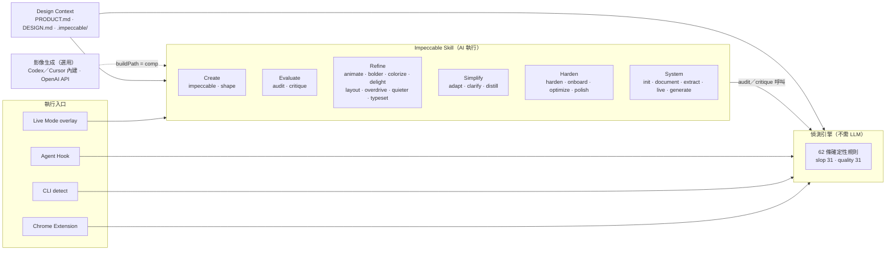

> 📖 指令分類依官方文件站 `impeccable.style/docs` 的 Command reference。README 將同一批指令分為 Steer、Review、Finish、Iterate live、Plan and set up 五組，內容相同、只是分組方式不同。
>
> ⚠️ **數字以實測為準**：官方文件站列出 24 個指令（不含已棄用的 `craft`）；`npx impeccable help` 列出 25 項（多了 `craft`）；偵測規則以 `npx impeccable detect --list-rules --json` 實測為 62 條。第三方介紹文章常見「17～23 個指令」「46 條規則」等說法，那些是舊版本的數字。導入時請用指令自己查，不要引用二手資料。

## 2.2 A. Design Commands（設計指令）

### 2.2.1 正式指令總表

v4.8.0 的 `npx impeccable help` 列出 25 個項目：`/impeccable` 本身、23 個設計指令，加上已棄用的 `craft`（✅ 實測）。所有指令都透過單一 Skill 呼叫：`/impeccable <指令> [目標]`。

| 分類 | 指令 | 用途（一句話） | 會修改程式碼？ | 主要產出 |
|---|---|---|---|---|
| Create | `impeccable`（直接描述） | 描述要做或要改的東西，走一般新作流程 | 會 | 新頁面／元件 |
| Create | `shape` | 動工前先做 UX／UI 規劃，產出經確認的設計簡報 | **不會** | 設計簡報（可存為 `.impeccable/surfaces/*.md`） |
| Evaluate | `audit` | 技術品質稽核：a11y、效能、主題、RWD、實作完整性 | **不會**（只報告） | 0～20 分報告、P0～P3 問題清單 |
| Evaluate | `critique` | UX 設計評論：層級、資訊架構、認知負荷、Nielsen 10 項 | **不會**（只報告） | 0～40 分報告，快照存 `.impeccable/critique/` |
| Refine | `animate` | 加入有目的的動態與微互動 | 會 | CSS／JS 動畫 |
| Refine | `bolder` | 讓平淡的區塊更有存在感 | 會 | 樣式與版面調整 |
| Refine | `colorize` | 用色彩釐清動作、狀態與特色 | 會 | 色彩調整 |
| Refine | `delight` | 在關鍵時刻增加愉悅感與個性 | 會 | 互動、文案、插畫 |
| Refine | `layout` | 修正版面、間距與視覺節奏 | 會 | 版面結構與間距 |
| Refine | `overdrive` | 技術性突破（shader、物理動畫、捲動驅動） | 會 | 高階特效 |
| Refine | `quieter` | 降低視覺噪音，保留個性 | 會 | 樣式收斂 |
| Refine | `typeset` | 修正字型、層級、字級、字重與可讀性 | 會 | 字體排印調整 |
| Simplify | `adapt` | 適配不同螢幕、裝置與平台 | 會 | 斷點、流體版面、觸控目標 |
| Simplify | `clarify` | 改善 UX 文案、錯誤訊息、標籤與說明 | 會 | 文案 |
| Simplify | `distill` | 移除不必要的複雜度 | 會 | 刪減元素與變化 |
| Harden | `harden` | 錯誤處理、i18n、文字溢出、極端資料 | 會 | 邊界情況處理 |
| Harden | `onboard` | 首次使用流程、空狀態、啟用路徑 | 會 | 引導與空狀態畫面 |
| Harden | `optimize` | 診斷並修正 UI 效能（載入、渲染、動畫、圖片、bundle） | 會 | 效能修正與量測 |
| Harden | `polish` | 出貨前最後一輪細節修正 | 會（不得重新設計） | 對齊、間距、一致性修正 |
| System | `init` | 建立產品背景 | 寫入 `PRODUCT.md`、`.impeccable/config.json`、`.impeccable/live/config.json` | 產品紀錄 |
| System | `document` | 從既有程式碼記錄設計系統 | 寫入 `DESIGN.md`、`.impeccable/design.json` | 設計系統紀錄 |
| System | `extract` | 把重複的模式抽成共用元件與 Tokens | 會 | 共用元件、Tokens |
| System | `live` | 瀏覽器內選取元素、產生變體、接受一個（Beta） | 接受時會 | 變體與原始碼更新 |
| System | `generate` | 指名元素與方向，直接在 Live 中產生 N 個變體 | 接受時會 | 變體 |
| 棄用 | `craft` | 舊版「先 shape 再 build」流程的相容別名，已無額外行為 | 會 | 同一般新作 |

> 📖 「會修改程式碼？」依各指令的 Playbook 原文整理。例如 `audit.md` 開頭即寫「Don't fix issues; document them for other commands to address.」；`shape.md` 寫「return a confirmed design brief without code」；`polish.md` 寫「Polish is refinement, never concealed redesign.」

### 2.2.2 管理用子指令

| 指令 | 用途 | 備註 |
|---|---|---|
| `/impeccable`（不帶參數） | 列出所有指令 | |
| `/impeccable pin <指令>` | 建立獨立捷徑，例如 `pin audit` 之後可直接用 `/audit` | `unpin` 移除捷徑 |
| `/impeccable doctor [--target <app>]` | 檢查 PRODUCT.md／DESIGN.md 版本、設定鍵、Hook 路徑、過期的頁面簡報 | 只做「機械式遷移」，不重新設計 |
| `/impeccable hooks status｜on｜off` | 查看或切換本專案 Hook | 寫入 `.impeccable/config.json` 的 `hook.enabled` |
| `/impeccable hooks ignore-value｜ignore-file｜ignore-rule` | 新增偵測例外 | 與 CLI `npx impeccable ignores` 共用同一份設定 |
| `/impeccable hooks reset` | 刪除專案設定、去重快取，並從各 Provider manifest 移除 Hook | ⚠️ 會連同已 commit 的 `.github/hooks/impeccable.json` 一起處理 |

### 2.2.3 各 Agent 的呼叫寫法

| Agent | 寫法 | 說明 |
|---|---|---|
| Claude Code、Cursor、GitHub Copilot、Gemini CLI 等 | `/impeccable polish the checkout form` | Slash command |
| OpenAI Codex | `$impeccable polish the checkout form`，或開 `/skills` 選取 | 官方：「Codex uses skills here, not `/prompts:` commands」 |
| OpenCode | `/impeccable …` | 手動複製安裝時，還要複製 `.opencode/commands/impeccable.md` |

> ⚠️ 提示詞中提到的 `init`、`craft`、`shape`、`polish`、`bolder`、`quieter`、`layout`、`typeset`、`critique`、`audit`、`harden`、`distill`、`document`、`extract`、`animate`、`live` 都是官方指令（`craft` 已棄用）。v4.8.0 **沒有** `/impeccable steer` 這個指令；「Steer」是 Live Mode 中的頁面層級指示功能，以及 README 對 Refine 類指令的分組名稱。

## 2.3 B. Design Detector／Audit（設計偵測器）

### 2.3.1 Deterministic Rules 的運作方式

偵測引擎是一個自帶的執行檔，用固定規則比對 CSS、HTML 結構與瀏覽器計算後的樣式，不呼叫任何 LLM：

- **相同輸入 → 相同輸出**，適合放進 CI。
- **不需要 API Key、不需要網路**（URL 掃描除外，因為要開瀏覽器載入頁面）。
- 規則分兩類：`slop`（AI 劣質特徵，31 條）與 `quality`（一般設計品質，31 條）。
- 嚴重度分三級（✅ 由 `--list-rules --json` 統計）：

| 嚴重度 | 數量 | 是否影響 Exit Code | 範例 |
|---|---|---|---|
| `error` | 2 | 是 | `script-error`（載入時有未捕捉的 JS 錯誤）、`content-hidden-at-rest`（內容在靜止狀態不可見） |
| `warning` | 44 | 是 | `low-contrast`、`side-tab`、`overused-font` |
| `advisory` | 16 | **否**，獨立列出，永遠不阻擋自動化 | `bounce-easing`、`em-dash-overuse`、`design-system-color` |

### 2.3.2 三種掃描方式的差異（最重要的觀念）

✅ 以同一份樣本實測三種方式，抓到的問題**不一樣**：

| 掃描方式 | 指令範例 | 引擎 | 能抓到 | 抓不到 | 有行號？ |
|---|---|---|---|---|---|
| 原始碼（`.vue`、`.tsx`、`.jsx`、`.svelte`、`.astro`、`.css`） | `npx impeccable detect src/` | regex（文字樣式比對） | `overused-font`、`gradient-text`、`side-tab`、`bounce-easing` | 對比、字級、元素結構類規則 | 有 |
| 靜態 HTML（`.html`，含連結的本機 CSS） | `npx impeccable detect public/landing.html` | HTML 解析 | 上述＋`skipped-heading`、`radial-halo`、`marketing-buzzword`、`icon-tile-stack` | 需要實際版面計算的規則 | 無（line 為 0） |
| 渲染頁面（URL） | `npx impeccable detect http://localhost:5173` | 瀏覽器（Chrome／Chromium／Edge）計算後的 DOM 與樣式 | 版面類：`body-text-viewport-edge`、`text-overflow`、`low-contrast` 等 | 無法讀取的跨網域 CSS；未安裝的字型會以替代字型判斷 | 無 |

實測輸出摘錄（原始碼掃描 `.vue` 時 CLI 主動提醒）：

```text
2 files scanned with regex matching only (.vue).
Rules that need a parsed page (tiny-text, low-contrast and other element rules) did not run on them; findings are an undercount, not a clean bill of health.
For the full check, scan the running dev server (npx impeccable detect http://localhost:PORT) or a static site's built .html.
.vue files can take the HTML engine instead: add { "ext": ".vue", "engine": "html" } under detector.extensions in .impeccable/config.json (trades the regex rules and line numbers for the element rules).
```

> 💡 **企業建議**：CI 同時跑「原始碼掃描」（有行號、能在 PR 上註記）與「渲染頁面掃描」（桌機＋手機寬度），兩份結果合併判斷（第 12 章）。不要只跑其中一種。

### 2.3.3 DOM 檢查與原始碼檢查、靜態與渲染的差別

| 面向 | 原始碼／靜態檢查 | 瀏覽器渲染檢查 |
|---|---|---|
| 看到的是 | 你寫的樣式文字 | 瀏覽器最後算出來的結果（含繼承、Tailwind 產生的 class、元件庫樣式） |
| 對比度 | 只能比對明確寫在一起的前景／背景 | 用計算後的實際顏色判斷 |
| 響應式 | 看不到 | 可用 `--viewport 390x844` 模擬手機 |
| 速度 | 快（毫秒～秒） | 慢（每頁數秒，需啟動瀏覽器） |
| 適合 | Hook、PR 註記 | CI 閘門、上線前檢查 |

### 2.3.4 Accessibility、Contrast Ratio 與 Responsive 檢查

偵測器有部分 Accessibility 與響應式規則，但**不是完整的 a11y 工具**：

| 類別 | 偵測器規則 | 判斷標準（規則說明原文整理） |
|---|---|---|
| 對比 | `low-contrast` | WCAG AA：內文 4.5:1、大字 3:1。✅ 實測 `#999` 字在 `#2e6da4` 底上回報「1.9:1 (need 4.5:1)」 |
| 彩色底灰字 | `gray-on-color` | 彩色背景上的灰字 |
| 字級 | `tiny-text`、`undersized-ui-text` | 內文低於 12px |
| 標題結構 | `skipped-heading` | h1 之後直接 h3／h4 |
| 響應式 | `text-overflow`、`first-viewport-column-overflow`、`body-text-viewport-edge`、`edge-flush-cards` | 內容溢出容器、文字貼齊視窗邊緣（小於 16px，480px 以下小於 12px） |
| 行長 | `line-length` | 單行過長 |

完整的 WCAG 2.2 檢查仍要用 axe-core、鍵盤操作測試與人工審查（第 11 章）。`/impeccable audit` 的 Accessibility 面向會由 AI 另外檢查 ARIA、鍵盤、焦點、表單等項目，但那是 AI 判斷，不是確定性規則。

### 2.3.5 哪些檢查不需要 LLM、哪些需要

| 檢查 | 需要 LLM／API Key？ | 需要瀏覽器？ |
|---|---|---|
| `npx impeccable detect`（原始碼、HTML） | 否 | 否 |
| `npx impeccable detect <URL>` | 否 | 是（Chrome、Chromium 或 Edge） |
| `npx impeccable detect --cdp 9222`（Electron、WebView2 等桌面應用） | 否 | 是（應用程式本身開 DevTools 埠） |
| Agent Hook | 否（Hook 本身不呼叫模型；但結果交給 Agent 處理） | 否 |
| Chrome Extension | 否 | 是 |
| `/impeccable audit`、`/impeccable critique` | **是**（由你的 Agent 模型執行，並會呼叫偵測器當證據） | 建議（critique 會嘗試用瀏覽器截圖與 overlay） |
| 影像生成（comp-first 新設計） | 需要 Agent 內建影像工具或 OpenAI API Key | — |

### 2.3.6 CLI、JSON、GitHub Actions 與例外管理（摘要）

| 功能 | 指令 | 詳見 |
|---|---|---|
| 掃描 | `npx impeccable detect src/` | 第 8.10 節 |
| JSON 輸出（stdout） | `npx impeccable detect --json src/ > findings.json` | 第 12.3 節 |
| GitHub Actions 註記 | `npx impeccable detect --github src/` | 第 12.4 節 |
| 規則清單 | `npx impeccable detect --list-rules`（加 `--json` 或 `--quiet`） | 附錄 B |
| 只看某設計面向 | `--scope type,layout` | 第 8.10 節 |
| 隱藏 advisory | `--no-advisory` | |
| 不套用任何專案設定與例外 | `--no-config` | 第 7.6 節 |
| 例外管理 | `npx impeccable ignores add-value overused-font Inter --reason "…"` | 第 7.6 節 |
| 行內例外 | `/* impeccable-disable-next-line side-tab -- 原因 */` | 第 7.6 節 |

Exit Code（✅ 實測）：`0` 掃描完成且無主要問題（advisory 仍可能列出）、`2` 掃描完成且有主要問題、`1` 至少一個目標無法掃描（例如路徑不存在）。多目標掃描時，`1` 優先於 `2`。

> ⚠️ **假綠燈陷阱（✅ 實測）**：目錄裡沒有任何可掃描的檔案時（例如舊系統的 `.cshtml`、`.aspx` 尚未設定 `detector.extensions`），`detect` **不輸出任何內容並回傳 0**。CI 必須另外確認「確實掃到檔案」（第 12.2 節）。

## 2.4 C. Agent Hooks（自動設計檢查）

### 2.4.1 運作原理

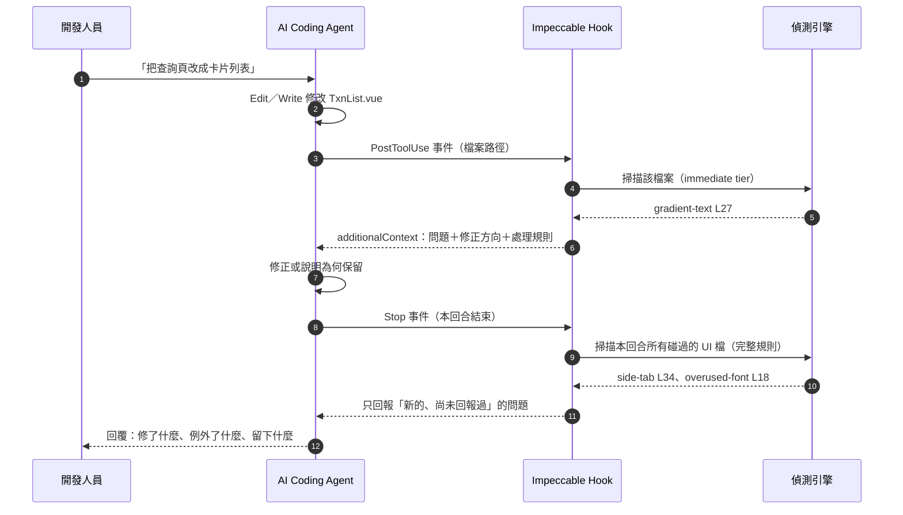

Hook 會在 Agent 直接編輯這些副檔名時觸發：`.tsx`、`.jsx`、`.html`、`.vue`、`.svelte`、`.astro`、`.css`、`.scss`、`.sass`、`.less`、`.ts`、`.js`（純 `.ts`／`.js` 只有發現問題時才出聲）。其他範本（Blade、Twig、ERB、JSP 等）要在 `detector.extensions` 宣告。

### 2.4.2 兩段式檢查：immediate tier 與 Stop deep pass

| 階段 | 時機 | 規則範圍 | 目的 |
|---|---|---|---|
| Immediate tier | 每次編輯後 | 只跑「機械、明確、值得打斷」的規則：破圖、溢出、對比與可讀性、漸層字、光暈、設計系統偏離 | 立即修正明顯錯誤 |
| Deep pass | Agent 結束本回合（`Stop`） | 本回合碰過的所有 UI 檔，跑**完整規則**，並與 immediate tier 已回報的去重 | 處理品味類問題（字型、色盤、版面節奏、文案） |

✅ 實測：同一個 `.vue` 檔，PostToolUse 只回報 `gradient-text`；Stop 時才回報 `side-tab` 與 `overused-font`，並標註「attribution unknown」（無法確定是否為本次 session 造成）；第二次 Stop **完全不輸出**（沒有新問題）。

設定 `hook.perEditRules: "all"` 可讓每次編輯都跑完整規則（較吵，但適合舊專案大改版初期）。

### 2.4.3 各 Agent 的 Hook 實作差異

> ⚠️ 不同 Agent 的 Hook 攔截時機與能力**不同**，不可假設行為一致。下表依 v4.8.0 實際安裝產生的 manifest（✅）與 Skill 參考文件（📖）整理。

| Agent | Manifest 位置（專案範圍） | 事件 | 每次編輯 | Stop 深度檢查 | 啟用前置動作 |
|---|---|---|---|---|---|
| Claude Code | `.claude/settings.local.json`（不進版控）；使用者範圍為 `~/.claude/settings.json` | `SessionStart`、`PostToolUse`（matcher `Edit\|Write`）、`Stop` | immediate tier | ✅ 有 | 接受 workspace trust；`/hooks` 檢視 |
| OpenAI Codex | `.codex/hooks.json` | `PostToolUse`（`Edit\|Write\|apply_patch`）、`Stop`；另有 `commandWindows` 給 cmd.exe | immediate tier | ✅ 有 | **必須**在 `/hooks` 核准；定義變更後要再核准 |
| GitHub Copilot | `.github/hooks/impeccable.json`（**要 commit**） | `postToolUse`（`edit\|create\|apply_patch`） | **完整規則**（沒有可回饋給模型的 Stop 事件） | 無 | CLI：檔案需在**預設分支**上，且資料夾已信任；Cloud Agent 直接讀 repo |
| Cursor | `.cursor/hooks.json` | `postToolUse`（matcher `^Write$`），以 `additional_context` 回傳 | **完整規則** | 無（Cursor 的 stop hook 只能送追問訊息） | 信任 workspace；Settings → Hooks 確認 |
| Gemini CLI | `.gemini/settings.json`（合併到既有設定） | `BeforeTool`（只改寫 `build-phase` 指令）、`AfterAgent`（完成提醒） | **沒有**逐檔偵測 | 無 | 需啟用 Skills |
| Grok Build | `.grok/hooks/impeccable.json` | PostToolUse 只做標記，結果在 Stop 才送出 | 不回饋 | ✅ 有 | `/hooks-trust` 或 `--trust` |
| Hermes Agent | v4.8.0：無 Hook；`main`（未發布）：`hermes plugins enable impeccable-design-hook` | — | — | — | — |

沒有 Hook 的環境（例如 Gemini、手動複製安裝），Skill 的 `impeccable context` 會發出 `MANUAL_DETECTOR_REQUIRED` 指示，要求 Agent 在結束前**手動跑一次偵測器**。

### 2.4.4 Hook 如何回傳問題、AI 如何修正

✅ 以模擬的 Claude／Codex `PostToolUse` 事件實際呼叫 Hook，輸出如下（節錄）：

```json
{
  "hookSpecificOutput": {
    "hookEventName": "PostToolUse",
    "additionalContext": "[impeccable@1] Design hook findings requiring review in src/KpiDashboard.vue (1 issue(s)):\n- L27 [gradient-text] Gradient text. ... Use solid colors for text.\n\nTriage each finding, then state in your reply what you fixed, what you suppressed, and what you left standing: ..."
  }
}
```

Hook 要求 Agent 對每個問題做三選一的分流（Triage）：

| 分流 | 條件 | Agent 應做 |
|---|---|---|
| 真正的設計問題 | 大多數情況 | 修正。**不得**為了跳過修正而新增例外 |
| 有把握的誤判或核准例外 | 能說出證據：刻意的示範、記錄壞設計的文件、符合情境的動態、使用者已確認的選擇 | 自行新增「最窄」的例外（只限 `ignore-value`），並在回覆中揭露；`--reason` 寫明「誰決定：證據」 |
| 不確定 | — | 保留問題，用一行問使用者 |

`ignore-file` 與 `ignore-rule` 影響太大，**必須**先取得使用者明確同意。

### 2.4.5 如何避免 AI 忽略結果、如何避免無限修正循環

| 風險 | Impeccable 內建機制 | 🏢 企業補強 |
|---|---|---|
| AI 忽略回饋 | Hook 要求「在回覆中說明修了什麼、例外了什麼、留下什麼」；未處理的問題會被再次提醒（re-nudge） | 在 CLAUDE.md／AGENTS.md 寫明「Hook 回報未處理不得宣告完成」；PR 由 CI 重新掃描 |
| 無限修正循環 | Stop 深度檢查會與已回報的問題去重；沒有新問題時保持沉默；每次最多回報 5 筆、8,000 字元（`hooks status` 顯示 `maxFindings: 5`、`maxChars: 8000`） | 規定「同一問題修正兩次仍失敗就停下來問人」 |
| 舊債被誤認為本次造成 | Stop 對無法確認歸屬的問題標 `attribution unknown`，並提醒「不要當成回歸、不要擴大任務範圍」 | 舊專案先建立 CI baseline（第 12.5.3 節） |
| AI 自行關掉檢查 | Skill 規定例外只能透過 `impeccable hooks` 指令，不可手改設定檔 | 例外變更必須經 PR 審查（CODEOWNERS 指定 `.impeccable/config.json`） |

### 2.4.6 Hook 安全性、權限與失敗處理

- **不是沙箱**：Hook 以 Agent 的環境變數與網路權限執行偵測引擎。
- **不受模型核准影響**（Claude Code）：即使你拒絕模型執行指令，Hook 仍會執行；要整次停用可用 `claude --settings '{"disableAllHooks": true}'`。
- **引擎完整性**：launcher 會依 `scripts/engine-checksums.txt` 驗證下載的引擎 sha256，沒有對應 checksum 時拒絕下載（✅ 實測竄改快取檔後會被拒用並重新下載）。
- **失敗處理**：launcher 不存在時 Hook 是「靜默不執行」（manifest 中的 `[ ! -f … ] ||` 判斷）；設定檔格式錯誤時 Hook 會忽略該檔並使用預設值；manifest 格式錯誤時 `install`／`update` 會中止，要用 `--force` 才會備份成 `.bak` 並覆寫。
- **沉默不等於乾淨**：沒有訊息可能是「沒問題」「quiet 模式」或「Hook 根本沒啟用」，要用 `/impeccable doctor` 或 `hooks status` 區分。

## 2.5 D. Live Browser Mode（瀏覽器即時迭代，Beta）

### 2.5.1 架構

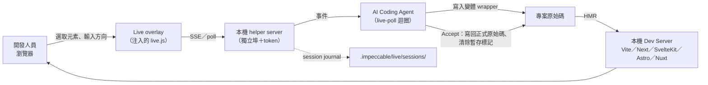

📖 依 `reference/live.md` 整理：

- 需要有 HMR 的 Dev Server，或在瀏覽器開啟的本機靜態 HTML。
- helper server 的埠號與 token 屬於 helper，**不是** App；要開的是 App 的網址。
- Agent 以長輪詢（預設 600,000 ms）等待瀏覽器事件：`generate`、`steer`、`accept`、`discard` 等。
- 變體是完整的 HTML＋CSS 替換，先以暫時的 wrapper 寫入原始碼，Accept 後整合成正式寫法並清除暫存標記；`live-complete` 會在還有殘留時拒絕完成。
- 中斷時以 `.impeccable/live/sessions/` 的 journal 為準恢復，不要重做。

### 2.5.2 支援範圍

| 項目 | 狀態 |
|---|---|
| 框架 | Vite 類 App、Next.js、SvelteKit、Astro（v4.5.2 起支援 7.3.6+）、Nuxt、純 HTML |
| 原生 iOS／Android | 不支援 |
| 正式環境網站 | **不支援**；檢查正式網站請用 `npx impeccable detect https://…` 或 Chrome Extension |
| CSP | 若 CSP 擋住 overlay，首次設定會說明需要的修改，並**先徵求同意**再改 |
| Codex | Live 需要 localhost 與套件安裝網路，Playbook 指示以 `sandbox_permissions: "require_escalated"` 執行 |

### 2.5.3 與一般 AI Coding 流程的差異

| 面向 | 一般流程 | Live Mode |
|---|---|---|
| 指定目標 | 用文字描述（「第二個卡片」） | 直接在畫面上點選元素 |
| 比較方案 | 一次一個結果 | 一次產生多個變體（預設 3 個），可切換比較並微調參數 |
| 回饋迴圈 | 寫 → 重新整理 → 看 → 再說明 | 即時 HMR 預覽 |
| 風險 | 一般 | 多了一個本機 helper server 與注入腳本；Accept 會寫回原始碼 |

### 2.5.4 安全性與限制

- ⚠️ 只在**信任的本機 checkout** 使用。Apply 文案修改時，會以你的使用者權限執行 `package.json` 的 `scripts["impeccable:manual-edit-validate"]`（若存在）；在不熟悉的 repo 使用前要先檢查這個 script。
- ⚠️ **main／未發布**：README 記載，若最近一分鐘沒有 Agent session 在輪詢，Apply 會改為執行 PATH 上的 `codex` CLI（沒有則用 `claude`），而且**關閉核准、權限檢查與沙箱**（`--dangerously-bypass-approvals-and-sandbox` 或 `--permission-mode bypassPermissions`）。可在啟動 Live 的環境設定 `IMPECCABLE_LIVE_COPY_AGENT=chat`（只在對話中處理）或 `off`（停用 Apply）。🏢 企業環境一律設為 `chat`。
- 不可為了 Live 關閉瀏覽器安全機制或放寬正式環境 CSP。

## 2.6 E. Design Context（設計背景）

### 2.6.1 檔案總覽

| 檔案 | 誰寫 | 內容 | 版控 |
|---|---|---|---|
| `PRODUCT.md` | `/impeccable init`（可人工編修） | 使用者、目的、定位、作業情境、限制、品牌承諾、證據、原則、無障礙需求 | ✅ commit |
| `DESIGN.md` | `/impeccable document`（可人工編修） | YAML frontmatter Tokens＋8 個固定章節的設計說明 | ✅ commit |
| `.impeccable/design.json` | `document` 產生 | 給工具用的中繼資料（元件預覽、額外 Token 資訊）；**不要手改** | ✅ commit |
| `.impeccable/surfaces/*.md` | `shape`、新作流程 | 每個頁面／路由的簡報：目的、設計方向、模式 | ✅ commit |
| `.impeccable/critique/*.md` | `critique` | 評論報告快照（可看分數趨勢） | ✅ commit |
| `.impeccable/config.json` | 指令與 `ignores` CLI | 團隊共用設定與偵測例外 | ✅ commit |
| `.impeccable/config.local.json` | `--local` 指令 | 個人設定（含 Hook 安裝同意紀錄） | ❌ 不進版控 |
| `.impeccable/live/config.json` | `init`／Live 首次設定 | Live 的框架連接設定 | ✅ commit |

### 2.6.2 頁面模式（Mode）

v4.x 把「品牌 vs 產品」的舊分類改成四種**頁面模式**，記錄在每個頁面的簡報中（不是寫在 PRODUCT.md）：

| 模式 | 使用者來做什麼 | 設計野心的表現 | 企業系統對應 |
|---|---|---|---|
| Persuade | 決定並採取行動 | 大膽、有觀點 | 對外產品官網、活動頁 |
| **Operate** | **完成任務** | **精確與克制**，沿用使用者熟悉的模式 | **後台、作業系統、Dashboard、表單** |
| Read | 理解內容 | 排版與可讀性 | 文件、規章、報表說明頁 |
| Experience | 探索作品 | 沉浸與表現力 | 作品集、展示頁 |

> 💡 銀行與企業內部系統絕大多數是 **Operate**。Skill 的核心原則寫明：「On Operate and Read, ambition shows as precision and restraint」。這是避免 AI 把作業畫面做成行銷首頁的關鍵。

### 2.6.3 Context 的解析順序

📖 依官方 Context 文件：

1. 先找專案根目錄，再找 `.agents/context/`、`docs/`，使用第一個有 Context 的位置。
2. Monorepo：子 App 自己的檔案優先，缺少的再回退到 repo 根目錄；產品與設計 Context 分開解析。
3. 邊界由 package workspace 宣告或 `.impeccable/config.json` 的 `projectRoots` 決定。
4. 程式碼也是證據：比文件更新的既有慣例要保留，過期的文件要更新，意外的偏離要修正。

### 2.6.4 Design Tokens、Typography、Color、Spacing、Component Guidelines 放在哪裡

| 設計要素 | 機器可讀（偵測器會用） | 人類可讀（AI 會讀） |
|---|---|---|
| Color Palette | DESIGN.md frontmatter `colors` | `## Colors` |
| Typography | frontmatter `typography`（含 `scale` 字級階梯） | `## Typography` |
| Spacing System | frontmatter `spacing` | `## Layout` |
| 圓角 | frontmatter `rounded` | `## Shapes` |
| Component Guidelines | frontmatter `components`（限 8 個屬性） | `## Components` |
| Brand Guidelines | — | PRODUCT.md `## Brand Commitments` |
| Anti-References（反面參考） | — | DESIGN.md `## Do's and Don'ts`、PRODUCT.md 品牌承諾中的「避免」清單 |
| UI/UX 設計原則 | — | PRODUCT.md `## Product Principles` |

DESIGN.md 存在時，偵測器會啟用四條設計系統規則：`design-system-font`（warning）、`design-system-color`、`design-system-radius`、`design-system-font-size`（皆為 advisory）。✅ 實測使用未宣告的 Poppins、`#ff6b00`、16px 圓角、13px 字級時，四條規則全部觸發。

## 2.7 F. 圖像生成與 `buildPath`（mockup-first／code-first）

📖 依官方〈Enable image generation〉整理；🧪 本手冊未實測影像生成。

### 2.7.1 兩條建置路徑

開始一個**新設計**時，Impeccable 有兩條路可以走，由 `.impeccable/config.json` 的 `buildPath` 決定預設值：

| 路徑 | `buildPath` | 流程 | 優點 | 代價 |
|---|---|---|---|---|
| Mockup-first（comp-led） | `"comp"` | Agent 先生成設計稿圖片 → 你核准構圖 → 以圖為目標寫出可運作的介面 | 視覺企圖心較高，能達到純寫程式不容易達到的構圖 | 「圖轉程式」會失真，通常要多輪提示與審查；每張圖都有費用 |
| Code-first（code-led） | `"code"` | Impeccable 提出概念後直接寫程式 | 第一版比較一致、可預期 | 視覺上通常比較保守 |

| 規則 | 說明 |
|---|---|
| 預設值 | 有影像生成能力、又沒有儲存偏好時，預設走 **mockup-first** |
| 沒有影像生成 | 自動走 code-first |
| 選 code-first 的效果 | 跳過設計稿核准，但**不會停用**影像生成本身；插畫、背景、去背等素材仍可以生成 |
| App 畫面與文件 | v4.5.2 起一律 code-first（第 13.1.4 節），`buildPath` 只影響新的 landing／展示頁 |
| 「看得懂截圖」不等於「能生圖」 | 只有讀圖（vision）能力的 Agent 不算具備影像生成 |

### 2.7.2 各工具的影像生成來源

| 來源 | 適用 | 是否需要 API Key | 費用 |
|---|---|---|---|
| Codex 內建 | Codex（可以在對話中直接要求，或加上 `$imagegen`） | 否 | 計入 Codex 的用量限制 |
| Cursor 內建 | Cursor Agent（可以預覽並存進專案） | 否 | 依 Cursor 帳號方案 |
| OpenAI API（fallback） | Agent 本身沒有影像工具時 | **是**（`OPENAI_API_KEY`） | 計入 OpenAI API 專案的帳單；每張設計稿或修改都可能是一次請求 |

### 2.7.3 設定 OpenAI API Key（只在需要 fallback 時）

適用 OS：Windows｜執行位置：要啟動 Agent 的同一個 PowerShell 視窗

```powershell
# 只對這個 PowerShell 程序有效；關掉視窗就消失，不會寫進設定檔
$env:OPENAI_API_KEY = Read-Host -Prompt 'OpenAI API Key（輸入時不會顯示在畫面上）' -MaskInput
claude    # 從同一個視窗啟動 Agent，Agent 才拿得到這個環境變數
```

macOS／Linux：

```bash
read -rs -p 'OpenAI API Key: ' OPENAI_API_KEY && export OPENAI_API_KEY && echo
claude
```

**只確認「有沒有設定」，不印出 Key 本身**（官方建議的 readiness check 做法）：

```bash
node -e "console.log(process.env.OPENAI_API_KEY ? 'set' : 'missing')"
```

> ⚠️ 印出 `set` 只代表環境變數存在，**不代表** Key 有效、有帳單權限或網路可達。也可以在 Agent 對話中輸入 `/impeccable check whether image generation is available for this project`；這個請求**不會**生成圖片。

**金鑰處理規則（🏢 企業強制）：**

| 規則 | 原因 |
|---|---|
| 不可貼在對話框 | 對話內容可能被記錄或送到模型供應商 |
| 不可 commit，包括 `.env` | `.env` 只有在啟動流程有載入時才有效，而且容易被誤 commit |
| 不可放進 `VITE_*`、`PUBLIC_*`、`NEXT_PUBLIC_*` 等前端變數 | 這些變數會被打包進前端程式，任何人打開瀏覽器都看得到 |
| 使用專案專用、設有額度上限的 Key | 控制費用；外洩時影響範圍小 |
| 大量生成前先確認單價 | 每次修改設計稿都會產生新請求 |

### 2.7.4 企業政策建議

| 系統類型 | `buildPath` | 影像生成 |
|---|---|---|
| 內部作業系統（交易、覆核、後台） | 固定 `"code"`，寫入 `.impeccable/config.json` 並 commit | 不使用 |
| 對外行銷頁、活動頁 | 可用 `"comp"`，設計稿由 UI/UX 核准 | 使用公司核准的帳號；素材需確認授權 |
| 高度管制環境（不可對外連線） | `"code"` | 禁用 |

**審查重點（走 mockup-first 時）：**

| 檢查 | 做法 |
|---|---|
| 程式碼真的對應到核准的設計稿 | 把設計稿與實作截圖並排比較；差異逐項列出，決定接受或退回 |
| 設計稿中的顏色沒有直接變成硬編碼 | 第 8.0.1 節第 2 層：圖轉程式最容易產生大量新色碼 |
| 生成的素材有記錄來源 | 在 PR 中記錄生成工具與 Prompt，供授權與稽核查驗 |

## 2.8 本章實務案例與注意事項

**案例：判斷「該用哪一個入口」：**

| 情境 | 用什麼 |
|---|---|
| 開發中，Agent 正在改 UI | Hook（自動） |
| PR 送出前，想看整個模組的狀況 | `npx impeccable detect src/modules/txn/` |
| 上線前稽核 | `/impeccable audit`＋CI 渲染掃描＋axe |
| 設計審查會議 | `/impeccable critique`（報告存到 `.impeccable/critique/`） |
| 想比較三種卡片設計 | `/impeccable generate 3 variants of the KPI cards`（Live） |
| 檢查別人的網站或正式環境 | `npx impeccable detect https://…` 或 Chrome Extension |

**注意事項：**

- ⚠️ 原始碼掃描是「少報」，不是「全報」。不要把 Hook 沒有回報當成 a11y 通過。
- ⚠️ Copilot 與 Cursor 每次編輯都跑完整規則，比 Claude／Codex 吵。舊專案導入初期可能需要先建立例外與 baseline。
- 💡 先寫好 PRODUCT.md 與 DESIGN.md 再開 Hook。沒有 DESIGN.md，設計系統規則不會啟用，Hook 只能抓通用的 AI Slop。

# 3. 相關技術與定位

## 3.1 定位總覽

Impeccable 解決的是「AI 產生 UI 時的設計判斷與設計品質」。其他工具各自負責不同層次，彼此互補而不是取代：

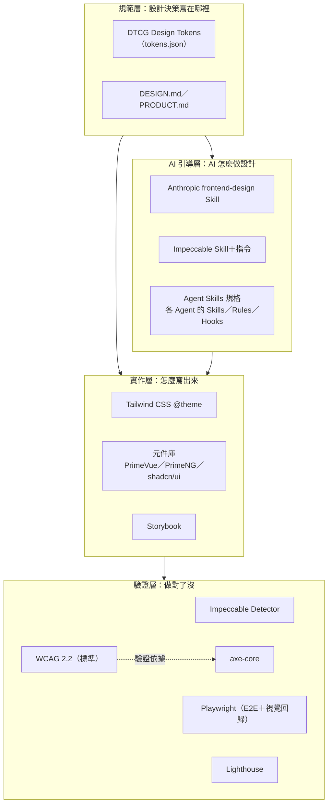

## 3.2 逐項說明

| 技術 | 定位 | 與 Impeccable 的關係 | 企業整合方式 | 適用情境 |
|---|---|---|---|---|
| **Anthropic frontend-design Skill** | Anthropic 官方的前端設計 Skill，教 Claude 避免通用 AI 美學 | Impeccable 的起源；Impeccable 多了指令體系、偵測引擎、Hook、Live、跨 Agent 發行 | 二選一即可，**不要同時啟用**（兩份設計指引互相競爭，Agent 行為不穩定） | 只用 Claude、只需要「審美提醒」的小專案 |
| **Agent Skills 規格**（agentskills.io） | `SKILL.md`＋資料夾的開放格式，多數 Agent 都支援 | Impeccable 就是一個 Agent Skill；`install` 依各 Agent 的目錄慣例轉換 | 公司可把 Impeccable 與內部 Skill 放在同一個 Skill 目錄管理 | 所有情境 |
| **Claude Code Skills／Hooks** | Claude Code 的技能載入與生命週期 Hook | 最完整的整合：Skill＋4 個 Subagent＋SessionStart／PostToolUse／Stop Hook | 專案範圍安裝；Hook 寫在 `.claude/settings.local.json` | 主力開發 Agent |
| **GitHub Copilot Agent Skills／Hooks** | `.github/skills/`、`.github/agents/`、`.github/hooks/` | Skill＋Subagent＋postToolUse Hook（每次編輯完整規則） | Hook 檔 commit 到預設分支，CLI 與 Cloud Agent 共用 | 已用 Copilot Enterprise 的團隊 |
| **OpenAI Codex Skills／Hooks** | `.agents/skills/`、`.codex/hooks.json` | Skill（`$impeccable`）＋PostToolUse／Stop Hook | Hook 需在 `/hooks` 核准；定義變更要重新核准 | Codex CLI／App 使用者 |
| **Cursor Rules／Skills／Hooks** | `.cursor/skills/`、`.cursor/rules/`、`.cursor/hooks.json` | Skill＋Subagent＋postToolUse Hook | Rules 放公司規範，Impeccable 放設計指引，不要重複 | Cursor 使用者 |
| **Gemini CLI Skills** | `.gemini/skills/`、`.gemini/settings.json` | Skill＋session／completion hook，**沒有逐檔偵測** | 必須在流程中手動跑 `detect` 或靠 CI | Gemini 使用者 |
| **Tailwind CSS Design System** | 以 `@theme` 變數產生 utility class | Tokens 的落地方式；限制可用的色彩與間距，讓 AI 無法隨手用 `bg-purple-500` | `@theme` 清空預設色盤（第 7.5 節） | 新系統、升級專案 |
| **shadcn/ui** | 複製到專案內、可修改的 React 元件原始碼 | 元件「在你的 repo 裡」，Impeccable 的 `extract`、`polish` 可直接改它 | 先 `document` 記錄既有元件，再讓 AI 依 DESIGN.md 調整 | React 新專案 |
| **Storybook** | 元件隔離開發與展示 | 提供「元件層級」的渲染頁面，可用 `detect` 掃 Storybook 的 iframe URL | 每個 Story 一個 URL，CI 掃描 | 共用元件庫 |
| **Playwright** | 瀏覽器自動化、E2E、截圖比對 | 驗證「流程沒變、畫面沒跑掉」，補足 Impeccable 不檢查業務行為的缺口 | `toHaveScreenshot` 視覺回歸＋Tab 順序測試（第 11.3 節） | 所有情境，逆向工程與升級必備 |
| **axe-core** | 規則化 Accessibility 檢查引擎 | 偵測器只有少數 a11y 規則；axe 涵蓋 ARIA、表單標籤、地標等 | `@axe-core/playwright` 在 E2E 中執行 | 所有對外或受法規要求的系統 |
| **Lighthouse** | 效能、a11y、最佳實務、SEO 綜合評分 | `/impeccable optimize` 會改效能，Lighthouse 量測結果 | Lighthouse CI 設預算門檻 | 對外網站、重視載入時間的系統 |
| **WCAG 2.2** | W3C 無障礙標準（2.2 新增焦點外觀、拖曳替代、最小目標尺寸 24×24 等） | `audit` 的 a11y 面向與偵測器的對比規則以 WCAG AA 為依據 | 列為驗收標準；以 axe＋人工鍵盤測試驗證 | 所有情境 |
| **DTCG（Design Tokens Community Group）** | W3C 社群群組的 Token 交換格式（`$value`、`$type`，2025.10 為第一個穩定版） | DESIGN.md frontmatter 是另一種 Token 格式（Google Labs design.md 規格）；兩者可由同一來源產生 | 以 DTCG JSON 為公司級來源，用 Style Dictionary 產出 CSS 與 DESIGN.md frontmatter（第 10.5 節） | 跨專案共用 Design System |

## 3.3 選擇建議

| 問題 | 建議 |
|---|---|
| 已經用 frontend-design Skill，要換嗎？ | 需要 Hook、CI 掃描、跨 Agent 一致性時換成 Impeccable；兩者不要並存 |
| 有 axe 了，還要偵測器嗎？ | 要。axe 檢查「能不能用」，偵測器檢查「是不是 AI 劣質設計、是否偏離設計系統」，範圍不同 |
| 有偵測器了，還要 Playwright 視覺回歸嗎？ | 要。偵測器不知道「畫面跟昨天比變了什麼」，逆向工程與升級特別需要 |
| DESIGN.md 和 DTCG tokens.json 要維護兩份嗎？ | 以一份為來源、自動產生另一份；不要人工同步（第 10.5 節） |

## 3.4 本章實務案例與注意事項

**案例：某團隊同時裝了三套設計指引：**

一個 Vue 專案同時有 `.cursor/rules/ui-style.mdc`（公司規範）、frontend-design Skill、Impeccable。結果 Agent 在同一次修改中，一下用公司規範的 6px 圓角、一下聽 Impeccable 改成 4px，PR 來回修改。

處理方式：

1. 移除 frontend-design Skill。
2. 把 `ui-style.mdc` 的設計數值搬進 DESIGN.md frontmatter，Rules 只留「流程規範」（例如「不得修改 API」）。
3. 讓偵測器的 `design-system-*` 規則成為唯一的設計數值檢查來源。

**注意事項：**

- ⚠️ 一個 Agent 同時載入多份設計指引，是 UI 不一致最常見的原因之一。
- 💡 每個工具只負責一件事：Tokens 管數值、DESIGN.md 管說明、Impeccable 管 AI 行為與 AI Slop、axe 管無障礙、Playwright 管回歸。

# 4. 三種企業使用情境

## 4.1 情境總覽

| 情境 | Impeccable 的主要角色 | 最大風險 | 關鍵控制 |
|---|---|---|---|
| 新系統開發 | 從第一天建立設計背景，引導 AI 設計與持續檢查 | AI 做出行銷風格的作業畫面 | PRODUCT.md＋DESIGN.md 先行；頁面模式設為 Operate |
| 既有系統逆向工程 | 協助**記錄**既有設計、檢查重建畫面品質 | AI「順手美化」改掉使用者習慣 | 分清「功能還原／視覺還原／UX 改善」；畫面基準比對 |
| Framework 升級 | 協助記錄升級前設計、檢查升級後是否偏離 | 視覺回歸、流程被改動 | 升級前後截圖比對；Impeccable 只做設計檢查 |

## 4.2 新系統 Web Application 開發

### 4.2.1 建議流程

| 步驟 | 動作 | 產出 | 誰審核 |
|---|---|---|---|
| 1 | `/impeccable init` 建立產品背景 | `PRODUCT.md` | PM、SA |
| 2 | 套用公司 Design System（或 `/impeccable document --seed` 建立方向種子） | `DESIGN.md`、`tokens.css` | UI/UX、前端架構師 |
| 3 | 每個主要頁面先 `/impeccable shape` | `.impeccable/surfaces/*.md` | UI/UX |
| 4 | AI 開發，Hook 持續檢查 | 程式碼 | 開發人員 |
| 5 | `/impeccable critique`、`/impeccable audit` | 評論與稽核報告 | UI/UX、QA |
| 6 | `/impeccable polish` 收尾 | 細節修正 | 開發人員 |
| 7 | CI：偵測器＋axe＋Playwright | 品質報告 | DevOps、QA |
| 8 | 人工 UI/UX Review 簽核 | 簽核紀錄 | UI/UX |

### 4.2.2 技術堆疊注意事項

| 技術 | 注意事項 |
|---|---|
| Vue 3＋PrimeVue | PrimeVue 元件的樣式來自主題（Theme／Design Token preset），原始碼掃描看不到；**一定要做渲染頁面掃描** |
| Angular＋PrimeNG | 同上；Angular 的 `.html` 範本會被 HTML 引擎掃描，`.ts` 只在有問題時回報 |
| React＋Tailwind | `.tsx` 走 regex 引擎；Tailwind class 的實際顏色要在渲染後才能判斷對比 |
| Micro-Frontend | 每個子應用各自有 `.impeccable/`；共用 DESIGN.md 放在 repo 根目錄，用 `projectRoots` 宣告邊界 |
| Mobile-First RWD | CI 至少跑 `--viewport 390x844` 與 `1280x800`（預設）兩種寬度 |
| Spring Boot 後端 | Impeccable 不檢查後端；Thymeleaf 範本（`.html`）會被掃描，JSP 需設定 `detector.extensions` |

### 4.2.3 把 UI/UX 品質納入交付標準

🏢 建議的交付條件（第 14 章有完整版）：

- PRODUCT.md、DESIGN.md 已由 PM 與 UI/UX 審核並 commit。
- CI 偵測器閘門通過（error 與阻擋規則為 0，新增 warning 為 0）。
- axe：serious／critical 為 0。
- Playwright 視覺基準已建立並通過。
- 最近一次 `/impeccable audit` 分數 ≥ 14／20（Good），且無 P0／P1。
- 人工 UI/UX Review 已簽核。

## 4.3 既有系統逆向工程（Reverse Engineering）

### 4.3.1 四種工作必須分開

> ⚠️ **這是本章最重要的規定。** 逆向工程時，「讓新系統長得像舊系統」與「讓新系統更好用」是兩件不同的事，必須分開進行、分開驗收。

| 工作 | 目標 | 允許 Impeccable 做的事 | 禁止 | 驗收方式 |
|---|---|---|---|---|
| ① 原始系統功能還原 | 功能、欄位、流程、驗證規則與舊系統一致 | 無（這不是設計工作） | 任何設計指令 | 功能測試、Tab 順序測試、API 比對 |
| ② 原始系統視覺還原 | 新畫面與舊畫面在版面、欄位位置、色彩語意上一致 | `document`（記錄舊設計）、`detect`（檢查明顯錯誤） | `bolder`、`colorize`、`delight`、`overdrive`、`layout` 等會改變外觀的指令 | Playwright 新舊截圖比對 |
| ③ UI/UX 改善 | 在**已核准範圍**內改善可讀性、無障礙、一致性 | `typeset`、`clarify`、`harden`、`adapt`、`polish`（限核准範圍） | 改變欄位順序、操作步驟、快捷鍵、術語 | 變更清單逐項簽核；改善後重建基準 |
| ④ 新舊系統差異分析 | 記錄所有差異與原因 | `critique`、`audit`（只報告） | — | 差異分析表（第 10.3 節） |

### 4.3.2 Impeccable 能協助的十件事

| 需求 | 做法 |
|---|---|
| 1. 分析既有前端程式碼 | 讓 Agent 先讀程式碼，再執行 `/impeccable document`（Scan mode 會自動找 Tokens、元件、渲染頁面） |
| 2. 理解 UI 元件與畫面結構 | `document` 的元件清單＋`/impeccable critique` 的資訊架構分析 |
| 3. 還原原始設計風格 | `document` 擷取色彩、字型、間距、圓角寫入 DESIGN.md frontmatter |
| 4. 建立 PRODUCT.md | `/impeccable init`，並提供作業手冊、使用者訪談紀錄作為證據 |
| 5. 建立或重建 DESIGN.md | `document` 產出後，**人工刪除「意外」**（例如舊系統裡 17 種藍色只保留真正有意義的 3 種） |
| 6. 分析色彩、字型、Spacing、Layout | `npx impeccable detect`＋DESIGN.md 的 `design-system-*` advisory，找出偏離值 |
| 7. 抽取共用元件與 Tokens | `/impeccable extract`（**在 ② 完成且基準建立後**才執行） |
| 8. 保留業務操作習慣 | 寫進 PRODUCT.md `## Capabilities and Constraints`，例如「不可改變 Tab 順序、F2／F8 快捷鍵」 |
| 9. 避免擅自改變流程 | 所有設計指令的 Prompt 都加上「不得改變欄位順序、操作步驟與文字術語」；Playwright 流程測試把關 |
| 10. 對重建畫面做品質檢查 | 偵測器＋axe＋`audit`，問題列入 ③ 的候選清單，**不直接修** |

### 4.3.3 舊技術的掃描支援

| 舊技術 | 原始碼掃描 | 建議 |
|---|---|---|
| 傳統 HTML／CSS／jQuery | `.html`、`.css`、`.js` 內建支援 | 直接掃描 |
| JSP | 需在 `detector.extensions` 加 `{ "ext": ".jsp", "engine": "html" }`。✅ 實測可抓到 `low-contrast`、`tiny-text`、`skipped-heading` 等 5 項 | 設定後掃描；JSP 標籤與 scriptlet 會被當成文字 |
| JSF（`.xhtml`） | 同上，加 `.xhtml` | 🧪 Facelets 元件標籤無法展開，以渲染掃描為主 |
| ASP.NET MVC（`.cshtml`） | 可加入，但 ✅ 實測 Razor 片段**沒有任何回報** | 以**渲染頁面掃描**為主 |
| ASP.NET Web Forms（`.aspx`） | 🧪 伺服器控制項需要執行後才有 HTML | 以渲染頁面掃描為主 |
| VB／VB.NET 桌面程式 | 不支援（不是 Web） | 截圖＋人工記錄；若有 WebView2 包裝可用 `--cdp` |
| 舊版 Vue／Angular／React | 內建支援 | 原始碼＋渲染掃描 |

### 4.3.4 建立可驗證的 UI Regression 流程

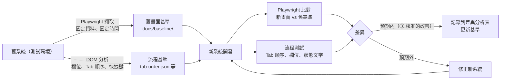

## 4.4 Software Framework Upgrade（前端框架升級）

> ⚠️ **Impeccable 不是 Framework Migration 工具。** 它不會把 Options API 轉成 Composition API、不會把 Bootstrap class 換成 Tailwind、也不會檢查 API 相容性。升級本身靠官方遷移指南、Codemod、編譯器與測試；Impeccable 只負責「升級後的畫面有沒有變差、有沒有偏離設計規範」。

### 4.4.1 十個問題的做法

| 問題 | 做法 | 工具 |
|---|---|---|
| 1. 升級前如何分析現有 UI | `/impeccable document` 產出 DESIGN.md（記錄現況，不做改善）；`npx impeccable detect` 建立 baseline | Impeccable |
| 2. 如何保存原始畫面基準 | 在**升級前的 commit** 用 Playwright 擷取所有主要頁面、四種 viewport | Playwright |
| 3. 如何建立 DESIGN.md | 從升級前程式碼 `document`；人工確認哪些是刻意設計 | Impeccable＋UI/UX |
| 4. 如何定義升級後的設計規範 | 「與升級前一致」為預設；任何改變都要列在變更清單 | 治理流程 |
| 5. 如何利用 Impeccable 協助重構 UI | 升級完成且畫面一致後，才用 `extract` 把重複樣式抽成 Tokens；再用 `polish` 處理偏離 | Impeccable |
| 6. 如何保留業務流程 | PRODUCT.md 記錄不可變更項目；Playwright 流程測試 | Playwright |
| 7. Responsive Regression Testing | 四種 viewport 截圖比對＋`detect --viewport 390x844` | Playwright＋Impeccable |
| 8. Visual Regression Testing | `toHaveScreenshot`，基準在 CI 的同一作業系統產生 | Playwright |
| 9. 如何驗證前後一致 | 截圖差異 ≤ 門檻；偵測器 baseline 沒有新增問題；axe 沒有新增違規 | 三者合併 |
| 10. 如何避免視覺回歸 | 每個升級 PR 都跑視覺回歸；差異必須逐張確認 | CI 閘門 |

### 4.4.2 常見升級類型的 Impeccable 使用重點

| 升級 | 視覺回歸主要來源 | Impeccable 重點 |
|---|---|---|
| Vue 2 → Vue 3 | UI 套件升級（Element UI → Element Plus、Vuetify 2 → 3）的預設樣式改變 | 升級前 `document`；升級後 `detect` 看 `design-system-*` 偏離 |
| Angular 舊版 → 新版 | Angular Material MDC 改版造成間距與字級變化 | 渲染掃描＋截圖比對 |
| React 舊版 → 新版 | 多半不影響樣式；主要是周邊套件 | 截圖比對為主 |
| Bootstrap → Tailwind | **全面改寫樣式**，風險最高 | 先把 Bootstrap 的實際數值寫進 DESIGN.md／Tailwind `@theme`，再逐頁遷移 |
| jQuery → Vue／React／Angular | DOM 結構改變影響 CSS 選擇器 | 流程測試（Tab、快捷鍵）＋截圖比對 |
| 舊版 CSS → Design System | 數值收斂（17 種藍色 → 3 種） | 這是③「UI/UX 改善」，需核准；`extract`＋`detect` |
| 多頁式網站 → SPA | 路由、捲動位置、焦點管理改變 | `harden`（焦點、錯誤狀態）；a11y 測試 |

## 4.5 本章實務案例與注意事項

**案例：逆向工程時 AI 擅自「美化」：**

某團隊請 Agent「用 Impeccable 重建舊的匯款畫面」。Agent 執行了一般新作流程，結果：

- 把 14 個欄位改成三步驟精靈（Wizard）。
- 「受款人帳號」移到「金額」之後。
- 「沖正」按鈕改成紅色 pill 按鈕並移到頁面底部。

經辦在 UAT 第一天就回報「找不到按鈕」「Tab 跳錯欄位」。

**正確做法**：

1. 第一階段只做①②，Prompt 明確寫「視覺還原，不改變任何欄位順序與操作步驟」，不使用 Refine 類指令。
2. Playwright 流程測試把 Tab 順序寫死（第 11.3 節範例）。
3. 改善需求（例如精靈式流程）列入③，由業務單位核准後另開需求。

**注意事項：**

- ⚠️ 「用 Impeccable 重建」這種 Prompt 太模糊，Agent 會走新作流程。要指定指令與範圍。
- ⚠️ 升級時不要同時做「框架升級」與「設計改善」。先升級、驗證一致，再改善。
- 💡 舊系統截圖基準要用**固定的測試資料與時間**，否則每次截圖都不同，比對沒有意義。

# 5. Impeccable 系統架構

## 5.1 整體系統架構圖

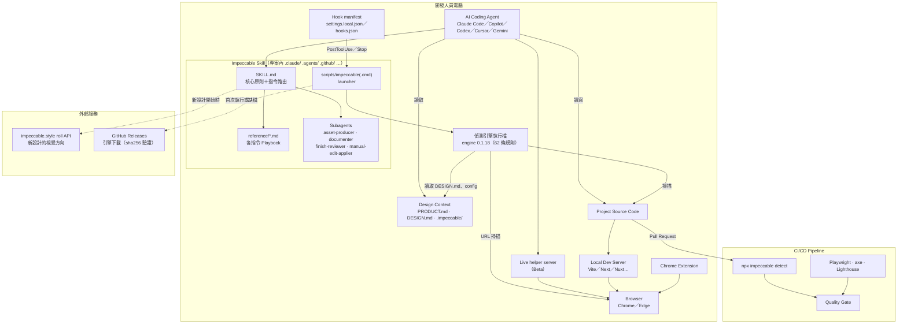

### 5.1.1 元件說明

| # | 元件 | 實體 | 職責 | 失效時的影響 |
|---|---|---|---|---|
| 1 | AI Coding Agent | Claude Code 等 | 依 Skill 執行設計指令、修改程式碼、處理 Hook 回饋 | — |
| 2 | Impeccable Skill | `<agent目錄>/skills/impeccable/SKILL.md` | 核心原則、Setup 步驟、指令路由 | Agent 找不到 `/impeccable` |
| 3 | Design Playbooks | `reference/*.md`（v4.8.0 共 41 份＋`degraded/` 子目錄，例如 `audit.md`、`polish.md`、`mode-operate.md`） | 每個指令的詳細操作規則 | 指令行為退化成一般 Prompt |
| 4 | Design Context | `PRODUCT.md`、`DESIGN.md`、`.impeccable/` | 產品與設計背景 | AI 只能用通用審美；設計系統規則不啟用 |
| 5 | Impeccable CLI | npm `impeccable`（Node shim） | `install`、`update`、`link`、`detect`、`ignores`、`check`、`telemetry` | 無法安裝與 CI 掃描（Skill 本身仍可運作） |
| 6 | Design Detector Engine | 平台專屬執行檔（npm optional dependency `@impeccable/cli-<平台>`，或 `~/.impeccable/bin/`） | 62 條確定性規則 | Hook 與 CLI 無法掃描 |
| 7 | Agent Hooks | 各 Agent 原生 manifest | 編輯後與回合結束時自動掃描 | 只能靠人記得跑 |
| 8 | Live Browser Mode | 本機 helper server＋注入的 `live.js` | 瀏覽器內選取與變體 | 只能用文字描述目標 |
| 9 | Browser Extension | Chrome Web Store「Impeccable」 | 在任何網頁上疊加偵測結果 | — |
| 10 | Project Source Code | 你的 repo | 被掃描與修改的對象 | — |
| 11 | Local Dev Server | Vite 等 | Live 與 URL 掃描的來源 | Live 無法啟動 |
| 12 | CI/CD Pipeline | GitHub Actions 等 | 合併前的客觀檢查 | 品質只靠個人自律 |

### 5.1.2 launcher 如何找到引擎

✅ 依 `scripts/impeccable` 原始碼與實測：

1. 環境變數 `IMPECCABLE_BIN` 指定的執行檔。
2. 與 launcher 同層的 `scripts/bin/<平台>/impeccable(.exe)`（`install` 會放一份，約 20 MB）。
3. `~/.impeccable/bin/impeccable(.exe)`。
4. 版本快取 `${IMPECCABLE_HOME:-~/.impeccable}/bin/<版本>/`（需通過 sha256 驗證，驗證後寫入 `.verified` 戳記）。
5. PATH 上的 `impeccable`。
6. 最後才從 `${IMPECCABLE_DOWNLOAD_BASE:-https://github.com/pbakaus/impeccable/releases/download}/engine-v<版本>/` 下載；**沒有對應 checksum 就拒絕下載**。

> 💡 企業內網可把引擎放到內部檔案伺服器，設定 `IMPECCABLE_DOWNLOAD_BASE` 指向內部鏡像，或用 `IMPECCABLE_BIN` 指定預先派送的執行檔（第 13.6 節）。

## 5.2 AI Agent 開發流程圖

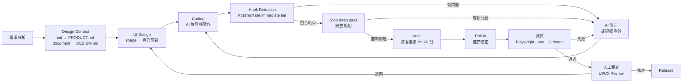

## 5.3 Hook 運作流程圖

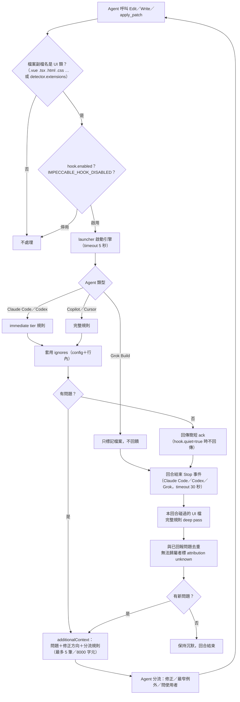

## 5.4 Live Browser 流程圖

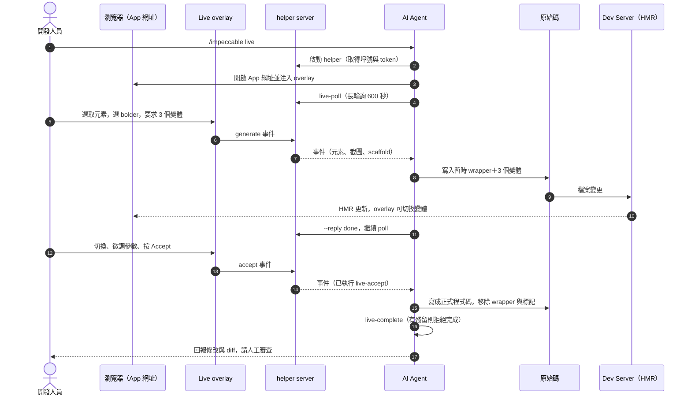

## 5.5 CI/CD 整合架構圖

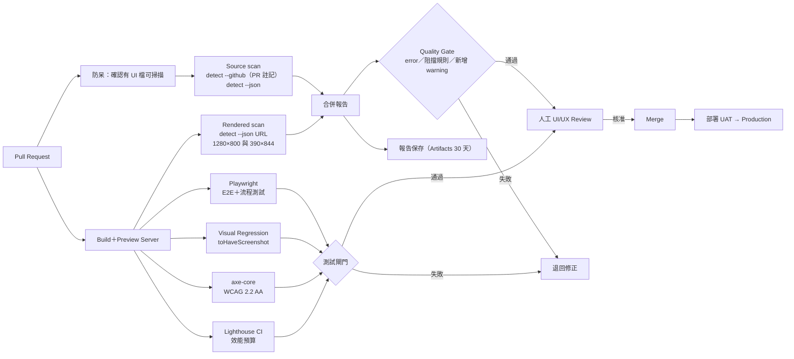

## 5.6 本章實務案例與注意事項

**案例：Hook 一直沒有反應：**

開發人員抱怨「裝了 Impeccable，Hook 從來沒有回報任何問題」。照 5.3 流程圖逐步檢查：

1. 修改的是 `.jsp`，不在預設副檔名清單 → 加 `detector.extensions`。
2. 使用 Codex，但從未在 `/hooks` 核准 → 核准。
3. `hook.quiet: true`，乾淨的編輯不會回報 → 這是正常的。

**注意事項：**

- ⚠️ Hook timeout 只有 5 秒（Stop 為 30 秒）。在很慢的網路磁碟或首次下載引擎時可能逾時，造成「這次沒掃到」。
- 💡 把 5.1 架構圖放進專案的 `docs/architecture/`，讓新成員知道 Impeccable 有哪些元件會連網。

# 6. 安裝與環境建置

## 6.1 環境需求

### 6.1.1 兩種執行環境要分清楚

| 項目 | Skill 執行環境（Agent 使用） | CLI 安裝與掃描工具（`npx impeccable`） |
|---|---|---|
| Node.js | **不需要**。Skill 的 launcher 直接執行引擎執行檔 | 需要 **18.19 以上**（`package.json` 的 `engines`）；開發 Impeccable 本身建議 22.18 以上 |
| npm／npx | 不需要 | 需要（隨 Node.js 安裝） |
| Git | 建議（Copilot Hook 用 `git rev-parse` 找專案根目錄） | Submodule 方式需要 |
| 作業系統 | 引擎提供 `windows-x64`、`linux-x64`、`linux-arm64`、`darwin-x64`、`darwin-arm64` | 同左 |
| 網路 | 首次執行若找不到引擎，會從 GitHub Releases 下載；新設計流程會連 impeccable.style | 安裝時需連 npm registry 與下載 Skill |
| 瀏覽器 | `critique`、`audit`、Live 會用到 | URL 掃描需要已安裝的 Chrome、Chromium 或 Edge |
| AI Coding Agent | 需要（支援清單見前言） | 不需要（CI 可單獨使用） |
| 本機開發環境 | Live 需要有 HMR 的 Dev Server | 渲染掃描需要可存取的 URL |

### 6.1.2 版本確認指令

適用 OS：Windows（PowerShell 7）

```powershell
node --version          # 需要 v18.19.0 以上，建議 v22 LTS
npm --version
git --version
npx --yes impeccable@4.8.0 --version   # 應顯示 4.8.0
```

## 6.2 安裝方式比較

> ⚠️ **不同安裝方式提供的功能不同。** 不要假設「Skill 裝好了就有 Hook」。

| 方式 | Skill | Subagents | Hook | 需要 Node | 適合 |
|---|---|---|---|---|---|
| A. `npx impeccable install` | ✅ | ✅（Claude、Copilot、Cursor） | ✅（Claude、Codex、Copilot、Cursor、Grok、Gemini 的 session hook） | 是 | **企業預設** |
| B. Git Submodule＋`link` | ✅（symlink） | 依 Agent | ❌（官方：「Linking installs skills, not hooks」） | 是 | 需要以 Git 鎖版本的團隊 |
| C1. Claude Code Plugin | ✅ | ✅ | ✅（Plugin 自帶） | 否 | Claude Code 個人使用 |
| C2. VS Code Extension（Copilot） | ✅ | — | ❌（官方：skill-only extension） | 否 | 只用 VS Code Copilot Chat |
| C3. GitHub Copilot app 內建 | ✅ | — | 📖 未說明 | 否 | Copilot app 使用者（Settings → Experimental 啟用） |
| C4. Grok Build Plugin | ✅ | ✅ | ✅ | 否 | Grok 使用者 |
| D. `npx skills add pbakaus/impeccable` | ✅ | — | ❌ | 是 | 使用 skills CLI 管理的團隊 |
| E. 手動複製（ZIP 或 repo） | ✅ | ❌ | ❌ | 否 | 無法使用 npm 的環境 |

## 6.3 方式 A：CLI 安裝（建議）

### 6.3.1 互動式安裝

適用 OS：Windows／macOS／Linux｜執行位置：**專案根目錄**

```bash
npx impeccable install
```

安裝程式會：

1. **偵測 AI Coding Agent**：檢查使用者目錄下的 harness 資料夾或已安裝的 CLI（例如 `~/.claude`、`~/.codex`、`~/.grok`、`~/.hermes`、`~/.veto`）以及專案內的 `.cursor`，列出偵測結果，讓你保留或自訂。
2. **選擇範圍**：「只裝在這個專案（project）」或「所有專案（global）」。
3. **說明 Hook 並詢問是否安裝**（預設是）。你的選擇會記錄在不進版控的 `.impeccable/config.local.json`，下次不再詢問。
4. 下載 Skill，並把對應平台的引擎放到每個 Skill 的 `scripts/bin/<平台>/`。
5. 寫入 Hook manifest，並保留 manifest 中與 Impeccable 無關的既有設定。

### 6.3.2 非互動式（腳本、CI、團隊標準化）

✅ 實測可用的參數（`npx impeccable install --help`）：

| 參數 | 說明 |
|---|---|
| `--providers=<清單>` | 逗號分隔，例如 `claude,codex,github,cursor,gemini` |
| `--scope=project｜global` | 也可用 `--project`、`--user`／`--global` |
| `-y`、`--yes` | 接受偵測到的預設值，不詢問 |
| `--no-hooks` | 只裝 Skill，不寫 Hook manifest（不會記錄選擇） |
| `--force` | 取代既有安裝；manifest 格式錯誤時備份成 `.bak` 再覆寫 |

```bash
npx impeccable install --providers=claude,codex,github --scope=project -y
```

✅ 實測輸出：

```text
Downloading impeccable skills...
Installed impeccable into: .agents, .cursor, .github, .gemini (project)
Installed impeccable engine v0.1.18 (windows-x64) into: …\.agents\skills\impeccable\scripts\bin\windows-x64\impeccable.exe
…
Installed Cursor agents into: …\.cursor\agents
Installed GitHub Copilot agents into: …\.github\agents
Installed hooks into: .agents, .cursor, .github, .gemini

Done! Now type /impeccable init in your AI coding agent's chat (not in this terminal) to set up design context.
```

### 6.3.3 Project Scope 與 Global Scope

| 面向 | Project（專案） | Global（使用者） |
|---|---|---|
| Skill 位置 | 專案內 `.claude/skills/`、`.agents/skills/`… | `~/.claude/skills/`、`~/.agents/skills/`… |
| Claude Hook | `.claude/settings.local.json`（不進版控） | `~/.claude/settings.json` |
| Codex Hook | `.codex/hooks.json`（官方：Codex 的 Hook 只能是專案範圍） | 需把 `.codex/hooks.json` 複製到每個專案 |
| 團隊一致性 | 高（隨 repo） | 低（每人不同版本） |
| 🏢 建議 | **企業預設** | 個人實驗 |

### 6.3.4 重新載入 AI Agent 與確認安裝成功

| Agent | 重新載入 | 確認方式 |
|---|---|---|
| Claude Code | 結束後重新啟動 `claude` | 輸入 `/impeccable` 出現指令清單；`/hooks` 看到 PostToolUse、Stop |
| GitHub Copilot（VS Code） | `Developer: Reload Window` | Chat（Agent 模式）輸入 `/impeccable` |
| Copilot CLI | 重新啟動 `copilot` | `/skills` 看到 impeccable |
| Codex | 重新啟動 `codex` | `/skills` 或 `$impeccable`；`/hooks` 核准 |
| Cursor | 重新啟動 Cursor | Settings → Hooks 看到項目；Hooks 輸出頻道 |
| Gemini CLI | 重新啟動 `gemini` | `/skills list` |

**實際檢查 Hook 能執行**（不需要 Agent，✅ 實測）：

適用 OS：Windows｜執行位置：專案根目錄（以 Codex 安裝的 launcher 為例）

```powershell
.\.agents\skills\impeccable\scripts\impeccable.cmd hooks status
.\.agents\skills\impeccable\scripts\impeccable.cmd detect --list-rules --quiet | Measure-Object -Line
```

第一個指令應顯示 `state: enabled`，第二個應顯示 `62`。

## 6.4 方式 B：Git Submodule（團隊共用版本）

### 6.4.1 建立

適用 OS：macOS／Linux（Bash）｜執行位置：專案根目錄

```bash
git submodule add https://github.com/pbakaus/impeccable vendor/impeccable
git -C vendor/impeccable checkout skill-v4.8.0      # 鎖定在正式版 tag，不要跟 main
npx impeccable link --source=vendor/impeccable --providers=claude,codex
git add .gitmodules vendor/impeccable .claude .agents
git commit -m "chore: vendor Impeccable skill-v4.8.0"
```

> 📌 官方 README 在不同段落分別使用 `vendor/impeccable` 與 `.impeccable` 當 submodule 路徑。🏢 **建議用 `vendor/impeccable`**，因為 `.impeccable/` 同時也是 Impeccable 存放專案設定與執行狀態的目錄，兩者混用容易誤 commit 或誤刪。

### 6.4.2 團隊成員同步

```bash
REPO_URL="https://git.example.com/team/app.git"   # 換成：你的 repo 網址
git clone --recurse-submodules "$REPO_URL"
# 或已 clone 的 repo：
git submodule update --init --recursive
```

### 6.4.3 升級 Submodule

```bash
NEW_TAG="skill-v4.8.0"   # 換成：要升級的正式版 tag（先讀 changelog，見第 13 章）
git -C vendor/impeccable fetch --tags
git -C vendor/impeccable checkout "$NEW_TAG"
npx impeccable link --source=vendor/impeccable --providers=claude,codex
git add vendor/impeccable
git commit -m "chore: bump Impeccable to $NEW_TAG"
```

> 📌 官方寫法是 `git submodule update --remote vendor/impeccable`，它會追到上游預設分支（`main`）的最新 commit，可能包含未發布的變更。🏢 企業環境建議改用上面「checkout 指定 tag」的寫法。

### 6.4.4 Submodule 方式的限制

| 限制 | 說明 | 對策 |
|---|---|---|
| 沒有 Hook | `link` 只建立 Skill 連結 | 在 Agent 中執行 `/impeccable hooks on`（📖 會在 Skill 已安裝時安裝或修復 Provider 的 Hook manifest），或接受「只靠 CI 掃描」 |
| ⚠️ Windows symlink 權限 | ✅ 實測 Windows 一般權限執行 `link` 失敗：`用戶端沒有這項特殊權限。 (os error 1314)` | 開啟 Windows「開發人員模式」，或以系統管理員執行；Git 需 `core.symlinks=true` |
| repo 體積 | 上游 repo 有 5,000 多個檔案（大部分是測試） | `--depth 1` 淺層 clone；或改用方式 A 並鎖 npm 版本 |
| 跨平台 symlink | Windows 同仁 clone 後 symlink 可能變成純文字檔 | 🏢 Windows 為主的團隊**優先用方式 A** |

## 6.5 方式 C：Plugin／Extension

### 6.5.1 Claude Code Plugin

在 Claude Code 對話框輸入：

```text
/plugin marketplace add pbakaus/impeccable
```

接著開 `/plugin` → Discover → 安裝 Impeccable。更新也是從 `/plugin` 選單操作。Plugin 會自帶 Hook（官方：「plugin installs can supply their own hooks」）。🧪 本手冊未實測 Plugin 安裝。

### 6.5.2 GitHub Copilot（VS Code Extension）

適用 OS：Windows／macOS／Linux

```bash
code --install-extension renaissance-geek.impeccable
```

需求：VS Code 1.109.3 以上、Copilot Chat 存取權、**受信任的本機 workspace**。開 Chat 的 Agent 模式，輸入 `/impeccable polish`。

> ⚠️ 這個 Extension **只有 Skill、沒有 Hook**。同一個 workspace 不要再用方式 A 安裝 `.github/skills/impeccable`，否則會出現兩份 Skill。

### 6.5.3 Codex

官方明說「There is no Codex marketplace/plugin install flow for this hook」。Codex 一律使用方式 A，安裝後在 `/hooks` 核准。

### 6.5.4 其他 Agent

| Agent | 方式 |
|---|---|
| Grok Build | `grok plugin install pbakaus/impeccable#plugin --trust`（含 Skill、Agents、Hook） |
| Hermes Agent | 方式 A 或手動複製；專案範圍需 `hermes skills trust` |
| Devin、Replit Agent | 方式 A（`--providers=devin`、`replit`；`windsurf` 是 `devin` 的別名） |
| 其他 | 方式 A 或 E（手動複製，目錄見 6.7 節） |

## 6.6 Windows 安裝教學

### 6.6.1 安裝 Node.js 與 Git

適用 OS：Windows（PowerShell 7，一般使用者權限）

```powershell
winget install --id OpenJS.NodeJS.LTS --exact
winget install --id Git.Git --exact
# 關閉並重新開啟 PowerShell，讓 PATH 生效
node --version
git --version
```

> 💡 公司若有內部 npm registry，先設定：`npm config set registry https://<公司 registry 網址>/`。

### 6.6.2 以鎖定版本安裝（企業標準腳本）

🏢 下列腳本會檢查 Node.js 版本、確認位於 Git 專案根目錄、把 `impeccable` 以 `--save-exact` 鎖進 devDependencies，再以專案範圍安裝 Skill 與 Hook。✅ 已在全新 Git 專案實際執行。

📄 `tools/Install-Impeccable.ps1`

```powershell
<#
.SYNOPSIS
  在專案根目錄以「鎖定版本」安裝 Impeccable（教學範例，PowerShell 7）。
.EXAMPLE
  pwsh -File tools/Install-Impeccable.ps1 -Providers claude,codex,github
#>
[CmdletBinding()]
param(
    [string[]] $Providers = @('claude', 'github'),
    [string]   $Version   = '4.8.0',
    [switch]   $NoHooks
)
$ErrorActionPreference = 'Stop'

# 1. 前置檢查：Node.js 18.19 以上、Git、位於 Git 專案根目錄
$nodeVersion = [version]((node --version).TrimStart('v'))
if ($nodeVersion -lt [version]'18.19.0') {
    throw "Node.js 版本 $nodeVersion 太舊，需要 18.19 以上（建議 22 LTS）。"
}
$gitRoot = (git rev-parse --show-toplevel 2>$null)
if (-not $gitRoot) { throw '請在 Git 專案內執行。' }
if ((Resolve-Path $gitRoot).Path -ne (Get-Location).Path) {
    throw "請在專案根目錄執行（目前：$(Get-Location)；根目錄：$gitRoot）。"
}

# 2. 關閉匿名統計（本次程序）；永久關閉請執行 npx impeccable telemetry off
$env:DO_NOT_TRACK = '1'

# 3. 以 devDependency 鎖定版本，之後 npx impeccable 會用 node_modules 內的版本
npm install --save-dev --save-exact "impeccable@$Version"
if ($LASTEXITCODE -ne 0) { throw 'npm install 失敗，請檢查公司 npm registry 或代理伺服器設定。' }

# 4. 專案範圍安裝 Skill（與 Hook）
$installArgs = @('impeccable', 'install', "--providers=$($Providers -join ',')", '--scope=project', '-y')
if ($NoHooks) { $installArgs += '--no-hooks' }
npx @installArgs
if ($LASTEXITCODE -ne 0) { throw 'impeccable install 失敗。' }

# 5. 顯示安裝結果
Write-Host "`n已安裝版本：" -ForegroundColor Cyan
npx impeccable --version
Get-ChildItem -Recurse -Filter SKILL.md -Path .claude, .agents, .github, .cursor, .gemini -ErrorAction SilentlyContinue |
    Where-Object { $_.DirectoryName -like '*impeccable*' } |
    ForEach-Object { Write-Host "  Skill: $($_.FullName)" }
foreach ($manifest in '.claude/settings.local.json', '.codex/hooks.json', '.cursor/hooks.json',
                      '.github/hooks/impeccable.json', '.gemini/settings.json') {
    if (Test-Path $manifest) { Write-Host "  Hook manifest: $manifest" }
}
Write-Host "`n下一步：重新載入 AI Agent，在對話中輸入 /impeccable init（Codex 為 `$impeccable init）。" -ForegroundColor Green
```

執行：

```powershell
pwsh -File tools/Install-Impeccable.ps1 -Providers claude,codex,github
```

### 6.6.3 安裝目錄檢查

🏢 只讀檢查腳本，列出各 Provider 的 Skill 版本、引擎版本、Hook manifest 與規則數。✅ 已實測。

📄 `tools/Test-Impeccable.ps1`

```powershell
<#
.SYNOPSIS
  檢查專案內 Impeccable 安裝狀態（教學範例，PowerShell 7，只讀不寫）。
#>
$ErrorActionPreference = 'Continue'
$env:DO_NOT_TRACK = '1'
$result = [ordered]@{}

# 1. CLI 版本（node_modules 內鎖定的版本）
$result['CLI 版本'] = (npx --no-install impeccable --version 2>$null)

# 2. 各 Provider 的 Skill 與引擎版本
$skillDirs = '.claude/skills/impeccable', '.agents/skills/impeccable', '.github/skills/impeccable',
             '.cursor/skills/impeccable', '.gemini/skills/impeccable'
foreach ($dir in $skillDirs) {
    if (Test-Path "$dir/SKILL.md") {
        # Codex 版（.agents）的 SKILL.md 沒有 version 欄位，此時顯示 n/a，以 scripts/VERSION 的引擎版本為準
        $match = Select-String -Path "$dir/SKILL.md" -Pattern '^version:\s*(.+)$' | Select-Object -First 1
        $skillVersion = if ($match) { $match.Matches[0].Groups[1].Value } else { 'n/a' }
        $engineVersion = (Get-Content "$dir/scripts/VERSION" -ErrorAction SilentlyContinue)
        $result["Skill $dir"] = "skill $skillVersion / engine $engineVersion"
    }
}

# 3. Hook manifest 是否存在
foreach ($manifest in '.claude/settings.local.json', '.codex/hooks.json', '.cursor/hooks.json',
                      '.github/hooks/impeccable.json', '.gemini/settings.json') {
    if (Test-Path $manifest) {
        $hasImpeccable = Select-String -Path $manifest -Pattern 'impeccable' -Quiet
        $result["Hook $manifest"] = if ($hasImpeccable) { '已設定' } else { '檔案存在但沒有 impeccable 項目' }
    }
}

# 4. 引擎可執行（列出規則數量）
$launcher = $skillDirs | ForEach-Object { "$_/scripts/impeccable.cmd" } | Where-Object { Test-Path $_ } | Select-Object -First 1
if ($launcher) {
    $rules = & $launcher detect --list-rules --quiet 2>$null
    $result['引擎規則數'] = ($rules | Measure-Object).Count
}

# 5. Context 檔
$result['PRODUCT.md'] = Test-Path PRODUCT.md
$result['DESIGN.md']  = Test-Path DESIGN.md

$result.GetEnumerator() | Format-Table -AutoSize
```

✅ 實測輸出：

```text
Name                               Value
----                               -----
CLI 版本                           4.8.0
Skill .agents/skills/impeccable    skill n/a / engine 0.1.18
Skill .github/skills/impeccable    skill 4.8.0 / engine 0.1.18
Hook .codex/hooks.json             已設定
Hook .github/hooks/impeccable.json 已設定
引擎規則數                         62
PRODUCT.md                         False
DESIGN.md                          False
```

### 6.6.4 Hook 設定確認

```powershell
Get-Content .claude\settings.local.json | ConvertFrom-Json | Select-Object -ExpandProperty hooks | Format-List
Get-Content .codex\hooks.json
Get-Content .github\hooks\impeccable.json
```

### 6.6.5 Windows 常見權限與路徑問題

| 問題 | 現象 | 解法 |
|---|---|---|
| PowerShell 執行原則 | `npx.ps1 cannot be loaded because running scripts is disabled` | `Set-ExecutionPolicy -Scope CurrentUser RemoteSigned`，或改用 `npx.cmd` |
| symlink 權限 | `link` 回報 `os error 1314` | 開啟「設定 → 系統 → 開發人員專用 → 開發人員模式」 |
| 路徑過長 | Submodule clone 失敗 | `git config --global core.longpaths true` |
| 防毒軟體攔截引擎 | 引擎首次執行很慢或被隔離 | 請資安將 `.claude\skills\impeccable\scripts\bin\` 與 `%USERPROFILE%\.impeccable\bin\` 加入評估清單（不要直接排除，先驗 sha256） |
| URL 掃描逾時 | `Timed out after 30000 ms while waiting for the WS endpoint URL` | ✅ 實測：`HOME`／`USERPROFILE` 被改寫時會發生，恢復正常值即可；也可能是公司政策禁止瀏覽器遠端偵錯（第 16.17 節） |
| Edge 無法用於自動化 | `DevTools remote debugging is disallowed by the system admin` | ✅ 實測：公司 GPO 封鎖；改用 Chrome，或請 IT 為開發機調整 `RemoteDebuggingAllowed` 政策 |
| Hook 指令語法 | Cursor 與 Copilot 的 manifest 只有 POSIX shell 寫法（`[ ! -f … ]`） | 🧪 Windows 上需確認 Agent 以 Git Bash 執行 Hook；Claude Code 在 Windows 使用 Git Bash，Codex 另有 `commandWindows` |

> 📌 v4.5.1 的 changelog 記載「Hook commands run in PowerShell on Windows」。✅ 實測 v4.8.0 在 Windows 安裝時，只有 `.gemini/settings.json` 產生 PowerShell 寫法；`.codex/hooks.json` 同時有 `command` 與 `commandWindows`；`.cursor/hooks.json` 與 `.github/hooks/impeccable.json` 只有 POSIX 寫法。

### 6.6.6 macOS／Linux 的必要差異

| 項目 | Windows | macOS／Linux |
|---|---|---|
| launcher | `scripts\impeccable.cmd` | `scripts/impeccable`（需執行權限） |
| 權限問題 | 執行原則、symlink | `chmod +x .claude/skills/impeccable/scripts/impeccable`（從 ZIP 解壓時可能遺失） |
| 引擎快取 | `%USERPROFILE%\.impeccable\bin\` | `~/.impeccable/bin/` |
| Symlink | 需開發人員模式 | 原生支援 |
| 瀏覽器 | Chrome／Edge | Chrome／Chromium（Linux CI 可用 `npx playwright install chromium`） |

## 6.7 安裝目錄結構

✅ 下表為 v4.8.0 `install --scope=project` 實際產生的檔案（`reference/`、`scripts/` 內容省略）：

```text
專案根目錄/
├── .claude/                              # Claude Code
│   ├── agents/                           # 4 個 Subagent
│   │   ├── impeccable-asset-producer.md
│   │   ├── impeccable-documenter.md
│   │   ├── impeccable-finish-reviewer.md
│   │   └── impeccable-manual-edit-applier.md
│   ├── settings.local.json               # Hook：SessionStart、PostToolUse、Stop（不進版控）
│   └── skills/impeccable/
│       ├── SKILL.md
│       ├── reference/                    # 各指令 Playbook
│       └── scripts/
│           ├── impeccable                # POSIX launcher
│           ├── impeccable.cmd            # Windows launcher
│           ├── VERSION                   # 引擎版本（0.1.18）
│           ├── engine-checksums.txt      # 引擎 sha256
│           ├── command-metadata.json
│           ├── live-browser*.js          # Live Mode 腳本
│           └── bin/windows-x64/impeccable.exe   # 引擎（約 20 MB）
├── .agents/skills/impeccable/            # Codex（也供 Replit Agent 使用）
│   └── agents/*.toml、openai.yaml         # Codex 的 Subagent 定義
├── .codex/hooks.json                     # Codex Hook：PostToolUse、Stop
├── .github/                              # GitHub Copilot
│   ├── agents/impeccable-*.agent.md
│   ├── hooks/impeccable.json             # Copilot Hook：postToolUse（要 commit）
│   └── skills/impeccable/
├── .cursor/                              # Cursor
│   ├── agents/impeccable-*.md
│   ├── hooks.json                        # Cursor Hook：postToolUse
│   └── skills/impeccable/
└── .gemini/                              # Gemini CLI
    ├── settings.json                     # BeforeTool、AfterAgent（session／completion）
    └── skills/impeccable/
```

| 檔案類型 | 用途 | 是否 commit |
|---|---|---|
| `skills/impeccable/SKILL.md`、`reference/` | Agent 讀取的設計指引 | ✅ 是（團隊一致） |
| `scripts/impeccable(.cmd)`、`engine-checksums.txt`、`VERSION` | launcher 與完整性驗證 | ✅ 是 |
| `scripts/bin/<平台>/impeccable(.exe)` | 引擎執行檔，每個 Provider 各一份（約 20 MB×Provider 數） | 🏢 **建議不要 commit**（見下方說明） |
| `agents/` | Subagent 定義 | ✅ 是 |
| `.claude/settings.local.json` | 個人 Claude Hook | ❌ 否 |
| `.codex/hooks.json`、`.cursor/hooks.json`、`.gemini/settings.json` | 團隊 Hook | ✅ 是（變更需審查） |
| `.github/hooks/impeccable.json` | Copilot Hook（必須在預設分支才會生效） | ✅ 是 |

> 💡 **引擎執行檔要不要進版控？** ✅ 實測安裝程式**不會**自動 gitignore `scripts/bin/`。四個 Provider 就是約 80 MB 的二進位檔，而且只有安裝者的平台。🏢 建議在 `.gitignore` 加入 `**/skills/impeccable/scripts/bin/`。其他成員第一次執行時，launcher 會自動下載同版本並驗證 sha256（✅ 實測約 18 秒），或由 `npx impeccable install` 重新放置。內網環境請搭配 13.6 節的內部鏡像。

## 6.8 `.gitignore` 設定

📖 官方建議的區塊（以 `# impeccable-ignore-start`／`# impeccable-ignore-end` 標記，方便日後更新），再加上 🏢 引擎執行檔：

```gitignore
# impeccable-ignore-start
# Ephemeral output, runtime state, and per-dev overrides.
**/.impeccable/config.local.json
**/.impeccable/hook.cache.json
**/.impeccable/hook.pending.json
**/.impeccable/*.png
**/.impeccable/review/
**/.impeccable/questions/
**/.impeccable/live/server.json
**/.impeccable/live/sessions/
**/.impeccable/live/previews/
**/.impeccable/live/annotations/
**/.impeccable/live/cache/
**/.impeccable/live/manual-edit-apply-transaction.json
**/.impeccable/live/manual-edit-events.jsonl
**/.impeccable/live/manual-edit-evidence/
**/.impeccable/live/pending-manual-edits.json
**/.impeccable/live/deferred-svelte-component-accepts.json
**/.impeccable/live/*.png
# impeccable-ignore-end

# 企業補充：各 Provider 的引擎執行檔不進版控
**/skills/impeccable/scripts/bin/
```

保留在版控中的共用檔案：`.impeccable/config.json`、`.impeccable/live/config.json`、`.impeccable/design.json`、`.impeccable/surfaces/*.md`、`.impeccable/critique/*.md`。

## 6.9 本章實務案例與注意事項

**案例：Windows 團隊導入：**

一個 12 人的 Vue 團隊，全員 Windows，混用 Claude Code 與 Copilot：

1. 架構師在一個分支執行 `tools/Install-Impeccable.ps1 -Providers claude,github`。
2. 加入 6.8 節的 `.gitignore`，確認 `scripts/bin/` 沒有被 commit。
3. PR 中審查 `.github/hooks/impeccable.json` 與 Skill 版本，合併到 `main`（Copilot CLI 的 Hook 從此生效）。
4. 每位成員 `git pull` 後各自執行一次 `npx impeccable install --providers=claude --scope=project -y`，產生自己的 `.claude/settings.local.json`。
5. 用 `tools/Test-Impeccable.ps1` 確認環境。

**注意事項：**

- ⚠️ 不要用 `npx impeccable@latest`。CI 與個人環境都應使用 `package.json` 鎖定的版本。
- ⚠️ 同一個 Agent 不要同時用兩種方式安裝（例如 VS Code Extension＋`.github/skills/`），會載入兩份 Skill。
- 💡 新成員入職只需要：`npm ci` → `npx impeccable install --providers=<自己的 Agent> --scope=project -y` → 重新載入 Agent。

# 7. 設定與企業 Design Governance

## 7.1 初始化專案：`/impeccable init`

### 7.1.1 init 做什麼、不做什麼

📖 依 `reference/init.md`：

| init 會做 | init 不會做 |
|---|---|
| 掃描專案（文件、package、路由、角色、品牌素材、無障礙線索） | 決定色盤、字型、元件、視覺風格 |
| 只針對「程式碼與需求回答不了的重要缺口」提問，每輪最多 3 題 | 寫 DESIGN.md（那是 `document` 的工作） |
| 判斷平台：`web`、`ios`、`android`、`adaptive` | 編造客戶評語、數據、價格、授權或部署資訊 |
| 寫入 `PRODUCT.md`（帶 `<!-- impeccable:product-schema 1 -->` 標記） | 未經確認就覆寫既有 PRODUCT.md |
| 有影像生成能力時，詢問一次 `buildPath`（`comp` 或 `code`），寫入 `.impeccable/config.json` | 把沒回答的問題當成預設值寫入 |
| 可執行的 Web 專案，設定 `.impeccable/live/config.json` | 在未同意前修改 CSP |
| 建議下一步指令 | — |

> 💡 **「完成閘門」**：init 結束前會確認 `PRODUCT.md` 檔案真的存在於解析後的路徑；只有訪談筆記、沒有檔案，就算 init 未完成。

### 7.1.2 執行方式

| Agent | 輸入 |
|---|---|
| Claude Code、Copilot、Cursor、Gemini | `/impeccable init` |
| Codex | `$impeccable init`（或 `/skills` → impeccable，再輸入 init） |
| Monorepo 子應用 | 在子應用目錄的對話中執行，init 會先確認「共用 vs 子應用專屬」範圍 |

### 7.1.3 企業版 init Prompt 範本

```text
/impeccable init

背景資料（請先讀，再只針對缺口提問）：
- 產品說明：docs/需求規格書.md
- 舊系統作業手冊：docs/legacy/作業手冊-2024.pdf
- 使用者訪談紀錄：docs/research/訪談-2026Q3.md
- 公司視覺識別規範：docs/brand/數位通路視覺識別規範-v3.2.pdf

限制：
- 這是銀行內部作業系統，平台為 web。
- 不要詢問或決定任何視覺風格，視覺規範由 DESIGN.md 另行處理。
- 沒有證據的事實（滿意度、使用人數）一律標記為「未確認」，不得編造。
- 完成後列出你推論但未經確認的項目，讓我逐項確認。
```

### 7.1.4 如何審查 init 的產出

| 檢查項目 | 好的產出 | 要退回的產出 |
|---|---|---|
| 使用者 | 「分行經辦，每天處理 200～400 筆匯款，習慣鍵盤操作」 | 「使用者是需要高效工具的專業人士」（空泛） |
| 證據 | 列出實際檔案路徑；沒有的資料明寫「沒有」 | 出現「使用者滿意度 92%」但找不到出處 |
| 視覺 | 沒有色盤與字型決策（品牌強制規定除外） | 「採用現代簡約風格、藍紫配色」 |
| 平台 | `web` | 空白或寫成框架名稱 |
| 標記 | 保留 `<!-- impeccable:product-schema 1 -->` | 標記被刪除（`doctor` 會判斷為舊格式） |

## 7.2 PRODUCT.md 設計

### 7.2.1 官方章節與企業欄位對照

v4.8.0 的 PRODUCT.md 有固定章節。企業常用的欄位要放進對應的官方章節，**不要自創章節**（自創章節會被保留，但後續指令不一定會用到）：

| 企業需要的欄位 | 放在官方章節 |
|---|---|
| Product Name、Business Purpose | `## Product Purpose` |
| Target Users、User Personas | `## Users` |
| Business Domain、User Journeys | `## Operating Context` |
| Core Features、限制、術語 | `## Capabilities and Constraints` |
| Brand Identity | `## Brand Commitments` |
| Product Positioning | `## Positioning` |
| Design Goals（策略層級） | `## Product Principles` |
| Accessibility Requirements | `## Accessibility & Inclusion` |
| Responsive Requirements | `## Operating Context`（裝置與螢幕）＋`## Capabilities and Constraints` |
| 技術選型（新專案） | `## Stack`（只有全新專案才需要） |
| 實際素材與資料 | `## Evidence on Hand` |
| 平台 | `## Platform`（只能是 `web`、`ios`、`android`、`adaptive`） |

> ⚠️ **PRODUCT.md 不放視覺決策。** 官方原文：「Do not ask for an aesthetic direction, emotional feel, visual references, colors, typography, or style during init. If the user volunteers a binding visual constraint, record it without expanding it.」所以下例只在 Brand Commitments 記錄「公司 CI 強制規定」，其餘視覺細節一律放在 DESIGN.md。

### 7.2.2 企業級 PRODUCT.md 範例（銀行內部交易作業平台）

📄 `PRODUCT.md`（🏢 教學範例）

```markdown
# Product

<!-- impeccable:product-schema 1 -->

## Platform

web

## Users

- 主要使用者：銀行分行與作業中心的「交易作業人員」。每天在桌上型電腦（1920×1080、125% 縮放）處理 200～400 筆匯款、轉帳與退匯案件，習慣以鍵盤完成查詢、覆核與送出。
- 次要使用者：「覆核主管」。在同一畫面比對經辦輸入與原始憑證，核准或退回；常在會議中以平板（1180×820）臨時覆核。
- 第三類使用者：「稽核人員」。只讀，查詢 13 個月內的交易軌跡並匯出報表。
- 未確認：分行是否仍有 1366×768 舊螢幕（待資訊處提供資產清冊）。

## Product Purpose

「企業金融交易作業平台」（代號 FTOP）取代 2009 年上線的 ASP.NET Web Forms 系統，讓經辦在不改變既有作業流程的前提下，更快、更不容易出錯地完成交易建檔、覆核與查詢。

成功指標：

1. 單筆匯款建檔平均時間不高於舊系統（基準 95 秒，以 UAT 量測）。
2. 因「看錯欄位、看錯狀態」造成的退件率下降 30%。
3. WCAG 2.2 AA 稽核無 P0／P1 缺失。

## Positioning

內部系統，不對外行銷。差異化在於「交易狀態一眼可辨、覆核比對不需切換畫面、鍵盤操作完整」，而不是視覺新奇。

## Operating Context

- 作業時段 08:30～15:30 為高峰，畫面必須在高壓下仍可快速掃描。
- 經辦會同時開 2～3 個分頁比對案件。
- 列印：交易憑證需可 A4 直式列印，黑白印表機可辨識狀態。
- 內網環境，不可載入外部 CDN 字型。

## Capabilities and Constraints

- 前端：Vue 3.5＋TypeScript＋PrimeVue 5＋Tailwind CSS 4；後端：Spring Boot REST API（既有，不在本專案範圍）。
- 不可改變：交易欄位順序、Tab 鍵順序、快捷鍵（F2 查詢、F8 送出、Esc 取消）、覆核兩段式流程。
- 金額一律右對齊、千分位、小數兩位；日期格式 `YYYY/MM/DD`（民國年僅在列印憑證顯示）。
- 術語：「經辦」、「覆核」、「退件」、「沖正」、「入帳」，不可改用口語詞。
- 未決定：是否提供深色模式（資訊處評估中，預設不提供）。

## Brand Commitments

- 依循本行《數位通路視覺識別規範 v3.2》：主色「行徽藍」、字型 Noto Sans TC。
- 語氣：正式、精確、不使用驚嘆號與行銷用語。

## Evidence on Hand

- 舊系統畫面截圖基準：`docs/baseline/screens/`（Playwright 擷取，共 46 張）。
- 作業手冊：`docs/legacy/作業手冊-2024.pdf`。
- 沒有使用者滿意度調查數據；任何畫面不得虛構統計數字或使用者評語。

## Product Principles

1. 正確優先於美觀：任何改動不得增加看錯金額、帳號或狀態的機率。
2. 流程不變：視覺可以改善，操作順序與欄位語意不可改變。
3. 狀態必須同時以文字＋圖示＋顏色表達，不能只靠顏色。
4. 密度可調但預設高密度：經辦需要一屏看到完整案件。
5. 可稽核：每個操作結果都要有明確的成功／失敗訊息與交易序號。

## Accessibility & Inclusion

- 標準：WCAG 2.2 AA（金管會與本行資訊安全政策要求）。
- 鍵盤：所有功能可用鍵盤操作，焦點框清楚可見（不可移除 outline）。
- 色彩：狀態不可只靠顏色區分；對比 4.5:1 以上。
- 動態：尊重 `prefers-reduced-motion`；不使用自動輪播。
```

### 7.2.3 撰寫原則

- **具體**：寫數字與情境（「200～400 筆／天」「1920×1080、125% 縮放」），不要寫形容詞。
- **可驗證**：成功指標要能在 UAT 量測。
- **標示未決**：不知道的寫「未確認」或「未決定」，避免 AI 自行補完。
- **約束寫在這裡**：逆向工程與升級專案「不可改變」的項目，一定寫在 `## Capabilities and Constraints`。

## 7.3 DESIGN.md 設計

### 7.3.1 格式規格

📖 Impeccable 的 DESIGN.md 遵循 Google Labs 的 [DESIGN.md format spec](https://github.com/google-labs-code/design.md)：

1. **YAML frontmatter**：機器可讀的 Design Tokens。官方原文：「Tokens are normative; prose provides context for how to apply them.」
2. **最多 8 個固定順序的章節**：`## Overview`、`## Colors`、`## Typography`、`## Layout`、`## Elevation & Depth`、`## Shapes`、`## Components`、`## Do's and Don'ts`。不相關的章節可以省略，但出現的章節要維持順序。

frontmatter 規則：

| 規則 | 說明 |
|---|---|
| Token 參照 | `{colors.primary}`、`{rounded.md}`；元件可參照基本 Token，基本 Token 之間不可互相參照 |
| 色彩格式 | 任何合法 CSS 色彩字串；建議 hex，但專案原本用 `oklch()` 就保留，不要分裂成兩種來源 |
| 元件屬性 | 只有 8 個：`backgroundColor`、`textColor`、`typography`、`rounded`、`padding`、`size`、`height`、`width`。陰影、動態、焦點框不放 frontmatter，寫在內文 |
| 命名 | 用專案原本的名稱（`bank-navy`），不要改成 Material 預設名 |
| 變體 | 用命名慣例：`button-primary`、`button-primary-hover` |
| 字級階梯 | `typography.scale` 列舉允許的字級；偵測器允許每階 ±0.5px（上游 DESIGN.md 註解） |

### 7.3.2 企業欄位對照

| 企業需要的欄位 | 放在 |
|---|---|
| Design Philosophy、Visual Identity | `## Overview` |
| Color System | frontmatter `colors`＋`## Colors` |
| Typography | frontmatter `typography`＋`## Typography` |
| Spacing System、Layout Rules、Grid System、Responsive Breakpoints | frontmatter `spacing`＋`## Layout` |
| 陰影 | `## Elevation & Depth` |
| 圓角 | frontmatter `rounded`＋`## Shapes` |
| Component／Button／Form／Table／Navigation／Dashboard Guidelines | frontmatter `components`＋`## Components` 下的 `###` 小節 |
| Animation | `## Components` 下的 `### Motion`，或 `## Do's and Don'ts` |
| Accessibility | 各章節中的具體規則（對比、焦點、狀態表達）；需求本身在 PRODUCT.md |
| Dark Mode | `## Overview` 說明是否提供；提供時在 `## Colors` 寫對應色 |
| Anti-Patterns | `## Do's and Don'ts` 的 Don't 清單 |

### 7.3.3 完整 DESIGN.md 範例（企業內部管理／金融作業系統）

📄 `DESIGN.md`（🏢 教學範例，數值僅供示範）

```markdown
---
name: FTOP 企業金融交易作業平台
description: 行徽藍為唯一品牌色，高密度、低裝飾的作業型介面；狀態以文字＋圖示＋顏色三重表達。

# 數值為教學示範，不代表任何銀行的正式設計規範。
# 單一事實來源：src/styles/tokens.css；修改時兩處同步。
colors:
  bank-navy: "#1f4e79"          # 主要按鈕、選取列、焦點框
  bank-navy-deep: "#173a5a"     # 主要按鈕 hover
  slate-blue: "#496b8a"         # 次要強調、圖表第二序列
  ink: "#1f2933"                # 內文
  ink-muted: "#52606d"          # 輔助說明（白底對比 6.4:1）
  rule: "#d9dee3"               # 表格分隔線
  surface: "#ffffff"            # 內容區
  surface-sunken: "#f4f6f8"     # 頁面底色、表頭
  status-success: "#1e7b34"     # 已入帳
  status-warning: "#8a5a00"     # 待覆核
  status-danger: "#b42318"      # 退件、錯誤
  status-info: "#175cd3"        # 處理中

typography:
  scale:
    "12": "0.75rem"   # 表格註腳、時間戳
    "14": "0.875rem"  # 表格內文、表單欄位（預設密度）
    "16": "1rem"      # 一般內文
    "18": "1.125rem"  # 區塊標題
    "20": "1.25rem"   # 頁面次標題
    "24": "1.5rem"    # 頁面標題
  title:
    fontFamily: "Noto Sans TC, PingFang TC, Microsoft JhengHei, sans-serif"
    fontSize: "1.5rem"
    fontWeight: 600
    lineHeight: 1.35
  body:
    fontFamily: "Noto Sans TC, PingFang TC, Microsoft JhengHei, sans-serif"
    fontSize: "0.875rem"
    fontWeight: 400
    lineHeight: 1.6
  numeric:
    fontFamily: "Roboto Mono, Consolas, monospace"
    fontSize: "0.875rem"
    fontWeight: 500
    lineHeight: 1.6

rounded:
  none: "0"
  sm: "4px"
  md: "6px"

spacing:
  "1": "4px"
  "2": "8px"
  "3": "12px"
  "4": "16px"
  "6": "24px"
  "8": "32px"

components:
  button-primary:
    backgroundColor: "{colors.bank-navy}"
    textColor: "{colors.surface}"
    typography: "{typography.body}"
    rounded: "{rounded.sm}"
    padding: "8px 16px"
    height: "36px"
  button-primary-hover:
    backgroundColor: "{colors.bank-navy-deep}"
    textColor: "{colors.surface}"
  button-secondary:
    backgroundColor: "{colors.surface}"
    textColor: "{colors.bank-navy}"
    rounded: "{rounded.sm}"
    padding: "8px 16px"
    height: "36px"
  input-text:
    backgroundColor: "{colors.surface}"
    textColor: "{colors.ink}"
    typography: "{typography.body}"
    rounded: "{rounded.sm}"
    padding: "6px 10px"
    height: "36px"
  table-header:
    backgroundColor: "{colors.surface-sunken}"
    textColor: "{colors.ink}"
    typography: "{typography.body}"
    padding: "8px 12px"
---

# Design System: FTOP

## Overview

作業型（Operate）介面：使用者來這裡「完成任務」，不是被說服。設計的野心表現在精確與克制——資訊密度高、層級清楚、零裝飾。參考對象是高品質的專業工具（交易終端、ERP 作業畫面），不是 SaaS 行銷首頁。

- **密度**：預設「緊湊」，表格列高 36px；提供「舒適」切換（列高 44px），不提供更鬆的模式。
- **層級**：每頁只有一個主要動作（Primary Button）；頁面標題 24px，區塊標題 18px，內文 14px。
- **深色模式**：本版不提供（PRODUCT.md 記載為未決定）。不得自行加入。

## Colors

### Primary

- **行徽藍 Bank Navy**（#1f4e79）：主要按鈕、表格選取列左側 2px 指示線、焦點框。全頁面積不超過 10%。

### Secondary

- **石板藍 Slate Blue**（#496b8a）：圖表第二序列、次要連結。不得用於按鈕。

### Neutral

- **墨色 Ink**（#1f2933）內文；**次要墨色 Ink Muted**（#52606d）說明文字；**分隔線 Rule**（#d9dee3）；**底色 Surface Sunken**（#f4f6f8）。

### Named Rules

- **狀態三重表達規則**：狀態一律「文字＋圖示＋顏色」。例：`✓ 已入帳`（status-success）、`⏳ 待覆核`（status-warning）、`✕ 退件`（status-danger）。黑白列印時必須仍可辨識。
- **禁止漸層規則**：任何背景、文字、按鈕都不使用漸層。
- **灰字禁令**：彩色底上不放灰字；狀態色塊上的文字一律白色或深色墨色。

## Typography

- 中文：Noto Sans TC（品牌指定，內網自架字型檔）；備援 PingFang TC、Microsoft JhengHei。
- 數字與帳號：Roboto Mono，`font-variant-numeric: tabular-nums`，金額右對齊。
- 只使用 `typography.scale` 列出的字級；不得出現 13px、15px 等中間值。

### Hierarchy

| 角色 | 字級 | 字重 | 用途 |
|---|---|---|---|
| title | 24px | 600 | 頁面標題（每頁一個 h1） |
| section | 18px | 600 | 區塊標題（h2） |
| body | 14px | 400 | 表格、表單、內文 |
| caption | 12px | 400 | 時間戳、註腳（不得用於可操作文字） |

## Layout

- 12 欄格線，內容區最大寬度 1440px，左右留白 24px；側欄固定 240px，可收合為 64px。
- 間距只使用 `spacing` 的 4px 級距：欄位之間 12px、區塊之間 24px、頁面區段之間 32px。
- 斷點：`sm` 640px、`md` 768px、`lg` 1024px、`xl` 1280px、`2xl` 1536px（與 Tailwind 預設一致）。
- 768px 以下：側欄改為抽屜；資料表改為「卡片列表」，但欄位順序與表格一致。
- 表單：標籤在欄位上方；必填以「*」＋文字「（必填）」標示，不能只靠紅色星號。

## Elevation & Depth

- 平面為主。只有兩級陰影：浮層（Dropdown、Dialog）`0 4px 12px rgba(31, 41, 51, 0.12)`；其他元件不加陰影。
- 不使用彩色陰影、光暈（glow）、玻璃擬態（glassmorphism）。

## Shapes

- 圓角：按鈕與輸入框 4px；Dialog 6px；表格、側欄 0。
- 不使用 pill（999px）按鈕；狀態標籤（Tag）使用 4px。

## Components

### Buttons

- 每頁一個 Primary；危險動作（沖正、刪除）使用 status-danger 外框按鈕，並一律二次確認。
- 停用狀態保留文字顏色對比 3:1 以上，並以 `aria-disabled` 搭配說明原因。

### Inputs / Fields

- 高度 36px；錯誤訊息顯示在欄位下方，格式「欄位名稱＋問題＋修正方式」，例：「受款帳號需為 14 碼數字，目前為 12 碼」。
- 金額欄位即時顯示千分位，失焦時補足兩位小數。

### Tables

- 表頭固定（sticky），底色 surface-sunken；斑馬紋不使用，改用 1px rule 分隔。
- 數字欄右對齊、文字欄左對齊、狀態欄置中。
- 分頁預設每頁 50 筆；超過 1,000 筆一律伺服器端分頁與排序。

### Navigation

- 側欄最多兩層；目前所在項目以行徽藍左側 3px 指示線＋粗體表示。
- 頁首顯示：系統名稱、目前分行、登入者、登出；不放搜尋以外的裝飾元素。

### Dashboard

- KPI 卡片最多 4 張一列，只顯示「數值＋單位＋比較基準」；不使用迷你折線（sparkline）裝飾。
- 卡片不巢狀；圖表只使用 bank-navy、slate-blue 與中性色。

### Motion

- 只允許 150～200ms 的淡入淡出與展開；不使用彈跳（bounce）、視差、自動輪播。
- 尊重 `prefers-reduced-motion: reduce`，此時保留狀態變化但移除位移動畫。

## Do's and Don'ts

### Do:

- **Do** 以文字＋圖示＋顏色同時表達交易狀態。
- **Do** 金額使用 Roboto Mono、右對齊、千分位、兩位小數。
- **Do** 每頁只放一個 Primary Button。
- **Do** 錯誤訊息寫出「哪裡錯、為什麼、怎麼改」。

### Don't:

- **Don't** 使用漸層、光暈、玻璃擬態、彩色陰影。
- **Don't** 卡片內再放卡片。
- **Don't** 在彩色底上使用灰色文字。
- **Don't** 改變舊系統的欄位順序、Tab 順序與快捷鍵。
- **Don't** 使用 Inter、Roboto 作為內文字型（Roboto Mono 僅限數字）。
```

### 7.3.4 驗證 DESIGN.md 真的有在檢查

✅ 實測：把上面的 DESIGN.md 放在專案根目錄，掃描一個故意違規的 CSS：

```css
.promo { font-family: "Poppins", sans-serif; color: #ff6b00; border-radius: 16px; font-size: 13px; }
```

結果：

```text
  line 3: [design-system-font] font-family: Poppins is not declared in DESIGN.md typography
── Advisory (not counted as failures) ──
  line 3: [design-system-color] Undocumented color #ff6b00 is outside DESIGN.md colors
  line 3: [design-system-radius] border-radius: 16px is outside the DESIGN.md rounded scale
  line 3: [design-system-font-size] font-size: 13px is off the DESIGN.md type ramp
```

同一份樣本加 `--no-design-system` 後，這四項都不再出現。

> ⚠️ **注意 `design-system-color`、`-radius`、`-font-size` 是 advisory，預設不會讓 Exit Code 變成 2。** 要讓它們擋 PR，必須在 CI 品質閘門另外設定（第 12.5 節）。

## 7.4 `/impeccable document`：從程式碼產生 DESIGN.md

| 模式 | 何時使用 | 行為 |
|---|---|---|
| Scan mode（預設） | 已有程式碼 | 找 Tokens 檔、元件、渲染頁面 → 自動擷取色彩、字型、間距、圓角、元件模式 → 詢問你描述性語言 → 寫 DESIGN.md＋`.impeccable/design.json` |
| Seed mode（`--seed`） | 還沒有程式碼 | 先確認 PRODUCT.md，透過視覺方向工作坊寫一份「方向種子」DESIGN.md；有程式碼後再用 Scan mode 重跑 |

> ⚠️ 如果既有系統已經有一致的設計，`--seed` **不會**授權 AI 取代它。要換掉整套視覺，必須明確提出「重新設計識別」的需求。

**審查 document 產出的重點**：

| 檢查 | 怎麼抓 |
|---|---|
| 是否把「意外」當成規範 | frontmatter 的 `colors` 超過 15 個、出現 `blue-2`、`blue-3`、`blue-final` 之類的值 → 逐一確認是否刻意 |
| 是否編造規則 | `## Do's and Don'ts` 出現程式碼裡找不到依據的禁止事項 |
| 數值是否與程式碼一致 | 用 `npx impeccable detect --json src/` 看 `design-system-*` advisory，數量應該接近 0 |
| 有無分裂來源 | 同一顏色在 frontmatter 是 hex、內文是 rgb 且數值不同 |

## 7.5 Design Tokens

### 7.5.1 讓 AI 只能用公司 Tokens 的三道防線

| 防線 | 做法 | 效果 |
|---|---|---|
| 1. 寫進 DESIGN.md frontmatter | AI 讀到規範，偵測器以此為準 | Hook 與 CI 抓到偏離 |
| 2. 在 Tailwind `@theme` 清空預設 | `--color-*: initial;` 之後只定義公司色 | `bg-purple-500` 根本不存在，AI 用了就沒有樣式（測試會發現） |
| 3. CI 閘門 | `design-system-*` 列入阻擋或「新增即阻擋」 | 偏離無法合併 |

### 7.5.2 CSS Tokens 範例（Tailwind CSS 4）

📄 `src/styles/tokens.css`（🏢 教學範例，數值僅供示範，不代表公司正式規範）

```css
/* src/styles/tokens.css — Design Tokens 單一事實來源（數值僅供教學示範） */
/* Tailwind CSS 4：@theme 內的變數會同時產生 utility class（bg-bank-navy、p-4…） */
@import "tailwindcss";

@theme {
  /* 先清掉 Tailwind 預設色盤，避免 AI 隨手用 bg-purple-500、text-gray-400 */
  --color-*: initial;

  --color-bank-navy: #1f4e79;
  --color-bank-navy-deep: #173a5a;
  --color-slate-blue: #496b8a;
  --color-ink: #1f2933;
  --color-ink-muted: #52606d;
  --color-rule: #d9dee3;
  --color-surface: #ffffff;
  --color-surface-sunken: #f4f6f8;
  --color-status-success: #1e7b34;
  --color-status-warning: #8a5a00;
  --color-status-danger: #b42318;
  --color-status-info: #175cd3;
  --color-white: #ffffff;
  --color-transparent: transparent;

  --font-sans: "Noto Sans TC", "PingFang TC", "Microsoft JhengHei", sans-serif;
  --font-mono: "Roboto Mono", Consolas, monospace;

  /* 只開放 DESIGN.md typography.scale 的字級 */
  --text-*: initial;
  --text-xs: 0.75rem;
  --text-sm: 0.875rem;
  --text-base: 1rem;
  --text-lg: 1.125rem;
  --text-xl: 1.25rem;
  --text-2xl: 1.5rem;

  --radius-*: initial;
  --radius-sm: 4px;
  --radius-md: 6px;

  /* Tailwind 4 的間距由 --spacing 乘數產生：p-1 = 4px、p-4 = 16px */
  --spacing: 4px;

  --shadow-*: initial;
  --shadow-overlay: 0 4px 12px rgb(31 41 51 / 0.12);
}

@media (prefers-reduced-motion: reduce) {
  *,
  *::before,
  *::after {
    transition-duration: 0ms !important;
    animation-duration: 0ms !important;
  }
}
```

### 7.5.3 DTCG JSON 範例

公司級 Design System 建議用 DTCG 格式（`$value`、`$type`）當來源，再用 Style Dictionary 等工具產生 CSS 與 DESIGN.md frontmatter：

📄 `design-tokens/core.tokens.json`（🏢 教學範例）

```json
{
  "color": {
    "$type": "color",
    "bank-navy": {
      "$value": { "colorSpace": "srgb", "components": [0.1216, 0.3059, 0.4745], "hex": "#1f4e79" },
      "$description": "主要按鈕、選取列、焦點框"
    },
    "ink": {
      "$value": { "colorSpace": "srgb", "components": [0.1216, 0.1608, 0.2], "hex": "#1f2933" }
    },
    "status": {
      "success": { "$value": { "colorSpace": "srgb", "components": [0.1176, 0.4824, 0.2039], "hex": "#1e7b34" } },
      "danger": { "$value": { "colorSpace": "srgb", "components": [0.7059, 0.1373, 0.0941], "hex": "#b42318" } }
    }
  },
  "spacing": {
    "$type": "dimension",
    "1": { "$value": { "value": 4, "unit": "px" } },
    "2": { "$value": { "value": 8, "unit": "px" } },
    "3": { "$value": { "value": 12, "unit": "px" } },
    "4": { "$value": { "value": 16, "unit": "px" } }
  },
  "radius": {
    "$type": "dimension",
    "default": { "$value": { "value": 4, "unit": "px" } }
  },
  "button": {
    "primary": {
      "background": { "$type": "color", "$value": "{color.bank-navy}" }
    }
  }
}
```

> 📌 DTCG 2025.10 的色彩值是物件（`colorSpace`、`components`，可選 `hex`），尺寸是 `{ "value": 4, "unit": "px" }`。舊版草案的字串寫法（`"#1f4e79"`、`"4px"`）在部分工具仍可用，但新專案建議用新格式。

### 7.5.4 Prompt：要求 AI 遵守既有 Tokens

```text
/impeccable polish the transfer form

規則：
1. 只能使用 DESIGN.md frontmatter 與 src/styles/tokens.css 已定義的色彩、字級、間距、圓角。
2. 不得新增 Token。若現有 Token 不足，停下來列出缺口與建議值，等我核准。
3. 完成後執行 detect，回報 design-system-* 的結果。
```

## 7.6 `.impeccable/config.json` 與例外管理

### 7.6.1 設定鍵總表

📖 依官方 Config 文件與 Skill 原始碼整理；✅ 表示已實測可被讀取：

| 鍵 | 型別 | 說明 |
|---|---|---|
| `buildPath` | `"comp"`｜`"code"` | 新的 landing／展示頁先出 comp 圖或直接寫程式；App 畫面與文件一律 code |
| `telemetry` | boolean | `false` 讓整個專案不送匿名統計 ✅ |
| `stalenessCheck` | boolean | `false` 關閉 session 開始時的過期提醒 |
| `projectRoots` | string[] | Monorepo 子專案邊界（支援 `*`、`**`、`!`） |
| `detector.designSystem.enabled` | boolean | 是否啟用 `design-system-*` 規則 ✅ |
| `detector.extensions` | `{ ext, engine }[]` | 額外副檔名；`engine` 為 `html`（預設）或 `text` ✅ |
| `detector.ignoreRules`／`ignoreFiles`／`ignoreValues` | 陣列 | 由 `ignores` 指令維護，**不要手改** ✅ |
| `hook.enabled` | boolean | 本專案 Hook 開關 ✅ |
| `hook.quiet` | boolean | 隱藏「乾淨」與「待處理」的提示，新問題仍會回報 ✅ |
| `hook.perEditRules` | `"all"` | 每次編輯都跑完整規則 |
| `hook.auditLog` | 路徑字串 | 每次 Hook 呼叫寫一行 NDJSON（除錯用） |

🏢 企業建議的共用設定：

📄 `.impeccable/config.json`

```json
{
  "buildPath": "code",
  "telemetry": false,
  "stalenessCheck": true,
  "detector": {
    "designSystem": { "enabled": true },
    "extensions": [
      { "ext": ".jsp", "engine": "html" },
      { "ext": ".xhtml", "engine": "html" }
    ],
    "ignoreRules": [],
    "ignoreFiles": [],
    "ignoreValues": []
  },
  "hook": {
    "enabled": true,
    "quiet": true
  }
}
```

### 7.6.2 三種例外，由窄到寬

| 範圍 | 指令 | 適用 | 誰可以加 |
|---|---|---|---|
| 單一數值（最窄） | `npx impeccable ignores add-value overused-font inter --reason "…"` | 品牌字型、刻意的動畫曲線 | AI（需揭露）或開發人員 |
| 單一規則 × 指定檔案 | `npx impeccable ignores add-value side-tab "*" --file "src/legacy/Old.vue" --reason "…"` | 某檔案的已知例外 | 開發人員，PR 審查 |
| 整個檔案 | `npx impeccable ignores add-file "src/demo/**"` | 示範頁、產生的檔案、刻意的反面教材 | **需架構師核准** |
| 整條規則（最寬） | `npx impeccable ignores add-rule em-dash-overuse` | 公司規範與規則根本衝突 | **需架構師核准** |
| 行內註解 | `/* impeccable-disable-next-line side-tab -- 原因 */` | 例外必須跟著檔案走（例如匯出的獨立 HTML） | 開發人員，PR 審查 |

其他指令：`ignores list`（顯示合併後、共用、個人三份）、`remove-value`／`remove-file`／`remove-rule`、`clear`；加 `--local` 寫到個人檔，`--all` 用於 remove／clear 時同時處理兩份。

✅ 實測 `add-value` 寫入的格式：

```json
{
  "detector": {
    "ignoreRules": [],
    "ignoreFiles": [],
    "ignoreValues": [
      {
        "rule": "overused-font",
        "value": "inter",
        "createdAt": "2026-11-07T05:45:02.762Z",
        "reason": "品牌字型（示範）"
      }
    ]
  }
}
```

### 7.6.3 品牌字型被誤判的正確處理（實測案例）

DESIGN.md 指定數字欄位用 Roboto Mono，偵測器仍回報：

```text
  line 2: [overused-font] font-family: "Roboto
```

✅ 實測三種寫法的結果：

| 寫法 | 結果 | 說明 |
|---|---|---|
| `ignores add-value overused-font "Roboto Mono"` | ❌ 無效 | 偵測器比對的值是 `roboto`（取字型名稱的第一段），不是完整名稱 |
| `ignores add-value overused-font roboto` | ⚠️ 有效但太寬 | 全專案的 Roboto 都不會被抓 |
| `ignores add-value overused-font roboto --file "src/styles/numeric.css" --reason "…"` | ✅ 建議 | 只有該檔案例外；其他檔案用 Roboto 仍會被抓（也會觸發 `design-system-font`） |

> 💡 **先看 finding 實際的值再加例外**。執行 `npx impeccable detect --json <檔案>`，看 `snippet` 欄位；Hook 回報時若有 `If intentional: ignore-value overused-font Inter` 字樣，直接用它給的值。

### 7.6.4 行內例外語法

```html
<!-- impeccable-disable overused-font -- 匯出的品牌文件 -->
```

```css
/* impeccable-disable-next-line side-tab -- 舊系統狀態列，視覺還原階段保留（需求 #1234） */
.legacy-status { border-left: 4px solid #2e6da4; }
```

| 標記 | 範圍 |
|---|---|
| `impeccable-disable <規則>` | 整個檔案 |
| `impeccable-disable-line <規則>` | 當行 |
| `impeccable-disable-next-line <規則>` | 下一行 |

規則 ID 用逗號分隔；省略或用 `*` 代表全部規則。原因寫在 `:` 或 `--` 之後（掃描器會丟棄原因文字，所以原因是寫給人看的）。HTML 引擎的結果沒有行號，只能用整檔形式。✅ 實測 `impeccable-disable-next-line side-tab` 有效，加 `--no-inline-ignores` 後該問題重新出現。

### 7.6.5 例外治理

| 規範 | 做法 |
|---|---|
| 每個例外都要有 `--reason` | 格式：「誰決定：證據」，例如「UI 小組 2026-11-07：DESIGN.md typography.numeric 指定」 |
| 例外變更要審查 | `CODEOWNERS` 指定 `.impeccable/config.json` 由前端架構師審查 |
| 定期清理 | 每季執行 `npx impeccable ignores list`，刪除已不需要的例外；`/impeccable doctor` 會找出「規則已不存在」「檔案已刪除」的例外 |
| 個人例外不得影響 CI | CI 不會有 `config.local.json`（它不進版控），個人例外只影響本機 |

## 7.7 本章實務案例與注意事項

**案例：品牌規範與 Impeccable 規則衝突：**

公司 CI 規範要求所有標題上方都有一行英文小標（例如「ACCOUNT」），Impeccable 的 `kicker-above-heading` 與 `hero-eyebrow-chip` 一律回報。

處理方式：

1. UI 小組確認這是品牌強制規定，記錄在 PRODUCT.md `## Brand Commitments`。
2. 架構師核准後執行 `npx impeccable ignores add-rule kicker-above-heading`，並在 PR 說明引用品牌規範文件。
3. `hero-eyebrow-chip` 只在首頁出現，改用 `add-value hero-eyebrow-chip "*" --file "src/pages/Home.vue" --reason "…"`。

**注意事項：**

- ⚠️ 不要手動編輯 `detector.ignoreValues` 等欄位。官方規定一律透過 `ignores` 或 `/impeccable hooks` 指令，才能確保格式正確。
- ⚠️ DESIGN.md 是「規範」，不是「現況截圖」。`document` 產出後一定要人工刪除不該保留的意外數值。
- 💡 PRODUCT.md 與 DESIGN.md 都放在 repo 根目錄並 commit，Code Review 時跟程式碼一起審。

# 8. Impeccable 實際操作教學（Hands-on）

> 📖 本章的 `/impeccable` 指令行為依 v4.8.0 Skill 的 Playbook（`reference/*.md`）整理，Prompt 範例可直接複製。指令要在**已安裝 Impeccable 的 AI Agent 對話框**中執行；Codex 請把 `/impeccable` 換成 `$impeccable`。本章 8.10 節的 CLI 指令為 ✅ 實測。

## 8.0 指令的共同規則

| 規則 | 說明 |
|---|---|
| 指定目標 | 大多數指令接受目標：`/impeccable audit the header`、`/impeccable polish the checkout form`。沒有目標時，Agent 會詢問或用整個專案 |
| Setup | 每個指令開始時，Skill 會執行一次 `scripts/impeccable context`，載入 PRODUCT.md、DESIGN.md、對應的頁面簡報與平台指引 |
| 需要更多背景時 | 部分 Playbook 開頭有「Additional context needed」，例如 `polish` 需要「品質標準與出貨限制」，Agent 會先問 |
| 結束時 | 沒有 Hook 的環境，Skill 要求 Agent 結束前手動跑一次偵測器 |
| 驗證 | Skill 要求「在實際出貨尺寸下看渲染結果」，並批次檢查，不要每改一處就截圖 |

**指令選擇速查**：

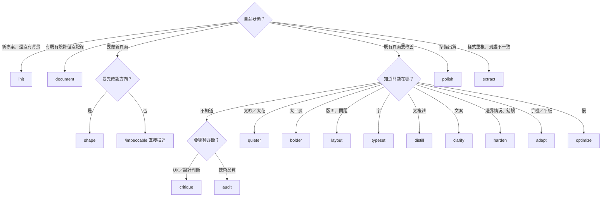

### 8.0.1 審查 AI 產出的五層檢查法（🏢）

Impeccable 的工作流程是**隱含的**：Skill 會引導 Agent 做對的事，但在實作過程中**不會停下來等人確認**。第三方評測（tessl.io）也指出，它缺少實作期間的驗證檢查點。所以每個「會修改程式碼」的指令執行完之後，審查者都要依下面五層順序檢查。前三層可以用腳本自動化（第 8.0.2 節），後兩層要靠測試與人工。

| 層 | 檢查什麼 | 為什麼要查 | 壞例（AI 常見的錯） | 怎麼抓 |
|---|---|---|---|---|
| 1. 範圍 | AI 只改了你指定的目標 | Agent 會「順手」改相關檔案 | 叫它 `polish` 表單，結果連 `router.js` 都加了一條路由 | `git diff --stat ai-start`，比對允許的路徑 |
| 2. Token 合規 | 新增的程式碼只用 DESIGN.md／Tokens | 偵測器不知道你公司的 Token，只看得出「常見 AI 樣式」 | `margin-top: 13px`、`#7c3aed`、`font-family: Inter` | 只看 diff 中新增的行，搜尋色碼、px、字型、漸層 |
| 3. 偵測器差異 | 每條規則的命中數**沒有變多** | 只看總數會漏掉「修好 2 個、新增 2 個」 | `gradient-text` 從 0 變 2 | 動工前、後各跑一次 `detect --json`，依 `antipattern` 計數比對 |
| 4. 渲染驗證 | 實際畫面在目標尺寸下正確 | 原始碼掃描會少報（`.vue`／`.tsx` 只跑 regex 規則） | 對比不足、字太小，只有渲染後才看得到 | `npx impeccable detect http://localhost:5173/...`、Playwright 截圖比對、axe（第 11 章） |
| 5. 不變性 | 業務行為沒變 | Impeccable 只管設計，不懂業務 | 欄位順序、`tabindex`、`v-if` 條件、API 呼叫被動到 | Playwright 流程不變性測試（第 11.3.2 節）＋人工看 diff |

**動工前先打標記**（適用 OS：任何｜執行位置：專案根目錄）：

```bash
git status --short          # 必須是乾淨的；有未 commit 的變更先 commit 或 stash
git tag -f ai-start         # 標記 AI 動工前的狀態，第 1～3 層都以它為基準
```

> 💡 為什麼一定要打標記：沒有基準，就無法回答「這行是 AI 改的，還是原本就有？」偵測器差異（第 3 層）也必須有「之前」的結果才能比較。

### 8.0.2 自動化審查腳本（✅ 實測）

下面兩支腳本行為相同，實作了第 1～3 層，並在最後列出第 4～5 層的待辦。任何一層失敗，exit code 為 1，可以直接放進 PR 檢查或 pre-push hook。

📄 `tools/Review-UiChange.ps1`（Windows／PowerShell 7）

```powershell
<#
.SYNOPSIS
  審查 AI Agent 對 UI 的修改（五層檢查法的第 1～3 層自動化，第 4～5 層列出待辦）。
.DESCRIPTION
  在 Git 專案根目錄執行。比對「AI 動工前的 commit」與目前工作目錄（含未 commit、未追蹤的檔案）：
    第 1 層 範圍：是否改到允許範圍以外的檔案
    第 2 層 Token 合規：新增的程式碼是否出現硬編碼色碼、px、字型、漸層
    第 3 層 偵測器差異：每條規則的命中數有沒有比動工前多
  任何一層失敗，exit code 為 1；全部通過為 0。
.EXAMPLE
  ./tools/Review-UiChange.ps1 -Base ai-start -Allowed 'src/pages/transfer/'
#>
[CmdletBinding()]
param(
    [string]$Base = 'HEAD',                          # AI 動工前的 commit、tag 或分支
    [string[]]$Allowed = @('src/'),                  # 允許修改的路徑前綴（可多個）
    [string]$TokenFile = 'src/styles/tokens.css',    # 唯一允許出現原始色碼與 px 的檔案
    [string]$ScanPath = 'src',                       # 偵測器掃描範圍
    [string[]]$AllowedPx = @('0px', '1px')           # 允許直接寫的 px（例如 1px 邊框）
)
$ErrorActionPreference = 'Stop'
$failed = $false

# 取得變更檔案：已追蹤的差異＋未追蹤的新檔
$changed = @(git diff --name-only $Base) + @(git ls-files --others --exclude-standard) |
    Where-Object { $_ } | Sort-Object -Unique

Write-Host "== 第 1 層：範圍（相對於 $Base，共 $($changed.Count) 個檔案）"
$outside = $changed | Where-Object { $f = $_; -not ($Allowed | Where-Object { $f.StartsWith($_) }) }
if ($outside) {
    $failed = $true
    $outside | ForEach-Object { Write-Host "  ❌ 超出允許範圍：$_" }
} else {
    Write-Host '  ✅ 所有變更都在允許範圍內'
}

Write-Host '== 第 2 層：Token 合規（只看新增的行）'
$patterns = [ordered]@{
    '硬編碼色碼'   = '#[0-9a-fA-F]{3,8}\b|\b(rgba?|hsla?|oklch)\('
    '硬編碼字型'   = 'font-family\s*:(?![^;]*var\()'
    '漸層'         = '\b(linear|radial|conic)-gradient\('
    '硬編碼 px'    = '\b\d+(\.\d+)?px\b'
}
$uiFiles = $changed | Where-Object { $_ -match '\.(css|scss|vue|tsx|jsx|html)$' -and $_ -ne $TokenFile }
$hits = 0
foreach ($file in $uiFiles) {
    $tracked = git ls-files -- $file
    $added = if ($tracked) {
        git diff -U0 $Base -- $file | Where-Object { $_ -match '^\+(?!\+\+)' } | ForEach-Object { $_.Substring(1) }
    } else {
        Get-Content -LiteralPath $file    # 新檔：每一行都算新增
    }
    foreach ($line in $added) {
        foreach ($name in $patterns.Keys) {
            if ($line -notmatch $patterns[$name]) { continue }
            if ($name -eq '硬編碼 px') {
                $px = [regex]::Matches($line, '\b\d+(\.\d+)?px\b') | ForEach-Object Value |
                    Where-Object { $AllowedPx -notcontains $_ }
                if (-not $px) { continue }
            }
            $hits++
            Write-Host "  ❌ [$name] ${file}: $($line.Trim())"
        }
    }
}
if ($hits) { $failed = $true } else { Write-Host '  ✅ 新增的程式碼沒有繞過 Token' }

Write-Host '== 第 3 層：偵測器前後差異'
function Get-RuleCount([string]$Path) {
    # 防假綠燈：路徑不存在或沒有可掃描的檔案時，偵測器一樣輸出 []
    $files = @(Get-ChildItem -LiteralPath $Path -Recurse -File -ErrorAction SilentlyContinue |
        Where-Object Extension -in '.html', '.htm', '.css', '.scss', '.vue', '.tsx', '.jsx', '.svelte', '.astro')
    if (-not $files) { throw "$Path 不存在或沒有可掃描的檔案（偵測器會回 [] 造成假綠燈），請修正 -ScanPath" }
    $json = npx --no-install impeccable detect $Path --json 2>$null | Out-String
    $count = @{}
    foreach ($f in ($json | ConvertFrom-Json)) { $count[$f.antipattern] = 1 + [int]$count[$f.antipattern] }
    return $count
}
$tmp = Join-Path ([IO.Path]::GetTempPath()) ("ui-review-" + [guid]::NewGuid().ToString('N').Substring(0, 8))
git worktree add --detach --quiet $tmp $Base
try {
    $before = Get-RuleCount (Join-Path $tmp $ScanPath)
    $after = Get-RuleCount $ScanPath
} catch {
    Write-Host "  ❌ $($_.Exception.Message)"; exit 1
} finally {
    git worktree remove --force $tmp
}
$rules = @($before.Keys) + @($after.Keys) | Sort-Object -Unique
$worse = 0
foreach ($r in $rules) {
    $b = [int]$before[$r]; $a = [int]$after[$r]
    if ($a -gt $b) { $worse++; Write-Host "  ❌ $r：$b → $a（新增）" }
    elseif ($a -lt $b) { Write-Host "  ✅ $r：$b → $a（減少）" }
}
if ($worse) { $failed = $true } elseif (-not $rules) { Write-Host '  ✅ 前後都沒有命中' } else { Write-Host '  ✅ 沒有任何規則變多' }

Write-Host '== 第 4～5 層：人工與測試（腳本不代勞）'
Write-Host '  ☐ 渲染驗證：npx impeccable detect http://localhost:5173/<頁面>、Playwright 截圖比對、axe'
Write-Host '  ☐ 不變性：欄位順序、Tab 順序、API 呼叫、驗證規則（npx playwright test tests/invariants）'

if ($failed) { Write-Host '結果：❌ 不通過，請退回 AI 修正或說明理由'; exit 1 }
Write-Host '結果：✅ 第 1～3 層通過，請繼續完成第 4～5 層'
exit 0
```

📄 `tools/review-ui-change.sh`（macOS／Linux／Git Bash；需要 Node.js）

```bash
#!/usr/bin/env bash
# 審查 AI Agent 對 UI 的修改（五層檢查法第 1～3 層；與 Review-UiChange.ps1 行為相同）
# 用法：tools/review-ui-change.sh <基準 commit> <允許的路徑前綴> [Token 檔] [掃描範圍]
# 例如：tools/review-ui-change.sh ai-start src/pages/transfer/
set -uo pipefail
BASE="${1:-HEAD}"
ALLOWED="${2:-src/}"
TOKEN_FILE="${3:-src/styles/tokens.css}"
SCAN="${4:-src}"
failed=0

changed=$( { git diff --name-only "$BASE"; git ls-files --others --exclude-standard; } | sort -u | sed '/^$/d')

echo "== 第 1 層：範圍（相對於 $BASE）"
outside=$(printf '%s\n' "$changed" | grep -v "^${ALLOWED}" || true)
if [ -n "$outside" ]; then failed=1; printf '  ❌ 超出允許範圍：%s\n' $outside
else echo "  ✅ 所有變更都在允許範圍內"; fi

echo "== 第 2 層：Token 合規（只看新增的行）"
hits=0
for f in $(printf '%s\n' "$changed" | grep -E '\.(css|scss|vue|tsx|jsx|html)$' | grep -vx "$TOKEN_FILE"); do
  if git ls-files --error-unmatch -- "$f" >/dev/null 2>&1; then
    added=$(git diff -U0 "$BASE" -- "$f" | grep -E '^\+' | grep -vE '^\+\+\+' | cut -c2-)
  else
    added=$(cat -- "$f")
  fi
  while IFS= read -r line; do
    [ -z "$line" ] && continue
    echo "$line" | grep -qE '#[0-9a-fA-F]{3,8}\b|\b(rgba?|hsla?|oklch)\(' && { hits=$((hits+1)); echo "  ❌ [硬編碼色碼] $f: $line"; }
    echo "$line" | grep -E 'font-family[[:space:]]*:' | grep -qv 'var(' && { hits=$((hits+1)); echo "  ❌ [硬編碼字型] $f: $line"; }
    echo "$line" | grep -qE '\b(linear|radial|conic)-gradient\(' && { hits=$((hits+1)); echo "  ❌ [漸層] $f: $line"; }
    echo "$line" | grep -oE '\b[0-9]+(\.[0-9]+)?px\b' | grep -qvxE '0px|1px' && { hits=$((hits+1)); echo "  ❌ [硬編碼 px] $f: $line"; }
  done <<< "$added"
done
if [ "$hits" -gt 0 ]; then failed=1; else echo "  ✅ 新增的程式碼沒有繞過 Token"; fi

echo "== 第 3 層：偵測器前後差異"
# 防假綠燈：路徑不存在或沒有可掃描的檔案時，偵測器一樣輸出 []
if [ -z "$(find "$SCAN" -type f \( -name '*.html' -o -name '*.htm' -o -name '*.css' -o -name '*.scss' \
      -o -name '*.vue' -o -name '*.tsx' -o -name '*.jsx' -o -name '*.svelte' -o -name '*.astro' \) 2>/dev/null | head -1)" ]; then
  echo "  ❌ $SCAN 不存在或沒有可掃描的檔案（偵測器會回 [] 造成假綠燈），請修正掃描範圍"; exit 1
fi
tmp=$(mktemp -d)/base
git worktree add --detach --quiet "$tmp" "$BASE"
npx --no-install impeccable detect "$tmp/$SCAN" --json > "$tmp.before.json" 2>/dev/null
npx --no-install impeccable detect "$SCAN" --json > "$tmp.after.json" 2>/dev/null
git worktree remove --force "$tmp"
node -e '
  const fs = require("fs");
  const load = p => { const t = fs.readFileSync(p, "utf8").trim() || "[]";
    return JSON.parse(t).reduce((m, f) => (m[f.antipattern] = (m[f.antipattern] || 0) + 1, m), {}); };
  const b = load(process.argv[1]), a = load(process.argv[2]);
  let worse = 0;
  for (const r of [...new Set([...Object.keys(b), ...Object.keys(a)])].sort()) {
    const x = b[r] || 0, y = a[r] || 0;
    if (y > x) { worse++; console.log(`  ❌ ${r}：${x} → ${y}（新增）`); }
    else if (y < x) console.log(`  ✅ ${r}：${x} → ${y}（減少）`);
  }
  if (!worse) console.log("  ✅ 沒有任何規則變多");
  process.exit(worse ? 1 : 0);
' "$tmp.before.json" "$tmp.after.json" || failed=1

echo "== 第 4～5 層：人工與測試（腳本不代勞）"
echo "  ☐ 渲染驗證：npx impeccable detect http://localhost:5173/<頁面>、Playwright 截圖比對、axe"
echo "  ☐ 不變性：欄位順序、Tab 順序、API 呼叫、驗證規則（npx playwright test tests/invariants）"

if [ "$failed" -ne 0 ]; then echo "結果：❌ 不通過，請退回 AI 修正或說明理由"; exit 1; fi
echo "結果：✅ 第 1～3 層通過，請繼續完成第 4～5 層"
```

**執行方式**（適用 OS：Windows｜執行位置：專案根目錄）：

```powershell
./tools/Review-UiChange.ps1 -Base ai-start -Allowed 'src/pages/'
```

macOS／Linux：

```bash
bash tools/review-ui-change.sh ai-start src/pages/
```

✅ 實測一：好的修改。AI 只在 `src/pages/transfer.html` 加了一行 `label { display: grid; gap: var(--space-3); }`：

```text
== 第 1 層：範圍（相對於 ai-start，共 1 個檔案）
  ✅ 所有變更都在允許範圍內
== 第 2 層：Token 合規（只看新增的行）
  ✅ 新增的程式碼沒有繞過 Token
== 第 3 層：偵測器前後差異
  ✅ 前後都沒有命中
== 第 4～5 層：人工與測試（腳本不代勞）
  ☐ 渲染驗證：npx impeccable detect http://localhost:5173/<頁面>、Playwright 截圖比對、axe
  ☐ 不變性：欄位順序、Tab 順序、API 呼叫、驗證規則（npx playwright test tests/invariants）
結果：✅ 第 1～3 層通過，請繼續完成第 4～5 層
```

✅ 實測二：壞的修改。同樣是 `polish` 指令，AI 卻改了間距、標題加了漸層文字與 Inter 字型，還動了路由檔：

```text
== 第 1 層：範圍（相對於 ai-start，共 2 個檔案）
  ❌ 超出允許範圍：src/router.js
== 第 2 層：Token 合規（只看新增的行）
  ❌ [硬編碼 px] src/pages/transfer.html: .actions { margin-top: 13px; }
  ❌ [硬編碼色碼] src/pages/transfer.html: h1 { font-family: Inter, sans-serif; background: linear-gradient(90deg, #7c3aed, #db2777); …
  ❌ [硬編碼字型] src/pages/transfer.html: h1 { font-family: Inter, sans-serif; …
  ❌ [漸層] src/pages/transfer.html: h1 { … linear-gradient(90deg, #7c3aed, #db2777); …
== 第 3 層：偵測器前後差異
  ❌ ai-color-palette：0 → 1（新增）
  ❌ gradient-text：0 → 2（新增）
  ❌ overused-font：0 → 1（新增）
== 第 4～5 層：人工與測試（腳本不代勞）
  …
結果：❌ 不通過，請退回 AI 修正或說明理由
```

✅ 實測三：掃描路徑寫錯（`-ScanPath app`，目錄不存在）。實測發現：偵測器遇到**不存在的路徑**會輸出 `[]`（exit 1、stderr 有 `Warning: cannot access`）；遇到**沒有可掃描檔案的空目錄**也會輸出 `[]`，而且 exit 0，和「完全乾淨」無法區分。所以腳本會先檢查掃描範圍內有沒有可掃描的檔案：

```text
== 第 3 層：偵測器前後差異
  ❌ …\app 不存在或沒有可掃描的檔案（偵測器會回 [] 造成假綠燈），請修正 -ScanPath
```

**審查者如何驗證這支腳本本身是對的**：

| 檢查 | 做法 |
|---|---|
| 腳本真的會擋 | 在測試分支故意加一行 `color: #ff00ff;`，執行後第 2 層必須出現 ❌ |
| 第 3 層真的有掃到 | 故意加 `font-family: Inter`，第 3 層必須出現 `overused-font：0 → 1` |
| 不會假綠燈 | 把 `-ScanPath` 改成不存在的目錄，必須 exit 1 |
| 基準正確 | `git log -1 ai-start` 必須是 AI 動工前的 commit |

> ⚠️ 腳本限制：第 2 層是文字比對，`var(--space-3)` 這類 Token 引用不會被誤判，但 `rgba(` 寫在註解裡也會被抓到；`AllowedPx` 預設只允許 `0px`、`1px`，其他例外請在 PR 說明理由。`.vue`、`.tsx` 檔的第 3 層只跑 regex 規則（少報），所以第 4 層的渲染掃描不能省。

### 8.0.3 審查結果的處理方式

| 結果 | 處理 |
|---|---|
| 第 1 層 ❌（超出範圍） | 預設退回。若確實需要（例如新頁面必須加路由），在 PR 說明，並由 Reviewer 確認業務影響 |
| 第 2 層 ❌（繞過 Token） | 退回，Prompt 範例：「把 13px 改成 DESIGN.md spacing 的 Token；不得新增 Token」 |
| 第 2 層 ❌ 但 Token 真的不夠 | 不是讓 AI 新增色碼，而是走 Design System 變更流程（第 10.5 節），先改 Tokens 再改頁面 |
| 第 3 層 ❌（規則變多） | 把腳本輸出原文貼給 Agent：「以下規則的命中數比動工前多，請修正，不要用例外規則隱藏」 |
| 第 3 層 ❌ 但屬於誤判 | 依第 7.6.2 節由窄到寬加例外，並在 PR 寫明理由；**不可**讓 AI 自己加例外 |
| 第 1～3 層全過 | 繼續第 4～5 層；全過才算審查完成 |

> 💡 把審查結果餵回 Agent 的寫法：「以下是 tools/Review-UiChange.ps1 的輸出。只修正標 ❌ 的項目，不要改其他地方，修完我會再跑一次。」這樣可以避免 Agent 因為一個問題而重寫整頁。

## 8.1 專案初始化：`init`

| 項目 | 內容 |
|---|---|
| 指令說明 | 建立產品背景，寫入 `PRODUCT.md`；必要時設定 `buildPath` 與 Live |
| 適用場景 | 新專案第一件事；接手沒有 PRODUCT.md 的專案；產品定位改變 |
| 執行前準備 | 準備需求文件、使用者資料、品牌規範的路徑；確認專案根目錄 |
| AI 會做的事 | 掃描專案 → 形成平台假設 → 只問重要缺口（每輪 ≤ 3 題）→ 寫 PRODUCT.md → 建議下一步 |
| 是否修改程式碼 | 否（只寫 PRODUCT.md、`.impeccable/config.json`、`.impeccable/live/config.json`） |
| 執行後結果 | 根目錄出現 `PRODUCT.md`，開頭有 `<!-- impeccable:product-schema 1 -->` |
| 企業使用時機 | 專案啟動會議後、SA 完成需求分析時 |

```text
/impeccable init

請先讀 docs/需求規格書.md 與 docs/legacy/作業手冊-2024.pdf。
這是銀行內部作業系統（platform: web）。不要決定任何視覺風格。
沒有證據的事實標記「未確認」。完成後列出你推論但未確認的項目。
```

| 常見錯誤 | 處理 |
|---|---|
| 在終端機輸入 `/impeccable init` | 要在 Agent 對話框輸入（安裝程式最後一行也這樣提醒） |
| 期待 init 產生 DESIGN.md | init 不寫 DESIGN.md；既有系統用 `document` |
| AI 編造使用者數據 | 退回，要求刪除並標示「未確認」 |

**審查重點：**

| 應有產出 | 紅旗（壞例） | 驗證方式 |
|---|---|---|
| `PRODUCT.md` 在專案根目錄，開頭有 schema 標記 | 沒有標記，或寫到子目錄 | `Select-String -Path PRODUCT.md -Pattern 'impeccable:product-schema'` |
| 每個數字、使用者描述都有出處 | 「行員每天處理 10 萬筆」，需求文件中找不到 | 對每個數字問「出處是哪份文件第幾頁？」，答不出來就改成「未確認」 |
| 沒有決定視覺風格 | PRODUCT.md 出現色碼、字型名稱 | `Select-String -Path PRODUCT.md -Pattern '#[0-9a-fA-F]{3,8}\b','font-family'` 應無結果 |
| 列出「推論但未確認」的項目 | 沒有列，或全部寫成事實 | 要求補列，交給 SA／PM 確認 |
| 只寫入三個檔案 | `src/` 也被改了 | `git status --short` 只應出現 `PRODUCT.md` 與 `.impeccable/` |

壞例與好例對照：

```markdown
<!-- ❌ 壞例：AI 自行補上的數字，需求文件裡沒有 -->
## Users
分行經辦每天處理 10 萬筆交易，平均每筆 8 秒完成。

<!-- ✅ 好例：有出處的寫出處，沒有的標示未確認 -->
## Users
分行經辦與覆核主管（docs/需求規格書.md §2.1）。每日交易量：未確認（待營運部提供）。
```

## 8.2 設計規劃：`shape`

| 項目 | 內容 |
|---|---|
| 指令說明 | 寫程式前先規劃 UX／UI，透過訪談產出**經你確認**的設計簡報 |
| 適用場景 | 新頁面、新流程、重大改版；需要先讓 UI/UX 與 PM 確認方向 |
| 執行前準備 | PRODUCT.md 已存在；準備頁面的業務需求與資料欄位 |
| AI 會做的事 | 訪談（預設一輪，每輪 2～3 題）→ 有能力時做視覺探索 → 產出設計簡報 |
| 是否修改程式碼 | **否**（Playbook：「return a confirmed design brief without code」） |
| 執行後結果 | 設計簡報；可保存為 `.impeccable/surfaces/<頁面>.md`，之後的指令指名該頁時會自動套用 |
| 使用前後改善重點 | 前：直接寫程式，方向靠 AI 猜；後：模式（Operate）、資訊優先序、主要動作在動工前就確定 |
| 企業使用時機 | Sprint Planning 後、開發前；設計審查會議的輸入 |

```text
/impeccable shape 匯款覆核頁

需求：覆核主管要在同一畫面比對「經辦輸入」與「原始憑證影像」，核准或退回。
資料欄位：見 docs/api/transfer-review.yaml。
限制：這是 Operate 模式的作業畫面；不得改變兩段式覆核流程；必須支援鍵盤操作。
請產出設計簡報，不要寫程式碼。
```

| 常見錯誤 | 處理 |
|---|---|
| shape 後 AI 直接開始寫程式 | 提醒「只要簡報」；Playbook 本身禁止寫程式 |
| 簡報太泛 | 要求列出「主要動作、資訊優先序、狀態清單、錯誤情境、鍵盤操作」 |

**審查重點：**

| 應有產出 | 紅旗（壞例） | 驗證方式 |
|---|---|---|
| 明確寫出頁面模式（例如 Operate） | 沒寫模式，或作業畫面被歸成 Persuade（行銷頁） | 對照 PRODUCT.md 的平台與使用者 |
| 主要動作只有一個，並說明位置 | 「核准」「退回」「暫存」「列印」四個按鈕一樣大 | 問：「使用者 80% 的時間在做哪個動作？」 |
| 完整的狀態清單（載入、空、錯誤、權限不足、逾時） | 只描述「有資料」的畫面 | 逐一對照 API 規格的錯誤碼 |
| 鍵盤操作與 Tab 順序 | 沒提到 | 對照「必須支援鍵盤操作」的限制 |
| 不含程式碼 | 簡報裡附了整段 Vue 元件 | `git status --short` 不應出現 `src/` 變更 |

> 💡 簡報是**給人簽核的文件**。建議由 UI/UX 與 PM 在簡報上簽核後，再存成 `.impeccable/surfaces/<頁面>.md`。之後指令會自動套用這份簡報，如果簡報錯了，後面每一步都會跟著錯。

## 8.3 設計改善：`bolder`、`quieter`、`polish`、`layout`、`typeset`

### 8.3.1 `bolder`：讓平淡的設計更有存在感

| 項目 | 內容 |
|---|---|
| 適用場景 | 畫面「太安全、無聊、沒有個性」；對外產品頁、活動頁 |
| AI 會做的事 | 提高衝擊力（尺度、對比、構圖），同時維持可用性 |
| 是否修改程式碼 | 會 |
| 企業使用時機 | **作業型系統很少用**。Dashboard 的主要 KPI 區塊不夠突出時，可限定範圍使用 |

```text
/impeccable bolder the KPI summary row

只調整 KPI 區塊。限制：只能用 DESIGN.md 的色彩與字級；不得加漸層、光暈、動畫；不得改變其他區塊。
```

**審查重點：**

| 應有產出 | 紅旗（壞例） | 驗證方式 |
|---|---|---|
| 只改 KPI 區塊 | 連帶改了 Header、側欄 | 第 8.0.1 節第 1 層（`-Allowed` 指定元件路徑） |
| 用尺度、字重、留白製造對比 | 加了漸層文字、光暈、彩色陰影 | 第 3 層：`gradient-text`、`ai-color-palette` 不得增加 |
| 文字對比仍達 4.5:1 | 主色底配灰字 | URL 掃描 `low-contrast`、`gray-on-color` |
| 大字在 1280px 寬度不破版 | 數字換行、卡片高度不一 | `detect --viewport 1280x800 <URL>` 加上截圖 |

### 8.3.2 `quieter`：降低視覺噪音

| 項目 | 內容 |
|---|---|
| 適用場景 | 太花、太吵、色彩過多、陰影過重——**AI 產出的作業畫面最常需要** |
| AI 會做的事 | 降低強度（色彩數、陰影、裝飾、動畫），保留品質與個性 |
| 是否修改程式碼 | 會 |
| 使用前後 | 前：漸層 Header、彩色陰影卡片、四種強調色；後：單一主色、平面卡片、狀態色只用在狀態 |
| 企業使用時機 | AI 產出的第一版作業畫面；舊系統改版前的收斂 |

```text
/impeccable quieter the transaction dashboard

這是 Operate 模式的銀行作業畫面。移除所有漸層、光暈與彩色陰影；強調色只保留 bank-navy；
狀態色只用於狀態欄位。不要改變版面結構與欄位順序。
```

**審查重點：**

| 應有產出 | 紅旗（壞例） | 驗證方式 |
|---|---|---|
| 漸層、光暈、彩色陰影被**移除** | 只是把漸層「調淡」，仍然是漸層 | 第 2 層：新增的行不得出現 `-gradient(` |
| 強調色收斂成單一主色 | 換成另一組彩色 | 第 2 層：新增的行不得出現色碼 |
| 狀態色保留在狀態欄位 | 狀態標籤也變灰，失去辨識度 | 截圖比對狀態欄；以色盲模擬（DevTools Rendering）檢查 |
| 版面結構不變 | DOM 順序改變 | 第 5 層的欄位順序比對 |

好的 diff 長這樣：

```diff
- .header { background: linear-gradient(135deg, #6366f1, #8b5cf6); box-shadow: 0 8px 24px rgba(99, 102, 241, .4); }
+ .header { background: var(--color-surface); border-bottom: 1px solid var(--color-border); }
```

壞的 diff 長這樣（看起來「比較安靜」，其實只是換色）：

```diff
- .header { background: linear-gradient(135deg, #6366f1, #8b5cf6); }
+ .header { background: linear-gradient(135deg, #e0e7ff, #ede9fe); }
```

### 8.3.3 `polish`：出貨前最後一輪

| 項目 | 內容 |
|---|---|
| 適用場景 | 功能完成、準備上線；「好像哪裡怪怪的」 |
| 執行前準備 | Agent 會問「品質標準與出貨限制」，先準備好答案 |
| AI 會做的事 | 讀 DESIGN.md 與共用元件 → 把每個偏離分類（文件過期／意外偏離）→ 修對齊、間距、一致性、微細節 |
| 是否修改程式碼 | 會，但**不得重新設計**（Playbook：「Polish is refinement, never concealed redesign」） |
| 使用前後 | 前：間距 13px／15px 混用、按鈕高度不一、焦點框消失；後：回到 Token 級距、元件一致、狀態完整 |
| 企業使用時機 | 每個功能分支合併前；`audit` 之後 |

```text
/impeccable polish the transfer form

品質標準：WCAG 2.2 AA；DESIGN.md 為唯一規範。出貨限制：本週四 UAT，不得改變欄位順序、驗證規則與 API 呼叫。
如果你認為概念本身有問題，請說明並建議，不要自行重新設計。
```

| 常見錯誤 | 處理 |
|---|---|
| polish 變成大改版 | Playbook 禁止；若發生，退回並引用「never concealed redesign」 |
| 把偵測器 0 問題當成完成 | Playbook：「A detector result is defect evidence, not proof of quality」 |

**審查重點：如何抓「偽裝成 polish 的改版」：**

| 訊號 | 正常的 polish | 偷偷改版 | 驗證方式 |
|---|---|---|---|
| diff 規模 | 少量 CSS、屬性修正 | 大量 template／JSX 結構變動 | `git diff --stat ai-start`；template 區塊的變動行數若超過檔案的 20%，就要求說明 |
| DOM 結構 | 元素與順序不變 | `<div class="form-row">` 換成 `<section class="card-grid">` | `git diff ai-start -- '*.vue' \| Select-String '^[-+]\s*<'` 列出所有標籤變動 |
| 視覺差異 | 截圖差異集中在細節 | 整頁大範圍差異 | Playwright `toHaveScreenshot` 的差異比例（第 11.3 節） |
| 行為 | 不變 | 欄位順序、驗證規則改變 | 第 5 層不變性測試 |

壞的 diff 長這樣：polish 不應該改變結構。

```diff
- <div class="form-row">
-   <label for="amount">金額</label>
-   <input id="amount" v-model="amount">
- </div>
+ <section class="card-grid">
+   <article class="card"><h3>金額</h3><AmountInput v-model="amount" /></article>
+ </section>
```

退回的 Prompt：「這次是 polish，Playbook 寫明 never concealed redesign。請還原結構變動，只保留間距、對齊與焦點狀態的修正。若你認為結構需要改，請列出理由，由我決定。」

### 8.3.4 `layout`：版面、間距與視覺節奏

| 項目 | 內容 |
|---|---|
| 適用場景 | 間距不一致、網格單調、對齊亂、層級弱、擁擠 |
| AI 會做的事 | 重新安排版面讓視線知道先看哪裡；修正間距節奏 |
| 是否修改程式碼 | 會 |
| 企業使用時機 | 新頁面完成初版後；**逆向工程的視覺還原階段禁止使用** |

```text
/impeccable layout the account search page

使用 DESIGN.md 的 spacing（4px 級距）。欄位之間 12px、區塊之間 24px。
查詢條件維持在結果表格上方；不得改變欄位順序與 Tab 順序。
```

**審查重點：**

| 應有產出 | 紅旗（壞例） | 驗證方式 |
|---|---|---|
| 間距使用 Token 級距 | `gap: 13px`、`margin: 18px` | 第 2 層 |
| DOM 順序不變 | 欄位被搬動位置（如下方 diff） | 比對動工前後的欄位順序 |
| 視覺順序與 DOM 順序一致 | 用 CSS `order`、`grid-area`、`flex-direction: row-reverse` 讓畫面順序和 Tab 順序不一致 | `git diff ai-start \| Select-String 'order:\|grid-area\|row-reverse'` |
| 層級更清楚 | 只是把所有東西放大 | `critique` 前後各做一次，比較「視覺層級」項目 |

layout 最常見的錯：為了「版面平衡」交換欄位位置，Tab 順序跟著改變。

```diff
-  <label>轉入帳號 <input name="account"></label>
-  <label>金額 <input name="amount"></label>
+  <div class="row">
+    <label>金額 <input name="amount"></label>
+    <label>轉入帳號 <input name="account"></label>
+  </div>
```

**欄位順序比對**（Playwright，📄 `tests/invariants/field-order.spec.ts` 的核心片段，完整範例見第 11.3.2 節）：

```typescript
// 依 DOM 順序列出所有可輸入欄位的 name，和基準檔比較
const order = await page.locator('input, select, textarea, button')
  .evaluateAll(els => els.map(e => e.getAttribute('name') ?? e.textContent?.trim()));
expect(order).toEqual(JSON.parse(fs.readFileSync('tests/baseline/transfer-fields.json', 'utf8')));
```

### 8.3.5 `typeset`：字體排印

| 項目 | 內容 |
|---|---|
| 適用場景 | 字型選擇、層級、字級、字重、可讀性問題 |
| AI 會做的事 | 修正字型、層級、尺寸、字重，讓文字「看起來是刻意的」 |
| 是否修改程式碼 | 會 |
| 使用前後 | 前：標題與內文字級差距不到 1.25 倍（`flat-type-hierarchy`）、內文 12px；後：明確的字級階梯、內文 14px、數字等寬 |
| 企業使用時機 | 報表、明細頁；中文介面字級與行高調整 |

```text
/impeccable typeset the statement report page

只用 DESIGN.md typography.scale 的字級。中文內文行高 1.6 以上；金額使用 typography.numeric、右對齊。
不得更換品牌字型 Noto Sans TC。
```

**審查重點：**

| 應有產出 | 紅旗（壞例） | 驗證方式 |
|---|---|---|
| 字級只用 `typography.scale` 的值 | `font-size: 15px`、`0.95rem` | 第 2 層 |
| 品牌字型不變 | 換成 Inter、Geist 等「AI 常用字型」 | 第 2 層的 `硬編碼字型`；第 3 層的 `overused-font` |
| 中文內文行高 ≥ 1.6 | `line-height: 1.2` 套用到內文 | 在 DevTools 的 Computed 面板檢查實際值 |
| 金額使用等寬數字、右對齊 | 金額欄位上下位數對不齊 | 截圖檢查；搜尋 `font-variant-numeric: tabular-nums` |
| 內文字級沒有變小 | 為了「精緻」把內文改成 12px | URL 掃描的 `tiny-text` |
| 層級差距明確 | 標題只比內文大一點 | `flat-type-hierarchy` 不得增加 |

## 8.4 設計審查：`critique`、`audit`

### 8.4.1 `critique`：UX 設計評論

| 項目 | 內容 |
|---|---|
| 指令說明 | 從 UX 角度評估：視覺層級、資訊架構、情感共鳴、認知負荷、Nielsen 10 項啟發式評分、人物誌測試、自動化反模式偵測 |
| 適用場景 | 設計審查會議前；不知道問題出在哪 |
| AI 會做的事 | Assessment A（設計審查）＋Assessment B（偵測器＋瀏覽器證據，可能在瀏覽器顯示 overlay）→ 合併報告 |
| 是否修改程式碼 | **否** |
| 執行後結果 | 報告：Nielsen 分數表（滿分 40；Persuade／Experience 頁面的第 7、10 項可為 n/a，滿分會降低）、設計特性判定、3～5 個優先問題、人物誌紅旗、建議指令；快照存 `.impeccable/critique/`，可看分數趨勢 |
| 企業使用時機 | 每個主要頁面上線前；改版前後各一次比較 |

```text
/impeccable critique the transfer review page

使用者是覆核主管（見 PRODUCT.md）。請特別評估：比對效率、狀態辨識、錯誤預防、鍵盤操作。
只產出報告，不要修改程式碼。
```

**如何判讀 critique 分數**（📖 Playbook 原文）：

| 百分比 | 等級 |
|---|---|
| 90% 以上 | Excellent |
| 70% 以上 | Good |
| 50% 以上 | Acceptable |
| 30% 以上 | Poor |
| 30% 以下 | Critical |

> 📌 Playbook 提醒：「Most real interfaces score 20-32 out of 40.」4 分代表「真的優秀」，不要期待每項都滿分。

**分數使用規則**（📖 官方教學〈Review with a visual overlay〉）：

- 每一項 0～4 分；標為 `n/a` 的項目**不計入總分**，滿分會跟著降低。
- **不要拿滿分不同的總分互相比較**。例如 Operate 頁面滿分 40、Persuade 頁面滿分 32，兩者的總分不能直接比；要比請換算成百分比。
- 分數是**佐證**，不是終點線。先處理影響主要任務的問題，而不是追求總分。
- 人物誌（模擬使用者）的觀點只是「該去查什麼」的線索，**不能取代真人可用性測試**。

**用視覺疊層定位問題**（📖 官方流程整理；🧪 本手冊未實測 Chrome 擴充）：

| 步驟 | 動作 | 審查者要確認 |
|---|---|---|
| 1 | 在 Agent 或 Chrome 擴充中準備好 Impeccable（疊層需要 Chrome 擴充，或支援瀏覽器工具的 Agent） | — |
| 2 | 選定頁面與任務：給 Agent 原始碼路徑或 URL，並說明使用者要完成什麼 | 任務描述要具體，例如「覆核主管比對經辦輸入與憑證影像」 |
| 3 | 執行 `/impeccable critique <目標與使用者目標>` | critique 不會修改設計：`git status` 應該是乾淨的 |
| 4 | 閱讀合併報告：優點、優先問題、可用性分數，以及**哪些檢查有跑、哪些無法執行** | 「無法執行」的檢查要另外補（例如沒有瀏覽器時，對比檢查不會跑） |
| 5 | 在 Chrome 擴充按 Impeccable 圖示 →「Scan page」，必要時按「Show overlays」 | 疊層的框線與標籤對應到頁面元素；若 Agent 自己產生了疊層，報告會說明位置 |
| 6 | 決定要修什麼：**設計審查發現**與**偵測器發現**分開看 | 偵測器抓得到低對比，抓不到「付款按鈕出現在總金額之前」這種流程問題；兩邊都指出的問題可信度最高 |
| 7 | 用白話描述要的修正，並說明哪些不能變，然後執行對應指令（例如 `layout`、`polish`） | 一次只處理一類問題 |
| 8 | 驗證：重新整理 → 再按一次「Scan page」，確認該問題消失 → 在窄螢幕與純鍵盤操作下實際走一遍任務；大幅修改後重新跑一次 critique | 快照存在 `.impeccable/critique/`，可比較前後 |

> ⚠️ 隱藏疊層（Hide overlays）**只改變你看到的畫面**，不會讓問題消失。刻意保留的警告要用設定處理（第 7.6 節），而且要寫明理由。

**審查重點：critique 報告本身的品質：**

| 應有產出 | 紅旗（壞例） | 驗證方式 |
|---|---|---|
| 每個優先問題都指到具體元素或位置 | 「整體層級可以更好」這種沒有位置的描述 | 要求補上元素選擇器或截圖位置 |
| 偵測器發現與設計判斷分開 | 把偵測器的結果包裝成自己的設計洞察 | 用 `npx impeccable detect <URL> --json` 對照 |
| 分數有理由 | 每項都是 3 分、沒有說明 | 抽兩項追問「為什麼不是 2 分或 4 分？」 |
| 建議的指令與問題相符 | 對比問題卻建議 `delight` | 對照第 8.0 節的指令選擇圖 |
| 沒有修改程式碼 | 報告附帶「我已經順便修好了」 | `git status --short` |

### 8.4.2 `audit`：技術品質稽核

| 項目 | 內容 |
|---|---|
| 指令說明 | 程式碼層級的技術稽核，**不是**設計評論 |
| AI 會做的事 | 五個面向各 0～4 分：Accessibility、Performance、Theming、Responsive Design、Implementation Integrity（會執行偵測器並逐一確認） |
| 是否修改程式碼 | **否**（Playbook：「Don't fix issues; document them」） |
| 執行後結果 | 總分 /20、評等、P0～P3 問題清單（位置、類別、影響、WCAG 條款、建議、建議指令）、系統性問題、做得好的地方、建議指令順序（最後一步是 `polish`） |
| 企業使用時機 | 上線前必做；Framework 升級完成後；季度健檢 |

評分等級（📖）：

| 總分 | 等級 | 意義 |
|---|---|---|
| 18～20 | Excellent | 小修即可 |
| 14～17 | Good | 處理較弱的面向 |
| 10～13 | Acceptable | 需要大量工作 |
| 6～9 | Poor | 需要大改 |
| 0～5 | Critical | 根本性問題 |

問題嚴重度：

| 等級 | 定義 | 處理 |
|---|---|---|
| P0 Blocking | 無法完成任務 | 立即修正 |
| P1 Major | 明顯困難或違反 WCAG AA | 上線前修正 |
| P2 Minor | 困擾但有替代方式 | 下一輪 |
| P3 Polish | 不影響使用者 | 有時間再處理 |

```text
/impeccable audit the transfer module

範圍：src/modules/transfer/ 下所有頁面。請在桌機 1920×1080 與平板 1180×820 檢查。
報告請標明每個問題的檔案與行號，並區分「偵測器確定性結果」與「你的判斷」。
```

| 常見錯誤 | 處理 |
|---|---|
| 期待 audit 直接修好 | audit 只報告；依建議指令順序逐一執行 |
| 報告混入偵測器誤判 | Playbook 要求逐一驗證並標出誤判；審查時抽查 |
| 只看總分 | 先看「Implementation Integrity Verdict」與 P0／P1 |

**審查重點：如何驗證 audit 報告沒有亂寫：**

| 應有產出 | 紅旗（壞例） | 驗證方式 |
|---|---|---|
| 每個 P0／P1 都有「檔案：行號」 | 行號指到空白行，或檔案不存在 | 逐一打開檢查；PowerShell：`Test-Path src/modules/transfer/Review.vue` |
| WCAG 條款正確 | 焦點框消失卻標成 1.4.3（對比） | 對照 WCAG 2.2：對比是 1.4.3，焦點可見是 2.4.7，焦點外觀是 2.4.13（AAA），目標尺寸是 2.5.8 |
| 偵測器結果與實際一致 | 報告說「偵測器發現 5 個 low-contrast」，自己跑卻只有 2 個 | `npx impeccable detect <URL> --json`，依 `antipattern` 計數 |
| 標出誤判 | 每個偵測器結果都照單全收 | Playbook 要求逐一確認，沒有標註就要追問 |
| a11y 結論有第二個工具佐證 | 只靠模型判斷就說「符合 AA」 | 用 axe（第 11.4 節）跑同一頁，比較兩邊結果 |
| 沒有修改程式碼 | 報告附帶修正 | `git status --short` |

> 💡 抽查原則：P0／P1 **全部**驗證；P2／P3 隨機抽 2 個。只要抽到 1 個是編造的，整份報告就退回重做。

## 8.5 程式碼簡化與強化：`distill`、`harden`

### 8.5.1 `distill`：去蕪存菁

| 項目 | 內容 |
|---|---|
| 適用場景 | 元素太多、按鈕互相競爭、資訊重複、裝飾噪音 |
| AI 會做的事 | 找出複雜度來源（元素過多、變化過多、資訊重複）→ 移除不必要的部分 |
| 是否修改程式碼 | 會（**會刪東西**） |
| 企業使用時機 | Dashboard 初版過於擁擠時；⚠️ 逆向工程與升級專案**不可**在功能還原階段使用 |

```text
/impeccable distill the operations dashboard

可以移除：裝飾性圖示、重複的統計卡片、沒有資料來源的圖表。
不可移除：任何業務功能入口、狀態資訊、法規要求的提示文字。
刪除前請列出清單讓我確認。
```

**審查重點：**

| 應有產出 | 紅旗（壞例） | 驗證方式 |
|---|---|---|
| 刪除前先列出清單 | 直接刪，事後才報告 | 對照 Agent 的對話紀錄 |
| 實際刪除的項目與核准清單一致 | 清單上沒有的「匯出」按鈕也被刪了 | 列出所有被刪除的標籤（見下方指令），逐一比對清單 |
| 業務入口、法規提示保留 | 「本交易依洗錢防制法…」的提示被當成噪音刪掉 | 法遵提示文字建議加上 `data-required="compliance"`，審查時搜尋 |
| 功能測試仍然通過 | 某個 E2E 測試找不到按鈕 | `npx playwright test` |

列出被刪除的 template 元素（適用 OS：Windows｜執行位置：專案根目錄）：

```powershell
git diff ai-start -- '*.vue' '*.html' | Select-String '^-\s*<(?!/)' | ForEach-Object { $_.Line }
```

✅ 實測輸出（AI 刪掉了「金額」欄位）：

```text
-  <label>金額 <input name="amount"></label>
```

### 8.5.2 `harden`：真實世界的韌性

| 項目 | 內容 |
|---|---|
| 適用場景 | 只在完美資料下正常的畫面；準備上線 |
| AI 會做的事 | 用極端輸入檢查：超長文字、空值、特殊字元（emoji、RTL、全形）、大數字（百萬、十億）、大量資料（1000+ 筆）、網路錯誤；補錯誤處理、i18n、文字溢出 |
| 是否修改程式碼 | 會 |
| 使用前後 | 前：公司名稱 40 字時破版、金額十億位數溢出、API 失敗時白畫面；後：截斷＋tooltip、數字欄自動寬度、錯誤狀態與重試 |
| 企業使用時機 | **金融系統必做**；UAT 前 |

```text
/impeccable harden the transfer form

測試資料情境：受款人名稱 60 個全形字、金額 9,999,999,999.99、帳號含前導 0、API 逾時與 500 錯誤。
錯誤訊息格式依 DESIGN.md：欄位名稱＋問題＋修正方式。不得改變驗證規則本身。
```

**審查重點：**

| 應有產出 | 紅旗（壞例） | 驗證方式 |
|---|---|---|
| 長文字截斷後仍能看到全文（`title` 或 tooltip） | 只有 `text-overflow: ellipsis`，看不到全文 | 用 60 個全形字的測試資料開頁面 |
| 錯誤狀態有重試與說明 | `catch {}` 把錯誤吞掉，畫面維持載入中 | `git diff ai-start \| Select-String 'catch\s*(\(\w*\))?\s*\{\s*\}'` |
| 驗證規則不變 | 為了「容錯」把 `maxlength` 從 16 改成 20，或拿掉 `required` | `git diff ai-start \| Select-String 'maxlength\|pattern\|required\|rules'` |
| 大數字不溢出 | 十億位數時欄位被撐開 | Playwright 以 mock 資料截圖 |
| 空狀態有說明 | 查無資料時只顯示空白表格 | 用空陣列 mock API |

壞例：

```diff
  try {
    result.value = await api.submitTransfer(form)
- } catch (e) { showError(e) }
+ } catch {}
```

## 8.6 文件與設計系統：`document`、`extract`

### 8.6.1 `document`：記錄設計系統

| 項目 | 內容 |
|---|---|
| 指令說明 | 從程式碼擷取色彩、字型、間距、圓角、元件模式，產生 DESIGN.md（Scan mode）；新專案可 `--seed` |
| 是否修改程式碼 | 否（寫 `DESIGN.md`、`.impeccable/design.json`） |
| 企業使用時機 | **逆向工程與升級的第一步**；設計系統重大變更後重新整理 |

```text
/impeccable document

請以 Scan mode 擷取 src/ 與 src/styles/ 的設計系統。
規則：這是「記錄現況」，不是改善建議。出現次數少於 3 次的色彩請列在報告中讓我判斷，不要自動寫入 frontmatter。
完成後執行 detect，回報 design-system-* advisory 數量。
```

**審查重點：DESIGN.md 是「記錄」，不是「創作」：**

| 應有產出 | 紅旗（壞例） | 驗證方式 |
|---|---|---|
| frontmatter 的每個色碼都真的出現在程式碼裡 | 出現程式碼中找不到的「建議色」 | 用下方指令逐一計數，0 次就是編造 |
| 數值與 `tokens.css` 一致 | DESIGN.md 寫 `#1F3A5F`，tokens.css 是 `#1f3a5e` | 第 10.5.3 節的同步腳本 |
| 少用色彩列在報告中，沒有寫入 frontmatter | 出現 1 次的色碼也被當成正式色 | 對照 Prompt 的「少於 3 次」規則 |
| 偵測器真的讀得到 | 寫完後 `design-system-*` advisory 沒有變化 | 第 7.3.4 節的驗證方法 |

檢查 DESIGN.md 中的色碼在 `src/` 出現幾次（適用 OS：Windows｜執行位置：專案根目錄）：

```powershell
$colors = Select-String -Path DESIGN.md -Pattern '#[0-9a-fA-F]{6}\b' -AllMatches |
    ForEach-Object { $_.Matches.Value.ToLower() } | Sort-Object -Unique
foreach ($c in $colors) {
    $n = (git grep -i -c $c -- src | ForEach-Object { [int]($_ -split ':')[-1] } | Measure-Object -Sum).Sum
    '{0}  {1,4} 次{2}' -f $c, [int]$n, $(if (-not $n) { '  ← 程式碼中沒有，請確認來源' })
}
```

✅ 實測輸出（DESIGN.md 中混入一個程式碼沒有用到的 `#7c3aed`）：

```text
#1f2933     1 次
#1f3a5f     1 次
#7c3aed     0 次  ← 程式碼中沒有，請確認來源
```

### 8.6.2 `extract`：抽取共用元件與 Tokens

| 項目 | 內容 |
|---|---|
| 指令說明 | 找出重複的模式、元件、Tokens，整合到設計系統 |
| 執行前準備 | 已有共用元件目錄；若沒有設計系統，Agent 會**先問**要放在哪裡、什麼結構，不會自行建立 |
| 是否修改程式碼 | 會（新增共用元件、替換重複程式碼） |
| 企業使用時機 | 升級完成且視覺基準通過之後；跨專案 Design System 建立時 |

```text
/impeccable extract

範圍：src/modules/ 下重複出現的狀態標籤、金額顯示、查詢表單列。
共用元件放在 src/components/base/，命名 Base*.vue；Tokens 只能使用 tokens.css 既有的變數。
每抽出一個元件，列出被替換的檔案清單。
```

**審查重點：extract 是重構，畫面應該完全不變：**

| 應有產出 | 紅旗（壞例） | 驗證方式 |
|---|---|---|
| 截圖與動工前**完全一致** | 共用元件「順便」統一了樣式，舊頁面跟著變 | Playwright `toHaveScreenshot` 不更新基準直接跑，必須全部通過 |
| 被替換的檔案清單與 diff 一致 | 清單寫 5 個檔，diff 有 8 個 | `git diff --stat ai-start` |
| 沒有新增 Token | `tokens.css` 多了 `--color-status-new` | `git diff ai-start -- src/styles/tokens.css` 應無變更 |
| 元件 API 保留原本的行為 | 原本 `disabled` 時不能點擊，抽出後可以 | 元件單元測試或 Storybook 互動測試 |
| 偵測器結果不變或變少 | 新元件引入了 `side-tab` | 第 3 層 |

## 8.7 Live Mode：`live`、`generate`

### 8.7.1 `live`

| 項目 | 內容 |
|---|---|
| 指令說明 | 在瀏覽器選取元素、選設計動作、產生並切換變體，接受其中一個（Beta） |
| 執行前準備 | Dev Server 已啟動（有 HMR）；Agent session 保持開啟；企業環境先設 `IMPECCABLE_LIVE_COPY_AGENT=chat` |
| 操作步驟 | ① 對話框輸入 `/impeccable live` ② Agent 開啟 App 網址並顯示控制列 ③ 選取元素 ④ 輸入要求或選動作（例如 `layout`、`bolder`），可加註解或筆畫 ⑤ 選變體數量（預設 3）→ Generate ⑥ 切換比較、用參數控制微調 ⑦ Accept 或 Discard ⑧ 用離開控制或告訴 Agent 停止 |
| 是否修改程式碼 | Accept 時會 |
| 企業使用時機 | 設計探索、與 UI/UX 共同調整元件；**不用於逆向工程的視覺還原** |

適用 OS：Windows（PowerShell）｜啟動 Agent 前設定

```powershell
$env:IMPECCABLE_LIVE_COPY_AGENT = 'chat'   # main／未發布的安全設定；在 v4.8.0 設定也無害
claude
```

### 8.7.2 `generate`

```text
/impeccable generate 3 variants of the KPI cards, quieter and denser
```

| 項目 | 內容 |
|---|---|
| 差異 | `generate` 是 Live 的快速通道：你直接指名元素與方向，Agent 啟動 Live、捲到該元素、交付 N 個變體 |
| 何時用 | 能說出元素與方向時用 `generate`；要在瀏覽器裡挑選、註解、持續調整時用 `live` |
| 限制 | 只支援 Web；原生 App 會被拒絕並建議改用 `bolder`／`quieter` |

| 常見錯誤 | 處理 |
|---|---|
| 開成 helper server 的網址 | 要開 App 的網址（Playbook：「Never use serverPort」） |
| Agent session 關掉了 | 變體不會產生；保持對話開啟 |
| 頁面由其他檔案產生（例如 build 輸出） | 依 source-mapping 訊息寫到真正的原始檔，不要改 build 輸出 |
| Accept 後留下 wrapper 與標記 | 要求 Agent 執行 `live-complete`；它會在有殘留時拒絕完成 |

**審查重點：Accept 之後的 diff：**

| 應有產出 | 紅旗（壞例） | 驗證方式 |
|---|---|---|
| 只改原始檔 | 改到 `dist/`、`.output/` 等 build 輸出 | `git diff --stat ai-start` 不應出現 build 目錄 |
| 沒有殘留 Live 的包裝與標記 | 原始碼中留下 Live 注入的 wrapper、`data-` 屬性或註解 | `git diff ai-start \| Select-String -Pattern 'impeccable' -SimpleMatch` 應只出現預期的設定檔 |
| 只保留被 Accept 的那個變體 | 三個變體的 CSS 都留在檔案裡 | 看 diff 中新增的 class 數量 |
| 符合 Token 與偵測規則 | 變體用了硬編碼色碼 | 第 8.0.1 節第 2、3 層 |

## 8.8 其他指令

本節的 8 個指令在企業作業系統中使用頻率較低，或風險較高。每個指令都列出企業使用限制與審查重點。

| 指令 | 企業作業系統的預設政策 |
|---|---|
| `colorize`、`animate`、`adapt`、`clarify`、`onboard`、`optimize` | 允許，但 Prompt 必須寫明範圍與限制 |
| `delight` | 內部作業系統原則上**不用**；對外產品需 UI/UX 核准 |
| `overdrive` | 內部系統**禁用**；對外行銷頁需架構師核准 |

### 8.8.1 `colorize`：用色彩引導

| 項目 | 內容 |
|---|---|
| 適用場景 | 畫面太單調，使用者分不出狀態與主要動作 |
| AI 會做的事 | 用色彩釐清動作、狀態與重點 |
| 是否修改程式碼 | 會 |
| 企業使用時機 | 狀態欄、主要按鈕辨識度不足時；**限定「用顏色區分狀態與動作」** |

```text
/impeccable colorize the status column

只使用 DESIGN.md 的 status-success、status-warning、status-danger、status-info。
顏色不可作為唯一的資訊來源：每個狀態都要有文字標籤或圖示。不得改變其他欄位的顏色。
```

**審查重點：**

| 應有產出 | 紅旗（壞例） | 驗證方式 |
|---|---|---|
| 只用既有的狀態 Token | 新增 `#22c55e` 等色碼 | 第 8.0.1 節第 2 層 |
| 顏色之外還有文字或圖示 | 只靠紅綠區分「失敗」與「成功」（違反 WCAG 1.4.1） | DevTools → Rendering → Emulate vision deficiencies，選「Deuteranopia」再看一次 |
| 色塊上的文字對比達 4.5:1 | 黃底白字 | URL 掃描 `low-contrast`；axe `color-contrast` |
| 沒有變成「彩虹 Dashboard」 | 每張卡片一個顏色 | 第 3 層 `ai-color-palette` 不得增加 |

### 8.8.2 `animate`：有目的的動態

| 項目 | 內容 |
|---|---|
| 適用場景 | 狀態變化沒有回饋，使用者不知道動作是否成功 |
| AI 會做的事 | 加入動畫與微互動 |
| 是否修改程式碼 | 會 |
| 企業使用時機 | **只用於狀態變化回饋**（展開、送出成功、載入）；不加裝飾性動畫 |

```text
/impeccable animate the row expand

只做展開／收合回饋：150～200ms、ease-out，只動 opacity 與 transform。
不得使用 bounce 或 elastic easing；必須尊重 prefers-reduced-motion。
```

**審查重點：**

| 應有產出 | 紅旗（壞例） | 驗證方式 |
|---|---|---|
| 有 `prefers-reduced-motion` 的處理 | 完全沒有 | `git diff ai-start \| Select-String 'prefers-reduced-motion'` 必須有結果 |
| 只動 `opacity`、`transform` | 動 `height`、`top`、`width`（會造成版面重排） | 看 diff 中 `transition`／`@keyframes` 的屬性 |
| 時間 ≤ 300ms | 600ms 以上的進場動畫 | 搜尋 `ms`、`s` 的數值 |
| 沒有彈跳 | `cubic-bezier(0.68, -0.55, …)` | 偵測器 advisory `bounce-easing` |
| 減少動態時真的停止 | 設定了但沒效果 | DevTools → Rendering → Emulate CSS media feature `prefers-reduced-motion: reduce` |

正確的寫法：

```css
.row-detail { transition: opacity 180ms ease-out, transform 180ms ease-out; }

@media (prefers-reduced-motion: reduce) {
  .row-detail { transition: none; }
}
```

### 8.8.3 `delight`：個性與驚喜

| 項目 | 內容 |
|---|---|
| 適用場景 | 對外產品的關鍵時刻（完成註冊、首次成功） |
| AI 會做的事 | 加入插畫、俏皮文案、慶祝動畫等個性元素 |
| 是否修改程式碼 | 會 |
| 企業使用時機 | 內部作業系統原則上**不用**；對外產品需 UI/UX 核准，而且**不得用於錯誤、金額、法遵相關畫面** |

```text
/impeccable delight the onboarding completion screen

對象是首次登入的一般使用者（見 PRODUCT.md）。語氣依 PRODUCT.md 的 Brand Commitments。
不得使用 emoji 與彩紙動畫；不得影響「開始使用」按鈕的位置與可見性。
```

**審查重點：**

| 應有產出 | 紅旗（壞例） | 驗證方式 |
|---|---|---|
| 只出現在核准的畫面 | 交易失敗頁出現「哎呀！」 | 第 1 層限制路徑 |
| 語氣符合品牌承諾 | 對銀行客戶用網路流行語 | UI/UX 對照 PRODUCT.md 審查文案 |
| 主要動作不受影響 | 插畫把按鈕推到第一屏以下 | 以 1280×800 與 390×844 截圖 |
| 尊重減少動態設定 | 慶祝動畫一直播放 | 同 8.8.2 |

### 8.8.4 `overdrive`：技術性突破

| 項目 | 內容 |
|---|---|
| 適用場景 | 行銷頁、品牌展示：shader、物理動畫、捲動驅動效果 |
| AI 會做的事 | 加入高階視覺特效 |
| 是否修改程式碼 | 會（通常會引入新的依賴或大量 JS） |
| 企業使用時機 | 內部系統**禁用**；對外行銷頁需架構師核准，並通過效能與資安審查 |

```text
/impeccable overdrive the product hero

已取得架構師核准（ARCH-2026-031）。限制：不得新增 npm 依賴；行動裝置與 prefers-reduced-motion 時改用靜態圖；
LCP 不得比目前慢 200ms 以上。
```

**審查重點：**

| 應有產出 | 紅旗（壞例） | 驗證方式 |
|---|---|---|
| 沒有新增未核准的依賴 | `package.json` 多了 `three`、`gsap` | `git diff ai-start -- package.json` |
| 有靜態的備援 | 低階裝置一片空白 | DevTools 降速（CPU 6x slowdown）測試 |
| 效能預算內 | LCP、TBT 明顯變差 | Lighthouse CI 前後比較（第 11.5 節） |
| 沒有違反 CSP | 使用 `eval`、外部 CDN | 依公司 CSP 檢查 |

### 8.8.5 `adapt`：跨裝置適配

| 項目 | 內容 |
|---|---|
| 適用場景 | RWD、斷點、觸控目標 |
| AI 會做的事 | 調整斷點、流體版面、觸控目標 |
| 是否修改程式碼 | 會 |
| 企業使用時機 | 平板覆核、手機查詢頁 |

```text
/impeccable adapt the review page for 1180x820 tablets

觸控目標至少 44×44px（WCAG 2.5.8 的最低要求是 24×24 CSS px，本公司規範較嚴）。
桌機 1920×1080 的版面不得改變；斷點只用 DESIGN.md 定義的值。
```

**審查重點：**

| 應有產出 | 紅旗（壞例） | 驗證方式 |
|---|---|---|
| 桌機版面不變 | 改了基礎樣式，桌機也跟著變 | 桌機截圖基準必須通過 |
| 斷點只用 DESIGN.md 的值 | 新增 `@media (max-width: 1023px)` | `git diff ai-start \| Select-String '@media'` |
| 觸控目標達標 | 表格內的圖示按鈕只有 20px | axe `target-size`；以平板 viewport 量測 |
| 沒有水平捲動 | 平板寬度出現橫向捲軸 | Playwright：`document.documentElement.scrollWidth <= innerWidth` |
| 掃描用目標尺寸 | 只在桌機尺寸掃描 | `npx impeccable detect --viewport 1180x820 <URL>` |

### 8.8.6 `clarify`：UX 文案

| 項目 | 內容 |
|---|---|
| 適用場景 | 錯誤訊息、標籤、說明文字不清楚 |
| AI 會做的事 | 改寫 UX 文案 |
| 是否修改程式碼 | 會（文案；可能改到 i18n 檔） |
| 企業使用時機 | **錯誤訊息改善效果最明顯**；術語以 PRODUCT.md 為準 |

```text
/impeccable clarify the transfer form errors

格式：欄位名稱＋問題＋修正方式。術語依 PRODUCT.md（例如「受款人」不可改成「收款人」）。
只改 src/locales/zh-TW/transfer.json；不得改變錯誤代碼、驗證規則與 i18n key。
```

**審查重點：**

| 應有產出 | 紅旗（壞例） | 驗證方式 |
|---|---|---|
| 只改文案的值，key 不變 | i18n key 被改名，其他頁面找不到字串 | `git diff ai-start -- src/locales` 只能有值的變動 |
| 術語一致 | 同一頁出現「受款人」與「收款人」 | 搜尋 PRODUCT.md 術語表中的每個詞 |
| 訊息可以照著做 | 「輸入錯誤，請重新輸入」 | 請不熟系統的同事只看訊息去修正 |
| 沒有洩漏系統資訊 | 「SQL error: ORA-00942」 | 搜尋 `error`、`exception`、`ORA-` |
| 其他語系同步 | 只改中文，英文 key 缺漏 | 比對各語系檔的 key 數量 |

好壞對照：

| 壞 | 好 |
|---|---|
| 金額錯誤 | 金額：超過單筆上限 NT$ 5,000,000。請分筆轉帳，或洽分行辦理臨櫃匯款。 |
| 帳號格式不正確 | 轉入帳號：應為 14 位數字，目前輸入 12 位。請確認帳號是否完整。 |

### 8.8.7 `onboard`：首次使用與空狀態

| 項目 | 內容 |
|---|---|
| 適用場景 | 首次使用、空狀態、啟用流程 |
| AI 會做的事 | 設計引導、空狀態與啟用路徑 |
| 是否修改程式碼 | 會 |
| 企業使用時機 | 空狀態（查無資料、尚未建立、權限不足）**最實用** |

```text
/impeccable onboard the empty search result

區分三種空狀態：尚未查詢、查無資料、無權限。每種都要說明原因與下一步。
不得加入插畫與導覽動畫；不得改變查詢表單。
```

**審查重點：**

| 應有產出 | 紅旗（壞例） | 驗證方式 |
|---|---|---|
| 不同原因的空狀態分開處理 | 三種情況都顯示「沒有資料」 | 用 mock 分別測試 0 筆、403、尚未查詢 |
| 有下一步 | 只有說明，沒有動作 | 每個空狀態至少有一個按鈕或連結 |
| 導覽可以跳過、不會重複出現 | 每次登入都跳出導覽 | 清除後登入兩次確認 |
| 沒有影響正常流程 | 導覽遮住主要操作 | 截圖比對 |

### 8.8.8 `optimize`：UI 效能

| 項目 | 內容 |
|---|---|
| 適用場景 | 載入慢、渲染卡、動畫掉幀、圖片過大、bundle 過大 |
| AI 會做的事 | 診斷並修正 UI 效能 |
| 是否修改程式碼 | 會 |
| 企業使用時機 | 搭配 Lighthouse 量測；**沒有前後數據的優化不收** |

```text
/impeccable optimize the dashboard

修改前先量測並記錄：LCP、INP、CLS、JS bundle 大小（npm run build 的輸出）。
修改後用相同條件再量一次，列出前後對照表。不得移除功能、不得改變資料更新頻率。
```

**審查重點：**

| 應有產出 | 紅旗（壞例） | 驗證方式 |
|---|---|---|
| 前後對照數據 | 只說「應該會快很多」 | 自己用 Lighthouse CI 重跑一次（第 11.5 節） |
| 量測條件相同 | 前測用開發模式，後測用 production build | 確認兩次都是 production build、相同節流設定 |
| 功能不變 | 為了快把即時更新改成手動重新整理 | 第 5 層不變性；對照 Prompt 的限制 |
| 沒有犧牲 a11y | 移除 `alt`、`aria-*` 以減少 DOM | axe 前後比較 |
| 延遲載入不影響第一屏 | 第一屏的圖片也被 lazy load，LCP 變差 | Lighthouse 的 LCP 元素 |

### 8.8.9 直接描述與 `craft`

| 指令 | 用法 | 企業建議 |
|---|---|---|
| `/impeccable <描述>` | 一般新作或改版需求 | 新頁面先 `shape`，確認簡報後再用，並指名簡報檔 |
| `craft` | 舊版相容別名，已無額外行為 | 不要再使用，改用直接描述 |

```text
/impeccable build the transfer review page from the confirmed brief in .impeccable/surfaces/transfer-review.md
```

審查方式：新頁面沒有「動工前」的畫面可以比較，所以重點是**對照簡報**。簡報中的主要動作、狀態清單、鍵盤操作要逐項打勾，再跑第 8.0.1 節第 2～5 層。

## 8.9 管理指令：`pin`、`doctor`、`hooks`

```text
/impeccable pin audit            # 之後可直接輸入 /audit
/impeccable unpin audit
/impeccable doctor               # 檢查整個 repo 的 Impeccable 設定
/impeccable doctor --target apps/store
/impeccable hooks status
/impeccable hooks off            # 本專案停用 Hook（寫入 hook.enabled: false）
/impeccable hooks on
```

`doctor` 的結果分三類（📖）：

| 類別 | 意義 | 動作 |
|---|---|---|
| Mechanical | 不需要設計決策的遷移（例如移動舊位置的檔案） | Doctor 直接套用並回報 |
| Worth knowing | 值得知道，提供修正建議 | 你確認後修正 |
| Needs a command | 需要執行 `init` 或 `document` | 只建議，你要求才執行 |

Doctor **不會**重新設計介面或改寫產品目的。

**審查重點：**

| 指令 | 應有結果 | 紅旗 | 驗證方式 |
|---|---|---|---|
| `doctor` | Mechanical 類的變更逐項回報 | 回報「沒有變更」，`git status` 卻有變動 | `git status --short`，逐項對照回報 |
| `doctor` | Needs a command 只建議，不執行 | 自行跑了 `document`，覆蓋了 DESIGN.md | `git diff ai-start -- DESIGN.md` |
| `hooks off` | `.impeccable/config.json` 的 `hook.enabled` 變成 `false` | 只說「已停用」，檔案沒變 | `Get-Content .impeccable/config.json \| ConvertFrom-Json \| Select-Object -ExpandProperty hook` |
| `hooks reset` | 清掉專案設定與各 Provider manifest 中的 Hook | 共用的 `.github/hooks/impeccable.json` 被刪掉，影響其他人 | `git status --short`；需要團隊同意才能 commit |
| `pin` | 只產生捷徑 Skill | 捷徑的內容不是對應的指令 | 打開產生的 Skill 檔確認內容 |

## 8.10 CLI 掃描實作（✅ 實測）

### 8.10.1 基本掃描

適用 OS：Windows／macOS／Linux｜執行位置：專案根目錄

```bash
npx impeccable detect src/                         # 掃描目錄
npx impeccable detect src/components/Card.vue      # 掃描單一檔案
npx impeccable detect public/landing.html          # 掃描 HTML（含連結的本機 CSS）
npx impeccable detect http://localhost:5173        # 掃描渲染頁面（需 Chrome／Edge）
npx impeccable detect --viewport 390x844 http://localhost:5173   # 手機寬度
cat component.css | npx impeccable detect          # 從 stdin
```

✅ 實測（原始碼掃描，人類可讀格式輸出到 stderr）：

```text
…\src\components\KpiDashboard.vue
  line 34: [side-tab] border-left: 4px solid #8b5cf6
    → Thick colored border on one side of a card — the most recognizable tell of AI-generated UIs. Use a subtler accent or remove it entirely.
  line 18: [overused-font] font-family: 'Inter
  line 27: [gradient-text] background-clip: text + gradient

3 anti-patterns found.

── Advisory (not counted as failures) ──
  line 35: [bounce-easing] cubic-bezier(0.68, -0.55, 0.265, 1.55)

1 advisory note. Suppress with --no-advisory.
```

### 8.10.2 常用參數

| 參數 | 說明（✅ 依 `detect --help`） |
|---|---|
| `--json` | JSON 輸出到 stdout |
| `--quiet` | 文字模式只印最後的數量 |
| `--github` | 每個 finding 輸出一行 GitHub Actions 註記到 stdout；不可與 `--json`、`--list-rules` 併用 |
| `--list-rules` | 印出規則清單後結束（`--json` 輸出 JSON，`--quiet` 只印 ID），不接受目標 |
| `--scope <name>` | 只報告指定設計面向：`type`、`layout`，逗號分隔 |
| `--viewport <WxH>` | URL 掃描的視窗大小，預設 1280x800 |
| `--no-config` | 不套用專案設定、例外、行內註解與 DESIGN.md |
| `--no-inline-ignores` | 不理會檔案內的 `impeccable-disable*` 註解 |
| `--no-design-system` | 不載入 DESIGN.md／`.impeccable/design.json` |
| `--no-advisory` | 完全隱藏 advisory |
| `--no-consent-hiding` | URL 掃描時保留 Cookie 同意橫幅（預設會隱藏 OneTrust、Cookiebot 等） |
| `--no-overlay-hiding` | URL 掃描時保留產品導覽（driver.js）與 preloader |
| `--cdp <port\|url>` | 掃描 Electron、NW.js、CEF、WebView2 桌面應用的頁面（透過本機 DevTools 埠）；不導覽、不調整大小 |
| `--target <text>` | 搭配 `--cdp`，選擇網址或標題包含此文字的頁面 |

### 8.10.3 掃描舊系統範本

適用 OS：任何｜在專案的 `.impeccable/config.json` 加入：

```json
{
  "detector": {
    "extensions": [
      { "ext": ".jsp", "engine": "html" },
      { "ext": ".xhtml", "engine": "html" }
    ]
  }
}
```

✅ 實測同一個 JSP，加設定前完全沒有輸出（Exit 0），加設定後：

```text
…\WEB-INF\jsp\account.jsp
  [gray-on-color] text #999999 on bg #2e6da4
  [low-contrast] 1.9:1 (need 4.5:1) — text #999999 on #2e6da4
  [tiny-text] 10px body text
  [overused-font] Primary font: inter
  [skipped-heading] <h1> "帳戶查詢" followed by <h3> "查詢條件" (missing h2)

5 anti-patterns found.
```

### 8.10.4 桌面應用（Electron／WebView2）

```bash
# 以 DevTools 埠啟動應用（只綁 127.0.0.1，不可對外）
your-app.exe --remote-debugging-port=9222
npx impeccable detect --cdp 9222 --target "交易查詢"
```

📖 依 `audit.md`：WebView2 用 `WEBVIEW2_ADDITIONAL_BROWSER_ARGUMENTS=--remote-debugging-port=9222`；視窗要保持在畫面上，隱藏視窗會略過像素對比檢查。🧪 本手冊未實測 `--cdp`。

## 8.11 建議的指令組合

| 情境 | 順序 |
|---|---|
| 新頁面 | `shape` →（確認簡報）→ `/impeccable build …` → Hook 修正 → `critique` → `audit` → 依建議修正 → `polish` |
| AI 產出的畫面太花 | `critique` → `quieter` → `typeset` → `polish` |
| 上線前 | `audit` →（P0／P1 修正）→ `harden` → `clarify` → `polish` → CI |
| 既有系統逆向工程 | `document` →（人工整理 DESIGN.md）→ 功能／視覺還原（不用 Refine 指令）→ `audit`（只報告）→ 核准的改善項目才用 `typeset`／`clarify`／`harden` |
| Framework 升級後 | `audit` → `polish`（只修偏離，不重新設計）→ `extract`（視覺基準通過後） |

### 8.11.1 改善既有設計的標準流程

📖 依官方〈Improve an existing design〉整理，🏢 加上企業的審查檢查點：

| 步驟 | 官方建議 | 企業檢查點 |
|---|---|---|
| 1. 找出問題 | 描述哪裡不對，同時說明**哪些必須保留**（品牌、版面、內容、既有行為）。不確定時先跑 `critique` | `git tag -f ai-start`；critique 報告由 UI/UX 挑選要處理的問題 |
| 2. 聚焦改善 | 選一個符合問題類型的指令；**一次只做一種改動** | Prompt 要同時寫「要改什麼」與「不能變什麼」 |
| 3. 判斷是否需要重新設計 | 聚焦改善會保留現有視覺識別；要換風格必須明說，那就變成「新作」流程 | 重新設計要走 `shape` 與簽核，不能用 polish 偷渡 |
| 4. 檢查結果 | 測試主要任務、看窄螢幕、審查程式碼變更；出貨前一定跑 `audit` | 第 8.0.1 節五層檢查；`audit` 的 P0／P1 為 0 才能合併 |

問題類型與指令對照（官方）：

| 問題 | 指令 |
|---|---|
| 細節沒完成、對齊、間距不一致 | `polish` |
| 結構混亂、層級弱 | `layout` |
| 字難讀、不一致 | `typeset` |
| 內容互相競爭 | `distill` |
| 標籤或說明模糊 | `clarify` |
| 太保守／太吵 | `bolder`／`quieter` |
| 想看幾種視覺方案 | `generate`，在瀏覽器比較後 Accept 一個 |

## 8.12 本章實務案例與注意事項

**案例：一次只給一個指令＋明確限制：**

不好的 Prompt：

```text
/impeccable 幫我把這頁改好看，順便檢查有沒有問題，然後整理一下元件
```

問題：一次混了改版、稽核、抽元件三件事，沒有範圍、沒有限制。

好的做法：

```text
/impeccable audit the account search page
```

```text
/impeccable quieter the account search page — 只處理 audit 報告中 Theming 面向的 P1 問題，不改版面結構
```

```text
/impeccable polish the account search page
```

**注意事項：**

- ⚠️ 每個會修改程式碼的指令執行後，都要看 diff。特別注意欄位順序、`tabindex`、`v-if`／`*ngIf` 條件、API 呼叫有沒有被動到。
- ⚠️ `distill` 與 `overdrive` 風險最高，企業專案預設不開放給 Agent 自行選用。
- 💡 把常用的限制（「不得改變欄位順序」「只用 DESIGN.md Tokens」）寫進 CLAUDE.md／AGENTS.md，就不用每次重打（第 9 章）。

# 9. AI Coding Agent 整合教學

## 9.1 共用的 Agent 規則

不論使用哪個 Agent，都要把「設計規則」寫進 Agent 會自動讀取的指示檔。🏢 以下規則片段供各 Agent 共用（放在 `AGENTS.md`，Claude Code 的 `CLAUDE.md` 以 `@AGENTS.md` 匯入，Copilot 的 `.github/copilot-instructions.md` 放同樣內容或引用）：

📄 `AGENTS.md`（節錄：UI 設計規範段落）

```markdown
## UI 設計規範（Impeccable）

本專案使用 Impeccable 作為 UI 設計指引與檢查工具。修改任何 UI 檔案時必須遵守：

1. 設計背景以 `PRODUCT.md`（產品）與 `DESIGN.md`（視覺）為準；兩者衝突時停下來問人。
2. 只能使用 `DESIGN.md` frontmatter 與 `src/styles/tokens.css` 已定義的色彩、字級、間距、圓角。不得新增 Token，不足時列出缺口等待核准。
3. 不得改變：業務流程、欄位順序、Tab 順序、快捷鍵、API 呼叫、驗證規則、業務術語。
4. 不得修改或破壞 `src/components/base/` 共用元件的對外介面（props、events、slots）。
5. Impeccable Hook 回報的問題必須在回覆中逐項交代：已修正／已例外（附理由）／保留並詢問。不得把未處理的警告說成已修復。
6. 例外只能用 `impeccable ignores add-value`（最窄範圍）並寫 `--reason`；`add-file`、`add-rule` 與停用 Hook（`hooks off`、`IMPECCABLE_HOOK_DISABLED`）必須先取得人類同意。
7. 同一個偵測問題修正兩次仍失敗，停止修改並回報。
8. 完成 UI 修改後，若本工具沒有自動 Hook，執行一次 `npx impeccable detect <修改的目錄>` 並附上結果摘要。若專案有 `tools/Review-UiChange.ps1`，執行它並把完整輸出附在回覆中；有 ❌ 時不得宣稱完成。
9. 不得宣稱「UI 品質合格」；最終判定由人工 UI/UX Review 負責。
10. 禁止使用 `/impeccable overdrive`、`/impeccable delight`；`/impeccable distill` 刪除元素前必須先列清單確認。
```

> 💡 這段規則與 Impeccable Skill 的指示是**互補**的：Skill 告訴 Agent 怎麼做設計，這段規則告訴 Agent 在你們公司**不能做什麼**。

## 9.2 Claude Code

### 9.2.1 Skill 與 Plugin 安裝

| 方式 | 指令 | Hook | 說明 |
|---|---|---|---|
| CLI（建議） | `npx impeccable install --providers=claude --scope=project -y` | ✅ 寫入 `.claude/settings.local.json` | ✅ 實測；另安裝 4 個 Subagent 到 `.claude/agents/` |
| Plugin | `/plugin marketplace add pbakaus/impeccable` → `/plugin` 安裝 | ✅ Plugin 自帶 | 🧪 未實測；更新走 `/plugin` 選單 |
| 使用者範圍 | `--scope=global` | 寫入 `~/.claude/settings.json` | 個人實驗用 |

### 9.2.2 CLAUDE.md

```markdown
# 專案說明

@AGENTS.md

## Claude Code 專屬
- UI 工作一律透過 /impeccable 指令；新頁面先 /impeccable shape。
- 每次 Stop 前確認 Impeccable Hook 的回報都已在回覆中交代。
```

### 9.2.3 Agent Hooks

✅ 實測 `.claude/settings.local.json`（節錄）：

```jsonc
// 節錄：「…同上…」處與第一個 command 相同
{
  "description": "Impeccable design detector: immediate-tier checks after Edit/Write on UI files, full-rule deep pass on Stop.",
  "hooks": {
    "SessionStart": [{ "hooks": [{ "type": "command", "command": "[ ! -f \"${CLAUDE_PROJECT_DIR}/.claude/skills/impeccable/scripts/impeccable\" ] || \"${CLAUDE_PROJECT_DIR}/.claude/skills/impeccable/scripts/impeccable\" hook", "timeout": 5, "statusMessage": "Preparing build session" }] }],
    "PostToolUse": [{ "matcher": "Edit|Write", "hooks": [{ "type": "command", "command": "…同上…", "timeout": 5, "statusMessage": "Checking UI changes" }] }],
    "Stop": [{ "hooks": [{ "type": "command", "command": "…同上…", "timeout": 30, "statusMessage": "Design deep pass" }] }]
  }
}
```

| 項目 | 說明 |
|---|---|
| 專案級 vs 使用者級 | 專案安裝寫 `.claude/settings.local.json`（v4.6.0 起改為個人檔，不寫共用的 `settings.json`）；移到共用 `settings.json` 的 Hook 也會被沿用 |
| 檢視 | 互動模式中接受 workspace trust，開 `/hooks` 看 PostToolUse 與 Stop |
| 單次停用 | `claude --settings '{"disableAllHooks": true}'` |
| 安全 | ⚠️ command hook 不受模型工具核准影響；無人值守執行前先檢查已安裝的 Hook |

### 9.2.4 如何呼叫

```text
/impeccable                      # 列出指令
/impeccable critique the dashboard
/impeccable pin audit            # 之後可用 /audit
```

### 9.2.5 納入 Claude Code 工作流程

| 階段 | 做法 |
|---|---|
| 規劃 | Plan mode 中先 `/impeccable shape`，簡報確認後再退出 Plan mode |
| 實作 | 正常開發，Hook 自動回饋 |
| 審查 | `/impeccable audit`；Subagent `impeccable-finish-reviewer` 會參與收尾審查 |
| 收尾 | `/impeccable polish` |
| 多 Agent | Subagent 不會自動繼承你的限制；在任務說明中重複 AGENTS.md 的關鍵規則 |

## 9.3 GitHub Copilot

### 9.3.1 安裝方式

| 方式 | Skill 位置 | Hook | 適合 |
|---|---|---|---|
| CLI `--providers=github` | `.github/skills/impeccable/`＋`.github/agents/*.agent.md` | ✅ `.github/hooks/impeccable.json` | **團隊共用**（commit 到 repo） |
| VS Code Extension `renaissance-geek.impeccable` | Extension 內 | ❌ | 個人、不想改 repo |
| Copilot app 內建 | 內建 | 📖 未說明 | Settings → Experimental 啟用 |

### 9.3.2 `.github/skills/` 與 `.github/hooks/`

✅ 實測 `.github/hooks/impeccable.json`：

```json
{
  "version": 1,
  "hooks": {
    "postToolUse": [
      {
        "type": "command",
        "matcher": "edit|create|apply_patch",
        "bash": "[ ! -f \"$(git rev-parse --show-toplevel)/.github/skills/impeccable/scripts/impeccable\" ] || \"$(git rev-parse --show-toplevel)/.github/skills/impeccable/scripts/impeccable\" hook",
        "timeoutSec": 5
      }
    ]
  }
}
```

| 重點 | 說明 |
|---|---|
| 生效條件 | Copilot CLI：檔案 commit 到**預設分支**，且資料夾已信任；Cloud Agent：直接從 repo 讀 |
| 規則範圍 | 每次編輯跑**完整規則**（Copilot 的 stop 類事件不會把內容回饋給模型） |
| ⚠️ Windows | manifest 只有 `bash` 欄位。🧪 Windows 上的 Copilot CLI 需確認能以 bash 執行 Hook |
| ⚠️ Cloud Agent | Hook 檔一旦 commit，Copilot Cloud Agent 也會在 GitHub 的執行環境中跑引擎（官方：不是沙箱） |

### 9.3.3 Copilot Agent Mode、Copilot CLI 與 `copilot-instructions.md`

```markdown
<!-- .github/copilot-instructions.md -->
# Copilot 專案指示

UI 設計規範請遵守 AGENTS.md 的「UI 設計規範（Impeccable）」段落。
UI 工作使用 /impeccable 指令；新頁面先 /impeccable shape，上線前 /impeccable audit。
```

| 介面 | 使用方式 |
|---|---|
| VS Code Chat（Agent 模式） | 輸入 `/impeccable polish` |
| Copilot CLI | `/skills` 確認後輸入 `/impeccable …` |
| Copilot Cloud Agent（Issue 指派） | 在 Issue 描述寫「使用 /impeccable audit 檢查並附上報告」 |

### 9.3.4 團隊共用

1. 架構師以 CLI 安裝 `--providers=github`，commit `.github/skills/impeccable/`、`.github/agents/`、`.github/hooks/impeccable.json`（引擎執行檔依 6.8 節排除）。
2. 合併到預設分支。
3. 成員只要 `git pull`，不需要各自安裝 Copilot 的 Skill。
4. 不要同時安裝 VS Code Extension（避免兩份 Skill）。

## 9.4 OpenAI Codex

### 9.4.1 安裝與呼叫

```bash
npx impeccable install --providers=codex --scope=project -y
```

| 項目 | 內容 |
|---|---|
| Skill 位置 | `.agents/skills/impeccable/`（使用者範圍為 `~/.agents/skills/`） |
| Subagent | `.agents/skills/impeccable/agents/*.toml`、`openai.yaml`（Codex 會自動發現，不需要 `.codex/agents/`） |
| 呼叫 | `$impeccable audit`，或 `/skills` 選取；**不是** `/prompts:` |
| Hook | `.codex/hooks.json`（只能是專案範圍） |

### 9.4.2 Codex Hooks 與信任核准

✅ 實測 `.codex/hooks.json`（節錄）：

```jsonc
// 節錄：「…同上…」處與第一個 command 相同
{
  "hooks": {
    "PostToolUse": [
      {
        "matcher": "Edit|Write|apply_patch",
        "hooks": [
          {
            "type": "command",
            "command": "[ ! -f \".agents/skills/impeccable/scripts/impeccable\" ] || \".agents/skills/impeccable/scripts/impeccable\" hook",
            "commandWindows": "cmd /c if exist \".agents\\skills\\impeccable\\scripts\\impeccable.cmd\" \".agents\\skills\\impeccable\\scripts\\impeccable.cmd\" hook",
            "timeout": 5,
            "statusMessage": "Checking UI changes"
          }
        ]
      }
    ],
    "Stop": [ { "hooks": [ { "type": "command", "command": "…同上…", "commandWindows": "…同上…", "timeout": 30, "statusMessage": "Design deep pass" } ] } ]
  }
}
```

| 步驟 | 說明 |
|---|---|
| 1 | 安裝或更新後，開 Codex 的 `/hooks`（App：Settings → Hooks） |
| 2 | 信任 PostToolUse 與 Stop 兩個定義 |
| 3 | ⚠️ Codex 以「Hook 定義」追蹤信任；`update` 改變 `.codex/hooks.json` 後要**重新核准** |

### 9.4.3 在 Codex 流程中使用

- Live Mode：Playbook 指示 helper、Dev Server 與套件安裝要以 `sandbox_permissions: "require_escalated"` 執行，因為沙箱會擋 localhost 與網路。🏢 企業環境要先評估是否允許。
- `critique` 在 Codex 中會使用 Browser skill；不要用 `file://` 網址。

## 9.5 Cursor

| 項目 | 內容 |
|---|---|
| 安裝 | `npx impeccable install --providers=cursor --scope=project -y` |
| Skill | `.cursor/skills/impeccable/`；Subagent 在 `.cursor/agents/` |
| Hook | `.cursor/hooks.json`，`postToolUse`（matcher `^Write$`），以 `additional_context` 回傳；**完整規則** |
| 舊版 | v4.8.0 以前的專案可能是 `preToolUse` 寫入閘門（`hook-before-edit`，會擋寫入）；`npx impeccable update` 或 `/impeccable hooks on` 會轉成 postToolUse |
| Rules | `.cursor/rules/` 放公司流程規範；設計數值放 DESIGN.md，**不要在 Rules 重複寫色碼** |
| 啟用 | 信任 workspace；Settings → Hooks 確認；看不到時重啟 Cursor 並查 Hooks 輸出頻道；Agent Skills 可能需要在設定中啟用 |

✅ 實測 `.cursor/hooks.json`：

```json
{
  "version": 1,
  "hooks": {
    "postToolUse": [
      {
        "command": "[ ! -f \".cursor/skills/impeccable/scripts/impeccable\" ] || \".cursor/skills/impeccable/scripts/impeccable\" hook",
        "matcher": "^Write$",
        "timeout": 5
      }
    ]
  }
}
```

## 9.6 Gemini CLI

| 項目 | 內容 |
|---|---|
| 安裝 | `npx impeccable install --providers=gemini --scope=project -y`；手動複製則為 `.gemini/` |
| 前置 | 依 Gemini CLI 版本，可能需要在 `/settings` 啟用 Skills；用 `/skills list` 確認 |
| Hook | `.gemini/settings.json` 的 `BeforeTool`（只改寫執行 `build-phase` 的 shell 指令）與 `AfterAgent`（完成提醒）；**沒有逐檔設計偵測** |
| Windows | ✅ 實測產生 PowerShell 寫法；📖 Windows 上沒有 session id 傳到 shell，完成提醒會保持沉默 |
| 自動檢查限制 | 必須靠 Skill 的 `MANUAL_DETECTOR_REQUIRED` 指示讓 Agent 結束前跑偵測器，或依 AGENTS.md 規則手動執行；**CI 是唯一可靠的檢查** |

## 9.7 Agent 整合比較

| 比較項目 | Claude Code | GitHub Copilot | Codex | Cursor | Gemini CLI |
|---|---|---|---|---|---|
| Skill 支援 | ✅ `.claude/skills/` | ✅ `.github/skills/` | ✅ `.agents/skills/` | ✅ `.cursor/skills/` | ✅ `.gemini/skills/` |
| 呼叫方式 | `/impeccable` | `/impeccable` | `$impeccable`、`/skills` | `/impeccable` | `/impeccable` |
| 安裝方式 | CLI、Plugin、手動 | CLI、VS Code Extension、Copilot app 內建、手動 | CLI、手動（無 Plugin） | CLI、手動 | CLI、手動 |
| Subagent | ✅ 4 個 | ✅ 4 個（`.agent.md`） | ✅（Skill 內 `agents/*.toml`） | ✅ 4 個 | — |
| Hook 支援 | ✅ SessionStart／PostToolUse／Stop | ✅ postToolUse | ✅ PostToolUse／Stop | ✅ postToolUse | ⚠️ 只有 session／completion |
| 自動設計檢查 | 每次編輯 immediate tier＋Stop 完整規則 | 每次編輯完整規則 | 每次編輯 immediate tier＋Stop 完整規則 | 每次編輯完整規則 | ❌ 無逐檔檢查 |
| Hook 啟用前置 | workspace trust | commit 到預設分支＋資料夾信任 | `/hooks` 核准（變更後重核） | workspace trust | — |
| Hook 設定是否共用 | 否（`settings.local.json` 個人） | 是（commit） | 是（commit） | 是（commit） | 是（commit） |
| Live Mode | ✅（poll 以背景工作執行） | 📖 未特別說明 | ✅（需 escalated 權限） | ✅（背景終端機一次性 poll） | 📖 未特別說明 |
| 團隊共用 | 每人執行一次 CLI 產生個人 Hook | 最容易：pull 即可 | pull＋各自核准 Hook | pull＋各自信任 | pull |

> 📌 本表依 v4.8.0 實際安裝產生的檔案（✅）與 Skill Playbook（📖）。Live Mode 的各 Agent 行為取自 `reference/live.md` 的 harness 說明段落。

## 9.8 本章實務案例與注意事項

**案例：混用 Claude Code 與 Copilot 的團隊，UI 風格不一致：**

同一個專案，用 Claude Code 的同仁產出的畫面較乾淨，用 Copilot 的同仁產出的畫面常出現 Inter 字型與彩色陰影。調查後發現：

1. Copilot 那邊只裝了 VS Code Extension（有 Skill 沒有 Hook），而且沒有 `copilot-instructions.md`。
2. DESIGN.md 只有 Claude 的 `CLAUDE.md` 提到。

處理方式：

1. 改用 CLI `--providers=github`，commit `.github/hooks/impeccable.json` 到 `main`。
2. 規則統一寫在 `AGENTS.md`，`CLAUDE.md` 與 `copilot-instructions.md` 都引用它。
3. CI 閘門對所有 PR 一視同仁，不論是哪個 Agent 產生的程式碼。

**注意事項：**

- ⚠️ Hook 的強度依 Agent 而不同。不要因為「有裝 Impeccable」就認為所有 Agent 都有一樣的保護；**CI 才是共同底線**。
- ⚠️ Codex 每次 Impeccable 更新 Hook 定義後，都要重新到 `/hooks` 核准，否則 Hook 會停止執行而且沒有明顯提示。
- 💡 新成員入職時，用 9.7 表格確認他使用的 Agent 需要哪些額外步驟。

# 10. 企業級實戰案例

> 📌 本章案例中，CLI、腳本、Playwright 測試為 ✅ 實測；`/impeccable` 指令在 Agent 中的實際產出為 📖 依 Playbook 描述的預期行為（每次執行內容會不同），重點在於**流程與審查方法**。

## 10.1 案例一：新建企業管理系統 Dashboard

**技術**：Vue 3.5＋TypeScript＋Tailwind CSS 4＋PrimeVue 5（Vite）。

**需求**：管理 Dashboard，包含 Sidebar Navigation、Top Navigation、KPI Cards、Data Tables、Search Form、Charts、Responsive Layout。

### 10.1.1 步驟 1：初始化 Impeccable

適用 OS：Windows（PowerShell 7）｜執行位置：專案根目錄

```powershell
npm create vite@latest ops-dashboard -- --template vue-ts
Set-Location ops-dashboard
npm install
npm install primevue @primeuix/themes
npm install -D tailwindcss @tailwindcss/vite
pwsh -File ../tools/Install-Impeccable.ps1 -Providers claude,github
```

### 10.1.2 步驟 2：建立 PRODUCT.md

```text
/impeccable init

這是公司內部的「營運管理 Dashboard」，使用者是各部門主管與營運分析人員。
資料：docs/需求規格書.md、docs/api/openapi.yaml。平台 web，主要裝置為 1920×1080 桌機，次要為 iPad。
不要決定視覺風格。
```

審查重點：使用者與作業情境是否具體、是否有編造的數據（7.1.4 節）。

### 10.1.3 步驟 3：建立 DESIGN.md

公司已有 Design System 時，把公司版 DESIGN.md 與 `tokens.css` 複製進來（第 10.5 節）；沒有時：

```text
/impeccable document --seed

方向：Operate 模式的內部管理系統，高資訊密度、低裝飾。品牌主色 #1f4e79，字型 Noto Sans TC。
```

### 10.1.4 步驟 4：Shape

```text
/impeccable shape 營運總覽 Dashboard

區塊：Sidebar（兩層選單）、Top bar（系統名稱、單位切換、使用者）、4 張 KPI 卡、
近 30 日交易量折線圖、待處理案件表格（50 筆分頁）、查詢表單（日期區間、單位、狀態）。
主要動作：從待處理案件進入覆核。RWD：1024px 以下 Sidebar 改抽屜，768px 以下表格改卡片列表。
只產出簡報。
```

把確認後的簡報存為 `.impeccable/surfaces/ops-overview.md`。

### 10.1.5 步驟 5：Coding

```text
/impeccable build the ops overview dashboard from .impeccable/surfaces/ops-overview.md

技術：PrimeVue DataTable、Chart；Tailwind utility 只能用 tokens.css 定義的 Token。
KPI 卡片做成 src/components/dashboard/KpiCard.vue（props：label、value、unit、baseline、baselineLabel）。
```

依 DESIGN.md 實作的 KPI 卡片應該長這樣（✅ 以 `@vue/compiler-sfc` 編譯通過，偵測器 0 問題）：

📄 `src/components/dashboard/KpiCard.vue`

```vue
<!-- src/components/dashboard/KpiCard.vue — 依 DESIGN.md 實作的 KPI 卡片（教學範例） -->
<script setup lang="ts">
import { computed } from 'vue';

const props = defineProps<{
  label: string;          // 例：今日入帳筆數
  value: number;
  unit: string;           // 例：筆、元
  baseline: number;       // 比較基準（昨日同時段）
  baselineLabel: string;  // 例：較昨日同時段
}>();

const formatter = new Intl.NumberFormat('zh-TW');
const diff = computed(() => props.value - props.baseline);
// 狀態三重表達：文字＋符號＋顏色（DESIGN.md Named Rules）
const trend = computed(() =>
  diff.value > 0
    ? { symbol: '▲', text: '增加', cls: 'text-status-success' }
    : diff.value < 0
      ? { symbol: '▼', text: '減少', cls: 'text-status-danger' }
      : { symbol: '＝', text: '持平', cls: 'text-ink-muted' },
);
</script>

<template>
  <section class="bg-surface border border-rule rounded-sm p-4" :aria-label="label">
    <h3 class="text-sm text-ink-muted m-0">{{ label }}</h3>
    <p class="m-0 mt-2 font-mono text-2xl text-ink tabular-nums">
      {{ formatter.format(value) }}<span class="ml-1 text-sm font-sans">{{ unit }}</span>
    </p>
    <p class="m-0 mt-2 text-xs" :class="trend.cls">
      <span aria-hidden="true">{{ trend.symbol }}</span>
      {{ baselineLabel }}{{ trend.text }} {{ formatter.format(Math.abs(diff)) }} {{ unit }}
    </p>
  </section>
</template>
```

**審查 AI 產出的 KPI 卡片**：

| 檢查 | 好例 | 壞例（要退回） |
|---|---|---|
| 色彩 | `text-ink`、`text-status-success` 等 Token class | `text-green-500`、`bg-gradient-to-r` |
| 數字 | `font-mono tabular-nums`、千分位 | 沒有千分位、比例字型造成數字跳動 |
| 趨勢 | 「▲ 較昨日同時段增加 120 筆」 | 只有綠色箭頭 |
| 結構 | 單層 `section` | 卡片裡再包一層白色卡片（`nested-cards`） |
| 裝飾 | 無 | 標題上方的圓角方塊圖示（`icon-tile-stack`）、彩色光暈 |

### 10.1.6 步驟 6：Hook 自動檢查

開發過程中，Agent 每次編輯 `.vue` 後會收到 Hook 回饋。例如 AI 第一版用了漸層數字：

```text
[impeccable@1] Design hook findings requiring review in src/components/dashboard/KpiCard.vue (1 issue(s)):
- L27 [gradient-text] Gradient text. ... Use solid colors for text.
```

你要確認 Agent 的回覆有交代「已修正 gradient-text，改用 text-ink」。

### 10.1.7 步驟 7～9：Critique、Audit、Polish

```text
/impeccable critique the ops overview dashboard
```

```text
/impeccable audit the ops overview dashboard — 請在 1920×1080、1024×768、390×844 檢查
```

```text
/impeccable polish the ops overview dashboard — 只處理 audit 報告的 P1、P2，不得改變版面結構
```

**判讀**：critique 至少 28／40（70%，Good）、audit 至少 14／20 且無 P0／P1，才進入下一步。

### 10.1.8 步驟 10：Playwright 測試

使用第 11.3 節的 `playwright.config.ts`、`visual.spec.ts`、`a11y.spec.ts`，把畫面清單換成 Dashboard 的路由：

```typescript
const screens = [
  { name: 'ops-overview', path: '/ops/overview', ready: 'table[aria-label="待處理案件"]' },
];
```

首次建立基準：

```bash
npx playwright test --update-snapshots
git add tests/ui/__screenshots__
```

> ⚠️ 基準截圖要在 CI 的同一作業系統（例如 `ubuntu-latest`）產生，不要用自己 Windows 電腦產生的截圖當 CI 基準，字型渲染不同會造成大量誤報。

## 10.2 案例二：銀行內部交易管理系統

### 10.2.1 設計要求轉成可檢查的規則

| 設計要求 | 寫在哪裡 | 如何檢查 |
|---|---|---|
| 正式、穩重、清楚 | PRODUCT.md Brand Commitments；頁面模式 Operate | `critique` 的設計特性判定 |
| 大量表單與資料表格 | DESIGN.md `### Tables`、`### Inputs / Fields` | Playwright 截圖；`cramped-padding`、`line-length` |
| 交易狀態清楚 | DESIGN.md「狀態三重表達規則」 | Playwright 斷言狀態欄含文字（11.3 節） |
| 錯誤訊息明確 | DESIGN.md 錯誤訊息格式 | `/impeccable clarify`＋人工抽查 |
| 不可過度使用動畫 | DESIGN.md `### Motion`；AGENTS.md 禁用 `overdrive`、`delight` | `bounce-easing`、`marquee`、`pulsing-dot`；CI 政策把 `pulsing-dot` 列為阻擋 |
| 支援 RWD | DESIGN.md `## Layout` 斷點 | `detect --viewport 390x844`；Playwright 四種 viewport |
| 符合 Accessibility | PRODUCT.md：WCAG 2.2 AA | axe（serious／critical = 0）、`low-contrast`、鍵盤測試 |

### 10.2.2 如何避免 AI 產生「過度裝飾的 SaaS Dashboard」

| 機制 | 做法 |
|---|---|
| 頁面模式 | `shape` 時明確寫「Operate 模式」，簡報存檔後每個指令都會套用 |
| Tokens 白名單 | Tailwind `@theme` 清空預設色盤與陰影（7.5.2 節），AI 用不到紫色與彩色陰影 |
| DESIGN.md Don'ts | 明列漸層、光暈、玻璃擬態、巢狀卡片、pill 按鈕 |
| 指令白名單 | AGENTS.md 禁止 `overdrive`、`delight`；`bolder`、`colorize` 需限定範圍 |
| 偵測器 | `ai-color-palette`、`dark-glow`、`radial-halo`、`nested-cards`、`hero-eyebrow-chip`、`marketing-buzzword` |
| CI | 這些規則的新增問題一律阻擋 |

### 10.2.3 交易狀態的 Prompt 範例

```text
/impeccable harden the transaction list

狀態清單：已入帳、待覆核、處理中、退件、已沖正。每個狀態都要：文字＋符號＋DESIGN.md status-* 顏色。
黑白列印時仍可辨識（不可只靠顏色）。退件要顯示退件原因代碼與說明，滑鼠移入與鍵盤焦點都能看到。
不要新增動畫。
```

### 10.2.4 錯誤訊息的好壞對照

| 壞例（AI 常見） | 好例（DESIGN.md 格式） |
|---|---|
| 「發生錯誤，請稍後再試」 | 「受款帳號需為 14 碼數字，目前為 12 碼」 |
| 「Oops! Something went wrong 😢」 | 「無法連線至核心系統（錯誤代碼 CB-504），請稍後重試；若持續發生請聯絡資訊處分機 1234」 |
| 「輸入無效」 | 「轉帳金額超過單筆限額 5,000,000 元，請分筆或申請額度調整」 |

## 10.3 案例三：舊系統逆向工程（ASP.NET Web Forms → Vue 3）

### 10.3.1 流程

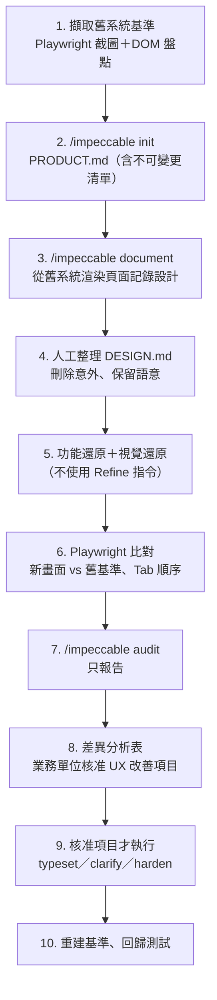

### 10.3.2 步驟 1：擷取舊系統基準

🏢 以下 Playwright 腳本擷取每個畫面的截圖、可聚焦元素清單（Tab 順序）與主要樣式取樣，存到 `docs/baseline/<裝置>/`。✅ 已實測（桌機與手機各一張截圖與 JSON）。

📄 `tests/baseline/capture-baseline.spec.ts`

```typescript
// tests/baseline/capture-baseline.spec.ts — 擷取舊系統畫面與流程基準（教學範例）
// 執行：BASE_URL=http://legacy-test.example.local npx playwright test tests/baseline --project=desktop
import { test } from '@playwright/test';
import fs from 'node:fs';
import path from 'node:path';

const OUT = 'docs/baseline';
// 要擷取的畫面：名稱、路徑、資料載入完成的定位器
const screens = [
  { name: 'txn-list', path: '/bank.html', ready: 'table' },
];

for (const s of screens) {
  test(`baseline：${s.name}`, async ({ page }, testInfo) => {
    await page.goto(s.path);
    await page.locator(s.ready).first().waitFor();
    await page.evaluate(() => document.fonts.ready);

    const dir = path.join(OUT, testInfo.project.name);
    fs.mkdirSync(dir, { recursive: true });

    // 1. 畫面截圖（遮罩每次會變的區塊）
    await page.screenshot({
      path: path.join(dir, `${s.name}.png`),
      fullPage: true,
      animations: 'disabled',
      mask: [page.locator('[data-test-volatile]')],
    });

    // 2. 欄位清單與 Tab 順序（DOM 分析）
    const inventory = await page.evaluate(() => {
      const focusables = Array.from(
        document.querySelectorAll<HTMLElement>('a[href], button, input, select, textarea, [tabindex]'),
      ).filter((el) => el.tabIndex >= 0 && !el.hasAttribute('disabled'));
      // 依瀏覽器的 Tab 規則排序：tabindex > 0 優先，其餘依 DOM 順序
      focusables.sort((a, b) => (a.tabIndex || 1e9) - (b.tabIndex || 1e9));
      return focusables.map((el) => ({
        tag: el.tagName.toLowerCase(),
        label: el.getAttribute('aria-label') ?? el.textContent?.trim() ?? '',
        name: el.getAttribute('name'),
        tabindex: el.getAttribute('tabindex'),
      }));
    });

    // 3. 主要樣式取樣（色彩、字型、字級），供 DESIGN.md 還原參考
    const styles = await page.evaluate(() => {
      const pick = (sel: string) => {
        const el = document.querySelector(sel);
        if (!el) return null;
        const cs = getComputedStyle(el);
        return { color: cs.color, background: cs.backgroundColor, font: cs.fontFamily, size: cs.fontSize };
      };
      return { body: pick('body'), h1: pick('h1'), th: pick('th'), button: pick('button') };
    });

    fs.writeFileSync(
      path.join(dir, `${s.name}.json`),
      JSON.stringify({ url: s.path, capturedAt: new Date().toISOString(), inventory, styles }, null, 2) + '\n',
    );
  });
}
```

✅ 實測產生的 `docs/baseline/desktop/txn-list.json`（節錄）：

```json
{
  "url": "/bank.html",
  "inventory": [
    { "tag": "input", "label": "查詢帳號", "name": null, "tabindex": null },
    { "tag": "input", "label": "起日", "name": null, "tabindex": null },
    { "tag": "input", "label": "迄日", "name": null, "tabindex": null },
    { "tag": "button", "label": "查詢", "name": null, "tabindex": null }
  ],
  "styles": {
    "body": { "color": "rgb(31, 41, 51)", "background": "rgb(244, 246, 248)", "font": "\"Noto Sans TC\", \"Microsoft JhengHei\", sans-serif", "size": "14px" }
  }
}
```

> 💡 舊系統要用**測試環境＋固定測試資料**擷取。ASP.NET Web Forms 的 `__VIEWSTATE` 與動態 ID 每次不同，不影響截圖，但 DOM 盤點不要用 `id` 當比對鍵。

### 10.3.3 步驟 2～4：PRODUCT.md 與 DESIGN.md

```text
/impeccable init

這是舊系統逆向工程專案。請讀 docs/baseline/ 的截圖與 JSON、docs/legacy/作業手冊-2024.pdf。
在 Capabilities and Constraints 明確列出「不可變更」：欄位順序（依 docs/baseline/*/*.json 的 inventory）、
Tab 順序、快捷鍵 F2／F8／Esc、兩段式覆核流程、所有業務術語。
```

```text
/impeccable document

來源：舊系統測試環境 http://legacy-test.example.local（請掃描渲染頁面），以及 docs/baseline/*/*.json 的 styles。
這是「記錄現況」。請把出現次數少於 3 次的色彩與字級列為「疑似意外」讓我判斷，不要寫入 frontmatter。
```

人工整理重點：舊系統常有十幾種藍色、四種灰色字。UI 小組逐一判斷哪些是**有意義的語意**（主色、連結、選取、停用），其他列入「③ UI/UX 改善」候選清單，不在視覺還原階段處理。

### 10.3.4 步驟 5：功能與視覺還原

```text
請依 docs/baseline/desktop/txn-list.png 與 txn-list.json 重建交易查詢頁（Vue 3＋PrimeVue）。

這是「視覺還原」階段：
- 欄位、按鈕、表格欄的順序與舊系統完全相同；Tab 順序與 inventory 相同。
- 色彩與字級使用 DESIGN.md 已整理的 Token；舊系統的「疑似意外」色彩一律用最接近的 Token。
- 不要使用任何 /impeccable Refine 類指令，不要做任何改善。
完成後執行 npx impeccable detect 並列出結果，但不要修正，只列入報告。
```

### 10.3.5 步驟 6：新舊比對

舊系統與新系統的像素不會完全相同（字型、元件庫不同），比對分兩層：

| 層次 | 方法 | 門檻 |
|---|---|---|
| 結構與流程 | 新系統跑同一支 capture 腳本，比較兩份 JSON 的 `inventory` 順序 | **必須完全相同** |
| 視覺 | 新系統截圖與舊基準並排人工比對；新系統自己的 `toHaveScreenshot` 基準用於後續回歸 | 版面位置一致；差異逐項記錄 |

比對 inventory（PowerShell）：

```powershell
$old = Get-Content docs/baseline/desktop/txn-list.json | ConvertFrom-Json
$new = Get-Content docs/rebuild/desktop/txn-list.json | ConvertFrom-Json
Compare-Object ($old.inventory.label) ($new.inventory.label) -SyncWindow 0
# 沒有輸出代表欄位與 Tab 順序完全一致
```

### 10.3.6 步驟 7～8：差異分析表

| # | 畫面 | 差異 | 類別 | 原因 | 處理 | 核准人 |
|---|---|---|---|---|---|---|
| 1 | 交易查詢 | 表頭底色 `#dce6f0` → `#f4f6f8` | ② 視覺還原（Token 收斂） | 舊系統 17 種藍色收斂為 3 種 | 接受 | UI 小組 |
| 2 | 交易查詢 | 「狀態」欄只有顏色 → 文字＋符號＋顏色 | ③ UX 改善 | `audit` P1：WCAG 1.4.1 | 待業務核准 | — |
| 3 | 匯款建檔 | 錯誤訊息「輸入錯誤」→ 具體說明 | ③ UX 改善 | `audit` P2 | 待業務核准 | — |
| 4 | 匯款建檔 | 金額欄寬度不同 | ① 功能還原缺陷 | 新系統未設定最小寬度 | 修正 | — |

### 10.3.7 步驟 9～10：核准後才改善

```text
/impeccable clarify the transfer form errors

只處理差異分析表 #3（已核准，需求單 REQ-2026-118）。不得修改其他項目。
完成後更新 docs/rebuild/差異分析表.md 的處理狀態。
```

改善完成後，重新產生新系統的 `toHaveScreenshot` 基準，並在 PR 說明引用核准單號。

## 10.4 案例四：Vue 2 升級 Vue 3

### 10.4.1 原則

> ⚠️ 升級分兩個階段，**不可合併**：
>
> 1. **技術升級**：Vue 2 → Vue 3、Vuex → Pinia、Element UI → Element Plus。目標是「畫面與行為完全不變」。
> 2. **設計整理**（選擇性）：升級驗證通過後，才用 `extract`、`polish` 整理樣式。

### 10.4.2 步驟

| 步驟 | 動作 | 工具 |
|---|---|---|
| 1 | 在升級前的 commit 打 tag（例如 `pre-vue3`） | Git |
| 2 | 在 `pre-vue3` 擷取所有主要畫面的截圖基準（四種 viewport）與 inventory | Playwright（10.3.2 節腳本） |
| 3 | `/impeccable document` 記錄升級前的設計系統 | Impeccable |
| 4 | `npx impeccable detect --json src/ > reports/pre-vue3.json`，建立偵測器 baseline | Impeccable CLI |
| 5 | 依官方遷移指南與 Codemod 升級（Impeccable 不參與） | Vue 官方工具 |
| 6 | 升級後跑同一套截圖：差異逐張確認 | Playwright |
| 7 | 偵測器比對：用 `impeccable-gate.mjs` 以 `pre-vue3.json` 產生的 baseline 檢查「新增問題」 | 第 12.5 節 |
| 8 | `/impeccable audit`（只報告），確認 Theming、Responsive 沒有退步 | Impeccable |
| 9 | 業務流程驗證：Tab 順序、快捷鍵、表單驗證、E2E 主流程 | Playwright |
| 10 | （選擇性）`/impeccable extract`、`/impeccable polish`，另開 PR | Impeccable |

### 10.4.3 偵測器 baseline 比對

適用 OS：macOS／Linux（Bash）

```bash
# 升級前（在 pre-vue3 tag）
git switch --detach pre-vue3
npx impeccable detect --json src/ > reports/pre-vue3.json || true
node tools/impeccable-gate.mjs reports/pre-vue3.json --write-baseline .impeccable/ci-baseline.json
git switch -

# 升級後
npx impeccable detect --json src/ > reports/post-vue3.json || true
node tools/impeccable-gate.mjs reports/post-vue3.json --baseline .impeccable/ci-baseline.json
```

> ⚠️ `|| true` 是因為有問題時 exit code 為 2；但這樣也會吞掉 exit 1（掃描失敗）。正式 CI 請用第 12.6 節分辨 exit code 的寫法。

### 10.4.4 Element UI → Element Plus 常見視覺差異

| 差異來源 | 現象 | 檢查方式 |
|---|---|---|
| 預設字級、行高改變 | 表格列高變高，一屏顯示筆數變少 | 截圖比對；DESIGN.md `typography.scale` 偏離（`design-system-font-size`） |
| 主題色變數名稱改變 | 主色變回元件庫預設藍 | 截圖比對；`design-system-color` |
| 圓角預設值改變 | 按鈕圓角從 4px 變 4px 以上 | `design-system-radius` |
| 表單驗證訊息位置 | 錯誤訊息改成浮動 | 截圖＋流程測試 |

## 10.5 案例五：建立公司共用 Design System

### 10.5.1 架構

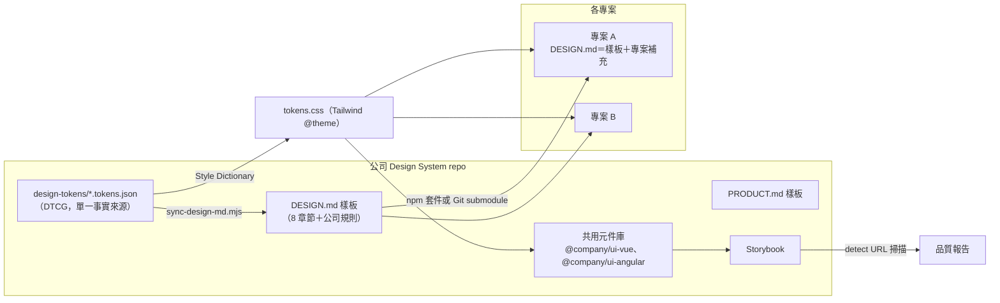

### 10.5.2 涵蓋範圍與做法

| 範圍 | 做法 |
|---|---|
| Design Tokens | DTCG JSON 為來源（7.5.3 節）；Style Dictionary 產出 CSS；`sync-design-md.mjs` 產出 DESIGN.md frontmatter |
| 共用元件 | 每個元件一個 Story；元件只用 Token class |
| Typography | DESIGN.md `typography.scale` 定義全公司字級階梯；中文行高 1.6 以上 |
| Color System | 品牌色、中性色、狀態色三組；每個色彩都標對比值 |
| Spacing | 4px 級距 |
| Accessibility | 元件層級的 axe 測試（Storybook test runner 或 Playwright 掃 Story URL） |
| RWD | 公司統一斷點 |
| 多專案一致性 | 專案的 DESIGN.md frontmatter 由公司 Tokens 產生；CI 用 `--check` 確認沒有手改 |

### 10.5.3 Tokens 與 DESIGN.md 自動同步

🏢 下列腳本把 DTCG Tokens 的 `color`、`spacing`、`radius` 寫入 DESIGN.md frontmatter 的 `colors`、`spacing`、`rounded`，其他區塊（`typography`、`components`、內文）原樣保留；`$description` 會變成 YAML 註解；`--check` 模式給 CI 用；`components` 參照到不存在的 Token 時會失敗。✅ 已實測：檢查、寫入、重複執行一致、內文不變、懸空參照偵測。

📄 `tools/sync-design-md.mjs`

```javascript
#!/usr/bin/env node
// tools/sync-design-md.mjs — 由 DTCG Tokens 更新 DESIGN.md frontmatter 的 colors／spacing／rounded（教學範例）
// 用法：node tools/sync-design-md.mjs design-tokens/core.tokens.json DESIGN.md [--check]
//   --check：只比對、不寫檔；不一致時 exit 1（給 CI 用）
import fs from 'node:fs';

const [tokensFile, designFile] = process.argv.slice(2);
const checkOnly = process.argv.includes('--check');
if (!tokensFile || !designFile) {
  console.error('用法：node tools/sync-design-md.mjs <tokens.json> <DESIGN.md> [--check]');
  process.exit(2);
}

const tokens = JSON.parse(fs.readFileSync(tokensFile, 'utf8'));

// 把 DTCG 群組攤平成 { 'status-success': { value, description } }，略過 $ 開頭的屬性
function flatten(group, prefix = '') {
  const out = {};
  for (const [key, node] of Object.entries(group ?? {})) {
    if (key.startsWith('$')) continue;
    const name = prefix ? `${prefix}-${key}` : key;
    if (node && typeof node === 'object' && '$value' in node) out[name] = { value: node.$value, description: node.$description };
    else if (node && typeof node === 'object') Object.assign(out, flatten(node, name));
  }
  return out;
}

// DTCG 2025.10 值 → CSS 字串
const toCss = (v) => {
  if (typeof v === 'string') return v;
  if (v && v.hex) return v.hex;
  if (v && typeof v.value === 'number' && v.unit) return `${v.value}${v.unit}`;
  throw new Error(`無法轉換的 Token 值：${JSON.stringify(v)}`);
};

const sections = {
  colors: flatten(tokens.color),
  spacing: flatten(tokens.spacing),
  rounded: flatten(tokens.radius),
};

// $description 會輸出成 YAML 行尾註解，說明文字以 Tokens 檔為準
const yamlBlock = (name, entries) =>
  [
    `${name}:`,
    ...Object.entries(entries).map(([k, t]) => {
      const key = /^\d/.test(k) ? `"${k}"` : k;
      return `  ${key}: "${toCss(t.value)}"${t.description ? `  # ${t.description}` : ''}`;
    }),
  ].join('\n');

const design = fs.readFileSync(designFile, 'utf8').replace(/\r\n/g, '\n');
const m = design.match(/^---\n([\s\S]*?)\n---\n/);
if (!m) {
  console.error(`${designFile} 沒有 YAML frontmatter`);
  process.exit(2);
}

// 以「頂層鍵」切段，只替換 colors／spacing／rounded，其他（typography、components、註解）原樣保留
const segments = [{ key: null, lines: [] }];
for (const line of m[1].split('\n')) {
  const top = line.match(/^([A-Za-z_][\w-]*):/);
  if (top) segments.push({ key: top[1], lines: [line] });
  else segments[segments.length - 1].lines.push(line);
}
for (const [name, entries] of Object.entries(sections)) {
  if (Object.keys(entries).length === 0) continue;
  const seg = segments.find((s) => s.key === name);
  const lines = yamlBlock(name, entries).split('\n');
  if (seg) {
    // 保留段落尾端的空行與註解（它們屬於下一段的說明）
    const tail = [];
    while (seg.lines.length && /^(\s*$|#)/.test(seg.lines[seg.lines.length - 1])) tail.unshift(seg.lines.pop());
    seg.lines = [...lines, ...tail];
  } else {
    segments.push({ key: name, lines: ['', ...lines] });
  }
}
const front = segments.flatMap((s) => s.lines).join('\n').replace(/\n+$/, '');
const next = design.replace(m[0], `---\n${front}\n---\n`);

// components 參照了 Tokens 已不存在的鍵（例如 {colors.bank-navy-deep}）→ 失敗
const dangling = [...front.matchAll(/\{(colors|spacing|rounded)\.([^}]+)\}/g)]
  .filter(([, group, key]) => !(key in sections[group]))
  .map(([ref]) => ref);
if (dangling.length) {
  console.error(`::error::DESIGN.md components 參照了不存在的 Token：${[...new Set(dangling)].join('、')}`);
  process.exit(1);
}

if (checkOnly) {
  if (next !== design) {
    console.error(`::error::${designFile} 的 frontmatter 與 ${tokensFile} 不一致，請執行 node tools/sync-design-md.mjs ${tokensFile} ${designFile}`);
    process.exit(1);
  }
  console.log('DESIGN.md frontmatter 與 Tokens 一致');
} else {
  fs.writeFileSync(designFile, next);
  console.log(`已更新 ${designFile}：colors ${Object.keys(sections.colors).length}、spacing ${Object.keys(sections.spacing).length}、rounded ${Object.keys(sections.rounded).length}`);
}
```

✅ 實測：Tokens 少了 `surface`、`bank-navy-deep` 等色彩時：

```text
::error::DESIGN.md components 參照了不存在的 Token：{colors.surface}、{rounded.sm}、{colors.bank-navy-deep}、{colors.surface-sunken}
```

CI 中加入：

```yaml
- name: DESIGN.md 與公司 Tokens 一致
  run: node tools/sync-design-md.mjs node_modules/@company/design-tokens/core.tokens.json DESIGN.md --check
```

### 10.5.4 公司 DESIGN.md 樣板的分層

| 層 | 內容 | 誰維護 |
|---|---|---|
| 公司層（不可改） | frontmatter Tokens、`## Colors`、`## Typography`、`## Do's and Don'ts` 中的品牌與無障礙規則 | Design System 小組 |
| 產業層（銀行版） | 交易狀態三重表達、金額格式、錯誤訊息格式、禁止動畫清單 | Design System 小組＋金融業務代表 |
| 專案層 | `## Overview`（專案定位與密度）、專案專屬元件 | 專案 UI/UX |

## 10.6 本章實務案例與注意事項

- ⚠️ 案例一到五的共同點：**先有 Context，再讓 AI 動手**；**改程式碼的指令都有範圍與限制**；**每一步都有可驗證的產出**。
- ⚠️ 逆向工程（案例三）與升級（案例四）最大的風險是「AI 主動改善」。要靠 PRODUCT.md 約束＋Prompt 限制＋Playwright 流程測試三道防線。
- 💡 案例五的 Tokens 同步建議放在 Design System repo 的 CI，各專案只負責 `--check`。

# 11. Impeccable 與其他 UI 品質工具整合

## 11.1 工具分工

| 工具 | 主要用途 | 回答的問題 | 不回答的問題 |
|---|---|---|---|
| Impeccable（Skill） | AI 設計引導、UX 評論、技術稽核 | AI 該怎麼設計？哪裡設計得不好？ | 有沒有回歸？功能對不對？ |
| Impeccable Detector | 確定性 AI Slop 與設計品質規則 | 有沒有典型 AI 劣質設計？有沒有偏離 DESIGN.md？ | 是否完整符合 WCAG？畫面跟昨天比變了什麼？ |
| Storybook | UI 元件開發與展示 | 每個元件在各種狀態下長什麼樣？ | 整頁流程是否正確 |
| Playwright | 瀏覽器自動化、E2E、截圖比對 | 流程能不能走完？畫面有沒有跑掉？Tab 順序對不對？ | 設計好不好 |
| axe-core | 規則化 Accessibility 檢查 | ARIA、標籤、地標、對比等 WCAG 規則是否違反？ | 鍵盤體驗、螢幕報讀實際體驗（需人工） |
| Lighthouse | 效能、a11y、最佳實務、SEO 評分 | 載入快不快？版面會不會跳動？ | 設計與流程 |
| Visual Regression Testing | 截圖差異比對 | 這次修改造成哪些畫面變化？ | 變化是好是壞（需人判斷） |
| Tailwind CSS | 樣式管理、Token 落地 | — （是實作工具） | — |
| Design Tokens | 設計數值集中管理 | 「正確的值」是什麼？ | — |

## 11.2 企業級 UI 品質治理架構

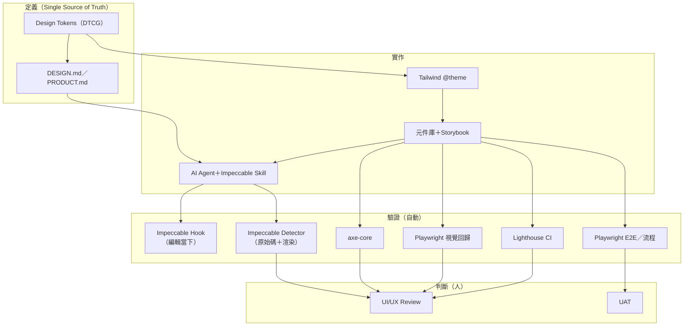

> ⚠️ **Impeccable Detector 不能取代**完整的 Accessibility 檢查（axe＋鍵盤＋螢幕報讀）、效能量測（Lighthouse）、E2E 與視覺回歸測試。官方原文：「A clean detector run is evidence, not proof of visual or accessibility quality: it does not replace inspecting the rendered experience across relevant viewports.」

## 11.3 Playwright：視覺回歸與流程不變性

### 11.3.1 設定

✅ 下列設定與測試已在 Playwright 1.65.0 實測：四種 viewport × 4 個測試＝16 項全部通過；把表格儲存格 padding 從 8px 改成 10px 後，視覺測試失敗（49,032 像素、3% 差異）；把某欄位設為 `tabindex="-1"` 後，Tab 順序測試失敗並清楚顯示差異。

📄 `playwright.config.ts`

```typescript
// playwright.config.ts — UI 回歸測試設定（教學範例）
import { defineConfig, devices } from '@playwright/test';

export default defineConfig({
  testDir: './tests/ui',
  // 截圖基準檔依「平台」分開存放；CI 與本機作業系統不同時，基準必須在 CI 產生
  snapshotPathTemplate: '{testDir}/__screenshots__/{projectName}/{testFilePath}/{arg}{ext}',
  fullyParallel: true,
  retries: process.env.CI ? 1 : 0,
  reporter: [['list'], ['html', { open: 'never' }]],
  use: {
    baseURL: process.env.BASE_URL ?? 'http://127.0.0.1:4173',
    locale: 'zh-TW',
    timezoneId: 'Asia/Taipei',
    colorScheme: 'light',
  },
  expect: {
    toHaveScreenshot: {
      maxDiffPixelRatio: 0.002, // 0.2%：吸收反鋸齒差異，又能抓到 1px 版面位移
      animations: 'disabled',
      caret: 'hide',
    },
  },
  projects: [
    { name: 'desktop', use: { ...devices['Desktop Chrome'], viewport: { width: 1920, height: 1080 } } },
    { name: 'laptop', use: { ...devices['Desktop Chrome'], viewport: { width: 1366, height: 768 } } },
    { name: 'tablet', use: { ...devices['iPad Pro 11'] } },
    { name: 'mobile', use: { ...devices['Pixel 7'] } },
  ],
});
```

### 11.3.2 視覺回歸＋流程不變性測試

📄 `tests/ui/visual.spec.ts`

```typescript
// tests/ui/visual.spec.ts — 視覺回歸與流程不變性測試（教學範例）
import { test, expect } from '@playwright/test';

// 要比對的畫面清單：路徑 + 等待「資料已載入」的定位器
const screens = [
  { name: 'txn-list', path: '/bank.html', ready: 'table[aria-label="交易明細"]' },
];

for (const s of screens) {
  test(`視覺基準：${s.name}`, async ({ page }) => {
    await page.goto(s.path);
    await page.locator(s.ready).waitFor();
    await page.evaluate(() => document.fonts.ready); // 字型未載入完成就截圖會造成誤報
    await expect(page).toHaveScreenshot(`${s.name}.png`, {
      fullPage: true,
      // 遮罩每次都會變的區塊（時間、登入者、流水號）
      mask: [page.locator('[data-test-volatile]')],
    });
  });
}

test('流程不變：Tab 順序與舊系統一致', async ({ page }) => {
  await page.goto('/bank.html');
  // 舊系統的 Tab 順序（來自 docs/baseline/tab-order.json；此處為示範內嵌）
  const expected = ['查詢帳號', '起日', '迄日', '查詢'];
  const actual: string[] = [];
  await page.locator('body').click({ position: { x: 1, y: 1 } });
  for (let i = 0; i < expected.length; i++) {
    await page.keyboard.press('Tab');
    actual.push(
      await page.evaluate(() => {
        const el = document.activeElement as HTMLElement | null;
        if (!el) return '(none)';
        // 有 aria-label 用 aria-label；按鈕用文字；其他（例如焦點掉到 body）只回傳標籤名稱
        return el.getAttribute('aria-label') ?? (el.tagName === 'BUTTON' ? el.textContent?.trim() ?? '' : `<${el.tagName.toLowerCase()}>`);
      }),
    );
  }
  expect(actual).toEqual(expected);
});

test('流程不變：狀態同時以文字表達（不只靠顏色）', async ({ page }) => {
  await page.goto('/bank.html');
  const statuses = await page.locator('[data-status]').allInnerTexts();
  expect(statuses.length).toBeGreaterThan(0);
  for (const text of statuses) {
    expect(text.trim()).toMatch(/已入帳|待覆核|退件|處理中/);
  }
});
```

✅ Tab 順序被改變時的實測失敗訊息：

```text
    - Expected  - 1
    + Received  + 1
    -   "起日",
    +   "<body>",
  1 failed
```

### 11.3.3 視覺回歸的實務規則

| 規則 | 原因 |
|---|---|
| 基準截圖在 CI 同一作業系統產生 | Windows、macOS、Linux 字型渲染不同 |
| 等待 `document.fonts.ready` | 字型未載入就截圖，每次結果不同 |
| 遮罩時間、使用者、流水號 | `mask: [page.locator('[data-test-volatile]')]` |
| `animations: 'disabled'`、`caret: 'hide'` | 避免動畫與游標造成差異 |
| `maxDiffPixelRatio` 不要設太寬 | 0.2% 能吸收反鋸齒，又能抓到 1px 位移 |
| 更新基準要在 PR 說明原因 | `--update-snapshots` 產生的差異要逐張審查 |

## 11.4 axe-core：WCAG 2.2 AA

📄 `tests/ui/a11y.spec.ts`

```typescript
// tests/ui/a11y.spec.ts — WCAG 2.2 AA 自動檢查（教學範例）
import { test, expect } from '@playwright/test';
import AxeBuilder from '@axe-core/playwright';

const pages = ['/bank.html'];

for (const path of pages) {
  test(`axe WCAG 2.2 AA：${path}`, async ({ page }, testInfo) => {
    await page.goto(path);
    const results = await new AxeBuilder({ page })
      .withTags(['wcag2a', 'wcag2aa', 'wcag21a', 'wcag21aa', 'wcag22aa'])
      .analyze();

    // 完整結果附在報告中，方便稽核追溯
    await testInfo.attach('axe-results.json', {
      body: JSON.stringify(results.violations, null, 2),
      contentType: 'application/json',
    });

    const serious = results.violations.filter((v) => v.impact === 'serious' || v.impact === 'critical');
    expect(serious, serious.map((v) => `${v.id}: ${v.help}`).join('\n')).toEqual([]);
  });
}
```

✅ 實測於第 11.3.1 節同一頁面，四種 viewport 皆無 serious／critical 違規。

| Impeccable 偵測器 | axe-core | 建議 |
|---|---|---|
| `low-contrast`（WCAG AA 對比） | `color-contrast` | 兩者都跑；偵測器在 Hook 中即時回饋，axe 在 CI 把關 |
| `skipped-heading` | `heading-order`（best-practice） | 同上 |
| 無 | `label`、`button-name`、`aria-*`、`landmark-*`、`target-size`（WCAG 2.2） | 只能靠 axe |
| `tiny-text`、`line-length`、`all-caps-body` | 無 | 只能靠偵測器 |

## 11.5 Lighthouse CI

📄 `lighthouserc.json`（🏢 範例；🧪 本手冊未實測 Lighthouse CI 執行）

```json
{
  "ci": {
    "collect": {
      "startServerCommand": "npx vite preview --port 4173 --strictPort",
      "url": ["http://127.0.0.1:4173/"],
      "numberOfRuns": 3
    },
    "assert": {
      "assertions": {
        "categories:performance": ["warn", { "minScore": 0.8 }],
        "categories:accessibility": ["error", { "minScore": 0.95 }],
        "categories:best-practices": ["warn", { "minScore": 0.9 }],
        "largest-contentful-paint": ["warn", { "maxNumericValue": 2500 }],
        "cumulative-layout-shift": ["error", { "maxNumericValue": 0.1 }]
      }
    },
    "upload": {
      "target": "filesystem",
      "outputDir": "reports/lighthouse"
    }
  }
}
```

```bash
npm install -D @lhci/cli
npx lhci autorun
```

> 💡 執行 `/impeccable optimize` 前後各跑一次 Lighthouse，在 PR 中附上數據，才能證明效能真的變好。

## 11.6 Storybook：元件層級掃描

Storybook 的每個 Story 都有獨立的 iframe URL，可以直接給偵測器掃描：

適用 OS：macOS／Linux（Bash）

```bash
npx storybook build -o storybook-static
npx http-server storybook-static -p 6006 -s &
npx wait-on http://127.0.0.1:6006/
for id in base-button--primary base-button--danger txn-status-tag--all; do
  npx impeccable detect --json "http://127.0.0.1:6006/iframe.html?id=${id}&viewMode=story" > "reports/story-${id}.json" || true
done
```

🧪 Story ID 依你的專案而定；`http-server`、`wait-on` 需另外安裝為 devDependencies。

## 11.7 本章實務案例與注意事項

**案例：偵測器 0 問題，axe 卻有 7 個違規：**

某頁面 Impeccable 偵測器完全乾淨，axe 卻回報 7 個 serious：表單欄位沒有 `<label>`、圖示按鈕沒有可讀名稱、自訂下拉選單沒有 ARIA 角色。這些都不在偵測器的 62 條規則範圍內。

結論：偵測器與 axe 檢查的範圍**幾乎不重疊**，兩者都必須在 CI 中執行。

**注意事項：**

- ⚠️ 視覺回歸只能告訴你「變了」，不能告訴你「變得對不對」。基準更新必須由 UI/UX 或前端架構師審查。
- ⚠️ Lighthouse 分數在 CI 機器上會波動，`numberOfRuns` 至少 3 次，門檻用 `warn` 起步。
- 💡 把 Playwright 的 Tab 順序測試當成「業務流程合約」，特別是逆向工程與升級專案。

# 12. CI/CD 自動化與品質閘門

## 12.1 設計原則

| 原則 | 說明 |
|---|---|
| 版本鎖定 | `impeccable` 以 `--save-exact` 寫入 devDependencies，CI 用 `npm ci`；**不要**用 `npx impeccable@latest` |
| 兩種掃描都跑 | 原始碼掃描（有行號，可在 PR 註記）＋渲染頁面掃描（對比、溢出等元素規則） |
| 分辨 exit code | `2`＝有問題（交給閘門判斷）、`1`＝無法掃描（直接失敗）、`0`＝無主要問題 |
| 防止假綠燈 | 先確認真的有 UI 檔案被掃描 |
| 分級阻擋 | error 與「阻擋規則」一律擋；其他 warning 只擋「新增的」；advisory 只報告 |
| 舊債不阻擋新工作 | 用 baseline 記錄既有問題，逐步清償 |
| 報告保存 | JSON 報告上傳 Artifacts，供稽核追溯 |

## 12.2 Source Code Scan 與 Rendered Page Scan

| 面向 | Source Code Scan | Rendered Page Scan |
|---|---|---|
| 指令 | `npx impeccable detect src/` | `npx impeccable detect http://127.0.0.1:4173/` |
| 需要 build | 否 | 是（`npm run build`＋preview server） |
| 需要瀏覽器 | 否 | 是（`ubuntu-latest` Runner 已預裝 Chrome） |
| 速度 | 數秒 | 每頁數秒 |
| 行號 | 有（regex 引擎） | 無 |
| PR 行內註記 | 適合（`--github`） | 註記會落在 URL，不適合 |
| 涵蓋規則 | 文字樣式類 | 元素與版面類（對比、字級、溢出、標題結構） |
| 多 viewport | 不適用 | `--viewport 390x844` 等 |
| 適合 | 每個 PR | 每個 PR（主要頁面）或 nightly（全部頁面） |

> ⚠️ **假綠燈防護（✅ 實測）**：掃描路徑下沒有支援的檔案時，`detect` 不輸出任何內容並回傳 `0`。workflow 中的「防呆」步驟用 `git ls-files` 確認檔案數大於 0。

## 12.3 JSON 報告格式

✅ 實測 `--json` 輸出是**扁平陣列**，每個 finding 的欄位：

| 欄位 | 說明 |
|---|---|
| `antipattern` | 規則 ID（例如 `side-tab`） |
| `name` | 規則名稱 |
| `description` | 規則說明與修正方向 |
| `severity` | `error`、`warning`、`advisory` |
| `category` | `slop`、`quality` |
| `file` | **絕對路徑**（URL 掃描時為 URL） |
| `line` | 行號；HTML 引擎與 URL 掃描為 `0` |
| `snippet` | 命中的程式碼片段或說明 |
| `advisory` | advisory 才有，值為 `true` |

```json
[
  {
    "antipattern": "side-tab",
    "name": "Side-tab accent border",
    "description": "Thick colored border on one side of a card — the most recognizable tell of AI-generated UIs. Use a subtler accent or remove it entirely.",
    "severity": "warning",
    "category": "slop",
    "file": "C:\\…\\src\\components\\KpiDashboard.vue",
    "line": 34,
    "snippet": "border-left: 4px solid #8b5cf6"
  }
]
```

> 💡 `file` 是絕對路徑。比較不同機器或不同 Runner 的報告時，要先轉成相對路徑（下方閘門腳本已處理）。

## 12.4 GitHub Actions Annotation

✅ 實測 `--github` 輸出（warning 用 `::warning`，advisory 用 `::notice`）：

```text
::warning file=src/components/KpiDashboard.vue,line=34,title=Side-tab accent border::[side-tab] border-left: 4px solid #8b5cf6%0AThick colored border on one side of a card — …
::notice file=src/components/KpiDashboard.vue,line=35,title=Bounce or elastic easing::[bounce-easing] cubic-bezier(0.68, -0.55, 0.265, 1.55)%0ABounce and elastic easing feel dated and tacky. …
```

| 限制（📖 官方 README） | 說明 |
|---|---|
| 顯示數量 | GitHub 每個 step 每種類型最多顯示 10 個註記、每個 job 最多 50 個，其餘只在 log |
| 無行號 | HTML 引擎的結果沒有行號，註記會標在檔案層級 |
| 互斥 | `--github` 不能與 `--json`、`--list-rules` 同時使用，所以 workflow 要跑兩次原始碼掃描 |

## 12.5 Quality Gate

### 12.5.1 為什麼不能直接用 exit code 當閘門

`detect` 只要有任何 warning 就回傳 2。如果直接把 exit code 2 當失敗：

- 舊專案第一天就有上百個問題，所有 PR 都過不了，團隊只好關掉檢查。
- 品味類規則（`em-dash-overuse`、`italic-serif-display`）與無障礙問題（`low-contrast`）被同等對待。

所以要有一層**政策**：

| 類別 | 範例 | 處理 |
|---|---|---|
| 一律阻擋 | `severity: error`；`low-contrast`、`gray-on-color`、`tiny-text`、`text-overflow`、`broken-image`、`skipped-heading`、`design-system-font` | 擋 PR |
| 新增才阻擋 | 其他 warning（例如 `side-tab`、`nested-cards`、`overused-font`） | 不在 baseline 的新問題擋 PR；舊問題只報告 |
| 只報告 | advisory | 列在報告，不擋 |

### 12.5.2 閘門腳本

🏢 以下腳本讀取 `detect --json` 的結果，依政策檔與 baseline 判斷，輸出 Markdown 摘要（也會寫入 GitHub Step Summary）。✅ 已實測：無 baseline、建立 baseline、套用 baseline、缺少參數四種情境。

📄 `tools/impeccable-gate.mjs`

```javascript
#!/usr/bin/env node
// tools/impeccable-gate.mjs — 企業 UI 設計品質閘門（教學範例，非 Impeccable 官方工具）
//
// 用法：
//   node tools/impeccable-gate.mjs <findings.json> [--baseline <baseline.json>] [--policy <policy.json>]
//   node tools/impeccable-gate.mjs <findings.json> --write-baseline <baseline.json>
//
// 規則（可由 policy.json 覆寫）：
//   1. severity = error 的 finding 一律阻擋。
//   2. blockingRules 內的規則一律阻擋（例如 low-contrast）。
//   3. 其餘 warning：只阻擋「baseline 沒有的新問題」，舊債只報告不阻擋。
//   4. advisory 只列在報告，永不阻擋。
import fs from 'node:fs';
import path from 'node:path';

const DEFAULT_POLICY = {
  blockingRules: [
    'low-contrast', 'gray-on-color', 'tiny-text', 'text-overflow', 'text-occlusion',
    'broken-image', 'content-hidden-at-rest', 'skipped-heading', 'script-error',
  ],
  maxNewWarnings: 0,
};

function arg(name) {
  const i = process.argv.indexOf(name);
  return i > 0 ? process.argv[i + 1] : undefined;
}

function readJson(file, fallback) {
  if (!file) return fallback;
  if (fallback !== undefined && !fs.existsSync(file)) {
    console.warn(`::warning::找不到 ${file}，改用預設值`);
    return fallback;
  }
  try {
    return JSON.parse(fs.readFileSync(file, 'utf8'));
  } catch (e) {
    console.error(`::error::無法讀取 ${file}：${e.message}`);
    process.exit(3);
  }
}

// 以「規則 + 相對路徑」當鍵，不含行號，避免改一行就讓整份 baseline 失效。
function keyOf(f) {
  const rel = path.relative(process.cwd(), f.file ?? '').split(path.sep).join('/');
  return `${f.antipattern}@${rel}`;
}

const findingsFile = process.argv[2];
if (!findingsFile || findingsFile.startsWith('--')) {
  console.error('用法：node tools/impeccable-gate.mjs <findings.json> [--baseline b.json] [--policy p.json]');
  process.exit(3);
}

const findings = readJson(findingsFile, []);
if (!Array.isArray(findings)) {
  console.error('::error::findings 檔不是 impeccable detect --json 的陣列格式');
  process.exit(3);
}

const writeTo = arg('--write-baseline');
if (writeTo) {
  const keys = [...new Set(findings.filter((f) => f.severity !== 'advisory').map(keyOf))].sort();
  fs.writeFileSync(writeTo, JSON.stringify({ generatedAt: new Date().toISOString(), keys }, null, 2) + '\n');
  console.log(`baseline 已寫入 ${writeTo}（${keys.length} 筆）`);
  process.exit(0);
}

const policy = { ...DEFAULT_POLICY, ...readJson(arg('--policy'), {}) };
const baseline = new Set(readJson(arg('--baseline'), { keys: [] }).keys);

const blocking = [];
const newWarnings = [];
const knownDebt = [];
const advisories = [];
for (const f of findings) {
  if (f.severity === 'advisory') advisories.push(f);
  else if (f.severity === 'error' || policy.blockingRules.includes(f.antipattern)) blocking.push(f);
  else if (!baseline.has(keyOf(f))) newWarnings.push(f);
  else knownDebt.push(f);
}

const failed = blocking.length > 0 || newWarnings.length > policy.maxNewWarnings;
// HTML 引擎與 URL 掃描的 finding 沒有行號（line 為 0），顯示為「-」。
const row = (f) => `| \`${f.antipattern}\` | ${f.severity} | ${keyOf(f).split('@')[1]}:${f.line || '-'} |`;
const md = [
  `## Impeccable 設計品質閘門：${failed ? '❌ 未通過' : '✅ 通過'}`,
  '',
  '| 類別 | 筆數 | 是否阻擋 |',
  '|---|---|---|',
  `| 阻擋規則／error | ${blocking.length} | 是 |`,
  `| 新增 warning | ${newWarnings.length} | 超過 ${policy.maxNewWarnings} 筆才阻擋 |`,
  `| 既有技術債（baseline） | ${knownDebt.length} | 否 |`,
  `| advisory | ${advisories.length} | 否 |`,
  '',
];
if (blocking.length + newWarnings.length > 0) {
  md.push('| 規則 | 嚴重度 | 位置 |', '|---|---|---|', ...[...blocking, ...newWarnings].map(row), '');
}
const summary = md.join('\n');
console.log(summary);
if (process.env.GITHUB_STEP_SUMMARY) fs.appendFileSync(process.env.GITHUB_STEP_SUMMARY, summary + '\n');
process.exit(failed ? 1 : 0);
```

📄 `.impeccable/ci-policy.json`

```json
{
  "blockingRules": [
    "low-contrast",
    "gray-on-color",
    "tiny-text",
    "text-overflow",
    "text-occlusion",
    "broken-image",
    "content-hidden-at-rest",
    "skipped-heading",
    "script-error",
    "design-system-font"
  ],
  "maxNewWarnings": 0
}
```

✅ 實測：套用 baseline 後，既有的 6 個 warning 變成「技術債」不阻擋，但 `skipped-heading` 屬於阻擋規則，即使在 baseline 裡仍然阻擋：

```text
## Impeccable 設計品質閘門：❌ 未通過

| 類別 | 筆數 | 是否阻擋 |
|---|---|---|
| 阻擋規則／error | 1 | 是 |
| 新增 warning | 0 | 超過 0 筆才阻擋 |
| 既有技術債（baseline） | 6 | 否 |
| advisory | 1 | 否 |

| 規則 | 嚴重度 | 位置 |
|---|---|---|
| `skipped-heading` | warning | public/landing.html:- |
```

### 12.5.3 建立 baseline

適用 OS：macOS／Linux（Bash）｜在 `main` 分支執行一次，結果 commit

```bash
npx impeccable detect --json src/ public/ > reports/impeccable-source.json || true
node tools/impeccable-gate.mjs reports/impeccable-source.json --write-baseline .impeccable/ci-baseline.json
git add .impeccable/ci-baseline.json
git commit -m "chore: record Impeccable CI baseline"
```

Baseline 以「規則＋相對路徑」為鍵、不含行號，所以修改同一檔案的其他行，不會讓舊問題變成新問題。

## 12.6 完整 GitHub Actions 範例

📄 `.github/workflows/ui-quality.yml`（🏢 範例，依專案調整；🧪 YAML 已通過語法解析，但未在 GitHub 雲端實際執行）

```yaml
# .github/workflows/ui-quality.yml — UI 設計品質閘門（教學範例，請依專案調整）
name: ui-quality

on:
  pull_request:
    paths:
      - "src/**"
      - "public/**"
      - "DESIGN.md"
      - "PRODUCT.md"
      - ".impeccable/config.json"
      - "package.json"
      - "package-lock.json"

permissions:
  contents: read

concurrency:
  group: ui-quality-${{ github.ref }}
  cancel-in-progress: true

env:
  DO_NOT_TRACK: "1"            # 關閉 Impeccable 匿名統計
  IMPECCABLE_NO_TELEMETRY: "1"

jobs:
  impeccable:
    runs-on: ubuntu-latest
    timeout-minutes: 15
    steps:
      - uses: actions/checkout@v4

      - uses: actions/setup-node@v4
        with:
          node-version: 22
          cache: npm

      # impeccable 必須鎖在 devDependencies（例如 "impeccable": "4.8.0"），不要用 npx impeccable@latest
      - run: npm ci

      - name: 防呆：確認有 UI 檔案可掃描
        run: |
          count=$(git ls-files 'src/**/*.vue' 'src/**/*.tsx' 'src/**/*.css' 'public/**/*.html' | wc -l)
          echo "UI files: $count"
          if [ "$count" -eq 0 ]; then
            echo "::error::找不到任何 UI 檔案，掃描路徑可能設定錯誤（detect 對空目錄會回傳 0）"
            exit 1
          fi

      - name: Source scan（PR 行內註記）
        run: |
          set +e
          npx impeccable detect --github src/ public/
          code=$?
          set -e
          # 0 = 無問題，2 = 有問題（交給下方 gate 判斷），1 = 有目標無法掃描 → 直接失敗
          if [ "$code" -eq 1 ]; then exit 1; fi

      - name: Source scan（JSON 報告）
        run: |
          mkdir -p reports
          set +e
          npx impeccable detect --json src/ public/ > reports/impeccable-source.json
          code=$?
          set -e
          if [ "$code" -eq 1 ]; then exit 1; fi

      - name: Build 與啟動預覽伺服器
        run: |
          npm run build
          npx vite preview --port 4173 --strictPort > reports/preview.log 2>&1 &
          npx wait-on --timeout 60000 http://127.0.0.1:4173/

      - name: Rendered scan（桌機與手機寬度）
        run: |
          set +e
          npx impeccable detect --json http://127.0.0.1:4173/ > reports/impeccable-rendered-desktop.json
          c1=$?
          npx impeccable detect --json --viewport 390x844 http://127.0.0.1:4173/ > reports/impeccable-rendered-mobile.json
          c2=$?
          set -e
          if [ "$c1" -eq 1 ] || [ "$c2" -eq 1 ]; then exit 1; fi

      - name: 合併報告
        run: |
          node -e '
            const fs = require("fs");
            const files = ["source", "rendered-desktop", "rendered-mobile"].map(n => `reports/impeccable-${n}.json`);
            const all = files.flatMap(f => JSON.parse(fs.readFileSync(f, "utf8")));
            fs.writeFileSync("reports/impeccable-all.json", JSON.stringify(all, null, 2));
            console.log("findings:", all.length);
          '

      - name: Quality gate
        run: >
          node tools/impeccable-gate.mjs reports/impeccable-all.json
          --baseline .impeccable/ci-baseline.json
          --policy .impeccable/ci-policy.json

      - name: 保存報告
        if: always()
        uses: actions/upload-artifact@v4
        with:
          name: impeccable-reports
          path: reports/
          retention-days: 30
```

**需要的 devDependencies**：

```bash
npm install -D --save-exact impeccable@4.8.0
npm install -D wait-on
```

### 12.6.1 加上 Playwright 與 axe 的 job

```yaml
  ui-tests:
    runs-on: ubuntu-latest
    timeout-minutes: 20
    steps:
      - uses: actions/checkout@v4
      - uses: actions/setup-node@v4
        with:
          node-version: 22
          cache: npm
      - run: npm ci
      - run: npx playwright install --with-deps chromium
      - run: npm run build
      - name: 啟動預覽伺服器
        run: |
          npx vite preview --port 4173 --strictPort &
          npx wait-on --timeout 60000 http://127.0.0.1:4173/
      - name: 視覺回歸＋流程＋axe
        run: npx playwright test
      - if: always()
        uses: actions/upload-artifact@v4
        with:
          name: playwright-report
          path: playwright-report/
          retention-days: 30
```

## 12.7 Exit Code 與失敗處理

| Exit Code | 意義 | workflow 處理 |
|---|---|---|
| 0 | 完成，無主要問題（advisory 可能存在） | 繼續 |
| 2 | 完成，有主要問題 | 繼續，交給閘門腳本 |
| 1 | 至少一個目標無法掃描（路徑錯誤、URL 無法連線、瀏覽器無法啟動） | **直接失敗** |
| 閘門 1 | 政策判定未通過 | 失敗，PR 不能合併 |
| 閘門 3 | 閘門腳本參數或輸入錯誤 | 失敗，修正 workflow |

| 常見 CI 失敗 | 原因 | 處理 |
|---|---|---|
| `Warning: cannot access <路徑>`，exit 1 | 掃描路徑不存在 | 修正路徑 |
| `Timed out after 30000 ms while waiting for the WS endpoint URL` | 瀏覽器無法啟動 | Runner 安裝 Chrome；不要改寫 `HOME` |
| URL 掃描抓不到樣式 | 跨網域 CSS 沒有 CORS | 掃描本機 preview server |
| 每次結果不同 | 頁面有隨機內容或動畫 | 固定測試資料；同一頁至少掃兩次確認 |

## 12.8 例外規則管理與報告保存

| 項目 | 做法 |
|---|---|
| 例外放哪 | `.impeccable/config.json`（共用，進版控）；CI 不會讀到 `config.local.json` |
| 審查 | `CODEOWNERS`：`/.impeccable/ @company/frontend-architects` |
| 稽核 | 例外的 `reason` 寫明核准人與依據；每季清理 |
| 報告保存 | Artifacts 保存 30 天；正式版本的報告另存到品質文件庫 |
| 趨勢 | 每週統計 `reports/impeccable-all.json` 的數量（第 14.4 節 KPI） |

## 12.9 本章實務案例與注意事項

**案例：導入第一週所有 PR 都被擋：**

某團隊直接用「exit code 2 就失敗」，舊專案有 312 個 warning，第一天所有 PR 失敗，隔天有人把 step 改成 `continue-on-error: true`，檢查形同虛設。

改善：

1. 在 `main` 建立 baseline（12.5.3 節）。
2. 只把 9 條無障礙與破版規則列為阻擋。
3. 每個 Sprint 安排清償 20 筆技術債，baseline 逐步縮小。

**注意事項：**

- ⚠️ 不要把所有 warning 都設為阻擋部署的條件。阻擋清單應該只放「會傷害使用者」的規則。
- ⚠️ `continue-on-error: true` 會讓閘門失效。需要暫時放行時，用 baseline 或有理由的例外，不要關掉檢查。
- 💡 PR 上的 `::warning` 註記會被大多數開發人員看到，是最有效的教育工具。

# 13. 系統維護與版本升級

## 13.1 版本管理

### 13.1.1 版本號的組成

| 版本 | 位置 | v4.8.0 的值 |
|---|---|---|
| CLI 版本 | `npx impeccable --version`；npm `impeccable` | `4.8.0` |
| Skill 版本 | 各 `SKILL.md` frontmatter 的 `version:`（Codex 版沒有此欄位） | `4.8.0` |
| 引擎版本 | `scripts/VERSION`；npm optional dependency `@impeccable/cli-<平台>` | `0.1.18` |
| GitHub tag | `skill-v*`（Skill／CLI）、`engine-v*`（引擎） | `skill-v4.8.0`、`engine-v0.1.18` |

> 📌 自 v4.5.2 起，CLI 與 Skill 使用同一個版本號（changelog：「The CLI and skill now share one version number」）。

### 13.1.2 確認目前版本

適用 OS：Windows（PowerShell 7）｜執行位置：專案根目錄

```powershell
npx --no-install impeccable --version
Select-String -Path .claude/skills/impeccable/SKILL.md -Pattern '^version:'
Get-Content .claude/skills/impeccable/scripts/VERSION
npm ls impeccable
```

或使用第 6.6.3 節的 `tools/Test-Impeccable.ps1`。

### 13.1.3 查詢 Releases 與 Changelog

| 來源 | 網址／指令 | 內容 |
|---|---|---|
| 官方 Changelog | <https://impeccable.style/changelog> | 每版 Skill 與 CLI 的變更（最完整） |
| GitHub Releases | <https://github.com/pbakaus/impeccable/releases> | `skill-v*` 與 `engine-v*` 的發布紀錄與引擎下載檔 |
| npm | `npm view impeccable versions --json`、`npm view impeccable dist-tags` | 可安裝的版本 |
| GitHub CLI | `gh api repos/pbakaus/impeccable/releases --jq '.[0:5][]\|{tag_name,published_at}'` | 最近發布 |

✅ 研究當日查得：`engine-v0.1.19`（2026-11-07）、`skill-v4.8.0`（2026-10-26）、`engine-v0.1.18`（2026-10-26）。

### 13.1.4 近期版本重點（📖 官方 Changelog 整理）

| 版本（日期） | 對企業的影響 |
|---|---|
| **4.8.0**（2026-10-26） | 新增 Devin、Replit Agent 安裝目標；Cursor Hook 改為「寫入後檢查」不再阻擋寫入；Codex Hook 偵測改善；新增 `detect --github`、`--list-rules`、`--scope`、`--no-advisory`；**下載檔對照已 commit 的 digest 驗證**；`hard-offset-shadow` 新規則（advisory）；Live 調整值重新整理後保留 |
| 4.7.0（2026-10-20） | 桌面應用掃描（Electron、NW.js、CEF、WebView2，`--cdp`、`--target`）；新增 `straggler`、`unbalanced-heading`；誤報減少 |
| 4.6.0（2026-10-15） | `impeccable telemetry off`、`DO_NOT_TRACK`；**Claude Code Hook 改裝到使用者設定（`settings.local.json`）而非共用專案檔**；Node 18.19+ 恢復支援 |
| 4.5.2（2026-10-09） | App 畫面與文件一律 code-first；CLI 與 Skill 統一版本號；Live 支援 Astro 7.3.6+ |
| 4.5.1（2026-10-07） | 退役 `layout-transition` 規則；Windows 上 Hook 指令以 PowerShell 執行；Live 多項修正 |
| 4.5.0（2026-10-01） | Landing、作業畫面（Dashboard、工具）、文件分開指引 |

> 💡 從 changelog 可以看到 Impeccable **大約每週發布一次**，規則也會新增或退役。企業不要自動追最新版。

## 13.2 更新操作

### 13.2.1 指令

```bash
npx impeccable check                    # 檢查是否有更新
npx impeccable update                   # 更新現有安裝（互動）
npx impeccable update --scope=project -y
npx impeccable update --no-hooks        # 只更新 Skill，不動 Hook manifest
```

> ⚠️ **`check` 的誤報（✅ 實測）**：在已是 npm 最新版 4.8.0 的專案中，`check` 仍顯示「Updates available」，但執行 `update` 後 `git status` 完全沒有差異（輸出「Updated 2 skill(s) to v4.8.0」）。**請以 `git diff` 判斷 update 實際改了什麼**，不要只看 `check` 的訊息。

### 13.2.2 🏢 企業建議的更新流程

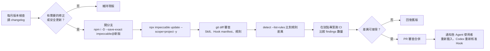

適用 OS：macOS／Linux（Bash）

```bash
NEW="4.8.0"   # 換成：要升級的版本
git switch -c chore/impeccable-$NEW
npx impeccable detect --list-rules --json > reports/rules-before.json
npm install -D --save-exact "impeccable@$NEW"
npx impeccable update --scope=project -y
npx impeccable detect --list-rules --json > reports/rules-after.json
node -e '
  const a = require("./reports/rules-before.json").map(r => r.id);
  const b = require("./reports/rules-after.json").map(r => r.id);
  console.log("新增規則:", b.filter(x => !a.includes(x)));
  console.log("移除規則:", a.filter(x => !b.includes(x)));
'
git status --short
```

### 13.2.3 更新後必須檢查的項目

| 項目 | 檢查方式 | 為什麼 |
|---|---|---|
| Skill | `git diff -- '*/skills/impeccable/SKILL.md' '*/skills/impeccable/reference/'` | Playbook 改變會影響 AI 行為 |
| Playbooks | 同上，特別看 `polish.md`、`audit.md`、`mode-operate.md` | |
| Detector Rules | 13.2.2 節的新增／移除規則比對 | 新規則可能讓 CI 突然失敗；退役規則的例外要清除 |
| Hooks | `git diff -- .codex/hooks.json .cursor/hooks.json .github/hooks/ .gemini/settings.json` | Hook 事件或 matcher 改變 |
| 設定檔 | `/impeccable doctor` | 找出無法辨識的設定鍵、已不存在的規則例外 |
| Provider 相容性 | 各 Agent 重新載入後輸入 `/impeccable` | |
| Agent Trust | Codex 到 `/hooks` 重新核准；Grok 重新 `/hooks-trust` | Codex 以定義追蹤信任，變更後會停用 |
| 專案設定 | 確認 `PRODUCT.md`、`DESIGN.md` 沒被改動（官方：update 不會碰這兩個檔） | |
| 引擎 | `scripts/VERSION`、`engine-checksums.txt` 的變化 | 引擎版本變更 |

## 13.3 Git Submodule 更新

適用 OS：macOS／Linux（Bash）

```bash
NEW_TAG="skill-v4.8.0"   # 換成：要升級的正式版 tag
git -C vendor/impeccable fetch --tags
git -C vendor/impeccable checkout "$NEW_TAG"
npx impeccable link --source=vendor/impeccable --providers=claude,codex
git add vendor/impeccable
git commit -m "chore: bump Impeccable to $NEW_TAG"
```

官方寫法 `git submodule update --remote vendor/impeccable` 會追到上游 `main`（研究當日領先正式版 90 個 commit），🏢 企業環境不建議。

## 13.4 回復舊版

| 安裝方式 | 回復做法 |
|---|---|
| CLI（方式 A） | `npm install -D --save-exact impeccable@<舊版>` → `npx impeccable install --providers=<…> --scope=project --force -y` → `git diff` 確認 |
| 有 commit Skill 目錄 | `git revert <升級的 commit>`（最快） |
| Submodule | `git -C vendor/impeccable checkout <舊 tag>` → 重新 `link` |
| Claude Code Plugin | 🧪 依 `/plugin` 選單操作 |
| 引擎快取 | 版本快取依版本號分資料夾（`~/.impeccable/bin/<版本>/`），回復 Skill 後會自動使用對應版本 |

## 13.5 團隊版本一致性

| 做法 | 說明 |
|---|---|
| 版本只有一個來源 | `package.json` 的 `"impeccable": "4.8.0"`（精確版本） |
| Skill 目錄 commit | `.github/skills/impeccable/` 等 commit 到 repo；引擎執行檔排除 |
| CI 檢查一致 | 用 `Test-Impeccable.ps1` 或腳本比對 `SKILL.md` 的 `version:` 與 `package.json` |
| 禁止個人 global 安裝覆蓋 | 專案安裝優先於使用者安裝；團隊規範要求不要用 `--scope=global` 開發公司專案 |

## 13.6 內網、離線與引擎派送

| 情境 | 做法 |
|---|---|
| 無法連 GitHub Releases | 把 `engine-v<版本>` 的執行檔放在內部檔案伺服器，設定 `IMPECCABLE_DOWNLOAD_BASE=https://<內部鏡像>/impeccable/releases/download`（路徑結構要與 GitHub 相同：`engine-v0.1.18/impeccable-windows-x64.exe`） |
| 完全離線 | 預先派送引擎，設定 `IMPECCABLE_BIN=<執行檔完整路徑>` |
| 快取位置受限 | `IMPECCABLE_HOME=<可寫入路徑>`（引擎快取在 `<IMPECCABLE_HOME>/bin/<版本>/`） |
| npm 無法連外 | 內部 npm registry 同步 `impeccable` 與 `@impeccable/cli-*` 五個平台套件 |
| roll API 無法連線 | 新設計流程的「視覺方向」功能無法使用；作業型系統多數不需要（App 畫面一律 code-first） |

> ⚠️ launcher **一定會**驗證下載檔與 `engine-checksums.txt` 的 sha256，內部鏡像必須提供原始檔，不可重新打包。

## 13.7 維護管理

| 週期 | 工作 | 負責 |
|---|---|---|
| 每週 | 檢查 CI 閘門失敗原因的分布；處理例外申請 | 前端架構師 |
| 每月 | 版本檢查（changelog）；決定是否升級 | 前端架構師＋DevSecOps |
| 每月 | `/impeccable doctor`：過期 Context、無效設定、壞掉的 Hook | 各專案 |
| 每季 | 例外清理（`ignores list`）；baseline 縮小進度 | 各專案 |
| 每季 | 規則變更審查：新規則是否列入阻擋清單 | 前端架構師 |
| 每次升級 | 13.2.3 節檢查清單 | 升級負責人 |
| 除錯時 | 開啟 `hook.auditLog` 收集 Hook 執行紀錄（NDJSON），用完關閉 | 開發人員 |

### 13.7.1 Hook 執行紀錄

📄 `.impeccable/config.local.json`（個人、除錯用）

```json
{
  "hook": {
    "auditLog": ".impeccable/hook.ndjson"
  }
}
```

> 💡 `auditLog` 寫在 `config.local.json`，避免把除錯設定 commit 給全團隊。記得把 `.impeccable/hook.ndjson` 加入 `.gitignore`。

### 13.7.2 安全性檢查

每次升級時：

1. `git diff` 檢查 `scripts/impeccable`、`scripts/impeccable.cmd` 是否有新的網路存取或指令執行。
2. 檢查 `engine-checksums.txt` 的變化與 GitHub Releases 上的檔案一致。
3. 檢查 Hook manifest 是否新增事件（例如新增 `SessionStart` 或 `BeforeTool`）。
4. 讀 changelog 的 Live Mode 變更（Live 有指令執行能力）。

## 13.8 本章實務案例與注意事項

**案例：升級後 CI 突然大量失敗：**

升級後程式碼完全沒變，閘門卻回報 18 個「新增 warning」。原因有兩種：

- **新增規則**：新版多了規則（13.2.2 節的比對會列出）。
- **既有規則調整**：changelog 常見「accuracy fixes」「fewer false positives」，例如 v4.8.0 調整了 `straggler` 與 `design-system-radius` 的判斷；同一份程式碼的 findings 會變多或變少。

處理：

1. 升級 PR 中，用新版在 `main` 的程式碼重跑一次掃描，比較新舊版本的 findings 差異。
2. 確認是誤報 → 回報上游 Issue；確認是真問題 → 列入技術債。
3. 兩者都以「重新產生 baseline」吸收，並在 PR 說明列出差異清單；**不要**整條規則停用。

**注意事項：**

- ⚠️ 不要在 CI 中執行 `npx impeccable update`。更新一定走 PR。
- ⚠️ Codex 使用者在每次 Hook 定義變更後要重新核准，否則 Hook 會無聲停止。
- 💡 升級 PR 的說明要附上：changelog 連結、規則差異、試點專案 findings 數量變化。

# 14. 企業導入標準與治理規範

> 🏢 本章為企業自行制定的規範範本，不是 Impeccable 官方要求。請依公司 SSDLC 與組織調整。

## 14.1 強制使用規範

### 14.1.1 新開發 Web Application

| # | 規範 | 驗收證據 | 時點 |
|---|---|---|---|
| 1 | 建立 `PRODUCT.md`（`/impeccable init`），經 PM、SA 審核 | PR 審核紀錄 | 開發開始前 |
| 2 | 建立 `DESIGN.md`，以公司 Design System 樣板為基礎 | `sync-design-md.mjs --check` 通過 | 開發開始前 |
| 3 | 使用公司核准的 Design Tokens，不得自行新增 | 偵測器 `design-system-*`＋Tailwind `@theme` 白名單 | 持續 |
| 4 | AI Agent 開發流程中使用 Impeccable（專案範圍安裝、版本鎖定） | `package.json`、Skill 目錄已 commit | 開發開始前 |
| 5 | 啟用所使用 Agent 支援的自動設計檢查（Hook） | `Test-Impeccable.ps1` 輸出 | 開發開始前 |
| 6 | 主要頁面上線前執行 `/impeccable audit`，無 P0／P1，分數 ≥ 14／20 | 報告附在 PR 或品質文件庫 | 上線前 |
| 7 | 執行 UI 測試：偵測器閘門、axe、Playwright 視覺回歸與流程測試 | CI 綠燈＋Artifacts | 每個 PR |
| 8 | 完成人工 UI/UX 設計審查 | 簽核紀錄 | 上線前 |

### 14.1.2 逆向工程與 Framework 升級專案（額外規範）

| # | 規範 |
|---|---|
| 9 | 開發前擷取舊系統畫面與流程基準（第 10.3.2 節），commit 到 `docs/baseline/` |
| 10 | PRODUCT.md 必須列出「不可變更」清單（欄位順序、Tab 順序、快捷鍵、術語、流程） |
| 11 | 功能還原與視覺還原階段，禁止使用 Refine 類指令與 `distill` |
| 12 | 所有 UI/UX 改善必須列入差異分析表並經業務單位核准 |
| 13 | Framework 升級與設計整理分開 PR |

## 14.2 角色與責任（RACI）

R＝負責執行（Responsible）、A＝最終負責（Accountable）、C＝諮詢（Consulted）、I＝告知（Informed）。

| 工作項目 | PM | SA | UI/UX Designer | Frontend Architect | Frontend Developer | AI Coding Agent | QA | DevOps |
|---|---|---|---|---|---|---|---|---|
| PRODUCT.md 撰寫與審核 | A | R | C | C | I | R（init 草稿） | I | — |
| DESIGN.md 與 Tokens | I | — | A | R | C | R（document 草稿） | I | — |
| 頁面設計簡報（shape） | C | C | A | C | R | R | I | — |
| UI 實作 | I | — | C | C | A | R | — | — |
| Hook 回饋處理 | — | — | — | I | A | R | — | — |
| 偵測器例外核准 | — | — | C | A | R（申請） | R（只限 ignore-value，需揭露） | I | — |
| critique／audit 報告 | I | — | A | C | R | R | C | — |
| CI 閘門設計與維護 | — | — | C | A | C | — | C | R |
| 視覺回歸基準更新 | — | — | A | C | R | — | C | — |
| a11y 測試 | — | — | C | C | R | — | A | — |
| Impeccable 版本升級 | — | — | I | A | I | — | I | R |
| UI/UX Review 簽核 | I | — | A／R | C | I | — | C | — |
| UAT | A | R | C | I | C | — | R | — |

各角色重點：

| 角色 | 主要責任 |
|---|---|
| PM | 確認 PRODUCT.md 的產品目的、使用者、成功指標正確；UAT 驗收 |
| SA | 提供需求與業務流程；確認「不可變更」清單完整 |
| UI/UX Designer | 擁有 DESIGN.md；審查 critique 報告；簽核 UI/UX Review；核准視覺基準更新 |
| Frontend Architect | 擁有 Tokens 與 `.impeccable/config.json`；核准例外；維護閘門政策；版本升級決策 |
| Frontend Developer | 下指令、審查 AI diff、處理 Hook 與 CI 結果；不得把未處理的警告送審 |
| AI Coding Agent | 依 Skill 與 AGENTS.md 執行；如實回報 Hook 處理結果；不得自行判定合格 |
| QA | a11y 測試、流程測試、UAT 支援；把 UI 缺陷回饋到 KPI |
| DevOps | CI workflow、Runner 環境（瀏覽器）、報告保存、內部鏡像 |

## 14.3 AI Agent 開發規範

| # | 原則 | 具體規定 | 如何驗證 |
|---|---|---|---|
| 1 | 不可擅自改變業務流程 | 不得改變欄位順序、操作步驟、Tab 順序、快捷鍵 | Playwright 流程測試 |
| 2 | 不可擅自改變 API | 不得修改 API 呼叫、參數、資料結構 | Code Review；API 契約測試 |
| 3 | 不可破壞共用元件 | 不得改變 `src/components/base/` 的 props、events、slots | 型別檢查；元件測試 |
| 4 | 不可任意創造 Token | 只能使用 DESIGN.md／tokens.css 已有的值 | `design-system-*`；`@theme` 白名單 |
| 5 | 不可忽略設計審查結果 | Hook、critique、audit 的問題要逐項交代 | PR 說明中的處理清單 |
| 6 | 不可任意停用 Detector Rules | 不得執行 `ignores add-rule`、`add-file`、`hooks off`，不得設定 `IMPECCABLE_HOOK_DISABLED`，除非人類核准 | `CODEOWNERS` 審查 `.impeccable/` |
| 7 | 不可把警告當成已修復 | 「已修正」必須能在重新掃描中驗證 | CI 重新掃描 |
| 8 | 不可未經人工審核宣告 UI 合格 | Agent 只能說「偵測器未發現問題」，不能說「UI 品質合格」 | PR 範本 |
| 9 | 不可超出指定範圍修改 | 只能改 Prompt 指定的頁面或元件；需要動其他檔案時先詢問 | `tools/Review-UiChange.ps1` 第 1 層（第 8.0.2 節） |

**PR 範本（AI 輔助 UI 變更）**：

```markdown
## UI 變更說明

- 變更範圍：
- 使用的 Impeccable 指令：
- PRODUCT.md／DESIGN.md 是否變更：是／否（若是，說明原因）

## Impeccable 結果

- Hook 回報處理：已修正 __ 項／例外 __ 項（附理由）／保留 __ 項
- 本次新增例外（`.impeccable/config.json` 差異）：
- audit 分數（若有）：__ / 20，P0：__，P1：__

## 驗證

- [ ] `tools/Review-UiChange.ps1 -Base ai-start` 第 1～3 層通過（輸出附在下方）
- [ ] CI 閘門通過
- [ ] axe：serious／critical = 0
- [ ] 視覺回歸：差異已逐張確認（附說明）
- [ ] 流程測試：Tab 順序與欄位順序未變
- [ ] 人工 UI/UX Review：
```

## 14.4 品質衡量指標（KPI）

| KPI | 計算方式 | 資料來源 | 建議目標 |
|---|---|---|---|
| Design Audit 通過率 | 上線頁面中 `audit` ≥ 14／20 且無 P0／P1 的頁面數 ÷ 上線頁面總數 | audit 報告 | ≥ 90% |
| Detector 問題修正率 | （baseline 問題數 − 目前 baseline 問題數）÷ 初始 baseline 問題數 | `ci-baseline.json` 的 `keys` 數 | 每季 ≥ 25% |
| 新增問題攔截率 | 被 Hook 或 CI 攔下的新問題 ÷（攔下的＋上線後才發現的同類問題） | CI 報告＋缺陷系統 | ≥ 95% |
| Accessibility 缺失數 | axe serious＋critical 違規數（全站） | Playwright axe 報告 | 0 |
| Visual Regression 缺陷數 | 上線後才發現的非預期畫面變化件數 | 缺陷系統 | 每版 ≤ 1 |
| RWD 缺陷數 | 平板、手機寬度的破版缺陷件數 | 缺陷系統＋`--viewport` 掃描 | 每版 ≤ 2 |
| 共用元件重複率 | 功能相同但未使用共用元件的實作數 ÷ 該類元件總使用數 | Code Review 抽查或腳本 | ≤ 10% |
| Design Token 使用一致性 | 1 −（`design-system-*` findings 數 ÷ 掃描的樣式宣告數） | 偵測器 JSON | ≥ 98% |
| UI Review 缺陷數 | 人工 UI/UX Review 退回的項目數／頁面 | 審查紀錄 | 逐季下降 |
| UI 缺陷上線率 | 上線後發現的 UI 缺陷 ÷（上線前＋上線後發現的 UI 缺陷） | 缺陷系統 | ≤ 5% |

> 💡 KPI 是用來改善流程，不是用來考核個人。KPI 惡化時先檢查 DESIGN.md 是否過期、閘門政策是否合理。

## 14.5 本章實務案例與注意事項

**案例：例外被濫用：**

三個月後，某專案的 `.impeccable/config.json` 累積了 41 個例外，其中 12 個是 `add-file`。審查發現多數是開發人員為了讓 PR 通過自行加入。

改善：

1. `CODEOWNERS` 加入 `/.impeccable/config.json`，必須由前端架構師核准。
2. 所有例外的 `reason` 補上核准人。
3. 每季例外清理列入 KPI。

**注意事項：**

- ⚠️ 規範要有驗證方式，否則只是口號。上表每條規範都對應到 CI、Code Review 或簽核紀錄。
- 💡 先在試點專案跑一季，再把規範推到全公司（第 18 章）。

# 15. 企業 AI 輔助 SDLC 整合流程

## 15.1 完整流程

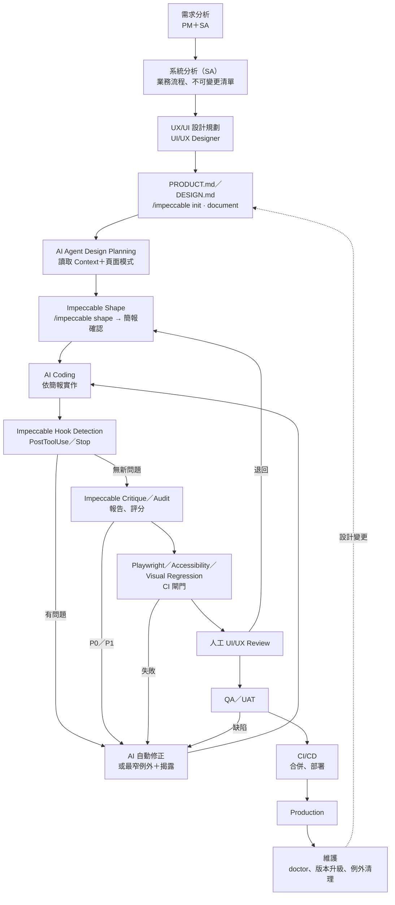

## 15.2 各階段 Impeccable 的責任

| 階段 | Impeccable 的責任 | 使用的功能 | 不是 Impeccable 的責任 | 產出 |
|---|---|---|---|---|
| Requirements | 協助把使用者、目的、限制寫成可被 AI 使用的產品紀錄 | `init` | 需求本身的正確性（PM／SA 負責） | PRODUCT.md |
| Analysis | 記錄既有設計系統；分析既有畫面問題 | `document`、`critique`、`detect` | 業務流程分析 | DESIGN.md、問題清單 |
| Design | 頁面層級的 UX／UI 規劃；變體比較 | `shape`、`live`、`generate` | 品牌與視覺識別決策（UI/UX 負責） | 頁面簡報 |
| Development | 引導 AI 做設計；編輯當下回饋 | 設計指令、Hook | 功能、API、業務邏輯 | 程式碼 |
| Code Review | 提供客觀的設計問題清單；PR 註記 | `detect --github`、`audit` | 程式碼正確性、安全性審查 | PR 註記、稽核報告 |
| Testing | 確定性設計規則檢查 | CI 閘門（原始碼＋渲染掃描） | E2E、a11y 完整檢查、視覺回歸、效能 | JSON 報告 |
| Deployment | 不參與部署；閘門結果作為合併條件 | — | 部署本身 | — |
| Maintenance | 偵測 Context 過期、設定失效；版本升級 | `doctor`、`update`、`check` | 系統維運 | doctor 報告 |

## 15.3 納入 SSDLC 的控制點

| SSDLC 控制點 | Impeccable 相關控制 |
|---|---|
| 需求審查 | PRODUCT.md 列入需求審查文件 |
| 設計審查 | DESIGN.md、頁面簡報、critique 報告列入設計審查 |
| 安全設計 | Hook 與 Live 的執行權限評估（第 17 章）；roll API 連線評估 |
| 程式碼審查 | AI 產出 diff＋Hook 處理清單＋例外變更 |
| 安全測試 | Impeccable 不做安全測試；SAST／DAST 照常 |
| 上線審查 | audit 分數、CI 閘門、a11y 結果、UI/UX 簽核 |
| 變更管理 | Impeccable 版本升級走變更流程；規則變更評估 |
| 稽核 | 報告與例外保存；例外理由可追溯 |

## 15.4 本章實務案例與注意事項

**案例：把 Impeccable 放進既有的 Scrum 流程：**

| Scrum 事件 | 加入的 Impeccable 工作 |
|---|---|
| Sprint Planning | 本 Sprint 新頁面列出 `shape` 工作項 |
| 開發中 | Hook 自動回饋；每日站會回報未處理的 Hook 問題 |
| Sprint Review | 展示 critique 分數變化（`.impeccable/critique/` 的趨勢） |
| Retrospective | 檢視閘門失敗原因的分布、例外數量 |
| Backlog Refinement | baseline 技術債排入清償項目 |

**注意事項：**

- ⚠️ Impeccable 在 SDLC 中是「設計品質」的工具，不能取代 SSDLC 的安全控制。
- 💡 critique 與 audit 報告是很好的設計審查會議輸入，可以讓審查聚焦在 AI 無法判斷的品牌與業務問題上。

# 16. 常見問題與故障排除（Troubleshooting）

> 💡 **先跑這三個指令**，大多數問題可以直接定位：
>
> ```powershell
> pwsh -File tools/Test-Impeccable.ps1                 # 安裝狀態總覽（第 6.6.3 節）
> .\.claude\skills\impeccable\scripts\impeccable.cmd hooks status
> npx impeccable ignores list
> ```
>
> 並在 Agent 中執行 `/impeccable doctor`。

## 16.1 `npx impeccable install` 失敗

| 項目 | 內容 |
|---|---|
| 現象 | `npm ERR!`、`ETIMEDOUT`、`Downloading impeccable skills...` 後失敗 |
| 可能原因 | Node.js 低於 18.19；公司 proxy 或 registry 設定；manifest 格式錯誤導致中止 |
| 檢查方式 | `node --version`；`npm config get registry`；`npm config get proxy`；錯誤訊息是否提到 malformed manifest |
| 解決方式 | 升級 Node.js；設定公司 registry 與 proxy；manifest 錯誤時先檢查該檔，確認後用 `--force`（會備份成 `.bak`） |
| 預防措施 | 使用 `tools/Install-Impeccable.ps1`（會先檢查 Node 版本）；內部 registry 同步 `impeccable` 與 `@impeccable/cli-*` |

## 16.2 找不到 Impeccable Skill

| 項目 | 內容 |
|---|---|
| 現象 | Agent 輸入 `/impeccable` 沒有反應或說找不到 |
| 可能原因 | 選錯 Provider；裝在 global 但 Agent 讀 project（或相反）；Agent 未重新載入；Agent 的 Skills 功能未啟用 |
| 檢查方式 | 確認 `<Agent 目錄>/skills/impeccable/SKILL.md` 存在（第 6.7 節）；`/skills`（Codex、Copilot CLI）、`/skills list`（Gemini） |
| 解決方式 | 用正確的 `--providers` 重裝；重新載入 Agent；Cursor／Gemini 在設定中啟用 Agent Skills |
| 預防措施 | 團隊統一 project scope；入職清單包含「重新載入並輸入 `/impeccable`」 |

## 16.3 AI Agent 無法辨識指令

| 項目 | 內容 |
|---|---|
| 現象 | 輸入 `/impeccable polish` 被當成一般文字；或 `/polish` 不存在 |
| 可能原因 | Codex 不用 slash command；`/polish` 這種短指令要先 `pin`；OpenCode 手動安裝缺少 command 檔 |
| 檢查方式 | 確認使用的 Agent 與 9.7 節表格的呼叫方式 |
| 解決方式 | Codex 改用 `$impeccable polish`；`/impeccable pin polish` 建立捷徑；OpenCode 複製 `.opencode/commands/impeccable.md` |
| 預防措施 | 團隊文件註明各 Agent 的呼叫寫法 |

## 16.4 Hook 沒有執行

| 項目 | 內容 |
|---|---|
| 現象 | 修改 UI 檔後從來沒有收到 Impeccable 回饋 |
| 可能原因 | ① 用 `link`、VS Code Extension 或手動複製安裝（沒有 Hook）② `hook.enabled: false` 或 `IMPECCABLE_HOOK_DISABLED` ③ 修改的副檔名不在清單（例如 `.jsp`）④ `hook.quiet: true` 且沒有問題（正常）⑤ Agent 尚未信任或核准 Hook ⑥ Copilot 的 Hook 檔不在預設分支 ⑦ Gemini 本來就沒有逐檔 Hook |
| 檢查方式 | `hooks status`；檢查 manifest 檔是否存在；用 6.3.4 節方法手動執行 launcher；開 `hook.auditLog` 看是否有紀錄 |
| 解決方式 | 以 `npx impeccable install` 安裝 Hook；`/impeccable hooks on`；加 `detector.extensions`；完成各 Agent 的信任步驟 |
| 預防措施 | 入職時故意寫一個 `background-clip: text` 的漸層字，確認 Hook 會回報 |

## 16.5 Hook 被 Agent Trust 擋住

| 項目 | 內容 |
|---|---|
| 現象 | manifest 存在，但 Hook 不執行或 Agent 顯示需要信任 |
| 可能原因 | Codex 未在 `/hooks` 核准（或 update 後定義改變需要重新核准）；Claude Code 未接受 workspace trust；Cursor workspace 未信任；Grok 未 `/hooks-trust` |
| 檢查方式 | Codex：`/hooks`；Claude：`/hooks`；Cursor：Settings → Hooks 與 Hooks 輸出頻道 |
| 解決方式 | 完成對應的信任或核准 |
| 預防措施 | 每次 Impeccable 升級後通知 Codex 使用者重新核准 |

## 16.6 Detector 沒有結果

| 項目 | 內容 |
|---|---|
| 現象 | `detect` 沒有任何輸出，exit 0 |
| 可能原因 | ① 真的沒有問題 ② 目錄內沒有支援的檔案（✅ 實測：`.cshtml` 等未宣告的副檔名會被略過且無提示）③ `.vue`／`.tsx` 只跑 regex 規則 ④ 例外太多（`ignoreFiles` 涵蓋了目錄） |
| 檢查方式 | `detect --no-config <路徑>`（排除例外影響）；確認副檔名；看 CLI 是否印出「scanned with regex matching only」 |
| 解決方式 | 加 `detector.extensions`；改用 URL 掃描；清理過寬的例外 |
| 預防措施 | CI 加「確認有檔案可掃描」的防呆（第 12.2 節） |

## 16.7 Detector 出現誤判

| 項目 | 內容 |
|---|---|
| 現象 | 規則命中，但設計是刻意的或判斷錯誤 |
| 可能原因 | 情境不同（例如真的需要彈跳動畫的遊戲化元素）；規則準確度問題 |
| 檢查方式 | `detect --json <檔案>` 看 `snippet`；用 URL 掃描再確認 |
| 解決方式 | 刻意設計：用最窄例外（`add-value`，必要時加 `--file`）並寫理由；規則錯誤：回報上游 Issue，暫時用 baseline 吸收 |
| 預防措施 | 例外需審查；升級後重新評估例外 |

## 16.8 品牌字型被誤判

| 項目 | 內容 |
|---|---|
| 現象 | 公司指定的字型（Inter、Roboto 等）被 `overused-font` 回報 |
| 可能原因 | 這些字型在規則的「過度使用」清單中，DESIGN.md 宣告不會自動豁免（✅ 實測 Roboto Mono 已在 DESIGN.md 宣告仍被回報） |
| 檢查方式 | `detect --json` 看值；注意值是字型名稱第一段的小寫（`Roboto Mono` → `roboto`） |
| 解決方式 | `npx impeccable ignores add-value overused-font roboto --file "src/styles/numeric.css" --reason "DESIGN.md typography.numeric 指定（UI 小組核准）"` |
| 預防措施 | 品牌字型例外在專案初始化時就加好，並寫在 DESIGN.md 說明 |

## 16.9 Design Rules 與公司規範衝突

| 項目 | 內容 |
|---|---|
| 現象 | 公司規範要求的設計（例如標題上方的小標、特定陰影）一直被回報 |
| 可能原因 | Impeccable 的審美立場與公司品牌不同 |
| 檢查方式 | 確認衝突的規則 ID 與公司規範的出處 |
| 解決方式 | 品牌規範優先。在 PRODUCT.md Brand Commitments 記錄；架構師核准後 `ignores add-rule <id>`；在 DESIGN.md Do's 寫明 |
| 預防措施 | 導入時做一次「公司規範 vs 62 條規則」對照（附錄 B） |

## 16.10 Live Mode 無法啟動

| 項目 | 內容 |
|---|---|
| 現象 | `/impeccable live` 後沒有開啟頁面或沒有控制列 |
| 可能原因 | Dev Server 沒有啟動或沒有 HMR；開到 helper server 的網址；Codex 沙箱擋住 localhost；原生 App 專案 |
| 檢查方式 | 瀏覽器手動開 App 網址；確認 Agent session 仍在輪詢；問 Agent 執行 `impeccable live-status` |
| 解決方式 | 先啟動 Dev Server；開 App 的網址；Codex 依規範核准 escalated 權限 |
| 預防措施 | `init` 時完成 Live 設定（`.impeccable/live/config.json`） |

## 16.11 Browser Overlay 無法顯示

| 項目 | 內容 |
|---|---|
| 現象 | 頁面正常但沒有 Impeccable 控制列 |
| 可能原因 | CSP 擋住注入的腳本；頁面是正式環境 HTTPS 網站（不支援） |
| 檢查方式 | 瀏覽器 DevTools Console 是否有 CSP 錯誤 |
| 解決方式 | 讓首次設定說明需要的 CSP 變更，**只在開發環境**同意修改；不要放寬正式環境 CSP |
| 預防措施 | 開發環境與正式環境的 CSP 分開設定 |

## 16.12 Live 修改無法反映至原始碼

| 項目 | 內容 |
|---|---|
| 現象 | Accept 後重新整理，變更消失；或原始碼留下 wrapper 與標記 |
| 可能原因 | 頁面由其他檔案產生（build 輸出、模板）；Accept 後未執行完成步驟（carbonize 狀態） |
| 檢查方式 | `git diff`；搜尋 `impeccable-variants-start` 標記；`impeccable live-status` |
| 解決方式 | 依 source-mapping 訊息改真正的原始檔；要求 Agent 執行 `live-complete`（有殘留時會拒絕並列出） |
| 預防措施 | Live 結束後一定看 diff 並跑偵測器 |

## 16.13 更新後 Hook 無法執行

| 項目 | 內容 |
|---|---|
| 現象 | `update` 後 Hook 停止 |
| 可能原因 | Codex Hook 定義改變需要重新核准；launcher 路徑改變；manifest 被其他工具改壞 |
| 檢查方式 | `/impeccable doctor`（會找出 script 路徑不存在、安裝與啟用狀態不一致） |
| 解決方式 | Codex `/hooks` 重新核准；`/impeccable hooks on` 修復 manifest；必要時 `install --force` |
| 預防措施 | 升級檢查清單（第 13.2.3 節） |

## 16.14 多個 AI Agent 安裝衝突

| 項目 | 內容 |
|---|---|
| 現象 | 同一個 Agent 出現兩份 impeccable Skill；不同 Agent 行為不一致 |
| 可能原因 | VS Code Extension＋`.github/skills/` 重複；global＋project 同時存在；同時裝了 frontend-design Skill |
| 檢查方式 | 列出所有 `skills/impeccable/SKILL.md`（專案與使用者目錄）；比對版本 |
| 解決方式 | 每個 Agent 只保留一種安裝方式；移除其他設計 Skill |
| 預防措施 | 團隊規範：project scope、CLI 安裝、版本鎖定 |

## 16.15 Windows 路徑或權限問題

| 項目 | 內容 |
|---|---|
| 現象 | `os error 1314`；`running scripts is disabled`；路徑過長；Hook 指令語法錯誤 |
| 可能原因 | symlink 權限；PowerShell 執行原則；`core.longpaths`；manifest 只有 POSIX 指令 |
| 檢查方式 | 錯誤訊息比對第 6.6.5 節表格 |
| 解決方式 | 開發人員模式；`Set-ExecutionPolicy -Scope CurrentUser RemoteSigned`；`git config --global core.longpaths true`；確認 Agent 用 Git Bash 執行 Hook |
| 預防措施 | Windows 團隊用方式 A（CLI）而不是 Submodule＋link |

## 16.16 CI/CD 執行失敗

| 項目 | 內容 |
|---|---|
| 現象 | workflow 在 Impeccable 步驟失敗 |
| 可能原因 | exit 1（路徑錯誤、URL 無法連線、瀏覽器無法啟動）；把 exit 2 當成失敗；預覽伺服器還沒啟動完成 |
| 檢查方式 | 看 step log 的 `Warning: cannot access`、`Timed out … WS endpoint`；確認 exit code 處理 |
| 解決方式 | 修正路徑；`wait-on` 等待伺服器；依第 12.7 節分辨 exit code |
| 預防措施 | 使用第 12.6 節的 workflow 範本 |

## 16.17 URL 掃描逾時（瀏覽器無法啟動）

| 項目 | 內容 |
|---|---|
| 現象 | `Error: Timed out after 30000 ms while waiting for the WS endpoint URL to appear in stdout!`，exit 1 |
| 可能原因 | ✅ 實測：`HOME`／`USERPROFILE` 被改寫成其他目錄時發生；公司政策禁止瀏覽器遠端偵錯；沒有安裝 Chrome／Edge |
| 檢查方式 | 用一般終端機、不改環境變數重試；檢查 `chrome://policy` 或 `edge://policy` 的 `RemoteDebuggingAllowed` |
| 解決方式 | 恢復正常的 `HOME`；改用 Chrome；請 IT 為開發機調整政策 |
| 預防措施 | CI Runner 使用預裝 Chrome 的映像 |

## 16.18 Edge 被公司政策封鎖自動化

| 項目 | 內容 |
|---|---|
| 現象 | Playwright 用 `channel: 'msedge'` 時：`DevTools remote debugging is disallowed by the system admin.` |
| 可能原因 | ✅ 實測：GPO 設定禁止 Edge DevTools 遠端偵錯 |
| 檢查方式 | `edge://policy` |
| 解決方式 | 改用 Chrome 或 Playwright 下載的 Chromium（`npx playwright install chromium`）；或請 IT 調整 |
| 預防措施 | 開發機標準映像預留一個可自動化的瀏覽器 |

## 16.19 `check` 一直顯示有更新

| 項目 | 內容 |
|---|---|
| 現象 | `npx impeccable check` 顯示「Updates available」，但 `update` 後沒有任何變化 |
| 可能原因 | ✅ 實測 v4.8.0 的行為；原因未確認 |
| 檢查方式 | `npm view impeccable version` 與 `npx impeccable --version` 比對；`update` 後 `git status` |
| 解決方式 | 以 npm 版本與 `git diff` 為準 |
| 預防措施 | 不要用 `check` 結果做自動化判斷 |

## 16.20 Hook 沉默不知道是正常還是壞掉

| 項目 | 內容 |
|---|---|
| 現象 | 編輯 UI 後沒有任何訊息 |
| 可能原因 | 官方說明：沒有訊息可能是「乾淨」「quiet 模式」或「Hook 未啟用」 |
| 檢查方式 | `/impeccable doctor`；暫時把 `hook.quiet` 設為 `false`；`hook.auditLog` |
| 解決方式 | 依結果處理 |
| 預防措施 | 新成員入職時做一次「故意違規」測試 |

## 16.21 引擎下載被擋

| 項目 | 內容 |
|---|---|
| 現象 | `Engine <版本> setup needs network access and write permission to …`；或 `refusing the unverified download` |
| 可能原因 | 無法連 GitHub Releases；快取目錄不可寫；`engine-checksums.txt` 沒有對應版本 |
| 檢查方式 | 錯誤訊息；`Test-Path $env:USERPROFILE\.impeccable\bin` |
| 解決方式 | `IMPECCABLE_DOWNLOAD_BASE` 指向內部鏡像；或 `IMPECCABLE_BIN` 指定預先派送的執行檔；或 `IMPECCABLE_HOME` 指定可寫入路徑 |
| 預防措施 | 內網環境預先規劃引擎派送（第 13.6 節） |

## 16.22 本章實務案例與注意事項

**案例：Hook「有時候」才會回報：**

開發人員回報 Hook 不穩定。開啟 `hook.auditLog` 後發現：專案依第 6.8 節把 `scripts/bin/` 排除在版控外，成員 clone 後第一次編輯時，launcher 正在下載引擎（✅ 實測約 18 秒），超過 Hook 的 5 秒 timeout，所以那次沒有結果；之後就正常。

處理：

1. 入職步驟加入「clone 後先執行一次 `npx impeccable install --providers=<Agent> --scope=project -y`」（會把引擎放進 Skill 目錄），或執行 launcher 的 `detect --list-rules --quiet` 暖機。
2. 網路磁碟上的專案移到本機磁碟。

**注意事項：**

- ⚠️ 不要用「關掉 Hook」來解決問題。先用 `doctor` 與 `auditLog` 找原因。
- 💡 把本章的問題編號記在團隊的支援頻道，回報問題時直接引用（例如「16.8 品牌字型誤判」）。

# 17. 安全性、效能與可維護性

## 17.1 威脅與控制總表

| # | 風險 | 來源 | 影響 | 控制措施 |
|---|---|---|---|---|
| 1 | Hook 以 Agent 權限執行引擎 | 所有 Hook | 引擎可存取 Agent 能存取的檔案與網路 | 只用官方版本；升級時審查 launcher 與 checksum（13.7.2 節）；CI Runner 與開發機最小權限 |
| 2 | Hook 不受模型核准影響（Claude Code） | `settings.local.json` command hook | 拒絕模型指令後 Hook 仍會執行，首次編輯可能下載引擎 | 無人值守執行前檢查 `/hooks`；必要時 `--settings '{"disableAllHooks": true}'` |
| 3 | 引擎下載被竄改 | GitHub Releases、內部鏡像 | 執行惡意二進位檔 | launcher 依 `engine-checksums.txt` 驗證 sha256，無 checksum 拒絕下載（✅ 實測竄改快取會被拒用） |
| 4 | `.verified` 戳記後不再重算 hash | 版本快取 | 快取檔在驗證後被替換不會被發現 | 快取目錄（`~/.impeccable/bin/`）只允許使用者本人寫入；共用電腦設定 `IMPECCABLE_HOME` 到個人目錄 |
| 5 | Live Apply 執行 `package.json` script | `impeccable:manual-edit-validate` | 以使用者權限執行任意 shell 指令 | 不在不熟悉的 repo 使用 Live；審查該 script |
| 6 | Live Apply 以關閉沙箱方式呼叫 Agent CLI（main／未發布） | 無 Agent 輪詢時的 fallback | 繼承環境變數、無核准地修改檔案 | `IMPECCABLE_LIVE_COPY_AGENT=chat` 或 `off` |
| 7 | Copilot Cloud Agent 執行 Hook | `.github/hooks/impeccable.json` commit 後 | 引擎在 GitHub 的 Agent 環境中執行 | 評估後再 commit；Cloud Agent 環境不放機密 |
| 8 | 新設計流程連線 impeccable.style | roll API | 對外連線；匿名使用紀錄 | `telemetry: false`＋`DO_NOT_TRACK=1`（仍會送出 roll 請求，但標記不記錄）；高度管制環境以網路政策封鎖並接受該功能不可用 |
| 9 | 截圖與 critique 報告含機敏資料 | `.impeccable/*.png`、`critique/*.md`、Playwright 基準 | 客戶資料外洩 | 只用測試資料；`.gitignore` 排除截圖；基準截圖遮罩 |
| 10 | Prompt Injection 透過 Skill | 第三方 Skill 內容 | Agent 被誘導執行惡意動作 | 只安裝官方來源；Skill 變更走 PR 審查；Hermes 等工具對專案 Skill 有信任機制 |
| 11 | AI 自行加例外繞過檢查 | `ignores` 指令 | 品質閘門失效 | `CODEOWNERS`；AGENTS.md 規範；例外理由審查 |
| 12 | CSP 被放寬 | Live 首次設定 | 正式環境安全性下降 | 只在開發設定中修改；正式 CSP 獨立管理 |
| 13 | OpenAI API Key 外洩 | 影像生成 fallback（第 2.7.3 節） | Key 被盜用、產生費用 | 只放在啟動 Agent 的程序環境變數；不貼對話框、不 commit、不放 `VITE_*`／`PUBLIC_*`；使用設有額度上限的專案 Key |
| 14 | 影像生成費用失控 | mockup-first 多輪修改 | 預算超支 | 作業型系統固定 `buildPath: "code"`；API 專案設定用量上限 |
| 15 | AI 產出未經審查就合併 | 實作過程沒有驗證檢查點 | 設計偏離、業務行為被改動 | 第 8.0.1 節五層檢查法；`tools/Review-UiChange.ps1` 放進 PR 檢查 |

## 17.2 Telemetry 與資料外送

📖 官方 README（v4.8.0）：

- **會送出**：每次決策回合的隨機 roll key、範圍、訪客模式、重抽次數、目錄版本；選擇結果的卡片類型與位置；用戶端版本；用於去重的隨機 id。
- **不會送出**：專案名稱、檔案、程式碼、PRODUCT.md、Agent 寫的方向名稱。
- **關閉方式**：`npx impeccable telemetry off`（寫入 `~/.impeccable/config.json`）、`DO_NOT_TRACK=1`、`IMPECCABLE_NO_TELEMETRY=1`，或專案 `.impeccable/config.json` 設 `"telemetry": false`。
- 關閉後 roll 請求**仍會發生**（那是功能本身），但 API 被告知不要記錄。

✅ 實測 `telemetry status` 在設定 `DO_NOT_TRACK` 時顯示：

```text
telemetry: off (DO_NOT_TRACK is set). Rolls still work; the roll API is told not to record them, and no choice is sent.
```

🏢 企業建議：專案 `config.json` 一律 `"telemetry": false`；CI 設定 `DO_NOT_TRACK=1`。

## 17.3 最小權限設定建議

| 環境 | 建議 |
|---|---|
| 開發機 | Hook 啟用；Live 只用於本機 Dev Server；`IMPECCABLE_LIVE_COPY_AGENT=chat`；需要影像生成時，`OPENAI_API_KEY` 只設在當次程序 |
| CI Runner | 只執行 `detect`（不需要 Skill 與 Hook）；`permissions: contents: read`；不給 secrets |
| Copilot Cloud Agent | 先在非機密 repo 試行再 commit Hook |
| 共用跳板機 | 不建議安裝；必要時 `IMPECCABLE_HOME` 個人化 |
| 高度管制環境 | 引擎以 `IMPECCABLE_BIN` 派送；封鎖對外連線；不使用 Live 與影像生成 |

## 17.4 效能

| 項目 | 實測／官方數據 | 建議 |
|---|---|---|
| 原始碼掃描 | 數秒內完成（✅ 實測樣本） | 適合每個 PR |
| URL 掃描 | 每頁數秒（需啟動瀏覽器） | PR 只掃主要頁面；全站放 nightly |
| Hook timeout | PostToolUse 5 秒、Stop 30 秒（✅ manifest） | 專案放本機磁碟；引擎預先放好 |
| Hook 回報量 | 每次最多 5 筆、8,000 字元（✅ `hooks status`） | 控制 Agent 的 context 用量 |
| 引擎首次下載 | 約 18 秒（✅ 實測） | 安裝時就放好引擎 |
| 引擎體積 | 每個 Provider 約 20 MB（✅ 實測） | 不進版控（6.8 節） |
| Agent token 成本 | critique、audit、shape 會讀大量 Playbook 與檔案 | 指定目標範圍（`audit the header`），不要每次整個專案 |

## 17.5 可維護性

| 項目 | 建議 |
|---|---|
| 單一事實來源 | Tokens（DTCG）→ CSS 與 DESIGN.md frontmatter 自動產生 |
| 版本鎖定 | `package.json` 精確版本；Skill 目錄 commit |
| 例外可追溯 | 每個例外都有 `reason`；`CODEOWNERS` |
| Context 不過期 | 每月 `doctor`；視覺變更核准後重新 `document` |
| 文件化 | 本手冊的 5.1 架構圖、9.7 比較表放進專案文件 |
| 降低耦合 | 設計規則放 DESIGN.md、流程規則放 AGENTS.md，不混在 Agent 專屬設定檔中 |

## 17.6 本章實務案例與注意事項

**案例：資安審查 Impeccable 導入申請：**

資安單位提出三個問題，回覆如下：

| 問題 | 回覆 |
|---|---|
| 會不會把程式碼送到外部？ | 偵測引擎在本機執行；roll API 只送匿名決策資料，不含程式碼與 PRODUCT.md（官方隱私說明）。專案設定 `telemetry: false` |
| 二進位檔來源可信嗎？ | 從 GitHub Releases 下載並以 commit 在 Skill 內的 sha256 驗證；可改由內部鏡像提供 |
| Agent 會不會因此有更多權限？ | Hook 以 Agent 原有權限執行，不額外提權，但也不是沙箱；Live Apply 的 fallback 需設定 `IMPECCABLE_LIVE_COPY_AGENT=chat` |

**注意事項：**

- ⚠️ 「Hook 不是沙箱」要讓所有使用者知道，避免誤以為有隔離。
- 💡 把 17.1 表格列入專案的威脅模型文件。

# 18. 實務建議與未來發展

## 18.1 企業架構師的十個問題

| # | 問題 | 建議 | 理由 |
|---|---|---|---|
| 1 | Impeccable 是否適合列為公司標準 AI Coding Skill？ | **適合列為「前端 UI 工作的標準 Skill」**，但以「指引＋檢查」定位，不作為品質合格的唯一依據 | 跨 Agent、Apache 2.0、確定性偵測器可放 CI；但版本更新頻繁、審美立場鮮明，需要公司層的 DESIGN.md 與例外治理 |
| 2 | 是否應使用 Git Submodule 管理共用版本？ | **Windows 為主的團隊不建議**；改用 npm 精確版本＋commit Skill 目錄 | ✅ 實測 Windows `link` 需要 symlink 權限；`link` 不裝 Hook；上游 repo 很大 |
| 3 | 是否應建立公司共用 DESIGN.md 樣板？ | **應該**，並分公司層、產業層、專案層（10.5.4 節） | DESIGN.md 是偵測器設計系統規則的依據，也是 AI 一致性的關鍵 |
| 4 | 是否應建立銀行系統專用 Design System？ | **應該**，以 DTCG Tokens 為來源，包含交易狀態、金額格式、錯誤訊息、禁止動畫等產業規則 | 金融作業系統是 Operate 模式，需要比一般規範更嚴格的「克制」規則 |
| 5 | 如何與公司既有 AI Agent 平台整合？ | 把 Impeccable 當成一般 Agent Skill 納入公司 Skill 目錄；AGENTS.md 放公司規則；CI 閘門與 Agent 無關 | Impeccable 遵循 Agent Skills 格式，`install` 支援多數主流 Agent |
| 6 | 如何避免不同 AI Agent 產生不同 UI？ | 同一份 DESIGN.md＋Tokens 白名單＋AGENTS.md；CI 對所有 PR 一致把關 | Hook 強度依 Agent 而不同（9.7 節），CI 是共同底線 |
| 7 | 如何管理跨專案設計規範？ | Design System repo 發佈 Tokens 與 DESIGN.md 樣板（npm 套件）；各專案 `sync-design-md.mjs --check` | 避免各專案手改造成漂移 |
| 8 | 如何將 Detector 納入 DevSecOps／CI/CD？ | 第 12 章的兩種掃描＋閘門政策＋baseline；報告保存 | 分級阻擋讓檢查能長期運作 |
| 9 | 如何建立 UI 品質稽核制度？ | 季度：audit 抽查、例外清理、KPI 檢討；上線前：audit＋UI/UX 簽核 | KPI 見 14.4 節 |
| 10 | 如何將 UI/UX 品質納入 SSDLC？ | PRODUCT.md／DESIGN.md 進需求與設計審查；閘門結果進上線審查；版本升級進變更管理 | 15.3 節控制點 |

## 18.2 分階段導入計畫

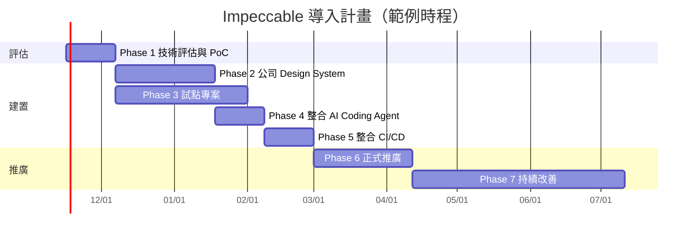

| Phase | 目標 | 工作項目 | 交付成果 | 驗收標準 |
|---|---|---|---|---|
| 1. 技術評估與 PoC | 確認 Impeccable 在公司環境可用且有價值 | 在 2 個代表性專案（新系統、舊系統）安裝；跑 CLI 掃描；各 Agent 試用指令；資安審查（第 17 章） | PoC 報告：可用性、findings 樣本、誤報率、資安結論 | 主要 Agent 都能安裝與呼叫；偵測器在 CI 可執行；資安核准 |
| 2. 建立公司 Design System | 有可被 AI 與偵測器使用的公司規範 | DTCG Tokens；公司 DESIGN.md 樣板（含銀行產業層）；Tailwind `@theme`；`sync-design-md.mjs` | Design System repo v1.0、npm 套件 | 樣板能讓 `design-system-*` 規則正確觸發；UI 小組簽核 |
| 3. 選擇試點專案 | 在真實專案驗證流程 | 1 個新系統、1 個逆向工程或升級專案；PRODUCT.md、DESIGN.md；baseline | 試點專案的 Context 檔、baseline、第一份 audit 報告 | 試點團隊能獨立完成第 8 章操作；流程測試建立 |
| 4. 整合 AI Coding Agent | 各 Agent 的 Skill 與 Hook 標準化 | 標準安裝腳本；AGENTS.md 規則；各 Agent 信任步驟文件；入職清單 | `tools/Install-Impeccable.ps1`、`Test-Impeccable.ps1`、AGENTS.md 範本 | 新成員 30 分鐘內完成安裝與驗證 |
| 5. 整合 CI/CD | 客觀的品質閘門 | `ui-quality.yml`；閘門政策；baseline；Playwright＋axe job；報告保存 | workflow 範本、`impeccable-gate.mjs`、`ci-policy.json` | 試點專案 PR 全部經過閘門；誤擋率 < 5% |
| 6. 正式推廣 | 新專案全面採用 | 教育訓練（本手冊）；治理規範公告；支援頻道 | 訓練教材、治理規範（第 14 章） | 新專案 100% 採用；舊專案有導入計畫 |
| 7. 持續改善 | 長期維運 | 每月版本檢查；每季 KPI 與例外清理；規則變更評估；回饋上游 | KPI 報表、升級紀錄 | KPI 逐季改善；版本落後最新正式版不超過 2 個 minor |

## 18.3 未來發展觀察

| 觀察點 | 說明 | 建議 |
|---|---|---|
| 發布頻率 | 2026 年 10 月就發布了 4.5.0、4.5.1、4.5.2、4.6.0、4.7.0、4.8.0 共 6 個版本 | 以月為單位評估升級，不追每週版本 |
| 原生 App 支援 | `ios`、`android`、`adaptive` 為 alpha；偵測器與 Hook 不檢查原生介面 | 行動 App 專案暫不納入強制規範 |
| Live Mode | Beta；main 分支持續調整 Apply 行為 | 企業環境限定試用，設定 `IMPECCABLE_LIVE_COPY_AGENT=chat` |
| 規則演進 | 新增與退役規則（例如 v4.5.1 退役 `layout-transition`） | 升級時做規則差異比對 |
| Hermes 等 Agent 的 Hook | main 分支新增 Hermes Hook plugin | 等正式發布後再評估 |
| 引擎版本 | `engine-v0.1.19` 已於 2026-11-07 發布 prebuilt binaries，但 npm `impeccable` 仍是 4.8.0（隨附 0.1.18）；2026-11-07 複查 `main` 沒有新 commit | 等 Skill／CLI 新版正式帶入後再升級，不單獨替換引擎 |
| 實作期間的檢查點 | 第三方評測（tessl.io）指出：工作流程是隱含的，實作過程中沒有驗證檢查點 | 由企業流程補上（第 8.0.1 節）；觀察上游是否加入官方的檢查點機制 |
| 第三方資料的時效 | 介紹文章的指令數、規則數常是舊版數字（例如「46 條規則」） | 以 `npx impeccable help`、`--list-rules` 實測為準（第 2.1 節） |

## 18.4 本章實務案例與注意事項

**案例：PoC 的評估指標：**

| 指標 | 量測方式 | 試點結果欄位 |
|---|---|---|
| AI 產出畫面的 AI Slop 數量變化 | 同一需求，有／無 Impeccable 各產出一次，跑偵測器 | 有：（待填）個；無：（待填）個 |
| 誤報率 | 抽查 50 筆 findings，人工判斷是否為真問題 | （待填）% |
| 開發者接受度 | 問卷（1～5 分） | （待填） |
| CI 時間增加 | workflow 前後比較 | +（待填）分鐘 |

**注意事項：**

- ⚠️ 不要一次推到所有專案。先讓試點團隊把例外與 baseline 的做法磨順。
- 💡 PoC 一定要包含一個「舊系統」專案，才能評估 `detector.extensions` 與渲染掃描的實際效果。

# 附錄 A：指令速查

## A.1 Agent 對話框指令

| 指令 | 用途 | 改程式碼 |
|---|---|---|
| `/impeccable` | 列出指令 | — |
| `/impeccable <描述>` | 一般新作或改版 | 會 |
| `/impeccable init` | 寫 PRODUCT.md | 否 |
| `/impeccable document [--seed]` | 寫 DESIGN.md | 否 |
| `/impeccable shape <頁面>` | 設計簡報 | 否 |
| `/impeccable critique <目標>` | UX 評論（/40） | 否 |
| `/impeccable audit <目標>` | 技術稽核（/20） | 否 |
| `/impeccable polish｜layout｜typeset｜quieter｜bolder｜colorize｜animate｜delight｜overdrive <目標>` | 改善 | 會 |
| `/impeccable distill｜clarify｜adapt <目標>` | 簡化、文案、適配 | 會 |
| `/impeccable harden｜onboard｜optimize <目標>` | 韌性、引導、效能 | 會 |
| `/impeccable extract` | 抽共用元件與 Tokens | 會 |
| `/impeccable live`、`/impeccable generate <N> variants of <元素>` | 瀏覽器變體（Beta） | Accept 時會 |
| `/impeccable pin｜unpin <指令>` | 捷徑 | — |
| `/impeccable doctor [--target <app>]` | 設定健檢 | 機械式遷移 |
| `/impeccable hooks status｜on｜off｜reset` | Hook 管理 | — |
| `/impeccable hooks ignore-value｜ignore-file｜ignore-rule …` | 例外 | — |

Codex：把 `/impeccable` 換成 `$impeccable`。

## A.2 CLI 指令

| 指令 | 用途 |
|---|---|
| `npx impeccable install [--providers=…] [--scope=project\|global] [-y] [--no-hooks] [--force]` | 安裝 |
| `npx impeccable update [--scope=…] [-y] [--no-hooks] [--force]` | 更新 |
| `npx impeccable check` | 檢查更新（注意 16.19 節） |
| `npx impeccable link --source=<路徑> --providers=… [--force]` | 從 checkout 連結 Skill（不含 Hook） |
| `npx impeccable detect [目標…] [--json\|--github\|--quiet] [--scope type,layout] [--viewport WxH] [--no-advisory] [--no-config] [--no-inline-ignores] [--no-design-system]` | 掃描 |
| `npx impeccable detect --list-rules [--json\|--quiet]` | 規則清單 |
| `npx impeccable detect --cdp <port> [--target <文字>]` | 桌面應用掃描 |
| `npx impeccable ignores list｜add-rule｜add-file｜add-value｜remove-*｜clear [--local\|--shared\|--all] [--file <glob>] [--reason <文字>]` | 例外管理 |
| `npx impeccable telemetry off｜on｜status` | 匿名統計 |
| `npx impeccable help`、`--version` | 說明、版本 |

## A.3 環境變數

| 變數 | 用途 |
|---|---|
| `DO_NOT_TRACK=1`、`IMPECCABLE_NO_TELEMETRY=1` | 關閉匿名統計 |
| `IMPECCABLE_HOOK_DISABLED`、`IMPECCABLE_HOOK_QUIET`、`IMPECCABLE_HOOK_LOG` | 覆寫 Hook 設定（舊版相容，仍有效） |
| `IMPECCABLE_NO_STALENESS_CHECK=1` | 單次 session 關閉過期提醒 |
| `IMPECCABLE_BIN` | 指定引擎執行檔 |
| `IMPECCABLE_HOME` | 引擎快取根目錄（預設 `~/.impeccable`） |
| `IMPECCABLE_DOWNLOAD_BASE` | 引擎下載來源（內部鏡像） |
| `IMPECCABLE_LIVE_COPY_AGENT=chat\|off` | Live Apply 行為（main／未發布） |

# 附錄 B：偵測規則清單（v4.8.0，62 條）

✅ 由 `npx impeccable detect --list-rules --json` 產生。「設計面向」是 `--scope` 可篩選的值（`type`、`layout`）；「—」表示不屬於這兩個面向。中文說明為本手冊依官方英文說明整理。

| # | 規則 ID | 類別 | 嚴重度 | 設計面向（`--scope`） | 說明 |
|---|---|---|---|---|---|
| 1 | `side-tab` | slop | warning | — | 卡片一側的粗色邊框（最典型的 AI 介面特徵） |
| 2 | `border-accent-on-rounded` | slop | warning | — | 圓角卡片上的粗色強調邊框，與圓角衝突 |
| 3 | `overused-font` | slop | warning | type | 過度使用的字型：Inter、Roboto、Fraunces、Geist、Plus Jakarta Sans、Space Grotesk |
| 4 | `flat-type-hierarchy` | slop | warning | type | 標題與內文字級差距每階都小於 1.25 倍，層級扁平 |
| 5 | `gradient-text` | slop | warning | — | 漸層文字（`background-clip: text`＋漸層） |
| 6 | `ai-color-palette` | slop | warning | — | 紫／紫羅蘭漸層、暗底霓虹青等 AI 典型配色 |
| 7 | `cream-palette` | slop | warning | — | 反射性使用的米白／奶油色頁面底色 |
| 8 | `nested-cards` | slop | warning | layout | 卡片內再放卡片 |
| 9 | `monotonous-spacing` | slop | warning | layout | 到處使用同一個間距值，沒有節奏 |
| 10 | `bounce-easing` | slop | advisory | — | 彈跳或彈性緩動曲線 |
| 11 | `pulsing-dot` | slop | warning | — | 裝飾性的脈動狀態點 |
| 12 | `blinking-cursor` | slop | advisory | — | 沒有輸入框卻出現閃爍游標的裝飾 |
| 13 | `shape-assembled-illustration` | slop | advisory | — | 用大量基本形狀拼成的大型 SVG 插圖 |
| 14 | `organic-clip-path` | quality | warning | — | 用 clip-path 畫有機輪廓 |
| 15 | `buried-raster` | quality | warning | — | 點陣圖被色層或透明度蓋住 |
| 16 | `hard-offset-shadow` | quality | advisory | — | 4px 以上的硬邊偏移陰影 |
| 17 | `dark-glow` | slop | warning | — | 彩色光暈陰影（零偏移色彩陰影、暗底彩色模糊陰影） |
| 18 | `radial-halo` | slop | warning | — | 暗底上飽和色的放射漸層光暈 |
| 19 | `radial-spotlight-glow` | slop | warning | — | 標題或區塊後方的強調色聚光燈漸層 |
| 20 | `marquee` | slop | warning | — | 自動捲動的跑馬燈內容 |
| 21 | `icon-tile-stack` | slop | warning | layout | 標題上方的小圓角方塊圖示（AI 功能卡片樣板） |
| 22 | `italic-serif-display` | slop | warning | type | 超大斜體襯線字作為主標題 |
| 23 | `hero-eyebrow-chip` | slop | warning | type | 超大標題上方的小型大寫字距標籤或 pill 標籤 |
| 24 | `kicker-above-heading` | slop | warning | type | 標題上方獨立一行的小型大寫標籤 |
| 25 | `numbered-section-labels` | slop | advisory | type | 區塊旁的小型數字編號標籤 |
| 26 | `em-dash-overuse` | slop | advisory | — | 過度使用破折號（em dash） |
| 27 | `marketing-buzzword` | slop | warning | — | 空泛行銷用語（streamline、empower、next-generation 等） |
| 28 | `aphoristic-cadence` | slop | warning | — | 格言式節奏的文案 |
| 29 | `oversized-h1` | slop | warning | type | 過大的主標題 |
| 30 | `extreme-negative-tracking` | slop | warning | type | 字距壓得過緊 |
| 31 | `broken-image` | quality | warning | — | 破圖或佔位圖 |
| 32 | `script-error` | quality | error | — | 頁面載入時有未捕捉的 JavaScript 錯誤 |
| 33 | `content-hidden-at-rest` | quality | error | layout | 內容在靜止狀態不可見（例如等動畫才出現） |
| 34 | `edge-flush-cards` | quality | warning | layout | 卡片貼齊捲動容器邊緣 |
| 35 | `text-occlusion` | quality | warning | layout | 文字被重疊元素遮住 |
| 36 | `first-viewport-column-overflow` | quality | warning | layout | 單一欄位撐開第一個視窗畫面 |
| 37 | `gray-on-color` | quality | warning | — | 彩色背景上的灰色文字 |
| 38 | `low-contrast` | quality | warning | — | 文字對比不足（WCAG AA：內文 4.5:1、大字 3:1） |
| 39 | `line-length` | quality | warning | type、layout | 單行文字過長 |
| 40 | `cramped-padding` | quality | warning | layout | 內距過於擁擠 |
| 41 | `body-text-viewport-edge` | quality | warning | layout | 內文貼近視窗邊緣（小於 16px；480px 以下小於 12px） |
| 42 | `tight-leading` | quality | warning | type | 行高過小 |
| 43 | `skipped-heading` | quality | warning | type | 標題層級跳號（例如 h1 後直接 h3） |
| 44 | `heading-rhythm` | quality | warning | layout、type | 標題與上一個區塊太擠 |
| 45 | `justified-text` | quality | warning | type | 左右對齊的文字 |
| 46 | `straggler` | quality | advisory | type | 段落最後一行只剩一個字 |
| 47 | `unbalanced-heading` | quality | advisory | type | 標題換行不平衡 |
| 48 | `tiny-text` | quality | warning | type | 內文字級低於 12px |
| 49 | `undersized-ui-text` | quality | warning | type | 功能性文字（按鈕、標籤）過小 |
| 50 | `all-caps-body` | quality | warning | type | 全大寫的內文 |
| 51 | `wide-tracking` | quality | warning | type | 內文字距過寬 |
| 52 | `text-overflow` | quality | warning | layout | 內容溢出容器 |
| 53 | `repeated-container-text` | quality | warning | — | 同一容器內重複的文字 |
| 54 | `clipped-overflow-container` | quality | advisory | layout | 定位子元素被 overflow 容器裁切 |
| 55 | `design-system-font` | quality | warning | type | 使用 DESIGN.md 未宣告的字型 |
| 56 | `design-system-color` | quality | advisory | — | 使用 DESIGN.md 色盤以外的顏色 |
| 57 | `design-system-radius` | quality | advisory | — | 使用 DESIGN.md rounded 以外的圓角 |
| 58 | `design-system-font-size` | quality | advisory | type | 使用 DESIGN.md 字級階梯以外的字級 |
| 59 | `gpt-thin-border-wide-shadow` | slop | advisory | — | 細邊框搭配大範圍陰影 |
| 60 | `repeating-stripes-gradient` | slop | advisory | — | 重複漸層條紋 |
| 61 | `codex-grid-background` | slop | advisory | — | 裝飾性格線背景 |
| 62 | `theater-slop-phrase` | slop | advisory | — | 戲劇化包裝的文案 |

統計：slop 31 條、quality 31 條；error 2、warning 44、advisory 16。

# 附錄 C：參考資料

## C.1 官方資料

| 資料 | 網址 |
|---|---|
| GitHub Repository | <https://github.com/pbakaus/impeccable> |
| 官方網站 | <https://impeccable.style/> |
| Getting Started | <https://impeccable.style/tutorials/getting-started/> |
| 文件首頁（含指令參考） | <https://impeccable.style/docs/> |
| Audit 指令 | <https://impeccable.style/docs/audit> |
| Design Hooks | <https://impeccable.style/docs/hooks> |
| Detector | <https://impeccable.style/docs/detector> |
| Context files | <https://impeccable.style/docs/context> |
| Configuration & ignores | <https://impeccable.style/docs/config> |
| Doctor | <https://impeccable.style/docs/doctor> |
| Design system | <https://impeccable.style/docs/design-system> |
| Live | <https://impeccable.style/docs/live> |
| Iterate in the browser | <https://impeccable.style/tutorials/iterate-live> |
| Changelog | <https://impeccable.style/changelog> |
| FAQ | <https://impeccable.style/faq> |
| Privacy | <https://impeccable.style/privacy> |
| GitHub Releases | <https://github.com/pbakaus/impeccable/releases> |
| GitHub Issues | <https://github.com/pbakaus/impeccable/issues> |
| npm 套件 | <https://www.npmjs.com/package/impeccable> |
| VS Code Extension | <https://marketplace.visualstudio.com/items?itemName=renaissance-geek.impeccable> |
| Chrome Extension | <https://chromewebstore.google.com/detail/impeccable/bdkgmiklpdmaojlpflclinlofgjfpabf> |
| v4.8.0 原始碼（tag） | <https://github.com/pbakaus/impeccable/tree/skill-v4.8.0> |

## C.2 延伸資料

| 資料 | 網址 |
|---|---|
| Anthropic frontend-design Skill | <https://github.com/anthropics/skills/tree/main/skills/frontend-design> |
| Agent Skills 規格 | <https://agentskills.io/> |
| Google Labs DESIGN.md 格式規格 | <https://github.com/google-labs-code/design.md> |
| Claude Code Hooks | <https://code.claude.com/docs/en/hooks> |
| Claude Code Skills | <https://code.claude.com/docs/en/skills> |
| GitHub Copilot Agent Skills | <https://docs.github.com/en/copilot/concepts/agents/about-agent-skills> |
| GitHub Copilot Hooks | <https://docs.github.com/en/copilot/concepts/agents/coding-agent/about-hooks> |
| OpenAI Codex Skills | <https://developers.openai.com/codex/skills> |
| OpenAI Codex Hooks | <https://developers.openai.com/codex/hooks> |
| Cursor Skills | <https://cursor.com/docs/context/skills> |
| Cursor Hooks | <https://cursor.com/docs/agent/hooks> |
| Gemini CLI Skills | <https://geminicli.com/docs/cli/skills/> |
| Tailwind CSS Theme variables | <https://tailwindcss.com/docs/theme> |
| shadcn/ui | <https://ui.shadcn.com/> |
| Storybook | <https://storybook.js.org/docs> |
| Playwright Visual comparisons | <https://playwright.dev/docs/test-snapshots> |
| Playwright Accessibility testing | <https://playwright.dev/docs/accessibility-testing> |
| axe-core | <https://github.com/dequelabs/axe-core> |
| Lighthouse CI | <https://github.com/GoogleChrome/lighthouse-ci> |
| WCAG 2.2 | <https://www.w3.org/TR/WCAG22/> |
| Design Tokens Community Group | <https://www.designtokens.org/> |
| DTCG Format Module 2025.10 | <https://www.designtokens.org/tr/2025.10/format/> |
| Style Dictionary | <https://styledictionary.com/> |
| WCAG 2.2 Understanding：Use of Color（1.4.1） | <https://www.w3.org/WAI/WCAG22/Understanding/use-of-color.html> |
| WCAG 2.2 Understanding：Target Size (Minimum)（2.5.8） | <https://www.w3.org/WAI/WCAG22/Understanding/target-size-minimum.html> |
| MDN `prefers-reduced-motion` | <https://developer.mozilla.org/en-US/docs/Web/CSS/@media/prefers-reduced-motion> |

第三方評論（觀點參考，數字可能是舊版，以實測為準）：

| 資料 | 網址 |
|---|---|
| tessl.io Skill 評測（frontend-design／review） | <https://tessl.io/registry/skills/github/pbakaus/impeccable/frontend-design/review> |
| Emelia：Impeccable 完整評測 | <https://emelia.io/hub/impeccable-design-skill-review> |

# 附錄 D：名詞對照

| 英文 | 中文 | 說明 |
|---|---|---|
| AI Slop | AI 劣質產出 | 看起來完整但缺乏判斷、一看就是 AI 做的內容 |
| Agent Skill | 代理技能 | `SKILL.md`＋資料夾的能力包，Agent 依需要載入 |
| Playbook | 操作手冊 | Impeccable 每個指令的詳細規則（`reference/*.md`） |
| Deterministic Rule | 確定性規則 | 相同輸入一定得到相同結果，不使用 LLM |
| Detector | 偵測器 | Impeccable 的規則引擎 |
| Hook | 掛勾 | Agent 在特定事件（編輯後、回合結束）自動執行的指令 |
| Immediate tier | 即時層級 | 每次編輯後執行的精簡規則集 |
| Deep pass | 深度檢查 | 回合結束（Stop）時的完整規則檢查 |
| Advisory | 建議級 | 不影響 exit code 的 finding |
| Finding | 檢查結果 | 一筆規則命中 |
| Baseline | 基準 | 既有問題或既有畫面的紀錄，用來判斷「新增」 |
| Design Token | 設計權杖 | 色彩、間距等設計數值的具名變數 |
| DTCG | 設計權杖社群群組 | W3C 社群群組，制定 Token 交換格式 |
| Surface | 頁面／介面 | Impeccable 對頁面、路由或產出物的稱呼 |
| Mode（Persuade／Operate／Read／Experience） | 頁面模式 | 決定設計野心的表現方式 |
| comp-first／code-first | 先出設計稿／直接寫程式 | `buildPath` 設定 |
| Live Mode | 即時模式 | 瀏覽器內選取元素並產生變體 |
| Overlay | 疊加層 | 注入頁面的控制列與標示 |
| HMR（Hot Module Replacement） | 熱模組替換 | Dev Server 不重新整理就更新頁面 |
| CDP（Chrome DevTools Protocol） | Chrome 開發者工具協定 | `--cdp` 掃描桌面應用 |
| Visual Regression | 視覺回歸 | 截圖比對找出非預期的畫面變化 |
| Quality Gate | 品質閘門 | CI 中決定能否合併的檢查 |
| RACI | 責任分配矩陣 | Responsible、Accountable、Consulted、Informed |

# 附錄 E：版本紀錄

| 版本 | 日期 | 內容 |
|---|---|---|
| 1.0 | 2026-11-07 | 初版。基準 Impeccable v4.8.0（engine 0.1.18）、上游 main `687bc38` |
| 1.1 | 2026-11-07 | 複查上游（無新版、main 無新 commit）。新增第 8.0.1～8.0.3 節「審查 AI 產出的五層檢查法」與實測的審查腳本（PowerShell／Bash）；第 8.1～8.9 節每個指令補上審查重點與好壞 diff 範例；8.8 節拆成 8.8.1～8.8.9；新增第 2.7 節圖像生成與 `buildPath`；8.4.1 節補上 critique 視覺疊層流程與分數使用規則；新增第 8.11.1 節改善既有設計的標準流程；第 17.1 節威脅表新增 3 項；第 18.3 節與附錄 C.2 加入第三方觀點 |

# 新進成員檢查清單（Checklist）

## 第一天：環境

- [ ] Node.js 18.19 以上（建議 22 LTS）：`node --version`（第 6.1.2 節）
- [ ] 專案已有 `impeccable` 精確版本的 devDependency：`npm ls impeccable`
- [ ] 執行 `npx impeccable install --providers=<我的 Agent> --scope=project -y`（第 6.3.2 節）
- [ ] 重新載入 Agent，輸入 `/impeccable`（Codex：`$impeccable`）看到指令清單
- [ ] 完成我的 Agent 的 Hook 信任步驟（Codex `/hooks` 核准、Cursor 信任 workspace…）（第 9.7 節）
- [ ] `pwsh -File tools/Test-Impeccable.ps1` 顯示 Skill、Hook manifest、規則數 62（第 6.6.3 節）
- [ ] 故意寫一個漸層文字，確認 Hook 會回報 `gradient-text`（第 16.4 節）
- [ ] 確認 `DO_NOT_TRACK=1` 或專案 `"telemetry": false`（第 17.2 節）

## 第一週：會用

- [ ] 讀過 `PRODUCT.md` 與 `DESIGN.md`，知道本專案的頁面模式（多半是 Operate）
- [ ] 讀過 `AGENTS.md` 的「UI 設計規範（Impeccable）」（第 9.1 節）
- [ ] 用 `/impeccable critique` 與 `/impeccable audit` 各評一個頁面，看得懂分數與 P0～P3（第 8.4 節）
- [ ] 用一個會改程式碼的指令（例如 `quieter`、`polish`）並審查 diff：欄位順序、Tab 順序、API 沒有被動到
- [ ] 在練習分支故意寫一行 `color: #ff00ff;`，確認 `tools/Review-UiChange.ps1` 會在第 2 層擋下（第 8.0.2 節）
- [ ] 會跑 `npx impeccable detect src/` 與 URL 掃描，知道兩者差異（第 2.3.2 節）
- [ ] 會用最窄的例外：`ignores add-value … --file … --reason …`，知道 `add-file`、`add-rule` 要架構師核准（第 7.6 節）
- [ ] 會看 PR 上的 `::warning` 註記與閘門摘要（第 12 章）
- [ ] 知道 Playwright 視覺回歸基準怎麼更新，以及更新要說明原因（第 11.3 節）

## 每次送 PR

- [ ] AI 動工前已打 `ai-start` 標記，`tools/Review-UiChange.ps1 -Base ai-start` 第 1～3 層通過（第 8.0.2 節）
- [ ] 第 4 層：目標尺寸下的 URL 掃描、截圖比對、axe 已執行；第 5 層：欄位順序、Tab 順序、API 呼叫不變（第 8.0.1 節）
- [ ] 每個指令都對照過該指令的「審查重點」表（第 8.1～8.9 節）
- [ ] Hook 回報都已處理並在 PR 說明交代（已修正／已例外／保留）
- [ ] 新增的例外有理由，必要時已取得核准
- [ ] CI 閘門、axe、視覺回歸、流程測試通過
- [ ] 沒有使用 `overdrive`、`delight`；`distill` 刪除前有確認清單
- [ ] 沒有宣稱「UI 品質合格」，等待人工 UI/UX Review

## 逆向工程／升級專案（額外）

- [ ] 舊系統基準（截圖＋inventory JSON）已在 `docs/baseline/`（第 10.3.2 節）
- [ ] PRODUCT.md 有「不可變更」清單
- [ ] 功能與視覺還原階段沒有使用 Refine 類指令
- [ ] 每個 UI/UX 改善都在差異分析表中並經核准（第 10.3.6 節）
- [ ] 框架升級與設計整理分開 PR（第 10.4.1 節）

## 安全（必讀）

- [ ] 知道 Hook **不是沙箱**，且在 Claude Code 中不受模型核准影響（第 2.4.6 節）
- [ ] Live Mode 只用在本機 Dev Server，已設定 `IMPECCABLE_LIVE_COPY_AGENT=chat`（第 2.5.4 節）
- [ ] 截圖、critique 報告不含客戶資料
- [ ] 不放寬正式環境 CSP；不在不熟悉的 repo 使用 Live
