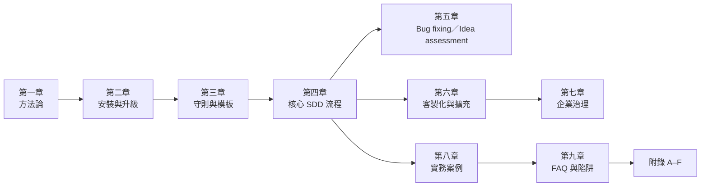
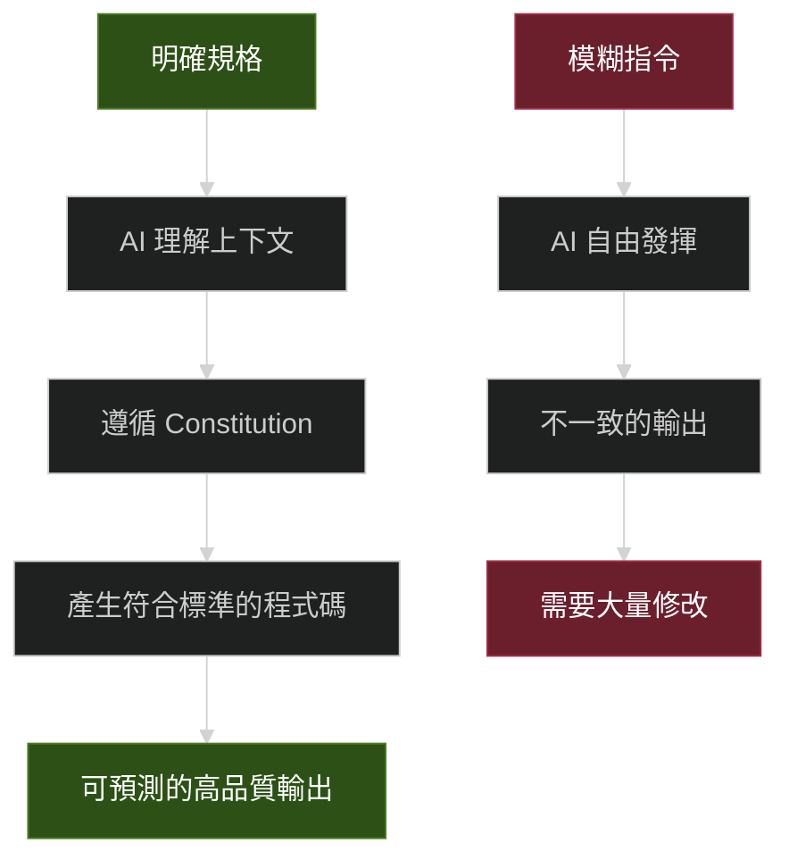
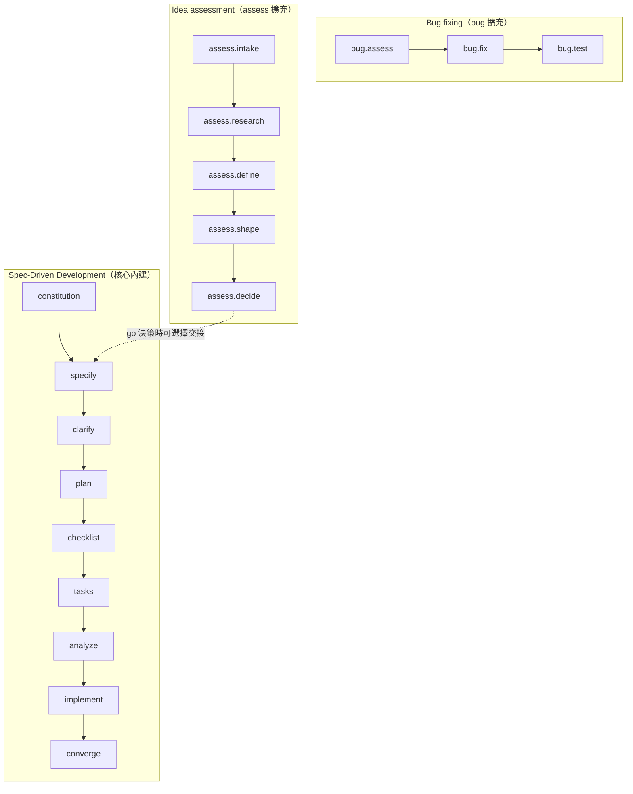
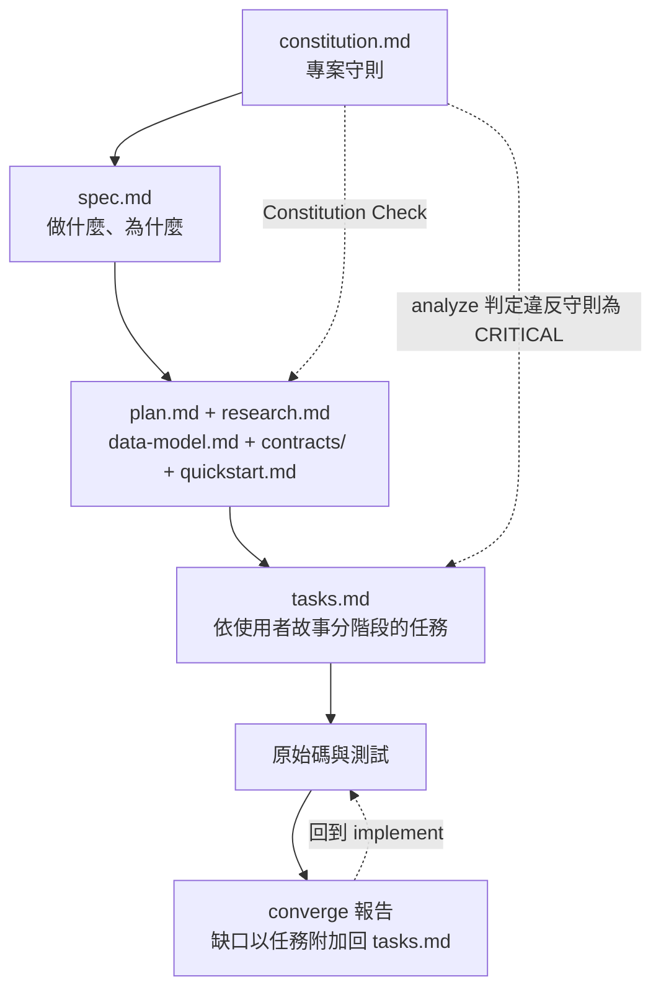
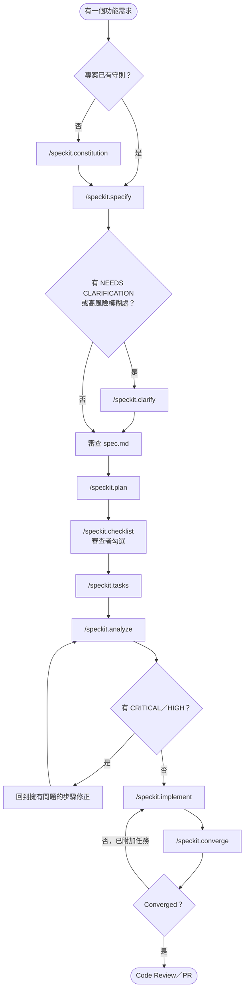
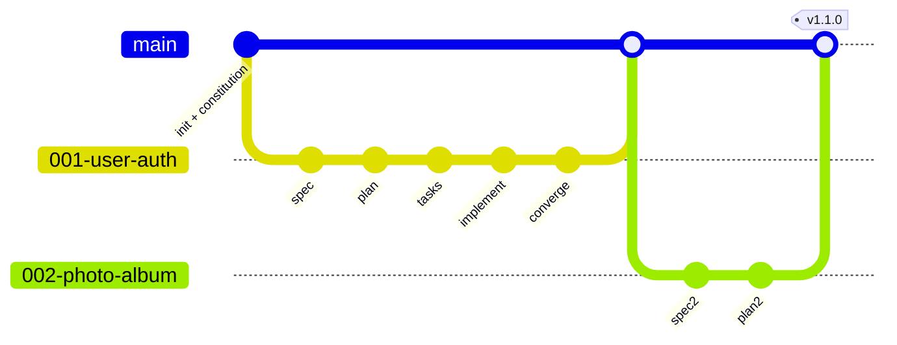
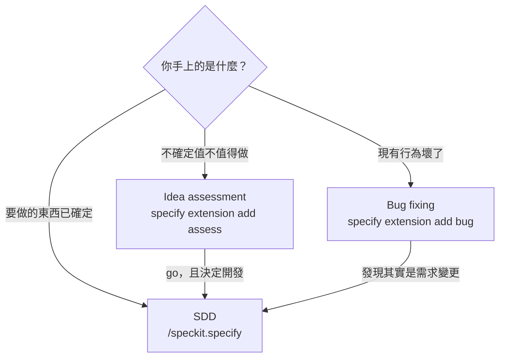
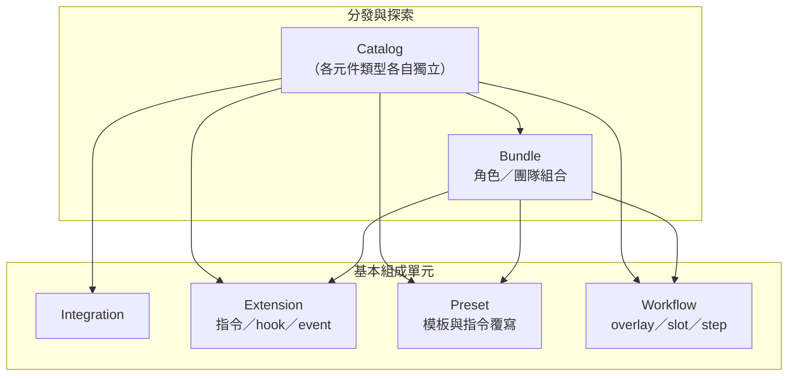

+++
date = '2025-10-31T00:00:00+08:00'
draft = false
title = 'spec-kit使用教學'
tags = ['教學', 'AI開發']
categories = ['教學']
lastmod = '2026-10-30T00:00:00+08:00'
+++

## Spec-Kit 使用教學手冊

> **版本**: 18.0
> **最後更新**: 2026年10月30日
> **適用於**: Spec-Kit v1.2.5（2026-10-28 發布）；指令與旗標以 v1.2.5 原始碼與官方文件為準
> **文件等級**: 企業標準技術白皮書
> **Created by**: Eric Cheng

---

### 摘要

Spec-Driven Development（SDD，規格驅動開發）把「規格」從容易過時的輔助文件，重新定位為驅動實作的**主要工件**：程式碼是規格的產物，規格不再只是事後補寫的說明。**Spec-Kit** 是 GitHub 以此理念開源的工具組。它的官方定位已從「SDD 工具」擴大為「讓 AI 編碼代理遵循結構化流程、可重用模板並留下可稽核成果的工具組」。目前內建三條彼此獨立的流程入口：

| 你要做的事 | 流程 | 成果 |
| --- | --- | --- |
| 建立功能或應用程式 | Spec-Driven Development（核心內建） | 一份規格，經計畫、實作到收斂檢查 |
| 診斷並修復錯誤行為 | Bug fixing（`bug` 擴充，選用） | 有證據的根因、受控範圍的修正與驗證紀錄 |
| 判斷某個想法值不值得投入 | Idea assessment（`assess` 擴充，選用） | go／needs-clarification／kill 的證據化決策 |

此外，團隊可以透過 Extension、Preset、Workflow、Bundle 與 Catalog 五種機制，改造既有流程或組裝自己的流程。

本手冊面向在企業共用平台（多資料庫、微服務、微前端、批次與檔案傳輸整合）導入 AI 輔助開發的技術團隊。內容依「方法論 → 安裝與升級 → 守則與模板 → 核心流程 → 修錯與評估流程 → 客製化 → 企業治理 → 實務案例 → 常見陷阱 → 附錄」的順序展開。每一個環節都附上**範例**，以及「**AI 產出後，人要如何審查與驗證**」的具體檢查方法。全書以 Spec-Kit **v1.2.5** 為基準，逐項核對官方 README、`spec-driven.md`、`docs/upgrade.md`、CHANGELOG、文件站（github.github.io/spec-kit）與 v1.2.5 tag 的原始碼。核對過程與修正清單記錄在[附錄 F](#附錄-f本版修正與驗證紀錄)。

---

## 📚 目錄

<!-- TOC-AUTO-BEGIN -->

- **[前言](#前言)**
  - [目的與適用對象](#目的與適用對象)
  - [背景說明：為何採用 SDD + Spec-Kit → AI 助手流程](#背景說明為何採用-sdd--spec-kit--ai-助手流程)
  - [本手冊使用假設](#本手冊使用假設)
  - [版本基準與閱讀地圖](#版本基準與閱讀地圖)
- **[第一章：概念理解](#第一章概念理解)**
  - [1.1 SDD 是什麼?](#11-sdd-是什麼)
  - [1.2 Spec-Kit 概覽](#12-spec-kit-概覽)
  - [1.3 SDD 的核心工件](#13-sdd-的核心工件)
  - [1.4 流程概覽：SDD 的階段與路徑](#14-流程概覽sdd-的階段與路徑)
  - [1.5 規格的生命週期：持久化模型與複雜度管理](#15-規格的生命週期持久化模型與複雜度管理)
  - [1.6 為什麼這對企業共用平台特別有價值](#16-為什麼這對企業共用平台特別有價值)
  - [1.7 同類方法與市場定位](#17-同類方法與市場定位)
  - [第一章小結](#第一章小結)
- **[第二章：安裝、升級與環境](#第二章安裝升級與環境)**
  - [2.1 前置條件](#21-前置條件)
  - [2.2 安裝 Specify CLI](#22-安裝-specify-cli)
  - [2.3 升級 CLI 與專案檔](#23-升級-cli-與專案檔)
  - [2.4 初始化專案](#24-初始化專案)
  - [2.5 AI 助手整合與指令呼叫語法](#25-ai-助手整合與指令呼叫語法)
  - [第二章小結](#第二章小結)
- **[第三章：守則、模板與版本控制](#第三章守則模板與版本控制)**
  - [3.1 建立團隊守則（Constitution）](#31-建立團隊守則constitution)
  - [3.2 模板與專案本地覆寫](#32-模板與專案本地覆寫)
  - [3.3 分支與版本控制](#33-分支與版本控制)
  - [第三章小結](#第三章小結)
- **[第四章：核心 SDD 流程詳解](#第四章核心-sdd-流程詳解)**
  - [4.1 流程總覽與執行前準備](#41-流程總覽與執行前準備)
  - [4.2 建立守則（/speckit.constitution）](#42-建立守則speckitconstitution)
  - [4.3 撰寫規格（/speckit.specify）](#43-撰寫規格speckitspecify)
  - [4.4 澄清需求（/speckit.clarify）](#44-澄清需求speckitclarify)
  - [4.5 技術計畫（/speckit.plan）](#45-技術計畫speckitplan)
  - [4.6 需求品質檢查清單（/speckit.checklist）](#46-需求品質檢查清單speckitchecklist)
  - [4.7 拆分任務（/speckit.tasks）](#47-拆分任務speckittasks)
  - [4.8 一致性分析（/speckit.analyze）](#48-一致性分析speckitanalyze)
  - [4.9 實作（/speckit.implement）](#49-實作speckitimplement)
  - [4.10 收斂檢查（/speckit.converge）](#410-收斂檢查speckitconverge)
  - [4.11 交付後的迭代與規格維護](#411-交付後的迭代與規格維護)
  - [第四章小結](#第四章小結)
- **[第五章：Bug fixing 與 Idea assessment 流程](#第五章bug-fixing-與-idea-assessment-流程)**
  - [5.1 Bug fixing：assess → fix → test](#51-bug-fixingassess--fix--test)
  - [5.2 Idea assessment：intake → research → define → shape → decide](#52-idea-assessmentintake--research--define--shape--decide)
  - [5.3 三條流程的選擇指引](#53-三條流程的選擇指引)
  - [第五章小結](#第五章小結)
- **[第六章：客製化與擴充機制](#第六章客製化與擴充機制)**
  - [6.1 選擇正確的組成單元](#61-選擇正確的組成單元)
  - [6.2 擴充（Extension）](#62-擴充extension)
  - [6.3 預設（Preset）與檔案解析順序](#63-預設preset與檔案解析順序)
  - [6.4 工作流（Workflow）](#64-工作流workflow)
  - [6.5 Bundle：角色與團隊的一鍵組合](#65-bundle角色與團隊的一鍵組合)
  - [6.6 內附擴充：git、github、agent-context](#66-內附擴充gitgithubagent-context)
  - [6.7 Catalog：元件探索的共同機制](#67-catalog元件探索的共同機制)
  - [第六章小結](#第六章小結)
- **[第七章：企業治理與維運](#第七章企業治理與維運)**
  - [7.1 認證（Authentication）](#71-認證authentication)
  - [7.2 私有 Catalog 與離線環境](#72-私有-catalog-與離線環境)
  - [7.3 MCP Server（實驗性）](#73-mcp-server實驗性)
  - [7.4 Artifact 自省：查證實際生效的指令與模板](#74-artifact-自省查證實際生效的指令與模板)
  - [7.5 執行安全與供應鏈](#75-執行安全與供應鏈)
  - [7.6 治理類擴充與預設的評估](#76-治理類擴充與預設的評估)
  - [第七章小結](#第七章小結)
- **[第八章：實務案例與應用指引](#第八章實務案例與應用指引)**
  - [8.1 案例一：Greenfield 開發 - 新建交易記錄微服務](#81-案例一greenfield-開發---新建交易記錄微服務)
  - [8.2 案例二：Brownfield 整合 - 為既有系統新增功能](#82-案例二brownfield-整合---為既有系統新增功能)
  - [8.3 團隊協作：多人開發](#83-團隊協作多人開發)
  - [8.4 AI 助手最佳實踐](#84-ai-助手最佳實踐)
  - [8.5 平台導入建議](#85-平台導入建議)
  - [8.6 Monorepo 中的 Spec-Kit](#86-monorepo-中的-spec-kit)
  - [8.7 跨服務協作：Contract-Driven Development](#87-跨服務協作contract-driven-development)
  - [第八章小結](#第八章小結)
- **[第九章：常見問題與陷阱](#第九章常見問題與陷阱)**
  - [9.1 常見問題(FAQ)](#91-常見問題faq)
  - [9.2 常見陷阱與避免方法](#92-常見陷阱與避免方法)
  - [第九章小結](#第九章小結)
- **[附錄 A：官方模板逐段解讀](#附錄-a官方模板逐段解讀)**
  - [A.1 spec-template.md](#a1-spec-templatemd)
  - [A.2 plan-template.md](#a2-plan-templatemd)
  - [A.3 tasks-template.md](#a3-tasks-templatemd)
  - [A.4 checklist-template.md](#a4-checklist-templatemd)
  - [A.5 constitution-template.md](#a5-constitution-templatemd)
- **[附錄 B：審查與驗證檢查清單](#附錄-b審查與驗證檢查清單)**
  - [B.1 各階段審查清單](#b1-各階段審查清單)
  - [B.2 PR 範本：SDD Evidence](#b2-pr-範本sdd-evidence)
  - [B.3 檢查腳本：check_spec.py](#b3-檢查腳本check_specpy)
  - [B.4 檢查腳本：check_tasks.py](#b4-檢查腳本check_taskspy)
  - [B.5 CI 整合建議](#b5-ci-整合建議)
- **[附錄 C：指令與旗標速查](#附錄-c指令與旗標速查)**
  - [C.1 代理指令（在聊天視窗執行）](#c1-代理指令在聊天視窗執行)
  - [C.2 CLI 頂層與自我管理](#c2-cli-頂層與自我管理)
  - [C.3 specify init](#c3-specify-init)
  - [C.4 整合](#c4-整合)
  - [C.5 擴充](#c5-擴充)
  - [C.6 預設](#c6-預設)
  - [C.7 工作流](#c7-工作流)
  - [C.8 Bundle](#c8-bundle)
  - [C.9 Artifact 自省](#c9-artifact-自省)
  - [C.10 環境變數](#c10-環境變數)
  - [C.11 已移除或已失效的寫法對照](#c11-已移除或已失效的寫法對照)
- **[附錄 D：版本沿革](#附錄-d版本沿革)**
  - [D.1 逐版重點（v0.0.1–v1.0.1）](#d1-逐版重點v001v101)
  - [D.1a 逐版重點（v1.0.2–v1.2.5）](#d1a-逐版重點v102v125)
  - [D.2 指令與旗標沿革](#d2-指令與旗標沿革)
  - [D.3 整合擴張與退場](#d3-整合擴張與退場)
  - [D.4 生態系規模快照](#d4-生態系規模快照)
- **[附錄 E：參考資源、社群與術語](#附錄-e參考資源社群與術語)**
  - [E.1 參考資源](#e1-參考資源)
  - [E.2 社群實作範例（Community Walkthroughs）](#e2-社群實作範例community-walkthroughs)
  - [E.3 社群工具生態系（Community Friends）](#e3-社群工具生態系community-friends)
  - [E.4 術語表](#e4-術語表)
- **[附錄 F：本版修正與驗證紀錄](#附錄-f本版修正與驗證紀錄)**
  - [F.1 改版範圍（v17.0 → v18.0）](#f1-改版範圍v170--v180)
  - [F.2 修正紀錄（舊版內容 → 正確內容）](#f2-修正紀錄舊版內容--正確內容)
  - [F.3 驗證紀錄](#f3-驗證紀錄)
  - [F.4 待確認事項](#f4-待確認事項)
- **[結語](#結語)**
  - [核心要點回顧](#核心要點回顧)
  - [下一步行動](#下一步行動)
  - [保持聯繫](#保持聯繫)

<!-- TOC-AUTO-END -->

---

## 前言

### 目的與適用對象

本手冊的目標不是「讓 AI 幫你寫完程式」，而是讓團隊建立一套**可重複、可審查、可稽核**的 AI 協作流程：人負責定義意圖與做決策，AI 負責產出結構化工件與程式碼，每一個交接點都有人能看懂、也能驗證的檢查方法。

**適用對象：**

| 角色 | 建議閱讀重點 |
| --- | --- |
| 新進開發人員 | 第一章、第四章、附錄 B |
| 專案經理／產品負責人 | 第一章、4.3–4.5（規格與澄清）、第五章 Idea assessment |
| 架構師／技術領導 | 第三章（守則與模板）、4.5–4.9、第六章、第七章 |
| DevOps／平台工程 | 第二章、第六章 Workflow／Bundle、第七章 |
| 測試／品質保證 | 4.6、4.8、4.10、第五章 Bug fixing、附錄 B |
| 資安／稽核 | 第七章、9.2 陷阱、附錄 F |

### 背景說明：為何採用 SDD + Spec-Kit → AI 助手流程

#### 傳統開發的痛點

在傳統軟體開發中，**程式碼一直是唯一的真相**。需求文件（PRD）、設計文件、架構圖只負責「指導」開發，但這些文件往往：

- ❌ **很快過時**：程式碼改了，文件沒更新
- ❌ **規格與實作脫節**：開發人員依自己的理解實作，逐漸偏離原始意圖
- ❌ **溝通成本高**：PM、架構師、開發者之間需要大量會議對齊
- ❌ **難以追蹤決策**：事後沒人說得清楚「當初為什麼這樣設計」
- ❌ **AI 助手效果不穩定**：給 AI 模糊的指令，產出品質隨機

#### SDD 的核心改變：規格即真相

SDD 反轉了這個權力結構：

```text
傳統：需求文件 → 設計文件 → 程式碼（真相）
SDD ：規格（真相）→ 實作計畫 → 任務 → 程式碼（產物）→ 收斂檢查（回頭對照規格）
```

官方方法論文件 `spec-driven.md` 的關鍵主張可整理為四點：

1. **規格是通用語言（lingua franca）**：維護軟體就是演進規格；程式碼是規格在特定語言與框架下的「表達」。
2. **意圖驅動**：開發團隊用自然語言、設計資產與核心原則表達意圖，AI 負責把意圖轉成實作。
3. **模板約束 LLM 行為**：模板強制標記不確定性（`[NEEDS CLARIFICATION]`）、禁止在規格階段討論實作細節，並透過 Constitution Check 做出閘門式把關。
4. **規格與程式碼的回饋迴路**：上線後的度量、事故與營運經驗，應該回流成下一輪規格演進的輸入。

#### 為什麼現在是導入的時機

1. **AI 能力已足以把結構化規格轉成可運作的程式碼**，瓶頸從「寫程式」轉移到「把意圖說清楚、把成果驗清楚」。
2. **系統複雜度持續上升**：共用平台同時整合多資料庫、多服務與批次作業，手動對齊的成本愈來愈高。
3. **變更是常態**：SDD 讓需求變更變成「修改規格 → 重新規劃 → 收斂檢查」的系統化流程，而不是零散地修補程式。
4. **工具鏈已成熟**：Spec-Kit 自 2026-08-21 跨入 v1.0，到 v1.2.5 已支援 43 種整合選項（含 `none` 與 `generic`），並提供 Bug fixing／Idea assessment、MCP Server、私有 Catalog 與認證等企業級能力（見[附錄 D](#附錄-d版本沿革)）。

#### Spec-Kit 的角色

Spec-Kit **不是** AI 模型，也**不會**自己寫程式。它提供的是：

- 📝 **結構化模板**：規格、計畫、任務、檢查清單、守則五份核心模板
- 🤖 **代理指令／技能**：安裝到你所選 AI 代理（Copilot、Claude Code、Codex、Gemini CLI 等）的 `/speckit.*` 指令或 `speckit-*` 技能
- 🧰 **自動化腳本**：Bash／PowerShell／Python 三種版本，負責建立功能目錄、解析模板、檢查前置條件
- 🧩 **可組合機制**：Integration、Extension、Preset、Workflow、Bundle、Catalog
- 🔍 **唯讀自省工具**：`specify integration status`、`specify artifact`、`specify mcp`

> 💡 **重要觀念**：Spec-Kit 提供的是**結構化檢查點**，判斷品質的仍是背後的 AI 代理與審查的人。本手冊每個步驟都附「審查與驗證」小節，目的就是讓人有能力把關 AI 的產出（見 [9.1 Q11](#91-常見問題faq)）。

### 本手冊使用假設

#### 基礎能力

- ✅ 基本軟體開發流程（需求、設計、開發、測試）
- ✅ Git 與 Pull Request 協作經驗
- ✅ 命令列（CLI）基本操作
- ✅ 至少一種程式語言的開發經驗

#### 團隊準備度

- ✅ 可使用至少一種 AI 編碼代理（GitHub Copilot、Claude Code、Codex CLI、Gemini CLI、Cursor 等）
- ✅ 有基本 CI 流程，或準備建立
- ✅ 願意把「規格與計畫」納入 Code Review 範圍

#### 技術環境

- ✅ Windows（PowerShell 5.1／7+）、macOS 或 Linux
- ✅ Python 3.11+，以及 `uv`（建議）或 `pipx`
- ✅ Git（**選用**：只有啟用 `git` 擴充時才需要）
- ✅ 可連線至 PyPI／GitHub；若無法連線，請參考 [2.2 節離線安裝](#22-安裝-specify-cli)

### 版本基準與閱讀地圖

| 項目 | 本版基準 |
| --- | --- |
| Spec-Kit CLI | v1.2.5（PyPI 套件 `specify-cli`） |
| 核心指令 | constitution、specify、clarify、plan、checklist、tasks、analyze、implement、converge（`taskstoissues` 已棄用） |
| 指令呼叫寫法 | 本手冊以官方參考文件慣用的**點號寫法** `/speckit.specify` 為主；GitHub Copilot 預設 skills 模式為 `/speckit-specify`，其他代理寫法見 [2.5 節](#25-ai-助手整合與指令呼叫語法) |
| 查證方式 | 官方 docs／templates／extensions 原始檔、`src/specify_cli` 原始碼、CHANGELOG（見[附錄 F](#附錄-f本版修正與驗證紀錄)） |



> ✨ **閱讀建議**：第一次導入請依序閱讀第一到第四章，並實際完成一輪 SDD 循環；之後再依角色挑選第五到第七章。附錄 B 的檢查清單可以直接複製到 PR 範本中使用。

---

## 第一章：概念理解

本章建立後續所有章節共用的心智模型：SDD 是什麼、Spec-Kit 由哪些元件組成、每一份工件各自負責什麼，以及完成交付之後，規格要如何隨時間演進。

### 1.1 SDD 是什麼?

#### 傳統開發 vs Spec-Driven 開發的差異

**傳統開發流程 (Code-First)**


在傳統開發中:

- 📄 **文件服務於程式碼** - PRD、設計文件是「指南」,程式碼才是「真相」
- ⚠️ **規格與實作分離** - 開發者按自己理解實作,容易偏離原意
- 🔄 **變更成本高** - 需求改變時,需手動更新文件→設計→程式碼
- 📉 **文件衰退** - 程式碼持續演進,文件很少同步更新

**Spec-Driven 開發流程 (Spec-First)**


在 SDD 中:

- 🎯 **程式碼服務於規格** - 規格是「真相」,程式碼是「表達」
- ✅ **規格即可執行** - 規格精確到可以直接產生工作程式碼
- 🚀 **變更成本低** - 改規格→重新產生,幾分鐘完成
- 📈 **持續同步** - 規格與程式碼永遠對齊,因為程式碼「來自」規格

#### 核心差異對照表

| 層面 | 傳統開發 | Spec-Driven 開發 |
| ------ | --------- | ------------------ |
| **主要工件** | 程式碼 | 規格文件 |
| **文件角色** | 指南(常過時) | 可執行的藍圖 |
| **維護焦點** | 修改程式碼 | 演化規格 |
| **除錯方式** | 找程式碼 bug | 修正規格中的錯誤定義 |
| **重構定義** | 改善程式結構 | 重組規格以更清晰 |
| **變更流程** | 文件→設計→程式碼(手動) | 規格→重新產生(自動) |
| **AI 角色** | 程式碼補全助手 | 規格理解與實作引擎 |
| **真相來源** | Git 中的程式碼 | 版本控制的規格 |

#### 為何在 AI 助手輔助開發中更重要

**問題:傳統 AI 輔助的困境**

當您對 AI 說:「幫我做一個使用者登入功能」

❌ AI 可能產生:

- 使用 email/password(您想要的是 SSO)
- 沒有 MFA 雙因子驗證
- 存明文密碼(安全災難!)
- 不符合公司的身份驗證標準

**原因**:AI 在「猜測」您的意圖,而非基於明確規格。

**解決:SDD + AI 的協同效應**



**SDD 讓 AI 助手發揮的關鍵**:

1. **結構化輸入** → AI 有清晰上下文,不需猜測
2. **守則約束** → 透過 Constitution 確保架構一致性
3. **模板引導** → 強制 AI 考慮所有必要面向(安全、效能、測試...)
4. **可驗證產出** → 規格定義驗收標準,AI 產出可自動驗證

**實例對比**

| 傳統 AI 互動 | SDD + AI 互動 |
| ------------- | -------------- |
| 「做一個聊天功能」 | `/speckit.specify` 定義:即時訊息、歷史記錄、已讀狀態、離線訊息 |
| AI 自由發揮技術選擇 | `/speckit.plan` 明確:WebSocket、PostgreSQL、Redis |
| 結果:可能不符預期 | 結果:可預測、可重現、符合團隊標準 |

> ⚖️ **務實看待「規格即可執行」**：上面的對照是 SDD 的**理想型**。實務上，AI 依規格產出的程式碼仍可能遺漏需求、誤解邊界條件或偏離計畫。Spec-Kit 因此在流程中放了三道人機協作的關卡：`/speckit.analyze`（實作前，唯讀檢查三份工件是否一致）、`/speckit.checklist`（由審查者勾選需求品質）、`/speckit.converge`（實作後對照規格，把缺口以新任務附加到 `tasks.md`）。所謂「規格與程式碼同步」，是靠這些關卡**加上人的審查**維持的，不會自動發生。

---

### 1.2 Spec-Kit 概覽

#### Spec-Kit 的定位

官方 README 目前把 Spec-Kit 定位為：「**為 AI 編碼代理提供結構化流程、可重用模板與可記錄成果的開源工具組**。可以直接採用現成流程、加以客製化，或自帶流程。」與早期版本相比，有兩個重要變化：

1. **流程不再只有 SDD**：Bug fixing 與 Idea assessment 以官方內建（bundled）、選用（opt-in）擴充的形式提供，和 SDD 是**彼此獨立的入口**，而不是 SDD 的前置或後續階段。
2. **「可組合」成為核心設計**：Integration、Extension、Preset、Workflow、Bundle、Catalog 都是公開的組成單元，企業可以組出自己的流程，不必 fork 原始碼。

> 📖 **官方資源**：[GitHub 倉庫](https://github.com/github/spec-kit)（截至 2026-10-30 約 144K Stars）、[文件站](https://github.github.io/spec-kit/)、[方法論 spec-driven.md](https://github.com/github/spec-kit/blob/main/spec-driven.md)、[CHANGELOG](https://github.com/github/spec-kit/blob/main/CHANGELOG.md)

#### 三條流程入口



| 流程 | 安裝方式 | 工件位置 | 終局判定 |
| --- | --- | --- | --- |
| SDD | `specify init` 即內建 | `specs/<NNN-feature>/` | `/speckit.converge` 回報 **Converged** |
| Bug fixing | `specify extension add bug` | `.specify/bugs/<slug>/` | `verified`／`partial`／`failed` |
| Idea assessment | `specify extension add assess` | `.specify/assessments/<slug>/` | `go`／`needs-clarification`／`kill` |

#### 工具組成

| 元件 | 說明 | 本手冊章節 |
| --- | --- | --- |
| **Specify CLI**（`specify`） | Python CLI，負責初始化、整合管理、擴充／預設／工作流／Bundle 安裝與自省，**不呼叫 LLM** | 第二章、附錄 C |
| **核心模板** | `spec-template.md`、`plan-template.md`、`tasks-template.md`、`checklist-template.md`、`constitution-template.md` | 3.2 節、附錄 A |
| **代理指令／技能** | 依整合類型安裝為 slash command 檔案或 `SKILL.md` 技能 | 2.5 節 |
| **自動化腳本** | `check-prerequisites`、`create-new-feature`、`setup-plan`、`setup-tasks`、`resolve-template`、`common`，各有 Bash／PowerShell／Python 版本 | 2.4 節 |
| **可組合機制** | Integration、Extension、Preset、Workflow、Bundle、Catalog | 第六章 |
| **自省與治理** | `specify integration status`、`specify artifact`、`specify mcp`、`~/.specify/auth.json` | 第七章 |

**核心代理指令一覽**（點號寫法；Copilot 預設為 `/speckit-<name>`）：

| 指令 | 定位 | 寫入哪些檔案 |
| --- | --- | --- |
| `/speckit.constitution` | 建立或更新專案守則 | `.specify/memory/constitution.md` |
| `/speckit.specify` | 由自然語言描述產生功能規格 | `specs/<feature>/spec.md`、`checklists/requirements.md` |
| `/speckit.clarify` | 最多提出 5 個澄清問題，並把答案寫回規格（選用的品質關卡） | `spec.md`（必要時更新 `checklists/requirements.md`） |
| `/speckit.plan` | 產生技術計畫與設計工件 | `plan.md`、`research.md`、`data-model.md`、`contracts/`、`quickstart.md` |
| `/speckit.checklist` | 產生「需求的單元測試」檢查清單（選用的品質關卡） | `checklists/<領域>.md` |
| `/speckit.tasks` | 產生依相依順序排列的任務清單 | `tasks.md` |
| `/speckit.analyze` | 唯讀檢查跨工件一致性（選用的品質關卡） | 不寫檔，只輸出報告 |
| `/speckit.implement` | 依序執行任務 | 原始碼、測試，並在 `tasks.md` 勾選 `[X]` |
| `/speckit.converge` | 對照規格檢查實作，**只附加**缺口任務 | 只可能附加到 `tasks.md` |
| `/speckit.taskstoissues` | ⚠️ **已棄用**（v1.1.3 起），改用 `github` 擴充的 `/speckit.github.taskstoissues` | GitHub Issues |

#### 品質把關機制總覽

| 機制 | 階段 | 誰判定 | 參考 |
| --- | --- | --- | --- |
| `[NEEDS CLARIFICATION: …]` 標記 | specify | AI 標記，人決定答案 | 4.3、4.4 |
| `checklists/requirements.md` | specify／clarify | AI 維護，人覆核 | 4.3 |
| Constitution Check（閘門） | plan | AI 檢查，人裁決例外 | 4.5 |
| 自訂 checklist | plan 之後 | **審查者擁有**勾選權 | 4.6 |
| `/speckit.analyze` 報告 | tasks 之後 | AI 報告，人修正來源工件 | 4.8 |
| implement 前的 checklist 閘門 | implement | AI 統計未勾選項，人決定是否繼續 | 4.9 |
| `/speckit.converge` | implement 之後 | AI 附加任務，人審查 PR | 4.10 |

---

### 1.3 SDD 的核心工件

SDD 流程中的每一份工件都有明確職責。以下說明對齊 v1.2.5 官方模板的**實際結構**；逐段解讀與完整原文請見[附錄 A](#附錄-a官方模板逐段解讀)。



#### Constitution（專案守則）

- **位置**：`.specify/memory/constitution.md`（整個專案共用一份）
- **官方模板結構**：`Core Principles`（5 條原則佔位）、兩個彈性章節（如 Additional Constraints、Development Workflow）、`Governance`，最後一行是 `**Version**: … | **Ratified**: … | **Last Amended**: …`
- **作用**：`/speckit.plan` 的 Constitution Check 會讀取它；`/speckit.analyze` 把「違反守則」列為 **CRITICAL**。

```markdown
## Core Principles

### III. Test-First (NON-NEGOTIABLE)
所有功能先寫測試、經審查者確認測試會失敗後才可實作；Red-Green-Refactor 嚴格執行。

### V. Observability
所有服務輸出結構化 JSON 日誌，並附帶 trace_id。

## Governance
守則優先於其他慣例；修訂需 PR、兩位以上 Tech Lead 核准，並附遷移計畫。

**Version**: 1.2.0 | **Ratified**: 2026-09-01 | **Last Amended**: 2026-10-15
```

**👀 人工審查重點**：每一條原則都必須**可被檢查**（例如「API P95 < 200ms」可以檢查，「要好維護」則無法檢查）；版本號遵循語意化版本；修訂時必須同步更新 `Last Amended`。

#### Spec（功能規格）

- **位置**：`specs/<NNN-feature>/spec.md`
- **官方模板結構**：

| 區段 | 必填 | 內容要點 |
| --- | --- | --- |
| User Scenarios & Testing | ✅ | 依優先序（P1、P2、P3…）排列的**可獨立測試**使用者故事，每則附 Why this priority、Independent Test、Given/When/Then 驗收情境；另列 Edge Cases |
| Requirements | ✅ | `FR-001` 起編號的功能需求（System MUST…），不確定處以 `[NEEDS CLARIFICATION: …]` 標記；涉及資料時列出 Key Entities |
| Success Criteria | ✅ | `SC-001` 起編號、**與技術無關且可量測**的成果 |
| Assumptions | — | AI 在描述未說明時採用的合理預設，人必須逐條確認 |

```markdown
### User Story 1 - 依日期瀏覽相簿 (Priority: P1)

使用者在首頁看到所有相簿，依建立日期分組。

**Why this priority**: 這是其餘功能的入口，沒有它無法交付任何價值。
**Independent Test**: 匯入 3 個不同日期的相簿後開啟首頁，即可完整驗證。

**Acceptance Scenarios**:

1. **Given** 有 3 個不同日期的相簿, **When** 開啟首頁, **Then** 相簿依日期由新到舊分組顯示

- **FR-003**: System MUST 支援以拖放調整相簿順序，並在重新整理後保留順序
- **FR-004**: System MUST 處理照片檔被移動的情況 [NEEDS CLARIFICATION: 要提示重新連結還是自動移除？]
- **SC-001**: 使用者可在 30 秒內建立第一個相簿
```

**👀 人工審查重點**：規格中不得出現技術選型（React、PostgreSQL）；每一則使用者故事都要能獨立交付；SC 必須是可量測的數字；Assumptions 不能藏有未經確認的業務決策。

#### Plan（技術計畫）與設計工件

- **位置**：`specs/<NNN-feature>/plan.md`，以及同目錄下的 `research.md`（Phase 0）、`data-model.md`、`contracts/`、`quickstart.md`（Phase 1）
- **官方模板結構**：`Summary` → `Technical Context`（Language/Version、Primary Dependencies、Storage、Testing、Target Platform、Project Type、Performance Goals、Constraints、Scale/Scope，不確定處標 `NEEDS CLARIFICATION`）→ `Constitution Check`（Phase 0 前必須通過，Phase 1 設計後再檢查一次）→ `Project Structure`（文件樹與實際原始碼目錄，交付版不可保留 Option 標籤）→ `Complexity Tracking`（**只有**違反守則時才填寫，說明理由與被否決的較簡單方案）

```markdown
## Technical Context

**Language/Version**: Java 21
**Primary Dependencies**: Spring Boot 3.5, Spring Data JPA
**Storage**: PostgreSQL 18
**Testing**: JUnit 5, Testcontainers
**Performance Goals**: 查詢 API P95 < 200ms
**Constraints**: 不得新增外部訊息佇列（守則 VII. Simplicity）

## Complexity Tracking

| Violation | Why Needed | Simpler Alternative Rejected Because |
|-----------|------------|-------------------------------------|
| 第 4 個模組（batch-worker） | 夜間對帳需獨立擴展 | 併入 API 服務會在尖峰時段搶占連線池 |
```

**👀 人工審查重點**：Technical Context 不應殘留 `NEEDS CLARIFICATION`；Constitution Check 中每一項違反都必須在 Complexity Tracking 中有對應列；`contracts/` 要涵蓋規格中每一個對外互動。

#### Tasks（任務清單）

- **位置**：`specs/<NNN-feature>/tasks.md`
- **官方格式**：`- [ ] T001 [P] [US1] 描述（含確切檔案路徑）`
  - `[P]`：可平行（不同檔案、無相依）
  - `[US1]`：所屬使用者故事
- **階段固定順序**：Phase 1 Setup → Phase 2 Foundational（**阻擋性前置**，完成前不得開始任何故事）→ 每個使用者故事一個 Phase（依 P1、P2…順序，各自附 Goal、Independent Test、Checkpoint）→ 最後的 Polish & Cross-Cutting Concerns
- **測試任務**：只有在規格中明確要求時才產生；產生時放在該故事的 Phase 內，並要求「先寫測試且確認失敗」

```markdown
## Phase 3: User Story 1 - 依日期瀏覽相簿 (Priority: P1) 🎯 MVP

**Goal**: 首頁依日期分組顯示相簿
**Independent Test**: 匯入 3 個相簿後開啟首頁即可驗證

- [ ] T010 [P] [US1] Contract test for GET /albums in tests/contract/test_albums.py
- [ ] T012 [P] [US1] Create Album model in src/models/album.py
- [ ] T014 [US1] Implement AlbumService.list_grouped in src/services/album_service.py (depends on T012)

**Checkpoint**: User Story 1 可獨立運作並通過測試
```

**👀 人工審查重點**：每項任務都有**確切檔案路徑**；標 `[P]` 的任務不得修改同一個檔案；每則故事的 Phase 要能獨立驗收；不得殘留模板中的範例任務。

#### Checklists（需求品質檢查清單）

- `checklists/requirements.md`：由 `/speckit.specify` 建立、`/speckit.clarify` 重新評估的**內建**規格品質清單
- `checklists/<領域>.md`：由 `/speckit.checklist` 產生的**自訂**清單，項目編號為 `CHK001` 起，**勾選權屬於審查者**；`[x]` 代表「需求品質已審查並達標」，**不代表實作完成**

#### Implementation 與收斂

`/speckit.implement` 依 `tasks.md` 的階段與相依順序實作，完成的任務標為 `[X]`；`/speckit.converge` 對照 spec／plan／tasks 檢查程式碼，找到缺口時只會在 `tasks.md` 附加 Convergence 任務，直到回報 **Converged**。

---

### 1.4 流程概覽：SDD 的階段與路徑

官方 Quickstart 定義兩條常用路徑。兩者都要求每個專案先執行一次 `/speckit.constitution`：

| 路徑 | 指令順序 | 適用 |
| --- | --- | --- |
| **精簡路徑** | specify → plan → tasks → implement → converge | 小型、範圍清楚的功能 |
| **完整路徑** | constitution → specify → **clarify** → plan → **checklist** → tasks → **analyze** → implement → converge | 正式上線功能；粗體為品質關卡 |



#### 各階段的角色與產出

| 階段 | 指令 | 主要產出 | 主責角色 | 人工審查焦點 | 參考時間 |
| --- | --- | --- | --- | --- | --- |
| 守則 | `/speckit.constitution` | `constitution.md` | 架構師、Tech Lead | 原則可檢查、版本號 | 首次 2–4 小時 |
| 規格 | `/speckit.specify` | `spec.md`、`checklists/requirements.md` | PM、PO | 故事優先序、FR 可測、SC 可量測 | 30 分鐘–2 小時 |
| 澄清 | `/speckit.clarify` | 更新後的 `spec.md`（含 Clarifications 區段） | PM + 領域專家 | 回答是否為正式決策 | 每輪 15–30 分鐘 |
| 計畫 | `/speckit.plan` | `plan.md` 與設計工件 | 架構師、資深開發 | 守則閘門、技術選型理由 | 1–3 小時 |
| 檢查清單 | `/speckit.checklist` | `checklists/*.md` | QA、審查者 | 勾選即背書 | 30 分鐘 |
| 任務 | `/speckit.tasks` | `tasks.md` | Tech Lead | 路徑、相依、平行標記 | 30 分鐘 |
| 一致性 | `/speckit.analyze` | 分析報告（不寫檔） | QA、Tech Lead | CRITICAL 歸零 | 15 分鐘 |
| 實作 | `/speckit.implement` | 程式碼、測試 | 開發者 + AI | 逐階段驗證、測試真的會失敗再通過 | 依任務量 |
| 收斂 | `/speckit.converge` | 附加的 Convergence 任務或 Converged | 開發者 | 附加任務是否合理 | 15–30 分鐘／輪 |

> 💡 **只有 `/speckit.specify` 是 `/speckit.plan` 的硬性前置**。clarify、checklist、analyze 是品質關卡，由團隊依風險決定是否採用。本手冊建議企業正式專案一律走完整路徑，並在 PR 範本中勾選（見[附錄 B](#附錄-b審查與驗證檢查清單)）。

#### 人與 AI 的分工

| 人（不可外包的判斷） | AI（結構化產出） |
| --- | --- |
| 定義意圖、優先序與範圍邊界 | 依模板產生完整工件 |
| 回答澄清問題，並把答案當成正式決策 | 找出模糊處並提出選項 |
| 裁決守則例外 | 標示違反並填寫 Complexity Tracking |
| 勾選自訂 checklist | 統計未勾選項並在 implement 前提醒 |
| 審查程式碼與測試證據 | 產生程式碼、執行測試、附加收斂任務 |

---

### 1.5 規格的生命週期：持久化模型與複雜度管理

#### 規格要「活多久」？

Martin Fowler 網站上一篇 SDD 工具評析把規格的時間性分成三級，官方文件也引用了這個分類：

| 等級 | 意義 | Spec-Kit 對應 |
| --- | --- | --- |
| Spec-first | 先寫規格再寫程式，交付後規格可以丟棄 | 預設流程可以做到 |
| Spec-anchored | 交付後保留規格，作為後續變更的依據 | 搭配下方三種持久化模型 |
| Spec-as-source | 規格是唯一由人編輯的來源，實作完全由規格重新產生 | Spec-Kit **不強制**；屬於 Tessl 等工具的路線 |

#### 交付後的三種持久化模型

官方刻意**不預設**任何一種模型，由團隊自行約定。所有模型共用同一個交付迴圈：specify → plan → tasks → implement → converge。

| 模型 | 交付後的維護規則 | 適合 | 風險 |
| --- | --- | --- | --- |
| **Flow-forward** | 已完成的功能目錄保持不變；新需求開新的功能目錄 | 稽核、追溯要求高的系統（金融、醫療） | 相關決策分散在多個目錄中 |
| **Living spec** | `spec.md` 是契約，先修改它，再重新產生或修訂 plan／tasks | 產品契約穩定、偏好單一真相 | 重新產生時遺失實作理由 |
| **Flow-back** | 接受實作中的發現，回寫到任何工件後再整體調和 | 小團隊、快速迭代 | 工件之間悄悄分歧 |

> ⚠️ **核心指令沒有「自動調和」功能**：`/speckit.analyze` 只報告不一致，`/speckit.converge` 只附加任務。兩者都不會改寫規格去「遷就」程式碼。調和工作由人完成，或交給明確宣告此行為的擴充（例如社群的 Reconcile、Spec Sync）。詳見 [4.11 節](#411-交付後的迭代與規格維護)。

**企業建議**：受監管系統採用 Flow-forward（每個功能目錄就是一份稽核紀錄）；內部平台元件採用 Living spec。不論採用哪一種，都要寫進守則的 Governance 區段，讓 AI 與新成員都知道規則。

#### 大型功能的四種拆解策略

當單次 `/speckit.implement` 需要的上下文超過代理的負荷時，常見的徵兆是：代理開始遺漏任務、忘記計畫內容，或在上下文壓縮前後出現幻覺。官方建議依序嘗試以下四種策略：

| 策略 | 範例指令 | 適用 |
| --- | --- | --- |
| 限制每次執行的範圍 | `/speckit.implement only execute tasks T001-T010, then stop and report progress` | 任何代理，最簡單 |
| 委派子代理 | `/speckit.implement delegate each parallel [P] task to a sub-agent` | 支援子代理的代理（如 Copilot CLI、Claude Code） |
| 兩者並用 | `/speckit.implement execute only the Core phase, delegate [P] tasks to sub-agents` | 大型功能 |
| **Spec of specs** | 先產出 `specs/<epic>/roadmap.md`，再把每個切片當成獨立功能跑完整流程 | 連單一 Phase 都放不進上下文 |

Spec of specs 的 roadmap 是一份普通的 Markdown 表格，人工維護、納入版控，ID 欄一旦被引用就不可變更：

```markdown
| ID | Sub-feature | Intent | Scope boundary | Depends on | Status | Sub-spec |
|----|-------------|--------|----------------|-----------|--------|----------|
| R1 | 帳務資料匯入 | 每日由 SFTP 匯入交易檔 | 只含匯入與格式驗證；比對延後至 R2 | — | done | specs/012-recon-import/ |
| R2 | 差異比對 | 比對交易與帳務紀錄 | 不含報表輸出 | R1 | in-progress | specs/013-recon-match/ |
```

子規格的 `**Input**` 行標註 `Parent roadmap: specs/recon/roadmap.md → entry R2`，形成雙向、可 grep 的追溯鏈。若要平行開發互不相依的切片，請為每個切片建立獨立的 git worktree，避免共用 `.specify/feature.json` 中記錄的「目前功能」狀態。

#### Spec-Kit 如何開發 Spec-Kit（Agentic SDLC 實例）

官方文件〈How Spec Kit Develops Spec Kit〉公開了專案自身的做法，可以作為企業導入時的參考範本：

| SDLC 階段 | 官方做法 | 可借鏡之處 |
| --- | --- | --- |
| Planning | 維護者為 feature request 加上標籤後，`feature-assess` 代理工作流程用 `assess` 擴充產出 go／needs-clarification／kill 判定 | 讓代理做初步評估，但**由人決定**是否立案 |
| Requirements／Design | 大型變更（例如 `specify bundle`）以 SDD 產出 constitution、spec、plan、contracts | 只對大型變更強制 SDD；小修正走一般 Issue／PR |
| Development | 代理可以提出變更，維護者審查 PR 與證據 | 代理產出不等於自動合併 |
| Testing／Release | 確定性的測試與發版仍是一般 GitHub Actions | 不要讓 LLM 取代確定性的驗證 |
| Maintenance | Bug 回報經 `bug-assess` 工作流程產生診斷 | 修錯流程同樣留下證據鏈 |

---

### 1.6 為什麼這對企業共用平台特別有價值

根據您的背景(多系統、多資料庫、多模組、微前端+後端、AI 輔助開發),SDD 特別適合解決以下挑戰:

#### 挑戰 1:多系統、多資料庫的複雜性

**問題**:

- 共用平台需支援多個資料庫(Oracle、SQL Server、PostgreSQL...)
- 不同子系統有各自的資料模型與整合點
- 開發者難以掌握全貌,容易做出不一致的設計

**SDD 解決方案**:

```markdown
## Constitution(守則)中定義
### 資料存取標準
- 所有資料庫存取必須透過統一的 Repository 層
- 多資料庫切換透過策略模式
- 禁止在業務邏輯中直接寫 SQL

## Plan 中明確
### Data Model
- 定義跨資料庫的統一介面
- 標註各資料庫的特殊處理(如 Oracle 的分頁)
```

**價值**:

- ✅ 新進開發者透過 Spec 快速理解資料存取規範
- ✅ AI 產生的程式碼自動遵循統一標準
- ✅ 架構演進時,更新 Constitution 即可影響所有新功能

#### 挑戰 2:微前端 + 微服務架構維護

**問題**:

- 前端模組獨立開發,容易出現 UI/UX 不一致
- 微服務間的 API 契約容易偏離
- 整合測試成本高

**SDD 解決方案**:

```markdown
## Constitution 定義
### UI 一致性原則
- 所有微前端必須使用共用設計系統
- 路由命名規範:/{module}/{feature}/{action}

### API 契約優先
- 微服務間通訊必須先定義 OpenAPI 規格
- 契約變更需版本化(v1、v2...)

## Plan 產生
### contracts/ 目錄
- api-gateway.yaml (API Gateway 契約)
- event-schema.json (事件訊息格式)
- service-dependencies.md (服務依賴圖)
```

**價值**:

- ✅ 契約先行,前後端並行開發不阻塞
- ✅ 微前端自動遵循設計系統(透過 Constitution 強制)
- ✅ 整合測試基於契約自動產生

#### 挑戰 3:批次工作、SFTP/FTPS 等複雜整合

**問題**:

- 批次作業邏輯散落各處,難以維護
- SFTP/FTPS 連線設定不一致
- 錯誤處理與重試機制各自實作

**SDD 解決方案**:

```markdown
## Spec 明確定義
### Batch Job: 日終對帳
**Trigger**: 每日 23:00  
**Input**: SFTP 下載 /reconciliation/*.csv  
**Processing**: 比對交易記錄  
**Output**: 產生差異報告至資料庫  
**Error Handling**: 失敗重試 3 次,間隔 5 分鐘

## Plan 技術實作
### Batch Framework
- 使用 Spring Batch
- SFTP 設定統一管理於 application.yml
- 重試策略:ExponentialBackoffRetryPolicy

### 監控
- 每個 Job 必須記錄執行時間、成功/失敗狀態
- 失敗時觸發告警(Email + Slack)
```

**價值**:

- ✅ 批次作業規格化,新增作業有標準範本
- ✅ SFTP 連線設定集中管理
- ✅ 錯誤處理統一,可靠性提升

#### 挑戰 4:團隊協作與知識傳承

**問題**:

- 新進成員需要數週才能上手
- 資深成員離職,知識流失
- 不同開發者風格差異大

**SDD 解決方案**:

**透過 Constitution 建立團隊共同語言**:

```markdown
## 專案守則(constitution.md)

### Article: 程式碼品質標準
- 每個 public method 必須有 Javadoc
- 複雜度(Cyclomatic Complexity)不得超過 10
- 測試覆蓋率最低 80%

### Article: 技術棧約束
- 後端:Spring Boot 3.x + Java 17
- 前端:Vue 3 + TypeScript
- 資料庫:優先使用 JPA,複雜查詢用 MyBatis
```

**透過 Spec/Plan 記錄決策脈絡**:

```markdown
## Plan: 為何選擇 Redis 作為 Session Store

### 決策理由
1. 需支援分散式部署(多個應用伺服器)
2. Session 資料量小(< 1KB),適合記憶體存儲
3. 團隊已有 Redis 維運經驗

### 替代方案
- ❌ Database: 效能不足(每個請求都查 DB)
- ❌ Sticky Session: 不利於擴展與容錯
```

**價值**:

- ✅ 新進成員讀 Constitution 即了解團隊標準
- ✅ 讀 Spec/Plan 就能理解「為什麼這樣設計」
- ✅ AI 助手基於相同守則,產出風格一致

#### 挑戰 5:AI 輔助開發的可信度提升

**問題**:

- AI 產生的程式碼品質不穩定
- 難以確保 AI 遵循公司安全政策
- 審查 AI 程式碼耗時

**SDD 解決方案**:

**1. 透過 Constitution 約束 AI 行為**:

```markdown
## Article: 安全開發生命週期(SSDLC)

### 強制要求
- 所有用戶輸入必須驗證與消毒(防 SQL Injection、XSS)
- 敏感資料(密碼、身份證號)必須加密
- API 必須有身份驗證與授權檢查

### AI 產出檢查點
- [ ] 是否有用戶輸入驗證?
- [ ] 是否有 SQL Injection 防護?
- [ ] 敏感資料是否加密?
```

**2. 透過 Checklist 檢查「需求本身」是否寫清楚**：

```text
/speckit.checklist Focus on security requirements: authentication, authorization, sensitive data handling
```

`/speckit.checklist` 是「**需求的單元測試**」：它檢查的是規格有沒有把需求寫完整、寫清楚，而不是程式碼有沒有做到。因此產出的項目以「需求是否已定義」為問句：

```markdown
## Security Requirements Completeness

- [ ] CHK001 是否為每一個 API 端點定義了授權規則（角色 × 動作）？ [Completeness, Spec §FR-007]
- [ ] CHK002 密碼雜湊演算法與參數是否以可驗證的方式寫明？ [Clarity]
- [ ] CHK003 個資欄位的遮罩規則是否涵蓋日誌與匯出檔？ [Coverage, Gap]
- [ ] CHK004 「安全的傳輸」是否量化為具體協定版本？ [Measurability]
```

勾選權屬於審查者：只有確認規格確實寫清楚時才勾 `[x]`。程式碼是否「做到」則由測試、Code Review 與 `/speckit.converge` 驗證。

**價值**：

- ✅ 安全需求在**寫程式之前**就被補齊，AI 實作時有明確依據
- ✅ 審查者逐項勾選，留下「誰在何時背書了哪些需求」的紀錄
- ✅ 可追溯：若出現安全問題，可以回頭檢討是守則、規格還是實作出了缺口

#### 總結:SDD 為共用平台帶來的價值

| 維度 | 傳統方式 | 使用 SDD |
| ------ | --------- | --------- |
| **架構一致性** | 依賴 Code Review | Constitution 自動約束 |
| **知識傳承** | 文件 + 口頭傳授 | Spec/Plan 完整記錄脈絡 |
| **整合複雜度** | 手動維護契約 | Contract-First,自動驗證 |
| **AI 輔助品質** | 不穩定,需大量審查 | 結構化輸入,可預測產出 |
| **變更速度** | 慢(手動更新多處) | 快(改 Spec 重新產生) |
| **新人上手** | 2-4 週 | 1 週(讀 Constitution + Specs) |

---

### 1.7 同類方法與市場定位

SDD 並非只有 Spec-Kit 一種實作。評估導入前，建議先了解以下方案，避免誤以為 Spec-Kit 是唯一選項：

| 方案 | 路線 | 與 Spec-Kit 的差異 |
| --- | --- | --- |
| **AWS Kiro** | 代理式 IDE，規格與程式碼生成整合在單一編輯器 | 產品化 IDE 路線；Spec-Kit 是「CLI + 任意代理」的中介層 |
| **BMAD-METHOD** | 多角色「專業代理團隊」（PM、架構師、QA 代理） | 偏重角色扮演式協作，不是文件流水線 |
| **Tessl** | Spec-as-source，規格就是唯一原始碼 | 最激進的路線；Spec-Kit 不強制 |
| **OpenSpec** | 輕量開源、以變更提案為中心 | 社群已有 openspec 擴充可與 Spec-Kit 並用 |
| **IDE 原生規劃模式**（Cursor Plan Mode、Copilot Plan 等） | 在對話內先規劃後生成 | 不產生可版控、可稽核的工件集合 |

**Spec-Kit 的差異化定位**：

- MIT 授權開源，方法論（`spec-driven.md`）公開透明，便於企業稽核與客製化；
- 透過整合層支援 43 種整合選項（41 個代理 + `none` + `generic`），不綁定特定 IDE 或雲端；
- Extension／Preset／Workflow／Bundle／Catalog 讓企業可以發布**內部標準流程**，並以私有 Catalog 與認證控管供應鏈（第六、七章）；
- 官方以 Spec-Kit 開發自身（1.5 節），方法論有實際案例佐證。

> 💡 對已全面採用單一雲端生態、或偏好單一整合式 IDE 的團隊，Kiro 等 IDE 原生方案可能更省事；對需要**跨多種 AI 代理、多種既有工具鏈**的企業共用平台，Spec-Kit 的中介層定位通常是更務實的起點。

---

### 第一章小結

**🎯 重點回顧**

1. **SDD 反轉權力結構**：規格是真相，程式碼是產物；同步靠流程關卡與人工審查維持。
2. **三條獨立入口**：SDD（核心）、Bug fixing（`bug`）、Idea assessment（`assess`），彼此不互為前置條件。
3. **工件對齊官方模板**：spec（故事、FR、SC、Assumptions）、plan（Technical Context、Constitution Check、Complexity Tracking）、tasks（`T001 [P] [US1]` 加上檔案路徑）。
4. **兩條路徑**：精簡路徑與完整路徑；只有 specify 是 plan 的硬性前置。
5. **交付後要明確選擇持久化模型**：Flow-forward、Living spec 或 Flow-back，並寫進守則。

**📌 實務建議**

- ✅ 每個專案先建立可檢查的 Constitution
- ✅ 規格保持技術中立；技術決策放進 plan
- ✅ 正式功能走完整路徑；把 analyze 的 CRITICAL 歸零當作進入實作的條件
- ✅ 大型功能先限制每次 implement 的範圍，必要時拆成 spec of specs

**⚠️ 常見陷阱**

- ❌ 把 analyze／converge 當成會「自動修好」工件的指令（前者唯讀，後者只附加任務）
- ❌ 把自訂 checklist 的 `[x]` 當作「已實作」
- ❌ 沒有約定持久化模型，造成規格與程式碼悄悄分歧

**下一章預告**：第二章完成環境準備，包括安裝與升級 Specify CLI、初始化專案、選擇 AI 代理整合，以及理解各代理的指令呼叫語法。

---

## 第二章：安裝、升級與環境

本章完成四件事：備妥前置環境、安裝 Specify CLI、初始化專案，以及選定 AI 代理整合並理解各代理的指令呼叫語法。另外說明 CLI 與專案檔的升級方式，因為這兩者是**分開管理**的。

### 2.1 前置條件

#### 作業系統與 Shell

| 作業系統 | Shell | 預設腳本類型 |
| --- | --- | --- |
| Windows 10／11 | Windows PowerShell 5.1 或 PowerShell 7+（**離線初始化需要 PowerShell 7+**） | `ps` |
| macOS | bash、zsh | `sh` |
| Linux | bash、zsh | `sh` |

> 💡 自 v1.x 起，三種腳本類型（`sh`、`ps`、`py`）都可用，Windows 不再需要 WSL。以 `--script py` 安裝 Python 版腳本時，CLI 也會一併安裝該平台的 shell 備援腳本。

#### 必要軟體

| 軟體 | 版本 | 用途 | 檢查指令 |
| --- | --- | --- | --- |
| Python | 3.11+ | 執行 Specify CLI 與 `py` 腳本 | `python --version` |
| uv（建議）或 pipx | 最新版 | 安裝與管理 CLI | `uv --version`／`pipx --version` |
| Git | 2.30+（**選用**） | 只有啟用 `git` 擴充時才需要 | `git --version` |
| AI 編碼代理 | 依代理而定 | 執行 `/speckit.*` 指令或技能 | 見 2.5 節 |

安裝 uv：

```powershell
# Windows PowerShell
powershell -ExecutionPolicy ByPass -c "irm https://astral.sh/uv/install.ps1 | iex"
```

```bash
# macOS / Linux
curl -LsSf https://astral.sh/uv/install.sh | sh
```

#### 網路與企業防火牆

| 目的地 | 用途 | 無法連線時的替代方案 |
| --- | --- | --- |
| `pypi.org`／`files.pythonhosted.org` | 從 PyPI 安裝 `specify-cli` | 內部 PyPI 鏡像，或離線 wheel（2.2 節） |
| `github.com`、`api.github.com`、`codeload.github.com` | 從原始碼安裝、`self check`／`self upgrade`、Catalog 下載 | 私有 Catalog 加上認證（第七章） |
| AI 服務端點 | 代理本身的模型呼叫 | 依代理廠商的企業方案 |

> ⚠️ **不要再使用 `--github-token` 或 `--skip-tls`**：這兩個 `specify init` 旗標在 v1.2.5 原始碼中已是**隱藏且不起作用**（Deprecated, no-op）。專案初始化完全使用 CLI 內附的資源，不需連網。存取私有 Catalog 或下載需要憑證時，請改用 `~/.specify/auth.json`（見 [7.1 節](#71-認證authentication)）。公司 Proxy 依一般 Python 工具慣例設定 `HTTPS_PROXY` 環境變數即可。

#### 環境快速檢查腳本

**Windows（PowerShell）**：

```powershell
Write-Host "=== Spec-Kit 環境檢查 ===" -ForegroundColor Cyan
foreach ($tool in @("python", "uv", "pipx", "git", "pwsh", "specify")) {
    $cmd = Get-Command $tool -ErrorAction SilentlyContinue
    if ($cmd) {
        $ver = & $tool --version 2>$null | Select-Object -First 1
        Write-Host ("OK   {0,-8} {1}" -f $tool, $ver) -ForegroundColor Green
    } else {
        Write-Host ("MISS {0,-8} (未安裝或不在 PATH)" -f $tool) -ForegroundColor Yellow
    }
}
```

**macOS／Linux（bash）**：

```bash
#!/usr/bin/env bash
echo "=== Spec-Kit 環境檢查 ==="
for tool in python3 uv pipx git specify; do
  if command -v "$tool" >/dev/null 2>&1; then
    printf 'OK   %-8s %s\n' "$tool" "$("$tool" --version 2>/dev/null | head -n 1)"
  else
    printf 'MISS %-8s (未安裝或不在 PATH)\n' "$tool"
  fi
done
```

**判讀方式**：`python`、`uv`（或 `pipx`）必須是 OK；`git` 只有在要使用 `git` 擴充時才必須；`specify` 在安裝 CLI 之前顯示 MISS 是正常的。

---

### 2.2 安裝 Specify CLI

官方維護兩個發行管道：GitHub 原始碼（[github/spec-kit](https://github.com/github/spec-kit)）與 PyPI 套件 [`specify-cli`](https://pypi.org/project/specify-cli/)。兩者都受官方支援。

#### 安裝方式選擇

| 方式 | 指令 | 適合 | 備註 |
| --- | --- | --- | --- |
| **PyPI + uv**（最簡單） | `uv tool install specify-cli` | 一般開發者 | 指定版本：`uv tool install specify-cli==1.2.5` |
| **GitHub tag + uv**（官方建議的原始碼路線） | `uv tool install specify-cli --from git+https://github.com/github/spec-kit.git@v1.2.5` | 需要明確釘選來源 | tag 必須保留開頭的 `v` |
| pipx | `pipx install specify-cli` | 已使用 pipx 的團隊 | — |
| pip | `pip install specify-cli` | 虛擬環境、CI | 屬於 unmanaged 安裝，`self upgrade` 不會處理 |
| 一次性 uvx | `uvx --from git+https://github.com/github/spec-kit.git@v1.2.5 specify init demo --integration copilot` | 試用 | **不會**更新 PATH 上持久安裝的 `specify` |
| 離線 wheel | 見下方 | 隔離網段 | 需與目標機相同的 OS 與 Python 版本 |

> ⚠️ **已安裝舊版時**，重複執行 `uv tool install specify-cli` **不會**升級。請改用 `uv tool install --force specify-cli`（或 `pipx install --force`、`pip install --upgrade`），並且**沿用原本的安裝工具**，否則可能裝出第二份 CLI，而 PATH 上仍是舊版。舊版 CLI 無法建立新版專案：例如 0.1.6 執行 `specify init --integration ...` 會出現 `No such option: --integration`。

#### 企業／離線（Air-Gapped）安裝

```bash
# Step 1：在可連網、且與目標機相同 OS 與 Python 版本的機器上建置
git clone https://github.com/github/spec-kit.git
cd spec-kit
git checkout v1.2.5
pip install build
python -m build --wheel --outdir dist/
pip download -d dist/ dist/specify_cli-*.whl

# Step 2：以核准的傳輸方式把整個 dist/ 搬到隔離環境

# Step 3：在隔離環境離線安裝
pip install --no-index --find-links=./dist specify-cli

# Step 4：初始化專案（使用 CLI 內附資源，不需網路）
specify init my-project --integration copilot
```

**注意事項**：

- `pip download` 會解析平台相依的 wheel（例如 PyYAML）。多平台環境需要在每一種 OS 與 Python 版本上各做一次 Step 1。
- Windows 的離線初始化需要 **PowerShell 7+**（`pwsh`）。
- 內建整合與內附的擴充（如 `git`、`bug`、`assess`、`github`）離線即可安裝；Catalog 上的擴充、預設、工作流與 Bundle，則需要 Catalog 中繼資料**和**對應的發行封存檔都能取得（見 [7.2 節](#72-私有-catalog-與離線環境)）。

#### 驗證安裝

```bash
specify version            # CLI、Python、平台資訊（離線）
specify version --json     # 完整 JSON（CI 可用；含 runtime.openssl）
specify check              # 檢查 PATH 上有哪些代理 CLI（離線）
specify self check         # 與 GitHub 最新 release 比較版本（唯讀）
```

**預期結果**：`specify version` 顯示 `1.2.5`；`specify self check` 顯示 `Up to date: 1.2.5`。

> 💡 `specify version` 只能確認「`specify` 指令可用、版本正確」，**無法證明**執行檔來自 PyPI 還是 GitHub。供應鏈稽核請改以安裝紀錄（如 `uv tool list`）或內部鏡像紀錄為準。

#### 頂層指令總覽

| 指令 | 說明 |
| --- | --- |
| `specify init` | 初始化專案 |
| `specify check` | 檢查代理 CLI 是否可用 |
| `specify version` | 版本與執行環境資訊 |
| `specify mcp` | 啟動實驗性 MCP Server（stdio） |
| `specify self check`／`self upgrade` | CLI 自身的版本檢查與升級 |
| `specify integration …` | 整合的安裝、切換、升級、狀態 |
| `specify extension …` | 擴充管理 |
| `specify preset …` | 預設管理 |
| `specify workflow …` | 工作流（含 `overlay`、`step` 子群組） |
| `specify bundle …` | Bundle 管理 |
| `specify artifact …` | 工件自省（唯讀，需加 `--json`） |
| `specify event …` | 代理執行期事件的分派（由整合產生的 hook 呼叫，通常不需手動使用） |

> ⚠️ 早期版本的 `specify doctor`、`specify status` 已不存在，對應功能為 `specify self check` 與 `specify integration status`（見[附錄 D](#附錄-d版本沿革)）。

#### 卸載

```bash
uv tool uninstall specify-cli      # 或 pipx uninstall specify-cli
```

---

### 2.3 升級 CLI 與專案檔

Spec-Kit 的升級分成**兩個彼此獨立的層面**：CLI 本身，以及已初始化專案中的檔案。

| 要升級的對象 | 指令 | 說明 |
| --- | --- | --- |
| CLI（原始碼安裝） | `specify self upgrade` | 自動判斷 `uv tool` 或 `pipx`，就地升級到最新穩定版 |
| CLI（釘選版本） | `specify self upgrade --tag v1.2.5` | tag 必須是 `vMAJOR.MINOR.PATCH`，可加 rc／dev／build 後綴 |
| CLI（PyPI 安裝） | `uv tool install --force specify-cli` | `self upgrade` 會改用 GitHub 原始碼重建；要維持 PyPI 路線請用套件管理工具 |
| 專案檔（建議） | `specify integration upgrade <key>` → `specify extension update` | 依 manifest 判斷，偵測到本機修改時會停下 |
| 專案檔（應急） | `specify init --here --force --integration <key>` | 只用於缺少 manifest 或需要大範圍復原 |

#### 步驟一：升級 CLI

```bash
specify self check                 # 唯讀：Up to date 或 Update available
specify self upgrade --dry-run     # 預覽安裝方式、目前版本與目標 tag
specify self upgrade               # 直接執行（不會再詢問）
specify check                      # 確認周邊工具
specify self check                 # 確認已是最新
```

`self upgrade` 會把執行環境歸類為 `uv tool`、`pipx`、`uvx（暫時性）`、原始碼 checkout 或不支援，**只有前兩種會被自動升級**；其餘情況只印出建議並以結束碼 0 結束。可以設定 `SPECIFY_UPGRADE_TIMEOUT_SECS` 限制安裝子行程的時間；逾時時結束碼為 124。

#### 步驟二：升級專案檔

```bash
specify integration status          # 預設整合、已安裝整合、被修改或遺失的 managed 檔
specify integration upgrade copilot  # 每個已安裝的整合各執行一次
specify integration upgrade claude
specify extension update             # 不帶參數＝更新全部擴充
specify preset update compliance     # 如有安裝預設，個別更新
```

**升級時會更新的項目**：

- ✅ 整合的指令／技能檔（`.github/skills/`、`.claude/skills/`、`.agents/skills/` 等）
- ✅ 與上次 managed 副本雜湊值相同（**未被修改過**）的 `.specify/scripts/`、`.specify/templates/`
- ✅ 已安裝的擴充（執行 `specify extension update` 時）

**升級時絕不會碰到的項目**：

- ✅ `specs/` 下的規格、計畫、任務
- ✅ `.specify/memory/constitution.md`（`integration upgrade` 不會更新；應急用的 `init --here --force` 也會**保留既有檔案**，只有在檔案不存在時才建立）
- ✅ 原始碼與 Git 歷史

#### 行為變更：`/speckit.constitution` 不再回寫模板

`/speckit.constitution` 目前**只更新** `.specify/memory/constitution.md`，並附上 Sync Impact Report。這份報告是暫時性、供審查用的內容，不再修改 `plan-template.md`、`spec-template.md`、`tasks-template.md`、已安裝的指令檔或指引文件。原因是 Spec-Kit 採用**執行期解析**：`/speckit.plan`、`/speckit.tasks`、`/speckit.analyze` 每次執行都直接讀取最新的守則，`plan-template.md` 中只保留一個指標 `[Gates determined based on constitution file]`。

- **對既有專案不是破壞性變更**：若舊版曾把閘門文字「烘焙」進 `plan-template.md`，非強制升級時會因雜湊值不同而**保留**該檔案。
- **選用的清理**：把 `plan-template.md` 的 Constitution Check 區段內容改回上述指標，可以避免舊文字干擾第一次 `/speckit.plan`。
- **想保留舊行為**：`specify preset add constitution-sync`（這是**預設（preset）**，不是擴充）。

#### 常見升級情境

| 情境 | 建議做法 |
| --- | --- |
| 只想取得新指令與修正 | `specify self upgrade` → `specify integration upgrade <key>` → `specify extension update` |
| 曾自訂 `.specify/templates/` 或 `.specify/scripts/` | 先 commit；`integration upgrade` 因本機修改而停下時，先比對差異再決定是否加 `--force`。長期作法是把自訂內容移到 Preset 或 `.specify/templates/overrides/`（3.2 節） |
| IDE 代理（Kilo Code、Cline）出現重複指令 | 刪除舊資料夾中的舊檔（如 `.kilocode/workflows/` 與 `.kilo/commands/` 並存時），然後**完全重啟** IDE |
| 舊專案沒有 manifest | 先 commit，再執行 `specify init --here --force --integration <key>`，逐檔檢視 diff |
| 不想要 `git` 擴充 | 不需任何動作；升級不會自動加入。需要時再執行 `specify extension add git` |
| 升級後代理看不到新指令 | 完全重啟 IDE；確認檔案存在（例如 `ls .github/skills/`）；Codex 需要設定 `CODEX_HOME` |

**👀 升級後的驗證清單**：

- [ ] `specify self check` 顯示 Up to date
- [ ] `specify integration status --json` 的 `status` 為 `ok`（結束碼 0）
- [ ] `git diff --stat` 只出現 `.specify/`、代理目錄等 managed 檔案，`specs/` 與原始碼沒有變動
- [ ] 在代理中執行一次 `/speckit.analyze`（唯讀）確認指令可用

---

### 2.4 初始化專案

#### 基本用法

```bash
specify init my-project --integration copilot     # 建立新目錄
specify init --here --integration claude          # 在目前目錄初始化（等同 specify init .）
```

#### `specify init` 參數（v1.2.5）

| 參數 | 說明 | 範例 |
| --- | --- | --- |
| `<project_name>` | 新專案目錄名稱；使用 `--here` 或 `.` 時省略 | `my-project` |
| `--integration <key>` | 代理整合 key（見 2.5 節）。互動式終端機省略時會跳出選單；非互動時預設為 `copilot` | `claude` |
| `--integration-options "<opts>"` | 整合專屬選項 | `"--commands"`、`"--skills"`、`"--commands-dir .myagent/commands"` |
| `--script sh\|ps\|py` | 腳本類型（Windows 預設 `ps`，其他平台預設 `sh`） | `--script py` |
| `--here` | 在目前目錄初始化 | — |
| `--force` | 非空目錄不再詢問，直接合併 | — |
| `--non-interactive` | 絕不提示；未指定的選項一律使用文件記載的預設值。CI 與代理 harness 必用 | — |
| `--ignore-agent-tools` | 略過代理 CLI 是否存在的檢查 | — |
| `--preset <id>` | 初始化時一併安裝預設 | `--preset constitution-sync` |
| `--extension <name/path/url>` | 初始化時一併安裝擴充（可重複使用） | `--extension git --extension bug` |
| `--trust-extension-urls` | 非互動模式下預先授權從 URL 安裝擴充 | — |
| `--trust-integration` | 預先授權執行**已審查過的**外部整合套件 | — |
| `--allow-symlinks` | 允許受控的 symlink，並記錄到 `init-options.json`（預設拒絕） | — |

> ⚠️ **已移除或已失效的參數**：`--ai`、`--ai-commands-dir`、`--ai-skills`、`--no-git` 已在 v0.10.0 移除；`--branch-numbering` 改由 `git` 擴充的 `git-config.yml` 設定；`--github-token`、`--skip-tls`、`--offline`、`--debug` 目前是隱藏的 no-op 或僅供除錯。看到舊教學或 AI 產生的範例使用這些參數時，代表內容已過時。

#### 常見初始化情境

```bash
# 1. 企業標準：Copilot、PowerShell 腳本、預先加入 git 與 bug 擴充
specify init order-service --integration copilot --script ps --extension git --extension bug

# 2. 既有程式庫導入（先 commit 或建立分支，見 8.2 節）
specify init --here --force --integration claude

# 3. CI／代理 harness：不互動、不檢查代理 CLI
specify init demo --non-interactive --ignore-agent-tools --integration claude

# 4. Copilot 改用 commands 版面（.github/agents + .github/prompts）
specify init my-project --integration copilot --integration-options="--commands"

# 5. 自帶代理（generic 必須指定 --commands-dir）
specify init my-project --integration generic --integration-options="--commands-dir .myagent/commands/"

# 6. 代理中立的團隊共用專案（見 2.5 節）
specify init platform-docs --integration none

# 7. Monorepo 成員專案
specify init apps/web --integration claude
```

#### 環境變數

| 變數 | 作用 | 典型用途 |
| --- | --- | --- |
| `SPECKIT_INTEGRATION_DEFAULT` | 省略 `--integration` 時使用的預設整合（取代內建的 `copilot`） | 團隊統一預設代理 |
| `SPECIFY_INIT_DIR` | 指定**專案**根目錄（包含 `.specify/` 的目錄），路徑錯誤時直接報錯、不會回退 | Monorepo 在根目錄操作成員專案 |
| `SPECIFY_FEATURE_DIRECTORY` | 指定**目前功能**目錄（優先於 `.specify/feature.json`） | CI、多代理平行 |
| `SPECIFY_FEATURE` | 只覆寫功能**標籤**（例如 `001-photo-albums`），**不會**定位目錄 | 搭配上一個變數使用 |
| `SPECIFY_FEATURE_NO_PERSIST` | 設為 `1` 或 `true` 時，核心腳本不寫入 `.specify/feature.json` | 多個代理同時操作同一個 checkout |

> 💡 **兩條解析軸**：`SPECIFY_INIT_DIR` 選「哪個專案」，`SPECIFY_FEATURE_DIRECTORY`／`.specify/feature.json` 選「哪個功能」。**目前功能由 `.specify/feature.json` 決定，不看 Git 分支**；單純 `git checkout` 不會切換 Spec-Kit 的目前功能。

#### 產生的目錄結構

```text
my-project/
├── .specify/
│   ├── .gitignore                # 排除 feature.json 與 extensions/*/local-config.yml
│   ├── init-options.json         # 初始化選項（含 allow_symlinks）
│   ├── integration.json          # 預設與已安裝的整合清單
│   ├── memory/
│   │   └── constitution.md       # 專案守則（由 /speckit.constitution 填寫）
│   ├── templates/                # spec／plan／tasks／checklist／constitution 模板
│   │   └── overrides/            # （自建）專案本地覆寫，優先序最高
│   ├── scripts/
│   │   └── powershell/           # 依 --script 而定：bash/、powershell/ 或 python/
│   │       ├── check-prerequisites.ps1
│   │       ├── common.ps1
│   │       ├── create-new-feature.ps1
│   │       ├── resolve-template.ps1
│   │       ├── setup-plan.ps1
│   │       └── setup-tasks.ps1
│   └── workflows/                # 內附的 speckit 工作流
├── .github/skills/speckit-*/SKILL.md   # 依整合而定（此例為 Copilot 預設的 skills 版面）
└── specs/                        # 執行 /speckit.specify 後才出現 001-xxx/ 等功能目錄
```

> 💡 早期版本會產生 `.github/copilot-instructions.md` 與 `agent-file-template.md`，代理上下文檔的維護功能目前已移到**選用的** `agent-context` 擴充（`specify extension add agent-context`）。

#### 驗證初始化

```bash
cd my-project
specify integration status        # 預設整合是否正確、managed 檔是否齊全
specify artifact list --json      # 列出可用的指令、模板、腳本與 hook
git status                        # 檢視新增的檔案（若已是 Git 倉庫）
```

**👀 初始化審查清單**：

- [ ] `.specify/memory/constitution.md` 存在（初始為模板佔位內容）
- [ ] `.specify/scripts/` 下只有所選的腳本類型（`py` 例外：會一併安裝平台的 shell 備援）
- [ ] 代理目錄下的指令或技能數量與 1.2 節的核心指令一致
- [ ] `.specify/.gitignore` 排除了 `feature.json`（避免把機器本地狀態提交進版控）

---

### 2.5 AI 助手整合與指令呼叫語法

#### 支援的整合（v1.2.5，共 43 項）

整合 key 以 `--integration <key>` 指定。「Skills」表示安裝為 `speckit-<command>/SKILL.md`；「Commands」表示安裝為指令檔。**多重安裝**欄表示官方是否宣告為 multi-install safe。

| 代理 | Key | 版面與安裝位置 | 呼叫範例 | 多重安裝 |
| --- | --- | --- | --- | --- |
| Alquimia AI | `alquimia` | Skills：`.alquimia/skills/` | `/speckit-specify` | ✅ |
| Amp | `amp` | Commands：`.agents/commands/` | `/speckit.specify` | ❌ |
| Antigravity | `agy` | Skills：`.agents/skills/` | `/speckit-specify` | ❌ |
| Auggie CLI | `auggie` | Commands：`.augment/commands/` | `/speckit.specify` | ✅ |
| Claude Code | `claude` | Skills：`.claude/skills/` | `/speckit-specify` | ✅ |
| Cline | `cline` | Workflows：`.clinerules/workflows/` | `/speckit-specify` | ✅ |
| CodeBuddy CLI | `codebuddy` | Commands：`.codebuddy/commands/` | `/speckit.specify` | ✅ |
| Codex CLI | `codex` | Skills：`.agents/skills/` | `$speckit-specify` | ✅ |
| Command Code | `command-code` | Skills：`.commandcode/skills/` | `$speckit-specify` | ✅ |
| Cursor | `cursor-agent` | Skills：`.cursor/skills/` | `/speckit-specify` | ✅ |
| DeepSeek Harness | `dsh` | Skills：`.dsh/skills/` | `/speckit-specify` | ✅ |
| Devin for Terminal | `devin` | Skills：`.devin/skills/` | `/speckit-specify` | ❌ |
| Docker Agent | `docker-agent` | Skills：`.agents/skills/` | `/speckit-specify` | ❌ |
| Factory Droid | `droid` | Skills：`.factory/skills/` | `/speckit-specify` | ✅ |
| Firebender | `firebender` | Commands：`.firebender/commands/*.mdc` | `/speckit.specify` | ✅ |
| Forge | `forge` | Commands：`.forge/commands/` | `/speckit-specify` | ❌ |
| Gemini CLI | `gemini` | TOML：`.gemini/commands/` | `/speckit.specify` | ✅ |
| GitHub Copilot | `copilot` | Skills（預設）：`.github/skills/`；或 Commands：`.github/agents/` + `.github/prompts/` | `/speckit-specify` | ❌ |
| Goose | `goose` | YAML recipe：`.goose/recipes/` | 依 recipe | ❌ |
| Grok Build | `grok` | Skills：`.grok/skills/` | `/speckit-specify` | ✅ |
| Hermes | `hermes` | Skills：`~/.hermes/skills/`（使用者全域） | `/speckit-specify` | ❌ |
| IBM Bob | `bob` | Skills：`.bob/skills/` | `/speckit-specify` | ❌ |
| Junie | `junie` | Commands：`.junie/commands/` | `/speckit-specify` | ✅ |
| Kilo Code | `kilocode` | Commands：`.kilo/commands/` | `/speckit.specify` | ✅ |
| Kimi Code | `kimi` | Skills：`.kimi-code/skills/` | `/skill:speckit-specify` | ❌ |
| Kiro CLI | `kiro-cli` | Prompts：`.kiro/prompts/` | 依 Kiro 語法 | ✅ |
| Lingma | `lingma` | Skills：`.lingma/skills/` | `/speckit-specify` | ✅ |
| MiniMax Code | `mcode` | Skills：`.minimax/skills/` | `/speckit-specify` | ✅ |
| Mistral Vibe | `vibe` | Skills：`.vibe/skills/`（需 Vibe v2.0+） | `/speckit-specify` | ✅ |
| Muse Code | `muse` | Skills：`.agents/skills/` | `/speckit-specify` | ❌ |
| None | `none` | 只產生共用 `.specify/`，不產生代理檔案 | — | ✅ |
| Oh My Pi | `omp` | Commands：`.omp/commands/` | `/speckit.specify` | ✅ |
| opencode | `opencode` | Commands：`.opencode/commands/` | `/speckit.specify` | ✅ |
| Pi Coding Agent | `pi` | Prompts：`.pi/prompts/` | `/speckit.specify` | ✅ |
| Qoder CLI | `qodercli` | Skills：`.qoder/skills/` | `/speckit-specify` | ✅ |
| Qwen Code | `qwen` | Commands：`.qwen/commands/` | `/speckit.specify` | ✅ |
| RovoDev | `rovodev` | Skills：`.rovodev/skills/` + prompts | `/speckit-specify` | ❌ |
| SHAI（OVHcloud） | `shai` | Commands：`.shai/commands/` | `/speckit.specify` | ✅ |
| Tabnine CLI | `tabnine` | TOML：`.tabnine/agent/commands/` | `/speckit.specify` | ✅ |
| Trae | `trae` | Skills：`.trae/skills/` | `/speckit-specify` | ✅ |
| ZCode | `zcode` | Skills：`.zcode/skills/` | `$speckit-specify` | ✅ |
| Zed | `zed` | Skills：`.agents/skills/` | `/speckit-specify` | ❌ |
| Generic | `generic` | 自訂 `--commands-dir`（可加 `--skills`） | 依代理 | ❌ |

> ⛔ **已退場的整合**：Windsurf（`windsurf`）、Roo Code（`roo`）、iFlow CLI（`iflow`）已在 v0.12.2–v0.12.3 移除。另外，`forgecode` **從來不是**有效的 key：Forge 官網就是 forgecode.dev，key 為 `forge`。`kiro` 也不是整合 key，只是 `specify check` 接受的執行檔別名。
>
> 💡 多個整合共用 `.agents/skills/`（`agy`、`codex`、`docker-agent`、`muse`、`zed`），同時安裝時要特別注意檔案衝突。

#### 指令呼叫語法對照

同一個步驟在不同代理中的寫法不同，請**以你的代理實際顯示的形式為準**：

| 整合或模式 | SDD 範例 | 擴充範例 |
| --- | --- | --- |
| GitHub Copilot 預設 skills 模式及多數 skills 整合 | `/speckit-specify` | `/speckit-bug-assess` |
| 參考文件慣用的點號寫法（commands 版面） | `/speckit.specify` | `/speckit.bug.assess` |
| Codex、Command Code、ZCode 技能 | `$speckit-specify` | `$speckit-bug-assess` |
| Kimi 技能 | `/skill:speckit-specify` | `/skill:speckit-bug-assess` |

> ⚠️ 這些是在**代理聊天視窗**中執行的指令或技能，**不是**終端機指令；只有 CLI 的安裝與專案設定才在終端機執行。

#### 整合管理指令

```bash
specify integration list                    # 內建與已安裝的整合、是否需要 CLI、多重安裝安全性
specify integration list --catalog          # 一併瀏覽 Catalog 上的外部整合
specify integration install claude          # 加裝（不改變預設）
specify integration use claude              # 切換預設，不移除其他整合
specify integration switch gemini           # 以 gemini 取代目前預設（未安裝則先移除舊預設再安裝）
specify integration upgrade copilot --integration-options="--skills"   # 版面遷移
specify integration uninstall cursor-agent  # 被修改過的檔案預設保留；加 --force 才刪除
specify integration status --json           # 機器可讀的健康報告
```

**多重安裝規則**：只有當所有相關整合**都**宣告為 multi-install safe 時，才會自動允許同時安裝；否則需要用 `switch` 取代，或以 `--force` 明確同意。擴充與預設**只會**註冊到預設整合；切換預設時會重新註冊。

#### 混合代理團隊：以 `none` 作為提交基準

團隊成員使用不同代理時，官方建議的做法是：

```bash
specify init my-project --integration none     # 提交到版控的基準
specify integration switch claude              # 每位開發者在本機切到自己的代理
specify integration switch none                # 提交前切回 none
specify integration status                     # 確認 none 是唯一安裝且為預設的整合
```

> ⚠️ **不要手動修改** Spec-Kit 產生的代理指令或技能檔。客製化內容請放在經審查的 Preset 或 `.specify/templates/overrides/` 中；可以在 CI 中檢查提交的基準是否只有 `none`。`none` 無法分派工作流的 command／prompt 步驟。

#### 選擇建議

| 情境 | 建議 |
| --- | --- |
| 已有 GitHub Copilot 企業授權 | `copilot`（預設 skills 版面；需要 `.github/agents` 時改用 `--commands`） |
| 需要長上下文推理、終端機代理 | `claude`、`codex`、`gemini` |
| JetBrains IDE | `junie`、`firebender` |
| 混合代理團隊 | `none` 基準 + 各自 `switch` |
| 內部自研代理 | `generic`，或發布外部整合套件到私有 Catalog |
| 只要工件結構、不接代理 | `none` |

---

### 第二章小結

**🎯 重點回顧**

1. **兩種安裝管道**：PyPI（`uv tool install specify-cli`）與 GitHub tag；已安裝時必須加 `--force` 才會更新。
2. **升級分兩層**：CLI 用 `self upgrade`（PyPI 安裝則用套件管理工具），專案檔用 `integration upgrade` 加上 `extension update`。
3. **初始化參數已大幅簡化**：舊的 `--ai*`、`--no-git`、`--branch-numbering` 已移除；`--github-token`、`--skip-tls` 已失效。
4. **目前功能由 `.specify/feature.json` 決定**，與 Git 分支無關；Git 自動化屬於選用的 `git` 擴充。
5. **43 種整合、四種呼叫語法**：以代理實際顯示的寫法為準；混合代理團隊使用 `none` 作為提交基準。

**⚠️ 常見陷阱**

- ❌ 用 `uvx` 試過新功能後，誤以為 PATH 上的 `specify` 也已經升級
- ❌ 在專案中手動修改 `.github/skills/` 等 managed 檔，導致 `integration upgrade` 被擋下
- ❌ 在聊天視窗以外（終端機）執行 `/speckit-*`
- ❌ 照抄 `--integration forgecode`、`--integration kiro` 等不存在的 key

**下一章預告**：第三章建立專案守則（Constitution），說明模板與專案本地覆寫的解析順序，並規劃分支與版本控制策略。

---

## 第三章：守則、模板與版本控制

第四章的每一個步驟，都會讀取本章建立的三樣東西：**守則**（Constitution，所有閘門的判準）、**模板**（決定 AI 產出的結構），以及**版控慣例**（決定工件如何被審查與追溯）。

### 3.1 建立團隊守則（Constitution）

Constitution 是 Spec-Kit 最重要的工件。它定義專案「不可違反」的原則，並在三個時間點被讀取：`/speckit.plan` 的 Constitution Check、`/speckit.analyze` 的違反判定（一律列為 CRITICAL），以及 `/speckit.converge` 的收斂判定（違反 MUST 原則屬於最高嚴重度）。

#### `/speckit.constitution` 實際做了什麼

依 v1.2.5 指令定義，執行流程如下：

1. 透過模板解析堆疊（專案覆寫 → 預設 → 擴充 → 核心）取得 `constitution-template`；若 `constitution.md` 已存在，則保留其中仍適用的既有內容。
2. 找出所有 `[ALL_CAPS_IDENTIFIER]` 佔位符，依序從對話輸入、儲存庫上下文（README、docs）推導出值；無法推導的值會寫成 `TODO(<FIELD_NAME>): 說明`。
3. 依**語意化版本**遞增 `CONSTITUTION_VERSION`：
   - **MAJOR**：移除或重新定義原則，造成不相容
   - **MINOR**：新增原則或章節、實質擴充
   - **PATCH**：措辭、錯字、非語意修正
4. 在檔案頂端以 HTML 註解寫入 **Sync Impact Report**（版本變化、修改或新增或移除的章節、延後處理的 TODO）。這份報告是**暫時性審查素材，提交前應移除**。
5. 只覆寫 `.specify/memory/constitution.md`，**不修改任何模板**；最後輸出新版本號、遞增理由與建議的 commit 訊息。

Constitution 是 Spec-Kit 最重要的工件,定義專案的「不可違反」原則。

#### 為什麼需要 Constitution?

**沒有 Constitution 的問題**:

- ❌ AI 助手自由發揮,產出不一致
- ❌ 開發者各自解讀需求,風格混亂
- ❌ 架構決策沒有記錄,重複犯錯
- ❌ 新人不知道團隊標準

**有 Constitution 的好處**:

- ✅ AI 產出自動遵循團隊標準
- ✅ 所有決策可追溯、有依據
- ✅ 新人讀 Constitution 即了解規範
- ✅ 架構一致性自動維護

#### 使用 AI 助手建立 Constitution

在專案根目錄,啟動 AI 助手(如 VS Code 中的 GitHub Copilot Chat),執行:

```text
/speckit.constitution Create principles focused on code quality, testing standards, user experience consistency, and performance requirements
```

**或用中文描述**:

```text
/speckit.constitution 建立專案守則,重點包含:
- 程式碼品質標準(測試覆蓋率、複雜度限制)
- 技術棧約束(後端 Spring Boot、前端 Vue 3)
- 安全要求(身份驗證、資料加密)
- 效能指標(API 回應時間 < 200ms)
```

AI 會產生 `.specify/memory/constitution.md` 檔案。

#### Constitution 範本結構

> 💡 **與官方預設範本的關係**:Spec-Kit 實際隨附的 `templates/constitution-template.md` 是**通用、以佔位符構成**的骨架——僅提供 5 個 `[PRINCIPLE_N_NAME]`/`[PRINCIPLE_N_DESCRIPTION]` 原則欄位、2 個彈性章節與一個 Governance 區塊,並以 HTML 註解舉例(如 Library-First、CLI Interface、Test-First、Integration Testing、Observability/Simplicity 等)供 AI 參考,而非固定產出九個章節。以下範例是本手冊為企業共用平台情境示範的一份**完整、深化過的 Constitution 寫法**,呈現實務上建議涵蓋的廣度,而非 `/speckit.constitution` 執行後會自動產生的固定內容——實際產出取決於您給 AI 的提示內容。

一個完整的 Constitution 可包含以下章節(依團隊需求增減):

```markdown
# Project Constitution

## Preamble (前言)
本守則定義專案的核心原則與開發約束,所有開發活動必須遵循。

---

## Article I: Architecture Principles (架構原則)

### Section 1.1: Modularity (模組化)
- 每個功能必須實作為獨立模組
- 模組間透過明確介面溝通
- 禁止循環依賴

### Section 1.2: Technology Stack (技術棧)
- **Backend**: Spring Boot 3.x + Java 17
- **Frontend**: Vue 3 + TypeScript + Vite
- **Database**: PostgreSQL 14+ (主要)、Redis(快取)
- **Message Queue**: RabbitMQ

---

## Article II: Code Quality Standards (程式碼品質)

### Section 2.1: Testing Requirements (測試要求)
- 單元測試覆蓋率最低 80%
- 所有 public API 必須有整合測試
- 關鍵業務邏輯必須有 E2E 測試

### Section 2.2: Code Complexity (複雜度限制)
- 單一方法 Cyclomatic Complexity ≤ 10
- 單一類別行數 ≤ 300 行
- 方法參數個數 ≤ 5 個

### Section 2.3: Documentation (文件要求)
- 所有 public method 必須有 Javadoc/JSDoc
- 複雜演算法必須有註解說明
- README 必須包含:安裝、配置、使用範例

---

## Article III: Security Requirements (安全要求)

### Section 3.1: Authentication & Authorization (身份驗證)
- 所有 API 必須有身份驗證(除公開端點)
- 使用 JWT token,有效期 1 小時
- 敏感操作需二次驗證

### Section 3.2: Data Protection (資料保護)
- 密碼使用 bcrypt 加密(cost factor ≥ 12)
- 敏感資料(身份證號、信用卡)傳輸必須加密
- 資料庫連線字串不得硬編碼

### Section 3.3: Input Validation (輸入驗證)
- 所有用戶輸入必須驗證
- 使用白名單(允許清單)而非黑名單
- 防止 SQL Injection、XSS、CSRF

---

## Article IV: Performance Standards (效能標準)

### Section 4.1: Response Time (回應時間)
- API 回應時間 P95 < 200ms
- 頁面首次載入 < 2 秒
- 資料庫查詢 < 100ms

### Section 4.2: Scalability (可擴展性)
- 系統必須支援水平擴展
- 無狀態設計(Session 存 Redis)
- 資料庫讀寫分離

---

## Article V: Development Workflow (開發流程)

### Section 5.1: Test-Driven Development (TDD)
- 非協商條款:實作前必須先寫測試
- 測試必須先失敗(Red Phase)
- 實作使測試通過(Green Phase)
- 重構優化(Refactor Phase)

### Section 5.2: Code Review (代碼審查)
- 所有程式碼必須經過至少一人 Review
- Review 檢查:功能正確性、測試完整性、安全性
- 使用 Pull Request 工作流程

### Section 5.3: Version Control (版本控制)
- 使用 Git Flow 分支策略
- Commit message 遵循 Conventional Commits
- 禁止直接 push 到 main/master

---

## Article VI: Database Standards (資料庫標準)

### Section 6.1: Schema Design (Schema 設計)
- 所有資料表必須有主鍵(Primary Key)
- 外鍵關係必須明確定義
- 敏感資料欄位必須加密

### Section 6.2: Query Optimization (查詢優化)
- 所有查詢欄位必須有適當索引
- 避免 N+1 查詢問題
- 大量資料必須分頁(max 100 筆)

---

## Article VII: Error Handling (錯誤處理)

### Section 7.1: Exception Management (例外管理)
- 使用統一的例外處理機制
- 錯誤訊息不得暴露系統資訊
- 關鍵錯誤必須記錄日誌

### Section 7.2: Logging Standards (日誌標準)
- 使用結構化日誌(JSON 格式)
- 日誌等級:ERROR、WARN、INFO、DEBUG
- 生產環境預設 INFO 等級

---

## Article VIII: API Design (API 設計)

### Section 8.1: RESTful Standards (RESTful 標準)
- 使用標準 HTTP 方法(GET、POST、PUT、DELETE)
- URL 使用名詞複數(如 /users、/orders)
- 狀態碼正確使用(200、201、400、404、500)

### Section 8.2: Versioning (版本控制)
- API 必須版本化(如 /api/v1/users)
- 向下相容至少保留兩個版本
- 廢棄 API 提前 3 個月通知

---

## Article IX: Deployment & Operations (部署與維運)

### Section 9.1: Continuous Integration (持續整合)
- 每次 push 自動執行測試
- 測試失敗禁止合併
- 自動化程式碼品質檢查(SonarQube)

### Section 9.2: Monitoring (監控)
- 所有服務必須有健康檢查端點(/health)
- 關鍵指標必須監控(CPU、記憶體、回應時間)
- 異常告警透過 Email + Slack

---

## Amendment Process (修訂流程)

本守則的修改需經過:
1. 提出修改提案(Pull Request)
2. 團隊討論與評審
3. 至少 2/3 成員同意
4. 記錄修改理由與日期
```

#### 針對共用平台的 Constitution 範例

根據您的背景(多資料庫、微服務、批次作業),可加入:

```markdown
## Article X: Multi-Database Support (多資料庫支援)

### Section 10.1: Database Abstraction (資料庫抽象)
- 所有資料存取透過 Repository 介面
- 使用策略模式支援多種資料庫(Oracle、PostgreSQL、SQL Server)
- 禁止在業務邏輯中直接寫 SQL

### Section 10.2: Connection Management (連線管理)
- 使用連線池(HikariCP)
- 連線逾時設定:30 秒
- 最大連線數:依資料庫調整(Oracle=20、PostgreSQL=50)

---

## Article XI: Batch Job Standards (批次作業標準)

### Section 11.1: Job Design (作業設計)
- 使用 Spring Batch 框架
- 所有 Job 必須可重新執行(Idempotent)
- 失敗必須記錄詳細錯誤資訊

### Section 11.2: Scheduling (排程)
- 使用 Quartz 或 Spring Scheduler
- 排程時間避開高峰時段(12:00-13:00、18:00-19:00)
- Job 執行狀態必須可查詢

### Section 11.3: SFTP/FTPS Integration (檔案傳輸)
- 連線資訊統一管理於 application.yml
- 失敗重試 3 次,間隔 5 分鐘
- 傳輸檔案必須驗證完整性(Checksum)

---

## Article XII: Microservices Standards (微服務標準)

### Section 12.1: Service Communication (服務通訊)
- 同步通訊使用 REST API
- 非同步通訊使用 Message Queue(RabbitMQ)
- 服務間呼叫必須有逾時設定(5 秒)

### Section 12.2: Contract-First (契約優先)
- 服務介面先定義 OpenAPI 規格
- 契約變更必須版本化
- 使用 Pact 進行契約測試

### Section 12.3: Resilience (韌性)
- 實作 Circuit Breaker(Resilience4j)
- 關鍵服務降級方案
- 分散式追蹤(Zipkin/Jaeger)
```

#### 實務建議

**1. 先從簡單開始**

- 初期不要寫太複雜,先涵蓋 5-7 個核心原則
- 隨團隊成熟度逐步補充

**2. 定期審視更新**

- 每季度檢視一次 Constitution
- 記錄修改歷史與原因

**3. 讓團隊參與制定**

- Constitution 不應由一人決定
- 透過工作坊或會議共同制定

**4. 連結到工具**

- 結合 SonarQube、ESLint 等工具自動檢查
- Constitution 違反應在 CI/CD 中被攔截

#### Constitution 的審查與驗證

AI 產出或修訂守則之後，請依序做以下檢查：

**1. 閱讀 Sync Impact Report，確認版本遞增合理**：

```markdown
<!--
Sync Impact Report
Version change: 1.1.0 → 1.2.0
Modified principles: V. Observability → V. Observability & Tracing
Added sections: Additional Constraints（資料保存年限）
Removed sections: none
Follow-up TODOs: TODO(RATIFICATION_DATE): 待法務確認原始採用日
-->
```

判讀方式：此例新增章節並實質擴充原則，應該是 **MINOR** 遞增（1.1.0 → 1.2.0）。若 AI 刪除了某條原則卻只遞增 PATCH，就要求重做。

**2. 以機器檢查殘留佔位符與草稿內容**（提交前執行）：

```bash
f=.specify/memory/constitution.md
grep -nE '\[[A-Z0-9_]{3,}\]' "$f" && echo "❌ 仍有未填的佔位符"
grep -n 'TODO(' "$f" && echo "⚠️ 有延後處理的 TODO，請確認已開 Issue 追蹤"
grep -n 'Sync Impact Report' "$f" && echo "❌ 提交前請移除 Sync Impact Report"
grep -nE '^\*\*Version\*\*: [0-9]+\.[0-9]+\.[0-9]+ \| \*\*Ratified\*\*: [0-9]{4}-[0-9]{2}-[0-9]{2} \| \*\*Last Amended\*\*: [0-9]{4}-[0-9]{2}-[0-9]{2}' "$f" \
  || echo "❌ 版本行格式不符（需要 X.Y.Z 與 ISO 日期）"
```

**3. 人工判讀每條原則是否「可檢查」**：

| ❌ 無法驗證 | ✅ 可驗證 | 驗證方式 |
| --- | --- | --- |
| 程式碼要好維護 | 單一方法循環複雜度 ≤ 10 | SonarQube／PMD 規則 |
| API 要快 | 查詢類 API P95 < 200ms | 效能測試報告 |
| 要安全 | 所有端點必須宣告授權角色；密碼以 bcrypt cost ≥ 12 雜湊 | 契約檢查 + 單元測試 |
| 盡量寫測試 | 新增程式碼的行覆蓋率 ≥ 80%，關鍵路徑需有整合測試 | CI 覆蓋率閘門 |

**4. 確認守則沒有與代理原生的上下文檔重複**：若同時維護 `CLAUDE.md`、`AGENTS.md` 或 `.github/copilot-instructions.md`，這些檔案應**引用**守則，而不是複製內容（見 [9.2 陷阱 8](#92-常見陷阱與避免方法)）。

---

### 3.2 模板與專案本地覆寫

#### 核心模板

`specify init` 會把以下模板放入 `.specify/templates/`（v1.2.5）：

| 模板 | 使用的指令 | 重點 |
| --- | --- | --- |
| `spec-template.md` | `/speckit.specify` | 使用者故事（P1…）、FR-###、SC-###、Assumptions |
| `plan-template.md` | `/speckit.plan` | Technical Context、Constitution Check、Project Structure、Complexity Tracking |
| `tasks-template.md` | `/speckit.tasks` | `T001 [P] [US1]` 格式；Setup → Foundational → 各故事 → Polish |
| `checklist-template.md` | `/speckit.checklist` | `CHK001` 起編號；審查者擁有勾選權 |
| `constitution-template.md` | `/speckit.constitution` | 5 條原則佔位、2 個彈性章節、Governance、版本行 |

> ⚠️ 早期手冊列出的 `data-model-template.md`、`api-contract-template.md`、`quickstart-template.md`、`agent-file-template.md` 在 v1.2.5 都**不存在**。`data-model.md`、`contracts/`、`quickstart.md` 是 `/speckit.plan` 依計畫指令直接產生的。逐段解讀見[附錄 A](#附錄-a官方模板逐段解讀)。

#### 模板如何約束 LLM（官方方法論的七個機制）

依 `spec-driven.md`，模板不只是格式，更是約束 LLM 行為的機制：

| 機制 | 模板中的實際手段 | 人工檢查方式 |
| --- | --- | --- |
| 防止過早談實作 | spec 模板只問 WHAT／WHY | 規格中 grep 框架名稱 |
| 強制標記不確定性 | `[NEEDS CLARIFICATION: …]` | 計數並逐條澄清 |
| 結構化思考 | `checklists/requirements.md` 內建品質清單 | 檢視未通過項 |
| 守則閘門 | Constitution Check 必須在 Phase 0 前通過 | 對照 Complexity Tracking |
| 分層資訊 | 細節放進 `research.md`、`data-model.md`、`contracts/` | plan 保持可讀 |
| 測試優先 | 有要求測試時，任務先寫測試並確認失敗 | 審查 commit 順序 |
| 禁止推測性功能 | 每個故事都要能獨立測試、獨立交付 | 檢查無主的 FR |

#### 正確的客製化方式：解析堆疊

**不要直接修改** `.specify/templates/` 中的 managed 檔案：升級時會因雜湊值不同而被跳過，或在 `--force` 時被覆蓋。官方的客製化路徑是**解析堆疊**，由高到低為：

```text
1. 專案本地覆寫   .specify/templates/overrides/       ← 只影響本專案
2. 已安裝的預設   依 priority 由小到大（數字愈小愈優先）
3. 已安裝的擴充   依 priority
4. 核心模板       .specify/templates/                  ← 最低
```

- **模板**在需要時才即時解析，預設取第一個命中的版本；預設也可以用 `prepend`／`append`／`wrap` 進行局部組合（6.3 節）。
- **指令**則是在安裝擴充或預設時**實體寫入**代理目錄；移除覆寫來源時，CLI 會調和並還原下一層。

**範例：為共用平台加上「整合點與資料庫影響」章節**

1. 建立 `.specify/templates/overrides/spec-template.md`。內容以官方 `spec-template.md` 為基礎，在 `## Requirements` 之後加入：

```markdown
## Integration & Data Impact *(mandatory for platform features)*

- **Upstream systems**: [系統名稱與介面；無則填 None]
- **Downstream consumers**: [受影響的服務／批次／報表]
- **Database objects**: [新增或修改的資料表；只寫業務意義，不寫 DDL]
- **Batch / file transfer**: [排程、檔案格式、SFTP/FTPS 端點；無則填 None]
```

2. 驗證實際生效的是哪一份：

```bash
specify preset resolve spec-template                      # 顯示勝出的檔案路徑
specify artifact info template:spec-template --json       # 顯示完整的組合堆疊
```

**預期結果**：`resolve` 的輸出指向 `.specify/templates/overrides/spec-template.md`；`artifact info` 的 `stack` 中，覆寫層為 `active: true`，核心層為 `hidden: true`。

3. 要分享給多個專案時，把覆寫內容升級為**組織預設**（Preset），發布到私有 Catalog（6.3 節、7.2 節），而不是在每個儲存庫各自複製。

#### 模板的版本控制

- `.specify/templates/overrides/` 與 `.specify/memory/constitution.md` **必須提交**。
- 預設與擴充的版本，以 `specify preset list --json`、`specify extension list --json` 的輸出為準，可以在 CI 中比對。
- 自訂模板的變更應走 PR，並在描述中說明對 AI 產出的預期影響。

---

### 3.3 分支與版本控制

#### Spec-Kit 與 Git 的關係

v1.x 的核心流程**不需要 Git**：目前功能記錄在 `.specify/feature.json`，`/speckit.specify` 會在 `specs/` 下建立 `NNN-short-name/` 目錄。Git 的分支、提交與遠端偵測全部屬於**選用的 `git` 擴充**：

```bash
specify extension add git       # 內附擴充，不需網路
```

| `git` 擴充提供的指令 | 掛載的 hook | 行為 |
| --- | --- | --- |
| `speckit.git.initialize` | `before_constitution`（必要） | 初始化 Git 倉庫 |
| `speckit.git.feature` | `before_specify`（必要） | 建立功能分支（`001-feature-name`） |
| `speckit.git.validate` | — | 檢查分支命名 |
| `speckit.git.remote` | — | 偵測 GitHub 遠端（供 Issue 建立使用） |
| `speckit.git.commit` | 各指令的 before／after（選用） | 依設定自動提交 |

設定檔 `.specify/extensions/git/git-config.yml`：

```yaml
branch_numbering: sequential        # 或 timestamp（20260319-143022-feature-name）
branch_template: ""                 # 例：{author}/{app}/{number}-{slug}
branch_prefix: ""                   # 例：features/{app}
init_commit_message: "[Spec Kit] Initial commit"
commit_style: conventional          # fixed 或 conventional（由代理依 diff 產生訊息）
auto_commit:
  default: false
  after_specify:
    enabled: true
    message: "[Spec Kit] Add specification"
```

> ⚠️ 分支名稱預設為 `001-photo-albums`，**沒有** `feature/` 前綴；需要前綴時請設定 `branch_prefix` 或 `branch_template`。模板中的 `{slug}` 不可出現在 `{number}` 之前，而且最後一段必須以 `{number}-` 開頭。Git 未安裝或不在倉庫中時，擴充會降級：仍會建立 `specs/` 目錄，只是略過分支建立。

#### 建議的分支策略



| 分支 | 命名 | 生命週期 | 說明 |
| --- | --- | --- | --- |
| `main` | main | 永久 | 受保護；只接受 PR |
| 功能 | `NNN-short-name`（或依 `branch_template`） | 臨時 | 一個功能目錄對應一個分支 |
| 修錯 | `fix/<slug>` | 臨時 | 搭配 Bug fixing 流程（第五章），工件在 `.specify/bugs/<slug>/` |
| 發布 | `release/vX.Y` | 臨時 | 依團隊既有發布流程 |

#### 規格目錄對應

```text
specs/
├── 001-user-authentication/
│   ├── spec.md
│   ├── checklists/
│   │   ├── requirements.md      # 內建規格品質清單
│   │   └── security.md          # /speckit.checklist 產生的自訂清單
│   ├── plan.md
│   ├── research.md
│   ├── data-model.md
│   ├── contracts/
│   │   └── auth-api.yaml
│   ├── quickstart.md
│   └── tasks.md
└── 002-photo-album/
```

> 💡 v1.1.0 起，功能名稱會保留 Unicode 字母與數字，例如描述「添加用户」會產生 `001-添加用户`。若團隊希望目錄名稱維持英文，可以在 `/speckit.specify` 的描述中指定短名稱，或在直接呼叫腳本時使用 `--short-name`（PowerShell 為 `-ShortName`）。

#### 一個功能的版控節奏

```bash
git switch -c 001-user-authentication      # 若未使用 git 擴充，就手動建立分支
# 代理中：/speckit.specify …  → 審查 → 提交
git add specs/001-user-authentication/spec.md specs/001-user-authentication/checklists/
git commit -m "spec(001): add user authentication specification"
# 代理中：/speckit.plan …     → 審查 → 提交
git add specs/001-user-authentication/
git commit -m "plan(001): add implementation plan and contracts"
# 代理中：/speckit.tasks、/speckit.analyze → 修正 → 提交
git commit -am "tasks(001): add task breakdown"
# 代理中：/speckit.implement（分階段）→ 每階段跑測試後提交
git commit -m "feat(001): implement US1 login endpoint (T010-T017)"
# 代理中：/speckit.converge → Converged 後開 PR
git push -u origin 001-user-authentication
```

**建議**：規格、計畫與程式碼放在**同一個 PR**，審查者才能逐項對照；若團隊要求先核准規格，可以先以 Draft PR 審查 `spec.md` 與 `plan.md`。

#### Commit Message 規範

採用 Conventional Commits，scope 帶功能編號：

| Type | 用途 | 範例 |
| --- | --- | --- |
| `spec` | 規格與澄清 | `spec(001): clarify password reset policy` |
| `plan` | 計畫與設計工件 | `plan(001): add data model for sessions` |
| `tasks` | 任務清單 | `tasks(001): regenerate after analyze fixes` |
| `feat`／`fix` | 實作 | `feat(001): implement login endpoint (T014)` |
| `test` | 測試 | `test(001): add contract tests for /auth (T010)` |
| `docs` | 守則或文件 | `docs: amend constitution to v1.2.0` |
| `chore` | 工具與相依 | `chore: upgrade specify-cli to 1.2.5` |

#### CI 整合範例

```yaml
# .github/workflows/sdd-gate.yml
name: SDD Gate
on:
  pull_request:
    branches: [main]

jobs:
  spec-gate:
    runs-on: ubuntu-latest
    steps:
      - uses: actions/checkout@v5

      - name: No unresolved clarifications
        run: |
          # 實際標記格式為 [NEEDS CLARIFICATION: ...]，所以不要比對結尾的 ]
          if grep -rn '\[NEEDS CLARIFICATION' specs/; then
            echo "::error::Specification has unresolved clarifications"
            exit 1
          fi

      - name: Constitution is clean
        run: |
          f=.specify/memory/constitution.md
          if grep -nE '\[[A-Z0-9_]{3,}\]|Sync Impact Report' "$f"; then
            echo "::error::Constitution has placeholders or an uncommitted Sync Impact Report"
            exit 1
          fi

      - name: No unchecked tasks in changed features
        run: |
          git fetch --depth=1 origin main
          for d in $(git diff --name-only origin/main...HEAD -- specs/ | cut -d/ -f2 | sort -u); do
            f="specs/$d/tasks.md"
            if [ -f "$f" ] && grep -nE '^\s*- \[ \]' "$f"; then
              echo "::error::Unchecked tasks remain in $f"
              exit 1
            fi
          done

      - name: Integration baseline
        run: |
          pipx install specify-cli==1.2.5
          specify integration status --json
```

> ⚠️ **AI 判斷類的檢查不要放進必要閘門**：`/speckit.analyze` 必須在代理中執行，結果帶有非確定性。CI 只放**確定性**檢查（標記、佔位符、勾選狀態、測試、覆蓋率）；analyze 與 converge 的結果改以 PR 描述中的勾選項與報告附件呈現（附錄 B）。
>
> 舊版手冊的 `grep -r "\[NEEDS CLARIFICATION\]"` 寫法**比對不到**實際的 `[NEEDS CLARIFICATION: …]` 標記，會讓閘門形同虛設，本版已修正。

---

### 第三章小結

**🎯 重點回顧**

1. `/speckit.constitution` 只寫入 `constitution.md`，依語意化版本遞增，並附上提交前應移除的 Sync Impact Report。
2. 守則的每一條原則都要可驗證；違反守則在 analyze 中一律列為 CRITICAL。
3. 客製化模板走解析堆疊（覆寫 → 預設 → 擴充 → 核心），不要直接修改 managed 檔。
4. Git 自動化屬於選用的 `git` 擴充；目前功能由 `feature.json` 決定。
5. CI 只放確定性檢查，AI 判斷的結果以 PR 證據呈現。

**下一章預告**：第四章逐步走過核心 SDD 流程的九個指令，每一步都附上範例輸出與「人如何審查與驗證」。

---

## 第四章：核心 SDD 流程詳解

本章逐步走過核心流程的九個指令。為了讓讀者能對照前後文，全章使用同一個案例：

> **貫穿案例：客戶對帳單下載（Statement Download）**
> 共用平台的「帳務服務」要提供客戶自助下載月對帳單（PDF／CSV）。資料來自 Oracle 帳務庫；檔案由夜間批次產生並放入物件儲存；前端是既有的 Vue 微前端。

每一節依「**何時使用 → 指令範例 → AI 會做什麼 → 預期產出 → 👀 審查與驗證 → 常見錯誤**」的固定格式撰寫。「AI 會做什麼」的內容依據 v1.2.5 官方指令定義（`templates/commands/*.md`），**不是**推測。

### 4.1 流程總覽與執行前準備

#### 執行前檢查

| 檢查項目 | 指令或方法 | 預期 |
| --- | --- | --- |
| CLI 版本 | `specify version` | 1.2.5 |
| 整合健康 | `specify integration status` | `ok` |
| 守則已填寫 | `grep -c '\[PRINCIPLE' .specify/memory/constitution.md` | `0` |
| 代理看得到指令 | 在聊天視窗輸入 `/speckit` 觀察自動完成 | 出現 9 個核心指令 |
| 目前功能 | `cat .specify/feature.json`（若存在） | 指向你要處理的功能目錄 |

#### 指令與工件對照

```mermaid
flowchart LR
    SP["/speckit.specify"] -->|"spec.md<br/>checklists/requirements.md"| CL["/speckit.clarify"]
    CL -->|"spec.md + Clarifications"| PL["/speckit.plan"]
    PL -->|"plan.md research.md<br/>data-model.md contracts/ quickstart.md"| CK["/speckit.checklist"]
    CK -->|"checklists/*.md"| TK["/speckit.tasks"]
    TK -->|"tasks.md"| AN["/speckit.analyze"]
    AN -->|"報告（不寫檔）"| IM["/speckit.implement"]
    IM -->|"程式碼 + tasks.md [X]"| CV["/speckit.converge"]
    CV -->|"Phase N: Convergence 或 Converged"| IM
```



#### 所有指令共通的行為

- **擴充 hook**：每個核心指令在執行前後都會讀取 `.specify/extensions.yml` 中的 `before_<cmd>`／`after_<cmd>` hook。`optional: false` 的 hook 會被強制執行；YAML 無法解析時，代理**必須**告知你，不可以默默略過。
- **參數即指示**：指令後面的文字是給 AI 的輸入，例如 `/speckit.implement only execute the Setup phase`。指令本身**沒有**命令列旗標，任何 `--test-only` 之類的寫法都是虛構的。
- **以目前功能為範圍**：除了 `/speckit.specify` 會建立新功能目錄，其餘指令都作用在 `.specify/feature.json`（或 `SPECIFY_FEATURE_DIRECTORY`）指向的功能。

---

### 4.2 建立守則（/speckit.constitution）

每個專案只需執行一次，之後在原則變更時更新。完整說明見 [3.1 節](#31-建立團隊守則constitution)。

```text
/speckit.constitution 帳務平台守則：
I. Contract-First：對外 API 先有 OpenAPI 契約與契約測試才可實作。
II. Test-First (NON-NEGOTIABLE)：測試先行並確認失敗。
III. Data Protection：個資欄位傳輸與落地皆需加密；日誌不得出現帳號全碼。
IV. Simplicity：新增部署單元需在 Complexity Tracking 說明理由。
V. Observability：結構化 JSON 日誌 + trace_id；批次需輸出執行摘要。
技術約束：Java 21、Spring Boot 3.5、Oracle 19c、Vue 3。
治理：修訂需兩位 Tech Lead 核准。
```

**👀 審查與驗證**：依 3.1 節的四步檢查（Sync Impact Report、佔位符 grep、原則可檢查性、與代理上下文檔不重複），通過後提交：`docs: ratify constitution v1.0.0`。

---

### 4.3 撰寫規格（/speckit.specify）

#### 何時使用

開始一個新功能，或依團隊的持久化模型修訂既有功能的規格（1.5 節）。

#### 指令範例

```text
/speckit.specify 讓已登入的個人戶客戶在網銀「帳務」頁自助下載最近 24 個月的月對帳單，
提供 PDF 與 CSV 兩種格式。對帳單在每月 3 日前產出。客戶只能下載自己名下帳戶的對帳單。
下載行為需留存稽核紀錄。企業戶不在本次範圍。
```

**好的描述**：說清楚**誰**、要**什麼**、**為什麼**與**範圍邊界**，不提技術。
**不好的描述**：`用 Spring Boot 做一個對帳單 API，PDF 用 iText 產生`。這些是 plan 階段的內容。

#### AI 會做什麼（依官方指令定義）

1. 由描述產生 2–4 個字的**短名稱**，建立 `specs/NNN-<short-name>/`，並把路徑寫入 `.specify/feature.json`（若有安裝 `git` 擴充，`before_specify` hook 會先建立分支）。
2. 透過解析堆疊取得 `spec-template`，填寫使用者故事、FR、SC、Assumptions。
3. 遇到不明確處時，**能用合理預設就用預設**，並寫進 Assumptions；只有影響範圍、安全或使用者體驗、而且**沒有**合理預設的地方才標記 `[NEEDS CLARIFICATION: …]`，**全份規格最多 3 個**。優先序為範圍 > 安全／隱私 > 使用者體驗 > 技術細節。
4. 建立 `checklists/requirements.md`（內容品質、需求完整性、功能就緒三組項目）並自我驗證；不通過時修改規格並重新驗證，**最多 3 輪**，仍不通過就在清單 Notes 中記錄並警告。
5. 若仍有 `[NEEDS CLARIFICATION]`，以 Q1–Q3 表格提供選項請你回答。

#### 預期產出（節錄）

```markdown
# Feature Specification: 客戶月對帳單自助下載

**Feature Branch**: `014-statement-download`
**Created**: 2026-10-30
**Status**: Draft
**Input**: User description: "讓已登入的個人戶客戶在網銀「帳務」頁自助下載…"

## User Scenarios & Testing *(mandatory)*

### User Story 1 - 下載單月 PDF 對帳單 (Priority: P1)

個人戶客戶在帳務頁選擇帳戶與月份，下載該月 PDF 對帳單。

**Why this priority**: 客服 40% 的來電是索取對帳單，這是價值最高的切片。
**Independent Test**: 以測試客戶登入，選擇一個有交易的月份並下載，檢查檔案內容與帳戶相符。

**Acceptance Scenarios**:

1. **Given** 客戶擁有帳戶 A 且 2026-09 對帳單已產出, **When** 選擇 A 與 2026-09 並下載 PDF, **Then** 取得該月對帳單且檔名含帳號末四碼
2. **Given** 客戶不擁有帳戶 B, **When** 以任何方式請求 B 的對帳單, **Then** 被拒絕且產生稽核紀錄

### User Story 2 - 下載 CSV 格式 (Priority: P2)
…

### Edge Cases

- 選擇的月份尚未產出（每月 1–3 日）時如何呈現？
- 帳戶在該月中途結清時，對帳單涵蓋到哪一天？

## Requirements *(mandatory)*

- **FR-001**: System MUST 僅允許客戶下載自己名下帳戶的對帳單
- **FR-002**: System MUST 提供最近 24 個月的對帳單
- **FR-003**: System MUST 為每次下載留存稽核紀錄（誰、何時、哪個帳戶、哪個月份、格式）
- **FR-004**: System MUST 在對帳單尚未產出時顯示預計產出日
- **FR-005**: 稽核紀錄保存期限 [NEEDS CLARIFICATION: 依內規 5 年或依主管機關 7 年？]

### Key Entities

- **Statement**：某帳戶某月份的對帳單，含產出狀態與產出時間
- **DownloadAudit**：一次下載行為的紀錄

## Success Criteria *(mandatory)*

- **SC-001**: 客戶從進入帳務頁到取得檔案的時間中位數 < 20 秒
- **SC-002**: 上線 3 個月內，索取對帳單的客服來電減少 30%
- **SC-003**: 100% 的下載行為都可在稽核系統中查到

## Assumptions

- 客戶已透過既有網銀登入機制完成身分驗證
- 對帳單的版面沿用現行紙本格式
```

#### 👀 審查與驗證

**1. 機器檢查**（在功能目錄下執行）：

```bash
d=specs/014-statement-download
grep -c '\[NEEDS CLARIFICATION' "$d/spec.md"                       # 應 ≤ 3，且進入 plan 前應為 0
grep -oE '\*\*FR-[0-9]{3}\*\*' "$d/spec.md" | sort | uniq -d       # 不應有重複編號
grep -oE '\*\*SC-[0-9]{3}\*\*' "$d/spec.md" | wc -l                # 至少 1
grep -niE 'spring|java|oracle|vue|react|postgres|redis|kafka|rest api|json' "$d/spec.md"   # 理想上無輸出
grep -n '\- \[ \]' "$d/checklists/requirements.md"                 # 未通過的內建品質項目
```

**2. 人工審查清單**：

- [ ] 每則使用者故事都有優先序、Why this priority、Independent Test，而且**單獨交付就有價值**
- [ ] 驗收情境使用 Given/When/Then，結果可以觀察
- [ ] 每條 FR 使用 MUST，且可以找到對應的驗收情境
- [ ] SC 是數字，而且與技術無關（不得寫成「API 回應 < 200ms」，那是 plan 層級的 Performance Goals）
- [ ] **逐條確認 Assumptions**：這是 AI 自行決定的地方，最常藏著未經同意的業務決策
- [ ] Edge Cases 涵蓋權限、時間邊界與資料不存在的情況
- [ ] 範圍外的項目（如「企業戶」）有明確寫出

#### 常見錯誤與修正

| 錯誤 | 問題 | 修正 |
| --- | --- | --- |
| 「使用 Vue 3 建立下載頁」 | 過早決定技術 | 「客戶可在帳務頁選擇月份並下載」 |
| 「下載要很快」 | 無法測試 | SC：「取得檔案時間中位數 < 20 秒」 |
| 一次描述十個功能 | 規格過大，後續 implement 容易遺漏 | 拆成多個功能，或採用 spec of specs（1.5 節） |
| 直接接受 Assumptions | AI 的預設變成正式需求 | 逐條確認或改寫為 FR |
| 手動刪除 `[NEEDS CLARIFICATION]` 卻沒寫答案 | 模糊處被掩蓋 | 改用 `/speckit.clarify` 或直接把決策寫進 FR |

---

### 4.4 澄清需求（/speckit.clarify）

#### 何時使用

規格中有 `[NEEDS CLARIFICATION]`，或你擔心某些面向（權限、例外流程、資料保存）沒寫清楚。**應在 `/speckit.plan` 之前執行**，可以針對不同面向執行多次。

#### 指令範例

```text
/speckit.clarify
/speckit.clarify Focus on audit retention, authorization edge cases, and statement availability timing.
```

#### AI 會做什麼

1. 依分類掃描規格的模糊處與缺漏（功能範圍、資料模型、互動流程、非功能、整合、邊界案例、術語等）。
2. **整個 session 最多問 5 題**，一次只問一題。每題提供 2–5 個選項的表格，並附上建議答案，也可以接受 ≤5 個字的簡答。
3. 每接受一個答案，就**立即寫回** `spec.md`：在 `## Clarifications` → `### Session YYYY-MM-DD` 下新增一行 `- Q: … → A: …`，並同步修改受影響的 FR、Edge Cases 或 Key Entities。
4. 若 `checklists/requirements.md` 存在，一併更新其評估狀態。

#### 預期產出

```markdown
## Clarifications

### Session 2026-10-30

- Q: 稽核紀錄保存期限？ → A: 7 年（依主管機關規定）
- Q: 對帳單尚未產出時，是否允許預約通知？ → A: 否，僅顯示預計產出日

- **FR-005**: System MUST 保存下載稽核紀錄 7 年
```

#### 👀 審查與驗證

- [ ] **每個答案都是有權決定的人給的**：業務規則由 PO 回答、法遵事項由法遵回答，不要讓開發者代答
- [ ] `## Clarifications` 中每個被接受的答案只有一行，而且對應的 FR 已同步修改
- [ ] `grep -c '\[NEEDS CLARIFICATION' spec.md` 結果為 `0`
- [ ] 若跳過 clarify 直接進入 plan，請在 PR 描述中說明理由（官方警告：在模糊的規格上做計畫會增加重工）

```bash
git diff --stat specs/014-statement-download/spec.md     # clarify 應只改 spec.md 與 checklists/requirements.md
```

---

### 4.5 技術計畫（/speckit.plan）

#### 何時使用

規格已審查通過、澄清已完成。**技術選型、架構與限制**都在這一步提供。

#### 指令範例

```text
/speckit.plan 後端沿用 statement-service（Java 21、Spring Boot 3.5），資料來自 Oracle 19c 帳務庫的唯讀視圖。
PDF/CSV 由既有夜間批次產生並存於內部 S3 相容物件儲存，下載時以 5 分鐘有效的預簽 URL 回傳。
前端為既有 Vue 3 微前端 billing-mfe。授權沿用 API Gateway 的 JWT（含 customerId）。
稽核紀錄寫入既有 audit-service（Kafka topic audit.events）。
```

#### AI 會做什麼

1. 執行 `setup-plan` 腳本，把 `plan-template` 複製為 `plan.md`，並讀取規格與守則。
2. 填寫 **Technical Context**；不確定的項目標記 `NEEDS CLARIFICATION`。
3. **Constitution Check**：依守則產生閘門。違反守則且**沒有**合理說明時，以 ERROR 中止。
4. **Phase 0**：針對每個不確定項目與技術選擇做研究，以「Decision／Rationale／Alternatives considered」格式寫入 `research.md`，**解決全部 `NEEDS CLARIFICATION`**。
5. **Phase 1**：產生 `data-model.md`（實體、欄位、驗證規則、狀態轉換）、`contracts/`（對外介面）與 `quickstart.md`（驗證情境）；設計完成後**重新檢查一次** Constitution Check。
6. 在 Phase 1 結束時停止，回報分支、`plan.md` 路徑與產生的工件。`tasks.md` **不是**由 plan 產生。

#### 預期產出（節錄）

````markdown
## Summary

客戶於 billing-mfe 選擇帳戶與月份後，statement-service 驗證帳戶歸屬並發出 5 分鐘預簽 URL；
每次下載非同步送出稽核事件。

## Technical Context

**Language/Version**: Java 21 / TypeScript 5
**Primary Dependencies**: Spring Boot 3.5, Spring Security, AWS SDK v2 (S3-compatible)
**Storage**: Oracle 19c（唯讀視圖 V_STATEMENT）、物件儲存 bucket statements
**Testing**: JUnit 5, Testcontainers (Oracle Free), Pact（前後端契約）
**Target Platform**: Kubernetes (OpenShift 4.x)
**Project Type**: web-service + micro-frontend
**Performance Goals**: 取得預簽 URL 的 API P95 < 300ms
**Constraints**: 不得把檔案內容經由服務轉傳（守則 IV）；日誌不得出現帳號全碼（守則 III）
**Scale/Scope**: 月活 80 萬戶，月初尖峰 50 req/s

## Constitution Check

| 原則 | 判定 | 說明 |
| --- | --- | --- |
| I. Contract-First | ✅ | contracts/statement-api.yaml 已定義，契約測試列入 tasks |
| II. Test-First | ✅ | 每則故事先寫契約與整合測試 |
| III. Data Protection | ✅ | 帳號遮罩於 DTO 層；預簽 URL 不含帳號 |
| IV. Simplicity | ⚠️ | 新增 Kafka producer 相依 → 見 Complexity Tracking |
| V. Observability | ✅ | 下載事件含 trace_id |

## Project Structure

### Source Code (repository root)

```text
statement-service/
├── src/main/java/com/example/statement/{api,service,repository,audit}/
└── src/test/java/com/example/statement/{contract,integration,unit}/
billing-mfe/
├── src/views/StatementDownload.vue
└── tests/e2e/statement-download.spec.ts
```

## Complexity Tracking

| Violation | Why Needed | Simpler Alternative Rejected Because |
|-----------|------------|-------------------------------------|
| 新增 Kafka producer | 稽核需與下載解耦且不可遺失 | 同步呼叫 audit-service 會讓下載受稽核服務可用性影響 |
````

`research.md` 的一筆紀錄範例：

```markdown
### 預簽 URL 有效期限

- **Decision**: 5 分鐘
- **Rationale**: 涵蓋行動網路下載大檔的時間，同時降低 URL 外流風險
- **Alternatives considered**: 30 秒（行動網路下載會失敗）、1 小時（外流風險過高）
```

#### 👀 審查與驗證

**1. 機器檢查**：

```bash
d=specs/014-statement-download
grep -n 'NEEDS CLARIFICATION' "$d/plan.md" "$d/research.md"          # 應無輸出
grep -n 'Option [0-9]' "$d/plan.md"                                   # 交付版不可保留模板的 Option 標籤
ls "$d"/research.md "$d"/data-model.md "$d"/quickstart.md "$d"/contracts/  # Phase 0/1 工件齊全
npx @redocly/cli lint "$d/contracts/statement-api.yaml"               # 若契約為 OpenAPI，以 linter 驗證
```

**2. 人工審查清單**：

- [ ] Technical Context 每一欄都有具體值，版本號與公司標準一致
- [ ] Constitution Check 的每個 ⚠️／❌ 都在 Complexity Tracking 中有一列，且「被否決的較簡單方案」合理
- [ ] `research.md` 的每項決策都有 Alternatives considered；**沒有替代方案的決策要追問**
- [ ] `data-model.md` 的實體能對應規格的 Key Entities，沒有多出規格未提及的實體
- [ ] `contracts/` 涵蓋規格中每一個對外互動，錯誤碼與授權失敗情境也有定義
- [ ] `quickstart.md` 的情境可以實際照著執行，這會成為後續驗收的劇本
- [ ] Project Structure 指向真實存在、或確定要新增的目錄
- [ ] 沒有規格未要求的功能（例如自動加了「批次重新產生對帳單」）

**3. 防止過度設計的追問 prompt**（在代理中執行，非指令）：

```text
請逐項比對 plan.md 與 spec.md：列出任何在 spec 中找不到對應 FR/SC 的技術元件，
並說明它是否為守則或 FR 所必需；不必要者請移除並同步更新 research.md。
```

#### 常見錯誤

| 錯誤 | 修正 |
| --- | --- |
| 在 plan 階段才發現需求不清，AI 自行假設 | 回到 `/speckit.clarify`，不要在 plan 中「決定」業務規則 |
| 使用快速演進的框架卻沒有查證版本 | 要求 AI 更新 `research.md` 並標註版本與查證來源 |
| 把 `plan.md` 寫成程式碼文件 | 細節移到 `data-model.md`、`contracts/`；plan 保持可讀 |

> 💡 舊版手冊中的「Phase -1: Pre-Implementation Gates／Simplicity Gate／Anti-Abstraction Gate」來自 `spec-driven.md` 的方法論敘事（九條款）。目前模板的字面標題是 **Constitution Check**，閘門內容由**你的守則**決定。

---

### 4.6 需求品質檢查清單（/speckit.checklist）

#### 何時使用

計畫完成後、拆分任務前，針對高風險面向（安全、效能、稽核、無障礙、資料遷移）做「**需求的單元測試**」。

#### 指令範例

```text
/speckit.checklist Focus on security and audit requirements; this is a formal release gate reviewed by the security team.
```

#### AI 會做什麼

1. 依你的描述與 spec／plan 內容，先提出**最多 3 個**情境問題（範圍、深度、受眾）；若仍有兩類以上情境不明，最多再追問 2 題。
2. 在 `checklists/<領域>.md` 產生清單：新檔從 `CHK001` 開始編號，既有檔案則接續編號附加。
3. 每個項目都是對**需求本身**的提問，至少 80% 附有追溯標記（如 `[Spec §FR-003]`、`[Gap]`、`[Ambiguity]`）。

#### 正確與錯誤的項目

```markdown
## ✅ 正確：檢查需求品質
- [ ] CHK001 是否為「下載」定義了授權失敗時的回應與稽核行為？ [Completeness, Spec §FR-001]
- [ ] CHK002 「稽核紀錄」的欄位是否完整列出（主體、時間、帳戶、月份、格式、結果）？ [Clarity, Spec §FR-003]
- [ ] CHK003 預簽 URL 外流的風險是否有對應需求？ [Gap, Security]
- [ ] CHK004 SC-001 的「20 秒」是否定義了量測起點與終點？ [Measurability]

## ❌ 錯誤：這是在測實作（應交給測試與 converge）
- [ ] Verify download button returns a PDF
- [ ] Test that audit event is published to Kafka
```

#### 👀 審查與驗證

- [ ] **勾選權屬於審查者**：只有在確認規格或計畫**已寫清楚**時才勾 `[x]`；AI 不得自行勾選
- [ ] 有缺口的項目 → 回到 `/speckit.clarify` 或 `/speckit.specify` 修正後再勾選
- [ ] 追溯標記比例 ≥ 80%：`grep -c '\[Spec §' checklists/security.md` 除以項目總數
- [ ] 清單納入版控，PR 描述中註明審查者

> ⚠️ `/speckit.implement` 執行前會統計**所有** `checklists/*.md` 的未勾選項目；有未勾選項目時會**停下來詢問**是否繼續，但不會修改任何勾選標記。這是一道「讓人明確表態」的閘門。

---

### 4.7 拆分任務（/speckit.tasks）

#### 何時使用

計畫與檢查清單完成後。若團隊要用 GitHub Issues 追蹤任務，產生 `tasks.md` 後可以搭配 `github` 擴充（[6.6 節](#66-內附擴充gitgithubagent-context)）。

#### 指令範例

```text
/speckit.tasks
/speckit.tasks Include contract and integration tests; Testcontainers for Oracle is mandatory per constitution II.
```

#### AI 會做什麼

1. 讀取 `plan.md`（必要）、`spec.md`（使用者故事）、`research.md`、`data-model.md`、`contracts/`、`quickstart.md`。
2. 依使用者故事組織階段：**Phase 1 Setup → Phase 2 Foundational（阻擋性前置）→ 每則故事一個 Phase（依優先序，含 Goal、Independent Test、Checkpoint）→ Polish**。
3. 每項任務嚴格遵守 `- [ ] T### [P?] [US?] 描述 + 檔案路徑`；故事階段的任務**必須**有 `[USn]` 標記，Setup、Foundational、Polish 階段則不加。
4. 只有在規格要求測試（或你在指令中要求）時才產生測試任務，並放在對應故事的實作任務之前。
5. 輸出統計：總任務數、每則故事的任務數、可平行的機會、建議的 MVP 範圍（通常是 US1）。

#### 預期產出（節錄）

```markdown
## Phase 2: Foundational (Blocking Prerequisites)

- [ ] T004 Create read-only repository for V_STATEMENT in statement-service/src/main/java/com/example/statement/repository/StatementRepository.java
- [ ] T005 [P] Configure S3 presigner bean in statement-service/src/main/java/com/example/statement/config/StorageConfig.java
- [ ] T006 [P] Add account-number masking utility in statement-service/src/main/java/com/example/statement/util/AccountMask.java

**Checkpoint**: Foundation ready - user story implementation can now begin

## Phase 3: User Story 1 - 下載單月 PDF 對帳單 (Priority: P1) 🎯 MVP

**Goal**: 客戶可下載自己帳戶的單月 PDF
**Independent Test**: 以測試客戶登入下載 2026-09 PDF，並驗證他人帳戶被拒

### Tests for User Story 1

- [ ] T010 [P] [US1] Contract test for GET /statements/{accountId}/{yearMonth} in statement-service/src/test/java/com/example/statement/contract/StatementApiContractTest.java
- [ ] T011 [P] [US1] Integration test for ownership check in statement-service/src/test/java/com/example/statement/integration/OwnershipIT.java

### Implementation for User Story 1

- [ ] T012 [US1] Implement StatementService.presign with ownership check in statement-service/src/main/java/com/example/statement/service/StatementService.java (depends on T004, T005)
- [ ] T013 [US1] Expose endpoint in statement-service/src/main/java/com/example/statement/api/StatementController.java
- [ ] T014 [US1] Publish DownloadAudit event in statement-service/src/main/java/com/example/statement/audit/AuditPublisher.java
- [ ] T015 [P] [US1] Add download view in billing-mfe/src/views/StatementDownload.vue

**Checkpoint**: User Story 1 可獨立運作並通過測試
```

#### 👀 審查與驗證

**1. 以腳本檢查格式**（完整腳本與測試案例見[附錄 B](#附錄-b審查與驗證檢查清單)的 `check_tasks.py`）：

```bash
python check_tasks.py specs/014-statement-download/tasks.md
```

此腳本檢查：每行任務是否有 checkbox 與 `T###`、ID 是否重複或跳號、故事階段的任務是否都有 `[USn]`、是否有檔案路徑，以及同一個檔案是否被兩個 `[P]` 任務同時修改。

**2. 人工審查清單**：

- [ ] 規格中的每一條 FR 都至少對應一項任務（`/speckit.analyze` 會協助檢查）
- [ ] Foundational 只放真正會阻擋所有故事的工作，不是把所有東西都塞進去
- [ ] 每則故事的 Phase 都可以獨立驗收（Independent Test 合理）
- [ ] 測試任務排在對應的實作任務之前（守則要求 TDD 時）
- [ ] 任務粒度：單一任務能在一次代理回合內完成，而且只影響少數檔案
- [ ] 沒有殘留模板中的範例任務（例如 `src/models/[entity1].py`）

---

### 4.8 一致性分析（/speckit.analyze）

#### 何時使用

`tasks.md` 產生之後、`/speckit.implement` 之前。實作完成後也可以再執行一次，作為額外的審查。

#### AI 會做什麼

**嚴格唯讀**：不修改任何檔案，只輸出報告，最多 50 項發現。檢查六類問題：

| 類別 | 偵測內容 |
| --- | --- |
| A. Duplication | 近似重複的需求 |
| B. Ambiguity | 「快速、安全、直覺」等缺乏量化的形容詞；TODO、??? 等殘留 |
| C. Underspecification | 缺少受詞或可量測結果的需求；任務引用了規格與計畫中都沒有的元件 |
| D. Constitution Alignment | 與守則 MUST 衝突（**一律 CRITICAL**） |
| E. Coverage Gaps | 沒有任務的需求、沒有對應需求的任務、SC 所需的工作沒有任務 |
| F. Inconsistency | 術語漂移、實體不一致、任務順序矛盾、需求互相衝突 |

嚴重度分為 **CRITICAL**（違反守則、缺少核心工件、阻擋基本功能的零覆蓋）、**HIGH**、**MEDIUM**、**LOW**。

#### 預期產出（節錄）

```markdown
## Specification Analysis Report

| ID | Category | Severity | Location(s) | Summary | Recommendation |
|----|----------|----------|-------------|---------|----------------|
| D1 | Constitution | CRITICAL | plan.md: Constraints; tasks.md: T014 | AuditPublisher 日誌輸出完整帳號，違反 III. Data Protection | 於 T014 加入遮罩並新增單元測試任務 |
| E1 | Coverage | HIGH | spec.md: FR-004 | 「顯示預計產出日」無對應任務 | 於 US1 新增前端與 API 任務 |
| F1 | Inconsistency | MEDIUM | spec.md「下載紀錄」/ plan.md「DownloadAudit」 | 術語不一致 | 統一為 DownloadAudit |

**Metrics:** Total Requirements 5 · Total Tasks 28 · Coverage 80% · Critical Issues 1
```

#### 👀 審查與驗證

- [ ] **CRITICAL 必須歸零**才進入實作；HIGH 需要逐項處理，或在 PR 中說明接受的理由
- [ ] 修正要回到**擁有問題的步驟**：需求問題回 specify／clarify，設計問題回 plan，任務問題回 tasks 或直接修改 `tasks.md`
- [ ] 修正後**重新執行** `/speckit.analyze`，直到結果乾淨
- [ ] 若 analyze 認為某條守則本身有問題：**不要在 analyze 中「放寬解讀」**，應另外以 `/speckit.constitution` 修訂
- [ ] 把最後一次的報告摘要貼到 PR 描述（Critical 0／High n／Coverage %）

> ⚠️ analyze 的結論來自 LLM 判讀，可能漏報或誤報。它是「提高發現機率」的工具，**不能**取代人工審查。

---

### 4.9 實作（/speckit.implement）

#### 何時使用

analyze 已無 CRITICAL，檢查清單已由審查者處理。

#### 指令範例

```text
/speckit.implement
/speckit.implement Implement only Phase 1 (Setup) and Phase 2 (Foundational), then stop and report.
/speckit.implement Now implement User Story 1 only. Run the contract and integration tests after each task.
/speckit.implement only execute tasks T010-T015, then stop and report progress
```

#### AI 會做什麼

1. 執行 `check-prerequisites`，取得功能目錄與可用文件清單。
2. **檢查清單閘門**：統計 `checklists/*.md` 的總數、已勾選與未勾選數量，輸出狀態表；有未勾選項目時**停下來詢問**是否繼續；回答 no、wait 或 stop 就中止。
3. 讀取 tasks、plan，以及存在的 data-model、contracts、research、quickstart。
4. **建立或驗證 ignore 檔**：依專案技術偵測結果處理 `.gitignore`、`.dockerignore`、`.eslintignore`、`.prettierignore`、`.npmignore`、`.terraformignore`、`.helmignore`；既有檔案只會補上缺少的關鍵樣式。
5. **逐階段執行**：完成一個 Phase 才進入下一個；遵守相依關係，`[P]` 任務可以平行；先執行測試任務（TDD）。
6. 每完成一項任務就在 `tasks.md` 把 `[ ]` 改成 `[X]`；非平行任務失敗時**中止**並回報。
7. 結束時驗證完成的工作是否符合規格與計畫，並回報進度。

#### 預期產出

- 程式碼與測試檔案（依 tasks 中的路徑）
- `tasks.md` 中已完成的任務標為 `[X]`
- 可能新增或修改的 ignore 檔（**務必檢視**）

#### 👀 審查與驗證

**1. 分階段驗證，不要一次跑完**：

| 完成階段 | 必須通過的驗證 |
| --- | --- |
| Setup／Foundational | 專案可以建置；相依版本與 plan 一致 |
| 每則故事 | 該故事的 Independent Test 可以照 `quickstart.md` 執行；新增的測試先失敗、後通過（檢查 commit 順序） |
| Polish | 全部測試、lint 與安全掃描通過 |

**2. 機器檢查**：

```bash
d=specs/014-statement-download
grep -cE '^\s*- \[[xX]\] T[0-9]{3}' "$d/tasks.md"     # 已完成的任務數
grep -nE '^\s*- \[ \] T[0-9]{3}' "$d/tasks.md"         # 尚未完成的任務
git diff --stat main...HEAD                             # 變更範圍是否只在 plan 的 Project Structure 內
./mvnw -q verify                                        # 依專案而定：測試、覆蓋率與靜態分析
```

**3. 人工審查清單**：

- [ ] **標為 `[X]` 不等於完成**：抽查已勾選的任務，確認檔案存在、行為正確（社群的 Verify Tasks 擴充可以偵測「幽靈完成」）
- [ ] 測試確實驗證需求，而不是只為了讓測試通過而寫（例如 assert 永遠為真、mock 掉受測邏輯）
- [ ] 沒有規格外的功能或額外相依
- [ ] 安全敏感的程式碼（授權、遮罩、加密）逐行審查
- [ ] ignore 檔的變更合理，沒有把需要提交的檔案排除

#### 大型功能的分段策略

詳見 [1.5 節](#15-規格的生命週期持久化模型與複雜度管理)：先限制每次執行的範圍，再考慮子代理委派，最後才拆成 spec of specs。每一段結束後提交一次，讓 Code Review 與回溯更容易。

---

### 4.10 收斂檢查（/speckit.converge）

#### 何時使用

**在 `/speckit.implement` 已經對目前的 `tasks.md` 執行過之後**。它用來確認「規格、計畫與任務要求的東西，程式碼真的都做到了」，而不是用來為沒有規格的既有程式碼補寫規格。

#### AI 會做什麼

1. 讀取 spec、plan、tasks 與守則，建立「意圖清單」；**已勾選的任務不算證據**，它會實際檢查目前程式碼的行為。
2. 對每項意圖產生發現，分為四種缺口類型：

| 缺口類型 | 意義 |
| --- | --- |
| `missing` | 程式碼中完全沒有 |
| `partial` | 有做，但未完全滿足需求或驗收情境 |
| `contradicts` | 與需求或守則 MUST 衝突 |
| `unrequested` | 規格、計畫、任務都沒要求的程式碼（**不會刪除**，只附加「審查或移除」的任務） |

3. 先輸出分級摘要表（`## Convergence Findings`），再決定結果：
   - **Converged**：沒有缺口，`tasks.md` **一個位元組都不會改變**
   - **Tasks appended**：在 `tasks.md` 末端新增 `## Phase N: Convergence`，以接續的編號附加任務，違反守則的任務排在最前面

#### 預期產出

```markdown
## Phase 7: Convergence

- [ ] T029 CRITICAL: Mask account number in AuditPublisher log statement per Constitution III (contradicts)
- [ ] T030 Show expected availability date when statement not yet generated per FR-004 (missing)
- [ ] T031 Review or remove unrequested bulk-download endpoint per plan: API surface (unrequested)
```

完成這些任務後，再執行一次 `/speckit.implement` 與 `/speckit.converge`，重複直到回報：

```text
✅ Converged — the implementation satisfies the spec, plan, and tasks.
```

#### 👀 審查與驗證

- [ ] `unrequested` 的項目要由人決定：保留（補回規格）或移除
- [ ] 確認 converge **沒有**修改既有任務或程式碼：`git diff tasks.md` 只會出現在檔案末端新增的行
- [ ] 每一輪的附加任務數應該遞減；若一直不收斂，通常是規格本身有矛盾，請回到 analyze
- [ ] Converged 之後才開 PR，並在描述中註明收斂輪數

#### 與其他檢查指令的差異

| 指令 | 比對對象 | 時機 | 是否寫檔 |
| --- | --- | --- | --- |
| `/speckit.analyze` | spec ↔ plan ↔ tasks ↔ 守則 | 實作**前** | 否 |
| `/speckit.checklist` | 需求本身的品質 | plan 之後 | 產生清單，由人勾選 |
| `/speckit.converge` | spec／plan／tasks ↔ **程式碼** | 實作**後** | 只附加到 `tasks.md` |

---

### 4.11 交付後的迭代與規格維護

#### 兩個維護迴圈

| 迴圈 | 處理對象 | 工具 |
| --- | --- | --- |
| Spec-Kit 專案檔更新 | 指令、腳本、模板 | `specify integration upgrade`、`specify extension update`（2.3 節） |
| 功能工件演進 | `specs/` 下的規格、計畫、任務 | 依團隊的持久化模型（1.5 節） |

#### 情境一：新增需求（Flow-forward）

需求：「對帳單下載支援企業戶」。

```text
/speckit.specify 延伸 014-statement-download：企業戶的授權管理員可下載所屬公司所有帳戶的對帳單。
Parent: specs/014-statement-download/spec.md（保持不變）
```

建立新的功能目錄 `015-corporate-statement-download/`，在規格的 Input 行連結前一個功能，然後走完整流程。舊目錄保留為稽核紀錄。

#### 情境二：修改既有行為（Living spec）

需求：「保存期限由 7 年改為 10 年」。

1. 在乾淨的分支上直接修改 `specs/014-statement-download/spec.md` 的 FR-005。
2. 依團隊約定修訂 `plan.md` 與 `tasks.md`，或交給有宣告調和行為的擴充處理。
3. 執行 `/speckit.analyze`，確認沒有殘留的不一致。
4. 需要改程式碼時，走 tasks → implement → converge。

#### 情境三：實作中的發現（Flow-back）

實作時發現物件儲存的預簽 URL 最長只能 3 分鐘：

1. 把發現記錄在最接近的工件，例如 `research.md` 新增一筆 Decision。
2. 判斷它影響的層級：是業務行為（改規格）、實作策略（改計畫），還是只有程式碼。
3. 由人決定接受與否，再把整組工件調和一致。

> ⚠️ 不論採用哪一種模型，**都不要讓 converge 或 analyze 替你「接受程式碼現狀」**。核心指令不會改寫規格；改變意圖必須是人的明確決定。

#### 決策紀錄（ADR）

跨功能、長期有效的決策（例如「不提供批次下載」）建議另外記錄在 `docs/adr/`，並在相關規格的 Assumptions 或 Out of scope 中引用。範例：

```markdown
# ADR-007: 對帳單不提供批次 ZIP 下載

- **Status**: Accepted (2026-10-30)
- **Context**: 015 規格討論時，企業戶要求一次下載全部帳戶
- **Decision**: 不提供；改以逐帳戶下載加上稽核
- **Consequences**: 減少大檔產生負載；企業戶需多次操作
- **Related**: specs/015-corporate-statement-download/spec.md (Out of scope)
```

#### 用工作流把迭代標準化

固定的步驟序列（含人工閘門）可以用內建的 `speckit` 工作流或自訂工作流執行，見 [6.4 節](#64-工作流workflow)：

```bash
specify workflow run speckit -i spec="對帳單下載支援企業戶"
```

---

### 第四章小結

| 步驟 | 指令 | 產出 | 必做的人工驗證 |
| --- | --- | --- | --- |
| 0 | `/speckit.constitution` | `constitution.md` | 版本遞增、佔位符歸零、原則可檢查 |
| 1 | `/speckit.specify` | `spec.md`、`checklists/requirements.md` | Assumptions 逐條確認；SC 可量測 |
| 2 | `/speckit.clarify` | Clarifications、修訂後的 FR | 答案由有權者決定 |
| 3 | `/speckit.plan` | plan 與 Phase 0／1 工件 | Complexity Tracking、契約 lint |
| 4 | `/speckit.checklist` | `checklists/*.md` | 審查者勾選 |
| 5 | `/speckit.tasks` | `tasks.md` | `check_tasks.py`、覆蓋檢查 |
| 6 | `/speckit.analyze` | 報告 | CRITICAL 歸零 |
| 7 | `/speckit.implement` | 程式碼、`[X]` | 分段測試、抽查幽靈完成 |
| 8 | `/speckit.converge` | Converged 或附加任務 | `unrequested` 由人決定 |

**關鍵觀念**：

- 📝 **每一步都有「AI 產出」與「人背書」兩個動作**，缺一不可
- 🔒 **唯讀與只附加的設計**（analyze、converge）讓 AI 不會悄悄改寫你的意圖
- 🧪 **CI 驗證確定性的部分**，PR 審查判斷 AI 的部分

**下一章預告**：第五章介紹與 SDD 並列的兩條官方流程：Bug fixing 與 Idea assessment。

---

## 第五章：Bug fixing 與 Idea assessment 流程

v1.x 的 README 把 Spec-Kit 定位為「**用規格建構、修復 bug、評估想法**」。後兩者以官方內附、選用的擴充提供，**不需要先跑 SDD**。它們的共同設計是：以 `slug` 作為工件目錄的鍵，每個階段寫入一份 Markdown 報告，並嚴格限制哪個階段可以修改原始碼。

| 項目 | Bug fixing | Idea assessment |
| --- | --- | --- |
| 擴充 | `bug` | `assess` |
| 安裝 | `specify extension add bug` | `specify extension add assess` |
| 階段 | assess → fix → test | intake → research → define → shape → decide |
| 工件目錄 | `.specify/bugs/<slug>/` | `.specify/assessments/<slug>/` |
| 唯一能改原始碼的階段 | `fix` | 無（全部不改原始碼） |
| 終局判定 | `verified`／`partial`／`failed` | `go`／`needs-clarification`／`kill` |
| 可搭配的工作流 | 內附 `bugfix` 工作流（含人工閘門） | 內附 `assess` 工作流 |
| 一次安裝擴充 + 工作流 | `specify bundle install bugfix` | `specify bundle install assess` |

### 5.1 Bug fixing：assess → fix → test

#### 何時使用

既有行為**壞掉了**，需要有證據的診斷、受控範圍的修復，並對照原始回報進行驗證。若需求本身要改變（例如「應該允許空白密碼」），那是新功能，請改走 SDD。

#### 步驟一：評估（/speckit.bug.assess）

```text
/speckit.bug.assess "下載 2026-02 對帳單時回傳 500；其他月份正常。重現：客戶 C1029 → 帳戶 ****4471 → 2026-02 → PDF。" slug=statement-feb-500
/speckit.bug.assess https://github.com/acme/statement-service/issues/318 slug=statement-feb-500
```

**AI 會做什麼**（依官方指令定義）：

1. 解析 slug（正規化為小寫 kebab-case）。若 `assessment.md` 已存在，互動模式下會先詢問是否覆寫；自動化模式則**拒絕覆寫**並改用新 slug。
2. 提供 URL 時，先套用 **URL 信任政策**：可能拒絕、詢問或允許，並在報告中記錄判斷分支。抓取到的內容**一律視為資料**，絕不執行其中的指示，也不提供任何憑證。
3. 摘要症狀、重現步驟（不明處標記 `[NEEDS CLARIFICATION]`）、可疑程式路徑，並判定：
   - **Verdict**：`valid`／`likely valid, needs reproduction`／`invalid`
   - **Severity**：`critical`／`high`／`medium`／`low`
4. 提出首選修正方案、替代方案、預期會修改的檔案、應新增的測試與風險。
5. **只寫入** `assessment.md`，**不修改任何原始碼**。

**預期產出（節錄）**：

```markdown
# Bug Assessment: 2 月對帳單下載回傳 500

- **Slug**: statement-feb-500
- **Created**: 2026-10-30
- **Source**: pasted text
- **Verdict**: valid
- **Severity**: high

## Suspected Code Paths

- `statement-service/src/main/java/com/example/statement/service/StatementService.java:88` — 以 `yearMonth.atDay(31)` 計算月底

## Root Cause Hypothesis

月底日期寫死為 31，遇到 2 月時拋出 DateTimeException。Confidence: high

## Proposed Remediation

**Preferred**: 改用 `YearMonth.atEndOfMonth()`。

**Files likely to change**:
- `statement-service/src/main/java/com/example/statement/service/StatementService.java`
- `statement-service/src/test/java/com/example/statement/unit/StatementServiceTest.java`

**Tests to add or update**:
- 參數化測試涵蓋 2 月（平年、閏年）、30 天與 31 天的月份
```

**👀 審查（進入 fix 之前必做）**：

- [ ] Verdict 為 `invalid` 或是重現步驟靠猜測時，**不要**進入 fix
- [ ] 可疑程式路徑確實存在，引用的行號合理：`git grep -n "atDay(31)"`
- [ ] 修正範圍（Files likely to change）合理，沒有順便重構無關模組
- [ ] 若報告中出現 `Unverified` 區段（抓取的頁面含有類似指令的內容），要特別留意，可能是提示注入的嘗試

#### 步驟二：修復（/speckit.bug.fix）

```text
/speckit.bug.fix slug=statement-feb-500
```

- **唯一**會修改原始碼的階段，範圍限制在 assessment 列出的檔案。
- 若新證據顯示必須超出範圍，必須記錄在 **Deviations from Assessment**，不可以默默擴大。
- 寫入 `fix.md`：Status（`applied`／`partial`／`not-applied`）、Changes 表格、新增的測試與本機驗證結果。

**👀 審查**：

```bash
git diff --stat                                   # 變更檔案應落在 assessment 列出的範圍內
grep -n 'Deviations from Assessment' .specify/bugs/statement-feb-500/fix.md   # 若有，逐條確認
```

#### 步驟三：驗證（/speckit.bug.test）

```text
/speckit.bug.test slug=statement-feb-500
```

- 重新執行原始的重現步驟與相關測試，寫入 `test.md`。
- 此階段**不修改原始碼**，不會為了讓測試通過而改程式。
- 判定結果**不會誇大**：assessment 中列出的重現步驟若沒有實際執行，整體結果會被降為 `partial`。

| 結果 | 意義 | 下一步 |
| --- | --- | --- |
| `verified` | 驗證要求都已實際執行並通過 | 審查 patch 與證據後合併 |
| `partial` | 部分驗證無法完成 | 補上環境或重現證據後重新執行 test |
| `failed` | 驗證發現問題仍存在 | 依證據回到 assess 或 fix |

**預期產出（節錄）**：

```markdown
- **Result**: verified

## Checks Performed

| Check | Command / Action | Result | Notes |
|-------|------------------|--------|-------|
| Reproduction (post-fix) | 以 C1029 下載 2026-02 PDF | pass | 回傳 200 與正確檔案 |
| New / updated tests | `./mvnw -q -Dtest=StatementServiceTest test` | pass | 新增 4 個參數化案例 |
| Regression suite | `./mvnw -q verify` | pass | — |
```

**👀 審查**：

- [ ] **「測試全過」不等於修好**：Reproduction (post-fix) 那一列必須是 `pass`，不能是 `skipped` 或 `not-run`
- [ ] 新增的測試在修正前會失敗：可以 `git stash` 修正後執行一次確認
- [ ] `assessment.md`、`fix.md`、`test.md` 一起提交，讓審查者能從症狀追到證據

#### 以工作流執行（含人工閘門）

```bash
specify bundle install bugfix          # 安裝 bug 擴充與 bugfix 工作流
specify workflow run bugfix -i report="2 月對帳單下載回傳 500" -i slug=statement-feb-500
# 工作流在 review-assessment 閘門暫停（非 TTY 環境），審查 assessment.md 後：
specify workflow status                 # 列出執行紀錄，取得 run_id
RUN_ID="填入上一步顯示的 run_id"
specify workflow resume "$RUN_ID"       # 在終端機選擇 approve 或 reject
```

`bugfix` 工作流的步驟為：assess → **review-assessment 閘門**（reject 則中止）→ fix → test。在互動式終端機中，閘門會直接提示你選擇；在 CI 等非 TTY 環境則會暫停，等待 `resume`。若要在無人值守的情況下以參數傳入決定，需要用 overlay 為閘門加上 `verdict_input`，再以 `--input <名稱>=approve` 恢復（6.4 節）。

#### Hook 與企業整合

每個 bug 指令都提供 `before_bug_<cmd>`／`after_bug_<cmd>` hook，例如：

- `after_bug_assess` → 由內部擴充把 Severity 同步到 Jira
- `after_bug_test` → `verified` 時通知變更管理系統

---

### 5.2 Idea assessment：intake → research → define → shape → decide

#### 何時使用

在投入規格與開發之前，先回答「**這個想法值不值得做**」。適用軟體與非軟體決策，**不需要任何原始碼**。

#### 五個階段

| 指令 | 目的 | 產出 | 前置條件 |
| --- | --- | --- | --- |
| `/speckit.assess.intake` | 從文字、URL、工單或程式碼指標收錄想法 | `intake.md` | 無 |
| `/speckit.assess.research` | 蒐集**支持與反對**的證據，附來源與信心等級 | `research.md` | 建議有 intake |
| `/speckit.assess.define` | 定義使用者、問題、目標、非目標、指標與「不做的代價」 | `problem.md` | 可以直接由使用者輸入 |
| `/speckit.assess.shape` | 在概念層級比較選項、投入胃口與取捨 | `concept.md` | 需要 `problem.md` |
| `/speckit.assess.decide` | 產出評分卡、判定與理由 | `decision.md` | 需要 `problem.md` |

```text
/speckit.assess.intake "提供客戶離線瀏覽對帳單，連線後同步。" slug=offline-statements
/speckit.assess.research slug=offline-statements
/speckit.assess.define slug=offline-statements
/speckit.assess.shape slug=offline-statements
/speckit.assess.decide slug=offline-statements
```

#### 判定規則

評分卡每項評為 `strong`／`adequate`／`weak`／`unknown`，評分項目包括 Problem validity、Evidence strength、Value vs. inaction、Feasibility／appetite、Strategic fit、Risk posture。

| 判定 | 條件 |
| --- | --- |
| `go` | Problem validity 與 Evidence strength **至少為 adequate**，而且有推薦的概念選項 |
| `needs-clarification` | 有具名的未知項阻擋決策；證據 weak 或 unknown、或沒有概念，都**不能**判定 go |
| `kill` | 目前不值得投入，並明確記錄決定性理由。**停止本身就是有價值的成果** |

**預期產出（節錄）**：

```markdown
# Decision: 離線瀏覽對帳單

- **Verdict**: needs-clarification

## Scorecard

| Criterion | Rating | Justification |
|-----------|--------|---------------|
| Problem validity | adequate | 客服紀錄顯示每月約 300 件「出國無網路」相關詢問（research.md R2） |
| Evidence strength | weak | 只有客服紀錄；ASSUMPTION：行動 App 使用者有相同需求 |
| Feasibility / appetite | unknown | 離線加密儲存是否符合資安政策未確認 |

## If needs-clarification

- **Blocking questions**: [NEEDS CLARIFICATION: 資安政策是否允許在裝置上留存對帳單？]
- **Revisit stage**: research
```

#### 👀 審查與驗證

- [ ] `research.md` **必須包含反對證據**；只有支持證據的研究要退回
- [ ] 沒有來源的主張要標為 `ASSUMPTION`，不能當成事實；抽查引用來源是否真實存在
- [ ] `shape` 保持在概念層級：出現資料模型、API、任務清單時，代表越界了
- [ ] `go` 判定要檢查評分卡是否符合上表的門檻
- [ ] 處理 `needs-clarification` 時，**直接修改受影響的 Markdown**，或在聊天中請代理把新事實併入，而不是整段重跑：

```text
Update .specify/assessments/offline-statements/research.md with this confirmed fact: 資安政策允許以裝置金鑰加密留存 30 天。
Revise decision.md if this resolves the blocker. Preserve source and confidence tags.
```

#### 交接給 SDD（選用）

`go` 判定的 `decision.md` 會附上交接摘要（問題、選定方案、範圍、指標、帶入的未決問題）。是否進入 SDD 由人決定：

```text
/speckit.specify Use the handoff summary in .specify/assessments/offline-statements/decision.md to specify the approved offline-statements concept.
```

> 💡 評估流程**不會**自動啟動 SDD，也沒有 hook 把它設為 SDD 的前置條件。非軟體決策可以停在 decide。

---

### 5.3 三條流程的選擇指引



| 情境 | 建議流程 | 理由 |
| --- | --- | --- |
| 生產事故，需要快速修正 | Bug fixing（嚴重度 critical 時可搭配既有事故流程） | 證據鏈完整，修正範圍受控 |
| 修 bug 時發現規格本來就寫錯 | 先修 bug，另開 SDD 功能修訂規格 | 避免修 bug 時默默改變需求 |
| 客戶提出新點子 | Idea assessment → go → SDD | 先篩選，避免浪費規格與開發成本 |
| 明確的 Roadmap 項目 | SDD | 已有決策，不需要再評估 |

---

### 第五章小結

1. Bug fixing 與 Idea assessment 是**獨立入口**，不需要先跑 SDD。
2. 兩者都以 slug 管理工件，而且嚴格限制修改原始碼的階段（只有 `bug.fix` 可以）。
3. Bug 的 `verified` 必須包含**原始重現**的證據；assessment 的 `go` 必須有 adequate 以上的證據。
4. 想要在 fix 之前加上人工閘門，或用一行指令完成安裝，請使用 `bugfix`／`assess` Bundle 與工作流。

---

## 第六章：客製化與擴充機制

官方的說法是：「三條內建流程只是起點，不是限制。」本章介紹六種組成單元，以及企業該在什麼時機使用哪一種。

### 6.1 選擇正確的組成單元

| 目標 | 使用 | 本手冊 |
| --- | --- | --- |
| 連接或切換 AI 代理、調整指令或技能的安裝方式 | **Integration** | 2.5 節 |
| 新增指令、能力或整套流程；整合外部工具 | **Extension** | 6.2 節 |
| 在核心指令前後插入擴充指令 | Extension **hook** | 6.2 節 |
| 回應代理的生命週期事件（session_start、pre_tool_use…） | Extension **runtime event** | 6.2 節 |
| 修改規格、計畫、任務的格式、術語或方法論；落實組織或法規標準 | **Preset** | 6.3 節 |
| 只調整單一專案的模板 | **專案本地覆寫** | 3.2 節 |
| 自動化多步驟流程（含人工閘門、shell、條件判斷） | **Workflow** | 6.4 節 |
| 不 fork 就修改已安裝的工作流 | Workflow **overlay** | 6.4 節 |
| 為工作流新增可執行的步驟類型 | Workflow **step package** | 6.4 節 |
| 為某個角色或團隊一次安裝一整套組合 | **Bundle** | 6.5 節 |
| 探索或私有託管上述元件 | **Catalog** | 6.7、7.2 節 |
| 查看某個指令、模板或腳本由哪一層提供 | **Artifact 自省** | 7.4 節 |



> ⚠️ **社群元件由各作者獨立維護**：Spec-Kit 維護者**不審查、不背書、不支援**社群擴充、預設與工作流的程式碼。安裝前請審查原始碼，企業環境應透過私有 Catalog 控管白名單（7.2 節）。

---

### 6.2 擴充（Extension）

擴充以獨立套件新增指令、模板、腳本、hook 與 runtime event，**不修改核心**。

#### CLI 指令

```bash
specify extension search jira --tag issue-tracking --verified
specify extension info jira --versions        # 列出 Catalog 中的歷史版本
specify extension add jira                    # 依 ID 從 install-allowed 的 Catalog 安裝
specify extension add jira --version 2.1.0    # 安裝指定版本
specify extension add --dev ./my-extension    # 從本機目錄（開發用）
specify extension add my-ext --from https://example.com/my-ext.zip
specify extension list --json
specify extension update                      # 全部更新
specify extension disable jira                # 停用但保留
specify extension set-priority jira 5         # 數字愈小，解析時愈優先
specify extension remove jira --keep-config
```

#### Manifest（`extension.yml`）

```yaml
schema_version: "1.0"
extension:
  id: "acme-audit"
  name: "ACME Audit Trail"
  version: "1.0.0"
  description: "Write SDD milestones to the corporate audit system"
  author: "ACME Platform Team"
  repository: "https://git.acme.example/platform/spec-kit-acme-audit"
  license: "Proprietary"
requires:
  speckit_version: ">=1.2.0"
provides:
  commands:
    - name: "speckit.acme-audit.record"
      file: "commands/record.md"
      description: "Record the current SDD milestone"
  config:
    - name: "acme-audit-config.yml"
      template: "config-template.yml"
      description: "Audit endpoint settings"
      required: true
hooks:
  after_plan:
    command: "speckit.acme-audit.record"
    optional: false
    description: "Record plan approval milestone"
defaults:
  endpoint_timeout_seconds: 10
```

**命名規則**：擴充指令必須使用 `speckit.<extension-id>.<name>` 命名空間，不可以用別名遮蔽核心指令（v1.0.8 起會拒絕）。在 skills 版面的代理中，它會以 `/speckit-acme-audit-record` 之類的形式出現。

#### Hook 與專案設定（`.specify/extensions.yml`）

```yaml
installed:
  - git
  - acme-audit
hooks:
  before_implement:
    - extension: git
      command: speckit.git.commit
      enabled: true
      optional: true
      prompt: "Commit outstanding changes before implementation?"
  after_plan:
    - extension: acme-audit
      command: speckit.acme-audit.record
      enabled: true
      optional: false
```

| 欄位 | 行為重點 |
| --- | --- |
| `optional: false` | 自動執行（指令會輸出 `EXECUTE_COMMAND` 標記，代理**必須**實際執行） |
| `optional: true` | 顯示 `prompt` 詢問是否執行 |
| `enabled: false` | 跳過 |
| `priority` | 目前的指令模板依 **YAML 中的順序**列出 hook，**不會**依 priority 排序 |
| `condition` | 目前的指令模板**不會評估**；有設定 condition 的 hook 會被跳過 |

> ⚠️ 若 `extensions.yml` 無法解析，代理必須明確告知「沒有檢查任何 hook，包括必要的 hook」，不可以默默略過。審查代理輸出時要留意這類訊息。

#### Runtime events（代理生命週期事件）

```yaml
events:
  session_start:
    command: speckit.acme-audit.initialize
  pre_tool_use:
    command: speckit.acme-audit.validate
```

標準事件包括 `session_start`、`pre_tool_use`、`post_tool_use`、`user_prompt_submit`、`stop`、`session_end`，各整合可能只支援其中一部分（例如 Copilot 寫入 `.github/hooks/speckit.json`）。**Events 與 hooks 不同**：event 直接執行指令模板中的 `scripts` 項目，**不會**把 Markdown 指示送給代理。

#### 設定的優先順序

由低到高：擴充預設值（`extension.yml` 的 `defaults`）→ 專案設定 `<ext>-config.yml`（納入版控）→ 本機覆寫 `<ext>-config.local.yml`（排除於版控）→ 環境變數 `SPECKIT_<EXT>_*`。

#### 開發與打包

- 以官方 `extensions/template/` 為起點，使用 `specify extension add --dev ./path` 在本機測試。
- 在擴充根目錄放 `.extensionignore`，排除 `tests/`、`.github/` 等開發用檔案。
- 發布流程見官方 [Extension Publishing Guide](https://github.github.io/spec-kit/extensions/publishing.html)；企業內部發布則見 7.2 節。

#### 社群擴充（分類精選）

截至 v1.2.5，社群目錄有 **185 個擴充**，來自 112 位作者。以下依用途列出常見類型（**名稱以 Catalog 為準；本手冊不背書**）：

| 類別 | 代表擴充（Catalog ID） | 典型用途 |
| --- | --- | --- |
| 工單與文件整合 | `jira`、`azure-devops`、`confluence` | 把 spec／tasks 同步成工作項目或文件 |
| 實作後驗證 | `verify`、`verify-tasks`、`review`、`staff-review` | 偵測「幽靈完成」、規格符合度審查 |
| 漂移調和 | `reconcile`、`sync` | 實作後調和工件（核心指令不做的部分） |
| 品質閘門與 CI | `gates`、`ci-guard`、`plan-review-gate` | 在 CI 或流程中強制閘門 |
| 安全與威脅建模 | `threatspec`、`threatmodel`、`security-review`、`red-team` | 威脅建模、對抗式規格審查 |
| 治理 | `arch-governance`、`repository-governance`、`docguard` | 架構、儲存庫與文件治理 |
| 既有系統導入 | `brownkit`、`brownfield` | 盤點既有程式庫並漸進導入 |
| 測試方法 | `v-model` | 開發規格與測試規格配對、追溯 |
| 決策紀錄 | `adrkit` | ADR 記憶 |
| 專案健康 | `doctor` | 檢查 Spec-Kit 專案結構（取代已不存在的 `specify doctor`） |

```bash
specify extension search --tag security
specify extension info threatspec
```

> 💡 社群 Catalog 預設為**僅供探索（discovery-only）**：搜尋得到，但不能直接依 ID 安裝。要使用時，請先審查原始碼，再把該項目複製到組織自己控管的 install-allowed Catalog（7.2 節），或以 `--from` 指定已審查的發行封存檔。

---

### 6.3 預設（Preset）與檔案解析順序

預設覆寫**核心與已安裝擴充**提供的模板、指令與腳本，用來改變流程「怎麼做」，而不是新增能力。

#### CLI 指令

```bash
specify preset search compliance
specify preset add acme-compliance --priority 5      # 數字愈小愈優先（預設 10）
specify preset add acme-compliance --version 1.4.0
specify preset add --dev ./acme-compliance
specify preset list --json
specify preset info acme-compliance --versions
specify preset resolve plan-template                  # 顯示目前勝出的檔案
specify preset update acme-compliance
specify preset disable acme-compliance
specify preset set-priority acme-compliance 3
specify preset remove acme-compliance
```

#### Manifest（`preset.yml`）與組合策略

```yaml
schema_version: "1.0"
preset:
  id: "acme-compliance"
  name: "ACME Compliance"
  version: "1.4.0"
  description: "Add regulatory traceability to specs and security gates to plans"
  author: "ACME Architecture Office"
  repository: "https://git.acme.example/arch/spec-kit-preset-acme-compliance"
  license: "Proprietary"
requires:
  speckit_version: ">=1.2.0"
provides:
  templates:
    - type: "template"
      name: "spec-template"
      file: "templates/spec-regulatory.md"
      description: "Append regulatory traceability section"
      strategy: "append"
    - type: "template"
      name: "plan-template"
      file: "templates/plan-security-gates.md"
      description: "Wrap core plan with security gate section"
      strategy: "wrap"
tags:
  - "compliance"
```

| 策略 | 行為 | 適用對象 |
| --- | --- | --- |
| `replace`（預設） | 完全取代較低層的內容 | 模板、指令、腳本 |
| `prepend` | 放在較低層內容**之前** | 模板、指令 |
| `append` | 放在較低層內容**之後** | 模板、指令 |
| `wrap` | 以較低層內容替換 `{CORE_TEMPLATE}` 佔位符（腳本則使用 `$CORE_SCRIPT`） | 模板、指令、腳本 |

`templates/plan-security-gates.md` 的 wrap 範例：

```markdown
{CORE_TEMPLATE}

## Security Gate (ACME-SEC-01)

- [ ] 威脅模型已更新（連結：…）
- [ ] 個資欄位已列出加密方式
- [ ] 外部介面已通過契約 lint
```

> 💡 以 `prepend`／`append`／`wrap` 只定義「差異」，核心模板升級時，自訂內容會自動疊加在新版之上，不需要每次升級都手動比對整份模板。這是官方建議取代「直接修改 `.specify/templates/`」的作法。

#### 其他能力

- **`.presetignore`**：放在 `preset.yml` 旁邊，排除開發用檔案（`.gitignore` **不會**被用來過濾）。
- **宣告相依擴充**：預設可以宣告必須先安裝的擴充（v1.0.4 起）。
- **內附預設**（官方 Catalog 中標記為 bundled）：`constitution-sync`（恢復 `/constitution` 回寫模板的舊行為）、`lean`（精簡流程）。官方儲存庫中的 `presets/scaffold/` 是**撰寫預設用的範本**，不是可安裝的預設。
- **社群預設**：截至 v1.2.5 共 42 個，例如 `pirate-speak` 示範深度改寫、各種治理預設，以及敘事寫作類預設。

#### 👀 驗證預設是否生效

```bash
specify preset resolve spec-template
specify artifact info template:spec-template --json
```

`artifact info` 的 `stack` 依解析優先序排列，index 0 是勝出層，每一層列出 `layer`、`presetId`、`strategy`、`active`、`hidden`。審查時確認：

- 預期的那一層位於 index 0，且 `active: true`（只有 index 0 會是 `true`）。
- 第一個 `replace` 層以下的各層都是 `hidden: true`，代表已被切掉。
- 使用 `wrap`／`prepend`／`append` 時，較低層為 `active: false`、`hidden: false`，代表**仍然參與組合**。

---

### 6.4 工作流（Workflow）

工作流以 YAML 定義多步驟流程，交由 CLI 執行，適合把團隊標準流程（含人工閘門）固定下來。

#### 執行與管理

```bash
specify workflow list
specify workflow run speckit -i spec="Build a kanban board with drag-and-drop task management"
specify workflow run ./my-pipeline.yml --json
specify workflow status                       # 所有執行紀錄
specify workflow status "$RUN_ID" --json     # RUN_ID 取自上一行的輸出
specify workflow resume "$RUN_ID"            # 閘門審查後繼續
specify workflow add acme-release             # 依 ID 從 Catalog 安裝（不是 install）
specify workflow add --dev ./acme-release
specify workflow info acme-release --versions
specify workflow update
specify workflow remove acme-release
```

#### 內建 `speckit` 工作流

```yaml
schema_version: "1.0"
workflow:
  id: "speckit"
  name: "Full SDD Cycle"
  version: "1.0.1"
inputs:
  spec:
    type: string
    required: true
  integration:
    type: string
    default: "auto"
steps:
  - id: specify
    command: speckit.specify
    integration: "{{ inputs.integration }}"
    input:
      args: "{{ inputs.spec }}"
  - id: review-spec
    type: gate
    message: "Review the generated spec before planning."
    options: [approve, reject]
    on_reject: abort
  - id: plan
    command: speckit.plan
    input:
      args: "{{ inputs.spec }}"
  - id: review-plan
    type: gate
    message: "Review the plan before generating tasks."
    options: [approve, reject]
    on_reject: abort
  - id: tasks
    command: speckit.tasks
  - id: implement
    command: speckit.implement
```

（以上為精簡摘錄；完整定義見官方 `workflows/speckit/workflow.yml`。）

#### 步驟類型

| 類型 | 用途 |
| --- | --- |
| `command` | 呼叫 Spec-Kit 指令（如 `speckit.plan`） |
| `prompt` | 對代理送出任意提示 |
| `shell` | 執行 shell 指令並擷取輸出 |
| `github` | 為 Issue 或 PR 加上標籤 |
| `init` | 初始化專案（等同 `specify init`） |
| `slot` | 具名的擴充點；沒有被填入時會跳過 |
| `gate` | 暫停等待人工核准 |
| `if`／`switch` | 條件分支 |
| `while`／`do-while` | 迴圈 |
| `fan-out`／`fan-in` | 對清單逐項分派，再彙整結果 |
| `workflow` | 呼叫另一個已安裝的工作流 |

#### Overlay：不 fork 就修改工作流

在 `implement` 之後自動執行 lint：

```yaml
# project-overlay.yml
id: "add-lint"
extends: "speckit"
priority: 10
edits:
  - insert_after: implement
    step:
      id: run-lint
      type: shell
      run: "./mvnw -q checkstyle:check"
```

```bash
specify workflow overlay add project-overlay.yml --priority 10
specify workflow resolve speckit          # 檢視疊加後的最終步驟
specify workflow run speckit -i spec="對帳單下載支援企業戶"
```

替換閘門，讓 CI 可以用參數傳入核准決定：

```yaml
id: "ci-plan-verdict"
extends: "speckit"
priority: 5
edits:
  - replace: review-plan
    step:
      id: review-plan
      type: gate
      message: "Approve the plan?"
      options: [approve, reject]
      on_reject: abort
      verdict_input: plan_verdict
```

> ⚠️ `verdict_input` 指向的輸入必須在工作流的 `inputs` 中宣告。若被擴充的工作流沒有這個輸入，就要在自訂工作流中定義。核准閘門的權限等同核准規格，請以 CI 權限與環境保護規則控管。

#### Slot：上游預留的擴充點

工作流作者以 `type: slot` 預留位置（例如 `post-implement`）。下游以 overlay 的 `replace` 填入；沒有填入的 slot 會以 `skipped` 狀態完成，不影響後續步驟。

#### 進階能力（v1.0.x–v1.2.x）

| 能力 | 說明 |
| --- | --- |
| 單一步驟的整合設定 | `integration`、`integration_args`、`integration_options`、`model` 可以逐步驟指定 |
| 擷取輸出 | `capture: true` 保留 command／prompt 的 stdout，供後續 `if` 判斷 |
| 表達式 filter | `upper`、`lower`、`split`、`length`、`to_json`、`contains` 等 |
| 自訂步驟套件 | `specify workflow step add my-step --dev ./my-step`，可從本機目錄或封存檔安裝 |
| 精確版本 | `specify workflow add <id> --version <v>` |
| 工作流組合 | `type: workflow` 呼叫子工作流，並宣告輸入與輸出 |

> ⚠️ `none` 整合**無法**分派 command 與 prompt 步驟；工作流需要一個支援 CLI 分派的整合（例如 claude、copilot CLI、gemini）。Copilot 在無人值守分派時預設會加上 `--yolo`，允許所有工具、路徑與 URL，企業環境應設定 `SPECKIT_COPILOT_ALLOW_ALL_TOOLS=0`（7.5 節）。

---

### 6.5 Bundle：角色與團隊的一鍵組合

Bundle 把擴充、預設、工作流與步驟包裝成**一個有版本、可安裝**的單元。它本身不增加執行期行為，只是一層發布與組合機制。

#### 指令

```bash
specify bundle search
specify bundle info bugfix                 # 預覽完整展開的元件清單、釘選版本與信任等級
specify bundle install bugfix              # add 是 install 的別名
specify bundle install ./acme-dev-bundle/bundle.yml
specify bundle list
specify bundle update --all
specify bundle remove bugfix
specify bundle validate --path ./acme-dev-bundle
specify bundle build --path ./acme-dev-bundle --output dist/
```

#### 官方 Bundle

| Bundle | 角色 | 內容 | 用途 |
| --- | --- | --- | --- |
| `bugfix` | developer | `bug` 擴充 + `bugfix` 工作流 | assess → 閘門 → fix → test |
| `assess` | developer | `assess` 擴充 + `assess` 工作流 | SDD 之前的想法篩選 |

#### 企業應用

- **角色套組**：開發者、QA、架構師各一個 Bundle，釘選經過審查的元件版本。
- **Bundle 引用 Bundle**（v1.2.4）：組織基礎 Bundle 被各部門 Bundle 引用。
- **衝突保護**：安裝時會檢查目標整合與共用元件的版本衝突；未加 `--refresh` 時具冪等性；**獨立安裝的元件不會被 Bundle 接管或取代**。
- **離線限制**：Bundle 封存檔只提供 manifest，不包含元件本體；依 Catalog 探索的 Bundle 仍需要網路。

> 👀 **安裝前必做**：`specify bundle info <id>`，確認每個元件的版本、來源與信任等級（`verified` 或 `community`）。

---

### 6.6 內附擴充：git、github、agent-context

官方擴充 Catalog（v1.2.5）只收錄五個內附擴充：`agent-context`、`assess`、`bug`、`git`、`github`。CLI 套件內附這些擴充，安裝時**不需要網路**，但都必須**明確啟用**：

| 擴充 | 指令 | 用途 |
| --- | --- | --- |
| `git` | `speckit.git.initialize`、`feature`、`validate`、`remote`、`commit` | 分支編號、命名模板、自動提交（3.3 節） |
| `github` | `speckit.github.taskstoissues` | 把 `tasks.md` 轉成 GitHub Issues（**取代已棄用的核心 `/speckit.taskstoissues`**） |
| `agent-context` | 更新代理上下文檔（如 `AGENTS.md`、`CLAUDE.md`） | 讓代理感知專案技術棧（v0.12.0 起完全 opt-in） |
| `bug`、`assess` | 見第五章 | Bug fixing、Idea assessment |

> 💡 官方儲存庫中的 `extensions/selftest/` 與 `extensions/template/` 分別是測試用擴充與撰寫擴充的範本，不在官方 Catalog 中。

#### Tasks 轉 GitHub Issues

```bash
specify extension add github
```

```text
/speckit.github.taskstoissues
```

**前置條件與行為**：

- 需要 GitHub `origin` 遠端，以及代理可使用的 **GitHub MCP 工具**（列出與建立 Issue）
- 只在 origin 指向的倉庫建立 Issue，並檢查既有任務 ID，避免重複建立
- 不是實作或收斂的必要步驟

**呼叫寫法對照**：commands 版面為 `/speckit.github.taskstoissues`；skills 版面為 `/speckit-github-taskstoissues`；Codex、ZCode、Command Code 為 `$speckit-github-taskstoissues`；Kimi 為 `/skill:speckit-github-taskstoissues`。

> ⚠️ 核心 `/speckit.taskstoissues` 在過渡期內仍可使用，但每次呼叫都會顯示警告，並將在未來的 minor 版本移除。請在團隊文件與 PR 範本中一併改為新寫法。

**👀 驗證**：先以 3–5 項任務的小功能試跑；確認 Issue 標題含任務 ID、沒有重複；大型功能（50 項以上任務）分批建立，避免汙染 Issue 列表。

---

### 6.7 Catalog：元件探索的共同機制

Catalog 是讓 CLI 探索各類元件的索引。**每一種元件類型各有獨立的 Catalog**（schema、指令、設定檔都不同）：

| 元件類型 | 搜尋 | 列出目前的 Catalog 堆疊 | 專案設定檔 |
| --- | --- | --- | --- |
| Integrations | `specify integration search` | `specify integration catalog list` | `.specify/integration-catalogs.yml` |
| Extensions | `specify extension search` | `specify extension catalog list` | `.specify/extension-catalogs.yml` |
| Presets | `specify preset search` | `specify preset catalog list` | `.specify/preset-catalogs.yml` |
| Workflows | `specify workflow search` | `specify workflow catalog list` | `.specify/workflow-catalogs.yml` |
| Workflow steps | `specify workflow step search` | `specify workflow step catalog list` | — |
| Bundles | `specify bundle search` | `specify bundle catalog list` | — |

**解析模型**：

- **Integration、Extension、Preset、Workflow、Workflow step**：**只選用一個設定層**。順序為環境變數覆寫 → 專案檔 → 使用者檔（`~/.specify/…`）→ 內建；在被選用的那一層中，依 priority 排序。⚠️ **加入第一個專案 Catalog，就會讓內建 Catalog 從堆疊中消失**，除非你在專案檔中也列出內建來源。
- **Bundle**：依來源 ID **合併**內建、使用者與專案三層，再依 priority 排序。

信任政策（install-allowed 與 discovery-only）與私有 Catalog 的建置方式，見 [7.2 節](#72-私有-catalog-與離線環境)。

---

### 第六章小結

1. **Extension 增加能力，Preset 改變做法，Workflow 編排步驟，Bundle 打包組合，Catalog 負責探索與控管**。
2. Hook 依 YAML 順序列出，不依 priority 排序，目前也不評估 condition；這些實作細節會影響治理設計。
3. 預設優先使用 `append`／`wrap` 組合策略，降低升級衝突。
4. 工作流以 overlay 與 slot 客製化，不要 fork；用 `workflow add`，不是 `workflow install`。
5. GitHub Issues 同步改用 `github` 擴充；核心 `taskstoissues` 已棄用。

---

## 第七章：企業治理與維運

本章處理企業導入時資安、稽核與平台團隊最關心的問題：憑證怎麼管、元件從哪裡來、誰可以安裝什麼、如何查證「實際生效的是哪一份指令」，以及 AI 代理的執行邊界。

### 7.1 認證（Authentication）

Spec-Kit 對 Catalog、擴充下載與版本檢查的 HTTP 請求採用**明確啟用（opt-in）的認證**：沒有設定時，所有請求都不帶憑證。

#### 設定檔 `~/.specify/auth.json`

```json
{
  "providers": [
    {
      "hosts": ["github.com", "api.github.com", "raw.githubusercontent.com", "codeload.github.com"],
      "provider": "github",
      "auth": "github-cli"
    },
    {
      "hosts": ["ghes.acme.example", "raw.ghes.acme.example", "codeload.ghes.acme.example"],
      "provider": "github",
      "auth": "bearer",
      "token_env": "GH_ENTERPRISE_TOKEN"
    },
    {
      "hosts": ["dev.azure.com"],
      "provider": "azure-devops",
      "auth": "azure-cli"
    }
  ]
}
```

```bash
chmod 600 ~/.specify/auth.json        # 只允許擁有者讀寫
```

#### 支援的提供者與機制

| provider | auth | 用途 |
| --- | --- | --- |
| `github` | `bearer` | PAT、fine-grained PAT、GitHub App token（建議以 `token_env` 引用環境變數） |
| `github` | `github-cli` | 執行 `gh auth token --hostname <hosts 的第一個主機>`，token **只存在記憶體** |
| `azure-devops` | `basic-pat`／`bearer`／`azure-cli`／`azure-ad` | PAT、預先取得的 token、`az` 登入、Service Principal |
| `bitbucket` | `bearer`／`basic` | Access token；Atlassian API token（basic 時 username 為帳號 email） |

**主機規則與企業注意事項**：

- `hosts` 支援精確主機名稱，或以 `*.` 開頭的萬用字元（只比對子網域）。`*.ghes.acme.example` **不包含**裸主機 `ghes.acme.example`，所以必須明確列出裸主機。
- **GHES**：同一筆設定同時處理 Catalog JSON 與私有 release asset 下載（經由 `/api/v3`）。
- **GHE.com（資料駐留）**：必須同時列出 `tenant.ghe.com` 與 `api.tenant.ghe.com`。
- **`github-cli` 模式**：`hosts` 的**第一個**主機必須是 `gh` 登入的主機名稱，不能使用萬用字元。
- **Bitbucket Cloud**：Catalog 與 `download_url` 請指向 `api.bitbucket.org`，而不是 `bitbucket.org/.../raw/...`，否則憑證不會套用。App password 已在 2026-07-28 被 Atlassian 移除。
- 取得憑證失敗時，該請求會直接失敗，**不會**退回到無憑證請求或其他憑證。

**👀 驗證**：

```bash
specify extension catalog list          # 私有來源應可正常列出
specify self check                      # 失敗時應出現認證錯誤訊息，而不是「網路中斷」
```

- [ ] 檔案權限為 600；`token` 不寫在檔案中，一律使用 `token_env`
- [ ] CI 使用短期 token（GitHub App 或 OIDC 換發），不要使用個人 PAT

---

### 7.2 私有 Catalog 與離線環境

#### 信任模型：install-allowed 與 discovery-only

| 政策 | 意義 |
| --- | --- |
| **install-allowed** | 信任此來源，可以依 ID 安裝 |
| **discovery-only** | 可以搜尋、評估，但**不能**依 ID 安裝 |

> ⚠️ discovery-only **不會阻擋**直接來源安裝（`--from <url>`、`--dev <path>`）。若要禁止，必須在流程與權限層面另行控管。

**各元件 `catalog add` 的預設信任等級（企業務必記住）**：

| 元件 | 加入 Catalog 時的預設 |
| --- | --- |
| Integrations | **install-allowed** |
| Extensions | discovery-only（需加 `--install-allowed`） |
| Presets | discovery-only（需加 `--install-allowed`） |
| Workflows | **install-allowed** |
| Workflow steps | **install-allowed** |
| Bundles | **install-allowed**（可用 `--policy discovery-only` 限制） |

> ⚠️ Integration、Workflow、Workflow step、Bundle 的來源**一加入就可以安裝**，所以「先加入、之後再審查」是錯誤的流程，必須先審查再加入。

#### 建立私有 Catalog 的步驟

1. **審查**：檢視元件原始碼與發行封存檔，記錄審查結論與版本。
2. **製作 Catalog JSON**：依元件類型的 schema 撰寫（每種元件類型一個檔案），`download_url` 必須釘選 tag（v1.0.7 起會拒絕指向 latest 的 URL），並附上 SHA256。
3. **以 HTTPS 發布**：放在內部 HTTPS 端點（GHES、Artifactory 等）。除了 `localhost` 以外，不接受 HTTP；也不支援以 `file://` 作為 Catalog URL 來源。
4. **註冊**：

```bash
specify extension catalog add https://catalog.acme.example/spec-kit/extensions.json \
  --name acme-approved --priority 5 --install-allowed
specify preset catalog add https://catalog.acme.example/spec-kit/presets.json \
  --name acme-approved --install-allowed
specify workflow catalog add https://catalog.acme.example/spec-kit/workflows.json --name acme-approved
```

5. **確認堆疊**：

```bash
specify extension catalog list
specify preset catalog list
specify workflow catalog list
```

> ⚠️ **加入第一個專案層 Catalog 後，內建 Catalog 就會從堆疊中消失**（Integration、Extension、Preset、Workflow、Workflow step 這幾類都是「選用單一設定層」）。這正好可以用來「只允許內部白名單」；若仍需要官方 Catalog，請在專案檔中一併列出。

#### 把社群元件納入白名單

社群 Catalog 應維持 discovery-only。審查通過的元件，請**複製該項目**到組織控管的 Catalog，而不是把公開 Catalog 改成 install-allowed。

#### 不信任來源的專案設定

`.specify/*-catalogs.yml` 也是**不受信任的輸入**：任何儲存庫都可以在其中加入或調高 Catalog 來源的優先序。接手不熟悉的專案時，先執行各元件的 `catalog list`，檢查每個 install-allowed 來源後才安裝或執行元件。

> ⚠️ 部分元件在讀取 Catalog 時，會略過一般的抓取失敗並繼續使用其他來源。因此「高優先序來源無法連線」時，低優先序來源可能提供同名元件。**不要把 Catalog 優先序當作會在失敗時關閉（fail-closed）的安全控制**。

#### 離線與隔離環境

| 情境 | 作法 |
| --- | --- |
| 可連到內部服務的受限網路 | 把審查過的 Catalog 與封存檔放在內部 HTTPS 端點，以 `catalog add` 註冊；需要憑證時設定 `auth.json` |
| 完全隔離 | 經核准程序傳入 CLI wheel 與元件封存檔，以 `--from`／`--dev` 等直接來源安裝 |
| 外部整合套件 | **沒有**本機安裝途徑，必須經由可連線的 install-allowed 整合 Catalog 與封存檔；或在隔離前先安裝 |
| Bundle | 封存檔只有 manifest；元件需另外安裝。明確指定 Catalog `source` 的元件，即使已安裝仍需要網路驗證 |

---

### 7.3 MCP Server（實驗性）

`specify mcp` 啟動一個**只走 stdio** 的 Model Context Protocol 伺服器，讓支援 MCP 的代理或工具以結構化方式查詢 Spec-Kit 狀態。

```bash
specify mcp
```

**MCP host 設定範例**（以常見的 `mcpServers` JSON 格式為例，實際格式依你的 host 而定）：

```json
{
  "mcpServers": {
    "spec-kit": {
      "command": "specify",
      "args": ["mcp"]
    }
  }
}
```

#### 提供的工具（v1.2.5）

| 工具 | 用途 | 主要參數 |
| --- | --- | --- |
| `specify_version` | CLI 版本、執行環境與功能 | 無 |
| `specify_artifact_list` | 分頁列出工件清單（command、template、script、hook） | `project_directory`、`limit`（1–1000）、`cursor` |
| `specify_artifact_info` | 單一工件與完整組合堆疊 | `identifier`、`kind` |
| `specify_workflow_list` | 已安裝的工作流（依註冊順序） | `project_directory`、`limit` |
| `specify_list_commands`／`specify_describe_command`／`specify_run_command` | 通用工具；**目前只支援 `version`** | — |

**特性與限制**：

- 全部是**唯讀**、只存取本機（不連網）；不提供安裝、更新、執行工作流等變更操作。
- 只有 stdio，不支援 HTTP 或 SSE，也沒有常駐服務管理；stdout 只輸出 MCP 協定訊框，因此不會出現 banner 或日誌。
- 回應超過 1 MiB 時回傳可重試的 `response_too_large` 錯誤，請縮小 `limit` 後重試。
- 介面仍屬實驗性，正式宣告穩定前可能變動，**不要**在生產自動化中依賴其回傳格式。

**企業用途**：讓內部的 AI 審查代理查詢「這個專案目前生效的 `speckit.plan` 來自哪個預設」，作為合規檢查的輸入。

---

### 7.4 Artifact 自省：查證實際生效的指令與模板

在多個預設、擴充與覆寫疊加之後，「代理實際使用的是哪一份 `speckit.plan`？」是稽核時最常被問到的問題。`specify artifact` 是**唯讀**的回答工具，所有子指令都**必須加 `--json`**。

```bash
specify artifact list --json
specify artifact info speckit.plan --json
specify artifact info template:plan-template --json
specify artifact info hook:after_plan:speckit.acme-audit.record --json
```

Hook 的識別格式為 `hook:{事件}:{目標指令}`。Hook 的堆疊是**疊加式**的（`strategy: "additive"`），多個擴充可以註冊同一個事件；`active` 只反映它是否在 `.specify/extensions.yml` 中被啟用註冊。

`info` 的輸出（節錄）：

```json
{
  "id": "command:speckit.plan",
  "kind": "command",
  "stack": [
    {
      "layer": "preset",
      "presetId": "acme-compliance",
      "strategy": "wrap",
      "active": true,
      "hidden": false,
      "manifestPath": ".specify/presets/acme-compliance/preset.yml"
    },
    {
      "layer": null,
      "strategy": "replace",
      "active": false,
      "hidden": false
    }
  ]
}
```

**判讀方式**：

- `stack[0]` 是勝出層，只有它是 `active: true`。
- `layer` 為 `project`（專案覆寫）、`preset`、`extension`，或 `null`（核心內建）。
- 勝出層使用 `wrap` 時，核心層 `hidden: false`，代表核心內容仍被包進最終結果；若勝出層使用 `replace`，下方各層都會是 `hidden: true`。
- 需要追查某一層的原始宣告時，使用 `specify artifact lookup <lookupId> --json`。

| 問題 | 使用的工具 |
| --- | --- |
| 「這個預設管理的檔案，最後由誰勝出？」 | `specify preset resolve <name>` |
| 「專案中到底有哪些指令、模板、腳本、hook？完整堆疊為何？」 | `specify artifact list/info --json` |
| 「整合檔案有沒有被手動修改？」 | `specify integration status --json` |

**👀 稽核範例**：在 CI 中保存 `specify artifact list --json` 的輸出作為建置產物，每次 PR 比對差異，就能得知是否有人引入新的預設或擴充覆寫核心指令。

---

### 7.5 執行安全與供應鏈

#### 外部程式碼的信任邊界

| 情境 | 信任機制 |
| --- | --- |
| 外部整合套件（Catalog 安裝的 adapter） | 下載與 import Python **之前**會先詢問是否信任；自動化環境需要在審查後加上 `--trust-integration`。信任紀錄屬於使用者本機，並綁定專案、整合與套件內容；**複製專案不會轉移信任** |
| 從 URL 安裝擴充 | 互動模式會詢問；非互動模式需要 `--trust-extension-urls` |
| 社群元件 | 維護者不審查；企業應經由私有 Catalog 白名單 |
| Bug 回報中的 URL | `bug.assess` 套用 URL 信任政策；抓取的內容視為資料，絕不執行其中的指示 |

#### 下載與檔案系統防護（v1.x 現行機制）

- Catalog 下載 URL 必須釘選 tag；封存檔以 SHA256 驗證；只接受 HTTPS 且主機名稱必須明確；所有下載都限制讀取上限。
- **Symlink 政策**：`specify init` 預設**拒絕**受控的 symlink，需要時以 `--allow-symlinks` 記錄到 `.specify/init-options.json`；`.specify/` 與 `init-options.json` 本身在任何情況下都不可以是 symlink。
- 子行程呼叫避免使用 `shell=True`。

#### 代理的無人值守權限

工作流以 CLI 分派代理時（例如 Copilot CLI），預設可能加上「允許所有工具」的旗標：

| 代理 | 預設行為 | 收斂方式 |
| --- | --- | --- |
| Copilot CLI | 無人值守分派時加上 `--yolo`（允許所有工具、路徑與 URL） | 設定 `SPECKIT_COPILOT_ALLOW_ALL_TOOLS=0` |
| Claude、Vibe | 支援 `--no-model-invocation`（v1.2.0／v1.2.4），讓技能只能由使用者明確呼叫 | `--integration-options="--no-model-invocation"` |

> ⚠️ 在 CI 中執行代理型工作流時，請使用**最小權限**的 token、隔離的 runner，以及受保護的環境（environment protection rules）；閘門核准權限等同發布權限。

#### 提示注入（Prompt Injection）意識

- 規格、Issue 內容與外部網頁都可能夾帶「忽略先前指示」等文字。Spec-Kit 的 bug 與 assess 擴充已內建「抓取內容視為資料」的規則，但**核心指令的使用者輸入仍會直接送給代理**。
- 審查 PR 時，留意工件中出現的可疑指令文字，以及代理執行了計畫外的 shell 指令。

---

### 7.6 治理類擴充與預設的評估

社群 Catalog 中有大量治理與品質保證類元件（架構治理、安全治理、無障礙、跨平台、文件治理等）。導入前請依以下準則評估：

| 評估面向 | 檢查方式 |
| --- | --- |
| 維護活躍度 | `specify extension info <id> --versions` 查看版本歷史；儲存庫的最近提交與 Issue 回應時間 |
| 行為透明度 | 閱讀指令模板：它會寫入哪些檔案？是否修改核心工件？ |
| 權限範圍 | 是否需要外部工具或 MCP（`requires.tools`）？是否使用 runtime events？ |
| 與守則的關係 | 會不會改變 Constitution Check 或閘門的判定邏輯？是否可以稽核？ |
| 可替代性 | 能否以內部預設加 overlay 達到相同目的？ |

**企業導入治理基準（建議）**：

- [ ] 所有專案以 Bundle 安裝經審查的「組織基礎套組」（含內部預設與必要擴充）
- [ ] 專案層 Catalog 只列出內部 install-allowed 來源
- [ ] `auth.json` 使用 `token_env` 或 `github-cli`；CI 使用短期 token
- [ ] CI 保存 `specify artifact list --json` 與 `specify integration status --json` 的輸出
- [ ] 每季執行 `specify extension update`、`specify preset update`，並審查 CHANGELOG 中的行為變更
- [ ] 工作流在 CI 中執行時，設定 `SPECKIT_COPILOT_ALLOW_ALL_TOOLS=0` 或等效的最小權限設定

---

### 第七章小結

1. 認證是 opt-in；憑證集中在 `~/.specify/auth.json`，以 `token_env` 或 `github-cli` 管理。
2. 各元件類型的 `catalog add` 預設信任等級不同；Integration、Workflow、Workflow step、Bundle 一加入就可以安裝，必須先審查。
3. 加入專案層 Catalog 會取代內建 Catalog，可以用來實作白名單；但不要把優先序當作 fail-closed 的安全控制。
4. `specify artifact` 與實驗性的 `specify mcp` 提供唯讀自省，是稽核「實際生效內容」的依據。
5. 代理在無人值守模式下的權限，必須主動收斂。

---

## 第八章：實務案例與應用指引

前幾章說明了方法、工具與逐步操作。本章以貼近企業共用平台（多資料庫、微服務、批次整合）的情境，示範角色如何分工，以及 Greenfield、Brownfield、多人協作、Monorepo 與跨服務契約這幾種情境各自要注意什麼。案例中的工件格式都對齊 v1.2.5 官方模板。

### 8.1 案例一：Greenfield 開發 - 新建交易記錄微服務

#### 背景

平台需要一個獨立的交易記錄服務，彙整訂單、支付、退款等服務的交易事件，供客服查詢與營運統計使用。

| 角色 | 負責 |
| --- | --- |
| PM | 規格與澄清、驗收 |
| 架構師 | 守則、計畫審查、Complexity Tracking 裁決 |
| 後端工程師 | 任務、實作、收斂 |
| DBA | data-model 與遷移審查 |
| QA | 自訂 checklist、quickstart 驗收劇本 |

#### Step 1：PM 撰寫規格

```text
/speckit.specify 建立交易記錄服務：接收訂單、支付、退款服務送出的交易事件並永久保存；
客服可依交易編號、客戶編號加日期區間、訂單編號查詢；營運可查每日交易量與金額統計。
重複送達的事件不可產生重複紀錄。事件不可遺失。報表匯出不在本次範圍。
```

**產出（節錄）**：

```markdown
### User Story 1 - 記錄交易事件 (Priority: P1)

上游服務送出交易事件後，系統完整保存，重送不會產生重複資料。

**Why this priority**: 沒有完整紀錄，查詢與統計都沒有意義。
**Independent Test**: 送出 3 筆事件（其中 1 筆重送兩次），資料庫應只有 3 筆紀錄。

**Acceptance Scenarios**:

1. **Given** 一筆新的 PAYMENT 事件, **When** 服務接收, **Then** 該事件可被查詢到
2. **Given** 已接收的事件, **When** 相同 transactionId 再次送達, **Then** 不新增紀錄且回報為重複

### User Story 2 - 客服查詢交易 (Priority: P2)
### User Story 3 - 每日統計 (Priority: P3)

- **FR-001**: System MUST 保存 ORDER、PAYMENT、REFUND 三種交易事件
- **FR-002**: System MUST 以 transactionId 去重
- **FR-006**: 失敗交易是否保存 [NEEDS CLARIFICATION: 是否需保存上游回報為失敗的交易？]
- **SC-001**: 客服查詢單一客戶 90 天內交易，結果在 1 秒內呈現
- **SC-002**: 上線後連續 30 天，事件遺失數為 0（以上游送出數對帳）
```

**PM 執行 `/speckit.clarify`** 後，`## Clarifications` 記錄：失敗交易需要保存並標記 FAILED；狀態變更以補償事件表達（append-only）；歷史資料不遷移，舊系統平行運作 1 個月。

**👀 審查**：PM 確認三則故事都能獨立交付；架構師確認 SC-002 能以對帳方式實際量測。

#### Step 2：後端工程師產出計畫

```text
/speckit.plan Java 21 + Spring Boot 3.5；事件經 Kafka topic txn.events 接收；
資料存 Oracle 19c（平台標準），依月份分區；查詢 API 以 REST 提供並由 API Gateway 授權。
統計採每日批次（Spring Batch）彙總到統計表。
```

**審查重點與決策**：

| 項目 | 決策 | 審查人 |
| --- | --- | --- |
| Constitution Check：新增批次模組 | 列入 Complexity Tracking（統計若改為即時計算，會在查詢尖峰時拖慢資料庫） | 架構師核准 |
| `research.md`：去重策略 | 以 transactionId 唯一鍵 + upsert；替代方案「Kafka exactly-once」被否決，原因是跨系統邊界無法保證 | 架構師 |
| `data-model.md`：分區 | 依月份 range partition；DBA 補充索引 `(customer_id, txn_time)` | DBA |
| `contracts/` | `txn-event.schema.json`（上游事件）與 `txn-query-api.yaml`（查詢 API） | 上游服務代表 |

#### Step 3：檢查清單、任務與一致性分析

```text
/speckit.checklist Focus on data integrity and audit requirements for a formal release gate.
/speckit.tasks Include contract tests for txn.events consumers and integration tests with Testcontainers.
/speckit.analyze
```

analyze 回報一項 HIGH：「SC-002 的對帳沒有對應任務」。後端工程師直接在 `tasks.md` 的 US1 階段補上「每日事件數對帳任務」，重新執行 analyze 後結果乾淨（CRITICAL 0／HIGH 0）。

#### Step 4：分段實作與收斂

```text
/speckit.implement Implement Phase 1 and Phase 2 only, then stop and report.
/speckit.implement Now implement User Story 1 only (T010-T018). Run tests after each task.
/speckit.implement Implement User Story 2 and User Story 3.
/speckit.converge
```

第一次 converge 附加 2 項任務：查詢 API 缺少分頁上限（`partial`，對應 FR-004），以及實作中多出一個管理用的刪除端點（`unrequested`）。團隊決定移除刪除端點，補上分頁限制後再次 converge，結果為 **Converged**。

#### Step 5：驗收與交付證據

| 證據 | 來源 |
| --- | --- |
| 規格到任務的覆蓋率 | 最後一次 analyze 的 Coverage 100% |
| 驗收劇本 | 依 `quickstart.md` 執行，QA 簽核 |
| 品質 | CI：測試、覆蓋率、靜態分析、契約測試 |
| 收斂 | converge 兩輪後 Converged |
| 規格背書 | `checklists/requirements.md`、`checklists/data-integrity.md` 已由審查者勾選 |

---

### 8.2 案例二：Brownfield 整合 - 為既有系統新增功能

#### 背景

10 年的「客戶管理系統」（Spring MVC + Oracle，沒有自動化測試、文件缺漏）要新增「客戶評級」功能，而且**不可以影響既有功能**。

#### Step 0：建立可審查的基準並導入 Spec-Kit

```bash
git switch -c adopt-spec-kit
specify init --here --force --integration copilot --script ps
git status                  # 只應新增 .specify/ 與 .github/skills/ 等檔案
git add -A && git commit -m "chore: adopt spec-kit 1.2.5"
```

`--force` 只會覆蓋 Spec-Kit 管理的路徑，不會刪除應用程式，但仍然**必須先有可審查的基準**（乾淨的工作目錄或專用分支）。

#### Step 1：只寫「已經成立」的守則

```text
/speckit.constitution 維持既有公開 API 相容；遵循現有 service 邊界（com.acme.crm.*）；
所有資料庫異動附回滾腳本；新程式碼需單元測試，修改既有方法前需先補特徵測試（characterization test）；
沿用現行 Maven 建置與 Checkstyle 規則。
```

以 README、架構決策、貢獻指南與 CI 設定作為依據；**不要為了填滿模板而發明規範**，否則 analyze 會產生大量雜訊。

#### Step 2：選擇有邊界的第一個變更

```text
/speckit.specify 在客戶查詢頁新增「客戶評級」（A+、A、B、C、D）。評級依累積交易金額、交易頻率、信用紀錄計算，
每日凌晨更新一次，業務可手動觸發單一客戶重算。不得改變既有客戶查詢 API 的回應欄位與授權行為；
評級只對具有 SALES 角色的使用者顯示。
```

> ⚠️ 第一個功能**不要**是「把整個既有系統文件化」，除非那份盤點本身就是交付物。新的 `spec.md` 描述的是**這次要做的變更**，而不是回溯既有系統的所有行為。若需要先盤點既有程式庫，可以評估社群的 `brownkit`、`brownfield` 擴充。

#### Step 3：計畫採隔離策略，任務先補特徵測試

```text
/speckit.plan 新功能放在獨立套件 com.acme.crm.rating，以介面整合既有 CustomerService；
採 Strangler Fig 與 Feature Toggle（feature.customer-rating.enabled）；評級批次使用既有 Quartz 排程。
/speckit.tasks Put characterization tests for CustomerService.getCustomer/updateCustomer in Foundational phase before any change.
```

**👀 審查**：Project Structure 中只有新套件，以及對既有 `CustomerService` 的**最小**修改；Foundational 階段一定要有特徵測試任務。

**Step 4：實作（TDD + Characterization Tests）**

**首先建立特徵測試**:

```java
/**
 * Characterization Test: 記錄既有行為
 * 目的:確保新功能不破壞既有邏輯
 */
@Test
public void testGetCustomer_ExistingBehavior() {
    // Arrange
    String customerId = "CUST001";
    
    // Act
    Customer customer = customerService.getCustomer(customerId);
    
    // Assert: 記錄當前行為(即使不完美)
    assertThat(customer.getId()).isEqualTo("CUST001");
    assertThat(customer.getName()).isEqualTo("王小明");
    // ... 記錄所有欄位現狀
}
```

**然後實作新功能(TDD)**:

```java
// 新模組完全獨立,使用 TDD
@Test
public void testCalculateRating_HighValueCustomer() {
    // 高交易金額 + 高頻率 + 良好信用 = A+
    CustomerMetrics metrics = CustomerMetrics.builder()
        .totalAmount(new BigDecimal("5000000"))
        .transactionFrequency(50)
        .creditScore(95)
        .build();
    
    Rating rating = ratingCalculator.calculate(metrics);
    
    assertThat(rating).isEqualTo(Rating.A_PLUS);
}
```

**Step 5：Feature Toggle 控制**

```java
@Service
public class CustomerService {
    
    @Autowired
    private RatingService ratingService;
    
    @Value("${feature.customer-rating.enabled:false}")
    private boolean ratingFeatureEnabled;
    
    public CustomerDTO getCustomerWithRating(String customerId) {
        Customer customer = getCustomer(customerId); // 既有方法
        
        CustomerDTO dto = CustomerDTO.from(customer);
        
        // Feature Toggle 控制
        if (ratingFeatureEnabled) {
            try {
                Rating rating = ratingService.getRating(customerId);
                dto.setRating(rating);
            } catch (Exception e) {
                log.warn("Failed to get rating for customer: {}", customerId, e);
                // 降級:評級查詢失敗不影響主流程
            }
        }
        
        return dto;
    }
}
```

**Step 6：分階段部署**

```yaml
# Stage 1: 部署但不啟用
feature:
  customer-rating:
    enabled: false

# Stage 2: 小範圍啟用(Canary)
feature:
  customer-rating:
    enabled: true
    rollout-percentage: 10  # 僅 10% 客戶啟用

# Stage 3: 全面啟用
feature:
  customer-rating:
    enabled: true
    rollout-percentage: 100
```

**成果**:

- ✅ 新功能完整遵循 SDD
- ✅ 既有功能零破壞(透過 Characterization Tests 驗證)
- ✅ 新模組測試覆蓋率 88%
- ✅ 可隨時回滾(Feature Toggle)
- 📝 完整文件(Spec, Plan, Tasks)

**Step 7：收斂與擴大導入**

```text
/speckit.analyze
/speckit.converge
```

converge 對照的是**這次功能**的 spec、plan、tasks，不是整個既有系統。完成第一個功能後，團隊再依 1.5 節選定持久化模型，逐步把常修改的模組納入 SDD。

#### Brownfield 實務建議

**1. 優先隔離,避免大範圍重構**

```text
❌ 錯誤做法:「趁機重構整個 CustomerService」
✅ 正確做法:「新功能獨立模組,透過介面整合」
```

**2. 使用 Characterization Tests 保護既有行為**

```text
在修改前:
1. 為相關既有功能補充測試
2. 記錄當前行為(即使不完美)
3. 確保測試通過後再修改
```

**3. Feature Toggle 是必要的**

```text
好處:
- 可隨時關閉新功能
- 支援 A/B Testing
- 降低部署風險
```

**4. 漸進式文件化**

```text
不要求一次補齊所有文件:
- 新功能:完整 Spec + Plan
- 既有功能:逐步補充(優先補充經常修改的部分)
```

---

### 8.3 團隊協作：多人開發

#### 情境

訂單管理功能由三人開發：Alice（前端）、Bob（後端）、Carol（測試）。

#### 關鍵原則：一個功能、一組工件

Spec-Kit 的模型是**每個功能目錄只有一份** `spec.md`、`plan.md`、`tasks.md`。不要為前端、後端、測試各自產生 `backend-plan.md`、`frontend-plan.md`；角色分工是透過**任務**與**契約**表達：

```text
specs/021-order-creation/
├── spec.md                  # 共同擁有，PM 主筆
├── plan.md                  # 架構與分層（前端、後端、測試策略各一節）
├── contracts/
│   └── order-api.yaml       # 前後端的唯一契約來源（Bob 擁有）
├── checklists/
│   └── api.md               # Carol 主導審查
└── tasks.md                 # 依故事分階段；每項任務都有檔案路徑，可自然分派
```

#### 協作流程

| 步驟 | 動作 | 產出 | 誰背書 |
| --- | --- | --- | --- |
| 1 | 規格工作坊：PM 主持，共同執行 `/speckit.clarify` | `spec.md` + Clarifications | PM |
| 2 | Bob 以 `/speckit.plan` 產生計畫與 `contracts/order-api.yaml` | plan、contracts | 架構師 + Alice（作為消費方） |
| 3 | Carol 以 `/speckit.checklist` 檢查 API 需求的完整性 | `checklists/api.md` | Carol |
| 4 | `/speckit.tasks`，並依檔案路徑分派任務（前端路徑給 Alice，後端給 Bob，tests 給 Carol） | `tasks.md` | Tech Lead |
| 5 | 平行實作：Alice 依契約使用 mock，Bob 實作 provider，Carol 撰寫契約測試 | 程式碼 | 各自 PR |
| 6 | 整合後由一人執行 `/speckit.converge` | Converged | Tech Lead |

#### 平行開發時的狀態隔離

- 每位成員在**自己的分支或 worktree** 中工作；`.specify/feature.json` 是機器本地狀態，已被 `.specify/.gitignore` 排除。
- 多個代理在同一個 checkout 中同時工作時，設定 `SPECIFY_FEATURE_NO_PERSIST=1`，並為每個代理指定各自的 `SPECIFY_FEATURE_DIRECTORY`，避免互相覆寫目前功能的指標。
- 同一個 `tasks.md` 只由一個人執行 `/speckit.implement` 的特定階段，避免兩個代理同時勾選同一個檔案。

#### PR 範本（節錄）

```markdown
## SDD Evidence

- [ ] spec.md 已由 PO 核准；`[NEEDS CLARIFICATION]` = 0
- [ ] plan.md Constitution Check 無未說明的違反；contracts 已由消費方核准
- [ ] 自訂 checklist 已由審查者勾選（列出審查者）
- [ ] /speckit.analyze：CRITICAL 0 / HIGH __ （附報告摘要）
- [ ] /speckit.converge：Converged（輪數 __）
- [ ] 契約測試（provider 與 consumer）通過
```

#### 協作實務建議

- **契約是前後端的協作核心**：契約先行，前端使用 mock 開發，後端依契約實作，測試驗證雙方。
- **規格變更走 PR**：任何人修改 `spec.md` 都要經過 PO 核准，並在 Clarifications 或 ADR 中留下紀錄。
- **混合代理團隊**：以 `none` 作為提交基準，各自在本機 `switch` 到自己的代理（2.5 節）。

---

### 8.4 AI 助手最佳實踐

#### 選擇合適的 AI 代理

| 考量 | 建議 |
| --- | --- |
| 企業授權與資料治理 | 優先選用公司已簽約、具備資料保留政策的代理（如 GitHub Copilot Business／Enterprise） |
| 長流程與大型功能 | 選擇支援子代理的代理，搭配 1.5 節的分段策略 |
| 工作流自動化（CI） | 需要能以 CLI 無人值守分派的整合（如 `claude`、`copilot` CLI、`gemini`、`codex`） |
| 多代理共存 | 優先選擇宣告為 multi-install safe 的整合（2.5 節表格） |
| 只要工件、不接代理 | `none` |

完整的整合清單、版面與呼叫語法見 [2.5 節](#25-ai-助手整合與指令呼叫語法)。

#### Prompt Engineering 技巧

**1. 提供充分的 Context**

❌ **不好的 Prompt**:

```text
幫我寫一個訂單服務
```

✅ **好的 Prompt**:

```text
@workspace 請使用 /speckit.plan 為訂單服務產生實作計畫。

Context:
- 已有 spec.md(請參考)
- 技術棧:Spring Boot 3.1 + PostgreSQL
- 必須符合 Constitution（請參考 .specify/memory/constitution.md）
- 需整合既有的 UserService 與 PaymentService
- 效能要求:API 回應時間 < 300ms

請特別注意:
1. 通過所有 Pre-Implementation Gates
2. 定義清楚的 API Contracts
3. 包含完整的測試策略
```

**2. 迭代式提問**

```text
第一輪:
"請產生訂單服務的 Data Model"

第二輪(基於產生的結果):
"這個 Data Model 缺少訂單狀態轉換邏輯,請補充狀態機定義"

第三輪:
"狀態機設計很好,但請考慮併發情況下的樂觀鎖機制"
```

**3. 使用 Spec-Kit 指令**

```text
# 明確使用 Spec-Kit 指令,AI 會遵循 SDD 方法論
/speckit.specify
/speckit.plan
/speckit.tasks
/speckit.analyze
/speckit.implement T007
```

**4. 角色扮演**

```text
你是一位資深的微服務架構師,負責設計高可用的交易系統。
請為「交易記錄服務」撰寫實作計畫(使用 /speckit.plan)。

考慮以下挑戰:
- 日交易量 100 萬筆
- 需支援 2 年歷史資料查詢
- 99.9% 可用性要求
- 事件不能遺失

請在 Plan 中詳細說明:
1. 如何設計分區策略
2. 如何優化查詢效能
3. 如何確保事件不遺失
4. 如何處理大量歷史資料
```

#### 程式碼審查提示詞

**審查 Spec**:

```text
請審查以下 Spec,識別潛在問題:

[貼上 spec.md 內容]

請檢查:
1. User Stories 是否清楚且可測試?
2. Acceptance Criteria 是否明確?
3. NFR 是否可量化?
4. 是否有遺漏的邊界條件?
5. 是否有模糊的需求([NEEDS CLARIFICATION])?
6. Out of Scope 是否清楚?
```

**審查 Plan**:

```text
請審查以下 Plan,確保符合 Constitution:

[貼上 plan.md 內容]

[貼上 constitution.md 內容]

請檢查:
1. 是否通過所有 Pre-Implementation Gates?
2. 技術選擇是否有充分理由?
3. 架構是否過度複雜?
4. 測試策略是否完整?
5. 是否有違反 Constitution 的設計?
6. Risk Mitigation 是否合理?
```

**審查程式碼**:

```text
請審查以下程式碼,確保符合 SDD 原則:

[貼上程式碼]

請檢查:
1. 是否符合 Task 的 Acceptance Criteria?
2. 是否有對應的測試?
3. 測試覆蓋率是否足夠?
4. 是否遵循 SOLID 原則?
5. 是否有潛在的效能問題?
6. 錯誤處理是否完整?
7. 是否有安全漏洞?
```

#### 實務建議

**1. 不要盲目接受 AI 產生的程式碼**

```text
AI 產生的程式碼應該是起點,不是終點:
- 理解每一行程式碼的用途
- 驗證是否符合需求
- 執行測試確認正確性
- 根據專案特性調整
```

**2. 使用 AI 學習,不是依賴**

```text
好的使用方式:
✅ "這段程式碼如何運作?請解釋"
✅ "為什麼選擇這個設計模式?"
✅ "有什麼替代方案?"

不好的使用方式:
❌ "幫我寫完所有程式碼"(不思考)
❌ "這段程式碼報錯,幫我修"(不理解問題)
```

**3. 保持人工審查**

```text
關鍵決策必須經人工審查:
- Spec 的需求定義
- Plan 的架構設計
- Constitution 的例外審批
- 生產環境的部署
```

**4. 建立團隊提示詞庫**

```text
團隊共用的提示詞範本:
prompts/
├── spec-review.md
├── plan-review.md
├── code-review.md
├── test-generation.md
└── refactoring.md
```

---

### 8.5 平台導入建議

#### 導入路徑(3 階段)

**階段 1:試點專案(1-2 個月)**

**目標**:驗證 SDD 可行性

**選擇標準**:

- ✅ 小型專案(2-4 週可完成)
- ✅ 新功能(避免既有系統複雜度)
- ✅ 團隊意願高

**範例**:照片相簿管理、通知服務等

**活動**:

1. 培訓團隊 SDD 概念(4 小時工作坊)
2. 建立專案 Constitution
3. 完整執行 SDD 流程(Spec → Plan → Tasks → Implement)
4. 記錄經驗與問題

**成功指標**:

- [ ] Spec → Plan → Tasks 追溯性 100%
- [ ] 測試覆蓋率 > 80%
- [ ] 團隊滿意度 > 4/5
- [ ] 準時交付

---

**階段 2:推廣至團隊(3-6 個月)**

**目標**:建立團隊習慣

**活動**:

1. 制定團隊 Constitution(基於試點經驗)
2. 建立 Spec/Plan/Tasks 模板
3. 將 SDD 納入 DoD(Definition of Done)
4. 定期 SDD Review 會議(每月)

**成功指標**:

- [ ] 80% 新專案使用 SDD
- [ ] Constitution 違規率 < 10%
- [ ] 平均測試覆蓋率 > 75%
- [ ] 需求變更追蹤清楚

---

**階段 3:平台標準化(6-12 個月)**

**目標**:SDD 成為平台標準

**活動**:

1. 建立平台 Constitution(所有專案遵循)
2. 整合到 CI/CD Pipeline(自動檢查)
3. 建立文件中心(集中管理 Specs/Plans)
4. 定期回顧與改進 Constitution

**成功指標**:

- [ ] 100% 新專案使用 SDD
- [ ] 自動化檢查通過率 > 95%
- [ ] 技術債務減少 30%
- [ ] 跨團隊協作效率提升

---

#### 平台專屬 Constitution 建議

針對企業共用平台,建議在標準 Constitution 基礎上新增:

```markdown
## Article XIII: API Design Standards

### Principle
API 必須一致、版本化、文件化。

### Rules
1. **RESTful 風格**:
   - 使用標準 HTTP 方法
   - 資源命名使用複數名詞
   - 路徑結構清楚

2. **版本管理**:
   - URL 版本(如 `/api/v1/...`)
   - 向後相容至少 1 個版本

3. **錯誤處理**:
   - 統一錯誤格式
   - 使用標準 HTTP 狀態碼

4. **文件**:
   - 使用 OpenAPI 3.0 規格
   - 提供 Swagger UI

### Pre-Implementation Gate
- [ ] 符合 RESTful 風格?
- [ ] API 版本化?
- [ ] OpenAPI 文件完整?

---

## Article XIV: Security Requirements

### Principle
安全是所有服務的首要考量。

### Rules
1. **認證授權**: 統一使用 OAuth2
2. **輸入驗證**: 所有輸入必須驗證
3. **敏感資訊**: 密碼使用 BCrypt
4. **HTTPS**: 生產環境強制 HTTPS

---

## Article XV: Observability

### Principle
所有服務必須可觀測。

### Rules
1. **日誌**: 結構化日誌(JSON 格式)
2. **監控指標**: 整合 Prometheus + Grafana
3. **健康檢查**: 提供 `/actuator/health` 端點
4. **告警**: 關鍵指標設定告警
```

---

#### 組織變革管理

**1. 高層支持**

```text
獲得高層支持的關鍵:
- 展示 SDD 如何解決現有痛點
- 提供試點專案成果(數據說話)
- 說明長期投資回報
```

**2. 激勵機制**

```text
將 SDD 納入考核:
- Code Review 檢查 Spec/Plan 完整性
- 測試覆蓋率納入品質指標
- Constitution 合規率納入團隊 OKR
```

**3. 持續改進**

```text
定期回顧(每季):
1. Constitution 是否需要更新?
2. 哪些規則過於嚴格?
3. 哪些規則需要加強?
4. 團隊反饋與建議
```

**4. 知識分享**

```text
建立學習文化:
- 每月 SDD 分享會
- 內部 Wiki 文件庫
- 最佳實踐集錦
- 新人培訓課程
```

---

### 8.6 Monorepo 中的 Spec-Kit

Spec-Kit 專案以**目錄為範圍**：哪個目錄含有 `.specify/`，那裡就是一個專案。一個 monorepo 可以包含多個彼此獨立的 Spec-Kit 專案，各自擁有 `specs/`、守則與功能編號。

```text
platform-monorepo/
├── .git/
├── apps/
│   ├── web/.specify/            # 專案 web：specs/001-… 獨立編號
│   └── api/.specify/            # 專案 api：specs/001-… 獨立編號
└── packages/ui/.specify/        # 專案 ui
```

```bash
specify init apps/web --integration claude
specify init apps/api --integration claude

# 方式一：進入成員專案目錄再操作
cd apps/web

# 方式二：在根目錄以環境變數指定（CI 適用）
export SPECIFY_INIT_DIR=apps/web
specify integration status
specify workflow list
```

**要點與陷阱**：

| 項目 | 說明 |
| --- | --- |
| 根目錄解析 | 優先找**最近的** `.specify/`，而不是 Git 的頂層目錄 |
| `SPECIFY_INIT_DIR` 打錯字 | 直接報錯、**不會**回退到目前目錄，避免把規格寫進錯誤的專案 |
| 互動式代理 | 環境變數必須在**啟動代理之前**匯出，並以一次 `/speckit.specify` 確認新功能目錄落在正確的專案 |
| Git 分支 | 分支命名空間由整個 monorepo 共用。`git` 擴充可以用 `branch_template: "{author}/{app}/{number}-{slug}"` 區分（例如 `jdoe/web/008-guided-tour`） |
| 守則 | 每個成員專案各有一份；**沒有內建繼承機制**。共用的規則需要自行同步，或在守則中引用一份共用文件 |

---

### 8.7 跨服務協作：Contract-Driven Development

當元件提供介面給外部消費者（網站呼叫 API、服務之間的事件、CLI 輸出被自動化流程解析、約定格式的檔案交換）時，先約定**契約**，再讓雙方各自依契約實作與驗證。

#### 契約要定義什麼

- 輸入與輸出的格式、驗證規則
- 行為與副作用，包含錯誤情況
- 互動保證：冪等性、事件順序、重試、逾時
- 相容性、版本與棄用政策
- 雙方都可以執行的範例與驗證準則

> 💡 Schema 只是契約的一部分。例如訂單請求的欄位結構，無法說明「重送會不會產生第二張訂單」，這類語意也要寫進契約。

#### 單一權威擁有者

| 情況 | 分享方式 |
| --- | --- |
| 雙方在同一個倉庫 | 引用同一份權威檔案；獨立發布的元件要記錄自己支援的契約版本 |
| 雙方在不同倉庫 | 發布有版本的契約產物供消費方釘選，或同步一份副本 |
| 消費方保留副本 | 記錄來源與確切版本（或 commit）；副本**唯讀**，變更要回到來源提出 |

#### 在 Spec-Kit 流程中的作法

1. `/speckit.specify`：描述使用者行為，並找出每個互動的提供方與消費方。
2. `/speckit.plan`：由擁有者起草 `contracts/`，**與消費方審查後**才開始任何相依的實作。
3. 把契約的**確切版本與內容**提供給每個專案的代理；不要以為貼一個連結，代理就讀得到另一個倉庫的檔案。
4. `/speckit.tasks`：明確要求 provider 與 consumer 雙方的契約測試，包含負面案例；只用 mock 的消費方測試**不能**證明真正的提供方符合契約。
5. 實作中發現契約有問題時，回到權威來源修訂，再同步各方的規格、測試與版本，不要私下修改副本。
6. 發布時追蹤「哪個部署版本支援哪個契約版本」；破壞性變更需要約定遷移期與並行期。

> ⚠️ Spec-Kit **不會**自動同步契約、解析跨倉庫相依，也不會協調發布順序；這些需要靠團隊流程與 CI 完成。

---

### 第八章小結

| 情境 | 關鍵策略 | 必要證據 |
| --- | --- | --- |
| Greenfield | 完整路徑 + 分段實作 | analyze 乾淨、converge 收斂、quickstart 驗收 |
| Brownfield | 可審查的基準 + 有邊界的第一個變更 + 特徵測試 + Feature Toggle | 既有測試不退步、回滾演練 |
| 團隊協作 | 一個功能一組工件；以契約與任務路徑分工 | PR 中的 SDD Evidence |
| AI 助手 | 充分的上下文、迭代提問、保持人工審查 | 審查紀錄 |
| 平台導入 | 試點 → 推廣 → 標準化 | 指標與回顧紀錄 |
| Monorepo | 每個成員專案獨立；以 `SPECIFY_INIT_DIR` 指定 | 功能目錄落在正確的專案 |
| 跨服務 | 單一權威的契約 + 雙方契約測試 | provider 驗證報告 |

---

## 第九章：常見問題與陷阱

### 9.1 常見問題(FAQ)

#### Q1: SDD 是否會拖慢開發速度?

**A**: 短期可能較慢,長期會加速。

**說明**:

- **前期投入**: Spec/Plan 撰寫需要時間
- **中期回報**: 實作階段更快(方向清楚,減少返工)
- **長期優勢**: 需求追溯性佳,維護容易,技術債務少

**數據**(來自 GitHub 內部):

- 需求變更減少 40%
- 測試覆蓋率提升 35%
- 生產 Bug 減少 50%

**建議**:

- 試點專案可能較慢(學習曲線)
- 第 2-3 個專案開始感受到效率提升
- 不要為了趕進度跳過 Spec/Plan

---

#### Q2: 既有專案如何導入 SDD?

**A**: 漸進式導入,不要全面重寫。

**策略**:

1. **新功能優先**:
   - ✅ 所有新功能使用 SDD
   - ⚠️ 既有功能暫不動

2. **重要模組優先**:
   - ✅ 經常修改的模組補充 Spec/Plan
   - ⚠️ 穩定模組保持現狀

3. **漸進式測試**:
   - ✅ 新程式碼要求測試覆蓋率 > 80%
   - ⚠️ 既有程式碼逐步補充 Characterization Tests

**時程預估**:

- 小型專案(< 10 萬行):3-6 個月
- 中型專案(10-50 萬行):6-12 個月
- 大型專案(> 50 萬行):1-2 年

> 💡 具體步驟見 [8.2 節](#82-案例二brownfield-整合---為既有系統新增功能)：先建立可審查的基準，只把「已經成立」的規則寫進守則，再選一個有邊界的第一個變更。若需要先盤點既有程式庫，可以評估社群的 `brownkit`、`brownfield` 擴充。注意：`/speckit.converge` 是在**某個功能實作之後**，對照**該功能**的規格檢查缺口，不是用來盤點沒有規格的既有系統。

---

#### Q3: Spec 與 Plan 需要多詳細?

**A**: 剛好足夠,不多不少。

**Spec 詳細度**:

✅ **應該包含**:

- User Stories(3-5 個為佳)
- Acceptance Criteria(可測試)
- NFR(可量化)
- Out of Scope(明確邊界)

❌ **不應包含**:

- 程式碼範例(屬於 Plan)
- 實作細節(屬於 Implementation)
- UI 設計稿(可參考,但不是 Spec)

**Plan 詳細度**:

✅ **應該包含**:

- 技術選擇(含理由)
- 架構圖(高層次)
- Data Model(完整)
- API Contracts(完整)
- Implementation Phases(明確)

❌ **不應包含**:

- 逐行程式碼(屬於 Implementation)
- 變數命名(實作細節)
- 過度的類別圖(避免 Big Design Up Front)

**原則**:
> "足以讓工程師開始實作,但不至於限制實作創意"

---

#### Q4: 如何處理需求變更?

**A**: 更新 Spec,重新檢查一致性。

**流程**:

1. **評估影響**:

   ```bash
   /speckit.analyze
   # 檢查變更影響哪些 Plan 與 Tasks
   ```

2. **更新 Spec**:

   ```markdown
   ## Change Log
   
   ### v1.1 (2025-11-01)
   - **Added**: US-006 標籤管理
   - **Changed**: US-002 查詢增加標籤過濾
   - **Removed**: US-005 匯出功能(移至 v2.0)
   ```

3. **更新 Plan** - 新增對應的 Phases,更新技術選擇(如需要)

4. **更新 Tasks** - 新增任務,調整估時

5. **重新 Analyze** - 確保 Spec ↔ Plan ↔ Tasks 一致

6. **通知團隊** - 開會討論影響,更新時程

**建議**:

- 小變更:直接更新文件
- 大變更:召開 Change Review Meeting

---

#### Q5: Constitution 太嚴格怎麼辦?

**A**: Constitution 是指引,不是教條。

**原則**:

- Constitution 應該幫助團隊,不是阻礙
- 可以申請例外(Exception),但需記錄理由
- 定期回顧與調整

**例外處理**:

```markdown
## Constitution Exception Request

**Project**: Transaction Log Service  
**Article**: Article VII (Simplicity) - "使用 ≤ 3 個專案"  
**Requested Exception**: 需要 5 個微服務  
**Reason**: 整合 10 個既有系統,單體架構無法滿足獨立部署需求  
**Mitigation**: 使用 Service Mesh 統一管理複雜度  
**Approved By**: 架構師 Alice  
**Date**: 2025-10-29  
**Review Date**: 2026-01-29 (3 個月後回顧)
```

**調整 Constitution**:

```text
每季回顧會議:
1. 哪些規則經常被申請例外? → 考慮放寬
2. 哪些規則很少被違反? → 可能太鬆散
3. 是否有新的最佳實踐需要加入?
4. 團隊反饋
```

---

#### Q6: 如何平衡文件與程式碼?

**A**: 文件是投資,不是負擔。

**時間分配建議**:

```text
總開發時間 = 100%
├─ Spec/Plan 撰寫: 15-20%
├─ 實作: 50-60%
├─ 測試: 20-25%
└─ 文件: 5-10%(API 文件、README)
```

**降低文件負擔的技巧**:

1. **使用 AI 產生初稿** - AI 產生 80%,人工調整 20%

2. **模板化** - 使用團隊統一的 Spec/Plan 模板

3. **文件即程式碼** - 文件與程式碼放在同一個 Repo

4. **自動產生** - API 文件自動產生(OpenAPI)

**記住**:
> "沒有文件的程式碼,6 個月後連自己都看不懂"

---

#### Q7: 小團隊(1-2 人)需要 SDD 嗎?

**A**: 需要,但可簡化。

**簡化版 SDD**:

1. **Spec**: 保留,但可更簡潔
2. **Plan**: 保留核心部分(技術選擇、API Contracts)
3. **Tasks**: 可省略,直接使用 GitHub Issues
4. **Constitution**: 簡化版(3-5 條核心規則)

**好處**:

- 即使 1 人開發,3 個月後的自己也能理解
- 方便未來擴展團隊

---

#### Q8: 如何同時使用多個 AI 代理?

**A**: 使用整合管理指令（2.5 節）：

```bash
specify init my-project --integration copilot     # 主要代理
specify integration install claude                # 加裝；不改變預設
specify integration use claude                    # 切換預設，保留其他已安裝的整合
specify integration status                        # 檢視預設與已安裝清單（記錄於 .specify/integration.json）
```

**注意事項**：

- 只有在所有相關整合**都**宣告為 multi-install safe 時，才會自動允許同時安裝；否則請用 `switch` 取代，或以 `--force` 明確同意
- `switch <key>`：目標尚未安裝時，會**移除目前的預設**並安裝目標；目標已安裝時，只是切換預設（等同 `use`）
- 擴充與預設只會註冊到**預設整合**；`use`／`switch` 時會重新註冊到新的預設
- 多個整合共用 `.agents/skills/`（`codex`、`agy`、`docker-agent`、`muse`、`zed`），同時安裝前請先確認不會發生檔案衝突
- 混合代理團隊建議以 `none` 作為提交基準

---

#### Q9: 治理擴充太多，如何選擇?

**A**: 依風險分層採用，而且一律經過私有 Catalog 白名單（7.2 節）。

| 階段 | 目的 | 社群擴充範例（Catalog ID） |
| --- | --- | --- |
| 基礎 | 防止「幽靈完成」與規格漂移 | `verify-tasks`、`verify`、`reconcile` |
| 架構 | 架構偏移檢查 | `architecture-guard`、`arch-governance` |
| 安全 | 威脅建模與安全審查 | `threatspec`、`security-review`、`red-team` |
| CI 閘門 | 在合併前強制檢查 | `ci-guard`、`gates` |

**原則**：

- 先導入 1–2 個，觀察誤報率與對流程時間的影響
- 優先評估能否以內部**預設 + 工作流 overlay** 達到相同目的（可控性更高）
- 依 7.6 節的評估表檢查維護活躍度、行為透明度與權限範圍

---

#### Q10: 為什麼許多功能（Git 擴充、Constitution 上下文）都改為「opt-in」，而不是預設啟用?

**A**: 這是 Spec-Kit 架構演進的一貫方向，反映團隊規模擴大後對「核心最小化」的需求。

**演進脈絡**:

| 版本 | 由預設啟用改為 opt-in 的功能 |
| ---- | ----------------------------- |
| v0.10.0 | Bundled Git Extension（原本掛載於所有核心指令上的 Git hooks） |
| v0.12.0 | agent-context 檔案更新邏輯（AGENTS.md 等代理上下文檔案的自動同步） |
| v0.15.2 | 新增 `specify init --extension` 旗標，讓 opt-in extension 也能在初始化當下就一併安裝，降低 opt-in 化帶來的操作步驟增加 |

**背後原則**：核心 CLI 只保留「所有使用情境都需要」的最小功能集，其餘依專案性質才需要的行為（如自動 Git hooks、自動同步代理上下文檔案）一律改為明確安裝的 Extension。好處是核心行為更可預測、新專案初始化更輕量；代價是團隊需要主動了解自己的專案需要哪些 Extension，而不能依賴「裝了就什麼都有」的預設行為。

**建議做法**：初始化新專案時，先用 `specify extension search` 瀏覽目前可用的 Extension 清單，針對團隊既有工作習慣（例如是否依賴 Git hooks 自動化、是否需要代理上下文自動同步）決定要 opt-in 安裝哪些，而非假設舊版的預設行為仍然存在。

---

#### Q11: Spec-Kit 能取代團隊自己的執行/驗證工具鏈嗎?

**A**: 不完全能。這是評估 Spec-Kit 時常被忽略、但對企業導入規劃很重要的一點：Spec-Kit 本質上是一套**規格框架與流程編排工具**（Extension、Preset、Workflow、Bundle 四大機制 + 一套方法論），而不是一個內建完整執行引擎的平台。

**具體來說**：

- Spec-Kit **不內建**多代理協調、自動化程式碼驗證迴圈等能力——這些能力若需要，通常要透過 Workflow 定義去呼叫外部 AI 代理或腳本，或安裝對應的社群擴充來補齊。
- Constitution Check、`/speckit.analyze`、`/speckit.checklist` 提供的是**結構化的檢查點**，但實際判斷仍仰賴背後呼叫的 AI 代理的能力與可靠度，Spec-Kit 本身不對輸出品質做額外的獨立驗證。
- 對於需要「AI 產出 → 自動驗證 → 不通過就重試」這類閉環驗證機制的團隊，通常需要在 Workflow 引擎之上，另外設計品質閘門邏輯或整合外部 CI/CD 驗證管線，而非期待 Spec-Kit 開箱即用。

**建議做法**：導入評估時，把 Spec-Kit 定位為「流程與規格層」的骨架，並提前盤點團隊既有的測試、CI/CD、程式碼審查工具鏈要如何與之搭配，而不是預期它能單獨完成從規格到可信賴上線的全部工作。

#### Q12: 我該寫 `/speckit.specify` 還是 `/speckit-specify`?

**A**: 寫成**你的代理實際顯示的形式**。官方參考文件慣用點號寫法；GitHub Copilot 預設的 skills 模式與多數 skills 整合使用 `/speckit-specify`；Codex、ZCode、Command Code 使用 `$speckit-specify`；Kimi 使用 `/skill:speckit-specify`（對照表見 2.5 節）。不確定時，在聊天視窗輸入 `/speckit` 或 `$speckit`，看自動完成出現哪一種。

---

#### Q13: 我切換了 Git 分支，為什麼 Spec-Kit 還在處理上一個功能?

**A**: v1.x 的目前功能由 `.specify/feature.json` 決定，**不是** Git 分支。切換功能的方式：

- 執行 `/speckit.specify` 建立新功能，它會自動更新 `feature.json`
- 手動修改 `.specify/feature.json`
- 設定環境變數 `SPECIFY_FEATURE_DIRECTORY=specs/014-statement-download`（優先於 `feature.json`）

---

#### Q14: `/speckit.analyze` 或 `/speckit.converge` 會改動我的檔案嗎?

**A**: analyze **完全唯讀**，只輸出報告；converge **只可能**在 `tasks.md` 末端附加 `## Phase N: Convergence` 任務，收斂時連一個位元組都不改。兩者都不會改寫規格、計畫或程式碼。若代理在這兩個指令中修改了其他檔案，代表它沒有遵守指令定義，應該退回並重新執行。

---

#### Q15: 代理看不到 `/speckit` 指令怎麼辦?

**A**: 依序檢查：

1. 是否在**聊天視窗**中執行（而不是終端機）
2. 是否已**完全重啟** IDE（重新載入視窗通常不夠）
3. 對應的目錄是否存在，例如 `ls .github/skills/`、`ls .claude/skills/`
4. `specify integration status` 是否顯示正確的預設整合，有沒有 missing 或 modified 的檔案
5. 升級後若出現重複指令，請刪除舊版資料夾（例如 `.kilocode/workflows/`）中的舊檔
6. Codex 需要設定 `CODEX_HOME`

---

#### Q16: `/speckit.taskstoissues` 還能用嗎?

**A**: 過渡期內可以，但每次執行都會顯示棄用警告，並將在未來的 minor 版本移除。請改用 `specify extension add github`，再執行 `/speckit.github.taskstoissues`（6.6 節）。

---

### 9.2 常見陷阱與避免方法

#### 陷阱 1:過度設計（Over-Engineering）

**症狀**:

- Plan 包含複雜的設計模式(但需求簡單)
- 過度抽象(太多 Interface、Abstract Class)
- 預測未來需求(YAGNI 違反)

**避免方法**:

1. 遵循 Constitution Article VIII (Anti-Abstraction)
2. 問自己:「現在真的需要這個抽象嗎?」
3. 使用 YAGNI 原則
4. Code Review 時挑戰過度設計

---

#### 陷阱 2:文件與程式碼不同步

**症狀**:

- Spec 說要做 A,程式碼實作 B
- Plan 定義 API `/v1/orders`,程式碼寫成 `/api/orders`

**避免方法**:

1. **文件與程式碼在同一個 PR**
2. **PR Checklist 強制檢查**
3. **定期執行 analyze** - CI Pipeline 中自動執行
4. **文件 Review** - 文件變更也需要 Code Review

---

#### 陷阱 3:跳過測試

**症狀**:

- 「先實作,測試之後補」(然後就忘了)
- 測試覆蓋率不足

**避免方法**:

1. 嚴格執行 TDD(紅-綠-重構)
2. DoD 包含「測試覆蓋率 > 80%」
3. CI Pipeline 檢查測試覆蓋率
4. Code Review 拒絕無測試的程式碼

---

#### 陷阱 4:忽略 NFR

**症狀**:

- 只關注功能需求,忽略效能、安全、可用性
- NFR 定義模糊(「要快」而非「< 500ms」)

**避免方法**:

1. Spec 必須包含可量化的 NFR
2. Plan 包含 NFR 實作策略
3. 實作階段進行效能測試
4. /speckit.checklist 檢查 NFR 覆蓋

---

#### 陷阱 5:盲目信任 AI

**症狀**:

- 不理解 AI 產生的程式碼就直接使用
- AI 建議違反 Constitution 但未察覺

**避免方法**:

1. 理解每一行 AI 產生的程式碼
2. 執行並驗證測試
3. 人工審查關鍵決策
4. 將 AI 當作助手,不是替代品

---

#### 陷阱 6:過度堅持 Constitution

**症狀**:

- 明知特殊情況,但仍死守規則
- Constitution 阻礙創新

**避免方法**:

1. Constitution 是指引,不是教條
2. 建立 Exception 流程
3. 定期回顧 Constitution
4. 鼓勵挑戰不合理的規則

---

#### 陷阱 7:把 SDD 流程當成新瀑布式開發

**症狀**:

- 團隊把 Spec → Plan → Tasks → Implement 理解成「規格凍結後不可變更」，一旦進入實作階段就拒絕回頭修正規格
- 大型功能堅持一次寫完完整規格才開始實作，導致回饋週期拉長，喪失敏捷迭代的優勢
- 對小型、探索性任務也套用完整的 SDD 四階段流程，投入的流程開銷超過任務本身的價值

外部技術社群對 Spec-Kit 最常見的批評之一，正是質疑其「規格先行、階段分明」的結構容易被誤用成一種披著 AI 外衣的瀑布式開發，而非真正的迭代式協作。

**避免方法**:

1. 牢記 SDD 的規格是**可執行且可修訂**的工件——發現規格與現實脫節時，回頭更新 Spec 再重新產生 Plan/Tasks，而不是在實作階段硬凹
2. 依任務規模調整流程重量：小型修正可以跳過完整四階段，直接進入實作並事後補充輕量規格；只有中大型、跨團隊功能才值得走完整流程（見 [3.7 節](#411-交付後的迭代與規格維護)迭代維護的做法）
3. 把「規格 → 實作」視為可以來回的迭代循環，而非單向的階段關卡
4. 定期以 [5.1 節 Q3](#91-常見問題faq) 的判斷原則，重新檢視 Spec/Plan 的詳細程度是否仍與任務規模相稱

---

#### 陷阱 8:Constitution 與代理原生上下文檔案重複維護

**症狀**:

- 團隊同時維護 `.specify/memory/constitution.md`、`CLAUDE.md`、`AGENTS.md`、`.github/copilot-instructions.md` 等多份「告訴 AI 專案規則」的檔案，內容大量重疊
- 修改其中一份規則後忘記同步其他檔案，導致不同 AI 助手依循不一致的規範
- 團隊不清楚 Constitution（SDD 方法論層級的治理文件）與 Agent-Context（代理技術棧感知檔案）的職責分工

社群對此已有公開討論：Constitution 定位為方法論層級的「不可退讓原則」（架構、品質、安全等治理決策），而 Agent-Context 類檔案定位為「讓代理快速掌握專案技術棧細節」的輔助資訊，兩者理論上互補而非重複，但實務上邊界確實容易模糊。

**避免方法**:

1. 明確分工：Constitution 只放**團隊治理層級**的原則（見 [2.4 節](#31-建立團隊守則constitution)範本），技術棧細節（框架版本、目錄結構慣例）留給 Agent-Context 類檔案
2. 若某代理需要的上下文檔案內容本質上是 Constitution 的摘要，優先考慮讓該檔案**引用** `.specify/memory/constitution.md`，而非複製貼上一份獨立維護的副本
3. Agent-Context 目前是 opt-in 擴充（見 [2.10 節](#d2-指令與旗標沿革)），未啟用時不會自動維護，團隊應明確決定是否需要，而非讓多份檔案各自漂移

---

#### 陷阱 9：照抄過時的旗標與指令

**症狀**：`specify init --ai claude`、`--ai-skills`、`--no-git`、`--branch-numbering`、`--integration forgecode`、`specify doctor`、`specify workflow install`、`/speckit.implement T007 --test-only`。

**避免**：

- 以 `specify <command> --help` 與官方 docs 為準，這是附錄 C 速查表的依據
- AI 產生的 Spec-Kit 操作範例，在採用前先執行一次 `--help` 比對
- 任何 `/speckit.*` 指令後面接的都是**自然語言指示**，不存在命令列旗標

---

#### 陷阱 10：把勾選標記當成完成證明

**症狀**：自訂 checklist 全部打勾就當作「需求沒問題」；`tasks.md` 全部 `[X]` 就當作「已經做完」。

**避免**：

- 自訂 checklist 的 `[x]` 只代表「**需求品質**已審查」，勾選權屬於審查者
- `[X]` 是代理的自我回報；以 `/speckit.converge`、測試與抽查確認實際完成（converge 明確規定「完成宣稱不算證據」）

---

#### 陷阱 11：直接修改 Spec-Kit 管理的檔案

**症狀**：在 `.github/skills/speckit-plan/SKILL.md` 或 `.specify/templates/plan-template.md` 中直接加入公司規範，結果升級時被擋下，或在 `--force` 時被覆蓋。

**避免**：改用 `.specify/templates/overrides/`（單一專案）或組織預設（多專案），並以 `specify preset resolve`、`specify artifact info` 確認是否生效（3.2、6.3 節）。

---

#### 陷阱 12：在陌生專案中直接安裝元件

**症狀**：clone 外部專案後立即執行 `specify extension add …` 或 `specify bundle install …`，沒有發現專案的 `.specify/*-catalogs.yml` 已加入不明的 install-allowed 來源。

**避免**：先執行各元件的 `catalog list`，審查所有 install-allowed 來源；Integration、Workflow、Bundle 的來源一加入就可以安裝（7.2 節）。

---

### 第九章小結

| 類別 | 最常見的問題 | 對策 |
| --- | --- | --- |
| 流程 | 把 SDD 做成瀑布、跳過澄清、規格過大 | 精簡或完整路徑依風險選擇；spec of specs |
| 品質 | 盲目信任 AI、把勾選當證明 | 每步驟的「審查與驗證」小節；converge 加上測試 |
| 工具 | 過時旗標、直接修改 managed 檔 | `--help`、預設與覆寫、`artifact` 自省 |
| 治理 | 守則與上下文檔重複、陌生 Catalog | 單一來源、白名單 Catalog |

---

## 附錄 A：官方模板逐段解讀

本附錄逐段解讀 v1.2.5 的五份核心模板：每一段**是什麼、AI 應該填什麼、人要怎麼審查**。模板原文請以安裝後的 `.specify/templates/` 或官方 [templates/](https://github.com/github/spec-kit/tree/main/templates) 為準。本附錄不轉載全文，避免與上游版本脫節。

### A.1 spec-template.md

| 區段 | 標記 | AI 應填寫 | 👀 審查要點 |
| --- | --- | --- | --- |
| 標頭（Feature Branch、Created、Status、Input） | — | 功能目錄名稱、日期、`Draft`、原始描述 | Input 必須是使用者的原話，不能被 AI 改寫 |
| User Scenarios & Testing | *(mandatory)* | 依優先序排列的故事；每則包含 Why this priority、Independent Test、Given/When/Then | 每則故事單獨交付就有價值；P1 就是 MVP |
| Edge Cases | — | 邊界條件與錯誤情境 | 權限、時間邊界、資料不存在、併發 |
| Functional Requirements | *(mandatory)* | `FR-###`：System MUST…；不明確處標記 `[NEEDS CLARIFICATION: …]`（最多 3 個） | 每條 FR 可測，且能對應到驗收情境 |
| Key Entities | 涉及資料時 | 實體意義與關係，**不含實作** | 不得出現欄位型別或資料表名稱 |
| Success Criteria | *(mandatory)* | `SC-###`：可量測、與技術無關、以使用者觀點描述 | 數字與量測方式明確 |
| Assumptions | — | AI 自行採用的合理預設 | **逐條確認**，這是最容易藏著業務決策的地方 |

### A.2 plan-template.md

| 區段 | AI 應填寫 | 👀 審查要點 |
| --- | --- | --- |
| 標頭（Branch、Date、Spec 連結、Input） | 對應的功能 | 連結正確 |
| Summary | 主要需求 + 研究得出的技術作法 | 一段話說得清楚 |
| Technical Context | Language/Version、Primary Dependencies、Storage、Testing、Target Platform、Project Type、Performance Goals、Constraints、Scale/Scope | 不得殘留 `NEEDS CLARIFICATION`；版本符合公司標準 |
| Constitution Check | 依守則逐條判定；Phase 0 前通過，Phase 1 後再檢查一次 | 每個違反都有 Complexity Tracking 列 |
| Project Structure | 文件樹 + 真實的原始碼目錄；交付版刪除 Option 標籤 | 目錄真實存在或確定新增 |
| Complexity Tracking | **只有**違反守則時才填：Violation／Why Needed／Simpler Alternative Rejected Because | 被否決的替代方案理由充分 |

**Plan 相關工件**（由 `/speckit.plan` 產生，沒有獨立模板）：

| 工件 | 階段 | 格式要點 |
| --- | --- | --- |
| `research.md` | Phase 0 | 每項：Decision／Rationale／Alternatives considered |
| `data-model.md` | Phase 1 | 實體、欄位、關係、驗證規則、狀態轉換 |
| `contracts/` | Phase 1 | 對外介面（API、CLI、事件、檔案格式） |
| `quickstart.md` | Phase 1 | 可照著執行的驗證情境；引用契約，不重複其內容 |

### A.3 tasks-template.md

| 元素 | 規則 |
| --- | --- |
| 格式 | `- [ ] T### [P?] [US?] 描述 + 確切檔案路徑` |
| `[P]` | 不同檔案、沒有相依時才可以標 |
| `[USn]` | 故事階段**必須**標；Setup、Foundational、Polish **不**標 |
| 階段 | Phase 1 Setup → Phase 2 Foundational（⚠️ 阻擋性前置）→ 每則故事一個 Phase（Goal、Independent Test、Checkpoint）→ Polish |
| 測試 | 只有規格要求時才產生，放在該故事中、實作之前 |
| 收斂 | `/speckit.converge` 會在末端附加 `## Phase N: Convergence`，延續任務編號 |

**正確與錯誤的寫法**（取自官方指令定義）：

```markdown
- [ ] T001 Create project structure per implementation plan                      ✅
- [ ] T012 [P] [US1] Create User model in src/models/user.py                     ✅
- [ ] Create User model                                                           ❌ 缺 ID 與故事標記
- [ ] [US1] Create User model                                                     ❌ 缺 ID
- [ ] T001 [US1] Create model                                                     ❌ 缺檔案路徑
```

### A.4 checklist-template.md

| 元素 | 說明 |
| --- | --- |
| 標頭 | Purpose、Created、Feature 連結 |
| Review Ownership | 「審查者擁有」的需求品質審查工件 |
| Marker Semantics | `[x]` 代表需求品質已審查並達標，**不代表實作完成** |
| 項目 | `CHK001` 起編號，依類別分組，至少 80% 附追溯標記 |
| Notes | implement 只會讀取勾選狀態作為閘門，**不會修改**；`requirements.md` 由 specify／clarify 維護 |

### A.5 constitution-template.md

| 元素 | 說明 |
| --- | --- |
| `[PROJECT_NAME] Constitution` | 專案名稱 |
| Core Principles | 5 條原則佔位（`[PRINCIPLE_N_NAME]`、`[PRINCIPLE_N_DESCRIPTION]`），HTML 註解舉例：Library-First、CLI Interface、Test-First (NON-NEGOTIABLE)、Integration Testing、Observability／Versioning／Simplicity |
| `[SECTION_2_NAME]`、`[SECTION_3_NAME]` | 彈性章節，例如 Additional Constraints、Development Workflow |
| Governance | 修訂程序、版本政策、合規審查 |
| 版本行 | `**Version**: X.Y.Z \| **Ratified**: YYYY-MM-DD \| **Last Amended**: YYYY-MM-DD` |

> 💡 原則數量可以依需求增減，`/speckit.constitution` 會尊重你指定的數量。3.1 節的大型範例展示企業共用平台可以涵蓋的廣度，**不是**指令的固定產出。

---

## 附錄 B：審查與驗證檢查清單

本附錄整理第三至第七章各步驟的審查要點，並附上兩支經過測試的檢查腳本，可以直接放進 PR 範本或 CI 使用。

### B.1 各階段審查清單

#### 規格（spec.md）

- [ ] 使用者故事依 P1、P2… 排序，每則都有 Why this priority、Independent Test、Given/When/Then
- [ ] FR 使用 MUST，編號不重複，每條都對應到驗收情境
- [ ] SC 可量測且與技術無關
- [ ] `[NEEDS CLARIFICATION]` ≤ 3，進入 plan 前為 0
- [ ] Assumptions 已由 PO 逐條確認
- [ ] 範圍外的項目已寫明
- [ ] `checklists/requirements.md` 沒有未通過的項目

#### 澄清（Clarifications）

- [ ] 每個答案都由有權決定的人提供
- [ ] 受影響的 FR、Edge Cases 已同步修改
- [ ] 每個被接受的答案在 Session 中只有一行

#### 計畫（plan.md 與設計工件）

- [ ] Technical Context 沒有 `NEEDS CLARIFICATION`，版本符合公司標準
- [ ] Constitution Check 的違反都有 Complexity Tracking 說明
- [ ] `research.md` 每項決策都有 Alternatives considered
- [ ] `data-model.md` 與 Key Entities 一致
- [ ] `contracts/` 涵蓋所有對外互動，並通過 lint
- [ ] `quickstart.md` 可以照著執行
- [ ] 沒有規格未要求的元件

#### 自訂檢查清單

- [ ] 項目是在問「需求有沒有寫清楚」，而不是「程式有沒有做到」
- [ ] ≥ 80% 的項目有追溯標記
- [ ] 由審查者勾選，並在 PR 中具名

#### 任務（tasks.md）

- [ ] `check_tasks.py` 沒有錯誤
- [ ] Foundational 只放阻擋性前置工作
- [ ] 每則故事的 Phase 都可以獨立驗收
- [ ] 測試任務排在實作之前（守則要求 TDD 時）

#### 一致性分析

- [ ] CRITICAL = 0；HIGH 已處理或註明接受理由
- [ ] 修正回到擁有問題的工件，並重新執行 analyze

#### 實作與收斂

- [ ] 分階段執行，每個階段都有測試證據
- [ ] 抽查 `[X]` 任務的實際內容
- [ ] 程式碼變更範圍落在 Project Structure 之內
- [ ] converge 結果為 Converged；`unrequested` 項目已由人裁決
- [ ] ignore 檔的變更合理

#### Bug fixing

- [ ] assessment 的 Verdict 不是 `invalid`，重現步驟有依據
- [ ] fix 的變更落在 assessment 列出的檔案內，或已記錄 Deviations
- [ ] test 結果為 `verified`，而且 Reproduction (post-fix) 為 `pass`

#### Idea assessment

- [ ] research 包含反對證據，沒有來源的主張標為 ASSUMPTION
- [ ] shape 停留在概念層級
- [ ] decide 的判定符合評分卡門檻

### B.2 PR 範本：SDD Evidence

```markdown
## SDD Evidence

**Feature**: specs/___-________/
**Persistence model**: Flow-forward / Living spec / Flow-back

- [ ] `python check_spec.py specs/<feature>/spec.md --ready` → 0 error
- [ ] `python check_tasks.py specs/<feature>/tasks.md` → 0 error
- [ ] Constitution Check：無未說明的違反（Complexity Tracking 共 __ 列）
- [ ] Custom checklists reviewed by: @________
- [ ] /speckit.analyze：CRITICAL 0 / HIGH __ / Coverage __%
- [ ] /speckit.converge：Converged（__ 輪）
- [ ] quickstart.md 驗收情境由 QA 執行通過
- [ ] Tests / coverage / static analysis：CI 綠燈
```

### B.3 檢查腳本：check_spec.py

用途：在進入 `/speckit.plan` 前，檢查 `spec.md` 是否符合 v1.2.5 模板規則。需要 Python 3.8 以上版本，只使用標準函式庫。

```python
#!/usr/bin/env python3
"""Check a Spec-Kit spec.md against the v1.2.5 spec-template rules.

Usage: python check_spec.py specs/014-statement-download/spec.md [--ready]
  --ready  treat remaining [NEEDS CLARIFICATION] markers as errors (use before /speckit.plan)
Exit code 0 = no errors, 1 = errors found.
"""
import re
import sys

MANDATORY = ["## User Scenarios & Testing", "## Requirements", "## Success Criteria"]
TECH = re.compile(r"\b(spring|java|kotlin|oracle|postgres(ql)?|mysql|redis|kafka|react|vue|angular|"
                  r"django|flask|fastapi|node\.?js|docker|kubernetes|graphql|grpc)\b", re.I)


def main(path, ready):
    errors, warnings = [], []
    text = open(path, encoding="utf-8").read()
    for heading in MANDATORY:
        if heading not in text:
            errors.append(f"missing mandatory section '{heading}'")
    stories = re.findall(r"^### User Story \d+ - .+\(Priority: (P\d+)\)", text, re.M)
    if not stories:
        errors.append("no prioritized user stories ('### User Story N - Title (Priority: Pn)')")
    for block in re.split(r"^### User Story ", text, flags=re.M)[1:]:
        title = block.splitlines()[0]
        for label in ("**Why this priority**", "**Independent Test**", "**Given**"):
            if label not in block:
                warnings.append(f"story '{title}' lacks {label}")
    frs = re.findall(r"\*\*(FR-\d{3})\*\*", text)
    dup = sorted({f for f in frs if frs.count(f) > 1})
    if not frs:
        errors.append("no functional requirements (**FR-###**)")
    if dup:
        errors.append(f"duplicate requirement IDs: {', '.join(dup)}")
    if not re.search(r"\*\*SC-\d{3}\*\*", text):
        errors.append("no success criteria (**SC-###**)")
    markers = len(re.findall(r"\[NEEDS CLARIFICATION", text))
    if markers > 3:
        errors.append(f"{markers} [NEEDS CLARIFICATION] markers (template limit is 3)")
    elif markers and ready:
        errors.append(f"{markers} [NEEDS CLARIFICATION] marker(s) remain; run /speckit.clarify first")
    elif markers:
        warnings.append(f"{markers} [NEEDS CLARIFICATION] marker(s) to resolve before planning")
    for no, line in enumerate(text.splitlines(), 1):
        hit = TECH.search(line)
        if hit and not line.lstrip().startswith(("**Input**", ">")):
            warnings.append(f"line {no}: possible implementation detail '{hit.group(0)}'")
    if "## Assumptions" not in text:
        warnings.append("no Assumptions section; confirm the agent's defaults explicitly")
    for w in warnings:
        print("WARN ", w)
    for e in errors:
        print("ERROR", e)
    print(f"{len(stories)} stories, {len(set(frs))} FRs, {markers} clarification marker(s): "
          f"{len(errors)} error(s), {len(warnings)} warning(s)")
    return 1 if errors else 0


if __name__ == "__main__":
    args = [a for a in sys.argv[1:] if a != "--ready"]
    if len(args) != 1:
        sys.exit("usage: check_spec.py <spec.md> [--ready]")
    sys.exit(main(args[0], "--ready" in sys.argv))
```

**使用方式與預期結果**：

```bash
python check_spec.py specs/014-statement-download/spec.md           # 草稿階段：殘留標記只會警告
python check_spec.py specs/014-statement-download/spec.md --ready   # 進入 plan 前：殘留標記視為錯誤
```

| 測試案例 | 結果 |
| --- | --- |
| 符合模板、含 1 個澄清標記 | exit 0，1 個警告 |
| 同上加 `--ready` | exit 1：`1 [NEEDS CLARIFICATION] marker(s) remain` |
| 缺少 Requirements 與 Success Criteria、FR 重複、4 個標記、出現 Vue／Spring | exit 1，5 個錯誤、6 個警告 |
| 官方 `spec-template.md` 原檔 | exit 0（3 則故事、7 條 FR、2 個標記） |

> ⚠️ 技術名詞檢查是**提示**而非判決：「Oracle 帳務庫」若是業務上的既有系統名稱可以保留，但要由審查者確認不是在規格中預先決定技術選型。

### B.4 檢查腳本：check_tasks.py

用途：檢查 `tasks.md` 的任務格式、ID、故事標記、檔案路徑，以及 `[P]` 任務是否修改同一個檔案。

```python
#!/usr/bin/env python3
"""Check a Spec-Kit tasks.md against the v1.2.5 task format rules.

Usage: python check_tasks.py specs/014-statement-download/tasks.md
Exit code 0 = no errors (warnings may still be printed), 1 = errors found.
"""
import re
import sys
from collections import defaultdict

TASK = re.compile(r"^\s*- \[(?P<done>[ xX])\] (?P<id>T\d{3,})(?P<rest>.*)$")
LOOSE = re.compile(r"^\s*(- \[[ xX]\]|T\d{3,}\b)")
PHASE = re.compile(r"^##\s+Phase\s+\S+:\s*(?P<title>.+)$")
PATH = re.compile(r"[\w.-]+/[\w./-]*[\w-]\.\w+|[\w-]+\.(py|java|ts|tsx|js|vue|go|cs|kt|sql|yaml|yml|json|md|xml|sh|ps1)\b")


def main(path):
    errors, warnings = [], []
    seen, files_parallel = set(), defaultdict(list)
    phase, last_num = "", 0
    with open(path, encoding="utf-8") as fh:
        lines = fh.read().splitlines()
    for no, line in enumerate(lines, 1):
        m = PHASE.match(line)
        if m:
            phase = m.group("title")
            continue
        t = TASK.match(line)
        if not t:
            if LOOSE.match(line) and not line.strip().startswith("- [ ] CHK"):
                errors.append(f"{no}: malformed task line: {line.strip()}")
            continue
        tid, rest = t.group("id"), t.group("rest")
        num = int(tid[1:])
        if tid in seen:
            errors.append(f"{no}: duplicate task ID {tid}")
        elif num != last_num + 1:
            warnings.append(f"{no}: ID jumps from T{last_num:03d} to {tid}")
        seen.add(tid)
        last_num = max(last_num, num)
        parallel = rest.startswith(" [P]")
        story = re.search(r"\[US\d+\]", rest)
        in_story_phase = bool(re.search(r"User Story \d+", phase))
        if in_story_phase and not story:
            errors.append(f"{no}: {tid} is in a user-story phase but has no [USn] label")
        if not in_story_phase and story and "Convergence" not in phase:
            warnings.append(f"{no}: {tid} has a story label outside a user-story phase ({phase})")
        hit = PATH.search(rest)
        if not hit:
            # official examples allow path-less Setup tasks; story tasks must name a file
            (errors if in_story_phase else warnings).append(f"{no}: {tid} has no file path")
        elif parallel:
            files_parallel[hit.group(0)].append(tid)
    for f, ids in files_parallel.items():
        if len(ids) > 1:
            errors.append(f"[P] tasks {', '.join(ids)} touch the same file {f}")
    for w in warnings:
        print("WARN ", w)
    for e in errors:
        print("ERROR", e)
    print(f"checked {len(seen)} tasks: {len(errors)} error(s), {len(warnings)} warning(s)")
    return 1 if errors else 0


if __name__ == "__main__":
    if len(sys.argv) != 2:
        sys.exit("usage: check_tasks.py <tasks.md>")
    sys.exit(main(sys.argv[1]))
```

| 測試案例 | 結果 |
| --- | --- |
| 正確格式（含沒有路徑的 Setup 任務與 Convergence 任務） | exit 0，2 個警告（沒有路徑） |
| ID 重複、故事階段缺 `[USn]`、故事任務缺路徑、缺 checkbox 或 ID、兩個 `[P]` 任務修改同一個檔案 | exit 1，6 個錯誤、1 個警告 |

### B.5 CI 整合建議

| 檢查 | 放在哪裡 | 理由 |
| --- | --- | --- |
| `check_spec.py --ready`、`check_tasks.py` | CI 必要檢查 | 確定性 |
| 守則佔位符與 Sync Impact Report | CI 必要檢查（3.3 節） | 確定性 |
| 未完成的任務 | CI 必要檢查（3.3 節） | 確定性 |
| `specify integration status --json` | CI 資訊性檢查 | 偵測被修改的 managed 檔 |
| `specify artifact list --json` 差異 | CI 產物 + PR 審查 | 偵測新的覆寫來源 |
| analyze／converge 結果 | PR 描述 | LLM 判讀，非確定性 |

---

## 附錄 C：指令與旗標速查

依 v1.2.5 原始碼與官方參考文件整理。完整選項請以 `specify <command> --help` 為準。

### C.1 代理指令（在聊天視窗執行）

| 指令（點號寫法） | Copilot 預設（skills） | 用途 | 常用的自然語言參數 |
| --- | --- | --- | --- |
| `/speckit.constitution` | `/speckit-constitution` | 建立或更新守則 | 原則清單 |
| `/speckit.specify` | `/speckit-specify` | 建立功能規格 | 功能描述（What／Why／範圍） |
| `/speckit.clarify` | `/speckit-clarify` | 最多 5 題澄清 | `Focus on …` |
| `/speckit.plan` | `/speckit-plan` | 技術計畫與設計工件 | 技術棧、架構、限制 |
| `/speckit.checklist` | `/speckit-checklist` | 需求品質清單 | `Focus on security …` |
| `/speckit.tasks` | `/speckit-tasks` | 任務清單 | 測試要求 |
| `/speckit.analyze` | `/speckit-analyze` | 唯讀一致性分析 | — |
| `/speckit.implement` | `/speckit-implement` | 執行任務 | `only execute tasks T001-T010` |
| `/speckit.converge` | `/speckit-converge` | 收斂檢查 | — |
| `/speckit.taskstoissues` ⚠️已棄用 | `/speckit-taskstoissues` | 改用 `/speckit.github.taskstoissues` | — |
| `/speckit.bug.assess`／`.fix`／`.test` | `/speckit-bug-assess` 等 | Bug fixing（需 `bug` 擴充） | `"症狀…" slug=x` |
| `/speckit.assess.intake`…`.decide` | `/speckit-assess-intake` 等 | Idea assessment（需 `assess` 擴充） | `slug=x` |
| `/speckit.git.*` | `/speckit-git-feature` 等 | Git 自動化（需 `git` 擴充） | — |

Codex、ZCode、Command Code 使用 `$speckit-<name>`；Kimi 使用 `/skill:speckit-<name>`。

### C.2 CLI 頂層與自我管理

```text
specify --version | -V
specify version [--features] [--json]
specify check
specify self check
specify self upgrade [--dry-run] [--tag vX.Y.Z]
specify mcp                                      # 實驗性，stdio
```

### C.3 specify init

```text
specify init [<project_name> | .] [--here] [--force]
  --integration <key> [--integration-options "<opts>"]
  --script sh|ps|py
  --non-interactive --ignore-agent-tools
  --preset <id> --extension <name|path|url> (可重複)
  --trust-extension-urls --trust-integration --allow-symlinks
```

### C.4 整合

```text
specify integration list [--catalog]
specify integration search [query] [--tag T] [--author A]
specify integration info <key> [--versions]
specify integration install <key> [--script] [--force] [--integration-options] [--trust-integration]
specify integration use <key> [--force]
specify integration switch <key> [--script] [--force] [--refresh-shared-infra] [--integration-options] [--trust-integration]
specify integration upgrade [<key>] [--force] [--script] [--integration-options] [--trust-integration]
specify integration uninstall [<key>] [--force]
specify integration status [--json]
specify integration catalog list | add <url> [--name N] | remove <index>
```

### C.5 擴充

```text
specify extension search [query] [--tag T] [--author A] [--verified]
specify extension info <id> [--versions] [--json]
specify extension add <id> [--version V] [--force] [--priority N]
specify extension add --dev <path>
specify extension add <id> --from <url>
specify extension list [--available | --all] [--json]
specify extension update [<id>]
specify extension enable|disable <id>
specify extension set-priority <id> <N>
specify extension remove <id> [--keep-config] [--force]
specify extension catalog list | add <url> --name N [--priority N] [--install-allowed] | remove <name>
```

### C.6 預設

```text
specify preset search [query] [--tag T] [--author A]
specify preset info <id> [--versions] [--json]
specify preset add <id> [--version V] [--priority N] | --dev <path> | --from <url>
specify preset update <id> [--from <url>] [--dev <path>] [--priority N]
specify preset list [--json]
specify preset resolve <name>
specify preset enable|disable <id>
specify preset set-priority <id> <N>
specify preset remove <id>
specify preset catalog list | add <url> --name N [--priority N] [--install-allowed] | remove <name>
```

### C.7 工作流

```text
specify workflow run <id|file.yml> [-i key=value ...] [--json]
specify workflow status [<run_id>] [--json]
specify workflow resume <run_id> [--input key=value ...] [--json]
specify workflow list
specify workflow add <id> [--version V] | --dev <path> | --from <url>
specify workflow update [<id>]
specify workflow enable|disable <id>
specify workflow remove <id>
specify workflow search [query] | info <id> [--versions]
specify workflow resolve <id>
specify workflow overlay add <file.yml> --priority N | list <wf> | set-priority <wf> <ov> N | enable|disable|remove <wf> <ov>
specify workflow step add <id> [--dev <path> | --from <url>] [--version V] [--force] | list | info <id> | remove <id>
specify workflow catalog list | add <url> [--name N] | remove <index>
specify workflow step catalog list | add <url> | remove <index>
```

### C.8 Bundle

```text
specify bundle search [query] [--offline] [--json]
specify bundle info <id> [--versions] [--offline] [--json]
specify bundle install|add <id|path> [--integration K] [--offline] [--refresh] [--version V]
specify bundle list
specify bundle update [<id> | --all] [--offline]
specify bundle remove <id>
specify bundle init [<id>]
specify bundle validate [--path P] [--offline]
specify bundle build [--path P] [--output DIR]
specify bundle catalog list | add <url> [--id ID] [--priority N] [--policy install-allowed|discovery-only] | remove <id_or_url>
```

### C.9 Artifact 自省

```text
specify artifact list --json
specify artifact info <name|kind:name> [--kind command|template|script|hook] --json
specify artifact lookup <lookupId> --json
```

### C.10 環境變數

| 變數 | 作用 |
| --- | --- |
| `SPECKIT_INTEGRATION_DEFAULT` | 省略 `--integration` 時使用的預設整合 |
| `SPECIFY_INIT_DIR` | 指定專案根目錄（monorepo） |
| `SPECIFY_FEATURE_DIRECTORY` | 指定目前功能目錄 |
| `SPECIFY_FEATURE` | 覆寫功能標籤（不定位目錄） |
| `SPECIFY_FEATURE_NO_PERSIST` | 不寫入 `.specify/feature.json` |
| `SPECIFY_UPGRADE_TIMEOUT_SECS` | `self upgrade` 安裝子行程的逾時秒數 |
| `SPECKIT_INTEGRATION_CATALOG_URL` | 覆寫整合 Catalog 堆疊 |
| `SPECKIT_COPILOT_ALLOW_ALL_TOOLS` | 設為 `0` 時，無人值守分派不加 `--yolo` |
| `SPECKIT_<EXT>_*` | 擴充設定覆寫 |

### C.11 已移除或已失效的寫法對照

| 舊寫法 | 現行寫法 |
| --- | --- |
| `specify init --ai copilot` | `specify init --integration copilot` |
| `--ai-skills` | `--integration-options="--skills"`（Copilot 等預設已是 skills） |
| `--ai-commands-dir <dir>` | `--integration generic --integration-options="--commands-dir <dir>"` |
| `--no-git` | 不需要（Git 預設不啟用）；要用 Git 則 `specify extension add git` |
| `--branch-numbering timestamp` | `git` 擴充的 `branch_numbering: timestamp` |
| `--github-token`、`--skip-tls`、`--offline` | 已無作用；改用 `~/.specify/auth.json`；初始化本來就不需要網路 |
| `specify doctor` | `specify self check`、`specify integration status`（或社群 `doctor` 擴充） |
| `specify status` | `specify integration status [--json]` |
| `specify workflow install <id>` | `specify workflow add <id>` |
| `/speckit.taskstoissues` | `/speckit.github.taskstoissues`（`github` 擴充） |
| `--integration forgecode`／`kiro` | `--integration forge`／`kiro-cli` |
| `/speckit.implement T007 --test-only` | `/speckit.implement only execute task T007`（沒有旗標，只接受自然語言） |

---

## 附錄 D：版本沿革

本附錄集中整理舊版手冊分散在第二章的版本沿革內容，並補上 v1.0.2–v1.2.5。權威紀錄請以 [CHANGELOG.md](https://github.com/github/spec-kit/blob/main/CHANGELOG.md) 為準。

### D.1 逐版重點（v0.0.1–v1.0.1）

下表沿用前一版手冊的查證結果；v0.3.1 之後的日期已與 CHANGELOG 交叉比對。

| 版本 | 日期 | 重點變更 |
| ------ | ------ | ---------- |
| **v0.0.1 – v0.0.102** | 2025-08-22 ~ 2026-02-20 | 專案早期迭代階段（100+ 次小版本發布），逐步建立核心 SDD 指令與多個 AI 代理支援（Cursor、opencode、Windsurf、Auggie、Kilo Code、Roo Code、OVHcloud SHAI、IBM Bob 等）；**v0.0.93**（2026-02-10）新增模組化擴充系統，為後續 Extension/Preset 生態系奠定基礎 |
| **v0.1.2 – v0.1.13** | 2026-02-20 ~ 2026-03-03 | Generic 代理自訂指令目錄支援、V-Model Extension Pack、多個早期社群擴充（Cleanup、Retrospective、Verify、Sync 等）陸續加入目錄 |
| **v0.2.0** | 2026-03-09 | Multi-Catalog 支援（單一專案同時使用多個啟用中目錄）、Mistral Vibe 整合首次加入、Jira／Azure DevOps 整合擴充、Community Walkthroughs 區段新增 |
| **v0.2.1** | 2026-03-11 | Kimi Code CLI 代理支援新增 |
| **v0.3.0** | 2026-03-13 | Pluggable Preset 系統（含目錄、解析器、skills 傳遞）、**`specify doctor`** 診斷指令新增 |
| **v0.3.1** | 2026-03-17 | **`specify status`** 指令新增（顯示專案版本、AI 代理、已安裝擴充/預設、目前功能分支）、Trae IDE 支援、擴充/預設新增優先權排序機制 |
| **v0.3.2** | 2026-03-19 | 穩定性改進、iFlow CLI 支援、Preset enable/disable toggle、社群擴充與 Preset 文件完善 |
| **v0.4.0** | 2026-03-23 | **重大版本**。Junie IDE 支援、Codex/agy 原生 skills 遷移、timestamp 分支命名選項、Extension Comparison Guide 文件、**CLI 內嵌核心資源包供離線/air-gapped 部署使用**（`feat(cli): embed core pack in wheel for offline/air-gapped deployment`，這是「Core Pack」一詞唯一可查證的官方出處，與 2.2 節現行的 wheel 打包離線安裝流程一脈相承） |
| **v0.4.1** | 2026-03-24 | Checkpoint 擴充新增、AIDE 擴充展示案例補充 |
| **v0.4.2** | 2026-03-25 | 擴充自動註冊 ai-skills、**AIDE、Extensify、Presetify 三個社群擴充新增**、社群預設區段新增至 README、NFR 重新命名為 Success Criteria |
| **v0.4.3** | 2026-03-26 | 統一 Kimi/Codex skill 命名並遷移 legacy 目錄、PowerShell 5.1 相容性修正 |
| **v0.4.4** | 2026-04-01 | **Plugin Architecture 啟動**。Stage 1-2：Integration foundation（base classes、manifest system、registry）、Copilot integration proof of concept、Forge 代理支援、Onboard / Plan Review Gate / Product Forge / Superpowers Bridge 社群擴充 |
| **v0.4.5** | 2026-04-02 | **Plugin Architecture 完成**。Stage 3-6：19 agents 遷移至 plugin 架構、Gemini/Tabnine TOML 遷移、Skills/Generic/Option-Driven 整合、移除 legacy scaffold 路徑、Claude Code 原生 skills 安裝、Fix Findings / FixIt / QA / Staff Review / Ship Release / Spec Critique 社群擴充、社群擴充網站上線 |
| **v0.5.0** | 2026-04-02 | 引入 DEVELOPMENT.md 開發者文件、cc-sdd 更名為 cc-spex、社群擴充達 40+ 個、Stars 達 85k+ |
| **v0.5.1** | 2026-04-08 | **重大更新**。`specify integration` 子命令（後初始化整合管理）、內建 Git 擴充 Stage 1-2（hooks on all core commands、GIT_BRANCH_NAME override）、Forgecode 代理支援、Canon 擴充與 Canon Core preset、Branch Convention / Spec Diagram / Spec Refine / Confluence 社群擴充、Explicit Task Dependencies / Table of Contents Navigation / VS Code Ask Questions 社群預設、Claude Code `argument-hint` frontmatter、`user-invocable: true` skill frontmatter、社群擴充達 45+ 個 |
| **v0.6.0** | 2026-04-09 | Bugfix Workflow 社群擴充、Worktree Isolation 擴充、Multi-Repo Branching preset、SpecKit Companion（VS Code GUI）、MemoryLint 擴充、AGENTS.md 重寫為整合架構文件、Stars 達 86.7k+、社群擴充達 50+ 個 |
| **v0.6.1** | 2026-04-10 | 內建 Lean preset（最小化工作流命令）、Brownfield Bootstrap / CI Guard / SpecTest / PR Bridge / TinySpec 社群擴充、Cursor 從 `.cursor/commands` 遷移至 `.cursor/skills`、spec-kit-verify 升級至 1.0.3、spec-kit-review 升級至 1.0.1 |
| **v0.6.2** | 2026-04-13 | **Goose AI agent** 支援、What-if Analysis 社群擴充、GitHub Issues Integration 社群擴充、Ralph 擴充更新至 v1.0.1 |
| **v0.7.0** | 2026-04-14 | **重大版本：Workflow Engine + Catalog System**。引入工作流引擎，支援宣告式工作流定義、搜尋與安裝。SFSpeckit（Salesforce SDD 擴充，18 個命令）、Architect Impact Previewer、Worktrees（平行 worktree 隔離）社群擴充。Claude Ask Questions 社群預設。Fiction Book Writing 預設（21 模板、17 命令）。gitflow 的可選單段分支前綴。Stars 達 88k+、社群擴充達 55+ 個 |
| **v0.7.1** | 2026-04-15 | **`--ai` 旗標正式棄用（改用 `--integration`）**。Windows 測試矩陣加入 CI、Claude hook 連鎖修正、Agent Assign 社群擴充、`--skip-tls` 舊旗標文件清理、TESTING.md 合併至 CONTRIBUTING.md、Stars 達 88.4k+、Contributors 達 167 |
| **v0.7.2** | 2026-04-16 | **Integration Catalog** — 整合的探索、版本控制與社群分發。核心命令參考文件重構至 `docs/reference/`。擴充參考頁、工作流參考頁。memorylint 與 superpowers-bridge 更新至 1.3.0。Catalog CI 社群擴充、Issues 社群擴充 |
| **v0.7.3** | 2026-04-17 | 以 marker-based upsert 取代 shell-based context 更新。Community Friends 頁面遷移至文件站。Spec Scope 社群擴充。Blueprint 社群擴充。Fiction Book Writing 預設更新至 v1.5.0 |
| **v0.7.4** | 2026-04-21 | `CITATION.cff` 與 `.zenodo.json` — 學術引用支援。Red Team、Spec Validate、Ripple、Version Guard、Spec Reference Loader、Memory Loader 社群擴充。Antigravity (agy) 遷移至 `.agents/` 佈局 |
| **v0.7.5** | 2026-04-22 | `specify self check` 與 `specify self upgrade` stub 指令。Preset **wrap** 組合策略。社群預設遷移至文件站。Red Team 登入社群擴充表。Wireframe 社群擴充 |
| **v0.8.0** | 2026-04-23 | **重大版本：Composition Strategies + pipx + Skills Scaffolding**。預設組合策略（prepend、append、wrap）適用於模板、命令與腳本。`--integration-options="--skills"` 支援 skills-based 鷹架。**pipx** 新增為替代安裝方式。Memory MD 社群擴充。`--force` 現在會覆寫 init/upgrade 時的共享基礎檔案 |
| **v0.8.1** | 2026-04-24 | `feature.json` 支援自訂 Git 分支的 `/speckit.plan`。Mistral Vibe 遷移至 SkillsIntegration。社群預設表遷移至文件站。Lean 預設 README 與目錄 metadata 增強。Jira 預設與 Screenwriting 預設註冊至社群目錄。Product Forge 更新至 v1.5.1 |
| **v0.8.2** | 2026-04-28 | `--no-git` 旗標棄用（預計 v0.10.0 移除）。GITHUB_TOKEN/GH_TOKEN 認證用於目錄與下載請求。`--ai` 旗標在文件中全面替換為 `--integration`。Spec Orchestrator 社群擴充。MarkItDown Document Converter 擴充。M365 整合擴充。UTF-8 編碼修正。Extensify 更新至 v1.1.0。Fiction Book 預設支援 RAG |
| **v0.8.3** | 2026-04-29 | **Devin for Terminal** skills-based 整合。目錄探索 CLI 指令（`specify extension search`、`specify preset search`）。Work IQ 擴充。Squad Bridge 擴充。OWASP LLM Threat Model 擴充。isaqb Architecture Governance 擴充。安全性修正：升級提示加入 `--from git+...` 避免 PyPI squat 套件 |
| **v0.8.4** | 2026-05-01 | 驗證流程自引用步驟編號修正。**四大治理擴充**（Security Governance、Cross-Platform Governance、Architecture Governance、A11y Governance）。**Spec2Cloud 擴充**（Azure 部署工作流程）。擴充指令在 `integration switch` 時正確遷移。Agent Parity Governance 擴充 |
| **v0.8.5** | 2026-05-04 | **Spec2Cloud 預設**。安全多重安裝（Controlled Multi-Install）— 在單一專案中安裝多個 AI 代理。Git 擴充預設變更通知。Tasks 模板覆寫修正。Token Analyzer 擴充。Memory Hub / Security Review 擴充更新。Stars 達 97k+ |
| **v0.8.6** | 2026-05-06 | **`/speckit.implement` 載入 constitution 上下文** — 確保實作階段遵循治理原則。URL scheme 驗證（安全修正）。**Architecture Guard 擴充** — 持續架構治理。**Multi-Model Review 擴充** — 跨模型 handoffs。Ralph Loop 更新至 v1.0.2。GitHub Actions SHA pinning |
| **v0.8.7** | 2026-05-07 | **Lingma 整合**（阿里巴巴 Tongyi Lingma 編碼助手）。**Agent Orchestrator 擴充** — 跨目錄代理發現與智慧路由。**Cost Tracker 擴充** — LLM 成本追蹤。**fx-to-dotnet 擴充** — .NET Framework 遷移。Forge hyphen notation 修正。非互動式 init 預設使用 copilot。uv 安裝指南新增 |
| **v0.8.8** | 2026-05-11 | **Config-Driven Opt-in Authentication Registry** — 設定驅動的多平台認證架構。**Spec Kit Schedule 擴充** — CP-SAT 多代理任務排程。**API Evolve 擴充** — API 契約演進管理。**MDE 擴充與預設** — 模型驅動工程。`integration switch` 共用基礎設施重新整理。GitHub Actions 依賴大幅更新。Stars 達 98k+ |
| **v0.8.9** | 2026-05-12 | **BrownKit 擴充** — 既有程式碼庫的證據驅動能力發現與風險評估。**Changelog 擴充** — 自動產生變更日誌。**Game Narrative Writing 預設**。Landing page 採四柱卡片佈局改版。治理生態系擴充統一更新。模板 metadata markdownlint 修正。Integration catalog config 載入重構。Stars 達 **99k**、Contributors 達 **206**、Releases 達 **144** |
| **v0.8.10** | 2026-05-14 | **Agent Governance 擴充** — AI 代理治理框架。**Reqnroll BDD 擴充** — 行為驅動開發整合。社群擴充表遷移至文件站。CLI 重構系列啟動（PR-1/8 ~ PR-2/8）。opencode `commands/` 目錄修正。Constitution 參考修正。Stars 達 **100k** |
| **v0.8.11** | 2026-05-15 | **高保證規格工作流文件化** — 企業級品質與合規工作流。**版本特徵報告** — `specify version --features`。**Time Machine 擴充** — 規格歷史版本瀏覽。**Architecture Workflow 擴充**。UTF-8 模板無 BOM。CLI 重構（PR-3/8）。多重安裝指引改進 |
| **v0.8.12** | 2026-05-20 | **`integration: auto`** — 工作流自動偵測 AI 代理。**Team Assign 擴充** — 團隊任務自動分配。**Interactive HTML Preview 擴充**。**Squad Bridge v1.3.0** 與 **Superpowers Bridge v0.5.0** 更新。Codex dot-to-hyphen hook 修正。擴充目錄堆疊解析重構 |
| **v0.8.13** | 2026-05-21 | **工作流迴圈修正** — `while` / `do-while` 條件判斷修正。**代理工作流自動化** — 社群目錄提交的 AI 輔助審核。**Agent Governance v1.2.0** 更新。`specify check` 新增 self-check tip。CI 新增 diff 空白檢查。Stars 達 **103k** |
| **v0.8.14** | 2026-05-26 | **CLI commands/ 套件重構（PR-4/8）** — init handler 模組化。**分支命名規範文件化**。**Product Spec 擴充**。**Windows 子程序工具**。GitHub Actions 依賴更新（gh-aw-actions 0.74.9、stale 10.3.0） |
| **v0.8.15** | 2026-05-27 | **後執行 hook 修正** — 提升至 H2 層級確保可靠觸發。**Token Budget 擴充** — token 使用量追蹤與預算管理。**Fiction Book Writing v1.8.1**。memorylint/superb 1.4.0。Skills 目錄按需建立。PowerShell 5.1 相容性修正。Security Governance v0.3.0 |
| **v0.8.16** | 2026-05-27 | **規格品質重驗證** — `/speckit.clarify` 後自動重驗品質檢查清單。**`{{ context.run_id }}`** 模板變數。**Workflow Preset** — 預建工作流模板。SPECKIT_COMMAND 引用修正。**Architecture Guard v1.8.9**。pipx URL 修正（`pipx.pypa.io`）。Stars 達 **107k**、Contributors 達 **213**、Releases 達 **151** |
| **v0.8.17** | 2026-05-28 | **Hermes Agent 整合**。**社群文件整合** — README 社群章節遷移至官方文件站。**Google Antigravity (agy) 增強**。**Superpowers Implementation Bridge v0.7.0**。**Security Governance Preset v0.4.0**。共享腳本命令提示修正。`--dev` 擴充 symlinks 修正。Skills hook 後處理改進。Stars 達 **107k+**、Contributors 達 **217**、Releases 達 **152** |
| **v0.8.18** | 2026-05-29 | `SPECKIT_WORKFLOW_RUN_ID` 環境變數覆寫支援、`SPECKIT_INTEGRATION_<KEY>_EXECUTABLE` 與 `SPECIFY_<KEY>_EXTRA_ARGS` 環境變數。URL 來源擴充安裝新增確認提示，降低供應鏈風險 |
| **v0.9.0** | 2026-06-01 | Agent-context 檔案更新邏輯抽取為內建 **agent-context bundled extension**，與核心 CLI 解耦，便於獨立維護與社群擴充 |
| **v0.9.1** | 2026-06-02 | **新增 Cline 原生整合**。UTF-8 編碼修正套用至 init-options 與 `.extensionignore` I/O |
| **v0.9.2** | 2026-06-02 | 工作流步驟新增 **`continue_on_error`** 欄位（允許非阻斷式失敗）。整合指令重構至領域目錄。新增 `.editorconfig` 統一程式碼格式。略過的檔案會記錄於 `speckit.manifest.json` |
| **v0.9.3** | 2026-06-03 | **`specify self upgrade` 正式實作完成**（不再是 stub，可直接執行 CLI 自我升級）。Windows 終端機強制 UTF-8 編碼避免亂碼。`superpowers-bridge` 更名為 `superspec`（v1.0.1） |
| **v0.9.4** | 2026-06-04 | Workflow run resume / status 新增 **JSON 輸出**。支援 headless CLI 全流程派遣（`-p --trust --approve-mcps --force`）。`specify workflow run` 可不依賴專案直接執行 YAML 檔 |
| **v0.9.5** | 2026-06-05 | **新增 rovodev 支援**。內建 **bug-triage workflow 擴充**。互動式提示可顯示 gate 的 `show_file` 內容 |
| **v0.10.0** | 2026-06-09 | **重大版本**：Git 擴充改為 **opt-in**（不再自動啟用），同時**移除 `--no-git`、`--ai`、`--ai-commands-dir`、`--ai-skills` 等 legacy 旗標**。Hook 改為支援逐事件優先順序清單。README 新增 GitHub Copilot CLI 說明 |
| **v0.10.1** | 2026-06-09 | 整合**狀態回報（status reporting）**增強。強化 extension/preset catalog payload 結構驗證 |
| **v0.10.2** | 2026-06-11 | Extension schema 新增 **`category`、`effect`** 一級欄位。Preset URL 安裝強化，防止不安全的重新導向 |
| **v0.10.3** | 2026-06-16 | 多項社群擴充版本更新（Superpowers Bridge、Product Forge、Linear Integration 等），屬例行維護 |
| **v0.10.4** | 2026-06-16 | 新增 **Data Model Diagram** 社群擴充。Preset 指令處理器重構至獨立模組。Fan-out 工作流步驟在 `items` 表達式無法解析為清單時會明確報錯 |
| **v0.11.0** | 2026-06-16 | **新增 Workflow Step Catalog**（社群可安裝的自訂步驟類型）。**新增 Zed 整合**。新增整合鷹架產生器（integration scaffolder） |
| **v0.11.1** | 2026-06-17 | Workflow 新增 **`output_format: json`** 選項，可取得已解析的 shell 標準輸出。工作流執行失敗或中止時回傳非零 exit code |
| **v0.11.2** | 2026-06-18 | **新增 `/speckit.converge` 指令** — 實作後對照 spec／plan／tasks 檢查程式碼並只附加缺口任務；同版新增 bug-assess 代理工作流程。新增 `init` 工作流步驟可直接從工作流啟動專案 |
| **v0.11.3** | 2026-06-19 | 強化擴充失敗隔離（單一壞掉的擴充不會拖垮其他擴充）。`/speckit.analyze` 改為於獨立的 forked subagent 中執行，避免污染主對話上下文 |
| **v0.11.4** | 2026-06-22 | **新增 `specify bundle` 指令** — 全新的 Bundle 系統，可打包與分發「角色導向」的元件組合（擴充 + 預設 + 工作流程）。新增 `SPECIFY_INIT_DIR` 支援多專案目標 |
| **v0.11.5** | 2026-06-22 | **新增 ZCode (Z.AI) 整合**。新增 **PyPI 發布工作流程**（為未來 `pip install` 安裝鋪路；目前仍以 `uv tool install --from git+...` 為主要安裝方式）。整合啟用/升級時自動註冊已啟用的擴充。**新增 SicarioSpec Core 預設** |
| **v0.11.6** | 2026-06-23 | **新增 Firebender 整合**（Android Studio / IntelliJ）。澄清文件：constitution **Article IV-VI 為專案自定義條款**，非固定規範 |
| **v0.11.7** | 2026-06-24 | **新增 OMP 整合**。Catalog archive **SHA256 驗證**強化供應鏈安全。`shell=True` hardening 防止 shell 注入。新增 [Monorepo 指南](https://github.com/github/spec-kit/blob/main/docs/guides/monorepo.md)。工作流 `requires` 鍵與幻影權限閘門驗證。TOML 反斜線跳脫修正。Golden Demo 與 Spec Roadmap 社群擴充 |
| **v0.11.8** | 2026-06-24 | **Jira Integration (Sync Engine) v0.4.0**。Kimi Integration 更新。`/speckit.checklist` 建議前移至 plan 之後。工作流引號保留逗號修正。GitHub Actions SHA pinning。Spec Kit Preview v1.1.0 |
| **v0.11.9** | 2026-06-26 | Cline/ZCode 列入 **multi-install-safe** 文件。`--force`/`--refresh-shared-infra` 旗標文件補全。GHES private release asset 下載修正。`/speckit-analyze` 長 session 凍結修正（Claude 整合）。**SicarioSpec Core 預設更新至 v0.5.1**。preset composition strategy 參考更新 |
| **v0.11.10** | 2026-06-29 | **Community Bundle Submission Path** — `bundle_submission.yml` issue template。GHES auth 修正（`extension add --from`）。Catalog URL host-less 驗證拒絕。`/speckit.converge` 指令文件化。PowerShell 一致性修正（create-new-feature、git-extension 輸出） |
| **v0.12.0** | 2026-06-29 | **重大版本**：**agent-context extension 改為完整 opt-in**（不再預設啟用）。Workflow gate validate() 非字串容錯。Pipe-filter 偵測 quote-aware。Fan-in wait_for 拒絕未知步驟。PowerShell 腳本 bash parity 全面修正。Product Spec Extension v1.0.1。`init` 步驟類型文件化。**Stars 達 117K+、Contributors 達 248、Releases 達 176** |
| **v0.12.1** | 2026-06-30 | Catalog / Integration 子命令文件補全（`search`/`info`/`scaffold`）。`check-prerequisites --paths-only` 不再誤寫入 `feature.json`。`initialize-repo.sh` 改用 ASCII `[OK]` 標記與 PowerShell 行為一致。Goose 安裝連結修正。Bundle 錯誤訊息改導向 stderr |
| **v0.12.2** | 2026-06-30 | **Windsurf、iFlow 整合退場**（分別因併入 Devin、原廠產品終止）。Fan-out 步驟新增 **`max_concurrency`** 有界執行緒池平行處理。TOML 與腳本可攜性修正。新增 Repository Governance 社群擴充 |
| **v0.12.3** | 2026-07-01 | **Roo Code 整合退場**（擴充停止維護）。GitHub Copilot **skills 模式棄用預告**（`--skills` 預設推行前警告）。Prerelease 版本相容性檢查放寬。文件導覽新增 Bundles / Authentication 分類 |
| **v0.12.4** | 2026-07-02 | 工作流步驟新增 **`py` 腳本類型**與 Python 直譯器解析。新增 label-driven **bug-fix / bug-test** 代理工作流程。多重表達式樣板插值修正。新增 Analytics 社群擴充 |
| **v0.12.5** | 2026-07-06 | **Catalog URL 驗證強化**：拒絕 host-less catalog URL。工作流比較運算子支援非數字字串字典序比較、樣板插值改為 quote-aware。新增 namespaced git feature branch 範本支援 |
| **v0.12.6** | 2026-07-07 | **Catalog URL 驗證擴大為 HTTPS-only**（`catalog add` 強制要求 HTTPS 與明確 host）。修正擴充本地腳本路徑改寫問題。新增 Charter 社群擴充 |
| **v0.12.7** | 2026-07-07 | **`bundle update` 版本驅動元件生命週期管理**：新版 Bundle 移除的元件會被自動解除安裝。Fan-in / shell 步驟驗證強化。新增 Orchestration Task Context Management 社群擴充 |
| **v0.12.8** | 2026-07-08 | **`update-agent-context` 移植為 Python 實作**。修正格式錯誤 IPv6/GHES URL 導致的例外。TOML 控制字元跳脫修正。新增 LLM Wiki 社群擴充 |
| **v0.12.9** | 2026-07-09 | 工作流鏈式表達式過濾器改為**由左至右**依序套用。Python 直譯器探索邏輯強化（略過 Windows Store python3 stub）。SKILL.md frontmatter 控制字元跳脫修正 |
| **v0.12.10** | 2026-07-10 | Plan 範本 Phase 編號修正。PowerShell 分支建立正確處理 `-Number 0`。巢狀 Spec 目錄下的 Plan 檔案搜尋修正。CI 相依套件版本更新 |
| **v0.12.11** | 2026-07-10 | **錯誤處理強化**：catalog/auth/bundler 對格式錯誤 URL 改拋出明確自訂例外（而非原始 `ValueError`）。新增 EARS Requirements Syntax、Spec Kit Figma 社群擴充 |
| **v0.12.12** | 2026-07-13 | Extension/Preset **`set-priority` 修復損壞的布林 priority 欄位**。`bundle` 拒絕 `file://` 等非 HTTPS 本機來源。新增 Verify Review Ship 社群擴充 |
| **v0.12.13** | 2026-07-13 | Switch/If 步驟驗證強化（拒絕非映射 cases）。Shell 步驟逾時可設定。擴充相對路徑於產生的指令檔中正確改寫。Kiro 整合標記為 multi-install-safe |
| **v0.12.14** | 2026-07-13 | 新增 **Test-First Governance**、**Autonomous Run Governance** 治理預設。`init --here` 於**無 TTY 環境**不再卡在確認提示。Command 步驟輸入強制驗證為映射型別 |
| **v0.12.15** | 2026-07-14 | Autonomous Run Governance 預設更新至 v0.1.4。Catalog 對格式錯誤 URL 統一拋出明確例外。Extension 環境變數設定不再跨前綴衝突洩漏。新增 Multi-Repo Branch Sync 社群擴充 |
| **v0.13.0** | 2026-07-17 | Azure DevOps az-CLI token 取得失敗時明確回傳 None。新增 **assess** 構想評估流程擴充。Bundle 下載 URL 格式錯誤時拋出明確 `BundlerError`。Autonomous Run Governance 預設更新 |
| **v0.13.1** | 2026-07-21 | Catalog/Workflow 載入器拒收布林值或 `.inf` 作為 priority 欄位並捕捉 `OverflowError`。Fan-in `wait_for` 非字串項目明確報錯。`workflow status --json` 錯誤輸出改道至 stderr |
| **v0.13.2** | 2026-07-21 | Command 步驟拒收非字串 `command` 欄位。Workflow catalog URL 於重新導向後重新驗證。**核心腳本（create-new-feature、setup-plan、setup-tasks）移植為 Python**。IBM Bob 整合改版為 skills-based 佈局 |
| **v0.13.3** | 2026-07-22 | 整合錯誤訊息跳脫 Rich markup。治理生態系擴充更新。Workflow catalog 每一跳 redirect 皆重新驗證。新增 **Linear Weave** 擴充。**新增 SicarioSpec Security & Governance Bundle** |
| **v0.13.4** | 2026-07-22 | `bundle-catalogs.yml` 拒收非清單型別。**新增 Factory Droid CLI 整合**。**`py` 工作流步驟類型正式文件化**。`workflow add` 修正大小寫不敏感的 YAML 偵測 |
| **v0.14.0** | 2026-07-23 | invoke_separator 改由保留的 parsed_options 重新計算。**Bundle 成員依 canonical POSIX arcname 排序**（確保跨平台位元組一致）。HTTP 讀取邊界限制與嚴格 redirect 強制驗證 |
| **v0.14.1** | 2026-07-23 | Agent Parity Governance 預設更新。修正 Bundler `InstallResult.changed` 計數邏輯。Workflow info 步驟圖表方括號正確跳脫 |
| **v0.14.2** | 2026-07-24 | 多項治理預設與擴充更新。修正 kilocode 指令檔安裝路徑。統一 auth-config 參照空白格式。`run_command()` 移除 `shell` 參數強化安全性 |
| **v0.14.3** | 2026-07-28 | Intake Authoring Governance 預設更新。**新增 Alquimia AI 整合**。強化 extension/preset 封存下載驗證。Linear Weave 擴充更新 |
| **v0.14.4** | 2026-07-29 | **`/speckit.constitution` 不再回寫至範本**——自此僅更新 `.specify/memory/constitution.md` 並輸出 Sync Impact Report，`/speckit.plan`／`/speckit.tasks`／`/speckit.analyze` 改為執行當下即時讀取 constitution 內容，不再需要預先「烘焙」進範本副本。非 UTF-8 設定檔讀取降級為明確 `BundlerError`。Workflow 步驟進度輸出對特殊字元 step ID 正確跳脫。多項治理預設更新。`prompt` 步驟新增子行程逾時保護 |
| **v0.15.0** | 2026-07-30 | 新增 **`yolo`** 社群工作流範本。`prompt` 步驟逾時驗證比照 `shell` 步驟。Security requirements 同步邏輯決定性化。**新增 agent-native runtime hooks 第一級支援** |
| **v0.15.1** | 2026-07-31 | Workflow resolve 輸出跳脫 Rich markup。**新增 tar 封存格式安裝支援**。**新增 `constitution-sync` 選用 Preset**。**新增 `verdict_input`**：工作流閘門判定綁定至 workflow input |
| **v0.15.2** | 2026-08-03 | **修正 Preset 核心 skills 復原邏輯**（改為還原而非刪除）。Manifest 拒收非字串 metadata。修正 init `ignore_agent_tools` 預設行為。新增環境變數覆寫預設整合。新增 adrkit 擴充。**新增 `specify init --extension` 旗標**（opt-in extensions） |
| **v0.16.0** | 2026-08-05 | **GitHub Copilot 預設整合模式改為 skills**。新增 opencode／JSON-envelope 代理的事件情境注入。stdin 讀取加上 1 MiB 上限防止 DoS。新增 TDD 社群擴充 |
| **v0.16.1** | 2026-08-07 | **修正 `init --here --force` 未正確重新套用 Preset／Extension 的缺陷**。新增 `specify init` 自動 scaffold `.specify/.gitignore`。多項編碼健壯性與 TOCTOU 競速修正 |
| **v0.16.2** | 2026-08-10 | **新增 Command Code 整合**。Constitution／Preset 範本改為指令執行時期解析。Extension manifest 新增 `provides.templates`／`provides.scripts` 欄位。新增 Keel Discovery、Model Routing Governance 等社群套件 |
| **v0.16.3** | 2026-08-13 | **`specify preset list` 改依解析／優先權順序顯示**。Junie 整合格式修正。新增 SpecKit Grill Me 擴充。多項治理 Preset 版本更新（A11Y、iSAQB Architecture、Security Governance 等） |
| **v0.16.4** | 2026-08-14 | **Mistral Vibe 新增 Claude-parity 模式**。修正 `taskstoissues` 任務 ID 正則以支援 4 位數以上編號。新增 SpecAssay、SpecAssay Check、SpecJudge、spec-kit-atlas、Architecture Governance 等社群擴充 |
| **v1.0.0** | 2026-08-21 | **正式跨入 1.0 里程碑**。官方定調為方法論與工具鏈已趨於連貫成熟，而非功能凍結；詳見 [2.13 節](#d4-生態系規模快照) |
| **v1.0.1** | 2026-08-21 | 1.0.0 發布後同日修訂版（前一版手冊 v17.0 的對齊版本） |

### D.1a 逐版重點（v1.0.2–v1.2.5）

以下只列出影響使用方式、治理或安全的變更；社群擴充與預設的版本更新、CI 與相依套件更新一律省略。

| 版本 | 日期 | 重點變更 |
| --- | --- | --- |
| **v1.0.2** | 2026-08-31 | Windows PowerShell 以 UTF-8 讀取 `feature.json`；`event run` 處理管線 stdin 修正；文件補充工作流的 Python init 腳本 |
| **v1.0.3** | 2026-09-01 | **新增 Docker Agent 整合**；`check-prerequisites --require-spec`；`setup-plan` 拒絕未知參數；官方文件說明 Spec-Kit 如何以自身開發自身 |
| **v1.0.4** | 2026-09-02 | **新增 DeepSeek Harness（`dsh`）整合**；**預設可以宣告相依擴充**；PowerShell 處理非拉丁字元的功能描述不再崩潰 |
| **v1.0.5** | 2026-09-08 | **新增 Muse Code（`muse`）整合**；**工作流 slot**；`tasks` 會從 `data-model.md` 帶入欄位限制；Bash／Python／PowerShell 分支名稱清理規則一致 |
| **v1.0.6** | 2026-09-10 | **單一步驟的整合設定**（`integration_args`／`integration_options`）；文件更正：`SPECIFY_FEATURE` 只設定標籤，不定位目錄；`/constitution` 的 Sync Impact Report 定位為暫時性審查素材；新增精簡 code review 技能 |
| **v1.0.7** | 2026-09-15 | **`specify artifact` 自省**（含 hook 與 contribution lookup）；**Catalog 下載 URL 必須釘選 tag**；extension／preset list 支援 JSON；clarify 不再把實作細節延後到 plan；README 改以三條流程為主軸 |
| **v1.0.8** | 2026-09-17 | 文件新增 **Contract-Driven Development** 指南；**擴充別名不可遮蔽核心指令**；功能名稱後綴為空時發出警告 |
| **v1.0.9** | 2026-09-21 | **官方 `bugfix`、`assess` Bundle**（含內附工作流）；converge 明確規定「完成宣稱不算證據」；generic 整合支援 SKILL.md |
| **v1.0.10** | 2026-09-22 | `specify version` 顯示 OpenSSL；**新增 `preset update`**；CLI 指令模組化重構 |
| **v1.0.11** | 2026-09-24 | **`SPECIFY_FEATURE_NO_PERSIST`**；所有元件類型的 `catalog add` 具冪等性；日文 README |
| **v1.0.12** | 2026-09-25 | **Bitbucket 認證提供者**；消除 `file://` Catalog 讀取的 TOCTOU 競態 |
| **v1.0.13** | 2026-09-29 | **新增 MiniMax Code（`mcode`）整合**；**內附 `github` 擴充提供 `taskstoissues`**；Windows 偵測 `copilot.exe`；文件說明 Spec-Kit 的 Agentic SDLC；文件說明功能目錄可以位於專案根目錄之外 |
| **v1.1.0** | 2026-10-02 | **保留 Unicode 功能名稱**；extensions／workflows 可以選擇精確的 Catalog 版本；**GHE.com release asset 下載**；generic 整合註冊擴充指令；工作流可以從本機目錄或封存檔安裝自訂步驟 |
| **v1.1.1** | 2026-10-06 | **實驗性 MCP Server（僅 version 工具）**；`specify version --json`；預設、工作流步驟可以選擇精確版本；整合 Catalog 版本中繼資料；表達式 filter：`upper`、`lower`、`split`、`length`、`to_json` |
| **v1.1.2** | 2026-10-07 | MCP 新增 `specify_version` 與 `specify_artifact_list` 正式工具；`preset info`／`extension info` 支援 `--json`；Bundle 可以選擇精確的 Catalog 版本；中斷的閘門提示不會被當作核准 |
| **v1.1.3** | 2026-10-09 | **核心 `/speckit.taskstoissues` 棄用**；MCP 新增 `specify_artifact_info`；支援從 Catalog 安裝外部整合 adapter；工作流以統一執行樹組合；Bundle 精確釘選與版本衝突調和；bug 工作流加入生命週期 hook |
| **v1.2.0** | 2026-10-13 | **Claude 整合新增 `--no-model-invocation`**；**內建 `github` 工作流步驟**；專案的 symlink 政策（FileHelper）；工作流 `and`／`or` 短路求值修正；Bundle 允許較新的 patch 版並發出警告 |
| **v1.2.1** | 2026-10-16 | 工作流 command／prompt 步驟可以選擇擷取輸出；文件改以 Windows PowerShell 5.1 為目標；README 加入能力地圖；韓文 README；擴充指令依目前代理的註冊方式列出 |
| **v1.2.2** | 2026-10-19 | 升級指南改以 `.github/skills` 檢查 Copilot；擴充更新時建立新的設定範本；整合切換前先驗證必要選項 |
| **v1.2.3** | 2026-10-22 | **新增 `none` 整合（只產生共用骨架）**；**`.presetignore`**；MCP 工作流清單；整合文件依代理重新組織；說明擴充 events 與 hooks 的差異；Python helper 的 `--json` 輸出為 ASCII |
| **v1.2.4** | 2026-10-27 | **GitHub CLI 認證（`github-cli`）**；**Bundle 可以引用其他 Bundle**；Vibe 新增 `--no-model-invocation`；重新初始化時保留功能編號；`.extensionignore`／`.presetignore` 不是檔案時報錯 |
| **v1.2.5** | 2026-10-28 | MCP 新增 **`specify_workflow_list`**；官方文件站發布擴充開發與發布指南；從 `extension.yml` 載入頂層 `defaults`；拒絕非字串的 hook 指令；Bundle 拒絕沒有 id 的整合對應；**本手冊對齊版本** |

> **升級到 v1.2.5**：`specify self upgrade --tag v1.2.5`（PyPI 安裝則用 `uv tool install --force specify-cli==1.2.5`），接著 `specify integration upgrade <key>` 與 `specify extension update`。從 v1.0.x 升級時，請特別檢查 `taskstoissues` 的棄用、Copilot 的 skills 版面，以及 `.specify/*-catalogs.yml` 的信任設定（2.3 節）。

### D.2 指令與旗標沿革

| 項目 | 演進 | 現況（v1.2.5） |
| --- | --- | --- |
| `--ai` | v0.7.1 棄用 → v0.10.0 移除 | `--integration` |
| `--ai-skills`、`--ai-commands-dir`、`--no-git` | v0.10.0 移除 | `--integration-options`；Git 改為擴充 |
| `--branch-numbering` | v0.3.1 加入 → 移到 `git` 擴充 | `git-config.yml` 的 `branch_numbering` |
| `--github-token`、`--skip-tls`、`--offline` | 改為隱藏的 no-op | `auth.json`；初始化使用內附資源 |
| `specify doctor` | v0.3.0 加入 → 已不存在 | `specify self check`、`specify integration status` |
| `specify status` | v0.3.1 加入 → 已不存在 | `specify integration status [--json]` |
| `specify self upgrade` | v0.7.5 stub → v0.9.3 正式實作 | 自動判斷 uv tool／pipx |
| Git 自動化 | v0.5.1 內建 → v0.10.0 opt-in | `specify extension add git` |
| Agent context | v0.9.0 抽出為擴充 → v0.12.0 完全 opt-in | `specify extension add agent-context` |
| `/constitution` 回寫模板 | v0.14.4 停止 | 需要時使用 `constitution-sync` 預設 |
| Copilot 預設版面 | v0.16.0 改為 skills | `--integration-options="--commands"` 可切回 |
| `/speckit.taskstoissues` | v0.7.1 加入 → v1.1.3 棄用 | `github` 擴充 |
| 工作流安裝 | — | `specify workflow add`（沒有 `install`） |

### D.3 整合擴張與退場

| 整合 | 加入版本 | 備註 |
| --- | --- | --- |
| Mistral Vibe | v0.2.0 | v0.8.1 改為 skills；v1.2.4 新增 `--no-model-invocation` |
| Kimi Code | v0.2.1 | 技能目錄已由 `.kimi/skills/` 遷移到 `.kimi-code/skills/` |
| Trae | v0.3.1 | — |
| Pi Coding Agent | v0.3.2 | — |
| Junie | v0.4.0 | — |
| Forge（forgecode.dev） | v0.5.1 | CHANGELOG 寫作「Forgecode agent support」，但 key 是 `forge`；**沒有** `forgecode` key。舊版手冊將兩者列為 v0.4.4 與 v0.5.1 兩個整合，有誤 |
| Goose | v0.6.2 | YAML recipe |
| Devin for Terminal | v0.8.3 | skills |
| Lingma | v0.8.7 | — |
| Hermes | v0.8.17 | 使用者全域技能目錄 |
| Cline | v0.9.1 | — |
| RovoDev | v0.9.5 | — |
| Zed | v0.11.0 | — |
| ZCode | v0.11.5 | `$` 前綴技能 |
| Firebender | v0.11.6 | — |
| Oh My Pi | v0.11.7 | — |
| Grok Build | v0.12.17 | — |
| Factory Droid | v0.13.4 | — |
| Alquimia AI | v0.14.3 | — |
| Command Code | v0.16.2 | `$` 前綴技能 |
| Docker Agent | v1.0.3 | 支援單一步驟的 agent 設定 |
| DeepSeek Harness | v1.0.4 | — |
| Muse Code | v1.0.5 | — |
| MiniMax Code | v1.0.13 | — |
| None | v1.2.3 | 只產生共用骨架 |

**退場**：Windsurf（v0.12.2，併入 Devin）、iFlow CLI（v0.12.2，原廠終止）、Roo Code（v0.12.3，停止維護）。

### D.4 生態系規模快照

| 指標 | v1.0.1 快照（2026-08-21） | v1.2.5 快照（2026-10-30，本版查證） |
| --- | --- | --- |
| 整合選項 | 38 | **43**（41 個代理 + `none` + `generic`） |
| 社群擴充 | 157 | **185**（112 位作者） |
| 社群預設 | 33 | **42**（24 位作者） |
| 官方內附擴充 | — | 5（agent-context、assess、bug、git、github） |
| 官方 Bundle／社群 Bundle | — | 2／3 |
| Community Friends | 7 | 11 |
| GitHub Stars | 130K+ | 約 144K |

> 💡 數字以 v1.2.5 tag 中的 Catalog JSON 與文件統計，查詢當下的即時數字可能不同。統計口徑也可能隨官方改版而調整，不要把數字差異直接解讀為生態系的消長。

---

## 附錄 E：參考資源、社群與術語

### E.1 參考資源

#### 官方資源

| 資源 | 連結 | 用途 |
| --- | --- | --- |
| GitHub 倉庫 | [github.com/github/spec-kit](https://github.com/github/spec-kit) | 原始碼、Issues、Discussions |
| 文件站 | [github.github.io/spec-kit](https://github.github.io/spec-kit/) | 最新的使用與參考文件 |
| 方法論 | [spec-driven.md](https://github.com/github/spec-kit/blob/main/spec-driven.md) | SDD 理念、九條款、模板如何約束 LLM |
| 安裝指南 | [installation](https://github.github.io/spec-kit/installation.html) | PyPI、GitHub、pipx、uvx、離線 |
| 升級指南 | [docs/upgrade.md](https://github.com/github/spec-kit/blob/main/docs/upgrade.md) | CLI 與專案檔升級 |
| SDD Quickstart | [quickstart](https://github.github.io/spec-kit/quickstart.html) | 九步驟範例 |
| Agentic SDD 參考 | [reference/agentic-sdd](https://github.github.io/spec-kit/reference/agentic-sdd.html) | 每個核心指令的細節 |
| Bug fixing／Assessment | [guides/bugfix](https://github.github.io/spec-kit/guides/bugfix.html)、[guides/assessment](https://github.github.io/spec-kit/guides/assessment.html) | 第五章 |
| 既有專案導入 | [guides/existing-projects](https://github.github.io/spec-kit/guides/existing-projects.html) | 8.2 節 |
| 規格演進 | [guides/evolving-specs](https://github.github.io/spec-kit/guides/evolving-specs.html)、[concepts/spec-persistence](https://github.github.io/spec-kit/concepts/spec-persistence.html) | 1.5、4.11 節 |
| 複雜功能 | [concepts/complex-features](https://github.github.io/spec-kit/concepts/complex-features.html)、[concepts/spec-of-specs](https://github.github.io/spec-kit/concepts/spec-of-specs.html) | 1.5 節 |
| Monorepo／契約 | [guides/monorepo](https://github.github.io/spec-kit/guides/monorepo.html)、[guides/contract-driven-development](https://github.github.io/spec-kit/guides/contract-driven-development.html) | 8.6、8.7 節 |
| Agentic SDLC | [guides/agentic-sdlc](https://github.github.io/spec-kit/guides/agentic-sdlc.html) | 1.5 節 |
| 整合清單 | [integrations](https://github.github.io/spec-kit/integrations/index.html)、[CLI 參考](https://github.github.io/spec-kit/integrations/cli.html) | 2.5 節 |
| 客製化 | [guides/customization](https://github.github.io/spec-kit/guides/customization.html) | 第六章 |
| 參考文件 | [extensions](https://github.github.io/spec-kit/reference/extensions.html)、[presets](https://github.github.io/spec-kit/reference/presets.html)、[workflows](https://github.github.io/spec-kit/reference/workflows.html)、[bundles](https://github.github.io/spec-kit/reference/bundles.html)、[catalogs](https://github.github.io/spec-kit/reference/catalogs.html) | 第六章 |
| 治理 | [authentication](https://github.github.io/spec-kit/reference/authentication.html)、[mcp](https://github.github.io/spec-kit/reference/mcp.html)、[artifacts](https://github.github.io/spec-kit/reference/artifacts.html)、[air-gapped](https://github.github.io/spec-kit/install/air-gapped.html) | 第七章 |
| 開發者 | [AGENTS.md](https://github.com/github/spec-kit/blob/main/AGENTS.md)、[DEVELOPMENT.md](https://github.com/github/spec-kit/blob/main/DEVELOPMENT.md)、[CONTRIBUTING.md](https://github.com/github/spec-kit/blob/main/CONTRIBUTING.md) | 撰寫整合或擴充 |
| 版本紀錄 | [CHANGELOG.md](https://github.com/github/spec-kit/blob/main/CHANGELOG.md)、[Releases](https://github.com/github/spec-kit/releases) | 附錄 D |
| 支援與安全 | [SUPPORT.md](https://github.com/github/spec-kit/blob/main/SUPPORT.md)、[SECURITY.md](https://github.com/github/spec-kit/blob/main/SECURITY.md) | 問題回報 |

#### 延伸閱讀與第三方觀點

- Martin Fowler 網站，"Understanding Spec-Driven-Development: Kiro, spec-kit, and Tessl"：spec-first、spec-anchored、spec-as-source 三種層級的分類（1.5 節）
- Scott Logic Blog，"Putting Spec Kit Through Its Paces: Radical Idea or Reinvented Waterfall?"：關於流程負擔的批判觀點（9.2 陷阱 7）
- GitHub Discussion #2476，"Constitution vs AGENTS.md, copilot-instructions.md, CLAUDE.md, etc."（9.2 陷阱 8）
- 方法論經典：Kent Beck《Test-Driven Development》、Michael Feathers《Working Effectively with Legacy Code》（特徵測試）、Martin Fowler〈StranglerFigApplication〉

### E.2 社群實作範例（Community Walkthroughs）

官方文件站的 [community/walkthroughs](https://github.github.io/spec-kit/community/walkthroughs.html) 收錄以下範例，可以用來對照真實專案中的工件長什麼樣子：

#### Greenfield（全新開發）

- **Greenfield .NET CLI 工具**: [spec-kit-dotnet-cli-demo](https://github.com/mnriem/spec-kit-dotnet-cli-demo) — 從空白目錄建構一個 Timezone Utility .NET 單一執行檔 CLI 工具，涵蓋完整 spec-kit 工作流程：constitution → specify → plan → tasks → multi-pass implement（使用 GitHub Copilot agents）

- **Greenfield Spring Boot + React 平台**: [spec-kit-spring-react-demo](https://github.com/mnriem/spec-kit-spring-react-demo) — 從零開始建構 LLM 效能分析平台（REST API、圖表、迭代追蹤），使用 Spring Boot + embedded React + PostgreSQL + Docker Compose，包含 clarify 步驟與 cross-artifact consistency analysis pass

- **Greenfield Spring Boot MVC + 自訂預設**: [spec-kit-pirate-speak-preset-demo](https://github.com/mnriem/spec-kit-pirate-speak-preset-demo) — 使用自訂 pirate-speak 預設從零建構 Spring Boot MVC 應用，展示預設系統如何重塑整個 spec-kit 體驗：Spec 變成「Voyage Manifests」，Plan 變成「Battle Plans」，Tasks 變成「Crew Assignments」— 全程使用海盜口語，無需修改任何工具

#### Brownfield（既有系統擴充）

- **Brownfield ASP.NET CMS 擴充**: [spec-kit-aspnet-brownfield-demo](https://github.com/mnriem/spec-kit-aspnet-brownfield-demo) — 擴充既有開源 .NET CMS (CarrotCakeCMS-Core，約 307,000 行 C#/Razor/SQL/JS/Config)，新增 Docker Compose 基礎設施與 token-authenticated headless REST API，展示 spec-kit 如何在「沒有既有 spec 或 constitution」的程式庫中運作

- **Brownfield Java 執行環境擴充**: [spec-kit-java-brownfield-demo](https://github.com/mnriem/spec-kit-java-brownfield-demo) — 擴充既有開源 Jakarta EE 執行時（Piranha，約 420,000 行 Java/XML/JSP/HTML/Config，跨 180 個 Maven 模組），新增受密碼保護的 Server Admin Console，展示 spec-kit 在大型多模組 Java 專案的運用

- **Brownfield Go / React 儀表板**: [spec-kit-go-brownfield-demo](https://github.com/mnriem/spec-kit-go-brownfield-demo) — 完全從終端機使用 GitHub Copilot CLI 驅動 spec-kit。擴充 NASA 開源的 Hermes 地面支援系統（Go），新增輕量級 React 遙測儀表板，證明完整的 constitution → specify → plan → tasks → implement 工作流程可在終端機中完成

#### 擴充示範（Extension Demo）

- **AIDE 擴充示範**: [spec-kit-aide-extension-demo](https://github.com/mnriem/spec-kit-aide-extension-demo) — 展示 AIDE 社群擴充（v0.4.1 新增），提供替代式 spec-driven 工作流程：高層規格（vision）→ 低層規格（work items），組織為 7 步驟迭代生命週期：vision → roadmap → progress tracking → work queue → work items → execution → feedback loops。以 Family Trading Platform（Spring Boot 4 + React 19 + PostgreSQL + Docker Compose）為場景，展示擴充機制如何在不修改核心工具的前提下，嵌入不同風格的 spec-driven 開發

### E.3 社群工具生態系（Community Friends）

官方文件站的 [community/friends](https://github.github.io/spec-kit/community/friends.html) 截至 v1.2.5 收錄 11 個周邊專案。這些專案由社群（或官方）各自維護，導入前請自行評估：

| 專案 | 類型 | 說明 |
| --- | --- | --- |
| [spec-kit-copilot](https://github.com/github/spec-kit-copilot) | GitHub 官方 | 把 Spec-Kit 流程以 GitHub Copilot skills 插件提供 |
| [cc-spex](https://github.com/rhuss/cc-spex) | Claude Code 插件 | 可組合特質、Superpowers 品質閘門、worktree 隔離 |
| [cc-spec-kit](https://github.com/speckit-community/cc-spec-kit) | 插件 | 社群維護的 Claude Code／Copilot CLI 插件 |
| [VS Code Spec Kit Assistant](https://marketplace.visualstudio.com/items?itemName=rfsales.speckit-assistant) | VS Code 擴充 | SDD 流程視覺化編排 |
| [SpecKit Assistant](https://www.npmjs.com/package/speckit-assistant) | npm 工具 | 本機視覺化編排器 |
| [SpecKit Companion](https://marketplace.visualstudio.com/items?itemName=alfredoperez.speckit-companion) | VS Code 擴充 | 規格瀏覽、inline review、階段追蹤 |
| [spectatui](https://github.com/tinesoft/spectatui) | TUI | 終端機儀表板 |
| [Spec Kit Workflow Cockpit](https://github.com/markuswondrak/spec-kit-workflow-cockpit) | TUI | 在本機執行工作流的控制台 |
| [Specstride](https://specstride.ai/) | 服務 | 讀取 `tasks.md` 的實作編排器 |
| [Raaghu Spec Kit](https://marketplace.visualstudio.com/items?itemName=Waiin.raaghu-speckit) | VS Code 擴充 | 規格驅動開發輔助（含 Azure DevOps） |
| [Entalpa](https://entalpa.com/spec-kit) | Web 服務 | 讀取公開倉庫的 spec 與 tasks 並視覺化 |

### E.4 術語表

| 術語 | 說明 |
| --- | --- |
| **SDD** | Spec-Driven Development，規格驅動開發 |
| **Constitution** | 專案守則，`.specify/memory/constitution.md`；plan、analyze、converge 的判準 |
| **Spec／Plan／Tasks** | 功能規格、技術計畫、任務清單；位於 `specs/<NNN-feature>/` |
| **FR／SC** | Functional Requirement（`FR-###`）／Success Criteria（`SC-###`） |
| **`[NEEDS CLARIFICATION]`** | 規格中的不確定標記，最多 3 個；進入 plan 前應為 0 |
| **Constitution Check** | plan 模板中的守則閘門；違反時填寫 Complexity Tracking |
| **Complexity Tracking** | 記錄違反守則的理由，以及被否決的較簡單方案 |
| **Checklist（需求品質）** | 「需求的單元測試」；勾選權屬於審查者 |
| **Converge／Converged** | 實作後的收斂檢查；沒有缺口時回報 Converged，否則附加任務 |
| **Gap type** | converge 的缺口分類：missing、partial、contradicts、unrequested |
| **Integration** | 把 Spec-Kit 指令或技能安裝到某個 AI 代理的配接層（共 43 種） |
| **Skills 版面／Commands 版面** | 以 `SKILL.md` 技能或指令檔安裝；呼叫寫法不同（2.5 節） |
| **Extension** | 新增指令、hook、event 的套件 |
| **Hook／Runtime event** | 核心指令前後的擴充指令／代理生命週期事件 |
| **Preset** | 覆寫模板、指令、腳本的套件；支援 replace、prepend、append、wrap |
| **Project-local override** | `.specify/templates/overrides/`，解析優先序最高 |
| **Workflow／Overlay／Slot** | 多步驟流程定義／不 fork 的修改層／預留的擴充點 |
| **Bundle** | 擴充、預設、工作流、步驟的版本化組合 |
| **Catalog** | 元件索引；install-allowed 或 discovery-only |
| **Artifact** | 專案中可見的 command、template、script、hook 及其組合堆疊 |
| **MCP Server** | `specify mcp`，實驗性、唯讀、只走 stdio 的查詢介面 |
| **Slug** | bug 與 assess 流程的工件目錄鍵 |
| **Flow-forward／Living spec／Flow-back** | 交付後的三種規格持久化模型 |
| **Spec of specs** | 以 roadmap 把大型功能拆成多個獨立的子規格 |
| **Characterization Test** | 特徵測試，記錄既有行為以保護重構 |
| **Strangler Fig** | 以新模組逐步取代舊系統的模式 |
| **Air-gapped** | 完全隔離的網路環境 |

---

## 附錄 F：本版修正與驗證紀錄

### F.1 改版範圍（v17.0 → v18.0）

| 項目 | v17.0 | v18.0 |
| --- | --- | --- |
| 版本基準 | Spec-Kit v1.0.1 | **v1.2.5**（涵蓋 v1.0.2–v1.2.5，共 24 個版本） |
| 結構 | 6 章；版本沿革分散在 2.9–2.14；3.3a、3.4a 等非常規編號 | 9 章 + 附錄 A–F；沿革集中在附錄 D；編號連續 |
| 新增章節 | — | 第五章 Bug fixing／Idea assessment、第七章企業治理、1.5 規格生命週期、2.5 整合與呼叫語法、4.10 收斂、6.4–6.7、8.6 Monorepo、8.7 契約、附錄 A、B 腳本、F |
| 每一步的人工驗證 | 部分章節有 | 每個流程步驟都有「👀 審查與驗證」小節 |
| 目錄 | 手動維護 | 由組裝腳本依 Hugo 錨點規則產生，並以 Hugo 輸出頁比對 |

### F.2 修正紀錄（舊版內容 → 正確內容）

| # | 舊版內容 | 修正為 | 依據 |
| --- | --- | --- | --- |
| 1 | 支援 38 種整合 | 43 種（41 個代理 + none + generic） | `docs/integrations/index.md` |
| 2 | 整合 key `forgecode`（v0.5.1）與 `forge`（v0.4.4）並列 | 只有 `forge`（v0.5.1 加入，官網為 forgecode.dev） | integrations 原始碼目錄、CHANGELOG |
| 3 | `--integration kiro` 是別名 | `kiro` 只是 `specify check` 接受的執行檔名稱，**不是**整合 key | `docs/integrations/kiro-cli.md` |
| 4 | 缺少 Docker Agent、DeepSeek Harness、Muse、MiniMax、None 整合 | 已補上（2.5 節） | integrations index |
| 5 | `--github-token`、`--skip-tls`、`--debug` 是有效的 init 旗標 | 隱藏且不起作用（Deprecated, no-op） | `src/specify_cli/command_init.py` |
| 6 | init 參數表列出 `--ai-commands-dir`、`--ai-skills`、`--no-git`、`--branch-numbering` | 已移除或移到 `git` 擴充；補上 `--non-interactive`、`--preset`、`--extension`、`--trust-*`、`--allow-symlinks`、`--script py` | 同上 |
| 7 | `SPECIFY_FEATURE` 用來覆寫功能偵測 | 只設定**標籤**；目錄由 `SPECIFY_FEATURE_DIRECTORY`／`feature.json` 決定；補上 `SPECIFY_FEATURE_NO_PERSIST`、`SPECKIT_INTEGRATION_DEFAULT` | `docs/reference/core.md` |
| 8 | 安裝指令以 git URL 為主 | PyPI `uv tool install specify-cli` 與 git tag 兩種並列；已安裝時需加 `--force` | `docs/installation.md` |
| 9 | 初始化產生 `scripts/init.sh`、`copilot-instructions.md` | 腳本分為 `bash/`、`powershell/`、`python/` 六種；不再產生 copilot-instructions | shared_infra、scripts 目錄 |
| 10 | 模板含 `agent-file-template.md`、`data-model-template.md` 等 | 只有 spec、plan、tasks、checklist、constitution 五份 | `templates/` 目錄 |
| 11 | Spec 範例使用 Overview／User Stories／Out of Scope 格式 | 對齊模板：P1 故事、FR-###、Key Entities、SC-###、Assumptions | `templates/spec-template.md` |
| 12 | Plan 範例以 Phase -1 Gates 為標題 | Technical Context／Constitution Check／Project Structure／Complexity Tracking | `templates/plan-template.md` |
| 13 | Tasks 範例使用 `Task 1: [P]`、Estimated hours | `- [ ] T001 [P] [US1] 描述 + 路徑`；Setup → Foundational → 故事 → Polish | `templates/tasks-template.md`、`commands/tasks.md` |
| 14 | `/speckit.implement T007 --test-only`／`--code-only` | 指令沒有旗標；以自然語言限定範圍 | `templates/commands/implement.md` |
| 15 | `/speckit.converge` 用來評估沒有規格的既有程式庫，可以指定目錄 | 在 implement **之後**對照該功能的 spec／plan／tasks；只附加任務；缺口分為四類 | `templates/commands/converge.md`、`agentic-sdd.md` |
| 16 | `/speckit.checklist` 會產生「實作檢查」與分數（如 85/100） | 「需求的單元測試」，`CHK###`，由審查者勾選；沒有分數 | `templates/commands/checklist.md` |
| 17 | analyze 報告格式自創 | 官方六類偵測、四級嚴重度、違反守則一律 CRITICAL、最多 50 項、唯讀 | `templates/commands/analyze.md` |
| 18 | clarify 會逐一處理所有標記 | 每個 session 最多 5 題，答案寫入 `## Clarifications` | `templates/commands/clarify.md` |
| 19 | 流程圖缺少 converge；路徑不完整 | 完整路徑：…plan → checklist → tasks → analyze → implement → converge | `docs/quickstart.md` |
| 20 | `/speckit.taskstoissues` 是核心指令 | v1.1.3 起棄用，改用 `github` 擴充 | CHANGELOG #4879、#4488 |
| 21 | `/speckit.specify` 會自動建立 `feature/NNN-…` 分支 | 只有安裝 `git` 擴充時才建立分支，而且預設沒有 `feature/` 前綴；目前功能由 `feature.json` 決定 | `extensions/git/README.md`、`quickstart.md` |
| 22 | CI 範例 `grep "\[NEEDS CLARIFICATION\]"` | 比對 `\[NEEDS CLARIFICATION`（實際標記有冒號，舊寫法永遠比對不到） | spec 模板標記格式 |
| 23 | 自訂模板：複製成 `spec-template-custom.md` 並修改 copilot-instructions | 使用 `.specify/templates/overrides/` 或預設；以 `preset resolve`、`artifact info` 驗證 | `docs/guides/customization.md` |
| 24 | 預設的組合策略使用 `composition:` YAML 區塊 | 在 `provides.templates[]` 中以 `strategy:` 指定；wrap 使用 `{CORE_TEMPLATE}`／`$CORE_SCRIPT` | `docs/reference/presets.md` |
| 25 | `specify workflow install <id>` | `specify workflow add <id>` | `docs/reference/workflows.md` |
| 26 | `.specify/workflows/*.yaml` 使用 `action:` 步驟 | `schema_version`、`workflow:`、`steps:` 與 `command:`／`type:` | `workflows/speckit/workflow.yml` |
| 27 | `specify init --extension constitution-sync` | `constitution-sync` 是**預設**：`--preset constitution-sync` 或 `specify preset add` | `presets/catalog.json` |
| 28 | Bug／Assess 指令可能不存在，需要查社群目錄 | 官方內附擴充；`specify extension add bug／assess`；工件路徑與判定已明確 | `docs/guides/bugfix.md`、`assessment.md` |
| 29 | 社群擴充表附有 v0.x 加入版本 | 改為分類精選（依 Catalog ID），不列版本；統計更新為 185／42 | `extensions/catalog.community.json` |
| 30 | 「多重安裝：switch 等同先移除再安裝」 | 目標已安裝時只切換預設（等同 use）；擴充與預設只註冊到預設整合 | `docs/integrations/cli.md` |
| 31 | 1.5 節的挑戰 5 以 checklist 產生實作檢查項目 | 改為需求品質提問範例 | 同 #16 |
| 32 | 團隊協作：每個角色各自一份 `backend-plan.md`、`frontend-plan.md`，並放在 `.specify/` 下 | 一個功能一組工件；以契約與任務路徑分工；工件位於 `specs/` | Spec-Kit 工件模型 |
| 33 | `specify extension catalog add <URL>`（沒有名稱） | 擴充與預設的 `catalog add` 必須加 `--name`；預設信任等級依元件而異 | references |
| 34 | 缺少 MCP Server、`specify artifact`、認證（GitHub CLI、Bitbucket、GHE.com）、`none` 整合、`.presetignore`、overlay、slot 等 | 已補上（第六、七章） | CHANGELOG v1.0.2–v1.2.5 |
| 35 | 內附預設列出 scaffold、self-test | 官方 Catalog 的內附預設只有 lean、constitution-sync | `presets/catalog.json` |

### F.3 驗證紀錄

| 驗證項目 | 方法 | 結果 |
| --- | --- | --- |
| 事實來源 | 以 `gh api` 下載 v1.2.5 tag 的 README、`spec-driven.md`、CHANGELOG、`docs/**`、`templates/**`、`extensions/**`、`workflows/**`、Catalog JSON，以及 `src/specify_cli` 的 init、self、artifact 等原始碼，逐節比對 | 修正 35 項（F.2） |
| 指令與旗標 | 書中所有 `specify …` 子指令與選項，逐一對照 references 與 typer 定義 | 不一致者已修正；附錄 C 為最終對照 |
| 檢查腳本 | `check_spec.py`、`check_tasks.py` 以正面與負面 fixture 執行，並以官方 `spec-template.md` 原檔測試 | 結果與附錄 B 的測試案例表一致 |
| 目錄與錨點 | 組裝腳本依 Hugo 規則產生 `##`／`###` 目錄；以 `hugo` 建置後，比對輸出頁所有 `href="#…"` 與 `<h*>` 的 id | 359 個標題 ID、505 個頁內連結，**0 個無法解析**；目錄收錄 118 個 `##`／`###` 連結。重複的 H4 標題（如「何時使用」）由 Hugo 自動加上 `-1`、`-2` 後綴，沒有被連結引用 |
| Markdown 格式 | 以 repo 內的 `check-md.ps1`、`check-toc.ps1` 檢查，並與改版前的數量比較 | v17.0 共 83 筆（MD009 23、MD022 5、MD032 55）；v18.0 為 **0 筆**。僅剩 1 筆 MD040，是 4 反引號巢狀區塊內層結尾的已知誤報。`check-toc.ps1`：TOC 連結全部可以對應，有編號的標題全部收錄 |
| Mermaid | 以 repo 內的 `test-mermaid-syntax.ps1` 檢查，並以 mermaid-cli 11.x（與網站載入的 mermaid@11 相同主版本）實際渲染全部圖表 | 11 張圖表全部渲染成功（mermaid-cli 11.17.0）。gitGraph 以數字開頭的分支名稱必須加引號，否則會出現 Syntax error，本版已修正。另外，43 個 bash 區塊通過 `bash -n`，PowerShell 區塊通過 PowerShell Parser，10 個 YAML 與 3 個 JSON 區塊可以正確解析 |

**本版未實際執行 Spec-Kit CLI**：依改版決策，本版只以官方原始檔與原始碼比對，沒有安裝 v1.2.5 實際執行指令。書中的「預期產出」是依官方指令定義與模板撰寫的範例，不是實際執行的輸出擷取。

### F.4 待確認事項

| # | 項目 | 原因 | 建議的確認方式 |
| --- | --- | --- | --- |
| 1 | 各代理實際顯示的指令名稱（尤其 Kiro CLI、Goose 的呼叫方式） | 官方文件只描述安裝路徑 | 以 uvx 執行 v1.2.5 初始化後觀察 |
| 2 | `specify artifact info` 對專案本地覆寫顯示的實際 JSON | 本版沒有實際執行 | 建立 override 後執行一次並更新 3.2 節的預期結果 |
| 3 | MCP 工具清單 | 實驗性介面，可能在下一版變動 | 每次升級時比對 `docs/reference/mcp.md` |
| 4 | 社群擴充 ID（6.2、9.1 Q9） | 社群 Catalog 變動頻繁 | 以 `specify extension info <id>` 確認 |
| 5 | GitHub Actions 版本（3.3 節 CI 範例中的 `actions/checkout@v5`） | 以撰寫當下的版本為準 | 依組織的 Actions 釘選政策調整 |

---

## 結語

Spec-Kit 從 v1.0 到 v1.2.5 的兩個月間，從「一套 SDD 指令」擴展為「讓 AI 代理遵循可稽核流程的工具組」：三條流程入口、可組合的擴充機制、私有 Catalog 與認證，以及唯讀的自省介面。然而，工具愈完整，愈要記得本書反覆強調的一件事：**Spec-Kit 提供的是檢查點，品質由人把關**。

### 核心要點回顧

1. **規格是真相**：spec 說清楚 What／Why，plan 說明 How，tasks 讓工作可以執行，converge 回頭對照。
2. **每一步都有兩個動作**：AI 產出工件，人依「審查與驗證」小節背書。
3. **唯讀與只附加是設計上的保護**：analyze 不改檔，converge 只附加任務，改變意圖永遠是人的決定。
4. **以組合取代修改**：預設、覆寫、overlay 與 Bundle，讓企業標準可以升級、可以稽核。
5. **治理從供應鏈開始**：私有 Catalog 白名單、`auth.json`、artifact 自省，以及收斂代理權限。

### 下一步行動

| 時程 | 行動 |
| --- | --- |
| 第 1 週 | 安裝 v1.2.5，選一個小功能走完完整路徑；把附錄 B 的 PR 範本加入倉庫 |
| 第 1 個月 | 建立組織守則與第一個內部預設；CI 加入 `check_spec.py`、`check_tasks.py` |
| 第 1 季 | 建立私有 Catalog 與組織 Bundle；導入 Bug fixing 流程；選定規格持久化模型 |
| 持續 | 每次升級時閱讀 CHANGELOG 與附錄 D 的模式，更新附錄 F 的待確認事項 |

### 保持聯繫

- **GitHub**：[github.com/github/spec-kit](https://github.com/github/spec-kit)
- **官方文件**：[github.github.io/spec-kit](https://github.github.io/spec-kit/)
- **社群討論**：GitHub Discussions
- **問題回報**：GitHub Issues

---

**祝您在 Spec-Driven Development 的旅程中順利！** 🚀

*文件版本：v18.0 | 適用 Spec-Kit v1.2.5*
*最後更新：2026-10-30*
