+++
date = '2026-05-14T16:57:32+08:00'
draft = false
title = 'Jakarta EE 12 教學手冊'
tags = ['教學', 'framework']
categories = ['教學']
+++

# Jakarta EE 12 教學手冊

## 文件資訊

| 項目 | 說明 |
|------|------|
| **文件名稱** | Jakarta EE 12 教學手冊（企業標準技術白皮書） |
| **版本** | 3.0.0 |
| **更新日期** | 2026-10-30 |
| **作者** | 架構團隊 |
| **目標對象** | Java 後端工程師、架構師、DevOps/SRE、Tech Lead、負責審查 AI 產出程式碼的 Reviewer |
| **前置知識** | Java SE 基礎、Maven、SQL、HTTP |
| **生產基準** | Jakarta EE 11 GA（Open Liberty 26.0.0.10、WildFly 42、GlassFish 8.0.x、Payara 7.2026.x） |
| **前瞻基準** | Jakarta EE 12 里程碑（Core Profile 預計 2026-12-01、Web Profile 2027-03-31、Platform 2027-05-15） |
| **Java 版本** | Java SE 21（最低）／Java SE 25 LTS（TCK 同步支援） |
| **官方網站** | [jakarta.ee](https://jakarta.ee/)、[Jakarta EE 12 Release](https://jakarta.ee/release/12/) |
| **驗證狀態** | 書中所有標註「已驗證」的程式碼都在本機實際編譯與執行過，紀錄見 [附錄 A](#附錄-a-驗證紀錄) |

### 如何閱讀本手冊

本手冊同時處理兩個時間點，因此每個功能都標示狀態，讀者先看狀態再決定能不能用在生產環境：

| 標記 | 意義 | 可否上生產 | 本手冊如何驗證 |
|------|------|-----------|---------------|
| **[GA]** | Jakarta EE 11 已正式發布、已有認證實作 | 可以 | 在 Open Liberty 26.0.0.10 上實際部署並跑整合測試 |
| **[EE12-GA]** | 已單獨完成 Release Review 的 EE 12 元件規格（例如 CDI 5.0） | 需等 Server 支援 | 用參考實作（Weld 7.0.0.Final）執行單元測試 |
| **[EE12-M]** | EE 12 里程碑 API，Maven Central 有 artifact，但尚無通過 TCK 的實作 | 不可以 | 只做「編譯驗證」，確認型別與方法簽章存在 |
| **[候選]** | 尚未決定是否納入 EE 12 的規格（Config、NoSQL、MVC、Agentic AI 等） | 不可以 | 只描述狀態與官方連結，不提供正式範例 |

每一章最後都有「審查與驗證清單」，列出 Reviewer 審查 AI 產出程式碼時的檢查項目、驗證指令、預期結果與常見錯誤。手冊的寫法是：**先給規則，再給驗證過的範例，最後給檢查方法**。

### 版本歷程

| 版本 | 日期 | 摘要 |
|------|------|------|
| 3.0.0 | 2026-10-30 | 全面查核：依 2026-10 官方資料修正 EE 12 時程與各規格狀態；生產範例改以 EE 11 GA 為基準並在 Open Liberty 實際執行（29 個自動化測試）；CDI 5.0 以 Weld 7 實測；EE 12 里程碑 API 編譯驗證；每章新增審查與驗證清單；新增附錄 A–C；重建 4 層目錄。勘誤 91 項見附錄 B |
| 2.0.0 | 2026-05-14 | 擴充為 33 章 |
| 1.0.0 | — | 初版 |

---

## 目錄

<!-- TOC-AUTO-BEGIN -->

- [1. Jakarta EE 12 概觀](#1-jakarta-ee-12-概觀)
  - [1.1 Jakarta EE 歷史與演進](#11-jakarta-ee-歷史與演進)
    - [從 J2EE 到 Jakarta EE](#從-j2ee-到-jakarta-ee)
    - [關鍵轉折點](#關鍵轉折點)
  - [1.2 Jakarta EE 12 的定位與主題](#12-jakarta-ee-12-的定位與主題)
    - [平台層級變更（已寫入 Platform 12 規格頁）](#平台層級變更已寫入-platform-12-規格頁)
  - [1.3 Jakarta EE 12 時程與狀態（查核日 2026-10-30）](#13-jakarta-ee-12-時程與狀態查核日-2026-10-30)
  - [1.4 規格狀態總表](#14-規格狀態總表)
  - [1.5 Jakarta EE 12 核心特色](#15-jakarta-ee-12-核心特色)
    - [三個 Profile 的規格組成（EE 12 目標版本）](#三個-profile-的規格組成ee-12-目標版本)
  - [1.6 治理模式與規格流程](#16-治理模式與規格流程)
    - [治理架構](#治理架構)
    - [規格發展流程（JESP）](#規格發展流程jesp)
    - [為何治理模式重要](#為何治理模式重要)
  - [1.7 與 Spring Boot 比較](#17-與-spring-boot-比較)
  - [1.8 適合與不適合的應用場景](#18-適合與不適合的應用場景)
    - [適合的場景](#適合的場景)
    - [不適合的場景](#不適合的場景)
  - [1.9 實務注意事項](#19-實務注意事項)
  - [1.10 審查與驗證清單](#110-審查與驗證清單)
- [2. Jakarta EE 12 核心架構](#2-jakarta-ee-12-核心架構)
  - [2.1 Platform、Web Profile、Core Profile](#21-platformweb-profilecore-profile)
    - [Profile 定位](#profile-定位)
    - [選擇建議](#選擇建議)
  - [2.2 模組化架構與規格關係圖](#22-模組化架構與規格關係圖)
  - [2.3 Jakarta EE Runtime](#23-jakarta-ee-runtime)
    - [Runtime 關鍵元件與 EE 12 變更](#runtime-關鍵元件與-ee-12-變更)
  - [2.4 Jakarta EE 12 完整規格清單](#24-jakarta-ee-12-完整規格清單)
    - [Core Profile 規格](#core-profile-規格)
    - [Web Profile 額外規格](#web-profile-額外規格)
    - [Platform 額外規格](#platform-額外規格)
  - [2.5 候選與前瞻規格](#25-候選與前瞻規格)
  - [2.6 TCK 認證與相容實作](#26-tck-認證與相容實作)
    - [TCK 拆分](#tck-拆分)
    - [相容實作現況（查核日 2026-10-30）](#相容實作現況查核日-2026-10-30)
  - [2.7 實務注意事項](#27-實務注意事項)
  - [2.8 審查與驗證清單](#28-審查與驗證清單)
- [3. Java 21 與 Java 25](#3-java-21-與-java-25)
  - [3.1 為何 Jakarta EE 12 要求 Java 21](#31-為何-jakarta-ee-12-要求-java-21)
  - [3.2 Virtual Thread（虛擬執行緒）](#32-virtual-thread虛擬執行緒)
    - [傳統執行緒 vs Virtual Thread](#傳統執行緒-vs-virtual-thread)
    - [程式碼範例（已驗證：JDK 21 執行）](#程式碼範例已驗證jdk-21-執行)
    - [在 Jakarta EE 中使用虛擬執行緒](#在-jakarta-ee-中使用虛擬執行緒)
  - [3.3 Structured Concurrency（結構化並行）](#33-structured-concurrency結構化並行)
  - [3.4 Record 與 Pattern Matching](#34-record-與-pattern-matching)
  - [3.5 Sequenced Collection 與 Scoped Values](#35-sequenced-collection-與-scoped-values)
  - [3.6 Java 25 新特性](#36-java-25-新特性)
    - [範例（已驗證：JDK 25 執行，未使用 `--enable-preview`）](#範例已驗證jdk-25-執行未使用---enable-preview)
  - [3.7 JVM 調校建議](#37-jvm-調校建議)
    - [生產環境 JVM 參數範本（Open Liberty `jvm.options`）](#生產環境-jvm-參數範本open-liberty-jvmoptions)
    - [GC 策略選擇指南](#gc-策略選擇指南)
  - [3.8 實務注意事項](#38-實務注意事項)
  - [3.9 審查與驗證清單](#39-審查與驗證清單)
- [4. 開發環境建置](#4-開發環境建置)
  - [4.1 JDK 安裝](#41-jdk-安裝)
    - [Windows](#windows)
    - [Linux / macOS（SDKMAN!，支援多版本）](#linux--macossdkman支援多版本)
    - [專案內鎖定版本](#專案內鎖定版本)
  - [4.2 Maven 與 Gradle](#42-maven-與-gradle)
    - [企業 `settings.xml` 範本](#企業-settingsxml-範本)
  - [4.3 IDE 設定 — VS Code 與 IntelliJ IDEA](#43-ide-設定--vs-code-與-intellij-idea)
    - [VS Code](#vs-code)
    - [IntelliJ IDEA](#intellij-idea)
  - [4.4 Podman 與 Docker](#44-podman-與-docker)
    - [開發用 compose 檔（已驗證）](#開發用-compose-檔已驗證)
  - [4.5 Kubernetes 與 kubectl](#45-kubernetes-與-kubectl)
  - [4.6 Jakarta EE Starter 快速建立](#46-jakarta-ee-starter-快速建立)
    - [參數（以 archetype 原始碼驗證）](#參數以-archetype-原始碼驗證)
    - [命令列建立（已驗證）](#命令列建立已驗證)
  - [4.7 實務注意事項](#47-實務注意事項)
  - [4.8 審查與驗證清單](#48-審查與驗證清單)
- [5. Jakarta EE Application Server](#5-jakarta-ee-application-server)
  - [5.1 Open Liberty](#51-open-liberty)
    - [Open Liberty 架構特色](#open-liberty-架構特色)
    - [驗證過的 `server.xml`](#驗證過的-serverxml)
    - [快速啟動](#快速啟動)
    - [Open Liberty 優勢](#open-liberty-優勢)
  - [5.2 Payara](#52-payara)
  - [5.3 WildFly](#53-wildfly)
    - [WildFly 架構特色](#wildfly-架構特色)
    - [啟動方式](#啟動方式)
    - [資料來源（用 CLI，不要手改 standalone.xml）](#資料來源用-cli不要手改-standalonexml)
  - [5.4 GlassFish](#54-glassfish)
  - [5.5 主要 Server 比較表](#55-主要-server-比較表)
  - [5.6 選型建議](#56-選型建議)
  - [5.7 實務注意事項](#57-實務注意事項)
  - [5.8 審查與驗證清單](#58-審查與驗證清單)
- [6. Maven 專案建立](#6-maven-專案建立)
  - [6.1 Multi Module 專案架構](#61-multi-module-專案架構)
    - [專案模組結構](#專案模組結構)
    - [模組依賴關係](#模組依賴關係)
  - [6.2 Parent POM 設計](#62-parent-pom-設計)
  - [6.3 各層模組 POM](#63-各層模組-pom)
    - [app-domain/pom.xml（零依賴）](#app-domainpomxml零依賴)
    - [app-application/pom.xml（只用 CDI 與 JTA 註解）](#app-applicationpomxml只用-cdi-與-jta-註解)
    - [app-infrastructure/pom.xml](#app-infrastructurepomxml)
    - [app-api/pom.xml（WAR + Liberty + 整合測試）](#app-apipomxmlwar--liberty--整合測試)
  - [6.4 dependencyManagement 與 pluginManagement](#64-dependencymanagement-與-pluginmanagement)
    - [關鍵設計原則](#關鍵設計原則)
    - [實測陷阱 1：BOM 不管理 umbrella API](#實測陷阱-1bom-不管理-umbrella-api)
    - [實測陷阱 2：MicroProfile BOM 會「靜默降版」](#實測陷阱-2microprofile-bom-會靜默降版)
  - [6.5 Maven Archetype 與常用指令](#65-maven-archetype-與常用指令)
  - [6.6 實務注意事項](#66-實務注意事項)
  - [6.7 審查與驗證清單](#67-審查與驗證清單)
- [7. Clean Architecture](#7-clean-architecture)
  - [7.1 Domain Driven Design（DDD）](#71-domain-driven-designddd)
    - [DDD 戰略設計](#ddd-戰略設計)
    - [DDD 戰術設計元素對應](#ddd-戰術設計元素對應)
  - [7.2 Hexagonal Architecture](#72-hexagonal-architecture)
  - [7.3 Clean Architecture 原則](#73-clean-architecture-原則)
    - [依賴方向：由外向內](#依賴方向由外向內)
  - [7.4 Ports and Adapters](#74-ports-and-adapters)
    - [Aggregate Root（Domain，純 Java）](#aggregate-rootdomain純-java)
    - [Output Port（Domain 定義需要什麼）](#output-portdomain-定義需要什麼)
    - [Input Port（Use Case 介面）與 Command](#input-portuse-case-介面與-command)
    - [Adapter 實作（Infrastructure）](#adapter-實作infrastructure)
  - [7.5 Repository Pattern 與 Service Layer](#75-repository-pattern-與-service-layer)
    - [Application Service（Use Case 實作）](#application-serviceuse-case-實作)
  - [7.6 完整專案目錄結構](#76-完整專案目錄結構)
  - [7.7 實務注意事項](#77-實務注意事項)
  - [7.8 審查與驗證清單](#78-審查與驗證清單)
- [8. Jakarta CDI 5.0](#8-jakarta-cdi-50)
  - [8.1 Dependency Injection 基礎](#81-dependency-injection-基礎)
    - [CDI 5.0 變更（依規格頁與 API 差異比對）](#cdi-50-變更依規格頁與-api-差異比對)
    - [注入方式](#注入方式)
  - [8.2 Bean Scope](#82-bean-scope)
  - [8.3 Eager Initialization](#83-eager-initialization)
    - [EE 11（(GA)）：觀察啟動事件](#ee-11ga觀察啟動事件)
    - [EE 12（(EE12-GA)）：`@Eager`](#ee-12ee12-gaeager)
  - [8.4 Producer 與 Qualifier](#84-producer-與-qualifier)
    - [Producer：把非 CDI 物件變成可注入的 Bean](#producer把非-cdi-物件變成可注入的-bean)
    - [Qualifier：區分同型別的多個實作](#qualifier區分同型別的多個實作)
  - [8.5 Interceptor 與 Decorator](#85-interceptor-與-decorator)
    - [Interceptor：橫切關注點](#interceptor橫切關注點)
    - [樂觀鎖衝突重試：Priority 決定「包在交易外還是交易內」](#樂觀鎖衝突重試priority-決定包在交易外還是交易內)
  - [8.6 Event 機制](#86-event-機制)
    - [交易性觀察者](#交易性觀察者)
  - [8.7 BuildCompatibleExtension](#87-buildcompatibleextension)
    - [實測（(EE12-GA)：Weld 7.0.0.Final）](#實測ee12-gaweld-700final)
  - [8.8 實務注意事項](#88-實務注意事項)
  - [8.9 審查與驗證清單](#89-審查與驗證清單)
- [9. Jakarta RESTful Web Services 5.0](#9-jakarta-restful-web-services-50)
  - [9.1 REST API 設計原則](#91-rest-api-設計原則)
    - [設計規範](#設計規範)
    - [Application 設定](#application-設定)
  - [9.2 JSON-B 3.1 與資料綁定](#92-json-b-31-與資料綁定)
  - [9.3 Bean Validation 4.0](#93-bean-validation-40)
  - [9.4 Exception Handling](#94-exception-handling)
    - [全域 ExceptionMapper（Java 21 pattern matching）](#全域-exceptionmapperjava-21-pattern-matching)
    - [驗證錯誤專用 Mapper](#驗證錯誤專用-mapper)
    - [例外 → 狀態碼對照（全部由 IT 驗證）](#例外--狀態碼對照全部由-it-驗證)
    - [驗證時踩到的兩個坑](#驗證時踩到的兩個坑)
  - [9.5 CRUD API 完整實作](#95-crud-api-完整實作)
  - [9.6 分頁、排序與過濾](#96-分頁排序與過濾)
  - [9.7 OpenAPI 整合](#97-openapi-整合)
  - [9.8 Filter：Correlation ID、安全標頭與限流](#98-filtercorrelation-id安全標頭與限流)
    - [Correlation ID（防 Log Injection）](#correlation-id防-log-injection)
    - [安全標頭](#安全標頭)
    - [限流（單機版，說明它的限制）](#限流單機版說明它的限制)
  - [9.9 REST 5.0 預告（(EE12-M)）](#99-rest-50-預告ee12-m)
  - [9.10 實務注意事項](#910-實務注意事項)
  - [9.11 審查與驗證清單](#911-審查與驗證清單)
- [10. Jakarta Persistence 4.0](#10-jakarta-persistence-40)
  - [10.1 JPA 核心概念](#101-jpa-核心概念)
    - [persistence.xml](#persistencexml)
  - [10.2 Entity 設計](#102-entity-設計)
    - [共用審計欄位與樂觀鎖](#共用審計欄位與樂觀鎖)
    - [Aggregate 的持久化模型](#aggregate-的持久化模型)
  - [10.3 Repository Pattern 實作](#103-repository-pattern-實作)
  - [10.4 Transaction 管理](#104-transaction-管理)
    - [悲觀鎖轉帳（固定上鎖順序避免死鎖）](#悲觀鎖轉帳固定上鎖順序避免死鎖)
    - [Transaction 類型](#transaction-類型)
  - [10.5 Lock 策略](#105-lock-策略)
  - [10.6 Lazy Loading 與效能](#106-lazy-loading-與效能)
  - [10.7 Query 最佳化](#107-query-最佳化)
  - [10.8 Persistence 4.0 新功能（(EE12-M)）](#108-persistence-40-新功能ee12-m)
  - [10.9 實務注意事項](#109-實務注意事項)
  - [10.10 審查與驗證清單](#1010-審查與驗證清單)
- [11. Jakarta Data 1.1](#11-jakarta-data-11)
  - [11.1 Jakarta Query 1.0 統一查詢語言](#111-jakarta-query-10-統一查詢語言)
  - [11.2 Fluent Query 與動態限制條件（(EE12-M)）](#112-fluent-query-與動態限制條件ee12-m)
    - [靜態元模型](#靜態元模型)
    - [Repository：`@Is`、`@First`、Restriction 參數、`@Select`](#repositoryisfirstrestriction-參數select)
    - [組合動態條件](#組合動態條件)
  - [11.3 Repository 抽象化（(GA) Data 1.0，Liberty 實測）](#113-repository-抽象化ga-data-10liberty-實測)
    - [Data 1.0 與 1.1 的關鍵差異（實測發現）](#data-10-與-11-的關鍵差異實測發現)
  - [11.4 Record Projection 與 Stateful Repository（(EE12-M)）](#114-record-projection-與-stateful-repositoryee12-m)
    - [NoSQL 支援（(候選)）](#nosql-支援候選)
  - [11.5 與 Spring Data JPA 比較](#115-與-spring-data-jpa-比較)
  - [11.6 實務注意事項](#116-實務注意事項)
  - [11.7 審查與驗證清單](#117-審查與驗證清單)
- [12. Jakarta Security 5.0](#12-jakarta-security-50)
  - [12.1 Security 5.0 架構重構](#121-security-50-架構重構)
    - [規劃 vs 已交付（以 5.0.0-M2 與 4.0.0 的 API 差異比對）](#規劃-vs-已交付以-500-m2-與-400-的-api-差異比對)
  - [12.2 EE 11 的認證設定（(GA)，Liberty 實測）](#122-ee-11-的認證設定galiberty-實測)
    - [生產環境的選擇](#生產環境的選擇)
  - [12.3 OAuth2 與 OpenID Connect](#123-oauth2-與-openid-connect)
    - [瀏覽器登入：Security 的 OIDC 機制](#瀏覽器登入security-的-oidc-機制)
    - [API：MicroProfile JWT](#apimicroprofile-jwt)
  - [12.4 RBAC 角色存取控制與 Permission Store](#124-rbac-角色存取控制與-permission-store)
    - [RBAC（(GA)）](#rbacga)
    - [Permission Store（規劃中）](#permission-store規劃中)
  - [12.5 多重認證機制](#125-多重認證機制)
  - [12.6 Security 5.0 的 JWT 機制（(EE12-M)）](#126-security-50-的-jwt-機制ee12-m)
  - [12.7 API Security 與 OWASP Top 10:2025](#127-api-security-與-owasp-top-102025)
  - [12.8 Secure Coding 實務](#128-secure-coding-實務)
  - [12.9 實務注意事項](#129-實務注意事項)
  - [12.10 審查與驗證清單](#1210-審查與驗證清單)
- [13. Jakarta Concurrency 3.2](#13-jakarta-concurrency-32)
  - [13.1 ManagedExecutorService](#131-managedexecutorservice)
  - [13.2 Async Processing](#132-async-processing)
  - [13.3 Virtual Thread 整合](#133-virtual-thread-整合)
  - [13.4 高併發設計模式](#134-高併發設計模式)
    - [Bulkhead：依業務隔離執行器](#bulkhead依業務隔離執行器)
    - [讀寫鎖：Concurrency 3.2 的 `@Lock`（(EE12-M)）](#讀寫鎖concurrency-32-的-lockee12-m)
    - [排程](#排程)
  - [13.5 實務注意事項](#135-實務注意事項)
  - [13.6 審查與驗證清單](#136-審查與驗證清單)
- [14. Jakarta Batch 2.2](#14-jakarta-batch-22)
  - [14.1 批次架構概觀](#141-批次架構概觀)
  - [14.2 Job 與 Step 設計](#142-job-與-step-設計)
  - [14.3 Chunk Processing](#143-chunk-processing)
    - [Reader：keyset checkpoint，不一次載入全表](#readerkeyset-checkpoint不一次載入全表)
    - [Processor 與 Writer](#processor-與-writer)
  - [14.4 Retry 與 Skip 策略](#144-retry-與-skip-策略)
  - [14.5 Parallel Processing](#145-parallel-processing)
  - [14.6 實務注意事項](#146-實務注意事項)
  - [14.7 審查與驗證清單](#147-審查與驗證清單)
- [15. Cache 與 MQ](#15-cache-與-mq)
  - [15.1 Redis 整合](#151-redis-整合)
    - [Cache-Aside 的時序](#cache-aside-的時序)
  - [15.2 Kafka 整合](#152-kafka-整合)
    - [Producer](#producer)
    - [Consumer（MicroProfile Reactive Messaging）](#consumermicroprofile-reactive-messaging)
  - [15.3 RabbitMQ 整合](#153-rabbitmq-整合)
  - [15.4 Jakarta Messaging 3.1](#154-jakarta-messaging-31)
    - [Jakarta Messaging vs Kafka vs RabbitMQ](#jakarta-messaging-vs-kafka-vs-rabbitmq)
  - [15.5 Transactional Outbox](#155-transactional-outbox)
  - [15.6 實務注意事項](#156-實務注意事項)
  - [15.7 審查與驗證清單](#157-審查與驗證清單)
- [16. Kubernetes 與雲原生](#16-kubernetes-與雲原生)
  - [16.1 Dockerfile 設計](#161-dockerfile-設計)
  - [16.2 Kubernetes Deployment](#162-kubernetes-deployment)
  - [16.3 Service 與 Gateway API](#163-service-與-gateway-api)
  - [16.4 ConfigMap 與 Secret](#164-configmap-與-secret)
  - [16.5 HPA 與 Rolling Update](#165-hpa-與-rolling-update)
  - [16.6 HTTP/3 支援](#166-http3-支援)
  - [16.7 實務注意事項](#167-實務注意事項)
  - [16.8 審查與驗證清單](#168-審查與驗證清單)
- [17. MicroProfile 與 Jakarta Config](#17-microprofile-與-jakarta-config)
  - [17.1 Config](#171-config)
  - [17.2 Jakarta Config 1.0（候選）](#172-jakarta-config-10候選)
  - [17.3 Health](#173-health)
  - [17.4 Metrics 與 Telemetry](#174-metrics-與-telemetry)
  - [17.5 OpenAPI](#175-openapi)
  - [17.6 JWT Propagation](#176-jwt-propagation)
  - [17.7 Fault Tolerance](#177-fault-tolerance)
  - [17.8 實務注意事項](#178-實務注意事項)
  - [17.9 審查與驗證清單](#179-審查與驗證清單)
- [18. CI/CD](#18-cicd)
  - [18.1 GitHub Actions](#181-github-actions)
    - [部署 job（概念）](#部署-job概念)
  - [18.2 Jenkins Pipeline](#182-jenkins-pipeline)
  - [18.3 SonarQube 整合](#183-sonarqube-整合)
  - [18.4 Trivy 與 OWASP Dependency-Check](#184-trivy-與-owasp-dependency-check)
  - [18.5 SBOM 產生與 CRA 合規](#185-sbom-產生與-cra-合規)
    - [SBOM（已驗證）](#sbom已驗證)
    - [歐盟 Cyber Resilience Act（CRA）](#歐盟-cyber-resilience-actcra)
  - [18.6 實務注意事項](#186-實務注意事項)
  - [18.7 審查與驗證清單](#187-審查與驗證清單)
- [19. SSDLC](#19-ssdlc)
  - [19.1 Secure SDLC 概觀](#191-secure-sdlc-概觀)
    - [STRIDE 威脅建模（以訂單 API 為例）](#stride-威脅建模以訂單-api-為例)
  - [19.2 SAST 靜態分析](#192-sast-靜態分析)
  - [19.3 DAST 動態測試](#193-dast-動態測試)
  - [19.4 Dependency Scan](#194-dependency-scan)
  - [19.5 Container Scan 與 Secret Scan](#195-container-scan-與-secret-scan)
  - [19.6 實務注意事項](#196-實務注意事項)
  - [19.7 審查與驗證清單](#197-審查與驗證清單)
- [20. AI 協作開發](#20-ai-協作開發)
  - [20.1 Jakarta Agentic AI 1.0（前瞻規格）](#201-jakarta-agentic-ai-10前瞻規格)
    - [設計哲學](#設計哲學)
    - [範例（已驗證：以 `jakarta.agentic-ai-api:1.0.0-M1` 編譯通過；尚無可執行的實作）](#範例已驗證以-jakartaagentic-ai-api100-m1-編譯通過尚無可執行的實作)
    - [現在要上線的 AI 整合](#現在要上線的-ai-整合)
  - [20.2 GitHub Copilot 整合](#202-github-copilot-整合)
  - [20.3 Claude 與 ChatGPT 協作](#203-claude-與-chatgpt-協作)
    - [有效的 Prompt 結構](#有效的-prompt-結構)
  - [20.4 Gemini 與其他工具：人機分工](#204-gemini-與其他工具人機分工)
  - [20.5 AI 輔助開發工作流](#205-ai-輔助開發工作流)
    - [本手冊驗證時發現的「AI 型錯誤」](#本手冊驗證時發現的ai-型錯誤)
    - [測試本身也要審查](#測試本身也要審查)
  - [20.6 實務注意事項](#206-實務注意事項)
  - [20.7 審查與驗證清單](#207-審查與驗證清單)
- [21. Monitoring 與維運](#21-monitoring-與維運)
  - [21.1 Prometheus 監控](#211-prometheus-監控)
  - [21.2 Grafana 視覺化](#212-grafana-視覺化)
  - [21.3 ELK Stack（與結構化日誌）](#213-elk-stack與結構化日誌)
  - [21.4 OpenTelemetry 與 Distributed Tracing](#214-opentelemetry-與-distributed-tracing)
    - [告警規則（已驗證：promtool 3.15）](#告警規則已驗證promtool-315)
  - [21.5 實務注意事項](#215-實務注意事項)
  - [21.6 審查與驗證清單](#216-審查與驗證清單)
- [22. Testing](#22-testing)
  - [22.1 JUnit 6](#221-junit-6)
  - [22.2 Mockito](#222-mockito)
  - [22.3 Testcontainers](#223-testcontainers)
  - [22.4 Integration Test](#224-integration-test)
    - [架構測試（ArchUnit 1.5.1）](#架構測試archunit-151)
    - [真實 Server 整合測試（REST-assured 6.3.0）](#真實-server-整合測試rest-assured-630)
  - [22.5 API Test](#225-api-test)
    - [測試覆蓋率標準](#測試覆蓋率標準)
  - [22.6 實務注意事項](#226-實務注意事項)
  - [22.7 審查與驗證清單](#227-審查與驗證清單)
- [23. Migration](#23-migration)
  - [23.1 Java EE → Jakarta EE](#231-java-ee--jakarta-ee)
  - [23.2 Jakarta EE 10/11 → Jakarta EE 12](#232-jakarta-ee-1011--jakarta-ee-12)
    - [主要變更與影響](#主要變更與影響)
    - [提前偵測：用里程碑 API 編譯](#提前偵測用里程碑-api-編譯)
  - [23.3 Spring Boot → Jakarta EE](#233-spring-boot--jakarta-ee)
  - [23.4 Eclipse Transformer 工具](#234-eclipse-transformer-工具)
    - [支援的轉換目標](#支援的轉換目標)
    - [使用方式（已驗證）](#使用方式已驗證)
    - [遷移風險管理](#遷移風險管理)
  - [23.5 實務注意事項](#235-實務注意事項)
  - [23.6 審查與驗證清單](#236-審查與驗證清單)
- [24. 大型企業最佳實務](#24-大型企業最佳實務)
  - [24.1 銀行業案例](#241-銀行業案例)
    - [架構需求](#架構需求)
    - [典型架構](#典型架構)
    - [關鍵決策（以 ADR 記錄）](#關鍵決策以-adr-記錄)
  - [24.2 保險業案例](#242-保險業案例)
  - [24.3 電商平台案例](#243-電商平台案例)
  - [24.4 政府系統案例](#244-政府系統案例)
  - [24.5 SaaS 平台案例](#245-saas-平台案例)
  - [24.6 實務注意事項](#246-實務注意事項)
  - [24.7 審查與驗證清單](#247-審查與驗證清單)
- [25. 團隊建立指南](#25-團隊建立指南)
  - [25.1 Team Topology](#251-team-topology)
  - [25.2 技能矩陣與學習路線](#252-技能矩陣與學習路線)
    - [技能矩陣（每季更新）](#技能矩陣每季更新)
    - [建議學習路線（以本手冊為教材）](#建議學習路線以本手冊為教材)
  - [25.3 培訓方式與 Code Review 規範](#253-培訓方式與-code-review-規範)
    - [培訓方式](#培訓方式)
    - [Code Review 規範](#code-review-規範)
  - [25.4 實務注意事項](#254-實務注意事項)
  - [25.5 審查與驗證清單](#255-審查與驗證清單)
- [26. DevSecOps 與 Git Flow](#26-devsecops-與-git-flow)
  - [26.1 Branch Strategy](#261-branch-strategy)
  - [26.2 Git Flow vs Trunk Based Development](#262-git-flow-vs-trunk-based-development)
    - [選型建議](#選型建議)
  - [26.3 Release Strategy](#263-release-strategy)
    - [DevSecOps Pipeline 整合](#devsecops-pipeline-整合)
    - [Security Gate 標準](#security-gate-標準)
    - [漏洞修補 SLA（建議值，依組織政策調整）](#漏洞修補-sla建議值依組織政策調整)
  - [26.4 實務注意事項](#264-實務注意事項)
  - [26.5 審查與驗證清單](#265-審查與驗證清單)
- [27. 上線與維運](#27-上線與維運)
  - [27.1 Production Deployment](#271-production-deployment)
    - [上線前檢查（Go / No-Go）](#上線前檢查go--no-go)
    - [日常維運任務](#日常維運任務)
  - [27.2 Blue-Green 與 Canary 部署](#272-blue-green-與-canary-部署)
    - [Canary（Gateway API，已驗證：kubeconform 通過）](#canarygateway-api已驗證kubeconform-通過)
  - [27.3 Rollback 策略](#273-rollback-策略)
    - [資料庫變更：Expand / Contract](#資料庫變更expand--contract)
  - [27.4 DR、Backup 與 HA](#274-drbackup-與-ha)
  - [27.5 Incident Response](#275-incident-response)
  - [27.6 實務注意事項](#276-實務注意事項)
  - [27.7 審查與驗證清單](#277-審查與驗證清單)
- [28. 效能調校](#28-效能調校)
  - [28.1 JVM Tuning](#281-jvm-tuning)
    - [效能基準目標（範例，依 SLA 調整）](#效能基準目標範例依-sla-調整)
    - [負載測試腳本（k6，範例，未在本機執行）](#負載測試腳本k6範例未在本機執行)
  - [28.2 GC Tuning](#282-gc-tuning)
    - [GC 問題診斷](#gc-問題診斷)
  - [28.3 Connection Pool 調校](#283-connection-pool-調校)
  - [28.4 SQL Optimization](#284-sql-optimization)
    - [量測慢方法的 Interceptor](#量測慢方法的-interceptor)
  - [28.5 Thread Pool 設計](#285-thread-pool-設計)
  - [28.6 實務注意事項](#286-實務注意事項)
  - [28.7 審查與驗證清單](#287-審查與驗證清單)
- [29. 常見問題 FAQ](#29-常見問題-faq)
  - [29.1 基礎概念](#291-基礎概念)
  - [29.2 CDI 與依賴注入](#292-cdi-與依賴注入)
  - [29.3 REST API](#293-rest-api)
  - [29.4 JPA 與資料](#294-jpa-與資料)
  - [29.5 安全](#295-安全)
  - [29.6 並行與批次](#296-並行與批次)
  - [29.7 部署與 Kubernetes](#297-部署與-kubernetes)
  - [29.8 MicroProfile](#298-microprofile)
  - [29.9 CI/CD 與安全](#299-cicd-與安全)
  - [29.10 效能與維運](#2910-效能與維運)
  - [29.11 團隊與流程](#2911-團隊與流程)
  - [29.12 Jakarta EE 12 與 AI 協作](#2912-jakarta-ee-12-與-ai-協作)
- [30. Troubleshooting](#30-troubleshooting)
  - [30.1 啟動問題](#301-啟動問題)
    - [驗證時實際遇到的錯誤](#驗證時實際遇到的錯誤)
    - [一般啟動問題](#一般啟動問題)
  - [30.2 記憶體問題](#302-記憶體問題)
  - [30.3 Kubernetes 問題](#303-kubernetes-問題)
  - [30.4 JDBC 問題](#304-jdbc-問題)
  - [30.5 Transaction 問題](#305-transaction-問題)
  - [30.6 審查與驗證清單](#306-審查與驗證清單)
- [31. Appendix](#31-appendix)
  - [31.1 完整 Parent POM](#311-完整-parent-pom)
  - [31.2 Dockerfile](#312-dockerfile)
  - [31.3 docker-compose.yml](#313-docker-composeyml)
  - [31.4 Kubernetes YAML](#314-kubernetes-yaml)
  - [31.5 GitHub Actions YAML](#315-github-actions-yaml)
  - [31.6 Jenkinsfile](#316-jenkinsfile)
  - [31.7 Logging Configuration](#317-logging-configuration)
    - [Open Liberty（已驗證）](#open-liberty已驗證)
    - [若應用自帶 Log4j 2](#若應用自帶-log4j-2)
    - [參考資源](#參考資源)
  - [31.8 審查與驗證清單](#318-審查與驗證清單)
- [32. Jakarta EE 12 框架比較](#32-jakarta-ee-12-框架比較)
  - [32.1 Jakarta EE 12 vs Spring Boot 4](#321-jakarta-ee-12-vs-spring-boot-4)
  - [32.2 Jakarta EE 12 vs Quarkus](#322-jakarta-ee-12-vs-quarkus)
  - [32.3 Jakarta EE 12 vs Micronaut](#323-jakarta-ee-12-vs-micronaut)
  - [32.4 Jakarta EE 12 vs Helidon](#324-jakarta-ee-12-vs-helidon)
  - [32.5 選型建議](#325-選型建議)
  - [32.6 審查與驗證清單](#326-審查與驗證清單)
- [33. 檢查清單（Checklist）](#33-檢查清單checklist)
  - [33.1 專案啟動 Checklist](#331-專案啟動-checklist)
  - [33.2 開發階段 Checklist](#332-開發階段-checklist)
  - [33.3 安全 Checklist](#333-安全-checklist)
  - [33.4 部署 Checklist](#334-部署-checklist)
  - [33.5 上線前 Checklist](#335-上線前-checklist)
  - [33.6 EE 12 升級準備 Checklist](#336-ee-12-升級準備-checklist)
- [附錄 A 驗證紀錄](#附錄-a-驗證紀錄)
  - [A.1 驗證環境](#a1-驗證環境)
  - [A.2 重現步驟](#a2-重現步驟)
  - [A.3 驗證總表](#a3-驗證總表)
  - [A.4 Liberty 與 EE 11 實測發現](#a4-liberty-與-ee-11-實測發現)
  - [A.5 反例驗證（v2.0 寫法逐一編譯）](#a5-反例驗證v20-寫法逐一編譯)
  - [A.6 文件品質檢查](#a6-文件品質檢查)
- [附錄 B v2.0.0 → v3.0.0 勘誤與變更](#附錄-b-v200--v300-勘誤與變更)
  - [B.1 規格狀態與時程](#b1-規格狀態與時程)
  - [B.2 Java 與 JVM](#b2-java-與-jvm)
  - [B.3 開發環境與建置](#b3-開發環境與建置)
  - [B.4 Application Server](#b4-application-server)
  - [B.5 CDI、REST、Persistence、Data](#b5-cdirestpersistencedata)
  - [B.6 安全、並行、批次、整合](#b6-安全並行批次整合)
  - [B.7 雲原生、CI/CD、維運](#b7-雲原生cicd維運)
  - [B.8 文件結構與格式](#b8-文件結構與格式)
- [附錄 C 待確認事項](#附錄-c-待確認事項)
  - [C.1 EE 12 GA 後必須重新查核](#c1-ee-12-ga-後必須重新查核)
  - [C.2 本版未實際執行的範例](#c2-本版未實際執行的範例)
  - [C.3 持續追蹤的外部變化](#c3-持續追蹤的外部變化)

<!-- TOC-AUTO-END -->

---

## 1. Jakarta EE 12 概觀

### 1.1 Jakarta EE 歷史與演進

#### 從 J2EE 到 Jakarta EE

企業 Java 規格始於 1999 年的 J2EE 1.2。理解它的演進，才看得懂 EE 12 為什麼把重點放在「資料存取統一」與「去除歷史包袱」。

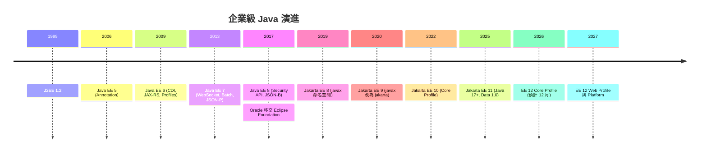

#### 關鍵轉折點

| 時間 | 事件 | 對企業的影響 |
|------|------|-------------|
| 2017-09 | Oracle 宣布將 Java EE 移交 Eclipse Foundation | 規格改由多廠商共同治理 |
| 2018-02 | 社群票選更名為 Jakarta EE | Oracle 保留 `javax` 商標，新功能不能再放在 `javax.*` |
| 2019-09 | Jakarta EE 8 發布 | 與 Java EE 8 相容，仍使用 `javax.*` |
| 2020-12 | Jakarta EE 9 | 所有 API 改為 `jakarta.*`，是最大的遷移成本來源（見第 23 章） |
| 2022-09 | Jakarta EE 10 | 新增 Core Profile、CDI Lite |
| 2024-12 ~ 2025-06 | Jakarta EE 11（Core → Web → Platform 依序發布） | Java 17 起跳、Jakarta Data 1.0、移除 Managed Beans、Concurrency 支援虛擬執行緒 |
| 2026-12 ~ 2027-05 | Jakarta EE 12（預計，見 1.3） | Java 21 起跳、Persistence 4.0、Data 1.1、CDI 5.0、全面移除 SecurityManager |

> **企業實務觀點**：EE 11 的三個 Profile 是分批發布的，EE 12 也採同樣模式。規劃升級時，請以「你用到的 Profile」的 GA 日期為準，而不是以第一個發布的 Core Profile 為準。

### 1.2 Jakarta EE 12 的定位與主題

官方發布頁的標語是 **「Community-driven innovation for robust and flexible enterprise Java」**：以社群驅動的方式，在維持可靠性的前提下提升模組化、互通性與架構選擇的彈性。InfoQ 對 Milestone 2 的分析則以「資料時代（Data Age）」形容 EE 12，因為最大的改變集中在資料存取這一層。

依 [Platform 12 規格頁](https://jakarta.ee/specifications/platform/12/) 與發布計畫，EE 12 的主題可整理成四個面向：

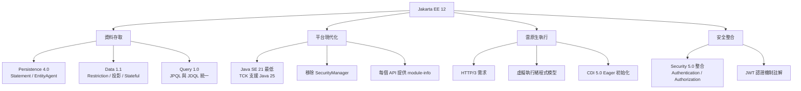

#### 平台層級變更（已寫入 Platform 12 規格頁）

1. **Java SE 21 為最低版本**；TCK 同時在 Java 21 與 Java 25 執行。規格批准需要一個 Java 21 與一個 Java 25 的相容實作。
2. **所有元件 API 不再使用 Java SecurityManager**（JDK 24 起 SecurityManager 已永久停用，見 JEP 486）。這是 EE 12 主要的不相容變更。
3. **每個元件 API JAR 必須提供 `module-info.class`**（模組名稱 `jakarta.<spec>`），但 Platform / Web Profile 的 umbrella JAR 不模組化。
4. **新增 HTTP/3 支援需求**、**擴充虛擬執行緒程式模型**（細節由各元件規格定義）。
5. **Application Client 支援被標為 deprecated**，預計 EE 13 移除。
6. **TCK 持續拆分**到各元件自己的 repository。

### 1.3 Jakarta EE 12 時程與狀態（查核日 2026-10-30）

截至查核日，Jakarta EE 12 仍是 **「under development」**。規格頁與發布計畫上的時程曾經延後，以下是目前的版本：

| 交付物 | 早期計畫 | 目前目標 | 來源 |
|--------|---------|---------|------|
| Core Profile 12 | 2026-01-31 | **2026-12-01**（JakartaOne Livestream 前） | Ivar Grimstad《Hashtag Jakarta EE》，InfoQ 2026-09/10 週報轉述 |
| Web Profile 12 | 2026-03-31 | **2027-03-31** | 同上 |
| Platform 12 | 2026 年中 | **2027-05-15** | 同上 |
| 參考相容實作 | — | Eclipse GlassFish 9（目前 9.0.0-M3） | GlassFish GitHub Release |

> **注意**：v2.0 手冊寫「預計 2026 年下半年正式發布」，這已不正確。Web Profile 與 Platform 要到 2027 年才會發布。企業若要「上生產」，現在應選 **EE 11 GA**，並在架構上預留升級到 EE 12 的空間（見第 23 章）。

### 1.4 規格狀態總表

下表是本手冊所有章節共用的「狀態來源」。狀態欄的意義見文件資訊中的「如何閱讀本手冊」；Maven 版本是查核日當天 Maven Central 上的最新版本。

| 規格 | EE 11（GA） | EE 12 目標 | 查核日最新 artifact | 狀態 | Profile |
|------|------------|-----------|---------------------|------|---------|
| RESTful Web Services | 4.0 | 5.0 | `jakarta.ws.rs-api` 5.0.0-M1（2026-10-19） | [EE12-M] | Core |
| JSON Processing | 2.1 | 2.2 | 2.1.3（2.2 尚無 artifact） | 規劃中 | Core |
| JSON Binding | 3.0 | 3.1 | 3.1.0-M2 | [EE12-M] | Core |
| Annotations | 3.0 | 3.1 | 3.0.0（3.1 尚無 artifact） | 規劃中 | Core |
| Interceptors | 2.2 | 2.2（不更新） | 2.2.0 | [GA] | Core |
| Dependency Injection | 2.0 | 2.0（不更新） | 2.0.1 | [GA] | Core |
| CDI（含 CDI Lite） | 4.1 | 5.0 | 5.0.0（Release Review 2026-09-11 通過） | [EE12-GA] | Core / Web |
| Persistence | 3.2 | 4.0 | 4.0.0-M7 | [EE12-M] | Web |
| Data | 1.0 | 1.1 | 1.1.0-M4（另有 `jakarta.data.stateful-api`） | [EE12-M] | Web |
| Query | — | 1.0（新） | 規格文件 1.0-M2；無 API artifact | [EE12-M] | Web |
| Concurrency | 3.1 | 3.2 | 3.2.0-M3（2026-10-06） | [EE12-M] | Web |
| Security | 4.0 | 5.0 | 5.0.0-M2 | [EE12-M] | Web |
| Validation | 3.1 | 4.0 | 4.0.0-M1 | [EE12-M] | Web |
| Servlet | 6.1 | 6.2 | 6.2.0-M2 | [EE12-M] | Web |
| Faces | 4.1 | 5.0 | 5.0.0-M11 | [EE12-M] | Web |
| Pages / EL / Tags / WebSocket | 4.0 / 6.0 / 3.0 / 2.2 | 4.1 / 6.1 / 3.1 / 2.3 | 各 M2 | [EE12-M] | Web |
| Transactions | 2.0 | 2.1 | 2.0.1（2.1 尚無 artifact） | 規劃中 | Web |
| Enterprise Beans（Lite / Full） | 4.0 | 4.1 | 4.0.1 | 規劃中 | Web / Platform |
| Authentication | 3.1 | 3.1（可能併入 Security 5.0） | 3.1.0 | 待定 | Web |
| Authorization | 3.0 | 3.0（投票中：是否移入 Web Profile） | 3.0.0 | 待定 | Platform |
| Batch | 2.1 | 2.2 | 2.1.1 | 規劃中 | Platform |
| Messaging | 3.1 | 3.1（不更新） | 3.1.0 | [GA] | Platform |
| Mail / Activation | 2.1 / 2.1 | 2.2 / 2.2（release 頁寫 2.1，見附錄 C） | 2.2.0-M1 / 2.2.0-M2 | [EE12-M] | Platform |
| Connectors | 2.1 | 2.2（InfoQ 另稱 3.0 進行中） | 2.1.0 | 待定 | Platform |
| NoSQL | 1.0（獨立規格） | 1.1（候選納入） | 1.1.0-M4（2026-10-29） | [候選] | Platform? |
| Config | — | 1.0（候選，Core Profile） | `jakarta.config-api` 0.0.1（MVP） | [候選] | Core? |
| HTTP | — | 1.0（候選，Core Profile） | — | [候選] | Core? |
| MVC | 3.0（獨立規格） | 3.1（候選） | 3.0.1 | [候選] | Web? |
| Agentic AI | — | 1.0（獨立規格，不在 EE 12 Platform） | 1.0.0-M1（2026-07-30） | [候選] | — |

> **審查重點**：AI 很容易把「目標版本」寫成「已發布版本」。審查時請確認程式碼的 `pom.xml` 使用的是上表「查核日最新 artifact」實際存在的版本，例如 `jakarta.jakartaee-api:12.0.0` 目前**不存在**，寫了它就無法建置。

### 1.5 Jakarta EE 12 核心特色

| 領域 | EE 12 重點 | 本手冊章節 | 狀態 |
|------|-----------|-----------|------|
| 資料 | Persistence 4.0 新增 `Statement`、`EntityAgent`、`@PreInsert` 等回呼；`createQuery("UPDATE ...")` 改回傳 `StatementOrTypedQuery`，`executeUpdate()` 標記為移除 | 10.8 | [EE12-M] |
| 資料 | Data 1.1：`Restriction` 動態條件、`@Is` 約束、`@First`、`@Select` 多欄位投影、Stateful Repository | 11.2–11.4 | [EE12-M] |
| 資料 | Query 1.0：把 JPQL 從 Persistence 規格移出，JDQL 重新定義為其子集（Core / Extended 兩層） | 11.1 | [EE12-M] |
| CDI | CDI 5.0：`@Eager`、`@AutoClose`、`@Reserve`、非同步 Invoker、移除 BeanManager 的 EL 方法、Maven 座標改名 | 8.3–8.8 | [EE12-GA] |
| 安全 | Security 5.0：`@JwtAuthenticationMechanismDefinition`（M2 已有）；規劃中：吸收 Authentication/Authorization、Permission Store、DIGEST、CLIENT-CERT、依 URL 選擇認證機制 | 12.1、12.4 | [EE12-M] |
| 並行 | Concurrency 3.2：`@Lock` 讀寫鎖、`@Schedule` 啟動排程、註解 Literal | 13.4 | [EE12-M] |
| 平台 | Java 21 最低、移除 SecurityManager、`module-info` | 3、23 | 已定案 |

#### 三個 Profile 的規格組成（EE 12 目標版本）

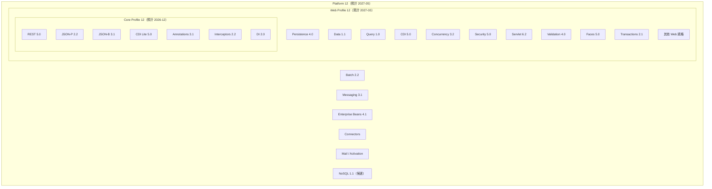

### 1.6 治理模式與規格流程

#### 治理架構

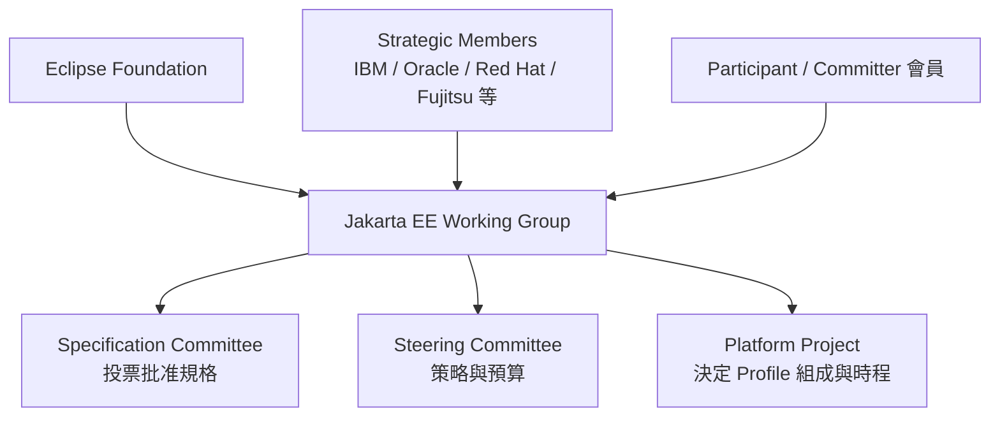

#### 規格發展流程（JESP）

| 階段 | 內容 | 讀者可查證的地方 |
|------|------|-----------------|
| Creation Review | 新規格提案（例如 2026-09 的 Jakarta CRaC） | 規格頁「Ballots」區塊 |
| Plan Review | 定義版本範圍與移除項目 | 例如 Persistence 4.0 的 Plan Review |
| Milestone | 釋出 API / 規格文件 / TCK 的 M1、M2… | Maven Central、GitHub Release |
| Release Review | 必須有通過 TCK 的相容實作 | 例如 CDI 5.0 於 2026-09-11 通過 |
| Ratification | Specification Committee 投票 | jakarta.ee/specifications/<spec>/<version> |

> **企業實務觀點**：要判斷一個 API 能不能用，看它在 [jakarta.ee/specifications](https://jakarta.ee/specifications/) 的狀態是否已經從「Under Development」變成有發布日期，再看你使用的 Server 是否出現在 [Compatibility](https://jakarta.ee/compatibility/) 頁。兩個條件都滿足才算可上生產。

#### 為何治理模式重要

| 維度 | Jakarta EE（開放規格） | 單一廠商框架 |
|------|----------------------|------------|
| 規格制定 | 多廠商、公開投票 | 單一廠商決定 |
| 實作選擇 | 多個相容實作可替換 | 綁定單一實作 |
| 長期維護 | 規格與 TCK 由基金會保存 | 視廠商策略 |
| 採購與合規 | 開放標準，利於政府與金融採購 | 需逐案評估 |

近年的產業變化也說明了「可替換實作」的價值：Azul 於 2025-12 宣布收購 Payara；同一份 Jakarta EE 應用仍可在 Open Liberty、WildFly、GlassFish 上執行，不受單一廠商併購影響。

### 1.7 與 Spring Boot 比較

兩者不是二選一：很多企業同時使用，重點是知道各自的定位。

| 維度 | Jakarta EE 11 / 12 | Spring Boot 4.1（查核日最新 4.1.2） |
|------|-------------------|-------------------------------------|
| 本質 | 規格 + 多個相容實作 | 框架（單一實作） |
| 執行模型 | Application Server（Liberty、WildFly…）或可執行 JAR（Liberty、Payara Micro） | 內嵌 Tomcat / Jetty / Netty |
| Java 版本 | EE 11：17+；EE 12：21+ | 17+ |
| DI | CDI | Spring IoC |
| 資料 | Persistence + Data（介面即實作） | Spring Data JPA |
| 設定 | MicroProfile Config（Jakarta Config 候選中） | Spring Boot Configuration |
| 雲原生 | MicroProfile Health / Telemetry / Fault Tolerance | Actuator / Micrometer / Resilience4j |
| AI 整合 | LangChain4j、Jakarta Agentic AI（M1） | Spring AI |
| 可替換性 | 換 Server 不必改程式碼（只用標準 API 時） | 換框架需重寫 |

> **架構師建議**：需要「多廠商、長期維護、合規採購」的核心系統，Jakarta EE 優勢明顯。團隊已熟悉 Spring、追求生態系廣度時，Spring Boot 是務實選擇。兩者在同一企業共存很常見。

### 1.8 適合與不適合的應用場景

#### 適合的場景

| 場景 | 原因 |
|------|------|
| 銀行、保險核心系統 | 交易（JTA）、批次（Batch）、長期維護、廠商中立 |
| 政府系統 | 開放標準、採購法規、可替換實作 |
| 多模組企業應用（ERP、CRM） | CDI + Persistence + Security 一致的程式模型 |
| 需要嚴格交易語意與訊息整合的系統 | JTA + Messaging + Batch 在同一容器內協作 |

#### 不適合的場景

| 場景 | 原因 | 替代方案 |
|------|------|---------|
| 極短生命週期的 Serverless Function | 冷啟動與記憶體成本 | Quarkus / 原生映像；或 Liberty InstantOn（需評估） |
| 純前端 BFF | 規格過重 | Node.js、Spring Boot WebFlux |
| 只用 NoSQL 的應用 | Jakarta NoSQL 仍是候選規格 | 廠商 SDK 或 Spring Data |
| 想用 EE 12 新功能「立刻上線」 | Web Profile/Platform 2027 才 GA | 先上 EE 11，EE 12 功能放在隔離的模組試驗 |

### 1.9 實務注意事項

> **重要提醒**
> 1. 生產環境以 **EE 11 GA** 為準；EE 12 的 API 在 GA 前仍可能改名或移除（Data 1.1 的 metamodel 寫法在 M3→M4 之間就改過）。
> 2. 現有 Java 8/11/17 系統：升 EE 11 需要 Java 17，升 EE 12 需要 Java 21。建議直接升到 Java 21 或 25 LTS。
> 3. 從 Java EE 遷移要先處理 `javax.*` → `jakarta.*`（第 23 章）。
> 4. 評估 Server 時，以 [Compatibility](https://jakarta.ee/compatibility/) 頁的認證清單為準，不以廠商新聞稿為準。
> 5. 候選規格（Config、NoSQL、MVC、HTTP）在納入決定前，請用介面隔離依賴（例如透過 MicroProfile Config 包一層）。

### 1.10 審查與驗證清單

| 檢查項目 | 如何驗證 | 預期結果 | 常見 AI 錯誤 |
|---------|---------|---------|-------------|
| 文件或程式宣稱的 EE 12 發布日期 | 開 [jakarta.ee/release/12](https://jakarta.ee/release/12/) 與 InfoQ Java 週報 | Core 2026-12、Web 2027-03、Platform 2027-05（或更新） | 寫成「2026 年中已發布」 |
| 某規格版本是否真的存在 | `curl -s https://repo1.maven.org/maven2/jakarta/data/jakarta.data-api/maven-metadata.xml` | 列出的版本含該號碼 | 引用不存在的 `12.0.0` 或 `1.1.0` GA |
| 規格是否已納入 Profile | 看 Platform 12 規格頁「Possible new dependencies」 | Config / HTTP / MVC / NoSQL / Query 仍標「pending」或星號 | 把候選規格寫成「已納入」 |
| Server 是否通過 TCK | [jakarta.ee/compatibility](https://jakarta.ee/compatibility/) | EE 12 目前沒有任何認證實作 | 宣稱「GlassFish 8 已通過 EE 12 TCK」 |
| 治理事實 | 規格頁 Ballots 區塊 | 每個 Release Review 都有日期與票數 | 捏造大會名稱、講者或引用 |

## 2. Jakarta EE 12 核心架構

### 2.1 Platform、Web Profile、Core Profile

Jakarta EE 用三個 Profile 讓團隊只拿需要的規格。Profile 是「巢狀」的：Web Profile 包含 Core Profile，Platform 包含 Web Profile。

#### Profile 定位

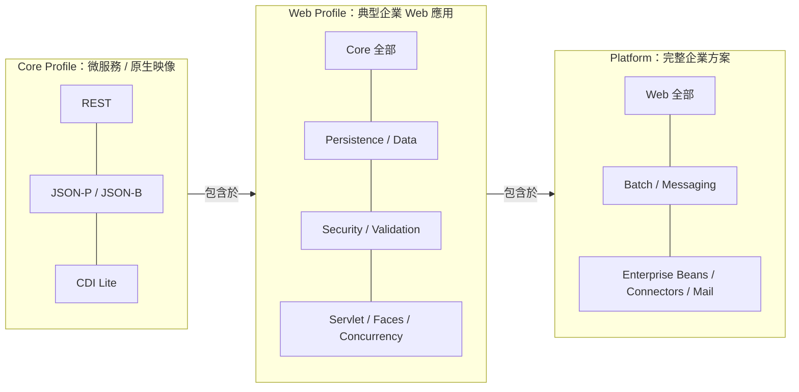

| Profile | Maven umbrella API（EE 11） | 典型用途 | Open Liberty Feature（EE 11） |
|---------|---------------------------|---------|-------------------------------|
| **Core Profile** | `jakarta.platform:jakarta.jakartaee-core-api:11.0.0` | REST 微服務、Sidecar | 逐一啟用（`restfulWS-4.0`、`cdi-4.1`…） |
| **Web Profile** | `jakarta.platform:jakarta.jakartaee-web-api:11.0.0` | CRUD 系統、入口網站 | `webProfile-11.0` |
| **Platform** | `jakarta.platform:jakarta.jakartaee-api:11.0.0` | 需要 Batch、JMS、EJB 的核心系統 | `jakartaee-11.0` |

> **實測**：Open Liberty 26.0.0.10 沒有 `coreProfile-11.0` 這個 convenience feature（Maven Central `io.openliberty.features` 下查不到），Core Profile 應用要逐一列出 feature。

#### 選擇建議

```text
只提供 REST API、不碰資料庫交易   → Core Profile
有資料庫、有登入、有交易         → Web Profile（大多數企業應用）
需要 Batch、JMS、MDB、JCA 連線器 → Platform
```

### 2.2 模組化架構與規格關係圖

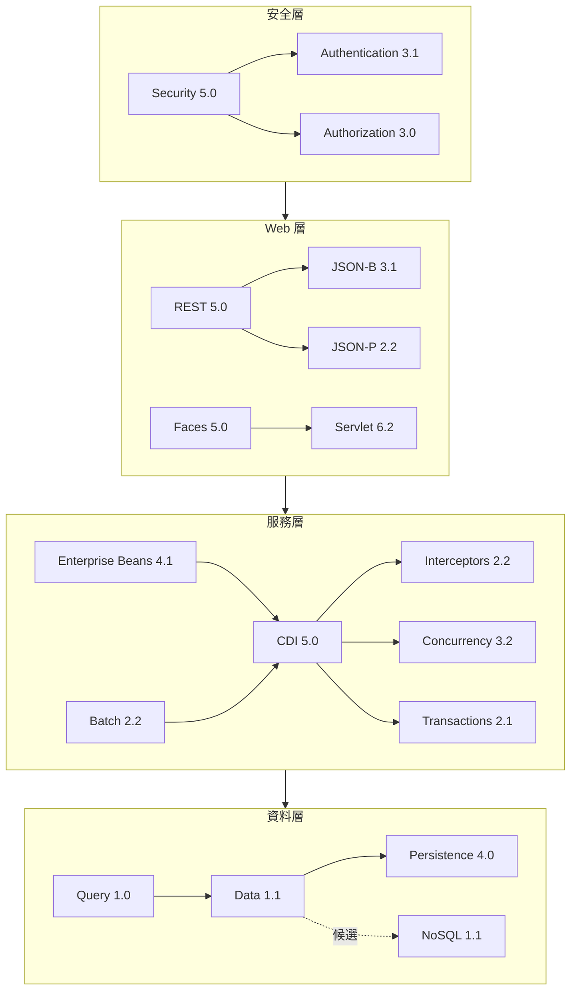

### 2.3 Jakarta EE Runtime

Jakarta EE 應用不自帶容器，而是部署到 Runtime。Runtime 提供交易管理、連線池、安全、執行緒等「受管理資源」，應用只透過標準 API 取用。

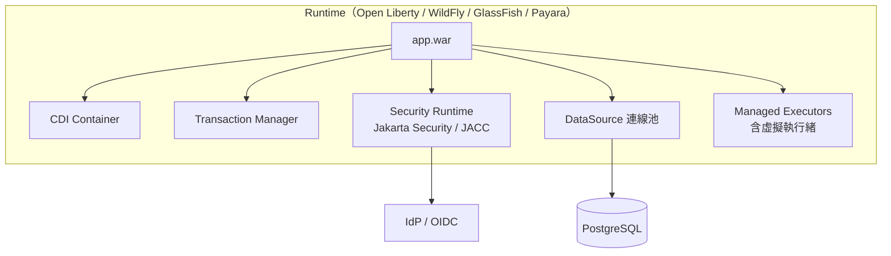

#### Runtime 關鍵元件與 EE 12 變更

| 元件 | 職責 | EE 12 變更 |
|------|------|-----------|
| CDI Container | Bean 生命週期、注入、事件 | CDI 5.0：`@Eager`、`@AutoClose`、`@Reserve`；Application Scope 改為 global scope |
| Transaction Manager | JTA 交易、XA | Transactions 2.1（尚無 artifact） |
| Security Runtime | 認證、授權 | 不再使用 SecurityManager；Security 5.0 整合 Authentication/Authorization |
| DataSource | 連線池 | 由 Server 設定（第 5 章、第 28 章） |
| Managed Executors | 受管理執行緒 | EE 11 起 `virtual = true`；EE 12 擴充虛擬執行緒程式模型 |

### 2.4 Jakarta EE 12 完整規格清單

完整的版本與 artifact 狀態請以 [1.4 規格狀態總表](#14-規格狀態總表) 為準。這裡依 Profile 分組，並標出「EE 12 有沒有更新」：

#### Core Profile 規格

| 規格 | EE 11 | EE 12 | 是否更新 |
|------|------|------|---------|
| RESTful Web Services | 4.0 | 5.0 | 更新 |
| JSON Processing | 2.1 | 2.2 | 更新 |
| JSON Binding | 3.0 | 3.1 | 更新 |
| Annotations | 3.0 | 3.1 | 更新 |
| Interceptors | 2.2 | 2.2 | 不更新 |
| Dependency Injection | 2.0 | 2.0 | 不更新 |
| CDI Lite | 4.1 | 5.0 | 更新 |

#### Web Profile 額外規格

| 規格 | EE 11 | EE 12 | 是否更新 |
|------|------|------|---------|
| Persistence | 3.2 | 4.0 | 更新（主要版號） |
| Data | 1.0 | 1.1 | 更新 |
| Query | — | 1.0 | 新增（待最終確認） |
| CDI（Full） | 4.1 | 5.0 | 更新 |
| Security | 4.0 | 5.0 | 更新（主要版號） |
| Validation | 3.1 | 4.0 | 更新（主要版號） |
| Servlet / Faces | 6.1 / 4.1 | 6.2 / 5.0 | 更新 |
| Concurrency | 3.1 | 3.2 | 更新 |
| Pages / EL / Tags / WebSocket | 4.0 / 6.0 / 3.0 / 2.2 | 4.1 / 6.1 / 3.1 / 2.3 | 更新 |
| Transactions | 2.0 | 2.1 | 更新 |
| Enterprise Beans Lite | 4.0 | 4.1 | 更新 |
| Authentication | 3.1 | 3.1 | 可能隨 Security 5.0 更新 |
| Debugging Support | 2.0 | 2.0 | 不更新 |

#### Platform 額外規格

| 規格 | EE 11 | EE 12 | 是否更新 |
|------|------|------|---------|
| Batch | 2.1 | 2.2 | 更新 |
| Connectors | 2.1 | 2.2 | 更新 |
| Enterprise Beans（Full） | 4.0 | 4.1 | 更新 |
| Mail / Activation | 2.1 / 2.1 | 2.2 / 2.2 | 更新（release 頁顯示 2.1，以規格頁為準） |
| Messaging | 3.1 | 3.1 | 不更新 |
| Authorization | 3.0 | 3.0 | 不更新；投票中是否移入 Web Profile |
| NoSQL | — | 1.1 | 候選納入 |

### 2.5 候選與前瞻規格

| 規格 | 版本 | 目標 Profile | 查核日狀態 | 建議過渡方案 |
|------|------|-------------|-----------|-------------|
| Jakarta Config | 1.0 | Core | MVP 階段，`jakarta.config-api` 只有 0.0.1；基於 MicroProfile Config | 使用 MicroProfile Config 3.1 |
| Jakarta HTTP | 1.0 | Core | 待 Platform 委員會決定 | 使用 Servlet / REST Client |
| Jakarta MVC | 3.1 | Web | 待決定；目前 3.0.1 為獨立規格 | Faces 或 REST + 前端框架 |
| Jakarta NoSQL | 1.1 | Web 或 Platform | 1.1.0-M4（2026-10-29）；Eclipse JNoSQL 已升格為 EE4J 專案；社群主張納入以支援向量資料庫（RAG） | 透過 Jakarta Data Repository 存取 JNoSQL |
| Jakarta Query | 1.0 | Web | release 頁已列入 Web Profile；規格文件 1.0-M2 | JPQL / JDQL 寫法不變 |
| Jakarta Agentic AI | 1.0 | 獨立（不在 EE 12） | 1.0.0-M1（2026-07-30） | LangChain4j 1.23（見第 20 章） |
| Jakarta CRaC | — | — | 2026-09 新規格提案，社群審查中 | Liberty InstantOn（廠商功能） |

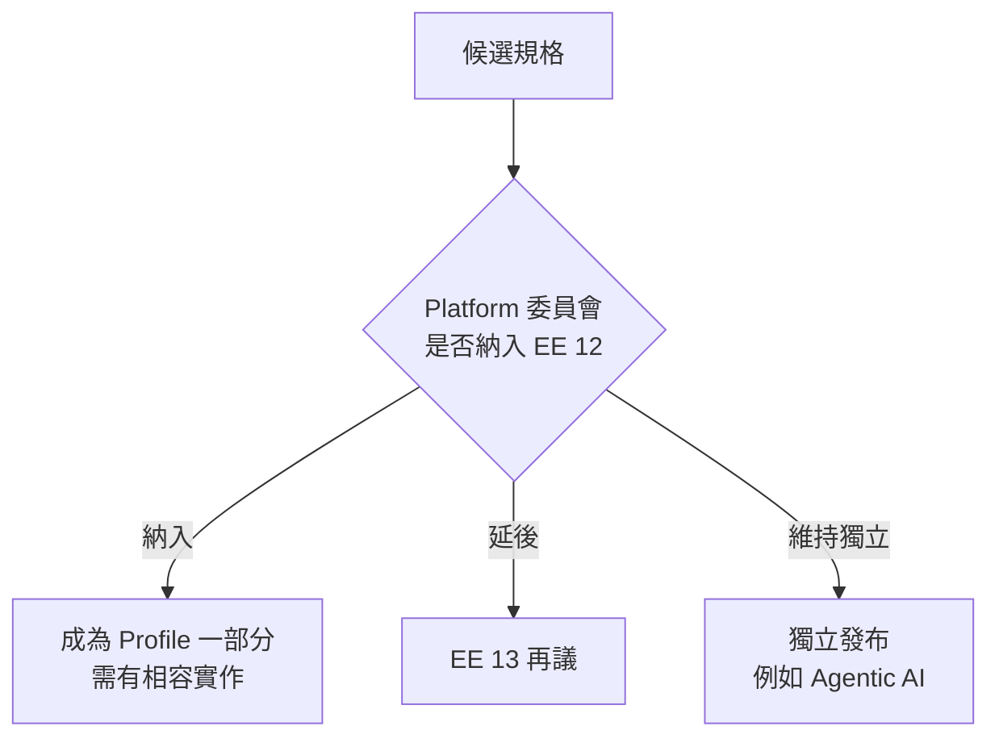

> **企業實務觀點**：候選規格的 API 在納入前常有大改。正確做法是在自己的程式碼中定義一層介面（例如 `AppConfig`），內部先用 MicroProfile Config 實作；等 Jakarta Config 定案後只改這一層。

### 2.6 TCK 認證與相容實作

TCK（Technology Compatibility Kit）是判斷「相容」的唯一依據。EE 12 規定：每個元件規格要有一個 Java 21 與一個 Java 25 的相容實作才能批准。

#### TCK 拆分

| 面向 | 集中式 platform-tck（舊） | 元件自有 TCK（EE 12 持續推進） |
|------|--------------------------|-------------------------------|
| 發布節奏 | 綁定整個平台 | 元件可獨立發布 |
| 執行方式 | 只能在平台內跑 | 可獨立跑，也能在平台 TCK 中跑 |
| 貢獻門檻 | 高 | 降低 |

#### 相容實作現況（查核日 2026-10-30）

| 實作 | 維護者 | EE 11 認證 | EE 12 進度 |
|------|-------|-----------|-----------|
| Eclipse GlassFish | Eclipse Foundation | 8.0.x（8.0.5） | 9.0.0-M3：實作部分 EE 12 里程碑（CDI 5.0 via Weld、Security 5 snapshot TCK 通過），預定為參考實作 |
| Open Liberty | IBM | 26.0.0.10（`jakartaee-11.0`、`webProfile-11.0`） | EE 12 beta 功能另由 beta 版提供（例如 Persistence 4.0 追蹤議題標 `260012-beta`） |
| WildFly | Red Hat | 41 / 42（Platform、Web、Core） | WildFly Preview 42 起導入 EE 12 里程碑 API；Preview 不保證相容性 |
| Payara | Azul（2025-12 收購） | 7.2026.x | 未公布 |
| Weld | Red Hat | — | 7.0.0.Final 為 CDI 5.0 相容實作 |

> **注意**：v2.0 寫「GlassFish 8 將是首個通過 EE 12 TCK 的實作」並不正確——EE 12 的參考實作是 GlassFish **9**，GlassFish 8 是 EE 11。

### 2.7 實務注意事項

> **架構選型建議**
> 1. 新建微服務從 Core Profile 開始，需要資料庫交易時再改用 Web Profile。
> 2. 程式只依賴標準 API（`jakarta.*`、`org.eclipse.microprofile.*`），廠商 API 集中在少數 Adapter 類別。
> 3. 依賴 umbrella API（`jakarta.jakartaee-web-api`）時，**版本要另外指定**——`jakarta.jakartaee-bom` 只管理元件 API，不管理 umbrella API（實測，見 6.4）。
> 4. 若直接使用 `jakarta.security.auth.message.*`（Authentication SPI）或 `jakarta.security.jacc.*`（Authorization），請追蹤 Security 5.0 的整合決定。
> 5. 認證狀態以 [jakarta.ee/compatibility](https://jakarta.ee/compatibility/) 為準。

### 2.8 審查與驗證清單

| 檢查項目 | 如何驗證 | 預期結果 | 常見 AI 錯誤 |
|---------|---------|---------|-------------|
| Profile 與實際使用的 API 一致 | `mvn dependency:tree` 看 `jakarta.*` 依賴；對照 2.4 表 | Core Profile 專案不出現 `jakarta.persistence` | 宣稱 Core Profile 卻用了 JPA |
| Liberty feature 名稱真的存在 | `curl -s https://repo1.maven.org/maven2/io/openliberty/features/<feature>/maven-metadata.xml` | 回傳 XML（例如 `webProfile-11.0`） | 寫出 `jakartaee-12.0`、`coreProfile-11.0` 等不存在的 feature |
| 候選規格沒有混入生產程式 | `grep -r "jakarta.config\|jakarta.nosql\|jakarta.agentic" src/main` | 只出現在隔離模組或完全沒有 | 直接在 Domain 層 import 候選 API |
| 相容實作宣稱 | 對照 2.6 表與 Compatibility 頁 | 每個宣稱都有官方來源 | 把 Milestone 版本說成「已認證」 |
| 架構圖與程式依賴一致 | 第 22 章 ArchUnit 測試 | `mvn test` 通過 | 圖上畫分層，程式卻反向依賴 |

## 3. Java 21 與 Java 25

### 3.1 為何 Jakarta EE 12 要求 Java 21

EE 12 把最低版本從 Java 17 提高到 Java 21，原因是 Java 21 讓下列功能「正式可用」，規格可以直接以它們設計 API：

| Java 21 正式功能 | JEP | 對 Jakarta EE 的意義 |
|-----------------|-----|---------------------|
| Virtual Threads | 444 | Concurrency 的 `virtual = true`、每請求一執行緒模型 |
| Pattern Matching for switch | 441 | ExceptionMapper、Domain 規則判斷更安全 |
| Record Patterns | 440 | 解構 DTO / Event |
| Sequenced Collections | 431 | `getFirst()` / `reversed()` 等一致 API |
| Generational ZGC | 439 | 低延遲 GC 選項 |

同時 EE 12 的 TCK 也在 **Java 25 LTS**（2025-09 發布）上執行，因此你可以選 21 或 25。

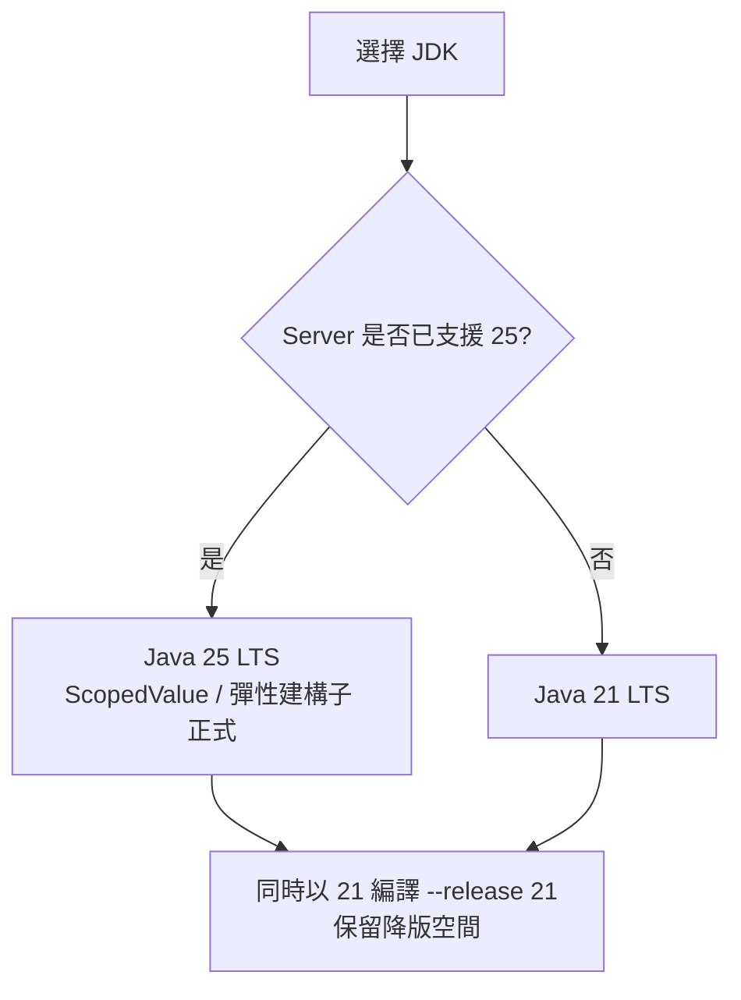

> **版本事實（避免 AI 常見錯誤）**：Java 21 中 Structured Concurrency（JEP 453）與 Scoped Values（JEP 446）都還是**預覽**功能。Java 25 中 Scoped Values（JEP 506）已正式，但 Structured Concurrency（JEP 505）仍是**第五次預覽**。Java 26（2026-03）、Java 27（2026-09）是非 LTS 版本。

### 3.2 Virtual Thread（虛擬執行緒）

#### 傳統執行緒 vs Virtual Thread

| 項目 | Platform Thread | Virtual Thread |
|------|-----------------|---------------|
| 對應 | 1 : 1 對應 OS 執行緒 | 多個虛擬執行緒共用少數 carrier thread |
| 建立成本 | 高（MB 級堆疊） | 低（KB 級，堆疊放在 Heap） |
| 適合 | CPU 密集 | I/O 密集（DB、HTTP、檔案） |
| 阻塞時 | 佔住 OS 執行緒 | 卸載（unmount），carrier 去跑別人 |
| 池化 | 需要 | **不要池化**；用「限制並行數」保護下游 |

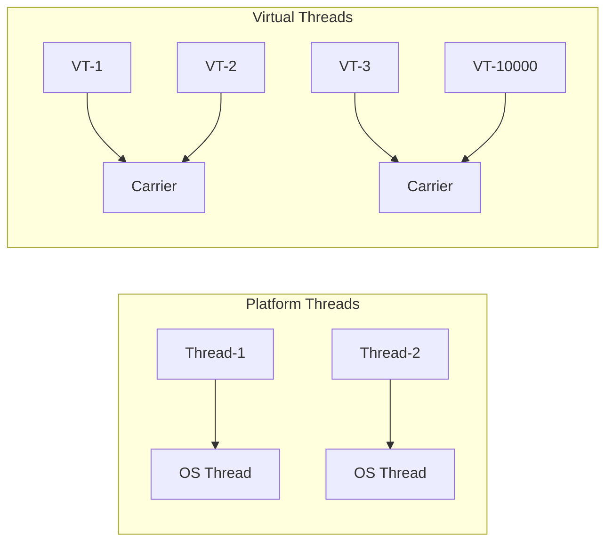

#### 程式碼範例（已驗證：JDK 21 執行）

以下程式涵蓋 3.2–3.5 的 Java 21 正式功能，`main` 最後用 10,000 個虛擬執行緒各 sleep 100ms：

```java
package demo;

import java.math.BigDecimal;
import java.time.Duration;
import java.time.Instant;
import java.util.ArrayList;
import java.util.LinkedHashMap;
import java.util.List;
import java.util.SequencedMap;
import java.util.concurrent.Executors;
import java.util.concurrent.Future;
import java.util.concurrent.atomic.AtomicInteger;

/** Java 21（Jakarta EE 12 的最低版本）正式功能；全部不需要 --enable-preview。 */
public class Java21Features {

    // ---- sealed 介面 + record：編譯器知道所有子型別 → switch 不需要 default ----
    sealed interface PaymentMethod permits CreditCard, BankTransfer, Wallet {}

    record CreditCard(String last4, boolean expired) implements PaymentMethod {}

    record BankTransfer(String bankCode, String account) implements PaymentMethod {}

    record Wallet(String provider) implements PaymentMethod {}

    /** JEP 441 Pattern Matching for switch + guard（when）。少一個 case 就編譯失敗。 */
    static String describe(PaymentMethod p) {
        return switch (p) {
            case CreditCard c when c.expired() -> "信用卡已過期 *" + c.last4();
            case CreditCard c -> "信用卡 *" + c.last4();
            case BankTransfer(String bank, String acct) -> "轉帳 " + bank + "-" + acct;   // JEP 440 Record Pattern
            case Wallet w -> "電子錢包 " + w.provider();
        };
    }

    /** Record 的 compact constructor：驗證 + 正規化，物件一建立就保證有效。 */
    record Money(BigDecimal amount, String currency) {
        Money {
            if (amount == null || amount.signum() < 0) {
                throw new IllegalArgumentException("金額不可為負");
            }
            if (currency == null || currency.length() != 3) {
                throw new IllegalArgumentException("幣別須為 ISO 4217 三碼");
            }
            amount = amount.setScale(2, java.math.RoundingMode.HALF_UP);
        }
    }

    public static void main(String[] args) throws Exception {
        System.out.println(describe(new CreditCard("1234", true)));
        System.out.println(describe(new BankTransfer("812", "0001")));
        System.out.println(new Money(new BigDecimal("10.005"), "TWD"));

        // ---- JEP 431 Sequenced Collections ----
        SequencedMap<String, Integer> daily = new LinkedHashMap<>();
        daily.put("2026-10-28", 10);
        daily.put("2026-10-29", 12);
        daily.put("2026-10-30", 9);
        System.out.println("first=" + daily.firstEntry() + " last=" + daily.lastEntry()
                + " reversed=" + daily.reversed().keySet());

        // ---- JEP 444 Virtual Threads：10,000 個阻塞任務 ----
        AtomicInteger done = new AtomicInteger();
        Instant start = Instant.now();
        try (var executor = Executors.newVirtualThreadPerTaskExecutor()) {
            List<Future<?>> futures = new ArrayList<>();
            for (int i = 0; i < 10_000; i++) {
                futures.add(executor.submit(() -> {
                    Thread.sleep(100);
                    done.incrementAndGet();
                    return null;
                }));
            }
            for (Future<?> f : futures) {
                f.get();
            }
        }
        long ms = Duration.between(start, Instant.now()).toMillis();
        System.out.println("virtual threads done=" + done.get() + " elapsedMs<5000=" + (ms < 5000));
    }
}
```

實際輸出：

```text
信用卡已過期 *1234
轉帳 812-0001
Money[amount=10.01, currency=TWD]
first=2026-10-28=10 last=2026-10-30=9 reversed=[2026-10-30, 2026-10-29, 2026-10-28]
virtual threads done=10000 elapsedMs<5000=true
```

#### 在 Jakarta EE 中使用虛擬執行緒

在容器內**不要**自己呼叫 `Executors.newVirtualThreadPerTaskExecutor()`：自建的執行緒拿不到 Security Context、交易與 CDI Context。正確做法是用 Concurrency 3.1（EE 11）的 `@ManagedExecutorDefinition(virtual = true)`，詳見 [13.3](#133-virtual-thread-整合)。

> **JDK 版本差異**：Java 21–23 中，虛擬執行緒在 `synchronized` 區塊內阻塞時會「釘住（pin）」carrier thread；Java 24 起（JEP 491）已解除大部分 pinning。若團隊仍用 Java 21，長時間持有鎖又要做 I/O 的程式改用 `ReentrantLock`。

### 3.3 Structured Concurrency（結構化並行）

結構化並行讓「同時發出多個子任務、任一失敗就全部取消」的程式碼變得可靠。但它在 Java 21 與 Java 25 都還是預覽 API，而且 **API 在兩個版本之間不相容**：

| 版本 | 狀態 | 寫法 |
|------|------|------|
| Java 21（JEP 453） | 第一次預覽 | `new StructuredTaskScope.ShutdownOnFailure()` + `join()` + `throwIfFailed()` |
| Java 25（JEP 505） | 第五次預覽 | `StructuredTaskScope.open()`（預設 Joiner）+ `join()`；失敗丟 `FailedException` |

v2.0 手冊的 `ShutdownOnFailure` 寫法在 Java 25 編譯會失敗（`cannot find symbol`，見附錄 A.5）。以下是 Java 25 的寫法（已驗證：JDK 25 `--enable-preview` 執行）：

```java
package demo;

import java.util.concurrent.StructuredTaskScope;
import java.util.concurrent.StructuredTaskScope.Subtask;

/**
 * JEP 505 Structured Concurrency 在 Java 25 仍是「第五次預覽」，需 --enable-preview。
 * API 已和 Java 21 的版本不同：沒有 ShutdownOnFailure / throwIfFailed()，
 * 改用 StructuredTaskScope.open()（預設 Joiner = 任一失敗即取消其他並拋出）。
 * 生產程式碼不要依賴預覽 API——Jakarta EE 12 規格也不要求它。
 */
public class StructuredPreview {

    record Decision(String aml, String fraud) {}

    static Decision evaluate(String txId) throws InterruptedException {
        try (var scope = StructuredTaskScope.open()) {
            Subtask<String> aml = scope.fork(() -> "AML-OK:" + txId);
            Subtask<String> fraud = scope.fork(() -> {
                if (txId.startsWith("BAD")) {
                    throw new IllegalStateException("fraud detected");
                }
                return "FRAUD-OK:" + txId;
            });
            scope.join();                 // 任一子任務失敗 → 拋 FailedException，其他子任務被取消
            return new Decision(aml.get(), fraud.get());
        }
    }

    public static void main(String[] args) throws Exception {
        System.out.println(evaluate("T1"));
        try {
            evaluate("BAD-2");
        } catch (StructuredTaskScope.FailedException e) {
            System.out.println("failed: " + e.getCause().getMessage());
        }
    }
}
```

輸出：

```text
Decision[aml=AML-OK:T1, fraud=FRAUD-OK:T1]
failed: fraud detected
```

> **生產建議**：預覽 API 每個版本都可能改，生產程式不要用。要並行呼叫多個下游，在 EE 環境用 `ManagedExecutorService.supplyAsync(...)` + `CompletableFuture.allOf(...)` 並設定逾時（13.3 有完整範例並在 Liberty 上實測）。

### 3.4 Record 與 Pattern Matching

Record 適合 DTO、Command、Event、Value Object；compact constructor 讓「物件一建立就有效」。3.2 的範例已示範：

- `sealed interface PaymentMethod` + `switch` 不寫 `default`：新增子型別時，所有未處理的 switch 會**編譯失敗**，這是 Reviewer 最有價值的保護網。
- `case BankTransfer(String bank, String acct)`：Record Pattern 解構。
- `record Money(...)` 的 compact constructor 同時驗證與正規化（`setScale(2, HALF_UP)`）。

> **審查重點**：AI 常在 switch 加上 `default -> throw ...`。對 sealed 型別這反而有害——它讓新增子型別時編譯器不再提醒你。

### 3.5 Sequenced Collection 與 Scoped Values

- **Sequenced Collections（Java 21 正式）**：`SequencedMap.firstEntry()`、`lastEntry()`、`reversed()`，見 3.2 範例輸出第 4 行。
- **Scoped Values**：Java 21 是預覽（JEP 446），**Java 25 才正式（JEP 506）**。v2.0 標示「JEP 446 Preview → JEP 481」不完整：JEP 481 是 Java 23 的第三次預覽，正式版是 JEP 506。

ScopedValue 與 ThreadLocal 的差異：

| 項目 | ThreadLocal | ScopedValue |
|------|-------------|-------------|
| 可變性 | 可任意 `set()` | 綁定後不可變 |
| 生命週期 | 需手動 `remove()`，否則洩漏 | 離開 `call()` / `run()` 自動失效 |
| 虛擬執行緒 | 每個執行緒一份，數量大時耗記憶體 | 為大量虛擬執行緒設計 |

> **在 Jakarta EE 中**：請求層級的上下文（使用者、Correlation ID）優先用 CDI `@RequestScoped` Bean 或容器傳播的 Context，ScopedValue 適合你自己控制呼叫鏈的程式（例如批次內部）。

### 3.6 Java 25 新特性

Java 25（LTS，2025-09-16 GA）中**正式**、與企業開發有關的功能：

| 特性 | JEP | 狀態 | 企業價值 |
|------|-----|------|---------|
| Scoped Values | 506 | 正式 | 取代 ThreadLocal 傳遞不可變上下文 |
| Flexible Constructor Bodies | 513 | 正式 | `super(...)` 之前可驗證參數、初始化子類別欄位 |
| Module Import Declarations | 511 | 正式 | `import module java.base;` |
| Compact Source Files & Instance Main | 512 | 正式 | 寫小工具、腳本 |
| Key Derivation Function API | 510 | 正式 | 標準 KDF（HKDF） |
| Compact Object Headers | 519 | 正式（產品功能，需手動開啟） | 降低 Heap 使用 |
| Generational Shenandoah | 521 | 正式 | 另一個低延遲 GC 選項 |
| AOT 命令列人體工學 / Method Profiling | 514 / 515 | 正式 | 縮短啟動與暖機 |
| Structured Concurrency | 505 | **第五次預覽** | 見 3.3 |
| Primitive Types in Patterns | 507 | **第三次預覽** | 不建議生產使用 |
| Stable Values | 502 | **預覽** | 不建議生產使用 |

v2.0 的表格引用了 JEP 488、492、495、494、478、507（標成 Stable Scoped Values），這些不是 Java 25 的正式 JEP 編號或與內容不符，已在附錄 B 勘誤。

#### 範例（已驗證：JDK 25 執行，未使用 `--enable-preview`）

```java
package demo;

import module java.base;   // JEP 511 Module Import Declarations（Java 25 正式）

/** Java 25 LTS 正式功能（不需 --enable-preview）。 */
public class Java25Features {

    // ---- JEP 506 Scoped Values（Java 25 正式）：取代 ThreadLocal 傳遞請求上下文 ----
    static final ScopedValue<String> CORRELATION_ID = ScopedValue.newInstance();

    static String handle() {
        return ScopedValue.where(CORRELATION_ID, "req-42")
                .call(Java25Features::service);          // 只在 call() 執行期間綁定
    }

    static String service() {
        return "service sees " + CORRELATION_ID.get();   // 不需傳參數；離開 scope 自動失效
    }

    // ---- JEP 513 Flexible Constructor Bodies（Java 25 正式）：super(...) 之前可以驗證 ----
    static class Account {
        final String id;

        Account(String id) {
            this.id = id;
        }
    }

    static class SavingsAccount extends Account {
        final BigDecimal rate;

        SavingsAccount(String id, BigDecimal rate) {
            if (rate.signum() < 0) {                      // 以前必須寫成 static 輔助方法塞進 super(...) 參數
                throw new IllegalArgumentException("利率不可為負");
            }
            this.rate = rate;                             // 可在 super 前初始化子類別欄位（不可讀 this 的其他成員）
            super(Objects.requireNonNull(id));
        }
    }

    public static void main(String[] args) {
        System.out.println(handle());
        System.out.println("bound outside scope? " + CORRELATION_ID.isBound());
        System.out.println(new SavingsAccount("S1", new BigDecimal("0.015")).rate);
        try {
            new SavingsAccount("S2", new BigDecimal("-1"));
        } catch (IllegalArgumentException e) {
            System.out.println("rejected: " + e.getMessage());
        }
        // List、Map 不必 import：module java.base 一次匯入
        System.out.println(List.of(1, 2, 3).reversed());
    }
}
```

輸出：

```text
service sees req-42
bound outside scope? false
0.015
rejected: 利率不可為負
[3, 2, 1]
```

同一個檔案用 JDK 21 編譯會在第 3 行失敗（`import module` 是 Java 25 語法），這也是「以 `--release 21` 編譯」能自動擋下的錯誤。

### 3.7 JVM 調校建議

#### 生產環境 JVM 參數範本（Open Liberty `jvm.options`）

容器環境的原則：**用百分比，不寫死 `-Xmx`**；`UseContainerSupport` 自 JDK 10 起預設開啟，不需要寫。

```text
# Open Liberty：放在 src/main/liberty/config/jvm.options（一行一個選項，# 為註解）
# 適用 Java 21 / 25 HotSpot。容器內一律用百分比，不寫死 -Xmx。
-XX:InitialRAMPercentage=50
-XX:MaxRAMPercentage=75
# G1 是預設 GC，只調暫停目標；低延遲交易系統改用下一行的 ZGC（JDK 23 起只有分代模式）
-XX:MaxGCPauseMillis=200
# -XX:+UseZGC
-XX:+ExitOnOutOfMemoryError
-XX:+HeapDumpOnOutOfMemoryError
-XX:HeapDumpPath=/logs/heapdump.hprof
-Xlog:gc*,safepoint:file=/logs/gc.log:time,uptime,level,tags:filecount=10,filesize=20m
# 虛擬執行緒排程器：預設 parallelism = CPU 核心數，通常不需調整
# -Djdk.virtualThreadScheduler.parallelism=8
```

驗證方式：把非註解行存成 argfile，用 `java @jvm.args -XX:+PrintFlagsFinal -version` 確認每個參數都被 JVM 接受且值正確。下方同時列出 v2.0 範本的兩個問題：

```text
== java @jvm.args -XX:+PrintFlagsFinal -version（jdk-21.0.4.7-hotspot）
 bool ExitOnOutOfMemoryError = true {product} {command line}
 uintx MaxGCPauseMillis = 200 {product} {command line}
 double MaxRAMPercentage = 75.000000 {product} {command line}
 bool UseG1GC = true {product} {ergonomic}
== java @jvm.args -XX:+PrintFlagsFinal -version（jdk-25.0.0.36-hotspot）
 bool ExitOnOutOfMemoryError = true {product} {command line}
 uintx MaxGCPauseMillis = 200 {product} {command line}
 double MaxRAMPercentage = 75.000000 {product} {command line}
 bool UseG1GC = true {product} {ergonomic}
== v2.0 3.7 的 JAVA_OPTS（註解寫在引號內）
Error: Could not find or load main class #
Caused by: java.lang.ClassNotFoundException: #
== JDK 25 + -XX:+ZGenerational
OpenJDK 64-Bit Server VM warning: Ignoring option ZGenerational; support was removed in 24.0
```

v2.0 範本的問題：

1. 把 `# 記憶體配置` 這類註解寫在 `JAVA_OPTS="..."` 的引號裡，`#` 會變成 JVM 參數，`java` 直接啟動失敗。
2. `-XX:+ZGenerational` 在 JDK 24 已移除（JDK 23 起 ZGC 只有分代模式），只會產生警告。
3. `-XX:+UseContainerSupport` 是 Linux 專用旗標且預設開啟；在 Windows JDK 上反而是「Unrecognized VM option」直接失敗。
4. `-XX:+G1UseAdaptiveIHOP` 是預設值，屬於噪音。

#### GC 策略選擇指南

| GC | 適用場景 | 暫停時間 | 備註 |
|----|---------|---------|------|
| **G1**（預設） | 大多數企業應用 | 數十～數百 ms | 只調 `MaxGCPauseMillis` |
| **ZGC** | 低延遲交易、Heap 很大 | < 1ms | JDK 23 起只有分代模式 |
| **Shenandoah** | 低延遲替代 | < 10ms | Java 25 分代模式正式 |
| **Parallel** | 批次、吞吐優先 | 較長 | 適合離線批次 JVM |

### 3.8 實務注意事項

> **升級建議**
> 1. 新專案直接用 **Java 21 或 25 LTS**；Maven 設 `maven.compiler.release` 為 21，確保可降版。
> 2. 預覽功能（`--enable-preview`）不進生產程式碼。
> 3. 虛擬執行緒不池化；用 `maxAsync` 或 Semaphore 限制對下游的並行數。
> 4. Java 21 上避免在 `synchronized` 內做長時間 I/O；Java 24+ 已大幅改善。
> 5. JVM 參數放在版本控制的 `jvm.options`，每次 JDK 升級用 `-XX:+PrintFlagsFinal` 驗證一次。

### 3.9 審查與驗證清單

| 檢查項目 | 如何驗證 | 預期結果 | 常見 AI 錯誤 |
|---------|---------|---------|-------------|
| 是否使用預覽 API | `javac --release 21 -Xlint:preview` 編譯；搜尋 `--enable-preview` | 生產程式無預覽 API | 在 Java 21 程式直接用 `StructuredTaskScope`、`ScopedValue` |
| JEP 編號與狀態 | 對照 [openjdk.org/projects/jdk/25](https://openjdk.org/projects/jdk/25/) | 編號、版本、正式/預覽一致 | 把預覽說成 Stable、JEP 編號張冠李戴 |
| sealed + switch 無 `default` | 程式審查；新增一個子型別看是否編譯失敗 | 編譯失敗並指出未處理的 case | 加 `default` 吃掉新型別 |
| JVM 參數有效 | `java @jvm.args -XX:+PrintFlagsFinal -version` | 無 `Unrecognized`、無 `Ignoring option` | 引號內放註解、使用已移除旗標 |
| 虛擬執行緒使用方式 | 搜尋 `newVirtualThreadPerTaskExecutor`、`new Thread(` | EE 程式中只出現 Managed Executor | 在 CDI Bean 內自建執行緒池 |
| 金額型別 | 搜尋 `double`、`float` 用於金額 | 一律 `BigDecimal` + 明確 scale | 以 `double` 比較金額門檻 |

## 4. 開發環境建置

本章的版本以查核日（2026-10-30）為準；團隊應把版本寫進 `.sdkmanrc`、Maven Wrapper 與 compose 檔，讓每個人的環境一致。

### 4.1 JDK 安裝

建議 Eclipse Temurin 21 或 25（皆為 LTS）。本手冊驗證環境使用 Temurin 21.0.4 與 25.0.0。

#### Windows

```powershell
# winget（推薦）
winget install EclipseAdoptium.Temurin.21.JDK
winget install EclipseAdoptium.Temurin.25.JDK

# 驗證
java -version

# 設定 JAVA_HOME（使用者層級，不需系統管理員）
[Environment]::SetEnvironmentVariable("JAVA_HOME", "C:\Program Files\Eclipse Adoptium\jdk-21.0.4.7-hotspot", "User")
```

> v2.0 用 `"Machine"` 層級並把 `$env:JAVA_HOME\bin` 寫進系統 Path：前者需要管理員權限，後者在同一個 PowerShell 工作階段內 `$env:JAVA_HOME` 還是舊值，寫進去的是錯的路徑。

#### Linux / macOS（SDKMAN!，支援多版本）

```bash
curl -s "https://get.sdkman.io" | bash
source "$HOME/.sdkman/bin/sdkman-init.sh"
sdk list java | grep tem          # 先查可用版本，不要照抄別人的版本號
sdk install java 21.0.9-tem       # 範例：以 sdk list 的實際輸出為準
sdk install java 25.0.1-tem
sdk env init                      # 在專案根目錄產生 .sdkmanrc，鎖定版本
```

#### 專案內鎖定版本

```text
# .sdkmanrc（提交到 Git）
java=21.0.9-tem
maven=3.9.16
```

### 4.2 Maven 與 Gradle

| 工具 | 查核日版本 | 建議 |
|------|-----------|------|
| Maven | 3.9.16（穩定）；4.0.0-rc-7（候選） | 生產用 3.9.x；Maven 4 GA 後再評估 |
| Maven Wrapper | `mvn wrapper:wrapper` 產生 | **必須**提交 `mvnw`、`.mvn/wrapper/` |
| Gradle | 9.8 | 本手冊範例以 Maven 為主 |

```bash
mvn -N wrapper:wrapper -Dmaven=3.9.16    # 產生 mvnw / mvnw.cmd
./mvnw -v
```

#### 企業 `settings.xml` 範本

```xml
<?xml version="1.0" encoding="UTF-8"?>
<settings xmlns="http://maven.apache.org/SETTINGS/1.2.0"
          xmlns:xsi="http://www.w3.org/2001/XMLSchema-instance"
          xsi:schemaLocation="http://maven.apache.org/SETTINGS/1.2.0 https://maven.apache.org/xsd/settings-1.2.0.xsd">
    <proxies>
        <proxy>
            <id>corp-proxy</id>
            <active>true</active>
            <protocol>https</protocol>
            <host>proxy.company.com</host>
            <port>8080</port>
            <nonProxyHosts>localhost|*.company.com</nonProxyHosts>
        </proxy>
    </proxies>
    <mirrors>
        <mirror>
            <id>nexus</id>
            <mirrorOf>*</mirrorOf>
            <url>https://nexus.company.com/repository/maven-public/</url>
        </mirror>
    </mirrors>
    <!-- 帳密用 mvn --encrypt-password 加密，或由 CI 以環境變數注入 -->
    <servers>
        <server>
            <id>nexus</id>
            <username>${env.NEXUS_USER}</username>
            <password>${env.NEXUS_TOKEN}</password>
        </server>
    </servers>
</settings>
```

> **不要在 `settings.xml` 放 `maven.compiler.*`**：編譯版本屬於專案，應寫在 `pom.xml`（第 6 章），否則 CI 與開發者電腦會編出不同結果。

> **環境變數陷阱（實測）**：如果機器上設定了 `MAVEN_ARGS`（例如有人放了 `-B -V checkstyle:checkstyle`），每次 `mvn` 都會被加上這些參數。建置結果怪異時先 `echo $MAVEN_ARGS`。

### 4.3 IDE 設定 — VS Code 與 IntelliJ IDEA

#### VS Code

```json
{
    "recommendations": [
        "vscjava.vscode-java-pack",
        "redhat.vscode-xml",
        "redhat.vscode-yaml",
        "Open-Liberty.liberty-dev-vscode-ext",
        "ms-kubernetes-tools.vscode-kubernetes-tools"
    ]
}
```

```json
{
    "java.configuration.runtimes": [
        { "name": "JavaSE-21", "path": "C:/Program Files/Eclipse Adoptium/jdk-21.0.4.7-hotspot", "default": true },
        { "name": "JavaSE-25", "path": "C:/Program Files/Eclipse Adoptium/jdk-25.0.0.36-hotspot" }
    ],
    "java.compile.nullAnalysis.mode": "automatic",
    "editor.formatOnSave": true,
    "files.encoding": "utf8"
}
```

上面兩段分別放在 `.vscode/extensions.json` 與 `.vscode/settings.json`（JSON 不允許註解，所以檔名寫在這裡）。

#### IntelliJ IDEA

1. Project SDK：21；Language level：21（不要選「21 (Preview)」）。
2. 安裝 **Liberty Tools for IntelliJ**，用 `liberty:dev` 熱部署。
3. 匯入團隊的 Code Style 與 Inspection Profile，並提交到 `.idea/codeStyles/`。

### 4.4 Podman 與 Docker

本手冊驗證環境使用 **Podman 5.8.3**（Windows WSL 機器）。Podman 無常駐 daemon、預設可 rootless，適合安全要求高的企業。

```bash
# Windows
winget install RedHat.Podman
podman machine init --cpus 4 --memory 4096
podman machine start

# Linux
sudo apt install -y podman

podman --version
```

> **實測**：Podman 本身不含 compose 實作，`podman compose` 會去找 `docker-compose` 或 `podman-compose`。沒有安裝時會出現「looking up compose provider failed」。可用 `pip install podman-compose` 或安裝 Docker Compose plugin。

#### 開發用 compose 檔（已驗證）

```yaml
# 本機開發基礎設施（Compose Specification；不再需要頂層 version:）
# 啟動：podman compose up -d   或   docker compose up -d
name: jakarta-dev

services:
  postgres:
    image: docker.io/library/postgres:18
    environment:
      POSTGRES_DB: appdb
      POSTGRES_USER: app
      POSTGRES_PASSWORD: ${DB_PASSWORD:-app}
    ports:
      - "25432:5432"   # 25432：避免與第 22 章整合測試用的 15432 衝突
    volumes:
      - pgdata:/var/lib/postgresql
    healthcheck:
      test: ["CMD-SHELL", "pg_isready -U app -d appdb"]
      interval: 5s
      timeout: 3s
      retries: 10

  redis:
    image: docker.io/library/redis:8
    command: ["redis-server", "--requirepass", "${REDIS_PASSWORD:-dev}"]
    ports:
      - "16379:6379"

  kafka:
    # Apache Kafka 4.x 只支援 KRaft（不再有 ZooKeeper）
    image: docker.io/apache/kafka:4.4.0
    environment:
      KAFKA_NODE_ID: 1
      KAFKA_PROCESS_ROLES: broker,controller
      # 兩個 listener：容器網路內用 kafka:9092，主機上的應用用 localhost:19092。
      # 只寫一個 localhost:19092 時，容器內的 client 會被導向自己的 19092 而連不上。
      KAFKA_LISTENERS: INTERNAL://:9092,EXTERNAL://:19092,CONTROLLER://:9093
      KAFKA_ADVERTISED_LISTENERS: INTERNAL://kafka:9092,EXTERNAL://localhost:19092
      KAFKA_INTER_BROKER_LISTENER_NAME: INTERNAL
      KAFKA_CONTROLLER_LISTENER_NAMES: CONTROLLER
      KAFKA_LISTENER_SECURITY_PROTOCOL_MAP: CONTROLLER:PLAINTEXT,INTERNAL:PLAINTEXT,EXTERNAL:PLAINTEXT
      KAFKA_CONTROLLER_QUORUM_VOTERS: 1@localhost:9093
      KAFKA_OFFSETS_TOPIC_REPLICATION_FACTOR: 1
    ports:
      - "19092:19092"

volumes:
  pgdata:
```

與 v2.0 的差異：

- 刪除已廢棄的頂層 `version:`（Compose Specification 不再需要）。
- PostgreSQL 16 → **18**、Redis 7 → **8**、Kafka 改用官方 `apache/kafka` **4.4.0**（4.x 只支援 KRaft）。
- Kafka 拆成 INTERNAL / EXTERNAL 兩個 listener。只宣告 `localhost:19092` 時，同網路內的其他容器會被導向它們自己的 localhost 而連不上（驗證時實際踩到，producer 逾時 120 秒）。

驗證輸出（`podman compose up -d` 後）：

```text
$ podman compose up -d && podman compose ps
jakarta-dev_kafka_1 Up 9 seconds
jakarta-dev_postgres_1 Up 11 seconds (healthy)
jakarta-dev_redis_1 Up 10 seconds
$ pg_isready
/var/run/postgresql:5432 - accepting connections
$ redis-cli PING
PONG
$ kafka-topics.sh --version
4.4.0
$ 建立 topic、送一筆、讀一筆（容器內，bootstrap kafka:9092）
Created topic order-events.
The consumer rebalance protocol (KIP-848) is production-ready! Set group.protocol=consumer to try it out. See https://kafka.apache.org/documentation/#consumer_rebalance_protocol
{"orderId":"O1"}
Processed a total of 1 messages
```

### 4.5 Kubernetes 與 kubectl

```bash
# kubectl
winget install Kubernetes.kubectl          # Windows
brew install kubectl                       # macOS

# 本機叢集（擇一）
kind create cluster --name jakarta-dev     # kind：用容器跑 K8s 節點
minikube start --cpus=4 --memory=8192      # minikube

kubectl version --client
kubectl get nodes
```

> **版本對齊**：本機 kubectl 與叢集版本相差不要超過一個 minor 版本。第 16 章的 YAML 以 Kubernetes 1.34 schema 驗證（kubeconform）。

### 4.6 Jakarta EE Starter 快速建立

[start.jakarta.ee](https://start.jakarta.ee/) 是官方專案產生器，背後是 Maven archetype `org.eclipse.starter:jakarta-starter`（查核日最新 **2.9.0**）。

#### 參數（以 archetype 原始碼驗證）

| 參數 | 可用值 | 說明 |
|------|-------|------|
| `jakartaVersion` | 8、9、9.1、10、**11** | **目前沒有 12**；填 12 會直接失敗 |
| `profile` | core、web、full | 對應三個 Profile |
| `javaVersion` | 8、11、17、21 | EE 11 + GlassFish 需要 21 |
| `runtime` | none、glassfish、open-liberty、payara、tomee、wildfly | 產生對應的 Server 設定 |
| `docker` | yes、no | 是否產生 Dockerfile |

#### 命令列建立（已驗證）

```bash
mvn archetype:generate \
  -DarchetypeGroupId=org.eclipse.starter \
  -DarchetypeArtifactId=jakarta-starter \
  -DarchetypeVersion=2.9.0 \
  -DjakartaVersion=11 \
  -Dprofile=web \
  -DjavaVersion=21 \
  -Druntime=open-liberty \
  -DgroupId=com.company.app \
  -DartifactId=my-jakarta-app \
  -Dpackage=com.company.app \
  -DinteractiveMode=false
```

實際輸出（含「jakartaVersion=12」的錯誤訊息）：

```text
$ mvn archetype:generate -DarchetypeGroupId=org.eclipse.starter -DarchetypeArtifactId=jakarta-starter -DarchetypeVersion=2.9.0 -DjakartaVersion=11 -Dprofile=web -DjavaVersion=21 -Druntime=open-liberty -DgroupId=com.company.app -DartifactId=my-jakarta-app -Dpackage=com.company.app -DinteractiveMode=false
[INFO] BUILD SUCCESS
$ cd my-jakarta-app && mvn package
[INFO] Building war: val\starter\my-jakarta-app\target\my-jakarta-app.war
[INFO] BUILD SUCCESS
$ 產生的檔案
./.gitignore
./README.md
./pom.xml
./src/main/java/com/company/app/jakarta/hello/Hello.java
./src/main/java/com/company/app/jakarta/hello/HelloApplication.java
./src/main/java/com/company/app/jakarta/hello/HelloWorldResource.java
./src/main/liberty/config/server.xml
./src/main/webapp/WEB-INF/web.xml
./src/main/webapp/images/jakartaee_logo.jpg
./src/main/webapp/index.html
--- 12 的寫法:
Failed, valid Jakarta EE versions are 8, 9, 9.1, 10, and 11 -> [Help 1]
```

產生的 `pom.xml` 依賴 `jakarta.jakartaee-web-api:11.0.0`，`server.xml` 啟用 `webProfile-11.0`。Starter 產生的是單模組專案，企業專案請依第 6 章擴充成多模組。

### 4.7 實務注意事項

> **環境建置最佳實務**
> 1. 用 `.sdkmanrc` + Maven Wrapper 鎖定 JDK 與 Maven 版本。
> 2. 開發用基礎設施只用 compose 檔啟動，不手動 `podman run`。
> 3. 不要把 `version:`、`latest` tag 寫進 compose（無法重現）。
> 4. 企業 Proxy 要同時設定在 Maven、Podman、Git、npm。
> 5. 開發機上若有 `MAVEN_ARGS`、`JAVA_TOOL_OPTIONS` 等全域變數，寫進團隊 README 的「疑難排解」。

### 4.8 審查與驗證清單

| 檢查項目 | 如何驗證 | 預期結果 | 常見 AI 錯誤 |
|---------|---------|---------|-------------|
| JDK 版本 | `./mvnw -v` | Java version: 21 或 25 | 文件寫 21、CI 卻用 17 |
| Wrapper 已提交 | `git ls-files mvnw .mvn/wrapper` | 有檔案 | 只寫「請安裝 Maven」 |
| compose 檔可解析 | `podman compose config` | 無錯誤 | 使用 `version: '3.9'`、`latest` tag |
| 容器間連線 | 第 4.4 節的 Kafka 讀寫測試 | `Processed a total of 1 messages` | Kafka 只有一個 advertised listener |
| Starter 參數 | 依 4.6 表 | `BUILD SUCCESS` | `-DjakartaVersion=12`、archetype 版本過舊 |
| 機敏資訊 | `git grep -nE "password|token" -- '*.xml' '*.yaml'` | 只出現 `${env.*}` 或預設開發值 | 把 Nexus 帳密寫死在 settings.xml |

## 5. Jakarta EE Application Server

> 本章以 **EE 11 GA** 版本為準（查核日 2026-10-30）。EE 12 目前沒有任何認證實作；各 Server 的 EE 12 進度見 [2.6](#26-tck-認證與相容實作)。

### 5.1 Open Liberty

Open Liberty 由 IBM 主導，以「Feature」為單位按需載入。本手冊所有 EE 11 整合測試都跑在 **Open Liberty 26.0.0.10**（Liberty 使用 EclipseLink 5.0.1 作為 Persistence 3.2 實作、RESTEasy 作為 REST 實作、Weld 作為 CDI 實作）。

#### Open Liberty 架構特色

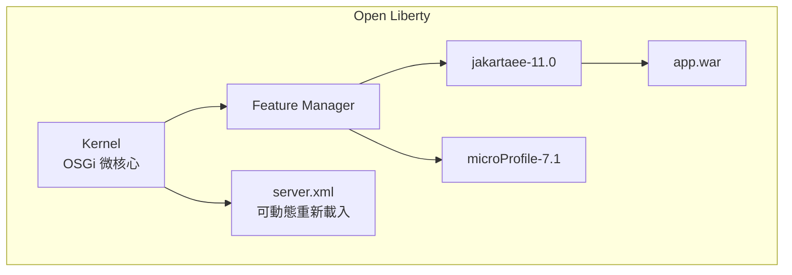

#### 驗證過的 `server.xml`

這份設定在第 22 章的整合測試中實際啟動，每一段註解都是驗證時遇到的問題：

```xml
<?xml version="1.0" encoding="UTF-8"?>
<server description="Jakarta EE 11 GA 驗證伺服器（Open Liberty 26.0.0.10）">

    <featureManager>
        <!-- 生產可改成最小集合；驗證時用 Full Platform + MicroProfile 7.1 -->
        <feature>jakartaee-11.0</feature>
        <feature>microProfile-7.1</feature>
    </featureManager>

    <!-- 變數：liberty-maven-plugin 會用 pom 的 liberty.var.* 覆寫，K8s 則用環境變數 -->
    <variable name="db.host" defaultValue="localhost"/>
    <variable name="db.port" defaultValue="5432"/>
    <variable name="db.name" defaultValue="appdb"/>
    <variable name="db.user" defaultValue="app"/>
    <variable name="db.password" defaultValue="app"/>
    <variable name="http.port" defaultValue="9080"/>

    <httpEndpoint id="defaultHttpEndpoint" host="*" httpPort="${http.port}" httpsPort="-1"/>

    <library id="jdbcLib">
        <fileset dir="${shared.resource.dir}/jdbc" includes="postgresql-*.jar"/>
    </library>

    <dataSource id="appDB" jndiName="jdbc/appDB" isolationLevel="TRANSACTION_READ_COMMITTED">
        <jdbcDriver libraryRef="jdbcLib"/>
        <properties.postgresql serverName="${db.host}" portNumber="${db.port}"
                               databaseName="${db.name}" user="${db.user}" password="${db.password}"/>
        <connectionManager maxPoolSize="20" minPoolSize="2" connectionTimeout="10s"
                           maxIdleTime="10m" agedTimeout="30m"/>
    </dataSource>

    <!--
      Jakarta Batch 的 Job Repository 放在同一個資料庫。
      createTables 只建表、不建 schema：若指定 schema="batch"，該 schema 必須事先存在，
      否則 start() 丟 "relation batch.wlpremotablepartition does not exist"（驗證時實際踩到）。
    -->
    <batchPersistence jobStoreRef="batchStore"/>
    <databaseStore id="batchStore" dataSourceRef="appDB" createTables="true" tablePrefix="JBATCH_"/>
    <!--
      啟用 appSecurity 後，Liberty 對 JobOperator 另有角色檢查（batchAdmin / batchSubmitter / batchMonitor），
      未設定時 start() 丟 JobSecurityException CWWKY0304W（驗證時實際踩到）。
      真正的授權由 BatchResource 的 @RolesAllowed("ADMIN") 把關。
    -->
    <authorization-roles id="com.ibm.ws.batch">
        <security-role name="batchAdmin">
            <special-subject type="ALL_AUTHENTICATED_USERS"/>
        </security-role>
    </authorization-roles>

    <!--
      allowInMemoryIdentityStores：Liberty 基於安全考量預設停用 @InMemoryIdentityStoreDefinition，
      未開啟時 log 出現 CWWKS1930I 且所有請求 401（驗證時實際踩到）。只限開發/測試環境開啟。
    -->
    <webAppSecurity allowFailOverToBasicAuth="false" allowInMemoryIdentityStores="true"/>

    <!--
      不寫 application-bnd：Jakarta Security 的 IdentityStore 回傳的 group 名稱
      會直接對應同名角色。若寫了 <group name="USER"/>，Liberty 會去 user registry
      查這個群組，查不到就一律 403（驗證時實際踩到）。
    -->
    <webApplication id="app" location="app-api.war" contextRoot="/"/>

    <!-- jakartaee-11.0 含遠端 EJB（ORB），ORB 需要一個 registry，否則 CWWKS9660E 會延遲啟動 -->
    <basicRegistry id="basic" realm="internal"/>

    <!-- JSON 日誌：方便 ELK/OTel Collector 解析 -->
    <logging consoleFormat="json" consoleSource="message,trace,accessLog,ffdc"
             messageFormat="json" consoleLogLevel="INFO"/>
</server>
```

驗證時踩到的 Liberty 行為（都已寫進上面的註解）：

| 現象 | 原因 | 解法 |
|------|------|------|
| 所有請求 401，log 有 `CWWKS1930I` | Liberty 預設停用 `@InMemoryIdentityStoreDefinition` | `webAppSecurity allowInMemoryIdentityStores="true"`（僅限開發/測試） |
| 認證成功但一律 403 | 寫了 `application-bnd` 的 `<group name="USER"/>`，Liberty 去 user registry 找群組 | 使用 Jakarta Security IdentityStore 時不要寫 `application-bnd`，群組名即角色名 |
| `CWWKS9660E`，App 延遲啟動 | `jakartaee-11.0` 含遠端 EJB（ORB），ORB 需要 registry | 加一個空的 `basicRegistry`，或改用不含遠端 EJB 的 feature 組合 |
| Batch `JobSecurityException CWWKY0304W` | 啟用 appSecurity 後 JobOperator 另有角色 | 設定 `authorization-roles id="com.ibm.ws.batch"` |
| Batch `relation batch.xxx does not exist` | `databaseStore schema="batch"` 不會自動建 schema | 不指定 schema，或先手動建立 |

#### 快速啟動

```bash
./mvnw liberty:dev        # 開發模式：存檔即重新部署，按 Enter 跑測試
./mvnw verify             # 建置 + 啟動 Liberty + 整合測試 + 停止
```

#### Open Liberty 優勢

- **Feature 按需載入**：只載入 `server.xml` 列出的功能，攻擊面與記憶體都較小。
- **動態設定**：修改 `server.xml` 多數項目不需重啟。
- **InstantOn**：以 CRIU 做 checkpoint/restore，縮短冷啟動（需 Linux 與特定權限，屬廠商功能）。
- **MicroProfile 支援快**：26.0.0.10 已提供 `microProfile-7.1`。
- **環境變數對應**：`server.xml` 的 `${db.host}` 會自動讀環境變數 `DB_HOST`（容器實測，見 16.1）。

### 5.2 Payara

Payara 源自 GlassFish，2025-12 被 **Azul** 收購。Payara 7（版號 `7.YYYY.M`，查核日最新 7.2026.10）支援 EE 11。

- **Payara Server**：完整 Platform，傳統部署。
- **Payara Micro**：可執行 JAR，直接啟動 WAR。

```bash
# Payara Micro 直接執行 WAR
java -jar payara-micro-7.2026.10.jar --deploy target/app.war --port 8080

# 容器映像（實際存在的 tag：7.2026.10 與 7.2026.10-jdk25）
podman run -p 8080:8080 -v ./target/app.war:/opt/payara/deployments/app.war:Z \
  docker.io/payara/micro:7.2026.10
```

> v2.0 的 `payara/micro:6.2024.12-jdk21` 是 EE 10 時代版本；Payara 7 的映像沒有 `-jdk21` 後綴的 tag（查核日 Docker Hub 只有 `7.2026.10` 與 `7.2026.10-jdk25`）。

資料來源要設定在 Server（`asadmin create-jdbc-resource` 或 `glassfish-resources.xml`），應用程式只引用 JNDI 名稱：

```xml
<!-- WEB-INF/web.xml：宣告資源參照（型別是 javax.sql.DataSource——JDBC 屬於 Java SE，從未改名） -->
<resource-ref>
    <res-ref-name>jdbc/appDB</res-ref-name>
    <res-type>javax.sql.DataSource</res-type>
</resource-ref>
```

> **常見誤解**：`javax.sql.DataSource`、`javax.naming.*` 屬於 Java SE，**不需要**改成 `jakarta.*`。Eclipse Transformer 也不會改它們。

### 5.3 WildFly

WildFly 由 Red Hat 主導（商業版為 JBoss EAP）。**WildFly 41**（2026-07）起標準版與 Preview 都實作 EE 11 Platform / Web / Core；**WildFly 42** 已發布（Maven Central `42.0.0.Final`），並計畫從 WildFly Preview 42 開始導入 EE 12 里程碑。

#### WildFly 架構特色

- **JBoss Modules**：模組化 class loading，強隔離。
- **Galleon / WildFly Glow**：分析 WAR 後只組裝需要的子系統，產生精簡 Server。
- **Domain Mode**：集中管理多台 Server。

#### 啟動方式

```bash
./bin/standalone.sh -c standalone-full.xml

# WildFly Glow：依 WAR 自動選擇 layers 並產生可執行映像
wildfly-glow scan target/app.war --provision=SERVER

# 容器（實際存在的 tag）
podman run -p 8080:8080 -p 9990:9990 quay.io/wildfly/wildfly:42.0.0.Final-jdk21
```

#### 資料來源（用 CLI，不要手改 standalone.xml）

```bash
./bin/jboss-cli.sh --connect <<'EOF'
module add --name=org.postgresql --resources=postgresql-42.7.14.jar --dependencies=javax.api,javax.transaction.api
/subsystem=datasources/jdbc-driver=postgresql:add(driver-name=postgresql,driver-module-name=org.postgresql,driver-class-name=org.postgresql.Driver)
data-source add --name=AppDS --jndi-name=java:jboss/datasources/AppDS --driver-name=postgresql \
  --connection-url=jdbc:postgresql://${env.DB_HOST:localhost}:5432/appdb \
  --user-name=${env.DB_USER} --password=${env.DB_PASSWORD} --min-pool-size=5 --max-pool-size=50
EOF
```

> **驗證狀態**：本節 WildFly 的 CLI 與 Glow 指令依官方文件撰寫，**未在本機執行**（本手冊的執行驗證只在 Open Liberty 上進行），列入附錄 C 待確認事項。

> 手改 `standalone.xml` 時，子系統 namespace 版本（例如 `urn:jboss:domain:datasources:7.x`）必須和 WildFly 版本一致，AI 常寫錯版本號。CLI 可以避開這個問題。

### 5.4 GlassFish

Eclipse GlassFish 由 Eclipse Foundation 維護，是規格的**參考相容實作**：

| 版本 | 對應 | 查核日最新 |
|------|------|-----------|
| GlassFish 8 | Jakarta EE 11 | 8.0.5 |
| GlassFish 9 | Jakarta EE 12（開發中） | 9.0.0-M3：部分 EE 12 里程碑、JDK 21 起跳 |

```bash
./bin/asadmin start-domain
./bin/asadmin deploy target/app.war

# 容器映像在 GitHub Container Registry（不是 Docker Hub 官方映像）
podman run -p 8080:8080 -p 4848:4848 ghcr.io/eclipse-ee4j/glassfish:8.0.5
```

### 5.5 主要 Server 比較表

| 比較維度 | Open Liberty | WildFly | GlassFish | Payara |
|----------|-------------|---------|-----------|--------|
| 維護者 | IBM | Red Hat | Eclipse Foundation | Azul（原 Payara Services） |
| 查核日最新（EE 11） | 26.0.0.10 | 42.0.0.Final | 8.0.5 | 7.2026.10 |
| EE 12 進度 | beta feature 陸續提供 | Preview 42 起導入里程碑 | 9.0.0-M3（預定參考實作） | 未公布 |
| MicroProfile | 7.1 | 支援（以 WildFly 文件為準） | 不內建 | 支援 |
| 快速啟動 | InstantOn（CRIU） | Glow 精簡化 | — | Payara Micro |
| Kubernetes | Liberty Operator | WildFly Operator | — | Payara Cloud（商業） |
| 商業支援 | IBM WebSphere Liberty | Red Hat JBoss EAP | 無（社群／第三方） | Azul Payara Enterprise |

> 版本、授權與支援條款變動頻繁，正式選型前請以官方發布頁為準；表格中的「EE 11」欄已在查核日逐一核對 Maven Central 或容器 registry。

### 5.6 選型建議

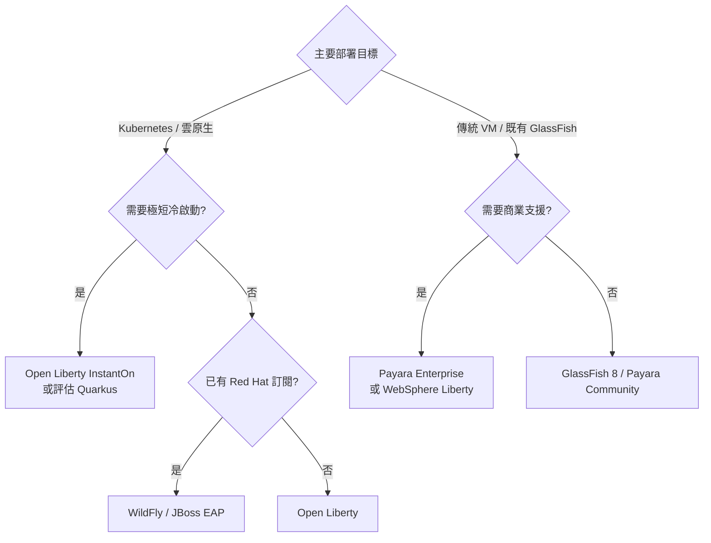

| 場景 | 推薦 | 理由 |
|------|------|------|
| 新建雲原生服務 | Open Liberty | Feature 按需、Operator、dev mode |
| Red Hat 生態客戶 | WildFly / JBoss EAP | 訂閱整合 |
| 既有 GlassFish 系統 | Payara 或 GlassFish 8 | 平滑遷移 |
| 規格行為爭議時的對照 | GlassFish | 參考實作 |
| 試驗 EE 12 新 API | GlassFish 9 M 版、WildFly Preview、Liberty beta | 僅限實驗環境 |

### 5.7 實務注意事項

> **Application Server 選型要點**
> 1. 認證狀態以 [jakarta.ee/compatibility](https://jakarta.ee/compatibility/) 為準。
> 2. 生產環境要有商業支援或明確的社群支援計畫（含 CVE 修補 SLA）。
> 3. 至少每季升級一次 Server patch（Liberty 每 4 週一個版本）。
> 4. 只用標準 API；Server 專屬設定集中在 `server.xml` / CLI 腳本，並納入版本控制。
> 5. 換 Server 前先跑同一套整合測試（第 22 章）——這是「可攜性」唯一可信的證據。

### 5.8 審查與驗證清單

| 檢查項目 | 如何驗證 | 預期結果 | 常見 AI 錯誤 |
|---------|---------|---------|-------------|
| feature 名稱存在 | 查 `io.openliberty.features/<name>` 的 maven-metadata | 有版本列表 | `jakartaee-12.0`、`cdi-5.0`（尚不存在） |
| 映像 tag 存在 | `podman manifest inspect <image:tag>` | 回傳 manifest | `payara/micro:7.x-jdk21`、`latest` |
| 機敏設定 | 檢查 `server.xml` | 帳密用 `${variable}`，預設值只限開發 | 明碼密碼、production 開 `allowInMemoryIdentityStores` |
| 啟動無錯誤 | `messages.log` 搜尋 `E:`、`CWWKZ0002E` | 只有預期的 WARNING | 忽略 ORB/registry 錯誤 |
| 容器以非 root 執行 | `podman exec <c> id` | `uid=1001` | Dockerfile 加 `USER root` 後忘了改回 |
| 規格行為差異 | 同一套 IT 在第二個 Server 執行 | 結果一致 | 依賴 RESTEasy/EclipseLink 專屬行為而不自知 |

## 6. Maven 專案建立

本章的 POM 全部取自本手冊的驗證專案 `jakarta-enterprise-app`，在 JDK 21 + Maven 3.9.9 上執行 `mvn clean verify`（含 Liberty 整合測試）通過。第 7–15 章的範例程式也都在這個專案裡。

### 6.1 Multi Module 專案架構

#### 專案模組結構

```text
jakarta-enterprise-app/
├── pom.xml                         # Parent POM（版本、BOM、Plugin 管理）
├── app-domain/                     # 純 Java：Aggregate、Value Object、Port、Domain Event
├── app-application/                # Use Case、Command/Response DTO（只依賴 CDI/JTA 註解）
├── app-infrastructure/             # JPA Entity、Repository Adapter、Jakarta Data、Batch Entity
│   └── src/main/resources/META-INF/{persistence.xml, beans.xml, seed.sql}
└── app-api/                        # WAR：REST Resource、Filter、Security、Health、Batch 作業
    ├── src/main/liberty/config/server.xml
    ├── src/main/resources/META-INF/{microprofile-config.properties, batch-jobs/}
    └── src/test/java/              # ArchUnit 單元測試 + *IT 整合測試
```

#### 模組依賴關係

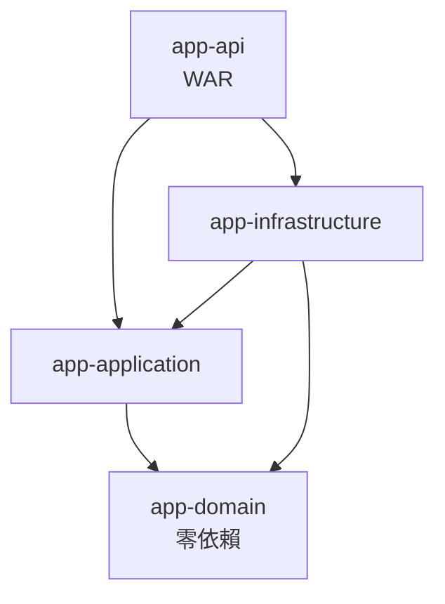

> **關鍵原則**：`app-domain` 沒有任何 `compile`/`provided` 依賴（連 `jakarta.persistence` 都沒有）。這條規則由 [22.4](#224-integration-test) 的 ArchUnit 測試自動守住。v2.0 讓 Domain 依賴 Persistence 與 Validation API，與「零外部依賴」的說法自相矛盾。

### 6.2 Parent POM 設計

```xml
<?xml version="1.0" encoding="UTF-8"?>
<project xmlns="http://maven.apache.org/POM/4.0.0"
         xmlns:xsi="http://www.w3.org/2001/XMLSchema-instance"
         xsi:schemaLocation="http://maven.apache.org/POM/4.0.0 https://maven.apache.org/xsd/maven-4.0.0.xsd">
    <modelVersion>4.0.0</modelVersion>

    <groupId>com.company.app</groupId>
    <artifactId>jakarta-enterprise-app</artifactId>
    <version>1.0.0-SNAPSHOT</version>
    <packaging>pom</packaging>
    <name>Jakarta EE Enterprise Application</name>

    <modules>
        <module>app-domain</module>
        <module>app-application</module>
        <module>app-infrastructure</module>
        <module>app-api</module>
    </modules>

    <properties>
        <!-- Java：Jakarta EE 12 最低 21；EE 11 GA 執行環境同樣以 21 為基準 -->
        <maven.compiler.release>21</maven.compiler.release>
        <project.build.sourceEncoding>UTF-8</project.build.sourceEncoding>
        <project.reporting.outputEncoding>UTF-8</project.reporting.outputEncoding>

        <!-- 平台：生產用 EE 11 GA；EE 12 GA 後只改這一行並重跑全部測試 -->
        <jakarta.ee.version>11.0.0</jakarta.ee.version>

        <!-- MicroProfile 7.1（逐一宣告 API，不 import microprofile BOM，原因見 6.4） -->
        <mp-config.version>3.1</mp-config.version>
        <mp-health.version>4.0.1</mp-health.version>
        <mp-ft.version>4.1</mp-ft.version>
        <mp-openapi.version>4.1</mp-openapi.version>
        <mp-rest-client.version>4.0</mp-rest-client.version>
        <mp-jwt.version>2.1</mp-jwt.version>

        <!-- 測試 -->
        <junit.version>6.1.3</junit.version>
        <mockito.version>5.24.0</mockito.version>
        <archunit.version>1.5.1</archunit.version>
        <rest-assured.version>6.3.0</rest-assured.version>

        <!-- 資料庫 -->
        <postgresql.version>42.7.14</postgresql.version>

        <!-- Plugins -->
        <maven-compiler-plugin.version>3.15.0</maven-compiler-plugin.version>
        <maven-surefire-plugin.version>3.5.6</maven-surefire-plugin.version>
        <maven-failsafe-plugin.version>3.5.6</maven-failsafe-plugin.version>
        <maven-war-plugin.version>3.5.1</maven-war-plugin.version>
        <liberty-maven-plugin.version>3.12.4</liberty-maven-plugin.version>
        <jacoco-plugin.version>0.8.16</jacoco-plugin.version>
        <dependency-check.version>13.0.0</dependency-check.version>
        <cyclonedx.version>2.9.3</cyclonedx.version>
    </properties>

    <dependencyManagement>
        <dependencies>
            <!-- Jakarta EE BOM：統一所有 jakarta.* API 版本 -->
            <dependency>
                <groupId>jakarta.platform</groupId>
                <artifactId>jakarta.jakartaee-bom</artifactId>
                <version>${jakarta.ee.version}</version>
                <type>pom</type>
                <scope>import</scope>
            </dependency>
            <!-- BOM 只管「元件 API」；三個 Profile 的 umbrella API 必須另外指定版本 -->
            <dependency>
                <groupId>jakarta.platform</groupId>
                <artifactId>jakarta.jakartaee-api</artifactId>
                <version>${jakarta.ee.version}</version>
            </dependency>
            <dependency>
                <groupId>jakarta.platform</groupId>
                <artifactId>jakarta.jakartaee-web-api</artifactId>
                <version>${jakarta.ee.version}</version>
            </dependency>
            <dependency>
                <groupId>jakarta.platform</groupId>
                <artifactId>jakarta.jakartaee-core-api</artifactId>
                <version>${jakarta.ee.version}</version>
            </dependency>
            <dependency>
                <groupId>org.junit</groupId>
                <artifactId>junit-bom</artifactId>
                <version>${junit.version}</version>
                <type>pom</type>
                <scope>import</scope>
            </dependency>

            <!-- 內部模組 -->
            <dependency>
                <groupId>${project.groupId}</groupId>
                <artifactId>app-domain</artifactId>
                <version>${project.version}</version>
            </dependency>
            <dependency>
                <groupId>${project.groupId}</groupId>
                <artifactId>app-application</artifactId>
                <version>${project.version}</version>
            </dependency>
            <dependency>
                <groupId>${project.groupId}</groupId>
                <artifactId>app-infrastructure</artifactId>
                <version>${project.version}</version>
            </dependency>

            <!-- MicroProfile API（provided：由 Server 提供） -->
            <dependency>
                <groupId>org.eclipse.microprofile.config</groupId>
                <artifactId>microprofile-config-api</artifactId>
                <version>${mp-config.version}</version>
            </dependency>
            <dependency>
                <groupId>org.eclipse.microprofile.health</groupId>
                <artifactId>microprofile-health-api</artifactId>
                <version>${mp-health.version}</version>
            </dependency>
            <dependency>
                <groupId>org.eclipse.microprofile.fault-tolerance</groupId>
                <artifactId>microprofile-fault-tolerance-api</artifactId>
                <version>${mp-ft.version}</version>
            </dependency>
            <dependency>
                <groupId>org.eclipse.microprofile.openapi</groupId>
                <artifactId>microprofile-openapi-api</artifactId>
                <version>${mp-openapi.version}</version>
            </dependency>
            <dependency>
                <groupId>org.eclipse.microprofile.rest.client</groupId>
                <artifactId>microprofile-rest-client-api</artifactId>
                <version>${mp-rest-client.version}</version>
            </dependency>
            <dependency>
                <groupId>org.eclipse.microprofile.jwt</groupId>
                <artifactId>microprofile-jwt-auth-api</artifactId>
                <version>${mp-jwt.version}</version>
            </dependency>

            <dependency>
                <groupId>org.postgresql</groupId>
                <artifactId>postgresql</artifactId>
                <version>${postgresql.version}</version>
            </dependency>
            <dependency>
                <groupId>org.mockito</groupId>
                <artifactId>mockito-junit-jupiter</artifactId>
                <version>${mockito.version}</version>
            </dependency>
            <dependency>
                <groupId>com.tngtech.archunit</groupId>
                <artifactId>archunit-junit5</artifactId>
                <version>${archunit.version}</version>
            </dependency>
            <dependency>
                <groupId>io.rest-assured</groupId>
                <artifactId>rest-assured</artifactId>
                <version>${rest-assured.version}</version>
            </dependency>
        </dependencies>
    </dependencyManagement>

    <!-- 所有模組共用：只放測試依賴；jakarta API 由各模組依需要宣告 -->
    <dependencies>
        <dependency>
            <groupId>org.junit.jupiter</groupId>
            <artifactId>junit-jupiter</artifactId>
            <scope>test</scope>
        </dependency>
        <dependency>
            <groupId>org.mockito</groupId>
            <artifactId>mockito-junit-jupiter</artifactId>
            <scope>test</scope>
        </dependency>
    </dependencies>

    <build>
        <pluginManagement>
            <plugins>
                <plugin>
                    <groupId>org.apache.maven.plugins</groupId>
                    <artifactId>maven-compiler-plugin</artifactId>
                    <version>${maven-compiler-plugin.version}</version>
                    <configuration>
                        <release>${maven.compiler.release}</release>
                        <compilerArgs>
                            <!-- JAX-RS/CDI 反射取得參數名稱時需要 -->
                            <arg>-parameters</arg>
                            <arg>-Xlint:all,-processing,-serial</arg>
                        </compilerArgs>
                    </configuration>
                </plugin>
                <plugin>
                    <groupId>org.apache.maven.plugins</groupId>
                    <artifactId>maven-surefire-plugin</artifactId>
                    <version>${maven-surefire-plugin.version}</version>
                </plugin>
                <plugin>
                    <groupId>org.apache.maven.plugins</groupId>
                    <artifactId>maven-failsafe-plugin</artifactId>
                    <version>${maven-failsafe-plugin.version}</version>
                </plugin>
                <plugin>
                    <groupId>org.apache.maven.plugins</groupId>
                    <artifactId>maven-war-plugin</artifactId>
                    <version>${maven-war-plugin.version}</version>
                </plugin>
                <plugin>
                    <groupId>io.openliberty.tools</groupId>
                    <artifactId>liberty-maven-plugin</artifactId>
                    <version>${liberty-maven-plugin.version}</version>
                </plugin>
                <plugin>
                    <groupId>org.jacoco</groupId>
                    <artifactId>jacoco-maven-plugin</artifactId>
                    <version>${jacoco-plugin.version}</version>
                </plugin>
                <plugin>
                    <groupId>org.cyclonedx</groupId>
                    <artifactId>cyclonedx-maven-plugin</artifactId>
                    <version>${cyclonedx.version}</version>
                </plugin>
                <plugin>
                    <groupId>org.owasp</groupId>
                    <artifactId>dependency-check-maven</artifactId>
                    <version>${dependency-check.version}</version>
                </plugin>
            </plugins>
        </pluginManagement>

        <plugins>
            <plugin>
                <groupId>org.jacoco</groupId>
                <artifactId>jacoco-maven-plugin</artifactId>
                <executions>
                    <execution>
                        <goals>
                            <goal>prepare-agent</goal>
                        </goals>
                    </execution>
                    <execution>
                        <id>report</id>
                        <phase>verify</phase>
                        <goals>
                            <goal>report</goal>
                        </goals>
                    </execution>
                </executions>
            </plugin>
        </plugins>
    </build>

    <profiles>
        <!-- 供應鏈：mvn -Psecurity verify -->
        <profile>
            <id>security</id>
            <build>
                <plugins>
                    <plugin>
                        <groupId>org.owasp</groupId>
                        <artifactId>dependency-check-maven</artifactId>
                        <configuration>
                            <failBuildOnCVSS>7</failBuildOnCVSS>
                            <nvdApiKeyEnvironmentVariable>NVD_API_KEY</nvdApiKeyEnvironmentVariable>
                        </configuration>
                        <executions>
                            <execution>
                                <goals>
                                    <goal>aggregate</goal>
                                </goals>
                            </execution>
                        </executions>
                    </plugin>
                </plugins>
            </build>
        </profile>
        <!-- SBOM：mvn -Psbom package，輸出 target/bom.json -->
        <profile>
            <id>sbom</id>
            <build>
                <plugins>
                    <plugin>
                        <groupId>org.cyclonedx</groupId>
                        <artifactId>cyclonedx-maven-plugin</artifactId>
                        <configuration>
                            <projectType>application</projectType>
                            <outputFormat>json</outputFormat>
                            <includeTestScope>false</includeTestScope>
                        </configuration>
                        <executions>
                            <execution>
                                <phase>package</phase>
                                <goals>
                                    <goal>makeAggregateBom</goal>
                                </goals>
                            </execution>
                        </executions>
                    </plugin>
                </plugins>
            </build>
        </profile>
    </profiles>
</project>
```

設計重點：

| 項目 | 做法 | 理由 |
|------|------|------|
| 平台版本 | `jakarta.ee.version=11.0.0` 一個屬性 | EE 12 GA 後只改這一行，重跑全部測試 |
| `maven.compiler.release` | 21 | 用 `--release` 而非 source/target，確保不誤用新版 JDK API |
| umbrella API 版本 | 在 `dependencyManagement` 明列 `jakartaee-api / web-api / core-api` | **BOM 不管理它們**（實測，見 6.4） |
| MicroProfile | 逐一宣告 API 版本 | **不要 import `microprofile` BOM**（實測，見 6.4） |
| 測試依賴 | Parent 只放 JUnit 6 + Mockito | 其他依賴由各模組明確宣告 |
| 安全掃描 / SBOM | 放在 `security`、`sbom` profile | 不拖慢日常建置；CI 每次都跑（第 18 章） |

### 6.3 各層模組 POM

#### app-domain/pom.xml（零依賴）

```xml
<?xml version="1.0" encoding="UTF-8"?>
<project xmlns="http://maven.apache.org/POM/4.0.0"
         xmlns:xsi="http://www.w3.org/2001/XMLSchema-instance"
         xsi:schemaLocation="http://maven.apache.org/POM/4.0.0 https://maven.apache.org/xsd/maven-4.0.0.xsd">
    <modelVersion>4.0.0</modelVersion>

    <parent>
        <groupId>com.company.app</groupId>
        <artifactId>jakarta-enterprise-app</artifactId>
        <version>1.0.0-SNAPSHOT</version>
    </parent>

    <artifactId>app-domain</artifactId>
    <name>Domain Layer</name>
    <description>核心業務邏輯：純 Java，不依賴任何框架或 jakarta.* API</description>

    <!-- 刻意沒有任何 compile/provided 依賴；ArchUnit 會在 app-api 測試中守住這條規則 -->
</project>
```

#### app-application/pom.xml（只用 CDI 與 JTA 註解）

```xml
<?xml version="1.0" encoding="UTF-8"?>
<project xmlns="http://maven.apache.org/POM/4.0.0"
         xmlns:xsi="http://www.w3.org/2001/XMLSchema-instance"
         xsi:schemaLocation="http://maven.apache.org/POM/4.0.0 https://maven.apache.org/xsd/maven-4.0.0.xsd">
    <modelVersion>4.0.0</modelVersion>

    <parent>
        <groupId>com.company.app</groupId>
        <artifactId>jakarta-enterprise-app</artifactId>
        <version>1.0.0-SNAPSHOT</version>
    </parent>

    <artifactId>app-application</artifactId>
    <name>Application Layer</name>

    <dependencies>
        <dependency>
            <groupId>${project.groupId}</groupId>
            <artifactId>app-domain</artifactId>
        </dependency>
        <!-- 只用到 CDI 與 Transactions 的註解；版本由 jakartaee-bom 決定 -->
        <dependency>
            <groupId>jakarta.enterprise</groupId>
            <artifactId>jakarta.enterprise.cdi-api</artifactId>
            <scope>provided</scope>
        </dependency>
        <dependency>
            <groupId>jakarta.transaction</groupId>
            <artifactId>jakarta.transaction-api</artifactId>
            <scope>provided</scope>
        </dependency>
    </dependencies>
</project>
```

#### app-infrastructure/pom.xml

```xml
<?xml version="1.0" encoding="UTF-8"?>
<project xmlns="http://maven.apache.org/POM/4.0.0"
         xmlns:xsi="http://www.w3.org/2001/XMLSchema-instance"
         xsi:schemaLocation="http://maven.apache.org/POM/4.0.0 https://maven.apache.org/xsd/maven-4.0.0.xsd">
    <modelVersion>4.0.0</modelVersion>

    <parent>
        <groupId>com.company.app</groupId>
        <artifactId>jakarta-enterprise-app</artifactId>
        <version>1.0.0-SNAPSHOT</version>
    </parent>

    <artifactId>app-infrastructure</artifactId>
    <name>Infrastructure Layer</name>

    <dependencies>
        <dependency>
            <groupId>${project.groupId}</groupId>
            <artifactId>app-domain</artifactId>
        </dependency>
        <dependency>
            <groupId>${project.groupId}</groupId>
            <artifactId>app-application</artifactId>
        </dependency>
        <!-- Web Profile API 已含 CDI/JPA/JTA/Data；由 Server 提供 -->
        <dependency>
            <groupId>jakarta.platform</groupId>
            <artifactId>jakarta.jakartaee-web-api</artifactId>
            <scope>provided</scope>
        </dependency>
    </dependencies>
</project>
```

#### app-api/pom.xml（WAR + Liberty + 整合測試）

```xml
<?xml version="1.0" encoding="UTF-8"?>
<project xmlns="http://maven.apache.org/POM/4.0.0"
         xmlns:xsi="http://www.w3.org/2001/XMLSchema-instance"
         xsi:schemaLocation="http://maven.apache.org/POM/4.0.0 https://maven.apache.org/xsd/maven-4.0.0.xsd">
    <modelVersion>4.0.0</modelVersion>

    <parent>
        <groupId>com.company.app</groupId>
        <artifactId>jakarta-enterprise-app</artifactId>
        <version>1.0.0-SNAPSHOT</version>
    </parent>

    <artifactId>app-api</artifactId>
    <packaging>war</packaging>
    <name>API Layer</name>

    <properties>
        <!-- 整合測試連線資訊：預設對應 podman 啟動的 PostgreSQL（見 A.2） -->
        <liberty.var.db.host>localhost</liberty.var.db.host>
        <liberty.var.db.port>15432</liberty.var.db.port>
        <liberty.var.http.port>9080</liberty.var.http.port>
        <openliberty.version>26.0.0.10</openliberty.version>
    </properties>

    <dependencies>
        <dependency>
            <groupId>${project.groupId}</groupId>
            <artifactId>app-application</artifactId>
        </dependency>
        <dependency>
            <groupId>${project.groupId}</groupId>
            <artifactId>app-infrastructure</artifactId>
        </dependency>

        <!-- Full Platform API（含 Batch）；provided = 不打包進 WAR -->
        <dependency>
            <groupId>jakarta.platform</groupId>
            <artifactId>jakarta.jakartaee-api</artifactId>
            <scope>provided</scope>
        </dependency>
        <dependency>
            <groupId>org.eclipse.microprofile.config</groupId>
            <artifactId>microprofile-config-api</artifactId>
            <scope>provided</scope>
        </dependency>
        <dependency>
            <groupId>org.eclipse.microprofile.health</groupId>
            <artifactId>microprofile-health-api</artifactId>
            <scope>provided</scope>
        </dependency>
        <dependency>
            <groupId>org.eclipse.microprofile.fault-tolerance</groupId>
            <artifactId>microprofile-fault-tolerance-api</artifactId>
            <scope>provided</scope>
        </dependency>
        <dependency>
            <groupId>org.eclipse.microprofile.openapi</groupId>
            <artifactId>microprofile-openapi-api</artifactId>
            <scope>provided</scope>
        </dependency>

        <!-- 測試 -->
        <dependency>
            <groupId>io.rest-assured</groupId>
            <artifactId>rest-assured</artifactId>
            <scope>test</scope>
        </dependency>
        <dependency>
            <groupId>com.tngtech.archunit</groupId>
            <artifactId>archunit-junit5</artifactId>
            <scope>test</scope>
        </dependency>
        <!-- JDBC Driver：只給 Liberty 用（copyDependencies），不進 WAR -->
        <dependency>
            <groupId>org.postgresql</groupId>
            <artifactId>postgresql</artifactId>
            <scope>provided</scope>
        </dependency>
    </dependencies>

    <build>
        <finalName>${project.artifactId}</finalName>
        <plugins>
            <plugin>
                <groupId>org.apache.maven.plugins</groupId>
                <artifactId>maven-war-plugin</artifactId>
                <configuration>
                    <failOnMissingWebXml>false</failOnMissingWebXml>
                </configuration>
            </plugin>

            <!-- Open Liberty：mvn liberty:dev 開發；mvn verify 時自動起停 Server 跑整合測試 -->
            <plugin>
                <groupId>io.openliberty.tools</groupId>
                <artifactId>liberty-maven-plugin</artifactId>
                <configuration>
                    <runtimeArtifact>
                        <groupId>io.openliberty</groupId>
                        <artifactId>openliberty-runtime</artifactId>
                        <version>${openliberty.version}</version>
                        <type>zip</type>
                    </runtimeArtifact>
                    <serverName>defaultServer</serverName>
                    <!-- 等應用程式真正啟動（CWWKZ0001I）才開始跑 IT；預設 30 秒在首次建表時不夠 -->
                    <verifyAppStartTimeout>180</verifyAppStartTimeout>
                    <copyDependencies>
                        <location>${project.build.directory}/liberty/wlp/usr/shared/resources/jdbc</location>
                        <dependency>
                            <groupId>org.postgresql</groupId>
                            <artifactId>postgresql</artifactId>
                        </dependency>
                    </copyDependencies>
                </configuration>
                <executions>
                    <execution>
                        <id>start-liberty</id>
                        <phase>pre-integration-test</phase>
                        <goals>
                            <goal>create</goal>
                            <goal>install-feature</goal>
                            <goal>deploy</goal>
                            <goal>start</goal>
                        </goals>
                    </execution>
                    <execution>
                        <id>stop-liberty</id>
                        <phase>post-integration-test</phase>
                        <goals>
                            <goal>stop</goal>
                        </goals>
                    </execution>
                </executions>
            </plugin>

            <plugin>
                <groupId>org.apache.maven.plugins</groupId>
                <artifactId>maven-failsafe-plugin</artifactId>
                <configuration>
                    <systemPropertyVariables>
                        <app.base-uri>http://localhost:${liberty.var.http.port}</app.base-uri>
                    </systemPropertyVariables>
                </configuration>
                <executions>
                    <execution>
                        <goals>
                            <goal>integration-test</goal>
                            <goal>verify</goal>
                        </goals>
                    </execution>
                </executions>
            </plugin>
        </plugins>
    </build>
</project>
```

`liberty-maven-plugin` 綁在 `pre-integration-test`（建立、安裝 feature、部署、啟動）與 `post-integration-test`（停止），所以 `mvn verify` 會自動完成「啟動 Server → 跑 `*IT` → 停止 Server」。`verifyAppStartTimeout` 是驗證時加上的：第一次啟動要建表與初始化 Jakarta Data，預設等待時間不夠。

### 6.4 dependencyManagement 與 pluginManagement

#### 關鍵設計原則

| 原則 | 說明 |
|------|------|
| BOM import | `jakarta.jakartaee-bom` 統一**元件 API**（cdi-api、persistence-api…）版本 |
| umbrella API 另列 | `jakartaee-api`、`jakartaee-web-api`、`jakartaee-core-api` **不在 BOM 裡**，必須自行指定版本 |
| Scope | 所有 Server 提供的 API 一律 `provided`，不打包進 WAR |
| JDBC Driver | `provided` + `liberty-maven-plugin` 的 `copyDependencies` 放到 Server 共用目錄 |
| Plugin 版本 | 全部在 `pluginManagement` 固定，子模組只引用 |

#### 實測陷阱 1：BOM 不管理 umbrella API

`jakarta.jakartaee-bom:11.0.0` 只列出 31 個元件 API（從 activation 到 ws.rs）。若子模組這樣寫：

```xml
<dependency>
    <groupId>jakarta.platform</groupId>
    <artifactId>jakarta.jakartaee-web-api</artifactId>
    <scope>provided</scope>
</dependency>
```

而 Parent 沒有另外管理版本，建置會失敗：`'dependencies.dependency.version' for jakarta.platform:jakarta.jakartaee-web-api:jar is missing`。

#### 實測陷阱 2：MicroProfile BOM 會「靜默降版」

`org.eclipse.microprofile:microprofile:7.1` 的 POM 在 `dependencyManagement` 中管理 `jakarta.jakartaee-core-api:10.0.0`。同時 import 兩個 BOM、又不寫 core-api 版本時，Maven **不報錯**，而是解析成 EE 10：

```text
$ mvn dependency:tree   # 同時 import jakartaee-bom:11.0.0 與 microprofile:7.1；jakartaee-core-api 未寫版本
x:bom-trap:jar:1
\- jakarta.platform:jakarta.jakartaee-core-api:jar:10.0.0:provided
   +- jakarta.ws.rs:jakarta.ws.rs-api:jar:4.0.0:provided
   +- jakarta.json:jakarta.json-api:jar:2.1.3:provided
   +- jakarta.json.bind:jakarta.json.bind-api:jar:3.0.1:provided
   +- jakarta.enterprise:jakarta.enterprise.cdi-api:jar:4.1.0:provided
```

這就是 6.2 選擇「逐一宣告 MicroProfile API」的原因。本專案實際解析結果：

```text
$ mvn -pl app-api dependency:tree -Dincludes=jakarta.platform,org.eclipse.microprofile.*
com.company.app:app-api:war:1.0.0-SNAPSHOT
+- jakarta.platform:jakarta.jakartaee-api:jar:11.0.0:provided
|  +- jakarta.platform:jakarta.jakartaee-web-api:jar:11.0.0:provided
+- org.eclipse.microprofile.config:microprofile-config-api:jar:3.1:provided
+- org.eclipse.microprofile.health:microprofile-health-api:jar:4.0.1:provided
+- org.eclipse.microprofile.fault-tolerance:microprofile-fault-tolerance-api:jar:4.1:provided
```

### 6.5 Maven Archetype 與常用指令

團隊可以把本章的多模組結構做成內部 archetype（`mvn archetype:create-from-project`），新專案一律從它產生。

```bash
./mvnw clean verify                 # 單元測試 + ArchUnit + Liberty 整合測試
./mvnw -pl app-api liberty:dev      # 開發模式（熱部署）
./mvnw -Psbom -DskipTests package   # 產生 target/bom.json（CycloneDX）
./mvnw -Psecurity verify            # OWASP Dependency-Check（需 NVD_API_KEY）
./mvnw -pl app-api -am verify       # 只建 app-api 與它依賴的模組
```

### 6.6 實務注意事項

> **Maven 專案管理要點**
> 1. 平台版本只出現一次（`jakarta.ee.version`）。
> 2. `jakartaee-bom` 之外，umbrella API 要另列版本。
> 3. 不要同時 import `microprofile` BOM 與 `jakartaee-bom`。
> 4. Server 提供的 API 一律 `provided`；在 WAR 的 `WEB-INF/lib/` 看到 `jakarta.*.jar` 就是錯的（`jar tf target/app-api.war | grep WEB-INF/lib/`）。
> 5. `-parameters` 編譯參數保留方法參數名稱，部分框架依賴它。
> 6. 提交 Maven Wrapper；CI 一律用 `./mvnw`。

### 6.7 審查與驗證清單

| 檢查項目 | 如何驗證 | 預期結果 | 常見 AI 錯誤 |
|---------|---------|---------|-------------|
| 平台版本存在 | 查 Maven Central `jakarta.platform/jakarta.jakartaee-bom` | 版本號存在（目前最新 GA 為 11.0.0） | 寫 `12.0.0` |
| umbrella API 有版本 | `./mvnw validate` | BUILD SUCCESS | 依賴 web-api 卻只 import BOM |
| 沒有混入舊平台 API | `./mvnw dependency:tree \| grep jakartaee-core-api` | 版本與平台一致 | import microprofile BOM 導致 10.0.0 |
| WAR 不含 API JAR | `jar tf app-api/target/app-api.war \| grep "WEB-INF/lib/"` | 只有 `app-domain`、`app-application`、`app-infrastructure` 三個 JAR（實測） | API 用 compile scope |
| Domain 零依賴 | `./mvnw -pl app-domain dependency:tree` | 只有 test scope | Domain 依賴 jakarta.persistence |
| Plugin 版本固定 | `./mvnw help:effective-pom` 搜尋 `<plugin>` | 每個 plugin 都有版本 | 省略版本，依 Maven 內建預設 |

## 7. Clean Architecture

本章規則：**依賴只能由外向內**（API → Application → Domain；Infrastructure 實作 Domain/Application 定義的 Port）。每條規則都附上驗證專案中的實際程式碼，並由 ArchUnit 測試自動檢查（22.4）。

### 7.1 Domain Driven Design（DDD）

DDD 的戰略設計決定「怎麼切系統」，戰術設計決定「一個 Bounded Context 裡的程式怎麼寫」。本章範例全部來自驗證專案。

#### DDD 戰略設計

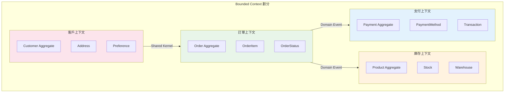

#### DDD 戰術設計元素對應

| DDD 概念 | 本手冊的實作 | 所在模組 |
|----------|-------------|---------|
| Aggregate Root | 純 Java 類別 `Order`（私有建構子 + 工廠方法） | app-domain |
| Value Object | Java Record（`OrderId`、`OrderItem`），compact constructor 驗證 | app-domain |
| Repository（Port） | `OrderRepository` 介面，只用 Domain 型別 | app-domain |
| Repository（Adapter） | `JpaOrderRepository`（EntityManager）或 Jakarta Data 介面 | app-infrastructure |
| 持久化模型 | JPA `@Entity`（`OrderEntity`），含 `@Version` | app-infrastructure |
| Domain Event | Record `OrderCreatedEvent`，以 CDI `Event<T>` 發布 | app-domain / app-application |
| Application Service | `@ApplicationScoped` + `@Transactional` 的 Use Case 實作 | app-application |
| Factory | `Order.create(...)`；技術物件用 CDI `@Produces` | app-domain / app-infrastructure |

> **為什麼 Domain Model 與 JPA Entity 分開？** JPA 要求無參數建構子、可變欄位與代理（proxy），這和 Aggregate 的不變式保護互相衝突。分開後多一個 Mapper，但 Domain 可以在沒有容器的情況下用 JUnit 測試（`OrderTest` 執行時間 0.3 秒）。小型 CRUD 系統可以合併，但要在 ADR 中記錄這個取捨。

### 7.2 Hexagonal Architecture

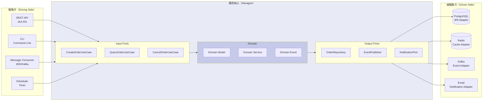

### 7.3 Clean Architecture 原則

#### 依賴方向：由外向內

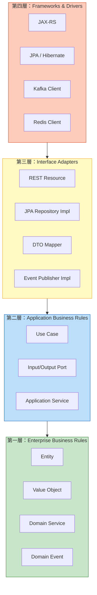

### 7.4 Ports and Adapters

#### Aggregate Root（Domain，純 Java）

規則：狀態只能透過 Aggregate 的方法改變；建構時就檢查不變式。

```java
package com.company.app.domain.model.order;

import com.company.app.domain.exception.DomainException;
import com.company.app.domain.model.customer.CustomerId;

import java.math.BigDecimal;
import java.util.ArrayList;
import java.util.List;
import java.util.Objects;

/**
 * Aggregate Root：所有狀態變更都必須經過這裡的方法，外部不得直接改欄位。
 */
public final class Order {

    private final OrderId id;
    private final CustomerId customerId;
    private final List<OrderItem> items;
    private OrderStatus status;
    private final long version;

    private Order(OrderId id, CustomerId customerId, List<OrderItem> items,
                  OrderStatus status, long version) {
        this.id = Objects.requireNonNull(id, "id");
        this.customerId = Objects.requireNonNull(customerId, "customerId");
        if (items == null || items.isEmpty()) {
            throw new DomainException("ORDER_EMPTY", "訂單至少要有一個項目");
        }
        this.items = new ArrayList<>(items);
        this.status = Objects.requireNonNull(status, "status");
        this.version = version;
    }

    /** 建立新訂單（尚未持久化）。 */
    public static Order create(CustomerId customerId, List<OrderItem> items) {
        return new Order(OrderId.newId(), customerId, items, OrderStatus.PENDING, 0L);
    }

    /** 由持久層重建（不重新驗證業務流程，只驗證不變式）。 */
    public static Order restore(OrderId id, CustomerId customerId, List<OrderItem> items,
                                OrderStatus status, long version) {
        return new Order(id, customerId, items, status, version);
    }

    public void cancel() {
        if (status == OrderStatus.SHIPPED || status == OrderStatus.CANCELLED) {
            throw new DomainException("ORDER_NOT_CANCELLABLE",
                    "訂單狀態 " + status + " 不可取消");
        }
        status = OrderStatus.CANCELLED;
    }

    public BigDecimal totalAmount() {
        return items.stream()
                .map(OrderItem::subtotal)
                .reduce(BigDecimal.ZERO, BigDecimal::add);
    }

    public OrderId id() { return id; }
    public CustomerId customerId() { return customerId; }
    public List<OrderItem> items() { return List.copyOf(items); }
    public OrderStatus status() { return status; }
    public long version() { return version; }
}
```

Value Object 用 Record，建構失敗就不可能存在無效物件：

```java
package com.company.app.domain.model.order;

import com.company.app.domain.exception.DomainException;

import java.math.BigDecimal;
import java.util.Objects;

/** Value Object：不可變，建構時即驗證。 */
public record OrderItem(String productId, int quantity, BigDecimal unitPrice) {

    public OrderItem {
        Objects.requireNonNull(productId, "productId");
        Objects.requireNonNull(unitPrice, "unitPrice");
        if (quantity <= 0) {
            throw new DomainException("ITEM_QTY", "數量必須大於 0");
        }
        if (unitPrice.signum() < 0) {
            throw new DomainException("ITEM_PRICE", "單價不可為負");
        }
    }

    public BigDecimal subtotal() {
        return unitPrice.multiply(BigDecimal.valueOf(quantity));
    }
}
```

#### Output Port（Domain 定義需要什麼）

```java
package com.company.app.domain.repository;

import com.company.app.domain.model.customer.CustomerId;
import com.company.app.domain.model.order.Order;
import com.company.app.domain.model.order.OrderId;

import java.util.List;
import java.util.Optional;

/**
 * Output Port：由 Domain 定義需要什麼，Infrastructure 決定怎麼做。
 * 介面上不得出現 EntityManager、JPA Entity 或任何 jakarta.* 型別。
 */
public interface OrderRepository {

    Optional<Order> findById(OrderId id);

    Order save(Order order);

    List<Order> findByCustomerId(CustomerId customerId);
}
```

#### Input Port（Use Case 介面）與 Command

```java
package com.company.app.application.usecase;

import com.company.app.application.dto.CreateOrderCommand;
import com.company.app.domain.model.order.OrderId;

/** Input Port：API 層只認得這個介面，不認得實作類別。 */
public interface CreateOrderUseCase {

    OrderId execute(CreateOrderCommand command);
}
```

```java
package com.company.app.application.dto;

import com.company.app.domain.model.customer.CustomerId;

import java.util.List;
import java.util.Objects;

/** Command：Use Case 的輸入，不含任何 HTTP 或 JSON 細節。 */
public record CreateOrderCommand(CustomerId customerId, List<OrderItemCommand> items) {

    public CreateOrderCommand {
        Objects.requireNonNull(customerId, "customerId 不可為 null");
        if (items == null || items.isEmpty()) {
            throw new IllegalArgumentException("訂單項目不可為空");
        }
        items = List.copyOf(items);
    }

    public record OrderItemCommand(String productId, int quantity) {
    }
}
```

注意 Command 裡沒有單價：價格由後端查詢（`InventoryPort.priceOf`），不信任前端傳入的金額。

#### Adapter 實作（Infrastructure）

```java
package com.company.app.infrastructure.persistence.repository;

import com.company.app.domain.model.customer.CustomerId;
import com.company.app.domain.model.order.Order;
import com.company.app.domain.model.order.OrderId;
import com.company.app.domain.repository.OrderRepository;
import com.company.app.infrastructure.persistence.entity.OrderEntity;
import com.company.app.infrastructure.persistence.mapper.OrderMapper;
import jakarta.enterprise.context.ApplicationScoped;
import jakarta.persistence.EntityManager;
import jakarta.persistence.PersistenceContext;

import java.util.List;
import java.util.Optional;

/**
 * Output Adapter：唯一知道 EntityManager 的地方。
 * 不在這裡加 @Transactional——交易邊界由 Use Case 決定（MANDATORY 由呼叫端保證）。
 */
@ApplicationScoped
public class JpaOrderRepository implements OrderRepository {

    @PersistenceContext(unitName = "appPU")
    private EntityManager em;

    @Override
    public Optional<Order> findById(OrderId id) {
        // Entity Graph 一次把 items 抓回來，避免 toDomain() 時觸發 N+1
        return em.createQuery("SELECT o FROM OrderEntity o WHERE o.id = :id", OrderEntity.class)
                .setParameter("id", id.value())
                .setHint("jakarta.persistence.fetchgraph", em.getEntityGraph("Order.withItems"))
                .getResultStream()
                .findFirst()
                .map(OrderMapper::toDomain);
    }

    @Override
    public Order save(Order order) {
        OrderEntity existing = em.find(OrderEntity.class, order.id().value());
        if (existing == null) {
            OrderEntity created = OrderMapper.toNewEntity(order);
            em.persist(created);
            return order;
        }
        if (existing.getVersion() != order.version()) {
            // Domain 拿到的是舊版本 → 明確拒絕，而不是默默覆蓋
            throw new jakarta.persistence.OptimisticLockException("訂單已被其他交易修改: " + order.id().value());
        }
        existing.setStatus(order.status());
        return order;
    }

    @Override
    public List<Order> findByCustomerId(CustomerId customerId) {
        return em.createQuery(
                        "SELECT DISTINCT o FROM OrderEntity o LEFT JOIN FETCH o.items "
                                + "WHERE o.customerId = :cid ORDER BY o.createdAt DESC", OrderEntity.class)
                .setParameter("cid", customerId.value())
                .getResultList()
                .stream()
                .map(OrderMapper::toDomain)
                .toList();
    }
}
```

```java
package com.company.app.infrastructure.persistence.mapper;

import com.company.app.domain.model.customer.CustomerId;
import com.company.app.domain.model.order.Order;
import com.company.app.domain.model.order.OrderId;
import com.company.app.domain.model.order.OrderItem;
import com.company.app.infrastructure.persistence.entity.OrderEntity;
import com.company.app.infrastructure.persistence.entity.OrderItemEntity;

/** Domain Model ↔ JPA Entity 的唯一轉換點。 */
public final class OrderMapper {

    private OrderMapper() {
    }

    public static Order toDomain(OrderEntity e) {
        return Order.restore(new OrderId(e.getId()), new CustomerId(e.getCustomerId()),
                e.getItems().stream()
                        .map(i -> new OrderItem(i.getProductId(), i.getQuantity(), i.getUnitPrice()))
                        .toList(),
                e.getStatus(), e.getVersion());
    }

    public static OrderEntity toNewEntity(Order order) {
        OrderEntity e = new OrderEntity(order.id().value(), order.customerId().value(),
                order.status());
        order.items().forEach(i ->
                e.addItem(new OrderItemEntity(i.productId(), i.quantity(), i.unitPrice())));
        return e;
    }
}
```

`save()` 比對版本號：Domain 拿到的是舊版本時明確丟 `OptimisticLockException`，避免「最後寫入者勝」默默覆蓋別人的修改。

### 7.5 Repository Pattern 與 Service Layer

#### Application Service（Use Case 實作）

```java
package com.company.app.application.usecase;

import com.company.app.application.dto.CreateOrderCommand;
import com.company.app.application.port.InventoryPort;
import com.company.app.domain.event.OrderCreatedEvent;
import com.company.app.domain.exception.DomainException;
import com.company.app.domain.exception.InsufficientStockException;
import com.company.app.domain.model.order.Order;
import com.company.app.domain.model.order.OrderId;
import com.company.app.domain.model.order.OrderItem;
import com.company.app.domain.repository.OrderRepository;
import jakarta.enterprise.context.ApplicationScoped;
import jakarta.enterprise.event.Event;
import jakarta.inject.Inject;
import jakarta.transaction.Transactional;

import java.time.Clock;
import java.time.Instant;
import java.util.List;
import java.util.logging.Logger;

/**
 * Use Case 實作：交易邊界放在這一層，Repository 不自己開交易。
 */
@ApplicationScoped
@Transactional
public class CreateOrderService implements CreateOrderUseCase {

    private static final Logger LOG = Logger.getLogger(CreateOrderService.class.getName());

    private OrderRepository orderRepository;
    private InventoryPort inventoryPort;
    private Event<OrderCreatedEvent> orderCreated;
    private Clock clock;

    /** CDI 規格要求 normal-scoped bean 要有非 private 的無參數建構子，供容器建立 proxy。 */
    protected CreateOrderService() {
    }

    @Inject
    public CreateOrderService(OrderRepository orderRepository, InventoryPort inventoryPort,
                              Event<OrderCreatedEvent> orderCreated, Clock clock) {
        this.orderRepository = orderRepository;
        this.inventoryPort = inventoryPort;
        this.orderCreated = orderCreated;
        this.clock = clock;
    }

    @Override
    public OrderId execute(CreateOrderCommand command) {
        List<OrderItem> items = command.items().stream()
                .map(i -> new OrderItem(i.productId(), i.quantity(),
                        inventoryPort.priceOf(i.productId())
                                .orElseThrow(() -> new DomainException("PRODUCT_NOT_FOUND",
                                        "商品不存在: " + i.productId()))))
                .toList();

        for (OrderItem item : items) {
            if (!inventoryPort.reserve(item.productId(), item.quantity())) {
                // RuntimeException → @Transactional 預設回滾，已扣的庫存一併還原
                throw new InsufficientStockException(item.productId());
            }
        }

        Order saved = orderRepository.save(Order.create(command.customerId(), items));
        orderCreated.fire(new OrderCreatedEvent(saved.id().value(),
                saved.customerId().value(), saved.totalAmount(), Instant.now(clock)));
        LOG.info(() -> "訂單建立成功: orderId=" + saved.id().value());
        return saved.id();
    }
}
```

| 設計決策 | 理由 | 驗證方式 |
|---------|------|---------|
| `@Transactional` 放在 Use Case | 一個 Use Case = 一個交易邊界 | IT：庫存不足時 P001 已扣的庫存回滾（`OrderApiIT.insufficientStock`） |
| 建構子注入 + `protected` 無參數建構子 | 可單元測試；CDI 規格要求 normal-scoped Bean 可被 proxy | `CreateOrderServiceTest` 直接 `new` |
| 注入 `Clock` | 時間可在測試中固定 | 測試斷言 `occurredAt` 等於固定時間 |
| 例外不攔截 | RuntimeException 讓 JTA 回滾；HTTP 對應交給 ExceptionMapper | IT 斷言 409 + `STOCK_INSUFFICIENT` |
| 事件用 `Event<T>` 發布 | 副作用由觀察者決定時機（8.6 的 `AFTER_SUCCESS`） | `OrderApiIT.transactionalObserver` |

### 7.6 完整專案目錄結構

```text
jakarta-enterprise-app/
├── pom.xml
├── app-domain/src/main/java/com/company/app/domain/
│   ├── model/order/{Order, OrderId, OrderItem, OrderStatus}.java
│   ├── model/customer/CustomerId.java
│   ├── repository/OrderRepository.java              # Output Port
│   ├── event/OrderCreatedEvent.java
│   └── exception/{DomainException, OrderNotFoundException, InsufficientStockException}.java
├── app-application/src/main/java/com/company/app/application/
│   ├── usecase/{CreateOrderUseCase, CreateOrderService,
│   │           QueryOrderUseCase, CancelOrderUseCase, OrderQueryService}.java
│   ├── dto/{CreateOrderCommand, OrderResponse, PageResponse}.java
│   └── port/InventoryPort.java                       # Output Port
├── app-infrastructure/src/main/java/com/company/app/infrastructure/
│   ├── persistence/entity/{BaseEntity, OrderEntity, OrderItemEntity,
│   │                       ProductEntity, AccountEntity, TransferRecordEntity}.java
│   ├── persistence/repository/{JpaOrderRepository, OrderSearchRepository}.java
│   ├── persistence/mapper/OrderMapper.java
│   ├── data/{ProductRepository, DataStoreConfig}.java   # Jakarta Data 1.0
│   ├── inventory/JpaInventoryAdapter.java
│   ├── service/TransferService.java
│   ├── batch/{SettlementEntity, SettlementQueries}.java
│   └── ClockProducer.java
└── app-api/src/main/java/com/company/app/api/
    ├── config/RestApplication.java
    ├── resource/{Order, Product, Transfer, Report, Batch, Fx, Diagnostics}Resource.java
    ├── mapper/{GlobalExceptionMapper, ValidationExceptionMapper}.java
    ├── filter/{CorrelationIdFilter, SecurityHeadersFilter, RateLimitFilter}.java
    ├── security/SecurityConfig.java
    ├── concurrency/{ConcurrencyConfig, ReportService}.java
    ├── cdi/{Logged, LoggingInterceptor, RetryOnConflict, ...}.java
    ├── health/{DatabaseHealthCheck, AppLivenessCheck, AppStartupCheck}.java
    └── batch/{InventoryReader, InventoryProcessor, SettlementWriter, CategoryPartitionMapper}.java
```

### 7.7 實務注意事項

> **Clean Architecture 落地建議**
> 1. Domain 模組不依賴任何框架，連 `jakarta.persistence` 註解都不放。
> 2. 依賴方向寫成 ArchUnit 測試，比寫在文件裡有效（驗證時 ArchUnit 抓到 `BatchResource` 直接用 `EntityManager`，見 22.4）。
> 3. DTO / Command / Event 用 Record；Mapper 是唯一的轉換點。
> 4. 交易邊界在 Use Case；Repository Adapter 不自己開交易，必要時用 `TxType.MANDATORY` 強制呼叫端提供交易。
> 5. 小型 CRUD 系統可以簡化成兩層，但要寫 ADR 說明。

### 7.8 審查與驗證清單

| 檢查項目 | 如何驗證 | 預期結果 | 常見 AI 錯誤 |
|---------|---------|---------|-------------|
| Domain 無框架依賴 | `ArchitectureTest.domainIsFrameworkFree` | 通過 | Domain 類別加上 `@Entity` |
| 依賴方向 | `ArchitectureTest.layers` | 通過 | Application import Infrastructure 類別 |
| 不變式在建構時檢查 | `OrderTest.emptyOrderRejected` 之類的測試 | 無效物件建不出來 | 只有 setter，驗證放在 Service |
| 金額由後端計算 | 檢查 Request DTO 有無 `price` / `amount` 欄位 | 沒有 | 直接信任前端傳來的單價 |
| 交易邊界單一 | 搜尋 `@Transactional` 位置 | 集中在 Use Case / Service | Repository 每個方法各自 `@Transactional` |
| 版本衝突不被吞掉 | `JpaOrderRepository.save` 比對 `version` | 舊版本 → `OptimisticLockException` → 409 | `em.merge()` 直接覆蓋 |

## 8. Jakarta CDI 5.0

CDI 是 Jakarta EE 的「膠水」：Bean 生命週期、注入、事件、Interceptor 都由它管理。本章分兩條線：

- **[GA] CDI 4.1（EE 11）**：在 Open Liberty 上實際執行（第 6 章驗證專案）。
- **[EE12-GA] CDI 5.0**：2026-09-11 通過 Release Review，參考實作 Weld 7.0.0.Final。本章用 Weld SE 實測新功能；等你的 Server 支援 EE 12 再上生產。

### 8.1 Dependency Injection 基礎

#### CDI 5.0 變更（依規格頁與 API 差異比對）

| 變更 | 說明 | 對既有程式的影響 |
|------|------|-----------------|
| `@Eager` | `@ApplicationScoped` Bean 在容器啟動時就建立 | 新功能 |
| `@AutoClose` | Bean 銷毀時自動呼叫 `AutoCloseable.close()` | 新功能 |
| `@Reserve` | 宣告「預設實作」，有其他實作時自動讓位（需 `@Priority` 選用） | 新功能 |
| 非同步 Invoker（`AsyncHandler`） | Build Compatible Extension 可產生非同步呼叫器 | 框架作者使用 |
| `SyntheticInjections` | 合成 Bean 可宣告注入點 | 框架作者使用 |
| Global scopes | Application Scope 改為 global scope | 多模組 EAR 行為需留意 |
| 移除 BeanManager 的 EL 方法 | 4.1 已移到 `ELAwareBeanManager` | 直接呼叫 `BeanManager.getELResolver()` 的程式要改 |
| 移除 SecurityManager 使用 | 隨平台移除 | 無 |
| 非 explicit bean archive 禁止 trimming | `beans.xml` 的 `<trim/>` 限制 | 檢查 beans.xml |
| Maven 座標 | 仍可用 `jakarta.enterprise:jakarta.enterprise.cdi-api:5.0.0`，內含新的 `jakarta.cdi-api` | 依賴宣告可不變 |

v2.0 寫的「`@Startup` 讓 Bean 在啟動時初始化（CDI 5.0 新增）」不正確：`jakarta.enterprise.event.Startup` 是 CDI 4.1 的**事件類別**，不是註解；拿來標在類別上會編譯失敗（附錄 A.5 的 N1）。CDI 5.0 的註解叫 `@Eager`。

#### 注入方式

| 方式 | 何時用 | 範例 |
|------|-------|------|
| **建構子注入**（推薦） | 必要依賴；可 `new` 出來單元測試 | `CreateOrderService`（7.5） |
| 欄位注入 | Resource、Filter 等由容器建立、不需單元測試的類別 | `OrderResource` 的 `@Inject CreateOrderUseCase` |
| 方法注入 | 很少用 | — |
| `Instance<T>` | 可選依賴、執行期選擇 | `instance.isResolvable()` |

建構子注入的規格細節：**normal-scoped Bean（`@ApplicationScoped`、`@RequestScoped`…）必須能被 proxy**，也就是要有非 `private` 的無參數建構子。Weld 預設會放寬，但這是不可攜的實作行為：

```java
@ApplicationScoped
public class OrderQueryService {
    private OrderRepository orderRepository;

    protected OrderQueryService() {          // 給容器建 proxy 用
    }

    @Inject
    public OrderQueryService(OrderRepository orderRepository) {
        this.orderRepository = orderRepository;
    }
}
```

### 8.2 Bean Scope

| Scope | 註解 | 生命週期 | 是否有 proxy | 適用 |
|-------|------|---------|-------------|------|
| Application | `@ApplicationScoped` | 整個應用 | 是 | 無狀態 Service、Repository |
| Request | `@RequestScoped` | 一個請求 | 是 | 請求上下文、JAX-RS Resource |
| Session | `@SessionScoped` | HTTP Session | 是 | 必須 `Serializable` |
| Conversation | `@ConversationScoped` | 多請求對話 | 是 | Faces 多步驟表單 |
| Transaction | `@TransactionScoped`（JTA） | 一個 JTA 交易 | 是 | 交易範圍快取 |
| Dependent | `@Dependent`（預設） | 跟隨注入者 | 否 | 輕量工具、Batch 元件 |
| Singleton | `@jakarta.inject.Singleton` | 應用唯一 | **否（pseudo-scope）** | 很少需要；優先用 `@ApplicationScoped` |

> **審查重點**：`@jakarta.inject.Singleton` 沒有 proxy，循環依賴與序列化行為和 `@ApplicationScoped` 不同；另外還有一個 `@jakarta.ejb.Singleton`（EJB），三者不要混用。

### 8.3 Eager Initialization

#### EE 11（[GA]）：觀察啟動事件

CDI 4.1 有兩種寫法，都已在 Liberty 上驗證（第二種在 `AppStartupCheck`）：

```java
@ApplicationScoped
public class CacheWarmer {

    // 寫法 1：CDI 4.1 的 Startup 事件（類別，不是註解）
    void onStart(@Observes jakarta.enterprise.event.Startup event) {
        warm();
    }

    // 寫法 2：Application context 初始化完成
    void onInit(@Observes @Initialized(ApplicationScoped.class) Object event) {
        warm();
    }

    private void warm() { /* 預載快取、驗證外部設定 */ }
}
```

#### EE 12（[EE12-GA]）：`@Eager`

```java
@Eager
@ApplicationScoped
public class CacheWarmer {
    @PostConstruct
    void warm() { /* 容器啟動時就執行 */ }
}
```

> **設計建議**：啟動時做的事要短，失敗要讓 startup probe 失敗（第 17 章），不要在 `@PostConstruct` 裡呼叫可能卡住數分鐘的外部服務。

### 8.4 Producer 與 Qualifier

#### Producer：把非 CDI 物件變成可注入的 Bean

```java
package com.company.app.infrastructure;

import jakarta.enterprise.context.ApplicationScoped;
import jakarta.enterprise.inject.Produces;

import java.time.Clock;

/** Producer：把非 CDI 物件（Clock）變成可注入、可在測試中替換的 Bean。 */
@ApplicationScoped
public class ClockProducer {

    @Produces
    @ApplicationScoped
    Clock systemClock() {
        return Clock.systemUTC();
    }
}
```

注入 `Clock` 而不是直接呼叫 `Instant.now()`，測試就能用 `Clock.fixed(...)`（見 `CreateOrderServiceTest`）。

> v2.0 的 Producer 範例用 Jackson `ObjectMapper`：Jackson 不是 Jakarta 規格，Jakarta REST 的 JSON 序列化走 JSON-B。若真的要用 Jackson，要另外註冊 `ContextResolver`，否則 Producer 產出的 ObjectMapper 根本不會被 REST 使用。

#### Qualifier：區分同型別的多個實作

```java
@Qualifier
@Retention(RUNTIME)
@Target({FIELD, METHOD, PARAMETER, TYPE})
public @interface Channel {
    Kind value();
    enum Kind { MAIL, SMS }
}

@ApplicationScoped @Channel(Channel.Kind.MAIL)
public class MailNotifier implements Notifier { ... }

@ApplicationScoped @Channel(Channel.Kind.SMS)
public class SmsNotifier implements Notifier { ... }

@Inject @Channel(Channel.Kind.SMS) Notifier notifier;
```

Qualifier 的成員值**會參與比對**（`MAIL` 與 `SMS` 是兩個不同的 qualifier）；若某個成員不想參與比對，標上 `@Nonbinding`（8.5 的 `RetryOnConflict` 就是這樣）。

### 8.5 Interceptor 與 Decorator

#### Interceptor：橫切關注點

```java
package com.company.app.api.cdi;

import jakarta.interceptor.InterceptorBinding;

import java.lang.annotation.ElementType;
import java.lang.annotation.Retention;
import java.lang.annotation.RetentionPolicy;
import java.lang.annotation.Target;

@InterceptorBinding
@Retention(RetentionPolicy.RUNTIME)
@Target({ElementType.TYPE, ElementType.METHOD})
public @interface Logged {
}
```

```java
package com.company.app.api.cdi;

import jakarta.annotation.Priority;
import jakarta.interceptor.AroundInvoke;
import jakarta.interceptor.Interceptor;
import jakarta.interceptor.InvocationContext;

import java.util.logging.Logger;

/** @Priority 讓 Interceptor 全域啟用，不需在 beans.xml 列出。 */
@Logged
@Interceptor
@Priority(Interceptor.Priority.APPLICATION)
public class LoggingInterceptor {

    private static final Logger LOG = Logger.getLogger(LoggingInterceptor.class.getName());

    @AroundInvoke
    public Object around(InvocationContext ctx) throws Exception {
        String method = ctx.getMethod().getDeclaringClass().getSimpleName() + "." + ctx.getMethod().getName();
        long start = System.nanoTime();
        try {
            return ctx.proceed();
        } finally {
            long ms = (System.nanoTime() - start) / 1_000_000;
            // 只記方法名與耗時，不記參數——參數可能含個資或憑證
            LOG.info(() -> method + " took " + ms + "ms");
        }
    }
}
```

#### 樂觀鎖衝突重試：Priority 決定「包在交易外還是交易內」

```java
package com.company.app.api.cdi;

import jakarta.enterprise.util.Nonbinding;
import jakarta.interceptor.InterceptorBinding;

import java.lang.annotation.ElementType;
import java.lang.annotation.Retention;
import java.lang.annotation.RetentionPolicy;
import java.lang.annotation.Target;

/** @Nonbinding：屬性值不同也綁定同一個 Interceptor，否則 maxAttempts=5 會找不到 Interceptor。 */
@InterceptorBinding
@Retention(RetentionPolicy.RUNTIME)
@Target({ElementType.TYPE, ElementType.METHOD})
public @interface RetryOnConflict {

    @Nonbinding int maxAttempts() default 3;

    @Nonbinding long backoffMillis() default 50;
}
```

```java
package com.company.app.api.cdi;

import jakarta.annotation.Priority;
import jakarta.interceptor.AroundInvoke;
import jakarta.interceptor.Interceptor;
import jakarta.interceptor.InvocationContext;
import jakarta.persistence.OptimisticLockException;

/**
 * 樂觀鎖衝突重試。Priority 必須「小於」@Transactional 的 Interceptor
 * （Interceptor.Priority.PLATFORM_BEFORE + 200），才會在交易之外包住整個交易：
 * 每次重試都是全新交易。若放在交易裡面重試，同一個已失敗的交易永遠不會成功。
 */
@RetryOnConflict
@Interceptor
@Priority(Interceptor.Priority.PLATFORM_BEFORE + 100)
public class RetryOnConflictInterceptor {

    @AroundInvoke
    public Object retry(InvocationContext ctx) throws Exception {
        RetryOnConflict cfg = ctx.getMethod().getAnnotation(RetryOnConflict.class);
        if (cfg == null) {
            cfg = ctx.getTarget().getClass().getSuperclass().getAnnotation(RetryOnConflict.class);
        }
        int max = cfg != null ? cfg.maxAttempts() : 3;
        long backoff = cfg != null ? cfg.backoffMillis() : 50;
        for (int attempt = 1; ; attempt++) {
            try {
                return ctx.proceed();
            } catch (Exception e) {
                if (attempt >= max || !isConflict(e)) {
                    throw e;
                }
                Thread.sleep(backoff * (1L << (attempt - 1))); // 指數退避 50, 100, 200 ...
            }
        }
    }

    private static boolean isConflict(Throwable t) {
        for (Throwable c = t; c != null; c = c.getCause()) {
            if (c instanceof OptimisticLockException) {
                return true;
            }
        }
        return false;
    }
}
```

使用端：

```java
package com.company.app.api.resource;

import com.company.app.api.cdi.Logged;
import com.company.app.api.cdi.RetryOnConflict;
import com.company.app.infrastructure.persistence.entity.ProductEntity;
import jakarta.enterprise.context.ApplicationScoped;
import jakarta.persistence.EntityManager;
import jakarta.persistence.PersistenceContext;
import jakarta.transaction.Transactional;
import jakarta.ws.rs.NotFoundException;

/**
 * 樂觀鎖 + 重試：同時補貨時 @Version 會讓後到的 commit 失敗，
 * RetryOnConflict 在交易外重新執行整個方法。
 */
@ApplicationScoped
@Logged
public class RestockService {

    @PersistenceContext(unitName = "appPU")
    EntityManager em;

    @RetryOnConflict(maxAttempts = 8, backoffMillis = 20)
    @Transactional
    public int restock(String productId, int quantity) {
        ProductEntity p = em.find(ProductEntity.class, productId);
        if (p == null) {
            throw new NotFoundException("商品不存在: " + productId);
        }
        p.increaseStock(quantity);
        em.flush(); // 讓版本衝突在方法內（交易仍在時）就以 OptimisticLockException 浮現
        return p.getStock();
    }
}
```

**驗證結果**：`PlatformIT.optimisticRetry` 以 10 條執行緒同時送 20 個補貨請求，全部回 200，庫存剛好增加 20；Liberty log 中可看到多次 EclipseLink `OptimisticLockException` 被重試吸收。

| 錯誤寫法（v2.0） | 後果 |
|-----------------|------|
| `@Priority(APPLICATION + 10)`（比 `@Transactional` 晚執行） | 重試發生在**同一個已標記回滾的交易**內，永遠失敗 |
| `@Retry` 成員沒有 `@Nonbinding` | `@Retry(maxAttempts = 5)` 與 Interceptor 上的 `@Retry` 不相等，Interceptor 不會被套用 |
| 只抓 `OptimisticLockException` 本身 | JTA 常把它包成 `RollbackException` / `TransactionalException`，要沿 cause 鏈找 |
| 取名 `@Retry` | 與 MicroProfile Fault Tolerance 的 `@Retry` 同名，import 錯一個就完全不同行為 |

### 8.6 Event 機制

#### 交易性觀察者

```java
package com.company.app.api.cdi;

import com.company.app.domain.event.OrderCreatedEvent;
import jakarta.enterprise.context.ApplicationScoped;
import jakarta.enterprise.event.Observes;
import jakarta.enterprise.event.TransactionPhase;

import java.util.concurrent.atomic.AtomicInteger;
import java.util.logging.Logger;

/**
 * 交易性觀察者：AFTER_SUCCESS 只在 commit 成功後才呼叫。
 * 寄信、送 MQ 這類「回滾也收不回來」的副作用一定要用它，
 * 用一般 @Observes 的話，交易回滾時信已經寄出去了。
 */
@ApplicationScoped
public class OrderEventObserver {

    private static final Logger LOG = Logger.getLogger(OrderEventObserver.class.getName());

    private final AtomicInteger committed = new AtomicInteger();
    private final AtomicInteger inTransaction = new AtomicInteger();

    void inTx(@Observes OrderCreatedEvent event) {
        inTransaction.incrementAndGet();
    }

    void afterCommit(@Observes(during = TransactionPhase.AFTER_SUCCESS) OrderCreatedEvent event) {
        committed.incrementAndGet();
        LOG.info(() -> "通知下游: order " + event.orderId() + " 已建立");
    }

    public int committedCount() {
        return committed.get();
    }

    public int inTransactionCount() {
        return inTransaction.get();
    }
}
```

| 觀察方式 | 何時被呼叫 | 例外影響 | 適用 |
|---------|-----------|---------|------|
| `@Observes` | `fire()` 當下、同一執行緒、同一交易 | 例外會傳回 `fire()` 並導致回滾 | 同交易內的一致性檢查 |
| `@Observes(during = AFTER_SUCCESS)` | commit 成功後 | 不影響已 commit 的交易 | 寄信、送 MQ、清快取 |
| `@Observes(during = AFTER_FAILURE)` | 回滾後 | — | 補償、告警 |
| `@ObservesAsync` + `fireAsync()` | 另一執行緒、**不在原交易中** | 回傳的 `CompletionStage` 例外完成 | 不需交易保證的通知 |

**驗證結果**：`OrderApiIT.transactionalObserver` 建立一筆訂單後，`inTransaction` 與 `afterSuccess` 各 +1；`insufficientStock` 測試（交易回滾）不會讓 `afterSuccess` 增加。

> v2.0 的範例在同一方法中先 `fire()` 再 `fireAsync()` 同一個事件，觀察者會被觸發兩次；註解還寫「同步處理：在同一交易中執行」卻沒說明回滾時副作用收不回來。

### 8.7 BuildCompatibleExtension

Build Compatible Extension（BCE，CDI 4.0 起）讓擴充可以在建置期處理，適合 CDI Lite 與原生映像。CDI 5.0 新增 `SeContainerInitializer.addBuildCompatibleExtensions(Class...)`，可以在 SE 環境以程式註冊 BCE。

| 維度 | Portable Extension | Build Compatible Extension |
|------|-------------------|---------------------------|
| 執行時機 | 執行期（容器啟動時） | 可在建置期 |
| CDI Lite | 不支援 | 支援 |
| API | `jakarta.enterprise.inject.spi.Extension` + 事件 | `@Discovery` / `@Enhancement` / `@Registration` / `@Synthesis` / `@Validation` |

#### 實測（[EE12-GA]：Weld 7.0.0.Final）

以下測試同時驗證 `@Eager`、`@AutoClose`、`@Reserve` 與 SE 註冊 BCE：

```java
package demo.cdi5;

import jakarta.annotation.PostConstruct;
import jakarta.annotation.Priority;
import jakarta.enterprise.context.ApplicationScoped;
import jakarta.enterprise.context.AutoClose;
import jakarta.enterprise.context.Dependent;
import jakarta.enterprise.context.Eager;
import jakarta.enterprise.inject.Reserve;
import jakarta.enterprise.inject.build.compatible.spi.BuildCompatibleExtension;
import jakarta.enterprise.inject.build.compatible.spi.Messages;
import jakarta.enterprise.inject.build.compatible.spi.Registration;
import jakarta.enterprise.inject.build.compatible.spi.BeanInfo;
import jakarta.enterprise.inject.se.SeContainer;
import jakarta.enterprise.inject.se.SeContainerInitializer;
import jakarta.inject.Inject;
import org.junit.jupiter.api.DisplayName;
import org.junit.jupiter.api.Test;

import java.util.ArrayList;
import java.util.Collections;
import java.util.List;

import static org.junit.jupiter.api.Assertions.assertEquals;
import static org.junit.jupiter.api.Assertions.assertTrue;

class Cdi5FeaturesTest {

    static final List<String> EVENTS = Collections.synchronizedList(new ArrayList<>());

    // ---------- @Eager：容器啟動時就建立，不等第一次注入 ----------
    @Eager
    @ApplicationScoped
    public static class CacheWarmer {
        @PostConstruct
        void warm() {
            EVENTS.add("warmed");
        }
    }

    // ---------- @AutoClose：Bean 銷毀時自動呼叫 close() ----------
    public static class Connection implements AutoCloseable {
        @Override
        public void close() {
            EVENTS.add("closed");
        }
    }

    @AutoClose
    @Dependent
    public static class ManagedConnection extends Connection {
    }

    @ApplicationScoped
    public static class Repo {
        @Inject ManagedConnection connection;

        String ping() {
            return "pong";
        }
    }

    // ---------- @Reserve：「預設實作」，有其他實作時自動讓位（需 @Priority 選用） ----------
    public interface Notifier {
        String channel();
    }

    /** 必須加 @Priority 才算「被選用」；只寫 @Reserve 會讓它完全不可注入（WELD-001334，實測）。 */
    @Reserve
    @Priority(1)
    @ApplicationScoped
    public static class LogNotifier implements Notifier {
        public String channel() {
            return "log";
        }
    }

    @ApplicationScoped
    public static class MailNotifier implements Notifier {
        public String channel() {
            return "mail";
        }
    }

    // ---------- Build Compatible Extension：可在 SE 中以程式註冊 ----------
    public static class CountingExtension implements BuildCompatibleExtension {
        static int notifierBeans;

        @Registration(types = Notifier.class)
        public void count(BeanInfo bean, Messages messages) {
            notifierBeans++;
            messages.info("Notifier bean: " + bean.declaringClass().name());
        }
    }

    private SeContainer start(Class<?>... beans) {
        return SeContainerInitializer.newInstance()
                .disableDiscovery()
                .addBeanClasses(beans)
                .addBuildCompatibleExtensions(CountingExtension.class)
                .initialize();
    }

    @Test
    @DisplayName("@Eager：沒有任何注入點，也在 initialize() 時就執行 @PostConstruct")
    void eager() {
        EVENTS.clear();
        try (SeContainer ignored = start(CacheWarmer.class)) {
            assertTrue(EVENTS.contains("warmed"), "Eager bean 應在啟動時建立");
        }
    }

    @Test
    @DisplayName("@AutoClose：容器關閉 → Repo 銷毀 → 其 @Dependent 連線自動 close()")
    void autoClose() {
        EVENTS.clear();
        try (SeContainer c = start(Repo.class, ManagedConnection.class)) {
            assertEquals("pong", c.select(Repo.class).get().ping());
        }
        assertTrue(EVENTS.contains("closed"), "@AutoClose 應呼叫 close()");
    }

    @Test
    @DisplayName("@Reserve：只有預設實作時用它；加入正式實作後自動讓位，不必 @Alternative/@Priority")
    void reserve() {
        try (SeContainer c = start(LogNotifier.class)) {
            assertEquals("log", c.select(Notifier.class).get().channel());
        }
        try (SeContainer c = start(LogNotifier.class, MailNotifier.class)) {
            assertEquals("mail", c.select(Notifier.class).get().channel());
        }
    }

    @Test
    @DisplayName("SeContainerInitializer.addBuildCompatibleExtensions（CDI 5.0 新增）")
    void buildCompatibleExtensionInSe() {
        CountingExtension.notifierBeans = 0;
        try (SeContainer ignored = start(LogNotifier.class, MailNotifier.class)) {
            assertEquals(2, CountingExtension.notifierBeans);
        }
    }
}
```

```text
$ mvn test   # val/cdi5：jakarta.enterprise.cdi-api 5.0.0 + weld-se-core 7.0.0.Final，JDK 21
WELD-000900: 7.0.0 (Final)
  ✔ buildCompatibleExtensionInSe (1.225 s)
  ✔ eager (0.135 s)
  ✔ reserve (0.302 s)
  ✔ autoClose (0.144 s)
Tests run: 4, Failures: 0, Errors: 0, Skipped: 0
```

驗證時發現：**只寫 `@Reserve` 的 Bean 不可注入**（`WELD-001334 Unsatisfied dependencies`），Javadoc 明確要求加 `@Priority` 才算被選用。這是 AI 很容易漏掉的細節。

### 8.8 實務注意事項

> **CDI 最佳實務**
> 1. 必要依賴用建構子注入，並保留 `protected` 無參數建構子。
> 2. 預設用 `@ApplicationScoped`；有請求狀態才用 `@RequestScoped`。
> 3. `beans.xml` 用 `bean-discovery-mode="annotated"`；每個含 Bean 的 JAR 都要有（驗證專案的 infrastructure JAR 也放了一份）。
> 4. 「回滾也收不回來」的副作用一律用 `AFTER_SUCCESS` 觀察者。
> 5. 自訂 Interceptor 要決定它在 `@Transactional` 之前或之後（`Interceptor.Priority.PLATFORM_BEFORE + 200` 是 JTA Interceptor 的位置）。
> 6. EE 12 前不要在生產程式用 `@Eager`、`@Reserve`、`@AutoClose`；EE 11 用啟動事件代替。

### 8.9 審查與驗證清單

| 檢查項目 | 如何驗證 | 預期結果 | 常見 AI 錯誤 |
|---------|---------|---------|-------------|
| 啟動初始化寫法 | 編譯 | EE 11 用 `@Observes Startup`；EE 12 用 `@Eager` | 把 `Startup` 當類別註解 |
| normal-scoped Bean 可 proxy | 搜尋只有帶參數建構子的 `@ApplicationScoped` 類別 | 都有非 private 無參數建構子 | 只寫 `@Inject` 建構子 |
| Interceptor 綁定成員 | 搜尋 `@InterceptorBinding` 註解的成員 | 設定用成員都標 `@Nonbinding` | 少了 `@Nonbinding` 導致 Interceptor 不生效 |
| Interceptor 與交易順序 | 檢查 `@Priority` 值 | 重試類 < `PLATFORM_BEFORE + 200` | 重試包在交易內 |
| 副作用時機 | 搜尋 `@Observes` 方法內的寄信/MQ 呼叫 | 使用 `AFTER_SUCCESS` | 一般 `@Observes` 寄信 |
| `@Reserve` 用法 | Weld 單元測試（8.7） | 有 `@Priority` | 只寫 `@Reserve` |
| 非標準 API 混入 | `grep -r "com.fasterxml" src/main` | 無或集中在 Adapter | Producer 回傳 Jackson ObjectMapper 卻沒註冊到 REST |

## 9. Jakarta RESTful Web Services 5.0

> **狀態**：生產用 REST 4.0（EE 11，[GA]），本章程式碼全部在 Open Liberty 26.0.0.10（RESTEasy）上以 REST-assured 實測。REST 5.0 目前是 5.0.0-M1（[EE12-M]），9.9 說明它會影響哪些寫法。

### 9.1 REST API 設計原則

#### 設計規範

| 原則 | 規則 | 本專案範例 |
|------|------|-----------|
| 資源命名 | 複數名詞、小寫、連字號 | `/api/v1/orders`、`/api/v1/products/{id}/restock` |
| HTTP Method 語意 | GET 安全、PUT/DELETE 冪等、POST 建立 | `POST /orders` → 201 |
| 建立回應 | `201 Created` + `Location` + 新資源內容 | `OrderApiIT.createOrder` |
| 版本化 | URL Path `/api/v1` | `@ApplicationPath("/api/v1")` |
| 錯誤格式 | 一律 JSON，欄位對齊 RFC 9457 Problem Details | `ApiError` |
| 狀態碼 | 400 格式錯、401 未登入、403 無權限、404 不存在、409 衝突、422 業務規則、429 限流、500 系統錯 | 9.4 對照表 |
| 分頁 | `page` / `size` 有上限、排序欄位白名單 | `size=1000` → 400 |

#### Application 設定

```java
package com.company.app.api.config;

import jakarta.ws.rs.ApplicationPath;
import jakarta.ws.rs.core.Application;
import org.eclipse.microprofile.openapi.annotations.OpenAPIDefinition;
import org.eclipse.microprofile.openapi.annotations.enums.SecuritySchemeType;
import org.eclipse.microprofile.openapi.annotations.info.Info;
import org.eclipse.microprofile.openapi.annotations.security.SecurityScheme;

/** 不覆寫 getClasses()：由容器掃描 @Path / @Provider。 */
@ApplicationPath("/api/v1")
@OpenAPIDefinition(info = @Info(title = "Order API", version = "1.0.0"))
@SecurityScheme(securitySchemeName = "basicAuth", type = SecuritySchemeType.HTTP, scheme = "basic")
public class RestApplication extends Application {
}
```

### 9.2 JSON-B 3.1 與資料綁定

Jakarta REST 預設用 JSON-B 序列化。Record 直接可用，不需要 getter/setter：

```java
package com.company.app.api.dto;

import java.util.List;

/**
 * 錯誤回應，欄位對齊 RFC 9457 Problem Details（type/title/status/detail/instance）。
 * code 是本系統的穩定錯誤碼，供前端與監控判斷，不要用 detail 文字判斷。
 */
public record ApiError(String type, String title, int status, String detail,
                       String instance, String code, String correlationId,
                       List<FieldViolation> violations) {

    public record FieldViolation(String field, String message) {
    }

    public static ApiError of(int status, String title, String code, String detail,
                              String instance, String correlationId) {
        return new ApiError("about:blank", title, status, detail, instance, code,
                correlationId, List.of());
    }
}
```

需要客製時，提供 `ContextResolver<Jsonb>`（不是 CDI Producer——REST 不會去 CDI 找 `Jsonb`）：

```java
@Provider
public class JsonbConfigResolver implements ContextResolver<Jsonb> {
    private final Jsonb jsonb = JsonbBuilder.create(new JsonbConfig()
            .withNullValues(false)
            .withPropertyNamingStrategy(PropertyNamingStrategy.LOWER_CASE_WITH_UNDERSCORES));

    @Override
    public Jsonb getContext(Class<?> type) {
        return jsonb;
    }
}
```

> **注意**：改命名策略會改變**所有** API 的欄位名稱，屬於破壞性變更，必須先更新 OpenAPI 與前端。v2.0 的 `@Produces Jsonb` 寫法不會生效，而且 `withDateFormat("...SSSZ")` 對 `Instant` 會序列化失敗或格式不一致。JSON-B 3.1（EE 12）目前是 3.1.0-M2。

### 9.3 Bean Validation 4.0

規則：**Request DTO 只做「格式」驗證；業務規則（庫存、餘額）在 Domain / Use Case。**

```java
package com.company.app.api.dto;

import jakarta.validation.Valid;
import jakarta.validation.constraints.Max;
import jakarta.validation.constraints.Min;
import jakarta.validation.constraints.NotBlank;
import jakarta.validation.constraints.NotEmpty;
import jakarta.validation.constraints.Pattern;
import jakarta.validation.constraints.Size;

import java.util.List;

/**
 * Request DTO：只放「格式」驗證；「業務」驗證（庫存、價格）在 Use Case。
 * 刻意沒有 unitPrice 欄位——價格一律由後端查詢，不信任前端。
 */
public record CreateOrderRequest(
        @NotBlank(message = "customerId 不可為空")
        @Pattern(regexp = "[A-Z0-9-]{1,36}", message = "customerId 格式錯誤")
        String customerId,

        @NotEmpty(message = "items 不可為空")
        @Size(max = 100, message = "單筆訂單最多 100 項")
        List<@Valid Item> items) {

    public record Item(
            @NotBlank String productId,
            @Min(value = 1, message = "數量至少為 1")
            @Max(value = 999, message = "數量不可超過 999")
            int quantity) {
    }
}
```

Resource 方法參數加 `@Valid @NotNull`；查詢參數也可以直接加約束（`@Min`、`@Max`）：

```java
public PageResponse<Row> list(
        @QueryParam("page") @DefaultValue("0") @Min(0) int page,
        @QueryParam("size") @DefaultValue("20") @Min(1) @Max(100) int size, ...)
```

Validation 4.0（[EE12-M]，4.0.0-M1）的主要變動：`ConstraintValidator#initialize` 新增可取得 `ClockProvider` 等資訊的多載、`ConstraintDescriptor#getAttribute`、支援以 ServiceLoader 宣告 Validator；**移除** `Optional` 內建 value extractor 的要求與陣列元素註解（破壞性變更）、移除 SecurityManager。

### 9.4 Exception Handling

#### 全域 ExceptionMapper（Java 21 pattern matching）

```java
package com.company.app.api.mapper;

import com.company.app.api.dto.ApiError;
import com.company.app.api.filter.CorrelationIdFilter;
import com.company.app.domain.exception.DomainException;
import com.company.app.domain.exception.InsufficientStockException;
import com.company.app.domain.exception.OrderNotFoundException;
import jakarta.persistence.OptimisticLockException;
import jakarta.ws.rs.WebApplicationException;
import jakarta.servlet.http.HttpServletRequest;
import jakarta.ws.rs.core.Context;
import jakarta.ws.rs.core.MediaType;
import jakarta.ws.rs.core.Response;
import jakarta.ws.rs.core.UriInfo;
import jakarta.ws.rs.ext.ExceptionMapper;
import jakarta.ws.rs.ext.Provider;

import java.util.UUID;
import java.util.logging.Level;
import java.util.logging.Logger;

/**
 * 全域例外對應。注意：ConstraintViolationException 由 ValidationExceptionMapper 處理，
 * 因為 JAX-RS 會選「型別最接近」的 Mapper。
 */
@Provider
public class GlobalExceptionMapper implements ExceptionMapper<Exception> {

    private static final Logger LOG = Logger.getLogger(GlobalExceptionMapper.class.getName());

    @Context UriInfo uriInfo;
    /**
     * 不可注入 ContainerRequestContext：規格沒有保證 ExceptionMapper 能注入它，
     * RESTEasy（Liberty）會丟 RESTEASY003880。ContainerRequestContext 的 property
     * 在 Servlet 容器中與 request attribute 同步，所以改讀 HttpServletRequest。
     */
    @Context HttpServletRequest request;

    @Override
    public Response toResponse(Exception exception) {
        Throwable root = unwrap(exception);
        return switch (root) {
            case OrderNotFoundException e -> build(404, "Not Found", e.code(), e.getMessage());
            case InsufficientStockException e -> build(409, "Conflict", e.code(), e.getMessage());
            case DomainException e -> build(422, "Unprocessable Content", e.code(), e.getMessage());
            case OptimisticLockException e -> build(409, "Conflict", "CONCURRENT_UPDATE", "資料已被其他人修改，請重新讀取後再試");
            case IllegalArgumentException e -> build(400, "Bad Request", "BAD_REQUEST", e.getMessage());
            case WebApplicationException e -> {
                int status = e.getResponse().getStatus();
                yield build(status, e.getResponse().getStatusInfo().getReasonPhrase(), "HTTP_" + status,
                        status >= 500 ? "伺服器錯誤" : e.getMessage());
            }
            default -> {
                // 500 只回傳追蹤碼；完整堆疊只進日誌，避免洩漏內部資訊（OWASP A10:2025）
                String incident = UUID.randomUUID().toString();
                LOG.log(Level.SEVERE, "未預期錯誤 incident=" + incident, exception);
                yield build(500, "Internal Server Error", "INTERNAL_ERROR", "系統錯誤，追蹤碼 " + incident);
            }
        };
    }

    /** EJB/CDI/JTA 可能把業務例外包一層（例如 RollbackException），取出最內層的已知例外。 */
    private static Throwable unwrap(Throwable t) {
        Throwable current = t;
        for (int depth = 0; depth < 5 && current != null; depth++) {
            if (current instanceof DomainException || current instanceof OptimisticLockException
                    || current instanceof IllegalArgumentException
                    || current instanceof WebApplicationException) {
                return current;
            }
            current = current.getCause();
        }
        return t;
    }

    private Response build(int status, String title, String code, String detail) {
        String path = uriInfo != null ? uriInfo.getPath() : null;
        Object cid = request != null ? request.getAttribute(CorrelationIdFilter.PROPERTY) : null;
        return Response.status(status)
                .type(MediaType.APPLICATION_JSON)
                .entity(ApiError.of(status, title, code, detail, path, cid == null ? null : cid.toString()))
                .build();
    }
}
```

#### 驗證錯誤專用 Mapper

JAX-RS 依「例外型別最接近」選 Mapper，所以 `ConstraintViolationException` 要有自己的 Mapper：

```java
package com.company.app.api.mapper;

import com.company.app.api.dto.ApiError;
import jakarta.validation.ConstraintViolation;
import jakarta.validation.ConstraintViolationException;
import jakarta.ws.rs.core.Context;
import jakarta.ws.rs.core.MediaType;
import jakarta.ws.rs.core.Response;
import jakarta.ws.rs.core.UriInfo;
import jakarta.ws.rs.ext.ExceptionMapper;
import jakarta.ws.rs.ext.Provider;

import java.util.Comparator;
import java.util.List;

/** Bean Validation 失敗 → 400，列出每個欄位，但不回傳 invalidValue（可能含個資）。 */
@Provider
public class ValidationExceptionMapper implements ExceptionMapper<ConstraintViolationException> {

    @Context UriInfo uriInfo;

    @Override
    public Response toResponse(ConstraintViolationException e) {
        List<ApiError.FieldViolation> violations = e.getConstraintViolations().stream()
                .sorted(Comparator.comparing((ConstraintViolation<?> v) -> v.getPropertyPath().toString()))
                .map(v -> new ApiError.FieldViolation(leaf(v.getPropertyPath().toString()), v.getMessage()))
                .toList();
        ApiError body = new ApiError("about:blank", "Bad Request", 400, "請求參數驗證失敗",
                uriInfo.getPath(), "VALIDATION_FAILED", null, violations);
        return Response.status(400).type(MediaType.APPLICATION_JSON).entity(body).build();
    }

    /** "create.request.items[0].quantity" → "items[0].quantity"：去掉方法名與參數名。 */
    static String leaf(String path) {
        String[] parts = path.split("\\.", 3);
        return parts.length == 3 ? parts[2] : path;
    }
}
```

#### 例外 → 狀態碼對照（全部由 IT 驗證）

| 例外 | 狀態 | `code` | 驗證測試 |
|------|------|-------|---------|
| `ConstraintViolationException` | 400 | `VALIDATION_FAILED` | `OrderApiIT.validationError` |
| `IllegalArgumentException`（排序欄位不合法） | 400 | `BAD_REQUEST` | `OrderApiIT.securityAndPaging` |
| 未認證 | 401 | （容器回應） | `securityAndPaging` |
| `@RolesAllowed` 不符 | 403 | （容器回應） | `diagnosticsForbidden`、`PlatformIT.transfer` |
| `OrderNotFoundException` | 404 | `ORDER_NOT_FOUND` | `OrderApiIT.notFound` |
| `InsufficientStockException`、`OptimisticLockException` | 409 | `STOCK_INSUFFICIENT` / `CONCURRENT_UPDATE` | `insufficientStock` |
| 其他 `DomainException` | 422 | 例外自帶 code | `OrderApiIT.cancel`、`PlatformIT.transfer` |
| 未預期例外 | 500 | `INTERNAL_ERROR` + 追蹤碼 | log 中只有 incident id 對應的堆疊 |

#### 驗證時踩到的兩個坑

1. **ExceptionMapper 注入 `ContainerRequestContext` 失敗**：RESTEasy 丟 `RESTEASY003880: Unable to find contextual data of type ContainerRequestContext`，每個錯誤回應都變成 500。規格只保證特定型別可用 `@Context` 注入。解法：在 Servlet 容器中，`ContainerRequestContext.setProperty()` 與 request attribute 同步，所以改注入 `HttpServletRequest` 讀 attribute。
2. **錯誤回應不要回傳 `invalidValue`**：v2.0 把被拒絕的值放回 JSON，若欄位是身分證號或卡號就是個資外洩。IT 斷言回應中不含輸入的錯誤值。

### 9.5 CRUD API 完整實作

```java
package com.company.app.api.resource;

import com.company.app.api.dto.ApiError;
import com.company.app.api.dto.CreateOrderRequest;
import com.company.app.application.dto.CreateOrderCommand;
import com.company.app.application.dto.OrderResponse;
import com.company.app.application.dto.PageResponse;
import com.company.app.application.usecase.CancelOrderUseCase;
import com.company.app.application.usecase.CreateOrderUseCase;
import com.company.app.application.usecase.QueryOrderUseCase;
import com.company.app.domain.model.customer.CustomerId;
import com.company.app.domain.model.order.OrderId;
import com.company.app.domain.model.order.OrderStatus;
import com.company.app.infrastructure.persistence.repository.OrderSearchRepository;
import jakarta.annotation.security.RolesAllowed;
import jakarta.enterprise.context.RequestScoped;
import jakarta.inject.Inject;
import jakarta.validation.Valid;
import jakarta.validation.constraints.Max;
import jakarta.validation.constraints.Min;
import jakarta.validation.constraints.NotNull;
import jakarta.ws.rs.Consumes;
import jakarta.ws.rs.DELETE;
import jakarta.ws.rs.DefaultValue;
import jakarta.ws.rs.GET;
import jakarta.ws.rs.POST;
import jakarta.ws.rs.Path;
import jakarta.ws.rs.PathParam;
import jakarta.ws.rs.Produces;
import jakarta.ws.rs.QueryParam;
import jakarta.ws.rs.core.Context;
import jakarta.ws.rs.core.MediaType;
import jakarta.ws.rs.core.Response;
import jakarta.ws.rs.core.UriInfo;
import org.eclipse.microprofile.openapi.annotations.Operation;
import org.eclipse.microprofile.openapi.annotations.media.Content;
import org.eclipse.microprofile.openapi.annotations.media.Schema;
import org.eclipse.microprofile.openapi.annotations.responses.APIResponse;
import org.eclipse.microprofile.openapi.annotations.security.SecurityRequirement;
import org.eclipse.microprofile.openapi.annotations.tags.Tag;

import java.math.BigDecimal;
import java.net.URI;

@Path("/orders")
@Produces(MediaType.APPLICATION_JSON)
@Consumes(MediaType.APPLICATION_JSON)
@RequestScoped
@RolesAllowed({"USER", "ADMIN"})
@Tag(name = "Orders", description = "訂單管理")
@SecurityRequirement(name = "basicAuth")
public class OrderResource {

    @Inject CreateOrderUseCase createOrder;
    @Inject QueryOrderUseCase queryOrder;
    @Inject CancelOrderUseCase cancelOrder;
    @Inject OrderSearchRepository search;

    @POST
    @Operation(summary = "建立訂單")
    @APIResponse(responseCode = "201", description = "建立成功，Location 指向新資源")
    @APIResponse(responseCode = "400", description = "格式錯誤",
            content = @Content(schema = @Schema(implementation = ApiError.class)))
    @APIResponse(responseCode = "409", description = "庫存不足")
    public Response create(@Valid @NotNull CreateOrderRequest request, @Context UriInfo uriInfo) {
        OrderId id = createOrder.execute(new CreateOrderCommand(
                new CustomerId(request.customerId()),
                request.items().stream()
                        .map(i -> new CreateOrderCommand.OrderItemCommand(i.productId(), i.quantity()))
                        .toList()));
        URI location = uriInfo.getAbsolutePathBuilder().path(id.value()).build();
        return Response.created(location).entity(queryOrder.findById(id.value())).build();
    }

    @GET
    @Path("/{id}")
    @Operation(summary = "查詢單一訂單")
    public OrderResponse get(@PathParam("id") String id) {
        return queryOrder.findById(id);
    }

    @GET
    @Operation(summary = "條件查詢（分頁）")
    public PageResponse<OrderSearchRepository.Row> list(
            @QueryParam("status") OrderStatus status,
            @QueryParam("customerId") String customerId,
            @QueryParam("minAmount") BigDecimal minAmount,
            @QueryParam("page") @DefaultValue("0") @Min(0) int page,
            @QueryParam("size") @DefaultValue("20") @Min(1) @Max(100) int size,
            @QueryParam("sort") @DefaultValue("createdAt,desc") String sort) {
        return search.search(new OrderSearchRepository.Criteria(
                status, customerId, minAmount, page, size, sort));
    }

    @DELETE
    @Path("/{id}")
    @Operation(summary = "取消訂單")
    public Response cancel(@PathParam("id") String id) {
        cancelOrder.cancel(id);
        return Response.noContent().build();
    }
}
```

設計說明：

- Resource 用 `@RequestScoped`（v2.0 用 `@ApplicationScoped` 並在欄位上 `@Context` 注入 `UriInfo`，在多執行緒下要依賴容器 proxy，改成方法參數 `@Context UriInfo` 最清楚）。
- 類別層級 `@RolesAllowed({"USER", "ADMIN"})`；個別方法需要不同角色時在方法上覆寫。
- `create` 回傳的是查詢結果（`queryOrder.findById`），保證回應內容和資料庫一致（`totalAmount` 由後端計算）。

### 9.6 分頁、排序與過濾

動態查詢與白名單排序（Criteria API）：

```java
package com.company.app.infrastructure.persistence.repository;

import com.company.app.application.dto.PageResponse;
import com.company.app.domain.model.order.OrderStatus;
import com.company.app.infrastructure.persistence.entity.OrderEntity;
import jakarta.enterprise.context.ApplicationScoped;
import jakarta.persistence.EntityManager;
import jakarta.persistence.PersistenceContext;
import jakarta.persistence.criteria.CriteriaBuilder;
import jakarta.persistence.criteria.CriteriaQuery;
import jakarta.persistence.criteria.Order;
import jakarta.persistence.criteria.Predicate;
import jakarta.persistence.criteria.Root;

import java.math.BigDecimal;
import java.util.ArrayList;
import java.util.List;
import java.util.Map;

/** 動態條件查詢：Criteria API + 排序欄位白名單。 */
@ApplicationScoped
public class OrderSearchRepository {

    public static final int MAX_PAGE_SIZE = 100;

    /** API 可用的排序鍵 → Entity 屬性名稱。不在表內的一律拒絕。 */
    private static final Map<String, String> SORTABLE = Map.of(
            "createdAt", "createdAt",
            "totalAmount", "totalAmount",
            "status", "status");

    @PersistenceContext(unitName = "appPU")
    private EntityManager em;

    public record Criteria(OrderStatus status, String customerId, BigDecimal minAmount,
                           int page, int size, String sort) {
    }

    public record Row(String id, String customerId, OrderStatus status, BigDecimal totalAmount) {
    }

    public PageResponse<Row> search(Criteria c) {
        if (c.size() < 1 || c.size() > MAX_PAGE_SIZE) {
            throw new IllegalArgumentException("size 必須介於 1 與 " + MAX_PAGE_SIZE);
        }
        if (c.page() < 0) {
            throw new IllegalArgumentException("page 不可為負");
        }
        CriteriaBuilder cb = em.getCriteriaBuilder();

        CriteriaQuery<Long> countQuery = cb.createQuery(Long.class);
        Root<OrderEntity> countRoot = countQuery.from(OrderEntity.class);
        countQuery.select(cb.count(countRoot)).where(predicates(cb, countRoot, c));
        long total = em.createQuery(countQuery).getSingleResult();

        CriteriaQuery<Row> query = cb.createQuery(Row.class);
        Root<OrderEntity> root = query.from(OrderEntity.class);
        query.select(cb.construct(Row.class, root.get("id"), root.get("customerId"),
                        root.get("status"), root.get("totalAmount")))
                .where(predicates(cb, root, c))
                .orderBy(orderBy(cb, root, c.sort()), cb.asc(root.get("id"))); // 次要排序保證分頁穩定

        List<Row> rows = em.createQuery(query)
                .setFirstResult(c.page() * c.size())
                .setMaxResults(c.size())
                .getResultList();
        return PageResponse.of(rows, c.page(), c.size(), total);
    }

    private static Predicate[] predicates(CriteriaBuilder cb, Root<OrderEntity> root, Criteria c) {
        List<Predicate> list = new ArrayList<>();
        if (c.status() != null) {
            list.add(cb.equal(root.get("status"), c.status()));
        }
        if (c.customerId() != null) {
            list.add(cb.equal(root.get("customerId"), c.customerId()));
        }
        if (c.minAmount() != null) {
            list.add(cb.greaterThanOrEqualTo(root.get("totalAmount"), c.minAmount()));
        }
        return list.toArray(Predicate[]::new);
    }

    private static Order orderBy(CriteriaBuilder cb, Root<OrderEntity> root, String sort) {
        String key = "createdAt";
        boolean desc = true;
        if (sort != null && !sort.isBlank()) {
            String[] parts = sort.split(",", 2);
            key = parts[0].trim();
            desc = parts.length > 1 && "desc".equalsIgnoreCase(parts[1].trim());
            if (parts.length > 1 && !desc && !"asc".equalsIgnoreCase(parts[1].trim())) {
                throw new IllegalArgumentException("不支援的排序方向: " + parts[1]);
            }
        }
        String attribute = SORTABLE.get(key);
        if (attribute == null) {
            throw new IllegalArgumentException("不支援的排序欄位: " + key);
        }
        return desc ? cb.desc(root.get(attribute)) : cb.asc(root.get(attribute));
    }
}
```

```java
package com.company.app.application.dto;

import java.util.List;

/** 通用分頁回應；page 以 0 起算，與 API 查詢參數一致。 */
public record PageResponse<T>(List<T> content, int page, int size,
                              long totalElements, int totalPages) {

    public static <T> PageResponse<T> of(List<T> content, int page, int size, long total) {
        if (size <= 0) {
            throw new IllegalArgumentException("size 必須 > 0");
        }
        int totalPages = (int) ((total + size - 1) / size);
        return new PageResponse<>(List.copyOf(content), page, size, total, totalPages);
    }

    public boolean first() {
        return page == 0;
    }

    public boolean last() {
        return totalPages == 0 || page >= totalPages - 1;
    }
}
```

| 規則 | 實作 | 驗證 |
|------|------|------|
| `size` 上限 100 | 參數約束 `@Max(100)` + Repository 再檢查 | `size=1000` → 400 |
| 排序欄位白名單 | `SORTABLE` Map；不在表內丟 `IllegalArgumentException` | `sort=password,desc` → 400 |
| 穩定排序 | 主排序後再加 `id ASC` | 翻頁不重複、不遺漏 |
| 總頁數計算 | 整數運算 `(total + size - 1) / size` | 避免 v2.0 `Math.ceil(double)` 與 `size=0` 除以零 |

> **深度分頁**：`OFFSET` 在大資料量下會越來越慢。超過數萬筆的列表改用 keyset（cursor）分頁——Jakarta Data 的 `CursoredPage` 已內建（11.3）。

### 9.7 OpenAPI 整合

MicroProfile OpenAPI 4.1（MP 7.1）從註解產生 `/openapi`。`OrderResource` 上的 `@Tag`、`@Operation`、`@APIResponse`、`@SecurityRequirement` 與 `RestApplication` 上的 `@OpenAPIDefinition` / `@SecurityScheme` 都已實測：`OrderApiIT.openApi` 斷言 `/openapi` 內容包含 `/api/v1/orders`。

```bash
curl -s http://localhost:9080/openapi | head -20         # YAML
curl -s -H "Accept: application/json" http://localhost:9080/openapi
```

建議把產出的 OpenAPI 文件提交到 Git，CI 用 `oasdiff breaking old.yaml new.yaml` 偵測破壞性變更。

### 9.8 Filter：Correlation ID、安全標頭與限流

#### Correlation ID（防 Log Injection）

```java
package com.company.app.api.filter;

import jakarta.annotation.Priority;
import jakarta.ws.rs.Priorities;
import jakarta.ws.rs.container.ContainerRequestContext;
import jakarta.ws.rs.container.ContainerRequestFilter;
import jakarta.ws.rs.container.ContainerResponseContext;
import jakarta.ws.rs.container.ContainerResponseFilter;
import jakarta.ws.rs.container.PreMatching;
import jakarta.ws.rs.ext.Provider;

import java.util.UUID;
import java.util.regex.Pattern;

/** 每個請求帶一個 X-Correlation-ID；外部傳入的值先驗證格式，避免 Log Injection。 */
@Provider
@PreMatching
@Priority(Priorities.AUTHENTICATION - 100)
public class CorrelationIdFilter implements ContainerRequestFilter, ContainerResponseFilter {

    public static final String HEADER = "X-Correlation-ID";
    public static final String PROPERTY = "correlationId";
    private static final Pattern SAFE = Pattern.compile("[A-Za-z0-9-]{8,64}");

    @Override
    public void filter(ContainerRequestContext request) {
        String incoming = request.getHeaderString(HEADER);
        String id = incoming != null && SAFE.matcher(incoming).matches()
                ? incoming : UUID.randomUUID().toString();
        request.setProperty(PROPERTY, id);
    }

    @Override
    public void filter(ContainerRequestContext request, ContainerResponseContext response) {
        Object id = request.getProperty(PROPERTY);
        if (id != null) {
            response.getHeaders().putSingle(HEADER, id.toString());
        }
    }
}
```

#### 安全標頭

```java
package com.company.app.api.filter;

import jakarta.ws.rs.container.ContainerRequestContext;
import jakarta.ws.rs.container.ContainerResponseContext;
import jakarta.ws.rs.container.ContainerResponseFilter;
import jakarta.ws.rs.core.MultivaluedMap;
import jakarta.ws.rs.ext.Provider;

/** API 回應的安全標頭；HSTS 只在 HTTPS 終端（Gateway）設定較合適，這裡示範完整集合。 */
@Provider
public class SecurityHeadersFilter implements ContainerResponseFilter {

    @Override
    public void filter(ContainerRequestContext request, ContainerResponseContext response) {
        MultivaluedMap<String, Object> h = response.getHeaders();
        h.putSingle("X-Content-Type-Options", "nosniff");
        h.putSingle("X-Frame-Options", "DENY");
        h.putSingle("Content-Security-Policy", "default-src 'none'; frame-ancestors 'none'");
        h.putSingle("Referrer-Policy", "no-referrer");
        h.putSingle("Cache-Control", "no-store");
        h.putSingle("Strict-Transport-Security", "max-age=31536000; includeSubDomains");
    }
}
```

#### 限流（單機版，說明它的限制）

```java
package com.company.app.api.filter;

import com.company.app.api.dto.ApiError;
import jakarta.annotation.Priority;
import jakarta.inject.Inject;
import jakarta.ws.rs.Priorities;
import jakarta.ws.rs.container.ContainerRequestContext;
import jakarta.ws.rs.container.ContainerRequestFilter;
import jakarta.ws.rs.core.MediaType;
import jakarta.ws.rs.core.Response;
import jakarta.ws.rs.core.SecurityContext;
import jakarta.ws.rs.ext.Provider;
import org.eclipse.microprofile.config.inject.ConfigProperty;

import java.time.Clock;
import java.util.concurrent.ConcurrentHashMap;
import java.util.concurrent.atomic.AtomicLong;

/**
 * 單機固定視窗限流（每分鐘 N 次）。只適合單一 Pod 或開發環境；
 * 多 Pod 時請改用 API Gateway 或 Redis 等共享計數，否則上限會變成 N × Pod 數。
 */
@Provider
@Priority(Priorities.AUTHORIZATION + 10)
public class RateLimitFilter implements ContainerRequestFilter {

    private final ConcurrentHashMap<String, Window> windows = new ConcurrentHashMap<>();

    @Inject
    @ConfigProperty(name = "app.rate-limit.per-minute", defaultValue = "120")
    int limitPerMinute;

    @Inject
    Clock clock;

    private record Window(long minute, AtomicLong count) {
    }

    @Override
    public void filter(ContainerRequestContext ctx) {
        if (ctx.getUriInfo().getPath().startsWith("health")) {
            return;
        }
        SecurityContext sc = ctx.getSecurityContext();
        // 以「已認證身分」為鍵；不信任可偽造的 X-Forwarded-For
        String key = sc != null && sc.getUserPrincipal() != null
                ? "user:" + sc.getUserPrincipal().getName() : "anonymous";
        long minute = clock.millis() / 60_000;
        Window w = windows.compute(key, (k, old) ->
                old == null || old.minute() != minute ? new Window(minute, new AtomicLong()) : old);
        if (w.count().incrementAndGet() > limitPerMinute) {
            long retryAfter = 60 - (clock.millis() / 1000) % 60;
            ctx.abortWith(Response.status(429)
                    .header("Retry-After", retryAfter)
                    .type(MediaType.APPLICATION_JSON)
                    .entity(ApiError.of(429, "Too Many Requests", "RATE_LIMITED",
                            "請求過於頻繁，請稍後再試", ctx.getUriInfo().getPath(), null))
                    .build());
        }
    }
}
```

v2.0 的 RateLimitFilter 有三個問題：計數器永遠不重置（第 101 次之後永久 429）、以 `X-Forwarded-For` 為鍵（可被偽造）、Map 無限成長。上面的版本以分鐘視窗重置、以認證身分為鍵，並在註解寫明「多 Pod 時要改用 Gateway 或共享計數」。

> 認證（JWT / OIDC）屬於 Jakarta Security 與 MicroProfile JWT 的範圍，見第 12 章。v2.0 在 9.8 自寫 `JwtAuthenticationFilter`，只檢查標頭是否以 `Bearer ` 開頭、沒有驗證簽章，等於沒有認證，已刪除。

### 9.9 REST 5.0 預告（[EE12-M]）

依 [REST 5.0 規格頁](https://jakarta.ee/specifications/restful-ws/5.0/)：

| 變更 | 對現在寫法的影響 | 現在就可以做的準備 |
|------|----------------|-------------------|
| `@Context` 與 context resolver 標為 deprecated（為改用 CDI 鋪路） | `@Context UriInfo` 等寫法未來要改 | `@Context` 只放在方法參數，集中在 Resource / Mapper |
| `@Suspended`（`AsyncResponse`）deprecated | v2.0 13.2 的 AsyncResponse 範例過時 | 改為回傳 `CompletionStage`（13.2 已實測） |
| 移除 SecurityManager 使用 | 無 | — |
| 評估 Records 支援、Jakarta HTTP 整合、預設 `@Param` | 尚未定案 | 不要依賴 |
| M1 新增各註解的 `Literal` 類別 | 方便 CDI 程式化使用 | — |

### 9.10 實務注意事項

> **REST API 開發要點**
> 1. 錯誤回應一律 JSON、有穩定的 `code`，不回傳堆疊與輸入值。
> 2. 所有 Request DTO 都有 Bean Validation；所有分頁參數都有上限。
> 3. 排序與過濾欄位走白名單，絕不拼接字串到 JPQL/SQL。
> 4. Resource 不碰 `EntityManager`（ArchUnit 規則 `noEntityManagerInApi`）。
> 5. 回傳 `CompletionStage` 做非同步，不用 `@Suspended`。
> 6. CORS 在 Gateway 統一設定；若在應用內設定，Origin 必須是白名單，不可 `*` 搭配 credentials。

### 9.11 審查與驗證清單

| 檢查項目 | 如何驗證 | 預期結果 | 常見 AI 錯誤 |
|---------|---------|---------|-------------|
| 建立回應 | `curl -i -X POST ...` | 201 + `Location` | 回 200 或沒有 Location |
| 錯誤格式一致 | 對 400/404/409/422/500 各打一次 | 都是 `ApiError` JSON | 部分錯誤回 HTML（容器預設頁） |
| Mapper 可用 | 觸發任一業務錯誤看 log | 無 `RESTEASY003880` | Mapper 注入 `ContainerRequestContext` |
| 驗證錯誤不洩漏輸入 | IT 斷言回應不含輸入值 | 通過 | 回傳 `invalidValue` |
| 分頁上限 | `?size=1000` | 400 | 不設上限 |
| 排序白名單 | `?sort=任意欄位` | 400 | `"o." + field` 字串拼接 |
| 認證真的驗簽 | 送偽造的 JWT | 401 | 只檢查 `Bearer ` 前綴 |
| 限流可重置 | 等下一分鐘再打 | 恢復 200 | 計數器永不歸零 |

## 10. Jakarta Persistence 4.0

> **狀態**：生產用 Persistence 3.2（EE 11，[GA]）。驗證環境：Open Liberty 26.0.0.10 內建 EclipseLink 5.0.1 + PostgreSQL 18（podman）。Persistence 4.0 目前 4.0.0-M7（[EE12-M]），新功能在 10.8，僅做編譯驗證。

### 10.1 JPA 核心概念

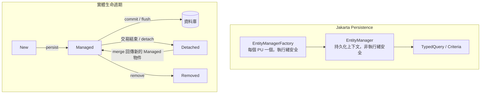

在容器中用 `@PersistenceContext(unitName = "appPU") EntityManager em` 取得「交易範圍」的 EntityManager；交易由 `@Transactional`（JTA）管理。

#### persistence.xml

```xml
<?xml version="1.0" encoding="UTF-8"?>
<persistence xmlns="https://jakarta.ee/xml/ns/persistence"
             xmlns:xsi="http://www.w3.org/2001/XMLSchema-instance"
             xsi:schemaLocation="https://jakarta.ee/xml/ns/persistence https://jakarta.ee/xml/ns/persistence/persistence_3_2.xsd"
             version="3.2">
    <persistence-unit name="appPU" transaction-type="JTA">
        <jta-data-source>jdbc/appDB</jta-data-source>
        <class>com.company.app.infrastructure.persistence.entity.OrderEntity</class>
        <class>com.company.app.infrastructure.persistence.entity.OrderItemEntity</class>
        <class>com.company.app.infrastructure.persistence.entity.ProductEntity</class>
        <class>com.company.app.infrastructure.persistence.entity.AccountEntity</class>
        <class>com.company.app.infrastructure.persistence.entity.TransferRecordEntity</class>
        <class>com.company.app.infrastructure.batch.SettlementEntity</class>
        <exclude-unlisted-classes>true</exclude-unlisted-classes>
        <properties>
            <!-- 驗證用：每次部署重建表格；生產環境一律改用 Flyway/Liquibase，值設為 none -->
            <property name="jakarta.persistence.schema-generation.database.action" value="drop-and-create"/>
            <property name="jakarta.persistence.sql-load-script-source" value="META-INF/seed.sql"/>
        </properties>
    </persistence-unit>
</persistence>
```

> `drop-and-create` 只適合驗證；生產環境用 Flyway / Liquibase 管理 schema，`schema-generation.database.action` 設 `none`。驗證時第一次啟動會在 log 看到一串 `CWWJP9991W ... does not exist`——那是 EclipseLink 試著 DROP 尚不存在的表，屬於預期中的警告。

### 10.2 Entity 設計

#### 共用審計欄位與樂觀鎖

```java
package com.company.app.infrastructure.persistence.entity;

import jakarta.persistence.Column;
import jakarta.persistence.MappedSuperclass;
import jakarta.persistence.PrePersist;
import jakarta.persistence.PreUpdate;
import jakarta.persistence.Version;

import java.time.Instant;

/** 共用審計欄位與樂觀鎖。 */
@MappedSuperclass
public abstract class BaseEntity {

    @Column(name = "created_at", nullable = false, updatable = false)
    private Instant createdAt;

    @Column(name = "updated_at", nullable = false)
    private Instant updatedAt;

    /** 樂觀鎖：UPDATE ... WHERE version = ?，筆數為 0 時丟 OptimisticLockException。 */
    @Version
    @Column(name = "version", nullable = false)
    private long version;

    @PrePersist
    protected void onCreate() {
        createdAt = Instant.now();
        updatedAt = createdAt;
    }

    @PreUpdate
    protected void onUpdate() {
        updatedAt = Instant.now();
    }

    public Instant getCreatedAt() { return createdAt; }
    public Instant getUpdatedAt() { return updatedAt; }
    public long getVersion() { return version; }
}
```

#### Aggregate 的持久化模型

```java
package com.company.app.infrastructure.persistence.entity;

import com.company.app.domain.model.order.OrderStatus;
import jakarta.persistence.CascadeType;
import jakarta.persistence.Column;
import jakarta.persistence.Entity;
import jakarta.persistence.EnumType;
import jakarta.persistence.Enumerated;
import jakarta.persistence.FetchType;
import jakarta.persistence.Id;
import jakarta.persistence.Index;
import jakarta.persistence.NamedAttributeNode;
import jakarta.persistence.NamedEntityGraph;
import jakarta.persistence.OneToMany;
import jakarta.persistence.OrderBy;
import jakarta.persistence.Table;

import java.math.BigDecimal;
import java.util.ArrayList;
import java.util.List;

@Entity
@Table(name = "orders", indexes = {
        @Index(name = "idx_orders_customer", columnList = "customer_id"),
        @Index(name = "idx_orders_status_created", columnList = "status, created_at")
})
@NamedEntityGraph(name = "Order.withItems", attributeNodes = @NamedAttributeNode("items"))
public class OrderEntity extends BaseEntity {

    @Id
    @Column(name = "id", length = 36)
    private String id;

    @Column(name = "customer_id", nullable = false, length = 36)
    private String customerId;

    @Enumerated(EnumType.STRING)
    @Column(name = "status", nullable = false, length = 20)
    private OrderStatus status;

    /** 金額一律 BigDecimal + 明確 precision/scale，不可用 double。 */
    @Column(name = "total_amount", nullable = false, precision = 19, scale = 4)
    private BigDecimal totalAmount;

    @OneToMany(mappedBy = "order", cascade = CascadeType.ALL, orphanRemoval = true,
            fetch = FetchType.LAZY)
    @OrderBy("lineNo ASC")
    private List<OrderItemEntity> items = new ArrayList<>();

    protected OrderEntity() {
        // JPA 規格要求 public 或 protected 無參數建構子
    }

    public OrderEntity(String id, String customerId, OrderStatus status) {
        this.id = id;
        this.customerId = customerId;
        this.status = status;
        this.totalAmount = BigDecimal.ZERO;
    }

    /** 雙向關聯一定要同時維護兩端，否則 mappedBy 端不會寫入外鍵。 */
    public void addItem(OrderItemEntity item) {
        item.attachTo(this, items.size() + 1);
        items.add(item);
        totalAmount = items.stream()
                .map(OrderItemEntity::subtotal)
                .reduce(BigDecimal.ZERO, BigDecimal::add);
    }

    public String getId() { return id; }
    public String getCustomerId() { return customerId; }
    public OrderStatus getStatus() { return status; }
    public void setStatus(OrderStatus status) { this.status = status; }
    public BigDecimal getTotalAmount() { return totalAmount; }
    public List<OrderItemEntity> getItems() { return items; }
}
```

```java
package com.company.app.infrastructure.persistence.entity;

import jakarta.persistence.Column;
import jakarta.persistence.Entity;
import jakarta.persistence.FetchType;
import jakarta.persistence.GeneratedValue;
import jakarta.persistence.GenerationType;
import jakarta.persistence.Id;
import jakarta.persistence.JoinColumn;
import jakarta.persistence.ManyToOne;
import jakarta.persistence.Table;

import java.math.BigDecimal;

@Entity
@Table(name = "order_items")
public class OrderItemEntity {

    @Id
    @GeneratedValue(strategy = GenerationType.IDENTITY)
    private Long id;

    /** @ManyToOne 預設 EAGER，一律改成 LAZY，需要時用 Entity Graph 或 JOIN FETCH。 */
    @ManyToOne(fetch = FetchType.LAZY, optional = false)
    @JoinColumn(name = "order_id", nullable = false)
    private OrderEntity order;

    @Column(name = "line_no", nullable = false)
    private int lineNo;

    @Column(name = "product_id", nullable = false, length = 36)
    private String productId;

    @Column(name = "quantity", nullable = false)
    private int quantity;

    @Column(name = "unit_price", nullable = false, precision = 19, scale = 4)
    private BigDecimal unitPrice;

    protected OrderItemEntity() {
    }

    public OrderItemEntity(String productId, int quantity, BigDecimal unitPrice) {
        this.productId = productId;
        this.quantity = quantity;
        this.unitPrice = unitPrice;
    }

    void attachTo(OrderEntity order, int lineNo) {
        this.order = order;
        this.lineNo = lineNo;
    }

    BigDecimal subtotal() {
        return unitPrice.multiply(BigDecimal.valueOf(quantity));
    }

    public int getLineNo() { return lineNo; }
    public String getProductId() { return productId; }
    public int getQuantity() { return quantity; }
    public BigDecimal getUnitPrice() { return unitPrice; }
}
```

| 規則 | 範例中的位置 | 不遵守的後果 |
|------|------------|------------|
| `@ManyToOne(fetch = LAZY)` | `OrderItemEntity.order` | 預設 EAGER，列表查詢產生 N+1 |
| 雙向關聯兩端都維護 | `OrderEntity.addItem` → `item.attachTo(this)` | `order_id` 寫成 NULL |
| 金額 `BigDecimal` + `precision/scale` | `totalAmount` | `double` 造成捨入誤差 |
| `protected` 無參數建構子 | 每個 Entity | JPA 規格要求；`private` 在部分實作會失敗 |
| `@Version` | `BaseEntity.version` | 併發更新互相覆蓋 |
| 索引寫在 `@Table(indexes=...)` | `idx_orders_status_created` | 只是 DDL 提示；生產 schema 仍要在 migration 腳本建立 |

### 10.3 Repository Pattern 實作

Domain Port 的 JPA Adapter 已在 7.4 展示（`JpaOrderRepository`）。重點：

- 查詢時用 Entity Graph（`Order.withItems`）一次把關聯抓回，Mapper 轉換時不再觸發延遲載入。
- `save()` 比對 Domain 物件與資料庫的版本號，舊版本直接拒絕。
- Adapter **不開交易**，交易在 Use Case。

> v2.0 的 `AbstractRepository<T, ID>` 把 `@Transactional` 加在每個 CRUD 方法上，會讓「一個業務操作」被拆成多個交易，中途失敗時資料只更新一半。

### 10.4 Transaction 管理

#### 悲觀鎖轉帳（固定上鎖順序避免死鎖）

```java
package com.company.app.infrastructure.service;

import com.company.app.infrastructure.persistence.entity.AccountEntity;
import com.company.app.infrastructure.persistence.entity.TransferRecordEntity;
import jakarta.enterprise.context.ApplicationScoped;
import jakarta.persistence.EntityManager;
import jakarta.persistence.LockModeType;
import jakarta.persistence.PersistenceContext;
import jakarta.transaction.Transactional;

import java.math.BigDecimal;
import java.util.Map;

@ApplicationScoped
public class TransferService {

    @PersistenceContext(unitName = "appPU")
    private EntityManager em;

    public record TransferResult(String transferId, BigDecimal fromBalance, BigDecimal toBalance) {
    }

    /**
     * 轉帳：兩個帳戶都用悲觀鎖，而且「永遠依帳號字典序上鎖」，
     * 否則 A→B 與 B→A 同時發生時會互相等待而死鎖。
     */
    @Transactional
    public TransferResult transfer(String fromId, String toId, BigDecimal amount) {
        if (amount == null || amount.signum() <= 0) {
            throw new IllegalArgumentException("金額必須 > 0");
        }
        if (fromId.equals(toId)) {
            throw new IllegalArgumentException("不可轉給自己");
        }
        String first = fromId.compareTo(toId) < 0 ? fromId : toId;
        String second = first.equals(fromId) ? toId : fromId;

        Map<String, Object> lockTimeout = Map.of("jakarta.persistence.lock.timeout", 5_000);
        AccountEntity a = em.find(AccountEntity.class, first, LockModeType.PESSIMISTIC_WRITE, lockTimeout);
        AccountEntity b = em.find(AccountEntity.class, second, LockModeType.PESSIMISTIC_WRITE, lockTimeout);
        if (a == null || b == null) {
            throw new IllegalArgumentException("帳戶不存在");
        }
        AccountEntity from = first.equals(fromId) ? a : b;
        AccountEntity to = from == a ? b : a;

        from.debit(amount);   // 餘額不足丟 IllegalStateException → 整筆回滾
        to.credit(amount);

        TransferRecordEntity record = new TransferRecordEntity(fromId, toId, amount);
        em.persist(record);
        return new TransferResult(record.getId(), from.getBalance(), to.getBalance());
    }
}
```

**驗證結果**（`PlatformIT`）：

- `transfer`：TELLER 轉帳成功、USER 得到 403、餘額不足得到 422（`INSUFFICIENT_BALANCE`）且整筆回滾、金額 0 得到 400。
- `concurrentTransfersNoDeadlock`：8 條執行緒同時送 10 筆 A→B 與 10 筆 B→A，全部 200，沒有死鎖。若改回 v2.0「依參數順序上鎖」的寫法，A→B 與 B→A 交錯時兩筆交易會互相等待；PostgreSQL 會偵測到死鎖並中止其中一筆（`ERROR: deadlock detected`），呼叫端收到錯誤。這個反例本手冊未保留成自動化測試，屬於依資料庫行為推論。

#### Transaction 類型

| TxType | 說明 | 本專案用法 |
|--------|------|-----------|
| `REQUIRED`（預設） | 有交易就加入，沒有就開新的 | Use Case、`TransferService` |
| `REQUIRES_NEW` | 暫停外層、開新交易 | 稽核紀錄（外層回滾也要保留） |
| `MANDATORY` | 必須已在交易中，否則丟例外 | `JpaInventoryAdapter.reserve`：扣庫存一定要在呼叫端交易內 |
| `SUPPORTS` | 有就加入，沒有就不開 | `OrderQueryService.findById` |
| `NOT_SUPPORTED` | 暫停交易執行 | 長時間唯讀報表 |
| `NEVER` | 在交易中呼叫就丟例外 | 很少用 |

> **回滾規則**：`@Transactional` 預設只對 **unchecked** 例外回滾；checked 例外會 commit。需要時用 `rollbackOn` / `dontRollbackOn` 明確指定。

### 10.5 Lock 策略

| 策略 | 機制 | 適用 | 本專案 |
|------|------|------|-------|
| 樂觀鎖 | `@Version`，commit 時比對 | 讀多寫少、衝突少 | `ProductEntity` 補貨 + 交易外重試（8.5） |
| 悲觀寫鎖 | `PESSIMISTIC_WRITE` → `SELECT ... FOR UPDATE` | 金流、扣庫存、衝突多 | `TransferService`、`JpaInventoryAdapter` |
| 鎖逾時 | `jakarta.persistence.lock.timeout`（毫秒） | 避免無限等待 | `TransferService` 5 秒 |

扣庫存的悲觀鎖寫法：

```java
package com.company.app.infrastructure.inventory;

import com.company.app.application.port.InventoryPort;
import com.company.app.infrastructure.persistence.entity.ProductEntity;
import jakarta.enterprise.context.ApplicationScoped;
import jakarta.persistence.EntityManager;
import jakarta.persistence.LockModeType;
import jakarta.persistence.PersistenceContext;
import jakarta.transaction.Transactional;

import java.math.BigDecimal;
import java.util.Optional;

@ApplicationScoped
public class JpaInventoryAdapter implements InventoryPort {

    @PersistenceContext(unitName = "appPU")
    private EntityManager em;

    @Override
    public Optional<BigDecimal> priceOf(String productId) {
        return Optional.ofNullable(em.find(ProductEntity.class, productId))
                .map(ProductEntity::getPrice);
    }

    /**
     * MANDATORY：扣庫存必須在呼叫端的交易內，否則鎖一放掉就失去意義。
     * PESSIMISTIC_WRITE → SELECT ... FOR UPDATE，避免兩筆訂單同時扣同一份庫存。
     */
    @Override
    @Transactional(Transactional.TxType.MANDATORY)
    public boolean reserve(String productId, int quantity) {
        ProductEntity product = em.find(ProductEntity.class, productId,
                LockModeType.PESSIMISTIC_WRITE);
        return product != null && product.decreaseStock(quantity);
    }
}
```

### 10.6 Lazy Loading 與效能

| 問題 | 症狀 | 解法 |
|------|------|------|
| N+1 | 列表 1 次查詢 + 每筆 1 次查關聯 | Entity Graph（`fetchgraph` hint）或 `JOIN FETCH` |
| `LazyInitializationException` / 延遲載入失敗 | 交易外存取關聯 | 在交易內完成轉換（Mapper 在 Repository 內呼叫） |
| 笛卡兒積 | 同時 `JOIN FETCH` 兩個集合 | 一次只 fetch 一個集合，或分兩次查詢 |
| 分頁 + `JOIN FETCH` 集合 | 實作在記憶體分頁（Hibernate 會警告） | 先查 ID 分頁，再依 ID 抓關聯 |

`JpaOrderRepository.findById` 用的是 `jakarta.persistence.fetchgraph` hint 搭配 `@NamedEntityGraph`；`findByCustomerId` 用 `LEFT JOIN FETCH ... DISTINCT`。

### 10.7 Query 最佳化

| 技巧 | 說明 |
|------|------|
| 投影 | 列表只取需要欄位：Criteria `cb.construct(Row.class, ...)`（9.6 實作） |
| 參數化 | 一律 `:param`；排序欄位白名單 |
| 批次寫入 | 大量資料用 Batch（第 14 章）或 4.0 的 `EntityAgent`（10.8） |
| 大量更新 | 用 JPQL `UPDATE`（4.0 改用 `Statement`），之後清除持久化上下文 |
| 慢查詢 | PostgreSQL `pg_stat_statements` + `EXPLAIN (ANALYZE, BUFFERS)`（28.4） |

### 10.8 Persistence 4.0 新功能（[EE12-M]）

依 [Persistence 4.0 規格頁](https://jakarta.ee/specifications/persistence/4.0/)（目標 2026 年底）與 4.0.0-M7 API 比對：

| 功能 | API | 說明 |
|------|-----|------|
| Statement 與 Query 分離 | `em.createStatement(String)` → `Statement.execute()`；`createQuery(String)` 改回傳 `StatementOrTypedQuery` | 修改資料與查詢分開；`Query.executeUpdate()` 標記 **for removal** |
| EntityAgent | `emf.createEntityAgent()`；`@PersistenceAgent` 注入 | 無持久化上下文的操作（insert/update/upsert/delete、`*Multiple`），適合批次匯入 |
| 新回呼 | `@PreInsert`、`@PostInsert`、`@PreUpsert`、`@PostUpsert`、`@PreDelete`、`@PostDelete`、`@PreMerge` | 與 EntityAgent 操作對應 |
| JPQL 移交 Jakarta Query | 規格文件移出 | 語法相容 |
| Criteria 型別化 | `TextExpression`、`NumericExpression`…；metamodel `TextAttribute` 等 | 更強的型別檢查 |
| 移除 / 淘汰 | 3.2 標記移除的 API、SecurityManager、`Byte[]`/`Character[]` 基本型別；`getDelegate()`、`createEntityGraph(String)` 等 deprecated | 遷移清單見 23.2 |

範例（已驗證：以 `jakarta.persistence-api:4.0.0-M7` 編譯，`-Xlint:all -Werror` 通過）：

```java
package demo.ee12.persistence;

import demo.ee12.data.Product;
import jakarta.persistence.EntityAgent;
import jakarta.persistence.EntityManager;
import jakarta.persistence.EntityManagerFactory;
import jakarta.persistence.Statement;
import jakarta.persistence.TypedQuery;

import java.math.BigDecimal;
import java.util.List;

/** Jakarta Persistence 4.0（4.0.0-M7）：Statement 與 EntityAgent。 */
public class Persistence4Examples {

    /**
     * 4.0 把「修改資料的語句」與「查詢」分開：
     * createStatement(...) → Statement.execute()；createQuery(String, Class) → TypedQuery。
     * 3.2 的 em.createQuery("UPDATE ...").executeUpdate() 在 4.0 回傳 StatementOrTypedQuery，屬遷移項目。
     */
    public int discount(EntityManager em, String category, BigDecimal ratio) {
        Statement update = em.createStatement(
                "UPDATE Product p SET p.price = p.price * :ratio WHERE p.category = :c");
        return update.setParameter("ratio", ratio).setParameter("c", category).execute();
    }

    public List<Product> expensive(EntityManager em, BigDecimal min) {
        TypedQuery<Product> q = em.createQuery("SELECT p FROM Product p WHERE p.price >= :min ORDER BY p.price DESC",
                Product.class);
        return q.setParameter("min", min).getResultList();
    }

    /**
     * EntityAgent：不帶 persistence context 的「無狀態」操作（類似 Hibernate StatelessSession），
     * 適合批次匯入；insert/update 立即對資料庫生效，沒有 dirty checking 與一級快取。
     */
    public void bulkImport(EntityManagerFactory emf, List<Product> rows) {
        EntityAgent agent = emf.createEntityAgent();
        try {
            agent.getTransaction().begin();
            agent.insertMultiple(rows);
            agent.getTransaction().commit();
        } finally {
            agent.close();
        }
    }
}
```

```java
package demo.ee12.persistence;

import jakarta.persistence.Entity;
import jakarta.persistence.Id;
import jakarta.persistence.PostInsert;
import jakarta.persistence.PreInsert;
import jakarta.persistence.PreUpsert;

import java.time.Instant;

/** 4.0 新增的生命週期回呼：@PreInsert/@PostInsert/@PreUpsert 等（與 EntityAgent 的操作對應）。 */
@Entity
public class AuditedEntity {

    @Id
    public String id;

    public Instant insertedAt;

    @PreInsert
    @PreUpsert
    void beforeWrite() {
        if (insertedAt == null) {
            insertedAt = Instant.now();
        }
    }

    @PostInsert
    void afterInsert() {
        // 例如：寫入稽核佇列。注意回呼中不可再呼叫 EntityManager。
    }
}
```

把 3.2 的寫法 `em.createQuery("DELETE ...").executeUpdate()` 用 4.0-M7 編譯，會得到 removal 警告（附錄 A.5 的 N4）——在 CI 開 `-Xlint:removal -Werror` 就能提早發現。

### 10.9 實務注意事項

> **JPA 效能與設計要點**
> 1. 所有 `@ManyToOne` / `@OneToOne` 改成 `LAZY`；需要時用 Entity Graph。
> 2. 所有可被併發修改的 Entity 都有 `@Version`。
> 3. 悲觀鎖固定上鎖順序並設定 lock timeout。
> 4. 交易邊界在 Use Case；Adapter 用 `MANDATORY` 確保在交易內。
> 5. 生產環境 schema 由 migration 工具管理，`schema-generation` 設 `none`。
> 6. 先用 4.0-M 版 API 編譯一次現有程式，提早看到 removal 警告。

### 10.10 審查與驗證清單

| 檢查項目 | 如何驗證 | 預期結果 | 常見 AI 錯誤 |
|---------|---------|---------|-------------|
| 關聯載入策略 | 搜尋 `@ManyToOne`、`@OneToOne` | 都有 `fetch = FetchType.LAZY` | 依預設 EAGER |
| 樂觀鎖 | 搜尋 `@Entity` 類別 | 可更新的 Entity 都有 `@Version` | 只有部分表有 |
| 死鎖風險 | 審查多筆悲觀鎖的順序 | 依固定鍵排序 | 依參數順序上鎖 |
| 交易邊界 | 搜尋 `@Transactional` | 集中在 Use Case / Service；Adapter 用 `MANDATORY` | 每個 Repository 方法各自交易 |
| 金額型別 | 搜尋 `double`、`float` | 無 | `double totalAmount` |
| JPQL 參數化 | 搜尋 `createQuery(".*" +` | 無字串拼接 | `"... WHERE id = '" + id + "'"` |
| 4.0 相容性 | 用 4.0.0-M7 + `-Xlint:removal` 編譯 | 無 removal 警告 | 大量 `executeUpdate()`、`getDelegate()` |
| schema 管理 | 檢查 `persistence.xml` | 生產 profile 為 `none` | 生產用 `drop-and-create` |

## 11. Jakarta Data 1.1

> **狀態**：生產用 **Data 1.0**（EE 11，[GA]），本章 11.3 的 Repository 在 Open Liberty `data-1.0` 上實測。**Data 1.1** 目前 1.1.0-M4（[EE12-M]），11.2、11.4、11.5 的程式碼以 M4 API 編譯驗證，尚無可執行的相容實作。

Jakarta Data 的核心想法：**宣告 Repository 介面，實作由 Runtime 產生**。它不取代 Persistence，而是建在 Persistence（或 NoSQL）之上的一層。

### 11.1 Jakarta Query 1.0 統一查詢語言

Jakarta Query 1.0（[EE12-M]，規格文件 1.0-M2，目前沒有 API artifact）把 JPQL 從 Persistence 規格移出，並把 Data 的 JDQL 重新定義為它的子集：

| 層級 | 對象 | 能力 |
|------|------|------|
| **Core** | Data / NoSQL（非關聯式資料庫） | 單一實體的 `WHERE`、`ORDER BY`、基本運算 |
| **Extended** | Persistence 與以 Persistence 實作的 Data | 完整 JPQL：`JOIN`、子查詢、`GROUP BY`、聚合 |

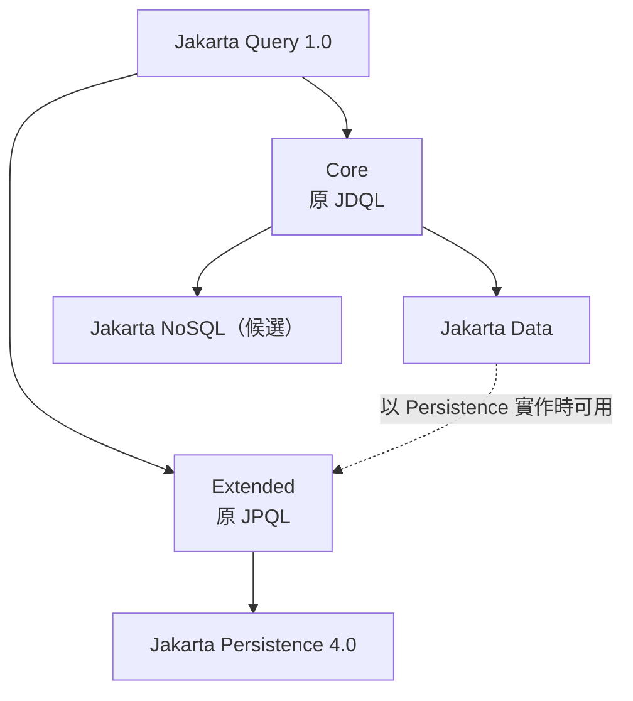

規格頁明確表示：語言與既有 JPQL、JDQL **向後相容**。可能的增強（尚未承諾）包括精簡的 `select new` 語法、日期時間字面值、在 select / from / join 中使用子查詢。

> **現在怎麼做**：繼續寫標準 JPQL / JDQL 即可；不要等 Query 1.0，也不要引用不存在的 `jakarta.query` 套件。

### 11.2 Fluent Query 與動態限制條件（[EE12-M]）

Data 1.1 新增 `jakarta.data.restrict`（`Restriction`、`Restrict`）、`jakarta.data.constraint`（`EqualTo`、`AtMost`、`Like`…）與 `jakarta.data.expression`。搭配靜態元模型可以組出型別安全的動態條件。

#### 靜態元模型

實務上由 annotation processor 產生；這裡手寫，讓 Reviewer 看懂產生結果：

```java
package demo.ee12.data;

import jakarta.data.metamodel.NumericAttribute;
import jakarta.data.metamodel.StaticMetamodel;
import jakarta.data.metamodel.TextAttribute;

import java.math.BigDecimal;

/**
 * 靜態元模型。實務上由 annotation processor（如 hibernate-processor）自動產生，
 * 這裡手寫是為了在沒有實作的情況下示範產生結果長什麼樣子。
 * Data 1.1 用 XxxAttribute.of(...) 建立，不再是 1.0 那種「欄位值為 null、由容器注入」的寫法。
 */
@StaticMetamodel(Product.class)
public interface _Product {

    String ID = "id";
    String NAME = "name";
    String CATEGORY = "category";
    String PRICE = "price";

    TextAttribute<Product> id = TextAttribute.of(Product.class, ID);
    TextAttribute<Product> name = TextAttribute.of(Product.class, NAME);
    TextAttribute<Product> category = TextAttribute.of(Product.class, CATEGORY);
    NumericAttribute<Product, BigDecimal> price = NumericAttribute.of(Product.class, PRICE, BigDecimal.class);
    NumericAttribute<Product, Integer> stock = NumericAttribute.of(Product.class, "stock", Integer.class);
}
```

#### Repository：`@Is`、`@First`、Restriction 參數、`@Select`

```java
package demo.ee12.data;

import jakarta.data.Order;
import jakarta.data.constraint.AtMost;
import jakarta.data.constraint.Like;
import jakarta.data.page.Page;
import jakarta.data.page.PageRequest;
import jakarta.data.repository.By;
import jakarta.data.repository.Find;
import jakarta.data.repository.First;
import jakarta.data.repository.Is;
import jakarta.data.repository.Repository;
import jakarta.data.repository.Select;
import jakarta.data.restrict.Restriction;

import java.math.BigDecimal;
import java.util.List;

/** Jakarta Data 1.1（EE 12，1.1.0-M4）：@Is 約束、@First、Restriction 參數、@Select 投影。 */
@Repository
public interface ProductCatalog {

    /** @Is：把參數套用成約束（這裡是 price <= max），不必再寫 findByPriceLessThanEqual。 */
    @Find
    List<Product> pricedAtMost(@By(_Product.PRICE) @Is(AtMost.class) BigDecimal max,
                               Order<Product> order);

    /** @Is(Like.class)：模式比對。 */
    @Find
    List<Product> named(@By(_Product.NAME) @Is(Like.class) String pattern);

    /** @First：只取前 N 筆（取代 1.0 時代的 findFirst10By... 命名）。 */
    @Find
    @First(3)
    List<Product> cheapest(@By(_Product.CATEGORY) String category, Order<Product> order);

    /** 動態條件：Restriction 由呼叫端用 metamodel 組合後傳入。 */
    @Find
    Page<Product> search(Restriction<Product> where, PageRequest page, Order<Product> order);

    /** 單一屬性投影。 */
    @Find
    @Select(_Product.NAME)
    List<String> namesIn(@By(_Product.CATEGORY) String category);

    /** 多欄位 Record 投影：@Select 放在 record component 上（1.1 新增；1.0 不支援）。 */
    @Find
    List<ProductSummary> summaries(@By(_Product.CATEGORY) String category);

    record ProductSummary(@Select(_Product.ID) String id,
                          @Select(_Product.NAME) String name,
                          @Select(_Product.PRICE) BigDecimal price) {
    }
}
```

#### 組合動態條件

```java
package demo.ee12.data;

import jakarta.data.Order;
import jakarta.data.page.Page;
import jakarta.data.page.PageRequest;
import jakarta.data.restrict.Restrict;
import jakarta.data.restrict.Restriction;
import jakarta.enterprise.context.ApplicationScoped;
import jakarta.inject.Inject;

import java.math.BigDecimal;
import java.util.ArrayList;
import java.util.List;

/** 以 metamodel 組合型別安全的動態條件：欄位名稱打錯在編譯期就失敗。 */
@ApplicationScoped
public class ProductSearchService {

    public record Criteria(String category, BigDecimal minPrice, BigDecimal maxPrice, String keyword) {
    }

    @Inject
    ProductCatalog catalog;

    public Page<Product> search(Criteria c, int page, int size) {
        List<Restriction<Product>> where = new ArrayList<>();
        if (c.category() != null) {
            where.add(_Product.category.equalTo(c.category()));
        }
        if (c.minPrice() != null) {
            where.add(_Product.price.greaterThanEqual(c.minPrice()));
        }
        if (c.maxPrice() != null) {
            where.add(_Product.price.lessThanEqual(c.maxPrice()));
        }
        if (c.keyword() != null && !c.keyword().isBlank()) {
            // contains() 由實作負責跳脫萬用字元，不要自己拼 "%" + keyword + "%"
            where.add(_Product.name.contains(c.keyword()));
        }
        Restriction<Product> combined = where.isEmpty() ? Restrict.unrestricted() : Restrict.all(where);
        return catalog.search(combined, PageRequest.ofPage(page, size, true),
                Order.by(_Product.price.asc(), _Product.id.asc()));
    }
}
```

v2.0 的三個錯誤（都已用編譯驗證，見附錄 A.5）：

| v2.0 寫法 | 問題 | 正確寫法 |
|----------|------|---------|
| `Restriction.all(list)` | `Restriction` 沒有靜態方法 `all` | `Restrict.all(list)` |
| `TextAttribute<Product> name = null; // 編譯時注入` | 1.0 的 metamodel 寫法；1.1 改為 `TextAttribute.of(...)` | 見上方 `_Product` |
| `List<Product> findAll(Restriction, Order)` 沒有 `@Find` | 沒有註解也不符合方法命名規則，無法推導查詢 | `@Find Page<Product> search(Restriction<Product> where, PageRequest, Order)` |

### 11.3 Repository 抽象化（[GA] Data 1.0，Liberty 實測）

```java
package com.company.app.infrastructure.data;

import com.company.app.infrastructure.persistence.entity.ProductEntity;
import jakarta.data.Order;
import jakarta.data.page.Page;
import jakarta.data.page.PageRequest;
import jakarta.data.repository.By;
import jakarta.data.repository.CrudRepository;
import jakarta.data.repository.Find;
import jakarta.data.repository.OrderBy;
import jakarta.data.repository.Param;
import jakarta.data.repository.Query;
import jakarta.data.repository.Repository;

import java.math.BigDecimal;
import java.util.List;

/**
 * Jakarta Data 1.0（EE 11 GA）：介面即實作，由 Server 在部署時產生。
 * dataStore 指向 persistence unit reference 的 JNDI 名稱（見 DataStoreConfig）。
 */
@Repository(dataStore = DataStoreConfig.APP_PU_REF)
public interface ProductRepository extends CrudRepository<ProductEntity, String> {

    /** 方法名稱衍生查詢（Query by Method Name）。 */
    List<ProductEntity> findByCategoryOrderByPriceAsc(String category);

    /** 參數式查詢（@Find + @By）：比長方法名更易讀，重新命名屬性時編譯期就會失敗（搭配 metamodel）。 */
    @Find
    @OrderBy("name")
    List<ProductEntity> inCategory(@By("category") String category);

    /** 分頁：PageRequest 從 1 起算。 */
    @Find
    Page<ProductEntity> byCategory(@By("category") String category, PageRequest pageRequest,
                                   Order<ProductEntity> order);

    /** JDQL：省略 SELECT/FROM 時預設是 Repository 的主實體。 */
    @Query("WHERE price < :max AND stock > 0 ORDER BY price DESC")
    List<ProductEntity> affordable(@Param("max") BigDecimal max);

    /**
     * 單一屬性投影：Jakarta Data 1.0 的 JDQL SELECT 只能選「一個」項目。
     * 多欄位 Record 投影（SELECT id, name, price → record）是 1.1 才有的功能（見 11.4），
     * 在 EE 11 上寫多欄位會部署成功、呼叫時丟 CWWKD1103E（驗證時實際踩到）。
     */
    @Query("SELECT name FROM ProductEntity WHERE category = :category ORDER BY name")
    List<String> namesIn(@Param("category") String category);
}
```

Open Liberty 要求 `dataStore` 指向 dataSource 或 persistence unit **reference** 的 JNDI 名稱：

```java
package com.company.app.infrastructure.data;

import jakarta.enterprise.context.ApplicationScoped;
import jakarta.persistence.PersistenceUnit;

/**
 * Jakarta Data 的 dataStore 在 Open Liberty 必須是 dataSource id / JNDI 名稱，
 * 或「persistence unit reference」的 JNDI 名稱——直接寫 PU 名稱 "appPU" 會在部署時
 * 丟 CWWKD1078E（驗證時實際踩到）。這裡宣告一個 java:app 範圍的 PU 參照供 Repository 使用。
 */
@PersistenceUnit(name = DataStoreConfig.APP_PU_REF, unitName = "appPU")
@ApplicationScoped
public class DataStoreConfig {

    public static final String APP_PU_REF = "java:app/env/persistence/appPU";
}
```

呼叫端（REST Resource）：

```java
package com.company.app.api.resource;

import com.company.app.infrastructure.data.ProductRepository;
import com.company.app.infrastructure.persistence.entity.ProductEntity;
import jakarta.annotation.security.PermitAll;
import jakarta.annotation.security.RolesAllowed;
import jakarta.ws.rs.POST;
import jakarta.data.Order;
import jakarta.data.Sort;
import jakarta.data.page.Page;
import jakarta.data.page.PageRequest;
import jakarta.enterprise.context.RequestScoped;
import jakarta.inject.Inject;
import jakarta.validation.constraints.Max;
import jakarta.validation.constraints.Min;
import jakarta.ws.rs.DefaultValue;
import jakarta.ws.rs.GET;
import jakarta.ws.rs.NotFoundException;
import jakarta.ws.rs.Path;
import jakarta.ws.rs.PathParam;
import jakarta.ws.rs.Produces;
import jakarta.ws.rs.QueryParam;
import jakarta.ws.rs.core.MediaType;

import java.math.BigDecimal;
import java.util.List;
import java.util.Map;

/** Jakarta Data 1.0 Repository 的實際呼叫端。 */
@Path("/products")
@Produces(MediaType.APPLICATION_JSON)
@RequestScoped
@PermitAll
public class ProductResource {

    @Inject ProductRepository products;
    @Inject RestockService restockService;

    @POST
    @Path("/{id}/restock")
    @RolesAllowed("ADMIN")
    public Map<String, Integer> restock(@PathParam("id") String id,
                                        @QueryParam("qty") @DefaultValue("1") @Min(1) @Max(1000) int qty) {
        return Map.of("stock", restockService.restock(id, qty));
    }

    public record ProductView(String id, String name, String category, BigDecimal price, int stock) {
        static ProductView of(ProductEntity p) {
            return new ProductView(p.getId(), p.getName(), p.getCategory(), p.getPrice(), p.getStock());
        }
    }

    @GET
    @Path("/{id}")
    public ProductView get(@PathParam("id") String id) {
        return products.findById(id).map(ProductView::of)
                .orElseThrow(() -> new NotFoundException("商品不存在: " + id));
    }

    @GET
    @Path("/category/{category}")
    public List<ProductView> byCategory(@PathParam("category") String category) {
        return products.findByCategoryOrderByPriceAsc(category).stream().map(ProductView::of).toList();
    }

    @GET
    @Path("/category/{category}/page")
    public Map<String, Object> page(@PathParam("category") String category,
                                    @QueryParam("page") @DefaultValue("1") @Min(1) int page,
                                    @QueryParam("size") @DefaultValue("10") @Min(1) @Max(100) int size) {
        Page<ProductEntity> result = products.byCategory(category, PageRequest.ofPage(page, size, true),
                Order.by(Sort.asc("price"), Sort.asc("id")));
        return Map.of("content", result.content().stream().map(ProductView::of).toList(),
                "totalElements", result.totalElements(),
                "hasNext", result.hasNext());
    }

    @GET
    @Path("/affordable")
    public List<ProductView> affordable(@QueryParam("max") BigDecimal max) {
        return products.affordable(max).stream().map(ProductView::of).toList();
    }

    @GET
    @Path("/category/{category}/names")
    public List<String> names(@PathParam("category") String category) {
        return products.namesIn(category);
    }
}
```

**驗證結果**（`PlatformIT.jakartaData`）：衍生查詢依價格升冪回傳 `[P002, P001]`；`@Find` 分頁 `page=1&size=1` 回傳 1 筆、`totalElements=2`、`hasNext=true`；JDQL 只回傳價格 < 1000 的商品；單一屬性投影回傳 `["Keyboard","Mouse"]`。

#### Data 1.0 與 1.1 的關鍵差異（實測發現）

| 寫法 | Data 1.0（EE 11） | Data 1.1（EE 12） |
|------|------------------|------------------|
| `@Query("SELECT name FROM ...")` 單一屬性 | 支援 | 支援 |
| `@Query("SELECT id, name, price FROM ...")` → record | **不支援**：部署成功、呼叫時丟 `CWWKD1103E`（結果是 `Object[]`） | 支援（record component 加 `@Select`） |
| `@Find` + `@By` | 支援 | 支援 |
| `@Is(AtMost.class)` 參數約束 | 無 | 支援 |
| `@First(n)` | 無（用 `Limit` 參數） | 支援 |
| `Restriction` 參數 | 無 | 支援 |
| Stateful（`@Persist`/`@Merge`/…） | 無 | 獨立 artifact `jakarta.data.stateful-api` |
| 生命週期事件（`PostInsertEvent`…） | 無 | `jakarta.data.event` |
| `dataStore` | Liberty：dataSource 或 PU reference JNDI | 同左（依實作） |

> v2.0 把「Record Projection」寫成 1.1 新功能、範例卻用方法名 `findSummaryByStatus` 回傳 record——這在 1.0 與 1.1 都不是有效的推導規則。

### 11.4 Record Projection 與 Stateful Repository（[EE12-M]）

Record 投影（1.1）：`@Select` 放在 record component 上，見 11.2 `ProductCatalog.ProductSummary`。

Stateful Repository（1.1，`jakarta.data.stateful-api:1.1.0-M4`）：

```java
package demo.ee12.data;

import jakarta.data.repository.Find;
import jakarta.data.repository.Repository;
import jakarta.data.repository.stateful.Detach;
import jakarta.data.repository.stateful.Merge;
import jakarta.data.repository.stateful.Persist;
import jakarta.data.repository.stateful.Refresh;
import jakarta.data.repository.stateful.Remove;

import java.util.Optional;

/**
 * Stateful Repository（Data 1.1，獨立 artifact jakarta.data.stateful-api）。
 * 規則：同一個 Repository 只能是 stateful 或 stateless（不可混用 @Insert/@Update 與 @Persist/@Merge），
 * 且 stateful 方法必須在交易內呼叫（受 persistence context 管理）。
 */
@Repository
public interface ProductStore {

    @Find
    Optional<Product> byId(String id);

    @Persist
    void add(Product product);

    @Merge
    Product merge(Product detached);

    @Remove
    void remove(Product product);

    @Refresh
    void reload(Product product);

    @Detach
    void detach(Product product);
}
```

| 註解 | 對應 Persistence 操作 | 注意 |
|------|---------------------|------|
| `@Persist` | `persist` | 必須在交易內 |
| `@Merge` | `merge`（回傳 managed 物件） | 用回傳值，不要繼續用參數物件 |
| `@Remove` | `remove` | — |
| `@Refresh` | `refresh` | 覆蓋未 flush 的修改 |
| `@Detach` | `detach` | — |

> **規則**：同一個 Repository 只能是 stateless（`@Insert`、`@Update`、`@Save`、`@Delete`）或 stateful（上表），不可混用。v2.0 在同一個介面混用 `@Persist`、`@Merge` 與 `@Delete`，並且 import 的套件不存在（stateful 註解在 `jakarta.data.repository.stateful`）。

#### NoSQL 支援（[候選]）

Jakarta NoSQL 1.1（1.1.0-M4）與 Eclipse JNoSQL（已升格 EE4J 專案；Maven Central 最新 1.1.20 與 1.2.0-M2）讓同一套 Jakarta Data Repository 介面存取 MongoDB、Cassandra、Redis 等。由於 NoSQL 尚未確定納入 EE 12 Profile，本手冊**不提供可上線的範例**；需要評估時請以 [JNoSQL 文件](https://www.jnosql.org/) 與 [NoSQL 規格頁](https://jakarta.ee/specifications/nosql/) 為準，並注意 NoSQL 的 `@Entity`、`@Column` 位於 `jakarta.nosql` 套件，與 Persistence 的同名註解不同。

### 11.5 與 Spring Data JPA 比較

| 比較維度 | Jakarta Data 1.0 / 1.1 | Spring Data JPA |
|----------|------------------------|-----------------|
| 標準 | Jakarta 規格，多實作（Liberty、Hibernate Data Repositories、JNoSQL） | Spring 專屬 |
| 實作產生時機 | 部署期（Liberty）或編譯期（Hibernate processor） | 執行期 proxy |
| 衍生查詢 | 支援 | 支援（關鍵字更多） |
| 參數式查詢 | `@Find` + `@By`、1.1 `@Is` | Query by Example / Specification |
| 動態條件 | 1.1 `Restriction` + metamodel | `Specification` / Querydsl |
| 分頁 | `PageRequest`（從 1 起算）、`CursoredPage` | `Pageable`（從 0 起算） |
| 投影 | 1.0 單一屬性；1.1 record + `@Select` | 介面 / DTO / record |
| NoSQL | 透過 JNoSQL（候選規格） | 各 Spring Data 模組 |

> **遷移陷阱**：Jakarta Data 的 `PageRequest.ofPage(1)` 是**第一頁**；Spring 的 `PageRequest.of(0, ...)` 才是第一頁。直接搬程式會差一頁。本專案的 `ProductResource.page` 預設 `page=1`，而訂單列表（Criteria 實作）用 0 起算——同一個系統裡要在 API 文件明確標示。

### 11.6 實務注意事項

> **Jakarta Data 使用建議**
> 1. EE 11 只用 1.0 功能；1.1 的 `@Is`、`@First`、`Restriction`、record 投影要等 EE 12。
> 2. 簡單查詢用 `@Find` + `@By`，比長方法名好讀也好重構。
> 3. 複雜的關聯查詢回到 Persistence（JPQL / Criteria），不要硬塞進 Data。
> 4. 分頁的「頁碼起點」寫進 API 文件與 OpenAPI。
> 5. `dataStore` 的寫法依實作而不同，部署時看 log（Liberty：`CWWKD*` 訊息）。

### 11.7 審查與驗證清單

| 檢查項目 | 如何驗證 | 預期結果 | 常見 AI 錯誤 |
|---------|---------|---------|-------------|
| 版本一致 | 搜尋 `@Is`、`@First`、`Restriction`、`@Select` | 只出現在 EE 12 模組 | 在 EE 11 專案使用 1.1 API |
| 多欄位投影 | 呼叫該 Repository 方法（IT） | 1.0 只用單一屬性 | 1.0 `SELECT a, b` → record，執行期 `CWWKD1103E` |
| metamodel 寫法 | 編譯 | 1.1 用 `XxxAttribute.of(...)` | 欄位 `= null` 期待容器注入 |
| 動態條件工廠 | 編譯 | `Restrict.all/any/not` | `Restriction.all(...)` |
| Stateful 套件與混用 | 編譯 + 審查 | 註解來自 `jakarta.data.repository.stateful`，不與 `@Insert/@Delete` 混用 | 同介面混用兩種模型 |
| dataStore | 部署 log | 無 `CWWKD1078E` | 直接寫 PU 名稱 |
| 分頁起點 | IT：第一頁的內容 | 與 API 文件一致 | 從 Spring 搬過來少一頁 |

## 12. Jakarta Security 5.0

> **狀態**：生產用 **Security 4.0**（EE 11，[GA]），本章 12.2 的設定在 Open Liberty `appSecurity-6.0` 上實測。**Security 5.0** 目前 5.0.0-M2（[EE12-M]）：M2 的 API 只比 4.0 多了 `@JwtAuthenticationMechanismDefinition`；「吸收 Authentication/Authorization」、Permission Store、DIGEST、CLIENT-CERT、依 URL 選擇機制仍是**規劃**，尚無 API。

### 12.1 Security 5.0 架構重構

#### 規劃 vs 已交付（以 5.0.0-M2 與 4.0.0 的 API 差異比對）

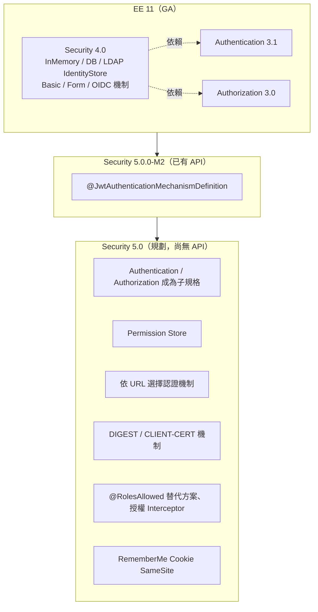

| 項目 | 狀態 | 來源 |
|------|------|------|
| JWT 認證機制註解 | **M2 已有**（可編譯，12.6） | API 差異：新增 `JwtAuthenticationMechanismDefinition` 及其 `Literal`、`List` |
| 吸收 Authentication 3.1 / Authorization 3.0 | 規劃；套件名稱是否保留「留待後續版本決定」 | Security 5.0 規格頁 |
| Permission Store | 規劃（建在 Authorization Policy 之上） | 同上 |
| DIGEST（#190）、CLIENT-CERT（#120） | 規劃 | 同上 |
| 依 URL pattern 選擇機制（#86） | 規劃 | 同上 |
| `@RolesAllowed` 替代方案（#295） | 規劃 | 同上 |
| 相容實作 | Soteria 5.0.0-M2 + GlassFish 9.0.0-M2 | 同上 |

> v2.0 把以上規劃項目寫成「Security 5.0 已吸收」「Permission Store（Security 5.0 新增）」，並附上看似可用、其實只是 `@RolesAllowed` 加註解的範例。審查 AI 產出的安全程式時，只要看到 Permission Store 的具體 API，就可以判定是捏造的。

### 12.2 EE 11 的認證設定（[GA]，Liberty 實測）

驗證專案用 Basic 認證 + EE 11 新增的 `@InMemoryIdentityStoreDefinition`：

```java
package com.company.app.api.security;

import jakarta.annotation.security.DeclareRoles;
import jakarta.enterprise.context.ApplicationScoped;
import jakarta.security.enterprise.authentication.mechanism.http.BasicAuthenticationMechanismDefinition;
import jakarta.security.enterprise.identitystore.InMemoryIdentityStoreDefinition;
import jakarta.security.enterprise.identitystore.InMemoryIdentityStoreDefinition.Credentials;

/**
 * 驗證/開發用：Basic + InMemoryIdentityStore（Jakarta Security 4.0 / EE 11 新增）。
 * 生產環境改成 @OpenIdAuthenticationMechanismDefinition 或 MP JWT，
 * 帳密絕不可寫死在程式碼——這裡的值只存在於測試環境。
 */
@BasicAuthenticationMechanismDefinition(realmName = "app")
@InMemoryIdentityStoreDefinition({
        @Credentials(callerName = "alice", password = "alice-pass", groups = {"USER"}),
        @Credentials(callerName = "tom", password = "tom-pass", groups = {"TELLER"}),
        @Credentials(callerName = "root", password = "root-pass", groups = {"ADMIN", "USER"})
})
@DeclareRoles({"USER", "TELLER", "ADMIN"})
@ApplicationScoped
public class SecurityConfig {
}
```

**Liberty 實測注意**（5.1 已列）：`allowInMemoryIdentityStores="true"` 才會啟用；不要寫 `application-bnd` 群組對應；log 會出現 `CWWKS2600W` 提醒不要用在生產環境。

**驗證結果**：

| 測試 | 預期 | 結果 |
|------|------|------|
| 未帶帳密呼叫 `/orders` | 401 | 通過 |
| alice（USER）呼叫 `/diagnostics/events`（ADMIN） | 403 | 通過 |
| alice（USER）呼叫 `/transfers`（TELLER） | 403 | 通過 |
| tom（TELLER）轉帳 | 200 | 通過 |
| root（ADMIN）啟動 Batch | 200 | 通過 |

#### 生產環境的選擇

| 需求 | EE 11 標準做法 | 備註 |
|------|---------------|------|
| 瀏覽器登入（SSO） | `@OpenIdAuthenticationMechanismDefinition`（Security 3.0 起） | Authorization Code Flow，由 Server 處理 token |
| API 用 Bearer Token | MicroProfile JWT 2.1（`mpJwt-2.1`） | Security 5.0 GA 後可改用 12.6 的標準註解 |
| 企業目錄 | `@LdapIdentityStoreDefinition` | — |
| 自有帳號表 | `@DatabaseIdentityStoreDefinition` + `Pbkdf2PasswordHash` | 密碼雜湊參數要定期檢討 |

### 12.3 OAuth2 與 OpenID Connect

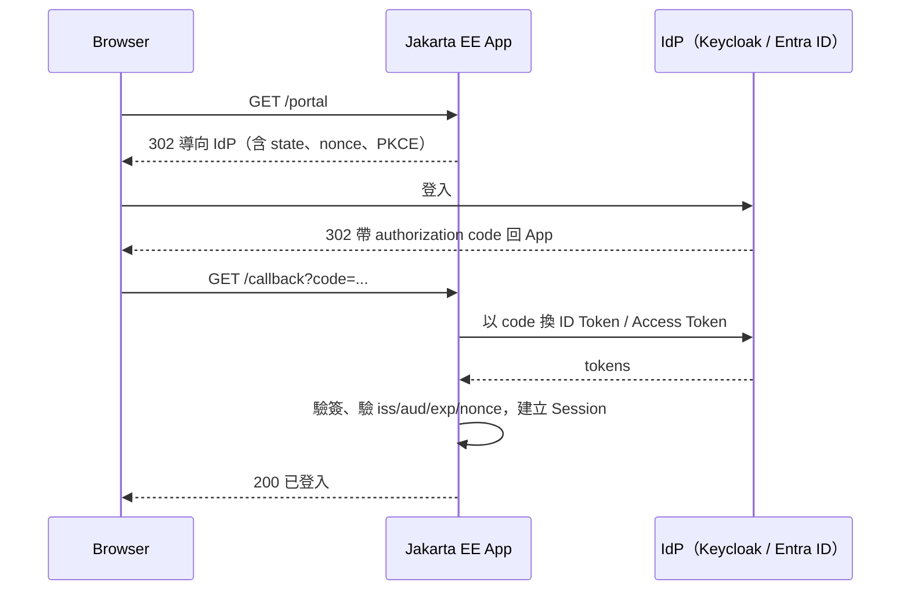

#### 瀏覽器登入：Security 的 OIDC 機制

```java
@OpenIdAuthenticationMechanismDefinition(
        providerURI = "${oidc.providerUri}",          // 例：https://idp.example.com/realms/bank
        clientId = "${oidc.clientId}",
        clientSecret = "${oidc.clientSecret}",       // 由 MP Config / Secret 注入，不寫死
        redirectURI = "${baseURL}/callback",
        scope = {"openid", "profile", "email"},
        claimsDefinition = @ClaimsDefinition(callerGroupsClaim = "groups"))
@ApplicationScoped
public class PortalSecurity {
}
```

#### API：MicroProfile JWT

```properties
# microprofile-config.properties（值由環境變數覆寫）
mp.jwt.verify.publickey.location=https://idp.example.com/realms/bank/protocol/openid-connect/certs
mp.jwt.verify.issuer=https://idp.example.com/realms/bank
mp.jwt.verify.audiences=order-api
mp.jwt.token.header=Authorization
```

```java
@Path("/me")
@RequestScoped
@RolesAllowed("USER")                // groups claim 對應角色
public class MeResource {
    @Inject JsonWebToken jwt;

    @GET
    public Map<String, Object> me() {
        return Map.of("sub", jwt.getSubject(), "groups", jwt.getGroups());
    }
}
```

> **驗證狀態**：12.3 的 OIDC 與 MP JWT 程式依規格撰寫，**未在本機執行**（需要 IdP），列入附錄 C。上線前用第 22 章的方式加一組 IT：偽造簽章、過期、錯誤 `aud` 的 token 都必須得到 401。

> v2.0 12.2 用 JJWT 的 `setIssuer`、`signWith(key, SignatureAlgorithm.RS256)`：這是 JJWT 0.11 的舊 API，0.12 起已 deprecated（查核日最新 0.13.0）；而且範例在 `@PostConstruct` 每次啟動產生新的 RSA 金鑰，多 Pod 部署時 A Pod 簽的 token B Pod 驗不過。**簽發 token 是 IdP 的工作**，應用程式只驗證。

### 12.4 RBAC 角色存取控制與 Permission Store

#### RBAC（[GA]）

| 位置 | 寫法 | 本專案 |
|------|------|-------|
| 類別層級 | `@RolesAllowed({"USER","ADMIN"})` | `OrderResource` |
| 方法層級覆寫 | `@RolesAllowed("TELLER")` | `TransferResource.transfer` |
| 公開端點 | `@PermitAll` | `ProductResource`、`FxResource` |
| 宣告角色 | `@DeclareRoles` | `SecurityConfig` |
| 程式判斷 | `SecurityContext.isCallerInRole("ADMIN")` | 資料層級授權（例如只能看自己的訂單） |

> **物件層級授權（OWASP A01）**：`@RolesAllowed("USER")` 只代表「是使用者」，不代表「可以看這筆訂單」。查詢單筆資料時必須比對擁有者，例如 `order.customerId().equals(securityContext.getCallerPrincipal().getName())`，否則就是 IDOR。

#### Permission Store（規劃中）

Security 5.0 規劃以 Jakarta Authorization 的 Policy 為基礎提供 Permission Store，讓「角色 → 權限」對應可以設定而不是寫死在註解。查核日尚無 API；在那之前，細粒度權限的務實做法：

1. 角色只表達職務（USER、TELLER、ADMIN）。
2. 權限檢查集中在一個 `@ApplicationScoped AuthorizationService`，以「動作 + 資源擁有者」判斷。
3. 用 Interceptor（`@RequiresPermission("order:approve")`）呼叫它，並為每個權限寫 IT。

### 12.5 多重認證機制

**EE 11（Security 4.0）已可讓多個機制共存**，但要自己寫選擇邏輯：每個機制定義加上 `qualifiers`，再提供一個 `HttpAuthenticationMechanismHandler`（以 `@Alternative @Priority` 取代預設 Handler）依請求選擇。Security 5.0 規劃的是「依 URL pattern 宣告式選擇」，目前沒有 API。

範例（已驗證：以 `jakarta.security.enterprise-api:4.0.0` 編譯通過；未在 Liberty 執行）：

```java
package demo.sec4;

import jakarta.annotation.Priority;
import jakarta.enterprise.context.ApplicationScoped;
import jakarta.enterprise.inject.Alternative;
import jakarta.inject.Inject;
import jakarta.inject.Qualifier;
import jakarta.security.enterprise.AuthenticationException;
import jakarta.security.enterprise.AuthenticationStatus;
import jakarta.security.enterprise.authentication.mechanism.http.BasicAuthenticationMechanismDefinition;
import jakarta.security.enterprise.authentication.mechanism.http.FormAuthenticationMechanismDefinition;
import jakarta.security.enterprise.authentication.mechanism.http.HttpAuthenticationMechanism;
import jakarta.security.enterprise.authentication.mechanism.http.HttpAuthenticationMechanismHandler;
import jakarta.security.enterprise.authentication.mechanism.http.HttpMessageContext;
import jakarta.security.enterprise.authentication.mechanism.http.LoginToContinue;
import jakarta.servlet.http.HttpServletRequest;
import jakarta.servlet.http.HttpServletResponse;

import java.lang.annotation.Retention;
import java.lang.annotation.RetentionPolicy;

/**
 * Jakarta Security 4.0（EE 11）：多個認證機制共存。
 * 1) 每個機制用 qualifiers 區分；2) 自己提供 HttpAuthenticationMechanismHandler 依請求選擇。
 * Security 5.0 規劃的是「依 URL pattern 宣告式選擇」，目前尚無 API。
 */
@BasicAuthenticationMechanismDefinition(realmName = "api", qualifiers = MultiMechanismConfig.Api.class)
@FormAuthenticationMechanismDefinition(
        loginToContinue = @LoginToContinue(loginPage = "/login.html", errorPage = "/login-error.html"),
        qualifiers = MultiMechanismConfig.Portal.class)
@ApplicationScoped
public class MultiMechanismConfig {

    @Qualifier
    @Retention(RetentionPolicy.RUNTIME)
    public @interface Api {
    }

    @Qualifier
    @Retention(RetentionPolicy.RUNTIME)
    public @interface Portal {
    }

    /** 以 @Alternative + @Priority 取代容器預設的 Handler。 */
    @Alternative
    @Priority(1)
    @ApplicationScoped
    public static class PathBasedHandler implements HttpAuthenticationMechanismHandler {

        @Inject @Api HttpAuthenticationMechanism api;
        @Inject @Portal HttpAuthenticationMechanism portal;

        @Override
        public AuthenticationStatus validateRequest(HttpServletRequest request, HttpServletResponse response,
                                                    HttpMessageContext context) throws AuthenticationException {
            String path = request.getRequestURI().substring(request.getContextPath().length());
            HttpAuthenticationMechanism chosen = path.startsWith("/api/") ? api : portal;
            return chosen.validateRequest(request, response, context);
        }
    }
}
```

v2.0 的範例把 `@BasicAuthenticationMechanismDefinition` 與 `@FormAuthenticationMechanismDefinition` 直接放在同一個類別、**沒有 qualifier 也沒有 Handler**，並說「Security 5.0 會自動依 URL 選擇」。在 EE 11 上這樣寫會產生兩個同型別、同為 `@Default` 的 `HttpAuthenticationMechanism`，容器無法決定用哪一個（實際行為依實作而異，本手冊未實測此反例）。

| 需求 | 做法 |
|------|------|
| 瀏覽器用 Form/OIDC、API 用 Basic/JWT | 上面的 qualifier + Handler；或拆成兩個應用 |
| 服務間 mTLS | 在 Gateway / Service Mesh 終結 mTLS，把身分以 header 傳入並驗證來源 |
| 管理介面 MFA | 交給 IdP（Keycloak / Entra ID）的登入流程 |

### 12.6 Security 5.0 的 JWT 機制（[EE12-M]）

以 `jakarta.security.enterprise-api:5.0.0-M2` 編譯驗證：

```java
package demo.ee12.security;

import jakarta.enterprise.context.ApplicationScoped;
import jakarta.security.enterprise.authentication.mechanism.http.JwtAuthenticationMechanismDefinition;

/**
 * Jakarta Security 5.0（5.0.0-M2）新增：標準化的 JWT Bearer 認證機制。
 * EE 11 只能用 MicroProfile JWT（mpJwt）或廠商設定；5.0 起可用註解宣告。
 * 屬性名稱以 M2 為準，GA 前可能變動——依附錄 C 的查核方式在 GA 後重新比對。
 */
@JwtAuthenticationMechanismDefinition(
        acceptedIssuer = "https://idp.example.com/realms/bank",
        allowedAudience = "order-api",
        publicKeyLocation = "https://idp.example.com/realms/bank/protocol/openid-connect/certs",
        keyAlgorithm = "RS256",
        tokenAge = 300,
        clockSkew = 30)
@ApplicationScoped
public class JwtApiSecurity {
}
```

屬性（M2）：`acceptedIssuer`、`allowedAudience`、`publicKey` / `publicKeyLocation`、`decryptKeyLocation`、`keyAlgorithm`、`tokenAge`、`clockSkew`、`keyCacheTTL`、`configJwtTokenHeader` / `configJwtTokenCookie`、`enableNamespace` / `customNamespace`、`disableTypeVerification`、`qualifiers`。這組屬性和 MP JWT 的設定項幾乎一一對應，未來遷移成本低。

### 12.7 API Security 與 OWASP Top 10:2025

API 層的防護元件（9.8 已實作並測試）：Correlation ID 格式驗證、安全標頭、限流、統一錯誤格式（不洩漏堆疊與輸入值）。

[OWASP Top 10:2025](https://top10.owasp.org/2025) 與本手冊的對照（v2.0 用的是 2021 版分類）：

| OWASP 2025 | Jakarta EE 實作 | 本手冊 |
|-----------|----------------|-------|
| A01 Broken Access Control | `@RolesAllowed` + 物件層級擁有者檢查 + 預設拒絕 | 12.4、`PlatformIT.transfer` |
| A02 Security Misconfiguration | 最小 feature 集合、關閉 InMemory store、安全標頭 | 5.1、9.8 |
| A03 Software Supply Chain Failures | SBOM、Dependency-Check、映像 digest 固定、Action 版本固定 | 18.4、18.5、16.2 |
| A04 Cryptographic Failures | TLS 在 Gateway、`Pbkdf2PasswordHash`、不自建金鑰 | 12.2、12.3 |
| A05 Injection | JPQL 參數化、排序白名單、Correlation ID 驗證 | 9.6、9.8 |
| A06 Insecure Design | 威脅建模、業務規則在 Domain | 7、19.1 |
| A07 Authentication Failures | OIDC / MP JWT 驗簽、驗 `iss`/`aud`/`exp` | 12.3 |
| A08 Software or Data Integrity Failures | 樂觀鎖、映像簽章、CI 權限最小化 | 10.5、18.1 |
| A09 Security Logging and Alerting Failures | JSON 結構化日誌、Correlation ID、告警規則 | 21 |
| A10 Mishandling of Exceptional Conditions | 統一 ExceptionMapper、500 只回追蹤碼、fail closed | 9.4 |

### 12.8 Secure Coding 實務

| 規則 | ✅ 正確 | ❌ 錯誤 |
|------|--------|--------|
| 輸入驗證用白名單 | `@Pattern(regexp = "[A-Z0-9-]{1,36}")` | v2.0 的 `input.replaceAll("[<>\"'&]", "")`（黑名單、會破壞合法資料、擋不住其他編碼） |
| 輸出編碼交給框架 | JSON-B 序列化、Faces 自動跳脫 | 手動拼 HTML 字串 |
| 機敏資料不進 log | `LoggingInterceptor` 只記方法名與耗時 | 記錄完整參數 |
| 錯誤不洩漏內部資訊 | 500 只回 incident id | 回傳 `e.getMessage()` 或堆疊 |
| Secret 外部化 | MP Config + K8s Secret / Vault | 寫在 `server.xml` 或程式碼 |
| 密碼雜湊 | `Pbkdf2PasswordHash`（或 IdP） | MD5 / SHA-256 無 salt |

### 12.9 實務注意事項

> **Security 最佳實務**
> 1. 認證交給 IdP；應用程式只驗證 token，不簽發。
> 2. `@RolesAllowed` 之外一定要有物件層級授權。
> 3. 多個認證機制必須用 qualifier 區分並提供 Handler（EE 11）；能拆應用就拆，邏輯最單純。
> 4. 開發用的 InMemory IdentityStore 由 profile 控制，生產設定檔中 `allowInMemoryIdentityStores` 不可為 true（CI 檢查 `server.xml`）。
> 5. Security 5.0 的規劃功能在 API 出現前不寫進設計文件的「已提供」欄。

### 12.10 審查與驗證清單

| 檢查項目 | 如何驗證 | 預期結果 | 常見 AI 錯誤 |
|---------|---------|---------|-------------|
| 宣稱的 Security 5.0 API 存在 | `javap -cp jakarta.security.enterprise-api-5.0.0-M2.jar` | 只有 JWT 機制是新的 | 捏造 Permission Store API |
| 未認證存取 | `curl -i` 不帶憑證 | 401 | 只在前端隱藏按鈕 |
| 角色不符 | 用低權限帳號呼叫高權限 API | 403 | 漏掉方法層級 `@RolesAllowed` |
| 物件層級授權 | 用 A 的 token 讀 B 的資源 | 403 / 404 | 只檢查角色 |
| Token 驗證 | 送偽造簽章、過期、錯誤 `aud` | 401 | 只檢查 `Bearer ` 前綴 |
| 金鑰管理 | 搜尋 `KeyPairGenerator` | 應用內不產生簽章金鑰 | `@PostConstruct` 每次產生新金鑰 |
| 多機制設定 | 審查認證註解 | 每個機制都有 `qualifiers`，且有自訂 `HttpAuthenticationMechanismHandler` | Basic + Form 同時宣告、沒有 qualifier |
| 生產設定 | `grep allowInMemoryIdentityStores` 生產設定 | 不存在或 false | 測試設定帶進生產 |

## 13. Jakarta Concurrency 3.2

> **狀態**：生產用 **Concurrency 3.1**（EE 11，[GA]：`@ManagedExecutorDefinition(virtual = true)`、`@Asynchronous`、`@Schedule`），本章 13.1–13.3 在 Liberty 實測。**Concurrency 3.2** 目前 3.2.0-M3（[EE12-M]）：新增 `@Lock`、計畫中的 `MaxConcurrency`、以 `@Schedule` 在啟動時排程。

規則：**在 Jakarta EE 容器內不要自己建立執行緒**（`new Thread()`、`Executors.newXxx()`、`CompletableFuture.supplyAsync(...)` 不帶 executor）。自建執行緒拿不到 Security Context、交易、CDI Context 與 JNDI，Server 也無法在關閉時管理它們。

### 13.1 ManagedExecutorService

EE 11 起可以用註解定義 Executor，不必改 `server.xml`：

```java
package com.company.app.api.concurrency;

import jakarta.enterprise.concurrent.ContextServiceDefinition;
import jakarta.enterprise.concurrent.ManagedExecutorDefinition;
import jakarta.enterprise.context.ApplicationScoped;

import static jakarta.enterprise.concurrent.ContextServiceDefinition.APPLICATION;
import static jakarta.enterprise.concurrent.ContextServiceDefinition.SECURITY;

/**
 * Jakarta Concurrency 3.1（EE 11）：以註解定義 Executor，不必改 server.xml。
 * virtual = true 要求 Java 21+；容器若不支援虛擬執行緒會退回平台執行緒。
 * maxAsync 對虛擬執行緒同樣有效——它是保護下游（DB、外部 API）的閘門。
 */
@ContextServiceDefinition(name = "java:app/concurrent/appContext",
        propagated = {APPLICATION, SECURITY})
@ManagedExecutorDefinition(name = "java:app/concurrent/virtualExecutor",
        context = "java:app/concurrent/appContext",
        virtual = true, maxAsync = 200, hungTaskThreshold = 60_000)
@ManagedExecutorDefinition(name = "java:app/concurrent/reportExecutor",
        context = "java:app/concurrent/appContext",
        virtual = false, maxAsync = 4)
@ApplicationScoped
public class ConcurrencyConfig {
}
```

| 屬性 | 說明 | 本專案設定 |
|------|------|-----------|
| `name` | JNDI 名稱（`java:app/...` 讓整個應用共用） | `java:app/concurrent/virtualExecutor` |
| `context` | 要傳播哪些 Context（`APPLICATION`、`SECURITY`、`TRANSACTION`…） | 傳播應用與安全 Context |
| `virtual` | 使用虛擬執行緒（需 Java 21+；不支援時退回平台執行緒） | I/O 用 `true`；CPU 密集報表 `false` |
| `maxAsync` | 最大並行數 | 虛擬執行緒也要設——它保護的是下游資源 |
| `hungTaskThreshold` | 超過此毫秒數視為卡住，Server 會記錄 | 60 秒 |

也可以在 Liberty 的 `server.xml` 定義（依 Liberty 文件；`virtual` 屬性在 `concurrencyPolicy` 上，**不是** v2.0 寫的 `<virtualThreads>true</virtualThreads>` 子元素或 `virtualThreads="true"` 屬性——那兩種寫法都不存在）：

```xml
<managedExecutorService jndiName="concurrent/virtualExecutor" concurrencyPolicyRef="vtPolicy"/>
<concurrencyPolicy id="vtPolicy" virtual="true" max="200" maxPolicy="strict"/>
```

> 上面這段 `server.xml` 依 [Liberty managedExecutorService 文件](https://openliberty.io/docs/latest/reference/config/managedExecutorService.html) 撰寫，未在本機執行；本手冊實測的是註解寫法。

### 13.2 Async Processing

`@Asynchronous`（Concurrency 3.0 起，可用在任何 CDI Bean）讓方法在指定 Executor 上執行：

```java
package com.company.app.api.concurrency;

import jakarta.annotation.Resource;
import jakarta.enterprise.concurrent.Asynchronous;
import jakarta.enterprise.concurrent.ManagedExecutorService;
import jakarta.enterprise.context.ApplicationScoped;

import java.util.List;
import java.util.concurrent.CompletableFuture;
import java.util.concurrent.TimeUnit;
import java.util.stream.IntStream;

@ApplicationScoped
public class ReportService {

    @Resource(lookup = "java:app/concurrent/virtualExecutor")
    ManagedExecutorService virtualExecutor;

    public record Part(int index, boolean virtualThread, String threadName) {
    }

    /**
     * @Asynchronous（Concurrency 3.0+）：方法本身在指定 Executor 執行，
     * 回傳值必須是 CompletableFuture / CompletionStage / void。
     * 方法內用 Asynchronous.Result.complete(...) 交出結果。
     */
    @Asynchronous(executor = "java:app/concurrent/reportExecutor")
    public CompletableFuture<String> buildSummary(String type) {
        String thread = Thread.currentThread().getName();
        return Asynchronous.Result.complete("summary:" + type + "@" + thread);
    }

    /** 扇出（fan-out）到虛擬執行緒；每個 Future.get 都要有逾時。 */
    public List<Part> fanOut(int parts) throws Exception {
        List<CompletableFuture<Part>> futures = IntStream.range(0, parts)
                .mapToObj(i -> virtualExecutor.supplyAsync(() -> {
                    sleepQuietly(50); // 模擬 I/O：虛擬執行緒在此卸載，不佔 carrier thread
                    Thread t = Thread.currentThread();
                    return new Part(i, t.isVirtual(), t.getName());
                }))
                .toList();
        CompletableFuture.allOf(futures.toArray(CompletableFuture[]::new)).get(10, TimeUnit.SECONDS);
        return futures.stream().map(CompletableFuture::join).toList();
    }

    private static void sleepQuietly(long ms) {
        try {
            Thread.sleep(ms);
        } catch (InterruptedException e) {
            Thread.currentThread().interrupt();
        }
    }
}
```

REST 端回傳 `CompletionStage`，請求執行緒立即釋放：

```java
package com.company.app.api.resource;

import com.company.app.api.concurrency.ReportService;
import jakarta.annotation.security.RolesAllowed;
import jakarta.enterprise.context.RequestScoped;
import jakarta.inject.Inject;
import jakarta.validation.constraints.Max;
import jakarta.validation.constraints.Min;
import jakarta.ws.rs.DefaultValue;
import jakarta.ws.rs.GET;
import jakarta.ws.rs.Path;
import jakarta.ws.rs.PathParam;
import jakarta.ws.rs.Produces;
import jakarta.ws.rs.QueryParam;
import jakarta.ws.rs.core.MediaType;

import java.util.List;
import java.util.Map;
import java.util.concurrent.CompletionStage;

@Path("/reports")
@Produces(MediaType.APPLICATION_JSON)
@RequestScoped
@RolesAllowed("ADMIN")
public class ReportResource {

    @Inject ReportService reportService;

    /** 回傳 CompletionStage：JAX-RS 自動非同步回應，請求執行緒立即釋放。 */
    @GET
    @Path("/summary/{type}")
    public CompletionStage<Map<String, String>> summary(@PathParam("type") String type) {
        return reportService.buildSummary(type).thenApply(s -> Map.of("result", s));
    }

    @GET
    @Path("/fan-out")
    public List<ReportService.Part> fanOut(@QueryParam("parts") @DefaultValue("20") @Min(1) @Max(500) int parts)
            throws Exception {
        return reportService.fanOut(parts);
    }
}
```

> v2.0 13.2 用 `@Suspended AsyncResponse` + `executor.submit(...)`：可用，但 REST 5.0 已把 `@Suspended` 標為 deprecated；而且忘記 `resume()` 時請求會一直掛著。回傳 `CompletionStage` 沒有這個問題。

### 13.3 Virtual Thread 整合

**驗證結果**（`PlatformIT.concurrency`）：

- `GET /reports/summary/daily` 回傳 `summary:daily@<thread>`：`@Asynchronous` 方法確實在 `reportExecutor` 執行。
- `GET /reports/fan-out?parts=200`：200 個各 sleep 50ms 的任務，回應中每一筆 `virtualThread` 都是 `true`，總時間 < 5 秒（序列執行需 10 秒）。
- 非 ADMIN 呼叫得到 403：安全 Context 有傳播到受管理執行緒（`propagated = SECURITY`）。

| 規則 | 理由 |
|------|------|
| 每個 `Future.get` / `CompletableFuture` 都有逾時 | 下游掛住時不會耗盡請求執行緒 |
| 虛擬執行緒仍要 `maxAsync` | 數萬個虛擬執行緒同時打 DB，連線池（20 條）會成為瓶頸並大量逾時 |
| 不要池化虛擬執行緒 | 建立成本低；池化反而限制並行且違背設計 |
| CPU 密集任務用平台執行緒 | 虛擬執行緒不會讓 CPU 變多 |
| 不在 Java 21 的 `synchronized` 內長時間 I/O | pinning（Java 24 起大幅改善） |

### 13.4 高併發設計模式

#### Bulkhead：依業務隔離執行器

`ConcurrencyConfig` 定義了兩個 Executor：I/O 扇出用虛擬執行緒（`maxAsync = 200`）、報表用平台執行緒（`maxAsync = 4`）。報表塞爆時不會影響訂單。另一層 Bulkhead 是 MicroProfile Fault Tolerance 的 `@Bulkhead`（17.7）。

#### 讀寫鎖：Concurrency 3.2 的 `@Lock`（[EE12-M]）

以 `jakarta.enterprise.concurrent-api:3.2.0-M3` 編譯驗證：

```java
package demo.ee12.concurrency;

import jakarta.enterprise.concurrent.Lock;
import jakarta.enterprise.context.ApplicationScoped;

import java.math.BigDecimal;
import java.util.HashMap;
import java.util.Map;
import java.util.concurrent.TimeUnit;

/**
 * Concurrency 3.2（3.2.0-M3）：@Lock 讓 CDI Bean 取得類似 @Singleton EJB 的讀寫鎖語意，
 * 不必手寫 ReentrantReadWriteLock。accessTimeout 逾時丟 LockTimeoutException。
 */
@ApplicationScoped
public class RateTable {

    private final Map<String, BigDecimal> rates = new HashMap<>();

    @Lock(type = Lock.Type.READ, accessTimeout = 2, unit = TimeUnit.SECONDS)
    public BigDecimal rate(String currency) {
        return rates.get(currency);
    }

    @Lock(type = Lock.Type.WRITE, accessTimeout = 5, unit = TimeUnit.SECONDS)
    public void reload(Map<String, BigDecimal> latest) {
        rates.clear();
        rates.putAll(latest);
    }
}
```

EE 11 的對應寫法是 `@Singleton` EJB 的 `@Lock(READ/WRITE)` 或自己用 `ReentrantReadWriteLock`。

#### 排程

| 需求 | EE 11 做法 |
|------|-----------|
| 應用內週期任務 | `@Asynchronous(runAt = @Schedule(cron = "0 0 2 * * *"))`（Concurrency 3.1） |
| 多 Pod 只跑一次 | 不要用應用內排程；改用 Kubernetes CronJob 或 Batch + 分散鎖 |

### 13.5 實務注意事項

> **並行處理要點**
> 1. 只用 Managed Executor；自建執行緒是審查時的紅燈。
> 2. 虛擬執行緒解決的是「等待」，不是「計算」。
> 3. 所有等待都要有逾時；所有扇出都要有並行上限。
> 4. Context 傳播要明確設定，尤其是 SECURITY 與 TRANSACTION。
> 5. `@Lock`（3.2）在 EE 12 前不要用。

### 13.6 審查與驗證清單

| 檢查項目 | 如何驗證 | 預期結果 | 常見 AI 錯誤 |
|---------|---------|---------|-------------|
| 無自建執行緒 | `grep -rnE "new Thread\(\|Executors\.new" src/main`；另審查 `supplyAsync`/`runAsync` 是否帶 executor 參數 | 無結果；`supplyAsync` 都帶 Managed Executor | `CompletableFuture.supplyAsync(...)` 不帶 executor |
| 虛擬執行緒真的生效 | 在任務中記錄 `Thread.currentThread().isVirtual()`（13.3） | true | 只是把變數取名 `virtualExecutor` |
| Liberty 設定語法 | Liberty 文件 / 啟動 log | 無設定相關警告（`CWWKG` 開頭的 W 訊息） | `<virtualThreads>true</virtualThreads>` |
| 逾時 | 搜尋 `.get()`、`.join()` | 前面有 `get(timeout)` 或 `orTimeout` | 無限等待 |
| 並行上限 | 檢查 `maxAsync` / Semaphore | 有設定且 ≤ 下游容量 | 虛擬執行緒不設上限 |
| Context 傳播 | 非同步任務中呼叫 `@RolesAllowed` 方法 | 權限正確 | 安全 Context 遺失導致 403 或越權 |

## 14. Jakarta Batch 2.2

> **狀態**：生產用 **Batch 2.1**（EE 11 Platform，[GA]），本章作業在 Liberty（`batch-2.1`，Job Repository 存在 PostgreSQL）實際執行。Batch 2.2 是 EE 12 目標版本，查核日 Maven Central 尚無 2.2 artifact。

### 14.1 批次架構概觀

```mermaid
graph TB
    OP[JobOperator] --> JR[(Job Repository<br/>執行紀錄 / checkpoint)]
    OP --> JOB[Job: inventory-settlement]
    JOB --> STEP[Step: settle<br/>chunk item-count=50]
    STEP --> PM[PartitionMapper<br/>依分類切割區]
    PM --> P1[Partition: display]
    PM --> P2[Partition: peripheral]
    P1 --> R1[Reader] --> PR1[Processor] --> W1[Writer]
    P2 --> R2[Reader] --> PR2[Processor] --> W2[Writer]
```

| 元件 | 交易 | 本專案 |
|------|------|-------|
| Chunk | 每 `item-count` 筆一個交易；commit 時寫 checkpoint | 50 |
| Reader | `checkpointInfo()` 回傳可序列化的位置 | 以「最後處理的主鍵」為 checkpoint |
| Processor | 回傳 `null` = 過濾掉這筆 | 庫存為 0 的商品不結算 |
| Writer | 在 chunk 交易內，不自己 commit | `merge` 達成冪等 |
| Partition | 每個割區獨立 Reader/Processor/Writer | `threads ≤ 連線池大小` |

### 14.2 Job 與 Step 設計

```xml
<?xml version="1.0" encoding="UTF-8"?>
<job id="inventory-settlement" xmlns="https://jakarta.ee/xml/ns/jakartaee"
     xmlns:xsi="http://www.w3.org/2001/XMLSchema-instance"
     xsi:schemaLocation="https://jakarta.ee/xml/ns/jakartaee https://jakarta.ee/xml/ns/jakartaee/jobXML_2_0.xsd"
     version="2.0" restartable="true">

    <step id="settle">
        <chunk item-count="50" skip-limit="10" retry-limit="3">
            <reader ref="inventoryReader">
                <properties>
                    <property name="category" value="#{partitionPlan['category']}"/>
                </properties>
            </reader>
            <processor ref="inventoryProcessor">
                <properties>
                    <property name="runId" value="#{jobParameters['runId']}"/>
                </properties>
            </processor>
            <writer ref="settlementWriter"/>
            <skippable-exception-classes>
                <include class="java.lang.IllegalArgumentException"/>
            </skippable-exception-classes>
            <retryable-exception-classes>
                <include class="java.sql.SQLTransientException"/>
                <include class="jakarta.persistence.PessimisticLockException"/>
            </retryable-exception-classes>
        </chunk>
        <partition>
            <mapper ref="categoryPartitionMapper"/>
        </partition>
    </step>
</job>
```

| 設定 | 說明 |
|------|------|
| `restartable="true"` | 失敗後可 `JobOperator.restart(executionId)` 從最後 checkpoint 繼續 |
| `skippable-exception-classes` | 資料錯誤：略過並記錄，超過 `skip-limit` 才失敗 |
| `retryable-exception-classes` | 暫時性錯誤：重試，超過 `retry-limit` 才失敗 |
| `#{partitionPlan['category']}` | 由 PartitionMapper 提供的割區參數 |
| `#{jobParameters['runId']}` | 啟動作業時傳入，讓重跑具冪等性 |

### 14.3 Chunk Processing

#### Reader：keyset checkpoint，不一次載入全表

```java
package com.company.app.api.batch;

import com.company.app.infrastructure.persistence.entity.ProductEntity;
import jakarta.batch.api.BatchProperty;
import jakarta.batch.api.chunk.AbstractItemReader;
import jakarta.enterprise.context.Dependent;
import jakarta.inject.Inject;
import jakarta.inject.Named;
import jakarta.persistence.EntityManager;
import jakarta.persistence.PersistenceContext;

import java.io.Serializable;
import java.util.List;

/**
 * 以「上一次處理到的主鍵」作為 checkpoint（keyset），而不是 List 索引：
 * 重啟時資料若有增減，索引會錯位，主鍵不會。
 */
@Named("inventoryReader")
@Dependent
public class InventoryReader extends AbstractItemReader {

    private static final int FETCH = 100;

    @PersistenceContext(unitName = "appPU")
    EntityManager em;

    @Inject
    @BatchProperty(name = "category")
    String category;

    private String lastId = "";
    private List<ProductEntity> buffer = List.of();
    private int pos;

    @Override
    public void open(Serializable checkpoint) {
        lastId = checkpoint == null ? "" : (String) checkpoint;
        fill();
    }

    @Override
    public Object readItem() {
        if (pos >= buffer.size()) {
            fill();
            if (buffer.isEmpty()) {
                return null; // null = 讀完，Step 結束
            }
        }
        ProductEntity p = buffer.get(pos++);
        lastId = p.getId();
        return p;
    }

    @Override
    public Serializable checkpointInfo() {
        return lastId;
    }

    private void fill() {
        buffer = em.createQuery("SELECT p FROM ProductEntity p WHERE p.category = :c AND p.id > :last "
                        + "ORDER BY p.id", ProductEntity.class)
                .setParameter("c", category)
                .setParameter("last", lastId)
                .setMaxResults(FETCH)
                .getResultList();
        pos = 0;
    }
}
```

v2.0 的 Reader 在 `open()` 中 `getResultList()` 一次讀入所有待處理資料，再用 List 索引當 checkpoint：資料量大時直接 OOM；重啟時若資料已增減，索引會指向錯的資料。

#### Processor 與 Writer

```java
package com.company.app.api.batch;

import com.company.app.infrastructure.batch.SettlementEntity;
import com.company.app.infrastructure.persistence.entity.ProductEntity;
import jakarta.batch.api.BatchProperty;
import jakarta.batch.api.chunk.ItemProcessor;
import jakarta.enterprise.context.Dependent;
import jakarta.inject.Inject;
import jakarta.inject.Named;

import java.math.BigDecimal;

@Named("inventoryProcessor")
@Dependent
public class InventoryProcessor implements ItemProcessor {

    @Inject
    @BatchProperty(name = "runId")
    String runId;

    /** 回傳 null 代表「略過這筆」（filter），不是錯誤。 */
    @Override
    public Object processItem(Object item) {
        ProductEntity p = (ProductEntity) item;
        if (p.getStock() == 0) {
            return null;
        }
        return new SettlementEntity(runId, p.getId(), p.getPrice().multiply(BigDecimal.valueOf(p.getStock())));
    }
}
```

```java
package com.company.app.api.batch;

import com.company.app.infrastructure.batch.SettlementEntity;
import jakarta.batch.api.chunk.AbstractItemWriter;
import jakarta.enterprise.context.Dependent;
import jakarta.inject.Named;
import jakarta.persistence.EntityManager;
import jakarta.persistence.PersistenceContext;

import java.util.List;

/**
 * Chunk 的交易由 Batch Runtime 管理（每 item-count 筆一個交易），
 * Writer 內不要自己開 / commit 交易。merge 讓重跑同一 runId 時具冪等性。
 */
@Named("settlementWriter")
@Dependent
public class SettlementWriter extends AbstractItemWriter {

    @PersistenceContext(unitName = "appPU")
    EntityManager em;

    @Override
    public void writeItems(List<Object> items) {
        for (Object item : items) {
            em.merge((SettlementEntity) item);
        }
    }
}
```

結算輸出 Entity 有 `(run_id, product_id)` 唯一鍵：

```java
package com.company.app.infrastructure.batch;

import jakarta.persistence.Column;
import jakarta.persistence.Entity;
import jakarta.persistence.Id;
import jakarta.persistence.Table;
import jakarta.persistence.UniqueConstraint;

import java.math.BigDecimal;

/** 批次輸出：每個 (執行批號, 商品) 一筆，唯一鍵讓重跑時不會重複寫入。 */
@Entity
@Table(name = "inventory_settlements",
        uniqueConstraints = @UniqueConstraint(columnNames = {"run_id", "product_id"}))
public class SettlementEntity {

    @Id
    @Column(length = 80)
    private String id;

    @Column(name = "run_id", nullable = false, length = 40)
    private String runId;

    @Column(name = "product_id", nullable = false, length = 36)
    private String productId;

    @Column(name = "stock_value", nullable = false, precision = 19, scale = 4)
    private BigDecimal stockValue;

    protected SettlementEntity() {
    }

    public SettlementEntity(String runId, String productId, BigDecimal stockValue) {
        this.id = runId + ":" + productId;
        this.runId = runId;
        this.productId = productId;
        this.stockValue = stockValue;
    }

    public String getId() { return id; }
    public String getProductId() { return productId; }
    public BigDecimal getStockValue() { return stockValue; }
}
```

### 14.4 Retry 與 Skip 策略

| 策略 | 適用 | 設定 | 注意 |
|------|------|------|------|
| Retry | 暫時性：鎖等待逾時、網路抖動 | `retry-limit` + `retryable-exception-classes` | 重試時會 rollback 整個 chunk 再重做 |
| Skip | 單筆資料錯誤 | `skip-limit` + `skippable-exception-classes` | 用 `SkipReadListener` / `SkipWriteListener` 記錄被略過的資料 |
| Checkpoint | 失敗後續跑 | `item-count` 或自訂 `checkpoint-algorithm` | checkpoint 必須能唯一定位（主鍵優於索引） |
| Restart | 從失敗點繼續 | `restartable="true"` | 重跑要冪等（唯一鍵 + merge） |

### 14.5 Parallel Processing

```java
package com.company.app.api.batch;

import jakarta.batch.api.partition.PartitionMapper;
import jakarta.batch.api.partition.PartitionPlan;
import jakarta.batch.api.partition.PartitionPlanImpl;
import jakarta.enterprise.context.Dependent;
import jakarta.inject.Named;
import jakarta.persistence.EntityManager;
import jakarta.persistence.PersistenceContext;

import java.util.List;
import java.util.Properties;

/** 依商品分類切分割區；threads 上限要小於連線池大小，否則分割區互搶連線。 */
@Named("categoryPartitionMapper")
@Dependent
public class CategoryPartitionMapper implements PartitionMapper {

    private static final int MAX_THREADS = 4;

    @PersistenceContext(unitName = "appPU")
    EntityManager em;

    @Override
    public PartitionPlan mapPartitions() {
        List<String> categories = em.createQuery(
                "SELECT DISTINCT p.category FROM ProductEntity p ORDER BY p.category", String.class)
                .getResultList();
        PartitionPlanImpl plan = new PartitionPlanImpl();
        int partitions = Math.max(1, categories.size());
        plan.setPartitions(partitions);
        plan.setThreads(Math.min(MAX_THREADS, partitions));
        Properties[] props = new Properties[partitions];
        for (int i = 0; i < partitions; i++) {
            props[i] = new Properties();
            props[i].setProperty("category", categories.isEmpty() ? "" : categories.get(i));
        }
        plan.setPartitionProperties(props);
        return plan;
    }
}
```

啟動與查詢：

```java
package com.company.app.api.resource;

import com.company.app.infrastructure.batch.SettlementQueries;
import jakarta.annotation.security.RolesAllowed;
import jakarta.batch.operations.JobOperator;
import jakarta.batch.runtime.BatchRuntime;
import jakarta.batch.runtime.JobExecution;
import jakarta.enterprise.context.RequestScoped;
import jakarta.inject.Inject;
import jakarta.ws.rs.GET;
import jakarta.ws.rs.POST;
import jakarta.ws.rs.Path;
import jakarta.ws.rs.PathParam;
import jakarta.ws.rs.Produces;
import jakarta.ws.rs.core.MediaType;

import java.util.Map;
import java.util.Properties;
import java.util.UUID;

@Path("/batch")
@Produces(MediaType.APPLICATION_JSON)
@RequestScoped
@RolesAllowed("ADMIN")
public class BatchResource {

    @Inject SettlementQueries settlements;

    @POST
    @Path("/inventory-settlement")
    public Map<String, Object> start() {
        JobOperator operator = BatchRuntime.getJobOperator();
        Properties params = new Properties();
        String runId = UUID.randomUUID().toString();
        params.setProperty("runId", runId);
        long executionId = operator.start("inventory-settlement", params);
        return Map.of("executionId", executionId, "runId", runId);
    }

    @GET
    @Path("/executions/{id}")
    public Map<String, Object> status(@PathParam("id") long id) {
        JobExecution e = BatchRuntime.getJobOperator().getJobExecution(id);
        return Map.of("batchStatus", e.getBatchStatus().name(), "exitStatus", String.valueOf(e.getExitStatus()));
    }

    @GET
    @Path("/runs/{runId}")
    public Map<String, Object> result(@PathParam("runId") String runId) {
        return Map.of("rows", settlements.countByRun(runId));
    }
}
```

**驗證結果**（`PlatformIT.batch`）：以 ADMIN 啟動作業，輪詢狀態直到 `COMPLETED`，`inventory_settlements` 中該 `runId` 有 **3** 筆（seed 有 3 個商品、都有庫存、分屬 2 個分類 → 2 個割區）。

驗證時遇到的 Liberty 設定問題（見 5.1）：

1. 啟用 appSecurity 後 `JobOperator.start` 丟 `CWWKY0304W 使用者 root 未獲授權啟動批次工作` → 要設定 `authorization-roles id="com.ibm.ws.batch"`。
2. `databaseStore schema="batch"` 不會建立 schema → `relation batch.wlpremotablepartition does not exist`。

> v2.0 的 PartitionMapper 用 `totalRecords / partitions` 切 ID 範圍：`partitions` 可能為 0（沒有資料時除以零），而且字串主鍵不能用數字範圍切。依「自然分組」（分類、分行、日期）切割區最可靠。

### 14.6 實務注意事項

> **Batch 處理要點**
> 1. Reader 一次只讀一頁，checkpoint 用主鍵。
> 2. Writer 冪等：唯一鍵 + `merge` / upsert，重跑不會重複。
> 3. 割區執行緒數 ≤ 資料庫連線池大小。
> 4. 多 Pod 環境由 Kubernetes CronJob 或排程器呼叫「啟動作業」的 API，一次只啟動一個 execution。
> 5. 監控 `BatchStatus`：`FAILED`、`STOPPED` 要告警。

### 14.7 審查與驗證清單

| 檢查項目 | 如何驗證 | 預期結果 | 常見 AI 錯誤 |
|---------|---------|---------|-------------|
| Reader 記憶體 | 審查 `open()` | 分頁讀取 | `getResultList()` 讀全表 |
| Checkpoint 正確性 | 執行中 kill Server，再 `restart` | 不重複、不遺漏 | 用 List 索引 |
| Writer 冪等 | 同一 `runId` 重跑兩次 | 筆數不變 | `persist` 造成重複或唯一鍵錯誤 |
| Writer 不自己管交易 | 搜尋 Writer 中的 `UserTransaction`、`flush` | 無自管交易 | 在 Writer 內 commit |
| 割區邊界 | 無資料時啟動作業 | 正常結束 | 除以零 |
| 安全 | 非 ADMIN 呼叫啟動 API | 403 | 任何登入者都能啟動作業 |
| Liberty Batch 授權 | 啟動 log + 第一次執行 | 無 `CWWKY0304W` | 未設定 `com.ibm.ws.batch` 角色 |

## 15. Cache 與 MQ

> **驗證狀態**：本章程式碼以 Jedis 8.0.2、kafka-clients 4.4.0、MicroProfile Reactive Messaging 3.0.1、`jakartaee-api` 11.0.0 **編譯驗證**（`-Xlint:all -Werror`）；Redis 8 與 Kafka 4.4 服務本身已用 4.4 的 compose 檔實際啟動並讀寫。程式碼與服務的端對端整合未在 Liberty 內執行，列入附錄 C。

```text
$ mvn compile   # jedis 8.0.2、kafka-clients 4.4.0、MP Reactive Messaging 3.0.1、jakartaee-api 11.0.0；-Xlint:all -Werror
Compiling 4 source files with javac [debug release 21] to target\classes
BUILD SUCCESS
$ 改回 JedisPool 寫法（v2.0）時的編譯警告
[WARNING] RedisCache.java:[43,13] redis.clients.jedis.JedisPool in redis.clients.jedis has been deprecated
[WARNING] RedisCache.java:[48,9] redis.clients.jedis.JedisPoolConfig in redis.clients.jedis has been deprecated
```

### 15.1 Redis 整合

```java
package demo.cachemq;

import jakarta.annotation.PostConstruct;
import jakarta.annotation.PreDestroy;
import jakarta.enterprise.context.ApplicationScoped;
import jakarta.inject.Inject;
import jakarta.json.bind.Jsonb;
import jakarta.json.bind.JsonbBuilder;
import org.eclipse.microprofile.config.inject.ConfigProperty;
import redis.clients.jedis.ConnectionPoolConfig;
import redis.clients.jedis.DefaultJedisClientConfig;
import redis.clients.jedis.RedisClient;
import redis.clients.jedis.params.SetParams;

import java.time.Duration;
import java.util.Optional;
import java.util.function.Supplier;
import java.util.logging.Level;
import java.util.logging.Logger;

/**
 * Cache-Aside（Jedis 8）。Jedis 8 起 JedisPool / JedisPoolConfig 已 deprecated，改用 RedisClient（內建連線池）。
 * 規則：1) Jsonb 與 RedisClient 各建一次並在 @PreDestroy 關閉；2) Redis 故障時降級回資料庫，不讓快取變成單點；
 * 3) 空結果也快取（短 TTL）防穿透；4) TTL 加隨機抖動防雪崩。
 */
@ApplicationScoped
public class RedisCache {

    private static final Logger LOG = Logger.getLogger(RedisCache.class.getName());
    private static final String NULL_MARKER = "__null__";

    @Inject
    @ConfigProperty(name = "redis.host", defaultValue = "localhost")
    String host;

    @Inject
    @ConfigProperty(name = "redis.port", defaultValue = "6379")
    int port;

    @Inject
    @ConfigProperty(name = "redis.password")
    Optional<String> password;

    private RedisClient redis;
    private Jsonb jsonb;

    @PostConstruct
    void init() {
        ConnectionPoolConfig pool = new ConnectionPoolConfig();
        pool.setMaxTotal(32);
        pool.setMaxWait(Duration.ofMillis(200));     // 拿不到連線就快速失敗，不要卡住請求
        DefaultJedisClientConfig.Builder client = DefaultJedisClientConfig.builder().timeoutMillis(500);
        password.ifPresent(client::password);
        redis = RedisClient.builder()
                .hostAndPort(host, port)
                .clientConfig(client.build())
                .poolConfig(pool)
                .build();
        jsonb = JsonbBuilder.create();
    }

    @PreDestroy
    void close() throws Exception {
        redis.close();
        jsonb.close();
    }

    public <T> T getOrLoad(String key, Class<T> type, Duration ttl, Supplier<T> loader) {
        try {
            String cached = redis.get(key);
            if (NULL_MARKER.equals(cached)) {
                return null;
            }
            if (cached != null) {
                return jsonb.fromJson(cached, type);
            }
        } catch (RuntimeException e) {
            LOG.log(Level.WARNING, "Redis 讀取失敗，降級查資料庫: " + key, e);
            return loader.get();
        }
        T value = loader.get();
        try {
            long seconds = value == null ? 30 : ttl.toSeconds() + (long) (Math.random() * 60);
            redis.set(key, value == null ? NULL_MARKER : jsonb.toJson(value), SetParams.setParams().ex(seconds));
        } catch (RuntimeException e) {
            LOG.log(Level.WARNING, "Redis 寫入失敗（忽略）: " + key, e);
        }
        return value;
    }

    /** 更新資料「之後」刪快取（不是更新前），並且在交易 commit 後才呼叫（見 8.6 AFTER_SUCCESS）。 */
    public void evict(String key) {
        try {
            redis.del(key);
        } catch (RuntimeException e) {
            LOG.log(Level.WARNING, "Redis 刪除失敗，等待 TTL 過期: " + key, e);
        }
    }
}
```

| 規則 | 實作 | v2.0 的問題 |
|------|------|------------|
| 用 Jedis 8 的 `RedisClient` | 內建連線池，`builder()` 設定 | `JedisPool`/`JedisPoolConfig` 已 deprecated |
| `Jsonb` 只建一次並關閉 | `@PostConstruct` / `@PreDestroy` | 每次 `get/put` 都 `JsonbBuilder.create()`，昂貴且不關閉 |
| 快取故障降級 | 讀失敗直接查 DB、寫失敗只記錄 | 快取掛了整個 API 掛 |
| 防穿透 | 空結果也快取 30 秒 | 無 |
| 防雪崩 | TTL 加 0–60 秒抖動 | 固定 TTL，同時過期 |
| 刪快取的時機 | DB 更新 commit **之後**（`AFTER_SUCCESS` 觀察者） | 在交易內刪，回滾後快取與 DB 不一致 |
| 連線逾時 | 500ms timeout、200ms 等待連線 | 預設值，Redis 慢時拖垮請求執行緒 |

#### Cache-Aside 的時序

```mermaid
sequenceDiagram
    participant S as Service
    participant R as Redis
    participant D as Database
    S->>R: GET product:P001
    alt 命中
        R-->>S: JSON
    else 未命中
        R-->>S: nil
        S->>D: SELECT
        D-->>S: row
        S->>R: SET product:P001 EX ttl+jitter
    end
```

更新資料時：先 `UPDATE` 並 commit，再 `DEL product:P001`。

### 15.2 Kafka 整合

#### Producer

```java
package demo.cachemq;

import jakarta.annotation.PostConstruct;
import jakarta.annotation.PreDestroy;
import jakarta.enterprise.context.ApplicationScoped;
import jakarta.inject.Inject;
import org.apache.kafka.clients.producer.KafkaProducer;
import org.apache.kafka.clients.producer.ProducerConfig;
import org.apache.kafka.clients.producer.ProducerRecord;
import org.apache.kafka.clients.producer.RecordMetadata;
import org.apache.kafka.common.serialization.StringSerializer;
import org.eclipse.microprofile.config.inject.ConfigProperty;

import java.time.Duration;
import java.util.Properties;
import java.util.concurrent.Future;

/**
 * Kafka Producer（kafka-clients 4.4）。KafkaProducer 執行緒安全，整個應用共用一個。
 * acks=all + idempotence：至少一次且不重複寫入同一 partition；跨服務的「恰好一次」要靠 Outbox（15.5）。
 */
@ApplicationScoped
public class OrderEventPublisher {

    @Inject
    @ConfigProperty(name = "kafka.bootstrap.servers", defaultValue = "localhost:19092")
    String bootstrapServers;

    private KafkaProducer<String, String> producer;

    @PostConstruct
    void init() {
        Properties p = new Properties();
        p.put(ProducerConfig.BOOTSTRAP_SERVERS_CONFIG, bootstrapServers);
        p.put(ProducerConfig.KEY_SERIALIZER_CLASS_CONFIG, StringSerializer.class.getName());
        p.put(ProducerConfig.VALUE_SERIALIZER_CLASS_CONFIG, StringSerializer.class.getName());
        p.put(ProducerConfig.ACKS_CONFIG, "all");
        p.put(ProducerConfig.ENABLE_IDEMPOTENCE_CONFIG, true);
        p.put(ProducerConfig.DELIVERY_TIMEOUT_MS_CONFIG, 30_000);
        producer = new KafkaProducer<>(p);
    }

    @PreDestroy
    void close() {
        producer.close(Duration.ofSeconds(10));   // 送出緩衝區內的訊息再關閉
    }

    /** key 用聚合 ID：同一張訂單的事件落在同一 partition，保持順序。 */
    public Future<RecordMetadata> publish(String topic, String aggregateId, String json) {
        return producer.send(new ProducerRecord<>(topic, aggregateId, json));
    }
}
```

#### Consumer（MicroProfile Reactive Messaging）

```java
package demo.cachemq;

import jakarta.enterprise.context.ApplicationScoped;
import org.eclipse.microprofile.reactive.messaging.Incoming;
import org.eclipse.microprofile.reactive.messaging.Message;

import java.util.Set;
import java.util.concurrent.CompletionStage;
import java.util.concurrent.ConcurrentHashMap;

/**
 * MicroProfile Reactive Messaging 3.0（Liberty：mpReactiveMessaging-3.0 + Kafka connector）。
 * 注意：Reactive Messaging 不在 MicroProfile 7.1 umbrella 中，要另外啟用 feature。
 * 消費端必須冪等：Kafka 是 at-least-once，同一訊息可能送達多次。
 */
@ApplicationScoped
public class OrderEventConsumer {

    // 示意用；生產環境以資料庫唯一鍵（processed_events.event_id）判斷是否處理過
    private final Set<String> processed = ConcurrentHashMap.newKeySet();

    @Incoming("order-events")
    public CompletionStage<Void> onEvent(Message<String> message) {
        String payload = message.getPayload();
        String eventId = Integer.toHexString(payload.hashCode());
        try {
            if (processed.add(eventId)) {
                handle(payload);
            }
            return message.ack();
        } catch (RuntimeException e) {
            return message.nack(e);   // 交給 connector 的失敗策略（例如 dead-letter-queue）
        }
    }

    void handle(String payload) {
        // 更新讀模型、通知下游……
    }
}
```

Liberty 設定要點（依 Liberty 文件撰寫，未實測）：

```xml
<featureManager>
    <feature>mpReactiveMessaging-3.0</feature>
</featureManager>
```

```properties
# microprofile-config.properties
mp.messaging.connector.liberty-kafka.bootstrap.servers=localhost:19092
mp.messaging.incoming.order-events.connector=liberty-kafka
mp.messaging.incoming.order-events.topic=order-events
mp.messaging.incoming.order-events.group.id=inventory-service
mp.messaging.incoming.order-events.key.deserializer=org.apache.kafka.common.serialization.StringDeserializer
mp.messaging.incoming.order-events.value.deserializer=org.apache.kafka.common.serialization.StringDeserializer
```

> **注意**：MicroProfile Reactive Messaging **不在** MicroProfile 7.1 umbrella 內（7.1 只含 Config、Fault Tolerance、Health、JWT、OpenAPI、Rest Client、Telemetry），要另外啟用 feature 並把 Kafka client 放進應用或 Server。

### 15.3 RabbitMQ 整合

RabbitMQ 有兩種接法：

| 方式 | 說明 | 適用 |
|------|------|------|
| AMQP Java Client（`com.rabbitmq:amqp-client`） | 直接用 RabbitMQ API；不參與 JTA | 新系統、需要 Exchange 路由功能 |
| JMS Client（`com.rabbitmq.jms:rabbitmq-jms`，查核日 3.9.0） | 以 Jakarta Messaging API 存取；需在 Server 設定連線工廠 | 既有 JMS 程式、希望保持可攜 |

> v2.0 寫「JMS + RabbitMQ 整合（使用 Jakarta Messaging 3.1）」並直接 `@Inject JMSContext`：注入的是 **Server 內建 JMS provider**（Liberty 是內建 messaging engine），不會自動連到 RabbitMQ。要連 RabbitMQ 必須在 Server 設定 RabbitMQ 的 `ConnectionFactory`（JNDI）與相應 resource adapter。

### 15.4 Jakarta Messaging 3.1

```java
package demo.cachemq;

import jakarta.annotation.Resource;
import jakarta.ejb.ActivationConfigProperty;
import jakarta.ejb.MessageDriven;
import jakarta.enterprise.context.ApplicationScoped;
import jakarta.inject.Inject;
import jakarta.jms.DeliveryMode;
import jakarta.jms.JMSContext;
import jakarta.jms.JMSException;
import jakarta.jms.Message;
import jakarta.jms.MessageListener;
import jakarta.jms.Queue;

/**
 * Jakarta Messaging 3.1（EE 11 Platform）。
 * 在 JTA 交易中送出的訊息，會隨交易一起 commit / rollback——這是 JMS 相對 Kafka client 的最大優勢。
 */
public final class JmsNotifications {

    private JmsNotifications() {
    }

    @ApplicationScoped
    public static class Sender {

        @Inject
        JMSContext context;               // 容器管理；在交易中自動參與 JTA

        @Resource(lookup = "jms/notificationQueue")
        Queue queue;

        public void send(String json) {
            context.createProducer()
                    .setDeliveryMode(DeliveryMode.PERSISTENT)
                    .setTimeToLive(3_600_000)
                    .setProperty("schemaVersion", 1)
                    .send(queue, json);
        }
    }

    /** MDB：maxSession 控制並行；拋出 RuntimeException 會讓訊息重送，超過次數進 DLQ（依 Server 設定）。 */
    @MessageDriven(activationConfig = {
            @ActivationConfigProperty(propertyName = "destinationLookup", propertyValue = "jms/notificationQueue"),
            @ActivationConfigProperty(propertyName = "destinationType", propertyValue = "jakarta.jms.Queue")
    })
    public static class Listener implements MessageListener {

        @Override
        public void onMessage(Message message) {
            try {
                String json = message.getBody(String.class);
                process(json);
            } catch (JMSException e) {
                throw new IllegalStateException("無法讀取訊息內容", e);   // 不要吞掉：吞掉 = 訊息遺失
            }
        }

        void process(String json) {
            // 寄送通知（需冪等）
        }
    }
}
```

| 特性 | 說明 |
|------|------|
| `JMSContext`（簡化 API） | 容器注入；在 JTA 交易中自動參與 |
| **交易性** | 交易中送出的訊息隨交易 commit / rollback——不需要 Outbox |
| 共享訂閱 | `createSharedDurableConsumer` / MDB 的 `shareSubscriptions` 讓多個 Pod 分擔 Topic |
| 延遲傳送 | `setDeliveryDelay(ms)` |
| MDB 重送 | `onMessage` 丟 RuntimeException → 重送；超過次數進 DLQ（依 Server 設定） |

#### Jakarta Messaging vs Kafka vs RabbitMQ

| 維度 | Jakarta Messaging（Server 內建） | Apache Kafka 4.x | RabbitMQ |
|------|-------------------------------|-----------------|----------|
| 模型 | Queue / Topic | 分割區日誌（可重播） | Exchange + Queue |
| 與 DB 交易一致 | **JTA / XA** | 需 Outbox 或 Kafka 交易（只涵蓋 Kafka 本身） | 需 Outbox |
| 順序 | Queue 內有序 | 同 partition 有序 | Queue 內有序 |
| 重播歷史 | 否 | 是 | 否（Streams 除外） |
| 吞吐 | 中 | 極高 | 高 |
| 適用 | 同一 Server 內的可靠非同步 | 事件串流、跨系統整合 | 複雜路由、工作佇列 |

### 15.5 Transactional Outbox

把「寫 DB」與「送 Kafka」放在同一個業務操作時，兩者無法共用交易：DB commit 成功、Kafka 送失敗就會遺失事件；反過來會送出不存在的事件。標準解法是 Outbox：

```mermaid
graph LR
    UC["Use Case<br/>@Transactional"] -->|同一交易| T1[(orders)]
    UC -->|同一交易| T2[(outbox)]
    RELAY[Relay<br/>排程 / CDC] -->|讀取未送出| T2
    RELAY -->|publish| K[Kafka]
    RELAY -->|標記已送出| T2
```

```sql
CREATE TABLE outbox (
    id            UUID PRIMARY KEY,
    aggregate_id  VARCHAR(36)  NOT NULL,
    event_type    VARCHAR(100) NOT NULL,
    payload       JSONB        NOT NULL,
    created_at    TIMESTAMPTZ  NOT NULL DEFAULT now(),
    published_at  TIMESTAMPTZ
);
CREATE INDEX idx_outbox_unpublished ON outbox (created_at) WHERE published_at IS NULL;
```

Relay 可以是應用內排程（每次取 100 筆 `FOR UPDATE SKIP LOCKED`）或 Debezium 這類 CDC 工具。消費端仍需冪等（以 event id 去重）。

### 15.6 實務注意事項

> **Cache 與 MQ 要點**
> 1. 快取是加速器不是資料來源：故障時要能降級。
> 2. 先 commit DB，再刪快取（交易觀察者）。
> 3. 需要與 DB 一致的事件：同 Server 用 JMS + JTA；跨系統用 Outbox。
> 4. 所有 Consumer 冪等；Kafka key 用聚合 ID 保證同一聚合的順序。
> 5. client 物件（RedisClient、KafkaProducer、Jsonb）是重量級資源：一個應用一份，關閉時釋放。

### 15.7 審查與驗證清單

| 檢查項目 | 如何驗證 | 預期結果 | 常見 AI 錯誤 |
|---------|---------|---------|-------------|
| client API 版本 | `mvn compile -Xlint:deprecation` | 無 deprecated 警告 | Jedis 8 仍用 `JedisPool` |
| 重量級物件生命週期 | 搜尋 `JsonbBuilder.create()`、`new KafkaProducer` | 只在 `@PostConstruct` | 每次呼叫都建立 |
| 快取故障行為 | 停掉 Redis 後呼叫 API | 回應變慢但成功 | 500 |
| 快取刪除時機 | 審查 `evict` 呼叫點 | commit 之後 | 交易內或更新前刪 |
| 事件一致性 | 審查「寫 DB + 送 Kafka」的程式 | 有 Outbox 或 JMS/JTA | 直接 `producer.send` 在交易內 |
| 消費冪等 | 同一訊息送兩次 | 結果相同 | 重複扣款 / 重複寄信 |
| 例外處理 | 審查 `onMessage` / `@Incoming` | 失敗會 nack / 重送 | catch 後只寫 log（訊息遺失） |

## 16. Kubernetes 與雲原生

> **驗證狀態**：16.1 的映像以 hadolint 2.15 檢查、podman 5.8 建置並實際執行（連 PostgreSQL、通過 readiness、建立訂單）；16.2–16.5 的 YAML 以 kubeconform（Kubernetes 1.34 schema + Gateway API CRD schema）驗證。未部署到真實叢集。

### 16.1 Dockerfile 設計

企業建議採「**CI 建置產物、Dockerfile 只負責打包**」：`mvn verify` 已經編譯並在 Liberty 上測過的 WAR，就是要放進映像的那一份。

```dockerfile
# syntax=docker/dockerfile:1
# Runtime-only 映像：WAR 與 JDBC Driver 由 CI（mvn verify）產出，映像建置不再跑 Maven。
# 好處：映像內不含建置工具與原始碼；建置與測試只做一次，映像與測試過的產物完全相同。
ARG LIBERTY_TAG=26.0.0.10-kernel-slim-java21-openj9-ubi-minimal
FROM icr.io/appcafe/open-liberty:${LIBERTY_TAG}

ARG VERSION=1.0.0
LABEL org.opencontainers.image.title="order-api" \
      org.opencontainers.image.version="${VERSION}" \
      org.opencontainers.image.source="https://git.example.com/bank/order-api"

# 1. 先放設定並安裝 Feature（這層只在 server.xml 變動時重建，可善用快取）
COPY --chown=1001:0 app-api/src/main/liberty/config/server.xml /config/
RUN features.sh

# 2. JDBC Driver 放到 server.xml 指定的 shared resources 目錄
COPY --chown=1001:0 app-api/target/liberty/wlp/usr/shared/resources/jdbc/ /opt/ol/wlp/usr/shared/resources/jdbc/

# 3. 應用程式
COPY --chown=1001:0 app-api/target/app-api.war /config/apps/

# 4. 產生共享類別快取，縮短啟動時間（OpenJ9 + Liberty 官方建議）
RUN configure.sh

# 基底映像已以 UID 1001 執行；明確宣告讓掃描工具與審查者看得到
USER 1001
EXPOSE 9080
# 健康檢查交給 Kubernetes Probe；映像內不放 curl，減少攻擊面
```

驗證輸出：

```text
$ hadolint Dockerfile
(無輸出 = 通過)
$ podman build -f infra/Dockerfile -t order-api:1.0.0 .
STEP 1/10: FROM ...
STEP 2/10: ARG ...
STEP 3/10: LABEL ...
STEP 4/10: COPY ...
STEP 5/10: RUN ...
STEP 6/10: COPY ...
STEP 7/10: COPY ...
STEP 8/10: RUN ...
STEP 9/10: USER ...
STEP 10/10: EXPOSE ...
Successfully tagged localhost/order-api:1.0.0
$ podman run -d -p 19080:9080 -e DB_HOST=host.containers.internal -e DB_PORT=15432 -e DB_PASSWORD=*** order-api:1.0.0
$ curl http://localhost:19080/health/ready   # 約 10 秒後
{"status":"UP","checks":[{"name":"database","status":"UP","data":{}}]}
$ curl -u alice:*** -X POST .../api/v1/orders
HTTP 201
$ podman exec order-api id
uid=1001(default) gid=0(root) groups=0(root)
```

| 原則 | 本範例做法 | v2.0 的問題 |
|------|-----------|------------|
| 基底映像固定版本 | `26.0.0.10-kernel-slim-java21-openj9-ubi-minimal`（ARG 可覆寫） | 31.2 用沒有版本的 `kernel-slim-java21-openj9-ubi` |
| 先設定、後應用 | `server.xml` + `features.sh` 在 WAR 之前，善用 layer 快取 | 同 |
| `configure.sh` | 產生 OpenJ9 共享類別快取，縮短啟動 | 沒有 |
| 非 root | 基底映像即 UID 1001，並明確寫 `USER 1001` | 同 |
| 健康檢查 | 交給 K8s probe；映像內不裝 curl | `HEALTHCHECK CMD curl ...`：UBI minimal 映像沒有 curl，`CMD` 也不是 JSON 格式（hadolint DL3025） |
| 不在映像內跑 Maven | WAR 由 CI 產生 | 16.1 在映像內 `mvn dependency:go-offline`，每次建置都下載依賴、且映像建置與測試不是同一份產物 |

實測映像大小：基底 400 MB、加上應用與 features 後 609 MB（`podman image ls`）。若需要更小，評估只列必要 feature（`webProfile-11.0` 取代 `jakartaee-11.0`）。

### 16.2 Kubernetes Deployment

```yaml
apiVersion: apps/v1
kind: Deployment
metadata:
  name: order-api
  namespace: shop
  labels:
    app.kubernetes.io/name: order-api
    app.kubernetes.io/version: "1.0.0"
spec:
  replicas: 3
  revisionHistoryLimit: 5
  selector:
    matchLabels:
      app.kubernetes.io/name: order-api
  strategy:
    type: RollingUpdate
    rollingUpdate:
      maxSurge: 1
      maxUnavailable: 0
  template:
    metadata:
      labels:
        app.kubernetes.io/name: order-api
        app.kubernetes.io/version: "1.0.0"
    spec:
      serviceAccountName: order-api
      automountServiceAccountToken: false
      terminationGracePeriodSeconds: 45
      securityContext:
        runAsNonRoot: true
        runAsUser: 1001
        runAsGroup: 0
        fsGroup: 0
        seccompProfile:
          type: RuntimeDefault
      topologySpreadConstraints:
        - maxSkew: 1
          topologyKey: topology.kubernetes.io/zone
          whenUnsatisfiable: ScheduleAnyway
          labelSelector:
            matchLabels:
              app.kubernetes.io/name: order-api
      containers:
        - name: app
          # 以 digest 固定版本；tag 只作人類閱讀
          image: registry.example.com/shop/order-api:1.0.0@sha256:0000000000000000000000000000000000000000000000000000000000000000
          imagePullPolicy: IfNotPresent
          ports:
            - name: http
              containerPort: 9080
          env:
            # Liberty 會把 DB_HOST 對應到 server.xml 的 ${db.host}
            - name: DB_HOST
              valueFrom:
                configMapKeyRef:
                  name: order-api-config
                  key: db.host
            - name: DB_USER
              valueFrom:
                secretKeyRef:
                  name: order-api-db
                  key: username
            - name: DB_PASSWORD
              valueFrom:
                secretKeyRef:
                  name: order-api-db
                  key: password
            - name: JAVA_TOOL_OPTIONS
              value: "-XX:MaxRAMPercentage=75 -XX:+ExitOnOutOfMemoryError"
          resources:
            requests:
              cpu: 500m
              memory: 1Gi
            limits:
              memory: 1Gi
          securityContext:
            allowPrivilegeEscalation: false
            readOnlyRootFilesystem: false
            capabilities:
              drop: ["ALL"]
          startupProbe:
            httpGet:
              path: /health/started
              port: http
            periodSeconds: 5
            failureThreshold: 36
          readinessProbe:
            httpGet:
              path: /health/ready
              port: http
            periodSeconds: 5
            failureThreshold: 3
          livenessProbe:
            httpGet:
              path: /health/live
              port: http
            periodSeconds: 10
            failureThreshold: 3
          lifecycle:
            preStop:
              # 先讓 Endpoint 移除再停止，避免滾動更新時丟請求
              sleep:
                seconds: 10
```

| 設定 | 理由 |
|------|------|
| 映像用 digest | tag 可被覆寫；digest 不可變（OWASP A03 供應鏈） |
| `maxUnavailable: 0` + `maxSurge: 1` | 滾動更新不減少可用 Pod |
| 三種 probe 分工 | startup：慢啟動保護；readiness：依賴不可用時停止導流；liveness：只檢查程序本身（17.3） |
| `preStop sleep 10` | 等 Endpoint 移除再停止，避免更新時丟請求（`sleep` action 自 Kubernetes 1.30 起預設啟用；舊叢集改用 `exec: ["sh","-c","sleep 10"]`，但 UBI minimal 映像需確認有 sh） |
| `terminationGracePeriodSeconds: 45` | 大於 preStop + 應用優雅關閉時間 |
| memory request = limit | 避免 OOMKill 時的不確定性；JVM 以 `MaxRAMPercentage=75` 計算 Heap |
| 不設 CPU limit | 避免 CPU throttling 讓 GC 與 JIT 變慢；以 request 保證排程 |
| `seccompProfile: RuntimeDefault`、`drop: ALL` | 最小權限（Pod Security Standards restricted） |
| `automountServiceAccountToken: false` | 應用不需要呼叫 K8s API |
| `topologySpreadConstraints` | Pod 分散到不同可用區 |

### 16.3 Service 與 Gateway API

**ingress-nginx 已於 2026-03 退役**（Kubernetes 官方公告：不再有版本、bug fix 與安全修補）。新設定一律使用 **Gateway API**（`HTTPRoute`）；既有 Ingress 可用官方的 ingress2gateway 工具轉換後人工審查。

```yaml
apiVersion: v1
kind: Service
metadata:
  name: order-api
  namespace: shop
spec:
  selector:
    app.kubernetes.io/name: order-api
  ports:
    - name: http
      port: 80
      targetPort: http
---
# Gateway API（取代已於 2026-03 退役的 ingress-nginx）
apiVersion: gateway.networking.k8s.io/v1
kind: HTTPRoute
metadata:
  name: order-api
  namespace: shop
spec:
  parentRefs:
    - name: public-gateway
      namespace: gateway-system
  hostnames:
    - api.example.com
  rules:
    - matches:
        - path:
            type: PathPrefix
            value: /api/v1/orders
      backendRefs:
        - name: order-api
          port: 80
---
apiVersion: policy/v1
kind: PodDisruptionBudget
metadata:
  name: order-api
  namespace: shop
spec:
  minAvailable: 2
  selector:
    matchLabels:
      app.kubernetes.io/name: order-api
---
apiVersion: autoscaling/v2
kind: HorizontalPodAutoscaler
metadata:
  name: order-api
  namespace: shop
spec:
  scaleTargetRef:
    apiVersion: apps/v1
    kind: Deployment
    name: order-api
  minReplicas: 3
  maxReplicas: 12
  metrics:
    - type: Resource
      resource:
        name: cpu
        target:
          type: Utilization
          averageUtilization: 70
  behavior:
    scaleDown:
      stabilizationWindowSeconds: 300
      policies:
        - type: Percent
          value: 20
          periodSeconds: 60
---
# 預設拒絕：只允許 Gateway 進、只允許 DB 與 DNS 出
apiVersion: networking.k8s.io/v1
kind: NetworkPolicy
metadata:
  name: order-api
  namespace: shop
spec:
  podSelector:
    matchLabels:
      app.kubernetes.io/name: order-api
  policyTypes: ["Ingress", "Egress"]
  ingress:
    - from:
        - namespaceSelector:
            matchLabels:
              kubernetes.io/metadata.name: gateway-system
      ports:
        - port: 9080
          protocol: TCP
  egress:
    - to:
        - namespaceSelector:
            matchLabels:
              kubernetes.io/metadata.name: database
      ports:
        - port: 5432
          protocol: TCP
    - to:
        - namespaceSelector:
            matchLabels:
              kubernetes.io/metadata.name: kube-system
      ports:
        - port: 53
          protocol: UDP
        - port: 53
          protocol: TCP
---
apiVersion: v1
kind: ConfigMap
metadata:
  name: order-api-config
  namespace: shop
data:
  db.host: "orders-db.database.svc.cluster.local"
```

驗證輸出：

```text
$ kubeconform -strict -summary -kubernetes-version 1.34.0 -schema-location default -schema-location <datreeio CRDs-catalog> k8s/
Summary: 7 resources found in 2 files - Valid: 7, Invalid: 0, Errors: 0, Skipped: 0
```

> v2.0 的 Ingress 使用 `nginx.ingress.kubernetes.io/*` 註解：除了控制器已退役外，`enable-http3`、`quic` 這兩個註解在 ingress-nginx 中也不存在（kubeconform 不檢查註解，這類錯誤只能靠審查與官方文件比對）。

### 16.4 ConfigMap 與 Secret

| 類型 | 放什麼 | 做法 |
|------|-------|------|
| ConfigMap | 非機敏設定（DB host、功能開關） | 以環境變數注入；Liberty 自動對應 `server.xml` 變數，MP Config 自動對應屬性 |
| Secret | 密碼、Token、憑證 | 由 External Secrets Operator / Sealed Secrets / CSI Secret Store 從 Vault 等同步；**不要把 Secret YAML 提交到 Git** |

環境變數名稱對應規則（MP Config 3.1）：`app.rate-limit.per-minute` 可由 `APP_RATE_LIMIT_PER_MINUTE` 覆寫（非英數字元換成 `_` 並轉大寫）。Liberty `server.xml` 的 `${db.host}` 由 `DB_HOST` 提供（16.1 容器實測）。

### 16.5 HPA 與 Rolling Update

HPA 與 PDB 已包含在 16.3 的 `network.yaml`：

| 設定 | 值 | 理由 |
|------|----|------|
| `minReplicas` | 3 | 跨 3 個可用區、PDB `minAvailable: 2` 時仍可滾動更新 |
| CPU 目標 | 70% | JVM 需要 GC 與 JIT 的空間 |
| `scaleDown.stabilizationWindowSeconds` | 300 | 避免流量短暫下降就縮容（flapping） |
| `scaleDown` 每分鐘最多 20% | 漸進縮容 | — |

> **JVM 與 HPA**：JVM 啟動初期 CPU 使用率高（JIT 編譯），可能誘發誤擴容。HPA controller 對剛啟動的 Pod 有 CPU 初始化期（`--horizontal-pod-autoscaler-cpu-initialization-period`，預設 5 分鐘）可緩解，但仍建議觀察實際啟動曲線再調整。

### 16.6 HTTP/3 支援

| 層 | 狀態（查核日） |
|----|---------------|
| Jakarta EE 12 平台 | Platform 12 規格頁「新增 HTTP/3 支援需求」，細節由 Servlet 6.2 等元件規格定義 |
| Servlet 6.2 | 6.2.0-M2；API 與 6.1 相比沒有新增類別（HTTP/3 屬於容器實作與協定層） |
| Application Server | 各廠商尚未公布 EE 12 HTTP/3 的 GA 支援 |
| 邊界（Gateway / CDN / LB） | 多數 Gateway API 實作與雲端負載平衡器已支援 HTTP/3 終結 |

| 特性 | HTTP/1.1 | HTTP/2 | HTTP/3 |
|------|---------|--------|--------|
| 傳輸層 | TCP | TCP | QUIC（UDP） |
| 多工 | 否 | 是（TCP 層 HOL blocking） | 是（無 TCP HOL blocking） |
| 握手 | TCP + TLS | TCP + TLS | 1-RTT，可 0-RTT |
| 連線遷移 | 否 | 否 | 是 |

**建議**：在 Gateway / LB 終結 HTTP/3，後端到 Pod 維持 HTTP/1.1 或 HTTP/2。等 EE 12 Server 正式支援、且防火牆允許 UDP 443 後，再評估端對端 HTTP/3。0-RTT 有重放風險，不要用在非冪等請求。

### 16.7 實務注意事項

> **Kubernetes 部署要點**
> 1. 映像用 digest、基底映像固定版本、每月重建以取得安全修補。
> 2. 三種 probe 各司其職；liveness 不檢查外部依賴。
> 3. 優雅關閉：preStop sleep + 足夠的 grace period。
> 4. Secret 不進 Git；用 External Secrets 等工具同步。
> 5. 新的對外路由用 Gateway API；ingress-nginx 已退役。
> 6. 所有 YAML 在 CI 跑 kubeconform（含 CRD schema）。

### 16.8 審查與驗證清單

| 檢查項目 | 如何驗證 | 預期結果 | 常見 AI 錯誤 |
|---------|---------|---------|-------------|
| Dockerfile 規範 | `hadolint Dockerfile` | 無警告 | `HEALTHCHECK CMD curl`、`latest` |
| 映像可執行 | `podman run` + `curl /health/ready` | UP | 映像內缺 JDBC driver 路徑 |
| 非 root | `podman exec <c> id` | uid ≠ 0 | 為了安裝套件改 `USER root` 沒改回 |
| YAML schema | `kubeconform -strict` | Invalid 0 | 欄位拼錯、縮排錯 |
| 已退役元件 | `grep -r "nginx.ingress.kubernetes.io" k8s/` | 無 | 繼續產生 ingress-nginx 註解 |
| Probe 設計 | 審查 liveness 對應的 health check | 不含 DB 檢查 | liveness 查 DB，DB 抖動時全部重啟 |
| 資源設定 | 審查 resources | memory request = limit；JVM 用百分比 | `-Xmx` 寫死且大於 limit |
| 映像固定 | 搜尋 `image:` | 有 `@sha256:` | 只有 tag |

## 17. MicroProfile 與 Jakarta Config

> **狀態**：MicroProfile 7.1（2025-06，[GA]）：Config 3.1、Fault Tolerance 4.1、Health 4.0、JWT Auth 2.1、OpenAPI 4.1、Rest Client 4.0、Telemetry 2.1；7.2 目前 RC5。Open Liberty 26.0.0.10 以 `microProfile-7.1` 提供。本章 Config、Health、Fault Tolerance、OpenAPI 已在 Liberty 實測。

> **重要變更**：MicroProfile 7.0 起 **Metrics 不再屬於 umbrella**，指標與追蹤統一由 **MicroProfile Telemetry（OpenTelemetry）** 提供。v2.0 的 `MetricRegistry`、`@Counted`、`@Timed` 範例屬於獨立的 MP Metrics 5.x，新專案不建議使用（見 17.4）。

### 17.1 Config

MP Config 的來源與優先順序（數字大者優先）：

| 來源 | 預設 ordinal |
|------|-------------|
| System properties | 400 |
| 環境變數 | 300 |
| `META-INF/microprofile-config.properties` | 100 |

驗證專案的設定檔與使用端：

```properties
# 預設值；環境變數 APP_RATE_LIMIT_PER_MINUTE 會覆寫（MP Config 的環境變數名稱轉換規則）
app.rate-limit.per-minute=600
# 讓 /openapi 輸出不含伺服器內部位址
mp.openapi.servers=https://api.example.com
```

```java
@Inject
@ConfigProperty(name = "app.rate-limit.per-minute", defaultValue = "120")
int limitPerMinute;     // RateLimitFilter（9.8）
```

| 寫法 | 用途 |
|------|------|
| `@ConfigProperty(name, defaultValue)` | 必要設定給預設值；沒有預設值又找不到時，部署失敗（fail fast） |
| `Optional<String>` | 可選設定（15.1 的 `redis.password`） |
| `Supplier<T>` / `Provider<T>` | 每次呼叫重新讀取（動態設定） |
| `@ConfigProperties(prefix = "app.db")` | 把一組設定綁成一個物件 |
| `%dev.key=value`（profile） | 以 `mp.config.profile=dev` 切換 |

> 機敏值（密碼、token）可以由 MP Config 讀取，但來源必須是環境變數或掛載的 Secret 檔，不可寫在 `microprofile-config.properties`。

### 17.2 Jakarta Config 1.0（候選）

Jakarta Config 是 EE 12 Core Profile 的**候選**規格，目前只有 MVP 階段的 `jakarta.config-api:0.0.1`，是否納入尚未決定。v2.0 的「Jakarta Config 範例」實際上就是 MP Config 的程式碼（`org.eclipse.microprofile.config.inject.ConfigProperty`），容易讓讀者誤以為已有 Jakarta 版 API。

| 維度 | MicroProfile Config 3.1 | Jakarta Config 1.0（候選） |
|------|------------------------|---------------------------|
| 狀態 | GA，所有主要 Server 支援 | MVP、未納入任何 Profile |
| 套件 | `org.eclipse.microprofile.config` | 尚未定案 |
| 建議 | **現在就用** | 追蹤進度；在自己的程式碼外包一層 `AppConfig` 介面以利日後切換 |

### 17.3 Health

三種探針對應 Kubernetes 的三種 probe（16.2）：

```java
package com.company.app.api.health;

import jakarta.annotation.Resource;
import jakarta.enterprise.context.ApplicationScoped;
import org.eclipse.microprofile.health.HealthCheck;
import org.eclipse.microprofile.health.HealthCheckResponse;
import org.eclipse.microprofile.health.Readiness;

import javax.sql.DataSource;
import java.sql.Connection;

/**
 * Readiness：依賴不可用時暫停導流，但不重啟 Pod。
 * 不回傳 JDBC URL、帳號等連線細節——health 端點通常不需認證。
 */
@Readiness
@ApplicationScoped
public class DatabaseHealthCheck implements HealthCheck {

    @Resource(lookup = "jdbc/appDB")
    DataSource dataSource;

    @Override
    public HealthCheckResponse call() {
        try (Connection c = dataSource.getConnection()) {
            return HealthCheckResponse.named("database").status(c.isValid(2)).build();
        } catch (Exception e) {
            return HealthCheckResponse.named("database").down().build();
        }
    }
}
```

```java
package com.company.app.api.health;

import jakarta.enterprise.context.ApplicationScoped;
import org.eclipse.microprofile.health.HealthCheck;
import org.eclipse.microprofile.health.HealthCheckResponse;
import org.eclipse.microprofile.health.Liveness;

import java.lang.management.ManagementFactory;

/**
 * Liveness：只檢查「程序本身是否卡死」。絕不檢查資料庫——
 * DB 短暫斷線時若 liveness 失敗，K8s 會把所有 Pod 一起重啟，故障擴大。
 */
@Liveness
@ApplicationScoped
public class AppLivenessCheck implements HealthCheck {

    @Override
    public HealthCheckResponse call() {
        long[] deadlocked = ManagementFactory.getThreadMXBean().findDeadlockedThreads();
        return HealthCheckResponse.named("deadlock").status(deadlocked == null).build();
    }
}
```

```java
package com.company.app.api.health;

import jakarta.enterprise.context.ApplicationScoped;
import jakarta.enterprise.context.Initialized;
import jakarta.enterprise.event.Observes;
import org.eclipse.microprofile.health.HealthCheck;
import org.eclipse.microprofile.health.HealthCheckResponse;

/**
 * Startup probe。注意名稱衝突：MicroProfile 的 @Startup（health 探針）
 * 與 CDI 4.1 的 jakarta.enterprise.event.Startup（啟動事件）不同，用全名避免 import 錯。
 */
@org.eclipse.microprofile.health.Startup
@ApplicationScoped
public class AppStartupCheck implements HealthCheck {

    private volatile boolean started;

    void onStart(@Observes @Initialized(ApplicationScoped.class) Object event) {
        started = true;
    }

    @Override
    public HealthCheckResponse call() {
        return HealthCheckResponse.named("startup").status(started).build();
    }
}
```

**驗證結果**（`PlatformIT.health`）：`/health/live`、`/health/ready`、`/health/started` 都回 200 `UP`；ready 的 checks 包含 `database`；回應中不含 `jdbc:`。

| 探針 | 檢查什麼 | **不要**檢查什麼 | 失敗時 K8s 的動作 |
|------|---------|----------------|-----------------|
| Liveness | 死結、程序是否卡住 | 資料庫、外部 API | 重啟 Pod |
| Readiness | 必要依賴（DB、必須的下游） | 非必要依賴 | 從 Service 移除，不重啟 |
| Startup | 啟動是否完成 | — | 啟動期間暫停其他 probe |

v2.0 的問題：Liveness 以「記憶體使用率 < 95%」判斷——JVM Heap 用到 95% 在 GC 前很正常，會造成無意義的重啟；Readiness 把 JDBC URL 放進回應的 `data`，而 health 端點通常不需要認證。

### 17.4 Metrics 與 Telemetry

MicroProfile Telemetry 2.1 = OpenTelemetry 的 API + 自動 instrumentation：

| 項目 | Telemetry 2.x |
|------|--------------|
| 追蹤 | REST 請求、REST Client、JDBC（依實作）自動產生 span |
| 指標 | HTTP 伺服器指標（例如 `http.server.request.duration`，Prometheus 格式為 `http_server_request_duration_seconds`）、JVM 指標 |
| 日誌 | 可把 log 以 OTLP 匯出 |
| 啟用 | `otel.sdk.disabled=false`（預設停用），並設定 `otel.exporter.otlp.endpoint` |

```properties
# microprofile-config.properties（或環境變數 OTEL_SDK_DISABLED=false）
otel.sdk.disabled=false
otel.service.name=order-api
otel.exporter.otlp.endpoint=http://otel-collector.observability:4317
otel.metrics.exporter=otlp
otel.logs.exporter=otlp
```

自訂業務指標用 OpenTelemetry API：

```java
@ApplicationScoped
public class OrderMetrics {

    private final LongCounter created;

    @Inject
    public OrderMetrics(Meter meter) {                       // MP Telemetry 2.x 可注入 Meter
        this.created = meter.counterBuilder("orders.created")
                .setDescription("建立成功的訂單數").setUnit("{order}").build();
    }

    void onCreated(@Observes(during = TransactionPhase.AFTER_SUCCESS) OrderCreatedEvent e) {
        created.add(1);                                      // commit 成功才計數
    }
}
```

> **驗證狀態**：17.4 的 Telemetry 設定與程式依 MP Telemetry 2.1 規格撰寫，未在本機啟用 OTel Collector 驗證，列入附錄 C。指標名稱以 21.2 的告警規則（已用 promtool 驗證語法）為準。

### 17.5 OpenAPI

見 [9.7](#97-openapi-整合)。`RestApplication` 上的 `@OpenAPIDefinition` / `@SecurityScheme` 與 `OrderResource` 上的註解已實測；`mp.openapi.servers` 讓產出的文件不暴露內部位址。

### 17.6 JWT Propagation

MicroProfile Rest Client **不會自動**把收到的 JWT 傳給下游（v2.0 的註解「呼叫庫存服務時自動傳播 JWT」不正確）。要明確設定：

```java
@RegisterRestClient(configKey = "inventory")
@RegisterClientHeaders                       // 啟用預設的 header 傳播
@Path("/api/v1/inventory")
public interface InventoryClient {

    @GET
    @Path("/{productId}/stock")
    StockInfo stock(@PathParam("productId") String productId);
}
```

```properties
inventory/mp-rest/url=http://inventory.shop.svc.cluster.local
inventory/mp-rest/connectTimeout=1000
inventory/mp-rest/readTimeout=3000
# 傳播哪些 header（逗號分隔）
org.eclipse.microprofile.rest.client.propagateHeaders=Authorization,X-Correlation-ID
```

> **安全考量**：轉傳使用者 token 代表下游可以用同一個 token 呼叫更多服務。跨信任邊界時改用 OAuth2 Token Exchange 或服務帳號 token，而不是直接傳播。

### 17.7 Fault Tolerance

```java
package com.company.app.api.resource;

import jakarta.enterprise.context.ApplicationScoped;
import org.eclipse.microprofile.faulttolerance.CircuitBreaker;
import org.eclipse.microprofile.faulttolerance.Fallback;
import org.eclipse.microprofile.faulttolerance.Retry;
import org.eclipse.microprofile.faulttolerance.Timeout;

import java.math.BigDecimal;
import java.time.temporal.ChronoUnit;
import java.util.concurrent.atomic.AtomicInteger;

/**
 * 外部匯率服務的容錯包裝。執行順序（由外而內）：
 * Fallback → Retry → CircuitBreaker → Timeout → 方法本體。
 * 這裡用 "BROKEN" 幣別模擬下游永遠失敗。
 */
@ApplicationScoped
public class FxRateService {

    private final AtomicInteger calls = new AtomicInteger();

    @Retry(maxRetries = 2, delay = 100, jitter = 50, retryOn = IllegalStateException.class)
    @Timeout(value = 1, unit = ChronoUnit.SECONDS)
    @CircuitBreaker(requestVolumeThreshold = 4, failureRatio = 0.5, delay = 10, delayUnit = ChronoUnit.SECONDS)
    @Fallback(fallbackMethod = "cachedRate")
    public FxRate rate(String currency) {
        calls.incrementAndGet();
        if ("BROKEN".equals(currency)) {
            throw new IllegalStateException("下游匯率服務無回應");
        }
        return new FxRate(currency, new BigDecimal("32.10"), false);
    }

    /** Fallback 簽章必須與原方法相同（參數與回傳型別）。 */
    FxRate cachedRate(String currency) {
        return new FxRate(currency, new BigDecimal("32.00"), true);
    }

    public int calls() {
        return calls.get();
    }

    public record FxRate(String currency, BigDecimal rate, boolean fromFallback) {
    }
}
```

**驗證結果**（`PlatformIT.faultTolerance`）：呼叫 `/fx/BROKEN` 回 200 且 `fromFallback=true`；方法本體被呼叫 **3 次**（1 次 + `maxRetries = 2`），證明 Retry 在 Fallback 之內執行；`/fx/USD` 正常回傳 `fromFallback=false`。

| 註解 | 本範例 | 調校原則 |
|------|-------|---------|
| `@Timeout` | 1 秒 | 小於上游呼叫者的逾時 |
| `@Retry` | 2 次、100ms + jitter、只對 `IllegalStateException` | 只重試暫時性錯誤；非冪等操作不要重試 |
| `@CircuitBreaker` | 4 次中失敗 ≥ 50% 開路 10 秒 | 先在 Staging 用真實錯誤率調整 |
| `@Fallback` | 回傳快取匯率並標記 `fromFallback` | 呼叫端要知道資料是降級的 |
| `@Bulkhead` | （未使用） | 與 13.4 的 Executor 隔離擇一 |

> v2.0 的 `@Retry(retryOn = {ConnectException.class, TimeoutException.class})`：`TimeoutException` 若 import 成 `java.util.concurrent.TimeoutException`，與 Fault Tolerance 的 `org.eclipse.microprofile.faulttolerance.exceptions.TimeoutException` 不同，`@Timeout` 觸發時不會重試。

### 17.8 實務注意事項

> **MicroProfile 要點**
> 1. 用 MP 7.1 的元件：新專案用 Telemetry，不要再引入 MP Metrics。
> 2. Liveness 不檢查外部依賴；health 回應不放連線細節。
> 3. Rest Client 一定設定 connect/read timeout。
> 4. Fault Tolerance 只重試冪等、暫時性的錯誤；Fallback 要讓呼叫端知道是降級資料。
> 5. 跨服務傳播 token 前先做信任邊界分析。

### 17.9 審查與驗證清單

| 檢查項目 | 如何驗證 | 預期結果 | 常見 AI 錯誤 |
|---------|---------|---------|-------------|
| MP 版本與元件 | 對照 MP 7.1 元件表 | 不使用 MP Metrics、Reactive Messaging 需另啟用 | `MetricRegistry` 出現在新程式 |
| Health 探針分工 | `curl /health/live` 時停掉 DB | 仍為 UP | liveness 檢查 DB |
| Health 資訊洩漏 | `curl /health/ready` | 無 URL、帳號 | `withData("url", ...)` |
| Config 機敏值 | 搜尋 properties 檔 | 無密碼 | 密碼寫在 `microprofile-config.properties` |
| Rest Client 逾時 | 檢查 `mp-rest/*Timeout` | 已設定 | 使用預設（可能無限等待） |
| FT 例外型別 | 檢查 `retryOn` 的 import | 與實際拋出的例外一致 | `java.util.concurrent.TimeoutException` |
| Token 傳播 | 呼叫下游時看 header | 只在設定時傳播 | 宣稱「自動傳播」 |

## 18. CI/CD

> **驗證狀態**：GitHub Actions workflow 以 actionlint 1.7 檢查通過；SBOM 以 cyclonedx-maven-plugin 2.9.3 實際產生並解析；Jenkinsfile 依 Jenkins 宣告式 Pipeline 語法撰寫，未在 Jenkins 上執行（附錄 C）。

### 18.1 GitHub Actions

```yaml
name: ci

on:
  push:
    branches: [main]
  pull_request:

# 預設最小權限；需要寫入的 job 再個別提升
permissions:
  contents: read

concurrency:
  group: ci-${{ github.ref }}
  cancel-in-progress: true

jobs:
  build:
    runs-on: ubuntu-24.04
    timeout-minutes: 30
    services:
      postgres:
        image: postgres:18
        env:
          POSTGRES_USER: app
          POSTGRES_PASSWORD: app
          POSTGRES_DB: appdb
        ports:
          - 15432:5432
        options: >-
          --health-cmd "pg_isready -U app"
          --health-interval 5s --health-timeout 5s --health-retries 10
    steps:
      - uses: actions/checkout@v5
        with:
          persist-credentials: false
      - uses: actions/setup-java@v5
        with:
          distribution: temurin
          java-version: "21"
          cache: maven
      # 單元測試 + ArchUnit + Liberty 整合測試（liberty-maven-plugin 自動起停）
      - name: Build and test
        run: ./mvnw -B -ntp verify
      - name: SBOM
        run: ./mvnw -B -ntp -Psbom -DskipTests package
      - uses: actions/upload-artifact@v4
        if: always()
        with:
          name: reports
          path: |
            **/target/surefire-reports/
            **/target/failsafe-reports/
            target/bom.json
          retention-days: 14

  dependency-scan:
    runs-on: ubuntu-24.04
    needs: build
    steps:
      - uses: actions/checkout@v5
        with:
          persist-credentials: false
      - uses: actions/setup-java@v5
        with:
          distribution: temurin
          java-version: "21"
          cache: maven
      - name: OWASP Dependency-Check（CVSS >= 7 失敗）
        env:
          NVD_API_KEY: ${{ secrets.NVD_API_KEY }}
        run: ./mvnw -B -ntp -Psecurity -DskipTests verify
```

```bash
$ actionlint .github/workflows/ci.yml
(無輸出 = 通過)
```

| 設計 | 理由 | v2.0 的問題 |
|------|------|------------|
| 頂層 `permissions: contents: read` | 預設最小權限（OWASP A03/A08） | 頂層給 `packages: write`、`security-events: write`，所有 job 都繼承 |
| `persist-credentials: false` | checkout 後不把 token 留在 `.git/config` | 未設定 |
| `services: postgres` + `./mvnw verify` | 與本機相同的 Liberty 整合測試 | 只跑 `mvn verify` 卻沒有資料庫 |
| 固定 runner 版本 `ubuntu-24.04` | 可重現 | `ubuntu-latest` 隨時變動 |
| Action 版本 | `actions/checkout@v5`、`setup-java@v5` | v4；`aquasecurity/trivy-action@master`（追蹤分支，供應鏈風險） |
| `concurrency` | 同分支新 push 取消舊執行 | 無 |

> **更嚴格的做法**：把第三方 Action 釘到 commit SHA（`uses: owner/action@<40 碼 SHA> # v1.2.3`），並用 Dependabot / Renovate 更新。GitHub 官方 `actions/*` 至少釘到 major 版本。

#### 部署 job（概念）

```yaml
  deploy-staging:
    needs: [build, dependency-scan]
    if: github.ref == 'refs/heads/main'
    runs-on: ubuntu-24.04
    environment: staging          # 需人工核准時在 Environment 設定 reviewers
    permissions:
      contents: read
      id-token: write             # OIDC 換雲端短期憑證，不存長期金鑰
      packages: write
    steps:
      - uses: actions/checkout@v5
        with:
          persist-credentials: false
      - run: ./mvnw -B -ntp -DskipTests package
      - run: podman build -f infra/Dockerfile -t "$IMAGE" . && podman push "$IMAGE"
        env:
          IMAGE: ghcr.io/${{ github.repository }}/order-api:${{ github.sha }}
```

### 18.2 Jenkins Pipeline

```groovy
// Jenkinsfile（宣告式；未在 Jenkins 實際執行，見附錄 C）
pipeline {
    agent { label 'jdk21-podman' }
    options {
        timeout(time: 45, unit: 'MINUTES')
        disableConcurrentBuilds()
        buildDiscarder(logRotator(numToKeepStr: '30'))
    }
    environment {
        IMAGE = "registry.example.com/shop/order-api:${env.BUILD_NUMBER}"
    }
    stages {
        stage('Build & Test') {
            steps {
                sh './mvnw -B -ntp verify'
            }
            post {
                always {
                    junit '**/target/surefire-reports/*.xml, **/target/failsafe-reports/*.xml'
                }
            }
        }
        stage('Supply chain') {
            steps {
                withCredentials([string(credentialsId: 'nvd-api-key', variable: 'NVD_API_KEY')]) {
                    sh './mvnw -B -ntp -Psecurity -DskipTests verify'
                }
                sh './mvnw -B -ntp -Psbom -DskipTests package'
                archiveArtifacts artifacts: 'target/bom.json', fingerprint: true
            }
        }
        stage('Image') {
            when { branch 'main' }
            steps {
                sh 'podman build -f infra/Dockerfile -t "$IMAGE" .'
                sh 'trivy image --severity HIGH,CRITICAL --exit-code 1 "$IMAGE"'
                sh 'podman push "$IMAGE"'
            }
        }
    }
}
```

v2.0 的 Jenkinsfile 用 `docker:dind` + `privileged: true` 在 K8s agent 中建置映像：privileged 容器等於拿到節點 root，是常見的叢集入侵途徑。改用 rootless Podman、Buildah 或 Kaniko 類工具。

### 18.3 SonarQube 整合

```xml
<properties>
    <sonar.projectKey>order-api</sonar.projectKey>
    <!-- JaCoCo XML 報告在各模組 target/site/jacoco/jacoco.xml（Parent POM 已綁 report 於 verify），
         sonar-maven-plugin 預設會讀這個位置；改用彙總報告時才需要設定 sonar.coverage.jacoco.xmlReportPaths -->
    <!-- 只排除產生的程式碼；不要排除 dto/config/entity——AI 產生的 bug 常在這些地方 -->
    <sonar.exclusions>**/generated/**</sonar.exclusions>
</properties>
```

Quality Gate 建議以「新程式碼」為準：新增覆蓋率 ≥ 80%、無新的 Blocker/Critical、無新的 Security Hotspot 未審查。

### 18.4 Trivy 與 OWASP Dependency-Check

| 工具 | 掃描對象 | 指令 | 注意 |
|------|---------|------|------|
| OWASP Dependency-Check 13 | Maven 依賴 | `./mvnw -Psecurity verify`（`aggregate` goal） | **需要 NVD API Key**（`NVD_API_KEY`），否則下載資料庫極慢或失敗；CI 要快取資料目錄 |
| Trivy | 映像、檔案系統、SBOM | `trivy image --severity HIGH,CRITICAL --exit-code 1 <image>` | 用固定版本的 Trivy，不要用 `@master` |
| Trivy（SBOM） | `bom.json` | `trivy sbom target/bom.json --exit-code 1` | 可在發版後持續掃描已發布版本 |

抑制誤報要寫理由與到期日：

```xml
<!-- owasp-suppressions.xml -->
<suppressions xmlns="https://jeremylong.github.io/DependencyCheck/dependency-suppression.1.3.xsd">
    <suppress until="2027-01-31Z">
        <notes>CVE-XXXX-YYYY 影響 X 功能，本系統未使用（ADR-042）；到期重新評估</notes>
        <packageUrl regex="true">^pkg:maven/org\.example/lib@.*$</packageUrl>
        <cve>CVE-XXXX-YYYY</cve>
    </suppress>
</suppressions>
```

### 18.5 SBOM 產生與 CRA 合規

#### SBOM（已驗證）

Parent POM 的 `sbom` profile 綁定 `makeAggregateBom`：

```text
$ mvn -Psbom -DskipTests package
BUILD SUCCESS
CycloneDX: Creating BOM version 1.6 with 0 component(s)
CycloneDX: Creating BOM version 1.6 with 28 component(s)
CycloneDX: Creating BOM version 1.6 with 42 component(s)
$ python：讀取 target/bom.json
bomFormat CycloneDX specVersion 1.6 components 43
scope 分布 {'required': 43}
  jakarta.platform:jakarta.jakartaee-api:11.0.0 required pkg:maven/jakarta.platform/jakarta.jakartaee-api@11.0.0?type=jar
  org.eclipse.microprofile.config:microprofile-config-api:3.1 required pkg:maven/org.eclipse.microprofile.config/microprofile-config-api@3.1?type=jar
  org.postgresql:postgresql:42.7.14 required pkg:maven/org.postgresql/postgresql@42.7.14?type=jar
```

觀察：

- 產出 **CycloneDX 1.6**，彙總 SBOM 在根目錄 `target/bom.json`，各模組也各有一份。
- `provided` scope 的 Jakarta / MicroProfile API 也被列入——它們確實會在執行期存在（由 Server 提供），保留有助於追蹤 Server 層級的弱點。
- **離線模式（`mvn -o`）會跳過** `makeAggregateBom`（實測警告：`requires online mode ... skipping`），CI 不要用 `-o` 產 SBOM。

#### 歐盟 Cyber Resilience Act（CRA）

| 時間點 | 義務 |
|--------|------|
| 2024-12-10 | CRA 生效 |
| **2026-09-11** | 製造商對「被積極利用的漏洞」與「嚴重事件」的**通報義務**開始適用（向 ENISA 單一通報平台與 CSIRT） |
| 2027-12-11 | 其餘主要義務全面適用（含安全需求、技術文件、SBOM） |

| CRA 要求 | 對應做法 | 本手冊 |
|---------|---------|-------|
| 軟體物料清單 | 每個 release 產生並保存 SBOM | 18.5 |
| 已知漏洞處理 | 依賴掃描 + 修補 SLA | 18.4、26.3 |
| 漏洞通報 | 事件回應流程含 24 小時預警 / 72 小時通報 | 27.5 |
| 安全更新 | 支援期內提供安全更新 | 第 5 章 Server 升級節奏 |

> CRA 適用於在歐盟市場提供的「含數位元件產品」；內部系統、SaaS 是否適用需法務判斷。上表日期依 CRA（Regulation (EU) 2024/2847）條文，實際適用範圍請以法務意見為準。

### 18.6 實務注意事項

> **CI/CD 要點**
> 1. Pipeline as Code，且 CI 與本機跑同一個 `./mvnw verify`。
> 2. 預設最小權限；需要寫入的 job 個別提升。
> 3. 第三方 Action / Plugin 版本固定（最好到 SHA）。
> 4. 依賴掃描要有 NVD API Key 與快取；SBOM 不要離線產生。
> 5. 不用 privileged 容器建置映像。
> 6. 部署到生產需要人工核准（Environment / Jenkins input）。

### 18.7 審查與驗證清單

| 檢查項目 | 如何驗證 | 預期結果 | 常見 AI 錯誤 |
|---------|---------|---------|-------------|
| Workflow 語法 | `actionlint` | 無輸出 | 縮排錯、表達式錯 |
| 權限 | 審查 `permissions:` | 頂層 read，個別 job 提升 | 頂層 `write-all` |
| Action 版本 | `grep -n "uses:" .github/workflows/*.yml` | 無 `@master`、`@main` | `trivy-action@master` |
| CI 有整合測試 | 審查 job 步驟 | 有 DB service + `verify` | 只跑 `mvn package -DskipTests` |
| SBOM 產出 | 檢查 artifact | `bom.json` 存在且元件數 > 0 | 用 `-o` 產生，結果被跳過 |
| 依賴掃描設定 | 檢查 NVD key 來源 | 來自 secret | 沒有 key，CI 長時間卡住 |
| 建置映像方式 | 搜尋 `privileged`、`dind` | 無 | `docker:dind` + privileged |

## 19. SSDLC

> v2.0 的 19.2「SAST」底下放的是 SDLC 階段表、19.3「DAST」底下放的是 STRIDE 表、19.5「Container Scan 與 Secret Scan」底下放的是 SBOM 指令——標題與內容不一致。v3.0 依標題重寫，並加入「審查 AI 產出程式碼」的安全關卡。

### 19.1 Secure SDLC 概觀

```mermaid
graph LR
    P[規劃<br/>安全需求] --> D[設計<br/>威脅建模]
    D --> I[實作<br/>安全編碼 / 審查]
    I --> T[測試<br/>SAST / SCA / DAST]
    T --> R[發布<br/>Security Gate / SBOM]
    R --> O[維運<br/>監控 / 修補 / 通報]
    O --> P
```

| 階段 | 安全活動 | 產出 | 本手冊 |
|------|---------|------|-------|
| 規劃 | 定義安全需求、資料分級、法規（個資法、CRA） | 安全需求清單 | 18.5 |
| 設計 | STRIDE 威脅建模、信任邊界 | 威脅模型、ADR | 本節 |
| 實作 | 安全編碼規則、Code Review、AI 產出審查 | PR 審查紀錄 | 12.8、20.5 |
| 測試 | SAST、SCA、DAST、安全 IT | 掃描報告、IT | 19.2–19.5、22 |
| 發布 | Security Gate、SBOM、映像簽章 | 發布紀錄 | 18、26.3 |
| 維運 | 監控、告警、漏洞修補、事件通報 | Runbook | 21、27 |

#### STRIDE 威脅建模（以訂單 API 為例）

| 威脅 | 範例 | 對策 | 驗證 |
|------|------|------|------|
| Spoofing 偽冒 | 偽造 JWT | IdP 簽發、驗簽 + `iss`/`aud`/`exp` | 偽造 token 得 401 |
| Tampering 竄改 | 前端改單價 | 價格由後端查詢；Request DTO 沒有價格欄位 | `OrderApiIT.createOrder` 金額由後端算 |
| Repudiation 否認 | 「我沒有轉帳」 | 不可變的轉帳紀錄 + Correlation ID + 使用者身分 | `transfer_records` |
| Information Disclosure 洩漏 | 錯誤訊息帶堆疊 / 個資 | 統一 ExceptionMapper、不回 invalidValue | `OrderApiIT.validationError` |
| Denial of Service 阻斷 | 一次要 10 萬筆 | 分頁上限、限流、逾時、Bulkhead | `size=1000` → 400 |
| Elevation of Privilege 提權 | USER 呼叫轉帳 | `@RolesAllowed` + 物件層級授權 | `PlatformIT.transfer` 403 |

### 19.2 SAST 靜態分析

| 工具 | 擅長 | 盲點 |
|------|------|------|
| SonarQube | 程式品質 + 常見安全規則、Quality Gate | 跨方法的資料流有限 |
| SpotBugs + FindSecBugs | Bytecode 層級的 Java 安全規則 | 對 `jakarta.*` 套件的部分規則支援落後（例如 JPQL 字串拼接） |
| Semgrep | 自訂規則、快速 | 規則要自己維護 |
| ArchUnit | 架構規則（分層、禁止依賴） | 不是安全工具，但能擋「Resource 直接用 EntityManager」這類結構性問題 |

團隊自訂規則範例（Semgrep，針對本手冊的高風險寫法）：

```yaml
rules:
  - id: jpql-string-concat
    languages: [java]
    severity: ERROR
    message: JPQL/SQL 不可字串拼接，改用參數（:name）
    pattern-either:
      - pattern: $EM.createQuery("..." + $X, ...)
      - pattern: $EM.createNativeQuery("..." + $X, ...)
  - id: unmanaged-thread
    languages: [java]
    severity: WARNING
    message: Jakarta EE 內不要自建執行緒，改用 ManagedExecutorService
    pattern-either:
      - pattern: new Thread(...)
      - pattern: java.util.concurrent.Executors.$M(...)
```

> **驗證狀態**：上面的 Semgrep 規則依 Semgrep 語法撰寫，未在本機執行；導入時先用含正反例的測試檔驗證規則（`semgrep --test`）。

### 19.3 DAST 動態測試

DAST 對執行中的系統發送攻擊流量。API 類系統用 OpenAPI 驅動掃描最有效：

```yaml
# 在 staging 部署完成後執行；Action 版本固定到團隊審查過的版本
- name: ZAP API Scan
  uses: zaproxy/action-api-scan@<pinned-version>
  with:
    target: https://staging-api.example.com/openapi
    format: openapi
    rules_file_name: .zap/rules.tsv
    cmd_options: -z "-config replacer.full_list(0).matchtype=REQ_HEADER -config replacer.full_list(0).matchstr=Authorization -config replacer.full_list(0).replacement=Bearer ${{ secrets.ZAP_TOKEN }}"
```

| 注意 | 說明 |
|------|------|
| 只掃 staging | 不要對生產環境跑主動掃描 |
| 帶認證 | 未認證只掃得到登入頁與 401 |
| 測試帳號權限最小 | 掃描會呼叫 DELETE 等破壞性 API |
| 結果分級 | High 阻擋 release；Medium 建立 issue 並設定期限 |

### 19.4 Dependency Scan

依賴弱點掃描（SCA）在第 18 章已整合：OWASP Dependency-Check（`-Psecurity`）+ Trivy 掃描 SBOM。補充排程掃描——已經發布的版本也要持續掃描，因為新 CVE 每天都在公布：

```yaml
on:
  schedule:
    - cron: "0 2 * * 1"     # 每週一 02:00 UTC
jobs:
  rescan-released-sbom:
    runs-on: ubuntu-24.04
    permissions:
      contents: read
    steps:
      - uses: actions/checkout@v5
        with:
          persist-credentials: false
      - name: 掃描最近一次 release 的 SBOM
        run: |
          gh release download --pattern bom.json --dir sbom
          trivy sbom sbom/bom.json --severity HIGH,CRITICAL --exit-code 1
        env:
          GH_TOKEN: ${{ github.token }}
```

### 19.5 Container Scan 與 Secret Scan

| 類型 | 工具 | 時機 | 阻擋條件 |
|------|------|------|---------|
| 映像弱點 | Trivy / Grype | 每次建置映像 | HIGH/CRITICAL 且有修補版本 |
| 映像設定 | hadolint（Dockerfile）、kubeconform / kube-linter（YAML） | 每次 PR | 任何錯誤 |
| Secret | gitleaks（pre-commit + CI 全歷史掃描） | 每次 PR | 任何發現 |
| 映像簽章 | cosign（keyless，OIDC） | 推送後 | 部署端驗證簽章（admission policy） |

gitleaks 的預設規則**抓不到**很多設定檔中的密碼（例如 `server.xml` 的 `password="..."`），要加自訂規則：

```toml
# .gitleaks.toml
[extend]
useDefault = true

[[rules]]
id = "liberty-plaintext-password"
description = "server.xml / properties 中的明碼密碼"
regex = '''(?i)password\s*=\s*["']?[^"'\s$\{][^"'\s]{3,}'''
paths = ['''server\.xml$''', '''\.properties$''']
```

> **驗證狀態**：上面的 gitleaks 規則未在本機執行。驗證專案的 `server.xml` 中 `defaultValue="app"` 是開發預設值，導入規則時會被抓到——這正是預期行為，開發預設值應移到 `server.env` 或 Secret。

### 19.6 實務注意事項

> **SSDLC 要點**
> 1. 威脅建模的每一項都要對應到一個可執行的驗證（測試、掃描或監控）。
> 2. 工具有盲點：SAST、SCA、DAST、人工審查缺一不可。
> 3. 已發布版本持續掃描 SBOM。
> 4. Secret 掃描要涵蓋整個 Git 歷史；一旦外洩就輪替，不只是刪 commit。
> 5. AI 產出的程式碼走同一套關卡，並額外檢查「看起來合理但 API 不存在」的問題（20.5）。

### 19.7 審查與驗證清單

| 檢查項目 | 如何驗證 | 預期結果 | 常見 AI 錯誤 |
|---------|---------|---------|-------------|
| 威脅模型可驗證 | 對照 STRIDE 表的「驗證」欄 | 每列都有測試或掃描 | 只有對策沒有驗證 |
| SAST 規則有效 | 用含漏洞的測試檔執行規則 | 規則能抓到 | 導入工具但規則從未被觸發 |
| DAST 有認證 | 檢查 ZAP 報告的請求 | 含 Authorization header | 只掃到 401 |
| Secret 掃描 | `gitleaks detect --log-opts="--all"` | 無發現 | 只掃最新 commit |
| 映像簽章 | `cosign verify` | 驗證成功 | 推送未簽章映像 |
| 已發布版本 | 排程 job 紀錄 | 每週執行 | 只在建置時掃一次 |

## 20. AI 協作開發

本章有兩個主題：(1) Jakarta 生態中的 AI 整合規格現況；(2) **用 AI 產生 Jakarta EE 程式碼時，人要如何審查與驗證**——這也是本手冊每章「審查與驗證清單」的使用方法。

### 20.1 Jakarta Agentic AI 1.0（前瞻規格）

> **狀態**：[候選] 獨立規格，**不屬於** EE 12 Platform。1.0.0-M1 於 2026-07-30 釋出（API、規格、TCK 皆為 draft）。規格目標是使用 Jakarta Config，但允許實作改用 MicroProfile Config。

#### 設計哲學

Agent 是一個 **CDI Bean**，以一組註解描述「感知 → 判斷 → 行動 → 結果」的工作流程；LLM 透過 `LargeLanguageModel` 介面注入，與具體廠商解耦。

| API（M1 實際內容） | 用途 |
|-------------------|------|
| `@Agent(name, description)` | 宣告 Agent；預設 scope 為 `@WorkflowScoped`，也可 `@ApplicationScoped` |
| `@Trigger` | 工作流程入口；目前由 **CDI 事件**觸發，每個 Agent 只能有一個 |
| `@Decision` | 判斷點，回傳 `boolean`、`Result` 或物件（非 null 即繼續，並放入工作流程上下文） |
| `@Action` | 執行步驟，回傳 `void` 或物件 |
| `@Outcome` | 結尾階段，目前只能回傳 `void` |
| `@HandleException` | 例外處理 |
| `LargeLanguageModel` | `query(prompt)`、`query(prompt, Class<T>)`、帶 `{}` 位置參數的多載、`unwrap` |
| `Result(boolean success, Object details)` | 標準化的判斷結果 |
| `@WorkflowScoped` | 一次工作流程執行的 CDI scope |
| `LLMException` | LLM 呼叫失敗 |

執行順序：方法上的 `@Priority` → `order` 屬性 → 原始碼宣告順序（但 Java 反射不保證順序，建議明確指定）。

#### 範例（已驗證：以 `jakarta.agentic-ai-api:1.0.0-M1` 編譯通過；尚無可執行的實作）

```java
package demo.ee12.ai;

import jakarta.ai.agent.Action;
import jakarta.ai.agent.Agent;
import jakarta.ai.agent.Decision;
import jakarta.ai.agent.HandleException;
import jakarta.ai.agent.LargeLanguageModel;
import jakarta.ai.agent.Outcome;
import jakarta.ai.agent.Result;
import jakarta.ai.agent.Trigger;
import jakarta.ai.agent.WorkflowScoped;
import jakarta.enterprise.event.Observes;

import java.math.BigDecimal;
import java.util.logging.Logger;

/**
 * Jakarta Agentic AI 1.0.0-M1（獨立規格，不屬於 EE 12 Platform；以 M1 API 編譯驗證）。
 * 工作流程：@Trigger（CDI 事件）→ @Decision（是否需要審查）→ @Action（請 LLM 摘要風險）→ @Outcome（建立人工審查單）。
 * 設計原則：LLM 只產生「給人看的建議」，最後決定由人做；所有輸入輸出都要可稽核。
 */
@Agent(name = "large-transfer-review", description = "大額轉帳風險摘要，產生人工審查單")
@WorkflowScoped
public class LargeTransferReviewAgent {

    private static final Logger LOG = Logger.getLogger(LargeTransferReviewAgent.class.getName());
    private static final BigDecimal THRESHOLD = new BigDecimal("1000000");

    public record TransferRequested(String transferId, String fromAccount, String toAccount, BigDecimal amount) {
    }

    public record RiskSummary(String level, String reasons) {
    }

    @Trigger
    void onTransfer(@Observes TransferRequested event) {
        LOG.info(() -> "workflow started for " + event.transferId());
    }

    /** 規則判斷放在程式裡，不交給 LLM：未達門檻直接結束工作流程。 */
    @Decision
    Result needsReview(TransferRequested event) {
        boolean large = event.amount().compareTo(THRESHOLD) >= 0;
        return new Result(large, large ? "amount>=1M" : "below threshold");
    }

    /** 只送去識別化的欄位給 LLM；帳號以遮罩傳遞。回傳的結構化物件會放入工作流程上下文。 */
    @Action
    RiskSummary summarize(TransferRequested event, LargeLanguageModel llm) {
        return llm.query("""
                你是銀行風險分析助理。根據以下資訊，以 JSON 回傳 {"level":"LOW|MEDIUM|HIGH","reasons":"..."}。
                金額: {}，轉出帳號末四碼: {}，轉入帳號末四碼: {}""",
                RiskSummary.class,
                event.amount(), last4(event.fromAccount()), last4(event.toAccount()));
    }

    @Outcome
    void createReviewTicket(TransferRequested event, RiskSummary summary) {
        // 建立人工審查單；LLM 的輸出只作為參考欄位，不直接改變轉帳狀態
        LOG.info(() -> "review ticket for " + event.transferId() + " level=" + summary.level());
    }

    @HandleException
    void onFailure(RuntimeException e) {
        // LLM 逾時或回傳格式錯誤：退回人工流程，不可預設通過
        LOG.warning(() -> "agent failed, fallback to manual review: " + e.getMessage());
    }

    private static String last4(String account) {
        return account.length() <= 4 ? "****" : account.substring(account.length() - 4);
    }
}
```

設計重點：

1. **規則判斷留在程式碼**（`@Decision` 用金額門檻），LLM 只產生給人看的摘要。
2. **最小化送給 LLM 的資料**（帳號只送末四碼），符合個資法與資料分級。
3. **失敗時退回人工**，不可預設通過。
4. 輸出用 `query(prompt, RiskSummary.class)` 取得結構化物件，下游不解析自由文字。

> v2.0 的 20.1 範例是整段被註解掉的「概念 API」（`@AiModel`、`AiCompletionService`），與 M1 的實際 API 完全不同。

#### 現在要上線的 AI 整合

| 選項 | 狀態 | 說明 |
|------|------|------|
| LangChain4j（查核日 1.23.0） | GA | Java 主流 LLM 函式庫；有 CDI / MicroProfile 整合專案 |
| 各廠商 Java SDK | GA | 功能最新，但綁定廠商 |
| Jakarta Agentic AI | M1 | 追蹤；以介面隔離，日後替換 |

無論選哪個，都把 LLM 呼叫包在自己的 Port 介面後（第 7 章），並套用 Fault Tolerance（逾時、斷路器、Fallback 到人工流程）。

### 20.2 GitHub Copilot 整合

| 用途 | 建議 | 風險 |
|------|------|------|
| 補完樣板（DTO、Mapper、測試骨架） | 適合 | 低 |
| 依本手冊規則產生 Resource / Repository | 適合，但要附上規則與範例檔 | 中：版本與 API 幻覺 |
| 安全相關（認證、加密、授權） | 只作草稿 | 高 |
| 版本號、規格狀態 | **不要相信** | 高：AI 的知識有截止日 |

把團隊規則放進 repository 的指示檔（例如 `.github/copilot-instructions.md`、`CLAUDE.md`、`AGENTS.md`），讓每次產生都帶著同一套約束：

```markdown
# Jakarta EE 專案規則（給 AI 助手）
- 平台：Jakarta EE 11 GA（jakartaee-api 11.0.0）、Java 21、Open Liberty 26.0.0.10。不要使用 EE 12 API。
- 分層：domain 不依賴任何 jakarta.*；Resource 不注入 EntityManager（ArchUnit 會失敗）。
- 依賴：只用 jakartaee-bom；不要 import org.eclipse.microprofile:microprofile BOM。
- CDI：建構子注入 + protected 無參數建構子；副作用用 @Observes(during = AFTER_SUCCESS)。
- REST：錯誤一律回 ApiError；不要在 ExceptionMapper 注入 ContainerRequestContext。
- 不確定 API 是否存在時，回答「需要查證」，不要自行編造。
- 每次修改後執行：./mvnw verify
```

### 20.3 Claude 與 ChatGPT 協作

#### 有效的 Prompt 結構

````markdown
## 任務
為 ProductRepository 新增「依分類分頁查詢」，使用 Jakarta Data 1.0（EE 11）。

## 限制
- 不可使用 Data 1.1 的 @Is、@First、Restriction、@Select（EE 11 沒有）。
- PageRequest 從 1 起算；排序必須有唯一鍵（id）當次要排序。
- dataStore 使用 DataStoreConfig.APP_PU_REF。

## 參考
（貼上 app-infrastructure/.../ProductRepository.java 現有內容）

## 驗收
- 在 PlatformIT 加一個測試：page=1&size=1 回傳 1 筆、totalElements=2、hasNext=true。
- ./mvnw -pl app-api -am verify 通過。
````

重點：**限制寫明版本、驗收寫成可執行的測試**。沒有驗收條件的 Prompt，產出只能靠肉眼判斷。

### 20.4 Gemini 與其他工具：人機分工

| 檢查項目 | AI 可協助 | 人工必審 | 自動化工具 |
|---------|----------|---------|-----------|
| 語法與編譯 | ✅ | | `javac`、`-Xlint:all -Werror` |
| API 是否存在、版本是否正確 | ⚠️ 常出錯 | ✅ | 編譯 + Maven Central 查詢 |
| 分層與依賴方向 | ✅ 建議 | ✅ | ArchUnit |
| 安全漏洞 | ✅ 初篩 | ✅ 最終確認 | SAST、SCA、DAST |
| 業務邏輯正確性 | ❌ | ✅ | 整合測試 |
| 規格行為（交易、事件時機） | ⚠️ | ✅ | 整合測試（第 22 章） |
| 授權與合規 | ❌ | ✅ | — |

### 20.5 AI 輔助開發工作流

```mermaid
graph LR
    A[需求 + 限制 + 驗收測試] --> B[AI 產生程式碼]
    B --> C[編譯 -Werror]
    C -->|失敗| B
    C --> D[單元 + ArchUnit]
    D -->|失敗| B
    D --> E[整合測試<br/>真實 Server + DB]
    E -->|失敗| B
    E --> F[人工審查<br/>本章清單]
    F -->|退回| B
    F --> G[合併]
```

#### 本手冊驗證時發現的「AI 型錯誤」

v2.0 有大量看似合理、實際錯誤的內容（附錄 B 有完整清單）。它們幾乎都屬於以下幾類，審查時優先檢查：

| 類型 | v2.0 實例 | 如何抓到 |
|------|----------|---------|
| **不存在的 API** | CDI `@Startup` 類別註解、`Restriction.all`、Security 5.0 Permission Store API、Liberty `<virtualThreads>` | 編譯（附錄 A.5）、`javap` 檢查 jar |
| **不存在的版本** | `jakarta.jakartaee-bom:12.0.0`、`jakartaee-12.0` feature、Starter `-DjakartaVersion=12` | 查 Maven Central metadata |
| **把預覽說成正式** | Java 25「Stable Structured Concurrency」 | 對照 OpenJDK JEP 頁 |
| **把規劃說成已交付** | Security 5.0 吸收 Authentication/Authorization、多重機制依 URL 自動選擇 | 比對 API 差異（`javap` / class 清單 diff） |
| **時程過期** | 「EE 12 預計 2026 年下半年正式發布」 | 官方頁 + 最新週報 |
| **規格行為誤解** | 重試 Interceptor 包在交易內、`fire()` 與 `fireAsync()` 重複觸發 | 整合測試 |
| **看起來對的設定** | JVM 參數引號內寫註解、ingress-nginx 不存在的註解 | 實際執行（`java -version`、部署） |
| **安全假象** | 只檢查 `Bearer ` 前綴的「JWT Filter」、黑名單 sanitize | 負面測試（偽造 token、特殊字元） |

#### 測試本身也要審查

AI 產生的測試常「驗證錯的東西」。審查測試時問三個問題：

1. **如果把被測程式改壞，測試會失敗嗎？**（可用 PIT 突變測試輔助，22.5）
2. **測試有沒有直接驗證外部可觀察的結果**（HTTP 狀態、資料庫內容），而不只是驗證 mock 被呼叫？
3. **mock 的行為和真實元件一致嗎？** v2.0 的 `TransferServiceTest` mock 了 `EntityManager.find(..., LockModeType)`。它永遠測不到真正重要的行為：鎖是否生效、餘額不足時整筆是否回滾、A→B 與 B→A 同時發生會不會死鎖。這些只有整合測試（`PlatformIT.transfer`、`concurrentTransfersNoDeadlock`）能驗證；而且一旦實作改用帶 lock timeout 的 4 參數多載，mock 不再匹配，測試會因為「帳戶不存在」失敗——紅燈的理由和真實行為無關。

範例：建構子注入讓單元測試不需要反射與容器，斷言的是事件內容與存檔行為：

```java
package com.company.app.application.usecase;

import com.company.app.application.dto.CreateOrderCommand;
import com.company.app.application.dto.CreateOrderCommand.OrderItemCommand;
import com.company.app.application.port.InventoryPort;
import com.company.app.domain.event.OrderCreatedEvent;
import com.company.app.domain.exception.InsufficientStockException;
import com.company.app.domain.model.customer.CustomerId;
import com.company.app.domain.model.order.Order;
import com.company.app.domain.repository.OrderRepository;
import jakarta.enterprise.event.Event;
import org.junit.jupiter.api.BeforeEach;
import org.junit.jupiter.api.DisplayName;
import org.junit.jupiter.api.Test;
import org.junit.jupiter.api.extension.ExtendWith;
import org.mockito.ArgumentCaptor;
import org.mockito.Mock;
import org.mockito.junit.jupiter.MockitoExtension;

import java.math.BigDecimal;
import java.time.Clock;
import java.time.Instant;
import java.time.ZoneOffset;
import java.util.List;
import java.util.Optional;

import static org.junit.jupiter.api.Assertions.assertEquals;
import static org.junit.jupiter.api.Assertions.assertThrows;
import static org.mockito.ArgumentMatchers.any;
import static org.mockito.Mockito.never;
import static org.mockito.Mockito.verify;
import static org.mockito.Mockito.when;

@ExtendWith(MockitoExtension.class)
class CreateOrderServiceTest {

    @Mock OrderRepository orderRepository;
    @Mock InventoryPort inventoryPort;
    @Mock Event<OrderCreatedEvent> orderCreated;

    private CreateOrderService service;
    private final Clock clock = Clock.fixed(Instant.parse("2026-10-30T00:00:00Z"), ZoneOffset.UTC);

    @BeforeEach
    void setUp() {
        // 建構子注入：不需要 @InjectMocks 反射，也不需要 CDI 容器
        service = new CreateOrderService(orderRepository, inventoryPort, orderCreated, clock);
    }

    @Test
    @DisplayName("正常建立：存檔一次、事件一次、金額由後端查價計算")
    void createsOrder() {
        when(inventoryPort.priceOf("P001")).thenReturn(Optional.of(new BigDecimal("50")));
        when(inventoryPort.reserve("P001", 2)).thenReturn(true);
        when(orderRepository.save(any())).thenAnswer(inv -> inv.getArgument(0));

        var id = service.execute(new CreateOrderCommand(new CustomerId("C001"),
                List.of(new OrderItemCommand("P001", 2))));

        ArgumentCaptor<OrderCreatedEvent> event = ArgumentCaptor.forClass(OrderCreatedEvent.class);
        verify(orderCreated).fire(event.capture());
        assertEquals(id.value(), event.getValue().orderId());
        assertEquals(new BigDecimal("100"), event.getValue().totalAmount());
        assertEquals(Instant.parse("2026-10-30T00:00:00Z"), event.getValue().occurredAt());
    }

    @Test
    @DisplayName("庫存不足：拋例外，且不存檔、不發事件")
    void insufficientStock() {
        when(inventoryPort.priceOf("P001")).thenReturn(Optional.of(BigDecimal.TEN));
        when(inventoryPort.reserve("P001", 999)).thenReturn(false);

        assertThrows(InsufficientStockException.class, () -> service.execute(
                new CreateOrderCommand(new CustomerId("C001"),
                        List.of(new OrderItemCommand("P001", 999)))));

        verify(orderRepository, never()).save(any(Order.class));
        verify(orderCreated, never()).fire(any());
    }
}
```

### 20.6 實務注意事項

> **AI 協作開發原則**
> 1. AI 產出的程式碼與人寫的走同一套關卡：編譯、ArchUnit、整合測試、人工審查。
> 2. 版本、API、規格狀態一律查證（Maven Central、規格頁、`javap`）。
> 3. Prompt 必須包含限制與可執行的驗收條件。
> 4. 不把機密、客戶資料、生產設定貼給雲端 AI 服務；依公司政策使用企業版或本地模型。
> 5. LLM 整合進產品時：規則留在程式碼、最小化資料、失敗退回人工、全程稽核。

### 20.7 審查與驗證清單

| 檢查項目 | 如何驗證 | 預期結果 | 常見 AI 錯誤 |
|---------|---------|---------|-------------|
| API 真實存在 | `./mvnw compile -Werror`；必要時 `javap -cp <jar> <class>` | 編譯通過 | 捏造註解、方法 |
| 版本存在 | 查 Maven Central `maven-metadata.xml` | 有該版本 | 未發布的版本號 |
| 規格狀態 | 對照 1.4 總表 | 狀態一致 | 預覽 / 規劃說成 GA |
| 行為正確 | 整合測試 | 通過 | 交易、事件時機錯誤 |
| 測試有效 | 改壞程式看測試是否失敗；PIT | 測試失敗 | 只驗證 mock 呼叫 |
| 資料外洩 | 審查送給 LLM 的內容 | 已遮罩、最小化 | 整筆客戶資料送進 prompt |
| LLM 失敗處理 | 模擬逾時 / 格式錯誤 | 退回人工 | 預設通過 |

## 21. Monitoring 與維運

> v2.0 的 21.2「Grafana 視覺化」底下是日誌程式、21.3「ELK Stack」底下是指標程式，21.4 用的是已退場的 OpenTracing API（`tracer.buildSpan`）。v3.0 依標題重整：指標 → 視覺化 → 日誌 → 追蹤 → 告警。

```mermaid
graph LR
    APP[Jakarta EE App<br/>MP Telemetry 2.1] -->|OTLP traces / metrics / logs| COL[OpenTelemetry Collector]
    LIB[Liberty JSON log<br/>stdout] -->|容器日誌| COL
    COL --> PROM[Prometheus<br/>指標]
    COL --> TEMPO[Tempo / Jaeger<br/>追蹤]
    COL --> ES[Elasticsearch / Loki<br/>日誌]
    PROM --> GRAF[Grafana]
    TEMPO --> GRAF
    ES --> GRAF
    PROM --> AM[Alertmanager]
```

### 21.1 Prometheus 監控

指標來源（MicroProfile 7.1）：

| 指標 | 來源 | Prometheus 名稱（OTel → Prometheus 轉換後） |
|------|------|---------------------------------------------|
| HTTP 請求延遲 / 次數 / 狀態碼 | MP Telemetry 自動 instrumentation | `http_server_request_duration_seconds_{bucket,count,sum}`，標籤 `http_route`、`http_request_method`、`http_response_status_code` |
| JVM（heap、GC、執行緒） | MP Telemetry / OTel runtime 指標 | `jvm_memory_used_bytes`、`jvm_gc_duration_seconds` 等（依實作版本） |
| 業務指標 | OTel `Meter`（17.4） | 例如 `orders_created_total` |
| 連線池 | Server 專屬（Liberty `mpMetrics` / monitor feature） | 依 Server 文件 |

RED 方法：每個服務都看 **R**ate（每秒請求）、**E**rrors（錯誤率）、**D**uration（延遲分布）。

```promql
# Rate
sum by (http_route) (rate(http_server_request_duration_seconds_count{service_name="order-api"}[5m]))
# Errors
sum(rate(http_server_request_duration_seconds_count{service_name="order-api", http_response_status_code=~"5.."}[5m]))
  / sum(rate(http_server_request_duration_seconds_count{service_name="order-api"}[5m]))
# Duration P95
histogram_quantile(0.95, sum by (le, http_route) (rate(http_server_request_duration_seconds_bucket{service_name="order-api"}[5m])))
```

> 指標名稱會因 OTel semantic conventions 版本與 exporter 設定（例如是否加 unit 後綴）而不同。導入時先在 Prometheus 的 `/api/v1/label/__name__/values` 確認實際名稱，再寫 Dashboard 與告警。

### 21.2 Grafana 視覺化

| Dashboard | 讀者 | 關鍵面板 |
|-----------|------|---------|
| 服務總覽 | On-call | RED 三面板、Pod 數、重啟次數、版本 |
| API 細節 | 開發團隊 | 依 `http_route` 的 P50/P95/P99、狀態碼分布 |
| JVM | SRE | Heap / 非 Heap、GC 時間比例、執行緒數（含虛擬執行緒排程器） |
| 資料庫 | DBA | 連線池使用率、等待時間、慢查詢（`pg_stat_statements`） |
| 業務 | 產品 / 營運 | 每分鐘訂單數、失敗原因分布（以 `code` 分組） |

設計原則：同一面板只放同一單位；時間範圍與變數（環境、服務、版本）放在 Dashboard 層級；每個面板標題寫「這個圖回答什麼問題」。

### 21.3 ELK Stack（與結構化日誌）

Liberty 直接輸出 JSON 日誌（`server.xml` 的 `logging consoleFormat="json"`，見 5.1）。實際輸出（取自驗證時的 `messages.log`）：

```text
$ head messages.log   # consoleFormat/messageFormat="json"，已移除主機名稱
{"type": "liberty_message", "host": "<host>", "ibm_serverName": "defaultServer", "message": "CWWKZ0001I: 應用程式 app-api 已在 56.479 秒內啟動。", "ibm_threadId": "00000089", "ibm_datetime": "2026-10-30T12:39:53.828+0800", "module": "com.ibm.ws.app.manager.AppMessageHelper", "loglevel": "AUDIT", "ibm_sequence": "1793335193828_0000000000094", "ext_thread": "Default Executor-thread-32"}
{"type": "liberty_message", "host": "<host>", "ibm_serverName": "defaultServer", "message": "RestockService.restock took 3ms", "ibm_threadId": "000000eb", "ibm_datetime": "2026-10-30T12:40:21.191+0800", "module": "com.company.app.api.cdi.LoggingInterceptor", "loglevel": "INFO", "ibm_sequence": "1793335221191_00000000000A7", "ext_thread": "Default Executor-thread-108"}
```

| 規則 | 理由 |
|------|------|
| 一律輸出到 stdout（容器） | 由 Collector / Filebeat 收集，應用不管檔案輪替 |
| 一行一個 JSON | 不需要 multiline 解析 |
| 帶 Correlation ID | 從 `X-Correlation-ID`（9.8）串起整條請求；啟用 Telemetry 後再加上 `trace_id` |
| 不記錄個資與憑證 | `LoggingInterceptor` 只記方法名與耗時 |
| 等級紀律 | ERROR = 需要人處理；WARN = 可預期的異常；INFO = 業務事件 |

> v2.0 在 `StructuredLogger` 中每次 `JsonbBuilder.create()` 再以 `logger.info(json)` 輸出：Liberty 會再把這段字串包進自己的 JSON 的 `message` 欄位，變成「JSON 裡的 JSON 字串」，ELK 無法直接索引欄位。要嘛用 Liberty 的 JSON 格式加上自訂欄位（`jsonFieldMappings` / `appsWriteJson`），要嘛應用直接寫 JSON 並讓 Liberty 原樣輸出——不要兩者都做。

Elastic 端建議用 ECS（Elastic Common Schema）欄位命名，日誌保留期由 ILM 管理（熱 7 天、溫 30 天、刪除 90 天，依法規調整）。

### 21.4 OpenTelemetry 與 Distributed Tracing

MP Telemetry 啟用後（17.4），REST 進出、REST Client 呼叫會自動產生 span。只在「業務上有意義」的地方手動加 span：

```java
import io.opentelemetry.instrumentation.annotations.SpanAttribute;
import io.opentelemetry.instrumentation.annotations.WithSpan;

@ApplicationScoped
public class PricingService {

    @WithSpan("pricing.calculate")                                // MP Telemetry 支援 OTel 註解
    public BigDecimal calculate(@SpanAttribute("product.id") String productId, int quantity) {
        ...
    }
}
```

需要更細的控制時注入 `Tracer`：

```java
@Inject Tracer tracer;

public void settle(String runId) {
    Span span = tracer.spanBuilder("batch.settle").setAttribute("run.id", runId).startSpan();
    try (Scope ignored = span.makeCurrent()) {
        ...
    } catch (RuntimeException e) {
        span.recordException(e);
        span.setStatus(StatusCode.ERROR);
        throw e;
    } finally {
        span.end();
    }
}
```

> **驗證狀態**：21.4 的程式依 MP Telemetry 2.1 / OpenTelemetry API 撰寫，未在本機接上 Collector 驗證（附錄 C）。span attribute 不放個資（姓名、帳號全碼）。

#### 告警規則（已驗證：promtool 3.15）

```yaml
groups:
  - name: order-api
    rules:
      # MP Telemetry 2.x（OpenTelemetry semconv）匯出的 HTTP 伺服器指標
      - alert: OrderApiHighErrorRatio
        expr: |
          sum by (service_name) (rate(http_server_request_duration_seconds_count{service_name="order-api", http_response_status_code=~"5.."}[5m]))
          /
          sum by (service_name) (rate(http_server_request_duration_seconds_count{service_name="order-api"}[5m]))
          > 0.02
        for: 10m
        labels:
          severity: critical
        annotations:
          summary: "order-api 5xx 比例 > 2%（10 分鐘）"
          runbook_url: "https://runbooks.example.com/order-api/high-error-ratio"

      - alert: OrderApiSlowP95
        expr: |
          histogram_quantile(0.95,
            sum by (le) (rate(http_server_request_duration_seconds_bucket{service_name="order-api", http_route="/api/v1/orders"}[5m]))
          ) > 0.5
        for: 15m
        labels:
          severity: warning
        annotations:
          summary: "POST/GET /api/v1/orders P95 > 500ms"

      - alert: OrderApiPodRestarting
        expr: increase(kube_pod_container_status_restarts_total{namespace="shop", container="app"}[30m]) > 2
        labels:
          severity: warning
        annotations:
          summary: "order-api Pod 30 分鐘內重啟超過 2 次（檢查 liveness 與 OOMKilled）"
```

```text
$ promtool check rules monitoring/alerts.yaml
Checking val/infra/monitoring/alerts.yaml
  SUCCESS: 3 rules found
```

| 原則 | 本範例 |
|------|-------|
| 告警以比例而非絕對值 | 5xx 比例 > 2% |
| 有 `for` 避免抖動 | 10–15 分鐘 |
| 每個告警有 runbook | `runbook_url` |
| 分級 | critical 叫人、warning 進工單 |

> v2.0 的 `rate(http_server_requests_total{status=~"5.."}[5m]) > 0.05` 是「每秒 0.05 個 5xx」而不是「5%」，與 `summary` 的描述不符；指標名稱 `http_server_requests_total` 也不是 MP Telemetry 的輸出名稱。

### 21.5 實務注意事項

> **Monitoring 與維運要點**
> 1. 指標、日誌、追蹤共用同一組資源屬性（`service.name`、`service.version`、環境）。
> 2. 先確認實際指標名稱，再寫 Dashboard 與告警。
> 3. 日誌是 JSON、到 stdout、不含個資。
> 4. 告警要能行動：有 runbook、有負責人、有分級。
> 5. 定期演練：關掉一個依賴，確認告警會響、Dashboard 看得出原因。

### 21.6 審查與驗證清單

| 檢查項目 | 如何驗證 | 預期結果 | 常見 AI 錯誤 |
|---------|---------|---------|-------------|
| 告警語法 | `promtool check rules` | SUCCESS | YAML 縮排錯、函式拼錯 |
| 告警語意 | 檢查 expr 與 summary 是否一致 | 比例對比例 | `rate() > 0.05` 說成 5% |
| 指標名稱 | 在 Prometheus 查實際名稱 | 存在 | 沿用 Micrometer / Spring 的名稱 |
| 追蹤 API | 搜尋 `io.opentracing` | 無 | 使用 OpenTracing |
| 日誌格式 | 看一行實際日誌 | 單層 JSON | JSON 字串包在 JSON 裡 |
| 個資 | 搜尋 log / span attribute | 無身分證、卡號、密碼 | 記錄完整請求內容 |

## 22. Testing

本章就是本手冊的驗證方法：**Domain 單元測試 → Use Case 單元測試（Mockito）→ ArchUnit 架構測試 → 真實 Server + 真實資料庫的整合測試**。最終一次完整執行結果：

```text
$ ./run.sh clean verify   # JDK 21.0.4、Maven 3.9.9、Open Liberty 26.0.0.10、PostgreSQL 18（podman）
Tests run: 4, Failures: 0, Errors: 0, Skipped: 0 -- in com.company.app.domain.model.order.OrderTest
Tests run: 2, Failures: 0, Errors: 0, Skipped: 0 -- in com.company.app.application.usecase.CreateOrderServiceTest
Tests run: 4, Failures: 0, Errors: 0, Skipped: 0 -- in com.company.app.api.ArchitectureTest
Tests run: 11, Failures: 0, Errors: 0, Skipped: 0 -- in com.company.app.api.it.OrderApiIT
Tests run: 8, Failures: 0, Errors: 0, Skipped: 0 -- in com.company.app.api.it.PlatformIT
Reactor Summary for Jakarta EE Enterprise Application 1.0.0-SNAPSHOT:
Jakarta EE Enterprise Application .................. SUCCESS [  0.941 s]
Domain Layer ....................................... SUCCESS [ 11.556 s]
Application Layer .................................. SUCCESS [ 17.653 s]
Infrastructure Layer ............................... SUCCESS [  3.563 s]
API Layer .......................................... SUCCESS [09:04 min]
BUILD SUCCESS
Total time:  09:38 min
```

（API Layer 的 9 分鐘包含 `clean` 後重新下載並安裝 Open Liberty 與 feature；增量建置約 2 分鐘。）

### 22.1 JUnit 6

查核日 JUnit 最新為 **6.1.3**（JUnit 6 需要 Java 17+；`org.junit.jupiter` 套件名稱不變，從 JUnit 5 遷移通常只改 BOM 版本）。

```mermaid
graph TB
    subgraph Pyramid["測試金字塔（本專案數量）"]
        IT["整合測試 19<br/>Liberty + PostgreSQL"]
        ARCH["架構測試 4<br/>ArchUnit"]
        UNIT["單元測試 6<br/>Domain + Use Case"]
    end
    IT --- ARCH --- UNIT
```

Domain 單元測試不需要任何框架：

```java
package com.company.app.domain.model.order;

import com.company.app.domain.exception.DomainException;
import com.company.app.domain.model.customer.CustomerId;
import org.junit.jupiter.api.DisplayName;
import org.junit.jupiter.api.Test;

import java.math.BigDecimal;
import java.util.List;

import static org.junit.jupiter.api.Assertions.assertEquals;
import static org.junit.jupiter.api.Assertions.assertThrows;

class OrderTest {

    private static final CustomerId C001 = new CustomerId("C001");

    @Test
    @DisplayName("總金額 = Σ(單價 × 數量)")
    void totalAmount() {
        Order order = Order.create(C001, List.of(
                new OrderItem("P001", 2, new BigDecimal("100.50")),
                new OrderItem("P002", 1, new BigDecimal("9.50"))));
        assertEquals(new BigDecimal("210.50"), order.totalAmount());
        assertEquals(OrderStatus.PENDING, order.status());
    }

    @Test
    @DisplayName("空訂單違反不變式")
    void emptyOrderRejected() {
        DomainException e = assertThrows(DomainException.class,
                () -> Order.create(C001, List.of()));
        assertEquals("ORDER_EMPTY", e.code());
    }

    @Test
    @DisplayName("已出貨訂單不可取消")
    void shippedOrderCannotBeCancelled() {
        Order order = Order.restore(new OrderId("O1"), C001,
                List.of(new OrderItem("P001", 1, BigDecimal.ONE)), OrderStatus.SHIPPED, 3L);
        DomainException e = assertThrows(DomainException.class, order::cancel);
        assertEquals("ORDER_NOT_CANCELLABLE", e.code());
    }

    @Test
    @DisplayName("數量 0 在 Value Object 建構時就被擋下")
    void zeroQuantityRejected() {
        assertThrows(DomainException.class, () -> new OrderItem("P001", 0, BigDecimal.ONE));
    }
}
```

### 22.2 Mockito

Use Case 測試用建構子注入 + Mockito（`mockito-junit-jupiter` 5.24.0），範例見 20.5 的 `CreateOrderServiceTest`。原則：

| 規則 | 理由 |
|------|------|
| 只 mock Port（介面），不 mock `EntityManager` | mock EntityManager 測不到 JPA 行為，只會讓測試和實作細節綁死 |
| 用 `ArgumentCaptor` 斷言輸出內容 | 比 `verify(x).fire(any())` 更有意義 |
| 固定時間（`Clock.fixed`） | 測試可重現 |
| 不用 `@InjectMocks` | 建構子注入時直接 `new`，依賴一目了然 |

### 22.3 Testcontainers

查核日 Testcontainers 最新為 **2.0.5**。2.x 的模組 artifact 改名為 `testcontainers-<module>`（例如 `org.testcontainers:testcontainers-postgresql`），從 1.x 升級時要一併修改。

本手冊的整合測試**沒有**用 Testcontainers 啟動資料庫，而是由建置腳本先啟動 PostgreSQL 容器、再由 `liberty-maven-plugin` 起停 Liberty：

```bash
podman run -d --name jee-pg -e POSTGRES_USER=app -e POSTGRES_PASSWORD=app -e POSTGRES_DB=appdb \
  -p 15432:5432 docker.io/library/postgres:18
./mvnw verify        # pre-integration-test 啟動 Liberty → *IT → post-integration-test 停止
```

理由：Liberty 是在 Maven 的 `pre-integration-test` 階段啟動的獨立程序，它需要在**啟動前**就知道資料庫位址；Testcontainers 在測試 JVM 內啟動容器，時間點太晚。若要全部交給 Testcontainers，可改用 Liberty 的 MicroShed Testing 或把 Liberty 也跑在容器內（`GenericContainer` 啟動 16.1 的映像）。

> **Podman + Testcontainers**：Testcontainers 預設找 Docker socket。用 Podman 時要設定 `DOCKER_HOST`（指向 podman machine 的 socket）並通常需要 `TESTCONTAINERS_RYUK_DISABLED=true`；Windows 上的設定較易出問題，CI 建議直接用 Linux runner 的 Docker 或 `services:`（18.1）。

> v2.0 的 Testcontainers 範例同時標 `@Testcontainers` 與 `@ExtendWith(MockitoExtension.class)`、用 `postgres:16-alpine` 與 1.20.4：Mockito extension 在整合測試中沒有作用；版本也已過時。

### 22.4 Integration Test

#### 架構測試（ArchUnit 1.5.1）

```java
package com.company.app.api;

import com.tngtech.archunit.core.importer.ImportOption;
import com.tngtech.archunit.junit.AnalyzeClasses;
import com.tngtech.archunit.junit.ArchTest;
import com.tngtech.archunit.lang.ArchRule;
import jakarta.persistence.Entity;

import static com.tngtech.archunit.lang.syntax.ArchRuleDefinition.classes;
import static com.tngtech.archunit.lang.syntax.ArchRuleDefinition.noClasses;
import static com.tngtech.archunit.library.Architectures.layeredArchitecture;

/** 架構規則即測試：AI 或人寫出違規依賴時，mvn test 直接失敗。 */
@AnalyzeClasses(packages = "com.company.app", importOptions = ImportOption.DoNotIncludeTests.class)
class ArchitectureTest {

    @ArchTest
    static final ArchRule layers = layeredArchitecture().consideringOnlyDependenciesInLayers()
            .layer("API").definedBy("com.company.app.api..")
            .layer("Application").definedBy("com.company.app.application..")
            .layer("Domain").definedBy("com.company.app.domain..")
            .layer("Infrastructure").definedBy("com.company.app.infrastructure..")
            .whereLayer("API").mayNotBeAccessedByAnyLayer()
            .whereLayer("Infrastructure").mayOnlyBeAccessedByLayers("API")
            .whereLayer("Application").mayOnlyBeAccessedByLayers("API", "Infrastructure")
            .whereLayer("Domain").mayOnlyBeAccessedByLayers("Application", "Infrastructure", "API");

    @ArchTest
    static final ArchRule domainIsFrameworkFree = noClasses()
            .that().resideInAPackage("com.company.app.domain..")
            .should().dependOnClassesThat().resideInAnyPackage("jakarta..", "javax..", "org.eclipse..")
            .because("Domain 層必須是純 Java，才能在沒有容器的情況下測試與重用");

    @ArchTest
    static final ArchRule entitiesStayInInfrastructure = classes()
            .that().areAnnotatedWith(Entity.class)
            .should().resideInAPackage("com.company.app.infrastructure..")
            .because("JPA Entity 是持久化細節，不是 Domain Model");

    @ArchTest
    static final ArchRule noEntityManagerInApi = noClasses()
            .that().resideInAPackage("com.company.app.api.resource..")
            .and().haveSimpleNameEndingWith("Resource")
            .should().dependOnClassesThat().haveFullyQualifiedName("jakarta.persistence.EntityManager")
            .because("Resource 只處理 HTTP，資料存取交給 Service/Repository")
            .allowEmptyShould(true);
}
```

**ArchUnit 抓到的真實違規**：驗證專案第一版的 `BatchResource` 直接注入 `EntityManager` 查詢結果筆數，`mvn test` 失敗：

```text
Architecture Violation [Priority: MEDIUM] - Rule 'no classes that reside in a package
'com.company.app.api.resource..' and have simple name ending with 'Resource' should depend on
classes that have fully qualified name 'jakarta.persistence.EntityManager', because Resource 只處理
HTTP，資料存取交給 Service/Repository' was violated (2 times)
```

修正方式是把查詢移到 `infrastructure.batch.SettlementQueries`（14.5）。這就是「規則寫成測試」的價值——不需要 Reviewer 記得每一條規則。

#### 真實 Server 整合測試（REST-assured 6.3.0）

共用設定：

```java
package com.company.app.api.it;

import io.restassured.RestAssured;
import io.restassured.specification.RequestSpecification;

import static io.restassured.RestAssured.given;

/** 整合測試共用設定：Base URI 由 failsafe 的 app.base-uri 系統屬性傳入。 */
final class ItSupport {

    /**
     * 每個 IT 類別在 @BeforeAll 呼叫。不要只靠 static 初始化區塊：
     * 若某個測試先直接用 RestAssured.given()，ItSupport 尚未載入，請求會打到預設的 localhost:8080
     * （驗證時實際踩到：本機 8080 上的其他服務回了 404）。
     */
    static void init() {
        java.net.URI base = java.net.URI.create(System.getProperty("app.base-uri", "http://localhost:9080"));
        RestAssured.baseURI = base.getScheme() + "://" + base.getHost();
        RestAssured.port = base.getPort();
        RestAssured.basePath = "/api/v1";
        awaitReady();
    }

    /** 以 readiness 探針作為「可以開始測」的訊號，和 K8s 導流的判斷一致。 */
    private static void awaitReady() {
        long deadline = System.currentTimeMillis() + 120_000;
        while (System.currentTimeMillis() < deadline) {
            try {
                if (given().basePath("").get("/health/ready").statusCode() == 200
                        && given().get("/products/P001").statusCode() == 200) {
                    return;
                }
            } catch (Exception ignored) {
                // 連線被拒：Server 還沒開 port
            }
            try {
                Thread.sleep(1_000);
            } catch (InterruptedException e) {
                Thread.currentThread().interrupt();
                return;
            }
        }
        throw new IllegalStateException("應用程式 120 秒內未就緒");
    }

    private ItSupport() {
    }

    static RequestSpecification as(String user, String password) {
        return given().auth().preemptive().basic(user, password).contentType("application/json");
    }

    static RequestSpecification alice() { return as("alice", "alice-pass"); }

    static RequestSpecification tom() { return as("tom", "tom-pass"); }

    static RequestSpecification root() { return as("root", "root-pass"); }

    static RequestSpecification anonymous() { return given().contentType("application/json"); }
}
```

驗證時踩到的兩個測試基礎設施問題（已寫進註解）：

1. 只用 static 初始化區塊設定 `RestAssured.baseURI`：若某個測試先直接用 `RestAssured.given()`，請求會打到預設的 `localhost:8080`——本機 8080 上剛好有別的服務，回了 404，看起來像應用程式壞了。
2. Liberty 的 `start` goal 回傳後應用不一定已就緒（首次啟動建表、初始化 Jakarta Data）：以 readiness 探針作為「可以開始測」的訊號。

訂單 API：

```java
package com.company.app.api.it;

import org.junit.jupiter.api.DisplayName;
import org.junit.jupiter.api.Test;

import static com.company.app.api.it.ItSupport.alice;
import static com.company.app.api.it.ItSupport.anonymous;
import static com.company.app.api.it.ItSupport.root;
import static org.hamcrest.Matchers.containsString;
import static org.hamcrest.Matchers.equalTo;
import static org.hamcrest.Matchers.everyItem;
import static org.hamcrest.Matchers.greaterThanOrEqualTo;
import static org.hamcrest.Matchers.hasItem;
import static org.hamcrest.Matchers.hasSize;
import static org.hamcrest.Matchers.matchesPattern;
import static org.hamcrest.Matchers.notNullValue;

class OrderApiIT {

    @org.junit.jupiter.api.BeforeAll
    static void setUp() {
        ItSupport.init();
    }

    private static final String P002_X2 = """
            {"customerId":"C001","items":[{"productId":"P002","quantity":2}]}""";

    @Test
    @DisplayName("POST /orders → 201 + Location + 後端計價 + 安全標頭 + Correlation ID")
    void createOrder() {
        String location = alice().body(P002_X2)
                .when().post("/orders")
                .then().statusCode(201)
                .header("Location", containsString("/api/v1/orders/"))
                .header("X-Content-Type-Options", "nosniff")
                .header("X-Correlation-ID", matchesPattern("[A-Za-z0-9-]{8,64}"))
                .body("status", equalTo("PENDING"))
                .body("totalAmount", equalTo(900.0f))
                .extract().header("Location");

        String id = location.substring(location.lastIndexOf('/') + 1);
        alice().when().get("/orders/" + id).then().statusCode(200).body("orderId", equalTo(id));
    }

    @Test
    @DisplayName("Bean Validation 失敗 → 400，欄位清單且不含 invalidValue")
    void validationError() {
        alice().body("""
                        {"customerId":"bad id!","items":[{"productId":"P001","quantity":0}]}""")
                .when().post("/orders")
                .then().statusCode(400)
                .body("code", equalTo("VALIDATION_FAILED"))
                .body("violations.field", hasItem("customerId"))
                .body("violations.field", hasItem("items[0].quantity"))
                .body(org.hamcrest.Matchers.not(containsString("bad id!")));
    }

    @Test
    @DisplayName("庫存不足 → 409 + 業務錯誤碼；交易回滾，庫存不變")
    void insufficientStock() {
        int before = anonymous().get("/products/P003").then().statusCode(200).extract().path("stock");
        alice().body("""
                        {"customerId":"C001","items":[{"productId":"P001","quantity":1},{"productId":"P003","quantity":999}]}""")
                .when().post("/orders")
                .then().statusCode(409).body("code", equalTo("STOCK_INSUFFICIENT"));
        // P001 先扣成功、P003 失敗 → 整筆回滾，P001 與 P003 都不應變動
        anonymous().get("/products/P003").then().body("stock", equalTo(before));
    }

    @Test
    @DisplayName("不存在 → 404 problem JSON")
    void notFound() {
        alice().when().get("/orders/does-not-exist")
                .then().statusCode(404).body("code", equalTo("ORDER_NOT_FOUND")).body("status", equalTo(404));
    }

    @Test
    @DisplayName("未登入 → 401；分頁 size 超過上限 → 400")
    void securityAndPaging() {
        anonymous().when().get("/orders").then().statusCode(401);
        alice().when().get("/orders?size=1000").then().statusCode(400);
        alice().when().get("/orders?sort=password,desc").then().statusCode(400)
                .body("detail", containsString("不支援的排序欄位"));
    }

    @Test
    @DisplayName("Criteria 查詢：依 customerId 過濾 + 分頁欄位")
    void search() {
        alice().body(P002_X2).post("/orders").then().statusCode(201);
        alice().when().get("/orders?customerId=C001&page=0&size=5&sort=totalAmount,asc")
                .then().statusCode(200)
                .body("page", equalTo(0)).body("size", equalTo(5))
                .body("totalElements", greaterThanOrEqualTo(1))
                .body("content.customerId", everyItem(equalTo("C001")));
    }

    @Test
    @DisplayName("CDI 交易事件：commit 成功才觸發 AFTER_SUCCESS；回滾時只有交易內觀察者被呼叫")
    void transactionalObserver() {
        int beforeTx = root().get("/diagnostics/events").then().extract().path("inTransaction");
        int beforeOk = root().get("/diagnostics/events").then().extract().path("afterSuccess");
        alice().body(P002_X2).post("/orders").then().statusCode(201);
        root().get("/diagnostics/events").then()
                .body("inTransaction", equalTo(beforeTx + 1))
                .body("afterSuccess", equalTo(beforeOk + 1));
    }

    @Test
    @DisplayName("取消：DELETE → 204，再取消一次 → 422 業務規則")
    void cancel() {
        String location = alice().body(P002_X2).post("/orders").then().statusCode(201)
                .extract().header("Location");
        String id = location.substring(location.lastIndexOf('/') + 1);
        alice().when().delete("/orders/" + id).then().statusCode(204);
        alice().when().get("/orders/" + id).then().body("status", equalTo("CANCELLED"));
        alice().when().delete("/orders/" + id).then().statusCode(422)
                .body("code", equalTo("ORDER_NOT_CANCELLABLE"));
    }

    @Test
    @DisplayName("OpenAPI 文件由 MP OpenAPI 自動產生")
    void openApi() {
        io.restassured.RestAssured.given().basePath("").when().get("/openapi")
                .then().statusCode(200).body(containsString("/api/v1/orders"));
    }

    @Test
    @DisplayName("CorrelationId：合法外部值沿用；含換行的值被替換（防 Log Injection）")
    void correlationId() {
        alice().header("X-Correlation-ID", "abc-12345678").get("/orders/x")
                .then().header("X-Correlation-ID", equalTo("abc-12345678")).body("correlationId", equalTo("abc-12345678"));
        alice().header("X-Correlation-ID", "evil value with space").get("/orders/x")
                .then().header("X-Correlation-ID", org.hamcrest.Matchers.not(equalTo("evil value with space")))
                .body("correlationId", notNullValue());
    }

    @Test
    @DisplayName("非 ADMIN 不可讀診斷端點")
    void diagnosticsForbidden() {
        alice().get("/diagnostics/events").then().statusCode(403);
        root().get("/diagnostics/events").then().statusCode(200).body("keySet()", hasSize(2));
    }
}
```

平台能力（Data、交易、並行、Batch、容錯、Health）：

```java
package com.company.app.api.it;

import io.restassured.RestAssured;
import org.junit.jupiter.api.DisplayName;
import org.junit.jupiter.api.Test;

import java.time.Duration;
import java.time.Instant;
import java.util.List;
import java.util.concurrent.CompletableFuture;
import java.util.concurrent.ExecutorService;
import java.util.concurrent.Executors;

import static com.company.app.api.it.ItSupport.alice;
import static com.company.app.api.it.ItSupport.anonymous;
import static com.company.app.api.it.ItSupport.root;
import static com.company.app.api.it.ItSupport.tom;
import static org.hamcrest.Matchers.containsString;
import static org.hamcrest.Matchers.equalTo;
import static org.hamcrest.Matchers.everyItem;
import static org.hamcrest.Matchers.hasItem;
import static org.hamcrest.Matchers.hasSize;
import static org.hamcrest.Matchers.lessThan;
import static org.hamcrest.Matchers.startsWith;
import static org.junit.jupiter.api.Assertions.assertEquals;
import static org.junit.jupiter.api.Assertions.assertTrue;

class PlatformIT {

    @org.junit.jupiter.api.BeforeAll
    static void setUp() {
        ItSupport.init();
    }

    @Test
    @DisplayName("Jakarta Data 1.0：衍生查詢、@Find 分頁、JDQL、單一屬性投影")
    void jakartaData() {
        anonymous().get("/products/category/peripheral").then().statusCode(200)
                .body("id", equalTo(List.of("P002", "P001")));               // OrderByPriceAsc
        anonymous().get("/products/category/peripheral/page?page=1&size=1").then().statusCode(200)
                .body("content", hasSize(1)).body("totalElements", equalTo(2)).body("hasNext", equalTo(true));
        anonymous().get("/products/affordable?max=1000").then().statusCode(200)
                .body("id", hasItem("P002")).body("price", everyItem(lessThan(1000f)));
        anonymous().get("/products/category/peripheral/names").then().statusCode(200)
                .body("", equalTo(List.of("Keyboard", "Mouse")));
    }

    @Test
    @DisplayName("悲觀鎖轉帳：TELLER 可轉；USER 403；餘額不足回滾")
    void transfer() {
        tom().body("""
                {"from":"A001","to":"A002","amount":100.00}""").post("/transfers")
                .then().statusCode(200).body("fromBalance", equalTo(9900.0f));
        alice().body("""
                {"from":"A001","to":"A002","amount":1}""").post("/transfers").then().statusCode(403);
        tom().body("""
                {"from":"A002","to":"A001","amount":99999999}""").post("/transfers").then().statusCode(422)
                .body("code", equalTo("INSUFFICIENT_BALANCE"));
        tom().body("""
                {"from":"A001","to":"A002","amount":0}""").post("/transfers").then().statusCode(400);
    }

    @Test
    @DisplayName("並行轉帳 A→B 與 B→A 各 10 筆：固定鎖順序 → 無死鎖、總額守恆")
    void concurrentTransfersNoDeadlock() throws Exception {
        try (ExecutorService pool = Executors.newFixedThreadPool(8)) {
            List<CompletableFuture<Integer>> calls = new java.util.ArrayList<>();
            for (int i = 0; i < 10; i++) {
                calls.add(CompletableFuture.supplyAsync(() -> tom().body("""
                        {"from":"A001","to":"A002","amount":1}""").post("/transfers").statusCode(), pool));
                calls.add(CompletableFuture.supplyAsync(() -> tom().body("""
                        {"from":"A002","to":"A001","amount":1}""").post("/transfers").statusCode(), pool));
            }
            for (CompletableFuture<Integer> c : calls) {
                assertEquals(200, c.get());
            }
        }
    }

    @Test
    @DisplayName("樂觀鎖 + 交易外重試：20 個並行補貨全部成功，庫存精確增加 20")
    void optimisticRetry() throws Exception {
        int before = anonymous().get("/products/P001").then().extract().path("stock");
        try (ExecutorService pool = Executors.newFixedThreadPool(10)) {
            List<CompletableFuture<Integer>> calls = new java.util.ArrayList<>();
            for (int i = 0; i < 20; i++) {
                calls.add(CompletableFuture.supplyAsync(
                        () -> root().post("/products/P001/restock?qty=1").statusCode(), pool));
            }
            for (CompletableFuture<Integer> c : calls) {
                assertEquals(200, c.get());
            }
        }
        anonymous().get("/products/P001").then().body("stock", equalTo(before + 20));
    }

    @Test
    @DisplayName("Concurrency：@Asynchronous 在指定 Executor；virtual=true 真的是虛擬執行緒")
    void concurrency() {
        root().get("/reports/summary/daily").then().statusCode(200)
                .body("result", startsWith("summary:daily@"));
        Instant start = Instant.now();
        root().get("/reports/fan-out?parts=200").then().statusCode(200)
                .body("", hasSize(200))
                .body("virtualThread", everyItem(equalTo(true)));
        // 200 個 50ms 的阻塞任務若序列執行需 10 秒；虛擬執行緒扇出應遠小於此
        assertTrue(Duration.between(start, Instant.now()).toMillis() < 5_000);
        alice().get("/reports/fan-out").then().statusCode(403);
    }

    @Test
    @DisplayName("Jakarta Batch：分割區 chunk 作業完成，每個有庫存的商品一筆結算")
    void batch() throws Exception {
        var started = root().post("/batch/inventory-settlement").then().statusCode(200).extract();
        long executionId = ((Number) started.path("executionId")).longValue();
        String runId = started.path("runId");
        String status = "STARTING";
        for (int i = 0; i < 60 && !status.equals("COMPLETED") && !status.equals("FAILED"); i++) {
            Thread.sleep(500);
            status = root().get("/batch/executions/" + executionId).then().extract().path("batchStatus");
        }
        assertEquals("COMPLETED", status);
        root().get("/batch/runs/" + runId).then().body("rows", equalTo(3));
    }

    @Test
    @DisplayName("Fault Tolerance：下游失敗 → Retry 後走 Fallback，呼叫次數 = 1 + maxRetries")
    void faultTolerance() {
        int before = anonymous().get("/fx/stats").then().extract().path("calls");
        anonymous().get("/fx/BROKEN").then().statusCode(200).body("fromFallback", equalTo(true));
        anonymous().get("/fx/stats").then().body("calls", equalTo(before + 3));
        anonymous().get("/fx/USD").then().statusCode(200).body("fromFallback", equalTo(false));
    }

    @Test
    @DisplayName("MP Health：/health/live、/ready、/started 皆 UP，且不洩漏 JDBC URL")
    void health() {
        RestAssured.given().basePath("").get("/health/live").then().statusCode(200).body("status", equalTo("UP"));
        RestAssured.given().basePath("").get("/health/ready").then().statusCode(200)
                .body("checks.name", hasItem("database"))
                .body(org.hamcrest.Matchers.not(containsString("jdbc:")));
        RestAssured.given().basePath("").get("/health/started").then().statusCode(200).body("status", equalTo("UP"));
    }
}
```

### 22.5 API Test

| 類型 | 工具 | 本專案狀態 |
|------|------|-----------|
| 功能 API 測試 | REST-assured（22.4） | 19 個 IT 已執行 |
| 契約測試 | Pact JVM 4.7.6（Consumer-Driven Contract） | 未實作（單一服務範例） |
| 相容性 | `oasdiff breaking` 比對 OpenAPI | 建議納入 CI（9.7） |
| 突變測試 | PIT 1.30.1（`pitest-maven`） | 未執行；建議先對 Domain 模組導入 |
| 效能測試 | Gatling / k6 / JMeter | 見 28 章 |

#### 測試覆蓋率標準

| 測試類型 | 目標 | 工具 |
|---------|------|------|
| Domain | 行覆蓋 ≥ 90%、突變分數 ≥ 70% | JaCoCo、PIT |
| Use Case | 主要路徑 + 例外路徑 | Mockito |
| 架構規則 | 每條分層規則一個 `@ArchTest` | ArchUnit |
| 整合 | 每個 API 的成功 + 主要錯誤碼 + 授權 | REST-assured |
| 並行行為 | 每個鎖策略至少一個併發 IT | REST-assured + ExecutorService |

> 覆蓋率是下限不是目標。本手冊 `PlatformIT.concurrentTransfersNoDeadlock` 只有十幾行，但它驗證的鎖順序規則是任何單元測試都測不到的。

### 22.6 實務注意事項

> **測試策略要點**
> 1. 整合測試用真實 Server 與真實資料庫；H2 等替代品測不到方言、鎖與交易差異。
> 2. 規則寫成 ArchUnit 測試，Reviewer 只需審查規則本身。
> 3. 測試要驗證外部可觀察的結果（HTTP 狀態、資料庫內容），不要只驗證 mock。
> 4. 每一個「驗證時踩到的坑」都留一個測試，防止回歸。
> 5. 等待就緒用 readiness 探針，不用 `Thread.sleep`。

### 22.7 審查與驗證清單

| 檢查項目 | 如何驗證 | 預期結果 | 常見 AI 錯誤 |
|---------|---------|---------|-------------|
| 測試真的會失敗 | 故意改壞被測程式（或 PIT） | 測試失敗 | 斷言恆真 |
| 測試在真實環境 | 審查 IT 的 base URI 與資料庫 | 連到 Liberty + PostgreSQL | H2、mock Server |
| 無固定等待 | 搜尋 `Thread.sleep` | 只出現在輪詢迴圈中且有上限 | `sleep(10000)` 等 Server |
| 錯誤路徑 | 每個 API 的 IT | 有 400/401/403/404/409 | 只有成功路徑 |
| 架構規則 | `ArchitectureTest` | 規則涵蓋分層與禁止依賴 | 沒有 ArchUnit |
| 版本 | 檢查測試依賴 | JUnit 6.x、Testcontainers 2.x 新 artifact 名稱 | 混用 JUnit 4/5/6、舊 artifact 名 |

## 23. Migration

### 23.1 Java EE → Jakarta EE

```mermaid
graph LR
    JEE8[Java EE 8 / Jakarta EE 8<br/>javax.*] -->|命名空間| JEE10[Jakarta EE 10<br/>jakarta.*、Java 11+]
    JEE10 -->|Java 17、移除 Managed Beans 等| JEE11[Jakarta EE 11 GA<br/>現在的生產基準]
    JEE11 -->|Java 21、移除 SecurityManager、Persistence 4.0| JEE12[Jakarta EE 12<br/>2026-12 ~ 2027-05]
    BOOT[Spring Boot] -->|架構轉換 23.3| JEE11
```

建議路徑：**Java EE 8 → Jakarta EE 11（一次跨越）→ EE 12**。中間版本（9、10）已經停止大多數廠商支援，沒有必要逐版停留。

| 步驟 | 工作 | 工具 / 驗證 |
|------|------|------------|
| 1 | 補足自動化測試（至少涵蓋主要 API 與交易流程） | 第 22 章 |
| 2 | JDK 升到 21（同時滿足 EE 11 與 EE 12） | `--release 21` 編譯 |
| 3 | `javax.*` → `jakarta.*`（原始碼、XML、properties、第三方 JAR） | Eclipse Transformer、OpenRewrite、IDE |
| 4 | 升級依賴到 Jakarta 版本（Hibernate 6+/7、Jersey 3+、各函式庫的 jakarta 分支） | `mvn dependency:tree \| grep javax` |
| 5 | 替換已移除的 API（23.2 表） | 編譯 + `-Xlint:removal` |
| 6 | 部署到 EE 11 Server，跑完整 IT | Liberty / WildFly / GlassFish |

### 23.2 Jakarta EE 10/11 → Jakarta EE 12

#### 主要變更與影響

| 規格 | 變更 | 你要做的事 | 狀態 |
|------|------|-----------|------|
| 平台 | Java SE 21 最低 | JDK 21+；CI 同時跑 21 與 25 | 定案 |
| 平台 | 所有 API 移除 SecurityManager | 移除 `AccessController.doPrivileged` 等程式 | 定案 |
| 平台 | Application Client deprecated（EE 13 移除） | 規劃替代（REST / 訊息） | 定案 |
| CDI 5.0 | 移除 `BeanManager` 的 EL 方法 | 改用 `ELAwareBeanManager` | GA |
| CDI 5.0 | Application scope 改為 global scope | 多模組 EAR 檢查 Bean 共享行為 | GA |
| Persistence 4.0 | `createQuery(String)` 回傳 `StatementOrTypedQuery`；`Query.executeUpdate()` 標記移除 | 修改語句改用 `createStatement(...).execute()` | M7 |
| Persistence 4.0 | 移除 3.2 標記為移除的 API、`Byte[]`/`Character[]` 基本型別 | 搜尋並替換 | M7 |
| Persistence 4.0 | `getDelegate()`、`createEntityGraph(String)` 等 deprecated | 改 `unwrap()` 等 | M7 |
| REST 5.0 | `@Context`、context resolver、`@Suspended` deprecated | 非同步改回傳 `CompletionStage`；注入集中 | M1 |
| Validation 4.0 | 移除 `Optional` 內建 value extractor 要求、陣列元素註解 | 檢查 `Optional<@NotNull X>` 的用法 | M1 |
| Data 1.1 | 新功能為主；`impl` 套件可能 deprecated | 不要直接使用 `jakarta.data.*.impl` | M4 |
| Security 5.0 | 可能吸收 Authentication / Authorization | 直接用 `jakarta.security.auth.message` / `jakarta.security.jacc` 的程式要追蹤 | 規劃 |

#### 提前偵測：用里程碑 API 編譯

```bash
# 在 CI 加一個「EE 12 預檢」job：換上 milestone API 編譯，不部署
./mvnw -B -ntp compile \
  -Djakarta.ee.version=11.0.0 \
  -Dmaven.compiler.showDeprecation=true \
  -Dmaven.compiler.showWarnings=true
```

更直接的做法是像本手冊的 `val/ee12` 專案：建立一個只做編譯的模組，依賴 EE 12 milestone artifact（1.4 表），把核心程式碼複製或以 source folder 引入，開 `-Xlint:removal -Werror`。附錄 A.5 的 N4 就是這樣發現 `executeUpdate()` 會被移除。

### 23.3 Spring Boot → Jakarta EE

| Spring Boot | Jakarta EE 11 對應 | 注意 |
|------------|-------------------|------|
| `@RestController` + `@GetMapping` | `@Path` + `@GET` | 回應用 `Response` 或直接回傳物件 |
| `@Autowired` | `@Inject`（建構子注入） | `@Inject` 沒有 `required=false`，用 `Instance<T>` |
| `@Service` / `@Component` | `@ApplicationScoped` | normal-scoped 需要可 proxy（8.1） |
| `@Transactional`（Spring） | `jakarta.transaction.Transactional` | 預設只對 unchecked 例外回滾；`propagation` 對應 `TxType` |
| Spring Data JPA | Jakarta Data 1.0 | **分頁起點不同**（Spring 0、Data 1，見 11.5） |
| `@ControllerAdvice` | `ExceptionMapper` | 依例外型別最接近者選擇 |
| `application.yml` | `microprofile-config.properties` + 環境變數 | MP Config 3.1 不支援 YAML（依實作） |
| Spring Security | Jakarta Security + MP JWT / OIDC | 12 章 |
| Actuator | MP Health + Telemetry | 17 章 |
| `@Scheduled` | Concurrency `@Schedule` / K8s CronJob | 多 Pod 只跑一次要另外處理 |
| `@Async` | Concurrency `@Asynchronous` | 回傳 `CompletableFuture` |
| `@EventListener` / `@TransactionalEventListener` | `@Observes` / `@Observes(during = AFTER_SUCCESS)` | 8.6 |

### 23.4 Eclipse Transformer 工具

Eclipse Transformer（查核日 **1.0.0**）轉換二進位（JAR/WAR/EAR）、class、XML、properties 等檔案中的 `javax.*` 參照。

#### 支援的轉換目標

| 輸入 | 轉換內容 |
|------|---------|
| JAR / WAR / EAR | 遞迴處理內部所有檔案 |
| `.class` | 常數池中的型別、註解、字串 |
| XML 描述檔 | namespace 與版本（`web.xml`、`persistence.xml` 等） |
| properties、`META-INF/services` | 類別名稱 |

#### 使用方式（已驗證）

```bash
# 取得 CLI：下載 distribution（含 libs/），不要只下載單一 cli JAR
curl -O https://repo1.maven.org/maven2/org/eclipse/transformer/org.eclipse.transformer.cli/1.0.0/org.eclipse.transformer.cli-1.0.0-distribution.jar
unzip org.eclipse.transformer.cli-1.0.0-distribution.jar -d transformer

# 轉換 WAR（不加 -tr 時使用內建 Jakarta 規則）
java -jar transformer/org.eclipse.transformer.cli-1.0.0.jar legacy.war legacy-jakarta.war
```

驗證：以 `javax.inject` 編譯的類別 + 使用 Java EE 8 namespace 的 `web.xml` 打包成 WAR，轉換結果：

```text
$ java -jar org.eclipse.transformer.cli-1.0.0.jar legacy.war legacy-jakarta.war   # 使用內建的 Jakarta 規則
org.eclipse.transformer.cli.JakartaTransformerCLI Version [ 1.0.0 ]
[main] INFO Transformer - Input [ legacy.war ]
[main] INFO Transformer - Output [ legacy-jakarta.war ]
[main] INFO Transformer - Rules [ SELECTIONS ] = jakarta-selection.properties（內建於 org.eclipse.transformer.jakarta-1.0.0.jar）
[main] INFO Transformer - Rules [ RENAMES ] = jakarta-renames.properties（內建於 org.eclipse.transformer.jakarta-1.0.0.jar）
[main] INFO Transformer - Rules [ VERSIONS ] = jakarta-versions.properties（內建於 org.eclipse.transformer.jakarta-1.0.0.jar）
[main] INFO Transformer - Rules [ BUNDLES ] = jakarta-bundles.properties（內建於 org.eclipse.transformer.jakarta-1.0.0.jar）
[main] INFO Transformer - Rules [ DIRECT ] = jakarta-direct.properties（內建於 org.eclipse.transformer.jakarta-1.0.0.jar）
$ javap -v（轉換後的 class 常數池中的註解型別）
Ljakarta/inject/Inject;
Ljakarta/inject/Named;
$ 轉換後的 WEB-INF/web.xml
<web-app xmlns="https://jakarta.ee/xml/ns/jakartaee" version="5.0">
        <res-type>javax.sql.DataSource</res-type>
        <servlet-class>jakarta.servlet.http.HttpServlet</servlet-class>
```

觀察：

1. 註解型別從 `javax.inject.*` 變成 `jakarta.inject.*`。
2. `javax.sql.DataSource` **沒有被改**——它屬於 Java SE，正確。
3. `web.xml` 的 namespace 改成 `https://jakarta.ee/xml/ns/jakartaee`，但 **version 是 5.0（EE 9）**，不是 EE 11 的 6.1。功能上可部署，但若要使用新版描述檔功能需手動調整。

> `-tr`（`--renames`）是「改名規則檔的 URL」：v2.0 的 `-tr jakarta-renames.properties` 要求你自己提供該檔案，不帶 `-tr` 就會使用內建規則；`-o`（`--overwrite`）是覆寫輸出檔（以 `--help` 實測）。

**原始碼遷移**建議用 OpenRewrite 的 `org.openrewrite.java.migrate.jakarta.JavaxMigrationToJakarta` recipe（會改 import、依賴座標），或 IDE 內建的遷移工具；Transformer 適合「沒有原始碼的第三方 JAR」或過渡期的部署時轉換。

#### 遷移風險管理

| 風險 | 影響 | 緩解 |
|------|------|------|
| 第三方函式庫沒有 jakarta 版本 | 執行期 `ClassNotFoundException: javax...` | 先盤點（`jdeps`、`dependency:tree`），找替代或用 Transformer 轉換 |
| 混用 javax 與 jakarta | 同名註解兩套，CDI/JAX-RS 忽略其中一套 | CI 加 `grep -r "import javax\.\(inject\|persistence\|ws\|servlet\|enterprise\)" src/` |
| 反射中寫死的類別名稱字串 | 轉換工具可能漏掉 | 搜尋字串常數 |
| 行為差異（Hibernate 5 → 7 等） | 查詢結果、flush 時機不同 | 整合測試 + 比對關鍵報表 |

### 23.5 實務注意事項

> **遷移要點**
> 1. 先有測試再遷移；遷移後用同一套測試證明行為一致。
> 2. 一次跨到 EE 11 + Java 21，同時為 EE 12 做準備。
> 3. 原始碼用 OpenRewrite / IDE，二進位才用 Transformer。
> 4. 在 CI 加 EE 12 milestone 預檢 job，提早看到 removal 警告。
> 5. 每個遷移決策寫 ADR（範圍、工具、回退方式）。

### 23.6 審查與驗證清單

| 檢查項目 | 如何驗證 | 預期結果 | 常見 AI 錯誤 |
|---------|---------|---------|-------------|
| 沒有殘留的 javax EE 套件 | `grep -rnE "import javax\.(inject\|persistence\|ws\|servlet\|enterprise\|ejb\|validation)" src/` | 無結果 | 把 `javax.sql`、`javax.naming` 也改成 jakarta |
| 依賴樹 | `./mvnw dependency:tree \| grep -E "javax\.(persistence\|ws\|servlet)"` | 無 | 舊版 Hibernate / Jersey 仍在 |
| 描述檔版本 | 檢查 `web.xml`、`persistence.xml`、`beans.xml` 的 version | 與目標平台一致 | 只改 namespace 沒改版本 |
| EE 12 removal | milestone API + `-Xlint:removal -Werror` | 無警告 | `executeUpdate()`、`getDelegate()` |
| Spring 搬遷 | IT 比對分頁、交易、例外回應 | 一致 | 分頁差一頁、checked 例外不回滾 |
| Transformer 用法 | `java -jar ...cli-1.0.0.jar --help` | 參數存在 | 不存在的旗標、缺 libs |

## 24. 大型企業最佳實務

本章把前面章節的技術選擇，套到幾種典型產業情境。每個案例都標出「關鍵技術決策 → 對應章節 → 如何驗證」，讓審查者可以追溯每個決策的依據。

### 24.1 銀行業案例

#### 架構需求

| 需求 | 目標 | Jakarta EE 對應 | 驗證方式 |
|------|------|----------------|---------|
| 高可用 | 99.99%（每年停機 < 53 分鐘） | 多可用區、PDB、三種 probe、滾動更新（16） | 演練：刪除一個可用區的所有 Pod |
| 交易一致性 | 資金異動零差異 | JTA + 悲觀鎖固定順序（10.4）、JMS 交易性訊息（15.4） | 併發轉帳 IT、日終對帳批次 |
| 稽核 | 每筆異動可追溯 | 不可變轉帳紀錄、Correlation ID、使用者身分（19.1） | 稽核抽樣 |
| 安全合規 | PCI DSS 4.0.1、個資法、主管機關資安規範 | OIDC、物件層級授權、加密傳輸、SBOM（12、18） | 年度滲透測試、弱點掃描報告 |
| 效能 | 核心交易 P99 < 200ms | 虛擬執行緒 + 連線池上限 + 查詢投影（13、28） | 效能基準測試 |
| 批次 | 日終批次在時窗內完成 | Batch 割區 + checkpoint（14） | 以生產量級資料預演 |

#### 典型架構

```mermaid
graph TB
    CH[通路<br/>網銀 / App / 臨櫃] --> GW[API Gateway<br/>Gateway API 實作 / APIM]
    GW --> IDP[IdP<br/>OIDC / MFA]
    GW --> TX[交易服務<br/>Jakarta EE 11]
    GW --> AC[帳務服務<br/>Jakarta EE 11]
    TX --> DB1[(交易 DB<br/>主備 + 同步複寫)]
    AC --> DB2[(帳務 DB)]
    TX -->|JMS / Outbox| MQ[訊息中介<br/>IBM MQ / Kafka]
    MQ --> BATCH[日終批次<br/>Jakarta Batch]
    BATCH --> DW[(資料倉儲)]
```

#### 關鍵決策（以 ADR 記錄）

```markdown
# ADR-017：轉帳使用悲觀鎖並固定上鎖順序

- 狀態：Accepted（2026-10-30）
- 背景：轉帳需同時更新兩個帳戶；樂觀鎖在熱門帳戶（代收代付）衝突率高，重試會放大延遲。
- 決策：`TransferService` 以 `PESSIMISTIC_WRITE` 依帳號字典序上鎖，lock timeout 5 秒。
- 影響：熱門帳戶序列化處理，吞吐受限於單帳戶的處理時間；需監控鎖等待時間。
- 驗證：`PlatformIT.concurrentTransfersNoDeadlock`（A→B、B→A 各 10 筆並行，全數成功）。
- 替代方案：樂觀鎖 + 重試（衝突高時延遲不可控）；帳戶分片（成本高，列為未來選項）。
```

### 24.2 保險業案例

| 系統 | 技術選型 | 重點 |
|------|---------|------|
| 核心保單 | Web Profile + Persistence | 複雜關聯用 Entity Graph；版本化商品規則（生效日） |
| 理賠批次 | Platform + Batch | 割區依分公司 / 險種；skip 需記錄並人工複核 |
| 客戶入口 | OIDC + REST | 物件層級授權：只能看自己的保單 |
| 精算 / 試算 | 平台執行緒 Executor（CPU 密集） | 不要用虛擬執行緒跑計算 |
| 理賠文件 AI 輔助 | LangChain4j / 廠商 SDK（Agentic AI 為 M1） | AI 只產生摘要，核賠決定由人（20.1） |

### 24.3 電商平台案例

| 模組 | 關鍵技術 | 設計要點 |
|------|---------|---------|
| 商品目錄 | Jakarta Data + Redis 快取 | 讀多寫少；快取故障可降級（15.1） |
| 訂單 | Use Case 交易 + 悲觀鎖扣庫存 | 價格後端計算；庫存不足整筆回滾（7.5） |
| 支付 | REST Client + Fault Tolerance | 冪等鍵（`Idempotency-Key` header）防重複扣款 |
| 事件 | Outbox → Kafka | 訂單、出貨、退款事件；消費端冪等（15.5） |
| 搜尋 | 外部搜尋引擎（Elasticsearch / OpenSearch） | 以事件同步；不要用 JPQL `LIKE '%x%'` 做全文檢索 |
| 大促 | HPA + 預先擴容 + 限流 | 限流在 Gateway；應用內限流只作保護（9.8） |

> v2.0 寫「搜尋：Jakarta Query Core Level 跨 RDBMS + Elasticsearch 統一查詢」：Jakarta Query 是 Persistence / Data / NoSQL 的查詢語言，不是搜尋引擎的查詢介面。

### 24.4 政府系統案例

| 需求 | 實作策略 |
|------|---------|
| 長期維護（10–20 年） | 只依賴標準 API；Server 可替換（5.5）；每年至少一次平台升級演練 |
| 資安分級 | 依機關資安責任等級辦理；弱點掃描、滲透測試、SBOM 歸檔 |
| 無障礙 | 前端符合無障礙規範（WCAG）；Server-side render 時使用 Faces 元件的 ARIA 屬性 |
| 大量批次 | 申報、補助發放用 Batch，割區 + checkpoint |
| 跨機關介接 | REST + 憑證（mTLS 在 Gateway）、舊系統 SOAP（Jakarta XML Web Services 已不在 Platform，需另外選擇實作） |
| 個資 | 欄位加密、遮罩、存取紀錄；資料保存期限依法規 |

### 24.5 SaaS 平台案例

```mermaid
graph TB
    subgraph Tenancy["多租戶隔離策略"]
        S1[Row-level<br/>tenant_id 欄位<br/>成本低 / 隔離弱]
        S2[Schema per tenant<br/>成本中 / 隔離中]
        S3[Database per tenant<br/>成本高 / 隔離強]
    end
    REQ[請求] --> TC["TenantContext<br/>@RequestScoped<br/>由 JWT claim 解析"]
    TC --> S1
    TC --> S2
    TC --> S3
```

| SaaS 需求 | Jakarta EE 實作 | 注意 |
|----------|----------------|------|
| 租戶識別 | `@RequestScoped TenantContext`，值來自已驗證的 JWT claim | **不要**相信請求 header 中的 tenant id |
| 資料隔離 | Row-level：所有查詢加 `tenant_id` 條件（Hibernate filter / EclipseLink multitenant 是實作專屬功能） | 用 ArchUnit 或 SAST 規則檢查漏加條件的查詢 |
| 計量計費 | Interceptor 或 OTel 指標依租戶統計 | 指標標籤基數：租戶多時不要把 tenant 當 Prometheus label |
| 水平擴展 | Stateless + HPA | Session 不放在應用記憶體 |

### 24.6 實務注意事項

> **大型企業實務要點**
> 1. 每個關鍵技術決策寫 ADR，並附上「如何驗證」。
> 2. 統一錯誤碼表（`ApiError.code`），跨系統共用。
> 3. API 向後相容：新增欄位可以，改名 / 刪除要走版本。
> 4. 多租戶的 tenant id 只能來自已驗證的身分。
> 5. 產業合規需求（PCI DSS、個資法、CRA）在架構設計階段就列入需求，不要上線前才補。

### 24.7 審查與驗證清單

| 檢查項目 | 如何驗證 | 預期結果 | 常見 AI 錯誤 |
|---------|---------|---------|-------------|
| 決策可追溯 | 檢查 `docs/adr/` | 關鍵決策都有 ADR 與驗證方式 | 只有架構圖沒有理由 |
| 一致性需求 | 對照 10.4、15.5 | 金流有鎖策略與冪等 | 「最終一致」帶過金流 |
| 冪等 | 同一 `Idempotency-Key` 送兩次 | 只扣一次 | 沒有冪等設計 |
| 租戶隔離 | 用 A 租戶 token 查 B 租戶資料 | 查不到 | tenant id 來自 header |
| 規格誤用 | 審查技術名詞 | Jakarta Query 不被當搜尋引擎 | 名詞套用錯誤 |
| 合規項目 | 對照 18.5、19 | 有 SBOM、掃描、通報流程 | 只寫「符合法規」 |

## 25. 團隊建立指南

### 25.1 Team Topology

```mermaid
graph TB
    ST[Stream-aligned Team<br/>訂單 / 支付 / 客戶] -->|使用| PT[Platform Team<br/>K8s / CI / 觀測 / 基底映像]
    EN[Enabling Team<br/>架構 / Jakarta EE 導入] -->|輔導| ST
    CS[Complicated Subsystem Team<br/>安全 / DBA / 風控模型] -->|提供能力| ST
```

| 團隊類型 | 職責 | 在 Jakarta EE 專案中的交付物 |
|---------|------|---------------------------|
| Stream-aligned | 業務功能端到端交付 | Use Case、API、IT |
| Platform | 開發平台與共用元件 | Parent POM（6.2）、Liberty 基底映像、CI 範本（18.1）、Dashboard |
| Enabling | 協助團隊學習新技術 | 本手冊、內部 archetype、Code Review 範例、EE 12 預檢 job（23.2） |
| Complicated Subsystem | 需要專業知識的元件 | Security 設定（12）、資料庫調校（28）、AI 整合（20） |

### 25.2 技能矩陣與學習路線

#### 技能矩陣（每季更新）

| 技能領域 | Junior | Mid | Senior | Architect |
|---------|--------|-----|--------|-----------|
| Java 21/25 | Record、switch pattern | sealed、虛擬執行緒觀念 | JVM 調校、GC 選擇 | 版本策略、預覽功能風險 |
| CDI | `@Inject`、Scope | 事件、Interceptor 順序 | BCE、CDI 5.0 新功能 | 擴充點設計 |
| REST | CRUD、狀態碼 | 錯誤模型、Validation | 非同步、版本策略 | API 治理、OpenAPI 相容性 |
| Persistence / Data | Entity、Repository | 鎖、Entity Graph | 4.0 遷移、效能 | 資料架構、Outbox |
| Security | `@RolesAllowed` | OIDC、MP JWT | 物件層級授權、多機制 | 威脅建模、IdP 整合 |
| 測試 | 單元測試 | Liberty IT | ArchUnit、併發 IT | 測試策略、品質門檻 |
| 平台 | podman、kubectl | Deployment、probe | Gateway API、HPA | 平台架構、DR |
| AI 協作 | 用 AI 寫樣板 | 用清單審查 AI 產出 | 撰寫團隊 AI 規則檔 | AI 治理與風險 |

#### 建議學習路線（以本手冊為教材）

```text
第 1–2 月：第 3 章 Java → 第 6–9 章（多模組、Clean Architecture、CDI、REST），能獨立通過 22 章的 IT
第 3–4 月：第 10–14 章（Persistence、Data、Security、Concurrency、Batch），能寫併發 IT 證明鎖策略
第 5–6 月：第 16–21 章（容器、K8s、MicroProfile、CI/CD、SSDLC、觀測）
持續    ：第 20 章 AI 協作、第 23 章 EE 12 預檢、第 28 章效能
```

每個階段的「結業條件」是可執行的：例如「在驗證專案新增一個 API，含成功與四種錯誤的 IT，`./mvnw verify` 通過」。

### 25.3 培訓方式與 Code Review 規範

#### 培訓方式

| 方式 | 頻率 | 內容 |
|------|------|------|
| Tech Talk | 每週 30 分鐘 | 一個主題，例如「Interceptor 與交易的順序」 |
| Mob Programming | 每月 2 次 | 一起修一個真實 bug，示範除錯流程 |
| Code Review 教學 | 持續 | Senior 在 PR 留下「為什麼」的說明，而不只是「改這裡」 |
| 坑點分享 | 每次事件後 | 本手冊附錄 B 這類「我們踩過的坑」清單 |
| EE 12 實驗日 | 每季 | 用 GlassFish 9 M 版 / WildFly Preview 試驗新 API |

#### Code Review 規範

| 審查項目 | 優先級 | 對照 |
|---------|-------|------|
| 正確性（含併發、交易） | P0 | 7、10、13 章清單 |
| 安全（授權、注入、機敏資料） | P0 | 12、19 章清單 |
| API / 版本真實存在（尤其 AI 產出） | P0 | 20.7 |
| 測試是否驗證外部可觀察的行為 | P1 | 22.7 |
| 架構與分層 | P1 | ArchUnit 自動檢查，人只審規則 |
| 效能（N+1、無上限查詢） | P2 | 10.6、28 |
| 可讀性 | P2 | — |
| 格式 | P3 | 交給 formatter / Checkstyle |

### 25.4 實務注意事項

> **團隊建立要點**
> 1. PR 盡量小（審查品質隨大小下降）；大型變更拆成多個可獨立驗證的 PR。
> 2. 至少一位 Reviewer；安全、交易、併發相關的變更需要對應領域的 Senior。
> 3. CI 綠燈才能合併；CI 必須包含整合測試。
> 4. Commit message 遵循 Conventional Commits（`feat:`、`fix:`、`docs:`…）。
> 5. 團隊 AI 規則檔（20.2）與本手冊同步更新，由 Enabling Team 維護。

### 25.5 審查與驗證清單

| 檢查項目 | 如何驗證 | 預期結果 | 常見 AI 錯誤 |
|---------|---------|---------|-------------|
| 學習成果可驗證 | 結業作業的 CI 紀錄 | IT 通過 | 只有閱讀時數 |
| Review 覆蓋 P0 項目 | 抽查 PR 評論 | 有交易、安全、API 真實性的檢查 | 只評論命名與格式 |
| 規則檔與實際一致 | 比對 AI 規則檔與 Parent POM 版本 | 一致 | 規則檔寫 EE 10、專案是 EE 11 |
| 平台元件版本 | 比對各團隊的 Parent POM | 使用同一版本 | 各團隊自行升級造成分歧 |

## 26. DevSecOps 與 Git Flow

### 26.1 Branch Strategy

| Branch | 用途 | 合併目標 | 保護規則 |
|--------|------|---------|---------|
| `main` | 可發布的程式碼 | — | 必須 PR、CI 綠燈、至少 1 位 Reviewer、禁止 force push |
| `develop`（Git Flow） | 下一版整合 | `main`（經 release） | 同上 |
| `feature/*` | 功能開發 | `develop` 或 `main` | — |
| `release/*`（Git Flow） | 發版準備（只修 bug） | `main` + `develop` | 同 main |
| `hotfix/*` | 緊急修復 | `main` + `develop` | 同 main |

```mermaid
gitGraph
    commit id: "init"
    branch develop
    commit id: "feat: base"
    branch feature/order-api
    commit id: "feat: order entity"
    commit id: "test: order IT"
    checkout develop
    merge feature/order-api id: "merge order-api"
    branch release/1.0
    commit id: "fix: validation"
    checkout main
    merge release/1.0 id: "v1.0.0" tag: "v1.0.0"
    checkout develop
    merge release/1.0 id: "sync release"
```

### 26.2 Git Flow vs Trunk Based Development

| 比較維度 | Git Flow | Trunk Based Development |
|---------|----------|------------------------|
| 分支模型 | 多條長期分支 | 單一主幹 + 存活不到 1–2 天的短分支 |
| 整合頻率 | 功能完成才合併 | 每天至少一次 |
| 發版 | release 分支 | 主幹隨時可發布，用 tag 標記 |
| 未完成功能 | 留在 feature 分支 | Feature Toggle 隱藏 |
| 適合 | 多版本並行維護（銀行套裝系統、客戶各自升級） | 持續部署的服務 |
| 前提 | 中等 CI | **完整自動化測試**（含 IT）與快速回滾 |

#### 選型建議

```text
同時維護多個已發布版本（例如客戶端安裝版）→ Git Flow
單一線上服務、CI 有完整 IT、可快速回滾   → Trunk Based
小型團隊 / 開源專案                        → GitHub Flow（main + 短 feature 分支）
```

### 26.3 Release Strategy

| 策略 | 說明 | 適用 |
|------|------|------|
| Semantic Versioning | `MAJOR.MINOR.PATCH`；API 破壞性變更升 MAJOR | 對外 API、共用函式庫 |
| Calendar Versioning | `YYYY.MM.N`（例如 Payara `7.2026.10`、Liberty `26.0.0.10`） | 固定節奏發布的平台 |
| Release Train | 固定週期（例如每兩週） | 多團隊協作 |
| Continuous Deployment | 合併即部署（搭配 Canary） | 成熟的服務團隊 |

#### DevSecOps Pipeline 整合

```mermaid
graph LR
    C[Commit] --> B[Build<br/>-Werror]
    B --> U[Unit + ArchUnit]
    U --> I[IT<br/>Liberty + DB]
    I --> S[SAST / Secret scan]
    S --> D[SCA<br/>Dependency-Check]
    D --> M[SBOM]
    M --> IMG[Image build<br/>hadolint]
    IMG --> CS[Image scan<br/>Trivy]
    CS --> G{Security Gate}
    G -->|Pass| SIGN[簽章 + Push]
    G -->|Fail| X[阻擋]
    SIGN --> STG[Staging<br/>DAST]
    STG --> PRD[Production<br/>Canary]
```

#### Security Gate 標準

| 檢查 | 阻擋條件 | 例外處理 |
|------|---------|---------|
| 編譯 / 測試 | 任何失敗 | 不允許例外 |
| SAST | 新增 Blocker / Critical | Security Champion 簽核 |
| Secret | 任何發現 | 先輪替憑證再處理 |
| SCA | CVSS ≥ 7 **且**（有修補版本 或 在 CISA KEV 清單 或 EPSS 高） | suppression 檔寫理由與到期日（18.4） |
| 映像 | HIGH/CRITICAL 且有修補版本 | 同上 |
| DAST | High | 修補或風險接受（由資安單位簽核） |

> 只用「CVSS ≥ 7 一律阻擋」會讓大量「不可利用、無修補版本」的弱點卡住所有發布，團隊最後只會整批 suppress。加上「是否已被實際利用（KEV）」「被利用的機率（EPSS）」「是否有修補版本」三個條件，阻擋才有意義。

#### 漏洞修補 SLA（建議值，依組織政策調整）

| 嚴重度 | 修補期限 | 備註 |
|-------|---------|------|
| Critical / 已被利用（KEV） | 72 小時內（或依主管機關要求） | CRA 適用時另有通報義務（18.5） |
| High | 14 天 | — |
| Medium | 60 天 | — |
| Low | 下一個例行版本 | — |

### 26.4 實務注意事項

> **DevSecOps 與 Git Flow 要點**
> 1. Branch 策略配合發布模式，而不是團隊人數。
> 2. Security Gate 用「可利用性 + 可修補性」判斷，例外要有到期日。
> 3. Release tag 不可移動；發布後只能用新版本修正。
> 4. Secret 不入版控；Pipeline 用 OIDC 換短期憑證。
> 5. Pipeline 設定與程式碼同 repo、同審查流程。

### 26.5 審查與驗證清單

| 檢查項目 | 如何驗證 | 預期結果 | 常見 AI 錯誤 |
|---------|---------|---------|-------------|
| Branch 保護 | repository 設定 | main 需 PR + CI + Review | 無保護 |
| Gate 順序 | 審查 pipeline | 測試與掃描在 push 映像之前 | 先 push 再掃描 |
| 例外管理 | 檢查 suppression 檔 | 每筆有理由與到期日 | 永久 suppress |
| Tag 不可變 | 嘗試覆寫 tag | 被拒絕 | `git push -f --tags` |
| 憑證 | 搜尋 workflow 中的長期金鑰 | 使用 OIDC | 雲端金鑰存成 secret 長期使用 |

## 27. 上線與維運

### 27.1 Production Deployment

#### 上線前檢查（Go / No-Go）

| 步驟 | 驗證項目 | 證據 | 負責 |
|------|---------|------|------|
| 1 | CI 全綠（含 IT、掃描、SBOM） | Pipeline 連結 | 開發 |
| 2 | Staging 已部署同一個映像 digest | `kubectl get deploy -o jsonpath='{..image}'` | DevOps |
| 3 | 效能測試達標 | 報告（28.1 基準） | QA |
| 4 | DB migration 已審查且可向後相容 | migration PR + 27.3 規則 | DBA |
| 5 | Rollback 步驟已演練 | 演練紀錄 | DevOps |
| 6 | 告警與 Dashboard 已更新 | 21 章 | SRE |
| 7 | 變更已通知、值班已確認 | 變更單 | PM / SRE |

#### 日常維運任務

| 任務 | 頻率 | 工具 |
|------|------|------|
| 告警與錯誤日誌檢視 | 每日 | Grafana / Kibana |
| Server / JDK / 基底映像更新 | 每月（Liberty 每 4 週一版） | Renovate + CI |
| 備份還原測試 | 每月 | `pg_dump` / 快照 + 還原到隔離環境 |
| 憑證到期檢查 | 每週自動 | cert-manager / 監控 |
| 已發布版本 SBOM 重掃 | 每週 | 19.4 |
| 容量規劃 | 每季 | Prometheus 趨勢 |

### 27.2 Blue-Green 與 Canary 部署

| 策略 | 說明 | 風險 | 回滾 |
|------|------|------|------|
| Rolling Update | 逐步替換 Pod | 新舊版本短暫共存（API 與 DB 必須相容） | `kubectl rollout undo` |
| Blue-Green | 兩套完整環境切換 | 成本加倍 | 切回舊環境（秒級） |
| Canary | 小比例流量導向新版 | 需要流量權重控制與指標比對 | 權重歸零 |
| Feature Toggle | 程式內開關 | 開關本身要管理與清理 | 關閉開關 |

#### Canary（Gateway API，已驗證：kubeconform 通過）

```yaml
# Canary：同一個 HTTPRoute 依權重分流到兩個 Service（stable / canary）
apiVersion: gateway.networking.k8s.io/v1
kind: HTTPRoute
metadata:
  name: order-api
  namespace: shop
spec:
  parentRefs:
    - name: public-gateway
      namespace: gateway-system
  hostnames:
    - api.example.com
  rules:
    # 內部測試人員帶 header 時一律走新版
    - matches:
        - path:
            type: PathPrefix
            value: /api/v1/orders
          headers:
            - name: X-Canary
              value: "true"
      backendRefs:
        - name: order-api-canary
          port: 80
    # 一般流量 90 / 10
    - matches:
        - path:
            type: PathPrefix
            value: /api/v1/orders
      backendRefs:
        - name: order-api-stable
          port: 80
          weight: 90
        - name: order-api-canary
          port: 80
          weight: 10
```

```text
$ kubeconform -strict -summary ... k8s-canary/
Summary: 1 resource found in 1 file - Valid: 1, Invalid: 0, Errors: 0, Skipped: 0
```

Canary 推進規則（寫成腳本或交給 Argo Rollouts / Flagger）：10% → 觀察 15 分鐘（錯誤率、P95 不劣於 stable）→ 50% → 100%；任一指標劣化即權重歸零。

> v2.0 的 Istio `VirtualService` 範例引用了 `subset: v1/v2`，但沒有定義對應的 `DestinationRule`，套用後流量會失敗；Istio 也已支援以 Gateway API `HTTPRoute` 表達相同的權重分流。

### 27.3 Rollback 策略

```bash
kubectl rollout history deployment/order-api -n shop
kubectl rollout undo deployment/order-api -n shop                  # 回到上一版
kubectl rollout undo deployment/order-api -n shop --to-revision=3  # 回到指定版本
kubectl rollout status deployment/order-api -n shop --timeout=300s
```

#### 資料庫變更：Expand / Contract

應用可以秒級回滾，資料庫不行。所有 schema 變更都要讓「舊版應用」在新 schema 上也能運作：

| 階段 | 動作 | 舊版應用是否仍可運作 |
|------|------|-------------------|
| Expand | 新增欄位 / 表（可為 NULL 或有預設值） | 是 |
| Migrate | 新版應用同時寫新舊欄位；背景回填資料 | 是 |
| Contract | 確認不再回滾到舊版後，下一個版本才刪舊欄位 | — |

| 情境 | 策略 |
|------|------|
| 改欄位名稱 | 新增新欄位 → 雙寫 → 切換讀取 → 刪舊欄位（三個版本） |
| 加 NOT NULL | 先加可 NULL 欄位並回填 → 下一版再加約束 |
| 刪欄位 | 先讓應用不再讀寫 → 下一版再刪 |
| 不可逆資料轉換 | 事前完整備份 + 演練過的還原程序 |

### 27.4 DR、Backup 與 HA

```mermaid
graph TB
    subgraph Primary["主要區域"]
        GW1[Gateway] --> APP1[App 3+ Pods<br/>跨可用區]
        APP1 --> DB1[(Primary DB)]
        DB1 -->|同步複寫| DB1S[(Standby 同區域)]
    end
    subgraph DR["災備區域"]
        GW2[Gateway<br/>平時不導流] --> APP2[App 最小規模]
        APP2 --> DB2[(DR DB)]
    end
    DB1 -->|非同步複寫| DB2
```

| 項目 | 建議 | 驗證 |
|------|------|------|
| RPO | 同步複寫 ≈ 0；跨區非同步 < 1 分鐘 | 監控複寫延遲 |
| RTO | < 15 分鐘（自動切換）/ < 4 小時（跨區人工切換） | 每季 DR 演練並計時 |
| 備份 | 每日全量 + 持續 WAL / binlog 歸檔；異地保存 | 每月還原測試 |
| 保留 | 依法規（金融常見 5–7 年稽核資料） | 稽核 |
| 應用狀態 | 無狀態；Session / 快取可重建 | 刪除所有 Pod 後服務自動恢復 |

### 27.5 Incident Response

| 等級 | 定義 | 回應 |
|------|------|------|
| P0 | 核心交易中斷或資料錯誤 | 立即成立 War Room；15 分鐘內首次對外通報 |
| P1 | 部分功能中斷、效能嚴重劣化 | On-call 處理，1 小時內更新 |
| P2 | 非核心功能異常 | 工作時間處理 |

處理順序：**止血（回滾 / 關開關 / 擴容）→ 確認影響範圍 → 根因分析 → 不究責的事後檢討（Post-mortem）→ 改善項目追蹤**。

若產品適用 CRA：被積極利用的漏洞與嚴重資安事件，製造商須於得知後 **24 小時內**提出早期預警、**72 小時內**提出通報（自 2026-09-11 起適用），流程要事先寫進 Runbook。

### 27.6 實務注意事項

> **上線與維運要點**
> 1. 先止血再查根因；回滾是預設選項。
> 2. Schema 變更一律 Expand / Contract，保證可回滾。
> 3. Canary 以指標決定推進，不以時間決定。
> 4. 沒演練過的 DR 計畫等於沒有計畫。
> 5. 每次事件都留下一個自動化檢查（測試、告警或 Gate）。

### 27.7 審查與驗證清單

| 檢查項目 | 如何驗證 | 預期結果 | 常見 AI 錯誤 |
|---------|---------|---------|-------------|
| 可回滾 | 在 staging 部署新版後立即 `rollout undo` | 服務正常 | 新版 migration 刪了舊版需要的欄位 |
| Canary 設定 | kubeconform + 實際流量比例 | 權重生效 | Istio subset 沒有 DestinationRule |
| 備份可還原 | 還原演練紀錄 | 有日期與耗時 | 只有備份沒有還原 |
| DR | 演練紀錄 | RTO / RPO 達標 | 文件寫數字但從未量測 |
| 通報流程 | Runbook | 含時限與聯絡窗口 | 沒有法規時限 |

## 28. 效能調校

原則：**先量測、再假設、再修改、再量測**。每一次調校都要有前後對照的數據。

### 28.1 JVM Tuning

JVM 參數範本與驗證方式見 [3.7](#37-jvm-調校建議)。容器中的重點：

| 參數 | 建議 | 理由 |
|------|------|------|
| `-XX:MaxRAMPercentage` | 75 | Heap 之外還有 Metaspace、執行緒堆疊、Direct Buffer、Code Cache |
| `-XX:InitialRAMPercentage` | 50 | 減少啟動期 Heap 擴張 |
| `-Xms` / `-Xmx` | **不寫死**（用百分比） | 與 Pod memory limit 解耦 |
| `-XX:+ExitOnOutOfMemoryError` | 開 | OOM 後讓 K8s 重啟，而不是半死狀態 |
| GC log | 開 | 事後分析必備，成本極低 |
| `-XX:+UseStringDeduplication` | 視情況 | 只對 G1/ZGC 等有效；大量重複字串時才有幫助，先量測 |

#### 效能基準目標（範例，依 SLA 調整）

| 指標 | 目標 | 量測工具 |
|------|------|---------|
| API P95 | < 300ms | k6 / Gatling + Prometheus |
| API P99 | < 800ms | 同上 |
| 錯誤率 | < 0.1% | Prometheus |
| 啟動到 Ready | < 60s | startup probe 紀錄（本手冊容器實測約 10 秒） |
| GC 時間比例 | < 5% | GC log / JFR |

#### 負載測試腳本（k6，範例，未在本機執行）

```javascript
import http from 'k6/http';
import { check } from 'k6';

export const options = {
  scenarios: {
    steady: { executor: 'constant-arrival-rate', rate: 200, timeUnit: '1s', duration: '10m',
              preAllocatedVUs: 100, maxVUs: 400 },
  },
  thresholds: {
    http_req_failed: ['rate<0.001'],
    http_req_duration: ['p(95)<300', 'p(99)<800'],
  },
};

const auth = { headers: { Authorization: `Basic ${__ENV.BASIC_TOKEN}`, 'Content-Type': 'application/json' } };

export default function () {
  const res = http.get(`${__ENV.BASE_URL}/api/v1/orders?size=20`, auth);
  check(res, { 'status 200': (r) => r.status === 200 });
}
```

`constant-arrival-rate` 以「每秒到達的請求數」施壓，比固定 VU 數更接近真實流量；門檻寫在 `thresholds`，CI 可直接以退出碼判斷是否達標。

### 28.2 GC Tuning

| GC | 何時選 | 主要參數 |
|----|-------|---------|
| G1（預設） | 大多數服務 | `-XX:MaxGCPauseMillis=200`；通常不需要其他參數 |
| ZGC | P99 嚴格、Heap 大 | `-XX:+UseZGC`（JDK 23 起只有分代模式；**不要**再寫 `-XX:+ZGenerational`） |
| Shenandoah | 低延遲替代（Java 25 分代模式正式） | `-XX:+UseShenandoahGC` |
| Parallel | 離線批次 JVM | `-XX:+UseParallelGC` |

#### GC 問題診斷

```bash
jcmd <pid> GC.heap_info                                  # 目前 Heap 狀態
jstat -gcutil <pid> 1000                                 # 每秒 GC 統計
jcmd <pid> JFR.start duration=120s filename=/logs/app.jfr settings=profile
jcmd <pid> GC.heap_dump /logs/heap.hprof                 # 注意：會暫停 JVM、檔案含敏感資料
```

在 Kubernetes 中：`kubectl exec <pod> -- jcmd 1 ...`（Liberty 容器的 JVM 通常是 PID 1）；取回的 heap dump 視同機敏資料處理。

### 28.3 Connection Pool 調校

| 參數（Liberty `connectionManager`） | 本專案值 | 說明 |
|-------------------------------------|---------|------|
| `maxPoolSize` | 20 | 單一 Pod 上限 |
| `minPoolSize` | 2 | 避免冷啟動 |
| `connectionTimeout` | 10s | 等待連線的上限；應小於 API 逾時 |
| `maxIdleTime` | 10m | 回收閒置連線 |
| `agedTimeout` | 30m | 定期汰換連線（配合 DB / 防火牆的連線壽命） |

**總連線數 = maxPoolSize × Pod 數（HPA 最大值）**。本專案 20 × 12 = 240，必須小於資料庫 `max_connections` 扣掉管理與批次預留。HPA 擴容可能讓資料庫先撐不住——這是虛擬執行緒時代更常見的瓶頸（13.3）。

> v2.0 引用 HikariCP 的公式 `(core × 2) + disk`：那是單一資料庫伺服器「核心數」的經驗值，不是應用 Pod 的核心數；套用在多 Pod 環境要先除以 Pod 數。

### 28.4 SQL Optimization

| 手段 | 說明 | 本手冊 |
|------|------|-------|
| 投影 | 列表只取需要的欄位 | 9.6 `cb.construct` |
| Entity Graph / JOIN FETCH | 解決 N+1 | 10.6 |
| Keyset 分頁 | 深度分頁不用 OFFSET | 9.6、14.3 Reader |
| 索引 | 依 WHERE + ORDER BY 建複合索引（`status, created_at`） | 10.2 |
| 批次寫入 | `hibernate.jdbc.batch_size` / EclipseLink `eclipselink.jdbc.batch-writing`（實作專屬） | — |

PostgreSQL 慢查詢分析（需要 `pg_stat_statements` extension，並在 `shared_preload_libraries` 載入）：

```sql
CREATE EXTENSION IF NOT EXISTS pg_stat_statements;

SELECT query, calls, round(mean_exec_time::numeric, 2) AS mean_ms, rows
FROM pg_stat_statements
ORDER BY mean_exec_time DESC
LIMIT 20;

EXPLAIN (ANALYZE, BUFFERS)
SELECT id, customer_id, status, total_amount
FROM orders WHERE status = 'PENDING' ORDER BY created_at DESC, id LIMIT 20;
```

在 PostgreSQL 18 容器上實際執行（預設設定未載入 `pg_stat_statements`，因此出現錯誤；EXPLAIN 顯示查詢使用 10.2 定義的 `idx_orders_status_created (status, created_at)` 反向索引掃描，只為次要排序鍵 `id` 做 Incremental Sort；若要完全免排序，可把索引擴充為 `(status, created_at, id)` 再量測一次）：

```text
$ psql -c "CREATE EXTENSION IF NOT EXISTS pg_stat_statements;" -c "SELECT count(*) FROM pg_stat_statements;"   # postgres:18 預設設定
NOTICE:  extension "pg_stat_statements" already exists, skipping
ERROR:  pg_stat_statements must be loaded via "shared_preload_libraries"
$ psql -c "EXPLAIN (ANALYZE, BUFFERS) SELECT ... FROM orders WHERE status = 'PENDING' ORDER BY created_at DESC, id LIMIT 20;"
 Limit  (cost=8.18..8.22 rows=2 width=266) (actual time=0.045..0.046 rows=2.00 loops=1)
   Buffers: shared hit=11
   ->  Incremental Sort  (cost=8.18..8.22 rows=2 width=266) (actual time=0.044..0.044 rows=2.00 loops=1)
         Sort Key: created_at DESC, id
         Presorted Key: created_at
         Full-sort Groups: 1  Sort Method: quicksort  Average Memory: 25kB  Peak Memory: 25kB
         Buffers: shared hit=11
         ->  Index Scan Backward using idx_orders_status_created on orders  (cost=0.15..8.17 rows=1 width=266) (actual time=0.007..0.008 rows=2.00 loops=1)
               Index Cond: ((status)::text = 'PENDING'::text)
               Index Searches: 1
               Buffers: shared hit=2
 Planning:
```

#### 量測慢方法的 Interceptor

```java
@InterceptorBinding
@Retention(RUNTIME)
@Target({TYPE, METHOD})
public @interface Timed {
}

@Timed
@Interceptor
@Priority(Interceptor.Priority.APPLICATION + 100)
public class SlowCallInterceptor {
    private static final long THRESHOLD_MS = 500;

    @AroundInvoke
    public Object measure(InvocationContext ctx) throws Exception {
        long start = System.nanoTime();
        try {
            return ctx.proceed();
        } finally {
            long ms = (System.nanoTime() - start) / 1_000_000;
            if (ms > THRESHOLD_MS) {
                Logger.getLogger(SlowCallInterceptor.class.getName())
                        .warning(() -> "slow call " + ctx.getMethod().getName() + " " + ms + "ms");
            }
        }
    }
}
```

> v2.0 的 `SlowQueryMonitor` 標了 `@Interceptor` 和 `@ApplicationScoped`，卻**沒有 Interceptor Binding、也沒有 `@Priority`**：這個 Interceptor 不會套用到任何方法，等於沒寫（Interceptor 也不該有 normal scope）。長期做法是用 Telemetry 的 span 時間取代自寫計時（21.4）。

### 28.5 Thread Pool 設計

| 用途 | 執行緒類型 | 設定（EE 11） |
|------|----------|---------------|
| HTTP 請求 | Server 預設執行緒池（Liberty 自動調整） | 一般不需要調整 |
| I/O 扇出 | 虛擬執行緒 | `@ManagedExecutorDefinition(virtual = true, maxAsync = …)`（13.1） |
| CPU 密集 | 平台執行緒，數量 ≈ 核心數 | `virtual = false, maxAsync = 核心數` |
| 排程 | Managed Scheduled Executor / K8s CronJob | 13.4 |
| 批次割區 | Batch `threads` | ≤ 連線池大小（14.5） |

> v2.0 的 Liberty 設定 `<managedExecutorService ... maxAsync="50" virtualThreads="true"/>`：`managedExecutorService` 元素**沒有**這兩個屬性（`max`、`virtual` 在 `concurrencyPolicy` 上，見 13.1）。

### 28.6 實務注意事項

> **效能調校要點**
> 1. 先建基準線（k6 / Gatling），每次只改一個變數。
> 2. 容器內 JVM 用百分比設定記憶體。
> 3. 總連線數要和資料庫容量一起規劃，HPA 上限是關鍵。
> 4. 虛擬執行緒放大的是並行數，下游容量不變。
> 5. 不在生產環境做壓力測試；Staging 資料量要接近生產。

### 28.7 審查與驗證清單

| 檢查項目 | 如何驗證 | 預期結果 | 常見 AI 錯誤 |
|---------|---------|---------|-------------|
| JVM 參數有效 | `-XX:+PrintFlagsFinal -version` | 無 Unrecognized / Ignoring | 已移除的旗標 |
| 連線池總量 | maxPoolSize × HPA max | < DB 可用連線 | 只看單一 Pod |
| Interceptor 生效 | 呼叫目標方法看 log | 有輸出 | 沒有 binding / priority |
| SQL 計畫 | `EXPLAIN (ANALYZE, BUFFERS)` | 使用預期索引 | 只看 SQL 文字 |
| 負載測試門檻 | k6 `thresholds` | 有 P95 / 錯誤率門檻 | 只看平均值 |
| Liberty 設定屬性 | 對照 Liberty 文件 | 屬性存在 | `virtualThreads="true"` |

## 29. 常見問題 FAQ

> 本章依 v3.0 查核結果更新答案（舊答案錯誤處見附錄 B），並新增 Q54–Q60。每題附上對應章節，方便查證。

### 29.1 基礎概念

**Q1: Jakarta EE 12 和 Java EE 8 有什麼關係？**
Jakarta EE 是 Java EE 的繼承者。Oracle 於 2017 年將 Java EE 移交 Eclipse Foundation，2018 年更名為 Jakarta EE；EE 9 起命名空間從 `javax.*` 改為 `jakarta.*`。截至 2026-10-30，**最新的 GA 版本是 Jakarta EE 11**，EE 12 仍在開發中（Core Profile 預計 2026-12、Web Profile 2027-03、Platform 2027-05，見 1.3）。

**Q2: Jakarta EE 12 要求最低 Java 版本是什麼？**
EE 12 最低 Java SE 21，TCK 同時在 Java 21 與 25 執行；EE 11 最低 Java 17。建議新專案直接用 Java 21 或 25 LTS，並以 `--release 21` 編譯。

**Q3: 什麼是 Core Profile、Web Profile、Full Platform？**
三種巢狀的規格集合：Core Profile（REST、JSON、CDI Lite 等，微服務）、Web Profile（再加 Persistence、Data、Security、Servlet 等）、Platform（再加 Batch、Messaging、Enterprise Beans 等）。各 Profile 的完整清單見 2.4。

**Q4: Jakarta EE 12 的「Data Age」定位是什麼意思？**
「Data Age」是 InfoQ 對 EE 12 Milestone 2 的形容，官方標語是「robust and flexible enterprise Java」。EE 12 最大的變更確實集中在資料層：Persistence 4.0（Statement、EntityAgent）、Data 1.1（Restriction、投影、Stateful）、Query 1.0（JPQL/JDQL 統一）；NoSQL 1.1 仍是候選。

**Q5: 為什麼要從 Spring Boot 遷移到 Jakarta EE？**
主要考量：避免廠商鎖定（Jakarta EE 是開放標準）、多 Application Server 選擇、長期穩定性、企業支援合約。但不是所有場景都需要遷移。

### 29.2 CDI 與依賴注入

**Q6: `@Inject` 和 `@Autowired` 有什麼差別？**
`@Inject` 是 Jakarta 標準（CDI），`@Autowired` 是 Spring 專屬。功能類似，但 `@Inject` 無 `required` 屬性，需搭配 `Optional<T>` 或 `Instance<T>` 處理可選依賴。

**Q7: CDI 5.0 的 Eager Initialization 解決什麼問題？**
`@ApplicationScoped` Bean 預設在第一次被使用時才建立，第一個請求會比較慢，啟動時也發現不了設定錯誤。CDI 5.0（EE 12）新增 **`@Eager`**；EE 11 用 `@Observes jakarta.enterprise.event.Startup`（事件，不是類別註解）達成相同目的（8.3）。

**Q8: Constructor Injection 和 Field Injection 哪個好？**
推薦 Constructor Injection。理由：易於測試（不需反射）、物件建立時依賴就已就緒、可用 `final` 確保不可變。

**Q9: 什麼時候用 `@ApplicationScoped`，什麼時候用 `@RequestScoped`？**
`@ApplicationScoped`：無狀態 Service、Repository、工具類。`@RequestScoped`：請求相關的上下文資料（如 AuditContext、當前使用者資訊）。

**Q10: CDI Event 的同步和非同步差別？**
`fire()` 同步發布，在同一交易中執行，Observer 的例外會傳播到發布者。`fireAsync()` 非同步發布，在獨立執行緒中執行，不影響發布者。

### 29.3 REST API

**Q11: Jakarta REST 和 Spring MVC 語法差異大嗎？**
有差異但概念相同。Jakarta REST 用 `@Path`/`@GET`/`@POST`；Spring MVC 用 `@RequestMapping`/`@GetMapping`/`@PostMapping`。回應方式不同：Jakarta 用 `Response.ok().build()`。

**Q12: 如何實作全域錯誤處理？**
實作 `ExceptionMapper<Exception>` 並標註 `@Provider`。可使用 Java 21 的 Pattern Matching switch 針對不同例外類型回傳不同回應。

**Q13: REST API 的版本策略推薦哪種？**
推薦 URL Path Versioning（`/api/v1/`）。最簡單明瞭，方便路由和文件化。Header Versioning 和 Query Parameter Versioning 較少見。

**Q14: 如何防止 API 濫用？**
主要限流放在 API Gateway；應用內的 `ContainerRequestFilter`（9.8）只作最後保護。以**已認證身分**為鍵（不要信任可偽造的 `X-Forwarded-For`），超過時回 429 + `Retry-After`；多 Pod 時要用共享計數（Gateway 或 Redis）。

**Q15: OpenAPI 文件怎麼產生？**
使用 MicroProfile OpenAPI 註解（`@Operation`、`@APIResponse`、`@Schema`）。Application Server 自動在 `/openapi` 端點產生 OpenAPI 3.x 文件。

### 29.4 JPA 與資料

**Q16: `@Version` 樂觀鎖怎麼運作？**
JPA 在 UPDATE 時自動比較 `version` 欄位。若 DB 中的值與 Entity 的值不一致（表示有其他交易已更新），拋出 `OptimisticLockException`。

**Q17: N+1 查詢問題怎麼解決？**
使用 Entity Graph（`@NamedEntityGraph` 或動態 `EntityGraph`），在查詢時明確指定需要載入的關聯。或使用 JOIN FETCH JPQL。

**Q18: Jakarta Data 和 Spring Data 有什麼差別？**
概念相似，但有幾個實際差異：Jakarta Data 的 `PageRequest` **從 1 起算**（Spring 從 0）；Data 1.0 的 JDQL 只能選一個屬性，多欄位 record 投影要等 1.1；`dataStore` 的寫法依實作而異（11.3、11.5）。

**Q19: 什麼時候用悲觀鎖？**
資金相關操作（轉帳、扣款）、庫存扣減等高一致性場景。讀多寫少場景用樂觀鎖（`@Version`），寫多或衝突頻繁場景用悲觀鎖（`PESSIMISTIC_WRITE`）。

**Q20: Criteria API 和 JPQL 怎麼選？**
固定查詢用 `@NamedQuery` / JPQL（簡潔明瞭）。動態條件查詢用 Criteria API（類型安全、可組合條件）。

### 29.5 安全

**Q21: JWT Token 過期時間建議多長？**
Access Token：15-30 分鐘。Refresh Token：7-30 天。Token 越短越安全，但使用者需更頻繁重新取得。

**Q22: 為什麼不能把敏感資料放在 JWT Payload？**
JWT Payload 只是 Base64 編碼（不是加密），任何人都可以解碼讀取。JWT 的簽章只保證完整性，不保證機密性。

**Q23: RBAC 怎麼設計角色？**
角色表達職務（USER、TELLER、ADMIN），用 `@RolesAllowed` 標註每個 API；**另外**一定要做物件層級授權（只能存取自己的資料），否則就是 OWASP A01 的 IDOR（12.4）。

**Q24: 怎麼防止 SQL Injection？**
永遠使用 JPA Named Parameters（`:param`）或 Criteria API。絕不使用字串拼接。排序欄位使用白名單驗證。

**Q25: Security Headers 有哪些必加的？**
`X-Content-Type-Options: nosniff`、`X-Frame-Options: DENY`（或 CSP `frame-ancestors`）、`Strict-Transport-Security`、`Content-Security-Policy`、`Referrer-Policy`、敏感 API 加 `Cache-Control: no-store`。實作與測試見 9.8。

### 29.6 並行與批次

**Q26: 為什麼不能在 Jakarta EE 中使用 `new Thread()`？**
Jakarta EE 的 Managed Environment 需要管理執行緒的 Security Context、Transaction Context。`new Thread()` 會脫離容器管理，導致 Context 遺失。使用 `ManagedExecutorService`。

**Q27: Virtual Thread 適合所有場景嗎？**
不適合 CPU 密集型任務（如加密運算、影像處理）。Virtual Thread 最適合 I/O 密集型任務（如 HTTP 呼叫、DB 查詢、檔案讀寫）。

**Q28: Batch Job 的 Chunk Size 怎麼決定？**
起始值 100，根據實測調整。太大：記憶體壓力、失敗重試成本高。太小：交易提交頻繁、效能低。考量：DB 連線池大小、記憶體、單筆處理時間。

**Q29: Batch Job 失敗了怎麼恢復？**
如果 Job 設定 `restartable="true"` 且 ItemReader 實作 `checkpointInfo()`，可使用 `JobOperator.restart(executionId)` 從上次成功的 Checkpoint 繼續執行。

**Q30: Bulkhead Pattern 有什麼好處？**
隔離不同業務的執行緒池。例如：訂單處理和報表生成使用不同的 ManagedExecutorService，報表的高負載不會影響訂單處理。

### 29.7 部署與 Kubernetes

**Q31: Dockerfile 要用 Multi-Stage Build 嗎？**
目的都是「映像內不含建置工具與原始碼」。本手冊建議更進一步：由 CI 的 `mvn verify` 產出並測過 WAR，Dockerfile 只負責打包（16.1），映像與測過的產物完全相同。若團隊沒有獨立 CI 產物，才用 multi-stage 在映像建置時編譯。

**Q32: K8s 的 Liveness、Readiness、Startup Probe 差別？**
Liveness：應用是否存活（失敗 → 重啟 Pod）。Readiness：是否準備好接收流量（失敗 → 從 Service 移除）。Startup：啟動是否完成（完成前不檢查 Liveness/Readiness）。

**Q33: HPA 的 Scale Down 為什麼要設穩定窗口？**
避免流量短暫下降就立即縮容，然後流量回升又要擴容（Flapping）。建議 Scale Down 穩定窗口 5 分鐘。

**Q34: ConfigMap 和 Secret 的差別？**
ConfigMap 放非機敏設定；Secret 放密碼與金鑰。注意 Secret 預設只是 **Base64 編碼，不是加密**——要開啟 etcd 靜態加密、限制 RBAC，並用 External Secrets Operator 等工具從 Vault 同步，不要把 Secret YAML 提交到 Git（16.4）。

**Q35: 容器記憶體設定 MaxRAMPercentage=75% 的原因？**
JVM Heap 不是唯一消耗記憶體的元素。Metaspace、Thread Stack、Direct Memory、GC Overhead 都需要記憶體。75% 留 25% 給 Non-Heap。

### 29.8 MicroProfile

**Q36: MicroProfile Config 的配置優先順序？**
（高到低）系統屬性 → 環境變數 → `microprofile-config.properties`。高優先級覆蓋低優先級。容器化環境中，環境變數通常優先。

**Q37: Circuit Breaker 的參數怎麼調？**
`requestVolumeThreshold`（觸發評估的最小請求數）= 10-20。`failureRatio`（失敗率閾值）= 0.5。`delay`（斷路器開啟持續時間）= 30-60s。先在 Staging 驗證。

**Q38: MicroProfile REST Client 和 HttpClient 哪個好？**
MicroProfile REST Client。理由：宣告式介面、自動 JSON 序列化/反序列化、整合 JWT Propagation、整合 Fault Tolerance。

**Q39: MicroProfile Health 要檢查哪些項目？**
Liveness 只檢查程序本身（例如死結），**不要**檢查資料庫或記憶體使用率（Heap 高用量在 GC 前很正常，會造成無意義重啟）。Readiness 檢查「沒有它就無法服務」的依賴（資料庫）；非必要依賴（快取）不放進 readiness，改由降級處理（17.3）。

**Q40: Metrics 命名有什麼規範？**
MicroProfile 7 起改用 Telemetry（OpenTelemetry）：在程式中用 OTel 慣例（`orders.created`、帶 unit），匯出到 Prometheus 時會轉成 `orders_created_total` 之類的名稱。先在 Prometheus 查實際名稱再寫告警（17.4、21.1）。

### 29.9 CI/CD 與安全

**Q41: CI Pipeline 最少要包含哪些步驟？**
Build → Unit Test → Integration Test → SAST（SonarQube）→ SCA（Dependency Check）→ Docker Build → Container Scan。

**Q42: CVSS ≥ 7 阻斷建置會不會太嚴格？**
單看 CVSS 會阻擋大量「無法利用、也沒有修補版本」的弱點，最後團隊只會整批 suppress。建議以「CVSS ≥ 7 且（有修補版本、或在 CISA KEV、或 EPSS 高）」為阻擋條件，suppression 必須寫理由與到期日（26.3）。

**Q43: SBOM 是什麼？為什麼需要？**
Software Bill of Materials — 軟體物料清單，列出所有依賴。供應鏈安全需求（如 Log4Shell 事件），可快速檢查是否受影響。CycloneDX 和 SPDX 是兩個主流格式。

**Q44: SonarQube Quality Gate 建議設定？**
Coverage ≥ 80%、Duplicated Lines < 3%、Maintainability Rating A、Reliability Rating A、Security Rating A、No new Critical/Blocker issues。

**Q45: Secret 怎麼安全地管理？**
不存入 Git。使用 GitHub Secrets、Vault、Azure Key Vault 等。CI 中透過環境變數注入。K8s 使用 External Secrets Operator。

### 29.10 效能與維運

**Q46: API P95 回應時間目標應該設多少？**
一般 Web API：< 500ms。高頻交易 API：< 100ms。報表 API：< 5s。視業務 SLA 而定。

**Q47: 什麼時候該用 Redis 快取？**
頻繁讀取、不常變動的資料（商品資訊、設定、排行榜）。TTL 設定：很少變動的資料 1-24 小時，經常變動的資料 1-15 分鐘。

**Q48: 連線池大小怎麼設定？**
先算總量：`maxPoolSize × HPA 最大 Pod 數` 必須小於資料庫可用連線數。單一 Pod 的值再依負載測試調整；`(core × 2) + disk` 是針對**資料庫伺服器**核心數的經驗值（28.3）。

**Q49: 什麼時候用 G1GC vs ZGC？**
G1GC：通用場景、Throughput 優先（預設選擇）。ZGC：低延遲需求（GC Pause < 1ms）、大堆記憶體（> 8GB）。

**Q50: Incident Response 的第一步是什麼？**
Rollback。先回復服務（MTTR），再追查根因。如果是資料問題無法 Rollback，第一步是隔離問題（關閉有問題的功能）。

### 29.11 團隊與流程

**Q51: PR 多大算太大？**
超過 400 行（不含測試）就太大了。大 PR 審查品質下降、合併衝突增加。建議拆分為功能獨立的小 PR。

**Q52: Code Review 誰來做？**
至少 2 位 Reviewer：1 位同儕 + 1 位 Senior。安全敏感的程式碼需要 Security Champion Review。

**Q53: Conventional Commits 的格式？**
`type(scope): description`。類型：`feat`（功能）、`fix`（修復）、`docs`（文件）、`refactor`（重構）、`test`（測試）、`chore`（雜項）。

### 29.12 Jakarta EE 12 與 AI 協作

**Q54: 現在可以把 EE 12 的新 API 用在生產環境嗎？**
不行。查核日沒有任何 Server 通過 EE 12 TCK，Data 1.1、Persistence 4.0、Security 5.0 都還是 Milestone。CDI 5.0 雖已完成 Release Review，也要等 Server 支援。生產用 EE 11，EE 12 在獨立模組做編譯預檢（23.2）。

**Q55: 怎麼確認某個規格版本或 API 真的存在？**
三步：查 Maven Central 的 `maven-metadata.xml`；用 `javap -cp <jar> <類別>` 看簽章；實際編譯一次（附錄 A.5 的反例就是這樣找出來的）。

**Q56: Security 5.0 的 Permission Store 怎麼用？**
目前沒有 API（5.0.0-M2 只新增 `@JwtAuthenticationMechanismDefinition`）。在 API 出現前，細粒度權限用自己的 `AuthorizationService` + Interceptor 實作（12.4）。

**Q57: EE 11 可以同時用 Basic 與 Form 兩種認證機制嗎？**
可以，但要用 `qualifiers` 區分並提供自訂 `HttpAuthenticationMechanismHandler`（12.5）。只把兩個註解放在一起是不夠的。

**Q58: 為什麼我的 Interceptor 沒有作用？**
常見原因：Interceptor Binding 的成員沒有 `@Nonbinding`；Interceptor 沒有 `@Priority` 也沒在 `beans.xml` 啟用；呼叫是同一個物件內部的自我呼叫（不經過 proxy）；Interceptor 被加了 `@ApplicationScoped`（8.5、28.4）。

**Q59: AI 產生的 Jakarta EE 程式碼最常錯在哪裡？**
不存在的 API 與版本、把預覽或規劃中的功能說成正式、交易與事件的時機、看起來對但無法執行的設定。依 20.5 的分類審查，並以編譯 + 整合測試作為客觀證據。

**Q60: 這本手冊的範例可以直接拿來用嗎？**
標示「已驗證」的程式碼都在附錄 A 記錄的環境中實際編譯或執行過；但 `SecurityConfig` 的 InMemory 帳密、`drop-and-create`、`server.xml` 的預設密碼只限開發測試，上線前依各章「生產環境」說明替換。

## 30. Troubleshooting

本章前半是**驗證本手冊時實際遇到的錯誤**（訊息、原因、解法都經過實測），後半是一般維運常見問題。

### 30.1 啟動問題

#### 驗證時實際遇到的錯誤

| 訊息（Open Liberty 26.0.0.10 / Weld / RESTEasy） | 現象 | 原因 | 解法 | 章節 |
|-----------------------------------------------|------|------|------|------|
| `'dependencies.dependency.version' for jakarta.platform:jakarta.jakartaee-web-api:jar is missing` | Maven 無法讀取 POM | `jakartaee-bom` 不管理 umbrella API | Parent 另列 umbrella API 版本 | 6.4 |
| `CWWKS1930I: 找不到所配置的 IdentityStore 物件` + 全部 401 | 認證永遠失敗 | Liberty 預設停用 InMemory IdentityStore | `allowInMemoryIdentityStores="true"`（僅開發） | 5.1、12.2 |
| 認證成功但全部 403 | 授權失敗 | `application-bnd` 的 `<group>` 到 registry 查不到 | 刪除 `application-bnd`，群組名即角色 | 5.1 |
| `CWWKS9660E: ... orb 元素需要使用者註冊表` | App 延遲啟動 | `jakartaee-11.0` 含遠端 EJB | 加空的 `basicRegistry` 或縮小 feature | 5.1 |
| `CWWKD1078E: ... 所指定的 appPU 資料儲存庫 ... 不符` | Jakarta Data Repository 無法使用 | `dataStore` 直接寫 PU 名稱 | 改用 PU reference JNDI（`@PersistenceUnit(name="java:app/env/...")`） | 11.3 |
| `CWWKD1103E: ... 回傳類型 ... 結果類型為 java.util.Vector<[Ljava.lang.Object;>` | 呼叫 Repository 時 500 | Data 1.0 不支援多欄位 record 投影 | 1.0 只選單一屬性；多欄位等 1.1 `@Select` | 11.3 |
| `RESTEASY003880: Unable to find contextual data of type: jakarta.ws.rs.container.ContainerRequestContext` | 所有錯誤回應變 500 | ExceptionMapper 注入 `ContainerRequestContext` | 改注入 `HttpServletRequest` 讀 attribute | 9.4 |
| `CWWKY0304W: 使用者 root 未獲授權啟動批次工作` | Batch 啟動失敗 | Liberty Batch 角色未設定 | `authorization-roles id="com.ibm.ws.batch"` | 14.5 |
| `ERROR: relation "batch.wlpremotablepartition" does not exist` | Batch 啟動失敗 | `databaseStore schema` 不會自動建立 | 不指定 schema 或預先建立 | 14.5 |
| `CWWKZ0022W: 應用程式 app-api 未在 30 秒內啟動` | IT 一開始就失敗 | 首次啟動建表 + 初始化 Data | `verifyAppStartTimeout` + IT 等待 readiness | 6.3、22.4 |
| `WELD-001334: Unsatisfied dependencies for type Notifier` | CDI 5.0 測試失敗 | `@Reserve` 沒有 `@Priority` | 加 `@Priority` | 8.7 |
| `Architecture Violation ... should depend on ... EntityManager` | `mvn test` 失敗 | Resource 直接用 EntityManager | 移到 Infrastructure | 22.4 |
| `Error: Could not find or load main class #` | JVM 無法啟動 | JVM 參數字串內含註解 | 參數放 `jvm.options`，註解獨立成行 | 3.7 |
| `Unrecognized VM option 'UseContainerSupport'`（Windows JDK） | JVM 無法啟動 | Linux 專用旗標 | 刪除（Linux 上本來就預設開啟） | 3.7 |

#### 一般啟動問題

| 錯誤 | 原因 | 解法 |
|------|------|------|
| `CWWKZ0002E: An exception occurred while starting the application` | 應用啟動失敗 | 看 `messages.log` 與 `ffdc/` 的 root cause |
| `ClassNotFoundException: javax.inject.Inject` | 命名空間未遷移或第三方 JAR 仍用 javax | 23.1、23.4 |
| `WELD-001408: Unsatisfied dependencies` | 找不到 Bean | JAR 缺 `beans.xml`、類別沒有 bean-defining annotation |
| `WELD-001409: Ambiguous dependencies` | 同型別多個 Bean | Qualifier、`@Alternative @Priority`、CDI 5.0 `@Reserve` |
| `CWWKF0001E: A feature definition could not be found` | feature 名稱錯 | 查 `io.openliberty.features` 是否有該 feature（例如沒有 `jakartaee-12.0`） |
| `No MessageBodyWriter has been found` | 回傳型別無法序列化 | 檢查 `@Produces`、JSON-B 能否處理該型別 |

```mermaid
graph TD
    START[啟動或第一個請求失敗] --> LOG[messages.log 找 E: 與 W: 訊息]
    LOG --> Q1{訊息代碼開頭}
    Q1 -->|CWWKS| SEC[安全設定：5.1 / 12.2]
    Q1 -->|CWWKD| DATA[Jakarta Data：11.3]
    Q1 -->|CWWKY| BATCH[Batch：14.5]
    Q1 -->|WELD-| CDI[CDI：8 章]
    Q1 -->|RESTEASY| REST[REST：9.4]
    Q1 -->|CWWJP / EclipseLink| JPA[Persistence：10 章]
    Q1 -->|其他| FFDC[看 ffdc 目錄的完整堆疊]
```

### 30.2 記憶體問題

| 症狀 | 診斷 | 解法 |
|------|------|------|
| `OutOfMemoryError: Java heap space` | `jcmd 1 GC.heap_dump /logs/heap.hprof`，用 Eclipse MAT 看 Dominator Tree | 修正洩漏；確認 `MaxRAMPercentage` 與 limit |
| `OutOfMemoryError: Metaspace` | `jcmd 1 VM.metaspace` | 重複部署造成 ClassLoader 洩漏 → 重啟、檢查 ThreadLocal / 自建執行緒 |
| `OOMKilled`（K8s） | `kubectl describe pod` 的 Last State | 非 Heap 記憶體超過 limit：降低 `MaxRAMPercentage` 或提高 limit |
| GC 頻繁、Heap 不降 | GC log、JFR | 可能洩漏；取兩次 heap dump 比較 |
| Direct Memory 超限 | JFR、`-XX:NativeMemoryTracking=summary` + `jcmd 1 VM.native_memory` | 檢查 NIO Buffer、HTTP client 未關閉 |

### 30.3 Kubernetes 問題

| 症狀 | 診斷 | 解法 |
|------|------|------|
| `CrashLoopBackOff` | `kubectl logs <pod> --previous` | 看上一次啟動的錯誤（常見：缺環境變數、DB 連不上） |
| `ImagePullBackOff` | `kubectl describe pod` | 映像名稱、digest、registry 認證 |
| `Pending` | `kubectl describe pod` 的 Events | 資源不足、PVC、節點親和性 |
| Readiness 一直失敗 | `kubectl exec <pod> -- curl -s localhost:9080/health/ready` | 看哪個 check DOWN |
| 所有 Pod 一起重啟 | liveness 設定 | liveness 檢查了外部依賴（17.3） |
| Service 無回應 | `kubectl get endpointslices -l kubernetes.io/service-name=<svc>` | selector 與 Pod label 不符、port 名稱錯 |

### 30.4 JDBC 問題

| 症狀 | 原因 | 解法 |
|------|------|------|
| 等待連線逾時 | 連線池耗盡或洩漏 | 檢查長交易、未關閉的連線；`connectionTimeout` 小於 API 逾時 |
| `Connection refused` | DB 未啟動、NetworkPolicy | 16.3 的 egress 規則 |
| `too many connections` | maxPoolSize × Pod 數超過 DB 上限 | 28.3 |
| `OptimisticLockException` | 併發修改 | 交易外重試（8.5）或改悲觀鎖 |
| `deadlock detected`（PostgreSQL） | 上鎖順序不一致 | 固定順序（10.4） |
| `canceling statement due to lock timeout` | 鎖等待逾時 | 縮短交易、檢查熱點資料 |

### 30.5 Transaction 問題

| 症狀 | 原因 | 解法 |
|------|------|------|
| `TransactionRequiredException` | 在交易外呼叫需要交易的操作（例如 `MANDATORY`、悲觀鎖） | 從有 `@Transactional` 的 Use Case 呼叫 |
| `RollbackException` 包住真正的錯誤 | 交易被標記回滾 | 沿 cause 鏈找根因（`GlobalExceptionMapper.unwrap`） |
| checked 例外後資料仍被寫入 | `@Transactional` 預設不對 checked 例外回滾 | `rollbackOn = Exception.class` 或改用 unchecked |
| 自我呼叫的 `@Transactional` 沒作用 | 同物件內部呼叫不經過 proxy | 拆到另一個 Bean |
| 事件副作用在回滾後仍發生 | 用了一般 `@Observes` | `AFTER_SUCCESS`（8.6） |
| 跨服務一致性 | 2PC 跨網路不可行 | Outbox / Saga（15.5） |

> **Troubleshooting 總結**
> 1. 先看 log 的訊息代碼，再查本章對照表。
> 2. Correlation ID 是串起整條請求的唯一鑰匙。
> 3. GC log、JFR 永遠開著。
> 4. Thread dump 連續取三次（間隔 5 秒）比較。
> 5. 每解決一個問題，就把它變成測試、告警或 CI 檢查。

### 30.6 審查與驗證清單

| 檢查項目 | 如何驗證 | 預期結果 | 常見 AI 錯誤 |
|---------|---------|---------|-------------|
| 錯誤訊息可追溯 | 在本章對照表找到訊息代碼 | 有對應章節與解法 | 只回答「重新啟動」 |
| 解法有證據 | 套用解法後重跑對應測試 | 通過 | 未驗證就宣稱修好 |
| 根因而非症狀 | Post-mortem | 有「為什麼會發生」與防止再發的措施 | 只調大 timeout |

## 31. Appendix

v3.0 起，完整的設定檔都直接放在對應章節（並且都經過驗證），本章作為**檔案索引**與補充。驗證專案的目錄結構見 [7.6](#76-完整專案目錄結構)。

### 31.1 完整 Parent POM

見 [6.2 Parent POM 設計](#62-parent-pom-設計)（已在 `mvn clean verify` 中使用）。各模組 POM 見 6.3。

| 檔案 | 章節 | 驗證方式 |
|------|------|---------|
| `pom.xml`（Parent） | 6.2 | `mvn clean verify` |
| `app-*/pom.xml` | 6.3 | 同上 |
| `val/ee12/pom.xml`（EE 12 里程碑預檢） | 23.2、附錄 A | `mvn compile -Werror` |
| `val/cdi5/pom.xml`（CDI 5.0 + Weld 7） | 8.7 | `mvn test` |

### 31.2 Dockerfile

見 [16.1 Dockerfile 設計](#161-dockerfile-設計)（hadolint 通過、podman 建置並執行）。

### 31.3 docker-compose.yml

見 [4.4 Podman 與 Docker](#44-podman-與-docker) 的 `compose.yaml`（podman-compose 實際啟動 PostgreSQL 18、Redis 8、Kafka 4.4 並讀寫測試）。

### 31.4 Kubernetes YAML

| 檔案 | 內容 | 章節 |
|------|------|------|
| `k8s/deployment.yaml` | Deployment（probe、資源、安全情境、拓撲分散） | 16.2 |
| `k8s/network.yaml` | Service、HTTPRoute、PDB、HPA、NetworkPolicy、ConfigMap | 16.3 |
| `k8s-canary/canary.yaml` | 權重分流 HTTPRoute | 27.2 |

全部以 kubeconform（Kubernetes 1.34 + Gateway API CRD schema）驗證。

### 31.5 GitHub Actions YAML

見 [18.1 GitHub Actions](#181-github-actions)（actionlint 通過）；排程重掃 SBOM 見 19.4。

### 31.6 Jenkinsfile

見 [18.2 Jenkins Pipeline](#182-jenkins-pipeline)（語法依宣告式 Pipeline 撰寫，未在 Jenkins 執行）。

### 31.7 Logging Configuration

#### Open Liberty（已驗證）

```xml
<!-- server.xml：JSON 格式輸出到 console（容器 stdout）與 messages.log -->
<logging consoleFormat="json" consoleSource="message,trace,accessLog,ffdc"
         messageFormat="json" consoleLogLevel="INFO"/>
```

實際輸出見 [21.3](#213-elk-stack與結構化日誌)。應用程式使用 `java.util.logging`（JUL）即可，Liberty 會把 JUL 訊息轉成同一個 JSON 格式（`module` 欄位為 logger 名稱）。

#### 若應用自帶 Log4j 2

```xml
<!-- log4j2.xml：使用 JsonTemplateLayout（舊的 JsonLayout 已不建議使用） -->
<Configuration status="WARN">
    <Appenders>
        <Console name="Console" target="SYSTEM_OUT">
            <JsonTemplateLayout eventTemplateUri="classpath:EcsLayout.json">
                <EventTemplateAdditionalField key="service.name" value="order-api"/>
            </JsonTemplateLayout>
        </Console>
    </Appenders>
    <Loggers>
        <Root level="INFO">
            <AppenderRef ref="Console"/>
        </Root>
    </Loggers>
</Configuration>
```

> 在 Application Server 中自帶 Log4j 會和 Server 的日誌系統並存，容易出現「兩套格式」。除非有明確需求，優先用 Server 的 JSON 日誌（21.3 的「JSON 裡的 JSON」問題）。上面的 Log4j 設定未在本機執行；`JsonTemplateLayout` 需要 `log4j-layout-template-json` 依賴。

#### 參考資源

| 資源 | URL | 用途 |
|------|-----|------|
| Jakarta EE 12 發布頁 | <https://jakarta.ee/release/12/> | EE 12 規格清單與狀態 |
| Jakarta EE 規格總覽 | <https://jakarta.ee/specifications/> | 各規格版本、Ballot、相容實作 |
| Platform 12 規格頁 | <https://jakarta.ee/specifications/platform/12/> | 平台層級變更 |
| 相容產品 | <https://jakarta.ee/compatibility/> | TCK 認證清單 |
| Jakarta EE Tutorial | <https://jakarta.ee/learn/docs/jakartaee-tutorial/current/> | 官方教學 |
| Eclipse Starter | <https://start.jakarta.ee/> | 專案產生器 |
| Open Liberty 文件 | <https://openliberty.io/docs/latest/> | feature 與設定參考 |
| MicroProfile | <https://microprofile.io/> | MP 版本與元件 |
| OpenJDK JDK 25 | <https://openjdk.org/projects/jdk/25/> | JEP 清單 |
| OWASP Top 10:2025 | <https://top10.owasp.org/2025> | 安全分類 |
| Kubernetes Gateway API | <https://gateway-api.sigs.k8s.io/> | 取代 ingress-nginx |

### 31.8 審查與驗證清單

| 檢查項目 | 如何驗證 | 預期結果 | 常見 AI 錯誤 |
|---------|---------|---------|-------------|
| 檔案與章節一致 | 比對本表與各章嵌入的檔案內容 | 同一份檔案 | 附錄與正文各寫一套、版本不一致 |
| 連結有效 | 開啟參考資源 URL | 200 | 過期或捏造的 URL |
| 日誌設定 | 看一行實際輸出 | 單層 JSON | 兩套日誌框架並存 |

## 32. Jakarta EE 12 框架比較

> 版本以查核日（2026-10-30）Maven Central 為準：Spring Boot 4.1.2（4.2.0-RC1）、Quarkus 3.40.1（4.0.0.Beta2）、Micronaut Platform 5.2.4、Helidon 4.5.6 與 27.0.1。

### 32.1 Jakarta EE 12 vs Spring Boot 4

| 比較維度 | Jakarta EE 11 / 12 | Spring Boot 4.1 |
|---------|-------------------|----------------|
| 本質 | 規格 + 多個相容實作 | 框架（單一實作，Broadcom 維護） |
| 執行模型 | Application Server，或可執行 JAR（Liberty、Payara Micro） | 內嵌 Tomcat / Jetty / Netty |
| DI | CDI（含建置期 CDI Lite） | Spring IoC（AOT 選用） |
| REST | Jakarta REST | Spring MVC / WebFlux |
| 資料 | Persistence + Jakarta Data | Spring Data |
| 安全 | Jakarta Security + MP JWT / OIDC | Spring Security |
| 設定 | MicroProfile Config | Spring Boot Configuration |
| 觀測 | MP Telemetry（OpenTelemetry） | Micrometer + OTel |
| 原生映像 | 依實作（Quarkus、Helidon、Liberty InstantOn 屬不同技術） | Spring AOT + GraalVM |
| 生態系 | 標準化、較小 | 非常龐大 |
| 可替換性 | 只用標準 API 時可換 Server | 綁定 Spring |

### 32.2 Jakarta EE 12 vs Quarkus

| 比較維度 | Jakarta EE（Application Server） | Quarkus 3.40 |
|---------|-------------------------------|-------------|
| 定位 | 完整規格平台 | 雲原生框架，**實作 Jakarta / MicroProfile 的部分規格** |
| CDI | 完整 CDI | ArC（CDI Lite + 部分 Full 功能），建置期處理 |
| 啟動 / 記憶體 | 中 | 快；Native Image 更快更小 |
| 開發體驗 | Liberty dev mode | Quarkus dev mode、Dev Services |
| 相容性 | TCK 認證的 Profile | 未宣稱整個 Platform 相容；部分規格通過 TCK |
| 適用 | 需要完整 Platform（Batch、JMS、EJB）的系統 | 微服務、Serverless、Kubernetes 原生 |

Quarkus 4.0 已進入 Beta（4.0.0.Beta2）。若打算從 Jakarta EE 換到 Quarkus，程式碼大多可沿用（同樣是 `jakarta.*` API），差異主要在設定與擴充機制。

### 32.3 Jakarta EE 12 vs Micronaut

| 比較維度 | Jakarta EE | Micronaut 5.2 |
|---------|-----------|---------------|
| DI | CDI（執行期，CDI Lite 可建置期） | 編譯期 DI（annotation processing），支援 `jakarta.inject` |
| Jakarta API | 完整 | 部分（`jakarta.inject`、`jakarta.validation`、`jakarta.persistence` 等） |
| 啟動 / 記憶體 | 中 | 快 / 低 |
| 雲原生 | MicroProfile | 內建 |

### 32.4 Jakarta EE 12 vs Helidon

Helidon 自 **Helidon 27**（2026-09）起改為跟隨 JDK 版本號，分成兩條線：

| 線 | 版本 | Java | MicroProfile |
|----|------|------|-------------|
| Tip | Helidon 27.x（Helidon Core，原 SE） | **Java 27** | MP / CDI / JAX-RS 應用**仍留在 4.5.x**，等獨立的 MP 版本 |
| Tail（穩定） | Helidon 4.5.x | Java 21 LTS（支援 25） | Helidon MP（MicroProfile） |

| 比較維度 | Jakarta EE | Helidon 4.5 MP |
|---------|-----------|----------------|
| 維護者 | Eclipse Foundation（規格）+ 各廠商 | Oracle |
| 模型 | Application Server | 輕量 MicroProfile 執行環境，以虛擬執行緒為基礎的 Web Server |
| Jakarta 範圍 | 完整 Profile | MicroProfile 與其需要的 Jakarta 子集 |

### 32.5 選型建議

```mermaid
graph TD
    START[專案需求] --> Q1{需要 Batch / JMS / EJB<br/>等完整 Platform?}
    Q1 -->|是| JEE[Jakarta EE 11 Platform<br/>Liberty / WildFly / GlassFish / Payara]
    Q1 -->|否| Q2{團隊主要技能?}
    Q2 -->|Spring| SPRING[Spring Boot 4]
    Q2 -->|Jakarta / MicroProfile| Q3{需要原生映像或極速啟動?}
    Q3 -->|是| QUARKUS[Quarkus / Helidon]
    Q3 -->|否| WEB[Jakarta EE Web / Core Profile<br/>Open Liberty]
```

> **決策要點**：技術比較表常把「能不能做到」與「預設是否就做到」混在一起。選型時用同一個參考應用（例如本手冊的訂單 API）在候選框架各實作一次，量測啟動時間、記憶體、P95 與團隊開發效率，再寫 ADR。

### 32.6 審查與驗證清單

| 檢查項目 | 如何驗證 | 預期結果 | 常見 AI 錯誤 |
|---------|---------|---------|-------------|
| 版本正確 | Maven Central | 與表格一致 | 引用過期的主要版本 |
| 相容性宣稱 | 對照 Compatibility 頁 | 有認證才寫「相容」 | 把「支援部分 API」寫成「相容 Platform」 |
| 比較公平 | 同一參考應用的量測 | 有數據 | 只引用行銷數字 |

## 33. 檢查清單（Checklist）

每一項後面的括號是「驗證方式 / 對應章節」。勾選時要能拿出證據（指令輸出、測試報告或連結）。

### 33.1 專案啟動 Checklist

- [ ] JDK 21 或 25 LTS，`.sdkmanrc` 鎖定版本（`./mvnw -v`；4.1）
- [ ] Maven Wrapper 已提交（`git ls-files mvnw`；4.2）
- [ ] 平台基準：EE 11 GA（`jakarta.ee.version=11.0.0`）；EE 12 只在預檢模組（6.2、23.2）
- [ ] Parent POM：BOM + umbrella API 版本 + 不 import MicroProfile BOM（`./mvnw dependency:tree`；6.4）
- [ ] 多模組結構與 ArchUnit 規則（`ArchitectureTest`；7、22.4）
- [ ] Application Server 選定且 feature 名稱查證過（5.8）
- [ ] 本機基礎設施 compose 檔（`podman compose config`；4.4）
- [ ] CI 範本：build + IT + 掃描 + SBOM（actionlint；18.1）
- [ ] 團隊 AI 規則檔（`.github/copilot-instructions.md` / `CLAUDE.md`；20.2）

### 33.2 開發階段 Checklist

- [ ] Domain 零框架依賴（`domainIsFrameworkFree`；7.8）
- [ ] 建構子注入 + `protected` 無參數建構子（8.9）
- [ ] 副作用使用 `AFTER_SUCCESS` 觀察者（8.6）
- [ ] 所有 Request DTO 有 Bean Validation；分頁有上限；排序白名單（9.11）
- [ ] 錯誤回應統一 `ApiError`，不含堆疊與輸入值（9.4）
- [ ] Entity：LAZY、`@Version`、`BigDecimal` 金額（10.10）
- [ ] 鎖策略有併發 IT（`concurrentTransfersNoDeadlock`；10.4）
- [ ] 只用 Managed Executor，所有等待有逾時（13.6）
- [ ] Batch Reader 分頁 + 主鍵 checkpoint，Writer 冪等（14.7）
- [ ] 每個 API 的成功 + 主要錯誤 + 授權都有 IT（22.7）
- [ ] AI 產出的程式碼已依 20.7 審查

### 33.3 安全 Checklist

- [ ] 認證交給 IdP（OIDC / MP JWT）；應用不簽發 token（12.3）
- [ ] `@RolesAllowed` + 物件層級授權（12.4）
- [ ] 多個認證機制使用 qualifier + Handler（12.5）
- [ ] 生產設定沒有 `allowInMemoryIdentityStores="true"`（12.9）
- [ ] 安全標頭、Correlation ID 驗證、限流（9.8）
- [ ] JPQL / SQL 全部參數化（19.2 Semgrep 規則）
- [ ] 機敏資訊不進 log、不進 Git（gitleaks；19.5）
- [ ] Dependency-Check（含 NVD API Key）與 Trivy 通過（18.4）
- [ ] SBOM 產生並隨 release 保存（18.5）
- [ ] OWASP Top 10:2025 對照完成（12.7）

### 33.4 部署 Checklist

- [ ] Dockerfile 通過 hadolint；基底映像固定版本；非 root（16.1）
- [ ] 映像以 digest 部署（16.2）
- [ ] startup / readiness / liveness 分工正確；liveness 不查外部依賴（17.3）
- [ ] memory request = limit；JVM 用百分比（16.2、28.1）
- [ ] preStop + terminationGracePeriodSeconds（16.2）
- [ ] HPA、PDB、NetworkPolicy（16.3）
- [ ] 路由使用 Gateway API（ingress-nginx 已退役；16.3）
- [ ] 所有 YAML 通過 kubeconform（16.8）
- [ ] 總連線數 = maxPoolSize × HPA max < DB 可用連線（28.3）
- [ ] Dashboard 與告警已建立，告警有 runbook（21）

### 33.5 上線前 Checklist

- [ ] 負載測試達標（P95 / P99 / 錯誤率門檻；28.1）
- [ ] 安全掃描全部通過（SAST + SCA + 映像 + DAST；19、26.3）
- [ ] DB migration 符合 Expand / Contract（27.3）
- [ ] Rollback 已在 staging 演練（27.3）
- [ ] Canary 推進與中止條件已設定（27.2）
- [ ] DR 演練紀錄在有效期內（27.4）
- [ ] Incident Response Runbook 含法規通報時限（27.5）
- [ ] On-call 輪值與升級路徑確認
- [ ] 變更通知已發送；SBOM 已歸檔

### 33.6 EE 12 升級準備 Checklist

- [ ] CI 有 EE 12 milestone 預檢 job，`-Xlint:removal -Werror` 通過（23.2）
- [ ] 無 SecurityManager 相關程式碼（23.2）
- [ ] 修改資料的 JPQL 已改用 `createStatement(...)` 或列入清單（10.8）
- [ ] 非同步 REST 回傳 `CompletionStage`，不用 `@Suspended`（9.9）
- [ ] `@Context` 注入集中在少數類別（9.9）
- [ ] 啟動初始化集中在一處，日後改成 `@Eager`（8.3）
- [ ] 追蹤 1.4 規格狀態總表中「規劃中 / 候選」項目的決定（附錄 C）

## 附錄 A 驗證紀錄

### A.1 驗證環境

| 項目 | 版本 |
|------|------|
| 查核日 | 2026-10-30 |
| OS | Windows 11（Podman WSL 機器） |
| JDK | Eclipse Temurin 21.0.4、25.0.0 |
| Maven | 3.9.9（`MAVEN_ARGS` 清空） |
| Application Server | Open Liberty 26.0.0.10（`jakartaee-11.0` + `microProfile-7.1`；EclipseLink 5.0.1、RESTEasy、Weld） |
| 資料庫 | PostgreSQL 18（`docker.io/library/postgres:18`，podman 5.8.3） |
| CDI 5.0 | `jakarta.enterprise.cdi-api` 5.0.0 + Weld SE 7.0.0.Final |
| EE 12 里程碑 API | Data 1.1.0-M4、Data stateful 1.1.0-M4、Persistence 4.0.0-M7、Concurrency 3.2.0-M3、Security 5.0.0-M2、Agentic AI 1.0.0-M1 |
| 工具 | hadolint 2.15.1、kubeconform（K8s 1.34 + datreeio CRDs-catalog）、actionlint 1.7.12、promtool 3.15.0、podman-compose、Eclipse Transformer 1.0.0、cyclonedx-maven-plugin 2.9.3、mermaid-cli 11.17 |

### A.2 重現步驟

```bash
# 1. 資料庫
podman run -d --name jee-pg -e POSTGRES_USER=app -e POSTGRES_PASSWORD=app -e POSTGRES_DB=appdb \
  -p 15432:5432 docker.io/library/postgres:18

# 2. EE 11 驗證專案：單元測試 + ArchUnit + Liberty 整合測試（第 6–22 章）
cd jakarta-enterprise-app && ./mvnw clean verify

# 3. SBOM（第 18 章）
./mvnw -Psbom -DskipTests package

# 4. 容器（第 16 章）
hadolint infra/Dockerfile
podman build -f infra/Dockerfile -t order-api:1.0.0 .
podman run -d -p 19080:9080 -e DB_HOST=host.containers.internal -e DB_PORT=15432 -e DB_PASSWORD=app order-api:1.0.0

# 5. CDI 5.0（第 8 章）與 EE 12 里程碑編譯（第 10–13、20 章）
(cd cdi5 && mvn test)
(cd ee12 && mvn compile)

# 6. YAML / CI / 告警
kubeconform -strict -summary -kubernetes-version 1.34.0 -schema-location default \
  -schema-location 'https://raw.githubusercontent.com/datreeio/CRDs-catalog/main/{{.Group}}/{{.ResourceKind}}_{{.ResourceAPIVersion}}.json' k8s/ k8s-canary/
actionlint .github/workflows/ci.yml
promtool check rules monitoring/alerts.yaml monitoring/red.yaml
```

### A.3 驗證總表

| 範圍 | 驗證方式 | 結果 | 章節 |
|------|---------|------|------|
| Java 21 語言功能（sealed、pattern、record、sequenced、10,000 虛擬執行緒） | JDK 21 編譯 + 執行 | 輸出符合預期 | 3.2 |
| Java 25 正式功能（ScopedValue、彈性建構子、module import） | JDK 25 編譯 + 執行（無 preview） | 通過 | 3.6 |
| Java 25 Structured Concurrency | JDK 25 `--enable-preview` 執行 | 通過；舊 API 編譯失敗 | 3.3 |
| JVM 參數範本 | JDK 21 / 25 `-XX:+PrintFlagsFinal` | 全部接受；v2.0 範本失敗 | 3.7 |
| 開發 compose | podman-compose 啟動 + PostgreSQL / Redis / Kafka 讀寫 | 通過 | 4.4 |
| Jakarta EE Starter 2.9.0 | `archetype:generate` + `mvn package` | 通過；`jakartaVersion=12` 失敗 | 4.6 |
| 多模組 POM、BOM 陷阱 | `mvn verify`、`dependency:tree` | 通過；陷阱重現 | 6 |
| Domain / Use Case 單元測試 | JUnit 6.1.3 + Mockito 5.24 | 6 / 6 通過 | 7、20.5 |
| ArchUnit 架構規則 | ArchUnit 1.5.1 | 4 / 4 通過（曾抓到真實違規） | 22.4 |
| REST、Validation、ExceptionMapper、Filter、Security、Data 1.0、JPA 鎖、Concurrency、Batch、Health、Fault Tolerance、OpenAPI、CDI 事件與 Interceptor | Liberty 26.0.0.10 + PostgreSQL 18，REST-assured 19 個 IT | 19 / 19 通過 | 8–17、22 |
| CDI 5.0（`@Eager`、`@AutoClose`、`@Reserve`、SE 註冊 BCE） | Weld 7.0.0.Final | 4 / 4 通過 | 8.7 |
| EE 12 里程碑 API（Data 1.1、Persistence 4.0、Concurrency 3.2、Security 5.0、Agentic AI） | `mvn compile -Xlint:all -Werror` | 10 個檔案編譯通過 | 10.8、11、12.6、13.4、20.1 |
| Security 4.0 多重認證機制 | 以 Security 4.0 API 編譯 | 通過 | 12.5 |
| Cache / MQ client 程式 | Jedis 8.0.2、kafka-clients 4.4.0、MP RM 3.0.1 編譯 | 通過；`JedisPool` deprecated | 15 |
| 容器映像 | hadolint + podman build + run + API 呼叫 | 通過（UID 1001、readiness UP、201） | 16.1 |
| Kubernetes YAML | kubeconform（含 Gateway API CRD） | 8 / 8 valid | 16、27.2 |
| GitHub Actions | actionlint | 通過 | 18.1 |
| SBOM | cyclonedx-maven-plugin 2.9.3 | CycloneDX 1.6、43 components | 18.5 |
| PostgreSQL 查詢 | psql `EXPLAIN (ANALYZE, BUFFERS)` | 使用預期索引 | 28.4 |
| 告警與 RED 查詢 | promtool | 6 條規則通過 | 21 |
| Eclipse Transformer | 轉換含 `javax.inject` 的 WAR | 通過 | 23.4 |

### A.4 Liberty 與 EE 11 實測發現

驗證過程中遇到、並已寫進對應章節的 Liberty / EE 11 行為，彙整於 [30.1](#301-啟動問題) 的第一張表（14 項）。最終一次完整建置：

```text
$ ./run.sh clean verify   # JDK 21.0.4、Maven 3.9.9、Open Liberty 26.0.0.10、PostgreSQL 18（podman）
Tests run: 4, Failures: 0, Errors: 0, Skipped: 0 -- in com.company.app.domain.model.order.OrderTest
Tests run: 2, Failures: 0, Errors: 0, Skipped: 0 -- in com.company.app.application.usecase.CreateOrderServiceTest
Tests run: 4, Failures: 0, Errors: 0, Skipped: 0 -- in com.company.app.api.ArchitectureTest
Tests run: 11, Failures: 0, Errors: 0, Skipped: 0 -- in com.company.app.api.it.OrderApiIT
Tests run: 8, Failures: 0, Errors: 0, Skipped: 0 -- in com.company.app.api.it.PlatformIT
Reactor Summary for Jakarta EE Enterprise Application 1.0.0-SNAPSHOT:
Jakarta EE Enterprise Application .................. SUCCESS [  0.941 s]
Domain Layer ....................................... SUCCESS [ 11.556 s]
Application Layer .................................. SUCCESS [ 17.653 s]
Infrastructure Layer ............................... SUCCESS [  3.563 s]
API Layer .......................................... SUCCESS [09:04 min]
BUILD SUCCESS
Total time:  09:38 min
```

### A.5 反例驗證（v2.0 寫法逐一編譯）

把 v2.0 中可疑的寫法單獨抽出，用同樣的 API 版本編譯，證明它們確實錯誤：

```text
$ javac（把 v2.0 的寫法逐一編譯；N1–N3 預期失敗，N4 預期出現 removal 警告）
N1_StartupAnnotation: 編譯失敗：incompatible types: Startup cannot be converted to Annotation
N2_RestrictionAll: 編譯失敗：cannot find symbol
N3_DataOldMetamodel: 編譯失敗：cannot find symbol
N4_CreateQueryExecuteUpdate: 編譯成功，但 [removal] executeUpdate() in Query has been deprecated and marked for removal
$ javac --release 25 --enable-preview Old.java   # v2.0 的 StructuredTaskScope.ShutdownOnFailure
Old: 編譯失敗：cannot find symbol（symbol: class ShutdownOnFailure）
```

| 檔案 | v2.0 原文 | 對應勘誤 |
|------|----------|---------|
| N1 | `@ApplicationScoped @Startup public class ...` | B.5 #40 |
| N2 | `Restriction.all(list)` | B.5 #53 |
| N3 | 1.0 風格 metamodel 呼叫 1.1 的文字方法 | B.5 #54 |
| N4 | `em.createQuery("DELETE ...").executeUpdate()`（以 4.0.0-M7 編譯） | 10.8 |
| Old | `new StructuredTaskScope.ShutdownOnFailure()`（JDK 25） | B.2 #19 |

EE 12 里程碑編譯結果：

```text
$ mvn compile   # val/ee12：EE 12 里程碑 API，-Xlint:all -Werror
Compiling 10 source files with javac [debug release 21] to target\classes
BUILD SUCCESS
使用的 artifact：
  jakarta.data-api	1.1.0-M4
  jakarta.data.stateful-api	1.1.0-M4
  jakarta.persistence-api	4.0.0-M7
  jakarta.enterprise.concurrent-api	3.2.0-M3
  jakarta.security.enterprise-api	5.0.0-M2
  jakarta.enterprise.cdi-api	5.0.0
  jakarta.agentic-ai-api	1.0.0-M1
  jakarta.transaction-api	2.0.1
```

### A.6 文件品質檢查

```text
$ hugo -d <scratch>/site --quiet ；python check_anchors.py（比對輸出頁面的 href="#..." 與 <h*> id）
頁面 href="#..." 總數: 915（不重複 453）
頁面標題 id 數: 452
未解析的錨點（排除 #top）: 0
TOC 連結數: 447；目錄之後的 ##–#### 標題數: 447；一致: True
TOC 連結未對應到 Hugo id: 0
$ pwsh check-md.ps1
=== 未標語言的程式碼區塊 (MD040) ===
  (無)
=== 其他格式問題 (共 0 筆) ===
$ pwsh check-toc.ps1
=== 標題總數: 452 / TOC 連結總數: 447 ===
=== [A] TOC 連結找不到對應標題 ===
  (無)
=== [B] 有編號的標題但 TOC 未收錄 ===
  (無)
=== [C] 重複錨點 ===
  (無)
$ mermaid-cli 11.17（一次渲染全部圖表）
36 個 Mermaid 圖表 → 36 個 SVG，含「Syntax error」的 SVG：0
$ pwsh test-mermaid-syntax.ps1 -FilePath ...
36 個圖表；唯一警告「timeline 圖表 v11 可能不完全支援」為已知誤報（1.1 的 timeline 已由 mermaid-cli 11 成功渲染）
```

## 附錄 B v2.0.0 → v3.0.0 勘誤與變更

「查證方式」欄說明如何確認 v2.0 的寫法有誤：**編譯**＝附錄 A.5 的反例編譯；**實測**＝在驗證環境執行；**官方**＝規格頁、發布頁或官方文件；**Central**＝Maven Central / 容器 registry 查詢。

### B.1 規格狀態與時程

| # | 章節 | v2.0 寫法 | 問題 | v3.0 | 查證 |
|---|------|----------|------|------|------|
| 1 | 文件資訊、1.9、結尾 | 「預計 2026 年下半年 / 年中正式發布」 | 時程已延後 | Core 2026-12、Web 2027-03、Platform 2027-05 | 官方 |
| 2 | 結尾 | 「版本 1.0.0」與文件資訊「2.0.0」不一致 | 文件內自相矛盾 | 統一為 3.0.0 | — |
| 3 | 1.1 | 時間軸重複 2018/2019 EE 8；EE 11 標 2024 | EE 11 三個 Profile 於 2024-12 ~ 2025-06 發布 | 修正時間軸 | 官方 |
| 4 | 1.1、1.2 | 引述「OCX 2026 大會」講者觀點 | 無法查證來源 | 刪除，改用官方標語與 InfoQ 分析 | 官方 |
| 5 | 1.2、1.3 | 「Data Age」為官方定位 | 官方標語是「robust and flexible enterprise Java」；Data Age 出自 InfoQ | 標明出處 | 官方 |
| 6 | 1.3、2.4 | Interceptors 2.2「已更新」 | EE 12 不更新（2.2 是 EE 11 版本） | 標「不更新」 | 官方 |
| 7 | 1.3、12.1 | Security 5.0「已吸收」Authentication/Authorization | 仍是規劃；M2 API 只新增 JWT 機制 | 區分「M2 已有」與「規劃」 | Central（API 差異） |
| 8 | 1.3、12.4、12.5 | Permission Store、依 URL 多重機制、DIGEST、CLIENT-CERT 已可用 | 皆無 API | 標「規劃」 | Central |
| 9 | 2.5 | Query 1.0「已確認納入」 | 計畫文件仍列為待核准 | 標註兩份官方文件的差異 | 官方 |
| 10 | 2.5、20.1 | Agentic AI「Creation Review 階段、EE 13+」 | 1.0.0-M1 已於 2026-07-30 釋出，為獨立規格 | 以 M1 實際 API 改寫 | Central |
| 11 | 2.6、5.4 | 「GlassFish 8 將是首個通過 EE 12 TCK」 | GlassFish 8 對應 EE 11；EE 12 是 GlassFish 9（M3） | 修正 | 官方 |
| 12 | 2.6 | Open Liberty「通常為最早的商業認證實作之一」等推測 | 無來源 | 改為查核日實際進度 | 官方 |
| 13 | 2.4 | Mail / Activation 2.2 與發布頁 2.1 不一致未說明 | 官方文件互相矛盾 | 註明並列入附錄 C | 官方 |

### B.2 Java 與 JVM

| # | 章節 | v2.0 寫法 | 問題 | v3.0 | 查證 |
|---|------|----------|------|------|------|
| 14 | 1.2、3.6 | JEP 505「Stable Structured Concurrency」 | Java 25 仍是第五次預覽 | 修正 | 官方 |
| 15 | 1.2、3.6 | JEP 507「Stable Scoped Values」 | Scoped Values 正式版是 JEP 506；507 是 primitive patterns 預覽 | 修正 | 官方 |
| 16 | 3.6 | JEP 488 / 492 / 495 / 494 / 478 列為 Java 25 特性 | 編號屬於 JDK 24 的預覽版本 | 改為 507 / 513 / 512 / 511 / 510 並標明正式或預覽 | 官方 |
| 17 | 3.3 | Structured Concurrency 為 JEP 462 | Java 21 是 JEP 453 | 修正 | 官方 |
| 18 | 3.5 | Scoped Values「JEP 446 Preview → JEP 481」 | 481 是 Java 23 預覽；正式為 JEP 506（Java 25） | 修正 | 官方 |
| 19 | 3.2、3.3 | `new StructuredTaskScope.ShutdownOnFailure()` 未註明預覽 | Java 21 需 `--enable-preview`；Java 25 已移除該類別 | 改用 Java 25 `open()` 並實測 | 編譯 |
| 20 | 3.6 | Flexible Constructor 範例沒有 `super(...)` | 沒有示範到該功能 | 改寫並在 JDK 25 執行 | 實測 |
| 21 | 3.7 | `JAVA_OPTS="..."` 引號內寫 `#` 註解 | `java` 無法啟動（`ClassNotFoundException: #`） | 改用 `jvm.options` | 實測 |
| 22 | 3.7、28.2 | `-XX:+ZGenerational` | JDK 24 已移除（只剩警告） | 刪除 | 實測 |
| 23 | 3.7、28.1 | `-XX:+UseContainerSupport`、`-XX:+G1UseAdaptiveIHOP` | 預設值；Windows JDK 上 UseContainerSupport 直接失敗 | 刪除 | 實測 |
| 24 | 3.8 | 「Virtual Thread 中避免 synchronized」未區分版本 | Java 24 起（JEP 491）已大幅解除 pinning | 依版本說明 | 官方 |

### B.3 開發環境與建置

| # | 章節 | v2.0 寫法 | 問題 | v3.0 | 查證 |
|---|------|----------|------|------|------|
| 25 | 4.1 | `[Environment]::SetEnvironmentVariable(... "Machine")` 並用同一工作階段的 `$env:JAVA_HOME` 組 Path | 需管理員權限；Path 會寫入舊值 | 改為 User 層級 | — |
| 26 | 4.2 | 在 `settings.xml` 設定 `maven.compiler.*` | 編譯版本應屬於專案 | 移到 POM | — |
| 27 | 4.4、31.3 | compose 使用 `version:`、postgres 16、redis 7、cp-kafka 7.7、單一 listener | 過時；容器間無法連 Kafka | PostgreSQL 18、Redis 8、Kafka 4.4、雙 listener | 實測 |
| 28 | 4.6 | Starter archetype 2.2.0、`-DjakartaVersion=12` | 最新 2.9.0；12 是無效值 | 修正並實測產生專案 | 實測 |
| 29 | 6.2、31.1 | `jakarta.jakartaee-bom` / `jakartaee-api` `12.0.0` | 版本不存在，無法建置 | `11.0.0` | Central |
| 30 | 6.2 | 同時 import `microprofile` BOM | 會把 `jakartaee-core-api` 解析成 10.0.0 | 逐一宣告 MP API | 實測 |
| 31 | 6.2 | 只 import BOM 就依賴 umbrella API | BOM 不管理 umbrella API，建置失敗 | Parent 另列版本 | 實測 |
| 32 | 6.2 | JUnit 5.11、Mockito 5.14、Testcontainers 1.20、liberty-maven-plugin 3.11.3 等 | 版本過時 | 更新為查核日版本 | Central |
| 33 | 6.3 | Domain 依賴 Validation / Persistence API，卻說「零外部依賴」 | 自相矛盾 | Domain 真正零依賴，ArchUnit 守護 | 實測 |

### B.4 Application Server

| # | 章節 | v2.0 寫法 | 問題 | v3.0 | 查證 |
|---|------|----------|------|------|------|
| 34 | 5.1、30.1 | Liberty feature `jakartaee-12.0`、`webProfile-12.0`、`cdi-5.0`、`persistence-4.0` | 不存在 | EE 11 feature | Central |
| 35 | 5.1 | `microProfile-7.0` | 已有 7.1 | `microProfile-7.1` | Central |
| 36 | 5.2 | Payara 映像 `6.2024.12-jdk21`、「由 Payara Services 維護」 | 過時；2025-12 被 Azul 收購 | Payara 7（`7.2026.10`） | Central / 官方 |
| 37 | 5.4 | GlassFish 映像 `eclipse/glassfish:8.0.0-jdk21` | 映像在 GitHub Container Registry | `ghcr.io/eclipse-ee4j/glassfish:8.0.5` | Central |
| 38 | 5.5 | Open Liberty 授權「EPL 1.0」 | 錯誤 | 移除授權欄，改看各專案 LICENSE | 官方 |
| 39 | 3.2、13.3、28.5 | Liberty `<virtualThreads>true</virtualThreads>`、`virtualThreads="true"`、`maxAsync` 屬性 | 皆不存在；`virtual`、`max` 在 `concurrencyPolicy` | 修正並改用註解實測 | 官方 |

### B.5 CDI、REST、Persistence、Data

| # | 章節 | v2.0 寫法 | 問題 | v3.0 | 查證 |
|---|------|----------|------|------|------|
| 40 | 8.3、29 | `@Startup`（CDI 5.0 新增）當類別註解 | `Startup` 是 CDI 4.1 事件類別；編譯失敗 | EE 11 用事件、EE 12 用 `@Eager` | 編譯 |
| 41 | 8.7 | `addBuildCompatibleExtensions(new AuditExtension())` | 參數是 `Class<...>`，不接受實例 | 傳入 Class，Weld 7 實測 | 實測 |
| 42 | 8.4 | Producer 產生 Jackson `ObjectMapper` | REST 不會使用它 | 說明 ContextResolver | 官方 |
| 43 | 8.5 | 重試 Interceptor 的 `@Priority` 在交易之內、成員無 `@Nonbinding` | 重試永遠在已回滾的交易中；Interceptor 可能不套用 | 修正並以併發 IT 驗證 | 實測 |
| 44 | 8.6 | 同一事件 `fire()` 又 `fireAsync()` | 觀察者被觸發兩次；交易語意未說明 | `AFTER_SUCCESS` 並以 IT 驗證 | 實測 |
| 45 | 8.2 | `@Singleton` 列為一般 scope | `jakarta.inject.Singleton` 是無 proxy 的 pseudo-scope | 說明差異 | 官方 |
| 46 | 9.2 | `@Produces Jsonb` 客製序列化 | REST 不會使用 CDI 產生的 Jsonb | `ContextResolver<Jsonb>` | 官方 |
| 47 | 9.4 | 錯誤回應包含 `rejectedValue` | 可能洩漏個資 | 移除並以 IT 斷言 | 實測 |
| 48 | 9.4 | （新發現）Mapper 注入 `ContainerRequestContext` | RESTEasy 執行期失敗 | 改用 `HttpServletRequest` | 實測 |
| 49 | 9.6 | `Math.ceil((double) total / size)` | `size=0` 除以零 | 整數運算 + 參數驗證 | — |
| 50 | 9.8 | `JwtAuthenticationFilter` 只檢查 `Bearer ` 前綴 | 等於沒有認證 | 刪除，改用 MP JWT / Security | — |
| 51 | 10.3 | `AbstractRepository` 每個方法 `@Transactional` | 一個業務操作被拆成多個交易 | 交易在 Use Case | — |
| 52 | 10.4 | 轉帳依參數順序上鎖 | A→B、B→A 並行時死鎖 | 固定順序，併發 IT 驗證 | 實測 |
| 53 | 11.2 | `Restriction.all(list)` | 方法不存在 | `Restrict.all` | 編譯 |
| 54 | 11.2 | metamodel `TextAttribute<Product> name = null` | 1.1 改為 `XxxAttribute.of(...)` | 修正 | 編譯 |
| 55 | 11.2 | `findAll(Restriction, Order)` 無 `@Find` | 無法推導查詢 | 加 `@Find` | 編譯 |
| 56 | 11.3 | Stateful 註解與 `@Delete` 混用、未說明套件 | 同一 Repository 不可混用；註解在 `jakarta.data.repository.stateful` | 修正 | Central |
| 57 | 11.4 | `findSummaryByStatus` 回傳 record | 不是有效的推導規則；1.0 不支援多欄位投影 | 1.0 單一屬性、1.1 `@Select` | 實測 |
| 58 | 11.3 | （新發現）`@Repository(dataStore = "appPU")` | Liberty 部署錯誤 CWWKD1078E | PU reference JNDI | 實測 |

### B.6 安全、並行、批次、整合

| # | 章節 | v2.0 寫法 | 問題 | v3.0 | 查證 |
|---|------|----------|------|------|------|
| 59 | 12.2 | JJWT `setIssuer` / `signWith(key, SignatureAlgorithm)`、`@PostConstruct` 產生金鑰 | 舊 API；每個 Pod 金鑰不同 | 簽發交給 IdP | Central |
| 60 | 12.5 | Basic + Form 定義放在一起「自動依 URL 選擇」 | EE 11 需要 qualifier + Handler | 範例以 Security 4.0 編譯 | 編譯 |
| 61 | 12.6 | RateLimitFilter 計數永不重置、以 XFF 為鍵 | 第 101 次後永久 429；可偽造 | 分鐘視窗、以身分為鍵 | — |
| 62 | 12.7 | OWASP Top 10 2021 分類 | 已有 2025 版 | 改用 2025 | 官方 |
| 63 | 12.8 | 黑名單 `replaceAll("[<>\"'&]", "")` | 破壞資料且防不住 | 白名單驗證 + 框架輸出編碼 | — |
| 64 | 13.2 | `@Suspended AsyncResponse` | REST 5.0 已 deprecated | 回傳 `CompletionStage` | 官方 |
| 65 | 14.3 | Reader 一次讀全表、List 索引為 checkpoint | OOM；重啟錯位 | 分頁 + 主鍵 checkpoint | 實測 |
| 66 | 14.5 | `totalRecords / partitions` | 無資料時除以零；字串主鍵不能切範圍 | 依分類切割區 | 實測 |
| 67 | 15.1 | 每次 `JsonbBuilder.create()`；`JedisPool` | 昂貴且不關閉；Jedis 8 已 deprecated | 共用 `Jsonb`、`RedisClient` | 編譯 |
| 68 | 15.3 | `@Inject JMSContext` 直接連 RabbitMQ | 注入的是 Server 內建 JMS | 說明需設定 RabbitMQ ConnectionFactory | 官方 |
| 69 | 17.3 | Liveness 以記憶體 < 95% 判斷；Readiness 回傳 JDBC URL | 無意義重啟；資訊洩漏 | 修正並以 IT 驗證 | 實測 |
| 70 | 17.4 | MP Metrics `MetricRegistry`、`@Counted` | MP 7 起不在 umbrella | 改用 Telemetry | 官方 |
| 71 | 17.6 | Rest Client「自動傳播 JWT」 | 需要 `@RegisterClientHeaders` + 設定 | 修正 | 官方 |
| 72 | 17.7 | `retryOn = TimeoutException.class` 未指明套件 | 可能是 `java.util.concurrent` 版本 | 說明 | — |

### B.7 雲原生、CI/CD、維運

| # | 章節 | v2.0 寫法 | 問題 | v3.0 | 查證 |
|---|------|----------|------|------|------|
| 73 | 16.1、31.2 | `HEALTHCHECK CMD curl ...`；映像內跑 Maven；31.2 用未固定版本的基底映像 | UBI minimal 無 curl（hadolint DL3025）；建置不可重現 | Runtime-only 映像，hadolint + podman 實測 | 實測 |
| 74 | 16.3、16.6 | ingress-nginx 註解（`enable-http3`、`quic`） | 控制器 2026-03 退役；註解不存在 | Gateway API，kubeconform 驗證 | 官方 / 實測 |
| 75 | 18.1 | 頂層 `packages: write`、`trivy-action@master` | 權限過大；追蹤分支 | 最小權限、固定版本，actionlint | 實測 |
| 76 | 18.2 | `docker:dind` + `privileged: true` | 等同節點 root | rootless Podman / Kaniko 類工具 | — |
| 77 | 18.5 | SBOM 產生未說明離線行為 | `mvn -o` 會跳過 | 實測並註明 | 實測 |
| 78 | 19 | 19.2 / 19.3 / 19.5 標題與內容不符 | 結構錯誤 | 依標題重寫 | — |
| 79 | 21 | 21.2 / 21.3 標題與內容不符；OpenTracing API | 結構錯誤；API 已退場 | 依標題重寫；OTel API | — |
| 80 | 21.4 | `rate(...{status=~"5.."}[5m]) > 0.05` 描述為 5% | 這是每秒 0.05 個，不是比例 | 比例式告警，promtool 驗證 | 實測 |
| 81 | 22.3 | Testcontainers 1.20、`@ExtendWith(MockitoExtension)` 用於 IT | 版本過時；extension 無作用 | 說明 2.x 與本專案做法 | Central |
| 82 | 23.4 | `-tr jakarta-renames.properties` 未說明需自備檔案 | 不帶 `-tr` 即用內建規則 | 實測轉換 WAR | 實測 |
| 83 | 24.3 | 「Jakarta Query Core Level 跨 RDBMS + Elasticsearch 統一查詢」 | Jakarta Query 不是搜尋引擎介面 | 修正 | 官方 |
| 84 | 27.2 | Istio `VirtualService` 使用 subset 但無 `DestinationRule` | 套用後流量失敗 | Gateway API 權重分流 | 實測 |
| 85 | 28.3 | 以 Pod 核心數套用 `(core × 2) + disk` | 公式是針對 DB 伺服器 | 以總連線數規劃 | — |
| 86 | 28.4 | `SlowQueryMonitor` 無 Binding、無 Priority、加 `@ApplicationScoped` | Interceptor 不會生效 | 修正 | 官方 |
| 87 | 29 | Q1、Q7、Q14、Q18、Q23、Q31、Q34、Q39、Q40、Q42、Q48 等答案 | 過時或錯誤 | 逐題更新並加 Q54–Q60 | — |

### B.8 文件結構與格式

| # | 項目 | v2.0 | v3.0 |
|---|------|------|------|
| 88 | 目錄 | 手動維護、只到第 3 層；`#使用方式`、`#架構特色`、`#啟動方式` 等重複錨點未處理 | 依 Hugo 規則自動產生 2–4 層，重複錨點加流水號，並以 Hugo 輸出逐一比對（附錄 A.6） |
| 89 | 程式碼區塊 | 6 個未標語言的區塊、3 處行尾空白 | 全部標語言、移除行尾空白 |
| 90 | 每章結尾 | 只有「實務注意事項」 | 新增「審查與驗證清單」 |
| 91 | 驗證 | 無 | 附錄 A 驗證紀錄、附錄 C 待確認事項 |

## 附錄 C 待確認事項

本附錄列出 v3.0 **沒有實際驗證**或**官方資訊尚未定案**的項目，以及「到什麼時間點、用什麼方法」重新查核。下一版從這裡開始。

### C.1 EE 12 GA 後必須重新查核

| # | 項目 | 目前狀態（2026-10-30） | 重新查核時機 | 查核方法 |
|---|------|----------------------|-------------|---------|
| 1 | Core Profile 12 發布 | 目標 2026-12-01 | 2026-12 | jakarta.ee/specifications/coreprofile/12、Compatibility 頁 |
| 2 | Web Profile 12 / Platform 12 | 目標 2027-03-31 / 2027-05-15 | 2027-04、2027-06 | 同上 |
| 3 | Query 1.0 是否正式納入 Web Profile | release 頁已列入；計畫文件仍待核准 | Web Profile Release Review 時 | Platform 12 規格頁 |
| 4 | NoSQL 1.1、MVC 3.1、Config 1.0、HTTP 1.0 是否納入 | 候選 | 同上 | 同上 |
| 5 | Authorization 是否移入 Web Profile | 2026-10 投票中 | 投票結果公布 | Hashtag Jakarta EE、Platform 會議紀錄 |
| 6 | Mail / Activation 目標版本（2.1 或 2.2） | 發布頁與規格頁不一致 | Platform 12 RC | Platform 12 規格頁 |
| 7 | Connectors 2.2 或 3.0 | 規格頁 2.2、InfoQ 稱 3.0 進行中 | Platform 12 RC | Connectors 規格頁 |
| 8 | Data 1.1 API（metamodel、`@Is`、`@First`、`@Select`、Stateful） | 1.1.0-M4 | 1.1 GA | 以 GA artifact 重新編譯 `val/ee12` |
| 9 | Persistence 4.0（`Statement`、`EntityAgent`、新回呼） | 4.0.0-M7 | 4.0 GA | 同上，並在支援的 Server 實際執行 |
| 10 | Security 5.0（JWT 屬性名稱、Permission Store、多重機制、子規格整合） | 5.0.0-M2 | 5.0 GA | API 差異比對 + 實作測試 |
| 11 | Concurrency 3.2（`@Lock`、`MaxConcurrency`、啟動排程） | 3.2.0-M3 | 3.2 GA | 同上 |
| 12 | REST 5.0（`@Context` deprecated 的替代方案、Records 支援） | 5.0.0-M1 | 5.0 GA | 規格頁 + 重新編譯 9 章範例 |
| 13 | Validation 4.0 的破壞性變更 | 4.0.0-M1 | 4.0 GA | 以 Hibernate Validator 10 執行 9 章 IT |
| 14 | HTTP/3 在各 Server 的支援方式 | 僅有平台需求 | Server EE 12 GA | 各 Server 文件 |
| 15 | 各 Server 的 EE 12 認證版本（GlassFish 9、Liberty、WildFly、Payara） | 皆未認證 | 各版本發布 | Compatibility 頁 |
| 16 | 驗證專案升級到 EE 12 | 未進行 | 第一個 EE 12 認證 Server 發布 | `jakarta.ee.version=12.0.0` 後執行 `./mvnw verify` |

### C.2 本版未實際執行的範例

| # | 章節 | 內容 | 未執行原因 | 建議驗證方式 |
|---|------|------|-----------|-------------|
| 17 | 5.3 | WildFly CLI 資料來源、WildFly Glow 指令 | 本版只在 Liberty 執行 | 以 `quay.io/wildfly/wildfly:42.0.0.Final-jdk21` 部署同一 WAR 跑 22 章 IT |
| 18 | 5.2、5.4 | Payara Micro / GlassFish 啟動指令 | 同上 | 同上（可攜性驗證） |
| 19 | 12.3 | OIDC 機制、MP JWT 設定 | 需要 IdP | Keycloak 容器 + 偽造 / 過期 / 錯誤 aud token 的負面 IT |
| 20 | 12.5 | 多重認證機制 Handler | 只做編譯 | 在 Liberty 部署，分別以 Basic 與 Form 存取 `/api/*` 與其他路徑 |
| 21 | 13.1 | Liberty `concurrencyPolicy virtual="true"` 的 server.xml 寫法 | 本版用註解寫法實測 | 改用 server.xml 定義後跑 `PlatformIT.concurrency` |
| 22 | 15.1–15.4 | Redis / Kafka / Reactive Messaging / JMS 程式與應用整合 | 只做編譯；服務本身已啟動驗證 | Liberty + `mpReactiveMessaging-3.0` + compose 服務的端對端 IT |
| 23 | 17.4、21.4 | MP Telemetry 設定、`Meter` 注入、`@WithSpan`、指標名稱 | 未啟用 OTel Collector | Collector 容器 + 實際查詢 Prometheus 指標名稱，並修正 21 章告警 |
| 24 | 18.2 | Jenkinsfile | 無 Jenkins 環境 | Jenkins `declarative-linter` 或實際 Pipeline |
| 25 | 19.2、19.5 | Semgrep 規則、gitleaks 自訂規則 | 未執行 | `semgrep --test` 正反例；gitleaks 對含明碼的測試檔 |
| 26 | 19.3 | ZAP API Scan | 需 staging 環境 | staging 部署後執行 |
| 27 | 20.1 | Agentic AI Agent | 尚無實作 | 規格出現相容實作後執行 |
| 28 | 22.5 | Pact、PIT | 未導入 | 先對 Domain 模組跑 PIT |
| 29 | 28.1 | k6 負載測試腳本 | 未執行 | 對 16.1 的容器執行並記錄基準 |
| 30 | 31.7 | Log4j 2 JsonTemplateLayout | 本專案不使用 | 需要時另建範例驗證 |
| 31 | 10.4 | 「依參數順序上鎖會死鎖」反例 | 未保留成測試 | 加一個預期失敗的併發 IT |

### C.3 持續追蹤的外部變化

| # | 項目 | 追蹤來源 |
|---|------|---------|
| 32 | Java 26 / 27 的 JEP 對 EE 的影響（例如 Structured Concurrency 是否轉正） | openjdk.org/projects/jdk |
| 33 | MicroProfile 7.2（目前 RC5）與 MicroProfile AI | microprofile.io |
| 34 | Helidon 27 的 MicroProfile 獨立發布 | helidon.io |
| 35 | Jakarta CRaC 規格提案 | jakarta.ee/specifications |
| 36 | ingress2gateway 與各 Gateway API 實作的 HTTP/3 支援 | gateway-api.sigs.k8s.io |
| 37 | CRA 實施細則（2027-12-11 全面適用前） | 歐盟官方公報、ENISA |
| 38 | OWASP Top 10 下一版 | top10.owasp.org |
