+++
date = '2026-01-30T22:23:19+08:00'
draft = false
title = 'Spring Boot 4.x升版教學'
tags = ['教學', 'framework']
categories = ['教學']
+++

# Spring Boot 4.x升版教學

## 文件資訊

| 項目 | 說明 |
|------|------|
| **文件名稱** | Spring Boot 4.x 升版教學（企業標準技術白皮書） |
| **版本** | 2.0 |
| **更新日期** | 2026-11-18 |
| **作者** | 技術團隊 |
| **目標對象** | 已有 Spring Boot 2.x／3.x 實務經驗的工程師、Tech Lead、架構師、負責審查 AI 產出升版程式碼的 Reviewer |
| **生產基準** | Spring Boot **4.1.2**（Spring Framework 7.0.10、Spring Security 7.1.2、Spring Data 2026.0.2） |
| **升版起點** | Spring Boot **3.5.16**（3.5.x 最新 patch） |
| **前瞻基準** | 🔭 Spring Boot 4.2.0-RC2（官方預定 2026-11 發布 GA） |
| **Java 版本** | 最低 Java 17；建議 Java 21 或 25（LTS） |
| **驗證狀態** | 書中標示「✅ 已驗證」的範例，都放在同一個範例專案裡實際編譯並執行過測試，紀錄見[附錄 C](#c-驗證紀錄) |

### 如何閱讀本手冊

這份手冊的目標是讓你能**自己完成升版**，也能**審查 AI 產出的升版修改**。寫法固定是：先說明規則與原因，再給驗證過的範例，最後給檢查方法。

| 標記 | 意義 |
|------|------|
| **【4.0】** | Spring Boot 4.0 開始的變更，從 3.x 升上來一定會遇到 |
| **【4.1】** | Spring Boot 4.1 新增或變更（4.1 已移除所有 4.0 標為棄用的 API） |
| **🔭【4.2】** | 4.2 里程碑／RC 的內容，GA 前可能再變動，不要直接用在生產環境 |
| **✅ 已驗證** | 範例檔案直接取自附錄 C 的驗證專案，已用 Maven 編譯並通過測試 |
| **❌ 反例** | 常見錯誤寫法，附錄 C.4 證明它在 4.1.2 會編譯失敗或測試失敗 |

每一章最後都有「審查與驗證清單」，欄位固定為：檢查項目／如何驗證（指令）／預期結果／常見 AI 錯誤。Reviewer 可以直接照表操作。

> ⚠️ **本版重點更正**：1.0 版是在 Spring Boot 4.0 GA 前依推測撰寫，包含多項錯誤，例如「Java 21 為最低版本」（實際是 17）、「新增 TOML 設定檔支援」（不存在）、「Virtual Threads 預設啟用」（仍預設關閉）。完整勘誤見[附錄 D](#d-勘誤表)。

### 範例專案說明

全書用同一個「訂單服務」當範例，分成兩個版本：

| 專案 | Spring Boot | 內容 | 測試結果 |
|------|-------------|------|----------|
| `legacy-35` | 3.5.16 | 升版前：`starter-web`、Jackson 2 customizer、`AntPathRequestMatcher`、`@MockBean`、`TestRestTemplate` | 4 個測試通過，2 個「棄用且將移除」警告 |
| `target-41` | 4.1.2 | 升版後：模組化 starter、Jackson 3、Security 7、`@MockitoBean`、API 版本化、HTTP Service Client、`@Retryable`、JSpecify | 21 個測試通過，0 個棄用警告 |

另外還有兩個輔助驗證：`rewrite`（用 OpenRewrite 自動遷移 `legacy-35`，檢查它漏掉什麼）與 `neg`（14 個常見錯誤寫法加 1 個對照組，證明它們在 4.1.2 會失敗）。

## 目錄

<!-- TOC-AUTO-BEGIN -->

- [文件資訊](#文件資訊)
  - [如何閱讀本手冊](#如何閱讀本手冊)
  - [範例專案說明](#範例專案說明)
- [第一章：Spring Boot 4.x 概覽](#第一章spring-boot-4x-概覽)
  - [1.1 升版背景與目的](#11-升版背景與目的)
  - [1.2 Spring Boot 4.x 的設計目標與核心理念](#12-spring-boot-4x-的設計目標與核心理念)
  - [1.3 與 Spring Boot 3.x 的定位差異](#13-與-spring-boot-3x-的定位差異)
  - [1.4 Spring 生態系版本對齊說明](#14-spring-生態系版本對齊說明)
  - [1.5 Spring Boot 4.x 模組化架構](#15-spring-boot-4x-模組化架構)
  - [1.6 實務案例與注意事項](#16-實務案例與注意事項)
    - [企業系統評估要點](#企業系統評估要點)
  - [1.7 審查與驗證清單](#17-審查與驗證清單)
- [第二章：Spring Boot 3.x → 4.x 升版總覽](#第二章spring-boot-3x--4x-升版總覽)
  - [2.1 升版背景與目的](#21-升版背景與目的)
  - [2.2 官方升版策略說明](#22-官方升版策略說明)
    - [2.2.1 升版路徑建議](#221-升版路徑建議)
    - [2.2.2 第一步：在 3.5 清除棄用警告（✅ 已驗證）](#222-第一步在-35-清除棄用警告-已驗證)
  - [2.3 升版風險評估清單（Checklist）](#23-升版風險評估清單checklist)
    - [2.3.1 升版前必須確認項目](#231-升版前必須確認項目)
  - [2.4 Breaking Changes 快速一覽](#24-breaking-changes-快速一覽)
  - [2.5 升版輔助工具](#25-升版輔助工具)
    - [2.5.1 spring-boot-properties-migrator（✅ 已驗證）](#251-spring-boot-properties-migrator-已驗證)
    - [2.5.2 OpenRewrite 自動遷移（✅ 已驗證，含盲點）](#252-openrewrite-自動遷移-已驗證含盲點)
    - [2.5.3 Classic Starter 過渡方案](#253-classic-starter-過渡方案)
  - [2.6 Starter 改名對照表](#26-starter-改名對照表)
  - [2.7 實務建議與最佳實踐](#27-實務建議與最佳實踐)
    - [2.7.1 升版時程規劃建議](#271-升版時程規劃建議)
  - [2.8 審查與驗證清單](#28-審查與驗證清單)
- [第三章：Java 與 JVM 版本要求變更](#第三章java-與-jvm-版本要求變更)
  - [3.1 升版背景與目的](#31-升版背景與目的)
  - [3.2 Spring Boot 4.x 支援的 Java 版本](#32-spring-boot-4x-支援的-java-版本)
  - [3.3 為何仍建議升級 Java](#33-為何仍建議升級-java)
    - [3.3.1 與 Spring Boot 直接相關的 JDK 功能](#331-與-spring-boot-直接相關的-jdk-功能)
    - [3.3.2 Java 21 語法重點（升版時常順手改寫的部分）](#332-java-21-語法重點升版時常順手改寫的部分)
  - [3.4 對企業系統的實際影響](#34-對企業系統的實際影響)
    - [3.4.1 JDK 升級影響範圍](#341-jdk-升級影響範圍)
    - [3.4.2 常見相容性問題](#342-常見相容性問題)
    - [3.4.3 建置工具設定](#343-建置工具設定)
  - [3.5 Virtual Threads 設定與注意事項](#35-virtual-threads-設定與注意事項)
  - [3.6 認證考試常見 Java 升版觀念](#36-認證考試常見-java-升版觀念)
  - [3.7 實務案例與注意事項](#37-實務案例與注意事項)
    - [3.7.1 案例：金融系統的 JDK 與 Spring Boot 分開升級](#371-案例金融系統的-jdk-與-spring-boot-分開升級)
  - [3.8 審查與驗證清單](#38-審查與驗證清單)
- [第四章：Spring Framework 核心變更](#第四章spring-framework-核心變更)
  - [4.1 升版背景與目的](#41-升版背景與目的)
  - [4.2 Spring Framework 主要破壞性變更](#42-spring-framework-主要破壞性變更)
    - [4.2.1 移除的 API](#421-移除的-api)
    - [4.2.2 棄用（4.x 仍可用，但要排入改寫）](#422-棄用4x-仍可用但要排入改寫)
    - [4.2.3 行為變更](#423-行為變更)
  - [4.3 Bean Lifecycle、Null Safety 與 Boot 核心 API](#43-bean-lifecyclenull-safety-與-boot-核心-api)
    - [4.3.1 Bean 生命週期沒有改變](#431-bean-生命週期沒有改變)
    - [4.3.2 JSpecify Null Safety【4.0】（✅ 已驗證）](#432-jspecify-null-safety40-已驗證)
    - [4.3.3 Boot 核心 API 搬家【4.0】](#433-boot-核心-api-搬家40)
  - [4.4 Jackson 3 升級【4.0】](#44-jackson-3-升級40)
    - [4.4.1 套件與類別對照](#441-套件與類別對照)
    - [4.4.2 Customizer 改寫（✅ 已驗證）](#442-customizer-改寫-已驗證)
    - [4.4.3 Jackson 3 預設值差異（✅ 已驗證）](#443-jackson-3-預設值差異-已驗證)
    - [4.4.4 暫時保留 Jackson 2](#444-暫時保留-jackson-2)
  - [4.5 Framework 7 新能力：Resilience 與 BeanRegistrar](#45-framework-7-新能力resilience-與-beanregistrar)
    - [4.5.1 內建 Retry 與 ConcurrencyLimit【4.0】（✅ 已驗證）](#451-內建-retry-與-concurrencylimit40-已驗證)
    - [4.5.2 BeanRegistrar：程式化註冊 Bean【4.0】](#452-beanregistrar程式化註冊-bean40)
  - [4.6 常見相容性問題與解法](#46-常見相容性問題與解法)
  - [4.7 實務建議與最佳實踐](#47-實務建議與最佳實踐)
  - [4.8 認證考試常考觀念](#48-認證考試常考觀念)
  - [4.9 審查與驗證清單](#49-審查與驗證清單)
- [第五章：Spring Web / REST API 變更](#第五章spring-web--rest-api-變更)
  - [5.1 升版背景與目的](#51-升版背景與目的)
  - [5.2 Spring MVC / WebFlux 行為調整](#52-spring-mvc--webflux-行為調整)
    - [5.2.1 Starter 與內嵌容器【4.0】](#521-starter-與內嵌容器40)
    - [5.2.2 路徑比對與內容協商【4.0】](#522-路徑比對與內容協商40)
    - [5.2.3 HttpMessageConverters 棄用【4.0】](#523-httpmessageconverters-棄用40)
  - [5.3 Request / Response 綁定與驗證差異](#53-request--response-綁定與驗證差異)
    - [5.3.1 綁定行為](#531-綁定行為)
    - [5.3.2 驗證錯誤處理（✅ 已驗證）](#532-驗證錯誤處理-已驗證)
  - [5.4 錯誤處理（Exception Handling）最佳化建議](#54-錯誤處理exception-handling最佳化建議)
    - [5.4.1 Problem Details 標準化（✅ 已驗證）](#541-problem-details-標準化-已驗證)
    - [5.4.2 錯誤處理流程](#542-錯誤處理流程)
  - [5.5 API 版本化【4.0】（✅ 已驗證）](#55-api-版本化40-已驗證)
  - [5.6 HTTP Client：RestClient 與 HTTP Service Client](#56-http-clientrestclient-與-http-service-client)
    - [5.6.1 選擇哪一種 Client](#561-選擇哪一種-client)
    - [5.6.2 HTTP Service Client（✅ 已驗證）](#562-http-service-client-已驗證)
    - [5.6.3 全域 HTTP Client 設定屬性改名【4.0】](#563-全域-http-client-設定屬性改名40)
    - [5.6.4 SSRF 防護：InetAddressFilter【4.1】（✅ 已驗證）](#564-ssrf-防護inetaddressfilter41-已驗證)
  - [5.7 WebFlux 相關變更](#57-webflux-相關變更)
  - [5.8 實務案例與注意事項](#58-實務案例與注意事項)
    - [5.8.1 REST API 升版檢查重點](#581-rest-api-升版檢查重點)
  - [5.9 審查與驗證清單](#59-審查與驗證清單)
- [第六章：Spring Security 重大調整](#第六章spring-security-重大調整)
  - [6.1 升版背景與目的](#61-升版背景與目的)
  - [6.2 Security 預設行為變更](#62-security-預設行為變更)
    - [6.2.1 7.0／7.1 的實際變更](#621-7071-的實際變更)
    - [6.2.2 預設安全 Header（✅ 已驗證）](#622-預設安全-header-已驗證)
  - [6.3 Authorization / Authentication 架構調整](#63-authorization--authentication-架構調整)
    - [6.3.1 Lambda DSL 成為唯一寫法【4.0】](#631-lambda-dsl-成為唯一寫法40)
    - [6.3.2 PathPatternRequestMatcher【4.0】](#632-pathpatternrequestmatcher40)
    - [6.3.3 Method Security](#633-method-security)
  - [6.4 舊版設定方式的淘汰與替代方案](#64-舊版設定方式的淘汰與替代方案)
    - [6.4.1 已移除的類別與方法](#641-已移除的類別與方法)
    - [6.4.2 升版前後完整對照（✅ 已驗證）](#642-升版前後完整對照-已驗證)
  - [6.5 升版時最容易踩雷的 Security 問題](#65-升版時最容易踩雷的-security-問題)
    - [6.5.1 常見問題與解決方案](#651-常見問題與解決方案)
    - [6.5.2 CORS 設定注意事項](#652-cors-設定注意事項)
  - [6.6 Security 7 新功能](#66-security-7-新功能)
  - [6.7 認證考試常考觀念](#67-認證考試常考觀念)
  - [6.8 實務案例與注意事項](#68-實務案例與注意事項)
    - [6.8.1 OAuth 2.0 Resource Server 設定](#681-oauth-20-resource-server-設定)
  - [6.9 審查與驗證清單](#69-審查與驗證清單)
- [第七章：Spring Data 與資料存取層](#第七章spring-data-與資料存取層)
  - [7.1 升版背景與目的](#71-升版背景與目的)
  - [7.2 JPA / JDBC / R2DBC 行為差異](#72-jpa--jdbc--r2dbc-行為差異)
    - [7.2.1 Hibernate 7 重大變更](#721-hibernate-7-重大變更)
    - [7.2.2 Entity 定義（✅ 已驗證）](#722-entity-定義-已驗證)
    - [7.2.3 盤點 Hibernate 專屬用法](#723-盤點-hibernate-專屬用法)
  - [7.3 Spring Boot 資料層模組變更](#73-spring-boot-資料層模組變更)
    - [7.3.1 package 與屬性搬家【4.0】](#731-package-與屬性搬家40)
    - [7.3.2 Flyway／Liquibase 需要專屬 starter【4.0】（✅ 已驗證）](#732-flywayliquibase-需要專屬-starter40-已驗證)
    - [7.3.3 Spring Batch：in-memory 與 JDBC 分開【4.0】](#733-spring-batchin-memory-與-jdbc-分開40)
    - [7.3.4 4.1 新增的資料層設定【4.1】](#734-41-新增的資料層設定41)
  - [7.4 Repository API 與交易管理](#74-repository-api-與交易管理)
    - [7.4.1 Repository](#741-repository)
    - [7.4.2 Transaction 傳播行為](#742-transaction-傳播行為)
    - [7.4.3 Spring Framework 7 對 JPA 的新支援](#743-spring-framework-7-對-jpa-的新支援)
  - [7.5 實務案例與注意事項](#75-實務案例與注意事項)
    - [7.5.1 N+1 問題處理](#751-n1-問題處理)
    - [7.5.2 多資料庫產品的升版驗證](#752-多資料庫產品的升版驗證)
  - [7.6 審查與驗證清單](#76-審查與驗證清單)
- [第八章：設定檔與組態管理變更](#第八章設定檔與組態管理變更)
  - [8.1 升版背景與目的](#81-升版背景與目的)
  - [8.2 application.yml / properties 行為變化](#82-applicationyml--properties-行為變化)
    - [8.2.1 屬性改名對照表【4.0】](#821-屬性改名對照表40)
    - [8.2.2 修正前後範例](#822-修正前後範例)
    - [8.2.3 系統化找出舊屬性](#823-系統化找出舊屬性)
  - [8.3 Auto Configuration 調整重點](#83-auto-configuration-調整重點)
    - [8.3.1 Auto Configuration 變更【4.0】](#831-auto-configuration-變更40)
    - [8.3.2 排除 Auto Configuration](#832-排除-auto-configuration)
  - [8.4 Cloud Native 設定建議](#84-cloud-native-設定建議)
    - [8.4.1 設定檔分層架構](#841-設定檔分層架構)
    - [8.4.2 Kubernetes 環境設定](#842-kubernetes-環境設定)
  - [8.5 實務建議與最佳實踐](#85-實務建議與最佳實踐)
    - [8.5.1 設定檔管理策略](#851-設定檔管理策略)
    - [8.5.2 敏感資訊處理](#852-敏感資訊處理)
  - [8.6 審查與驗證清單](#86-審查與驗證清單)
- [第九章：Observability 與 Monitoring](#第九章observability-與-monitoring)
  - [9.1 升版背景與目的](#91-升版背景與目的)
  - [9.2 Logging、Metrics、Tracing 新趨勢](#92-loggingmetricstracing-新趨勢)
    - [9.2.1 Observability 三大支柱](#921-observability-三大支柱)
    - [9.2.2 結構化日誌](#922-結構化日誌)
  - [9.3 與 OpenTelemetry / Micrometer 的整合方向](#93-與-opentelemetry--micrometer-的整合方向)
    - [9.3.1 OpenTelemetry starter【4.0】](#931-opentelemetry-starter40)
    - [9.3.2 OpenTelemetry 屬性對照【4.0】](#932-opentelemetry-屬性對照40)
    - [9.3.3 4.1 新增的 OpenTelemetry 能力【4.1】](#933-41-新增的-opentelemetry-能力41)
    - [9.3.4 自定義 Metrics 與 Observation](#934-自定義-metrics-與-observation)
  - [9.4 企業實務監控建議](#94-企業實務監控建議)
    - [9.4.1 升版前後的監控比對](#941-升版前後的監控比對)
    - [9.4.2 關鍵指標（Golden Signals）](#942-關鍵指標golden-signals)
  - [9.5 實務案例與注意事項](#95-實務案例與注意事項)
    - [9.5.1 健康檢查設定（✅ 已驗證）](#951-健康檢查設定-已驗證)
  - [9.6 審查與驗證清單](#96-審查與驗證清單)
- [第十章：測試與品質保證](#第十章測試與品質保證)
  - [10.1 升版背景與目的](#101-升版背景與目的)
  - [10.2 Spring Boot Test 行為變更](#102-spring-boot-test-行為變更)
    - [10.2.1 測試相依：每個技術一個 test starter【4.0】](#1021-測試相依每個技術一個-test-starter40)
    - [10.2.2 @MockBean → @MockitoBean【4.0】（✅ 已驗證）](#1022-mockbean--mockitobean40-已驗證)
    - [10.2.3 @SpringBootTest 不再自動提供測試用 client【4.0】（✅ 已驗證）](#1023-springboottest-不再自動提供測試用-client40-已驗證)
    - [10.2.4 RestTestClient：新的首選【4.0】（✅ 已驗證）](#1024-resttestclient新的首選40-已驗證)
    - [10.2.5 其他測試變更](#1025-其他測試變更)
  - [10.3 測試失敗常見原因](#103-測試失敗常見原因)
    - [10.3.1 升版後常見測試問題（✅ 皆已實測）](#1031-升版後常見測試問題-皆已實測)
    - [10.3.2 診斷技巧](#1032-診斷技巧)
  - [10.4 升版時的測試策略](#104-升版時的測試策略)
    - [10.4.1 測試金字塔與升版重點](#1041-測試金字塔與升版重點)
    - [10.4.2 升版測試流程](#1042-升版測試流程)
  - [10.5 實務案例與注意事項](#105-實務案例與注意事項)
    - [10.5.1 契約測試（Contract Testing）](#1051-契約測試contract-testing)
  - [10.6 審查與驗證清單](#106-審查與驗證清單)
- [第十一章：企業升版實戰流程](#第十一章企業升版實戰流程)
  - [11.1 升版前準備事項](#111-升版前準備事項)
    - [11.1.1 升版評估矩陣](#1111-升版評估矩陣)
    - [11.1.2 升版前檢查清單](#1112-升版前檢查清單)
  - [11.2 PoC 與試點升級策略](#112-poc-與試點升級策略)
    - [11.2.1 PoC 階段](#1121-poc-階段)
    - [11.2.2 試點服務選擇標準](#1122-試點服務選擇標準)
  - [11.3 Rollback 與風險控管](#113-rollback-與風險控管)
    - [11.3.1 Rollback 策略](#1131-rollback-策略)
    - [11.3.2 Rollback 腳本範例](#1132-rollback-腳本範例)
  - [11.4 CI/CD 升版建議流程](#114-cicd-升版建議流程)
    - [11.4.1 打包方式的變更【4.0／4.1】（✅ 已驗證）](#1141-打包方式的變更4041-已驗證)
    - [11.4.2 GitHub Actions 範例](#1142-github-actions-範例)
    - [11.4.3 Jenkins Pipeline 範例](#1143-jenkins-pipeline-範例)
  - [11.5 AI 輔助升版與人工審查流程](#115-ai-輔助升版與人工審查流程)
    - [11.5.1 給 AI 的任務說明範本](#1151-給-ai-的任務說明範本)
    - [11.5.2 人工審查步驟](#1152-人工審查步驟)
  - [11.6 實務案例與注意事項](#116-實務案例與注意事項)
    - [11.6.1 案例：大型金融系統升版](#1161-案例大型金融系統升版)
  - [11.7 審查與驗證清單](#117-審查與驗證清單)
- [第十二章：認證考試重點整理](#第十二章認證考試重點整理)
  - [12.1 Spring Boot 4.x 相關考試重點](#121-spring-boot-4x-相關考試重點)
    - [12.1.1 考試範圍概覽](#1211-考試範圍概覽)
    - [12.1.2 版本升級相關考點](#1212-版本升級相關考點)
  - [12.2 常見陷阱題與觀念澄清](#122-常見陷阱題與觀念澄清)
    - [12.2.1 Bean 生命週期相關](#1221-bean-生命週期相關)
    - [12.2.2 @Transactional 相關](#1222-transactional-相關)
    - [12.2.3 Security 相關](#1223-security-相關)
  - [12.3 適合考前複習的章節整理](#123-適合考前複習的章節整理)
    - [12.3.1 複習優先順序](#1231-複習優先順序)
  - [12.4 模擬試題](#124-模擬試題)
  - [12.5 審查與驗證清單](#125-審查與驗證清單)
- [附錄：升版檢查清單與驗證紀錄](#附錄升版檢查清單與驗證紀錄)
  - [A. 升版檢查清單](#a-升版檢查清單)
    - [A.1 升版前準備](#a1-升版前準備)
    - [A.2 程式碼修改](#a2-程式碼修改)
    - [A.3 部署上線](#a3-部署上線)
  - [B. 快速參考](#b-快速參考)
    - [B.1 Maven 設定](#b1-maven-設定)
    - [B.2 類別與註解對照](#b2-類別與註解對照)
    - [B.3 常用指令](#b3-常用指令)
  - [C. 驗證紀錄](#c-驗證紀錄)
    - [C.1 環境與版本來源](#c1-環境與版本來源)
    - [C.2 升版前後測試結果](#c2-升版前後測試結果)
    - [C.3 前瞻：4.2.0-RC2 相容性](#c3-前瞻420-rc2-相容性)
    - [C.4 反例測試](#c4-反例測試)
    - [C.5 設定屬性檢查工具](#c5-設定屬性檢查工具)
    - [C.6 打包與容器](#c6-打包與容器)
    - [C.7 OpenRewrite](#c7-openrewrite)
    - [C.8 如何重現](#c8-如何重現)
  - [D. 勘誤表](#d-勘誤表)
  - [E. 待確認事項](#e-待確認事項)
- [版本歷程](#版本歷程)
- [參考資源](#參考資源)
  - [官方文件](#官方文件)
  - [工具](#工具)
  - [發布公告](#發布公告)

<!-- TOC-AUTO-END -->

---

## 第一章：Spring Boot 4.x 概覽

### 1.1 升版背景與目的

Spring Boot 4.0 於 2025-11 發布，4.1 於 2026-06-10 發布。對企業來說，現在要升版的原因不是「想用新功能」，而是**支援期限**：

| 分支 | 首次發布 | OSS 支援結束 | 商業支援結束 | 現況（2026-11-18） |
|------|----------|--------------|--------------|--------------------|
| 3.4.x | 2024-11 | 2025-12-31 | 2026-12-31 | 已無 OSS 修補 |
| 3.5.x | 2025-05 | **2026-06-30** | 2032-06-30 | 已無 OSS 修補，只剩商業支援 |
| 4.0.x | 2025-11 | 2026-12-31 | 2027-12-31 | 最新 4.0.9，再一個月結束 OSS 支援 |
| 4.1.x | 2026-06 | 2027-07-31 | 2028-07-31 | **最新 4.1.2，本手冊的生產基準** |
| 4.2.x | 2026-11（預定） | 2027-12-31 | 2028-12-31 | 🔭 4.2.0-RC2 |

資料來源：`https://api.spring.io/projects/spring-boot/generations`、Maven Central `spring-boot` metadata。

**結論**：

1. 還在 3.x 的系統，已經拿不到免費的安全修補，應該直接以 **4.1.x** 為目標。
2. 不要以 4.0.x 為目標，它的 OSS 支援只剩到 2026-12-31。
3. 4.2 GA 後可以排入下一輪小版本升級（4.1 → 4.2 的變動遠小於 3.5 → 4.x）。

### 1.2 Spring Boot 4.x 的設計目標與核心理念

4.x 是一次「整理」型的大版本：把 3.x 累積的棄用 API 清掉、把巨大的 `spring-boot-autoconfigure` 拆成小模組，並跟上 Jakarta EE 11、Jackson 3、JSpecify 等新基準。

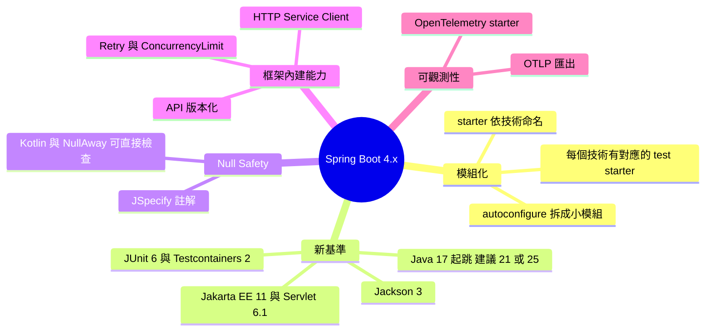

| 理念 | 具體做法 | 對升版的影響 |
|------|----------|--------------|
| 模組化 | `spring-boot-autoconfigure` 拆成 `spring-boot-webmvc`、`spring-boot-jdbc` 等數十個模組；starter 依技術命名 | starter 改名、package 搬家，見第 2、4 章 |
| 清除技術債 | 3.x 標記「棄用且將移除」的 API 在 4.0 移除；4.0 標記棄用的在 4.1 移除 | 先在 3.5 把棄用警告清乾淨，見 2.2 |
| 新基準 | Jakarta EE 11、Servlet 6.1、JPA 3.2、Jackson 3、JUnit 6 | Undertow 被移除（不支援 Servlet 6.1）；Jackson 套件名稱改變 |
| Null Safety | Spring 全系列改用 JSpecify 標註 | Kotlin 與 null 檢查工具會出現新的編譯警告／錯誤 |
| 框架內建 | API 版本化、宣告式 HTTP Client、Retry 由 Spring Framework 7 直接提供 | 可移除 spring-retry 等外部相依 |

### 1.3 與 Spring Boot 3.x 的定位差異

| 項目 | Spring Boot 3.5 | Spring Boot 4.1 | 說明 |
|------|-----------------|-----------------|------|
| Java 最低版本 | 17 | **17**（不變） | 官方建議 21 或 25；jOOQ 3.20+ 等少數功能需要 21 |
| Jakarta EE | 10（Servlet 6.0） | **11（Servlet 6.1）** | Tomcat 11、Jetty 12.1 |
| 內嵌容器 | Tomcat／Jetty／Undertow | Tomcat／Jetty | **Undertow 已移除** |
| JSON | Jackson 2（`com.fasterxml.jackson`） | **Jackson 3（`tools.jackson`）** | 可暫用 `spring-boot-jackson2` 過渡 |
| 測試框架 | JUnit 5、Mockito、Testcontainers 1.x | **JUnit 6**、Mockito 5.23、**Testcontainers 2** | `@MockBean` 已移除 |
| Starter | `spring-boot-starter-web` 等 | `spring-boot-starter-webmvc` 等 | 舊名稱多數仍保留但已棄用 |
| Null 標註 | `org.springframework.lang.Nullable` | **`org.jspecify.annotations.Nullable`** | 舊標註棄用 |
| 打包 | 可產生「完全可執行」jar、classic loader | 移除 launch script 與 classic loader | `java -jar` 不受影響 |
| Virtual Threads | `spring.threads.virtual.enabled`，預設 `false` | 同左，**預設仍為 `false`** | 1.0 版寫「預設啟用」是錯的 |
| 設定檔格式 | properties／YAML | properties／YAML | **沒有 TOML 支援** |

### 1.4 Spring 生態系版本對齊說明

下表直接取自各版本 `spring-boot-dependencies` BOM（附錄 C.1 有取得方式）。升版時**不要手動指定這些版本**，讓 BOM 管理。

| 元件 | 3.5.16 | 4.0.9 | **4.1.2** | 🔭 4.2.0-RC2 |
|------|--------|-------|-----------|--------------|
| Spring Framework | 6.2.19 | 7.0.10 | **7.0.10** | 7.1.0-RC2 |
| Spring Security | 6.5.11 | 7.0.8 | **7.1.2** | 7.2.0-RC1 |
| Spring Data | 2025.0.13 | 2025.1.8 | **2026.0.2** | 2026.1.0-RC1 |
| Spring Batch | 5.2.6 | 6.0.6 | **6.0.6** | 6.1.0-RC1 |
| Spring for Apache Kafka | 3.3.16 | 4.0.8 | **4.1.2** | 4.2.0-RC1 |
| Spring Cloud（相容版本） | 2025.0.x | 2025.1.x | **2025.1.x** | 2026.0.x |
| Hibernate ORM | 6.6.53 | 7.2.25 | **7.4.13** | 7.4.14 |
| Hibernate Validator | 8.0.3 | 9.0.2 | **9.1.5** | 9.1.6 |
| Jakarta Persistence | 3.1 | 3.2 | **3.2** | 3.2 |
| Jakarta Servlet | 6.0 | 6.1 | **6.1** | 6.1 |
| Tomcat | 10.1.55 | 11.0.27 | **11.0.27** | 11.0.27 |
| Jetty | 12.0.36 | 12.1.14 | **12.1.14** | 12.1.14 |
| Jackson | 2.21.4 | 3.1.7（另管理 2.21.7） | **3.1.7（另管理 2.21.7）** | 3.1.8 |
| Micrometer | 1.15.12 | 1.16.8 | **1.17.2** | 1.18.0-RC2 |
| OpenTelemetry | 1.49.0 | 1.55.0 | **1.62.0** | 1.67.0 |
| JUnit Jupiter | 5.12.2 | 6.0.3 | **6.0.3** | 6.1.3 |
| Mockito | 5.17.0 | 5.20.0 | **5.23.0** | 5.24.0 |
| Testcontainers | 1.21.4 | 2.0.5 | **2.0.5** | 2.0.5 |
| HikariCP | 6.3.3 | 7.0.2 | **7.0.2** | 7.1.0 |
| Flyway | 11.7.2 | 11.14.1 | **12.4.0** | 12.11.0 |
| Liquibase | 4.31.1 | 5.0.4 | **5.0.4** | 5.0.4 |
| Kotlin | 1.9.25 | 2.2.21 | **2.3.21** | 2.4.21 |
| Netty | 4.1.135 | 4.2.19 | **4.2.19** | 4.2.20 |

> 💡 **讀表重點**：Spring Boot 4.1 仍使用 Spring Framework **7.0.x**，Framework 7.1 要到 Boot 4.2 才採用。因此「Framework 7.1 的新功能」不能假設在 4.1 可用。

Spring Cloud 必須使用相容的 release train。Spring Cloud 2025.1.x（代號 Oakwood）支援 Boot 4.0／4.1；2026.0.x（Paddington）對應 Boot 4.2。混用不相容的版本，常見症狀是啟動時出現 `ClassNotFoundException` 或 `NoSuchMethodError`。

### 1.5 Spring Boot 4.x 模組化架構

這是 4.0 最影響日常開發的結構變更。3.x 的 auto-configuration 幾乎都放在一個大 jar（`spring-boot-autoconfigure`）裡；4.x 依技術拆成獨立模組，模組名稱、package 名稱、starter 名稱三者對齊：

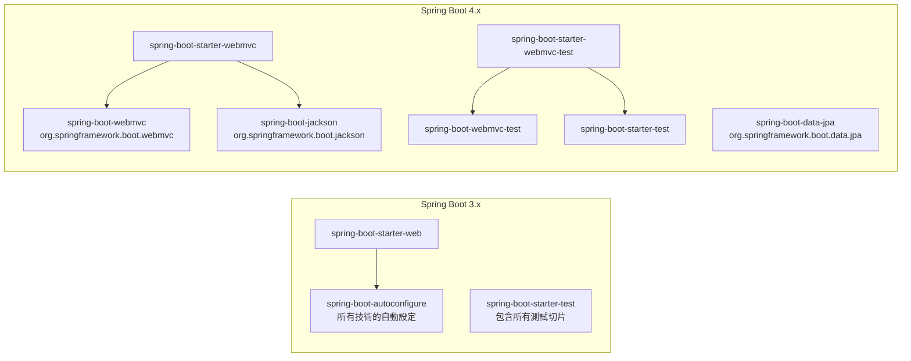

規則（官方 Migration Guide）：

| 規則 | 範例 |
|------|------|
| 模組名稱 `spring-boot-<技術>` | `spring-boot-webmvc`、`spring-boot-jdbc`、`spring-boot-kafka` |
| 套件名稱 `org.springframework.boot.<技術>` | `org.springframework.boot.webmvc.test.autoconfigure.AutoConfigureMockMvc` |
| Starter `spring-boot-starter-<技術>` | `spring-boot-starter-webmvc`、`spring-boot-starter-flyway` |
| 測試 starter `spring-boot-starter-<技術>-test` | `spring-boot-starter-webmvc-test`、`spring-boot-starter-data-jpa-test` |

**最常被忽略的後果**：在 3.x 只要 classpath 上有 Flyway 就會自動執行 migration；4.x 必須加 `spring-boot-starter-flyway`（或 `spring-boot-flyway` 模組）才有 auto-configuration。如果只保留 `org.flywaydb:flyway-core`，**應用程式能啟動，但 migration 不會跑**——這類錯誤不會在編譯期出現，必須靠整合測試抓到。

### 1.6 實務案例與注意事項

#### 企業系統評估要點

| 評估項目 | 問題 | 怎麼確認 |
|----------|------|----------|
| JDK | 執行環境是否至少 Java 17？是否能直接上 21／25？ | `java -version`；檢查容器 base image |
| 內嵌容器 | 是否使用 Undertow？ | `mvn dependency:tree -Dincludes=io.undertow` 有結果就必須改用 Tomcat 或 Jetty |
| Jackson | 是否有自訂 `ObjectMapper`、`@JsonComponent`、Jackson 2 模組？ | `grep -rn "com.fasterxml.jackson.databind" src/` |
| 第三方函式庫 | 是否支援 Jakarta EE 11 與 Spring Framework 7？ | 查各函式庫 release notes；用 `mvn dependency:tree` 找出非 BOM 管理的版本 |
| Spring Cloud | 是否使用 Spring Cloud？版本為何？ | 必須同時升到 2025.1.x |
| 打包方式 | 是否依賴「完全可執行 jar」的 launch script（例如 `/etc/init.d` 服務）？ | 檢查 `spring-boot-maven-plugin` 的 `<executable>true</executable>` |
| 測試 | 是否大量使用 `@MockBean`、`@SpyBean`、`TestRestTemplate`？ | `grep -rln "@MockBean\|@SpyBean\|TestRestTemplate" src/test` |

> ⚠️ **注意**：如果使用 Undertow、Spock（4.0 曾移除，4.1 已恢復支援 Spock 2.4）、Spring Session Hazelcast／MongoDB、Pulsar Reactive，需要先規劃替代方案，再開始升版。

### 1.7 審查與驗證清單

| 檢查項目 | 如何驗證 | 預期結果 | 常見 AI 錯誤 |
|----------|----------|----------|--------------|
| 目標版本選擇 | 對照 1.1 支援期限表 | 目標是 4.1.x 最新 patch，不是 4.0.x | 選 4.0.0 或停在某個舊 patch |
| Java 版本敘述 | 檢查文件與 `pom.xml` 的 `java.version` | 允許 17，建議 21／25 | 宣稱「4.x 最低需要 Java 21」 |
| 版本對照 | `mvn help:effective-pom \| grep -E "spring-framework.version\|spring-security.version"` | 與 1.4 表格一致 | Framework 寫成 7.1、Security 寫成 7.0（對 4.1 而言） |
| 不存在的功能 | 用 `check_props.py`（附錄 C.5）檢查設定範例 | 沒有「不存在的屬性」 | 捏造 TOML 支援、`server.threads.virtual.enabled` 等設定 |
| 容器 | `mvn dependency:tree -Dincludes=io.undertow` | 沒有輸出 | 保留 `spring-boot-starter-undertow` |
| Spring Cloud | `mvn help:effective-pom \| grep spring-cloud-dependencies` | 2025.1.x | 仍是 2025.0.x |

---

## 第二章：Spring Boot 3.x → 4.x 升版總覽

### 2.1 升版背景與目的

從 3.x 到 4.x 是一次**大版本升級**，影響面依序是：建置設定（starter、BOM）→ 編譯（package 搬家、API 移除）→ 測試（測試註解與自動設定改變）→ 執行期（預設值與屬性改名）。前兩類會在編譯時報錯，比較容易處理；後兩類**編譯會過**，只能靠測試與設定檢查抓出來，這也是 AI 自動升版最容易出錯的地方。

### 2.2 官方升版策略說明

官方 Migration Guide 的順序是固定的：**先在 3.5 把路鋪平，再跳 4.x**。

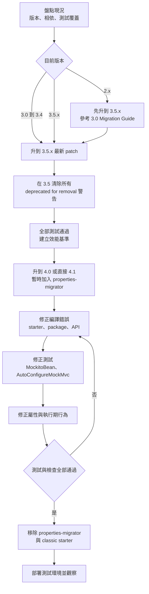

#### 2.2.1 升版路徑建議

| 起始版本 | 建議路徑 | 理由 |
|----------|----------|------|
| 2.7.x 或更早 | 2.7 → 3.5.16 → 4.1.x | `javax.*` → `jakarta.*` 必須先在 3.x 完成 |
| 3.0 ～ 3.4 | 3.x → 3.5.16 → 4.1.x | 3.5 會把 4.0 要移除的 API 標成 `forRemoval`，編譯器可以幫你找出來 |
| 3.5.x | 3.5.16 → 4.1.x | 不需要停在 4.0；4.1 只多移除 4.0 的棄用 API |
| 4.0.x | 4.0.9 → 4.1.x | 先清除 4.0 的棄用警告 |

> 💡 **為什麼可以直接 3.5 → 4.1**：4.1 移除的是「4.0 標記棄用」的 API。從 3.5 跳上來的程式碼本來就要改用 4.x 的新 API，通常不會用到 4.0 才引入又在 4.0 棄用的東西。若團隊希望降低一次變動量，也可以分成 3.5 → 4.0.9 → 4.1.x 兩步，但 4.0 的 OSS 支援只到 2026-12-31，不要停留。

#### 2.2.2 第一步：在 3.5 清除棄用警告（✅ 已驗證）

在 3.5.16 開啟棄用警告編譯，標記為 `marked for removal` 的項目就是 4.0 會移除的 API：

```bash
mvn clean test -Dmaven.compiler.showDeprecation=true
```

範例專案 `legacy-35` 的實際輸出：

```text
$ mvn clean test -Dmaven.compiler.showDeprecation=true   # Spring Boot 3.5.16
[WARNING] .../SecurityConfig.java:[17,34] org.springframework.security.web.util.matcher.AntPathRequestMatcher in org.springframework.security.web.util.matcher has been deprecated and marked for removal
[WARNING] .../OrderControllerTest.java:[24,6] org.springframework.boot.test.mock.mockito.MockBean in org.springframework.boot.test.mock.mockito has been deprecated and marked for removal
Tests run: 2, Failures: 0, Errors: 0, Skipped: 0 -- in com.example.order.OrderApiTest
Tests run: 2, Failures: 0, Errors: 0, Skipped: 0 -- in com.example.order.OrderControllerTest
Tests run: 4, Failures: 0, Errors: 0, Skipped: 0
BUILD SUCCESS
```

這兩行就是升版後一定會編譯失敗的地方（見 6.4、10.2）。**在 3.5 上就先換掉**，可以把「升版 + 改寫」拆成兩次獨立、可回滾的變更。

### 2.3 升版風險評估清單（Checklist）

#### 2.3.1 升版前必須確認項目

```markdown
□ 版本與環境
  □ 目前 Spring Boot 版本；已升到 3.5.16
  □ 執行環境 JDK ≥ 17（建議 21／25），CI 與容器 base image 一致
  □ Maven ≥ 3.6.3 或 Gradle 8.14+／9.x
  □ Spring Cloud 版本可升到 2025.1.x

□ 相依套件
  □ mvn dependency:tree 輸出已保存（升版前後比對）
  □ 沒有 Undertow、Spring Session Hazelcast/MongoDB、Pulsar Reactive
  □ 自行指定版本的相依（不受 BOM 管理）已列出並確認支援 Jakarta EE 11
  □ 使用 Jackson 2 API 的程式碼位置已列出
  □ 使用 spring-retry 的位置已列出（4.x 不再管理其版本）

□ 程式碼
  □ 3.5 上已無 "deprecated and marked for removal" 警告
  □ 已盤點 @MockBean / @SpyBean / TestRestTemplate / AntPathRequestMatcher
  □ 已盤點自訂 auto-configuration 與自訂 starter

□ 測試與觀測
  □ 單元＋整合測試全部通過，且有覆蓋 Web、Security、資料存取、序列化
  □ 已建立效能基準（啟動時間、記憶體、P95 延遲）
  □ 監控儀表板的 metric 名稱已列出（升版後比對）

□ 上線準備
  □ 回滾方案（舊版 artifact 與設定）已準備
  □ 分批上線順序已排定
```

### 2.4 Breaking Changes 快速一覽

依「發現時機」分類，越下面越難發現：

| 發現時機 | 變更 | 影響 | 調整方式 | 章節 |
|----------|------|------|----------|------|
| 建置期 | starter 改名（`web`→`webmvc`、`aop`→`aspectj`、`oauth2-*`→`security-oauth2-*`） | 舊名多數仍可用但已棄用 | 改用新 starter | 2.6、5.2 |
| 建置期 | Undertow、Pulsar Reactive、launch script、classic loader 移除 | 建置或打包失敗 | 換 Tomcat／Jetty；移除 `<executable>`、`loaderImplementation` | 5.2、11.4 |
| 建置期 | spring-retry、Spring Authorization Server 不再由 Boot 管理版本 | 找不到版本號 | 改用 Framework 7 Retry；用 `spring-security.version` | 4.5、6.4 |
| 編譯期 | Jackson 3：`com.fasterxml.jackson` → `tools.jackson` | 編譯失敗 | 改 import 與 customizer | 4.4 |
| 編譯期 | Security 7：`and()`、`AntPathRequestMatcher`、`MvcRequestMatcher`、`authorizeRequests` 移除 | 編譯失敗 | Lambda DSL、`PathPatternRequestMatcher` | 6.3、6.4 |
| 編譯期 | `@MockBean`／`@SpyBean` 移除；測試註解 package 搬家 | 測試編譯失敗 | `@MockitoBean`、新 package | 10.2 |
| 編譯期 | `@EntityScan`、`EnvironmentPostProcessor`、`BootstrapRegistry` 等 package 搬家 | 編譯失敗或棄用警告 | 改 import | 4.3、7.3 |
| 測試期 | `@SpringBootTest` 不再自動提供 `MockMvc`、`TestRestTemplate`、`WebTestClient` | `NoSuchBeanDefinitionException` | 加 `@AutoConfigureMockMvc` 等註解 | 10.2 |
| 測試期 | Flyway／Liquibase 需要專屬 starter | migration 沒執行，測試查不到資料表 | 加 `spring-boot-starter-flyway` | 7.3 |
| 執行期 | 屬性改名（`spring.dao.*`、`management.tracing.enabled`、`spring.data.mongodb.*`、`spring.jackson.read/write.*` 等） | **舊屬性被靜默忽略** | 用 properties-migrator 找出、對照表修正 | 8.2 |
| 執行期 | Liveness／Readiness probe 預設開啟 | 多出 `/actuator/health/liveness`、`readiness` | 確認 K8s probe 與安全設定 | 9.5 |
| 執行期 | Jackson 3 預設值改變（例如日期不再寫成 timestamp） | JSON 格式改變，前端或下游可能壞掉 | 契約測試；必要時 `spring.jackson.use-jackson2-defaults=true` | 4.4 |
| 執行期 | Spring Batch starter 預設改為 in-memory | 批次 metadata 不再寫入資料庫 | 改用 `spring-boot-starter-batch-jdbc` | 7.3 |
| 執行期 | 選用（optional）相依不再打包進 uber jar | 執行時 `ClassNotFoundException` | `<includeOptional>true</includeOptional>` 或改成一般相依 | 11.4 |

### 2.5 升版輔助工具

#### 2.5.1 spring-boot-properties-migrator（✅ 已驗證）

暫時加入這個相依，應用程式啟動時會列出「已改名的屬性」並**暫時**幫你轉成新名稱：

```xml
<dependency>
  <groupId>org.springframework.boot</groupId>
  <artifactId>spring-boot-properties-migrator</artifactId>
  <scope>runtime</scope>
</dependency>
```

範例專案在 `application-legacy.yml` 故意保留兩個舊屬性：

<!-- props:legacy -->
```yaml
# 刻意保留 3.x 舊屬性，驗證 spring-boot-properties-migrator 會在啟動時回報
spring:
  dao:
    exceptiontranslation:
      enabled: true
management:
  tracing:
    enabled: false
```

實際啟動 log（節錄）：

```text
WARN o.s.b.c.p.m.PropertiesMigrationListener :
The use of configuration keys that have been renamed was found in the environment:

Property source 'Config resource 'class path resource [application-legacy.yml]' via location 'optional:classpath:/'':
	Key: spring.dao.exceptiontranslation.enabled
		Line: 5
		Replacement: spring.persistence.exceptiontranslation.enabled

Each configuration key has been temporarily mapped to its replacement for your convenience.
```

> ⚠️ **盲點（實測發現）**：`management.tracing.enabled` 也已改名為 `management.tracing.export.enabled`，但 migrator **沒有回報**。原因是這個屬性的 metadata 放在 `spring-boot-micrometer-tracing` 模組，而範例專案沒有引入它。migrator 只認得 classpath 上模組的屬性。**所以 migrator 沒有警告 ≠ 沒有舊屬性**，仍要用 8.2 的對照表或附錄 C.5 的 `check_props.py` 全面檢查。

完成升版後一定要移除 migrator，它只是過渡工具。

#### 2.5.2 OpenRewrite 自動遷移（✅ 已驗證，含盲點）

OpenRewrite 的 `UpgradeSpringBoot_4_0` recipe 可以自動處理大部分機械式修改。在 `legacy-35` 的複本上執行：

```bash
git switch -c upgrade/boot4            # 一定要在獨立分支執行，方便 review diff
mvn -B org.openrewrite.maven:rewrite-maven-plugin:6.46.1:run \
  -Drewrite.recipeArtifactCoordinates=org.openrewrite.recipe:rewrite-spring:6.37.1 \
  -Drewrite.activeRecipes=org.openrewrite.java.spring.boot4.UpgradeSpringBoot_4_0 \
  -Drewrite.exportDatatables=false
git diff --stat
```

實際修改的檔案：

```text
 pom.xml                                                  | 13 +++++++++----
 src/main/java/com/example/order/JacksonConfig.java       |  4 ++--
 src/main/resources/application.yml                       |  9 +++++----
 src/test/java/com/example/order/OrderApiTest.java        |  4 +++-
 src/test/java/com/example/order/OrderControllerTest.java |  6 +++---
 5 files changed, 22 insertions(+), 14 deletions(-)
```

它**自動完成**的項目：parent 升到 4.0.9、`starter-web` → `starter-webmvc`、加入 `starter-webmvc-test` 與 `starter-security-test`、Jackson 的 `SerializationFeature.WRITE_DATES_AS_TIMESTAMPS` → `DateTimeFeature`、`spring.dao.*` → `spring.persistence.*`、`management.tracing.enabled` → `management.tracing.export.enabled`、`@MockBean` → `@MockitoBean`、`TestRestTemplate` 新 package 並補上 `@AutoConfigureTestRestTemplate`。

接著直接編譯：

```text
$ mvn test   # 套用 OpenRewrite UpgradeSpringBoot_4_0 之後
[ERROR] .../JacksonConfig.java:[11,5] cannot find symbol
[ERROR] .../JacksonConfig.java:[3,54] package org.springframework.boot.autoconfigure.jackson does not exist
[ERROR] .../SecurityConfig.java:[17,34] cannot find symbol
[ERROR] .../SecurityConfig.java:[9,53] cannot find symbol
BUILD FAILURE
```

它**漏掉**的項目：

| 漏掉的地方 | 原因 | 人工修正 |
|------------|------|----------|
| `Jackson2ObjectMapperBuilderCustomizer` 仍在 | recipe 只換了 Jackson 類別，沒換 Spring Boot 的 customizer | 改成 `JsonMapperBuilderCustomizer`（4.4） |
| `AntPathRequestMatcher` 仍在 | Security 7 的 matcher 遷移不在這個 recipe 內 | 改成字串或 `PathPatternRequestMatcher`（6.4） |
| 版本只升到 4.0.9 | recipe 名稱就是 4.0 | 再手動升到 4.1.x |
| `spring-boot-resttestclient` 相依沒加 | recipe 補了註解，沒補相依 | 手動加入（10.2） |

> 📌 **結論**：OpenRewrite 適合做「第一刀」，但輸出**一定要**經過：編譯 → 全部測試 → 人工 review diff → 屬性檢查。不要把 recipe 執行成功當成升版完成。

#### 2.5.3 Classic Starter 過渡方案

如果專案很大、一次改不完，4.x 提供 `spring-boot-starter-classic` 與 `spring-boot-starter-test-classic`，會把所有模組一次放進 classpath，行為接近 3.x 的大 jar：

```xml
<!-- 過渡用：先讓專案在 4.x 編譯起來，之後再逐步換成精確的 starter -->
<dependency>
  <groupId>org.springframework.boot</groupId>
  <artifactId>spring-boot-starter-classic</artifactId>
</dependency>
<dependency>
  <groupId>org.springframework.boot</groupId>
  <artifactId>spring-boot-starter-test-classic</artifactId>
  <scope>test</scope>
</dependency>
```

官方明確建議**最後要移除**：classic starter 會讓 classpath 變大、啟動變慢，也會讓「缺少某個 starter」的問題被掩蓋。企業內可以把「移除 classic starter」列為升版完成的驗收條件之一。

### 2.6 Starter 改名對照表

| 3.x starter | 4.x starter | 4.1.2 舊名是否仍存在 |
|-------------|-------------|----------------------|
| `spring-boot-starter-web` | `spring-boot-starter-webmvc` | 存在，已棄用 |
| `spring-boot-starter-web-services` | `spring-boot-starter-webservices` | 依官方指南改用新名 |
| `spring-boot-starter-aop` | `spring-boot-starter-aspectj` | 改用新名（先確認是否真的需要 AspectJ） |
| `spring-boot-starter-oauth2-client` | `spring-boot-starter-security-oauth2-client` | 存在，已棄用 |
| `spring-boot-starter-oauth2-resource-server` | `spring-boot-starter-security-oauth2-resource-server` | 存在，已棄用 |
| `spring-boot-starter-oauth2-authorization-server` | `spring-boot-starter-security-oauth2-authorization-server` | 改用新名 |
| `spring-boot-starter-undertow` | （無，已移除） | 不存在 |
| `flyway-core`（自動偵測） | `spring-boot-starter-flyway` | 必須新增 |
| `liquibase-core`（自動偵測） | `spring-boot-starter-liquibase` | 必須新增 |
| `spring-boot-starter-batch` | `spring-boot-starter-batch-jdbc`（要寫入資料庫時） | `starter-batch` 改為 in-memory |
| `spring-boot-starter-test` | `spring-boot-starter-<技術>-test` | `starter-test` 仍存在，由技術 test starter 帶入 |
| `spring-security-test` | `spring-boot-starter-security-test` | 原 artifact 仍可用，建議改 starter |

> 「4.1.2 舊名是否仍存在」是以 Maven Central 上是否有 4.1.2 版 artifact 判斷。即使存在，也只是相容別名，新專案與升版後專案應一律使用新名稱。

### 2.7 實務建議與最佳實踐

#### 2.7.1 升版時程規劃建議

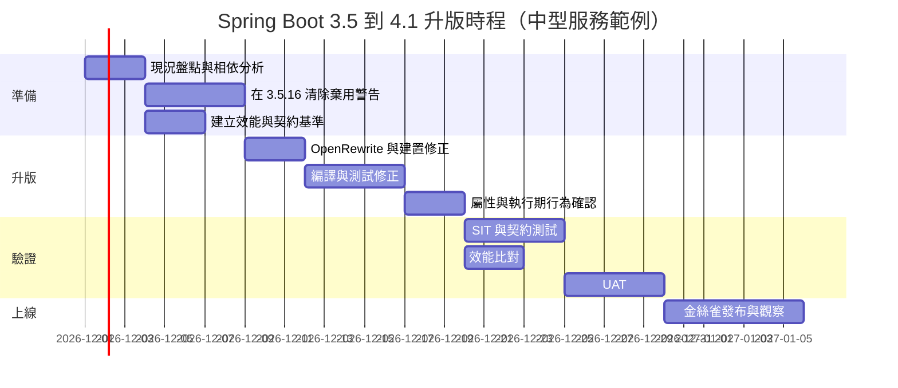

> ⚠️ **企業實務提醒**：
>
> 1. 時程隨服務數量線性增加；共用的「公司 parent POM／內部 starter」要最先升版，否則每個服務都會卡住。
> 2. 升版 PR 與功能 PR 分開，方便回滾與 review。
> 3. 上線後至少保留一個完整業務週期（例如月結）的觀察期。

### 2.8 審查與驗證清單

| 檢查項目 | 如何驗證 | 預期結果 | 常見 AI 錯誤 |
|----------|----------|----------|--------------|
| 起點版本 | 檢查升版前分支的 `pom.xml` | 3.5.x 最新 patch | 從 3.3／3.4 直接跳 4.x |
| 3.5 棄用警告 | `mvn clean test -Dmaven.compiler.showDeprecation=true` | 沒有 `marked for removal` | 忽略警告直接升版 |
| 自動遷移結果 | `git diff` + `mvn clean verify` | 編譯與測試全過 | 宣稱 OpenRewrite 跑完就完成 |
| 舊屬性 | 啟動 log 搜尋 `PropertiesMigrationListener`；再跑 `check_props.py` | 兩者都沒有警告 | 只看 migrator，漏掉不在 classpath 模組的屬性 |
| 過渡相依已移除 | `mvn dependency:tree \| grep -E "properties-migrator\|starter-classic"` | 沒有輸出 | 把 migrator、classic starter 留在正式版 |
| Starter | `grep -n "<artifactId>spring-boot-starter" pom.xml` | 只有 4.x 新名稱 | 保留 `starter-web`、`starter-aop` |

---

## 第三章：Java 與 JVM 版本要求變更

### 3.1 升版背景與目的

Spring Boot 4.x 與 Spring Framework 7 的**最低 Java 版本仍是 17**，沒有提高。官方的說法是「JDK 17 為基準，建議使用 JDK 25」。這代表：

- 還在 Java 17 的系統**不必**先升 JDK 才能升 Spring Boot，兩件事可以分開排程。
- 但企業仍應規劃升到 21 或 25，因為 Virtual Threads、Class-File API 等功能只在新版 JDK 有效，而且 Java 17 的免費更新期限較早結束（依各 JDK 發行商政策而定）。

> ❌ **1.0 版錯誤**：「Spring Boot 4.x 將 Java 最低版本提升至 Java 21」是錯的。這個錯誤會讓團隊誤以為必須先完成 JDK 升級，平白增加風險與時程。

### 3.2 Spring Boot 4.x 支援的 Java 版本

| Java 版本 | 狀態 | 建議 |
|-----------|------|------|
| 17（LTS） | ✅ 最低要求 | 可以運行；建議規劃升級 |
| 21（LTS） | ✅ 支援 | 企業主流選擇；可用 Virtual Threads |
| 22～24 | ✅ 支援 | 非 LTS，不建議用於生產 |
| 25（LTS） | ✅ 支援，**官方建議** | 新系統首選；Virtual Threads 在 `synchronized` 中不再 pin 住載體執行緒（JEP 491，JDK 24 起） |
| GraalVM Native Image | 需 GraalVM **25** 以上 | 使用新的 reachability metadata 格式 |

其他工具鏈最低版本：

| 工具 | 最低版本 | 說明 |
|------|----------|------|
| Maven | 3.6.3 | 本手冊驗證使用 3.9.9 |
| Gradle | 8.14 或 9.x | 4.0 起支援 Gradle 9 |
| Kotlin | 2.2（4.0）／**2.3（4.1）** | 4.1 提高 Kotlin 基準 |
| GraalVM | 25 | Native Build Tools Plugin 1.1.x（4.1.2 管理 1.1.14） |

### 3.3 為何仍建議升級 Java

#### 3.3.1 與 Spring Boot 直接相關的 JDK 功能

| 功能 | 需要的 JDK | Spring Boot 中如何使用 |
|------|-----------|------------------------|
| Virtual Threads | 21 | `spring.threads.virtual.enabled=true`（見 3.5） |
| `synchronized` 不再 pin 住 Virtual Thread（JEP 491） | 24 | 使用 Virtual Threads 時，JDK 25 的行為比 21 穩定 |
| Class-File API | 24 | Framework 7 的 `ClassFileMetadataReader` 會在 JDK 24+ 自動使用 |
| AOT Cache（JEP 483／514／515） | 24／25 | 可縮短啟動時間，搭配 `java -Djarmode=tools -jar app.jar extract` 使用 |

#### 3.3.2 Java 21 語法重點（升版時常順手改寫的部分）

```java
// 1. Record Patterns（JDK 21）：直接解構 record
record Point(int x, int y) {}

static String describe(Object obj) {
    if (obj instanceof Point(int x, int y)) {
        return "point " + x + "," + y;
    }
    return "unknown";
}
```

```java
// 2. switch 的 Pattern Matching（JDK 21）
static String format(Object obj) {
    return switch (obj) {
        case Integer i when i < 0 -> "負數 " + i;
        case Integer i -> "整數 " + i;
        case String s -> "字串 " + s;
        case null -> "null";
        default -> "其他 " + obj;
    };
}
```

```java
// 3. Sequenced Collections（JDK 21）
java.util.List<String> list = new java.util.ArrayList<>(java.util.List.of("b", "c"));
list.addFirst("a");
String first = list.getFirst();   // "a"
String last = list.getLast();     // "c"
```

> 💡 這些都是**可選**的程式改寫，與 Spring Boot 4.x 升版無直接關係。建議與升版 PR 分開，避免 review 範圍過大。

### 3.4 對企業系統的實際影響

#### 3.4.1 JDK 升級影響範圍

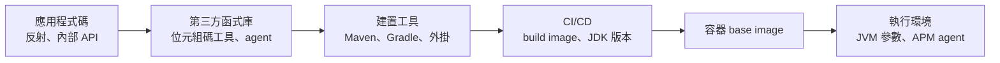

最容易被忽略的是 **APM／安全 agent**（以 `-javaagent` 掛載）與 **位元組碼工具**（Byte Buddy、ASM、Lombok、MapStruct）。它們必須支援目標 JDK 的 class file 版本；4.1.2 管理的 Byte Buddy 為 1.18.x，若專案自行固定舊版，常在 JDK 25 上出現 `Unsupported class file major version 69`。

#### 3.4.2 常見相容性問題

| 問題 | 症狀 | 解決方式 |
|------|------|----------|
| 強封裝（JDK 17 起） | `InaccessibleObjectException` | 優先升級函式庫；最後手段才用 `--add-opens` |
| `SecurityManager` 已永久停用（JDK 24） | 呼叫 `System.setSecurityManager` 丟出例外 | 移除相關程式碼 |
| 舊版位元組碼工具 | `Unsupported class file major version` | 讓 BOM 管理 Byte Buddy、ASM 等版本 |
| `sun.*` 內部 API | 編譯警告或執行期錯誤 | 改用標準 API |
| Annotation processing 預設關閉（JDK 23 起） | Lombok、MapStruct 沒有產生程式碼 | 在 compiler plugin 明確設定 `annotationProcessorPaths` 或 `-proc:full` |

#### 3.4.3 建置工具設定

Maven（使用 `spring-boot-starter-parent` 時只需設定 `java.version`，compiler plugin 版本由 parent 管理，4.1.2 為 3.15.0）：

```xml
<properties>
  <java.version>21</java.version>
</properties>
```

若有 annotation processor（Lombok、MapStruct、`hibernate-processor`），在 JDK 23+ 要明確列出：

```xml
<plugin>
  <groupId>org.apache.maven.plugins</groupId>
  <artifactId>maven-compiler-plugin</artifactId>
  <configuration>
    <annotationProcessorPaths>
      <path>
        <groupId>org.projectlombok</groupId>
        <artifactId>lombok</artifactId>
        <version>${lombok.version}</version>
      </path>
    </annotationProcessorPaths>
  </configuration>
</plugin>
```

Gradle：

```groovy
java {
    toolchain {
        languageVersion = JavaLanguageVersion.of(21)
    }
}
```

> ⚠️ 不要在升版 PR 中加入 `--enable-preview`。預覽功能每個 JDK 版本都可能變動，會讓 JDK 小版本升級變成破壞性變更。

### 3.5 Virtual Threads 設定與注意事項

Spring Boot 4.1.2 的 metadata 中，`spring.threads.virtual.enabled` 預設值是 **`false`**。要啟用必須明確設定，而且只有在 JDK 21+ 執行時才會生效：

```yaml
spring:
  threads:
    virtual:
      enabled: true
```

啟用後，Tomcat／Jetty 的請求處理、`@Async`、`@Scheduled`、Kafka／RabbitMQ listener 等會改用 Virtual Threads。啟用前要確認：

| 風險 | 說明 | 處理方式 |
|------|------|----------|
| 資料庫連線池 | Virtual Threads 讓併發請求變多，但連線池大小不變，請求會排隊等連線 | 以壓測決定 `spring.datasource.hikari.maximum-pool-size`，並監控 `hikaricp_connections_pending` |
| JDK 21 的 pinning | 在 `synchronized` 區塊內做 I/O，會 pin 住載體執行緒 | 升到 JDK 25，或改用 `ReentrantLock` |
| `ThreadLocal` 大量使用 | 每個 Virtual Thread 都有自己的副本，記憶體可能暴增 | 檢查自訂 `ThreadLocal`，考慮 `ScopedValue`（JDK 25 正式） |
| CPU 密集工作 | Virtual Threads 不會加快運算 | 運算工作仍用固定大小的執行緒池 |
| 下游限流 | 同時送出的對外請求變多 | 用 `@ConcurrencyLimit`（見 4.5）或 bulkhead 限制併發 |

> ❌ **1.0 版錯誤**：1.0 版把 Virtual Threads 設定寫成 `server.threads.virtual.enabled`，這個屬性不存在（附錄 C.5 檢查結果）。正確是 `spring.threads.virtual.enabled`。

### 3.6 認證考試常見 Java 升版觀念

1. **Virtual Threads vs Platform Threads**
   - Virtual Thread 由 JVM 排程，建立成本低，適合大量 I/O 等待的工作。
   - 不會讓 CPU 密集工作變快。
   - 建立方式：`Thread.ofVirtual().start(task)`、`Executors.newVirtualThreadPerTaskExecutor()`。
2. **Record**
   - 自動產生建構子、accessor、`equals`、`hashCode`、`toString`。
   - 欄位為 `final`，類別隱含 `final`，可以實作介面但不能繼承其他類別。
3. **Sealed Classes**
   - 用 `permits` 限制可繼承的子型別，搭配 `switch` pattern matching 可讓編譯器檢查是否涵蓋所有情況。

### 3.7 實務案例與注意事項

#### 3.7.1 案例：金融系統的 JDK 與 Spring Boot 分開升級

**背景**：核心系統使用 Java 17 + Spring Boot 3.5，需要升到 Spring Boot 4.1，並在明年升到 Java 25。

**做法**：因為 4.x 仍支援 Java 17，所以拆成兩個獨立里程碑：

1. **里程碑一**：Java 17 不變，Spring Boot 3.5.16 → 4.1.x。
2. **里程碑二**：Spring Boot 4.1.x 不變，JDK 17 → 25。

每個里程碑都可以單獨回滾，問題比較容易定位。

**JDK 升級驗證步驟**：

```bash
# 1. 確認目前版本
java -version
mvn -version

# 2. 用目標 JDK 編譯與測試（CI matrix 同時跑 17 與 25）
mvn -B clean verify

# 3. 找出強封裝問題：先不加任何 --add-opens，觀察測試與啟動 log
java -jar target/app.jar 2>&1 | grep -E "InaccessibleObjectException|illegal reflective"
```

> ⚠️ **注意事項**：
>
> - 容器 base image、CI build image、開發者本機三者的 JDK 版本要一致。
> - `--add-opens` 只能當暫時解法，每一條都要記錄原因與移除計畫。

### 3.8 審查與驗證清單

| 檢查項目 | 如何驗證 | 預期結果 | 常見 AI 錯誤 |
|----------|----------|----------|--------------|
| Java 版本設定 | `grep -n "java.version" pom.xml` | ≥ 17，企業標準 21 或 25 | 寫成「4.x 必須 21」或設定 `maven.compiler.source` 與 `release` 互相矛盾 |
| Virtual Threads 屬性 | `grep -rn "threads.virtual" src/main/resources` | 只有 `spring.threads.virtual.enabled` | 使用不存在的 `server.threads.virtual.enabled` |
| 連線池 | 壓測報告與 `hikaricp_connections_pending` | 啟用 Virtual Threads 後沒有長時間等待 | 啟用 Virtual Threads 卻同時把連線池調到極大 |
| 預覽功能 | `grep -rn "enable-preview" pom.xml build.gradle` | 沒有 | 為了用新語法加上 `--enable-preview` |
| annotation processor | JDK 23+ 下 `mvn clean compile` 後檢查產生的類別 | Lombok／MapStruct 產物存在 | 沒有設定 `annotationProcessorPaths` |
| CI JDK matrix | 檢查 CI 設定 | 目前 JDK 與目標 JDK 都有跑 | 只在開發者本機的 JDK 測試 |

---

## 第四章：Spring Framework 核心變更

### 4.1 升版背景與目的

Spring Boot 4.0／4.1 都建立在 **Spring Framework 7.0.x** 上（4.1.2 使用 7.0.10）。Framework 7 的變更可以分成四類：

| 類別 | 內容 | 本章位置 |
|------|------|----------|
| 移除 | 6.x 已棄用的 API 與選項 | 4.2 |
| Null Safety | 改用 JSpecify | 4.3 |
| JSON | Jackson 3 成為預設 | 4.4 |
| 新能力 | Retry／ConcurrencyLimit、`BeanRegistrar`、API 版本化、HTTP Service Client | 4.5（Web 相關見第 5 章） |

### 4.2 Spring Framework 主要破壞性變更

#### 4.2.1 移除的 API

| 移除項目 | 替代方案 |
|----------|----------|
| `spring-jcl` 模組 | 改用 Apache Commons Logging 1.3（自動處理，通常不用改程式） |
| `javax.annotation.*`（`@PostConstruct`、`@Resource` 的 javax 版）、`javax.inject.*` | `jakarta.annotation.*`、`jakarta.inject.*` |
| `ListenableFuture` | `CompletableFuture` |
| 路徑副檔名比對、尾斜線比對選項 | 見 5.2.2 |
| Undertow 的 WebSocket 與 WebFlux 支援 | Tomcat、Jetty、Reactor Netty |
| OkHttp3 用戶端支援 | JDK `HttpClient`、Apache HttpClient 5、Jetty、Reactor Netty |
| `webjars-locator-core` | `webjars-locator-lite` |
| `Theme` 支援（Spring MVC） | 用 CSS 或前端框架處理 |

#### 4.2.2 棄用（4.x 仍可用，但要排入改寫）

| 棄用項目 | 替代方案 |
|----------|----------|
| `RestTemplate`（7.0 文件標示；🔭 7.1 加上 `@Deprecated`） | `RestClient`、HTTP Service Client |
| Jackson 2 支援 | Jackson 3 |
| JUnit 4 的 `SpringRunner`、`SpringClassRule`、`SpringMethodRule` | JUnit Jupiter 的 `@ExtendWith(SpringExtension.class)`（`@SpringBootTest` 已內含） |
| Spring MVC 的 `PathMatcher`（AntPathMatcher） | `PathPatternParser`（預設） |
| `<mvc:*>` XML namespace | Java 設定 |
| JSR 305 null 標註（`javax.annotation.Nonnull` 等）、`org.springframework.lang.Nullable` | JSpecify（4.3） |

#### 4.2.3 行為變更

| 變更 | 影響 | 檢查方式 |
|------|------|----------|
| `HttpHeaders` 不再實作 `MultiValueMap` | 把 `HttpHeaders` 當 `Map` 操作的程式碼編譯失敗 | `mvn compile` |
| SpEL 預設最多 10,000 次運算（`spring.expression.maxOperations`） | 極複雜的 SpEL（例如 `@PreAuthorize` 中的大量運算）可能失敗 | 授權相關測試 |
| `SimpleEvaluationContext` 預設不編譯表達式 | 效能敏感的 SpEL 需 `withCompilationSupported()` | 效能測試 |
| `SpringExtension` 改用 test-method 範圍的 `ExtensionContext` | 自訂 JUnit extension 與 Spring 測試整合可能改變 | 執行全部測試 |
| JMS 預設 `DestinationResolver` 改為 `SimpleDestinationResolver` | 依賴 JNDI 查 destination 的專案要明確設定 | JMS 整合測試 |
| CORS 設定為空時，pre-flight 不再被拒絕 | 見 6.5.2 | 跨域測試 |

> ❌ **1.0 版錯誤**：1.0 版列出「`@Autowired(required=false)` 移除」「`SimpleAsyncTaskExecutor` 移除」「單一建構子注入需加 `@Autowired`」等變更，在 Framework 7 官方文件中都不存在。單一建構子自動注入從 Framework 4.3 起就是標準行為，4.x 也一樣。

### 4.3 Bean Lifecycle、Null Safety 與 Boot 核心 API

#### 4.3.1 Bean 生命週期沒有改變

Bean 生命週期（實例化 → 注入 → `Aware` → `postProcessBeforeInitialization` → `@PostConstruct` → `afterPropertiesSet` → `postProcessAfterInitialization` → `SmartInitializingSingleton`）在 Framework 7 **沒有改變**。

> ❌ **1.0 版錯誤**：
>
> - 「循環依賴偵測更嚴格（4.x Breaking Change）」：循環參照從 **Spring Boot 2.6** 起就預設禁止（`spring.main.allow-circular-references=false`），不是 4.x 的變更。
> - 「新增 `spring.main.lazy-initialization-filter`」：這個屬性不存在（附錄 C.5 檢查結果）。要排除特定 bean 的 lazy 初始化，請宣告 `LazyInitializationExcludeFilter` bean。
> - 「`allow-bean-definition-overriding` 4.x 改為更嚴格」：從 Boot 2.1 起預設就是 `false`。

#### 4.3.2 JSpecify Null Safety【4.0】（✅ 已驗證）

Spring 全系列改用 [JSpecify](https://jspecify.dev/) 標註。建議在自己的程式也採用相同做法：在 `package-info.java` 宣告 `@NullMarked`，讓整個 package 預設 non-null，只在可為 null 的地方標 `@Nullable`：

```java
/**
 * Order service. 套件預設 non-null（JSpecify），可為 null 的地方必須明確標註 {@code @Nullable}。
 */
@NullMarked
package com.example.order;

import org.jspecify.annotations.NullMarked;
```

```java
import org.jspecify.annotations.Nullable;

public record OrderV2(Long id, String customer, Money total, LocalDate orderDate, @Nullable String note) {
}
```

對升版的影響：

| 使用情境 | 影響 |
|----------|------|
| Kotlin | Spring API 的 nullability 會被 Kotlin 編譯器辨識，原本的平台型別（`String!`）變成明確的 `String` 或 `String?`，可能出現新的編譯錯誤 |
| NullAway／Error Prone／IntelliJ 檢查 | 會依 JSpecify 標註回報更多警告 |
| 使用 `org.springframework.lang.Nullable` | 已棄用；Actuator endpoint 參數上**已不支援**，必須改用 `org.jspecify.annotations.Nullable` |

`jspecify` 已經是 `spring-core` 的相依，不用另外加。

#### 4.3.3 Boot 核心 API 搬家【4.0】

| 3.x | 4.x | 狀態 |
|-----|-----|------|
| `org.springframework.boot.env.EnvironmentPostProcessor` | `org.springframework.boot.EnvironmentPostProcessor` | 舊介面棄用，但 4.1.2 jar 中仍存在（已用 `unzip -l` 確認），應儘早改用新介面 |
| `org.springframework.boot.BootstrapRegistry` 等 | `org.springframework.boot.bootstrap.*` | 搬家 |
| `PropertyMapper.alwaysApplyingWhenNonNull()` | 移除；預設就不對 `null` 呼叫 adapter，需要時用 `always()` | 行為改變 |
| `@PropertyMapping` | `org.springframework.boot.test.context.PropertyMapping` | 搬家 |

`META-INF/spring.factories` 中註冊的 `EnvironmentPostProcessor` 也要改成新介面的完整類別名稱。

### 4.4 Jackson 3 升級【4.0】

這是 4.x 影響面最廣、也最容易「編譯通過但行為改變」的項目。

#### 4.4.1 套件與類別對照

| 項目 | Jackson 2（3.x） | Jackson 3（4.x） |
|------|------------------|------------------|
| Maven groupId | `com.fasterxml.jackson.core` | `tools.jackson.core` |
| 主要 package | `com.fasterxml.jackson.databind` | `tools.jackson.databind` |
| 註解 package | `com.fasterxml.jackson.annotation` | **不變**（`jackson-annotations` 沿用舊座標） |
| 主要型別 | `ObjectMapper` | `JsonMapper`（建議注入具體型別） |
| 例外 | `JsonProcessingException`（checked） | `JacksonException`（unchecked） |
| 日期時間 feature | `SerializationFeature.WRITE_DATES_AS_TIMESTAMPS` | `DateTimeFeature.WRITE_DATES_AS_TIMESTAMPS`（`tools.jackson.databind.cfg`） |

Spring Boot 端的對照：

| 3.x | 4.x |
|-----|-----|
| `Jackson2ObjectMapperBuilderCustomizer` | `JsonMapperBuilderCustomizer`（`org.springframework.boot.jackson.autoconfigure`） |
| `@JsonComponent` | `@JacksonComponent`（`org.springframework.boot.jackson`） |
| `@JsonMixin` | `@JacksonMixin` |
| `JsonObjectSerializer`／`JsonValueDeserializer` | `ObjectValueSerializer`／`ObjectValueDeserializer` |
| 宣告 `ObjectMapper` bean 取代自動設定 | 宣告 `JsonMapper`（或 `XmlMapper`）bean |
| `spring.jackson.read.*`／`write.*`／`parser.*` | 4.0 改為 `spring.jackson.json.read.*`／`json.write.*`；4.1 另外新增通用的 `spring.jackson.read.*`／`write.*`（以 4.1 metadata 為準，見 8.2） |

#### 4.4.2 Customizer 改寫（✅ 已驗證）

升版前（3.5.16）：

```java
package com.example.order;

import com.fasterxml.jackson.databind.SerializationFeature;
import org.springframework.boot.autoconfigure.jackson.Jackson2ObjectMapperBuilderCustomizer;
import org.springframework.context.annotation.Bean;
import org.springframework.context.annotation.Configuration;

@Configuration
public class JacksonConfig {
    @Bean
    Jackson2ObjectMapperBuilderCustomizer orderJackson() {
        return builder -> builder.featuresToDisable(SerializationFeature.WRITE_DATES_AS_TIMESTAMPS);
    }
}
```

升版後（4.1.2）：

```java
package com.example.order;

import com.fasterxml.jackson.annotation.JsonInclude;
import org.springframework.boot.jackson.autoconfigure.JsonMapperBuilderCustomizer;
import org.springframework.context.annotation.Bean;
import org.springframework.context.annotation.Configuration;

@Configuration
public class JacksonConfig {
    /**
     * Jackson 3：Jackson2ObjectMapperBuilderCustomizer 改為 JsonMapperBuilderCustomizer。
     * Jackson 3 預設已不把日期寫成 timestamp，因此不必再關閉 WRITE_DATES_AS_TIMESTAMPS。
     */
    @Bean
    JsonMapperBuilderCustomizer omitNulls() {
        return builder -> builder.changeDefaultPropertyInclusion(
            incl -> incl.withValueInclusion(JsonInclude.Include.NON_NULL));
    }
}
```

注意兩點：

1. `featuresToDisable(SerializationFeature.WRITE_DATES_AS_TIMESTAMPS)` 在 4.x 不需要，因為 Jackson 3 預設就把日期寫成 ISO 字串（`OrderControllerTest` 驗證 `orderDate` 為 `"2026-11-18"`）。OpenRewrite 會把它機械式改成 `DateTimeFeature`，結果正確但多餘。
2. 不要同時留著 Jackson 2 與 Jackson 3 的 customizer：Jackson 2 的 customizer 在 4.x 根本找不到類別（附錄 C.4 N02）。

#### 4.4.3 Jackson 3 預設值差異（✅ 已驗證）

以 Spring Boot 4.1.2 自動設定的 `JsonMapper` 實測（`JacksonDefaultsTest`／`Jackson2DefaultsTest`）：

```text
JACKSON2-DEFAULTS pojo   => {"zeta":"z","alpha":"a"}
JACKSON2-DEFAULTS record => {"zeta":"z","alpha":"a","day":"2026-11-18"}
JACKSON3 pojo   => {"alpha":"a","zeta":"z"}
JACKSON3 record => {"zeta":"z","alpha":"a","day":"2026-11-18"}
```

| 觀察 | Jackson 3 預設 | `use-jackson2-defaults=true` | 影響 |
|------|----------------|------------------------------|------|
| 一般類別（POJO）的屬性順序 | **依字母排序**：`alpha`、`zeta` | 宣告順序：`zeta`、`alpha` | 依賴欄位順序的下游、字串比對式的 snapshot 測試會失敗 |
| record 的屬性順序 | 宣告順序 | 宣告順序 | 無 |
| `LocalDate` | ISO 字串 `"2026-11-18"` | ISO 字串 | 無（Boot 3.x 也預設關閉 timestamp） |
| 未知欄位反序列化 | 不失敗（Boot 預設） | 不失敗 | 無 |

> 💡 範例專案的 `JacksonConfig` 設定了 `NON_NULL`，所以 `note: null` 在兩種模式都被省略；這是應用程式設定，不是 Jackson 預設值。

**建議做法**：

1. 升版初期可設 `spring.jackson.use-jackson2-defaults=true` 降低風險，但要列為技術債並排定移除時程。
2. 對外 API 用 JSON 語意比對（JSONAssert、`jsonPath`），**不要**用字串完全比對。
3. 若有下游系統依賴欄位順序，用 `@JsonPropertyOrder` 明確宣告，而不是依賴預設值。

#### 4.4.4 暫時保留 Jackson 2

如果有第三方函式庫還不支援 Jackson 3（例如 Jersey 4 目前仍需 Jackson 2），可以加入已棄用的過渡模組：

```xml
<dependency>
  <groupId>org.springframework.boot</groupId>
  <artifactId>spring-boot-jackson2</artifactId>
</dependency>
```

設定使用 `spring.jackson2.*` 前綴。這只是過渡方案，不能長期使用。

### 4.5 Framework 7 新能力：Resilience 與 BeanRegistrar

#### 4.5.1 內建 Retry 與 ConcurrencyLimit【4.0】（✅ 已驗證）

Spring Boot 4 不再管理 `spring-retry` 的版本。Framework 7 內建等價功能（`org.springframework.resilience.annotation`）：

```java
package com.example.order;

import java.util.concurrent.atomic.AtomicInteger;
import org.springframework.resilience.annotation.ConcurrencyLimit;
import org.springframework.resilience.annotation.Retryable;
import org.springframework.stereotype.Service;
import org.springframework.web.client.RestClientException;

@Service
public class StockService {
    private final InventoryClient client;
    private final AtomicInteger attempts = new AtomicInteger();

    public StockService(InventoryClient client) {
        this.client = client;
    }

    /** Framework 7 內建 @Retryable：不再需要 spring-retry 相依。 */
    @Retryable(includes = RestClientException.class, maxRetries = 3, delay = 50)
    @ConcurrencyLimit(10)
    public int available(String sku) {
        attempts.incrementAndGet();
        return client.stock(sku).quantity();
    }

    public int attempts() {
        return attempts.get();
    }
}
```

**必須**在設定類別加上 `@EnableResilientMethods`（範例在 `HttpClientConfig`），否則註解**完全不會生效**，也不會有任何警告——附錄 C.4 N10 證明：拿掉後第一次 503 就直接失敗。

測試：下游前兩次回 503、第三次成功，驗證總共呼叫 3 次：

```java
    @Test
    void retriesTransientFailuresThroughHttpServiceClient() {
        assertThat(stock.available("A-1")).isEqualTo(42);
        assertThat(stock.attempts()).isEqualTo(3);
        assertThat(calls.get()).isEqualTo(3);
    }
```

| spring-retry（3.x） | Framework 7（4.x） |
|---------------------|--------------------|
| `@EnableRetry` | `@EnableResilientMethods` |
| `@Retryable(retryFor = X.class, maxAttempts = 4, backoff = @Backoff(delay = 50))` | `@Retryable(includes = X.class, maxRetries = 3, delay = 50)` |
| `maxAttempts` 包含第一次呼叫 | `maxRetries` **不含**第一次呼叫（3 次重試 = 最多 4 次呼叫） |
| `@Recover` | 沒有對應註解；在呼叫端處理例外，或用 `RetryTemplate` 程式化控制 |
| `RetryTemplate`（spring-retry） | `org.springframework.core.retry.RetryTemplate`（新 API） |

> ⚠️ **Review 重點**：`maxAttempts = 3` 不能直接換成 `maxRetries = 3`，次數會多一次。

`@ConcurrencyLimit(10)` 限制同一方法同時執行的數量，適合保護下游服務，特別是在啟用 Virtual Threads 後（見 3.5）。

#### 4.5.2 BeanRegistrar：程式化註冊 Bean【4.0】

Framework 7 新增 `BeanRegistrar`，用於需要依條件大量註冊 bean 的情境（原本要寫 `BeanDefinitionRegistryPostProcessor`）：

```java
class TenantClientsRegistrar implements BeanRegistrar {
    @Override
    public void register(BeanRegistry registry, Environment env) {
        for (String tenant : env.getProperty("app.tenants", String[].class, new String[0])) {
            registry.registerBean("client-" + tenant, TenantClient.class,
                spec -> spec.supplier(ctx -> new TenantClient(tenant)));
        }
    }
}

@Configuration
@Import(TenantClientsRegistrar.class)
class TenantConfig {
}
```

這是新功能，升版時**不需要**主動改寫既有程式。

### 4.6 常見相容性問題與解法

| 症狀 | 原因 | 解法 |
|------|------|------|
| `ClassNotFoundException: com.fasterxml.jackson.databind.ObjectMapper` | 程式或第三方函式庫仍用 Jackson 2 | 改用 Jackson 3；第三方函式庫暫用 `spring-boot-jackson2` |
| `NoSuchMethodError` 指向 Spring 類別 | 有函式庫是針對 Framework 6 編譯的 | 升級該函式庫；檢查 Spring Cloud 版本 |
| `@Retryable` 沒效果 | 少了 `@EnableResilientMethods`，或仍用 spring-retry 的註解 | 見 4.5.1 |
| 自訂 `EnvironmentPostProcessor` 沒有執行 | `spring.factories` 仍指向舊介面 | 改用 `org.springframework.boot.EnvironmentPostProcessor` |
| `@ConfigurationProperties` record 的 `Optional` 欄位行為改變 | 4.1 起缺值綁定為 `Optional.empty()` | 移除 `null` 判斷 |

### 4.7 實務建議與最佳實踐

這些原則與版本無關，但升版時常順便整理：

1. **建構子注入**：單一建構子不用 `@Autowired`；不要用欄位注入。
2. **設定集中管理**：用 `@ConfigurationProperties` record 取代散落各處的 `@Value`：

```java
@ConfigurationProperties("app.notification")
public record NotificationProperties(
    @DefaultValue("smtp.example.com") String host,
    @DefaultValue("587") int port,
    Optional<String> replyTo) {     // 4.1 起缺值時為 Optional.empty()
}
```

3. **避免循環依賴**：把共用邏輯抽到第三個 bean，不要用 `@Lazy` 掩蓋設計問題。

### 4.8 認證考試常考觀念

1. **Bean Scope**：`singleton`（預設）、`prototype`、`request`、`session`、`application`。
2. **`@Conditional` 系列**：`@ConditionalOnClass`、`@ConditionalOnMissingBean`、`@ConditionalOnProperty`、`@ConditionalOnBean`；4.x 的 auto-configuration 拆成模組後，**是否在 classpath 上**更直接決定哪些設定生效。
3. **AOP Proxy**：Spring Boot 預設使用 CGLIB（`spring.aop.proxy-target-class=true`，自 2.0 起）。Framework 7 新增 `@Proxyable` 可針對個別 bean 調整。

### 4.9 審查與驗證清單

| 檢查項目 | 如何驗證 | 預期結果 | 常見 AI 錯誤 |
|----------|----------|----------|--------------|
| Jackson 2 殘留 | `grep -rn "com.fasterxml.jackson.databind\|Jackson2ObjectMapperBuilderCustomizer\|@JsonComponent" src/` | 沒有結果（`com.fasterxml.jackson.annotation` 可以保留） | 把 `com.fasterxml.jackson.annotation` 也改成 `tools.jackson` |
| JSON 契約 | 契約測試／`jsonPath` 測試 | 欄位、格式與升版前一致 | 用字串比對 JSON，忽略 POJO 屬性排序改變 |
| 過渡設定 | `grep -rn "use-jackson2-defaults\|spring-boot-jackson2" .` | 若存在，必須有移除計畫 | 永久保留過渡設定 |
| Retry | `grep -rn "org.springframework.retry" src/ pom.xml` | 沒有結果；有 `@EnableResilientMethods` | 換了註解卻沒有啟用；`maxAttempts` 直接換成 `maxRetries` |
| Null 標註 | `grep -rn "org.springframework.lang.Nullable\|javax.annotation.Nonnull" src/` | 沒有結果 | 混用多種 null 標註 |
| 捏造的 API | 對照 4.2 與 4.3.1 的「1.0 版錯誤」 | 沒有出現 | 宣稱 `@Autowired(required=false)` 被移除 |

---

## 第五章：Spring Web / REST API 變更

### 5.1 升版背景與目的

Web 層的變更分成三類：

1. **建置與容器**：`starter-web` 改名、Undertow 移除、`HttpMessageConverters` 棄用。
2. **Framework 7 新能力**：API 版本化、HTTP Service Client、`RestTestClient`。
3. **行為差異**：路徑比對選項移除、Problem Details、Jackson 3 帶來的 JSON 格式差異（見 4.4）。

### 5.2 Spring MVC / WebFlux 行為調整

#### 5.2.1 Starter 與內嵌容器【4.0】

```xml
<!-- 3.x -->
<dependency>
  <groupId>org.springframework.boot</groupId>
  <artifactId>spring-boot-starter-web</artifactId>
</dependency>

<!-- 4.x：依技術命名；預設仍是 Tomcat 11 -->
<dependency>
  <groupId>org.springframework.boot</groupId>
  <artifactId>spring-boot-starter-webmvc</artifactId>
</dependency>
```

改用 Jetty：

```xml
<dependency>
  <groupId>org.springframework.boot</groupId>
  <artifactId>spring-boot-starter-webmvc</artifactId>
  <exclusions>
    <exclusion>
      <groupId>org.springframework.boot</groupId>
      <artifactId>spring-boot-starter-tomcat</artifactId>
    </exclusion>
  </exclusions>
</dependency>
<dependency>
  <groupId>org.springframework.boot</groupId>
  <artifactId>spring-boot-starter-jetty</artifactId>
</dependency>
```

| 項目 | 變更 | 處理方式 |
|------|------|----------|
| Undertow | 不支援 Servlet 6.1，已從 Boot 4 移除 | 改用 Tomcat 或 Jetty；移除 `server.undertow.*` 屬性 |
| WAR 部署到外部 Tomcat | 改用 `spring-boot-starter-tomcat-runtime` | 搭配 `<scope>provided</scope>` |
| `server.forward-headers-strategy` | **不再套用到 WAR 部署** | WAR 部署時自行宣告 `ForwardedHeaderFilter` bean |
| 靜態資源 | `/fonts/**` 加入常見靜態資源位置 | Security 若用 `PathRequest.toStaticResources().atCommonLocations()`，字型檔會變成公開；要排除就用 `StaticResourceLocation.FONTS` |
| Tomcat 暫存目錄【4.1】 | context 關閉時刪除 | 需要保留時設定 `server.tomcat.basedir` |

#### 5.2.2 路徑比對與內容協商【4.0】

Spring Framework 7 移除了一批 3.x 已棄用的比對選項：

| 已移除 | 3.x 用途 | 4.x 替代 |
|--------|----------|----------|
| `suffixPatternMatch`、`registeredSuffixPatternMatch` | `/users.json` 對應到 `/users` | 用 `Accept` header 或 query 參數協商格式 |
| `favorPathExtension`、`ignoreUnknownPathExtensions` | 依副檔名決定回應格式 | 同上 |
| `trailingSlashMatch`、`matchOptionalTrailingSeparator` | `/users/` 對應到 `/users` | 明確宣告兩個路徑，或用 Framework 6.2 起的 `UrlHandlerFilter` 重新導向 |
| `PathMatcher`（AntPathMatcher）用於 MVC | 舊式路徑比對 | 已棄用，預設的 `PathPatternParser` 即可；`PathPattern` 7.0 起支援開頭的 `/**` |

**檢查方式**：

```bash
grep -rnE "setUseSuffixPatternMatch|favorPathExtension|setUseTrailingSlashMatch|AntPathMatcher" src/main/java
```

有結果就要調整，並補上「帶斜線／帶副檔名」的回歸測試，確認前端或外部呼叫端沒有依賴舊行為。

#### 5.2.3 HttpMessageConverters 棄用【4.0】

3.x 常見以 `HttpMessageConverters` bean 調整轉換器；4.x 改為依用途分開的 customizer：`ServerHttpMessageConvertersCustomizer` 影響 Spring MVC 伺服器端，`ClientHttpMessageConvertersCustomizer` 影響 `RestClient` 與 HTTP Service Client（✅ 已驗證編譯與執行）：

```java
package com.example.order;

import java.nio.charset.StandardCharsets;
import org.springframework.boot.http.converter.autoconfigure.ClientHttpMessageConvertersCustomizer;
import org.springframework.boot.http.converter.autoconfigure.ServerHttpMessageConvertersCustomizer;
import org.springframework.context.annotation.Bean;
import org.springframework.context.annotation.Configuration;
import org.springframework.http.converter.StringHttpMessageConverter;

/** 取代 3.x 的 HttpMessageConverters bean：伺服器端與用戶端分開設定。 */
@Configuration
public class ConverterConfig {
    @Bean
    ServerHttpMessageConvertersCustomizer serverConverters() {
        return builder -> builder.withStringConverter(new StringHttpMessageConverter(StandardCharsets.UTF_8));
    }

    @Bean
    ClientHttpMessageConvertersCustomizer clientConverters() {
        return builder -> builder.withStringConverter(new StringHttpMessageConverter(StandardCharsets.UTF_8));
    }
}
```

builder 型別是 Framework 7 的 `HttpMessageConverters.ServerBuilder`／`ClientBuilder`，可用方法包括 `withJsonConverter`、`withXmlConverter`、`withStringConverter`、`addCustomConverter`、`configureMessageConverters`。

### 5.3 Request / Response 綁定與驗證差異

#### 5.3.1 綁定行為

| 變更 | 版本 | 影響 |
|------|------|------|
| Bean Validation 3.1、Hibernate Validator 9.x | 【4.0】 | 套件名稱不變（`jakarta.validation`）；自訂 `ConstraintValidator` 一般不用改 |
| 建構子綁定的 `Optional` 參數，缺值時綁定為 `Optional.empty()` 而非 `null` | 【4.1】 | `@ConfigurationProperties` record 若有 `Optional` 欄位，原本 `null` 判斷要改 |
| 屬性值為空字串時可以套用預設值 | 【4.1】 | 例如 `app.timeout=`（空值）現在會使用 `@DefaultValue` |
| `HttpHeaders` 不再實作 `MultiValueMap` | 【4.0】（Framework 7） | 用 `headers.get(name)`、`headers.asMultiValueMap()`，不要把 `HttpHeaders` 當 `Map` 傳遞 |

#### 5.3.2 驗證錯誤處理（✅ 已驗證）

範例專案的建立訂單 API 使用 `@Valid` 與 Bean Validation：

```java
    @PostMapping
    @ResponseStatus(HttpStatus.CREATED)
    public Order create(@Valid @RequestBody CreateOrder request) {
        return service.create(new Order(request.customer(), request.amount(), LocalDate.now()));
    }
```

`CreateOrder` 的驗證規則：

```java
    public record CreateOrder(@NotBlank String customer, @DecimalMin("0.01") BigDecimal amount) {
    }
```

開啟 Problem Details 後，驗證失敗會回傳 `application/problem+json`。測試：

```java
    @Test
    void validationErrorIsProblemDetail() {
        client.post().uri("/api/orders")
            .headers(h -> h.setBasicAuth("alice", "secret"))
            .body(new OrderController.CreateOrder("", new java.math.BigDecimal("0")))
            .exchange()
            .expectStatus().isEqualTo(HttpStatus.BAD_REQUEST)
            .expectHeader().contentType("application/problem+json");
    }
```

> ❌ **1.0 版錯誤**：1.0 版說「Problem Details 在 4.x 預設啟用」。4.1.2 metadata 中 `spring.mvc.problemdetails.enabled` 的預設值仍是 **`false`**，必須明確開啟。

### 5.4 錯誤處理（Exception Handling）最佳化建議

#### 5.4.1 Problem Details 標準化（✅ 已驗證）

`ProblemDetail`（RFC 9457）從 Framework 6 就有，4.x 用法不變。範例專案的例外處理：

```java
package com.example.order;

import org.springframework.http.HttpStatus;
import org.springframework.http.ProblemDetail;
import org.springframework.web.bind.annotation.ExceptionHandler;
import org.springframework.web.bind.annotation.RestControllerAdvice;

@RestControllerAdvice
public class ApiExceptionHandler {
    @ExceptionHandler(OrderNotFoundException.class)
    public ProblemDetail notFound(OrderNotFoundException ex) {
        ProblemDetail pd = ProblemDetail.forStatusAndDetail(HttpStatus.NOT_FOUND, ex.getMessage());
        pd.setTitle("Order Not Found");
        return pd;
    }
}
```

設定：

```yaml
spring:
  mvc:
    problemdetails:
      enabled: true      # 讓 Spring MVC 內建例外（400、404、405 等）也回傳 ProblemDetail
```

#### 5.4.2 錯誤處理流程

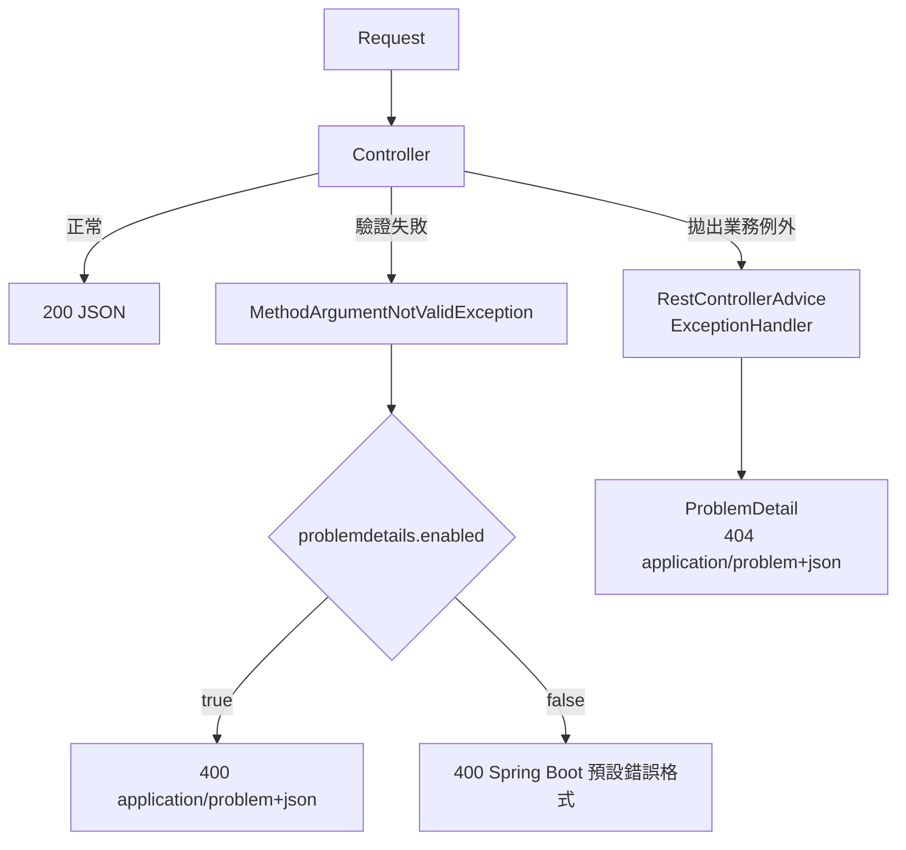

**原則**：

- 對外 API 統一回傳 `application/problem+json`，`type`、`title`、`status`、`detail` 欄位必填，業務欄位放在 `properties`。
- 不要把例外堆疊、SQL 或內部類別名稱放進 `detail`。
- 錯誤格式是 API 契約的一部分，升版後要用契約測試確認沒變（見 10.5）。

### 5.5 API 版本化【4.0】（✅ 已驗證）

Framework 7 內建 API 版本化，不用再自己寫 `@RequestMapping("/v1/...")` 或自訂 header 判斷。

**步驟 1：選擇版本放在哪裡**（只能擇一或組合使用）：

| 屬性 | 版本位置 | 範例請求 |
|------|----------|----------|
| `spring.mvc.apiversion.use.header` | Request header | `X-API-Version: 2` |
| `spring.mvc.apiversion.use.query-parameter` | Query 參數 | `/api/orders/1?version=2` |
| `spring.mvc.apiversion.use.path-segment` | 路徑第 N 段（從 0 起算） | `/api/v2/orders/1` |
| `spring.mvc.apiversion.use.media-type-parameter` | Media type 參數 | `Accept: application/json;version=2` |

範例專案的設定（節錄自 `application.yml`）：

```yaml
spring:
  mvc:
    apiversion:
      use:
        header: X-API-Version
      default: "1"          # 沒帶 header 時視為 v1
```

**步驟 2：在 mapping 上宣告版本**：

```java
    // Framework 7 API Versioning：同一路徑依版本對應不同 handler
    @GetMapping(path = "/{id}", version = "1")
    public Order getV1(@PathVariable Long id) {
        return service.find(id);
    }

    @GetMapping(path = "/{id}", version = "2")
    public OrderV2 getV2(@PathVariable Long id) {
        Order o = service.find(id);
        return new OrderV2(o.getId(), o.getCustomer(), new OrderV2.Money(o.getAmount(), "TWD"), o.getOrderDate(), null);
    }
```

**步驟 3：測試三種情況**（預設版本、指定版本、不支援的版本）：

```java
    @Test
    @WithMockUser
    void v1ReturnsIsoDate() throws Exception {
        given(service.find(1L)).willReturn(new Order("acme", new BigDecimal("10.50"), LocalDate.of(2026, 11, 18)));
        mvc.perform(get("/api/orders/1"))
            .andExpect(status().isOk())
            .andExpect(jsonPath("$.orderDate").value("2026-11-18"))
            .andExpect(jsonPath("$.amount").value(10.50));
    }

    @Test
    @WithMockUser
    void v2SelectedByHeaderAndNullsOmitted() throws Exception {
        given(service.find(1L)).willReturn(new Order("acme", new BigDecimal("10.50"), LocalDate.of(2026, 11, 18)));
        mvc.perform(get("/api/orders/1").header("X-API-Version", "2"))
            .andExpect(status().isOk())
            .andExpect(jsonPath("$.total.currency").value("TWD"))
            .andExpect(jsonPath("$.note").doesNotExist());
    }

    @Test
    @WithMockUser
    void unsupportedVersionIsRejected() throws Exception {
        mvc.perform(get("/api/orders/1").header("X-API-Version", "9"))
            .andExpect(status().isBadRequest());
    }
```

| 情況 | 實測結果 |
|------|----------|
| 沒帶 header | 走 v1，回傳 `amount` 欄位 |
| `X-API-Version: 2` | 走 v2，回傳 `total.value`、`total.currency` |
| `X-API-Version: 9` | `400 Bad Request` |
| **有 `version=` 但沒設定 `spring.mvc.apiversion.*`** | **應用程式無法啟動**：`IllegalStateException: API version specified, but no ApiVersionStrategy configured`（附錄 C.4 N11） |

其他可用設定：`spring.mvc.apiversion.required`（強制帶版本）、`spring.mvc.apiversion.supported`（明確列出支援版本）、`spring.mvc.apiversion.detect-supported`（從 mapping 自動偵測）。WebFlux 使用 `spring.webflux.apiversion.*`。若要標示某版本已棄用，可自訂 `ApiVersionDeprecationHandler` bean。

### 5.6 HTTP Client：RestClient 與 HTTP Service Client

#### 5.6.1 選擇哪一種 Client

| Client | 狀態 | 建議 |
|--------|------|------|
| `RestTemplate` | Framework 7.0 文件標示棄用；🔭 Framework 7.1（Boot 4.2）加上 `@Deprecated` | 新程式不要再用；現有程式排入改寫 |
| `RestClient` | 同步、fluent API，Framework 6.1 起 | 取代 `RestTemplate` 的首選 |
| `WebClient` | 反應式；4.x 由 `spring-boot-starter-webclient` 提供 | WebFlux 專案使用 |
| HTTP Service Client（`@HttpExchange` 介面） | Framework 7 新增群組註冊與 Boot 屬性綁定 | 呼叫內部微服務的首選，介面即契約 |

#### 5.6.2 HTTP Service Client（✅ 已驗證）

**步驟 1：宣告介面**

```java
package com.example.order;

import org.springframework.web.bind.annotation.PathVariable;
import org.springframework.web.service.annotation.GetExchange;
import org.springframework.web.service.annotation.HttpExchange;

/** 宣告式 HTTP 介面，由 @ImportHttpServices 自動產生實作。 */
@HttpExchange("/inventory")
public interface InventoryClient {
    @GetExchange("/{sku}")
    Stock stock(@PathVariable String sku);

    record Stock(String sku, int quantity) {
    }
}
```

**步驟 2：註冊群組**（`group` 名稱對應到設定屬性）

```java
package com.example.order;

import org.springframework.context.annotation.Configuration;
import org.springframework.resilience.annotation.EnableResilientMethods;
import org.springframework.web.service.registry.ImportHttpServices;

@Configuration
@ImportHttpServices(group = "inventory", types = InventoryClient.class)
@EnableResilientMethods
public class HttpClientConfig {
}
```

**步驟 3：設定 base URL 與逾時**

```yaml
spring:
  http:
    serviceclient:
      inventory:              # 對應 @ImportHttpServices(group = "inventory")
        base-url: http://localhost:8081
        read-timeout: 2s
```

需要 `spring-boot-starter-restclient`（同步）或 `spring-boot-starter-webclient`（反應式）。附錄 C 的 `StockServiceTest` 用 JDK 內建 `HttpServer` 模擬下游服務，驗證介面確實被自動實作並呼叫成功（同時驗證 4.5 的 Retry）。

#### 5.6.3 全域 HTTP Client 設定屬性改名【4.0】

| 3.x／4.0 初期屬性 | 4.x 屬性 |
|-------------------|----------|
| `spring.http.client.connect-timeout` | `spring.http.clients.connect-timeout` |
| `spring.http.client.read-timeout` | `spring.http.clients.read-timeout` |
| `spring.http.client.factory` | `spring.http.clients.imperative.factory` |
| `spring.http.client.redirects` | `spring.http.clients.redirects` |
| `spring.http.client.ssl.bundle` | `spring.http.clients.ssl.bundle` |
| `spring.http.reactiveclient.connector` | `spring.http.clients.reactive.connector` |

（舊屬性在 4.1.2 metadata 中標示 `deprecated since 4.0.0`，replacement 如上表。）

#### 5.6.4 SSRF 防護：InetAddressFilter【4.1】（✅ 已驗證）

伺服器端程式若會依使用者輸入的 URL 發出請求（Webhook、圖片抓取、回呼），就有 SSRF（Server-Side Request Forgery）風險。4.1 新增 `InetAddressFilter`：只要宣告一個 bean，**所有自動設定的 HTTP client**（`RestClient.Builder`、HTTP Service Client、`WebClient.Builder`）都會套用。

```java
import org.springframework.boot.http.client.InetAddressFilter;

@Configuration
class OutboundSecurityConfig {
    @Bean
    InetAddressFilter outboundFilter() {
        // 只允許連線到外部（非私有、非 loopback、非 link-local）位址
        return InetAddressFilter.externalAddresses();
    }
}
```

可組合的工廠方法：`externalAddresses()`、`internalAddresses()`、`routable()`、`of("10.20.0.0/16")`、`not(...)`，以及 `and(...)`、`or(...)`、`andNot(...)`。

實測（附錄 C `SsrfFilterTest`）：宣告 `externalAddresses()` 後，呼叫指向 `localhost` 的 HTTP Service Client 會直接丟出例外，模擬的下游伺服器**收到 0 次請求**：

```text
SSRF => org.springframework.boot.http.client.FilteredHostException: Filtered host 'localhost'
```

> ⚠️ `InetAddressFilter` 只保護「由 Spring Boot 自動設定建立」的 client。自己 `new` 出來的 `RestClient.create()`、`HttpClient` 不受保護，review 時要搜尋這些寫法。

### 5.7 WebFlux 相關變更

| 項目 | 4.x 變化 |
|------|----------|
| Starter | `spring-boot-starter-webflux`（不變）；`WebClient` 改由 `spring-boot-starter-webclient` 提供 |
| API 版本化 | `spring.webflux.apiversion.*`，用法同 5.5 |
| Undertow | 已移除，改用 Reactor Netty（預設）、Tomcat 或 Jetty |
| Reactor | 4.1.2 管理 Reactor 2025.0.x、Netty 4.2.x |
| 測試 | `@SpringBootTest` 不再自動提供 `WebTestClient`，需加 `@AutoConfigureWebTestClient` |
| `spring.webflux.default-html-escape`【4.1】 | 新增，控制預設 HTML escape |

### 5.8 實務案例與注意事項

#### 5.8.1 REST API 升版檢查重點

| 檢查 | 原因 | 方法 |
|------|------|------|
| JSON 欄位名稱、順序、日期格式 | Jackson 3 預設值不同（4.4） | 契約測試或 snapshot 比對升版前後的回應 |
| 錯誤回應格式 | Problem Details 是否開啟、欄位是否一致 | 對 400／404／500 各寫一個測試 |
| 路徑尾斜線與副檔名 | Framework 7 移除相關選項 | 用 access log 找出實際被呼叫的路徑格式 |
| 版本化 API | 新舊版本是否都能正確路由 | 5.5 的三種情況測試 |
| 對外呼叫 | 逾時與 SSRF 設定 | 檢查 `spring.http.clients.*` 與 `InetAddressFilter` |

### 5.9 審查與驗證清單

| 檢查項目 | 如何驗證 | 預期結果 | 常見 AI 錯誤 |
|----------|----------|----------|--------------|
| Web starter | `grep -n "starter-web\b\|starter-webmvc" pom.xml` | 只有 `starter-webmvc` | 保留 `starter-web`，或加了 `starter-undertow` |
| Problem Details | `grep -rn "problemdetails" src/main/resources` | 有 `enabled: true`，且有 400 測試 | 宣稱 4.x 預設開啟而不設定 |
| API 版本化 | `mvn test -Dtest=OrderControllerTest` | 預設版、指定版、不支援版三種測試都過 | 用了 `version=` 卻沒設定 `spring.mvc.apiversion.*` |
| HTTP client 屬性 | `check_props.py`（附錄 C.5） | 沒有 `spring.http.client.*` 棄用警告 | 沿用 `spring.http.client.connect-timeout` |
| HTTP Service Client 群組 | 比對 `@ImportHttpServices(group=...)` 與 `spring.http.serviceclient.<group>` | 名稱一致 | 群組名稱拼錯，導致 base-url 沒有套用 |
| SSRF | 搜尋 `RestClient.create(`、`new RestTemplate(`、`HttpClient.newHttpClient(` | 沒有繞過自動設定的 client | 只宣告 `InetAddressFilter`，卻自己 new client |
| RestTemplate | `grep -rn "RestTemplate" src/main/java` | 新程式碼沒有 | 新增功能仍使用 `RestTemplate` |

---

## 第六章：Spring Security 重大調整

### 6.1 升版背景與目的

Spring Boot 4.0 搭配 Spring Security **7.0**，4.1 搭配 **7.1**。Security 7 的主軸是「移除 6.x 已棄用的設定方式」：

- 6.5 是 6.x 的最後一版，提供 7.0 行為的預先切換選項。官方建議：**先在 Boot 3.5（Security 6.5）把棄用警告清掉，再升級**。
- Spring Authorization Server、Spring Security Kerberos 已併入 Spring Security 本體。
- 大部分變更都會在**編譯期**報錯（API 被移除），比較容易發現；少數行為變更需要測試確認。

### 6.2 Security 預設行為變更

#### 6.2.1 7.0／7.1 的實際變更

| 項目 | 6.x | 7.x | 影響 |
|------|-----|-----|------|
| `HttpSecurity` 設定風格 | Lambda DSL 與 `.and()` 串接並存 | **只剩 Lambda DSL**，`and()` 移除 | 編譯失敗 |
| 請求比對器 | `AntPathRequestMatcher`、`MvcRequestMatcher` | **移除**，改用 `PathPatternRequestMatcher` | 編譯失敗 |
| `authorizeRequests()` | 已棄用 | **移除**，用 `authorizeHttpRequests()` | 編譯失敗 |
| `AuthorizationManager#check` | 已棄用 | **移除**，用 `authorize` | 自訂 `AuthorizationManager` 編譯失敗 |
| `AccessDecisionManager`／`AccessDecisionVoter` | 核心模組 | 搬到 `spring-security-access` 模組 | 需要加相依才能編譯 |
| `HttpSecurity#apply(...)` | 已棄用 | **移除**，用 `with(...)` | 自訂 DSL 編譯失敗 |
| `shouldFilterAllDispatcherTypes(false)` | 可用 | **移除**，用 `dispatcherTypeMatchers(...)` | 編譯失敗 |
| `LoginUrlAuthenticationEntryPoint` | 絕對路徑轉址 | **預設使用相對路徑轉址** | 反向代理環境要確認登入轉址 |
| OAuth 2.0 Password Grant | 已棄用 | **移除** | 改用 Authorization Code + PKCE 或 Client Credentials |
| Authorization Server PKCE | 選用 | **預設啟用** | 舊 client 未送 `code_challenge` 會失敗 |
| SAML 2.0 | OpenSAML 4／5 | **只支援 OpenSAML 5** | 升級 OpenSAML |
| LDAP 內嵌伺服器 | ApacheDS 或 UnboundID | **只支援 UnboundID** | 換測試用 LDAP |
| Jackson 序列化模組 | `SecurityJackson2Modules` | `SecurityJacksonModules`（Jackson 3） | 自訂 session 序列化要改 |

> ❌ **1.0 版錯誤**：1.0 版列出「Session Fixation 改為 `changeSessionId`」、「BCrypt 強度提升」、「Remember-Me 需明確啟用」等 7.x 變更，在官方 7.0／7.1 文件中都找不到。`changeSessionId` 從 Servlet 3.1 起就是預設值。

#### 6.2.2 預設安全 Header（✅ 已驗證）

4.1.2 + Security 7.1.2 的預設回應 header，以 MockMvc 實測：

```java
    @Test
    void defaultSecurityHeaders() throws Exception {
        mvc.perform(get("/actuator/health/liveness"))
            .andExpect(status().isOk())
            .andExpect(header().string("X-Content-Type-Options", "nosniff"))
            .andExpect(header().string("X-Frame-Options", "DENY"))
            .andExpect(header().string("X-XSS-Protection", "0"))
            .andExpect(header().string("Cache-Control", "no-cache, no-store, max-age=0, must-revalidate"))
            .andExpect(header().doesNotExist("Strict-Transport-Security"));   // 只有 HTTPS 才會送 HSTS
    }
```

| Header | 預設值 | 說明 |
|--------|--------|------|
| `X-Content-Type-Options` | `nosniff` | 防止 MIME sniffing |
| `X-Frame-Options` | `DENY` | 防止 clickjacking |
| `X-XSS-Protection` | `0` | 關閉瀏覽器舊式 XSS filter（官方建議改用 CSP） |
| `Cache-Control` | `no-cache, no-store, max-age=0, must-revalidate` | 預設不快取需驗證的回應 |
| `Strict-Transport-Security` | **只有 HTTPS 請求才送** | HTTP 測試中不存在是正常的 |
| `Content-Security-Policy` | **預設不送** | 需要自行設定 |

> ❌ **1.0 版錯誤**：1.0 版宣稱 7.x 預設送出 `Content-Security-Policy: default-src 'self'`。實際上 Spring Security 不會預設產生 CSP，必須自行設定：

```java
http.headers(headers -> headers
    .contentSecurityPolicy(csp -> csp.policyDirectives("default-src 'self'; frame-ancestors 'none'")));
```

### 6.3 Authorization / Authentication 架構調整

#### 6.3.1 Lambda DSL 成為唯一寫法【4.0】

❌ 6.x 以前的寫法（7.x 編譯失敗，附錄 C.4 N05）：

```java
http
    .authorizeRequests()
        .antMatchers("/public/**").permitAll()
        .anyRequest().authenticated()
    .and()
    .formLogin()
        .loginPage("/login")
    .and()
    .csrf().disable();
```

✅ 7.x 寫法：

```java
http
    .authorizeHttpRequests(auth -> auth
        .requestMatchers("/public/**").permitAll()
        .anyRequest().authenticated())
    .formLogin(form -> form.loginPage("/login").permitAll())
    .csrf(csrf -> csrf.disable());
```

#### 6.3.2 PathPatternRequestMatcher【4.0】

`requestMatchers(String...)` 在 7.x 預設就使用 `PathPatternRequestMatcher`（Spring MVC 的 `PathPattern` 語法），通常**直接傳字串**即可。需要明確建立 matcher（例如組合條件、指定 HTTP method）時：

```java
import static org.springframework.security.web.servlet.util.matcher.PathPatternRequestMatcher.pathPattern;

http.authorizeHttpRequests(auth -> auth
    .requestMatchers(pathPattern("/actuator/health/**")).permitAll()
    .requestMatchers(pathPattern(HttpMethod.DELETE, "/api/**")).hasRole("ADMIN"));
```

| 語法差異 | `AntPathMatcher`（舊） | `PathPattern`（新） |
|----------|------------------------|---------------------|
| `**` 位置 | 可以在中間：`/a/**/b` | 7.0 起支援開頭與結尾；中間的 `**` 不支援 |
| `{*path}` | 不支援 | 捕捉剩餘路徑 |
| 效能 | 每次比對解析字串 | 預先解析，較快 |

> ⚠️ **Review 重點**：把 `antMatchers("/a/**/b")` 機械式換成 `requestMatchers("/a/**/b")`，在 `PathPattern` 中可能不合法或語意不同。每條規則都要有對應的授權測試（允許與拒絕各一個）。

#### 6.3.3 Method Security

```java
@Configuration
@EnableMethodSecurity      // 預設開啟 @PreAuthorize / @PostAuthorize / @PreFilter / @PostFilter
class MethodSecurityConfig {
}

@Service
class OrderAdminService {
    @PreAuthorize("hasRole('ADMIN')")
    void cancel(Long id) { }

    @PreAuthorize("#username == authentication.name")
    void updateProfile(String username) { }
}
```

`@EnableGlobalMethodSecurity` 從 Security 5.8 起已棄用，4.x 專案一律使用 `@EnableMethodSecurity`。7.0 新增 `AllAuthoritiesAuthorizationManager` 與對應的 method security 表達式，可以要求「同時擁有多個權限」。

### 6.4 舊版設定方式的淘汰與替代方案

#### 6.4.1 已移除的類別與方法

| 已移除（7.0） | 替代方案 |
|---------------|----------|
| `HttpSecurity#and()` | Lambda DSL |
| `authorizeRequests()` | `authorizeHttpRequests()` |
| `antMatchers()`、`mvcMatchers()`、`regexMatchers()` | `requestMatchers()` |
| `AntPathRequestMatcher`、`MvcRequestMatcher` | `PathPatternRequestMatcher` |
| `HttpSecurity#apply(configurer)` | `HttpSecurity#with(configurer, customizer)` |
| `AuthorizationManager#check` | `AuthorizationManager#authorize` |
| `shouldFilterAllDispatcherTypes` | `dispatcherTypeMatchers(DispatcherType.ERROR).permitAll()` |
| OAuth2 Password Grant | Authorization Code + PKCE／Client Credentials |
| `WebSecurityConfigurerAdapter`（6.0 已移除） | `SecurityFilterChain` bean |

#### 6.4.2 升版前後完整對照（✅ 已驗證）

升版前（3.5.16，編譯時出現 `AntPathRequestMatcher ... marked for removal`）：

```java
package com.example.order;

import static org.springframework.security.config.Customizer.withDefaults;

import org.springframework.context.annotation.Bean;
import org.springframework.context.annotation.Configuration;
import org.springframework.security.config.annotation.web.builders.HttpSecurity;
import org.springframework.security.web.SecurityFilterChain;
import org.springframework.security.web.util.matcher.AntPathRequestMatcher;

@Configuration
public class SecurityConfig {
    @Bean
    SecurityFilterChain api(HttpSecurity http) throws Exception {
        http
            .authorizeHttpRequests(auth -> auth
                .requestMatchers(AntPathRequestMatcher.antMatcher("/actuator/health/**")).permitAll()
                .requestMatchers("/api/**").hasRole("USER")
                .anyRequest().authenticated())
            .csrf(csrf -> csrf.disable())
            .httpBasic(withDefaults());
        return http.build();
    }
}
```

升版後（4.1.2）：

```java
package com.example.order;

import static org.springframework.security.config.Customizer.withDefaults;
import static org.springframework.security.web.servlet.util.matcher.PathPatternRequestMatcher.pathPattern;

import org.springframework.context.annotation.Bean;
import org.springframework.context.annotation.Configuration;
import org.springframework.security.config.annotation.web.builders.HttpSecurity;
import org.springframework.security.web.SecurityFilterChain;

@Configuration
public class SecurityConfig {
    @Bean
    SecurityFilterChain api(HttpSecurity http) throws Exception {
        http
            .authorizeHttpRequests(auth -> auth
                // Security 7 移除 AntPathRequestMatcher；字串寫法預設即使用 PathPatternRequestMatcher
                .requestMatchers(pathPattern("/actuator/health/**")).permitAll()
                .requestMatchers("/api/**").hasRole("USER")
                .anyRequest().authenticated())
            .csrf(csrf -> csrf.disable())
            .httpBasic(withDefaults());
        return http.build();
    }
}
```

授權行為測試（錯誤角色應得到 403）：

```java
    @Test
    void wrongRoleIsForbidden() throws Exception {
        mvc.perform(get("/api/orders/1").with(httpBasic("bob", "pw")))
            .andExpect(status().isForbidden());
    }
```

### 6.5 升版時最容易踩雷的 Security 問題

#### 6.5.1 常見問題與解決方案

| 症狀 | 原因 | 解決方式 |
|------|------|----------|
| `@WithMockUser` 找不到 | 沒有加 security 測試相依 | 加 `spring-boot-starter-security-test` |
| 找不到 `spring-authorization-server.version` 屬性 | Authorization Server 已併入 Security，Boot 不再單獨管理 | 改用 `spring-security.version`；starter 改為 `spring-boot-starter-security-oauth2-authorization-server` |
| 編譯找不到 `AccessDecisionVoter` | Access API 搬到新模組 | 加 `org.springframework.security:spring-security-access`，並規劃改用 `AuthorizationManager` |
| 登入後轉址到錯誤 host | `LoginUrlAuthenticationEntryPoint` 改為相對轉址；或反向代理 header 未處理 | 確認 `server.forward-headers-strategy`（WAR 要自行宣告 `ForwardedHeaderFilter`） |
| Session 反序列化失敗 | Spring Session 使用 Jackson 2 的 `SecurityJackson2Modules` | 改用 Jackson 3 `JsonMapper.Builder` + `SecurityJacksonModules`；Jackson 3 可讀取 Jackson 2 序列化的資料 |
| `/error` 回 401／403 而不是原本的錯誤 | dispatcher type 規則未設定 | `dispatcherTypeMatchers(DispatcherType.ERROR).permitAll()` |
| OAuth2 client 登入失敗 | Authorization Server 預設要求 PKCE | client 送出 `code_challenge`；或暫時在 Authorization Server 對特定 client 調整 |

#### 6.5.2 CORS 設定注意事項

Framework 7 改變了一個細節：**CORS 設定為空時，pre-flight 請求不再被拒絕**。如果 3.x 時代依賴「沒設定 CORS 就會擋掉跨域 pre-flight」，升版後行為會變寬鬆。建議明確設定：

```java
@Bean
CorsConfigurationSource corsConfigurationSource() {
    CorsConfiguration config = new CorsConfiguration();
    config.setAllowedOrigins(List.of("https://app.example.com"));   // 不要用 "*" 搭配 allowCredentials
    config.setAllowedMethods(List.of("GET", "POST", "PUT", "DELETE"));
    config.setAllowedHeaders(List.of("Authorization", "Content-Type", "X-API-Version"));
    config.setAllowCredentials(true);
    UrlBasedCorsConfigurationSource source = new UrlBasedCorsConfigurationSource();
    source.registerCorsConfiguration("/api/**", config);
    return source;
}
```

並在 `HttpSecurity` 加上 `.cors(Customizer.withDefaults())`。注意若使用 5.5 的 API 版本化 header，要把 `X-API-Version` 加入 `allowedHeaders`。

### 6.6 Security 7 新功能

| 功能 | 版本 | 用法重點 |
|------|------|----------|
| 多因素驗證（MFA） | 7.0 | 以 factor 為單位授權；7.1 新增 `AllRequiredFactorsAuthorizationManager.anyOf` 與 `@EnableMultiFactorAuthentication(when = ...)` 條件式 MFA |
| SPA 的 CSRF 設定 | 7.0 | `http.csrf(csrf -> csrf.spa())` |
| Password4j 編碼器 | 7.0 | `Argon2Password4jPasswordEncoder`、`BcryptPassword4jPasswordEncoder` 等 |
| `Authentication.Builder` | 7.0 | 合併或修改既有 `Authentication` |
| HTTP Service Client 的 OAuth2 支援 | 7.0 | `@ClientRegistrationId` 可標在介面型別上 |
| Resource Server 權限 SpEL | Boot 4.1 | `spring.security.oauth2.resourceserver.jwt.authorities-claim-expressions` |
| `InetAddressMatcher` | 7.1 | 依 IP 範圍授權 |
| `RestClientOpaqueTokenIntrospector` | 7.1 | 以 `RestClient` 實作 opaque token 驗證 |

### 6.7 認證考試常考觀念

1. **Filter Chain**：`SecurityFilterChain` bean 可以有多個，用 `securityMatcher(...)` 劃分範圍，並以 `@Order` 決定順序。
2. **認證 vs 授權**：401 表示未認證（沒有或錯誤的憑證）；403 表示已認證但權限不足（附錄 C 的 `SecurityBehaviourTest` 驗證兩者）。
3. **`hasRole("USER")` vs `hasAuthority("ROLE_USER")`**：`hasRole` 會自動加上 `ROLE_` 前綴。
4. **CSRF**：瀏覽器使用 cookie session 時必須開啟；純 Bearer token 的 API 可以關閉。

### 6.8 實務案例與注意事項

#### 6.8.1 OAuth 2.0 Resource Server 設定

相依：

```xml
<dependency>
  <groupId>org.springframework.boot</groupId>
  <artifactId>spring-boot-starter-security-oauth2-resource-server</artifactId>
</dependency>
```

設定（屬性已用附錄 C.5 的 `check_props.py` 對 4.1.2 metadata 檢查）：

```yaml
spring:
  security:
    oauth2:
      resourceserver:
        jwt:
          issuer-uri: https://auth.example.com/realms/corp
          audiences: order-service
          authority-prefix: "ROLE_"                     # 4.1 新增
          authorities-claim-expressions: "[realm_access][roles]"   # 4.1 新增：SpEL 取出巢狀 claim
```

> ⚠️ `authorities-claim-expressions` 與 `authorities-claim-name`／`authorities-claim-delimiter` **互斥**，不要同時設定。上例的 SpEL 寫法請依 IdP 實際的 token 結構調整，並用 `jwt()` request post processor 寫測試驗證角色對應。

```java
@Bean
SecurityFilterChain resourceServer(HttpSecurity http) throws Exception {
    http
        .authorizeHttpRequests(auth -> auth
            .requestMatchers("/api/admin/**").hasRole("ADMIN")
            .anyRequest().authenticated())
        .oauth2ResourceServer(oauth2 -> oauth2.jwt(Customizer.withDefaults()))
        .sessionManagement(s -> s.sessionCreationPolicy(SessionCreationPolicy.STATELESS))
        .csrf(csrf -> csrf.disable());
    return http.build();
}
```

### 6.9 審查與驗證清單

| 檢查項目 | 如何驗證 | 預期結果 | 常見 AI 錯誤 |
|----------|----------|----------|--------------|
| 移除的 API | `grep -rnE "\.and\(\)\|authorizeRequests\|antMatchers\|AntPathRequestMatcher\|MvcRequestMatcher" src/` | 沒有結果 | 只改一半，留下 `.and()` 或 `AntPathRequestMatcher` |
| 路徑語意 | 每條 `requestMatchers` 規則都有允許／拒絕測試 | 測試全過 | 把 `/a/**/b` 直接搬到 `PathPattern` |
| 401 vs 403 | `mvn test -Dtest=SecurityBehaviourTest,OrderApiTest` | 未登入 401、角色錯誤 403 | 測試只驗證「成功」路徑 |
| 安全 header | 對任一端點檢查回應 header | 符合 6.2.2 表格；需要時有 CSP | 宣稱 CSP 預設存在 |
| 測試相依 | `mvn dependency:tree -Dincludes=org.springframework.security:spring-security-test` | 由 `spring-boot-starter-security-test` 帶入 | 只加 `spring-security-test` 而缺 Boot 測試設定 |
| Authorization Server 版本 | `grep -n "authorization-server.version" pom.xml` | 沒有結果 | 仍設定 `spring-authorization-server.version` |
| CORS | 跨域 pre-flight 測試（允許與不允許的 origin 各一） | 不允許的 origin 被拒 | 用 `allowedOrigins("*")` 搭配 `allowCredentials(true)` |

---

## 第七章：Spring Data 與資料存取層

### 7.1 升版背景與目的

資料層的升版包含三個獨立的大版本跳躍，風險最高的是 Hibernate：

| 元件 | 3.5.16 | 4.1.2 | 主要影響 |
|------|--------|-------|----------|
| Hibernate ORM | 6.6 | **7.4** | 舊 `Session` API 與舊註解移除、驗證更嚴格、型別對應改變 |
| Jakarta Persistence | 3.1 | **3.2** | Criteria／EntityGraph 泛型改變 |
| Spring Data | 2025.0 | **2026.0** | Repository 介面大致相容 |
| HikariCP | 6.3 | **7.0** | 連線池設定屬性不變 |
| Flyway／Liquibase | 11／4.31 | **12／5.0** | **需要專屬 starter** |
| Spring Batch | 5.2 | **6.0** | starter 預設改為 in-memory |

### 7.2 JPA / JDBC / R2DBC 行為差異

#### 7.2.1 Hibernate 7 重大變更

依 Hibernate 7.0 官方 Migration Guide 整理，只列應用程式開發者最常碰到的項目：

| 類別 | 已移除／已改變 | 替代方式 |
|------|----------------|----------|
| `Session` 方法 | `save`、`update`、`saveOrUpdate`、`delete`、`load` **移除** | `persist`、`merge`、`remove`、`getReference` |
| Hibernate 註解 | `@Where`、`@WhereJoinTable` | `@SQLRestriction`、`@SQLJoinTableRestriction` |
| Hibernate 註解 | `@Proxy`、`@LazyToOne`、`@LazyCollection`、`@Loader`、`@Persister`、`@SelectBeforeUpdate` **移除** | 改用 JPA fetch 設定、`EntityGraph`、`@ConcreteProxy` |
| Hibernate 註解 | `org.hibernate.annotations.Table`、`@ForeignKey`、`@Index`、`@IndexColumn`、`@OrderBy` | 用 JPA 對應註解（`@OrderColumn`、`@SQLOrder` 等） |
| Cascade | `CascadeType.SAVE_UPDATE`、`CascadeType.DELETE`（Hibernate 版） | JPA 的 `PERSIST`／`MERGE`／`REMOVE` |
| 已分離實體 | cascade `PERSIST` 碰到 detached 實體時丟 `EntityExistsException` | 先 `merge()` |
| HQL | 沒有 select 且有多個 root（`from X, Y`）不再接受 | 明確寫 select，或傳入 `Object[].class` |
| Criteria | 以字串 `get`／`join` 不再隱含 `treat` 成子型別 | 先 `CriteriaBuilder#treat` |
| ID 產生 | `GenerationType.SEQUENCE` 只能搭配 `@SequenceGenerator` | 明確宣告 generator |
| 型別對應 | `char`／`Character` 改為 `varchar(1)`；Oracle `float`／`double` 改為 `binary_float`／`binary_double`；Native query 預設回傳 `java.time` | 用 `hibernate.*` 設定恢復舊行為，或調整 schema |
| 模型驗證 | 同一屬性多種對應註解、field access 卻把 `@Column` 放在 getter，都會變成**啟動錯誤** | 修正 entity |
| Annotation processor | `hibernate-jpamodelgen` 改名 `hibernate-processor` | 更新 `annotationProcessorPaths` |
| Maven plugin | 座標改為 `org.hibernate.orm:hibernate-maven-plugin` | 更新 plugin 座標 |

❌ 舊寫法在 4.1.2 會編譯失敗（附錄 C.4 N13）：

```java
em.unwrap(Session.class).save(order);     // Hibernate 7：cannot find symbol
```

✅ 新寫法：

```java
@Service
class OrderWriter {
    @PersistenceContext
    private EntityManager em;

    @Transactional
    void create(Order order) {
        em.persist(order);       // 新增
    }

    @Transactional
    Order update(Order detached) {
        return em.merge(detached);   // 更新已分離的實體
    }
}
```

`@Where` 的替換：

```java
// ❌ Hibernate 6：@Where(clause = "deleted = false")
// ✅ Hibernate 7
@Entity
@SQLRestriction("deleted = false")
class Customer {
    @Id
    @GeneratedValue
    private Long id;
    private boolean deleted;
}
```

> ❌ **1.0 版錯誤**：1.0 版列出「Hibernate 7 預設 Query Cache 停用」「Lazy Loading 更嚴格」「雙向關聯需要明確設定」等變更，並把一般的 JPA 最佳實踐（`FetchType.LAZY`、`orphanRemoval`）標成 Breaking Change。這些都不是 Hibernate 7 的變更，會誤導 Reviewer 把力氣花在錯的地方。真正需要檢查的是上表。

#### 7.2.2 Entity 定義（✅ 已驗證）

範例專案的 entity 在 3.5 與 4.1 **完全沒改**（`gen_target.py` 直接複製檔案），在 Hibernate 7.4 上可正常建表與查詢：

```java
package com.example.order;

import jakarta.persistence.Entity;
import jakarta.persistence.GeneratedValue;
import jakarta.persistence.Id;
import jakarta.persistence.Table;
import java.math.BigDecimal;
import java.time.LocalDate;

@Entity
@Table(name = "orders")
public class Order {
    @Id
    @GeneratedValue
    private Long id;
    private String customer;
    private BigDecimal amount;
    private LocalDate orderDate;

    protected Order() {
    }

    public Order(String customer, BigDecimal amount, LocalDate orderDate) {
        this.customer = customer;
        this.amount = amount;
        this.orderDate = orderDate;
    }

    public Long getId() { return id; }
    public String getCustomer() { return customer; }
    public BigDecimal getAmount() { return amount; }
    public LocalDate getOrderDate() { return orderDate; }
}
```

這說明一個重點：**標準 JPA 寫法的 entity 通常不用改**。需要修改的是使用了 Hibernate 專屬 API 或舊註解的地方。

#### 7.2.3 盤點 Hibernate 專屬用法

```bash
# 舊 Session API
grep -rnE "\.(save|saveOrUpdate|update|delete|load)\(" src/main/java | grep -i session
# 已移除註解
grep -rnE "@(Where|WhereJoinTable|Proxy|LazyToOne|LazyCollection|Loader|Persister|SelectBeforeUpdate|IndexColumn)\b" src/main/java
# Hibernate 版 @Table / CascadeType
grep -rnE "org\.hibernate\.annotations\.(Table|CascadeType|ForeignKey|Index|OrderBy)" src/main/java
```

### 7.3 Spring Boot 資料層模組變更

#### 7.3.1 package 與屬性搬家【4.0】

| 3.x | 4.x |
|-----|-----|
| `org.springframework.boot.autoconfigure.domain.EntityScan` | `org.springframework.boot.persistence.autoconfigure.EntityScan` |
| `org.springframework.boot.test.autoconfigure.orm.jpa.DataJpaTest` | `org.springframework.boot.data.jpa.test.autoconfigure.DataJpaTest` |
| `spring.dao.exceptiontranslation.enabled` | `spring.persistence.exceptiontranslation.enabled` |
| `spring.data.mongodb.uri`、`host`、`port`、`database`、`username`、`password` 等 | `spring.mongodb.*`（Spring Data 專屬的 `auto-index-creation`、`gridfs.*`、`repositories.type` 等仍在 `spring.data.mongodb.*`） |
| Elasticsearch `RestClient`／`RestClientBuilderCustomizer` | `Rest5Client`／`Rest5ClientBuilderCustomizer` |

`@DataJpaTest` 新 package 的測試（✅ 已驗證）：

```java
package com.example.order;

import static org.assertj.core.api.Assertions.assertThat;

import java.math.BigDecimal;
import java.time.LocalDate;
import org.junit.jupiter.api.Test;
import org.springframework.beans.factory.annotation.Autowired;
import org.springframework.boot.data.jpa.test.autoconfigure.DataJpaTest;

@DataJpaTest                       // 4.0 起位於 org.springframework.boot.data.jpa.test.autoconfigure
class OrderRepositoryTest {
    @Autowired
    OrderRepository repository;

    @Test
    void derivedQueryStillWorksOnHibernate7() {
        repository.save(new Order("acme", new BigDecimal("1.00"), LocalDate.of(2026, 1, 1)));
        repository.save(new Order("other", new BigDecimal("2.00"), LocalDate.of(2026, 1, 2)));
        assertThat(repository.findByCustomer("acme")).hasSize(1);
    }
}
```

#### 7.3.2 Flyway／Liquibase 需要專屬 starter【4.0】（✅ 已驗證）

這是**編譯與啟動都不會報錯**、但行為完全改變的典型例子。實測（附錄 C.4 N12／P12）：

| 相依 | 結果 |
|------|------|
| 只有 `org.flywaydb:flyway-core` | 應用程式正常啟動，但 migration **沒有執行**；查詢資料表時失敗 |
| `flyway-core` + `spring-boot-starter-flyway` | migration 執行，測試通過 |

```xml
<dependency>
  <groupId>org.springframework.boot</groupId>
  <artifactId>spring-boot-starter-flyway</artifactId>
</dependency>
<!-- 依資料庫加上 Flyway 的資料庫模組，例如 PostgreSQL -->
<dependency>
  <groupId>org.flywaydb</groupId>
  <artifactId>flyway-database-postgresql</artifactId>
</dependency>
```

Liquibase 同理，使用 `spring-boot-starter-liquibase`。

#### 7.3.3 Spring Batch：in-memory 與 JDBC 分開【4.0】

| Starter | 4.x 行為 |
|---------|----------|
| `spring-boot-starter-batch` | **in-memory** job repository，重啟後執行紀錄消失 |
| `spring-boot-starter-batch-jdbc` | 以 JDBC 儲存 job metadata（3.x 的預設行為） |
| `spring-boot-batch-data-mongo`【4.1】 | 以 MongoDB 儲存 metadata，`spring.batch.data.mongo.schema.initialize` 控制建表 |

生產環境的批次幾乎都需要「失敗後從中斷點重跑」，**升版時必須改用 `starter-batch-jdbc`**，否則 restart 功能會靜默失效。

#### 7.3.4 4.1 新增的資料層設定【4.1】

```yaml
spring:
  datasource:
    connection-fetch: lazy     # 預設 eager；lazy 會包一層 LazyConnectionDataSourceProxy，直到真正執行 SQL 才取連線
  jpa:
    bootstrap: async           # 預設 default；在背景執行緒建立 EntityManagerFactory，縮短啟動時間
```

| 屬性 | 適用情境 | 注意事項 |
|------|----------|----------|
| `spring.datasource.connection-fetch=lazy` | `@Transactional` 方法開頭有大量非 DB 邏輯（例如先呼叫外部 API） | 連線取得時間點延後，連線池指標的解讀方式會改變 |
| `spring.jpa.bootstrap=async` | entity 數量多、啟動慢 | 需要可用的 `AsyncTaskExecutor`；與 `spring.data.jpa.repositories.bootstrap-mode=deferred` 搭配時，4.1 起若沒有適合的 executor 會直接丟例外 |

### 7.4 Repository API 與交易管理

#### 7.4.1 Repository

Spring Data 2026.0 的 Repository 介面與 3.x 相容，`JpaRepository`、derived query、`@Query`、`Pageable`、`Slice`、`Window`（Keyset scrolling，2023.1 起）用法不變。範例專案的 `findByCustomer` 在升版前後都不用改。

需要注意的是 **Hibernate 7 的 HQL 檢查更嚴格**：`@Query` 中沒有 select 子句又有多個 root 的寫法會在啟動時失敗。升版後務必讓 `@SpringBootTest` 或 `@DataJpaTest` 至少啟動一次，因為 Spring Data 會在啟動時驗證所有 `@Query`。

#### 7.4.2 Transaction 傳播行為

`@Transactional` 的語意在 4.x 沒有改變。以下是升版時值得順便檢查的常見錯誤：

```java
@Service
class PaymentService {
    private final PaymentRepository payments;
    private final AuditService audit;

    PaymentService(PaymentRepository payments, AuditService audit) {
        this.payments = payments;
        this.audit = audit;
    }

    @Transactional
    public void pay(Payment p) {
        payments.save(p);
        audit.record(p);          // REQUIRES_NEW：即使 pay 失敗回滾，稽核紀錄仍保留
    }
}

@Service
class AuditService {
    @Transactional(propagation = Propagation.REQUIRES_NEW)
    public void record(Payment p) { /* ... */ }
}
```

| 陷阱 | 說明 |
|------|------|
| 同類別內呼叫 | `this.record()` 不經過 proxy，`REQUIRES_NEW` 無效 |
| checked exception 不回滾 | 預設只對 `RuntimeException`／`Error` 回滾，需要時設 `rollbackFor` |
| `readOnly = true` 仍寫入 | Hibernate 會跳過 dirty checking，修改不會 flush，但不會報錯 |
| Virtual Threads 與交易 | 交易綁定在執行緒上；在 `@Transactional` 方法內另開執行緒（含 Virtual Thread）執行 DB 操作，**不在同一個交易中** |

#### 7.4.3 Spring Framework 7 對 JPA 的新支援

- 可直接注入 JPA 3.2 的共享 `EntityManager`／`EntityManagerFactory`（建構子注入即可，不一定要 `@PersistenceContext`）。
- 支援 Hibernate `StatelessSession`，適合大量匯入。注意 Hibernate 7 的 `StatelessSession` **預設使用二級快取**，且 `hibernate.jdbc.batch_size` 對它無效，要用 `insertMultiple()` 等方法批次處理。

### 7.5 實務案例與注意事項

#### 7.5.1 N+1 問題處理

Hibernate 7 沒有改變 N+1 的本質，升版時可以順便建立防護：

```java
public interface OrderQueryRepository extends JpaRepository<Order, Long> {
    // 用 EntityGraph 一次取回關聯
    @EntityGraph(attributePaths = "items")
    List<Order> findByCustomer(String customer);
}
```

```yaml
spring:
  jpa:
    properties:
      hibernate:
        default_batch_fetch_size: 50     # 延遲載入的集合以 IN 查詢批次取回
        generate_statistics: false       # 只在效能測試環境開啟
```

> 💡 在整合測試中開啟 `hibernate.generate_statistics`，斷言某個 API 的 SQL 次數，可以在 review 時客觀判斷 AI 改寫的查詢有沒有引入 N+1。

#### 7.5.2 多資料庫產品的升版驗證

Hibernate 7 對 Oracle、SQL Server、DB2 的型別對應有改變（timestamp 精度、浮點數、陣列型別）。若使用 `ddl-auto=validate`，升版後啟動可能因 schema 不符而失敗；若使用 `update`，可能**自動修改正式資料庫的欄位型別**。建議：

1. 正式環境一律 `spring.jpa.hibernate.ddl-auto=validate` 或 `none`，schema 由 Flyway／Liquibase 管理。
2. 以 Testcontainers 對實際資料庫產品跑一次 `validate`。
3. 比對升版前後 `hibernate.hbm2ddl` 產生的 DDL（只在測試環境產生）。

### 7.6 審查與驗證清單

| 檢查項目 | 如何驗證 | 預期結果 | 常見 AI 錯誤 |
|----------|----------|----------|--------------|
| Hibernate 舊 API | 7.2.3 的三個 grep | 沒有結果 | 把 `save()` 換成 `persist()` 卻沒處理 detached 實體 |
| Flyway／Liquibase starter | `mvn dependency:tree -Dincludes=org.springframework.boot:spring-boot-flyway` | 有結果 | 只保留 `flyway-core` |
| Batch starter | `grep -n "starter-batch" pom.xml` | 生產用 `starter-batch-jdbc` | 留在 `starter-batch` 而失去 restart 能力 |
| package 搬家 | `mvn clean test-compile` | 成功 | 沿用 `autoconfigure.domain.EntityScan` |
| 屬性 | `check_props.py`（附錄 C.5） | 沒有 `spring.dao.*`、`spring.data.mongodb.uri` | 只改了一部分 MongoDB 屬性 |
| HQL 驗證 | `mvn test`（至少一個 `@SpringBootTest` 或 `@DataJpaTest`） | 啟動成功 | 只跑單元測試，沒有啟動 JPA |
| Schema | 對實際 DB 產品執行 `ddl-auto=validate` | 啟動成功 | 正式環境用 `ddl-auto=update` |
| processor | `grep -rn "jpamodelgen" pom.xml` | 沒有結果 | 保留 `hibernate-jpamodelgen` |

---

## 第八章：設定檔與組態管理變更

### 8.1 升版背景與目的

設定屬性改名是升版中**最危險的一類變更**：舊屬性不會造成編譯錯誤，也不會讓應用程式啟動失敗——它只是**被靜默忽略**。例如 `server.error.include-message: always` 在 4.x 不再生效，錯誤回應就少了 `message` 欄位；`management.tracing.enabled: false` 不再生效，追蹤資料就會照常送出。

4.1.2 的 metadata 中共有 75 個「since 4.0.0」改名屬性，等級全部是 `error`（代表舊名稱已不再綁定，只保留給 properties-migrator 提示用）。

> ❌ **1.0 版錯誤**：「Spring Boot 4.x 新增 TOML 格式支援（`application.toml`）」完全不存在。4.x 支援的設定檔格式仍是 `.properties` 與 `.yml`／`.yaml`。放一個 `application.toml` 不會有任何效果，也不會有任何錯誤訊息。

### 8.2 application.yml / properties 行為變化

#### 8.2.1 屬性改名對照表【4.0】

以下取自 4.1.2 所有模組的 `spring-configuration-metadata.json`（`deprecation.since = 4.0.0`，`level = error`），依常用程度分組：

| 分類 | 3.x 屬性 | 4.x 屬性 |
|------|----------|----------|
| 錯誤頁 | `server.error.include-message` | `spring.web.error.include-message` |
| 錯誤頁 | `server.error.include-binding-errors` | `spring.web.error.include-binding-errors` |
| 錯誤頁 | `server.error.include-stacktrace` | `spring.web.error.include-stacktrace` |
| 錯誤頁 | `server.error.include-exception`、`include-path` | `spring.web.error.include-exception`、`include-path` |
| 錯誤頁 | `server.error.path`、`server.error.whitelabel.enabled` | `spring.web.error.path`、`spring.web.error.whitelabel.enabled` |
| 編碼 | `server.servlet.encoding.charset`、`enabled`、`force`、`force-request`、`force-response` | `spring.servlet.encoding.*` |
| 代理 | `server.use-forward-headers` | `server.forward-headers-strategy` |
| 持久層 | `spring.dao.exceptiontranslation.enabled` | `spring.persistence.exceptiontranslation.enabled` |
| MongoDB | `spring.data.mongodb.uri`、`host`、`port`、`database`、`username`、`password`、`authentication-database`、`replica-set-name`、`additional-hosts`、`protocol`、`ssl.*` | `spring.mongodb.*` |
| MongoDB | `spring.data.mongodb.uuid-representation` | `spring.mongodb.representation.uuid` |
| MongoDB 監控 | `management.health.mongo.enabled` | `management.health.mongodb.enabled` |
| MongoDB 監控 | `management.metrics.mongo.command.enabled`、`connectionpool.enabled` | `management.metrics.mongodb.*` |
| Session | `spring.session.redis.*`（`namespace`、`flush-mode`、`save-mode`、`cleanup-cron`、`repository-type`、`configure-action`） | `spring.session.data.redis.*` |
| Kafka | `spring.kafka.retry.topic.backoff.random` | `spring.kafka.retry.topic.backoff.jitter` |
| RabbitMQ | `spring.rabbitmq.listener.simple.retry.max-attempts` | `spring.rabbitmq.listener.simple.retry.max-retries` |
| RabbitMQ | `spring.rabbitmq.listener.direct.retry.max-attempts`、`spring.rabbitmq.template.retry.max-attempts` | `...retry.max-retries` |
| Tracing | `management.tracing.enabled` | `management.tracing.export.enabled` |
| Tracing | `management.zipkin.tracing.export.enabled` | `management.tracing.export.zipkin.enabled` |
| Tracing | `management.tracing.opentelemetry.export.*` | `management.opentelemetry.tracing.export.*` |
| Tracing | `management.tracing.brave.span-joining-supported` | `management.brave.tracing.span-joining-supported` |
| OTLP | `management.otlp.tracing.endpoint`、`headers`、`timeout`、`compression`、`transport` | `management.opentelemetry.tracing.export.otlp.*` |
| OTLP | `management.otlp.logging.*` | `management.opentelemetry.logging.export.otlp.*` |
| HTTP client | `spring.http.client.*`、`spring.http.reactiveclient.*` | `spring.http.clients.*`（見 5.6.3） |
| 測試 | `spring.test.mockmvc.webclient.enabled`、`webdriver.enabled` | `spring.test.mockmvc.htmlunit.webclient.enabled`、`htmlunit.webdriver.enabled` |
| 測試 | `spring.test.webclient.mockrestserviceserver.enabled` | `spring.test.restclient.mockrestserviceserver.enabled` |
| Jackson | `spring.jackson.read.*`、`write.*`、`parser.*`（3.x 用法） | 4.0：`spring.jackson.json.read.*`／`json.write.*`；4.1 另外新增通用 `spring.jackson.read.*`／`write.*` |
| DevTools | LiveReload 預設開啟 | 4.0 預設關閉：`spring.devtools.livereload.enabled=true`；**4.1 已棄用且沒有替代** |

> ⚠️ **注意 RabbitMQ 的語意差異**：`max-attempts` 包含第一次投遞，`max-retries` 不包含。`max-attempts: 3` 應改成 `max-retries: 2`，不是 `3`。這與 4.5.1 的 `@Retryable` 情況相同。

#### 8.2.2 修正前後範例

<!-- props:legacy -->
```yaml
# 3.5.x 的設定（升版前）
server:
  error:
    include-message: always
  servlet:
    encoding:
      charset: UTF-8
      force: true
spring:
  dao:
    exceptiontranslation:
      enabled: true
  data:
    mongodb:
      uri: mongodb://mongo:27017/orders
  session:
    redis:
      namespace: order:session
management:
  tracing:
    enabled: true
    sampling:
      probability: 0.1
```

```yaml
# 4.1.x 的設定（升版後）
spring:
  web:
    error:
      include-message: always
  servlet:
    encoding:
      charset: UTF-8
      force: true
  persistence:
    exceptiontranslation:
      enabled: true
  mongodb:
    uri: mongodb://mongo:27017/orders
  session:
    data:
      redis:
        namespace: order:session
management:
  tracing:
    export:
      enabled: true
    sampling:
      probability: 0.1
```

> 上面兩段 YAML 都經過附錄 C.5 的 `check_props.py` 檢查：第一段對 3.5.16 metadata 全部合法，第二段對 4.1.2 metadata 全部合法。

#### 8.2.3 系統化找出舊屬性

單靠 properties-migrator 不夠（2.5.1 的盲點），建議三層檢查：

| 層次 | 方法 | 能抓到 | 抓不到 |
|------|------|--------|--------|
| 1 | `spring-boot-properties-migrator` | classpath 上模組的已改名屬性 | 未引入模組的屬性；環境變數、Config Server、K8s ConfigMap 中只在正式環境才有的設定 |
| 2 | `check_props.py`（附錄 C.5） | 文件與 repo 中 YAML／properties 的所有不存在或已棄用屬性 | 執行期才注入的設定 |
| 3 | 匯出各環境實際設定後比對 | 正式環境的 ConfigMap、Vault、環境變數 | — |

第 3 層的做法：在每個環境（含正式）匯出設定來源，轉成 `key=value` 格式後，用 `check_props.py` 檢查：

```bash
# 從 Kubernetes ConfigMap 匯出（範例）
kubectl get configmap order-service -o jsonpath='{.data.application\.yml}' > prod-application.yml
# 環境變數形式（SPRING_DATA_MONGODB_URI）也要轉成點分隔的屬性名稱再檢查
env | grep -E '^(SPRING|MANAGEMENT|SERVER)_' | sort
```

> ⚠️ 環境變數名稱（例如 `SERVER_ERROR_INCLUDEMESSAGE`）同樣受影響，K8s Deployment、Helm values、CI 變數都要一起盤點。

### 8.3 Auto Configuration 調整重點

#### 8.3.1 Auto Configuration 變更【4.0】

| 變更 | 影響 |
|------|------|
| auto-configuration 類別搬到各技術模組，package 改為 `org.springframework.boot.<技術>.autoconfigure` | `@SpringBootApplication(exclude = ...)`、`@ImportAutoConfiguration` 中寫死的類別名稱要更新 |
| auto-configuration 類別的 public 成員（常數除外）移除 | 直接呼叫 auto-configuration 內部方法或繼承它們的程式會編譯失敗 |
| 模組沒在 classpath 上就沒有 auto-configuration | 例如 Flyway（7.3.2）；「以前會自動生效」的功能要確認 starter |
| 自訂 starter | 官方建議不要同時支援 Boot 3 與 4；為 4.x 另出一個版本 |

#### 8.3.2 排除 Auto Configuration

排除時優先使用屬性（不必知道類別所在 package），再用 `excludeName`（字串，不會因 package 搬家而編譯失敗）：

```yaml
spring:
  autoconfigure:
    exclude:
      - org.springframework.boot.data.redis.autoconfigure.DataRedisAutoConfiguration
```

找出正確的類別名稱：

```bash
# 列出某模組 jar 中所有 auto-configuration
unzip -p ~/.m2/repository/org/springframework/boot/spring-boot-data-redis/4.1.2/spring-boot-data-redis-4.1.2.jar \
  META-INF/spring/org.springframework.boot.autoconfigure.AutoConfiguration.imports
```

> 💡 4.x 的 auto-configuration 清單仍放在 `META-INF/spring/org.springframework.boot.autoconfigure.AutoConfiguration.imports`。用 `--debug` 啟動可以看到 Condition Evaluation Report，確認哪些設定生效。

### 8.4 Cloud Native 設定建議

#### 8.4.1 設定檔分層架構

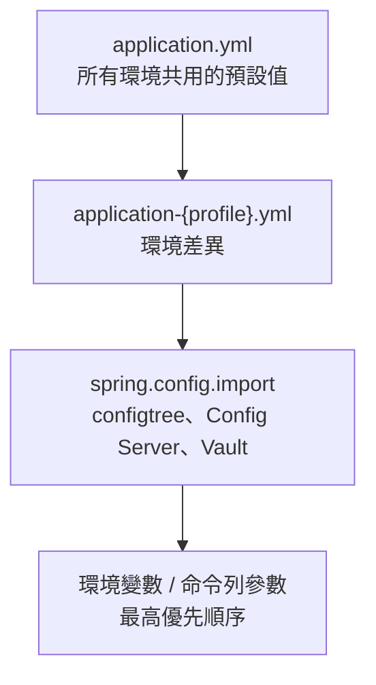

#### 8.4.2 Kubernetes 環境設定

```yaml
# application-kubernetes.yml
server:
  shutdown: graceful
spring:
  lifecycle:
    timeout-per-shutdown-phase: 30s
  config:
    import: "optional:configtree:/etc/config/"
management:
  server:
    port: 8081                 # 管理埠與業務埠分開，方便網路政策控管
  endpoint:
    health:
      probes:
        enabled: true          # 4.x 預設已是 true，明確寫出方便 review
  endpoints:
    web:
      exposure:
        include: health,info,prometheus
```

<!-- props:skip -->
```yaml
# Kubernetes Deployment（節錄）
livenessProbe:
  httpGet:
    path: /actuator/health/liveness
    port: 8081
  periodSeconds: 10
readinessProbe:
  httpGet:
    path: /actuator/health/readiness
    port: 8081
  periodSeconds: 5
startupProbe:
  httpGet:
    path: /actuator/health/liveness
    port: 8081
  failureThreshold: 30
  periodSeconds: 5
```

> 💡 4.1 起 `spring.config.import` 支援 `encoding` 選項（預設仍是 ISO-8859-1），讀取 UTF-8 的 `.properties` 匯入檔時可以明確指定。

### 8.5 實務建議與最佳實踐

#### 8.5.1 設定檔管理策略

| 原則 | 說明 |
|------|------|
| 只寫與預設值不同的設定 | 減少升版時要比對的屬性數量 |
| 設定檔納入 lint | CI 中執行 `check_props.py`，新 PR 不能引入不存在或已棄用的屬性 |
| 環境差異最小化 | 正式與測試環境的差異只放在 profile 或外部設定 |
| 自訂屬性用自己的前綴 | 例如 `app.*`，避免與 Spring Boot 未來的屬性衝突 |

#### 8.5.2 敏感資訊處理

```yaml
# ❌ 避免：明文寫在設定檔
spring:
  datasource:
    password: P@ssw0rd
```

```yaml
# ✅ 推薦：環境變數或 configtree（K8s Secret 掛載成檔案）
spring:
  datasource:
    password: ${DB_PASSWORD}
  config:
    import: "optional:configtree:/run/secrets/"
```

Vault、Spring Cloud Config 屬於 Spring Cloud 的範圍，升版時要確認 Spring Cloud 已升到 2025.1.x，並以其文件為準。

### 8.6 審查與驗證清單

| 檢查項目 | 如何驗證 | 預期結果 | 常見 AI 錯誤 |
|----------|----------|----------|--------------|
| 舊屬性 | `python check_props.py --repo ~/.m2/repository --version 4.1.2 src/main/resources/*.yml` | `0 problems` | 只改 `spring.*`，漏掉 `server.error.*`、`management.*` |
| 外部設定 | 匯出 ConfigMap、Helm values、環境變數後檢查 | 沒有舊名稱 | 只檢查 repo 內的設定檔 |
| 重試次數語意 | 比對 `max-attempts` → `max-retries` 的數值 | 新值 = 舊值 − 1 | 數值原封不動搬過去 |
| TOML | `find . -name "application.toml"` | 沒有 | 依 1.0 版內容建立 `application.toml` |
| 排除設定 | `grep -rn "autoconfigure.exclude\|exclude = " src/` | 類別名稱存在於 4.x jar 的 `AutoConfiguration.imports` | 沿用 3.x 的 auto-configuration 類別名稱 |
| migrator 已移除 | `mvn dependency:tree \| grep properties-migrator` | 沒有輸出 | 正式版仍帶著 migrator |

---

## 第九章：Observability 與 Monitoring

### 9.1 升版背景與目的

| 元件 | 3.5.16 | 4.1.2 |
|------|--------|-------|
| Micrometer | 1.15 | **1.17** |
| Micrometer Tracing | 1.5 | **1.7** |
| OpenTelemetry SDK | 1.49 | **1.62** |

4.x 在可觀測性上的變化主要是**整理與命名**，而不是「預設全開」：

- 新增 `spring-boot-starter-opentelemetry`，一個 starter 完成 OTLP 匯出 metrics 與 traces。
- OpenTelemetry 相關屬性集中到 `management.opentelemetry.*`（舊的 `management.otlp.tracing.*` 已棄用）。
- Liveness／Readiness probe 預設開啟。
- `HealthIndicator` 等類別搬到新模組 `spring-boot-health`。

> ❌ **1.0 版錯誤**：「4.x 預設啟用基礎監控」「結構化日誌預設啟用」都不正確。結構化日誌從 3.4 起就有，但需要設定 `logging.structured.format.*` 才會啟用；tracing 的取樣率預設仍是 `0.1`。1.0 版使用的 `management.observations.enabled`、`management.otlp.metrics.endpoint` 兩個屬性在 4.1.2 不存在（附錄 C.5）。

### 9.2 Logging、Metrics、Tracing 新趨勢

#### 9.2.1 Observability 三大支柱

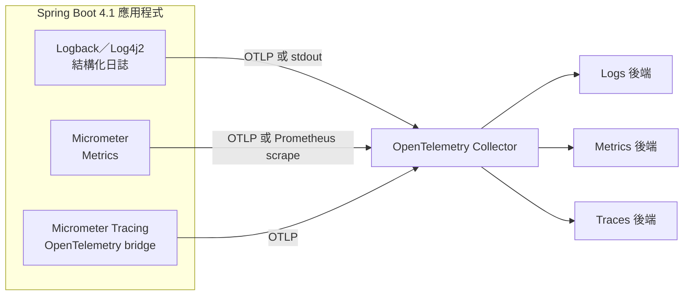

#### 9.2.2 結構化日誌

```yaml
logging:
  structured:
    format:
      console: ecs        # 可選 ecs、gelf、logstash；也可自訂 StructuredLogFormatter
    ecs:
      service:
        name: order-service
        environment: prod
```

4.0 起 Logback 寫入**檔案**預設使用 UTF-8；console 則使用 `Console#charset()`。若原本依賴系統預設編碼（例如 Windows 上的 MS950／Big5）寫檔，升版後日誌檔編碼會改變，日誌收集器的設定要一起確認。

### 9.3 與 OpenTelemetry / Micrometer 的整合方向

#### 9.3.1 OpenTelemetry starter【4.0】

```xml
<dependency>
  <groupId>org.springframework.boot</groupId>
  <artifactId>spring-boot-starter-actuator</artifactId>
</dependency>
<dependency>
  <groupId>org.springframework.boot</groupId>
  <artifactId>spring-boot-starter-opentelemetry</artifactId>
</dependency>
```

這個 starter 會：自動設定 OpenTelemetry SDK、透過 Micrometer Tracing 的 OTel bridge 產生 span、以 OTLP 匯出 metrics 與 traces。3.x 時代手動加入的 `micrometer-tracing-bridge-otel`、`opentelemetry-exporter-otlp` 可以移除，由 starter 管理。

設定（已用 `check_props.py` 對 4.1.2 metadata 檢查）：

```yaml
spring:
  application:
    name: order-service
management:
  opentelemetry:
    resource-attributes:
      deployment.environment: prod
    tracing:
      export:
        otlp:
          endpoint: http://otel-collector:4318/v1/traces
          compression: gzip
  otlp:
    metrics:
      export:
        url: http://otel-collector:4318/v1/metrics
        step: 30s
  tracing:
    sampling:
      probability: 0.1        # 預設 0.1；只有開發環境才設 1.0
    propagation:
      produce: w3c
  endpoints:
    web:
      exposure:
        include: health,info,prometheus
```

#### 9.3.2 OpenTelemetry 屬性對照【4.0】

| 3.x | 4.x |
|-----|-----|
| `management.otlp.tracing.endpoint` | `management.opentelemetry.tracing.export.otlp.endpoint` |
| `management.otlp.tracing.headers`、`timeout`、`compression`、`transport` | `management.opentelemetry.tracing.export.otlp.*` |
| `management.otlp.logging.endpoint` 等 | `management.opentelemetry.logging.export.otlp.*` |
| `management.tracing.enabled` | `management.tracing.export.enabled` |
| `management.tracing.opentelemetry.export.*`（batch 設定） | `management.opentelemetry.tracing.export.*` |
| `management.otlp.metrics.export.url` | **不變** |

#### 9.3.3 4.1 新增的 OpenTelemetry 能力【4.1】

| 功能 | 設定 |
|------|------|
| 一鍵停用 SDK（改用 no-op provider） | `management.opentelemetry.enabled=false` |
| 取樣器 | `management.opentelemetry.tracing.sampler`（預設 `parent-based-trace-id-ratio`） |
| 支援 OpenTelemetry 標準環境變數（例如 `OTEL_EXPORTER_OTLP_ENDPOINT`） | `management.opentelemetry.map-environment-variables`（預設 `true`） |
| OTLP exporter 使用 SSL bundle | `management.opentelemetry.tracing.export.otlp.ssl.bundle` |
| Metrics 壓縮 | `management.otlp.metrics.export.compression-mode=gzip` |
| `@Async` 方法自動傳遞 trace context | 無需設定 |
| Exemplars 篩選 | `management.tracing.exemplars.filter` |

> 🔭 **【4.2】** 4.2.0-M2 加入 OpenTelemetry semantic conventions 支援，並提供共用的 OTLP endpoint／headers／compression 設定。GA 後 metric 名稱與 tag 可能改變，監控儀表板需要回歸檢查。

#### 9.3.4 自定義 Metrics 與 Observation

Micrometer API 在 4.x 沒有破壞性變更：

```java
@Service
class OrderMetrics {
    private final Counter created;
    private final Timer fulfilment;

    OrderMetrics(MeterRegistry registry) {
        this.created = Counter.builder("orders.created")
            .description("建立的訂單數")
            .tag("channel", "web")
            .register(registry);
        this.fulfilment = Timer.builder("orders.fulfilment")
            .publishPercentileHistogram()
            .register(registry);
    }

    void onCreated() {
        created.increment();
    }

    <T> T timeFulfilment(Supplier<T> work) {
        return fulfilment.record(work);
    }
}
```

需要同時產生 metric 與 span 時，使用 Observation API：

```java
@Observed(name = "orders.lookup", contextualName = "lookup-order")
public Order find(Long id) {
    return repository.findById(id).orElseThrow();
}
```

`@Observed` 需要 `management.observations.annotations.enabled=true`（4.1.2 預設 `false`）。

### 9.4 企業實務監控建議

#### 9.4.1 升版前後的監控比對

升版最常見的監控事故不是服務掛掉，而是**儀表板與告警悄悄失效**：metric 名稱或 tag 改變、追蹤資料不再送出（舊屬性被忽略）。建議：

1. 升版前匯出 `/actuator/prometheus` 的所有 metric 名稱。
2. 升版後在測試環境再匯出一次，`diff` 比對。
3. 確認每個告警規則引用的 metric 仍然存在。

```bash
curl -s localhost:8081/actuator/prometheus | grep -v '^#' | sed 's/{.*//; s/ .*//' | sort -u > metrics-4x.txt
diff metrics-3x.txt metrics-4x.txt
```

#### 9.4.2 關鍵指標（Golden Signals）

| 訊號 | Metric | 說明 |
|------|--------|------|
| Latency | `http_server_requests_seconds_bucket` | 看 P95／P99，需開啟 percentiles histogram |
| Traffic | `http_server_requests_seconds_count` | 每秒請求數 |
| Errors | `http_server_requests_seconds_count{outcome="SERVER_ERROR"}` | 5xx 比率 |
| Saturation | `hikaricp_connections_pending`、`jvm_memory_used_bytes`、`jvm_threads_live_threads` | 啟用 Virtual Threads 後特別注意連線池等待 |

### 9.5 實務案例與注意事項

#### 9.5.1 健康檢查設定（✅ 已驗證）

**Probe 預設開啟【4.0】**：4.x 不論是否在 Kubernetes 上執行，`/actuator/health/liveness` 與 `/actuator/health/readiness` 都預設存在（`management.endpoint.health.probes.enabled` 預設 `true`）。範例專案的測試：

```java
    @Test
    void livenessAndReadinessProbesAreOnByDefault() {
        assertThat(rest.getForEntity("/actuator/health/liveness", String.class).getStatusCode())
            .isEqualTo(HttpStatus.OK);
        assertThat(rest.getForEntity("/actuator/health/readiness", String.class).getStatusCode())
            .isEqualTo(HttpStatus.OK);
    }
```

如果 Security 規則原本只開放 `/actuator/health`，要確認 `/actuator/health/**` 的存取策略（範例專案開放 `/actuator/health/**`）。

**自訂 HealthIndicator 的 package 已改變【4.0】**：

```java
package com.example.order;

import org.springframework.boot.health.contributor.AbstractHealthIndicator;
import org.springframework.boot.health.contributor.Health;
import org.springframework.stereotype.Component;

/** 4.x：HealthIndicator 相關類別搬到 org.springframework.boot.health.contributor。 */
@Component
public class InventoryHealthIndicator extends AbstractHealthIndicator {
    @Override
    protected void doHealthCheck(Health.Builder builder) {
        builder.up().withDetail("downstream", "inventory");
    }
}
```

| 3.x | 4.x |
|-----|-----|
| `org.springframework.boot.actuate.health.HealthIndicator` | `org.springframework.boot.health.contributor.HealthIndicator` |
| `org.springframework.boot.actuate.health.AbstractHealthIndicator` | `org.springframework.boot.health.contributor.AbstractHealthIndicator` |
| `org.springframework.boot.actuate.health.Health`、`Status` | `org.springframework.boot.health.contributor.Health`、`Status` |

使用舊 package 會編譯失敗（附錄 C.4 N14）。驗證自訂 indicator 確實出現在 health 回應中：

```java
@AutoConfigureMockMvc
class HealthEndpointTest {
    @Autowired
    MockMvc mvc;

    @Test
    @WithMockUser
    void customIndicatorIsPartOfHealth() throws Exception {
        mvc.perform(get("/actuator/health"))
            .andExpect(status().isOk())
            .andExpect(jsonPath("$.components.inventory.status").value("UP"))
            .andExpect(jsonPath("$.components.inventory.details.downstream").value("inventory"));
    }
}
```

建議設定：

```yaml
management:
  endpoint:
    health:
      show-details: when-authorized
      group:
        readiness:
          include: readinessState,db
  health:
    ssl:
      certificate-validity-warning-threshold: 14d   # 4.0 起憑證即將到期改列在 expiringChains
```

> ⚠️ 不要把外部相依（下游 API、第三方服務）放進 liveness group。下游故障時 liveness 失敗會讓 Kubernetes 不斷重啟健康的 Pod，造成連鎖故障。

### 9.6 審查與驗證清單

| 檢查項目 | 如何驗證 | 預期結果 | 常見 AI 錯誤 |
|----------|----------|----------|--------------|
| OTel 屬性 | `check_props.py` | 沒有 `management.otlp.tracing.*`、`management.tracing.enabled` | 沿用 3.x 屬性，追蹤資料靜默停止送出或無法關閉 |
| 不存在的屬性 | `check_props.py` | 0 problems | `management.observations.enabled`、`management.otlp.metrics.endpoint` |
| 相依整理 | `mvn dependency:tree -Dincludes=io.opentelemetry` | 版本由 BOM 管理 | 自行指定 OTel SDK 版本與 BOM 衝突 |
| HealthIndicator | `grep -rn "boot.actuate.health" src/` | 沒有結果 | 只改 import 的一半 |
| Probe | `curl /actuator/health/liveness` 與 `/readiness` | 200 | liveness group 包含外部相依 |
| Metrics 名稱 | 9.4.1 的 diff | 只有預期的差異 | 升版後沒有比對儀表板 |
| 取樣率 | `grep -rn "sampling" src/main/resources` | 生產 ≤ 0.1 或依容量規劃 | 正式環境設成 1.0 |

---

## 第十章：測試與品質保證

### 10.1 升版背景與目的

測試是升版中**改動最多的地方**，也是升版是否成功的唯一客觀證據。4.x 的測試變更有三個來源：

| 來源 | 變更 |
|------|------|
| Spring Boot 4.0 | `@MockBean`／`@SpyBean` 移除；`@SpringBootTest` 不再自動提供 `MockMvc`、`TestRestTemplate`、`WebTestClient`；測試 starter 模組化；package 搬家 |
| Spring Framework 7 | `RestTestClient`；JUnit 4 支援棄用；`SpringExtension` 的 `ExtensionContext` 範圍改變 |
| 第三方 | JUnit 6、Mockito 5.23、Testcontainers 2 |

### 10.2 Spring Boot Test 行為變更

#### 10.2.1 測試相依：每個技術一個 test starter【4.0】

```xml
    <!-- 測試：每個技術各有 *-test starter，會連帶引入 spring-boot-starter-test -->
    <dependency>
      <groupId>org.springframework.boot</groupId>
      <artifactId>spring-boot-starter-webmvc-test</artifactId>
      <scope>test</scope>
    </dependency>
    <dependency>
      <groupId>org.springframework.boot</groupId>
      <artifactId>spring-boot-starter-data-jpa-test</artifactId>
      <scope>test</scope>
    </dependency>
    <dependency>
      <groupId>org.springframework.boot</groupId>
      <artifactId>spring-boot-starter-security-test</artifactId>
      <scope>test</scope>
    </dependency>
    <!-- TestRestTemplate / RestTestClient 已獨立成模組 -->
    <dependency>
      <groupId>org.springframework.boot</groupId>
      <artifactId>spring-boot-resttestclient</artifactId>
      <scope>test</scope>
    </dependency>
```

`spring-boot-starter-<技術>-test` 會連帶引入 `spring-boot-starter-test`（JUnit、AssertJ、Mockito、Spring Test）以及該技術的測試切片（`@WebMvcTest`、`@DataJpaTest` 等）。只放 `spring-boot-starter-test` 時，`@AutoConfigureMockMvc`、`@DataJpaTest` 等註解會找不到。

#### 10.2.2 @MockBean → @MockitoBean【4.0】（✅ 已驗證）

| 3.x | 4.x |
|-----|-----|
| `org.springframework.boot.test.mock.mockito.MockBean` | `org.springframework.test.context.bean.override.mockito.MockitoBean` |
| `org.springframework.boot.test.mock.mockito.SpyBean` | `org.springframework.test.context.bean.override.mockito.MockitoSpyBean` |
| 可以放在 `@Configuration` 類別的欄位上 | **只能放在測試類別的欄位上**（或測試類別上的自訂註解） |
| `MockitoTestExecutionListener` 處理 `@Mock`／`@Captor` | 已移除；改用 `@ExtendWith(MockitoExtension.class)` |

升版前（3.5.16，編譯時有 `marked for removal` 警告）：

```java
package com.example.order;

import static org.mockito.BDDMockito.given;
import static org.springframework.test.web.servlet.request.MockMvcRequestBuilders.get;
import static org.springframework.test.web.servlet.result.MockMvcResultMatchers.jsonPath;
import static org.springframework.test.web.servlet.result.MockMvcResultMatchers.status;

import java.math.BigDecimal;
import java.time.LocalDate;
import org.junit.jupiter.api.Test;
import org.springframework.beans.factory.annotation.Autowired;
import org.springframework.boot.test.autoconfigure.web.servlet.AutoConfigureMockMvc;
import org.springframework.boot.test.context.SpringBootTest;
import org.springframework.boot.test.mock.mockito.MockBean;
import org.springframework.security.test.context.support.WithMockUser;
import org.springframework.test.web.servlet.MockMvc;

@SpringBootTest
@AutoConfigureMockMvc
class OrderControllerTest {
    @Autowired
    MockMvc mvc;

    @MockBean
    OrderService service;
```

升版後（4.1.2）：

```java
package com.example.order;

import static org.mockito.BDDMockito.given;
import static org.springframework.test.web.servlet.request.MockMvcRequestBuilders.get;
import static org.springframework.test.web.servlet.result.MockMvcResultMatchers.jsonPath;
import static org.springframework.test.web.servlet.result.MockMvcResultMatchers.status;

import java.math.BigDecimal;
import java.time.LocalDate;
import org.junit.jupiter.api.Test;
import org.springframework.beans.factory.annotation.Autowired;
import org.springframework.boot.test.context.SpringBootTest;
import org.springframework.boot.webmvc.test.autoconfigure.AutoConfigureMockMvc;
import org.springframework.security.test.context.support.WithMockUser;
import org.springframework.test.context.bean.override.mockito.MockitoBean;
import org.springframework.test.web.servlet.MockMvc;

@SpringBootTest
@AutoConfigureMockMvc              // 4.0 起 @SpringBootTest 不再自動提供 MockMvc
class OrderControllerTest {
    @Autowired
    MockMvc mvc;

    @MockitoBean                   // 取代已移除的 @MockBean
    OrderService service;

    @MockitoBean
    InventoryClient inventory;
```

**放在 `@Configuration` 的 `@MockBean` 怎麼改**：把它移到測試類別，或做成可重用的組合註解（✅ 已驗證，使用方式見 10.5.1 的 `OrderContractTest`）：

```java
package com.example.order;

import java.lang.annotation.ElementType;
import java.lang.annotation.Retention;
import java.lang.annotation.RetentionPolicy;
import java.lang.annotation.Target;
import org.springframework.test.context.bean.override.mockito.MockitoBean;

/** 取代 3.x「在 @Configuration 裡宣告 @MockBean」：可重用的組合註解。 */
@Target(ElementType.TYPE)
@Retention(RetentionPolicy.RUNTIME)
@MockitoBean(types = {InventoryClient.class})
public @interface MockExternalClients {
}
```

#### 10.2.3 @SpringBootTest 不再自動提供測試用 client【4.0】（✅ 已驗證）

| 要使用 | 必須加上 | 需要的相依 | 少了會怎樣 |
|--------|----------|------------|------------|
| `MockMvc` | `@AutoConfigureMockMvc` | `spring-boot-starter-webmvc-test` | `No qualifying bean of type 'MockMvc'`（N08） |
| `TestRestTemplate` | `@AutoConfigureTestRestTemplate` | `spring-boot-resttestclient` | `No qualifying bean of type 'TestRestTemplate'`（N09） |
| `RestTestClient` | `@AutoConfigureRestTestClient` | `spring-boot-resttestclient` | 同上 |
| `WebTestClient` | `@AutoConfigureWebTestClient` | `spring-boot-webtestclient`（WebFlux 專案用 `spring-boot-starter-webflux-test`） | 同上 |

`TestRestTemplate` 的 package 也改了：`org.springframework.boot.test.web.client.TestRestTemplate` → `org.springframework.boot.resttestclient.TestRestTemplate`。

```java
package com.example.order;

import static org.assertj.core.api.Assertions.assertThat;

import org.junit.jupiter.api.Test;
import org.springframework.beans.factory.annotation.Autowired;
import org.springframework.boot.resttestclient.TestRestTemplate;
import org.springframework.boot.resttestclient.autoconfigure.AutoConfigureTestRestTemplate;
import org.springframework.boot.test.context.SpringBootTest;
import org.springframework.boot.test.context.SpringBootTest.WebEnvironment;
import org.springframework.http.HttpStatus;

@SpringBootTest(webEnvironment = WebEnvironment.RANDOM_PORT)
@AutoConfigureTestRestTemplate     // 4.0 起需明確啟用，且 TestRestTemplate 換了 package
class OrderApiTest {
    @Autowired
    TestRestTemplate rest;
```

#### 10.2.4 RestTestClient：新的首選【4.0】（✅ 已驗證）

Framework 7 新增的 `RestTestClient` 是 `WebTestClient` 的非反應式版本，可以接 MockMvc 或真正啟動的伺服器，API 比 `TestRestTemplate` 更適合寫斷言：

```java
package com.example.order;

import org.junit.jupiter.api.Test;
import org.springframework.beans.factory.annotation.Autowired;
import org.springframework.boot.resttestclient.autoconfigure.AutoConfigureRestTestClient;
import org.springframework.boot.test.context.SpringBootTest;
import org.springframework.boot.test.context.SpringBootTest.WebEnvironment;
import org.springframework.http.HttpStatus;
import org.springframework.test.web.servlet.client.RestTestClient;

@SpringBootTest(webEnvironment = WebEnvironment.RANDOM_PORT,
    properties = {"spring.security.user.name=alice", "spring.security.user.password=secret",
        "spring.security.user.roles=USER"})
@AutoConfigureRestTestClient
class RestTestClientTest {
    @Autowired
    RestTestClient client;

    @Test
    void createThenReadWithVersionHeader() {
        client.post().uri("/api/orders")
            .headers(h -> h.setBasicAuth("alice", "secret"))
            .body(new OrderController.CreateOrder("acme", new java.math.BigDecimal("99.90")))
            .exchange()
            .expectStatus().isCreated()
            .expectBody().jsonPath("$.id").isNotEmpty();

        client.get().uri("/api/orders/1")
            .headers(h -> h.setBasicAuth("alice", "secret"))
            .header("X-API-Version", "2")
            .exchange()
            .expectStatus().isOk()
            .expectBody().jsonPath("$.total.value").isEqualTo(99.90);
    }

    @Test
    void validationErrorIsProblemDetail() {
        client.post().uri("/api/orders")
            .headers(h -> h.setBasicAuth("alice", "secret"))
            .body(new OrderController.CreateOrder("", new java.math.BigDecimal("0")))
            .exchange()
            .expectStatus().isEqualTo(HttpStatus.BAD_REQUEST)
            .expectHeader().contentType("application/problem+json");
    }
}
```

> 🔭 **【4.2】實測**：同一個範例專案改用 4.2.0-RC2 編譯，21 個測試都通過，但 `TestRestTemplate` 與 `@AutoConfigureTestRestTemplate` 出現新的 **deprecated and marked for removal** 警告（附錄 C.3）。**升到 4.1 時就直接把 `TestRestTemplate` 改成 `RestTestClient`**，可以省掉下一次升版的工作。

#### 10.2.5 其他測試變更

| 項目 | 3.x | 4.x |
|------|-----|-----|
| `@WebMvcTest`、`@AutoConfigureMockMvc` package | `org.springframework.boot.test.autoconfigure.web.servlet` | `org.springframework.boot.webmvc.test.autoconfigure` |
| `@DataJpaTest` package | `org.springframework.boot.test.autoconfigure.orm.jpa` | `org.springframework.boot.data.jpa.test.autoconfigure` |
| HtmlUnit 設定 | `@AutoConfigureMockMvc(webClientEnabled = false)` | `@AutoConfigureMockMvc(htmlUnit = @HtmlUnit(webClient = false, webDriver = false))` |
| `@PropertyMapping` | `org.springframework.boot.test.autoconfigure.properties` | `org.springframework.boot.test.context` |
| JUnit | Jupiter 5.12 | **JUnit 6.0**（`junit-jupiter` 座標不變；需要 Java 17） |
| Testcontainers | 1.21 | **2.0**：模組 artifactId 加上 `testcontainers-` 前綴（例如 `postgresql` → `testcontainers-postgresql`、`junit-jupiter` → `testcontainers-junit-jupiter`，Maven Central 已確認），部分 container 類別改了 package |
| JUnit 4 | `SpringRunner` 可用 | 已棄用；4.x 專案應全面使用 JUnit Jupiter |
| `@AutoConfigureWebServer`【4.1】 | — | 新增，讓切片測試也能啟動內嵌伺服器 |
| Maven AOT 測試處理【4.1】 | `-DskipTests` 會跳過 | 只看 `maven.test.skip` |

> ⚠️ Testcontainers 2 的座標變更請以 Testcontainers 官方 migration 說明為準；升版 PR 中所有 `org.testcontainers` 相依都要經過一次 `mvn dependency:tree` 確認。

> ❌ **1.0 版錯誤**：1.0 版把「`@RunWith(SpringRunner.class)` → JUnit 5」當成 4.x 的變更（其實是 2.2 起的建議），且 4.x 範例中仍使用已移除的 `@MockBean`。

### 10.3 測試失敗常見原因

#### 10.3.1 升版後常見測試問題（✅ 皆已實測）

附錄 C.4 把每個常見錯誤實際放進 4.1.2 專案執行，得到的錯誤訊息如下，可直接拿來對照：

| 編號 | 錯誤寫法 | 執行 | 結果 | 第一個錯誤訊息 |
|------|----------|------|------|----------------|
| N01 | 測試仍用 @MockBean | `mvn test-compile` | ❌ 失敗（符合預期） | `package org.springframework.boot.test.mock.mockito does not exist` |
| N02 | 仍用 Jackson2ObjectMapperBuilderCustomizer | `mvn compile` | ❌ 失敗（符合預期） | `package org.springframework.boot.autoconfigure.jackson does not exist` |
| N03 | 直接 import Jackson 2 的 com.fasterxml.jackson.databind.ObjectMapper | `mvn compile` | ❌ 失敗（符合預期） | `package com.fasterxml.jackson.databind does not exist` |
| N04 | Security 仍用 AntPathRequestMatcher | `mvn compile` | ❌ 失敗（符合預期） | `cannot find symbol: class AntPathRequestMatcher` |
| N05 | Security 仍用 .and() 串接 | `mvn compile` | ❌ 失敗（符合預期） | `error: method csrf in class org.springframework.security.config.annotation.web.builders.HttpSecurity cannot be applied to given types;` |
| N06 | TestRestTemplate 仍用舊 package | `mvn test-compile` | ❌ 失敗（符合預期） | `package org.springframework.boot.test.web.client does not exist` |
| N07 | @EntityScan 仍用舊 package | `mvn compile` | ❌ 失敗（符合預期） | `package org.springframework.boot.autoconfigure.domain does not exist` |
| N08 | @SpringBootTest 少了 @AutoConfigureMockMvc | `mvn test:OrderControllerTest` | ❌ 失敗（符合預期） | `No qualifying bean of type 'org.springframework.test.web.servlet.MockMvc'` |
| N09 | RANDOM_PORT 測試少了 @AutoConfigureTestRestTemplate | `mvn test:OrderApiTest` | ❌ 失敗（符合預期） | `No qualifying bean of type 'org.springframework.boot.resttestclient.TestRestTemplate'` |
| N10 | 加了 @Retryable 卻沒有 @EnableResilientMethods | `mvn test:StockServiceTest` | ❌ 失敗（符合預期） | `StockServiceTest.retriesTransientFailuresThroughHttpServiceClient:61 ? ServiceUnavailable 503 Service Unavailable: [no body]` |
| N11 | @GetMapping(version=...) 但未設定 spring.mvc.apiversion.* | `mvn test:OrderControllerTest` | ❌ 失敗（符合預期） | `IllegalStateException: API version specified, but no ApiVersionStrategy configured` |
| N13 | Hibernate 7 仍呼叫 Session.save() | `mvn compile` | ❌ 失敗（符合預期） | `cannot find symbol: method save(com.example.order.Order)` |
| N14 | HealthIndicator 仍用 org.springframework.boot.actuate.health | `mvn compile` | ❌ 失敗（符合預期） | `package org.springframework.boot.actuate.health does not exist` |
| N12 | 只加 flyway-core，沒有 spring-boot-starter-flyway | `mvn test:FlywayTest` | ❌ 失敗（符合預期） | `Table "AUDIT_LOG" not found` |
| P12 | （對照組）flyway-core + spring-boot-starter-flyway | `mvn test:FlywayTest` | ✅ 通過（符合預期） | — |

**讀表方式**：遇到左欄的錯誤訊息，就知道是哪一類問題、該看哪一節。特別注意 N10、N11、N12：它們**編譯會過**，只有測試能抓到。

#### 10.3.2 診斷技巧

```bash
# 只跑一個測試類別並顯示完整堆疊
mvn -B test -Dtest=OrderControllerTest -Dsurefire.trimStackTrace=false

# 看 auto-configuration 為什麼沒生效（Condition Evaluation Report）
mvn -B test -Dtest=OrderApiTest -Dlogging.level.org.springframework.boot.autoconfigure=DEBUG

# 比較升版前後的相依差異
mvn -B dependency:tree -DoutputFile=deps-4x.txt
diff deps-3x.txt deps-4x.txt
```

### 10.4 升版時的測試策略

#### 10.4.1 測試金字塔與升版重點

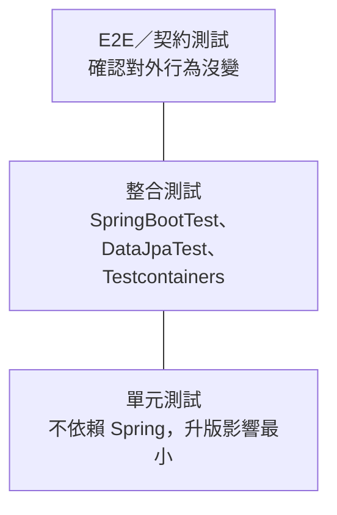

| 層級 | 升版時的角色 |
|------|--------------|
| 單元測試 | 通常不受影響；若大量失敗，代表有 Spring 依賴混進單元測試 |
| 整合測試 | **主要防線**：auto-configuration、Security、JPA、Jackson、屬性綁定都要在這層驗證 |
| 契約測試 | 確認 JSON 格式（Jackson 3 屬性順序）、錯誤格式、版本化 API 沒有改變 |
| 效能測試 | 比對啟動時間、記憶體、P95，特別是啟用 Virtual Threads 或 `spring.jpa.bootstrap=async` 時 |

#### 10.4.2 升版測試流程

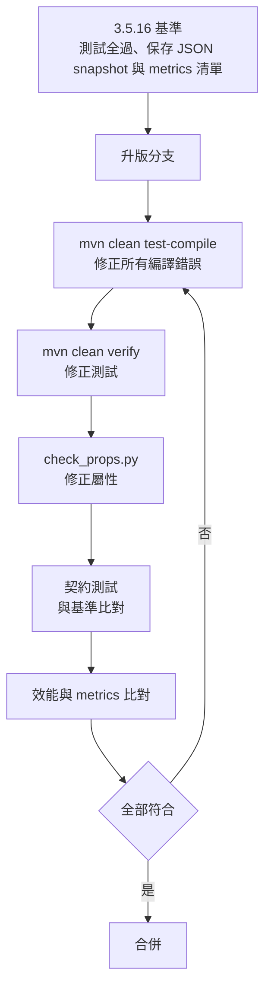

### 10.5 實務案例與注意事項

#### 10.5.1 契約測試（Contract Testing）

升版最需要契約測試保護的是 JSON 格式。做法是在 3.5 基準上保存回應（或直接寫出契約），升版後以 JSON 語意比對（✅ 已驗證）：

```java
package com.example.order;

import static org.mockito.BDDMockito.given;

import java.math.BigDecimal;
import org.junit.jupiter.api.Test;
import org.springframework.beans.factory.annotation.Autowired;
import org.springframework.boot.resttestclient.autoconfigure.AutoConfigureRestTestClient;
import org.springframework.boot.test.context.SpringBootTest;

/** 契約測試：以 JSON 語意比對，不受 Jackson 3 屬性排序影響；同時示範 @MockExternalClients。 */
@SpringBootTest(webEnvironment = SpringBootTest.WebEnvironment.RANDOM_PORT,
    properties = {"spring.security.user.name=alice", "spring.security.user.password=secret",
        "spring.security.user.roles=USER"})
@AutoConfigureRestTestClient
@MockExternalClients
class OrderContractTest {
    @Autowired
    org.springframework.test.web.servlet.client.RestTestClient client;

    @Autowired
    InventoryClient inventory;    // 由 @MockExternalClients 注入的 mock

    @Autowired
    StockService stock;

    @Test
    void createdOrderMatchesContract() {
        client.post().uri("/api/orders")
            .headers(h -> h.setBasicAuth("alice", "secret"))
            .body(new OrderController.CreateOrder("contract", new BigDecimal("12.30")))
            .exchange()
            .expectStatus().isCreated()
            // 預設寬鬆比對：多出的 id、orderDate 與欄位順序都不影響結果
            .expectBody().json("{\"customer\":\"contract\",\"amount\":12.30}");
    }

    @Test
    void externalClientIsMocked() {
        given(inventory.stock("A-1")).willReturn(new InventoryClient.Stock("A-1", 7));
        org.assertj.core.api.Assertions.assertThat(stock.available("A-1")).isEqualTo(7);
    }
}
```

> 💡 `expectBody().json(expected)` 預設是寬鬆比對：回應多出的欄位與欄位順序都不影響結果，所以不受 Jackson 3 屬性排序影響。若下游**確實依賴**欄位順序，就要額外用字串比對，並在 DTO 上加 `@JsonPropertyOrder`。實務上可以把契約 JSON 放在 `src/test/resources/contracts/`，由 3.5 基準版本產生。

使用 Spring Cloud Contract 或 Pact 的團隊，升版時要確認其版本支援 Spring Boot 4（Spring Cloud Contract 屬於 Spring Cloud 2025.1.x）。

### 10.6 審查與驗證清單

| 檢查項目 | 如何驗證 | 預期結果 | 常見 AI 錯誤 |
|----------|----------|----------|--------------|
| `@MockBean` 殘留 | `grep -rn "@MockBean\|@SpyBean\|test.mock.mockito" src/test` | 沒有結果 | 只換註解沒換 import |
| 測試 client 註解 | `grep -rn "MockMvc\|TestRestTemplate\|RestTestClient" src/test` 對照是否有 `@AutoConfigure*` | 每個用到的都有對應註解 | 以為 `@SpringBootTest` 會自動提供 |
| 測試 starter | `grep -n "starter-.*-test" pom.xml` | 每個用到的技術都有 test starter | 只有 `spring-boot-starter-test` |
| 測試數量 | 比較升版前後 `Tests run:` 總數 | 不少於升版前 | 為了讓建置通過而刪除或 `@Disabled` 測試 |
| `TestRestTemplate` | `grep -rn "TestRestTemplate" src/test` | 0（或已排入 4.2 前改寫） | 新測試仍使用 `TestRestTemplate` |
| Testcontainers | `mvn dependency:tree -Dincludes=org.testcontainers` | 2.x 且座標正確 | 混用 1.x 與 2.x 模組 |
| 跳過的測試 | `grep -rn "@Disabled" src/test` 與升版前比對 | 沒有新增 | 用 `@Disabled` 掩蓋升版問題 |

---

## 第十一章：企業升版實戰流程

### 11.1 升版前準備事項

#### 11.1.1 升版評估矩陣

把每個服務依「技術風險」與「業務重要性」分類，決定升版順序：

| 技術風險因子 | 低（1 分） | 中（2 分） | 高（3 分） |
|--------------|-----------|-----------|-----------|
| 自訂 Jackson 設定 | 無 | customizer | 自訂 serializer、Jackson 2 第三方函式庫 |
| Security | 預設設定 | Lambda DSL | `and()`、`AntPathRequestMatcher`、自訂 `AccessDecisionVoter` |
| 資料層 | Spring Data Repository | `@Query`、Criteria | Hibernate `Session` API、`@Where`、多資料庫產品 |
| 測試 | 少量 `@MockBean` | 大量 `@MockBean`、`TestRestTemplate` | 在 `@Configuration` 宣告 mock、JUnit 4 |
| 外部設定 | 只有 repo 內設定 | ConfigMap | 多個 Config Server／Vault 來源 |
| 內嵌容器／打包 | Tomcat、`java -jar` | Jetty | Undertow、launch script、WAR |

| 總分 | 分類 | 建議 |
|------|------|------|
| 6～9 | 低風險 | 適合當試點；可大量使用 OpenRewrite |
| 10～13 | 中風險 | 第二批；每項都要人工 review |
| 14～18 | 高風險 | 最後一批；先在 3.5 做重構，再升版 |

#### 11.1.2 升版前檢查清單

```markdown
□ 共用元件
  □ 公司 parent POM／BOM 已有 4.1.x 版本
  □ 內部 starter、共用函式庫已發布 4.x 相容版本（不要同時支援 3.x 與 4.x）
  □ Spring Cloud 版本已確定（2025.1.x）

□ 基準資料（在 3.5.16 上取得）
  □ 測試總數與通過數
  □ 主要 API 的 JSON 回應快照
  □ /actuator/prometheus metric 名稱清單
  □ 啟動時間、記憶體、P95 延遲
  □ mvn dependency:tree 輸出

□ 環境
  □ CI 有 4.x 分支的建置 pipeline
  □ 測試環境可同時部署 3.x 與 4.x 版本
  □ 正式環境外部設定（ConfigMap、Helm values、環境變數）已匯出
```

### 11.2 PoC 與試點升級策略

#### 11.2.1 PoC 階段

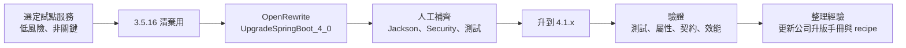

PoC 的產出不是「升好一個服務」，而是：

1. **公司專屬的錯誤清單**：每個升版問題、症狀、解法（可直接擴充本手冊附錄 C.4 的反例表）。
2. **自訂 OpenRewrite recipe**：把公司內部 starter、共用類別的改名寫成 recipe，後續服務自動處理。
3. **工時基準**：用來估算其他服務。

#### 11.2.2 試點服務選擇標準

| 條件 | 原因 |
|------|------|
| 評估矩陣總分 6～9 | 先驗證流程，不要一開始就卡在困難問題 |
| 測試覆蓋完整 | 能客觀判斷升版是否成功 |
| 有真實流量但非核心交易 | 能驗證效能與監控，失敗影響可控 |
| 團隊熟悉該服務 | 能分辨「升版造成的問題」與「原本就有的問題」 |

### 11.3 Rollback 與風險控管

#### 11.3.1 Rollback 策略

Spring Boot 升版本身不會改資料庫，但**下列狀態會讓回滾變複雜**，升版前要先確認：

| 共享狀態 | 風險 | 處理方式 |
|----------|------|----------|
| Redis Session／快取中的序列化資料 | 4.x 寫入的資料，3.x 讀不讀得到？Jackson 3 可讀 Jackson 2 格式，反向要實測 | 灰度期間新舊版本共用 Redis 時，以測試驗證雙向讀寫；必要時換 key 前綴 |
| Flyway／Liquibase migration | 升版時一起加入的 migration 回滾後仍在 | 升版 PR 不要夾帶 schema 變更 |
| Spring Batch metadata | Batch 5 → 6 的 metadata schema 是否相容 | 依 Spring Batch 6 migration guide 處理，先在測試環境演練 |
| Hibernate `ddl-auto=update` | 4.x 可能修改欄位型別（7.5.2） | 正式環境禁用 `update` |
| 訊息格式（Kafka、RabbitMQ） | JSON payload 欄位順序或格式改變 | 消費端用語意解析；契約測試涵蓋訊息 |

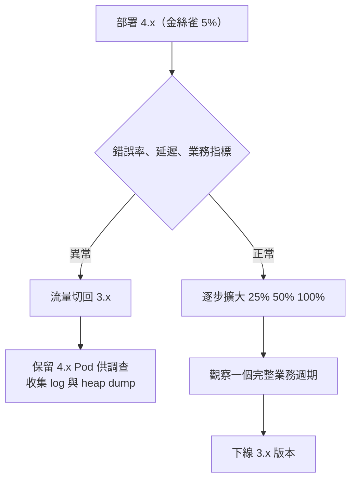

#### 11.3.2 Rollback 腳本範例

以 Kubernetes Deployment 為例（假設 4.x 與 3.x 是同一個 Deployment 的不同 revision）：

```bash
#!/usr/bin/env bash
# rollback.sh - 將服務回滾到上一個 revision，並驗證健康狀態
set -euo pipefail

NAMESPACE="${1:?usage: rollback.sh <namespace> <deployment>}"
DEPLOYMENT="${2:?usage: rollback.sh <namespace> <deployment>}"

echo "== 目前版本"
kubectl -n "$NAMESPACE" get deployment "$DEPLOYMENT" \
  -o jsonpath='{.spec.template.spec.containers[0].image}{"\n"}'

echo "== 回滾"
kubectl -n "$NAMESPACE" rollout undo deployment/"$DEPLOYMENT"
kubectl -n "$NAMESPACE" rollout status deployment/"$DEPLOYMENT" --timeout=300s

echo "== 回滾後版本"
kubectl -n "$NAMESPACE" get deployment "$DEPLOYMENT" \
  -o jsonpath='{.spec.template.spec.containers[0].image}{"\n"}'

echo "== 健康檢查（readiness）"
POD="$(kubectl -n "$NAMESPACE" get pods -l app="$DEPLOYMENT" -o jsonpath='{.items[0].metadata.name}')"
kubectl -n "$NAMESPACE" exec "$POD" -- \
  wget -qO- http://localhost:8081/actuator/health/readiness
```

> ⚠️ 腳本假設 Pod label 為 `app=<deployment>`、管理埠為 8081、容器內有 `wget`。依實際環境調整，並在測試環境演練過一次再列入 runbook。

### 11.4 CI/CD 升版建議流程

#### 11.4.1 打包方式的變更【4.0／4.1】（✅ 已驗證）

| 變更 | 版本 | 影響 | 處理方式 |
|------|------|------|----------|
| 「完全可執行 jar」的 launch script 移除 | 4.0 | `./app.jar` 直接執行、`/etc/init.d` 服務失效 | 改用 `java -jar` + systemd unit |
| Classic loader 移除 | 4.0 | `<loaderImplementation>CLASSIC</loaderImplementation>` 建置失敗 | 移除該設定 |
| Optional 相依不再打包進 uber jar | 4.0 | 執行時 `ClassNotFoundException` | `<includeOptional>true</includeOptional>` 或改成一般相依 |
| `layertools` jar mode 移除 | 4.1 | 舊 Dockerfile 的 `-Djarmode=layertools` 失敗 | 改用 `-Djarmode=tools` |
| Buildpacks builder | 🔭 4.2 | 4.2.0-RC1 起預設 builder 改為 Ubuntu Resolute | 檢查 `bootBuildImage`／`spring-boot:build-image` 產出的 image |

實測（4.1.2 的 uber jar）：

```text
$ java -Djarmode=tools -jar order-service-2.0.0.jar list-layers
dependencies
spring-boot-loader
snapshot-dependencies
application

$ java -Djarmode=layertools -jar order-service-2.0.0.jar list
Error: Unsupported jarmode 'layertools'
```

對應的 Dockerfile（已用同一個 jar 實測 extract 後能啟動，見附錄 C.6）：

<!-- props:skip -->
```dockerfile
FROM eclipse-temurin:21-jre AS builder
WORKDIR /builder
COPY target/order-service-2.0.0.jar app.jar
# 4.1 起：layertools 已移除，改用 tools
RUN java -Djarmode=tools -jar app.jar extract --layers --destination extracted

FROM eclipse-temurin:21-jre
WORKDIR /app
# 變動最少的層放前面，讓 image layer cache 生效
COPY --from=builder /builder/extracted/dependencies/ ./
COPY --from=builder /builder/extracted/spring-boot-loader/ ./
COPY --from=builder /builder/extracted/snapshot-dependencies/ ./
COPY --from=builder /builder/extracted/application/ ./
ENTRYPOINT ["java", "-jar", "app.jar"]
```

#### 11.4.2 GitHub Actions 範例

```yaml
name: boot4-upgrade
on:
  pull_request:
    branches: [main]
jobs:
  verify:
    runs-on: ubuntu-latest
    strategy:
      matrix:
        java: ["17", "21", "25"]     # 最低需求與企業目標版本都要測
    steps:
      - uses: actions/checkout@v4
      - uses: actions/setup-java@v4
        with:
          distribution: temurin
          java-version: ${{ matrix.java }}
          cache: maven
      - name: Build and test (show deprecations)
        run: mvn -B clean verify -Dmaven.compiler.showDeprecation=true
      - name: No transitional dependencies
        run: |
          mvn -B -q dependency:tree -DoutputFile=deps.txt
          ! grep -E "properties-migrator|starter-classic|spring-boot-jackson2" deps.txt
      - name: Configuration properties check
        run: python tools/check_props.py --repo ~/.m2/repository --version 4.1.2 src/main/resources/*.yml
```

> 💡 `check_props.py` 需要對應版本的 Spring Boot jar 已下載到本機 Maven 倉庫；在 `mvn verify` 之後執行即可。若專案只引入部分模組，索引也只會包含這些模組的屬性——這正好符合「只允許使用 classpath 上存在的屬性」的要求。

#### 11.4.3 Jenkins Pipeline 範例

```groovy
pipeline {
    agent { label 'maven-jdk21' }
    options { timeout(time: 30, unit: 'MINUTES') }
    stages {
        stage('Build & Test') {
            steps {
                sh 'mvn -B clean verify -Dmaven.compiler.showDeprecation=true'
            }
            post {
                always { junit 'target/surefire-reports/*.xml' }
            }
        }
        stage('Upgrade Gates') {
            steps {
                sh '''
                  mvn -B -q dependency:tree -DoutputFile=deps.txt
                  ! grep -E "properties-migrator|starter-classic" deps.txt
                  python tools/check_props.py --repo ~/.m2/repository --version 4.1.2 src/main/resources/*.yml
                  ! grep -rnE "@MockBean|AntPathRequestMatcher|com\\.fasterxml\\.jackson\\.databind" src/
                '''
            }
        }
        stage('Image') {
            when { branch 'main' }
            steps {
                sh 'docker build -t registry.example.com/order-service:${GIT_COMMIT} .'
            }
        }
    }
}
```

### 11.5 AI 輔助升版與人工審查流程

AI 很適合做升版中的機械式修改，但本手冊的實測顯示：自動工具（OpenRewrite）會漏改、AI 容易捏造不存在的屬性或 API（1.0 版本身就是例子）。因此流程必須讓 AI 的每個主張都有**可驗證的證據**。

#### 11.5.1 給 AI 的任務說明範本

```text
任務：將 order-service 從 Spring Boot 3.5.16 升級到 4.1.2。
限制：
1. 只做升版必要的修改，不重構業務邏輯，不刪除或停用任何測試。
2. 依序完成：pom（starter、版本）→ 編譯錯誤 → 測試 → 設定屬性。
3. 每改一類問題就執行 mvn -B clean verify，失敗時貼出第一個錯誤訊息。
4. 設定屬性只能使用 spring-configuration-metadata.json 中存在的名稱；不確定時列出來問我。
交付：
- git diff
- 升版前後的 "Tests run:" 總數
- mvn -Dmaven.compiler.showDeprecation=true 的棄用警告清單（應為 0）
- check_props.py 的輸出（應為 0 problems）
- 無法處理或不確定的項目清單
```

#### 11.5.2 人工審查步驟

| 步驟 | 審查方式 | 對應章節 |
|------|----------|----------|
| 1. 證據完整 | 確認上述交付物都在，且是實際執行的輸出（有時間戳、版本號） | — |
| 2. 測試數量 | 升版前後 `Tests run:` 總數相同或更多；沒有新增 `@Disabled` | 10.6 |
| 3. diff 分類 | 把 diff 分成：建置、import 搬家、API 改寫、設定、測試；只有「API 改寫」需要逐行看語意 | 2.4 |
| 4. 語意陷阱 | `maxAttempts`→`maxRetries`、`antMatchers`→`PathPattern`、Jackson 預設值、`starter-batch` | 4.4、4.5、6.3、7.3 |
| 5. 屬性 | 重跑 `check_props.py`，並檢查 repo 外的設定 | 8.2 |
| 6. 反例比對 | 用附錄 C.4 的錯誤訊息表，確認沒有「改了一半」的情況 | 10.3 |
| 7. 執行期 | 在測試環境實際啟動，看 log 中沒有 `PropertiesMigrationListener` 警告與 `WARN` 級別的棄用訊息 | 2.5 |

### 11.6 實務案例與注意事項

#### 11.6.1 案例：大型金融系統升版

**背景**：60 個微服務，Spring Boot 3.3～3.5 混雜，共用公司 parent POM 與 8 個內部 starter，使用 Spring Cloud Gateway 與 Config Server。

**做法與時程**：

| 階段 | 工作 | 時間 |
|------|------|------|
| 0 | 全部服務升到 3.5.16 並清除 `forRemoval` 警告 | 4 週 |
| 1 | parent POM、內部 starter 發布 4.1 版本（不支援 3.x） | 2 週 |
| 2 | 試點 2 個低風險服務，產出公司 recipe 與錯誤清單 | 2 週 |
| 3 | 分 4 批升級其餘服務，每批觀察一週 | 8 週 |
| 4 | Gateway 與 Config Server 最後升級（Spring Cloud 2025.1.x） | 2 週 |

**學到的教訓**：

1. 最多工時花在測試（`@MockBean` 放在共用 `@Configuration`、`TestRestTemplate`），不是主程式。
2. 監控事故來自 `management.tracing.enabled` 被忽略：測試環境沒有 tracing 後端，所以沒人發現 4.x 的設定沒生效。
3. 內部 starter 若引用 `org.springframework.boot.autoconfigure.*` 的類別，需要對照新模組逐一修改，建議由平台團隊集中處理。

### 11.7 審查與驗證清單

| 檢查項目 | 如何驗證 | 預期結果 | 常見 AI 錯誤 |
|----------|----------|----------|--------------|
| 打包設定 | `grep -nE "executable\|loaderImplementation\|layertools" pom.xml Dockerfile` | 沒有結果 | Dockerfile 仍用 `layertools` |
| Optional 相依 | `java -Djarmode=tools -jar app.jar list-layers` 後檢查 `BOOT-INF/lib` | 需要的 jar 都在 | 執行期才發現 `ClassNotFoundException` |
| CI 閘門 | 檢查 pipeline 設定 | 有 JDK matrix、棄用警告、屬性檢查、過渡相依檢查 | 只跑 `mvn package -DskipTests` |
| 回滾 | 在測試環境演練 `rollback.sh` | 3 分鐘內恢復 | 從未演練 |
| 共享狀態 | 新舊版本對同一個 Redis／Kafka topic 雙向讀寫測試 | 都能讀取 | 只測 4.x 單獨運作 |
| AI 交付物 | 對照 11.5.1 清單 | 每一項都有實際輸出 | 只提供 diff，沒有執行證據 |

---

## 第十二章：認證考試重點整理

### 12.1 Spring Boot 4.x 相關考試重點

#### 12.1.1 考試範圍概覽

Spring 官方認證（Broadcom 的 Spring Certified Professional）以**核心觀念**為主：容器、AOP、資料存取、交易、MVC／REST、Security、測試、Spring Boot 自動設定與 Actuator。考綱更新通常落後框架版本，因此本章分成兩部分：

1. 與版本無關、但升版時最容易混淆的觀念（12.2）。
2. 4.x 才有的事實，用於團隊內部考核與 Code Review 訓練（12.4）。

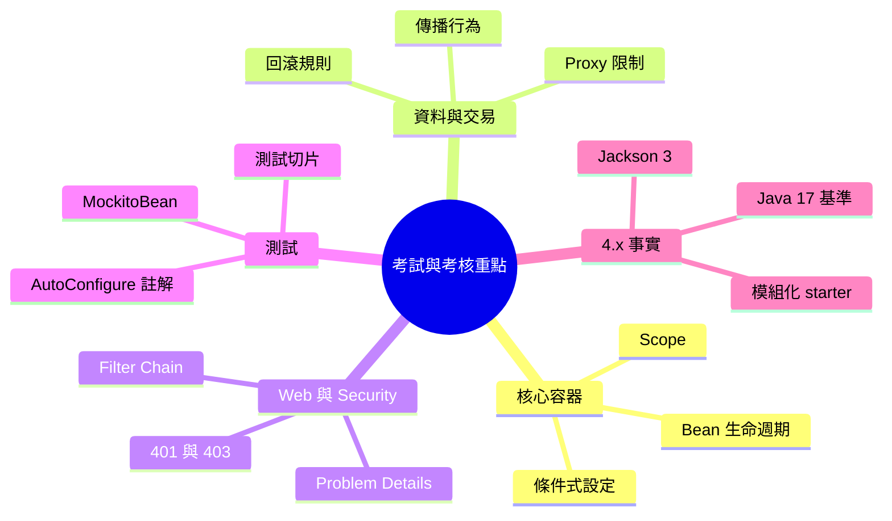

#### 12.1.2 版本升級相關考點

| 主題 | 必須記住的事實 | 出處 |
|------|----------------|------|
| 最低 Java | 17（建議 21／25） | 3.2 |
| Jakarta EE | 11（Servlet 6.1） | 1.3 |
| Framework 版本 | Boot 4.0／4.1 → Framework 7.0.x；Boot 4.2 → 7.1 | 1.4 |
| 測試 mock | `@MockitoBean`／`@MockitoSpyBean` | 10.2.2 |
| MockMvc | 需要 `@AutoConfigureMockMvc` | 10.2.3 |
| JSON | Jackson 3（`tools.jackson`），註解 package 不變 | 4.4 |
| Retry | `@Retryable` + `@EnableResilientMethods`；`maxRetries` 不含第一次 | 4.5.1 |
| Security | 只剩 Lambda DSL；`PathPatternRequestMatcher` | 6.3 |
| Virtual Threads | `spring.threads.virtual.enabled`，預設 `false` | 3.5 |
| Probe | liveness／readiness 預設開啟 | 9.5.1 |

### 12.2 常見陷阱題與觀念澄清

#### 12.2.1 Bean 生命週期相關

**題目**：下列哪一個回呼最晚執行？

- A. `@PostConstruct`
- B. `InitializingBean.afterPropertiesSet()`
- C. `BeanPostProcessor.postProcessAfterInitialization()`
- D. `SmartInitializingSingleton.afterSingletonsInstantiated()`

**答案**：D。所有 singleton 都建立完成後才呼叫。順序為 A → B → C → D。

**陷阱**：Bean 生命週期在 Framework 7 **沒有改變**；把「4.x 循環依賴更嚴格」當成新變更是錯的（從 Boot 2.6 起就預設禁止）。

#### 12.2.2 @Transactional 相關

```java
@Service
public class OrderService {
    public void placeOrder(Order o) {
        save(o);                       // 同類別呼叫
    }

    @Transactional(propagation = Propagation.REQUIRES_NEW)
    public void save(Order o) { /* ... */ }
}
```

**題目**：`placeOrder` 呼叫 `save` 時，`REQUIRES_NEW` 是否生效？

**答案**：不生效。同類別內的呼叫不經過 Spring proxy。解法是把 `save` 移到另一個 bean，或注入自己（不建議）。

**延伸**：預設只對 unchecked exception 回滾；checked exception 需要 `rollbackFor`。

#### 12.2.3 Security 相關

**題目**：使用者已登入但缺少 `ROLE_ADMIN`，存取 `hasRole("ADMIN")` 保護的端點，回應狀態碼是？

**答案**：403。401 是「未認證」，403 是「已認證但權限不足」（附錄 C 的 `SecurityBehaviourTest` 實測）。

**陷阱**：`hasRole("ADMIN")` 會自動加 `ROLE_` 前綴，等同 `hasAuthority("ROLE_ADMIN")`；寫成 `hasRole("ROLE_ADMIN")` 會變成檢查 `ROLE_ROLE_ADMIN`。

### 12.3 適合考前複習的章節整理

#### 12.3.1 複習優先順序

| 優先順序 | 章節 | 理由 |
|----------|------|------|
| 1 | 第 10 章 測試 | 變動最多，題目最容易出在註解與 package |
| 2 | 第 6 章 Security | 移除 API 多，觀念題（401／403、Filter Chain）常考 |
| 3 | 第 4 章 Framework 與 Jackson 3 | 「編譯會過但行為改變」的典型 |
| 4 | 第 8 章 設定屬性 | 靜默失效的屬性改名 |
| 5 | 第 7 章 資料層 | Hibernate 7 移除 API、交易觀念 |
| 6 | 第 1～3 章 | 版本事實 |

### 12.4 模擬試題

**Q1.** Spring Boot 4.1 支援的最低 Java 版本是？

A. 11　B. 17　C. 21　D. 25

<details>
<summary>答案與解析</summary>

**B**。Boot 4.x／Framework 7 的基準仍是 Java 17，官方建議 21 或 25。（3.2）

</details>

**Q2.** 3.x 測試中的 `@MockBean`，在 4.x 應該改成？

A. `@Mock`　B. `@MockitoBean`　C. `@SpyBean`　D. 不用改

<details>
<summary>答案與解析</summary>

**B**。`@MockBean` 在 4.0 移除，改用 Spring Framework 的 `org.springframework.test.context.bean.override.mockito.MockitoBean`。`@Mock` 是純 Mockito，不會替換 Spring context 中的 bean。（10.2.2，反例 N01）

</details>

**Q3.** 4.x 中，`@SpringBootTest` 測試類別要注入 `MockMvc`，最少需要加上什麼？

A. 不用加　B. `@WebMvcTest`　C. `@AutoConfigureMockMvc`　D. `@EnableWebMvc`

<details>
<summary>答案與解析</summary>

**C**。4.0 起 `@SpringBootTest` 不再自動提供 `MockMvc`；少了會出現 `No qualifying bean of type 'MockMvc'`。（10.2.3，反例 N08）

</details>

**Q4.** 下列 Jackson 相關的 import，哪一個在 4.x 仍然正確？

A. `com.fasterxml.jackson.databind.ObjectMapper`
B. `com.fasterxml.jackson.annotation.JsonProperty`
C. `org.springframework.boot.autoconfigure.jackson.Jackson2ObjectMapperBuilderCustomizer`
D. `org.springframework.boot.jackson.JsonComponent`

<details>
<summary>答案與解析</summary>

**B**。Jackson 3 的註解沿用 `com.fasterxml.jackson.annotation`；databind 改為 `tools.jackson.databind`，Boot 的 customizer 改為 `JsonMapperBuilderCustomizer`，`@JsonComponent` 改為 `@JacksonComponent`。（4.4.1，反例 N02、N03）

</details>

**Q5.** spring-retry 的 `@Retryable(maxAttempts = 3)` 改成 Framework 7 的 `@Retryable`，等價寫法是？

A. `maxRetries = 3`　B. `maxRetries = 2`　C. `maxAttempts = 3`　D. `attempts = 3`

<details>
<summary>答案與解析</summary>

**B**。`maxAttempts` 包含第一次呼叫，`maxRetries` 不包含。另外必須加 `@EnableResilientMethods`，否則註解無效。（4.5.1，反例 N10）

</details>

**Q6.** 4.x 專案只加了 `org.flywaydb:flyway-core`，啟動時會發生什麼事？

A. 編譯失敗　B. 啟動失敗　C. 正常啟動但 migration 不執行　D. 正常執行 migration

<details>
<summary>答案與解析</summary>

**C**。4.x 的 Flyway auto-configuration 在 `spring-boot-flyway` 模組，需要 `spring-boot-starter-flyway`。實測只有 `flyway-core` 時，查詢資料表得到 `Table "AUDIT_LOG" not found`。（7.3.2，反例 N12／P12）

</details>

**Q7.** 設定 `server.error.include-message: always` 在 4.x 的結果是？

A. 照常生效　B. 啟動失敗　C. 被靜默忽略　D. 自動轉成新屬性

<details>
<summary>答案與解析</summary>

**C**。已改名為 `spring.web.error.include-message`，舊名稱不再綁定。只有在加入 `spring-boot-properties-migrator` 時才會被暫時轉換並出現警告（D 只在有 migrator 時成立）。（8.2.1）

</details>

**Q8.** 在 Spring Boot 4.1.2 預設設定下，序列化一般類別 `class Legacy { public String zeta; public String alpha; }`，屬性順序為？

A. `zeta`、`alpha`　B. `alpha`、`zeta`　C. 隨機　D. 依建構子參數順序

<details>
<summary>答案與解析</summary>

**B**。Jackson 3 預設依字母排序屬性（record 則維持宣告順序）。設定 `spring.jackson.use-jackson2-defaults=true` 時為 A。（4.4.3 實測）

</details>

**Q9.** Controller 使用 `@GetMapping(path = "/{id}", version = "2")`，但沒有設定任何 `spring.mvc.apiversion.*` 屬性，結果是？

A. 版本被忽略　B. 所有請求都走 v2　C. 應用程式啟動失敗　D. 回傳 404

<details>
<summary>答案與解析</summary>

**C**。`IllegalStateException: API version specified, but no ApiVersionStrategy configured`。（5.5，反例 N11）

</details>

**Q10.** 4.1 的 Dockerfile 中，`java -Djarmode=layertools -jar app.jar extract` 會？

A. 正常運作　B. 出現棄用警告但可用　C. 失敗：`Unsupported jarmode 'layertools'`　D. 自動改用 tools

<details>
<summary>答案與解析</summary>

**C**。`layertools` 在 4.0 棄用、4.1 移除，改用 `-Djarmode=tools`。（11.4.1 實測）

</details>

**Q11.** 下列關於 OpenRewrite `UpgradeSpringBoot_4_0` recipe 的敘述，何者正確？

A. 執行成功就代表升版完成
B. 會自動處理所有 Security 7 的變更
C. 會處理大部分機械式修改，但仍可能留下編譯錯誤
D. 會直接升到最新的 4.1.x

<details>
<summary>答案與解析</summary>

**C**。實測它漏掉 `Jackson2ObjectMapperBuilderCustomizer` 與 `AntPathRequestMatcher`，而且只升到 4.0.9。（2.5.2）

</details>

**Q12.** 升版後想阻擋應用程式透過自動設定的 HTTP client 連線到內網位址，4.1 的做法是？

A. 設定 `spring.http.clients.block-internal=true`
B. 宣告 `InetAddressFilter` bean，例如 `InetAddressFilter.externalAddresses()`
C. 使用 Spring Security 的 `InetAddressMatcher`
D. 4.1 沒有此功能

<details>
<summary>答案與解析</summary>

**B**。A 的屬性不存在。C 的 `InetAddressMatcher` 用於**授權進來的請求**，不是限制對外連線。實測宣告後呼叫 `localhost` 丟出 `FilteredHostException`。（5.6.4）

</details>

### 12.5 審查與驗證清單

| 檢查項目 | 如何驗證 | 預期結果 | 常見 AI 錯誤 |
|----------|----------|----------|--------------|
| 題目正確性 | 每題對照出處章節與附錄 C 實測結果 | 答案有實測或官方文件依據 | 依「印象」出題，例如 Java 21 為最低版本 |
| 版本時效 | 題目註明適用版本（4.1.x） | 4.2 GA 後重新檢查 Q8、Q10、Q12 | 把 RC 版的行為當成定論 |
| 選項設計 | 錯誤選項是「看起來合理但實測錯誤」的寫法 | 選項來自反例表 | 錯誤選項明顯荒謬，沒有鑑別度 |

---

## 附錄：升版檢查清單與驗證紀錄

### A. 升版檢查清單

#### A.1 升版前準備

- [ ] 已升到 Spring Boot 3.5.16，且 `-Dmaven.compiler.showDeprecation=true` 沒有 `marked for removal` 警告
- [ ] 執行環境 JDK ≥ 17；CI、容器、開發環境一致
- [ ] Maven ≥ 3.6.3 或 Gradle 8.14+／9.x
- [ ] 沒有 Undertow、launch script、classic loader
- [ ] Spring Cloud 可升到 2025.1.x；內部 starter／parent POM 已有 4.x 版本
- [ ] 已保存基準：測試數、JSON 回應、metric 名稱、效能數據、`dependency:tree`
- [ ] 已匯出各環境外部設定（ConfigMap、Helm values、環境變數）
- [ ] 回滾方案與共享狀態（Redis、Kafka、Batch metadata）相容性已確認

#### A.2 程式碼修改

- [ ] parent／BOM 升到 4.1.x 最新 patch
- [ ] starter 改名：`webmvc`、`aspectj`、`security-oauth2-*`、`flyway`、`liquibase`、`batch-jdbc`
- [ ] 測試 starter：`spring-boot-starter-<技術>-test`、`spring-boot-resttestclient`
- [ ] Jackson 3：import、customizer、`@JacksonComponent`、屬性、預設值差異
- [ ] Security 7：Lambda DSL、`PathPatternRequestMatcher`、`authorizeHttpRequests`
- [ ] Hibernate 7：`Session` 舊 API、已移除註解
- [ ] package 搬家：`EntityScan`、`HealthIndicator`、`EnvironmentPostProcessor`、測試註解
- [ ] spring-retry → `@Retryable` + `@EnableResilientMethods`（次數 −1）
- [ ] 測試：`@MockitoBean`、`@AutoConfigureMockMvc`、`@AutoConfigureTestRestTemplate`（或改 `RestTestClient`）
- [ ] 屬性：8.2.1 對照表 + `check_props.py` 0 problems
- [ ] 移除 `spring-boot-properties-migrator`、`starter-classic`、`spring-boot-jackson2`（或列入技術債）

#### A.3 部署上線

- [ ] `mvn clean verify` 全過，測試數不少於升版前
- [ ] 契約測試與 JSON 快照比對通過
- [ ] metric 名稱 diff 只有預期差異；告警規則都能對應
- [ ] Dockerfile 使用 `-Djarmode=tools`
- [ ] K8s probe 使用 `/actuator/health/liveness`、`/readiness`，且 liveness 不含外部相依
- [ ] 金絲雀發布 → 逐步擴大 → 觀察一個業務週期
- [ ] 回滾腳本已在測試環境演練

### B. 快速參考

#### B.1 Maven 設定

```xml
<parent>
  <groupId>org.springframework.boot</groupId>
  <artifactId>spring-boot-starter-parent</artifactId>
  <version>4.1.2</version>
  <relativePath/>
</parent>

<properties>
  <java.version>21</java.version>
</properties>
```

Spring Cloud：

```xml
<dependencyManagement>
  <dependencies>
    <dependency>
      <groupId>org.springframework.cloud</groupId>
      <artifactId>spring-cloud-dependencies</artifactId>
      <version>${spring-cloud.version}</version>   <!-- 2025.1.x -->
      <type>pom</type>
      <scope>import</scope>
    </dependency>
  </dependencies>
</dependencyManagement>
```

#### B.2 類別與註解對照

| 3.x | 4.x | 章節 |
|-----|-----|------|
| `o.s.boot.test.mock.mockito.MockBean`／`SpyBean` | `o.s.test.context.bean.override.mockito.MockitoBean`／`MockitoSpyBean` | 10.2.2 |
| `o.s.boot.test.autoconfigure.web.servlet.AutoConfigureMockMvc` | `o.s.boot.webmvc.test.autoconfigure.AutoConfigureMockMvc` | 10.2.5 |
| `o.s.boot.test.web.client.TestRestTemplate` | `o.s.boot.resttestclient.TestRestTemplate`（🔭 4.2 棄用） | 10.2.3 |
| `o.s.boot.test.autoconfigure.orm.jpa.DataJpaTest` | `o.s.boot.data.jpa.test.autoconfigure.DataJpaTest` | 7.3.1 |
| `o.s.boot.autoconfigure.domain.EntityScan` | `o.s.boot.persistence.autoconfigure.EntityScan` | 7.3.1 |
| `o.s.boot.actuate.health.HealthIndicator` 等 | `o.s.boot.health.contributor.HealthIndicator` 等 | 9.5.1 |
| `o.s.boot.autoconfigure.jackson.Jackson2ObjectMapperBuilderCustomizer` | `o.s.boot.jackson.autoconfigure.JsonMapperBuilderCustomizer` | 4.4.2 |
| `@JsonComponent`／`@JsonMixin` | `@JacksonComponent`／`@JacksonMixin` | 4.4.1 |
| `com.fasterxml.jackson.databind.*` | `tools.jackson.databind.*` | 4.4.1 |
| `o.s.boot.env.EnvironmentPostProcessor` | `o.s.boot.EnvironmentPostProcessor` | 4.3.3 |
| `o.s.security.web.util.matcher.AntPathRequestMatcher` | `o.s.security.web.servlet.util.matcher.PathPatternRequestMatcher` | 6.3.2 |
| `o.s.retry.annotation.Retryable`／`@EnableRetry` | `o.s.resilience.annotation.Retryable`／`@EnableResilientMethods` | 4.5.1 |
| `HttpMessageConverters` bean | `ServerHttpMessageConvertersCustomizer`／`ClientHttpMessageConvertersCustomizer` | 5.2.3 |
| `org.springframework.lang.Nullable` | `org.jspecify.annotations.Nullable` | 4.3.2 |
| Hibernate `Session.save/update/delete/load` | `persist/merge/remove/getReference` | 7.2.1 |
| Hibernate `@Where` | `@SQLRestriction` | 7.2.1 |

（`o.s.` = `org.springframework.`）

#### B.3 常用指令

```bash
mvn -B clean verify -Dmaven.compiler.showDeprecation=true      # 編譯 + 測試 + 棄用警告
mvn -B dependency:tree -DoutputFile=deps.txt                  # 相依樹
mvn -B help:effective-pom | grep -E "spring-(framework|security)\.version"
java -Djarmode=tools -jar target/app.jar list-layers           # 檢查分層
curl -s localhost:8081/actuator/health/liveness                # 健康檢查
curl -s localhost:8081/actuator/info                           # 4.1 起含 process 資訊
```

### C. 驗證紀錄

本附錄記錄手冊中所有「✅ 已驗證」內容的實際執行結果。所有專案與腳本都在同一個工作目錄中，可用 `bash run_all.sh` 重跑全部驗證。

#### C.1 環境與版本來源

| 項目 | 值 |
|------|-----|
| 驗證日期 | 2026-11-18 |
| 作業系統 | Windows 11（Git Bash） |
| JDK | Eclipse Temurin 21.0.4 |
| Maven | 3.9.9 |
| Spring Boot | 3.5.16（升版前）、4.1.2（升版後）、🔭 4.2.0-RC2（前瞻） |
| OpenRewrite | rewrite-maven-plugin 6.46.1、rewrite-spring 6.37.1 |
| 版本對照表（1.4） | 直接讀取 `spring-boot-dependencies-<版本>.pom` 中的 `<*.version>` 屬性 |
| 支援期限（1.1） | `https://api.spring.io/projects/spring-boot/generations` |
| 最新版本 | Maven Central `org/springframework/boot/spring-boot/maven-metadata.xml`（2026-11-18：4.2.0-RC2、4.1.2、4.0.9、3.5.16） |
| 屬性與類別 | 4.1.2 各模組 jar 的 `spring-configuration-metadata.json` 與 `javap` |

#### C.2 升版前後測試結果

升版前（`legacy-35`）：

```text
$ mvn clean test -Dmaven.compiler.showDeprecation=true   # Spring Boot 3.5.16
[WARNING] .../SecurityConfig.java:[17,34] org.springframework.security.web.util.matcher.AntPathRequestMatcher in org.springframework.security.web.util.matcher has been deprecated and marked for removal
[WARNING] .../OrderControllerTest.java:[24,6] org.springframework.boot.test.mock.mockito.MockBean in org.springframework.boot.test.mock.mockito has been deprecated and marked for removal
Tests run: 2, Failures: 0, Errors: 0, Skipped: 0 -- in com.example.order.OrderApiTest
Tests run: 2, Failures: 0, Errors: 0, Skipped: 0 -- in com.example.order.OrderControllerTest
Tests run: 4, Failures: 0, Errors: 0, Skipped: 0
BUILD SUCCESS
```

升版後（`target-41`）：

```text
$ mvn clean verify -Dmaven.compiler.showDeprecation=true   # Spring Boot 4.1.2
deprecation warnings: 0
Tests run: 1, Failures: 0, Errors: 0, Skipped: 0 -- in com.example.order.HealthEndpointTest
Tests run: 1, Failures: 0, Errors: 0, Skipped: 0 -- in com.example.order.Jackson2DefaultsTest
Tests run: 2, Failures: 0, Errors: 0, Skipped: 0 -- in com.example.order.JacksonDefaultsTest
Tests run: 2, Failures: 0, Errors: 0, Skipped: 0 -- in com.example.order.OrderApiTest
Tests run: 2, Failures: 0, Errors: 0, Skipped: 0 -- in com.example.order.OrderContractTest
Tests run: 4, Failures: 0, Errors: 0, Skipped: 0 -- in com.example.order.OrderControllerTest
Tests run: 1, Failures: 0, Errors: 0, Skipped: 0 -- in com.example.order.OrderRepositoryTest
Tests run: 1, Failures: 0, Errors: 0, Skipped: 0 -- in com.example.order.PropertiesMigratorTest
Tests run: 2, Failures: 0, Errors: 0, Skipped: 0 -- in com.example.order.RestTestClientTest
Tests run: 3, Failures: 0, Errors: 0, Skipped: 0 -- in com.example.order.SecurityBehaviourTest
Tests run: 1, Failures: 0, Errors: 0, Skipped: 0 -- in com.example.order.SsrfFilterTest
Tests run: 1, Failures: 0, Errors: 0, Skipped: 0 -- in com.example.order.StockServiceTest
Tests run: 21, Failures: 0, Errors: 0, Skipped: 0
BUILD SUCCESS
```

測試類別與驗證內容：

| 測試類別 | 驗證內容 | 章節 |
|----------|----------|------|
| `OrderControllerTest` | `@MockitoBean`、`@AutoConfigureMockMvc`、API 版本化三種情況、ProblemDetail | 5.5、10.2 |
| `OrderApiTest` | `@AutoConfigureTestRestTemplate`、probe 預設開啟、401 | 9.5、10.2.3 |
| `RestTestClientTest` | `RestTestClient`、版本 header、驗證錯誤回傳 `application/problem+json` | 5.3、10.2.4 |
| `StockServiceTest` | HTTP Service Client、`@Retryable` 重試 3 次 | 4.5.1、5.6.2 |
| `OrderRepositoryTest` | `@DataJpaTest` 新 package、Hibernate 7.4 | 7.3.1 |
| `PropertiesMigratorTest` | migrator 回報 `spring.dao.*`，但**不回報** `management.tracing.enabled` | 2.5.1 |
| `JacksonDefaultsTest`／`Jackson2DefaultsTest` | Jackson 3 預設值、`use-jackson2-defaults` | 4.4.3 |
| `SsrfFilterTest` | `InetAddressFilter` 阻擋 loopback | 5.6.4 |
| `SecurityBehaviourTest` | 預設安全 header、403 | 6.2.2 |
| `HealthEndpointTest` | 新 package 的 `HealthIndicator` 出現在 health 回應 | 9.5.1 |
| `OrderContractTest` | 契約測試、`@MockExternalClients` 組合註解 | 10.5.1 |

Jackson 預設值實測輸出：

```text
JACKSON2-DEFAULTS pojo   => {"zeta":"z","alpha":"a"}
JACKSON2-DEFAULTS record => {"zeta":"z","alpha":"a","day":"2026-11-18"}
JACKSON3 pojo   => {"alpha":"a","zeta":"z"}
JACKSON3 record => {"zeta":"z","alpha":"a","day":"2026-11-18"}
```

SSRF 實測輸出：

```text
SSRF => org.springframework.boot.http.client.FilteredHostException: Filtered host 'localhost'
```

#### C.3 前瞻：4.2.0-RC2 相容性

把 `target-41` 的 parent 改成 4.2.0-RC2，其他不變：

```text
$ mvn clean verify -Dmaven.compiler.showDeprecation=true   # Spring Boot 4.2.0-RC2
[WARNING] .../OrderApiTest.java:[14,2] org.springframework.boot.resttestclient.autoconfigure.AutoConfigureTestRestTemplate in org.springframework.boot.resttestclient.autoconfigure has been deprecated and marked for removal
[WARNING] .../OrderApiTest.java:[17,5] org.springframework.boot.resttestclient.TestRestTemplate in org.springframework.boot.resttestclient has been deprecated and marked for removal
Tests run: 21, Failures: 0, Errors: 0, Skipped: 0
BUILD SUCCESS
```

結論：4.1 的寫法在 4.2.0-RC2 可以編譯並通過全部測試；唯一新增的是 `TestRestTemplate` 與 `@AutoConfigureTestRestTemplate` 的移除預告。

#### C.4 反例測試

`neg_run.py` 把每個錯誤寫法套用到 `target-41` 的獨立複本後執行，`N` 開頭預期失敗、`P` 開頭為對照組預期通過：

| 編號 | 錯誤寫法 | 執行 | 結果 | 第一個錯誤訊息 |
|------|----------|------|------|----------------|
| N01 | 測試仍用 @MockBean | `mvn test-compile` | ❌ 失敗（符合預期） | `package org.springframework.boot.test.mock.mockito does not exist` |
| N02 | 仍用 Jackson2ObjectMapperBuilderCustomizer | `mvn compile` | ❌ 失敗（符合預期） | `package org.springframework.boot.autoconfigure.jackson does not exist` |
| N03 | 直接 import Jackson 2 的 com.fasterxml.jackson.databind.ObjectMapper | `mvn compile` | ❌ 失敗（符合預期） | `package com.fasterxml.jackson.databind does not exist` |
| N04 | Security 仍用 AntPathRequestMatcher | `mvn compile` | ❌ 失敗（符合預期） | `cannot find symbol: class AntPathRequestMatcher` |
| N05 | Security 仍用 .and() 串接 | `mvn compile` | ❌ 失敗（符合預期） | `error: method csrf in class org.springframework.security.config.annotation.web.builders.HttpSecurity cannot be applied to given types;` |
| N06 | TestRestTemplate 仍用舊 package | `mvn test-compile` | ❌ 失敗（符合預期） | `package org.springframework.boot.test.web.client does not exist` |
| N07 | @EntityScan 仍用舊 package | `mvn compile` | ❌ 失敗（符合預期） | `package org.springframework.boot.autoconfigure.domain does not exist` |
| N08 | @SpringBootTest 少了 @AutoConfigureMockMvc | `mvn test:OrderControllerTest` | ❌ 失敗（符合預期） | `No qualifying bean of type 'org.springframework.test.web.servlet.MockMvc'` |
| N09 | RANDOM_PORT 測試少了 @AutoConfigureTestRestTemplate | `mvn test:OrderApiTest` | ❌ 失敗（符合預期） | `No qualifying bean of type 'org.springframework.boot.resttestclient.TestRestTemplate'` |
| N10 | 加了 @Retryable 卻沒有 @EnableResilientMethods | `mvn test:StockServiceTest` | ❌ 失敗（符合預期） | `StockServiceTest.retriesTransientFailuresThroughHttpServiceClient:61 ? ServiceUnavailable 503 Service Unavailable: [no body]` |
| N11 | @GetMapping(version=...) 但未設定 spring.mvc.apiversion.* | `mvn test:OrderControllerTest` | ❌ 失敗（符合預期） | `IllegalStateException: API version specified, but no ApiVersionStrategy configured` |
| N13 | Hibernate 7 仍呼叫 Session.save() | `mvn compile` | ❌ 失敗（符合預期） | `cannot find symbol: method save(com.example.order.Order)` |
| N14 | HealthIndicator 仍用 org.springframework.boot.actuate.health | `mvn compile` | ❌ 失敗（符合預期） | `package org.springframework.boot.actuate.health does not exist` |
| N12 | 只加 flyway-core，沒有 spring-boot-starter-flyway | `mvn test:FlywayTest` | ❌ 失敗（符合預期） | `Table "AUDIT_LOG" not found` |
| P12 | （對照組）flyway-core + spring-boot-starter-flyway | `mvn test:FlywayTest` | ✅ 通過（符合預期） | — |

#### C.5 設定屬性檢查工具

`check_props.py` 讀取指定版本所有 Spring Boot 模組 jar 的 metadata，檢查 Markdown 中 YAML／properties 範例或設定檔本身的屬性鍵：

```bash
python check_props.py --repo ~/.m2/repository --version 4.1.2 --legacy 3.5.16 "Spring boot 4.x升版教學.md"
python check_props.py --repo ~/.m2/repository --version 4.1.2 src/main/resources/application.yml
```

對 1.0 版手冊的檢查結果（這些都已在本版修正，見附錄 D）：

```text
index 4.1.2: 182 jars, 2716 properties
index 3.5.16: 27 jars, 2553 properties
v1.0:604: [4.1.2] 不存在的屬性 spring.main.lazy-initialization-filter.include-patterns
v1.0:604: [4.1.2] 不存在的屬性 spring.main.lazy-initialization-filter.exclude-patterns
v1.0:1781: [4.1.2] 不存在的屬性 server.threads.virtual.enabled
v1.0:1781: [4.1.2] 不存在的屬性 management.observations.enabled
v1.0:1781: [4.1.2] 已棄用 management.otlp.tracing.endpoint → management.opentelemetry.tracing.export.otlp.endpoint
v1.0:2146: [4.1.2] 已棄用 management.tracing.enabled → management.tracing.export.enabled
v1.0:2146: [4.1.2] 已棄用 management.otlp.tracing.endpoint → management.opentelemetry.tracing.export.otlp.endpoint
v1.0:2146: [4.1.2] 不存在的屬性 management.otlp.metrics.endpoint
checked 26 keys, 8 problems
```

對本版手冊的檢查結果：

```text
index 4.1.2: 182 jars, 2716 properties
index 3.5.16: 27 jars, 2553 properties
checked 57 keys, 0 problems
```

工具原始碼：

````python
"""check_props.py：檢查 Markdown 中 YAML / properties 範例的 Spring Boot 屬性鍵是否存在。

做法：讀取本機 Maven 倉庫中某版本所有 org.springframework.boot 模組 jar 的
META-INF/spring-configuration-metadata.json（含 additional-*），建立合法屬性索引，
再把文件裡 ```yaml / ```properties 區塊攤平成 key 逐一比對。

用法：
  python check_props.py --repo d:/repo --version 4.1.2 [--legacy 3.5.16] FILE.md
區塊標記（寫在 fence 前一行的 HTML 註解）：
  <!-- props:skip -->      不檢查（例如 Kubernetes manifest、刻意示範的錯誤）
  <!-- props:legacy -->    用 --legacy 版本的索引檢查（示範升版前的舊設定）
只檢查 spring. / management. / server. / logging. 開頭的鍵；其他自訂鍵忽略。
"""
import argparse, json, pathlib, re, sys, zipfile

import yaml

PREFIXES = ("spring.", "management.", "server.", "logging.")
# 不屬於 Spring Boot metadata 的命名空間（Spring Cloud 等），不檢查
EXCLUDE = ("spring.cloud.",)
_CACHE = {}


def _canon(s):
    key = id(s)
    if key not in _CACHE:
        _CACHE[key] = {norm(x) for x in s}
    return _CACHE[key]


def load_index(repo: pathlib.Path, version: str):
    names, maps, deprecated = set(), set(), {}
    base = repo / "org/springframework/boot"
    jars = sorted(base.glob(f"*/{version}/*-{version}.jar"))
    for jar in jars:
        try:
            z = zipfile.ZipFile(jar)
        except zipfile.BadZipFile:
            continue
        for entry in ("META-INF/spring-configuration-metadata.json",
                      "META-INF/additional-spring-configuration-metadata.json"):
            if entry not in z.namelist():
                continue
            data = json.loads(z.read(entry).decode("utf-8"))
            for p in data.get("properties", []):
                n = p["name"]
                names.add(n)
                t = p.get("type", "") or ""
                if t.startswith("java.util.Map") or t.startswith("java.util.List") or "[]" in t:
                    maps.add(n)
                dep = p.get("deprecation")
                if dep is not None or p.get("deprecated"):
                    deprecated[n] = (dep or {}).get("replacement") or (dep or {}).get("level") or "deprecated"
            for g in data.get("groups", []):
                t = g.get("type", "") or ""
                if t.startswith("java.util.Map"):
                    maps.add(g["name"])
    return names, maps, deprecated, len(jars)


def flatten(obj, prefix=""):
    if isinstance(obj, dict):
        for k, v in obj.items():
            key = f"{prefix}.{k}" if prefix else str(k)
            if isinstance(v, (dict, list)) and v:
                yield from flatten(v, key)
            else:
                yield key
    elif isinstance(obj, list):
        for i, v in enumerate(obj):
            if isinstance(v, (dict, list)):
                yield from flatten(v, f"{prefix}[{i}]")
            else:
                yield prefix


def norm(key: str) -> str:
    """Spring relaxed binding 的 canonical 形式：去掉索引、- 與 _，全部小寫。"""
    key = re.sub(r"\[\d+\]", "", key)
    return key.replace("-", "").replace("_", "").lower()


def known(key, names, maps):
    names = _canon(names)
    maps = _canon(maps)
    k = norm(key)
    if k in names:
        return True
    # Map/List 型別：允許任意子鍵，例如 spring.http.serviceclient.<group>.base-url
    parts = k.split(".")
    for i in range(len(parts) - 1, 0, -1):
        if ".".join(parts[:i]) in maps:
            return True
    # 群組底下動態鍵（例如 logging.level.<logger>）
    if k.startswith("logging.level.") or k.startswith("logging.group."):
        return True
    return False


def blocks(md: str):
    fence = None
    buf, lang, mark, start = [], "", "", 0
    lines = md.splitlines()
    for i, line in enumerate(lines, 1):
        m = re.match(r"^(\s*)(`{3,}|~{3,})(\w*)", line)
        if fence is None and m:
            fence, lang, buf, start = m.group(2), m.group(3).lower(), [], i
            prev = lines[i - 2].strip() if i >= 2 else ""
            mark = prev if prev.startswith("<!-- props:") else ""
            continue
        if fence is not None and line.strip().startswith(fence) and line.strip().strip(fence[0]) == "":
            yield lang, mark, start, "\n".join(buf)
            fence = None
            continue
        if fence is not None:
            buf.append(line)


def keys_of(lang, text):
    if lang in ("yaml", "yml"):
        try:
            docs = list(yaml.safe_load_all(text))
        except yaml.YAMLError as ex:
            return None, f"YAML 解析失敗：{ex}".splitlines()[0]
        out = []
        for d in docs:
            if isinstance(d, dict):
                out.extend(flatten(d))
        return out, None
    if lang == "properties":
        out = []
        for line in text.splitlines():
            line = line.strip()
            if not line or line.startswith(("#", "!")):
                continue
            k = re.split(r"\s*[=:]\s*", line, maxsplit=1)[0]
            out.append(k)
        return out, None
    return [], None


def main():
    ap = argparse.ArgumentParser()
    ap.add_argument("--repo", required=True)
    ap.add_argument("--version", required=True)
    ap.add_argument("--legacy")
    ap.add_argument("files", nargs="+")
    a = ap.parse_args()
    repo = pathlib.Path(a.repo)
    names, maps, dep, njar = load_index(repo, a.version)
    print(f"index {a.version}: {njar} jars, {len(names)} properties")
    legacy = None
    if a.legacy:
        legacy = load_index(repo, a.legacy)
        print(f"index {a.legacy}: {legacy[3]} jars, {len(legacy[0])} properties")
    bad = 0
    checked = 0
    for f in a.files:
        md = pathlib.Path(f).read_text(encoding="utf-8")
        suffix = pathlib.Path(f).suffix.lower()
        if suffix in (".yml", ".yaml", ".properties"):
            items = [("yaml" if suffix != ".properties" else "properties", "", 1, md)]
        else:
            items = blocks(md)
        for lang, mark, line, text in items:
            if lang not in ("yaml", "yml", "properties") or mark == "<!-- props:skip -->":
                continue
            ks, err = keys_of(lang, text)
            if err:
                print(f"{f}:{line}: {err}")
                bad += 1
                continue
            use_legacy = mark == "<!-- props:legacy -->" and legacy
            idx_names, idx_maps, idx_dep = (legacy[0], legacy[1], legacy[2]) if use_legacy else (names, maps, dep)
            ver = a.legacy if use_legacy else a.version
            for k in ks:
                if not k.startswith(PREFIXES) or k.startswith(EXCLUDE):
                    continue
                checked += 1
                nk = norm(k)
                idx_dep_c = {norm(x): v for x, v in idx_dep.items()}
                if not known(k, idx_names, idx_maps):
                    hint = ""
                    if legacy and not use_legacy and known(k, legacy[0], legacy[1]):
                        hint = f"（{a.legacy} 有此屬性 → 已改名或移除）"
                    print(f"{f}:{line}: [{ver}] 不存在的屬性 {k}{hint}")
                    bad += 1
                elif nk in idx_dep_c:
                    print(f"{f}:{line}: [{ver}] 已棄用 {k} → {idx_dep_c[nk]}")
                    bad += 1
    print(f"checked {checked} keys, {bad} problems")
    return 1 if bad else 0


if __name__ == "__main__":
    sys.exit(main())
````

> 💡 工具限制：只檢查 `spring.`、`management.`、`server.`、`logging.` 開頭的鍵；Map 型別屬性（例如 `spring.http.serviceclient.<group>.*`）的子鍵不逐一檢查；Spring Cloud 的屬性不在 Boot metadata 中，因此排除。

#### C.6 打包與容器

```text
$ java -Djarmode=tools -jar order-service-2.0.0.jar list-layers
dependencies
spring-boot-loader
snapshot-dependencies
application

$ java -Djarmode=layertools -jar order-service-2.0.0.jar list
Error: Unsupported jarmode 'layertools'
```

```text
$ java -Djarmode=tools -jar app.jar extract --layers --destination extracted
$ find extracted -maxdepth 2
extracted/application/app.jar
extracted/dependencies/lib            (85 個 jar)
extracted/snapshot-dependencies
extracted/spring-boot-loader

# 依 Dockerfile 的 COPY 順序合併四層後啟動
$ java -jar app.jar --server.port=0
... Started OrderApplication in 13.397 seconds
```

#### C.7 OpenRewrite

```text
 pom.xml                                                  | 13 +++++++++----
 src/main/java/com/example/order/JacksonConfig.java       |  4 ++--
 src/main/resources/application.yml                       |  9 +++++----
 src/test/java/com/example/order/OrderApiTest.java        |  4 +++-
 src/test/java/com/example/order/OrderControllerTest.java |  6 +++---
 5 files changed, 22 insertions(+), 14 deletions(-)
```

```text
$ mvn test   # 套用 OpenRewrite UpgradeSpringBoot_4_0 之後
[ERROR] .../JacksonConfig.java:[11,5] cannot find symbol
[ERROR] .../JacksonConfig.java:[3,54] package org.springframework.boot.autoconfigure.jackson does not exist
[ERROR] .../SecurityConfig.java:[17,34] cannot find symbol
[ERROR] .../SecurityConfig.java:[9,53] cannot find symbol
BUILD FAILURE
```

#### C.8 如何重現

```bash
bash run_all.sh                # 全部（約 15 分鐘，第一次需要下載相依）
bash run_all.sh --skip-neg     # 略過反例測試
```

`run_all.sh` 依序：產生並測試 `legacy-35` → 產生並測試 `target-41` → 以 4.2.0-RC2 重跑 → 檢查 jar mode → 執行 OpenRewrite 並編譯 → 執行反例。所有輸出寫入 `val/results/`，本手冊的實測區塊由建置腳本直接嵌入這些檔案。

### D. 勘誤表

1.0 版（2026-01-30）的錯誤與修正。「依據」欄說明如何確認。

| # | 1.0 版內容 | 正確內容 | 依據 | 本版章節 |
|---|-----------|----------|------|----------|
| 1 | Java 最低版本為 21，Java 17 不支援 | 最低 Java 17，建議 21／25 | 官方 System Requirements、Framework 7 Release Notes | 3.2 |
| 2 | 新增 TOML 設定檔支援 | 不支援 TOML | 官方文件無此功能 | 8.1 |
| 3 | Virtual Threads 預設啟用 | 預設 `false` | 4.1.2 metadata | 3.5 |
| 4 | Observability 預設啟用基礎監控、結構化日誌預設啟用 | 需要設定 | 4.1.2 metadata | 9.1 |
| 5 | Native Image 由「實驗性」變為「生產就緒」 | 3.x 已正式支援；4.x 需要 GraalVM 25 | 官方 Release Notes | 3.2 |
| 6 | Spring Data 2025.0.x、Spring Cloud 2025.0.x 對應 4.x | 4.0：Data 2025.1、Cloud 2025.1；4.1：Data 2026.0、Cloud 2025.1 | BOM、api.spring.io | 1.4 |
| 7 | Hibernate 7.0.x | 4.0：7.2；4.1：7.4 | BOM | 1.4 |
| 8 | 升版路徑經過 3.4.x | 先升到 3.5.x 最新 patch | 官方 Migration Guide | 2.2 |
| 9 | 「Jakarta EE 11 需更新 namespace」 | `jakarta.*` namespace 在 3.0 已完成；EE 11 不需再改 namespace | 官方 Migration Guide | 1.3 |
| 10 | 使用「Spring Boot Migrator」掃描 | 官方 Migration Guide 未提及此實驗性工具；本版改用 OpenRewrite `UpgradeSpringBoot_4_0` 與 properties-migrator，並記錄實測結果與盲點 | 實測 | 2.5 |
| 11 | `@Autowired(required=false)`、`SimpleAsyncTaskExecutor` 被移除 | 都沒有被移除 | Framework 7 Release Notes | 4.2.3 |
| 12 | 單一建構子需加 `@Autowired` | Framework 4.3 起不需要 | Framework 文件 | 4.2.3 |
| 13 | 循環依賴偵測是 4.x 新的 Breaking Change | Boot 2.6 起預設禁止 | Boot 2.6 Release Notes | 4.3.1 |
| 14 | 新增 `spring.main.lazy-initialization-filter` | 屬性不存在；用 `LazyInitializationExcludeFilter` bean | `check_props.py`、jar | 4.3.1 |
| 15 | `ResponseEntity` 泛型變嚴格（Breaking Change） | 無此變更 | Framework 7 Release Notes | — |
| 16 | Problem Details 在 4.x 預設啟用 | `spring.mvc.problemdetails.enabled` 預設 `false` | 4.1.2 metadata | 5.3.2 |
| 17 | Security 7：Session Fixation 改 `changeSessionId`、BCrypt 強度提升、Remember-Me 需明確啟用 | 官方文件無這些變更 | Security 7.0／7.1 What's New | 6.2.1 |
| 18 | Security 7 預設送出 `Content-Security-Policy` | 不會預設送出 CSP | 實測（`SecurityBehaviourTest`） | 6.2.2 |
| 19 | Hibernate 7：Query Cache 預設停用、Lazy Loading 更嚴格、雙向關聯需明確設定 | 不是 Hibernate 7 的變更；真正的變更見 7.2.1 | Hibernate 7.0 Migration Guide | 7.2.1 |
| 20 | Repository「查詢方法命名更嚴格」 | 無此變更 | Spring Data Release Notes | 7.4.1 |
| 21 | `server.threads.virtual.enabled` | 不存在；正確為 `spring.threads.virtual.enabled` | `check_props.py` | 3.5 |
| 22 | `management.observations.enabled` | 不存在 | `check_props.py` | 9.1 |
| 23 | `management.otlp.tracing.endpoint`、`management.tracing.enabled` | 4.0 已改名 | 4.1.2 metadata | 9.3.2 |
| 24 | `management.otlp.metrics.endpoint` | 不存在（3.x 與 4.x 皆是 `management.otlp.metrics.export.url`） | `check_props.py` | 9.3.2 |
| 25 | `server.servlet.register-default-servlet` 為 4.x 新增預設 | 3.5.16 metadata 中已有此屬性，非 4.x 變更 | `check_props.py --legacy 3.5.16` | — |
| 26 | `allow-bean-definition-overriding` 4.x 變嚴格 | Boot 2.1 起預設 `false` | Boot 2.1 Release Notes | 4.3.1 |
| 27 | 測試：`@RunWith(SpringRunner.class)` → JUnit 5 是 4.x 變更 | Boot 2.2 起即建議；4.x 真正的變更見 10.2 | Boot 2.2 Release Notes | 10.2.5 |
| 28 | 4.x 測試範例使用 `@MockBean` | `@MockBean` 已在 4.0 移除 | 實測 N01 | 10.2.2 |
| 29 | 4.x 範例使用 `micrometer-tracing-bridge-otel` + `opentelemetry-exporter-otlp` 手動組合 | 4.x 提供 `spring-boot-starter-opentelemetry` | 官方 Release Notes | 9.3.1 |
| 30 | 遺漏：starter 模組化、Jackson 3、JSpecify、`@SpringBootTest` 不提供 MockMvc、Flyway starter、屬性改名、API 版本化、HTTP Service Client、Retry、`layertools` 移除等 | 本版全部補上並實測 | 附錄 C | 各章 |

### E. 待確認事項

| # | 項目 | 目前狀態 | 何時確認 | 確認方式 |
|---|------|----------|----------|----------|
| E1 | Spring Boot 4.2.0 GA | 4.2.0-RC2；官方 generations 資料標示 2026-11 發布 | 4.2.0 GA 後 | 以 GA 重跑 `run_all.sh`；更新 1.4 版本表、C.3 |
| E2 | `RestTemplate` 在 Framework 7.1 正式 `@Deprecated` | Framework 7.0 Release Notes 預告 | 4.2 GA | 4.2 GA 編譯 `RestTemplate` 範例觀察警告 |
| E3 | 4.2 OpenTelemetry semantic conventions 對 metric 名稱的影響 | 4.2.0-M2 新增 | 4.2 GA | 9.4.1 的 metric diff |
| E4 | 4.2 Buildpacks 預設 builder 改為 Ubuntu Resolute | 4.2.0-RC1 Release Notes | 4.2 GA | `spring-boot:build-image` 實測 |
| E5 | OpenRewrite 是否推出 `UpgradeSpringBoot_4_1`／`4_2` recipe，並涵蓋 Jackson customizer 與 Security matcher | 6.37.1 只有 4.0 recipe 且有遺漏 | 每季 | 重跑 C.7 |
| E6 | Testcontainers 2 的 container 類別 package 變更細節 | 只確認 artifactId 改名 | 下次修訂 | 以 PostgreSQL／Kafka container 實作範例 |
| E7 | Jackson 3 對 record 不排序、POJO 排序的行為在後續版本是否改變 | 4.1.2（Jackson 3.1.7）實測 | Jackson 3.2 | 重跑 `JacksonDefaultsTest` |
| E8 | Spring Cloud 2026.0（Paddington）對 4.2 的支援與 Spring Cloud Bus 併入 Stream 的影響 | RC 階段 | 2026.0 GA | 官方 Release Notes |
| E9 | 3.5.x 商業支援至 2032-06-30 的實際取得方式 | api.spring.io 資料 | 採購前 | 洽 Broadcom |

---

## 版本歷程

| 版本 | 日期 | 說明 |
|------|------|------|
| 2.0 | 2026-11-18 | 全面查核與改寫：以 Spring Boot 4.1.2 為生產基準、3.5.16 為起點、4.2.0-RC2 為前瞻；修正 30 項錯誤（附錄 D）；新增模組化、Jackson 3、JSpecify、API 版本化、HTTP Service Client、Resilience、SSRF 防護、OpenRewrite 實測、屬性改名對照、AI 輔助升版審查流程；每章新增審查與驗證清單；所有標示 ✅ 的範例以 21 個自動化測試實際驗證，另以 14 個反例與 1 個對照組證明常見錯誤寫法會失敗（附錄 C） |
| 1.0 | 2026-01-30 | 初版發布 |

---

## 參考資源

### 官方文件

- [Spring Boot 4.0 Migration Guide](https://github.com/spring-projects/spring-boot/wiki/Spring-Boot-4.0-Migration-Guide)
- [Spring Boot 4.0 Release Notes](https://github.com/spring-projects/spring-boot/wiki/Spring-Boot-4.0-Release-Notes)
- [Spring Boot 4.1 Release Notes](https://github.com/spring-projects/spring-boot/wiki/Spring-Boot-4.1-Release-Notes)
- [Spring Boot 4.2 Release Notes（GA 後公布）](https://github.com/spring-projects/spring-boot/wiki/Spring-Boot-4.2-Release-Notes)
- [Spring Boot 參考文件](https://docs.spring.io/spring-boot/)
- [Spring Boot System Requirements](https://docs.spring.io/spring-boot/system-requirements.html)
- [Spring Boot 支援期限（API）](https://api.spring.io/projects/spring-boot/generations)
- [Spring Framework 7.0 Release Notes](https://github.com/spring-projects/spring-framework/wiki/Spring-Framework-7.0-Release-Notes)
- [Spring Framework 參考文件](https://docs.spring.io/spring-framework/reference/)
- [Spring Security 7.0 What's New](https://docs.spring.io/spring-security/reference/7.0/whats-new.html)
- [Spring Security Migration（7.x）](https://docs.spring.io/spring-security/reference/migration/index.html)
- [Spring Security 6.5 準備遷移到 7.0](https://docs.spring.io/spring-security/reference/6.5/migration-7/index.html)
- [Hibernate ORM 7.0 Migration Guide](https://docs.hibernate.org/orm/7.0/migration-guide/)
- [Jackson 3 Migration Guide](https://github.com/FasterXML/jackson/blob/main/jackson3/MIGRATING_TO_JACKSON_3.md)
- [JSpecify](https://jspecify.dev/)

### 工具

- [OpenRewrite rewrite-spring（含 `UpgradeSpringBoot_4_0` recipe）](https://github.com/openrewrite/rewrite-spring)
- [OpenRewrite Maven plugin](https://docs.openrewrite.org/reference/rewrite-maven-plugin)
- `org.springframework.boot:spring-boot-properties-migrator`（用法見 2.5.1）

### 發布公告

- [Spring Boot 4.1.0 available now](https://spring.io/blog/2026/06/10/spring-boot-4/)
- [Spring Boot 4.2.0-M1 available now](https://spring.io/blog/2026/08/20/spring-boot-4-2-0-M1-available-now/)
- [Spring Boot 4.2.0-M2 available now](https://spring.io/blog/2026/09/25/spring-boot-4-2-0-M2-available-now/)

---

> 📝 **文件維護說明**
> 本手冊將隨 Spring Boot 版本更新而持續維護。下一次修訂請從[附錄 E](#e-待確認事項) 開始，並以 `run_all.sh` 重跑全部驗證。
> 如有任何問題或建議，請聯繫技術團隊。
