+++
date = '2025-10-31T00:00:00+08:00'
draft = false
title = 'Entity-Relationship Model (ER Model) 教學手冊'
tags = ['教學', '分析與設計']
categories = ['教學']
lastmod = '2026-10-12T00:00:00+08:00'
+++

# Entity-Relationship Model (ER Model) 教學手冊

> - **作者**：資料架構與系統分析團隊
> - **更新日期**：2026 年 10 月 12 日
> - **版本**：v3.0
> - **適用對象**：系統分析師、資料庫設計人員、後端工程師、技術主管、設計審查者
> - **技術基準**：Chen (1976) ER 模型、ISO/IEC/IEEE 31320-2:2012 (IDEF1X97)、ISO/IEC 9075:2023 (SQL:2023)、PostgreSQL 18.6、Oracle AI Database 26ai (23.26.3)、SQL Server 2025、Db2 12.1.5、Mermaid 11

## 目錄

<!-- TOC-AUTO-BEGIN -->

- [0. 文件資訊與使用方式](#0-文件資訊與使用方式)
  - [0.1 文件資訊](#01-文件資訊)
  - [0.2 如何使用本手冊](#02-如何使用本手冊)
  - [0.3 指引條目的格式與編號](#03-指引條目的格式與編號)
  - [0.4 範例程式碼慣例與自行驗證方式](#04-範例程式碼慣例與自行驗證方式)
- [1. 學習目標與學習路徑](#1-學習目標與學習路徑)
  - [1.1 學完本手冊應具備的能力](#11-學完本手冊應具備的能力)
  - [1.2 建議學習路徑](#12-建議學習路徑)
  - [1.3 學習方法建議](#13-學習方法建議)
- [2. 資料建模基礎](#2-資料建模基礎)
  - [2.1 什麼是 ER Model](#21-什麼是-er-model)
  - [2.2 概念、邏輯、實體三層資料模型](#22-概念邏輯實體三層資料模型)
  - [2.3 ANSI/SPARC 三層綱要與資料獨立性](#23-ansisparc-三層綱要與資料獨立性)
  - [2.4 ER 模型與其他模型的關係](#24-er-模型與其他模型的關係)
  - [2.5 何時需要畫 ER 模型](#25-何時需要畫-er-模型)
- [3. ER 核心概念](#3-er-核心概念)
  - [3.1 實體、實體型別與實體集合](#31-實體實體型別與實體集合)
  - [3.2 屬性的種類](#32-屬性的種類)
  - [3.3 關係、度數與角色](#33-關係度數與角色)
  - [3.4 鍵的種類](#34-鍵的種類)
  - [3.5 強實體與弱實體](#35-強實體與弱實體)
- [4. 結構限制：基數與參與](#4-結構限制基數與參與)
  - [4.1 基數比](#41-基數比)
  - [4.2 參與限制](#42-參與限制)
  - [4.3 (min,max) 表示法與「看哪一端」的差異](#43-minmax-表示法與看哪一端的差異)
  - [4.4 Mermaid Crow's Foot 符號對照](#44-mermaid-crows-foot-符號對照)
  - [4.5 結構限制如何落實到資料庫](#45-結構限制如何落實到資料庫)
- [5. ERD 表示法](#5-erd-表示法)
  - [5.1 Chen 表示法](#51-chen-表示法)
  - [5.2 Crow's Foot（Information Engineering）表示法](#52-crows-footinformation-engineering表示法)
  - [5.3 Barker 表示法](#53-barker-表示法)
  - [5.4 IDEF1X 表示法](#54-idef1x-表示法)
  - [5.5 Mermaid erDiagram 語法完整說明](#55-mermaid-erdiagram-語法完整說明)
  - [5.6 PlantUML 的 IE 表示法](#56-plantuml-的-ie-表示法)
  - [5.7 以 UML 類別圖表示資料模型](#57-以-uml-類別圖表示資料模型)
  - [5.8 表示法對照與選用建議](#58-表示法對照與選用建議)
- [6. 延伸 ER 模型（EER）](#6-延伸-er-模型eer)
  - [6.1 超型別與子型別](#61-超型別與子型別)
  - [6.2 特化與一般化](#62-特化與一般化)
  - [6.3 特化的限制](#63-特化的限制)
  - [6.4 類別（Union Type）](#64-類別union-type)
  - [6.5 聚合（Aggregation）](#65-聚合aggregation)
- [7. 建模流程：從需求到 ER 模型](#7-建模流程從需求到-er-模型)
  - [7.1 流程總覽](#71-流程總覽)
  - [7.2 萃取業務規則](#72-萃取業務規則)
  - [7.3 名詞與動詞分析](#73-名詞與動詞分析)
  - [7.4 實體精煉與屬性識別](#74-實體精煉與屬性識別)
  - [7.5 資料字典](#75-資料字典)
  - [7.6 命名規範](#76-命名規範)
  - [7.7 情境走查與樣本資料驗證](#77-情境走查與樣本資料驗證)
- [8. 從 ER 模型映射到關聯綱要](#8-從-er-模型映射到關聯綱要)
  - [8.1 映射演算法總覽](#81-映射演算法總覽)
  - [8.2 步驟 1～2：一般實體與弱實體](#82-步驟-12一般實體與弱實體)
  - [8.3 步驟 3～5：二元關係](#83-步驟-35二元關係)
  - [8.4 步驟 6：多值屬性](#84-步驟-6多值屬性)
  - [8.5 步驟 7：n 元關係](#85-步驟-7n-元關係)
  - [8.6 步驟 8：特化與一般化的四種方案](#86-步驟-8特化與一般化的四種方案)
  - [8.7 步驟 9：類別（union type）](#87-步驟-9類別union-type)
  - [8.8 參照動作與四種資料庫的差異](#88-參照動作與四種資料庫的差異)
  - [8.9 識別欄位與四種資料庫的 DDL 差異](#89-識別欄位與四種資料庫的-ddl-差異)
- [9. 函數相依與正規化](#9-函數相依與正規化)
  - [9.1 為什麼需要正規化：資料異常](#91-為什麼需要正規化資料異常)
  - [9.2 函數相依、Armstrong 公理與屬性閉包](#92-函數相依armstrong-公理與屬性閉包)
  - [9.3 第一正規形式（1NF）](#93-第一正規形式1nf)
  - [9.4 第二正規形式（2NF）](#94-第二正規形式2nf)
  - [9.5 第三正規形式（3NF）](#95-第三正規形式3nf)
  - [9.6 Boyce-Codd 正規形式（BCNF）](#96-boyce-codd-正規形式bcnf)
  - [9.7 第四與第五正規形式](#97-第四與第五正規形式)
  - [9.8 無損分解與相依保存](#98-無損分解與相依保存)
  - [9.9 正規化實務流程與檢查表](#99-正規化實務流程與檢查表)
- [10. 實體設計與反正規化](#10-實體設計與反正規化)
  - [10.1 資料型別的選擇原則](#101-資料型別的選擇原則)
  - [10.2 主鍵策略](#102-主鍵策略)
  - [10.3 反正規化與一致性保證](#103-反正規化與一致性保證)
  - [10.4 索引設計要點](#104-索引設計要點)
  - [10.5 條件式唯一](#105-條件式唯一)
  - [10.6 時態資料：有效時間與交易時間](#106-時態資料有效時間與交易時間)
  - [10.7 系統版本時態表](#107-系統版本時態表)
- [11. 常用設計模式與反模式](#11-常用設計模式與反模式)
  - [11.1 稽核欄位與 Party 模式](#111-稽核欄位與-party-模式)
  - [11.2 軟刪除](#112-軟刪除)
  - [11.3 歷史快照與版本](#113-歷史快照與版本)
  - [11.4 階層資料](#114-階層資料)
  - [11.5 代碼表與 CHECK 約束](#115-代碼表與-check-約束)
  - [11.6 反模式：多型關聯與 EAV](#116-反模式多型關聯與-eav)
- [12. 常見設計錯誤與連結陷阱](#12-常見設計錯誤與連結陷阱)
  - [12.1 連結陷阱：Fan Trap](#121-連結陷阱fan-trap)
  - [12.2 連結陷阱：Chasm Trap](#122-連結陷阱chasm-trap)
  - [12.3 查詢時的扇出重複計算](#123-查詢時的扇出重複計算)
  - [12.4 常見錯誤速查表](#124-常見錯誤速查表)
- [13. 完整案例](#13-完整案例)
  - [13.1 案例一：圖書館借閱系統](#131-案例一圖書館借閱系統)
  - [13.2 案例二：電商訂單與出貨](#132-案例二電商訂單與出貨)
  - [13.3 案例三：銀行帳戶與複式記帳](#133-案例三銀行帳戶與複式記帳)
  - [13.4 案例四：醫院門診掛號](#134-案例四醫院門診掛號)
- [14. 資料模型治理與變更管理](#14-資料模型治理與變更管理)
  - [14.1 模型生命週期](#141-模型生命週期)
  - [14.2 設計審查流程](#142-設計審查流程)
  - [14.3 以系統目錄自動檢查模型品質](#143-以系統目錄自動檢查模型品質)
  - [14.4 綱要變更的安全做法](#144-綱要變更的安全做法)
  - [14.5 逆向工程與模型同步](#145-逆向工程與模型同步)
- [15. 安全與個人資料保護](#15-安全與個人資料保護)
  - [15.1 在模型中標示敏感資料](#151-在模型中標示敏感資料)
  - [15.2 資料最小化與分離](#152-資料最小化與分離)
  - [15.3 加密、遮罩與列層級存取](#153-加密遮罩與列層級存取)
  - [15.4 測試資料與保存期限](#154-測試資料與保存期限)
- [16. 建模工具](#16-建模工具)
  - [16.1 工具分類與選擇準則](#161-工具分類與選擇準則)
  - [16.2 圖表即程式碼工具比較](#162-圖表即程式碼工具比較)
  - [16.3 開發環境整合](#163-開發環境整合)
- [17. AI 輔助資料建模](#17-ai-輔助資料建模)
  - [17.1 適合與不適合交給 AI 的工作](#171-適合與不適合交給-ai-的工作)
  - [17.2 建議的工作流程](#172-建議的工作流程)
- [18. 認證與能力評量](#18-認證與能力評量)
  - [18.1 與資料建模相關的認證](#181-與資料建模相關的認證)
  - [18.2 選擇題（每題 3 分，共 20 題）](#182-選擇題每題-3-分共-20-題)
  - [18.3 實作題（每題 8 分，共 5 題）](#183-實作題每題-8-分共-5-題)
  - [18.4 自我評量配分與標準](#184-自我評量配分與標準)
- [19. 檢查清單](#19-檢查清單)
  - [19.1 概念模型檢查清單](#191-概念模型檢查清單)
  - [19.2 邏輯模型檢查清單](#192-邏輯模型檢查清單)
  - [19.3 實體模型與 DDL 檢查清單](#193-實體模型與-ddl-檢查清單)
  - [19.4 安全與治理檢查清單](#194-安全與治理檢查清單)
  - [19.5 交付文件檢查清單](#195-交付文件檢查清單)
- [20. 參考資料](#20-參考資料)
  - [20.1 原始論文與標準](#201-原始論文與標準)
  - [20.2 教科書與專書](#202-教科書與專書)
  - [20.3 官方文件](#203-官方文件)
- [附錄 A 指引總表](#附錄-a-指引總表)
- [附錄 B 表示法符號速查](#附錄-b-表示法符號速查)
- [附錄 C 四種資料庫的型別對照](#附錄-c-四種資料庫的型別對照)
- [附錄 D v2.0 至 v3.0 章節對照](#附錄-d-v20-至-v30-章節對照)
- [附錄 E 修正紀錄](#附錄-e-修正紀錄)
- [附錄 F 驗證紀錄](#附錄-f-驗證紀錄)
  - [F.1 驗證環境](#f1-驗證環境)
  - [F.2 驗證方法](#f2-驗證方法)
  - [F.3 驗證結果](#f3-驗證結果)
  - [F.4 驗證過程中發現的問題](#f4-驗證過程中發現的問題)
  - [F.5 待確認事項](#f5-待確認事項)
- [附錄 G 版本歷程](#附錄-g-版本歷程)

<!-- TOC-AUTO-END -->

---

## 0. 文件資訊與使用方式

### 0.1 文件資訊

| 項目 | 內容 |
| --- | --- |
| 文件名稱 | Entity-Relationship Model (ER Model) 教學手冊 |
| 版本 | v3.0（全面改版，章節對照見[附錄 D](#附錄-d-v20-至-v30-章節對照)，修正內容見[附錄 E](#附錄-e-修正紀錄)） |
| 更新日期 | 2026-10-12 |
| 作者 | 資料架構與系統分析團隊 |
| 適用對象 | 系統分析師、資料庫設計人員、後端工程師、技術主管、設計審查者 |
| 文件定位 | 企業內部技術白皮書等級的教學手冊。目標是教會讀者「畫出正確的 ER 模型」，也教會讀者「審查與驗證別人的 ER 模型是否正確」 |
| 前置知識 | 基本 SQL（`SELECT`、`CREATE TABLE`）。不需要事先學過資料庫理論 |

**本版技術基準**：本文所有標示方言的 SQL 範例，都在下表的資料庫版本實際執行過，結果見[附錄 F](#附錄-f-驗證紀錄)。

| 類別 | 基準版本 | 說明 |
| --- | --- | --- |
| ER 模型原始定義 | Chen, P. P.-S. (1976), *ACM TODS* 1(1) | 實體、關係、屬性、角色的原始語意 |
| 延伸 ER（EER） | Elmasri & Navathe, *Fundamentals of Database Systems* 7th ed.（目前最新版） | 特化／一般化、類別（union type）與映射演算法 |
| 資料建模語言標準 | ISO/IEC/IEEE 31320-2:2012（IDEF1X97），ISO 於 2024 年複審並確認維持現行版 | 前身為美國 FIPS PUB 184（1993），該 FIPS 已撤銷 |
| 物件建模標準 | ISO/IEC 19505-1/-2:2012（UML 2.4.1）；OMG UML 2.5.1（2017） | 以 UML 類別圖表示概念資料模型時使用 |
| 中繼資料命名 | ISO/IEC 11179（Metadata Registries） | 資料元素命名與定義的原則 |
| SQL 標準 | ISO/IEC 9075:2023（SQL:2023） | 約束、時態表、`CREATE ASSERTION` 等語意 |
| 資料管理知識體系 | DAMA-DMBOK 2nd Edition Revised（2024） | 資料建模與設計的治理面；DMBOK 3.0 仍在編修中 |
| 資料庫 | PostgreSQL 18.6、Oracle AI Database 26ai（23.26.3）、SQL Server 2025（17.0 CU9）、Db2 12.1.5 | 四種資料庫都執行範例，差異在[第 8 章](#8-從-er-模型映射到關聯綱要)與[附錄 C](#附錄-c-四種資料庫的型別對照)說明 |
| 圖表 | Mermaid 11（Hugo 頁面直接渲染）、PlantUML 1.2026 | Mermaid `erDiagram` 語法完整說明在[第 5.5 節](#55-mermaid-erdiagram-語法完整說明) |

### 0.2 如何使用本手冊

本手冊的順序是「觀念 → 表示法 → 方法 → 轉換成資料庫 → 品質 → 治理 → 評量」。建議依角色挑選章節：

| 角色 | 建議閱讀順序 | 學完應能做到 |
| --- | --- | --- |
| 初學者（第一次接觸 ER） | 第 1～5 章 → 第 13.1 節圖書館案例 → 第 18 章自我評量 | 讀懂並畫出 Crow's Foot 與 Chen 兩種 ERD，判斷基數與參與限制 |
| 系統分析師 | 第 3～7 章、第 12 章、第 13 章 | 從需求文件推導概念模型，並寫出可被審查的資料字典 |
| 資料庫設計人員／後端工程師 | 第 8～11 章、第 13 章、附錄 C | 依映射演算法把 ER 模型轉成四種資料庫的 DDL，並證明約束有效 |
| 技術主管／設計審查者 | 第 14、15、17、19 章與附錄 A | 用指引編號提出審查意見，並以 SQL 查詢客觀驗證 |
| 準備認證者 | 第 18 章 | 了解各認證中與資料建模相關的範圍，完成模擬題 |


### 0.3 指引條目的格式與編號

本手冊把「可以被審查、可以被驗證」的要求寫成指引條目。每條指引的格式固定，審查時可以直接引用編號：

| 欄位 | 意義 |
| --- | --- |
| 編號 | `ER-<領域>-<序號>`，例如 `ER-MAP-003`。編號發布後不重新編排；廢止的條目保留編號並標示「已廢止」 |
| 等級 | **必須**：違反即退回修改。**建議**：可以不遵守，但必須在設計文件寫明理由 |
| 說明 | 這條指引要解決什麼問題，以及為什麼 |
| ❌ 反例／✅ 正例 | 每條指引至少一組範例。圖表都可渲染，SQL 都在四種資料庫執行過 |
| 如何 review | 審查者用眼睛檢查時，要找的特徵 |
| 如何驗證 | 用 SQL 查詢、工具或步驟，客觀證明「有做到」 |

領域代碼對照：

| 代碼 | 領域 | 所在章節 |
| --- | --- | --- |
| CON | 核心概念與結構限制 | 第 3、4 章 |
| NOT | 表示法與圖面 | 第 5 章 |
| EER | 延伸 ER（特化、一般化、類別） | 第 6 章 |
| PRC | 建模流程、命名與資料字典 | 第 7 章 |
| MAP | ER 到關聯綱要的映射 | 第 8 章 |
| NRM | 函數相依與正規化 | 第 9 章 |
| PHY | 實體設計（型別、鍵、索引、時態） | 第 10 章 |
| PAT | 設計模式與反模式 | 第 11、12 章 |
| GOV | 模型治理與變更管理 | 第 14 章 |
| SEC | 安全與個資 | 第 15 章 |
| AI | AI 輔助建模 | 第 17 章 |

全部條目整理在[附錄 A 指引總表](#附錄-a-指引總表)。

### 0.4 範例程式碼慣例與自行驗證方式

本手冊的 SQL 區塊第一行會標示適用的資料庫：

| 標示 | 意義 |
| --- | --- |
| `-- [通用]` | 同一段 SQL 在 PostgreSQL、Oracle、SQL Server、Db2 都能執行 |
| `-- [PostgreSQL]`、`-- [Oracle]`、`-- [SQL Server]`、`-- [Db2]` | 只適用該資料庫；可用「、」列出多個，例如 `-- [PostgreSQL、Db2]` |
| `-- [X｜不執行：理由]` | 示意用的片段，例如刻意寫錯的反例或不完整的語法，不會被執行 |
| `-- 預期結果：文字` | 執行後輸出必須包含這段文字 |
| `-- 預期錯誤：文字` | 這段 SQL 必須失敗，而且錯誤訊息要包含這段文字。用來證明約束真的有擋下錯誤資料 |
| `-- 預期錯誤[Db2]：文字` | 只適用於指定資料庫的預期，會取代該資料庫的一般預期。例如 Db2 違反主鍵或唯一約束時，錯誤 SQL0803N 只顯示索引編號、不顯示約束名稱，因此另外寫 `-- 預期錯誤[Db2]：SQL0803N` |

同一章的 SQL 區塊依序在同一個空白資料庫中執行，後面的區塊可以使用前面建立的資料表。每一章開始時都重建資料庫。

自行驗證時，可以用容器建立四種資料庫：

```bash
# PostgreSQL 18
podman run -d --name er-pg -e POSTGRES_PASSWORD=Passw0rd -p 5432:5432 docker.io/library/postgres:18
# Oracle AI Database 26ai Free（本手冊驗證使用 gvenzl/oracle-free:23-slim，版本 23.26.3；官方映像為 container-registry.oracle.com/database/free）
podman run -d --name er-ora -e ORACLE_PASSWORD=Passw0rd -p 1521:1521 docker.io/gvenzl/oracle-free:23-slim
# SQL Server 2025
podman run -d --name er-mss -e ACCEPT_EULA=Y -e "MSSQL_SA_PASSWORD=Passw0rd!2026" -p 1433:1433 mcr.microsoft.com/mssql/server:2025-latest
# Db2 12.1 Community（需要 privileged，rootless podman 可能因 nosuid 失敗，請改用 rootful）
podman run -d --name er-db2 --privileged -e LICENSE=accept -e DB2INST1_PASSWORD=Passw0rd -e DBNAME=BANK -p 50000:50000 icr.io/db2_community/db2:latest
```

> - **注意**：Db2 在 rootless podman 下常因檔案系統 `nosuid` 掛載而出現 `SQL1042C`，請改用 rootful 連線（`podman -c podman-machine-default-root`）。
> - **注意**：Windows 主機有時無法連到容器對外的連接埠。此時可用 `podman exec -it er-pg psql -U postgres` 這類方式，直接在容器內執行用戶端。

## 1. 學習目標與學習路徑

### 1.1 學完本手冊應具備的能力

本手冊用「能做到什麼」來定義學習目標。每項能力都標示了驗證方式，學習者可以自我檢核，主管也可以據此評估：

| 編號 | 能力 | 驗證方式 |
| --- | --- | --- |
| L1 | 說明實體、屬性、關係、鍵的定義，並能從一段需求描述中找出它們 | [第 18.2 節](#182-選擇題每題-3-分共-20-題)選擇題 1～10 |
| L2 | 判斷關係的基數比與參與限制，並以 (min,max) 表示法寫出 | [第 18.2 節](#182-選擇題每題-3-分共-20-題)選擇題 11～18 |
| L3 | 讀寫 Chen、Crow's Foot、IDEF1X、UML 四種表示法，並在它們之間互相轉換 | [第 18.3 節](#183-實作題每題-8-分共-5-題)實作題 1 |
| L4 | 使用 EER 的特化／一般化與類別，並選擇正確的映射方案 | [第 18.3 節](#183-實作題每題-8-分共-5-題)實作題 2 |
| L5 | 依映射演算法把 ER 模型轉成可執行的 DDL，並寫出驗證約束的 SQL | [第 18.3 節](#183-實作題每題-8-分共-5-題)實作題 3 |
| L6 | 用函數相依與屬性閉包判斷正規形式，並做無損分解 | [第 18.3 節](#183-實作題每題-8-分共-5-題)實作題 4 |
| L7 | 指出常見錯誤（fan trap、chasm trap、EAV 等），並提出修正 | [第 18.3 節](#183-實作題每題-8-分共-5-題)實作題 5 |
| L8 | 依[第 19 章](#19-檢查清單)檢查清單審查他人模型，並以指引編號提出意見 | 實際審查一份模型，由資深人員複核 |

### 1.2 建議學習路徑

| 階段 | 時間 | 內容 | 完成標準 |
| --- | --- | --- | --- |
| 入門 | 第 1～2 週，每天 1 小時 | 第 2～5 章；用 Mermaid 畫出圖書館系統 ERD | 能畫出含 1:1、1:N、M:N 與弱實體的 ERD，並說明每條線兩端的符號 |
| 實作 | 第 3～4 週，每週 4 小時 | 第 6～9 章；把自己的 ERD 轉成 DDL 並在 PostgreSQL 執行 | DDL 可執行；能用 `預期錯誤` 證明外鍵與 CHECK 會擋下錯誤資料 |
| 整合 | 第 5～6 週 | 第 10～13 章；完成一個案例的完整交付（ERD、資料字典、DDL、驗證 SQL） | 交付物通過[第 19 章](#19-檢查清單)檢查清單 |
| 精通 | 第 7～8 週以後 | 第 14～17 章；參與實際專案的模型審查 | 能以指引編號提出審查意見，並被採納 |

### 1.3 學習方法建議

- **先畫再寫**：每個概念都先在紙上或 Mermaid 中畫出來，再寫 DDL。把圖轉成 SQL 時卡住的地方，往往就是模型不清楚的地方。
- **用資料測試模型**：每畫完一個關係，就寫兩三筆範例資料，試著放進資料表。資料放不進去或放錯位置，就代表模型有問題。
- **用反例學約束**：每條約束都要寫一筆「應該被擋下」的資料，並確認資料庫真的報錯。本手冊每個 `預期錯誤` 範例都是這樣設計的。
- **讀別人的模型**：審查是最有效的學習方式。用[第 19 章](#19-檢查清單)的檢查清單審查本手冊第 13 章的案例，再對照本文的說明。

## 2. 資料建模基礎

### 2.1 什麼是 ER Model

**實體關係模型（Entity-Relationship Model，ER Model）** 是 Peter Pin-Shan Chen（陳品山）於 1976 年在 *ACM Transactions on Database Systems* 發表的概念資料模型。它用三個基本概念描述「組織需要記住哪些事實」：

- **實體（Entity）**：可以被區別的「事物」，例如一位會員、一本書。
- **關係（Relationship）**：實體之間的關聯，例如「會員借閱書籍」。
- **屬性（Attribute）**：實體或關係的性質，例如會員的姓名、借閱的日期。

ER 模型描述的是「業務世界的結構」，而不是「資料庫怎麼存」。同一個 ER 模型，可以實作成關聯式資料庫，也可以實作成文件資料庫或圖資料庫。它的價值在於：

| 價值 | 說明 | 沒有 ER 模型時的典型問題 |
| --- | --- | --- |
| 溝通 | 業務人員與技術人員用同一張圖確認「系統要記住什麼」 | 開發到一半才發現「一張訂單可以分多次出貨」，資料表要大改 |
| 設計 | 依[第 8 章](#8-從-er-模型映射到關聯綱要)的映射演算法，可以機械化地產生資料表與約束 | 資料表靠直覺設計，約束遺漏，髒資料進入系統 |
| 審查 | 基數、參與限制都畫在圖上，審查者可以逐條核對業務規則 | 業務規則散落在程式碼中，沒人說得清楚 |
| 文件 | 系統上線多年後，ERD 仍是理解資料結構最快的入口 | 只能從上百張資料表逆向猜測 |

### 2.2 概念、邏輯、實體三層資料模型

業界通常把資料模型分成三層。ER 模型主要用在概念層與邏輯層：

| 層次 | 回答的問題 | 包含的內容 | 不包含的內容 | 主要讀者 |
| --- | --- | --- | --- | --- |
| 概念資料模型（Conceptual） | 業務上有哪些事物？彼此有什麼關係？ | 實體、關係、重要屬性、基數、業務規則 | 資料型別、外鍵欄位、索引 | 業務代表、分析師 |
| 邏輯資料模型（Logical） | 用關聯模型表達時，有哪些關聯表、鍵與約束？ | 所有屬性、主鍵、外鍵、正規化結果、可空性 | 特定資料庫的語法與儲存參數 | 分析師、資料庫設計人員 |
| 實體資料模型（Physical） | 在某個資料庫上怎麼實作？ | 資料型別、索引、分割、表空間、權限 | 業務術語的解釋（應該在字典中） | DBA、開發人員 |

同一個需求在三層的樣子：

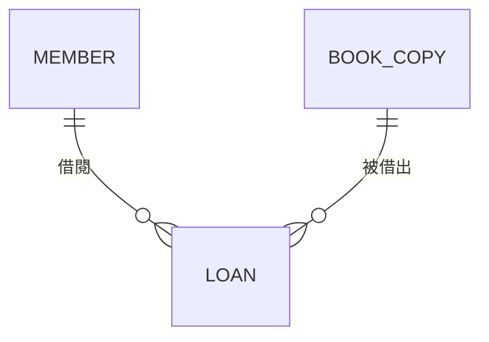

上圖是概念層：只說明「會員可以有多筆借閱、每筆借閱屬於一位會員與一本館藏」。下圖是邏輯層：加入鍵、外鍵與屬性。

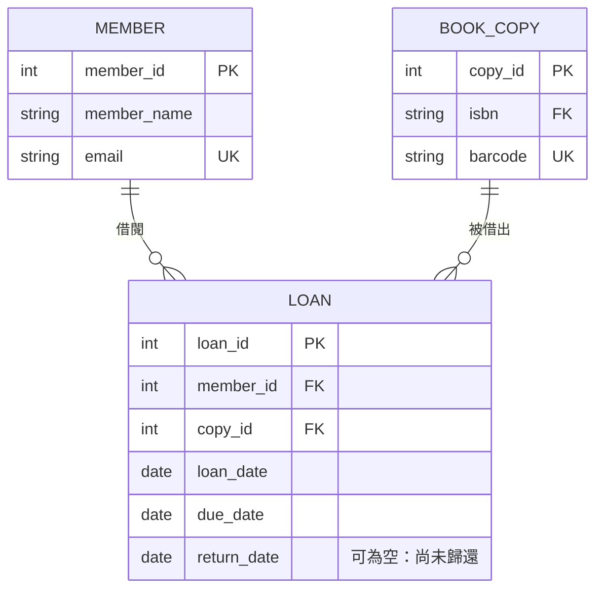

實體層則是可執行的 DDL，包含型別、約束名稱與索引。範例見[第 8 章](#8-從-er-模型映射到關聯綱要)。

### 2.3 ANSI/SPARC 三層綱要與資料獨立性

ANSI/X3/SPARC 在 1975 年提出三層綱要架構，概念資料模型就是其中的「概念綱要」：

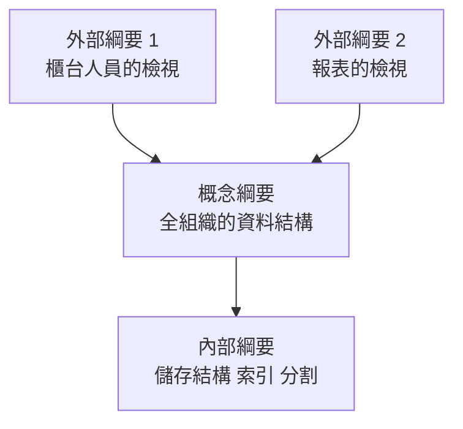

- **邏輯資料獨立性**：概念綱要改變時（例如新增屬性），外部綱要與應用程式不必修改。實務上用檢視表（view）達成。
- **實體資料獨立性**：內部綱要改變時（例如新增索引、改分割方式），概念綱要不必修改。

ER 模型屬於概念綱要。這也是為什麼 ER 圖上不應該出現索引、表空間這類實體層資訊。

### 2.4 ER 模型與其他模型的關係

| 模型 | 與 ER 模型的關係 | 何時使用 |
| --- | --- | --- |
| 關聯模型（Codd, 1970） | ER 模型的主要實作目標。[第 8 章](#8-從-er-模型映射到關聯綱要)的映射演算法把 ER 轉成關聯綱要 | 交易系統、需要強一致性與約束的資料 |
| UML 類別圖 | 可以表達與 ER 相同的概念，並多了操作與繼承語意。ISO/IEC 19505 是 UML 的國際標準 | 團隊已用 UML 做物件導向設計時，用類別圖表示領域模型 |
| IDEF1X | 以關聯實作為導向的 ER 方言，區分識別關係與非識別關係。標準為 ISO/IEC/IEEE 31320-2 | 政府、國防、大型企業的資料架構文件 |
| 維度模型（Kimball） | 從 ER 模型衍生，為分析查詢而反正規化的星狀綱要 | 資料倉儲、BI |
| 文件模型（JSON） | ER 模型中「總是一起讀寫」的實體群可以合成一份文件。Oracle 26ai 的 JSON Relational Duality View 可讓同一組關聯表同時以文件形式存取 | 讀寫以整份文件為單位、結構多變的資料 |
| 屬性圖模型 | 實體對應節點、關係對應邊。SQL:2023 第 16 部分（SQL/PGQ）定義了在關聯表上宣告屬性圖的語法 | 多層關聯走訪，例如詐騙關聯分析 |

> - **重點**：不論最後用什麼資料庫，先做好概念模型都有價值。概念模型錯了，換成任何資料庫都一樣錯。

### 2.5 何時需要畫 ER 模型

| 情境 | 建議做法 |
| --- | --- |
| 新系統或新子系統 | 必須先完成概念模型與邏輯模型，經審查後才寫 DDL |
| 既有系統新增 3 張以上資料表，或修改既有關係的基數 | 更新受影響部分的 ERD，並在變更單附上前後對照 |
| 只新增一兩個欄位 | 更新資料字典即可，ERD 不一定要重畫 |
| 接手沒有文件的既有系統 | 用工具逆向產生 ERD（見[第 16 章](#16-建模工具)），再人工補上業務語意 |

## 3. ER 核心概念

### 3.1 實體、實體型別與實體集合

ER 模型區分三個容易混用的詞：

| 名詞 | 意義 | 圖書館的例子 | 對應到資料庫 |
| --- | --- | --- | --- |
| 實體（entity，實例） | 一個可被區別的事物 | 會員「王小明」 | 一列資料 |
| 實體型別（entity type） | 具有相同屬性的一類實體的定義 | 「會員」這個型別 | 資料表的定義 |
| 實體集合（entity set） | 某時間點屬於該型別的所有實體 | 目前所有的會員 | 資料表在某時間點的內容 |

判斷某個名詞是不是實體型別，可以問三個問題：

1. **需要記住它嗎？** 系統是否需要儲存它的資料，並在之後查詢？
2. **能區分個體嗎？** 是否能說出「這一個」和「那一個」的差別？也就是有沒有識別方式。
3. **有自己的性質嗎？** 除了名稱外，是否還有其他需要記住的屬性，或者參與其他關係？

三個問題都是「是」，才是實體型別。只滿足第 1 題的，通常是另一個實體的屬性。例如「顏色」如果只有名稱，就是商品的屬性；如果還要記住色碼、適用的產品線，就應該升級成實體。

#### ER-CON-001 每個實體型別都要有書面定義與識別方式

- **等級**：必須
- **說明**：只有名稱的實體，每個人的理解都不同。例如「客戶」是「曾經下過單的人」，還是「註冊過的人」？定義不同，資料量與規則就不同。每個實體型別都要在資料字典中寫明定義、識別方式（候選鍵），以及「什麼情況下會新增一筆、什麼情況下會刪除」。

❌ **反例**：圖上只有名稱，沒有定義與識別方式，審查者無法判斷「同一個人用兩個 Email 註冊」算一個還是兩個客戶。

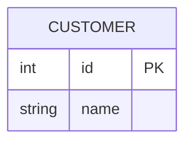

✅ **正例**：圖上標出業務上的候選鍵（UK），資料字典寫明定義與生命週期。

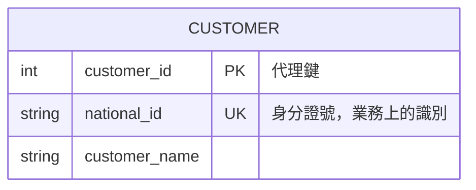

| 實體 | 定義 | 識別方式 | 何時新增 | 何時移除 |
| --- | --- | --- | --- | --- |
| 客戶 | 完成 KYC 驗證、至少開立過一個帳戶的自然人 | 身分證統一編號 | KYC 通過時 | 不刪除；所有帳戶結清滿 5 年後轉為封存狀態 |

- **如何 review**：逐一點選圖上的實體，在資料字典找到它的定義。若定義只是重述名稱（「客戶：客戶的資料」），或沒有識別方式，就退回。
- **如何驗證**：用[第 7.5 節](#75-資料字典)的資料字典範本，以腳本比對 ERD 的實體清單與字典條目，兩邊數量必須一致。

### 3.2 屬性的種類

| 種類 | 定義 | 例子 | 映射方式（詳見[第 8 章](#8-從-er-模型映射到關聯綱要)） |
| --- | --- | --- | --- |
| 簡單屬性（simple） | 不可再分解 | 性別、ISBN | 一個欄位 |
| 複合屬性（composite） | 由多個子屬性組成 | 地址 =（郵遞區號、縣市、區、街道） | 只保留子屬性，各成一個欄位 |
| 單值屬性（single-valued） | 每個實體只有一個值 | 出生日期 | 一個欄位 |
| 多值屬性（multi-valued） | 每個實體可以有多個值 | 聯絡電話、專長 | 獨立資料表 |
| 儲存屬性（stored） | 必須儲存的事實 | 出生日期 | 欄位 |
| 衍生屬性（derived） | 可以由其他資料計算出來 | 年齡（由出生日期計算）、訂單總額 | 通常不儲存；必要時以產生欄位或檢視表提供 |
| 鍵屬性（key） | 值可以唯一識別實體 | 學號 | 主鍵或 UNIQUE 約束 |

屬性的值可能是 **NULL**。NULL 在 ER 模型中可能代表三種不同的情況：「不適用」（未婚者沒有配偶姓名）、「存在但未知」（不知道的出生日期）、「還沒發生」（尚未歸還的歸還日期）。設計時應在資料字典中寫明每個可空屬性的 NULL 代表哪一種。

#### ER-CON-002 多值屬性不可用分隔字串存在單一欄位

- **等級**：必須
- **說明**：把多個值用逗號串在一個欄位，會讓查詢、索引、約束全部失效。例如「找出電話是 0912000111 的會員」只能用 `LIKE '%...%'`，既慢又會誤判（0912000111 也會比中 10912000111）。這也違反第一正規形式（見[第 9.3 節](#93-第一正規形式1nf)）。

❌ **反例**：電話以逗號串接，無法建立唯一約束，查詢也會誤判。

```sql
-- [通用]
CREATE TABLE member_bad (
    member_id INTEGER      NOT NULL PRIMARY KEY,
    phones    VARCHAR(200) NOT NULL
);
INSERT INTO member_bad (member_id, phones) VALUES (1, '0912000111,0223456789');
INSERT INTO member_bad (member_id, phones) VALUES (2, '10912000111');
SELECT CASE WHEN COUNT(*) = 2 THEN 'WRONG-MATCH-2' ELSE 'OTHER' END AS result
FROM member_bad
WHERE phones LIKE '%0912000111%';
-- 預期結果：WRONG-MATCH-2
```

✅ **正例**：多值屬性獨立成表，每個值一列，可以加唯一約束與精確查詢。

```sql
-- [通用]
CREATE TABLE member (
    member_id   INTEGER      NOT NULL PRIMARY KEY,
    member_name VARCHAR(100) NOT NULL
);
CREATE TABLE member_phone (
    member_id  INTEGER     NOT NULL,
    phone_no   VARCHAR(20) NOT NULL,
    phone_type VARCHAR(10) NOT NULL,
    CONSTRAINT pk_member_phone PRIMARY KEY (member_id, phone_no),
    CONSTRAINT fk_member_phone_member FOREIGN KEY (member_id) REFERENCES member (member_id),
    CONSTRAINT ck_member_phone_type CHECK (phone_type IN ('MOBILE', 'HOME', 'OFFICE'))
);
INSERT INTO member (member_id, member_name) VALUES (1, 'Alice');
INSERT INTO member (member_id, member_name) VALUES (2, 'Bob');
INSERT INTO member_phone (member_id, phone_no, phone_type) VALUES (1, '0912000111', 'MOBILE');
INSERT INTO member_phone (member_id, phone_no, phone_type) VALUES (1, '0223456789', 'HOME');
INSERT INTO member_phone (member_id, phone_no, phone_type) VALUES (2, '10912000111', 'MOBILE');
SELECT CASE WHEN COUNT(*) = 1 THEN 'EXACT-MATCH-1' ELSE 'OTHER' END AS result
FROM member_phone
WHERE phone_no = '0912000111';
-- 預期結果：EXACT-MATCH-1
```

- **如何 review**：找名稱為複數（`phones`、`tags`、`roles`）或說明中有「以逗號分隔」「多個」字樣的欄位。也要注意 `phone1`、`phone2`、`phone3` 這種重複群組，它是同一個問題的另一種形式。
- **如何驗證**：對既有資料執行 `SELECT COUNT(*) FROM t WHERE col LIKE '%,%'`，結果大於 0 就代表有分隔字串。新設計則在審查時檢查資料字典中每個欄位的「單值」欄是否為「是」。

#### ER-CON-003 衍生屬性必須標示，並寫明計算規則與儲存理由

- **等級**：必須
- **說明**：同時儲存「來源」與「計算結果」，兩者遲早會不一致。例如儲存了年齡，一年後就全部錯了。衍生屬性預設不儲存；確實需要儲存時（例如查詢效能、法規要求保留當時金額），要在字典中寫明計算公式、更新時機與儲存理由。

❌ **反例**：同時儲存出生日期與年齡，年齡沒有更新機制。

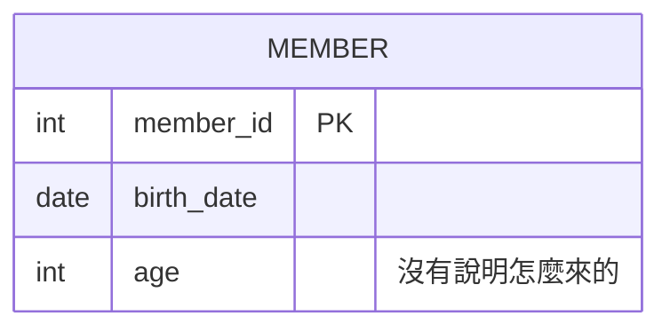

✅ **正例**：只儲存出生日期，年齡在查詢時計算。訂單金額這種「需要保留下單當時的值」的屬性，才以儲存屬性處理，並在說明中寫明理由。

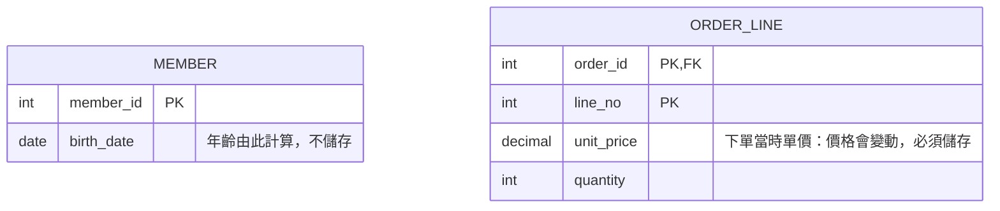

- **如何 review**：找可以由其他欄位算出來的欄位，例如年齡、小計、總額、筆數、「最後一次 xx 日期」，確認字典中有「衍生」標示與計算規則。
- **如何驗證**：對已儲存的衍生欄位寫一致性查詢，例如 `SELECT COUNT(*) FROM orders o WHERE o.total_amount <> (SELECT SUM(...) FROM order_line ...)`，結果必須為 0。[第 10.3 節](#103-反正規化與一致性保證)有可執行的範例。

### 3.3 關係、度數與角色

**關係型別（relationship type）** 是實體型別之間的關聯，**關係實例** 是具體實體之間的一次關聯。例如「會員王小明借閱館藏 B0001」是「借閱」關係的一個實例。

| 名詞 | 定義 | 例子 |
| --- | --- | --- |
| 度數（degree） | 參與關係的實體型別個數 | 一元（遞迴）、二元、三元 |
| 角色（role） | 實體在關係中扮演的身分 | 「管理」關係中，員工分別扮演「主管」與「部屬」 |
| 關係屬性 | 屬於關係本身、而不是任一實體的屬性 | 「選課」關係的成績、「借閱」關係的借閱日期 |

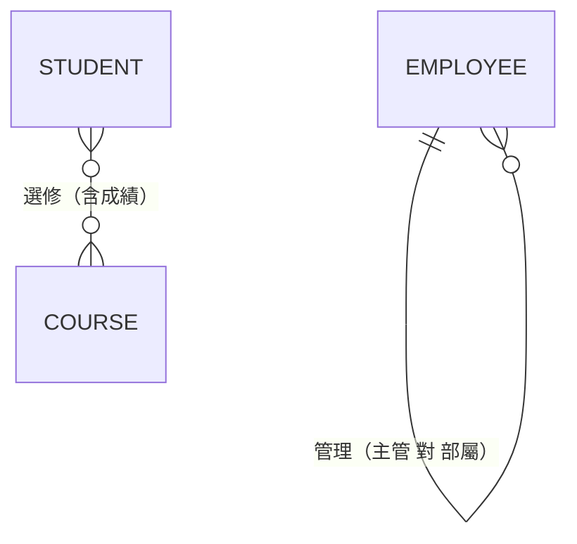

> - **注意**：Mermaid 允許直接畫 M:N 關係，但關係屬性（例如成績）無法畫在線上。邏輯模型必須把 M:N 關係轉成關聯實體，見[第 8.3 節](#83-步驟-35二元關係)。

#### ER-CON-004 關係以動詞片語命名，且兩個方向都要讀得通

- **等級**：建議
- **說明**：關係名稱是業務規則的文字版。命名為「有」「關聯」「對應」，等於什麼都沒說。用動詞片語，並確認從兩端讀都成立：「部門 **僱用** 員工」「員工 **任職於** 部門」。

❌ **反例**：

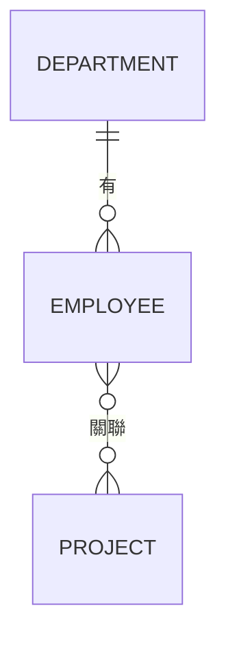

✅ **正例**：

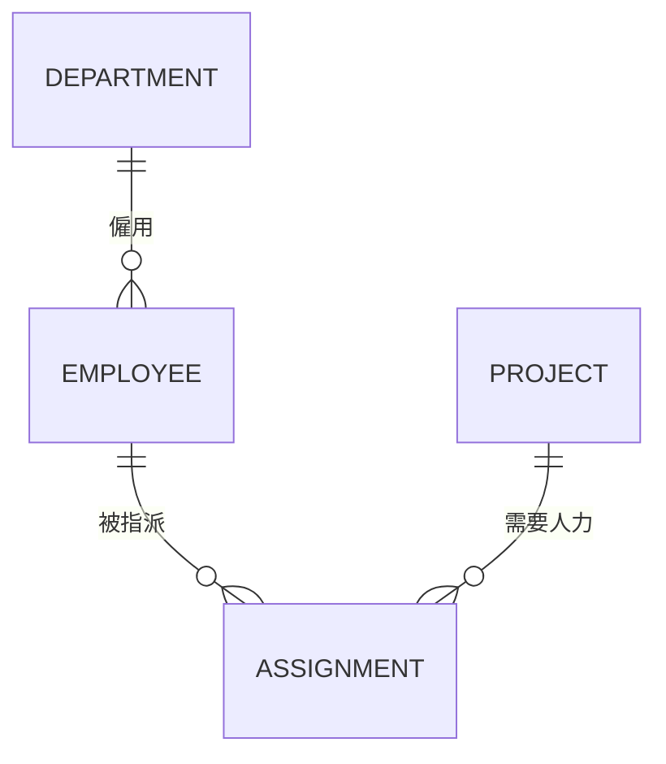

- **如何 review**：把每條關係念成完整句子：「每個〈A〉〈動詞〉〈基數〉個〈B〉」。念不出意思，或兩個方向的意思矛盾，就要改名。
- **如何驗證**：在模型匯出的關係清單中，搜尋「有」「關聯」「related」「has」等空泛名稱，數量應為 0。

#### ER-CON-005 遞迴關係必須標示兩端的角色，並防止自我參照

- **等級**：必須
- **說明**：遞迴關係的兩端是同一個實體型別，不標角色就不知道外鍵指向的是主管還是部屬。資料庫層也要用 CHECK 防止「自己是自己的主管」這種不合理資料。

❌ **反例**：外鍵名稱與角色都不清楚，也允許自我參照。

```sql
-- [通用]
CREATE TABLE emp_bad (
    emp_id INTEGER NOT NULL PRIMARY KEY,
    ref_id INTEGER,
    CONSTRAINT fk_emp_bad_ref FOREIGN KEY (ref_id) REFERENCES emp_bad (emp_id)
);
INSERT INTO emp_bad (emp_id, ref_id) VALUES (1, NULL);
UPDATE emp_bad SET ref_id = 1 WHERE emp_id = 1;
SELECT CASE WHEN COUNT(*) = 1 THEN 'SELF-MANAGER-ACCEPTED' ELSE 'OTHER' END AS result
FROM emp_bad WHERE ref_id = emp_id;
-- 預期結果：SELF-MANAGER-ACCEPTED
```

✅ **正例**：欄位以角色命名，並以 CHECK 擋下自我參照。

```sql
-- [通用]
CREATE TABLE employee (
    employee_id INTEGER      NOT NULL PRIMARY KEY,
    emp_name    VARCHAR(100) NOT NULL,
    manager_id  INTEGER,
    CONSTRAINT fk_employee_manager FOREIGN KEY (manager_id) REFERENCES employee (employee_id),
    CONSTRAINT ck_employee_not_self_manager CHECK (manager_id <> employee_id)
);
INSERT INTO employee (employee_id, emp_name, manager_id) VALUES (1, 'CEO', NULL);
INSERT INTO employee (employee_id, emp_name, manager_id) VALUES (2, 'CTO', 1);
UPDATE employee SET manager_id = 1 WHERE employee_id = 1;
-- 預期錯誤：ck_employee_not_self_manager
```

- **如何 review**：遞迴關係的外鍵欄位名稱必須是角色（`manager_id`、`parent_category_id`），不能是 `ref_id`、`parent_id` 這類不說明角色的名稱。圖上的關係標籤也要寫出角色。
- **如何驗證**：執行 `SELECT COUNT(*) FROM employee WHERE manager_id = employee_id`，結果應為 0。更長的循環（A 管 B、B 管 A）需要用遞迴查詢檢查，範例見[第 11.4 節](#114-階層資料)。

#### ER-CON-006 真正的三元關係不可拆成三個二元關係

- **等級**：必須
- **說明**：「供應商 S 供應零件 P 給專案 J」是一個三方同時成立的事實。把它拆成「S 供應 P」「P 用於 J」「S 供應給 J」三個二元關係後，再合併回來會產生原本不存在的組合（虛假資料列，spurious tuples）。判斷方法：如果事實必須同時提到三方才成立，就是三元關係。

❌ **反例**：拆成三個二元關係後重新合併，原本 3 筆事實變成 4 筆，多出的 (S1, P1, J1) 並不存在。

```sql
-- [通用]
CREATE TABLE supplies_sp (s_id CHAR(2) NOT NULL, p_id CHAR(2) NOT NULL, PRIMARY KEY (s_id, p_id));
CREATE TABLE supplies_pj (p_id CHAR(2) NOT NULL, j_id CHAR(2) NOT NULL, PRIMARY KEY (p_id, j_id));
CREATE TABLE supplies_sj (s_id CHAR(2) NOT NULL, j_id CHAR(2) NOT NULL, PRIMARY KEY (s_id, j_id));
-- 原始事實：(S1,P1,J2)、(S1,P2,J1)、(S2,P1,J1)
INSERT INTO supplies_sp VALUES ('S1', 'P1');
INSERT INTO supplies_sp VALUES ('S1', 'P2');
INSERT INTO supplies_sp VALUES ('S2', 'P1');
INSERT INTO supplies_pj VALUES ('P1', 'J2');
INSERT INTO supplies_pj VALUES ('P2', 'J1');
INSERT INTO supplies_pj VALUES ('P1', 'J1');
INSERT INTO supplies_sj VALUES ('S1', 'J2');
INSERT INTO supplies_sj VALUES ('S1', 'J1');
INSERT INTO supplies_sj VALUES ('S2', 'J1');
SELECT CASE WHEN COUNT(*) = 4 THEN 'SPURIOUS-ROWS-1' ELSE 'OTHER' END AS result
FROM supplies_sp sp
JOIN supplies_pj pj ON pj.p_id = sp.p_id
JOIN supplies_sj sj ON sj.s_id = sp.s_id AND sj.j_id = pj.j_id;
-- 預期結果：SPURIOUS-ROWS-1
```

✅ **正例**：三元關係映射成一張以三個外鍵為主鍵的表，事實不會失真。

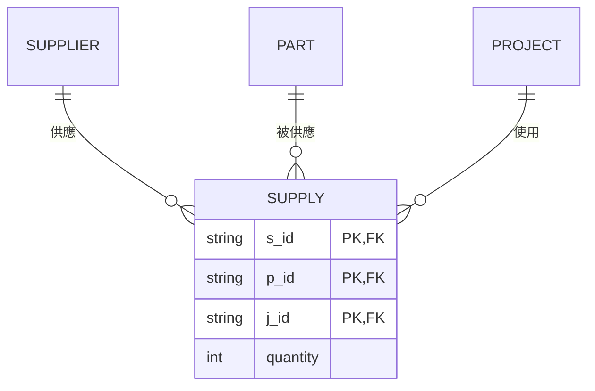

```sql
-- [通用]
CREATE TABLE supply (
    s_id     CHAR(2) NOT NULL,
    p_id     CHAR(2) NOT NULL,
    j_id     CHAR(2) NOT NULL,
    quantity INTEGER NOT NULL,
    CONSTRAINT pk_supply PRIMARY KEY (s_id, p_id, j_id),
    CONSTRAINT ck_supply_qty CHECK (quantity > 0)
);
INSERT INTO supply VALUES ('S1', 'P1', 'J2', 10);
INSERT INTO supply VALUES ('S1', 'P2', 'J1', 5);
INSERT INTO supply VALUES ('S2', 'P1', 'J1', 7);
SELECT CASE WHEN COUNT(*) = 0 THEN 'NO-SPURIOUS-ROW' ELSE 'FAIL' END AS result
FROM supply WHERE s_id = 'S1' AND p_id = 'P1' AND j_id = 'J1';
-- 預期結果：NO-SPURIOUS-ROW
```

- **如何 review**：對每個關聯實體，問業務代表「這筆紀錄是否需要同時知道三方才有意義」。如果是，檢查它是否被錯拆成多個二元關係。反之，如果三方中某兩方的組合就能決定第三方（例如「每位醫師在每間診所只看一種科別」），則可以降為二元關係加上一個屬性，這時要寫明理由。
- **如何驗證**：用上面的方法，把二元投影重新合併，比對筆數。筆數增加就代表拆分會遺失資訊。理論基礎是第五正規形式（[第 9.7 節](#97-第四與第五正規形式)）。

### 3.4 鍵的種類

| 名詞 | 定義 | 例子（學生） |
| --- | --- | --- |
| 超鍵（superkey） | 能唯一識別實體的屬性集合，可能含多餘屬性 | {學號, 姓名} |
| 候選鍵（candidate key） | 最小的超鍵：拿掉任何一個屬性就不再唯一 | {學號}、{身分證號} |
| 主鍵（primary key） | 從候選鍵中選一個作為主要識別 | {學號} |
| 替代鍵（alternate key） | 沒被選為主鍵的候選鍵，實作為 UNIQUE 約束 | {身分證號} |
| 外鍵（foreign key） | 參照另一個關聯表候選鍵的屬性 | 選課表的學號 |
| 自然鍵（natural key） | 來自業務、有業務意義的鍵 | 統一編號、ISBN |
| 代理鍵（surrogate key） | 系統產生、沒有業務意義的鍵 | 自動遞增的 `student_id` |
| 部分鍵（partial key） | 弱實體在同一個擁有者範圍內唯一的屬性 | 訂單明細的行號 |

#### ER-CON-007 使用代理鍵時，業務上的候選鍵仍必須以 UNIQUE 約束保護

- **等級**：必須
- **說明**：代理鍵（自動編號、UUID）只保證「資料列」唯一，不保證「業務事物」唯一。若沒有為自然鍵加 UNIQUE，同一本 ISBN 的書可以被建立兩次，之後的借閱、庫存都會分散在兩筆資料上。

❌ **反例**：只有代理鍵，同一個 ISBN 被建立兩次也不會報錯。

```sql
-- [通用]
CREATE TABLE book_bad (
    book_id INTEGER     NOT NULL PRIMARY KEY,
    isbn    VARCHAR(13) NOT NULL,
    title   VARCHAR(200) NOT NULL
);
INSERT INTO book_bad VALUES (1, '9789861234567', 'Database Design');
INSERT INTO book_bad VALUES (2, '9789861234567', 'Database Design');
SELECT CASE WHEN COUNT(*) = 2 THEN 'DUPLICATE-ACCEPTED' ELSE 'OTHER' END AS result
FROM book_bad WHERE isbn = '9789861234567';
-- 預期結果：DUPLICATE-ACCEPTED
```

✅ **正例**：代理鍵作為主鍵，自然鍵以 UNIQUE 約束保護。

```sql
-- [通用]
CREATE TABLE book (
    book_id INTEGER      NOT NULL PRIMARY KEY,
    isbn    VARCHAR(13)  NOT NULL,
    title   VARCHAR(200) NOT NULL,
    CONSTRAINT uq_book_isbn UNIQUE (isbn)
);
INSERT INTO book VALUES (1, '9789861234567', 'Database Design');
INSERT INTO book VALUES (2, '9789861234567', 'Database Design');
-- 預期錯誤：uq_book_isbn
-- 預期錯誤[Db2]：SQL0803N
```

- **如何 review**：每個以代理鍵為主鍵的實體，在圖上至少要有一個 `UK` 標記，或在字典中說明「此實體沒有自然鍵」的理由（例如日誌紀錄）。
- **如何驗證**：用系統目錄查出「只有主鍵、沒有任何 UNIQUE 約束」的資料表清單，逐一確認理由。PostgreSQL 的查詢範例見[第 14.3 節](#143-以系統目錄自動檢查模型品質)。

### 3.5 強實體與弱實體

**弱實體（weak entity）** 無法只靠自己的屬性被識別，必須透過一個 **擁有者實體（owner）** 與 **識別關係（identifying relationship）** 才能識別。弱實體的鍵是「擁有者的鍵 + 部分鍵」。

| 特徵 | 強實體 | 弱實體 |
| --- | --- | --- |
| 識別 | 自己的候選鍵 | 擁有者的鍵 + 部分鍵 |
| 存在依賴 | 可以獨立存在 | 擁有者不存在，弱實體也不存在 |
| 參與限制 | 不一定 | 在識別關係中一定是完全參與 |
| Chen 表示法 | 單框矩形 | 雙框矩形；識別關係是雙框菱形；部分鍵畫虛線底線 |
| Crow's Foot（Mermaid） | — | 識別關係用實線 `--`，非識別關係用虛線 `..` |

> - **注意**：「存在依賴」不等於「弱實體」。訂單依賴客戶存在，但訂單有自己的訂單編號可以識別，所以訂單是強實體。只有「無法單獨識別」的才是弱實體。

#### ER-CON-008 弱實體的主鍵必須包含擁有者的鍵，並宣告識別關係

- **等級**：必須
- **說明**：弱實體若只用自己的部分鍵當主鍵（例如只用行號），不同訂單的第 1 行就會衝突；若改用獨立的流水號，又失去「行號在訂單內唯一」的約束。正確做法是以「擁有者鍵 + 部分鍵」作為主鍵，並設定外鍵與刪除規則。

❌ **反例**：明細以流水號為主鍵，同一張訂單出現兩個第 1 行也不會報錯。

```sql
-- [通用]
CREATE TABLE orders (
    order_id INTEGER NOT NULL PRIMARY KEY,
    order_no VARCHAR(20) NOT NULL,
    CONSTRAINT uq_orders_no UNIQUE (order_no)
);
CREATE TABLE order_line_bad (
    line_id  INTEGER NOT NULL PRIMARY KEY,
    order_id INTEGER NOT NULL,
    line_no  INTEGER NOT NULL,
    CONSTRAINT fk_olb_order FOREIGN KEY (order_id) REFERENCES orders (order_id)
);
INSERT INTO orders VALUES (100, 'SO-100');
INSERT INTO order_line_bad VALUES (1, 100, 1);
INSERT INTO order_line_bad VALUES (2, 100, 1);
SELECT CASE WHEN COUNT(*) = 2 THEN 'DUP-LINE-NO-ACCEPTED' ELSE 'OTHER' END AS result
FROM order_line_bad WHERE order_id = 100 AND line_no = 1;
-- 預期結果：DUP-LINE-NO-ACCEPTED
```

✅ **正例**：主鍵是（訂單編號、行號），外鍵設為 `ON DELETE CASCADE`，表達「訂單不存在，明細也不存在」。

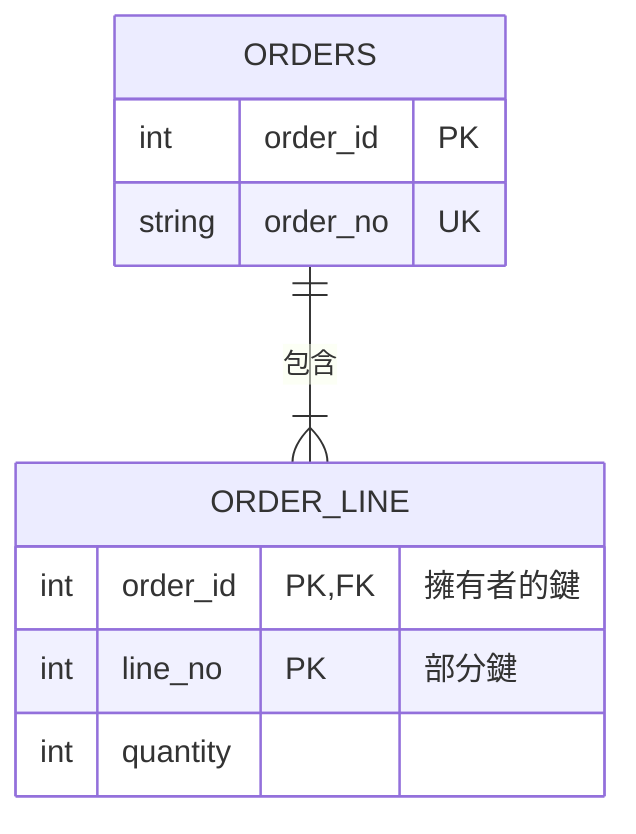

```sql
-- [通用]
CREATE TABLE order_line (
    order_id INTEGER NOT NULL,
    line_no  INTEGER NOT NULL,
    quantity INTEGER NOT NULL,
    CONSTRAINT pk_order_line PRIMARY KEY (order_id, line_no),
    CONSTRAINT fk_order_line_order FOREIGN KEY (order_id) REFERENCES orders (order_id) ON DELETE CASCADE,
    CONSTRAINT ck_order_line_qty CHECK (quantity > 0)
);
INSERT INTO order_line VALUES (100, 1, 2);
INSERT INTO order_line VALUES (100, 1, 3);
-- 預期錯誤：pk_order_line
-- 預期錯誤[Db2]：SQL0803N
```

```sql
-- [通用]
DELETE FROM orders WHERE order_id = 100;
-- 前一段中 order_line_bad 也參照了訂單 100，要先移除才能刪除訂單；這正說明了缺少 CASCADE 的弱實體會擋住擁有者的刪除
-- 預期錯誤：fk_olb_order
```

```sql
-- [通用]
DELETE FROM order_line_bad WHERE order_id = 100;
DELETE FROM orders WHERE order_id = 100;
SELECT CASE WHEN COUNT(*) = 0 THEN 'CASCADE-OK' ELSE 'FAIL' END AS result FROM order_line;
-- 預期結果：CASCADE-OK
```

- **如何 review**：Mermaid 圖中，弱實體的識別關係要用實線（`--`），而且弱實體的屬性中，擁有者的鍵要同時標 `PK, FK`。
- **如何驗證**：查系統目錄，確認弱實體的外鍵欄位都包含在主鍵中；再用上面的方式插入重複部分鍵，確認被主鍵擋下。

## 4. 結構限制：基數與參與

### 4.1 基數比

**基數比（cardinality ratio）** 描述一個實體最多可以和多少個另一端的實體建立關係。二元關係有三種基數比：

| 基數比 | 讀法 | 例子 | 典型實作 |
| --- | --- | --- | --- |
| 1:1 | 每個 A 最多對應 1 個 B，每個 B 最多對應 1 個 A | 員工與員工證 | 外鍵加 UNIQUE |
| 1:N | 每個 A 可對應多個 B，每個 B 最多對應 1 個 A | 部門與員工 | 外鍵放在 N 端 |
| M:N | 每個 A 可對應多個 B，每個 B 也可對應多個 A | 學生與課程 | 關聯表 |

### 4.2 參與限制

**參與限制（participation constraint）** 描述實體是否 **必須** 參與關係，也就是最小基數：

| 名稱 | 意義 | 例子 | Chen 表示法 |
| --- | --- | --- | --- |
| 完全參與（total） | 每個實體都必須參與，最小值 ≥ 1 | 每位員工都必須隸屬一個部門 | 雙線 |
| 部分參與（partial） | 實體可以不參與，最小值 = 0 | 部門可以暫時沒有員工 | 單線 |

基數比與參與限制合起來，稱為關係的 **結構限制（structural constraints）**。

### 4.3 (min,max) 表示法與「看哪一端」的差異

(min,max) 表示法為每個「實體在關係中的參與」標上一對數字：「這個實體的每個實例，最少參與 min 次、最多參與 max 次」。這種表示法比基數比更精確，可以表達「每位學生至少選 1 門、最多 8 門」這類規則。

各種表示法最容易混淆的地方，是數字或符號 **寫在哪一端**：

| 表示法 | 符號寫在哪 | 「部門 1 : N 員工，每位員工必須隸屬部門」的寫法 |
| --- | --- | --- |
| Chen 基數比 | 寫在 **對面**（look-across）：靠近員工那端寫 N | 部門 ─1─ ◇隸屬◇ ─N─ 員工；員工端畫雙線 |
| (min,max)（Elmasri） | 寫在 **自己這端**（look-here）：描述自己參與幾次 | 部門 (0,N) ─ ◇隸屬◇ ─ (1,1) 員工 |
| Crow's Foot（Mermaid） | 寫在 **對面**：靠近員工那端畫烏鴉腳 | `DEPARTMENT \|\|--o{ EMPLOYEE` |
| UML 多重性 | 寫在 **對面** | 部門 `1` ─── `0..*` 員工 |

> - **重點**：(min,max) 的「部門 (0,N)」是指「每個部門參與 0 到 N 次」，所以它寫在部門端；Crow's Foot 的 `o{` 是指「每個部門對應 0 到多個員工」，所以它畫在員工端。兩種寫法表達的是同一件事，位置剛好相反。轉換時最常在這裡出錯。

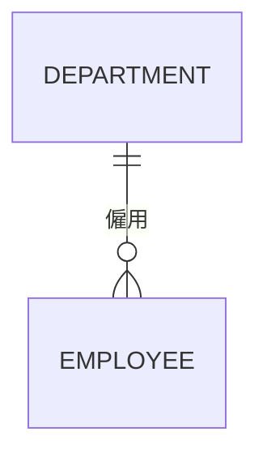

讀法：從左往右讀「每個部門僱用 **零到多位**（`o{`）員工」；從右往左讀「每位員工受僱於 **恰好一個**（`||`）部門」。

### 4.4 Mermaid Crow's Foot 符號對照

Mermaid 的每一端由兩個字元組成：**外側字元表示最大值，內側字元表示最小值**。

| 左端寫法 | 右端寫法 | 意義 | (min,max) | 文字別名（Mermaid 11） |
| --- | --- | --- | --- | --- |
| `\|o` | `o\|` | 零或一 | (0,1) | `zero or one`、`one or zero` |
| `\|\|` | `\|\|` | 恰好一 | (1,1) | `only one`、`1` |
| `}o` | `o{` | 零或多 | (0,N) | `zero or more`、`zero or many`、`many(0)`、`0+` |
| `}\|` | `\|{` | 一或多 | (1,N) | `one or more`、`one or many`、`many(1)`、`1+` |

線的樣式表示識別性：

| 寫法 | 文字別名 | 意義 |
| --- | --- | --- |
| `--` | `to` | 識別關係（實線）：子實體的主鍵包含父實體的鍵 |
| `..` | `optionally to` | 非識別關係（虛線）：子實體有自己的主鍵 |

### 4.5 結構限制如何落實到資料庫

結構限制畫在圖上還不夠，必須在資料庫中落實，否則只是「建議」。下表整理每種限制可以用什麼機制保證：

| 限制 | 例子 | 宣告式機制 | 四種資料庫的支援 |
| --- | --- | --- | --- |
| N 端最大 1（每位員工最多一個部門） | 員工.部門外鍵 | 外鍵欄位本身只能存一個值 | 全部支援 |
| N 端最小 1（每位員工必須有部門） | 員工.部門外鍵 NOT NULL | `NOT NULL` | 全部支援 |
| 1 端最大 1（1:1 關係） | 員工證.員工外鍵 | 外鍵加 `UNIQUE` | 全部支援；Db2 的 UNIQUE 約束欄位必須 NOT NULL，可空時改用 `CREATE UNIQUE INDEX ... EXCLUDE NULL KEYS` |
| 1 端最小 1（每張訂單至少一行明細） | 訂單必須有明細 | SQL 標準 `CREATE ASSERTION` | 只有 Oracle 26ai（23.26.1 起）支援；PostgreSQL 用延遲的 constraint trigger；SQL Server 與 Db2 只能在交易程式或預存程序中保證，並以驗證查詢監控 |
| 最大 N 為具體數字（每位學生最多選 8 門） | 選課筆數上限 | `CREATE ASSERTION` 或觸發器 | 同上 |

#### ER-CON-009 每條關係的兩端都必須標示最小與最大基數

- **等級**：必須
- **說明**：只寫「1:N」沒有說明參與限制。「員工一定要有部門嗎？」「部門可以沒有員工嗎？」這兩個問題的答案，決定了外鍵能不能是 NULL、能不能先建部門再補員工。兩端都要標示最小值與最大值。

❌ **反例**：文件只寫「部門 1:N 員工」，開發人員自行決定 `dept_id` 可以為 NULL，結果出現沒有部門的員工。

```sql
-- [通用]
CREATE TABLE department (
    dept_id   INTEGER      NOT NULL PRIMARY KEY,
    dept_name VARCHAR(100) NOT NULL
);
CREATE TABLE employee_bad (
    employee_id INTEGER NOT NULL PRIMARY KEY,
    dept_id     INTEGER,
    CONSTRAINT fk_employee_bad_dept FOREIGN KEY (dept_id) REFERENCES department (dept_id)
);
INSERT INTO employee_bad (employee_id, dept_id) VALUES (1, NULL);
SELECT CASE WHEN COUNT(*) = 1 THEN 'ORPHAN-EMPLOYEE-ACCEPTED' ELSE 'OTHER' END AS result
FROM employee_bad WHERE dept_id IS NULL;
-- 預期結果：ORPHAN-EMPLOYEE-ACCEPTED
```

✅ **正例**：圖上兩端都有最小與最大值，DDL 依此設定 NOT NULL。

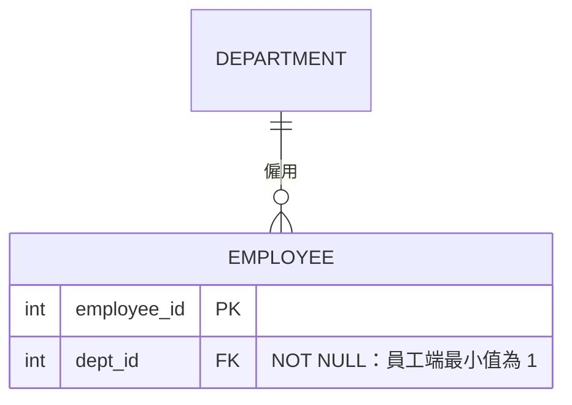

```sql
-- [通用]
CREATE TABLE employee (
    employee_id INTEGER NOT NULL PRIMARY KEY,
    dept_id     INTEGER NOT NULL,
    CONSTRAINT fk_employee_dept FOREIGN KEY (dept_id) REFERENCES department (dept_id)
);
INSERT INTO employee (employee_id, dept_id) VALUES (1, NULL);
-- 預期錯誤：NULL
```

- **如何 review**：圖上每條線兩端都要看得到最小值（`o` 或 `|`）與最大值（`|` 或 `{`）。若使用 Chen 或文字描述，要有 (min,max) 或完整的句子。
- **如何驗證**：比對資料字典中每個外鍵欄位的可空性與圖上的最小值：最小值為 1 的一端，對應外鍵必須是 `NOT NULL`。

#### ER-CON-010 基數必須用業務規則與「時間」反例確認

- **等級**：必須
- **說明**：很多 1:N 其實是「在同一時間點」的 1:N，跨時間就變成 M:N。例如「員工隸屬一個部門」在某一天成立，但員工會調動。若業務需要查詢「某員工去年在哪個部門」，就必須把歷史建模成 M:N（任職紀錄），否則調動時舊資料會被覆蓋。

❌ **反例**：員工直接存目前的部門，調動後就無法回答「去年 6 月在哪個部門」。

```sql
-- [通用]
INSERT INTO department VALUES (10, 'Sales');
INSERT INTO department VALUES (20, 'R&D');
INSERT INTO employee (employee_id, dept_id) VALUES (2, 10);
UPDATE employee SET dept_id = 20 WHERE employee_id = 2;
SELECT CASE WHEN COUNT(*) = 0 THEN 'HISTORY-LOST' ELSE 'OTHER' END AS result
FROM employee WHERE employee_id = 2 AND dept_id = 10;
-- 預期結果：HISTORY-LOST
```

✅ **正例**：把「任職」建模成有起訖日期的關聯實體，同一員工的任職期間不可重疊（重疊檢查見[第 10.6 節](#106-時態資料有效時間與交易時間)）。

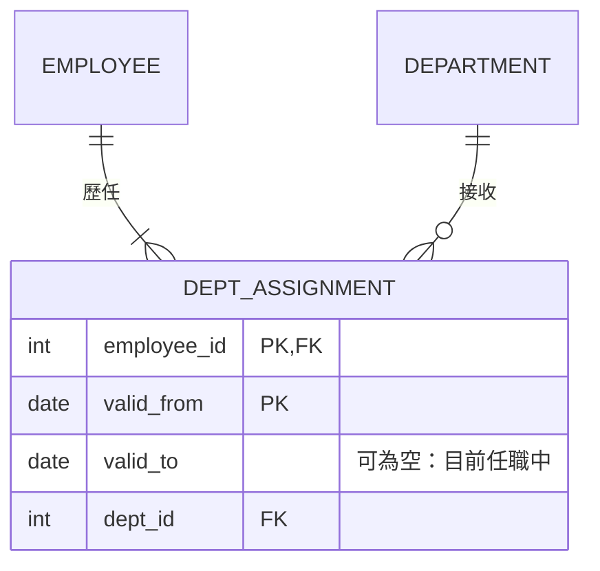

```sql
-- [通用]
CREATE TABLE dept_assignment (
    employee_id INTEGER NOT NULL,
    valid_from  DATE    NOT NULL,
    valid_to    DATE,
    dept_id     INTEGER NOT NULL,
    CONSTRAINT pk_dept_assignment PRIMARY KEY (employee_id, valid_from),
    CONSTRAINT fk_da_employee FOREIGN KEY (employee_id) REFERENCES employee (employee_id),
    CONSTRAINT fk_da_dept FOREIGN KEY (dept_id) REFERENCES department (dept_id),
    CONSTRAINT ck_da_period CHECK (valid_to IS NULL OR valid_to > valid_from)
);
```

```sql
-- [PostgreSQL、Db2]
INSERT INTO dept_assignment VALUES (2, DATE '2025-01-01', DATE '2026-03-01', 10);
INSERT INTO dept_assignment VALUES (2, DATE '2026-03-01', NULL, 20);
SELECT dept_id AS dept_on_2025_06_30 FROM dept_assignment
WHERE employee_id = 2
  AND valid_from <= DATE '2025-06-30'
  AND (valid_to IS NULL OR valid_to > DATE '2025-06-30');
-- 預期結果：10
```

- **如何 review**：對每個 1:N 關係問業務代表：「這個關係會隨時間改變嗎？需要查過去的狀態嗎？」若兩題都是「是」，必須改成有期間的關聯實體。
- **如何驗證**：寫出「查詢過去某時間點狀態」的 SQL（如上），並確認它能在模型上執行。寫不出來就代表模型無法回答這個業務問題。

#### ER-CON-011 「1 端至少一筆」的限制必須明確實作並可驗證

- **等級**：必須
- **說明**：外鍵只能保證「明細一定屬於某張訂單」，無法保證「訂單至少有一行明細」。這類「1 端最小值為 1」的限制常被忽略，導致出現空訂單。應依資料庫能力選擇實作方式，並提供驗證查詢。

❌ **反例**：只有外鍵，空訂單可以成功建立。

```sql
-- [通用]
CREATE TABLE sales_order (
    order_id INTEGER NOT NULL PRIMARY KEY
);
CREATE TABLE sales_order_line (
    order_id INTEGER NOT NULL,
    line_no  INTEGER NOT NULL,
    CONSTRAINT pk_sales_order_line PRIMARY KEY (order_id, line_no),
    CONSTRAINT fk_sol_order FOREIGN KEY (order_id) REFERENCES sales_order (order_id)
);
INSERT INTO sales_order VALUES (1);
SELECT CASE WHEN COUNT(*) = 1 THEN 'EMPTY-ORDER-ACCEPTED' ELSE 'OTHER' END AS result
FROM sales_order o
WHERE NOT EXISTS (SELECT 1 FROM sales_order_line l WHERE l.order_id = o.order_id);
-- 預期結果：EMPTY-ORDER-ACCEPTED
```

✅ **正例一（Oracle 26ai）**：使用 SQL 標準的 `CREATE ASSERTION`，在交易提交時檢查。違反時整筆交易回復，錯誤代碼為 ORA-08601。

```sql
-- [Oracle]
DELETE FROM sales_order;
COMMIT;
CREATE ASSERTION as_order_has_line CHECK (
    ALL (SELECT o.order_id FROM sales_order o) oa
    SATISFY (EXISTS (SELECT 1 FROM sales_order_line l WHERE l.order_id = oa.order_id))
) DEFERRABLE INITIALLY DEFERRED;
INSERT INTO sales_order VALUES (2);
INSERT INTO sales_order_line VALUES (2, 1);
COMMIT;
INSERT INTO sales_order VALUES (3);
COMMIT;
-- 預期錯誤：ORA-08601
```

✅ **正例二（PostgreSQL）**：用延遲到提交時才執行的 constraint trigger。完整實作還要在「刪除最後一行明細」時檢查，此處只示範新增訂單的部分。

```sql
-- [PostgreSQL]
DELETE FROM sales_order;
CREATE FUNCTION trg_order_has_line() RETURNS trigger LANGUAGE plpgsql AS $$
BEGIN
    IF NOT EXISTS (SELECT 1 FROM sales_order_line WHERE order_id = NEW.order_id) THEN
        RAISE EXCEPTION 'as_order_has_line violated: order % has no line', NEW.order_id;
    END IF;
    RETURN NULL;
END $$;
CREATE CONSTRAINT TRIGGER as_order_has_line
    AFTER INSERT ON sales_order
    DEFERRABLE INITIALLY DEFERRED
    FOR EACH ROW EXECUTE FUNCTION trg_order_has_line();
BEGIN;
INSERT INTO sales_order VALUES (2);
INSERT INTO sales_order_line VALUES (2, 1);
COMMIT;
BEGIN;
INSERT INTO sales_order VALUES (3);
COMMIT;
-- 預期錯誤：as_order_has_line violated
```

✅ **正例三（SQL Server、Db2）**：沒有延遲約束時，以「只能透過預存程序一次建立訂單與明細」的方式保證，並排程執行下面的驗證查詢，結果必須為 0。

```sql
-- [通用]
SELECT CASE WHEN COUNT(*) = 0 THEN 'NO-EMPTY-ORDER' ELSE 'EMPTY-ORDER-FOUND' END AS result
FROM sales_order o
WHERE NOT EXISTS (SELECT 1 FROM sales_order_line l WHERE l.order_id = o.order_id);
```

- **如何 review**：找圖上「1 端」最小值為 1 的關係（Mermaid 的 `||--|{`、`||--||`），確認設計文件說明了實作機制。
- **如何驗證**：每一條這類限制都要有一個如上的 `NOT EXISTS` 驗證查詢，列入資料品質監控，結果必須為 0。

## 5. ERD 表示法

ER 模型有多種圖形表示法（notation）。它們表達的概念大致相同，但符號與「寫在哪一端」的規則不同。本章逐一說明，最後在[第 5.8 節](#58-表示法對照與選用建議)提供對照與選用建議。

### 5.1 Chen 表示法

Chen 表示法是 1976 年原始論文使用的表示法，適合在 **概念層** 與業務人員討論，也最常出現在教科書與考試中。

| 符號 | 意義 |
| --- | --- |
| 矩形 | 實體型別 |
| 雙框矩形 | 弱實體型別 |
| 菱形 | 關係型別 |
| 雙框菱形 | 識別關係（弱實體與擁有者之間） |
| 橢圓 | 屬性 |
| 底線的屬性名稱 | 鍵屬性 |
| 虛線底線 | 弱實體的部分鍵 |
| 雙框橢圓 | 多值屬性 |
| 虛線橢圓 | 衍生屬性 |
| 橢圓再連出橢圓 | 複合屬性 |
| 線上的 1、N、M | 基數比，寫在 **對面** 一端（look-across） |
| 雙線 | 完全參與 |

下圖以 PlantUML 的 Chen 語法（`@startchen`）繪製「部門僱用員工、員工扶養眷屬」的模型。PlantUML 以 **粗線** 表示完全參與，與教科書的雙線意義相同。本站只渲染 Mermaid，PlantUML 以原始碼呈現；可以貼到 PlantUML 官方線上伺服器（<https://www.plantuml.com/plantuml>）或 IDE 的 PlantUML 外掛檢視圖形。

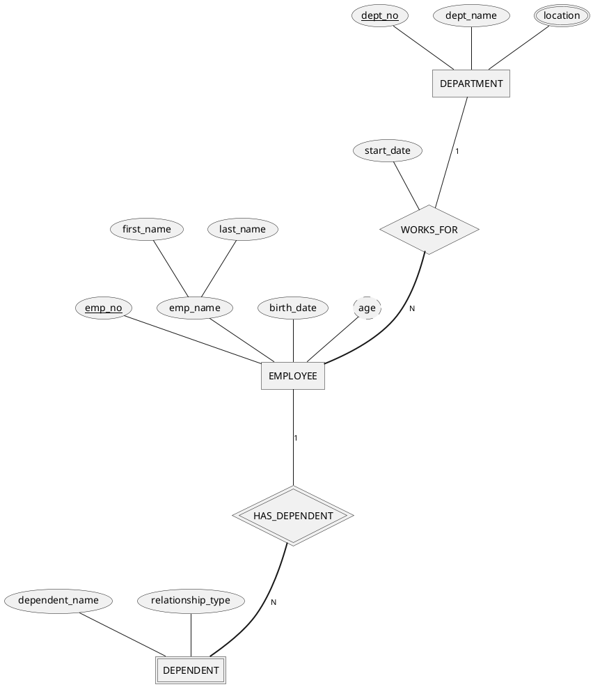

讀法：

- 每個部門僱用 N 位員工；員工端是粗線（完全參與），表示每位員工都必須隸屬一個部門。
- 「到職日」`start_date` 是 WORKS_FOR 關係的屬性，不屬於部門也不屬於員工。
- 眷屬是弱實體，由「員工編號 + 眷屬姓名」識別。

### 5.2 Crow's Foot（Information Engineering）表示法

Crow's Foot 表示法源自 Information Engineering（IE）方法論，是目前 **邏輯層** 最常用的表示法。多數工具（Mermaid、PlantUML、erwin、DBeaver、pgAdmin）都採用它。

| 符號 | 意義 |
| --- | --- |
| 方框（列出屬性） | 實體；屬性直接寫在方框內 |
| 線 | 關係；沒有菱形 |
| 線端的 `○` | 最小值 0 |
| 線端的 `｜` | 最小值或最大值為 1 |
| 線端的烏鴉腳 | 最大值為多 |
| 實線／虛線 | 識別關係／非識別關係（Mermaid 的慣例） |

Crow's Foot 的限制：**沒有原生的 M:N 屬性與三元關係符號**。這兩種情況都必須畫成關聯實體，這也剛好是邏輯層的正確做法。

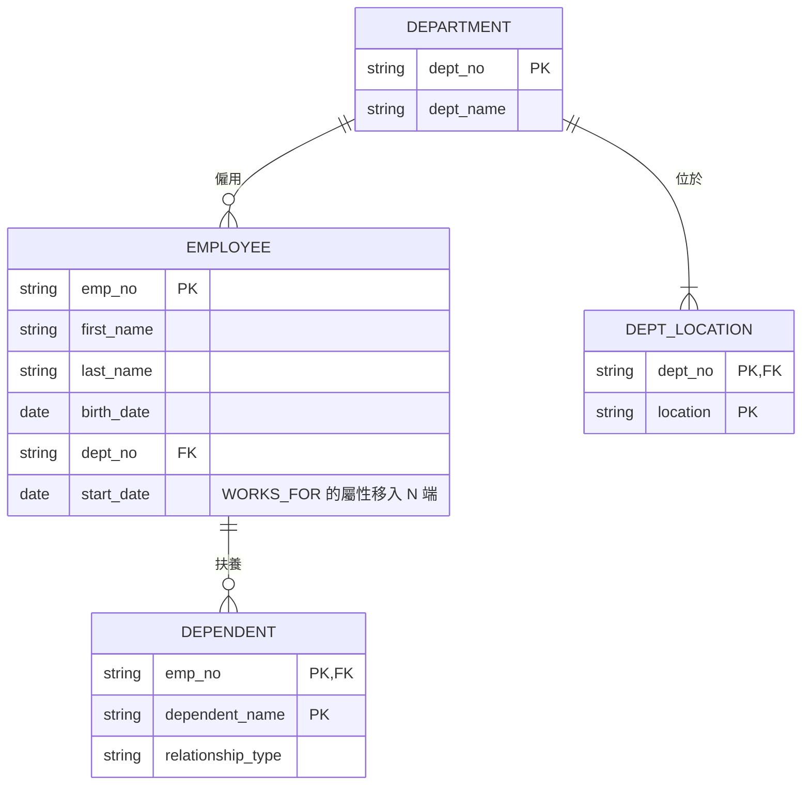

### 5.3 Barker 表示法

Barker 表示法由 Richard Barker 在 Oracle CASE 方法中推廣，Oracle SQL Developer Data Modeler 至今仍支援。它與 Crow's Foot 類似，差異在於：

| 特徵 | Barker 的畫法 |
| --- | --- |
| 實體 | 圓角方框 |
| 必要／選擇性 | 線的 **前半段** 為實線表示「必須」，虛線表示「可以」 |
| 屬性 | `#` 表示主鍵、`*` 表示必填、`o` 表示選填 |
| 子型別 | 畫在超型別方框 **內部** |
| 讀法 | 「每個 A **必須／可以** 〈關係名稱〉 **一個且僅一個／一或多個** B」 |

Barker 的讀法很適合寫進需求文件。例如「每位員工 **必須** 受僱於 **一個且僅一個** 部門；每個部門 **可以** 僱用 **一或多位** 員工」。

### 5.4 IDEF1X 表示法

IDEF1X（Integration DEFinition for Information Modeling）原為美國聯邦標準 FIPS PUB 184（1993），該 FIPS 已撤銷。目前的國際標準是 **ISO/IEC/IEEE 31320-2:2012**（IDEF1X97），ISO 已於 2024 年複審並維持現行版。它的特點是 **非常接近關聯實作**：

| 特徵 | IDEF1X 的畫法 |
| --- | --- |
| 獨立實體 | 直角方框，主鍵在橫線上方 |
| 相依實體 | 圓角方框：主鍵包含父實體的鍵（等於弱實體） |
| 識別關係 | 實線 |
| 非識別關係 | 虛線 |
| 基數 | 子端畫實心圓點；圓點旁的 `P`（1 以上）、`Z`（0 或 1）或數字表示基數；未標示則為 0、1 或多 |
| 外鍵 | 屬性後標 `(FK)` |
| 類別（子型別） | 圓圈下加一或兩條橫線，分別表示不完整或完整的類別 |

Mermaid 的 `--`／`..` 區分識別與非識別關係，就是借用 IDEF1X 的概念。實務上，若組織要求 IDEF1X，通常以 erwin Data Modeler 或 ER/Studio 繪製，因為多數開源工具不支援 IDEF1X 的圓點符號。

### 5.5 Mermaid erDiagram 語法完整說明

Mermaid 是可以寫在 Markdown 中的「圖表即程式碼」工具。GitHub、GitLab 與本站（Hugo，載入 `mermaid@11`）都能直接渲染。以下依 Mermaid 11 官方文件整理 `erDiagram` 的完整語法。

**基本敘述**：`實體A [關係 實體B : 標籤]`。只有實體 A 是必填；若寫了關係，則實體 B 與標籤都必須寫。

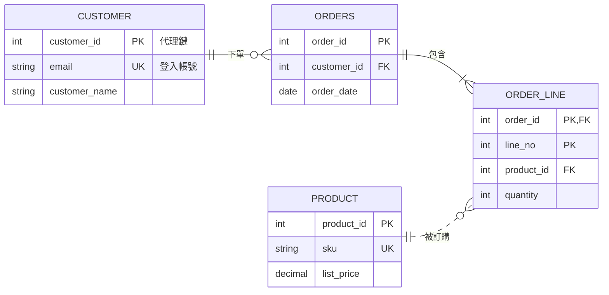

| 語法元素 | 寫法 | 說明 |
| --- | --- | --- |
| 方向 | `direction TB`／`BT`／`LR`／`RL` | 預設為由上而下 |
| 基數 | `\|o`、`\|\|`、`}o`、`}\|`（左端）與對應的右端寫法 | 外側字元是最大值，內側字元是最小值，見[第 4.4 節](#44-mermaid-crows-foot-符號對照) |
| 識別性 | `--`（識別，實線）、`..`（非識別，虛線） | 也可寫成 `to`、`optionally to` |
| 屬性 | `型別 名稱 [鍵] ["說明"]` | 型別必須以字母開頭，可含數字、`-`、`_`、`()`、`[]`，例如 `decimal(12,2)`、`varchar(100)` |
| 鍵 | `PK`、`FK`、`UK`，可用逗號組合：`PK, FK` | 鍵的位置不支援 Markdown 與 Unicode |
| 說明 | 屬性最後加雙引號字串 | 字串中不可再有雙引號 |
| 實體別名 | `CUSTOMER["客戶"]` | 圖上顯示別名，程式碼中仍用英文名稱 |
| 樣式 | `classDef`、`class`、`:::` | 可為不同主題領域著色 |
| 可空型別 | `string? nickname` | Mermaid 11.16.0 起支援 |
| 子圖分組 | `subgraph 名稱 ... end` | Mermaid 11.17.0 起支援 |

> - **注意**：Mermaid 12 預設改用 ELK 版面與新主題，圖的外觀會改變。若網站升級到 Mermaid 12，可在圖的前置設定中指定 `layout: dagre` 保留原外觀。本站目前載入 `mermaid@11`。
> - **注意**：`style A,B,C fill:...` 在部分圖表類型中會被當成一個名為 `A,B,C` 的節點。要一次為多個實體著色，請用 `classDef` 加 `class A,B,C 類別名稱`。

實體別名與主題著色範例：

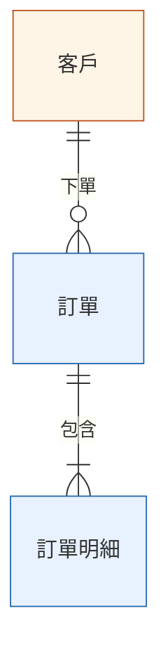

#### ER-NOT-001 同一份模型只使用一種表示法，並附上圖例

- **等級**：必須
- **說明**：Chen 的「1:N」寫在對面，(min,max) 寫在自己這端。同一份文件混用兩種表示法時，讀者無法判斷某個「1」是指哪一端，基數就會被讀反。每份模型文件要聲明使用的表示法，並附上圖例或連到本手冊[第 4.4 節](#44-mermaid-crows-foot-符號對照)。

❌ **反例**：標籤用 (min,max)，線端又用 Crow's Foot。讀者無法判斷「(1,1)」描述的是部門還是員工。

```mermaid
erDiagram
    DEPARTMENT ||--o{ EMPLOYEE : "(0,N) 僱用 (1,1)"
```

✅ **正例**：只用 Crow's Foot，標籤只寫動詞，並在文件開頭聲明表示法。

```mermaid
erDiagram
    DEPARTMENT ||--o{ EMPLOYEE : "僱用"
```

> 表示法：Crow's Foot（Mermaid erDiagram）。線端符號的外側為最大值、內側為最小值，見本手冊第 4.4 節。

- **如何 review**：檢查文件開頭有沒有表示法聲明；檢查關係標籤中有沒有混入數字或 (min,max)。
- **如何驗證**：搜尋模型檔中關係標籤的 `\(\d,[\dNn]\)` 樣式，數量應為 0（使用 (min,max) 表示法的文件除外）。

#### ER-NOT-002 識別關係用實線，非識別關係用虛線

- **等級**：必須
- **說明**：在 Mermaid 中，`--` 與 `..` 不只是外觀差異。實線表示子實體的主鍵包含父實體的鍵（弱實體），虛線表示子實體有自己的主鍵。畫錯會讓實作者誤判主鍵結構。

❌ **反例**：全部都畫實線，看不出訂單與客戶是否為識別關係。

```mermaid
erDiagram
    CUSTOMER ||--o{ ORDERS : "下單"
    ORDERS ||--|{ ORDER_LINE : "包含"
    ORDERS {
        int order_id PK
        int customer_id FK
    }
```

✅ **正例**：訂單有自己的主鍵（非識別，虛線）；明細的主鍵包含訂單編號（識別，實線）。

```mermaid
erDiagram
    CUSTOMER ||..o{ ORDERS : "下單"
    ORDERS ||--|{ ORDER_LINE : "包含"
    ORDERS {
        int order_id PK
        int customer_id FK
    }
    ORDER_LINE {
        int order_id PK, FK
        int line_no PK
    }
```

- **如何 review**：逐條實線檢查子實體的屬性中，是否有同時標 `PK, FK` 的欄位。實線但子實體沒有 `PK, FK`，或虛線但子實體有 `PK, FK`，都是錯誤。
- **如何驗證**：可以用簡單腳本解析 Mermaid 原始碼，比對每條 `--` 關係的子實體是否含 `PK, FK` 屬性。

#### ER-NOT-003 屬性必須標示鍵，並以說明欄記錄非顯而易見的規則

- **等級**：必須
- **說明**：邏輯層的 ERD 若沒有 PK、FK、UK，審查者無法檢查主鍵設計、外鍵方向與替代鍵。可空性、單位、計算規則這類資訊，也應寫在屬性說明中，或連到資料字典。

❌ **反例**：

```mermaid
erDiagram
    ACCOUNT {
        int id
        string no
        decimal bal
        int cust
    }
```

✅ **正例**：

```mermaid
erDiagram
    ACCOUNT {
        int account_id PK "代理鍵"
        string account_no UK "14 碼帳號"
        decimal(18,2) balance "新臺幣元，衍生自交易明細"
        int customer_id FK "NOT NULL"
    }
```

- **如何 review**：每個實體至少有一個 `PK`；每條關係的子端至少有一個 `FK`；縮寫欄位名稱（`bal`、`cust`）要改成完整名稱。
- **如何驗證**：以腳本計算每個實體區塊中 `PK` 的數量，結果為 0 的實體要列出來處理。

#### ER-NOT-004 大型模型依主題領域分圖，單張圖不超過約 20 個實體

- **等級**：建議
- **說明**：一張 80 個實體的 ERD 沒有人看得懂。依主題領域（subject area，例如「客戶」「帳務」「產品」）拆成多張圖，每張圖只放該領域的實體，以及與其他領域連接的「邊界實體」。另外提供一張只有實體名稱的總覽圖。

❌ **反例**：把所有資料表放進同一張圖，線條交錯，無法閱讀（此處以文字描述，不另附圖）。

✅ **正例**：總覽圖只畫領域之間的關係；細節圖只畫單一領域。

```mermaid
erDiagram
    CUSTOMER_DOMAIN ||--o{ ACCOUNT_DOMAIN : "開立"
    PRODUCT_DOMAIN ||--o{ ACCOUNT_DOMAIN : "適用"
    ACCOUNT_DOMAIN ||--o{ TRANSACTION_DOMAIN : "產生"
```

```mermaid
erDiagram
    CUSTOMER ||--o{ CUSTOMER_ADDRESS : "登記"
    CUSTOMER ||--o{ CUSTOMER_CONTACT : "留存"
    CUSTOMER ||..o{ ACCOUNT : "開立（邊界：帳務領域）"
```

- **如何 review**：數一數每張圖的實體個數，超過約 20 個時要求拆分；確認每個實體只在一個領域的細節圖中「擁有」，在其他圖只以邊界實體出現。
- **如何驗證**：以腳本計算每個 `erDiagram` 區塊中出現的實體名稱數量。

### 5.6 PlantUML 的 IE 表示法

PlantUML 的類別圖語法也支援 Crow's Foot（IE）線端符號，適合團隊已經使用 PlantUML 繪製其他 UML 圖的情況：

```plantuml
@startuml
hide circle
skinparam linetype ortho
entity "CUSTOMER" as customer {
  * customer_id : INTEGER <<PK>>
  --
  * email : VARCHAR(200) <<UK>>
  customer_name : VARCHAR(100)
}
entity "ORDERS" as orders {
  * order_id : INTEGER <<PK>>
  --
  * customer_id : INTEGER <<FK>>
  * order_date : DATE
}
entity "ORDER_LINE" as line {
  * order_id : INTEGER <<PK,FK>>
  * line_no : INTEGER <<PK>>
  --
  * quantity : INTEGER
}
customer ||..o{ orders
orders ||--|{ line
@enduml
```

PlantUML 中 `*` 表示必填（NOT NULL），`--` 分隔鍵與非鍵屬性。檢視方式同[第 5.1 節](#51-chen-表示法)。

### 5.7 以 UML 類別圖表示資料模型

UML（ISO/IEC 19505；OMG UML 2.5.1）的類別圖也可以表示概念資料模型。對應方式如下：

| ER 概念 | UML 對應 | 注意事項 |
| --- | --- | --- |
| 實體型別 | 類別 | 資料模型中通常省略操作 |
| 屬性 | 屬性 | 可加 `[0..1]` 表示可空、`[*]` 表示多值 |
| 二元關係 | 關聯（association） | 多重性寫在 **對面** 一端，例如 `1` 與 `0..*` |
| 關係屬性 | 關聯類別（association class） | 映射時就是關聯表 |
| 弱實體 | 組合（composition，實心菱形） | 部分隨整體刪除 |
| 特化／一般化 | 一般化（空心三角形箭頭） | `{complete, disjoint}` 等限制寫在大括號中 |
| 主鍵 | UML 本身沒有；常以 `{id}` 或 `<<PK>>` 構造型表示 | 屬於擴充用法，團隊要統一 |

```mermaid
classDiagram
    direction LR
    class Department {
        deptNo : String
        deptName : String
    }
    class Employee {
        empNo : String
        birthDate : Date
    }
    class Dependent {
        dependentName : String
    }
    Department "1" -- "0..*" Employee : 僱用
    Employee "1" *-- "0..*" Dependent : 扶養
```

### 5.8 表示法對照與選用建議

同一個「部門 1 : N 員工，員工必須隸屬部門，部門可以沒有員工」的規則，在各表示法中的寫法：

| 表示法 | 部門端 | 員工端 | 讀法重點 |
| --- | --- | --- | --- |
| Chen 基數比 | 1 | N，且員工端畫雙線 | 數字寫在對面；雙線表示完全參與 |
| (min,max) | (0,N) | (1,1) | 寫在自己這端：每個部門參與 0～N 次 |
| Crow's Foot | `\|\|`（恰好一） | `o{`（零或多） | 符號畫在對面 |
| Barker | 虛線（可以） | 實線（必須） | 「每位員工必須受僱於一且僅一個部門」 |
| IDEF1X | — | 實心圓點（0、1 或多） | 非識別關係畫虛線；外鍵不可空時畫實線端 |
| UML | `1` | `0..*` | 多重性寫在對面 |

選用建議：

| 用途 | 建議表示法 | 理由 |
| --- | --- | --- |
| 與業務人員討論概念模型 | Chen 或簡化的 Crow's Foot（只畫實體與關係） | Chen 的菱形可以清楚表達關係屬性與三元關係 |
| 邏輯模型與設計審查 | Crow's Foot（Mermaid 或建模工具） | 工具支援最廣，能直接看出外鍵與主鍵 |
| 已全面採用 UML 的團隊 | UML 類別圖 | 與其他設計文件一致 |
| 政府、國防或合約要求 | IDEF1X | 有國際標準可引用 |
| 教學與考試 | Chen 與 (min,max) | 教科書與認證考試的主要表示法 |

## 6. 延伸 ER 模型（EER）

基本 ER 模型無法表達「客戶分為個人客戶與法人客戶，兩者有共同屬性，也各有專屬屬性」這類結構。**延伸 ER 模型（Enhanced/Extended ER，EER）** 加入了子型別、特化、一般化與類別等概念。

### 6.1 超型別與子型別

- **超型別（supertype／superclass）**：一群實體的共同型別，例如「客戶」。
- **子型別（subtype／subclass）**：超型別中具有專屬屬性或關係的子集合，例如「個人客戶」「法人客戶」。
- **屬性繼承**：子型別的每個實體也是超型別的實體，因此擁有超型別的所有屬性與關係。

子型別與超型別之間是「是一種（IS-A）」關係：個人客戶 **是一種** 客戶。

### 6.2 特化與一般化

| 方向 | 定義 | 思考方式 | 例子 |
| --- | --- | --- | --- |
| 特化（specialization） | 由上而下：從超型別找出子型別 | 「客戶有沒有需要分開處理的種類？」 | 客戶 → 個人客戶、法人客戶 |
| 一般化（generalization） | 由下而上：把相似的實體合成超型別 | 「汽車與機車有沒有共同屬性？」 | 汽車、機車 → 車輛 |

兩者產生的結構相同，差異只在分析的方向。

### 6.3 特化的限制

| 限制 | 選項 | 意義 | EER 圖示（Elmasri） |
| --- | --- | --- | --- |
| 互斥性（disjointness） | 互斥（disjoint，d） | 一個實體最多屬於一個子型別 | 圓圈內寫 d |
|  | 重疊（overlapping，o） | 一個實體可以同時屬於多個子型別 | 圓圈內寫 o |
| 完整性（completeness） | 完全（total） | 每個超型別實體都必須屬於某個子型別 | 雙線連到圓圈 |
|  | 部分（partial） | 超型別實體可以不屬於任何子型別 | 單線連到圓圈 |
| 定義方式 | 述詞定義（predicate-defined） | 由某個屬性的值決定子型別，例如 `customer_type = 'P'` | 線上標註條件 |
|  | 使用者定義（user-defined） | 由使用者逐筆指定 | — |

四種組合各舉一例：

| 組合 | 例子 |
| --- | --- |
| 互斥 + 完全 | 客戶必須是個人或法人，且只能是其中一種 |
| 互斥 + 部分 | 員工可以是工程師或業務，也可以都不是（例如行政） |
| 重疊 + 完全 | 大學成員必須是學生或教職員，也可以同時是兩者（在職專班） |
| 重疊 + 部分 | 會員可以同時是作者與審稿人，也可以都不是 |

Mermaid 沒有 EER 的特化符號。實務上可以用 Mermaid 的類別圖表示，並在說明中寫明限制：

```mermaid
classDiagram
    class Customer {
        customerId
        customerType
    }
    class Person {
        nationalId
        birthDate
    }
    class Organization {
        taxId
        registeredCapital
    }
    Customer <|-- Person
    Customer <|-- Organization
```

上圖的特化限制為 `{disjoint, complete}`：每位客戶恰好是個人或法人其中一種，以 `customerType` 判別。

#### ER-EER-001 只有在子型別有專屬屬性或專屬關係時才建立子型別

- **等級**：建議
- **說明**：子型別的成本是多一張表、多一層 JOIN、多一組約束。如果「個人」與「法人」只差在名稱，用一個「客戶類別」屬性就夠了。只有當子型別有 **專屬屬性**（例如個人的出生日期）或 **專屬關係**（例如法人才有「負責人」）時，才值得建立子型別。

❌ **反例**：子型別沒有任何專屬屬性，只是分類。

```mermaid
classDiagram
    class Product {
        productId
        productName
    }
    class Book
    class Toy
    Product <|-- Book
    Product <|-- Toy
```

✅ **正例**：沒有專屬屬性時，用分類屬性加參照資料表；有專屬屬性時才建立子型別。

```mermaid
erDiagram
    PRODUCT_CATEGORY ||--o{ PRODUCT : "分類"
    PRODUCT_CATEGORY {
        string category_code PK
        string category_name
    }
    PRODUCT {
        int product_id PK
        string product_name
        string category_code FK
    }
```

- **如何 review**：對每個子型別問：「它有哪些超型別沒有的屬性或關係？」答不出來就改用分類屬性。
- **如何驗證**：比對子型別資料表的欄位清單，除了主鍵與外鍵外至少要有一個專屬欄位。

#### ER-EER-002 特化必須宣告互斥性與完整性，並在資料庫中落實

- **等級**：必須
- **說明**：「一位客戶能不能同時是個人與法人？」「能不能兩者都不是？」這兩個問題的答案必須寫在模型上。若選擇「超型別 + 子型別各一張表」的映射方式（[第 8.6 節](#86-步驟-8特化與一般化的四種方案)），互斥性可以用「主鍵 + 類別碼」的複合外鍵在資料庫中強制。

❌ **反例**：子型別表只參照超型別的主鍵，同一位客戶可以同時出現在個人與法人兩張表中。

```sql
-- [通用]
CREATE TABLE customer_bad (
    customer_id   INTEGER NOT NULL PRIMARY KEY,
    customer_type CHAR(1) NOT NULL
);
CREATE TABLE person_bad (
    customer_id INTEGER NOT NULL PRIMARY KEY,
    CONSTRAINT fk_person_bad FOREIGN KEY (customer_id) REFERENCES customer_bad (customer_id)
);
CREATE TABLE org_bad (
    customer_id INTEGER NOT NULL PRIMARY KEY,
    CONSTRAINT fk_org_bad FOREIGN KEY (customer_id) REFERENCES customer_bad (customer_id)
);
INSERT INTO customer_bad VALUES (1, 'P');
INSERT INTO person_bad VALUES (1);
INSERT INTO org_bad VALUES (1);
SELECT CASE WHEN COUNT(*) = 1 THEN 'BOTH-SUBTYPES-ACCEPTED' ELSE 'OTHER' END AS result
FROM person_bad p JOIN org_bad o ON o.customer_id = p.customer_id;
-- 預期結果：BOTH-SUBTYPES-ACCEPTED
```

✅ **正例**：超型別以（主鍵、類別碼）建立 UNIQUE；子型別固定自己的類別碼，並以複合外鍵參照。法人資料無法掛在類別碼為 `P` 的客戶下。

```sql
-- [通用]
CREATE TABLE customer (
    customer_id   INTEGER      NOT NULL PRIMARY KEY,
    customer_type CHAR(1)      NOT NULL,
    display_name  VARCHAR(100) NOT NULL,
    CONSTRAINT ck_customer_type CHECK (customer_type IN ('P', 'O')),
    CONSTRAINT uq_customer_id_type UNIQUE (customer_id, customer_type)
);
CREATE TABLE person_customer (
    customer_id   INTEGER     NOT NULL PRIMARY KEY,
    customer_type CHAR(1)     NOT NULL,
    national_id   VARCHAR(10) NOT NULL,
    CONSTRAINT ck_person_type CHECK (customer_type = 'P'),
    CONSTRAINT fk_person_customer FOREIGN KEY (customer_id, customer_type)
        REFERENCES customer (customer_id, customer_type),
    CONSTRAINT uq_person_national_id UNIQUE (national_id)
);
CREATE TABLE org_customer (
    customer_id   INTEGER    NOT NULL PRIMARY KEY,
    customer_type CHAR(1)    NOT NULL,
    tax_id        VARCHAR(8) NOT NULL,
    CONSTRAINT ck_org_type CHECK (customer_type = 'O'),
    CONSTRAINT fk_org_customer FOREIGN KEY (customer_id, customer_type)
        REFERENCES customer (customer_id, customer_type),
    CONSTRAINT uq_org_tax_id UNIQUE (tax_id)
);
INSERT INTO customer VALUES (1, 'P', 'Alice Wang');
INSERT INTO person_customer VALUES (1, 'P', 'A123456789');
INSERT INTO org_customer VALUES (1, 'O', '12345678');
-- 預期錯誤：fk_org_customer
```

完整性（每位客戶都必須有子型別資料）屬於「1 端至少一筆」的限制，做法與驗證查詢見 [ER-CON-011](#er-con-011-1-端至少一筆的限制必須明確實作並可驗證)：

```sql
-- [通用]
SELECT CASE WHEN COUNT(*) = 0 THEN 'TOTAL-SPECIALIZATION-OK' ELSE 'MISSING-SUBTYPE' END AS result
FROM customer c
WHERE (c.customer_type = 'P' AND NOT EXISTS (SELECT 1 FROM person_customer p WHERE p.customer_id = c.customer_id))
   OR (c.customer_type = 'O' AND NOT EXISTS (SELECT 1 FROM org_customer o WHERE o.customer_id = c.customer_id));
-- 預期結果：TOTAL-SPECIALIZATION-OK
```

- **如何 review**：圖上或字典中要看得到 `{disjoint|overlapping, total|partial}`。互斥特化的子型別表必須有類別碼欄位與複合外鍵；重疊特化則不需要。
- **如何驗證**：互斥性：嘗試把同一個超型別實體寫入兩個子型別表，必須失敗。完整性：執行上面的 `NOT EXISTS` 查詢，結果必須為 0。

### 6.4 類別（Union Type）

**類別（category，又稱 union type）** 是「由多個 **不同** 超型別的實體組成的子型別」。例如「車主」可以是個人、公司或銀行（車貸抵押），三者沒有共同的超型別，但都能擁有車輛。

它與一般化的差別：一般化是「多個子型別共用一個超型別」；類別是「一個子型別有多個可能的超型別」，每個車主實體只會是其中一種。

#### ER-EER-003 類別（union type）以互斥弧或代理超型別實作，不可只靠應用程式判斷

- **等級**：必須
- **說明**：「車主可能是個人或公司」最常見的錯誤寫法是 `owner_type` + `owner_id`，由程式依類型去不同表查詢。這種寫法無法建立外鍵（見 [ER-PAT-005](#er-pat-005-不可使用多型關聯類型欄位--無外鍵的編號)）。可攜的做法有兩種：
  - **互斥弧（exclusive arc）**：每種可能的擁有者各一個可空外鍵，加 CHECK 保證「恰好一個非空」。適合可能的型別少（2～4 種）且固定的情況。
  - **代理超型別**：新增一個「車主」實體作為共同超型別，個人與公司各自參照它。適合型別多或會增加的情況。

❌ **反例**：類型加編號，資料庫無法檢查編號是否存在。

```sql
-- [通用]
CREATE TABLE vehicle_bad (
    plate_no   VARCHAR(10) NOT NULL PRIMARY KEY,
    owner_type VARCHAR(10) NOT NULL,
    owner_id   INTEGER     NOT NULL
);
INSERT INTO vehicle_bad VALUES ('ABC-1234', 'PERSON', 999);
SELECT CASE WHEN COUNT(*) = 1 THEN 'DANGLING-OWNER-ACCEPTED' ELSE 'OTHER' END AS result FROM vehicle_bad;
-- 預期結果：DANGLING-OWNER-ACCEPTED
```

✅ **正例（互斥弧）**：兩個可空外鍵，CHECK 保證恰好一個有值。

```mermaid
erDiagram
    PERSON |o..o{ VEHICLE : "擁有"
    COMPANY |o..o{ VEHICLE : "擁有"
    VEHICLE {
        string plate_no PK
        int owner_person_id FK "與 owner_company_id 恰好一個非空"
        int owner_company_id FK
    }
```

```sql
-- [通用]
CREATE TABLE person (
    person_id   INTEGER      NOT NULL PRIMARY KEY,
    person_name VARCHAR(100) NOT NULL
);
CREATE TABLE company (
    company_id   INTEGER      NOT NULL PRIMARY KEY,
    company_name VARCHAR(100) NOT NULL
);
CREATE TABLE vehicle (
    plate_no         VARCHAR(10) NOT NULL PRIMARY KEY,
    owner_person_id  INTEGER,
    owner_company_id INTEGER,
    CONSTRAINT fk_vehicle_person FOREIGN KEY (owner_person_id) REFERENCES person (person_id),
    CONSTRAINT fk_vehicle_company FOREIGN KEY (owner_company_id) REFERENCES company (company_id),
    CONSTRAINT ck_vehicle_one_owner CHECK (
        (owner_person_id IS NOT NULL AND owner_company_id IS NULL)
        OR (owner_person_id IS NULL AND owner_company_id IS NOT NULL))
);
INSERT INTO person VALUES (1, 'Alice');
INSERT INTO company VALUES (10, 'ACME');
INSERT INTO vehicle VALUES ('ABC-1234', 1, NULL);
INSERT INTO vehicle VALUES ('XYZ-9999', 1, 10);
-- 預期錯誤：ck_vehicle_one_owner
```

```sql
-- [通用]
INSERT INTO vehicle VALUES ('XYZ-9999', 999, NULL);
-- 預期錯誤：fk_vehicle_person
```

- **如何 review**：搜尋 `xxx_type` + `xxx_id` 成對出現、且 `xxx_id` 沒有外鍵的欄位。
- **如何驗證**：插入不存在的擁有者編號，必須被外鍵擋下；插入兩個擁有者或零個擁有者，必須被 CHECK 擋下。

### 6.5 聚合（Aggregation）

ER 模型中，關係只能連接實體，不能連接另一個關係。當業務需要「關係參與另一個關係」時，例如「員工參與專案」這件事本身會「使用設備」，就需要 **聚合**：把「員工參與專案」這個關係視為一個高階實體，再讓它參與「使用」關係。

#### ER-EER-004 關係需要參與其他關係時，先將它提升為關聯實體

- **等級**：必須
- **說明**：如果直接讓設備與員工、專案建立三元關係，會失去「設備是用在某次參與上」的語意，也會允許「員工沒有參與專案卻使用了專案的設備」這種資料。正確做法是把「參與」提升為關聯實體（它有自己的鍵），再讓「設備使用」參照它。

❌ **反例**：設備使用直接參照員工與專案，無法保證該員工確實參與該專案。

```mermaid
erDiagram
    EMPLOYEE ||--o{ EQUIPMENT_USE : "使用"
    PROJECT ||--o{ EQUIPMENT_USE : "耗用"
    EQUIPMENT ||--o{ EQUIPMENT_USE : "被使用"
```

✅ **正例**：「參與」成為關聯實體，設備使用參照「參與」的複合鍵。

```mermaid
erDiagram
    EMPLOYEE ||--o{ PARTICIPATION : "參與"
    PROJECT ||--o{ PARTICIPATION : "包含"
    PARTICIPATION ||--o{ EQUIPMENT_USE : "使用"
    EQUIPMENT ||--o{ EQUIPMENT_USE : "被使用"
    PARTICIPATION {
        int employee_id PK, FK
        int project_id PK, FK
        string role_name
    }
    EQUIPMENT_USE {
        int employee_id PK, FK
        int project_id PK, FK
        string equipment_no PK, FK
        int hours_used
    }
```

```sql
-- [通用]
CREATE TABLE project (project_id INTEGER NOT NULL PRIMARY KEY);
CREATE TABLE equipment (equipment_no VARCHAR(10) NOT NULL PRIMARY KEY);
CREATE TABLE participation (
    employee_id INTEGER     NOT NULL,
    project_id  INTEGER     NOT NULL,
    role_name   VARCHAR(30) NOT NULL,
    CONSTRAINT pk_participation PRIMARY KEY (employee_id, project_id),
    CONSTRAINT fk_part_employee FOREIGN KEY (employee_id) REFERENCES person (person_id),
    CONSTRAINT fk_part_project FOREIGN KEY (project_id) REFERENCES project (project_id)
);
CREATE TABLE equipment_use (
    employee_id  INTEGER     NOT NULL,
    project_id   INTEGER     NOT NULL,
    equipment_no VARCHAR(10) NOT NULL,
    hours_used   INTEGER     NOT NULL,
    CONSTRAINT pk_equipment_use PRIMARY KEY (employee_id, project_id, equipment_no),
    CONSTRAINT fk_use_participation FOREIGN KEY (employee_id, project_id)
        REFERENCES participation (employee_id, project_id),
    CONSTRAINT fk_use_equipment FOREIGN KEY (equipment_no) REFERENCES equipment (equipment_no)
);
INSERT INTO project VALUES (500);
INSERT INTO equipment VALUES ('EQ-01');
INSERT INTO equipment_use VALUES (1, 500, 'EQ-01', 8);
-- 預期錯誤：fk_use_participation
```

- **如何 review**：檢查三元以上的關聯實體：其中是否有兩方必須「先有關係」才能出現第三方？若是，應改為聚合。
- **如何驗證**：插入「員工未參與專案卻使用設備」的資料，必須被外鍵擋下（如上）。

## 7. 建模流程：從需求到 ER 模型

### 7.1 流程總覽

```mermaid
flowchart LR
    A[1 收集需求<br/>萃取業務規則] --> B[2 名詞與動詞分析<br/>列出候選元素]
    B --> C[3 篩選與精煉<br/>確定實體與關係]
    C --> D[4 識別屬性與鍵]
    D --> E[5 決定結構限制<br/>基數 參與 特化]
    E --> F[6 撰寫資料字典]
    F --> G[7 情境走查<br/>樣本資料驗證]
    G -->|發現問題| B
    G --> H[8 審查與基線化]
```

| 步驟 | 產出 | 誰參與 | 完成標準 |
| --- | --- | --- | --- |
| 1 | 業務規則清單（每條有編號） | 分析師、業務代表 | 每條規則都是「每個 X 必須／可以 Y」的完整句子 |
| 2 | 候選實體與關係清單 | 分析師 | 需求文件中的每個名詞都被歸類 |
| 3 | 實體清單與關係清單 | 分析師、資料架構師 | 每個實體通過[第 3.1 節](#31-實體實體型別與實體集合)的三個問題 |
| 4 | 屬性與候選鍵 | 分析師 | 每個實體至少一個候選鍵 |
| 5 | 有結構限制的 ERD | 分析師 | 每條關係兩端都有 (min,max) |
| 6 | 資料字典 | 分析師、資料管理員 | 每個屬性有定義、型別、可空性、範例值 |
| 7 | 情境走查紀錄 | 分析師、業務代表 | 所有關鍵業務問題都能用模型回答 |
| 8 | 基線版本的模型 | 審查小組 | 通過[第 19 章](#19-檢查清單)檢查清單 |

### 7.2 萃取業務規則

業務規則是 ER 模型的原料。一條好的業務規則應該是：

- **原子的**：一條規則只描述一件事。
- **可測試的**：可以寫出一筆違反它的資料。
- **使用業務術語**：不出現資料表或欄位名稱。

以圖書館為例：

| 編號 | 業務規則 | 對應的模型元素 |
| --- | --- | --- |
| BR-01 | 每位會員以會員證號識別 | 實體 MEMBER，候選鍵 card_no |
| BR-02 | 同一種書（同一 ISBN）可以有多本館藏 | 實體 BOOK、BOOK_COPY；BOOK 1:N BOOK_COPY |
| BR-03 | 每本館藏以條碼識別 | BOOK_COPY 候選鍵 barcode |
| BR-04 | 每位會員同時最多借 5 本 | LOAN 的計數限制（[ER-CON-011](#er-con-011-1-端至少一筆的限制必須明確實作並可驗證) 類型） |
| BR-05 | 每筆借閱紀錄一位會員、一本館藏、借出日、到期日 | 實體 LOAN；MEMBER 1:N LOAN；BOOK_COPY 1:N LOAN |
| BR-06 | 一本館藏同一時間只能被一筆未歸還的借閱占用 | LOAN 的條件式唯一約束（[第 10.5 節](#105-條件式唯一)） |
| BR-07 | 逾期每日罰款 10 元 | LOAN 的衍生屬性「罰款」，計算規則寫入字典 |

#### ER-PRC-001 每個實體、關係與約束都要能追溯到業務規則

- **等級**：必須
- **說明**：模型中「說不出為什麼存在」的元素，日後沒人敢刪；業務規則「沒有對應到模型」，就代表系統沒有落實它。在模型中以註解標示業務規則編號，並維護一張追溯表。

❌ **反例**：圖上的關係與限制看不出來源，審查者無法判斷 `||--|{`（至少一本館藏）是業務要求還是設計者的猜測。

```mermaid
erDiagram
    BOOK ||--|{ BOOK_COPY : "有"
    MEMBER ||--o{ LOAN : "借"
```

✅ **正例**：以 `%%` 註解標示規則編號，關係名稱使用業務用語。

```mermaid
erDiagram
    %% BR-02：同一 ISBN 可有多本館藏；新書可先建目錄再進館藏，所以 BOOK 端為 o{
    BOOK ||--o{ BOOK_COPY : "收藏為"
    %% BR-05：每筆借閱屬於一位會員與一本館藏
    MEMBER ||--o{ LOAN : "借閱"
    BOOK_COPY ||--o{ LOAN : "被借出"
```

- **如何 review**：隨機抽 3 條業務規則，在模型中找對應元素；再隨機抽 3 個模型元素，反查業務規則。任一方向找不到都要補上。
- **如何驗證**：以腳本擷取模型原始碼中的 `BR-\d+` 編號，與業務規則清單比對：清單中未被引用的規則必須列出說明（例如「由應用程式落實」）。

### 7.3 名詞與動詞分析

名詞分析是找出候選實體的起點：把需求描述中的名詞畫線，動詞畫雙線。

> 讀者到圖書館**櫃台**辦理**會員證**後，即可**借閱**館內的**書籍**。每本**書**可能有多本**館藏**，每本館藏貼有**條碼**。**館員**會在**系統**中**登記**借出日與**到期日**。逾期歸還時，系統會依**天數**計算**罰款**，並寄送**通知信**給**會員**。

| 候選名詞 | 判斷 | 理由 |
| --- | --- | --- |
| 讀者、會員 | 實體 MEMBER | 同義詞，統一用「會員」 |
| 櫃台 | 排除 | 是地點，系統不需要記住它的資料 |
| 會員證 | MEMBER 的屬性 card_no | 只有號碼，沒有其他需要記住的性質 |
| 書籍、書 | 實體 BOOK | 同義詞；代表「一種書」（同 ISBN） |
| 館藏 | 實體 BOOK_COPY | 代表「實體的一本書」，有自己的條碼 |
| 條碼 | BOOK_COPY 的屬性 | 識別館藏的候選鍵 |
| 館員 | 視需求：若需記錄「誰辦理借閱」則為實體 STAFF，否則排除 | 「系統的使用者」不一定是業務實體 |
| 系統 | 排除 | 是被設計的對象本身 |
| 借出日、到期日 | LOAN 的屬性 | 屬於「借閱」這件事 |
| 天數 | 排除（衍生） | 由今天與到期日計算 |
| 罰款 | LOAN 的衍生屬性，或獨立實體 FINE | 若要記錄繳費狀態，則升級為實體 |
| 通知信 | 視需求：若要追蹤寄送紀錄則為實體 NOTIFICATION | — |
| 借閱（動詞） | 關係，並升級為實體 LOAN | 有自己的屬性（借出日、到期日） |

#### ER-PRC-002 名詞分析的結果必須經過篩選，並記錄排除理由

- **等級**：建議
- **說明**：把需求中的名詞全部變成實體，會產生「櫃台」「系統」「天數」這類不該存在的實體，或把同義詞變成兩個實體（讀者、會員）。每個候選名詞都要歸類為「實體、屬性、關係、衍生、排除」，並記錄理由，方便日後需求變更時重新判斷。

❌ **反例**：同義詞成為兩個實體，衍生值成為實體。

```mermaid
erDiagram
    READER ||--o{ LOAN : "借"
    MEMBER ||--o{ LOAN : "借"
    LOAN ||--|| DAYS : "計算"
```

✅ **正例**：同義詞合併，衍生值成為屬性說明。

```mermaid
erDiagram
    MEMBER ||--o{ LOAN : "借閱"
    LOAN {
        int loan_id PK
        date due_date
        date return_date "逾期天數由 return_date 與 due_date 計算"
    }
```

- **如何 review**：檢查候選名詞表是否涵蓋需求文件中的所有名詞，以及每個「排除」是否有理由。
- **如何驗證**：比對同義詞表（術語表）與實體清單，同一組同義詞只能對應到一個實體。

### 7.4 實體精煉與屬性識別

精煉階段要處理以下問題：

| 問題 | 判斷方式 | 處理 |
| --- | --- | --- |
| 這是實體還是屬性？ | 是否有自己的屬性或參與其他關係？ | 有：實體；沒有：屬性 |
| 這是實體還是關係？ | 是否是兩個實體之間「發生的事」？ | 有自己的屬性且需單獨查詢時，建模為關聯實體（如 LOAN） |
| 屬性該放在哪個實體？ | 屬性描述的是哪個「事物」？ | 「借出日」描述借閱，不是會員也不是館藏 |
| 多值屬性？ | 一個實體可能有多個值嗎？ | 獨立成表（[ER-CON-002](#er-con-002-多值屬性不可用分隔字串存在單一欄位)） |
| 會隨時間改變並需保留歷史？ | 業務需要查過去的值嗎？ | 建模為有期間的實體（[ER-CON-010](#er-con-010-基數必須用業務規則與時間反例確認)） |

### 7.5 資料字典

資料字典是 ER 模型的文字部分。圖只能呈現結構，定義、範例值、來源、敏感等級都要寫在字典中。最低要求的欄位如下：

| 實體 | 屬性 | 業務定義 | 邏輯型別 | 可空 | 單值 | 鍵 | 範例值 | 來源／規則 | 敏感等級 |
| --- | --- | --- | --- | --- | --- | --- | --- | --- | --- |
| MEMBER | card_no | 會員證上的 10 碼編號，發證後不變 | 字元(10) | 否 | 是 | UK | `L000012345` | BR-01 | 一般 |
| MEMBER | national_id | 身分證統一編號，用於確認身分 | 字元(10) | 否 | 是 | UK | `A123456789` | 申辦表單 | 個資（[第 15 章](#15-安全與個人資料保護)） |
| LOAN | due_date | 應歸還日，借出日加 14 天 | 日期 | 否 | 是 | — | `2026-10-26` | BR-05 | 一般 |
| LOAN | return_date | 實際歸還日；NULL 代表「尚未歸還」 | 日期 | 是 | 是 | — | `NULL` | BR-05 | 一般 |

#### ER-PRC-003 資料字典的定義要寫進資料庫的註解，並可用查詢驗證完整性

- **等級**：建議
- **說明**：只存在於文件中的字典，很快就會和資料庫脫節。把資料表與欄位的業務定義寫入資料庫的註解，DBA、BI 工具與逆向工程工具都能讀到；也可以用查詢找出「沒有定義」的欄位。

❌ **反例**：資料庫中沒有任何註解，`flag1` 是什麼只能問原作者。

```sql
-- [通用]
CREATE TABLE account_bad (
    account_id INTEGER  NOT NULL PRIMARY KEY,
    flag1      CHAR(1)  NOT NULL
);
```

✅ **正例（PostgreSQL、Oracle、Db2）**：以 `COMMENT ON` 寫入定義，再查詢「沒有註解的欄位」數量。

```sql
-- [PostgreSQL、Oracle、Db2]
CREATE TABLE account (
    account_id  INTEGER     NOT NULL PRIMARY KEY,
    account_no  VARCHAR(14) NOT NULL,
    status_code CHAR(1)     NOT NULL,
    CONSTRAINT uq_account_no UNIQUE (account_no)
);
COMMENT ON TABLE account IS '存款帳戶：客戶在本行開立的活期或定期帳戶';
COMMENT ON COLUMN account.account_id IS '代理鍵，系統產生';
COMMENT ON COLUMN account.account_no IS '14 碼帳號，開戶時配發，不可變更';
COMMENT ON COLUMN account.status_code IS '帳戶狀態：A 正常、F 凍結、C 結清';
```

```sql
-- [PostgreSQL]
SELECT CASE WHEN COUNT(*) = 0 THEN 'ALL-COLUMNS-DOCUMENTED' ELSE 'UNDOCUMENTED' END AS result
FROM information_schema.columns c
WHERE c.table_schema = current_schema() AND c.table_name = 'account'
  AND col_description(format('%I.%I', c.table_schema, c.table_name)::regclass, c.ordinal_position) IS NULL;
-- 預期結果：ALL-COLUMNS-DOCUMENTED
```

```sql
-- [Oracle]
SELECT CASE WHEN COUNT(*) = 0 THEN 'ALL-COLUMNS-DOCUMENTED' ELSE 'UNDOCUMENTED' END AS result
FROM user_col_comments
WHERE table_name = 'ACCOUNT' AND comments IS NULL;
-- 預期結果：ALL-COLUMNS-DOCUMENTED
```

```sql
-- [Db2]
SELECT CASE WHEN COUNT(*) = 0 THEN 'ALL-COLUMNS-DOCUMENTED' ELSE 'UNDOCUMENTED' END AS result
FROM syscat.columns
WHERE tabschema = CURRENT SCHEMA AND tabname = 'ACCOUNT' AND remarks IS NULL;
-- 預期結果：ALL-COLUMNS-DOCUMENTED
```

✅ **正例（SQL Server）**：SQL Server 沒有 `COMMENT ON`，改用擴充屬性 `MS_Description`。

```sql
-- [SQL Server]
CREATE TABLE account (
    account_id  INTEGER     NOT NULL PRIMARY KEY,
    account_no  VARCHAR(14) NOT NULL,
    status_code CHAR(1)     NOT NULL,
    CONSTRAINT uq_account_no UNIQUE (account_no)
);
EXEC sp_addextendedproperty N'MS_Description', N'存款帳戶', N'SCHEMA', N'dbo', N'TABLE', N'account';
EXEC sp_addextendedproperty N'MS_Description', N'代理鍵，系統產生', N'SCHEMA', N'dbo', N'TABLE', N'account', N'COLUMN', N'account_id';
EXEC sp_addextendedproperty N'MS_Description', N'14 碼帳號', N'SCHEMA', N'dbo', N'TABLE', N'account', N'COLUMN', N'account_no';
EXEC sp_addextendedproperty N'MS_Description', N'帳戶狀態：A 正常、F 凍結、C 結清', N'SCHEMA', N'dbo', N'TABLE', N'account', N'COLUMN', N'status_code';
SELECT CASE WHEN COUNT(*) = 0 THEN 'ALL-COLUMNS-DOCUMENTED' ELSE 'UNDOCUMENTED' END AS result
FROM sys.columns c
LEFT JOIN sys.extended_properties ep
       ON ep.major_id = c.object_id AND ep.minor_id = c.column_id AND ep.name = 'MS_Description'
WHERE c.object_id = OBJECT_ID('dbo.account') AND ep.value IS NULL;
-- 預期結果：ALL-COLUMNS-DOCUMENTED
```

- **如何 review**：抽查新增資料表的 DDL 腳本，每個 `CREATE TABLE` 後面都要有對應的註解敘述。
- **如何驗證**：把上面的「未註解欄位」查詢放進 CI 或資料品質排程，新資料表的結果必須為 0。

### 7.6 命名規範

ISO/IEC 11179（中繼資料登錄系統）建議資料元素名稱由三個部分組成：**物件類別（object class）+ 特性（property）+ 表示詞（representation term）**。例如 `loan_due_date`：物件類別是「借閱」、特性是「應歸還」、表示詞是「日期」。表示詞讓讀者一看就知道值的型態：

| 表示詞（後綴） | 意義 | 例子 |
| --- | --- | --- |
| `_id` | 代理鍵或參照 | `member_id` |
| `_no`／`_code` | 業務編號／代碼 | `account_no`、`status_code` |
| `_name` | 名稱 | `branch_name` |
| `_date`／`_at` | 日期／時間戳記 | `due_date`、`created_at` |
| `_amount` | 金額 | `loan_amount` |
| `_qty`／`_count` | 數量／筆數 | `order_qty` |
| `_rate` | 比率 | `interest_rate` |
| `is_`／`_flag` | 布林旗標 | `is_active` |

命名規範建議：

| 項目 | 建議 | 理由 |
| --- | --- | --- |
| 實體名稱 | 單數名詞（MEMBER，不是 MEMBERS） | 實體型別描述「一個」事物；資料表名稱單複數由團隊統一決定，但不可混用 |
| 大小寫 | 全小寫加底線（snake_case） | PostgreSQL 會把未加引號的名稱轉成小寫，Oracle 與 Db2 會轉成大寫；snake_case 在四種資料庫都不必加引號 |
| 保留字 | 不使用 `order`、`user`、`group`、`date` 等保留字 | 見下方 ER-PRC-004 |
| 縮寫 | 只使用組織術語表中登錄的縮寫 | `amt`、`cust`、`qty` 混用會讓搜尋與理解困難 |
| 外鍵欄位 | 與被參照的主鍵同名；遞迴或多重參照時以角色命名 | `customer_id`；`manager_id`、`from_account_id` |

#### ER-PRC-004 實體與屬性名稱不可使用任何目標資料庫的保留字

- **等級**：必須
- **說明**：保留字在不同資料庫的限制不同。例如 `order` 在 Db2 可以當資料表名稱，在 PostgreSQL、Oracle、SQL Server 都會報語法錯誤。模型若在 Db2 上開發，移植時才會出錯；若用引號繞過，之後每個查詢都要加引號。

❌ **反例**：以 `order` 為名稱，在三種資料庫直接失敗。

```sql
-- [PostgreSQL]
CREATE TABLE order (order_id INTEGER NOT NULL PRIMARY KEY);
-- 預期錯誤：syntax error
```

```sql
-- [Oracle]
CREATE TABLE order (order_id INTEGER NOT NULL PRIMARY KEY);
-- 預期錯誤：ORA-00903
```

```sql
-- [SQL Server]
CREATE TABLE order (order_id INTEGER NOT NULL PRIMARY KEY);
-- 預期錯誤：Incorrect syntax
```

同一段 DDL 在 Db2 卻能成功，這正是可攜性陷阱：

```sql
-- [Db2]
CREATE TABLE order (order_id INTEGER NOT NULL PRIMARY KEY);
SELECT 'DB2-ACCEPTS-ORDER' AS result FROM sysibm.sysdummy1;
-- 預期結果：DB2-ACCEPTS-ORDER
```

✅ **正例**：使用非保留字的名稱，四種資料庫都可執行。

```sql
-- [通用]
CREATE TABLE sales_order (order_id INTEGER NOT NULL PRIMARY KEY);
```

- **如何 review**：把模型中的實體與屬性名稱，比對 SQL:2023 與四種資料庫的保留字清單。常見地雷：`order`、`user`、`group`、`date`、`level`、`comment`、`size`、`number`、`value`。
- **如何驗證**：在 CI 中對 DDL 執行 sqlfluff 的 `references.keywords` 規則，或直接把 DDL 在所有目標資料庫執行一次。

#### ER-PRC-005 屬性名稱以「物件 + 特性 + 表示詞」組成，表示詞全模型一致

- **等級**：建議
- **說明**：`start`、`amt`、`dt`、`flag` 這類名稱，讀者無法判斷型別與單位。同一個概念在不同表使用不同後綴（`create_time`、`created_at`、`crt_dt`），會讓查詢與資料整合出錯。

❌ **反例**：

```mermaid
erDiagram
    TRANSFER {
        int id PK
        decimal amt
        string cur
        date dt
        string flag
    }
```

✅ **正例**：

```mermaid
erDiagram
    TRANSFER {
        int transfer_id PK
        decimal transfer_amount "新臺幣元，小數 2 位"
        string currency_code "ISO 4217，例如 TWD"
        date value_date "起息日"
        string status_code "P 處理中、S 成功、F 失敗"
    }
```

- **如何 review**：檢查每個屬性名稱的後綴是否在[第 7.6 節](#76-命名規範)的表示詞表中；同一概念在不同實體中是否使用相同名稱。
- **如何驗證**：以系統目錄列出所有欄位名稱，用正規表示式檢查後綴，例如 PostgreSQL：`SELECT column_name FROM information_schema.columns WHERE table_schema = 'bank' AND column_name !~ '_(id|no|code|name|date|at|amount|qty|count|rate|flag)$' AND column_name !~ '^is_'`，結果逐一確認。

### 7.7 情境走查與樣本資料驗證

模型完成後，用「業務問題」逐一走查：每個問題都要能以模型上的 SQL 回答。

| 業務問題 | 走查結果 |
| --- | --- |
| 某會員目前借了哪些書？ | MEMBER → LOAN（return_date IS NULL）→ BOOK_COPY → BOOK |
| 某本館藏目前是否在館？ | BOOK_COPY 是否存在 return_date IS NULL 的 LOAN |
| 上個月逾期最多的會員是誰？ | LOAN 依 member_id 分組，比較 return_date 與 due_date |
| 某會員累計未繳罰款多少？ | 若罰款只是衍生屬性，**無法回答「已繳」**；需新增 FINE 實體 |

最後一個問題在走查時暴露了模型的缺口，這正是走查的價值。

#### ER-PRC-006 模型基線化前，必須以樣本資料與業務問題完成走查

- **等級**：必須
- **說明**：ERD 看起來正確，不代表能回答業務問題。用樣本資料實際建表、寫入、查詢，是最便宜的驗證方式。每個關鍵業務問題都要對應一段可執行的查詢。

❌ **反例**：模型只有罰款的衍生規則，沒有繳費紀錄。走查「未繳罰款」時，只能算出應繳金額，無法得知是否已繳。

```sql
-- [X｜不執行：示意查詢，模型中沒有繳費資訊，寫不出來]
SELECT member_id, SUM(fine_amount) - ??? AS unpaid_amount FROM loan GROUP BY member_id;
```

✅ **正例**：走查後新增 FINE 實體，並以樣本資料證明可以回答問題。

```mermaid
erDiagram
    MEMBER ||--o{ LOAN : "借閱"
    LOAN ||--o| FINE : "產生"
    FINE {
        int loan_id PK, FK
        decimal fine_amount
        date paid_date "NULL 代表未繳"
    }
```

```sql
-- [通用]
CREATE TABLE member (member_id INTEGER NOT NULL PRIMARY KEY);
CREATE TABLE loan (
    loan_id   INTEGER NOT NULL PRIMARY KEY,
    member_id INTEGER NOT NULL,
    CONSTRAINT fk_loan_member FOREIGN KEY (member_id) REFERENCES member (member_id)
);
CREATE TABLE fine (
    loan_id     INTEGER       NOT NULL PRIMARY KEY,
    fine_amount DECIMAL(8, 0) NOT NULL,
    paid_date   DATE,
    CONSTRAINT fk_fine_loan FOREIGN KEY (loan_id) REFERENCES loan (loan_id),
    CONSTRAINT ck_fine_amount CHECK (fine_amount > 0)
);
INSERT INTO member VALUES (1);
INSERT INTO loan VALUES (101, 1);
INSERT INTO loan VALUES (102, 1);
INSERT INTO fine VALUES (101, 30, NULL);
INSERT INTO fine VALUES (102, 50, CURRENT_DATE);
SELECT 'UNPAID=' || CAST(SUM(f.fine_amount) AS VARCHAR(20)) AS result
FROM fine f JOIN loan l ON l.loan_id = f.loan_id
WHERE l.member_id = 1 AND f.paid_date IS NULL;
-- 預期結果：UNPAID=30
```

- **如何 review**：要求設計者提供「業務問題 → 查詢」對照表，至少涵蓋需求文件中的每個報表與每個查詢畫面。
- **如何驗證**：在空白資料庫執行 DDL、樣本資料與所有走查查詢，全部成功且結果符合預期。可以直接採用本手冊的 `預期結果` 寫法自動化。

## 8. 從 ER 模型映射到關聯綱要

### 8.1 映射演算法總覽

Elmasri 與 Navathe 整理的 ER/EER 到關聯模型的映射演算法共九個步驟。依序執行，每一步的輸出都可以被檢查：

| 步驟 | 輸入 | 映射規則 | 本章小節 |
| --- | --- | --- | --- |
| 1 | 一般（強）實體型別 | 一個關聯表；簡單屬性成為欄位；複合屬性只保留子屬性；選一個候選鍵當主鍵，其餘候選鍵加 UNIQUE | [8.2](#82-步驟-12一般實體與弱實體) |
| 2 | 弱實體型別 | 一個關聯表；加入擁有者主鍵作為外鍵；主鍵 = 擁有者主鍵 + 部分鍵 | [8.2](#82-步驟-12一般實體與弱實體) |
| 3 | 二元 1:1 關係 | 首選外鍵法：外鍵放在完全參與的一端，並加 UNIQUE；或合併成一張表；或建立交叉參照表 | [8.3](#83-步驟-35二元關係) |
| 4 | 二元 1:N 關係 | 外鍵放在 N 端；關係屬性也放到 N 端 | [8.3](#83-步驟-35二元關係) |
| 5 | 二元 M:N 關係 | 新的關聯表；兩個外鍵組成主鍵；關係屬性放在此表 | [8.3](#83-步驟-35二元關係) |
| 6 | 多值屬性 | 新的關聯表；擁有者主鍵 + 屬性值組成主鍵 | [8.4](#84-步驟-6多值屬性) |
| 7 | n 元關係（n > 2） | 新的關聯表；所有參與者的外鍵；主鍵依基數決定 | [8.5](#85-步驟-7n-元關係) |
| 8 | 特化／一般化 | 四種方案（8A～8D），依互斥性、完整性與查詢模式選擇 | [8.6](#86-步驟-8特化與一般化的四種方案) |
| 9 | 類別（union type） | 代理鍵超型別或互斥弧 | [8.7](#87-步驟-9類別union-type) |

### 8.2 步驟 1～2：一般實體與弱實體

**步驟 1** 範例：「會員」實體有複合屬性「姓名」（姓、名）與候選鍵「會員證號」「Email」。

```sql
-- [通用]
CREATE TABLE member (
    member_id  INTEGER      NOT NULL,
    card_no    VARCHAR(10)  NOT NULL,
    email      VARCHAR(200) NOT NULL,
    last_name  VARCHAR(50)  NOT NULL,
    first_name VARCHAR(50)  NOT NULL,
    CONSTRAINT pk_member PRIMARY KEY (member_id),
    CONSTRAINT uq_member_card_no UNIQUE (card_no),
    CONSTRAINT uq_member_email UNIQUE (email)
);
```

**步驟 2** 範例見 [ER-CON-008](#er-con-008-弱實體的主鍵必須包含擁有者的鍵並宣告識別關係)：弱實體的主鍵包含擁有者的主鍵，外鍵使用 `ON DELETE CASCADE`。

### 8.3 步驟 3～5：二元關係

| 基數 | 首選做法 | 替代做法 | 何時用替代做法 |
| --- | --- | --- | --- |
| 1:1 | 外鍵放在完全參與的一端，外鍵加 UNIQUE | 兩個實體合併成一張表 | 兩端都是完全參與，且總是一起讀取 |
| 1:1 | 同上 | 交叉參照表（兩個外鍵各加 UNIQUE） | 兩端都是部分參與，且參與比例很低 |
| 1:N | 外鍵放在 N 端 | 交叉參照表 | 參與比例很低，或關係本身有很多屬性 |
| M:N | 關聯表，兩個外鍵組成主鍵 | 代理鍵主鍵 + 兩個外鍵的 UNIQUE | 關聯表本身會被其他表參照 |

#### ER-MAP-001 M:N 關係必須映射成關聯表，並以兩個外鍵的組合保證唯一

- **等級**：必須
- **說明**：M:N 關係只能用關聯表正確表示。關聯表若以流水號為主鍵、又沒有對兩個外鍵加 UNIQUE，同一位學生就可以重複選同一門課。

❌ **反例**：以流水號為主鍵，沒有限制（學生、課程）的唯一性。

```sql
-- [通用]
CREATE TABLE student (student_id INTEGER NOT NULL PRIMARY KEY);
CREATE TABLE course (course_id VARCHAR(10) NOT NULL PRIMARY KEY);
CREATE TABLE enrollment_bad (
    enrollment_id INTEGER     NOT NULL PRIMARY KEY,
    student_id    INTEGER     NOT NULL,
    course_id     VARCHAR(10) NOT NULL,
    CONSTRAINT fk_eb_student FOREIGN KEY (student_id) REFERENCES student (student_id),
    CONSTRAINT fk_eb_course FOREIGN KEY (course_id) REFERENCES course (course_id)
);
INSERT INTO student VALUES (1);
INSERT INTO course VALUES ('DB101');
INSERT INTO enrollment_bad VALUES (1, 1, 'DB101');
INSERT INTO enrollment_bad VALUES (2, 1, 'DB101');
SELECT CASE WHEN COUNT(*) = 2 THEN 'DUP-ENROLLMENT-ACCEPTED' ELSE 'OTHER' END AS result FROM enrollment_bad;
-- 預期結果：DUP-ENROLLMENT-ACCEPTED
```

✅ **正例**：兩個外鍵組成主鍵，關係屬性（成績）放在關聯表。

```mermaid
erDiagram
    STUDENT ||--o{ ENROLLMENT : "選修"
    COURSE ||--o{ ENROLLMENT : "被選修"
    ENROLLMENT {
        int student_id PK, FK
        string course_id PK, FK
        decimal score "關係屬性"
    }
```

```sql
-- [通用]
CREATE TABLE enrollment (
    student_id INTEGER      NOT NULL,
    course_id  VARCHAR(10)  NOT NULL,
    score      DECIMAL(5, 2),
    CONSTRAINT pk_enrollment PRIMARY KEY (student_id, course_id),
    CONSTRAINT fk_enrollment_student FOREIGN KEY (student_id) REFERENCES student (student_id),
    CONSTRAINT fk_enrollment_course FOREIGN KEY (course_id) REFERENCES course (course_id),
    CONSTRAINT ck_enrollment_score CHECK (score BETWEEN 0 AND 100)
);
INSERT INTO enrollment VALUES (1, 'DB101', NULL);
INSERT INTO enrollment VALUES (1, 'DB101', 90);
-- 預期錯誤：pk_enrollment
-- 預期錯誤[Db2]：SQL0803N
```

- **如何 review**：每個 M:N 關係在邏輯模型中都要對應一張關聯表；關聯表的主鍵是兩個外鍵，或者有涵蓋兩個外鍵的 UNIQUE。
- **如何驗證**：插入重複的（學生、課程）組合，必須失敗。對既有資料執行 `SELECT student_id, course_id, COUNT(*) FROM enrollment GROUP BY student_id, course_id HAVING COUNT(*) > 1`，結果必須為空。

#### ER-MAP-002 1:1 關係的外鍵必須加 UNIQUE，否則它在資料庫中就是 1:N

- **等級**：必須
- **說明**：只放外鍵不加 UNIQUE，資料庫允許同一位員工有兩張有效的員工證。外鍵應放在「完全參與」的一端（每張員工證一定屬於某位員工），使外鍵可以是 NOT NULL；這也避開了 Db2「UNIQUE 約束欄位必須 NOT NULL」的限制。

❌ **反例**：

```sql
-- [通用]
CREATE TABLE employee (employee_id INTEGER NOT NULL PRIMARY KEY);
CREATE TABLE badge_bad (
    badge_no    VARCHAR(10) NOT NULL PRIMARY KEY,
    employee_id INTEGER     NOT NULL,
    CONSTRAINT fk_badge_bad_emp FOREIGN KEY (employee_id) REFERENCES employee (employee_id)
);
INSERT INTO employee VALUES (1);
INSERT INTO badge_bad VALUES ('B-001', 1);
INSERT INTO badge_bad VALUES ('B-002', 1);
SELECT CASE WHEN COUNT(*) = 2 THEN 'ONE-TO-ONE-BROKEN' ELSE 'OTHER' END AS result FROM badge_bad;
-- 預期結果：ONE-TO-ONE-BROKEN
```

✅ **正例**：

```mermaid
erDiagram
    EMPLOYEE ||--o| BADGE : "配發"
    BADGE {
        string badge_no PK
        int employee_id FK, UK "NOT NULL + UNIQUE"
    }
```

```sql
-- [通用]
CREATE TABLE badge (
    badge_no    VARCHAR(10) NOT NULL PRIMARY KEY,
    employee_id INTEGER     NOT NULL,
    CONSTRAINT fk_badge_employee FOREIGN KEY (employee_id) REFERENCES employee (employee_id),
    CONSTRAINT uq_badge_employee UNIQUE (employee_id)
);
INSERT INTO badge VALUES ('B-001', 1);
INSERT INTO badge VALUES ('B-002', 1);
-- 預期錯誤：uq_badge_employee
-- 預期錯誤[Db2]：SQL0803N
```

當外鍵必須放在「部分參與」的一端而可為 NULL 時（例如「員工 **可以** 指定一個停車位，每個車位最多給一人」），各資料庫的可空 UNIQUE 行為不同：

| 資料庫 | UNIQUE 約束中的多個 NULL | 建議做法 |
| --- | --- | --- |
| PostgreSQL 18 | 預設允許多個 NULL（可用 `NULLS NOT DISTINCT` 改變） | 直接用 UNIQUE 約束 |
| Oracle 26ai | 允許多個 NULL（全為 NULL 的鍵不建索引項目） | 直接用 UNIQUE 約束 |
| SQL Server 2025 | **只允許一個 NULL** | 使用篩選索引 `CREATE UNIQUE INDEX ... WHERE col IS NOT NULL` |
| Db2 12.1 | UNIQUE 約束的欄位 **必須 NOT NULL** | 使用 `CREATE UNIQUE INDEX ... EXCLUDE NULL KEYS` |

```sql
-- [SQL Server]
CREATE TABLE parking_space (space_no VARCHAR(5) NOT NULL PRIMARY KEY, employee_id INTEGER NULL);
CREATE UNIQUE INDEX ux_parking_employee ON parking_space (employee_id) WHERE employee_id IS NOT NULL;
INSERT INTO parking_space VALUES ('P1', NULL);
INSERT INTO parking_space VALUES ('P2', NULL);
INSERT INTO parking_space VALUES ('P3', 1);
INSERT INTO parking_space VALUES ('P4', 1);
-- 預期錯誤：ux_parking_employee
```

```sql
-- [Db2]
CREATE TABLE parking_space (space_no VARCHAR(5) NOT NULL PRIMARY KEY, employee_id INTEGER);
CREATE UNIQUE INDEX ux_parking_employee ON parking_space (employee_id) EXCLUDE NULL KEYS;
INSERT INTO parking_space VALUES ('P1', NULL);
INSERT INTO parking_space VALUES ('P2', NULL);
INSERT INTO parking_space VALUES ('P3', 1);
INSERT INTO parking_space VALUES ('P4', 1);
-- 預期錯誤：SQL0803N
```

```sql
-- [PostgreSQL、Oracle]
CREATE TABLE parking_space (
    space_no    VARCHAR(5) NOT NULL PRIMARY KEY,
    employee_id INTEGER,
    CONSTRAINT uq_parking_employee UNIQUE (employee_id)
);
INSERT INTO parking_space VALUES ('P1', NULL);
INSERT INTO parking_space VALUES ('P2', NULL);
INSERT INTO parking_space VALUES ('P3', 1);
INSERT INTO parking_space VALUES ('P4', 1);
-- 預期錯誤：uq_parking_employee
```

- **如何 review**：圖上兩端最大值都是 1（`|o`、`||`）的關係，對應的外鍵欄位必須有 UNIQUE 約束或唯一索引。
- **如何驗證**：插入第二筆指向同一實體的資料，必須失敗（如上）。

### 8.4 步驟 6：多值屬性

多值屬性映射成新的關聯表，主鍵為「擁有者主鍵 + 屬性值」。範例見 [ER-CON-002](#er-con-002-多值屬性不可用分隔字串存在單一欄位) 的 `member_phone`。若同一個值可以重複出現（例如同一電話可以登記兩種用途），則把區分用的屬性也加入主鍵。

### 8.5 步驟 7：n 元關係

n 元關係映射成新的關聯表，包含所有參與者的外鍵。主鍵的選法取決於基數：

| 三元關係的基數 | 主鍵 | 例子 |
| --- | --- | --- |
| M:N:P | 三個外鍵 | 供應商、零件、專案（[ER-CON-006](#er-con-006-真正的三元關係不可拆成三個二元關係)） |
| 1:M:N（第一方是 1） | 另外兩方的外鍵 | 「每位學生在每門課只有一位指導助教」：主鍵為（學生、課程），助教是非鍵欄位 |

### 8.6 步驟 8：特化與一般化的四種方案

| 方案 | 做法 | 優點 | 缺點 | 適用情境 |
| --- | --- | --- | --- | --- |
| 8A 超型別 + 子型別各一表 | 超型別一表；每個子型別一表，主鍵同時是參照超型別的外鍵 | 沒有大量 NULL；任何特化限制都能表達 | 查詢完整資料需要 JOIN | 子型別專屬屬性多；需要同時查「所有客戶」 |
| 8B 只有子型別表 | 每個子型別一表，各自包含超型別屬性 | 單一子型別的查詢最快 | 無法表達部分特化；跨子型別的唯一性難保證；超型別無法被外鍵參照 | 完全且互斥的特化，且很少需要跨子型別查詢 |
| 8C 單表 + 一個類別欄位 | 所有屬性放一張表，加類別碼 | 不需要 JOIN | 子型別專屬欄位大量為 NULL；需要 CHECK 保證欄位與類別一致 | 互斥特化；子型別專屬屬性少 |
| 8D 單表 + 多個布林旗標 | 所有屬性放一張表，每個子型別一個旗標 | 可以表達重疊特化 | 同 8C | 重疊特化；子型別專屬屬性少 |

8A 的完整實作與互斥性保證見 [ER-EER-002](#er-eer-002-特化必須宣告互斥性與完整性並在資料庫中落實)。

#### ER-MAP-003 單表方案（8C）必須以 CHECK 保證子型別專屬欄位與類別碼一致

- **等級**：必須
- **說明**：單表方案省去了 JOIN，但也讓「個人客戶卻填了統一編號」「法人客戶缺少統一編號」這類資料成為可能。每個子型別的專屬欄位，都要用 CHECK 綁定類別碼：該子型別必須有值，其他子型別必須為 NULL。

❌ **反例**：

```sql
-- [通用]
CREATE TABLE party_bad (
    party_id    INTEGER     NOT NULL PRIMARY KEY,
    party_type  CHAR(1)     NOT NULL,
    national_id VARCHAR(10),
    tax_id      VARCHAR(8)
);
INSERT INTO party_bad VALUES (1, 'P', NULL, '12345678');
SELECT CASE WHEN COUNT(*) = 1 THEN 'INCONSISTENT-SUBTYPE-ACCEPTED' ELSE 'OTHER' END AS result FROM party_bad;
-- 預期結果：INCONSISTENT-SUBTYPE-ACCEPTED
```

✅ **正例**：

```sql
-- [通用]
CREATE TABLE party (
    party_id    INTEGER      NOT NULL PRIMARY KEY,
    party_type  CHAR(1)      NOT NULL,
    party_name  VARCHAR(100) NOT NULL,
    national_id VARCHAR(10),
    birth_date  DATE,
    tax_id      VARCHAR(8),
    CONSTRAINT ck_party_type CHECK (party_type IN ('P', 'O')),
    CONSTRAINT ck_party_subtype_columns CHECK (
        (party_type = 'P' AND national_id IS NOT NULL AND tax_id IS NULL)
        OR (party_type = 'O' AND tax_id IS NOT NULL AND national_id IS NULL AND birth_date IS NULL))
);
INSERT INTO party VALUES (1, 'P', 'Alice', 'A123456789', NULL, NULL);
INSERT INTO party VALUES (2, 'O', 'ACME', NULL, NULL, '12345678');
INSERT INTO party VALUES (3, 'P', 'Bob', NULL, NULL, '87654321');
-- 預期錯誤：ck_party_subtype_columns
```

- **如何 review**：單表繼承的資料表中，每個子型別專屬欄位都必須出現在一個與類別碼相關的 CHECK 中。
- **如何驗證**：對每個子型別各插入一筆「填錯欄位」與「缺少欄位」的資料，都必須被 CHECK 擋下。

### 8.7 步驟 9：類別（union type）

類別的兩種映射方式（互斥弧、代理超型別）與完整範例見 [ER-EER-003](#er-eer-003-類別union-type以互斥弧或代理超型別實作不可只靠應用程式判斷)。

### 8.8 參照動作與四種資料庫的差異

外鍵除了檢查「參照的資料存在」，還要決定被參照的資料刪除或修改時怎麼處理：

| 動作 | 意義 | 適用情境 |
| --- | --- | --- |
| `NO ACTION`／`RESTRICT` | 有子資料時拒絕刪除父資料（預設） | 大多數關係，例如客戶與訂單 |
| `CASCADE` | 一併刪除子資料 | 弱實體與它的擁有者，例如訂單與明細 |
| `SET NULL` | 子資料的外鍵改為 NULL | 選擇性關係，例如員工離職後，客戶的「負責業務」清空 |
| `SET DEFAULT` | 子資料的外鍵改為預設值 | 少用 |

四種資料庫的支援差異：

| 項目 | PostgreSQL 18 | Oracle 26ai | SQL Server 2025 | Db2 12.1 |
| --- | --- | --- | --- | --- |
| `ON DELETE CASCADE` | 支援 | 支援 | 支援 | 支援 |
| `ON DELETE SET NULL` | 支援 | 支援 | 支援 | 支援 |
| `ON UPDATE CASCADE` | 支援 | **不支援** | 支援 | **不支援**（只能 `NO ACTION`／`RESTRICT`） |
| 多重串聯路徑 | 允許 | 允許 | **拒絕**：同一張表有兩條以上的 CASCADE 路徑時，建立外鍵會失敗 | 允許（有限制） |
| 外鍵自動建立索引 | 否 | 否 | 否 | 否 |
| 外鍵與主鍵型別不同 | 允許（相容型別） | 允許（相容型別） | **拒絕** | 允許（相容型別） |
| 延遲檢查（`DEFERRABLE`） | 支援 | 支援 | 不支援 | 不支援 |

#### ER-MAP-004 每個外鍵都要依關係語意明確決定刪除動作

- **等級**：必須
- **說明**：在「客戶 → 訂單」設定 `ON DELETE CASCADE`，刪除一位客戶就會無聲地刪掉多年的交易紀錄；反過來，在「訂單 → 明細」用 `NO ACTION`，刪除訂單時就必須先手動刪明細。刪除動作要依關係語意決定：識別關係（弱實體）用 `CASCADE`，一般關係用 `NO ACTION`，選擇性的參照可以用 `SET NULL`。

❌ **反例**：客戶與訂單之間設定 CASCADE，刪除客戶時訂單一併消失。

```sql
-- [通用]
CREATE TABLE customer (customer_id INTEGER NOT NULL PRIMARY KEY);
CREATE TABLE order_bad (
    order_id    INTEGER NOT NULL PRIMARY KEY,
    customer_id INTEGER NOT NULL,
    CONSTRAINT fk_order_bad_customer FOREIGN KEY (customer_id) REFERENCES customer (customer_id) ON DELETE CASCADE
);
INSERT INTO customer VALUES (1);
INSERT INTO order_bad VALUES (100, 1);
DELETE FROM customer WHERE customer_id = 1;
SELECT CASE WHEN COUNT(*) = 0 THEN 'ORDERS-SILENTLY-DELETED' ELSE 'OTHER' END AS result FROM order_bad;
-- 預期結果：ORDERS-SILENTLY-DELETED
```

✅ **正例**：客戶與訂單用預設的 `NO ACTION`，有訂單的客戶無法被刪除（應改為停用）；訂單與明細才用 `CASCADE`。

```sql
-- [通用]
INSERT INTO customer VALUES (2);
CREATE TABLE customer_order (
    order_id    INTEGER NOT NULL PRIMARY KEY,
    customer_id INTEGER NOT NULL,
    CONSTRAINT fk_customer_order_customer FOREIGN KEY (customer_id) REFERENCES customer (customer_id)
);
INSERT INTO customer_order VALUES (200, 2);
DELETE FROM customer WHERE customer_id = 2;
-- 預期錯誤：fk_customer_order_customer
```

- **如何 review**：列出所有 `CASCADE` 外鍵，確認每一個都對應到圖上的識別關係（實線）。非識別關係出現 `CASCADE` 時，要求說明理由。
- **如何驗證**：PostgreSQL 可以查 `SELECT conname, confdeltype FROM pg_constraint WHERE contype = 'f' AND confdeltype = 'c'` 列出所有 CASCADE 外鍵，逐一與 ERD 比對。

#### ER-MAP-005 主鍵值不可變更；不可依賴 ON UPDATE CASCADE

- **等級**：必須
- **說明**：Oracle 與 Db2 不支援 `ON UPDATE CASCADE`，SQL Server 會拒絕多重串聯路徑。模型若假設「主鍵可以修改，再由資料庫串聯更新」，就無法移植。更根本的問題是：會變的值本來就不適合當主鍵。若業務鍵可能變更（例如員工編號重編、身分證號更正），就改用代理鍵，業務鍵改為 UNIQUE。

❌ **反例**：以可變的業務代碼當主鍵，靠 `ON UPDATE CASCADE` 同步。Oracle 直接不接受這個語法。

```sql
-- [Oracle]
CREATE TABLE branch (branch_code VARCHAR(4) NOT NULL PRIMARY KEY);
CREATE TABLE teller (
    teller_id   INTEGER    NOT NULL PRIMARY KEY,
    branch_code VARCHAR(4) NOT NULL,
    CONSTRAINT fk_teller_branch FOREIGN KEY (branch_code) REFERENCES branch (branch_code) ON UPDATE CASCADE
);
-- 預期錯誤：ORA-
```

```sql
-- [Db2]
CREATE TABLE branch (branch_code VARCHAR(4) NOT NULL PRIMARY KEY);
CREATE TABLE teller (
    teller_id   INTEGER    NOT NULL PRIMARY KEY,
    branch_code VARCHAR(4) NOT NULL,
    CONSTRAINT fk_teller_branch FOREIGN KEY (branch_code) REFERENCES branch (branch_code) ON UPDATE CASCADE
);
-- 預期錯誤：SQL0104N
```

SQL Server 支援 `ON UPDATE CASCADE`，但當一張表有兩條串聯路徑指向同一個來源時，會拒絕建立外鍵：

```sql
-- [SQL Server]
CREATE TABLE account (account_id INTEGER NOT NULL PRIMARY KEY);
CREATE TABLE transfer (
    transfer_id     INTEGER NOT NULL PRIMARY KEY,
    from_account_id INTEGER NOT NULL,
    to_account_id   INTEGER NOT NULL,
    CONSTRAINT fk_transfer_from FOREIGN KEY (from_account_id) REFERENCES account (account_id) ON UPDATE CASCADE,
    CONSTRAINT fk_transfer_to FOREIGN KEY (to_account_id) REFERENCES account (account_id) ON UPDATE CASCADE
);
-- 預期錯誤：multiple cascade paths
```

✅ **正例**：代理鍵作為主鍵，業務代碼改為可修改的 UNIQUE 欄位；外鍵只參照不會變的代理鍵。

```sql
-- [通用]
CREATE TABLE branch_ok (
    branch_id   INTEGER    NOT NULL PRIMARY KEY,
    branch_code VARCHAR(4) NOT NULL,
    CONSTRAINT uq_branch_ok_code UNIQUE (branch_code)
);
CREATE TABLE teller_ok (
    teller_id INTEGER NOT NULL PRIMARY KEY,
    branch_id INTEGER NOT NULL,
    CONSTRAINT fk_teller_ok_branch FOREIGN KEY (branch_id) REFERENCES branch_ok (branch_id)
);
INSERT INTO branch_ok VALUES (1, 'TP01');
INSERT INTO teller_ok VALUES (10, 1);
UPDATE branch_ok SET branch_code = 'TPE1' WHERE branch_id = 1;
SELECT b.branch_code AS result FROM teller_ok t JOIN branch_ok b ON b.branch_id = t.branch_id;
-- 預期結果：TPE1
```

- **如何 review**：DDL 中出現 `ON UPDATE CASCADE` 就要求說明；主鍵是業務代碼時，要求業務代表確認「這個代碼永遠不會變更」。
- **如何驗證**：把 DDL 在所有目標資料庫執行一次（本手冊的做法）；並搜尋應用程式中是否有 `UPDATE ... SET <主鍵欄位>` 的敘述。

#### ER-MAP-006 外鍵與被參照鍵的資料型別必須完全相同

- **等級**：必須
- **說明**：PostgreSQL 與 Db2 允許 `INTEGER` 外鍵參照 `BIGINT` 主鍵，但當主鍵超過 `INTEGER` 範圍時，子表就寫不進去；SQL Server 則直接拒絕型別不同的外鍵。模型中「同一個鍵」在所有表都應該是相同的型別與長度。

❌ **反例**：主鍵是 `BIGINT`，外鍵是 `INTEGER`。SQL Server 在建立外鍵時就拒絕：

```sql
-- [SQL Server]
CREATE TABLE big_parent (parent_id BIGINT NOT NULL PRIMARY KEY);
CREATE TABLE small_child (
    child_id  INTEGER NOT NULL PRIMARY KEY,
    parent_id INTEGER NOT NULL,
    CONSTRAINT fk_small_child_parent FOREIGN KEY (parent_id) REFERENCES big_parent (parent_id)
);
-- 預期錯誤：not the same data type
```

PostgreSQL 與 Db2 雖然接受，但父表的值超過 `INTEGER` 範圍時，子表就無法參照它。這個問題通常在系統上線多年、編號成長後才出現：

```sql
-- [PostgreSQL]
CREATE TABLE big_parent (parent_id BIGINT NOT NULL PRIMARY KEY);
CREATE TABLE small_child (
    child_id  INTEGER NOT NULL PRIMARY KEY,
    parent_id INTEGER NOT NULL,
    CONSTRAINT fk_small_child_parent FOREIGN KEY (parent_id) REFERENCES big_parent (parent_id)
);
INSERT INTO big_parent VALUES (3000000000);
INSERT INTO small_child VALUES (1, 3000000000);
-- 預期錯誤：out of range
```

```sql
-- [Db2]
CREATE TABLE big_parent (parent_id BIGINT NOT NULL PRIMARY KEY);
CREATE TABLE small_child (
    child_id  INTEGER NOT NULL PRIMARY KEY,
    parent_id INTEGER NOT NULL,
    CONSTRAINT fk_small_child_parent FOREIGN KEY (parent_id) REFERENCES big_parent (parent_id)
);
INSERT INTO big_parent VALUES (3000000000);
INSERT INTO small_child VALUES (1, 3000000000);
-- 預期錯誤：SQL0413N
```

✅ **正例**：外鍵型別與主鍵完全相同。

```sql
-- [PostgreSQL、SQL Server、Db2]
CREATE TABLE same_child (
    child_id  INTEGER NOT NULL PRIMARY KEY,
    parent_id BIGINT  NOT NULL,
    CONSTRAINT fk_same_child_parent FOREIGN KEY (parent_id) REFERENCES big_parent (parent_id)
);
```

- **如何 review**：在資料字典中，同一個鍵（例如 `customer_id`）在每張表的型別必須一致。
- **如何驗證**：PostgreSQL 可用以下查詢找出型別不一致的外鍵，結果必須為空。

```sql
-- [PostgreSQL]
SELECT c.conname
FROM pg_constraint c
JOIN pg_attribute a  ON a.attrelid = c.conrelid  AND a.attnum = c.conkey[1]
JOIN pg_attribute fa ON fa.attrelid = c.confrelid AND fa.attnum = c.confkey[1]
WHERE c.contype = 'f' AND a.atttypid <> fa.atttypid;
-- 預期結果：fk_small_child_parent
```

（上面的查詢會找出本節故意建立的 `fk_small_child_parent`；在正式環境中，結果應為空。）

#### ER-MAP-007 外鍵欄位必須建立索引，除非它是某個索引的開頭欄位

- **等級**：必須
- **說明**：四種資料庫都 **不會** 自動為外鍵建立索引。沒有索引時，刪除或更新父資料會對子表做全表掃描以檢查參照，並可能造成大範圍鎖定；以外鍵做的 JOIN 也會變慢。若外鍵已經是主鍵或其他索引的開頭欄位（例如弱實體的主鍵），則不需要另外建立。

❌ **反例**：`loan.copy_id` 沒有索引，刪除館藏時要掃描整張借閱表。

```sql
-- [通用]
CREATE TABLE book_copy (copy_id INTEGER NOT NULL PRIMARY KEY);
CREATE TABLE loan (
    loan_id   INTEGER NOT NULL PRIMARY KEY,
    member_id INTEGER NOT NULL,
    copy_id   INTEGER NOT NULL,
    CONSTRAINT fk_loan_member FOREIGN KEY (member_id) REFERENCES member (member_id),
    CONSTRAINT fk_loan_copy FOREIGN KEY (copy_id) REFERENCES book_copy (copy_id)
);
```

✅ **正例**：為每個外鍵建立索引。

```sql
-- [通用]
CREATE INDEX ix_loan_member ON loan (member_id);
CREATE INDEX ix_loan_copy ON loan (copy_id);
```

- **如何 review**：DDL 中每個 `FOREIGN KEY` 都要對應一個以該欄位開頭的索引。
- **如何驗證**：PostgreSQL 可用以下查詢列出「沒有索引的外鍵」，結果必須為空（本章其他範例的外鍵未建索引，所以這裡只檢查 `loan` 表）：

```sql
-- [PostgreSQL]
SELECT CASE WHEN COUNT(*) = 0 THEN 'ALL-FK-INDEXED' ELSE 'FK-WITHOUT-INDEX' END AS result
FROM pg_constraint c
WHERE c.contype = 'f' AND c.conrelid = 'loan'::regclass
  AND NOT EXISTS (
      SELECT 1 FROM pg_index i
      WHERE i.indrelid = c.conrelid
        AND (i.indkey::int2[])[0:array_length(c.conkey, 1) - 1] = c.conkey);
-- 預期結果：ALL-FK-INDEXED
```

### 8.9 識別欄位與四種資料庫的 DDL 差異

把同一個邏輯模型轉成四種資料庫時，主要差異在自動編號、布林、日期時間與字串型別。以「會員」與「借閱」為例：

```sql
-- [PostgreSQL]
CREATE TABLE lib_member (
    member_id   BIGINT GENERATED ALWAYS AS IDENTITY PRIMARY KEY,
    card_no     VARCHAR(10)  NOT NULL UNIQUE,
    member_name VARCHAR(100) NOT NULL,
    is_active   BOOLEAN      NOT NULL DEFAULT TRUE,
    created_at  TIMESTAMPTZ  NOT NULL DEFAULT CURRENT_TIMESTAMP
);
INSERT INTO lib_member (card_no, member_name) VALUES ('L000000001', 'Alice');
SELECT 'PG-ID=' || member_id AS result FROM lib_member;
-- 預期結果：PG-ID=1
```

```sql
-- [Oracle]
CREATE TABLE lib_member (
    member_id   NUMBER(19) GENERATED ALWAYS AS IDENTITY PRIMARY KEY,
    card_no     VARCHAR2(10 CHAR)  NOT NULL UNIQUE,
    member_name VARCHAR2(100 CHAR) NOT NULL,
    is_active   BOOLEAN DEFAULT TRUE NOT NULL,
    created_at  TIMESTAMP WITH TIME ZONE DEFAULT CURRENT_TIMESTAMP NOT NULL
);
INSERT INTO lib_member (card_no, member_name) VALUES ('L000000001', 'Alice');
SELECT 'ORA-ID=' || member_id AS result FROM lib_member;
-- 預期結果：ORA-ID=1
```

```sql
-- [SQL Server]
CREATE TABLE lib_member (
    member_id   BIGINT IDENTITY(1, 1) NOT NULL PRIMARY KEY,
    card_no     VARCHAR(10)   NOT NULL UNIQUE,
    member_name NVARCHAR(100) NOT NULL,
    is_active   BIT           NOT NULL DEFAULT 1,
    created_at  DATETIMEOFFSET NOT NULL DEFAULT SYSDATETIMEOFFSET()
);
INSERT INTO lib_member (card_no, member_name) VALUES ('L000000001', N'Alice');
SELECT 'MSS-ID=' + CAST(member_id AS VARCHAR(20)) AS result FROM lib_member;
-- 預期結果：MSS-ID=1
```

```sql
-- [Db2]
CREATE TABLE lib_member (
    member_id   BIGINT NOT NULL GENERATED ALWAYS AS IDENTITY PRIMARY KEY,
    card_no     VARCHAR(10)  NOT NULL UNIQUE,
    member_name VARCHAR(100) NOT NULL,
    is_active   BOOLEAN      NOT NULL DEFAULT TRUE,
    created_at  TIMESTAMP    NOT NULL DEFAULT CURRENT TIMESTAMP
);
INSERT INTO lib_member (card_no, member_name) VALUES ('L000000001', 'Alice');
SELECT 'DB2-ID=' || VARCHAR(member_id) AS result FROM lib_member;
-- 預期結果：DB2-ID=1
```

| 項目 | PostgreSQL 18 | Oracle 26ai | SQL Server 2025 | Db2 12.1 |
| --- | --- | --- | --- | --- |
| 自動編號 | `GENERATED ALWAYS AS IDENTITY`（不建議再用 `SERIAL`） | `GENERATED ALWAYS AS IDENTITY` | `IDENTITY(1,1)` | `GENERATED ALWAYS AS IDENTITY` |
| 布林 | `BOOLEAN` | `BOOLEAN`（23ai 起） | `BIT` | `BOOLEAN` |
| 含時區時間戳記 | `TIMESTAMPTZ` | `TIMESTAMP WITH TIME ZONE` | `DATETIMEOFFSET` | 無（以 UTC 儲存 `TIMESTAMP` 並在字典中註明） |
| Unicode 字串 | `VARCHAR`（資料庫編碼 UTF8） | `VARCHAR2(n CHAR)`（以字元計長度） | `NVARCHAR`，或 UTF-8 定序下的 `VARCHAR` | `VARCHAR`（UTF-8 資料庫，長度以位元組計） |
| 字串長度單位 | 字元 | 預設位元組；建議寫 `CHAR` | `NVARCHAR` 以位元組對計 | 位元組（可用 `VARCHAR(n CODEUNITS32)`） |

完整的型別對照見[附錄 C](#附錄-c-四種資料庫的型別對照)。

> - **注意**：`TIMESTAMP` 在 PostgreSQL、Oracle、Db2 都是 **不含時區** 的型別。舊版手冊寫「日期時間使用 TIMESTAMP 包含時區資訊」是錯誤的；需要時區時要用上表的含時區型別。

## 9. 函數相依與正規化

依[第 8 章](#8-從-er-模型映射到關聯綱要)從良好的 ER 模型映射出的關聯表，通常已經接近 3NF。正規化理論的用途是 **檢驗** 映射結果，並找出 ER 模型漏掉的相依關係。

### 9.1 為什麼需要正規化：資料異常

把不同事物的資料放在同一張表，會產生三種 **異常（anomaly）**：

| 異常 | 說明 | 選課表（學號、課號、學生姓名、課名、成績）的例子 |
| --- | --- | --- |
| 新增異常 | 想記錄 A 事實，卻必須同時有 B 事實 | 新開的課程沒有學生選，就無法記錄課名 |
| 更新異常 | 同一個事實存了多份，只改到其中幾份 | 課名改了，只更新部分資料列，同一門課出現兩個名稱 |
| 刪除異常 | 刪除 B 事實時，A 事實也一起消失 | 最後一位學生退選後，課名也跟著消失 |

```sql
-- [通用]
CREATE TABLE enrollment_flat (
    student_id   INTEGER      NOT NULL,
    course_id    VARCHAR(10)  NOT NULL,
    student_name VARCHAR(50)  NOT NULL,
    course_name  VARCHAR(100) NOT NULL,
    score        INTEGER,
    CONSTRAINT pk_enrollment_flat PRIMARY KEY (student_id, course_id)
);
INSERT INTO enrollment_flat VALUES (1, 'DB101', 'Alice', 'Database Systems', 90);
INSERT INTO enrollment_flat VALUES (2, 'DB101', 'Bob', 'Database Systems', 85);
UPDATE enrollment_flat SET course_name = 'Intro to Databases' WHERE student_id = 1 AND course_id = 'DB101';
SELECT CASE WHEN COUNT(DISTINCT course_name) = 2 THEN 'UPDATE-ANOMALY' ELSE 'OTHER' END AS result
FROM enrollment_flat WHERE course_id = 'DB101';
-- 預期結果：UPDATE-ANOMALY
```

```sql
-- [通用]
INSERT INTO enrollment_flat (student_id, course_id, student_name, course_name) VALUES (NULL, 'AI201', '-', 'Machine Learning');
-- 預期錯誤：NULL
```

第二段示範新增異常：還沒有學生選的課，無法寫進這張表。

### 9.2 函數相依、Armstrong 公理與屬性閉包

**函數相依（functional dependency，FD）** `X → Y` 的意思是：在任何合法的資料中，只要兩列的 X 值相同，它們的 Y 值就一定相同。例如 `course_id → course_name`。

**Armstrong 公理**（推導 FD 的規則，可以證明是健全且完備的）：

| 規則 | 內容 | 例子 |
| --- | --- | --- |
| 反身律（reflexivity） | 若 Y ⊆ X，則 X → Y | {學號, 課號} → 學號 |
| 增廣律（augmentation） | 若 X → Y，則 XZ → YZ | 學號 → 姓名，所以 {學號, 課號} → {姓名, 課號} |
| 遞移律（transitivity） | 若 X → Y 且 Y → Z，則 X → Z | 學號 → 系所，系所 → 系主任，所以學號 → 系主任 |

由公理可以推導出：聯集律（X → Y 且 X → Z，則 X → YZ）、分解律（X → YZ，則 X → Y）、虛遞移律（X → Y 且 WY → Z，則 WX → Z）。

**屬性閉包（attribute closure）** X⁺ 是「由 X 可以決定的所有屬性」。計算方式：從 X 開始，反覆套用每一條 FD，直到集合不再變大。**若 X⁺ 包含所有屬性，X 就是超鍵。**

範例：R(A, B, C, D, E)，F = { A → B, B → C, CD → E }，計算 {A, D}⁺：

| 回合 | 套用的 FD | 目前的閉包 |
| --- | --- | --- |
| 0 | — | {A, D} |
| 1 | A → B | {A, B, D} |
| 2 | B → C | {A, B, C, D} |
| 3 | CD → E | {A, B, C, D, E} |

{A, D}⁺ 包含全部屬性，所以 {A, D} 是超鍵；而 {A}⁺ = {A, B, C}、{D}⁺ = {D} 都不是，所以 {A, D} 是候選鍵。

#### ER-NRM-001 函數相依必須來自業務規則；資料只能用來反證

- **等級**：必須
- **說明**：FD 是「在任何合法資料中都成立」的規則，不能從現有資料歸納出來。目前每位員工只有一個電話，不代表「員工 → 電話」是規則。反過來，資料可以 **推翻** 一條 FD：只要有兩列 X 相同而 Y 不同，就證明 X → Y 不成立（或資料有錯）。

❌ **反例**：看到目前資料中每個郵遞區號都只對應一個區名，就認定「郵遞區號 → 區名」，並據此拆表。實際上臺灣的 3+3 郵遞區號與行政區並不是一對一。

```sql
-- [X｜不執行：反例的推理過程，不是可執行的 SQL]
-- 觀察：SELECT DISTINCT zip_code, district FROM address; 每個 zip_code 只出現一次
-- 結論（錯誤）：zip_code → district 是業務規則
```

✅ **正例**：FD 由業務規則列出；用資料做反證測試。查詢結果不為空，就代表規則不成立或資料有誤，必須與業務代表確認。

```sql
-- [通用]
CREATE TABLE course_offering (
    course_id   VARCHAR(10)  NOT NULL,
    term        VARCHAR(6)   NOT NULL,
    course_name VARCHAR(100) NOT NULL,
    teacher     VARCHAR(50)  NOT NULL,
    CONSTRAINT pk_course_offering PRIMARY KEY (course_id, term)
);
INSERT INTO course_offering VALUES ('DB101', '2026S', 'Database Systems', 'Chen');
INSERT INTO course_offering VALUES ('DB101', '2026F', 'Database Systems', 'Lin');
INSERT INTO course_offering VALUES ('AI201', '2026F', 'Machine Learning', 'Lin');
-- 業務規則宣稱：course_id → course_name（課號決定課名），course_id → teacher（課號決定授課教師）
SELECT 'FD-REFUTED:' || course_id AS result
FROM course_offering
GROUP BY course_id
HAVING COUNT(DISTINCT teacher) > 1;
-- 預期結果：FD-REFUTED:DB101
```

上例中，`course_id → course_name` 沒被推翻，但 `course_id → teacher` 被資料推翻：同一門課在不同學期由不同教師授課。正確的 FD 是 `{course_id, term} → teacher`。

- **如何 review**：設計文件中的每條 FD 都要附上業務規則編號；沒有來源的 FD 要求補上。
- **如何驗證**：對每條 FD `X → Y` 執行 `SELECT X FROM t GROUP BY X HAVING COUNT(DISTINCT Y) > 1`。結果必須為空；不為空時，要判斷是規則錯了還是資料錯了。

### 9.3 第一正規形式（1NF）

**定義**：每個屬性的值域都只包含不可分割（atomic）的值，而且沒有重複群組。

| 違反方式 | 例子 | 修正 |
| --- | --- | --- |
| 一個欄位存多個值 | `phones = '0912...,02...'` | 多值屬性獨立成表（[ER-CON-002](#er-con-002-多值屬性不可用分隔字串存在單一欄位)） |
| 重複群組 | `phone1`、`phone2`、`phone3` | 同上 |
| 巢狀結構 | 在一個欄位存放整份訂單明細的 JSON，並依其中的內容做查詢與約束 | 需要被約束或查詢的部分獨立成表 |

> - **注意**：「原子」是相對於使用方式的。地址如果從來不會依縣市查詢，存成一個欄位並不違反 1NF；但只要業務需要「依縣市統計」，它就不是原子的。舊版手冊建議「建立獨立的興趣資料表 **或多個興趣欄位**」，其中「多個興趣欄位」是重複群組，並不符合 1NF。

### 9.4 第二正規形式（2NF）

**定義**：符合 1NF，且每個 **非鍵屬性**（不屬於任何候選鍵的屬性）都 **完全** 相依於每個候選鍵，不可只相依於候選鍵的一部分（部分相依）。

2NF 只可能在「候選鍵是複合鍵」時被違反。[第 9.1 節](#91-為什麼需要正規化資料異常)的選課表中，候選鍵是 {學號, 課號}，但 `student_name` 只相依於學號，`course_name` 只相依於課號，所以違反 2NF。

### 9.5 第三正規形式（3NF）

**定義**：符合 2NF，且沒有非鍵屬性 **遞移相依** 於候選鍵。更精確的定義：對每條非平凡的 FD `X → A`，X 是超鍵，或 A 是某個候選鍵的一部分（質屬性）。

例子：學生（學號、姓名、系所代碼、系所名稱）。`學號 → 系所代碼 → 系所名稱`，系所名稱遞移相依於學號，違反 3NF。

#### ER-NRM-002 交易系統的關聯表至少要達到 3NF；未達到時必須記錄理由

- **等級**：必須
- **說明**：未達 3NF 的表會產生更新異常，而交易系統的寫入頻繁，異常會持續累積。分析系統（資料倉儲）可以刻意反正規化，但要在設計文件中寫明理由，並說明冗餘資料如何保持一致（見[第 10.3 節](#103-反正規化與一致性保證)）。

❌ **反例**：[第 9.1 節](#91-為什麼需要正規化資料異常)的 `enrollment_flat`，同一門課出現兩個名稱。

✅ **正例**：依 FD 分解成三張 3NF 的表，課名只存一份。

```mermaid
erDiagram
    STUDENT ||--o{ ENROLLMENT : "選修"
    COURSE ||--o{ ENROLLMENT : "被選修"
    STUDENT {
        int student_id PK
        string student_name
    }
    COURSE {
        string course_id PK
        string course_name
    }
    ENROLLMENT {
        int student_id PK, FK
        string course_id PK, FK
        int score
    }
```

```sql
-- [通用]
CREATE TABLE student (
    student_id   INTEGER     NOT NULL PRIMARY KEY,
    student_name VARCHAR(50) NOT NULL
);
CREATE TABLE course (
    course_id   VARCHAR(10)  NOT NULL PRIMARY KEY,
    course_name VARCHAR(100) NOT NULL
);
CREATE TABLE enrollment (
    student_id INTEGER     NOT NULL,
    course_id  VARCHAR(10) NOT NULL,
    score      INTEGER,
    CONSTRAINT pk_enrollment PRIMARY KEY (student_id, course_id),
    CONSTRAINT fk_enrollment_student FOREIGN KEY (student_id) REFERENCES student (student_id),
    CONSTRAINT fk_enrollment_course FOREIGN KEY (course_id) REFERENCES course (course_id)
);
INSERT INTO course VALUES ('AI201', 'Machine Learning');
INSERT INTO course VALUES ('DB101', 'Database Systems');
UPDATE course SET course_name = 'Intro to Databases' WHERE course_id = 'DB101';
SELECT CASE WHEN COUNT(*) = 2 THEN 'NO-ANOMALY' ELSE 'OTHER' END AS result FROM course;
-- 預期結果：NO-ANOMALY
```

- **如何 review**：對每張表列出 FD，逐條檢查左邊是否為超鍵。發現「非鍵欄位決定另一個非鍵欄位」（如系所代碼 → 系所名稱）就要分解。
- **如何驗證**：以 [ER-NRM-001](#er-nrm-001-函數相依必須來自業務規則資料只能用來反證) 的 `GROUP BY ... HAVING` 查詢，對可疑的非鍵 FD 做反證測試；同時檢查設計文件中每張非 3NF 表都有反正規化理由。

### 9.6 Boyce-Codd 正規形式（BCNF）

**定義**：對每條非平凡的 FD `X → Y`，X 都必須是超鍵。BCNF 比 3NF 嚴格：3NF 允許「右邊是質屬性」的例外，BCNF 不允許。

經典例子：R(學生, 課程, 助教)，業務規則：

- {學生, 課程} → 助教：每位學生在每門課只有一位助教。
- 助教 → 課程：每位助教只帶一門課。

候選鍵有 {學生, 課程} 與 {學生, 助教}。`助教 → 課程` 的左邊不是超鍵，所以違反 BCNF；但「課程」是質屬性，所以仍符合 3NF。

分解成 (助教, 課程) 與 (學生, 助教) 後符合 BCNF，而且是無損分解，但 **失去了** `{學生, 課程} → 助教` 這條相依：兩張表各自的鍵都無法擋下「同一位學生在同一門課有兩位助教」。

#### ER-NRM-003 BCNF 分解若失去相依，必須以其他約束補回

- **等級**：必須
- **說明**：BCNF 與「保留所有相依」有時無法兼得。分解後若有 FD 無法由任何一張表的鍵保證，就必須用其他機制補回；否則看似更正規化的設計，反而允許了更多錯誤資料。

❌ **反例**：分解成兩張 BCNF 表後，學生在同一門課可以有兩位助教。

```sql
-- [通用]
CREATE TABLE ta_course (
    ta_name   VARCHAR(20) NOT NULL PRIMARY KEY,
    course_id VARCHAR(10) NOT NULL
);
CREATE TABLE student_ta_bad (
    student_id INTEGER     NOT NULL,
    ta_name    VARCHAR(20) NOT NULL,
    CONSTRAINT pk_student_ta_bad PRIMARY KEY (student_id, ta_name),
    CONSTRAINT fk_stb_ta FOREIGN KEY (ta_name) REFERENCES ta_course (ta_name)
);
INSERT INTO ta_course VALUES ('TA-Amy', 'DB101');
INSERT INTO ta_course VALUES ('TA-Ben', 'DB101');
INSERT INTO student_ta_bad VALUES (1, 'TA-Amy');
INSERT INTO student_ta_bad VALUES (1, 'TA-Ben');
SELECT CASE WHEN COUNT(*) = 2 THEN 'TWO-TA-SAME-COURSE' ELSE 'OTHER' END AS result
FROM student_ta_bad s JOIN ta_course t ON t.ta_name = s.ta_name
WHERE s.student_id = 1 AND t.course_id = 'DB101';
-- 預期結果：TWO-TA-SAME-COURSE
```

✅ **正例**：在學生–助教表中冗餘存放課程，以「（助教、課程）複合外鍵」保證課程與助教一致，再以 UNIQUE(學生, 課程) 補回失去的相依。

```sql
-- [通用]
ALTER TABLE ta_course ADD CONSTRAINT uq_ta_course UNIQUE (ta_name, course_id);
CREATE TABLE student_ta (
    student_id INTEGER     NOT NULL,
    ta_name    VARCHAR(20) NOT NULL,
    course_id  VARCHAR(10) NOT NULL,
    CONSTRAINT pk_student_ta PRIMARY KEY (student_id, ta_name),
    CONSTRAINT fk_student_ta_ta_course FOREIGN KEY (ta_name, course_id) REFERENCES ta_course (ta_name, course_id),
    CONSTRAINT uq_student_ta_course UNIQUE (student_id, course_id)
);
INSERT INTO student_ta VALUES (1, 'TA-Amy', 'DB101');
INSERT INTO student_ta VALUES (1, 'TA-Ben', 'DB101');
-- 預期錯誤：uq_student_ta_course
-- 預期錯誤[Db2]：SQL0803N
```

```sql
-- [通用]
INSERT INTO student_ta VALUES (2, 'TA-Amy', 'AI201');
-- 預期錯誤：fk_student_ta_ta_course
```

- **如何 review**：分解完成後，列出原本的每條 FD，逐條指出「由哪張表的哪個鍵或約束保證」。找不到的就是遺失的相依。
- **如何驗證**：對每條遺失的相依，寫一筆違反它的資料並確認被擋下（如上）。

### 9.7 第四與第五正規形式

**多值相依（multivalued dependency，MVD）** `X →→ Y`：對每個 X 值，Y 的值集合與其他屬性的值無關。例如員工的「技能」與「會說的語言」互相獨立。

- **4NF**：符合 BCNF，且每個非平凡的 MVD `X →→ Y` 中，X 都是超鍵。
- **5NF（投影–合併正規形式，PJ/NF）**：每個合併相依（join dependency）都由候選鍵蘊含。實務上的意義就是 [ER-CON-006](#er-con-006-真正的三元關係不可拆成三個二元關係)：三元關係若能無損地拆成二元關係，就應該拆；不能拆的就保留。
- **6NF**：每張表只有鍵加上最多一個非鍵屬性，主要用於時態資料倉儲（例如 Anchor Modeling），交易系統很少使用。

#### ER-NRM-004 互相獨立的多值事實不可放在同一張表

- **等級**：必須
- **說明**：把「員工的技能」與「員工會說的語言」放在同一張表（員工、技能、語言），每新增一項技能，就必須為每種語言各新增一列，否則會出現「這項技能只在說英文時才具備」的錯誤語意。這違反 4NF。

❌ **反例**：員工有 2 項技能、2 種語言，必須存 4 列；新增第 3 項技能時要再加 2 列，漏加就產生錯誤語意。

```sql
-- [通用]
CREATE TABLE emp_skill_lang (
    emp_id     INTEGER     NOT NULL,
    skill_code VARCHAR(10) NOT NULL,
    lang_code  VARCHAR(5)  NOT NULL,
    CONSTRAINT pk_emp_skill_lang PRIMARY KEY (emp_id, skill_code, lang_code)
);
INSERT INTO emp_skill_lang VALUES (1, 'SQL', 'zh');
INSERT INTO emp_skill_lang VALUES (1, 'SQL', 'en');
INSERT INTO emp_skill_lang VALUES (1, 'JAVA', 'zh');
INSERT INTO emp_skill_lang VALUES (1, 'JAVA', 'en');
INSERT INTO emp_skill_lang VALUES (1, 'PYTHON', 'zh');
SELECT CASE WHEN COUNT(*) = 1 THEN 'PYTHON-ONLY-IN-ZH?' ELSE 'OTHER' END AS result
FROM emp_skill_lang WHERE skill_code = 'PYTHON';
-- 預期結果：PYTHON-ONLY-IN-ZH?
```

✅ **正例**：兩個獨立的多值事實各成一表。

```sql
-- [通用]
CREATE TABLE emp_skill (
    emp_id     INTEGER     NOT NULL,
    skill_code VARCHAR(10) NOT NULL,
    CONSTRAINT pk_emp_skill PRIMARY KEY (emp_id, skill_code)
);
CREATE TABLE emp_language (
    emp_id    INTEGER    NOT NULL,
    lang_code VARCHAR(5) NOT NULL,
    CONSTRAINT pk_emp_language PRIMARY KEY (emp_id, lang_code)
);
INSERT INTO emp_skill VALUES (1, 'SQL');
INSERT INTO emp_skill VALUES (1, 'JAVA');
INSERT INTO emp_skill VALUES (1, 'PYTHON');
INSERT INTO emp_language VALUES (1, 'zh');
INSERT INTO emp_language VALUES (1, 'en');
SELECT CASE WHEN COUNT(*) = 5 THEN 'FIVE-ROWS-NO-REDUNDANCY' ELSE 'OTHER' END AS result
FROM (SELECT emp_id FROM emp_skill UNION ALL SELECT emp_id FROM emp_language) x;
-- 預期結果：FIVE-ROWS-NO-REDUNDANCY
```

- **如何 review**：找主鍵包含三個以上欄位、且沒有其他非鍵欄位的表，問業務代表：「這三個值是一起成立的一件事，還是兩件獨立的事？」
- **如何驗證**：檢查 MVD `emp_id →→ skill_code`：若對每個員工，技能集合 × 語言集合的筆數等於表中筆數，代表資料只是兩個獨立集合的乘積，應該拆開。

### 9.8 無損分解與相依保存

把一張表分解成多張表時，要檢查兩個性質：

| 性質 | 定義 | 檢查方法 |
| --- | --- | --- |
| 無損合併（lossless join） | 把分解後的表合併回來，得到的資料與原表完全相同，不多也不少 | 分解成 R1、R2 時，兩者的共同屬性必須是 R1 或 R2 的超鍵 |
| 相依保存（dependency preservation） | 原本的每條 FD，都能在某張分解後的表中檢查 | 逐條 FD 找出能保證它的表（[ER-NRM-003](#er-nrm-003-bcnf-分解若失去相依必須以其他約束補回)） |

3NF 的分解 **一定** 可以同時做到無損與相依保存；BCNF 的分解一定可以做到無損，但不一定能保存相依。

#### ER-NRM-005 分解必須是無損的：共同屬性必須是其中一張表的鍵

- **等級**：必須
- **說明**：若用非鍵屬性當作分解後的連結欄位，合併回來時會產生原本不存在的資料列（虛假資料列），造成報表錯誤。

❌ **反例**：把（學號、課號、成績）以「成績」為共同欄位拆成兩張表，合併回來時多出虛假資料列。

```sql
-- [通用]
CREATE TABLE score_by_student (student_id INTEGER NOT NULL, score INTEGER NOT NULL);
CREATE TABLE score_by_course (course_id VARCHAR(10) NOT NULL, score INTEGER NOT NULL);
-- 原始事實：(1, DB101, 90)、(2, AI201, 90)
INSERT INTO score_by_student VALUES (1, 90);
INSERT INTO score_by_student VALUES (2, 90);
INSERT INTO score_by_course VALUES ('DB101', 90);
INSERT INTO score_by_course VALUES ('AI201', 90);
SELECT CASE WHEN COUNT(*) = 4 THEN 'LOSSY-4-ROWS-FROM-2' ELSE 'OTHER' END AS result
FROM score_by_student s JOIN score_by_course c ON c.score = s.score;
-- 預期結果：LOSSY-4-ROWS-FROM-2
```

✅ **正例**：分解時以鍵為連結。[ER-NRM-002](#er-nrm-002-交易系統的關聯表至少要達到-3nf未達到時必須記錄理由) 的 `student`、`course`、`enrollment` 中，共同屬性 `student_id`、`course_id` 分別是 `student`、`course` 的主鍵，因此合併回來不會多出資料列。

```sql
-- [通用]
INSERT INTO student VALUES (1, 'Alice');
INSERT INTO student VALUES (2, 'Bob');
INSERT INTO enrollment VALUES (1, 'DB101', 90);
INSERT INTO enrollment VALUES (2, 'AI201', 90);
SELECT CASE WHEN COUNT(*) = 2 THEN 'LOSSLESS-2-ROWS' ELSE 'OTHER' END AS result
FROM enrollment e
JOIN student s ON s.student_id = e.student_id
JOIN course c ON c.course_id = e.course_id;
-- 預期結果：LOSSLESS-2-ROWS
```

- **如何 review**：檢查分解後每一組「用來 JOIN 的欄位」，是否為其中一張表的主鍵或 UNIQUE。
- **如何驗證**：以樣本資料比較「原表筆數」與「分解後合併回來的筆數」，兩者必須相等。

### 9.9 正規化實務流程與檢查表

| 步驟 | 動作 | 檢查重點 |
| --- | --- | --- |
| 1 | 列出每張表的 FD（來自業務規則） | 每條 FD 有來源（[ER-NRM-001](#er-nrm-001-函數相依必須來自業務規則資料只能用來反證)） |
| 2 | 以屬性閉包找出所有候選鍵 | 不可只列出主鍵 |
| 3 | 檢查 1NF | 沒有多值欄位與重複群組 |
| 4 | 檢查 2NF | 非鍵屬性沒有部分相依 |
| 5 | 檢查 3NF／BCNF | 每條 FD 的左邊是超鍵（BCNF），或右邊是質屬性（3NF） |
| 6 | 檢查 4NF | 沒有獨立的多值事實放在同一張表 |
| 7 | 分解 | 無損（[ER-NRM-005](#er-nrm-005-分解必須是無損的共同屬性必須是其中一張表的鍵)）；遺失的相依要補回（[ER-NRM-003](#er-nrm-003-bcnf-分解若失去相依必須以其他約束補回)） |
| 8 | 決定是否反正規化 | 只在有量測數據支持時才做，並記錄理由（[第 10.3 節](#103-反正規化與一致性保證)） |

## 10. 實體設計與反正規化

本章處理「邏輯模型 → 實體模型」時的決策：型別、主鍵策略、反正規化、索引、條件式唯一與時態資料。這些決策不改變 ER 模型的語意，但會影響正確性與效能。

### 10.1 資料型別的選擇原則

| 資料 | 建議型別 | 避免 | 理由 |
| --- | --- | --- | --- |
| 金額、利率 | `DECIMAL(p,s)`／`NUMERIC(p,s)` | `FLOAT`、`REAL`、`DOUBLE` | 二進位浮點數無法精確表示 0.1 |
| 數量、計數 | `INTEGER`／`BIGINT` | 字串 | 可以加 CHECK、可以加總 |
| 代碼（狀態、類別） | 短 `CHAR`／`VARCHAR` 加 CHECK，或參照代碼表 | 無約束的長字串 | 防止拼錯的值進入系統 |
| 日期 | `DATE` | 字串 `'20261012'` | 字串無法比較大小、無法做日期運算 |
| 時間點（跨時區） | 含時區的時間戳記（見[第 8.9 節](#89-識別欄位與四種資料庫的-ddl-差異)） | 不含時區的 `TIMESTAMP` | 夏令時間與跨國系統會出錯 |
| 識別碼（身分證、電話） | `VARCHAR` | 數值型別 | 前導 0 會消失，例如電話 `0912...` |

#### ER-PHY-001 金額與需要精確比較的數值必須使用定點小數型別

- **等級**：必須
- **說明**：`FLOAT` 是二進位浮點數，0.1 + 0.2 不等於 0.3。用它存金額，加總後的尾差會造成對帳失敗。PostgreSQL、SQL Server、Db2 的 `FLOAT` 都是二進位浮點數；Oracle 的 `FLOAT` 是十進位為基礎的 `NUMBER` 子型別，但 `BINARY_DOUBLE` 仍是二進位浮點數。

❌ **反例**：以二進位浮點數儲存金額，0.1 + 0.2 與 0.3 比較時不相等。

```sql
-- [PostgreSQL、SQL Server、Db2]
CREATE TABLE payment_bad (payment_id INTEGER NOT NULL PRIMARY KEY, amount FLOAT NOT NULL);
INSERT INTO payment_bad VALUES (1, 0.1);
INSERT INTO payment_bad VALUES (2, 0.2);
SELECT CASE WHEN SUM(amount) = 0.3 THEN 'EQUAL' ELSE 'FLOAT-ROUNDING-ERROR' END AS result FROM payment_bad;
-- 預期結果：FLOAT-ROUNDING-ERROR
```

```sql
-- [Oracle]
CREATE TABLE payment_bad (payment_id INTEGER NOT NULL PRIMARY KEY, amount BINARY_DOUBLE NOT NULL);
INSERT INTO payment_bad VALUES (1, 0.1);
INSERT INTO payment_bad VALUES (2, 0.2);
SELECT CASE WHEN SUM(amount) = 0.3 THEN 'EQUAL' ELSE 'FLOAT-ROUNDING-ERROR' END AS result FROM payment_bad;
-- 預期結果：FLOAT-ROUNDING-ERROR
```

✅ **正例**：定點小數，四種資料庫結果一致。

```sql
-- [通用]
CREATE TABLE payment (
    payment_id INTEGER        NOT NULL PRIMARY KEY,
    amount     DECIMAL(18, 2) NOT NULL,
    CONSTRAINT ck_payment_amount CHECK (amount > 0)
);
INSERT INTO payment VALUES (1, 0.1);
INSERT INTO payment VALUES (2, 0.2);
SELECT CASE WHEN SUM(amount) = 0.3 THEN 'DECIMAL-EXACT' ELSE 'OTHER' END AS result FROM payment;
-- 預期結果：DECIMAL-EXACT
```

- **如何 review**：搜尋 DDL 中的 `FLOAT`、`REAL`、`DOUBLE`、`BINARY_DOUBLE`，凡是用於金額、利率、數量的都要改。
- **如何驗證**：以系統目錄列出所有浮點數欄位，逐一確認用途。PostgreSQL：`SELECT table_name, column_name FROM information_schema.columns WHERE data_type IN ('real', 'double precision')`。

### 10.2 主鍵策略

| 策略 | 優點 | 缺點 | 適用情境 |
| --- | --- | --- | --- |
| 自然鍵 | 有業務意義，不需要額外的 UNIQUE | 可能變更、可能很長、可能有隱私問題（身分證號） | 穩定、短、不敏感的代碼，例如 ISO 4217 幣別碼 |
| 識別欄位（IDENTITY） | 短、遞增、索引效率好 | 編號可被猜測；分散式產生困難 | 大多數交易系統的內部主鍵 |
| 序列（SEQUENCE） | 可跨表共用、可預先取號 | 同上 | 需要在寫入前取得編號 |
| UUIDv4（隨機） | 可在任何地方產生，不可猜測 | 隨機值使 B-tree 索引頁頻繁分裂，寫入與快取效率差 | 少用；需要不可猜測時優先考慮 v7 |
| UUIDv7（時間排序） | 可分散產生；前段是時間戳記，插入時大致遞增 | 16 位元組，比 BIGINT 大；會洩漏建立時間 | 分散式系統、需要對外公開的識別碼 |

UUIDv7 定義於 RFC 9562（2024 年 5 月）。PostgreSQL 18 提供內建函式 `uuidv7()`：

```sql
-- [PostgreSQL]
CREATE TABLE api_token (
    token_id   UUID        NOT NULL DEFAULT uuidv7() PRIMARY KEY,
    created_at TIMESTAMPTZ NOT NULL DEFAULT CURRENT_TIMESTAMP
);
INSERT INTO api_token DEFAULT VALUES;
SELECT 'UUID-VERSION=' || uuid_extract_version(token_id) AS result FROM api_token;
-- 預期結果：UUID-VERSION=7
```

#### ER-PHY-002 主鍵策略必須依「穩定性、長度、隱私、產生位置」選擇並記錄

- **等級**：建議
- **說明**：主鍵一旦確定就很難更換，因為所有外鍵都參照它。以身分證號當主鍵，會讓個資散布到每一張子表的外鍵中，也無法處理證號更正（[ER-MAP-005](#er-map-005-主鍵值不可變更不可依賴-on-update-cascade)）。選擇時要逐項檢查上表的四個面向，並寫入設計文件。

❌ **反例**：以身分證號當主鍵，所有子表都存放身分證號。

```sql
-- [通用]
CREATE TABLE customer_bad (
    national_id   VARCHAR(10)  NOT NULL PRIMARY KEY,
    customer_name VARCHAR(100) NOT NULL
);
CREATE TABLE account_bad (
    account_no  VARCHAR(14) NOT NULL PRIMARY KEY,
    national_id VARCHAR(10) NOT NULL,
    CONSTRAINT fk_account_bad_customer FOREIGN KEY (national_id) REFERENCES customer_bad (national_id)
);
```

✅ **正例**：代理鍵為主鍵；身分證號為 UNIQUE，只存在客戶表（可以加密或遮罩，見[第 15 章](#15-安全與個人資料保護)）。

```sql
-- [通用]
CREATE TABLE customer (
    customer_id   INTEGER      NOT NULL PRIMARY KEY,
    national_id   VARCHAR(10)  NOT NULL,
    customer_name VARCHAR(100) NOT NULL,
    CONSTRAINT uq_customer_national_id UNIQUE (national_id)
);
CREATE TABLE account (
    account_id  INTEGER     NOT NULL PRIMARY KEY,
    account_no  VARCHAR(14) NOT NULL,
    customer_id INTEGER     NOT NULL,
    CONSTRAINT uq_account_no UNIQUE (account_no),
    CONSTRAINT fk_account_customer FOREIGN KEY (customer_id) REFERENCES customer (customer_id)
);
```

- **如何 review**：主鍵是業務資料時，確認它穩定、短、不敏感；主鍵是 UUID 時，確認使用時間排序的版本或有其他理由。
- **如何驗證**：搜尋所有外鍵欄位，確認沒有個資欄位（身分證號、電話、Email）被當作外鍵。

### 10.3 反正規化與一致性保證

反正規化是刻意加入冗餘資料以換取讀取效能。常見的形式有：

| 形式 | 例子 | 一致性機制 |
| --- | --- | --- |
| 同列衍生值 | 明細的「小計 = 數量 × 單價」 | 產生欄位（generated column），資料庫自動計算，不會不一致 |
| 跨列彙總值 | 訂單的「總金額」 | 交易程式同步更新、觸發器、或排程重算；必須有一致性查詢 |
| 複製父表屬性 | 訂單上存放客戶姓名 | 需區分「快照」（下單當時的姓名，不應同步）與「冗餘」（應同步） |
| 物化檢視表 | 每日銷售彙總 | 依資料庫機制重新整理 |

同列衍生值用產生欄位最安全。四種資料庫的語法不同：

```sql
-- [PostgreSQL]
CREATE TABLE order_line (
    order_id    INTEGER        NOT NULL,
    line_no     INTEGER        NOT NULL,
    quantity    INTEGER        NOT NULL,
    unit_price  DECIMAL(12, 2) NOT NULL,
    line_amount DECIMAL(14, 2) GENERATED ALWAYS AS (quantity * unit_price) STORED,
    PRIMARY KEY (order_id, line_no)
);
INSERT INTO order_line (order_id, line_no, quantity, unit_price) VALUES (1, 1, 3, 19.90);
SELECT 'AMOUNT=' || line_amount AS result FROM order_line;
-- 預期結果：AMOUNT=59.70
```

```sql
-- [Oracle]
CREATE TABLE order_line (
    order_id    INTEGER        NOT NULL,
    line_no     INTEGER        NOT NULL,
    quantity    INTEGER        NOT NULL,
    unit_price  NUMBER(12, 2)  NOT NULL,
    line_amount NUMBER(14, 2)  GENERATED ALWAYS AS (quantity * unit_price) VIRTUAL,
    PRIMARY KEY (order_id, line_no)
);
INSERT INTO order_line (order_id, line_no, quantity, unit_price) VALUES (1, 1, 3, 19.90);
SELECT 'AMOUNT=' || TO_CHAR(line_amount, 'FM9990.00') AS result FROM order_line;
-- 預期結果：AMOUNT=59.70
```

```sql
-- [SQL Server]
CREATE TABLE order_line (
    order_id    INTEGER        NOT NULL,
    line_no     INTEGER        NOT NULL,
    quantity    INTEGER        NOT NULL,
    unit_price  DECIMAL(12, 2) NOT NULL,
    line_amount AS CAST(quantity * unit_price AS DECIMAL(14, 2)) PERSISTED,
    PRIMARY KEY (order_id, line_no)
);
INSERT INTO order_line (order_id, line_no, quantity, unit_price) VALUES (1, 1, 3, 19.90);
SELECT 'AMOUNT=' + CAST(line_amount AS VARCHAR(20)) AS result FROM order_line;
-- 預期結果：AMOUNT=59.70
```

```sql
-- [Db2]
CREATE TABLE order_line (
    order_id    INTEGER        NOT NULL,
    line_no     INTEGER        NOT NULL,
    quantity    INTEGER        NOT NULL,
    unit_price  DECIMAL(12, 2) NOT NULL,
    line_amount DECIMAL(14, 2) GENERATED ALWAYS AS (quantity * unit_price),
    PRIMARY KEY (order_id, line_no)
);
INSERT INTO order_line (order_id, line_no, quantity, unit_price) VALUES (1, 1, 3, 19.90);
SELECT 'AMOUNT=' || VARCHAR(line_amount) AS result FROM order_line;
-- 預期結果：AMOUNT=59.70
```

> - **注意**：PostgreSQL 18 起，產生欄位若不寫 `STORED`，預設為 **虛擬（VIRTUAL）** 欄位，讀取時才計算。

#### ER-PHY-003 跨列的冗餘彙總值必須有同步機制與一致性查詢

- **等級**：必須
- **說明**：訂單上的「總金額」等於明細加總。如果只在新增訂單時計算一次，之後修改明細就會不一致。每個冗餘彙總欄位都要寫明：由誰在什麼時候更新，以及一段結果必須為 0 的一致性查詢。

❌ **反例**：修改明細後，訂單總金額沒有同步。

```sql
-- [通用]
CREATE TABLE sales_order (
    order_id     INTEGER        NOT NULL PRIMARY KEY,
    total_amount DECIMAL(14, 2) NOT NULL
);
CREATE TABLE sales_line (
    order_id    INTEGER        NOT NULL,
    line_no     INTEGER        NOT NULL,
    line_amount DECIMAL(14, 2) NOT NULL,
    CONSTRAINT pk_sales_line PRIMARY KEY (order_id, line_no),
    CONSTRAINT fk_sales_line_order FOREIGN KEY (order_id) REFERENCES sales_order (order_id)
);
INSERT INTO sales_order VALUES (1, 300);
INSERT INTO sales_line VALUES (1, 1, 100);
INSERT INTO sales_line VALUES (1, 2, 200);
UPDATE sales_line SET line_amount = 250 WHERE order_id = 1 AND line_no = 2;
SELECT 'DRIFT-ORDERS=' || CAST(COUNT(*) AS VARCHAR(10)) AS result
FROM sales_order o
WHERE o.total_amount <> (SELECT COALESCE(SUM(l.line_amount), 0) FROM sales_line l WHERE l.order_id = o.order_id);
-- 預期結果：DRIFT-ORDERS=1
```

✅ **正例**：在同一個交易中更新明細與總金額，並把一致性查詢列入資料品質監控。

```sql
-- [通用]
UPDATE sales_order
SET total_amount = (SELECT SUM(l.line_amount) FROM sales_line l WHERE l.order_id = sales_order.order_id)
WHERE order_id = 1;
SELECT 'DRIFT-ORDERS=' || CAST(COUNT(*) AS VARCHAR(10)) AS result
FROM sales_order o
WHERE o.total_amount <> (SELECT COALESCE(SUM(l.line_amount), 0) FROM sales_line l WHERE l.order_id = o.order_id);
-- 預期結果：DRIFT-ORDERS=0
```

- **如何 review**：資料字典中標示為「衍生、已儲存」的欄位，都要有「更新機制」與「一致性查詢」兩個欄位。
- **如何驗證**：排程執行一致性查詢，結果不為 0 時發出告警。

### 10.4 索引設計要點

索引屬於實體層，但 ER 模型決定了大部分索引需求：

| 來源 | 需要的索引 |
| --- | --- |
| 主鍵 | 資料庫自動建立 |
| 替代鍵（UNIQUE） | 資料庫自動建立 |
| 外鍵 | **必須手動建立**（[ER-MAP-007](#er-map-007-外鍵欄位必須建立索引除非它是某個索引的開頭欄位)） |
| 條件式唯一規則 | 部分唯一索引或等效機制（[第 10.5 節](#105-條件式唯一)） |
| 常用查詢條件 | 依實際查詢與執行計畫決定，不是在 ER 階段決定 |

複合索引的欄位順序：等值條件的欄位在前，範圍條件的欄位在後。例如「查某會員最近的借閱」用 `(member_id, loan_date)`，而不是 `(loan_date, member_id)`。

### 10.5 條件式唯一

業務規則 BR-06「一本館藏同一時間只能被一筆未歸還的借閱占用」是 **條件式唯一**：只在 `return_date IS NULL` 的資料列中，`copy_id` 必須唯一。一般的 UNIQUE 約束做不到，因為已歸還的借閱紀錄可以有很多筆。

#### ER-PHY-004 條件式唯一規則必須用資料庫機制落實，不可只靠應用程式檢查

- **等級**：必須
- **說明**：應用程式「先查詢再寫入」的檢查，在兩個交易同時執行時會失效（兩邊都查到「沒有未歸還的借閱」，然後都寫入）。只有資料庫的唯一索引能在並行時保證規則。四種資料庫的寫法不同。

❌ **反例**：沒有任何約束，同一本館藏可以同時被借出兩次。

```sql
-- [通用]
CREATE TABLE loan_bad (
    loan_id     INTEGER NOT NULL PRIMARY KEY,
    copy_id     INTEGER NOT NULL,
    return_date DATE
);
INSERT INTO loan_bad VALUES (1, 500, NULL);
INSERT INTO loan_bad VALUES (2, 500, NULL);
SELECT CASE WHEN COUNT(*) = 2 THEN 'DOUBLE-LOAN-ACCEPTED' ELSE 'OTHER' END AS result
FROM loan_bad WHERE copy_id = 500 AND return_date IS NULL;
-- 預期結果：DOUBLE-LOAN-ACCEPTED
```

✅ **正例（PostgreSQL、SQL Server）**：部分唯一索引／篩選唯一索引。

```sql
-- [PostgreSQL、SQL Server]
CREATE TABLE loan (
    loan_id     INTEGER NOT NULL PRIMARY KEY,
    copy_id     INTEGER NOT NULL,
    return_date DATE
);
CREATE UNIQUE INDEX ux_loan_open_copy ON loan (copy_id) WHERE return_date IS NULL;
INSERT INTO loan VALUES (1, 500, NULL);
UPDATE loan SET return_date = CURRENT_DATE WHERE loan_id = 1;
INSERT INTO loan VALUES (2, 500, NULL);
INSERT INTO loan VALUES (3, 500, NULL);
-- 預期錯誤：ux_loan_open_copy
```

✅ **正例（Oracle）**：函式索引。全為 NULL 的鍵不會進入索引，因此只有未歸還的借閱受唯一性限制。

```sql
-- [Oracle]
CREATE TABLE loan (
    loan_id     INTEGER NOT NULL PRIMARY KEY,
    copy_id     INTEGER NOT NULL,
    return_date DATE
);
CREATE UNIQUE INDEX ux_loan_open_copy ON loan (CASE WHEN return_date IS NULL THEN copy_id END);
INSERT INTO loan VALUES (1, 500, NULL);
UPDATE loan SET return_date = CURRENT_DATE WHERE loan_id = 1;
INSERT INTO loan VALUES (2, 500, NULL);
INSERT INTO loan VALUES (3, 500, NULL);
-- 預期錯誤：UX_LOAN_OPEN_COPY
```

✅ **正例（Db2）**：產生欄位加上排除 NULL 的唯一索引。

```sql
-- [Db2]
CREATE TABLE loan (
    loan_id      INTEGER NOT NULL PRIMARY KEY,
    copy_id      INTEGER NOT NULL,
    return_date  DATE,
    open_copy_id INTEGER GENERATED ALWAYS AS (CASE WHEN return_date IS NULL THEN copy_id END)
);
CREATE UNIQUE INDEX ux_loan_open_copy ON loan (open_copy_id) EXCLUDE NULL KEYS;
INSERT INTO loan (loan_id, copy_id, return_date) VALUES (1, 500, NULL);
UPDATE loan SET return_date = CURRENT DATE WHERE loan_id = 1;
INSERT INTO loan (loan_id, copy_id, return_date) VALUES (2, 500, NULL);
INSERT INTO loan (loan_id, copy_id, return_date) VALUES (3, 500, NULL);
-- 預期錯誤：SQL0803N
```

- **如何 review**：業務規則中有「同一時間只能有一個」「有效的只能有一筆」字樣時，確認 DDL 有對應的條件式唯一索引。
- **如何驗證**：插入第二筆「有效」的資料必須失敗；插入「已失效」的資料必須成功（如上）。

### 10.6 時態資料：有效時間與交易時間

時態資料有兩個時間維度：

| 維度 | 意義 | 例子 | SQL:2011 名稱 |
| --- | --- | --- | --- |
| 有效時間（valid time） | 事實在 **真實世界** 中成立的期間 | 員工 2025-01-01 起任職業務部 | 應用程式時間期間（application-time period） |
| 交易時間（transaction time） | 資料在 **資料庫** 中存在的期間 | 這筆紀錄何時寫入、何時被修改 | 系統版本（system-versioned） |

四種資料庫的支援：

| 功能 | PostgreSQL 18 | Oracle 26ai | SQL Server 2025 | Db2 12.1 |
| --- | --- | --- | --- | --- |
| 有效期間不重疊的主鍵 | `PRIMARY KEY (id, period WITHOUT OVERLAPS)`（18 起，以範圍型別表示期間） | 無（`PERIOD FOR` 只提供查詢語法） | 無 | `PRIMARY KEY (id, BUSINESS_TIME WITHOUT OVERLAPS)` |
| 系統版本時態表 | 無（以觸發器或擴充套件實作） | Flashback Data Archive | `SYSTEM_VERSIONING = ON` | `PERIOD SYSTEM_TIME` 加歷史表 |

#### ER-PHY-005 同一實體的有效期間不可重疊，必須由資料庫保證

- **等級**：必須
- **說明**：[ER-CON-010](#er-con-010-基數必須用業務規則與時間反例確認) 把「任職」建模成有期間的實體後，新的風險是「同一位員工在同一天任職兩個部門」。主鍵（員工、起日）擋不住期間重疊。PostgreSQL 18 與 Db2 可以用 `WITHOUT OVERLAPS` 宣告；Oracle 與 SQL Server 需要以觸發器或交易程式保證，並用一致性查詢監控。

❌ **反例**：主鍵（員工、起日）允許期間重疊。

```sql
-- [通用]
CREATE TABLE dept_assignment_bad (
    employee_id INTEGER NOT NULL,
    valid_from  DATE    NOT NULL,
    valid_to    DATE    NOT NULL,
    dept_id     INTEGER NOT NULL,
    CONSTRAINT pk_dab PRIMARY KEY (employee_id, valid_from)
);
```

```sql
-- [PostgreSQL、Db2]
INSERT INTO dept_assignment_bad VALUES (1, DATE '2026-01-01', DATE '2026-12-31', 10);
INSERT INTO dept_assignment_bad VALUES (1, DATE '2026-06-01', DATE '2027-06-01', 20);
SELECT CASE WHEN COUNT(*) = 1 THEN 'OVERLAP-ACCEPTED' ELSE 'OTHER' END AS result
FROM dept_assignment_bad a JOIN dept_assignment_bad b
  ON a.employee_id = b.employee_id AND a.valid_from < b.valid_from
 AND a.valid_to > b.valid_from;
-- 預期結果：OVERLAP-ACCEPTED
```

✅ **正例（PostgreSQL 18）**：以 `daterange` 表示期間，主鍵宣告 `WITHOUT OVERLAPS`。整數欄位與範圍欄位一起建立 GiST 索引，需要 `btree_gist` 擴充套件。

```sql
-- [PostgreSQL]
CREATE EXTENSION IF NOT EXISTS btree_gist;
CREATE TABLE dept_assignment (
    employee_id  INTEGER   NOT NULL,
    valid_period DATERANGE NOT NULL,
    dept_id      INTEGER   NOT NULL,
    CONSTRAINT pk_dept_assignment PRIMARY KEY (employee_id, valid_period WITHOUT OVERLAPS)
);
INSERT INTO dept_assignment VALUES (1, daterange('2026-01-01', '2026-12-31'), 10);
INSERT INTO dept_assignment VALUES (1, daterange('2027-01-01', NULL), 20);
INSERT INTO dept_assignment VALUES (1, daterange('2026-06-01', '2027-06-01'), 30);
-- 預期錯誤：pk_dept_assignment
```

✅ **正例（Db2）**：以 `BUSINESS_TIME` 期間宣告不重疊的主鍵。

```sql
-- [Db2]
CREATE TABLE dept_assignment (
    employee_id INTEGER NOT NULL,
    valid_from  DATE    NOT NULL,
    valid_to    DATE    NOT NULL,
    dept_id     INTEGER NOT NULL,
    PERIOD BUSINESS_TIME (valid_from, valid_to),
    CONSTRAINT pk_dept_assignment PRIMARY KEY (employee_id, BUSINESS_TIME WITHOUT OVERLAPS)
);
INSERT INTO dept_assignment VALUES (1, DATE '2026-01-01', DATE '2026-12-31', 10);
INSERT INTO dept_assignment VALUES (1, DATE '2027-01-01', DATE '9999-12-31', 20);
INSERT INTO dept_assignment VALUES (1, DATE '2026-06-01', DATE '2027-06-01', 30);
-- 預期錯誤：SQL0803N
```

✅ **正例（Oracle、SQL Server）**：沒有宣告式機制時，以下列一致性查詢監控，結果必須為 0；寫入則透過預存程序在同一交易中檢查並鎖定該員工的資料列。

```sql
-- [通用]
SELECT 'OVERLAPS=' || CAST(COUNT(*) AS VARCHAR(10)) AS result
FROM dept_assignment_bad a JOIN dept_assignment_bad b
  ON a.employee_id = b.employee_id AND a.valid_from < b.valid_from
 AND a.valid_to > b.valid_from;
```

- **如何 review**：有起訖日期的實體，都要說明「不重疊」由什麼機制保證。
- **如何驗證**：插入與既有期間重疊的資料必須失敗；或一致性查詢的結果必須為 0。

### 10.7 系統版本時態表

系統版本時態表由資料庫自動保存每一列的歷史版本，可以回答「上個月 15 日時，這筆資料長什麼樣子」。SQL Server 的寫法：

```sql
-- [SQL Server]
CREATE TABLE product_price (
    product_id INTEGER        NOT NULL PRIMARY KEY,
    list_price DECIMAL(12, 2) NOT NULL,
    sys_start  DATETIME2 GENERATED ALWAYS AS ROW START NOT NULL,
    sys_end    DATETIME2 GENERATED ALWAYS AS ROW END NOT NULL,
    PERIOD FOR SYSTEM_TIME (sys_start, sys_end)
) WITH (SYSTEM_VERSIONING = ON (HISTORY_TABLE = dbo.product_price_history));
INSERT INTO product_price (product_id, list_price) VALUES (1, 100.00);
UPDATE product_price SET list_price = 120.00 WHERE product_id = 1;
SELECT 'VERSIONS=' + CAST(COUNT(*) AS VARCHAR(10)) AS result
FROM product_price FOR SYSTEM_TIME ALL WHERE product_id = 1;
-- 預期結果：VERSIONS=2
```

Db2 的寫法類似，需要另外建立歷史表並以 `ADD VERSIONING` 連結：

```sql
-- [Db2]
CREATE TABLE product_price (
    product_id INTEGER        NOT NULL PRIMARY KEY,
    list_price DECIMAL(12, 2) NOT NULL,
    sys_start  TIMESTAMP(12) NOT NULL GENERATED ALWAYS AS ROW BEGIN,
    sys_end    TIMESTAMP(12) NOT NULL GENERATED ALWAYS AS ROW END,
    trans_id   TIMESTAMP(12) GENERATED ALWAYS AS TRANSACTION START ID,
    PERIOD SYSTEM_TIME (sys_start, sys_end)
);
CREATE TABLE product_price_history LIKE product_price;
ALTER TABLE product_price ADD VERSIONING USE HISTORY TABLE product_price_history;
INSERT INTO product_price (product_id, list_price) VALUES (1, 100.00);
UPDATE product_price SET list_price = 120.00 WHERE product_id = 1;
SELECT 'VERSIONS=' || VARCHAR(COUNT(*)) AS result
FROM product_price FOR SYSTEM_TIME FROM '0001-01-01' TO '9999-12-30' WHERE product_id = 1;
-- 預期結果：VERSIONS=2
```

> - **注意**：系統版本時態表保存的是「資料庫中的修改歷史」，不能取代有效時間。例如「員工的調動預計下個月生效」是有效時間，必須在模型中以期間表示（[ER-CON-010](#er-con-010-基數必須用業務規則與時間反例確認)）。

## 11. 常用設計模式與反模式

### 11.1 稽核欄位與 Party 模式

**稽核欄位** 記錄資料列的建立與最後修改資訊，通常包含 `created_at`、`created_by`、`updated_at`、`updated_by`。它們只回答「最後一次是誰改的」，無法回答「改了什麼、改之前是什麼」。需要完整的修改歷史時，請使用系統版本時態表（[第 10.7 節](#107-系統版本時態表)）或稽核記錄表。

**Party 模式** 把「個人」與「組織」一般化為「當事人（Party）」，再以「角色」表示當事人與企業的關係（客戶、供應商、員工）。同一位當事人可以同時擔任多種角色，避免同一個人在客戶表與供應商表各存一份。

```mermaid
erDiagram
    PARTY ||--o| PERSON : "是"
    PARTY ||--o| ORGANIZATION : "是"
    PARTY ||--o{ PARTY_ROLE : "擔任"
    ROLE_TYPE ||--o{ PARTY_ROLE : "定義"
    PARTY {
        int party_id PK
        string party_type "P 個人 / O 組織"
    }
    PARTY_ROLE {
        int party_id PK, FK
        string role_code PK, FK
        date valid_from PK
        date valid_to
    }
    ROLE_TYPE {
        string role_code PK "CUSTOMER / SUPPLIER / EMPLOYEE"
        string role_name
    }
```

Party 模式的代價是抽象層次高、查詢較複雜。適合「同一當事人常常有多種角色」的企業（銀行、保險、大型零售）；角色單純的系統不必採用。

### 11.2 軟刪除

軟刪除是以 `deleted_at`（或 `is_deleted`）標示資料已刪除，而不實際刪除資料列。它保留了歷史，但會影響唯一約束與所有查詢。

#### ER-PAT-001 使用軟刪除時，唯一約束只能套用在未刪除的資料上

- **等級**：必須
- **說明**：如果 Email 有一般的 UNIQUE 約束，會員軟刪除後再用同一個 Email 註冊就會失敗，因為已刪除的資料列仍佔用這個 Email。唯一性應該只套用在「未刪除」的資料上，做法與條件式唯一相同（[ER-PHY-004](#er-phy-004-條件式唯一規則必須用資料庫機制落實不可只靠應用程式檢查)）。另外，每個查詢都要記得過濾已刪除的資料，建議以檢視表提供「有效資料」。

❌ **反例**：一般的 UNIQUE 約束，軟刪除後無法重新註冊。

```sql
-- [通用]
CREATE TABLE app_user_bad (
    user_id    INTEGER      NOT NULL PRIMARY KEY,
    email      VARCHAR(200) NOT NULL,
    deleted_at DATE,
    CONSTRAINT uq_app_user_bad_email UNIQUE (email)
);
INSERT INTO app_user_bad VALUES (1, 'a@example.com', NULL);
UPDATE app_user_bad SET deleted_at = CURRENT_DATE WHERE user_id = 1;
INSERT INTO app_user_bad VALUES (2, 'a@example.com', NULL);
-- 預期錯誤：uq_app_user_bad_email
-- 預期錯誤[Db2]：SQL0803N
```

✅ **正例（PostgreSQL、SQL Server）**：唯一索引只涵蓋未刪除的資料，並以檢視表提供有效資料。Oracle 與 Db2 的寫法分別比照[第 10.5 節](#105-條件式唯一)的函式索引與產生欄位。

```sql
-- [PostgreSQL、SQL Server]
CREATE TABLE app_user (
    user_id    INTEGER      NOT NULL PRIMARY KEY,
    email      VARCHAR(200) NOT NULL,
    deleted_at DATE
);
CREATE UNIQUE INDEX ux_app_user_active_email ON app_user (email) WHERE deleted_at IS NULL;
INSERT INTO app_user VALUES (1, 'a@example.com', NULL);
UPDATE app_user SET deleted_at = CURRENT_DATE WHERE user_id = 1;
INSERT INTO app_user VALUES (2, 'a@example.com', NULL);
INSERT INTO app_user VALUES (3, 'a@example.com', NULL);
-- 預期錯誤：ux_app_user_active_email
```

```sql
-- [PostgreSQL]
CREATE VIEW active_app_user AS SELECT user_id, email FROM app_user WHERE deleted_at IS NULL;
SELECT 'ACTIVE=' || COUNT(*) AS result FROM active_app_user;
-- 預期結果：ACTIVE=1
```

- **如何 review**：有 `deleted_at`／`is_deleted` 欄位的表，所有 UNIQUE 都要檢查是否改為條件式；應用程式的查詢要透過「有效資料」檢視表。
- **如何驗證**：刪除後以相同業務鍵重新建立必須成功；兩筆有效資料使用相同業務鍵必須失敗（如上）。

### 11.3 歷史快照與版本

某些屬性的值會改變，但交易必須記住「發生當時」的值，例如訂單上的單價、保單上的保額、出貨單上的收件地址。這時有兩種做法：

| 做法 | 說明 | 適用情境 |
| --- | --- | --- |
| 快照 | 交易表直接存放當時的值 | 交易只需要少數幾個欄位的當時值 |
| 版本化參照 | 參照資料保留版本（有效期間或版本號），交易參照特定版本 | 參照資料欄位多，或需要查「某版本的完整內容」 |

在資料倉儲中，版本化參照稱為 **緩慢變動維度第 2 型（SCD Type 2）**。

#### ER-PAT-002 交易需要「當時的值」時，必須以快照或版本保存，不可只參照目前的值

- **等級**：必須
- **說明**：訂單明細只存商品編號、單價從商品表即時讀取時，商品漲價後，所有歷史訂單的金額都會「跟著變」，對帳與退款都會出錯。

❌ **反例**：明細沒有單價，金額由目前的商品價格計算。

```sql
-- [通用]
CREATE TABLE product (
    product_id INTEGER        NOT NULL PRIMARY KEY,
    list_price DECIMAL(12, 2) NOT NULL
);
CREATE TABLE order_line_bad (
    order_id   INTEGER NOT NULL,
    line_no    INTEGER NOT NULL,
    product_id INTEGER NOT NULL,
    quantity   INTEGER NOT NULL,
    CONSTRAINT pk_order_line_bad PRIMARY KEY (order_id, line_no),
    CONSTRAINT fk_olb_product FOREIGN KEY (product_id) REFERENCES product (product_id)
);
INSERT INTO product VALUES (1, 100.00);
INSERT INTO order_line_bad VALUES (1, 1, 1, 2);
UPDATE product SET list_price = 120.00 WHERE product_id = 1;
SELECT 'HISTORIC-AMOUNT=' || CAST(SUM(l.quantity * p.list_price) AS VARCHAR(20)) AS result
FROM order_line_bad l JOIN product p ON p.product_id = l.product_id WHERE l.order_id = 1;
-- 預期結果：HISTORIC-AMOUNT=240
```

上例中，客戶下單時付的是 200 元，但報表算出 240 元。

✅ **正例**：明細以快照保存下單當時的單價。

```sql
-- [通用]
CREATE TABLE order_line (
    order_id   INTEGER        NOT NULL,
    line_no    INTEGER        NOT NULL,
    product_id INTEGER        NOT NULL,
    quantity   INTEGER        NOT NULL,
    unit_price DECIMAL(12, 2) NOT NULL,
    CONSTRAINT pk_order_line PRIMARY KEY (order_id, line_no),
    CONSTRAINT fk_order_line_product FOREIGN KEY (product_id) REFERENCES product (product_id)
);
INSERT INTO order_line VALUES (1, 1, 1, 2, 100.00);
UPDATE product SET list_price = 150.00 WHERE product_id = 1;
SELECT 'HISTORIC-AMOUNT=' || CAST(SUM(quantity * unit_price) AS VARCHAR(20)) AS result
FROM order_line WHERE order_id = 1;
-- 預期結果：HISTORIC-AMOUNT=200
```

- **如何 review**：對每個交易實體，問：「它參照的資料改變後，這筆交易的意義應該跟著變嗎？」答案為「不應該」的屬性，都要以快照或版本保存。
- **如何驗證**：寫一段測試：建立交易 → 修改參照資料 → 重新計算交易金額，結果必須不變（如上）。

### 11.4 階層資料

組織、商品分類、科目表都是樹狀階層。常見的四種表示法：

| 表示法 | 結構 | 查子孫 | 移動子樹 | 完整性 |
| --- | --- | --- | --- | --- |
| 鄰接串列（adjacency list） | 每列存父節點 ID | 遞迴查詢 | 改一列 | 外鍵可保證父節點存在 |
| 路徑列舉（path enumeration） | 每列存 `/1/4/9/` | `LIKE '/1/4/%'` | 改整棵子樹 | 無法以外鍵保證 |
| 巢狀集合（nested set） | 每列存左右值 | 範圍查詢 | 改大量資料列 | 難以保證 |
| 閉包表（closure table） | 另存所有祖先–子孫配對 | 一次 JOIN | 改閉包表 | 外鍵可保證 |

ER 模型中，階層是 **遞迴關係**（[ER-CON-005](#er-con-005-遞迴關係必須標示兩端的角色並防止自我參照)），最直接的映射是鄰接串列。四種資料庫都支援以 SQL 標準的遞迴通用資料表運算式（recursive CTE）查詢。

#### ER-PAT-003 使用鄰接串列表示階層時，必須防止循環並限制遞迴深度

- **等級**：必須
- **說明**：外鍵只保證「父節點存在」，不能防止 A 的父節點是 B、B 的父節點又是 A 這種循環。遞迴查詢遇到循環時會無限展開，直到超過資料庫的上限才報錯。CHECK 只能擋下自己參照自己；更長的循環要以遞迴查詢檢查，並在遞迴查詢中限制深度。

❌ **反例**：允許兩個分類互為父節點。

```sql
-- [通用]
CREATE TABLE category (
    category_id        INTEGER     NOT NULL PRIMARY KEY,
    category_name      VARCHAR(50) NOT NULL,
    parent_category_id INTEGER,
    CONSTRAINT fk_category_parent FOREIGN KEY (parent_category_id) REFERENCES category (category_id),
    CONSTRAINT ck_category_not_self_parent CHECK (parent_category_id <> category_id)
);
INSERT INTO category VALUES (1, 'Books', NULL);
INSERT INTO category VALUES (2, 'Computing', 1);
INSERT INTO category VALUES (3, 'Databases', 2);
INSERT INTO category VALUES (4, 'Fiction', NULL);
INSERT INTO category VALUES (5, 'Mystery', 4);
UPDATE category SET parent_category_id = 5 WHERE category_id = 4;
```

✅ **正例**：以深度受限的遞迴查詢偵測循環，結果不為空就代表有循環。PostgreSQL 使用 `WITH RECURSIVE`；Oracle、SQL Server、Db2 寫 `WITH` 並列出欄位名稱。Db2 的遞迴部分不允許明確的 `JOIN ... ON`（錯誤 SQL0345N），所以第二段改用逗號與 `WHERE` 連結，三種資料庫都能執行。

```sql
-- [PostgreSQL]
WITH RECURSIVE walk (start_id, current_id, depth) AS (
    SELECT category_id, parent_category_id, 1 FROM category WHERE parent_category_id IS NOT NULL
    UNION ALL
    SELECT w.start_id, c.parent_category_id, w.depth + 1
    FROM walk w JOIN category c ON c.category_id = w.current_id
    WHERE c.parent_category_id IS NOT NULL AND w.depth < 50 AND w.current_id <> w.start_id
)
SELECT DISTINCT 'CYCLE-AT:' || start_id AS result FROM walk WHERE current_id = start_id ORDER BY 1;
-- 預期結果：CYCLE-AT:4
-- 預期結果：CYCLE-AT:5
```

```sql
-- [Oracle、SQL Server、Db2]
WITH walk (start_id, current_id, depth) AS (
    SELECT category_id, parent_category_id, 1 FROM category WHERE parent_category_id IS NOT NULL
    UNION ALL
    SELECT w.start_id, c.parent_category_id, w.depth + 1
    FROM walk w, category c
    WHERE c.category_id = w.current_id
      AND c.parent_category_id IS NOT NULL AND w.depth < 50 AND w.current_id <> w.start_id
)
SELECT DISTINCT 'CYCLE-AT:' || CAST(start_id AS VARCHAR(10)) AS result FROM walk WHERE current_id = start_id;
-- 預期結果：CYCLE-AT:4
-- 預期結果：CYCLE-AT:5
```

修正資料後，查詢「Books 的所有子孫」：

```sql
-- [PostgreSQL]
UPDATE category SET parent_category_id = NULL WHERE category_id = 4;
WITH RECURSIVE sub (category_id, category_name, depth) AS (
    SELECT category_id, category_name, 0 FROM category WHERE category_id = 1
    UNION ALL
    SELECT c.category_id, c.category_name, s.depth + 1
    FROM sub s JOIN category c ON c.parent_category_id = s.category_id
    WHERE s.depth < 50
)
SELECT 'DESCENDANTS=' || COUNT(*) AS result FROM sub WHERE depth > 0;
-- 預期結果：DESCENDANTS=2
```

```sql
-- [Oracle、SQL Server、Db2]
UPDATE category SET parent_category_id = NULL WHERE category_id = 4;
WITH sub (category_id, category_name, depth) AS (
    SELECT category_id, category_name, 0 FROM category WHERE category_id = 1
    UNION ALL
    SELECT c.category_id, c.category_name, s.depth + 1
    FROM sub s, category c
    WHERE c.parent_category_id = s.category_id AND s.depth < 50
)
SELECT 'DESCENDANTS=' || CAST(COUNT(*) AS VARCHAR(10)) AS result FROM sub WHERE depth > 0;
-- 預期結果：DESCENDANTS=2
```

- **如何 review**：遞迴關係的表要有自我參照 CHECK；所有遞迴查詢都要有深度上限條件。
- **如何驗證**：把循環偵測查詢列入資料品質監控，結果必須為空；修改父節點的程式在寫入前也要執行同樣的檢查。

### 11.5 代碼表與 CHECK 約束

| 做法 | 適用情境 | 例子 |
| --- | --- | --- |
| CHECK 約束 | 值的集合固定、很少改變、沒有其他屬性 | 性別代碼、是否旗標、借閱狀態 |
| 代碼表（參照資料） | 值會新增或停用；有名稱、排序、有效期間等屬性；需要多語系 | 分行、幣別、商品分類 |

#### ER-PAT-004 有屬性或會變動的代碼值，必須以代碼表加外鍵實作

- **等級**：建議
- **說明**：把分行代碼寫在 CHECK 中，每新增一家分行就要修改 DDL，而且分行名稱、地址無處可放。反過來，把「Y／N」做成代碼表則是過度設計。

❌ **反例**：會變動的分行代碼寫死在 CHECK 中。

```sql
-- [通用]
CREATE TABLE account_bad (
    account_id  INTEGER    NOT NULL PRIMARY KEY,
    branch_code VARCHAR(4) NOT NULL,
    CONSTRAINT ck_account_bad_branch CHECK (branch_code IN ('TP01', 'TC01', 'KH01'))
);
INSERT INTO account_bad VALUES (1, 'HC01');
-- 預期錯誤：ck_account_bad_branch
```

新開的新竹分行 HC01 無法開戶，只能修改 DDL。

✅ **正例**：分行是代碼表，新增分行只要新增一筆資料。

```sql
-- [通用]
CREATE TABLE branch (
    branch_code VARCHAR(4)   NOT NULL PRIMARY KEY,
    branch_name VARCHAR(100) NOT NULL,
    is_active   CHAR(1)      NOT NULL,
    CONSTRAINT ck_branch_active CHECK (is_active IN ('Y', 'N'))
);
CREATE TABLE account (
    account_id  INTEGER    NOT NULL PRIMARY KEY,
    branch_code VARCHAR(4) NOT NULL,
    CONSTRAINT fk_account_branch FOREIGN KEY (branch_code) REFERENCES branch (branch_code)
);
INSERT INTO branch VALUES ('TP01', 'Taipei', 'Y');
INSERT INTO branch VALUES ('HC01', 'Hsinchu', 'Y');
INSERT INTO account VALUES (1, 'HC01');
INSERT INTO account VALUES (2, 'XX99');
-- 預期錯誤：fk_account_branch
```

- **如何 review**：CHECK 中的值清單超過約 10 個，或值有名稱、說明等資訊時，改用代碼表。
- **如何驗證**：檢查代碼表的每個值都有被業務文件定義；CHECK 中的值清單與資料字典一致。

### 11.6 反模式：多型關聯與 EAV

#### ER-PAT-005 不可使用多型關聯（類型欄位 + 無外鍵的編號）

- **等級**：必須
- **說明**：「留言可以掛在文章、商品或訂單下」常被實作為 `target_type` + `target_id`。資料庫無法為 `target_id` 建立外鍵，因為它可能指向三張不同的表。結果是孤兒資料、刪除時無法串聯、JOIN 需要依類型組合 SQL。

❌ **反例**：

```sql
-- [通用]
CREATE TABLE article (article_id INTEGER NOT NULL PRIMARY KEY);
CREATE TABLE comment_bad (
    comment_id  INTEGER     NOT NULL PRIMARY KEY,
    target_type VARCHAR(20) NOT NULL,
    target_id   INTEGER     NOT NULL,
    body        VARCHAR(500) NOT NULL
);
INSERT INTO comment_bad VALUES (1, 'ARTICLE', 404, 'orphan comment');
SELECT CASE WHEN COUNT(*) = 1 THEN 'ORPHAN-COMMENT-ACCEPTED' ELSE 'OTHER' END AS result
FROM comment_bad c WHERE NOT EXISTS (SELECT 1 FROM article a WHERE a.article_id = c.target_id);
-- 預期結果：ORPHAN-COMMENT-ACCEPTED
```

✅ **正例**：依目標建立各自的關聯表（或使用互斥弧，見 [ER-EER-003](#er-eer-003-類別union-type以互斥弧或代理超型別實作不可只靠應用程式判斷)），每個參照都有外鍵。

```sql
-- [通用]
CREATE TABLE user_comment (
    comment_id INTEGER      NOT NULL PRIMARY KEY,
    body       VARCHAR(500) NOT NULL
);
CREATE TABLE article_comment (
    article_id INTEGER NOT NULL,
    comment_id INTEGER NOT NULL,
    CONSTRAINT pk_article_comment PRIMARY KEY (article_id, comment_id),
    CONSTRAINT fk_ac_article FOREIGN KEY (article_id) REFERENCES article (article_id),
    CONSTRAINT fk_ac_comment FOREIGN KEY (comment_id) REFERENCES user_comment (comment_id)
);
INSERT INTO user_comment VALUES (1, 'hello');
INSERT INTO article_comment VALUES (404, 1);
-- 預期錯誤：fk_ac_article
```

- **如何 review**：搜尋 `_type` 與 `_id` 成對出現、而 `_id` 沒有外鍵的欄位。
- **如何驗證**：以系統目錄列出所有「名稱以 `_id` 結尾但沒有外鍵」的欄位，逐一確認（主鍵除外）。

#### ER-PAT-006 不可用 EAV（實體–屬性–值）取代建模

- **等級**：必須
- **說明**：EAV 把所有屬性存成「實體編號、屬性名稱、值」三欄。它看似彈性，但失去了型別、NOT NULL、CHECK、外鍵等所有約束，查詢一筆完整資料需要大量自我 JOIN。只有在屬性真的由使用者在執行期定義（例如電商的商品規格）時才考慮，且應優先使用資料庫的 JSON 型別加上結構驗證。

❌ **反例**：重量存成字串，`'abc'` 也能寫入；必填屬性無法要求。

```sql
-- [通用]
CREATE TABLE product_attr (
    product_id INTEGER      NOT NULL,
    attr_name  VARCHAR(50)  NOT NULL,
    attr_value VARCHAR(200) NOT NULL,
    CONSTRAINT pk_product_attr PRIMARY KEY (product_id, attr_name)
);
INSERT INTO product_attr VALUES (1, 'weight_g', 'abc');
SELECT CASE WHEN COUNT(*) = 1 THEN 'INVALID-WEIGHT-ACCEPTED' ELSE 'OTHER' END AS result
FROM product_attr WHERE attr_name = 'weight_g';
-- 預期結果：INVALID-WEIGHT-ACCEPTED
```

✅ **正例**：已知的屬性就建成欄位，享有型別與約束。

```sql
-- [通用]
CREATE TABLE product_spec (
    product_id INTEGER     NOT NULL PRIMARY KEY,
    weight_g   INTEGER     NOT NULL,
    color_code VARCHAR(10) NOT NULL,
    CONSTRAINT ck_product_spec_weight CHECK (weight_g > 0)
);
INSERT INTO product_spec VALUES (1, -5, 'RED');
-- 預期錯誤：ck_product_spec_weight
```

- **如何 review**：出現 `attr_name`／`attr_value`、`key`／`value` 這類欄位組合時，要求說明為何不能建成欄位。
- **如何驗證**：列出 EAV 表中出現次數最多的屬性名稱；出現在大部分實體上的屬性，應該改為正式欄位。

## 12. 常見設計錯誤與連結陷阱

### 12.1 連結陷阱：Fan Trap

**Fan trap（扇形陷阱）** 發生在「一個實體透過兩個 1:N 關係，同時連到另外兩個實體」，而這兩個實體之間其實有直接關係，模型卻沒有畫出來。從中間的實體「扇出」後，就無法知道兩端的對應關係。

典型例子：事業群（DIVISION）有多個部門，也有多位員工。模型畫成「事業群 1:N 部門」與「事業群 1:N 員工」，就無法回答「這位員工在哪個部門」。

```mermaid
erDiagram
    DIVISION ||--o{ DEPARTMENT : "設有"
    DIVISION ||--o{ EMPLOYEE : "僱用"
```

#### ER-PAT-007 檢查並修正 Fan Trap：從中心實體扇出的兩個 1:N 關係

- **等級**：必須
- **說明**：Fan trap 讓模型無法回答業務問題。修正方式是找出兩端實體之間真正的關係，重新排列成鏈狀：「事業群 1:N 部門 1:N 員工」。

❌ **反例**：員工只記錄事業群，查不到所屬部門。

```sql
-- [通用]
CREATE TABLE division (division_id INTEGER NOT NULL PRIMARY KEY);
CREATE TABLE department (
    dept_id     INTEGER NOT NULL PRIMARY KEY,
    division_id INTEGER NOT NULL,
    CONSTRAINT fk_department_division FOREIGN KEY (division_id) REFERENCES division (division_id)
);
CREATE TABLE employee_fan (
    employee_id INTEGER NOT NULL PRIMARY KEY,
    division_id INTEGER NOT NULL,
    CONSTRAINT fk_employee_fan_division FOREIGN KEY (division_id) REFERENCES division (division_id)
);
INSERT INTO division VALUES (1);
INSERT INTO department VALUES (11, 1);
INSERT INTO department VALUES (12, 1);
INSERT INTO employee_fan VALUES (100, 1);
-- 問題：員工 100 在部門 11 還是 12？下面的查詢只能列出「可能的」部門
SELECT 'POSSIBLE-DEPTS=' || CAST(COUNT(*) AS VARCHAR(10)) AS result
FROM employee_fan e JOIN department d ON d.division_id = e.division_id
WHERE e.employee_id = 100;
-- 預期結果：POSSIBLE-DEPTS=2
```

✅ **正例**：員工參照部門，事業群經由部門推得。

```mermaid
erDiagram
    DIVISION ||--o{ DEPARTMENT : "設有"
    DEPARTMENT ||--o{ EMPLOYEE : "僱用"
```

```sql
-- [通用]
CREATE TABLE employee (
    employee_id INTEGER NOT NULL PRIMARY KEY,
    dept_id     INTEGER NOT NULL,
    CONSTRAINT fk_employee_dept FOREIGN KEY (dept_id) REFERENCES department (dept_id)
);
INSERT INTO employee VALUES (100, 11);
SELECT 'DEPT=' || CAST(d.dept_id AS VARCHAR(10)) || ',DIV=' || CAST(d.division_id AS VARCHAR(10)) AS result
FROM employee e JOIN department d ON d.dept_id = e.dept_id
WHERE e.employee_id = 100;
-- 預期結果：DEPT=11,DIV=1
```

- **如何 review**：找出「一個實體連出兩條以上 1:N 關係」的位置，問：「這兩個 N 端的實體之間有沒有關係？」若有，就是 fan trap。
- **如何驗證**：寫出「從 A 端的某筆資料找出 C 端對應資料」的查詢。若結果是「可能的集合」而不是「確定的一筆」，模型就有 fan trap。

### 12.2 連結陷阱：Chasm Trap

**Chasm trap（斷層陷阱）** 發生在「模型看起來有路徑連接兩個實體，但路徑上有部分參與的關係」，導致某些資料列的路徑中斷。

典型例子：分行僱用員工，員工 **可以** 負責管理物件（部分參與：有些物件還沒有負責人）。要查「每個物件屬於哪個分行」時，只能經由員工，於是沒有負責人的物件就找不到分行。

```mermaid
erDiagram
    BRANCH ||--o{ STAFF : "僱用"
    STAFF |o--o{ PROPERTY : "管理"
```

#### ER-PAT-008 檢查並修正 Chasm Trap：經由部分參與關係推導的路徑

- **等級**：必須
- **說明**：如果業務規則是「每個物件都屬於一個分行」，這條事實就必須直接建模，不可依賴「物件 → 負責人 → 分行」這條可能中斷的路徑。

❌ **反例**：沒有負責人的物件，查不到分行。

```sql
-- [通用]
CREATE TABLE branch (branch_id INTEGER NOT NULL PRIMARY KEY);
CREATE TABLE staff (
    staff_id  INTEGER NOT NULL PRIMARY KEY,
    branch_id INTEGER NOT NULL,
    CONSTRAINT fk_staff_branch FOREIGN KEY (branch_id) REFERENCES branch (branch_id)
);
CREATE TABLE property_chasm (
    property_id INTEGER NOT NULL PRIMARY KEY,
    staff_id    INTEGER,
    CONSTRAINT fk_pc_staff FOREIGN KEY (staff_id) REFERENCES staff (staff_id)
);
INSERT INTO branch VALUES (1);
INSERT INTO staff VALUES (10, 1);
INSERT INTO property_chasm VALUES (500, 10);
INSERT INTO property_chasm VALUES (501, NULL);
SELECT 'PROPERTIES-WITH-BRANCH=' || CAST(COUNT(*) AS VARCHAR(10)) AS result
FROM property_chasm p JOIN staff s ON s.staff_id = p.staff_id;
-- 預期結果：PROPERTIES-WITH-BRANCH=1
```

兩個物件中只有一個找得到分行。

✅ **正例**：「分行經營物件」直接建模為一條完全參與的關係。

```mermaid
erDiagram
    BRANCH ||--o{ STAFF : "僱用"
    BRANCH ||--o{ PROPERTY : "經營"
    STAFF |o--o{ PROPERTY : "管理"
```

```sql
-- [通用]
CREATE TABLE property (
    property_id INTEGER NOT NULL PRIMARY KEY,
    branch_id   INTEGER NOT NULL,
    staff_id    INTEGER,
    CONSTRAINT fk_property_branch FOREIGN KEY (branch_id) REFERENCES branch (branch_id),
    CONSTRAINT fk_property_staff FOREIGN KEY (staff_id) REFERENCES staff (staff_id)
);
INSERT INTO property VALUES (500, 1, 10);
INSERT INTO property VALUES (501, 1, NULL);
SELECT 'PROPERTIES-WITH-BRANCH=' || CAST(COUNT(*) AS VARCHAR(10)) AS result
FROM property p JOIN branch b ON b.branch_id = p.branch_id;
-- 預期結果：PROPERTIES-WITH-BRANCH=2
```

> - **注意**：修正後出現了新的一致性問題：物件的負責人必須屬於同一個分行。可以用 [ER-NRM-003](#er-nrm-003-bcnf-分解若失去相依必須以其他約束補回) 的複合外鍵技巧保證：`staff` 加上 `UNIQUE (staff_id, branch_id)`，`property` 以 `(staff_id, branch_id)` 參照它。

- **如何 review**：對每個「需要經由多段關係推導」的業務問題，檢查路徑上是否有最小值為 0 的關係（Mermaid 的 `o`）。
- **如何驗證**：比較「實體總筆數」與「經由路徑能找到對應資料的筆數」，兩者不相等就代表路徑中斷（如上 2 對 1）。

### 12.3 查詢時的扇出重複計算

即使模型正確，查詢時同時 JOIN 兩個 1:N 子表再加總，也會重複計算。這不是模型錯誤，但在驗證模型時經常遇到：

```sql
-- [通用]
CREATE TABLE invoice (invoice_id INTEGER NOT NULL PRIMARY KEY);
CREATE TABLE invoice_line (invoice_id INTEGER NOT NULL, line_no INTEGER NOT NULL, amount DECIMAL(10, 2) NOT NULL,
    PRIMARY KEY (invoice_id, line_no));
CREATE TABLE invoice_payment (invoice_id INTEGER NOT NULL, pay_no INTEGER NOT NULL, paid DECIMAL(10, 2) NOT NULL,
    PRIMARY KEY (invoice_id, pay_no));
INSERT INTO invoice VALUES (1);
INSERT INTO invoice_line VALUES (1, 1, 100);
INSERT INTO invoice_line VALUES (1, 2, 200);
INSERT INTO invoice_payment VALUES (1, 1, 150);
INSERT INTO invoice_payment VALUES (1, 2, 150);
-- 錯誤：同時 JOIN 兩個子表，金額被乘以 2
SELECT 'WRONG-TOTAL=' || CAST(SUM(l.amount) AS VARCHAR(20)) AS result
FROM invoice i JOIN invoice_line l ON l.invoice_id = i.invoice_id
JOIN invoice_payment p ON p.invoice_id = i.invoice_id;
-- 預期結果：WRONG-TOTAL=600
```

```sql
-- [通用]
-- 正確：先在子查詢中各自彙總，再 JOIN
SELECT 'TOTAL=' || CAST(l.total AS VARCHAR(20)) || ',PAID=' || CAST(p.paid AS VARCHAR(20)) AS result
FROM invoice i
JOIN (SELECT invoice_id, SUM(amount) AS total FROM invoice_line GROUP BY invoice_id) l ON l.invoice_id = i.invoice_id
JOIN (SELECT invoice_id, SUM(paid) AS paid FROM invoice_payment GROUP BY invoice_id) p ON p.invoice_id = i.invoice_id;
-- 預期結果：TOTAL=300
-- 預期結果：PAID=300
```

### 12.4 常見錯誤速查表

| 錯誤 | 症狀 | 對應指引 |
| --- | --- | --- |
| 實體沒有定義 | 同一個名稱各自解讀 | [ER-CON-001](#er-con-001-每個實體型別都要有書面定義與識別方式) |
| 多值屬性存成字串 | `LIKE '%,x,%'` 查詢、無法約束 | [ER-CON-002](#er-con-002-多值屬性不可用分隔字串存在單一欄位) |
| 衍生值與來源不一致 | 年齡、總額錯誤 | [ER-CON-003](#er-con-003-衍生屬性必須標示並寫明計算規則與儲存理由)、[ER-PHY-003](#er-phy-003-跨列的冗餘彙總值必須有同步機制與一致性查詢) |
| 三元關係被拆成二元 | 合併後出現不存在的組合 | [ER-CON-006](#er-con-006-真正的三元關係不可拆成三個二元關係) |
| 只有代理鍵沒有自然鍵 | 同一本書被建立兩次 | [ER-CON-007](#er-con-007-使用代理鍵時業務上的候選鍵仍必須以-unique-約束保護) |
| 參與限制沒有落實 | 沒有部門的員工、空訂單 | [ER-CON-009](#er-con-009-每條關係的兩端都必須標示最小與最大基數)、[ER-CON-011](#er-con-011-1-端至少一筆的限制必須明確實作並可驗證) |
| 忽略時間維度 | 調動後查不到過去的部門 | [ER-CON-010](#er-con-010-基數必須用業務規則與時間反例確認) |
| 1:1 沒有 UNIQUE | 一位員工兩張員工證 | [ER-MAP-002](#er-map-002-11-關係的外鍵必須加-unique否則它在資料庫中就是-1n) |
| 不當的 CASCADE | 刪客戶連帶刪除交易 | [ER-MAP-004](#er-map-004-每個外鍵都要依關係語意明確決定刪除動作) |
| 外鍵沒有索引 | 刪除父資料很慢、鎖定範圍大 | [ER-MAP-007](#er-map-007-外鍵欄位必須建立索引除非它是某個索引的開頭欄位) |
| 未達 3NF | 更新異常 | [ER-NRM-002](#er-nrm-002-交易系統的關聯表至少要達到-3nf未達到時必須記錄理由) |
| 有損分解 | 合併後多出資料列 | [ER-NRM-005](#er-nrm-005-分解必須是無損的共同屬性必須是其中一張表的鍵) |
| 金額用浮點數 | 加總對不上 | [ER-PHY-001](#er-phy-001-金額與需要精確比較的數值必須使用定點小數型別) |
| 只在程式中檢查唯一 | 並行時重複借出 | [ER-PHY-004](#er-phy-004-條件式唯一規則必須用資料庫機制落實不可只靠應用程式檢查) |
| 多型關聯、EAV | 孤兒資料、無法約束 | [ER-PAT-005](#er-pat-005-不可使用多型關聯類型欄位--無外鍵的編號)、[ER-PAT-006](#er-pat-006-不可用-eav實體屬性值取代建模) |
| Fan trap、Chasm trap | 模型無法回答業務問題 | [ER-PAT-007](#er-pat-007-檢查並修正-fan-trap從中心實體扇出的兩個-1n-關係)、[ER-PAT-008](#er-pat-008-檢查並修正-chasm-trap經由部分參與關係推導的路徑) |
| 過度正規化 | 為了「理論上的正規」把每個屬性都拆成表，查詢需要十幾個 JOIN | 正規化到 3NF/BCNF 即可；6NF 只用於特定時態倉儲（[第 9.7 節](#97-第四與第五正規形式)） |

## 13. 完整案例

本章四個案例都依[第 7 章](#7-建模流程從需求到-er-模型)的流程完成：業務規則 → ERD → DDL → 驗證查詢。DDL 使用四種資料庫共通的語法（主鍵由應用程式或序列提供）；實際專案中可改用[第 8.9 節](#89-識別欄位與四種資料庫的-ddl-差異)的識別欄位語法。每個案例最後都有「審查重點」，可以當作練習：先自己審查，再對照答案。

### 13.1 案例一：圖書館借閱系統

**業務規則**（延續[第 7.2 節](#72-萃取業務規則)）：

| 編號 | 規則 |
| --- | --- |
| BR-01 | 每位會員以會員證號識別，Email 也不可重複 |
| BR-02 | 同一 ISBN 可以有多本館藏；新書可以先建目錄、之後才進館藏 |
| BR-03 | 每本館藏以條碼識別 |
| BR-04 | 每位會員同時最多借 5 本 |
| BR-05 | 每筆借閱屬於一位會員與一本館藏，到期日晚於借出日 |
| BR-06 | 一本館藏同一時間只能有一筆未歸還的借閱 |
| BR-07 | 逾期會產生罰款紀錄，記錄金額與繳費日 |
| BR-08 | 一本書可以有多位作者，作者有順序 |

```mermaid
erDiagram
    MEMBER ||--o{ LOAN : "借閱"
    BOOK ||--o{ BOOK_COPY : "收藏為"
    BOOK_COPY ||--o{ LOAN : "被借出"
    LOAN ||--o| FINE : "產生"
    BOOK ||--|{ BOOK_AUTHOR : "由...撰寫"
    AUTHOR ||--o{ BOOK_AUTHOR : "撰寫"
    MEMBER {
        int member_id PK
        string card_no UK
        string email UK
        string member_name
    }
    BOOK {
        string isbn PK
        string title
        int publish_year
    }
    AUTHOR {
        int author_id PK
        string author_name
    }
    BOOK_AUTHOR {
        string isbn PK, FK
        int author_id PK, FK
        int author_order "UK(isbn, author_order)"
    }
    BOOK_COPY {
        int copy_id PK
        string barcode UK
        string isbn FK
    }
    LOAN {
        int loan_id PK
        int member_id FK
        int copy_id FK
        date loan_date
        date due_date
        date return_date "NULL：未歸還"
    }
    FINE {
        int loan_id PK, FK
        decimal fine_amount
        date paid_date "NULL：未繳"
    }
```

```sql
-- [通用]
CREATE TABLE member (
    member_id   INTEGER      NOT NULL,
    card_no     VARCHAR(10)  NOT NULL,
    email       VARCHAR(200) NOT NULL,
    member_name VARCHAR(100) NOT NULL,
    CONSTRAINT pk_member PRIMARY KEY (member_id),
    CONSTRAINT uq_member_card_no UNIQUE (card_no),
    CONSTRAINT uq_member_email UNIQUE (email)
);
CREATE TABLE book (
    isbn         VARCHAR(13)  NOT NULL,
    title        VARCHAR(200) NOT NULL,
    publish_year INTEGER,
    CONSTRAINT pk_book PRIMARY KEY (isbn)
);
CREATE TABLE author (
    author_id   INTEGER      NOT NULL,
    author_name VARCHAR(100) NOT NULL,
    CONSTRAINT pk_author PRIMARY KEY (author_id)
);
CREATE TABLE book_author (
    isbn         VARCHAR(13) NOT NULL,
    author_id    INTEGER     NOT NULL,
    author_order INTEGER     NOT NULL,
    CONSTRAINT pk_book_author PRIMARY KEY (isbn, author_id),
    CONSTRAINT uq_book_author_order UNIQUE (isbn, author_order),
    CONSTRAINT fk_book_author_book FOREIGN KEY (isbn) REFERENCES book (isbn) ON DELETE CASCADE,
    CONSTRAINT fk_book_author_author FOREIGN KEY (author_id) REFERENCES author (author_id),
    CONSTRAINT ck_book_author_order CHECK (author_order >= 1)
);
CREATE TABLE book_copy (
    copy_id INTEGER     NOT NULL,
    barcode VARCHAR(20) NOT NULL,
    isbn    VARCHAR(13) NOT NULL,
    CONSTRAINT pk_book_copy PRIMARY KEY (copy_id),
    CONSTRAINT uq_book_copy_barcode UNIQUE (barcode),
    CONSTRAINT fk_book_copy_book FOREIGN KEY (isbn) REFERENCES book (isbn)
);
CREATE INDEX ix_book_copy_isbn ON book_copy (isbn);
CREATE TABLE loan (
    loan_id     INTEGER NOT NULL,
    member_id   INTEGER NOT NULL,
    copy_id     INTEGER NOT NULL,
    loan_date   DATE    NOT NULL,
    due_date    DATE    NOT NULL,
    return_date DATE,
    CONSTRAINT pk_loan PRIMARY KEY (loan_id),
    CONSTRAINT fk_loan_member FOREIGN KEY (member_id) REFERENCES member (member_id),
    CONSTRAINT fk_loan_copy FOREIGN KEY (copy_id) REFERENCES book_copy (copy_id),
    CONSTRAINT ck_loan_due CHECK (due_date > loan_date),
    CONSTRAINT ck_loan_return CHECK (return_date IS NULL OR return_date >= loan_date)
);
CREATE INDEX ix_loan_member ON loan (member_id);
CREATE INDEX ix_loan_copy ON loan (copy_id);
CREATE TABLE fine (
    loan_id     INTEGER       NOT NULL,
    fine_amount DECIMAL(8, 0) NOT NULL,
    paid_date   DATE,
    CONSTRAINT pk_fine PRIMARY KEY (loan_id),
    CONSTRAINT fk_fine_loan FOREIGN KEY (loan_id) REFERENCES loan (loan_id),
    CONSTRAINT ck_fine_amount CHECK (fine_amount > 0)
);
```

BR-06（條件式唯一）依資料庫採用[第 10.5 節](#105-條件式唯一)的寫法；BR-04（最多 5 本）是計數限制，在 Oracle 26ai 可用 `CREATE ASSERTION`，其他資料庫在借閱交易中檢查並以查詢監控。樣本資料與驗證：

```sql
-- [通用]
INSERT INTO member VALUES (1, 'L000000001', 'alice@example.com', 'Alice');
INSERT INTO book VALUES ('9789861234567', 'Database Design', 2026);
INSERT INTO author VALUES (1, 'Chen');
INSERT INTO author VALUES (2, 'Lin');
INSERT INTO book_author VALUES ('9789861234567', 1, 1);
INSERT INTO book_author VALUES ('9789861234567', 2, 2);
INSERT INTO book_copy VALUES (10, 'B0000010', '9789861234567');
INSERT INTO book_copy VALUES (11, 'B0000011', '9789861234567');
```

日期加法的語法不同：PostgreSQL、Oracle、Db2 可以寫 `CURRENT_DATE + 14`；SQL Server 的 `date` 不能直接加整數（錯誤 206：Operand type clash），要用 `DATEADD`。

```sql
-- [PostgreSQL、Oracle、Db2]
INSERT INTO loan VALUES (1000, 1, 10, CURRENT_DATE, CURRENT_DATE + 14, NULL);
```

```sql
-- [SQL Server]
INSERT INTO loan VALUES (1000, 1, 10, CURRENT_DATE, DATEADD(day, 14, CURRENT_DATE), NULL);
```

```sql
-- [通用]
-- 業務問題：會員 1 目前借了哪些書？
SELECT 'ON-LOAN:' || b.title AS result
FROM loan l JOIN book_copy c ON c.copy_id = l.copy_id JOIN book b ON b.isbn = c.isbn
WHERE l.member_id = 1 AND l.return_date IS NULL;
-- 預期結果：ON-LOAN:Database Design
```

```sql
-- [通用]
-- BR-08：同一本書的作者順序不可重複
INSERT INTO author VALUES (3, 'Wang');
INSERT INTO book_author VALUES ('9789861234567', 3, 2);
-- 預期錯誤：uq_book_author_order
-- 預期錯誤[Db2]：SQL0803N
```

```sql
-- [通用]
-- BR-05：到期日必須晚於借出日
INSERT INTO loan VALUES (1001, 1, 11, CURRENT_DATE, CURRENT_DATE, NULL);
-- 預期錯誤：ck_loan_due
```

```sql
-- [通用]
-- BR-04 監控查詢：同時借閱超過 5 本的會員，結果必須為 0
SELECT 'OVER-LIMIT-MEMBERS=' || CAST(COUNT(*) AS VARCHAR(10)) AS result
FROM (SELECT member_id FROM loan WHERE return_date IS NULL GROUP BY member_id HAVING COUNT(*) > 5) x;
-- 預期結果：OVER-LIMIT-MEMBERS=0
```

**審查重點**：

1. `BOOK` 與 `BOOK_COPY` 分開，是因為「一種書」與「一本實體書」的屬性與生命週期不同（[ER-CON-001](#er-con-001-每個實體型別都要有書面定義與識別方式)）。
2. `BOOK_AUTHOR` 是 M:N 關聯表，作者順序是關係屬性，並以 UNIQUE 保證順序不重複（[ER-MAP-001](#er-map-001-mn-關係必須映射成關聯表並以兩個外鍵的組合保證唯一)）。
3. `FINE` 與 `LOAN` 是 1:0..1，`FINE` 的主鍵同時是外鍵，所以不需要額外的 UNIQUE（[ER-MAP-002](#er-map-002-11-關係的外鍵必須加-unique否則它在資料庫中就是-1n)）。
4. `book_author → book` 用 CASCADE（作者排序是書目的一部分）；`loan → member` 不用 CASCADE（借閱紀錄是交易歷史）（[ER-MAP-004](#er-map-004-每個外鍵都要依關係語意明確決定刪除動作)）。

### 13.2 案例二：電商訂單與出貨

**業務規則**：

| 編號 | 規則 |
| --- | --- |
| EC-01 | 客戶以 Email 登入，Email 不可重複 |
| EC-02 | 一張訂單屬於一位客戶，至少有一行明細 |
| EC-03 | 明細記錄下單當時的單價（快照） |
| EC-04 | 一張訂單可以分多次出貨；一次出貨可以包含同一訂單的多行明細 |
| EC-05 | 每行明細的累計出貨數量不可超過訂購數量 |
| EC-06 | 一張訂單可以有多筆付款（例如部分退款後再付款） |

```mermaid
erDiagram
    CUSTOMER ||--o{ SALES_ORDER : "下單"
    SALES_ORDER ||--|{ ORDER_LINE : "包含"
    PRODUCT ||..o{ ORDER_LINE : "被訂購"
    SALES_ORDER ||--o{ SHIPMENT : "分批出貨"
    SHIPMENT ||--|{ SHIPMENT_LINE : "包含"
    ORDER_LINE ||--o{ SHIPMENT_LINE : "被出貨"
    SALES_ORDER ||--o{ PAYMENT : "收款"
    CUSTOMER {
        int customer_id PK
        string email UK
    }
    PRODUCT {
        int product_id PK
        string sku UK
        decimal list_price
    }
    SALES_ORDER {
        int order_id PK
        int customer_id FK
        date order_date
    }
    ORDER_LINE {
        int order_id PK, FK
        int line_no PK
        int product_id FK
        int quantity
        decimal unit_price "快照"
    }
    SHIPMENT {
        int shipment_id PK
        int order_id FK
        date shipped_date
    }
    SHIPMENT_LINE {
        int shipment_id PK, FK
        int order_id FK
        int line_no PK, FK
        int shipped_qty
    }
    PAYMENT {
        int payment_id PK
        int order_id FK
        decimal amount "負值代表退款"
    }
```

`SHIPMENT_LINE` 同時參照出貨單與訂單明細。為了保證「出貨單裡的明細必須屬於同一張訂單」，`SHIPMENT_LINE` 冗餘存放 `order_id`，並以（出貨單編號、訂單編號）複合外鍵參照出貨單（[ER-NRM-003](#er-nrm-003-bcnf-分解若失去相依必須以其他約束補回) 的技巧）。

```sql
-- [通用]
CREATE TABLE customer (
    customer_id INTEGER      NOT NULL PRIMARY KEY,
    email       VARCHAR(200) NOT NULL,
    CONSTRAINT uq_customer_email UNIQUE (email)
);
CREATE TABLE product (
    product_id INTEGER        NOT NULL PRIMARY KEY,
    sku        VARCHAR(30)    NOT NULL,
    list_price DECIMAL(12, 2) NOT NULL,
    CONSTRAINT uq_product_sku UNIQUE (sku),
    CONSTRAINT ck_product_price CHECK (list_price >= 0)
);
CREATE TABLE sales_order (
    order_id    INTEGER NOT NULL PRIMARY KEY,
    customer_id INTEGER NOT NULL,
    order_date  DATE    NOT NULL,
    CONSTRAINT fk_sales_order_customer FOREIGN KEY (customer_id) REFERENCES customer (customer_id)
);
CREATE INDEX ix_sales_order_customer ON sales_order (customer_id);
CREATE TABLE order_line (
    order_id   INTEGER        NOT NULL,
    line_no    INTEGER        NOT NULL,
    product_id INTEGER        NOT NULL,
    quantity   INTEGER        NOT NULL,
    unit_price DECIMAL(12, 2) NOT NULL,
    CONSTRAINT pk_order_line PRIMARY KEY (order_id, line_no),
    CONSTRAINT fk_order_line_order FOREIGN KEY (order_id) REFERENCES sales_order (order_id) ON DELETE CASCADE,
    CONSTRAINT fk_order_line_product FOREIGN KEY (product_id) REFERENCES product (product_id),
    CONSTRAINT ck_order_line_qty CHECK (quantity > 0)
);
CREATE INDEX ix_order_line_product ON order_line (product_id);
CREATE TABLE shipment (
    shipment_id  INTEGER NOT NULL PRIMARY KEY,
    order_id     INTEGER NOT NULL,
    shipped_date DATE    NOT NULL,
    CONSTRAINT fk_shipment_order FOREIGN KEY (order_id) REFERENCES sales_order (order_id),
    CONSTRAINT uq_shipment_order UNIQUE (shipment_id, order_id)
);
CREATE INDEX ix_shipment_order ON shipment (order_id);
CREATE TABLE shipment_line (
    shipment_id INTEGER NOT NULL,
    order_id    INTEGER NOT NULL,
    line_no     INTEGER NOT NULL,
    shipped_qty INTEGER NOT NULL,
    CONSTRAINT pk_shipment_line PRIMARY KEY (shipment_id, line_no),
    CONSTRAINT fk_shipment_line_shipment FOREIGN KEY (shipment_id, order_id) REFERENCES shipment (shipment_id, order_id),
    CONSTRAINT fk_shipment_line_order_line FOREIGN KEY (order_id, line_no) REFERENCES order_line (order_id, line_no),
    CONSTRAINT ck_shipment_line_qty CHECK (shipped_qty > 0)
);
CREATE INDEX ix_shipment_line_order_line ON shipment_line (order_id, line_no);
CREATE TABLE payment (
    payment_id INTEGER        NOT NULL PRIMARY KEY,
    order_id   INTEGER        NOT NULL,
    amount     DECIMAL(12, 2) NOT NULL,
    CONSTRAINT fk_payment_order FOREIGN KEY (order_id) REFERENCES sales_order (order_id),
    CONSTRAINT ck_payment_amount CHECK (amount <> 0)
);
CREATE INDEX ix_payment_order ON payment (order_id);
```

```sql
-- [通用]
INSERT INTO customer VALUES (1, 'buyer@example.com');
INSERT INTO product VALUES (1, 'SKU-001', 100.00);
INSERT INTO product VALUES (2, 'SKU-002', 50.00);
INSERT INTO sales_order VALUES (900, 1, CURRENT_DATE);
INSERT INTO sales_order VALUES (901, 1, CURRENT_DATE);
INSERT INTO order_line VALUES (900, 1, 1, 3, 100.00);
INSERT INTO order_line VALUES (900, 2, 2, 1, 50.00);
INSERT INTO order_line VALUES (901, 1, 1, 1, 100.00);
INSERT INTO shipment VALUES (1, 900, CURRENT_DATE);
INSERT INTO shipment_line VALUES (1, 900, 1, 2);
INSERT INTO shipment VALUES (2, 900, CURRENT_DATE);
INSERT INTO shipment_line VALUES (2, 900, 1, 1);
INSERT INTO shipment_line VALUES (2, 900, 2, 1);
-- EC-04：訂單 900 分兩次出貨，明細 1 累計出貨 3 件
SELECT 'LINE1-SHIPPED=' || CAST(SUM(shipped_qty) AS VARCHAR(10)) AS result
FROM shipment_line WHERE order_id = 900 AND line_no = 1;
-- 預期結果：LINE1-SHIPPED=3
```

```sql
-- [通用]
-- 出貨單 3 屬於訂單 900，不可放入訂單 901 的明細
INSERT INTO shipment VALUES (3, 900, CURRENT_DATE);
INSERT INTO shipment_line VALUES (3, 901, 1, 1);
-- 預期錯誤：fk_shipment_line_shipment
```

```sql
-- [通用]
-- EC-05 監控查詢：累計出貨量超過訂購量的明細，結果必須為 0
SELECT 'OVER-SHIPPED=' || CAST(COUNT(*) AS VARCHAR(10)) AS result
FROM order_line ol
WHERE ol.quantity < (SELECT COALESCE(SUM(sl.shipped_qty), 0) FROM shipment_line sl
                     WHERE sl.order_id = ol.order_id AND sl.line_no = ol.line_no);
-- 預期結果：OVER-SHIPPED=0
```

**審查重點**：

1. 「出貨」與「訂單明細」是 M:N（一行明細可分多次出貨；一次出貨含多行明細），因此需要 `SHIPMENT_LINE` 關聯表（[ER-MAP-001](#er-map-001-mn-關係必須映射成關聯表並以兩個外鍵的組合保證唯一)）。
2. `SHIPMENT_LINE` 的主鍵是（出貨單、明細行號）。因為複合外鍵保證了訂單一致，同一出貨單內的行號就足以識別。
3. `unit_price` 是快照（[ER-PAT-002](#er-pat-002-交易需要當時的值時必須以快照或版本保存不可只參照目前的值)）；EC-02「至少一行明細」需依 [ER-CON-011](#er-con-011-1-端至少一筆的限制必須明確實作並可驗證) 實作。
4. EC-05 是跨列的彙總限制，宣告式約束做不到，必須由出貨交易檢查並以監控查詢保證。

### 13.3 案例三：銀行帳戶與複式記帳

**業務規則**：

| 編號 | 規則 |
| --- | --- |
| BK-01 | 客戶以身分證號識別（敏感資料，見[第 15 章](#15-安全與個人資料保護)） |
| BK-02 | 一個帳戶可以有多位持有人（聯名帳戶），一位客戶可以有多個帳戶；每個帳戶恰好一位主要持有人 |
| BK-03 | 每筆會計分錄至少兩行，借方合計必須等於貸方合計 |
| BK-04 | 帳戶餘額由分錄計算；若儲存餘額，必須能以分錄重算驗證 |
| BK-05 | 分錄一經過帳不可修改，更正必須以沖銷分錄處理 |

```mermaid
erDiagram
    BANK_CUSTOMER ||--o{ ACCOUNT_HOLDER : "持有"
    ACCOUNT ||--|{ ACCOUNT_HOLDER : "由...持有"
    JOURNAL_ENTRY ||--|{ JOURNAL_LINE : "包含"
    ACCOUNT ||--o{ JOURNAL_LINE : "記入"
    BANK_CUSTOMER {
        int customer_id PK
        string national_id UK "敏感"
    }
    ACCOUNT {
        int account_id PK
        string account_no UK
        string currency_code
    }
    ACCOUNT_HOLDER {
        int account_id PK, FK
        int customer_id PK, FK
        string holder_role "PRIMARY / JOINT"
    }
    JOURNAL_ENTRY {
        int entry_id PK
        date value_date
        int reversal_of_entry_id FK "沖銷時指向原分錄"
    }
    JOURNAL_LINE {
        int entry_id PK, FK
        int line_no PK
        int account_id FK
        decimal debit_amount
        decimal credit_amount
    }
```

```sql
-- [通用]
CREATE TABLE bank_customer (
    customer_id INTEGER     NOT NULL PRIMARY KEY,
    national_id VARCHAR(10) NOT NULL,
    CONSTRAINT uq_bank_customer_nid UNIQUE (national_id)
);
CREATE TABLE account (
    account_id    INTEGER     NOT NULL PRIMARY KEY,
    account_no    VARCHAR(14) NOT NULL,
    currency_code CHAR(3)     NOT NULL,
    CONSTRAINT uq_account_no UNIQUE (account_no)
);
CREATE TABLE account_holder (
    account_id  INTEGER     NOT NULL,
    customer_id INTEGER     NOT NULL,
    holder_role VARCHAR(10) NOT NULL,
    CONSTRAINT pk_account_holder PRIMARY KEY (account_id, customer_id),
    CONSTRAINT fk_ah_account FOREIGN KEY (account_id) REFERENCES account (account_id),
    CONSTRAINT fk_ah_customer FOREIGN KEY (customer_id) REFERENCES bank_customer (customer_id),
    CONSTRAINT ck_ah_role CHECK (holder_role IN ('PRIMARY', 'JOINT'))
);
CREATE INDEX ix_account_holder_customer ON account_holder (customer_id);
CREATE TABLE journal_entry (
    entry_id             INTEGER NOT NULL PRIMARY KEY,
    value_date           DATE    NOT NULL,
    reversal_of_entry_id INTEGER,
    CONSTRAINT fk_je_reversal FOREIGN KEY (reversal_of_entry_id) REFERENCES journal_entry (entry_id)
);
CREATE TABLE journal_line (
    entry_id      INTEGER        NOT NULL,
    line_no       INTEGER        NOT NULL,
    account_id    INTEGER        NOT NULL,
    debit_amount  DECIMAL(18, 2) NOT NULL,
    credit_amount DECIMAL(18, 2) NOT NULL,
    CONSTRAINT pk_journal_line PRIMARY KEY (entry_id, line_no),
    CONSTRAINT fk_jl_entry FOREIGN KEY (entry_id) REFERENCES journal_entry (entry_id),
    CONSTRAINT fk_jl_account FOREIGN KEY (account_id) REFERENCES account (account_id),
    CONSTRAINT ck_jl_one_side CHECK (
        (debit_amount > 0 AND credit_amount = 0) OR (debit_amount = 0 AND credit_amount > 0))
);
CREATE INDEX ix_journal_line_account ON journal_line (account_id);
```

`journal_line → journal_entry` 刻意不使用 CASCADE：分錄不可刪除（BK-05）。BK-02「每個帳戶恰好一位主要持有人」是條件式唯一，依[第 10.5 節](#105-條件式唯一)以 `WHERE holder_role = 'PRIMARY'` 的唯一索引實作。

```sql
-- [通用]
INSERT INTO bank_customer VALUES (1, 'A123456789');
INSERT INTO bank_customer VALUES (2, 'B223456789');
INSERT INTO account VALUES (100, '01234567890123', 'TWD');
INSERT INTO account VALUES (200, '09876543210987', 'TWD');
INSERT INTO account_holder VALUES (100, 1, 'PRIMARY');
INSERT INTO account_holder VALUES (100, 2, 'JOINT');
INSERT INTO account_holder VALUES (200, 2, 'PRIMARY');
-- 轉帳 500：帳戶 100 借記（減少存款負債）、帳戶 200 貸記
INSERT INTO journal_entry VALUES (1, CURRENT_DATE, NULL);
INSERT INTO journal_line VALUES (1, 1, 100, 500, 0);
INSERT INTO journal_line VALUES (1, 2, 200, 0, 500);
-- BK-03 監控：借貸不平衡的分錄，結果必須為 0
SELECT 'UNBALANCED=' || CAST(COUNT(*) AS VARCHAR(10)) AS result
FROM (SELECT entry_id FROM journal_line GROUP BY entry_id
      HAVING SUM(debit_amount) <> SUM(credit_amount) OR COUNT(*) < 2) x;
-- 預期結果：UNBALANCED=0
```

```sql
-- [通用]
-- 一行同時有借方與貸方金額，被 CHECK 擋下
INSERT INTO journal_entry VALUES (2, CURRENT_DATE, NULL);
INSERT INTO journal_line VALUES (2, 1, 100, 10, 10);
-- 預期錯誤：ck_jl_one_side
```

```sql
-- [通用]
-- 業務問題：聯名帳戶 100 的持有人數
SELECT 'HOLDERS=' || CAST(COUNT(*) AS VARCHAR(10)) AS result FROM account_holder WHERE account_id = 100;
-- 預期結果：HOLDERS=2
```

**審查重點**：

1. 「客戶持有帳戶」是 M:N（聯名帳戶），持有角色是關係屬性（[ER-MAP-001](#er-map-001-mn-關係必須映射成關聯表並以兩個外鍵的組合保證唯一)）；若錯建成 `account.customer_id`，就無法表達聯名帳戶。
2. 餘額是衍生值（BK-04）。若為了效能儲存餘額，必須有重算比對的一致性查詢（[ER-PHY-003](#er-phy-003-跨列的冗餘彙總值必須有同步機制與一致性查詢)）。
3. `journal_entry.reversal_of_entry_id` 是遞迴關係，角色是「沖銷的原分錄」（[ER-CON-005](#er-con-005-遞迴關係必須標示兩端的角色並防止自我參照)）。
4. 金額使用 `DECIMAL(18,2)`（[ER-PHY-001](#er-phy-001-金額與需要精確比較的數值必須使用定點小數型別)）；身分證號不作為主鍵或外鍵（[ER-PHY-002](#er-phy-002-主鍵策略必須依穩定性長度隱私產生位置選擇並記錄)）。

### 13.4 案例四：醫院門診掛號

**業務規則**：

| 編號 | 規則 |
| --- | --- |
| HP-01 | 病患以病歷號識別 |
| HP-02 | 醫師在某日某時段開設一個門診診次；同一醫師同一日同一時段只能有一個診次 |
| HP-03 | 每個診次有掛號上限；掛號號碼在診次內唯一 |
| HP-04 | 同一病患不可在同一診次重複掛號 |
| HP-05 | 每個診次屬於一個科別 |

```mermaid
erDiagram
    DEPARTMENT ||--o{ CLINIC_SESSION : "開設"
    DOCTOR ||--o{ CLINIC_SESSION : "看診"
    CLINIC_SESSION ||--o{ APPOINTMENT : "接受掛號"
    PATIENT ||--o{ APPOINTMENT : "掛號"
    CLINIC_SESSION {
        int session_id PK
        int doctor_id FK
        string dept_code FK
        date session_date
        string time_slot "AM / PM / NIGHT"
        int max_quota
    }
    APPOINTMENT {
        int session_id PK, FK
        int queue_no PK
        string chart_no FK "UK(session_id, chart_no)"
    }
```

```sql
-- [通用]
CREATE TABLE department (
    dept_code VARCHAR(5)  NOT NULL PRIMARY KEY,
    dept_name VARCHAR(50) NOT NULL
);
CREATE TABLE doctor (
    doctor_id   INTEGER     NOT NULL PRIMARY KEY,
    doctor_name VARCHAR(50) NOT NULL
);
CREATE TABLE patient (
    chart_no     VARCHAR(10) NOT NULL PRIMARY KEY,
    patient_name VARCHAR(50) NOT NULL
);
CREATE TABLE clinic_session (
    session_id   INTEGER    NOT NULL PRIMARY KEY,
    doctor_id    INTEGER    NOT NULL,
    dept_code    VARCHAR(5) NOT NULL,
    session_date DATE       NOT NULL,
    time_slot    VARCHAR(5) NOT NULL,
    max_quota    INTEGER    NOT NULL,
    CONSTRAINT fk_cs_doctor FOREIGN KEY (doctor_id) REFERENCES doctor (doctor_id),
    CONSTRAINT fk_cs_dept FOREIGN KEY (dept_code) REFERENCES department (dept_code),
    CONSTRAINT uq_cs_doctor_slot UNIQUE (doctor_id, session_date, time_slot),
    CONSTRAINT ck_cs_slot CHECK (time_slot IN ('AM', 'PM', 'NIGHT')),
    CONSTRAINT ck_cs_quota CHECK (max_quota BETWEEN 1 AND 200)
);
CREATE INDEX ix_cs_dept ON clinic_session (dept_code);
CREATE TABLE appointment (
    session_id INTEGER     NOT NULL,
    queue_no   INTEGER     NOT NULL,
    chart_no   VARCHAR(10) NOT NULL,
    CONSTRAINT pk_appointment PRIMARY KEY (session_id, queue_no),
    CONSTRAINT uq_appointment_patient UNIQUE (session_id, chart_no),
    CONSTRAINT fk_appt_session FOREIGN KEY (session_id) REFERENCES clinic_session (session_id),
    CONSTRAINT fk_appt_patient FOREIGN KEY (chart_no) REFERENCES patient (chart_no),
    CONSTRAINT ck_appt_queue CHECK (queue_no >= 1)
);
CREATE INDEX ix_appointment_patient ON appointment (chart_no);
```

```sql
-- [通用]
INSERT INTO department VALUES ('MED', 'Internal Medicine');
INSERT INTO doctor VALUES (1, 'Dr. Lee');
INSERT INTO patient VALUES ('P000000001', 'Alice');
INSERT INTO clinic_session VALUES (10, 1, 'MED', CURRENT_DATE, 'AM', 30);
INSERT INTO appointment VALUES (10, 1, 'P000000001');
-- HP-04：同一病患重複掛號同一診次
INSERT INTO appointment VALUES (10, 2, 'P000000001');
-- 預期錯誤：uq_appointment_patient
-- 預期錯誤[Db2]：SQL0803N
```

```sql
-- [通用]
-- HP-02：同一醫師同一日同一時段開第二個診次（日期取自既有診次）
INSERT INTO clinic_session
SELECT 11, doctor_id, dept_code, session_date, time_slot, max_quota FROM clinic_session WHERE session_id = 10;
-- 預期錯誤：uq_cs_doctor_slot
-- 預期錯誤[Db2]：SQL0803N
```

```sql
-- [通用]
-- HP-03 監控：掛號數超過上限的診次，結果必須為 0
SELECT 'OVER-QUOTA=' || CAST(COUNT(*) AS VARCHAR(10)) AS result
FROM clinic_session s
WHERE s.max_quota < (SELECT COUNT(*) FROM appointment a WHERE a.session_id = s.session_id);
-- 預期結果：OVER-QUOTA=0
```

**審查重點**：

1. 「醫師、日期、時段」是診次的候選鍵，以代理鍵 `session_id` 為主鍵時，必須保留 UNIQUE（[ER-CON-007](#er-con-007-使用代理鍵時業務上的候選鍵仍必須以-unique-約束保護)）。
2. 掛號是弱實體，部分鍵為掛號號碼（[ER-CON-008](#er-con-008-弱實體的主鍵必須包含擁有者的鍵並宣告識別關係)）；另一個候選鍵（診次、病歷號）落實 HP-04。
3. **Oracle 的 `DATE` 含時分秒**：兩次以 `CURRENT_DATE` 寫入的「同一天」其實是不同的值，`uq_cs_doctor_slot` 不會擋下。Oracle 上要加 CHECK 保證只存日期：

```sql
-- [Oracle]
ALTER TABLE clinic_session ADD CONSTRAINT ck_cs_date_only CHECK (session_date = TRUNC(session_date)) NOVALIDATE;
INSERT INTO clinic_session VALUES (12, 1, 'MED', CURRENT_DATE, 'PM', 30);
-- 預期錯誤：ck_cs_date_only
```

4. 掛號上限是計數限制，屬於 [ER-CON-011](#er-con-011-1-端至少一筆的限制必須明確實作並可驗證) 類型；高並行的掛號系統要在診次資料列上加鎖後再檢查。

## 14. 資料模型治理與變更管理

### 14.1 模型生命週期

DAMA-DMBOK（第 2 版修訂版，2024）把「資料建模與設計」列為資料管理的知識領域之一，強調模型要有擁有者、版本與審查。本手冊建議的生命週期如下：

```mermaid
flowchart LR
    A[草稿<br/>分析師撰寫] --> B[審查中<br/>設計審查會議]
    B -->|退回| A
    B --> C[基線<br/>標記版本]
    C --> D[實作<br/>migration 腳本]
    D --> E[上線<br/>系統目錄與模型一致]
    E -->|需求變更| A
```

| 階段 | 產出 | 存放位置 |
| --- | --- | --- |
| 草稿 | Mermaid ERD、資料字典 | Git 儲存庫的 `docs/data-model/`，與程式碼同一個儲存庫 |
| 審查中 | Pull Request、審查意見 | Git 平台的 PR 討論 |
| 基線 | 標記版本（例如 `data-model-v1.3`） | Git tag |
| 實作 | 依序編號的 migration 腳本 | `db/migration/` |
| 上線 | 系統目錄的品質檢查報告 | CI 產出物 |

#### ER-GOV-001 模型與 DDL 必須納入版本控制，綱要變更只能透過 migration 腳本

- **等級**：必須
- **說明**：直接在正式環境執行 `ALTER TABLE`，會讓「模型、腳本、資料庫」三者不一致，也無法在測試環境重現。所有綱要變更都應寫成依序編號、不可修改的 migration 腳本，由 Flyway、Liquibase 等工具依序套用，並記錄在資料庫的版本表中。

❌ **反例**：開發人員直接連線正式資料庫修改，沒有留下腳本。

```text
$ psql -h prod-db -U admin bank
bank=# ALTER TABLE account ADD COLUMN nickname VARCHAR(50);
```

✅ **正例**：模型、腳本放在同一個儲存庫，變更透過 PR 審查，由工具套用。

```text
repo/
├─ docs/data-model/
│  ├─ erd-account.md            # Mermaid ERD
│  └─ data-dictionary.md        # 資料字典
└─ db/migration/
   ├─ V1__create_customer_account.sql
   ├─ V2__add_account_holder.sql
   └─ V3__add_account_nickname.sql   # 本次變更，經 PR 審查
```

```sql
-- [通用]
-- V3__add_account_nickname.sql
CREATE TABLE account (account_id INTEGER NOT NULL PRIMARY KEY);
ALTER TABLE account ADD nickname VARCHAR(50);
```

- **如何 review**：PR 中有綱要變更時，必須同時修改 ERD 或資料字典；只有 migration 沒有模型變更、或只有模型沒有 migration，都要退回。
- **如何驗證**：在 CI 中以空白資料庫從 V1 開始套用所有 migration，再執行[第 14.3 節](#143-以系統目錄自動檢查模型品質)的品質檢查；與正式環境比對綱要差異（例如 `pg_dump --schema-only` 的結果），差異必須為零。

### 14.2 設計審查流程

| 角色 | 職責 |
| --- | --- |
| 模型作者（分析師） | 提交 ERD、資料字典、業務規則追溯表、走查查詢 |
| 業務代表 | 確認定義、基數與業務規則正確 |
| 資料架構師 | 依[第 19 章](#19-檢查清單)檢查清單審查，確認符合企業命名與主資料規範 |
| DBA | 審查實體設計：型別、索引、分割、權限 |
| 資安／個資窗口 | 審查敏感欄位的分級與保護（[第 15 章](#15-安全與個人資料保護)） |

#### ER-GOV-002 審查意見必須引用指引編號，並記錄處理結果

- **等級**：建議
- **說明**：「這裡怪怪的」無法追蹤，也無法累積經驗。審查意見引用指引編號（例如 `ER-MAP-002`），作者可以直接查到理由與修正方式；彙整後也能看出團隊最常犯的錯誤，作為教育訓練的重點。

❌ **反例**：

```text
審查意見：員工證那邊好像有問題，再看一下。
```

✅ **正例**：

```text
[ER-MAP-002] BADGE.employee_id 缺少 UNIQUE，目前資料庫允許一位員工有兩張員工證，與 ERD 上的 1:1 不符。
建議：加上 CONSTRAINT uq_badge_employee UNIQUE (employee_id)。
驗證：插入第二張員工證應失敗（見手冊 ER-MAP-002 範例）。
處理結果：已修正於 V5__badge_unique.sql（作者回覆 2026-10-12）。
```

- **如何 review**：抽查已合併的 PR，審查意見是否都有指引編號與處理結果。
- **如何驗證**：統計每季審查意見中各指引編號的出現次數，列出前五名，納入教育訓練。

### 14.3 以系統目錄自動檢查模型品質

模型的許多規則可以用查詢系統目錄自動檢查，放進 CI 或每日排程：

| 檢查項目 | 對應指引 |
| --- | --- |
| 沒有主鍵的資料表 | [ER-GOV-003](#er-gov-003-每張資料表都必須有主鍵並以系統目錄自動檢查) |
| 以代理鍵為主鍵、卻沒有任何 UNIQUE 的資料表 | [ER-CON-007](#er-con-007-使用代理鍵時業務上的候選鍵仍必須以-unique-約束保護) |
| 沒有索引的外鍵 | [ER-MAP-007](#er-map-007-外鍵欄位必須建立索引除非它是某個索引的開頭欄位) |
| 型別不一致的外鍵 | [ER-MAP-006](#er-map-006-外鍵與被參照鍵的資料型別必須完全相同) |
| 沒有註解的欄位 | [ER-PRC-003](#er-prc-003-資料字典的定義要寫進資料庫的註解並可用查詢驗證完整性) |
| 浮點數欄位 | [ER-PHY-001](#er-phy-001-金額與需要精確比較的數值必須使用定點小數型別) |

#### ER-GOV-003 每張資料表都必須有主鍵，並以系統目錄自動檢查

- **等級**：必須
- **說明**：沒有主鍵的表無法唯一識別資料列，重複資料無從發現，邏輯複寫（CDC）與許多 ORM 也無法正確運作。這條規則最容易用工具檢查，應該在每次部署前自動執行。

❌ **反例**：

```sql
-- [通用]
CREATE TABLE audit_log_bad (
    logged_at  DATE         NOT NULL,
    message    VARCHAR(200) NOT NULL
);
```

✅ **正例**：以系統目錄找出沒有主鍵的表。下列四段查詢都會找出上面的 `audit_log_bad`；正式環境中結果必須為空。

```sql
-- [PostgreSQL]
SELECT 'NO-PK:' || c.relname AS result
FROM pg_class c JOIN pg_namespace n ON n.oid = c.relnamespace
WHERE c.relkind = 'r' AND n.nspname = current_schema()
  AND NOT EXISTS (SELECT 1 FROM pg_constraint k WHERE k.conrelid = c.oid AND k.contype = 'p');
-- 預期結果：NO-PK:audit_log_bad
```

```sql
-- [Oracle]
SELECT 'NO-PK:' || t.table_name AS result
FROM user_tables t
WHERE NOT EXISTS (SELECT 1 FROM user_constraints k WHERE k.table_name = t.table_name AND k.constraint_type = 'P');
-- 預期結果：NO-PK:AUDIT_LOG_BAD
```

```sql
-- [SQL Server]
SELECT 'NO-PK:' + t.name AS result
FROM sys.tables t
WHERE OBJECTPROPERTY(t.object_id, 'TableHasPrimaryKey') = 0;
-- 預期結果：NO-PK:audit_log_bad
```

```sql
-- [Db2]
SELECT 'NO-PK:' || RTRIM(t.tabname) AS result
FROM syscat.tables t
WHERE t.tabschema = CURRENT SCHEMA AND t.type = 'T'
  AND NOT EXISTS (SELECT 1 FROM syscat.tabconst k
                  WHERE k.tabschema = t.tabschema AND k.tabname = t.tabname AND k.type = 'P');
-- 預期結果：NO-PK:AUDIT_LOG_BAD
```

[ER-CON-007](#er-con-007-使用代理鍵時業務上的候選鍵仍必須以-unique-約束保護) 的檢查（以 PostgreSQL 為例）：列出「有主鍵、但沒有任何 UNIQUE 約束」的表，再逐一確認是否真的沒有自然鍵。

```sql
-- [PostgreSQL]
CREATE TABLE product_ok (product_id INTEGER NOT NULL PRIMARY KEY, sku VARCHAR(20) NOT NULL UNIQUE);
CREATE TABLE product_no_nk (product_id INTEGER NOT NULL PRIMARY KEY, sku VARCHAR(20) NOT NULL);
SELECT 'NO-NATURAL-KEY:' || c.relname AS result
FROM pg_class c JOIN pg_namespace n ON n.oid = c.relnamespace
WHERE c.relkind = 'r' AND n.nspname = current_schema() AND c.relname LIKE 'product%'
  AND EXISTS (SELECT 1 FROM pg_constraint k WHERE k.conrelid = c.oid AND k.contype = 'p')
  AND NOT EXISTS (SELECT 1 FROM pg_constraint k WHERE k.conrelid = c.oid AND k.contype = 'u');
-- 預期結果：NO-NATURAL-KEY:product_no_nk
```

- **如何 review**：DDL 中每個 `CREATE TABLE` 都要有 `PRIMARY KEY`。
- **如何驗證**：把上面的查詢放進 CI，結果必須為空。

### 14.4 綱要變更的安全做法

上線中的系統修改綱要時，應用程式的舊版與新版會短暫同時存在。破壞性變更（改名、刪除、改型別、拆表）要分階段進行，稱為 **擴充–收縮（expand–contract）**：

| 階段 | 動作 | 此時的應用程式 |
| --- | --- | --- |
| 1 擴充 | 新增欄位或表，舊結構保留 | 舊版正常運作 |
| 2 遷移 | 回填資料；新版應用程式同時寫入新舊結構 | 新舊版並存 |
| 3 切換 | 新版只讀新結構 | 舊版下線 |
| 4 收縮 | 刪除舊欄位或舊表 | 只剩新版 |

#### ER-GOV-004 破壞性綱要變更必須以擴充–收縮分階段進行

- **等級**：必須
- **說明**：直接 `ALTER TABLE ... RENAME COLUMN`，舊版應用程式會在部署期間立刻出錯；而且回復時需要反向的破壞性變更。分階段進行時，每一階段都可以單獨回復。

❌ **反例**：一次改名，部署期間舊版應用程式全部失敗。

```sql
-- [X｜不執行：反例，示意一次性改名]
ALTER TABLE customer RENAME COLUMN phone TO mobile_phone;
```

✅ **正例**：先新增欄位並回填，待新版應用程式全面上線後，再以另一個 migration 刪除舊欄位。

```sql
-- [通用]
CREATE TABLE customer (
    customer_id INTEGER     NOT NULL PRIMARY KEY,
    phone       VARCHAR(20)
);
INSERT INTO customer VALUES (1, '0912000111');
-- V10__expand_mobile_phone.sql：擴充
ALTER TABLE customer ADD mobile_phone VARCHAR(20);
-- V11__backfill_mobile_phone.sql：回填（大表需分批）
UPDATE customer SET mobile_phone = phone WHERE mobile_phone IS NULL;
SELECT 'BACKFILLED=' || mobile_phone AS result FROM customer WHERE customer_id = 1;
-- 預期結果：BACKFILLED=0912000111
-- V20__contract_drop_phone.sql：收縮，在新版應用程式全面上線且觀察期結束後才執行
```

- **如何 review**：migration 中出現 `RENAME`、`DROP COLUMN`、改型別時，確認前面已有對應的擴充與回填腳本，且收縮腳本排在獨立的發布中。
- **如何驗證**：在測試環境以「舊版應用程式 + 新綱要」執行整合測試，必須全部通過。

> - **注意**：Db2 執行 `ALTER TABLE ... DROP COLUMN` 後，資料表會進入「reorg pending」狀態（SQL0668N），必須執行 `REORG TABLE` 才能繼續使用。收縮階段要把 REORG 納入維護時段。

### 14.5 逆向工程與模型同步

接手沒有文件的系統，或定期確認「模型與資料庫一致」時，可以用工具從資料庫逆向產生 ERD：

| 工具 | 授權 | 特點 |
| --- | --- | --- |
| SchemaSpy | 開源（LGPL） | 從 JDBC 讀取系統目錄，產生含 ERD 的 HTML 報告，並列出沒有索引的外鍵等異常 |
| DBeaver | 社群版開源 | 內建 ER 圖檢視，可直接從資料庫產生 |
| pgAdmin 4 | 開源 | ERD Tool 可從既有綱要產生 ERD，也可產生 DDL |
| Oracle SQL Developer Data Modeler | 免費 | 支援逆向、正向工程與 Barker／IE 表示法 |
| erwin Data Modeler、ER/Studio | 商用 | 完整的模型比對、版本與企業模型庫 |

逆向產生的 ERD 只有「結構」，沒有「業務語意」：它不知道 `flag1` 代表什麼，也看不出缺少的外鍵。逆向之後一定要補上定義，並與業務代表確認。

## 15. 安全與個人資料保護

ER 模型是第一個知道「系統會存哪些個人資料」的文件。在模型階段就標示敏感資料，後續的加密、遮罩、權限與保存期限才有依據。

### 15.1 在模型中標示敏感資料

依臺灣《個人資料保護法》（最新修正為 2025 年 11 月 11 日，部分修正條文的施行日期由行政院另定），個人資料是「得以直接或間接方式識別該個人之資料」；其中 **病歷、醫療、基因、性生活、健康檢查及犯罪前科** 屬於第 6 條規定的特種個人資料，原則上不得蒐集、處理或利用，只有在法定例外情形下才可以。建議的分級如下：

| 等級 | 定義 | 例子 | 最低保護要求 |
| --- | --- | --- | --- |
| 公開 | 可對外公開 | 分行名稱、商品名稱 | 無 |
| 內部 | 僅限員工 | 內部代碼、成本價 | 一般存取控制 |
| 個資 | 可識別個人 | 姓名、身分證號、電話、Email、地址、帳號 | 最小權限、查詢稽核、測試環境遮罩 |
| 特種個資 | 個資法第 6 條所列 | 病歷、健康檢查結果、犯罪前科 | 上述要求 + 加密、獨立權限、存取申請流程 |

#### ER-SEC-001 資料字典中每個屬性都必須標示敏感等級

- **等級**：必須
- **說明**：沒有標示，DBA 不知道哪些欄位要加密，測試人員不知道哪些資料要遮罩，資安稽核也無法清點個資。敏感等級應在字典中標示，並同步寫入資料庫註解，方便工具自動清點。

❌ **反例**：字典沒有敏感等級欄位，看不出 `note` 欄位實際存放了病人的病史。

```mermaid
erDiagram
    PATIENT {
        string chart_no PK
        string patient_name
        string note
    }
```

✅ **正例**：圖上與資料庫註解都標示等級；病史獨立成表（見 [ER-SEC-002](#er-sec-002-特種個資與高敏感屬性應分離到-11-子表並單獨授權)）。

```mermaid
erDiagram
    PATIENT ||--o| PATIENT_MEDICAL : "擁有"
    PATIENT {
        string chart_no PK "內部"
        string patient_name "個資"
        string national_id UK "個資"
    }
    PATIENT_MEDICAL {
        string chart_no PK, FK "內部"
        string medical_history "特種個資：加密"
    }
```

```sql
-- [PostgreSQL]
CREATE TABLE patient (
    chart_no     VARCHAR(10) NOT NULL PRIMARY KEY,
    patient_name VARCHAR(50) NOT NULL,
    national_id  VARCHAR(10) NOT NULL UNIQUE
);
COMMENT ON COLUMN patient.chart_no IS '[內部] 病歷號';
COMMENT ON COLUMN patient.patient_name IS '[個資] 病患姓名';
COMMENT ON COLUMN patient.national_id IS '[個資] 身分證統一編號';
SELECT 'PII-COLUMNS=' || COUNT(*) AS result
FROM information_schema.columns c
WHERE c.table_name = 'patient'
  AND col_description('patient'::regclass, c.ordinal_position) LIKE '[個資]%';
-- 預期結果：PII-COLUMNS=2
```

- **如何 review**：資料字典的「敏感等級」欄不可空白；欄位名稱含 `name`、`phone`、`email`、`address`、`birth`、`national`、`id_no` 的，等級不可以是「公開」。
- **如何驗證**：以查詢清點各等級的欄位數量，與個資盤點清冊比對。

### 15.2 資料最小化與分離

#### ER-SEC-002 特種個資與高敏感屬性應分離到 1:1 子表，並單獨授權

- **等級**：建議
- **說明**：把病史與姓名放在同一張表，任何能查詢病患基本資料的人也能看到病史。把高敏感屬性分到 1:1 的子表，就能用資料表層級的權限管控；也方便對整張子表做加密、稽核與保存期限管理。

❌ **反例**：病史與基本資料同一張表，掛號櫃台的帳號也能讀取病史。

```sql
-- [X｜不執行：反例結構]
CREATE TABLE patient_bad (chart_no VARCHAR(10) PRIMARY KEY, patient_name VARCHAR(50), medical_history VARCHAR(4000));
GRANT SELECT ON patient_bad TO counter_clerk;
```

✅ **正例**：病史在獨立的子表，櫃台角色只有基本資料的權限。

```sql
-- [PostgreSQL]
CREATE TABLE patient_medical (
    chart_no        VARCHAR(10)   NOT NULL PRIMARY KEY,
    medical_history VARCHAR(4000) NOT NULL,
    CONSTRAINT fk_pm_patient FOREIGN KEY (chart_no) REFERENCES patient (chart_no)
);
CREATE ROLE counter_clerk;
GRANT USAGE ON SCHEMA public TO counter_clerk;
GRANT SELECT ON patient TO counter_clerk;
INSERT INTO patient VALUES ('P0001', 'Alice', 'A123456789');
INSERT INTO patient_medical VALUES ('P0001', 'confidential');
SET ROLE counter_clerk;
SELECT 'CLERK-SEES=' || COUNT(*) AS result FROM patient;
-- 預期結果：CLERK-SEES=1
```

```sql
-- [PostgreSQL]
SET ROLE counter_clerk;
SELECT medical_history FROM patient_medical;
-- 預期錯誤：permission denied
```

- **如何 review**：特種個資的屬性不可與一般屬性放在同一張表；子表的授權清單要列在設計文件中。
- **如何驗證**：以低權限角色查詢敏感子表，必須被拒絕（如上）。

### 15.3 加密、遮罩與列層級存取

| 機制 | PostgreSQL 18 | Oracle 26ai | SQL Server 2025 | Db2 12.1 |
| --- | --- | --- | --- | --- |
| 欄位加密 | `pgcrypto` 擴充套件（應用層管理金鑰較佳） | TDE 欄位加密、`DBMS_CRYPTO` | Always Encrypted | 應用層加密、原生加密（資料庫層） |
| 動態遮罩 | 以檢視表或 `anon` 等擴充套件 | Data Redaction（`DBMS_REDACT`） | Dynamic Data Masking | 欄位遮罩（`CREATE MASK`，RCAC） |
| 列層級存取 | Row-Level Security（`CREATE POLICY`） | Virtual Private Database（`DBMS_RLS`） | Row-Level Security（`CREATE SECURITY POLICY`） | 列權限（`CREATE PERMISSION`，RCAC） |

這些機制屬於實體層，但 **要保護什麼、依什麼條件保護** 必須在 ER 模型中決定。例如「行員只能看到自己分行的帳戶」，模型中必須有「帳戶屬於分行」與「行員屬於分行」兩條關係，否則列層級政策無從寫起。

#### ER-SEC-003 有列層級存取需求時，模型必須包含判斷所需的關係

- **等級**：必須
- **說明**：列層級存取的政策是一個「這列資料屬於誰」的判斷式。如果模型中沒有「帳戶 → 分行」的關係，政策只能靠應用程式傳入條件，任何繞過應用程式的查詢都能看到全部資料。

❌ **反例**：帳戶沒有分行欄位，資料庫無法判斷行員能看哪些帳戶。

```sql
-- [X｜不執行：反例結構]
CREATE TABLE account_bad (account_id INTEGER PRIMARY KEY, balance DECIMAL(18, 2));
```

✅ **正例（PostgreSQL）**：模型包含分行關係，以 Row-Level Security 限制行員只能看到自己分行的帳戶。

```sql
-- [PostgreSQL]
RESET ROLE;
CREATE TABLE branch_account (
    account_id  INTEGER        NOT NULL PRIMARY KEY,
    branch_code VARCHAR(4)     NOT NULL,
    balance     DECIMAL(18, 2) NOT NULL
);
INSERT INTO branch_account VALUES (1, 'TP01', 100);
INSERT INTO branch_account VALUES (2, 'TP01', 200);
INSERT INTO branch_account VALUES (3, 'KH01', 300);
CREATE ROLE teller_tp01;
GRANT SELECT ON branch_account TO teller_tp01;
ALTER TABLE branch_account ENABLE ROW LEVEL SECURITY;
CREATE POLICY p_branch_account ON branch_account FOR SELECT
    USING (branch_code = current_setting('app.branch_code', true));
SET ROLE teller_tp01;
SET app.branch_code = 'TP01';
SELECT 'VISIBLE=' || COUNT(*) AS result FROM branch_account;
-- 預期結果：VISIBLE=2
```

- **如何 review**：需求中有「只能看到自己的…」字樣時，確認模型中有從該資料到「自己」（分行、部門、客戶）的關係路徑。
- **如何驗證**：以不同身分查詢同一張表，比對可見筆數（如上 3 筆中只看到 2 筆）。

### 15.4 測試資料與保存期限

#### ER-SEC-004 非正式環境不可使用未遮罩的正式個資

- **等級**：必須
- **說明**：測試與開發環境的權限通常較寬鬆，複製正式資料會讓個資外洩的風險大增。複製時必須遮罩或以假資料取代，且遮罩後的資料仍要滿足模型的約束（例如唯一性），否則測試無法進行。

❌ **反例**：直接複製正式資料表到測試環境。

```sql
-- [X｜不執行：反例，跨環境複製]
INSERT INTO test_db.patient SELECT * FROM prod_db.patient;
```

✅ **正例**：以保留格式與唯一性的方式遮罩。下例保留身分證號第一碼（性別與戶籍地資訊被移除），其餘以病歷號推導，確保仍然唯一。

```sql
-- [PostgreSQL、Oracle、Db2]
CREATE TABLE src_patient (chart_no VARCHAR(10) NOT NULL PRIMARY KEY, national_id VARCHAR(10) NOT NULL);
INSERT INTO src_patient VALUES ('0000000001', 'A123456789');
INSERT INTO src_patient VALUES ('0000000002', 'B287654321');
SELECT 'MASKED=' || SUBSTR(national_id, 1, 1) || SUBSTR(chart_no, 2, 9) AS result
FROM src_patient WHERE chart_no = '0000000002';
-- 預期結果：MASKED=B000000002
```

```sql
-- [SQL Server]
CREATE TABLE src_patient (chart_no VARCHAR(10) NOT NULL PRIMARY KEY, national_id VARCHAR(10) NOT NULL);
INSERT INTO src_patient VALUES ('0000000001', 'A123456789');
INSERT INTO src_patient VALUES ('0000000002', 'B287654321');
SELECT 'MASKED=' + SUBSTRING(national_id, 1, 1) + SUBSTRING(chart_no, 2, 9) AS result
FROM src_patient WHERE chart_no = '0000000002';
-- 預期結果：MASKED=B000000002
```

- **如何 review**：資料複製腳本必須列出每個個資欄位的遮罩規則；遮罩規則要保留模型約束（唯一、格式、外鍵一致）。
- **如何驗證**：在測試環境以正式資料中的已知值（例如某個真實身分證號）查詢，結果必須為 0 筆。

## 16. 建模工具

### 16.1 工具分類與選擇準則

| 類別 | 代表工具 | 適合的工作 |
| --- | --- | --- |
| 圖表即程式碼 | Mermaid、PlantUML、DBML（dbdiagram.io） | 與程式碼一起版控的 ERD；文件與審查 |
| 通用繪圖 | draw.io（diagrams.net）、Lucidchart、Microsoft Visio | 概念層討論、簡報；Chen 表示法 |
| 資料庫用戶端內建 ERD | pgAdmin 4 ERD Tool、DBeaver、MySQL Workbench、Azure Data Studio 的延伸套件 | 從既有資料庫逆向產生圖 |
| 專業資料建模工具 | erwin Data Modeler、ER/Studio、Oracle SQL Developer Data Modeler、Visual Paradigm、PowerDesigner | 企業模型庫、正向／逆向工程、模型比對、IDEF1X |
| 文件產生 | SchemaSpy | 從資料庫產生含 ERD 與異常報告的 HTML 文件 |

選擇時依序考慮：

1. **能否版控與比對**：模型檔案是否為文字格式？能否在 PR 中看到差異？
2. **支援的表示法**：是否支援組織規定的表示法（Crow's Foot、IDEF1X、Barker）？
3. **與資料庫的同步**：能否從資料庫逆向、產生 DDL、比對差異？
4. **協作與權限**：多人同時編輯、審查留言、模型庫權限。
5. **授權與維運**：開源或商用、是否需要伺服器、資料是否會上傳到外部雲端（含個資的模型要特別注意）。

> - **注意**：本手冊不列出商用工具的價格。價格與授權方式經常調整，請以廠商官網為準。

### 16.2 圖表即程式碼工具比較

| 工具 | 渲染環境 | Crow's Foot | 識別／非識別線 | 屬性與鍵 | 備註 |
| --- | --- | --- | --- | --- | --- |
| Mermaid `erDiagram` | GitHub、GitLab、Hugo、VS Code 預覽 | 支援 | `--`／`..` | `PK`、`FK`、`UK` 與說明 | 語法見[第 5.5 節](#55-mermaid-erdiagram-語法完整說明) |
| PlantUML（IE） | 需 Java 或 PlantUML 伺服器 | 支援 | `--`／`..` | 自訂構造型 `<<PK>>` | 見[第 5.6 節](#56-plantuml-的-ie-表示法) |
| PlantUML（Chen） | 同上 | — | — | `<<key>>`、`<<multi>>`、`<<derived>>` | 見[第 5.1 節](#51-chen-表示法) |
| DBML | dbdiagram.io、dbdocs、`@dbml/cli` | 支援 | — | `pk`、`unique`、`ref` | 可以與 SQL DDL 互相轉換 |

DBML 範例（與[第 13.1 節](#131-案例一圖書館借閱系統)的部分模型相同）：

```text
Table member {
  member_id integer [pk]
  card_no varchar(10) [not null, unique]
  email varchar(200) [not null, unique]
}

Table loan {
  loan_id integer [pk]
  member_id integer [not null, ref: > member.member_id]
  copy_id integer [not null]
  loan_date date [not null]
  due_date date [not null]
  return_date date [note: 'NULL 表示尚未歸還']
}
```

### 16.3 開發環境整合

| 環境 | 外掛或功能 | 用途 |
| --- | --- | --- |
| VS Code | Markdown 預覽的 Mermaid 支援（例如 Markdown Preview Mermaid Support）、PlantUML 延伸套件 | 在編輯器中即時預覽 ERD |
| IntelliJ IDEA | Database Tools 的 Diagrams（Ultimate 版） | 從資料來源產生 ER 圖 |
| GitHub／GitLab | 原生渲染 Mermaid | PR 中直接審查 ERD 變更 |
| CI | mermaid-cli（`mmdc`）、PlantUML jar | 在 CI 中渲染所有圖，失敗即中斷，避免把無法渲染的圖合併進主幹 |

本手冊所有 Mermaid 圖都以 mermaid-cli 11 逐張渲染驗證，PlantUML 圖以 PlantUML 1.2026 檢查語法，紀錄見[附錄 F](#附錄-f-驗證紀錄)。

## 17. AI 輔助資料建模

大型語言模型可以從需求文件快速產生候選實體、ERD 草稿與 DDL，但它不了解組織的業務規則，也會「自信地」產生錯誤的基數與約束。本章說明如何讓 AI 成為助手，而不是設計者。

### 17.1 適合與不適合交給 AI 的工作

| 適合 | 不適合（或必須人工確認） |
| --- | --- |
| 從需求文字中列出候選名詞與動詞（[第 7.3 節](#73-名詞與動詞分析)） | 決定基數與參與限制：這是業務規則，只能由業務代表確認 |
| 把 ERD 轉成四種資料庫的 DDL 草稿 | 判斷某屬性是否為個資、是否可以出境 |
| 產生樣本資料與走查查詢 | 決定反正規化與時態設計 |
| 依本手冊檢查清單初步審查 | 最終核准 |
| 把 Chen 表示法轉成 Mermaid | 以 AI 輸出取代資料字典的業務定義 |

### 17.2 建議的工作流程

```mermaid
flowchart LR
    A[去識別化的需求文件] --> B[AI 產生候選實體<br/>與假設清單]
    B --> C[分析師確認假設<br/>與業務代表討論]
    C --> D[AI 產生 ERD 與 DDL 草稿]
    D --> E[執行 DDL 與<br/>預期錯誤測試]
    E -->|失敗或不符| C
    E --> F[依第 19 章檢查清單人工審查]
    F --> G[基線化]
```

#### ER-AI-001 AI 產生的模型與 DDL 必須通過與人工模型相同的審查與測試

- **等級**：必須
- **說明**：AI 產生的 DDL 常見問題包括：1:1 關係漏掉 UNIQUE、外鍵沒有索引、所有外鍵都加 CASCADE、金額用 FLOAT、使用保留字當表名、使用只有某種資料庫支援的語法。這些錯誤在語法上都是正確的，只有審查與「預期錯誤」測試才能發現。

❌ **反例**：直接採用 AI 產生的 DDL。下面的 1:1 關係在資料庫中其實是 1:N。

```sql
-- [通用]
CREATE TABLE employee (employee_id INTEGER NOT NULL PRIMARY KEY);
-- 以下為 AI 依「每位員工配發一張員工證」產生的 DDL
CREATE TABLE badge (
    badge_no    VARCHAR(10) NOT NULL PRIMARY KEY,
    employee_id INTEGER     NOT NULL REFERENCES employee (employee_id)
);
INSERT INTO employee VALUES (1);
INSERT INTO badge VALUES ('B-001', 1);
INSERT INTO badge VALUES ('B-002', 1);
SELECT CASE WHEN COUNT(*) = 2 THEN 'AI-DDL-MISSED-UNIQUE' ELSE 'OTHER' END AS result FROM badge;
-- 預期結果：AI-DDL-MISSED-UNIQUE
```

✅ **正例**：對 AI 產生的每條關係寫一筆「應該被擋下」的資料，確認約束存在；發現缺漏就修正並重新測試。

```sql
-- [通用]
DELETE FROM badge WHERE badge_no = 'B-002';
ALTER TABLE badge ADD CONSTRAINT uq_badge_employee UNIQUE (employee_id);
INSERT INTO badge VALUES ('B-003', 1);
-- 預期錯誤：uq_badge_employee
-- 預期錯誤[Db2]：SQL0803N
```

- **如何 review**：PR 描述中要標示「哪些部分由 AI 產生」；審查者對這些部分逐條套用[第 19 章](#19-檢查清單)的檢查清單。
- **如何驗證**：AI 產生的每條關係與約束都要有對應的預期錯誤測試，並在所有目標資料庫執行。

#### ER-AI-002 提供給 AI 的需求與樣本資料必須去識別化，且符合公司 AI 使用政策

- **等級**：必須
- **說明**：把正式資料、客戶名單或未公開的業務規則貼進外部 AI 服務，可能構成個資的國際傳輸或營業秘密外洩。建模只需要「結構」，不需要真實資料：用假資料與抽象化的描述就足夠。

❌ **反例**：

```text
請幫我設計資料表。以下是我們的客戶資料：
王小明, A123456789, 0912345678, 台北市信義區...
陳大華, B234567890, 0923456789, 新北市板橋區...
```

✅ **正例**：

```text
請依下列需求產生 Mermaid erDiagram 草稿，並列出你做的每一個假設：
- 客戶有身分證號（字串 10 碼，唯一）、姓名、手機（可多支）
- 一位客戶可以開多個帳戶；一個帳戶可以有多位持有人（聯名）
- 樣本資料請使用虛構值，例如 A000000001
```

- **如何 review**：檢查 PR 或設計文件附上的 AI 對話紀錄，不可出現真實個資或內部機密代號。
- **如何驗證**：使用公司核准的 AI 服務（或內部部署的模型），並由資料外洩防護（DLP）工具掃描送出的內容。

#### ER-AI-003 要求 AI 輸出時附上假設清單，並逐條由業務代表確認

- **等級**：建議
- **說明**：AI 在需求不明確時會自行補上假設，例如「一位員工只屬於一個部門」。若不要求它列出假設，這些假設就會無聲地變成模型的一部分。

❌ **反例**：只要求「畫出 ERD」，AI 輸出的基數沒有任何說明。

```text
幫我畫出圖書館系統的 ERD。
```

✅ **正例**：要求以表格列出假設，並對應到模型元素。

```text
請畫出圖書館系統的 Mermaid erDiagram，並另外以表格列出：
| 假設編號 | 假設內容 | 影響的實體或關係 | 若假設不成立要怎麼改 |
每條關係兩端的基數都必須能在假設表中找到依據。
```

- **如何 review**：模型中的每條關係都能在假設表中找到依據；假設表的每一列都有業務代表的確認紀錄。
- **如何驗證**：把確認後的假設轉成業務規則編號（[ER-PRC-001](#er-prc-001-每個實體關係與約束都要能追溯到業務規則)），並檢查模型的追溯完整性。

## 18. 認證與能力評量

### 18.1 與資料建模相關的認證

目前沒有「ER Model 專屬」的國際認證。ER 建模能力分散在下列認證的考試範圍中（2026 年 10 月查證，報考前請以官方頁面為準）：

| 認證 | 考試 | 與 ER 建模的關聯 | 備註 |
| --- | --- | --- | --- |
| DAMA CDMP（Certified Data Management Professional） | Data Management Fundamentals + 兩門專科考試，其中一門可選 **Data Modelling and Design** | 最直接相關：概念、邏輯、實體模型與建模表示法 | 每門 100 題、90 分鐘；Practitioner 需 70% 以上，Master 需 80% 以上；以 DMBOK2 為範圍 |
| CompTIA DataSys+ | DS0-001（V1，2023-07-18 推出） | 「Database Fundamentals」（24%）與「Database Deployment」（16%）領域包含 ERD 與正規化 | 另有管理維運 25%、資料與資料庫安全 23%、營運持續 12%。CompTIA 官網公告 V2 於 2026-10-13 前後推出、V1 預計 2026 年退役，報考前請確認考試代碼與範圍 |
| Oracle Database SQL Certified Associate | 1Z0-071 | 關聯資料庫概念：理解 ERD 與 SQL 敘述的對應 | 以 SQL 為主，建模比重低 |
| Microsoft Certified: Azure Database Administrator Associate | DP-300 | 以管理與維運為主，建模比重低 | 認證效期 1 年，可在 Microsoft Learn 免費線上續證 |
| IBM Db2 相關認證 | 依 IBM 官方目錄 | 以 Db2 管理為主 | 考試代碼與版本經常更新，報考前請查 IBM 認證頁面 |

> - **已退役或不存在的認證**：舊版手冊列出的「MCSA: SQL Server Database Development」已於 2021 年 1 月 31 日隨所有 MCSA 認證退役；「CompTIA Database+」並不存在，CompTIA 的資料庫認證是 DataSys+。

### 18.2 選擇題（每題 3 分，共 20 題）

**題目 1**：Chen 表示法中，雙框矩形代表什麼？
A) 關係型別　B) 弱實體型別　C) 多值屬性　D) 衍生屬性

<details>
<summary>答案與解析</summary>

**答案：B**。雙框矩形是弱實體；雙框菱形是識別關係；雙框橢圓是多值屬性；虛線橢圓是衍生屬性（[第 5.1 節](#51-chen-表示法)）。

</details>

**題目 2**：「年齡」可以由「出生日期」計算，它屬於哪一種屬性？
A) 複合屬性　B) 多值屬性　C) 衍生屬性　D) 鍵屬性

<details>
<summary>答案與解析</summary>

**答案：C**。衍生屬性預設不儲存；必須儲存時要寫明計算規則與更新機制（[ER-CON-003](#er-con-003-衍生屬性必須標示並寫明計算規則與儲存理由)）。

</details>

**題目 3**：下列何者是「候選鍵」的正確定義？
A) 任何能唯一識別實體的屬性集合　B) 最小的超鍵　C) 被選為主鍵的屬性　D) 參照其他表的屬性

<details>
<summary>答案與解析</summary>

**答案：B**。A 是超鍵的定義；C 是主鍵；D 是外鍵（[第 3.4 節](#34-鍵的種類)）。

</details>

**題目 4**：訂單明細是以「訂單編號 + 行號」識別的弱實體。它的主鍵應該是？
A) 行號　B) 訂單編號　C) （訂單編號、行號）　D) 自動編號

<details>
<summary>答案與解析</summary>

**答案：C**。弱實體的主鍵 = 擁有者的鍵 + 部分鍵。只用行號，不同訂單的第 1 行會衝突；只用自動編號，會失去「行號在訂單內唯一」的約束（[ER-CON-008](#er-con-008-弱實體的主鍵必須包含擁有者的鍵並宣告識別關係)）。

</details>

**題目 5**：Mermaid 中 `DEPARTMENT ||--o{ EMPLOYEE`，`o{` 的意義是？
A) 每位員工屬於零或一個部門　B) 每個部門有零到多位員工　C) 每個部門有一到多位員工　D) 每位員工屬於恰好一個部門

<details>
<summary>答案與解析</summary>

**答案：B**。Crow's Foot 的符號畫在「對面」：靠近員工那端的 `o{` 描述「每個部門對應幾位員工」。外側 `{` 是最大值「多」，內側 `o` 是最小值 0（[第 4.4 節](#44-mermaid-crows-foot-符號對照)）。D 是 `||` 的意義。

</details>

**題目 6**：在 (min,max) 表示法中，員工在「隸屬」關係上標示 (1,1)，代表？
A) 每個部門恰好一位員工　B) 每位員工恰好隸屬一個部門　C) 每位員工最多隸屬一個部門　D) 關係是 1:1

<details>
<summary>答案與解析</summary>

**答案：B**。(min,max) 寫在「自己這端」，描述該實體的每個實例參與關係的次數（[第 4.3 節](#43-minmax-表示法與看哪一端的差異)）。

</details>

**題目 7**：下列哪一種關係在映射時 **一定** 需要獨立的關聯表？
A) 1:1　B) 1:N　C) M:N　D) 遞迴 1:N

<details>
<summary>答案與解析</summary>

**答案：C**。M:N 無法用單一外鍵表示（[ER-MAP-001](#er-map-001-mn-關係必須映射成關聯表並以兩個外鍵的組合保證唯一)）。

</details>

**題目 8**：以外鍵法映射 1:1 關係時，外鍵欄位必須額外加上什麼？
A) 索引　B) UNIQUE　C) CHECK　D) DEFAULT

<details>
<summary>答案與解析</summary>

**答案：B**。沒有 UNIQUE，資料庫允許多筆資料參照同一個實體，關係就變成 1:N（[ER-MAP-002](#er-map-002-11-關係的外鍵必須加-unique否則它在資料庫中就是-1n)）。

</details>

**題目 9**：下列哪一個參照動作，Oracle 26ai **不支援**？
A) `ON DELETE CASCADE`　B) `ON DELETE SET NULL`　C) `ON UPDATE CASCADE`　D) `NO ACTION`

<details>
<summary>答案與解析</summary>

**答案：C**。Oracle 與 Db2 都不支援 `ON UPDATE CASCADE`；正確的做法是讓主鍵不可變（[ER-MAP-005](#er-map-005-主鍵值不可變更不可依賴-on-update-cascade)）。

</details>

**題目 10**：Mermaid ERD 中，實線 `--` 與虛線 `..` 的差異是？
A) 必要與選擇性　B) 識別關係與非識別關係　C) 1:1 與 1:N　D) 沒有語意差異

<details>
<summary>答案與解析</summary>

**答案：B**。實線表示子實體的主鍵包含父實體的鍵（[ER-NOT-002](#er-not-002-識別關係用實線非識別關係用虛線)）。必要與選擇性是由線端的 `|` 與 `o` 表示。

</details>

**題目 11**：R(A, B, C)，F = { A → B, B → C }。R 的候選鍵是？
A) {A}　B) {B}　C) {A, B}　D) {A, B, C}

<details>
<summary>答案與解析</summary>

**答案：A**。{A}⁺ = {A, B, C}，且 {A} 已是最小（[第 9.2 節](#92-函數相依armstrong-公理與屬性閉包)）。C、D 是超鍵但不是最小。

</details>

**題目 12**：承上題，R 最高符合哪一個正規形式？
A) 1NF　B) 2NF　C) 3NF　D) BCNF

<details>
<summary>答案與解析</summary>

**答案：B**。候選鍵只有一個屬性，不可能有部分相依，所以符合 2NF；但 A → B → C 是遞移相依，C 不是質屬性，違反 3NF（[第 9.5 節](#95-第三正規形式3nf)）。

</details>

**題目 13**：BCNF 的定義是？
A) 沒有部分相依　B) 沒有遞移相依　C) 每個非平凡 FD 的左邊都是超鍵　D) 沒有多值相依

<details>
<summary>答案與解析</summary>

**答案：C**（[第 9.6 節](#96-boyce-codd-正規形式bcnf)）。

</details>

**題目 14**：把 R 分解為 R1、R2，在什麼條件下一定是無損分解？
A) R1、R2 屬性數量相同　B) R1 ∩ R2 是 R1 或 R2 的超鍵　C) R1 ∩ R2 為空　D) R1、R2 都符合 BCNF

<details>
<summary>答案與解析</summary>

**答案：B**（[ER-NRM-005](#er-nrm-005-分解必須是無損的共同屬性必須是其中一張表的鍵)）。C 的情況合併後會變成笛卡兒積。

</details>

**題目 15**：表（員工、技能、語言）中，技能與語言互相獨立。這張表違反哪一個正規形式？
A) 2NF　B) 3NF　C) BCNF　D) 4NF

<details>
<summary>答案與解析</summary>

**答案：D**。三個屬性全是鍵，沒有 FD 違反 BCNF；問題在於多值相依（[ER-NRM-004](#er-nrm-004-互相獨立的多值事實不可放在同一張表)）。

</details>

**題目 16**：「事業群 1:N 部門」且「事業群 1:N 員工」，因而查不到員工所屬部門。這是？
A) Chasm trap　B) Fan trap　C) 多型關聯　D) 有損分解

<details>
<summary>答案與解析</summary>

**答案：B**（[ER-PAT-007](#er-pat-007-檢查並修正-fan-trap從中心實體扇出的兩個-1n-關係)）。

</details>

**題目 17**：「物件經由負責人找到分行」，但部分物件沒有負責人。這是？
A) Chasm trap　B) Fan trap　C) EAV　D) 遞迴關係

<details>
<summary>答案與解析</summary>

**答案：A**（[ER-PAT-008](#er-pat-008-檢查並修正-chasm-trap經由部分參與關係推導的路徑)）。

</details>

**題目 18**：金額欄位最適合的型別是？
A) `FLOAT`　B) `DOUBLE`　C) `DECIMAL(18,2)`　D) `VARCHAR(20)`

<details>
<summary>答案與解析</summary>

**答案：C**（[ER-PHY-001](#er-phy-001-金額與需要精確比較的數值必須使用定點小數型別)）。

</details>

**題目 19**：「一本館藏同一時間只能有一筆未歸還的借閱」，在 PostgreSQL 最適合的實作是？
A) 應用程式先查詢再寫入　B) `UNIQUE (copy_id)`　C) `CREATE UNIQUE INDEX ... (copy_id) WHERE return_date IS NULL`　D) 觸發器記錄日誌

<details>
<summary>答案與解析</summary>

**答案：C**。A 在並行時會失效；B 會讓已歸還的紀錄也受限制（[ER-PHY-004](#er-phy-004-條件式唯一規則必須用資料庫機制落實不可只靠應用程式檢查)）。

</details>

**題目 20**：特化標示為 {disjoint, total}，代表？
A) 子型別可重疊，且超型別實體可以不屬於任何子型別　B) 子型別互斥，且每個超型別實體都必須屬於某個子型別　C) 子型別互斥，但超型別實體可以不屬於任何子型別　D) 子型別可重疊，且每個超型別實體都必須屬於某個子型別

<details>
<summary>答案與解析</summary>

**答案：B**（[第 6.3 節](#63-特化的限制)）。

</details>

### 18.3 實作題（每題 8 分，共 5 題）

**實作題 1（表示法轉換，L3）**：將下列 Chen 描述轉成 Mermaid erDiagram：「每位講師（完全參與）開設一到多門課程；每門課程恰好由一位講師開設。課程由多個章節組成，章節以『課程代碼 + 章節序號』識別。」

<details>
<summary>參考答案</summary>

```mermaid
erDiagram
    INSTRUCTOR ||--|{ COURSE : "開設"
    COURSE ||--|{ CHAPTER : "包含"
    INSTRUCTOR {
        int instructor_id PK
    }
    COURSE {
        string course_code PK
        int instructor_id FK
    }
    CHAPTER {
        string course_code PK, FK
        int chapter_no PK
    }
```

評分重點：講師端 `||`（每門課恰好一位講師）、課程端 `|{`（講師完全參與，至少一門）各 2 分；章節使用識別關係（實線）且主鍵含 `PK, FK` 4 分。

</details>

**實作題 2（EER 映射，L4）**：客戶分為個人與法人，互斥且完全；兩者都有大量專屬屬性，且常需要「列出所有客戶」。應選擇哪一種映射方案？如何保證互斥？

<details>
<summary>參考答案</summary>

選擇 8A（超型別 + 子型別各一表）：專屬屬性多，單表會有大量 NULL；又需要列出所有客戶，8B 做不到（[第 8.6 節](#86-步驟-8特化與一般化的四種方案)）。互斥性以「超型別 UNIQUE（主鍵、類別碼）＋子型別固定類別碼的 CHECK＋複合外鍵」保證；完全性以 `NOT EXISTS` 查詢監控（[ER-EER-002](#er-eer-002-特化必須宣告互斥性與完整性並在資料庫中落實)）。

</details>

**實作題 3（映射與驗證，L5）**：線上學習平台：學生可以選修多門課程，選課要記錄選課日與學習進度（0～100）。寫出 DDL，並寫出一段證明「同一學生不能重複選同一門課」的測試。

<details>
<summary>參考答案</summary>

```sql
-- [通用]
CREATE TABLE learner (learner_id INTEGER NOT NULL PRIMARY KEY);
CREATE TABLE online_course (course_code VARCHAR(10) NOT NULL PRIMARY KEY);
CREATE TABLE course_enrollment (
    learner_id   INTEGER     NOT NULL,
    course_code  VARCHAR(10) NOT NULL,
    enrolled_on  DATE        NOT NULL,
    progress_pct INTEGER     NOT NULL,
    CONSTRAINT pk_course_enrollment PRIMARY KEY (learner_id, course_code),
    CONSTRAINT fk_ce_learner FOREIGN KEY (learner_id) REFERENCES learner (learner_id),
    CONSTRAINT fk_ce_course FOREIGN KEY (course_code) REFERENCES online_course (course_code),
    CONSTRAINT ck_ce_progress CHECK (progress_pct BETWEEN 0 AND 100)
);
CREATE INDEX ix_ce_course ON course_enrollment (course_code);
INSERT INTO learner VALUES (1);
INSERT INTO online_course VALUES ('SQL101');
INSERT INTO course_enrollment VALUES (1, 'SQL101', CURRENT_DATE, 0);
INSERT INTO course_enrollment VALUES (1, 'SQL101', CURRENT_DATE, 10);
-- 預期錯誤：pk_course_enrollment
-- 預期錯誤[Db2]：SQL0803N
```

評分重點：關聯表與複合主鍵 3 分；關係屬性放在關聯表 2 分；CHECK 與外鍵索引 1 分；預期錯誤測試 2 分。

</details>

**實作題 4（正規化，L6）**：將「訂單（訂單編號、客戶編號、客戶姓名、客戶電話、商品編號、商品名稱、商品價格、數量、小計）」正規化到 3NF。

<details>
<summary>參考答案</summary>

1. **候選鍵**：（訂單編號、商品編號），假設同一張訂單的同一商品只出現一行。
2. **FD**（業務規則）：
   - 訂單編號 → 客戶編號
   - 客戶編號 → 客戶姓名、客戶電話
   - 商品編號 → 商品名稱、**目前**價格
   - （訂單編號、商品編號）→ 數量、**下單時單價**
3. **2NF**：客戶編號只相依於訂單編號，商品名稱只相依於商品編號，都是部分相依，要拆出 `orders` 與 `product`。
4. **3NF**：訂單編號 → 客戶編號 → 客戶姓名，是遞移相依，要拆出 `customer`。
5. **結果**：
   - `customer(客戶編號, 客戶姓名, 客戶電話)`
   - `product(商品編號, 商品名稱, 目前價格)`
   - `orders(訂單編號, 客戶編號)`
   - `order_line(訂單編號, 商品編號, 數量, 下單時單價)`
6. **兩個常被忽略的重點**：
   - 「小計」是衍生屬性，不儲存，或依 [ER-CON-003](#er-con-003-衍生屬性必須標示並寫明計算規則與儲存理由) 處理。
   - 「商品價格」必須區分目前價格與下單時單價，下單時單價要以快照保存（[ER-PAT-002](#er-pat-002-交易需要當時的值時必須以快照或版本保存不可只參照目前的值)）。舊版手冊的參考答案沒有區分這兩者。

評分重點：FD 與候選鍵 2 分；2NF 分解 2 分；3NF 分解 2 分；衍生屬性與快照 2 分。

</details>

**實作題 5（找錯，L7）**：審查下列模型，至少指出 4 個問題並引用指引編號。

```mermaid
erDiagram
    REGION ||--o{ STORE : "有"
    REGION ||--o{ CLERK : "有"
    CLERK ||--|| LOCKER : "使用"
    NOTE {
        int note_id PK
        string target_type
        int target_id
    }
    STORE {
        int store_id PK
        float monthly_sales
    }
    LOCKER {
        int locker_id PK
        int clerk_id FK
    }
```

<details>
<summary>參考答案</summary>

| 問題 | 指引 |
| --- | --- |
| REGION 同時連出 STORE 與 CLERK 兩條 1:N，查不到店員在哪家店：fan trap | [ER-PAT-007](#er-pat-007-檢查並修正-fan-trap從中心實體扇出的兩個-1n-關係) |
| NOTE 使用 `target_type` + `target_id` 的多型關聯 | [ER-PAT-005](#er-pat-005-不可使用多型關聯類型欄位--無外鍵的編號) |
| `monthly_sales` 使用 `float` 儲存金額 | [ER-PHY-001](#er-phy-001-金額與需要精確比較的數值必須使用定點小數型別) |
| CLERK 與 LOCKER 是 1:1，但 `LOCKER.clerk_id` 沒有標示 UK | [ER-MAP-002](#er-map-002-11-關係的外鍵必須加-unique否則它在資料庫中就是-1n) |
| 關係名稱「有」過於空泛 | [ER-CON-004](#er-con-004-關係以動詞片語命名且兩個方向都要讀得通) |
| STORE、CLERK 沒有業務上的候選鍵（店號、員工編號） | [ER-CON-007](#er-con-007-使用代理鍵時業務上的候選鍵仍必須以-unique-約束保護) |

每指出一個並正確引用 2 分，最高 8 分。

</details>

### 18.4 自我評量配分與標準

| 部分 | 題數 | 配分 | 合計 |
| --- | --- | --- | --- |
| 選擇題（[第 18.2 節](#182-選擇題每題-3-分共-20-題)） | 20 | 每題 3 分 | 60 |
| 實作題（[第 18.3 節](#183-實作題每題-8-分共-5-題)） | 5 | 每題 8 分 | 40 |
| 總分 | — | — | 100 |

| 分數 | 程度 | 建議 |
| --- | --- | --- |
| 85 以上 | 可以獨立建模，並審查他人模型 | 參與設計審查，依[第 14.2 節](#142-設計審查流程)提出意見 |
| 70～84 | 可以在指導下建模 | 重讀錯題對應的章節，完成[第 13 章](#13-完整案例)的審查練習 |
| 70 以下 | 基礎觀念尚未建立 | 從[第 3、4 章](#3-er-核心概念)重新開始，每個概念都畫圖並寫 DDL 驗證 |

## 19. 檢查清單

每個檢查項目後面標示對應的指引，審查時可以直接引用。檢查清單分為五個階段，模型在進入下一個階段前，必須通過目前階段的全部「必須」項目。

### 19.1 概念模型檢查清單

- [ ] 每個實體都有書面定義、識別方式與生命週期（[ER-CON-001](#er-con-001-每個實體型別都要有書面定義與識別方式)）
- [ ] 候選名詞都已歸類，排除項目有理由；同義詞已合併（[ER-PRC-002](#er-prc-002-名詞分析的結果必須經過篩選並記錄排除理由)）
- [ ] 每個實體、關係都能追溯到業務規則編號（[ER-PRC-001](#er-prc-001-每個實體關係與約束都要能追溯到業務規則)）
- [ ] 關係以動詞片語命名，兩個方向都讀得通（[ER-CON-004](#er-con-004-關係以動詞片語命名且兩個方向都要讀得通)）
- [ ] 每條關係兩端都有最小與最大基數（[ER-CON-009](#er-con-009-每條關係的兩端都必須標示最小與最大基數)）
- [ ] 會隨時間改變且需要歷史的關係，已建模為有期間的實體（[ER-CON-010](#er-con-010-基數必須用業務規則與時間反例確認)）
- [ ] 三元關係確實是三方同時成立的事實（[ER-CON-006](#er-con-006-真正的三元關係不可拆成三個二元關係)）
- [ ] 特化已標示互斥性與完整性；子型別確實有專屬屬性或關係（[ER-EER-001](#er-eer-001-只有在子型別有專屬屬性或專屬關係時才建立子型別)、[ER-EER-002](#er-eer-002-特化必須宣告互斥性與完整性並在資料庫中落實)）
- [ ] 沒有 fan trap 與 chasm trap（[ER-PAT-007](#er-pat-007-檢查並修正-fan-trap從中心實體扇出的兩個-1n-關係)、[ER-PAT-008](#er-pat-008-檢查並修正-chasm-trap經由部分參與關係推導的路徑)）
- [ ] 所有關鍵業務問題都已走查，並能以模型回答（[ER-PRC-006](#er-prc-006-模型基線化前必須以樣本資料與業務問題完成走查)）

### 19.2 邏輯模型檢查清單

- [ ] 圖面只使用一種表示法，並附圖例（[ER-NOT-001](#er-not-001-同一份模型只使用一種表示法並附上圖例)）
- [ ] 識別關係為實線、非識別關係為虛線（[ER-NOT-002](#er-not-002-識別關係用實線非識別關係用虛線)）
- [ ] 每個實體標示 PK，子端標示 FK，替代鍵標示 UK（[ER-NOT-003](#er-not-003-屬性必須標示鍵並以說明欄記錄非顯而易見的規則)、[ER-CON-007](#er-con-007-使用代理鍵時業務上的候選鍵仍必須以-unique-約束保護)）
- [ ] 弱實體主鍵包含擁有者的鍵（[ER-CON-008](#er-con-008-弱實體的主鍵必須包含擁有者的鍵並宣告識別關係)）
- [ ] 多值屬性已獨立成表（[ER-CON-002](#er-con-002-多值屬性不可用分隔字串存在單一欄位)）
- [ ] 衍生屬性已標示，儲存者有計算規則與更新機制（[ER-CON-003](#er-con-003-衍生屬性必須標示並寫明計算規則與儲存理由)）
- [ ] M:N 已轉成關聯表（[ER-MAP-001](#er-map-001-mn-關係必須映射成關聯表並以兩個外鍵的組合保證唯一)）；1:1 外鍵有 UNIQUE（[ER-MAP-002](#er-map-002-11-關係的外鍵必須加-unique否則它在資料庫中就是-1n)）
- [ ] 每張表都已列出 FD 並達到 3NF，未達者有理由（[ER-NRM-001](#er-nrm-001-函數相依必須來自業務規則資料只能用來反證)、[ER-NRM-002](#er-nrm-002-交易系統的關聯表至少要達到-3nf未達到時必須記錄理由)）
- [ ] 分解是無損的，遺失的相依已補回（[ER-NRM-005](#er-nrm-005-分解必須是無損的共同屬性必須是其中一張表的鍵)、[ER-NRM-003](#er-nrm-003-bcnf-分解若失去相依必須以其他約束補回)）
- [ ] 沒有獨立的多值事實放在同一張表（[ER-NRM-004](#er-nrm-004-互相獨立的多值事實不可放在同一張表)）
- [ ] 沒有多型關聯與 EAV（[ER-PAT-005](#er-pat-005-不可使用多型關聯類型欄位--無外鍵的編號)、[ER-PAT-006](#er-pat-006-不可用-eav實體屬性值取代建模)）
- [ ] 名稱不使用保留字，表示詞一致（[ER-PRC-004](#er-prc-004-實體與屬性名稱不可使用任何目標資料庫的保留字)、[ER-PRC-005](#er-prc-005-屬性名稱以物件--特性--表示詞組成表示詞全模型一致)）
- [ ] 資料字典每個屬性都有定義與敏感等級（[ER-PRC-003](#er-prc-003-資料字典的定義要寫進資料庫的註解並可用查詢驗證完整性)、[ER-SEC-001](#er-sec-001-資料字典中每個屬性都必須標示敏感等級)）

### 19.3 實體模型與 DDL 檢查清單

- [ ] 每張表都有主鍵（[ER-GOV-003](#er-gov-003-每張資料表都必須有主鍵並以系統目錄自動檢查)）；主鍵策略有記錄（[ER-PHY-002](#er-phy-002-主鍵策略必須依穩定性長度隱私產生位置選擇並記錄)）
- [ ] 外鍵型別與被參照鍵完全相同（[ER-MAP-006](#er-map-006-外鍵與被參照鍵的資料型別必須完全相同)）
- [ ] 每個外鍵都有索引（[ER-MAP-007](#er-map-007-外鍵欄位必須建立索引除非它是某個索引的開頭欄位)）
- [ ] 每個外鍵的刪除動作都符合關係語意（[ER-MAP-004](#er-map-004-每個外鍵都要依關係語意明確決定刪除動作)）；不依賴 `ON UPDATE CASCADE`（[ER-MAP-005](#er-map-005-主鍵值不可變更不可依賴-on-update-cascade)）
- [ ] 單表繼承有 CHECK 綁定子型別欄位（[ER-MAP-003](#er-map-003-單表方案8c必須以-check-保證子型別專屬欄位與類別碼一致)）
- [ ] 金額使用定點小數（[ER-PHY-001](#er-phy-001-金額與需要精確比較的數值必須使用定點小數型別)）
- [ ] 條件式唯一以資料庫機制實作（[ER-PHY-004](#er-phy-004-條件式唯一規則必須用資料庫機制落實不可只靠應用程式檢查)）；軟刪除表的唯一約束只涵蓋有效資料（[ER-PAT-001](#er-pat-001-使用軟刪除時唯一約束只能套用在未刪除的資料上)）
- [ ] 有效期間不重疊有保證機制（[ER-PHY-005](#er-phy-005-同一實體的有效期間不可重疊必須由資料庫保證)）
- [ ] 「1 端至少一筆」的限制有實作與監控查詢（[ER-CON-011](#er-con-011-1-端至少一筆的限制必須明確實作並可驗證)）
- [ ] 冗餘彙總欄位有同步機制與一致性查詢（[ER-PHY-003](#er-phy-003-跨列的冗餘彙總值必須有同步機制與一致性查詢)）
- [ ] 遞迴關係有自我參照 CHECK 與循環檢查（[ER-CON-005](#er-con-005-遞迴關係必須標示兩端的角色並防止自我參照)、[ER-PAT-003](#er-pat-003-使用鄰接串列表示階層時必須防止循環並限制遞迴深度)）
- [ ] DDL 已在所有目標資料庫執行，且每條約束都有「預期錯誤」測試

### 19.4 安全與治理檢查清單

- [ ] 特種個資與高敏感屬性已分離並單獨授權（[ER-SEC-002](#er-sec-002-特種個資與高敏感屬性應分離到-11-子表並單獨授權)）
- [ ] 列層級存取所需的關係已在模型中（[ER-SEC-003](#er-sec-003-有列層級存取需求時模型必須包含判斷所需的關係)）
- [ ] 測試資料已遮罩，且仍滿足模型約束（[ER-SEC-004](#er-sec-004-非正式環境不可使用未遮罩的正式個資)）
- [ ] 模型與 migration 在同一個儲存庫，變更經 PR 審查（[ER-GOV-001](#er-gov-001-模型與-ddl-必須納入版本控制綱要變更只能透過-migration-腳本)）
- [ ] 破壞性變更以擴充–收縮分階段進行（[ER-GOV-004](#er-gov-004-破壞性綱要變更必須以擴充收縮分階段進行)）
- [ ] AI 產生的部分已標示，並通過相同的審查與測試（[ER-AI-001](#er-ai-001-ai-產生的模型與-ddl-必須通過與人工模型相同的審查與測試)、[ER-AI-002](#er-ai-002-提供給-ai-的需求與樣本資料必須去識別化且符合公司-ai-使用政策)）

### 19.5 交付文件檢查清單

| 交付物 | 內容 | 驗收方式 |
| --- | --- | --- |
| 業務規則清單 | 編號、規則、來源、確認人 | 每條規則都有確認人與日期 |
| 概念與邏輯 ERD | Mermaid 原始檔，依主題領域分圖（[ER-NOT-004](#er-not-004-大型模型依主題領域分圖單張圖不超過約-20-個實體)） | CI 渲染成功 |
| 資料字典 | [第 7.5 節](#75-資料字典)的欄位 | 與系統目錄比對一致 |
| DDL／migration | 依序編號的腳本 | 空白資料庫可從頭套用 |
| 約束測試 | 每條約束的「預期錯誤」SQL | 所有目標資料庫全部通過 |
| 監控查詢 | 宣告式約束做不到的規則，對應的一致性查詢 | 正式環境結果為 0 |
| 審查紀錄 | 意見、指引編號、處理結果（[ER-GOV-002](#er-gov-002-審查意見必須引用指引編號並記錄處理結果)） | 所有意見都已關閉 |

## 20. 參考資料

### 20.1 原始論文與標準

1. Chen, P. P.-S. (1976). The entity-relationship model—toward a unified view of data. *ACM Transactions on Database Systems*, 1(1), 9–36. <https://doi.org/10.1145/320434.320440>
2. Codd, E. F. (1970). A relational model of data for large shared data banks. *Communications of the ACM*, 13(6), 377–387. <https://doi.org/10.1145/362384.362685>
3. ISO/IEC/IEEE 31320-2:2012. *Information technology — Modeling Languages — Part 2: Syntax and Semantics for IDEF1X97 (IDEFobject)*. <https://www.iso.org/standard/60614.html>
4. ISO/IEC 9075:2023. *Information technology — Database languages SQL*（SQL:2023，含第 16 部分 SQL/PGQ）。
5. ISO/IEC 11179（系列）. *Information technology — Metadata registries (MDR)*.
6. ISO/IEC 19505-1/-2:2012（UML 2.4.1）；OMG Unified Modeling Language 2.5.1（2017）. <https://www.omg.org/spec/UML/2.5.1>
7. RFC 9562 (2024). *Universally Unique IDentifiers (UUIDs)*（定義 UUIDv7）. <https://www.rfc-editor.org/rfc/rfc9562>
8. 個人資料保護法（全國法規資料庫，最新修正 2025-11-11，部分條文施行日期由行政院另定）. <https://law.moj.gov.tw/LawClass/LawAll.aspx?pcode=I0050021>

### 20.2 教科書與專書

1. Elmasri, R., & Navathe, S. B. (2016). *Fundamentals of Database Systems* (7th ed.). Pearson.（第 3、4、9 章：ER、EER 與映射演算法）
2. Silberschatz, A., Korth, H. F., & Sudarshan, S. (2020). *Database System Concepts* (7th ed.). McGraw-Hill.（舊版手冊誤植作者為 Galvin 與 Gagne，那是《作業系統概念》的共同作者）
3. Date, C. J. (2003). *An Introduction to Database Systems* (8th ed.). Addison-Wesley.
4. Connolly, T., & Begg, C. (2015). *Database Systems: A Practical Approach to Design, Implementation, and Management* (6th ed.). Pearson.（fan trap、chasm trap 的出處）
5. Simsion, G., & Witt, G. (2005). *Data Modeling Essentials* (3rd ed.). Morgan Kaufmann.
6. Hoberman, S. (2009). *Data Modeling Made Simple* (2nd ed.). Technics Publications.
7. DAMA International (2024). *DAMA-DMBOK: Data Management Body of Knowledge* (2nd ed., revised). Technics Publications.

### 20.3 官方文件

| 主題 | 連結 |
| --- | --- |
| Mermaid Entity Relationship Diagrams | <https://mermaid.js.org/syntax/entityRelationshipDiagram.html> |
| PlantUML Chen 表示法（`@startchen`） | <https://plantuml.com/er-diagram> |
| PlantUML Information Engineering 表示法 | <https://plantuml.com/ie-diagram> |
| PostgreSQL 18：約束（含 `WITHOUT OVERLAPS`） | <https://www.postgresql.org/docs/18/ddl-constraints.html> |
| PostgreSQL 18：UUID 函式（`uuidv7()`） | <https://www.postgresql.org/docs/18/functions-uuid.html> |
| Oracle AI Database 26ai：SQL Language Reference（`CREATE ASSERTION`） | <https://docs.oracle.com/en/database/oracle/oracle-database/26/sqlrf/> |
| SQL Server：Temporal tables | <https://learn.microsoft.com/sql/relational-databases/tables/temporal/overview> |
| SQL Server：Unique constraints and filtered indexes | <https://learn.microsoft.com/sql/relational-databases/indexes/create-filtered-indexes> |
| Db2 12.1：Application-period temporal tables | <https://www.ibm.com/docs/en/db2/12.1> |
| CompTIA DataSys+ | <https://www.comptia.org/certifications/datasys> |
| DAMA CDMP | <https://cdmp.info/> |

## 附錄 A 指引總表

本手冊共 61 條指引（必須 50 條、建議 11 條），依領域分為 11 類：CON 11 條、NOT 4 條、EER 4 條、PRC 6 條、MAP 7 條、NRM 5 條、PHY 5 條、PAT 8 條、GOV 4 條、SEC 4 條、AI 3 條。

| 編號 | 指引 | 等級 | 章節 |
| --- | --- | --- | --- |
| [ER-CON-001](#er-con-001-每個實體型別都要有書面定義與識別方式) | 每個實體型別都要有書面定義與識別方式 | 必須 | 第 3 章 |
| [ER-CON-002](#er-con-002-多值屬性不可用分隔字串存在單一欄位) | 多值屬性不可用分隔字串存在單一欄位 | 必須 | 第 3 章 |
| [ER-CON-003](#er-con-003-衍生屬性必須標示並寫明計算規則與儲存理由) | 衍生屬性必須標示，並寫明計算規則與儲存理由 | 必須 | 第 3 章 |
| [ER-CON-004](#er-con-004-關係以動詞片語命名且兩個方向都要讀得通) | 關係以動詞片語命名，且兩個方向都要讀得通 | 建議 | 第 3 章 |
| [ER-CON-005](#er-con-005-遞迴關係必須標示兩端的角色並防止自我參照) | 遞迴關係必須標示兩端的角色，並防止自我參照 | 必須 | 第 3 章 |
| [ER-CON-006](#er-con-006-真正的三元關係不可拆成三個二元關係) | 真正的三元關係不可拆成三個二元關係 | 必須 | 第 3 章 |
| [ER-CON-007](#er-con-007-使用代理鍵時業務上的候選鍵仍必須以-unique-約束保護) | 使用代理鍵時，業務上的候選鍵仍必須以 UNIQUE 約束保護 | 必須 | 第 3 章 |
| [ER-CON-008](#er-con-008-弱實體的主鍵必須包含擁有者的鍵並宣告識別關係) | 弱實體的主鍵必須包含擁有者的鍵，並宣告識別關係 | 必須 | 第 3 章 |
| [ER-CON-009](#er-con-009-每條關係的兩端都必須標示最小與最大基數) | 每條關係的兩端都必須標示最小與最大基數 | 必須 | 第 4 章 |
| [ER-CON-010](#er-con-010-基數必須用業務規則與時間反例確認) | 基數必須用業務規則與「時間」反例確認 | 必須 | 第 4 章 |
| [ER-CON-011](#er-con-011-1-端至少一筆的限制必須明確實作並可驗證) | 「1 端至少一筆」的限制必須明確實作並可驗證 | 必須 | 第 4 章 |
| [ER-NOT-001](#er-not-001-同一份模型只使用一種表示法並附上圖例) | 同一份模型只使用一種表示法，並附上圖例 | 必須 | 第 5 章 |
| [ER-NOT-002](#er-not-002-識別關係用實線非識別關係用虛線) | 識別關係用實線，非識別關係用虛線 | 必須 | 第 5 章 |
| [ER-NOT-003](#er-not-003-屬性必須標示鍵並以說明欄記錄非顯而易見的規則) | 屬性必須標示鍵，並以說明欄記錄非顯而易見的規則 | 必須 | 第 5 章 |
| [ER-NOT-004](#er-not-004-大型模型依主題領域分圖單張圖不超過約-20-個實體) | 大型模型依主題領域分圖，單張圖不超過約 20 個實體 | 建議 | 第 5 章 |
| [ER-EER-001](#er-eer-001-只有在子型別有專屬屬性或專屬關係時才建立子型別) | 只有在子型別有專屬屬性或專屬關係時才建立子型別 | 建議 | 第 6 章 |
| [ER-EER-002](#er-eer-002-特化必須宣告互斥性與完整性並在資料庫中落實) | 特化必須宣告互斥性與完整性，並在資料庫中落實 | 必須 | 第 6 章 |
| [ER-EER-003](#er-eer-003-類別union-type以互斥弧或代理超型別實作不可只靠應用程式判斷) | 類別（union type）以互斥弧或代理超型別實作，不可只靠應用程式判斷 | 必須 | 第 6 章 |
| [ER-EER-004](#er-eer-004-關係需要參與其他關係時先將它提升為關聯實體) | 關係需要參與其他關係時，先將它提升為關聯實體 | 必須 | 第 6 章 |
| [ER-PRC-001](#er-prc-001-每個實體關係與約束都要能追溯到業務規則) | 每個實體、關係與約束都要能追溯到業務規則 | 必須 | 第 7 章 |
| [ER-PRC-002](#er-prc-002-名詞分析的結果必須經過篩選並記錄排除理由) | 名詞分析的結果必須經過篩選，並記錄排除理由 | 建議 | 第 7 章 |
| [ER-PRC-003](#er-prc-003-資料字典的定義要寫進資料庫的註解並可用查詢驗證完整性) | 資料字典的定義要寫進資料庫的註解，並可用查詢驗證完整性 | 建議 | 第 7 章 |
| [ER-PRC-004](#er-prc-004-實體與屬性名稱不可使用任何目標資料庫的保留字) | 實體與屬性名稱不可使用任何目標資料庫的保留字 | 必須 | 第 7 章 |
| [ER-PRC-005](#er-prc-005-屬性名稱以物件--特性--表示詞組成表示詞全模型一致) | 屬性名稱以「物件 + 特性 + 表示詞」組成，表示詞全模型一致 | 建議 | 第 7 章 |
| [ER-PRC-006](#er-prc-006-模型基線化前必須以樣本資料與業務問題完成走查) | 模型基線化前，必須以樣本資料與業務問題完成走查 | 必須 | 第 7 章 |
| [ER-MAP-001](#er-map-001-mn-關係必須映射成關聯表並以兩個外鍵的組合保證唯一) | M:N 關係必須映射成關聯表，並以兩個外鍵的組合保證唯一 | 必須 | 第 8 章 |
| [ER-MAP-002](#er-map-002-11-關係的外鍵必須加-unique否則它在資料庫中就是-1n) | 1:1 關係的外鍵必須加 UNIQUE，否則它在資料庫中就是 1:N | 必須 | 第 8 章 |
| [ER-MAP-003](#er-map-003-單表方案8c必須以-check-保證子型別專屬欄位與類別碼一致) | 單表方案（8C）必須以 CHECK 保證子型別專屬欄位與類別碼一致 | 必須 | 第 8 章 |
| [ER-MAP-004](#er-map-004-每個外鍵都要依關係語意明確決定刪除動作) | 每個外鍵都要依關係語意明確決定刪除動作 | 必須 | 第 8 章 |
| [ER-MAP-005](#er-map-005-主鍵值不可變更不可依賴-on-update-cascade) | 主鍵值不可變更；不可依賴 ON UPDATE CASCADE | 必須 | 第 8 章 |
| [ER-MAP-006](#er-map-006-外鍵與被參照鍵的資料型別必須完全相同) | 外鍵與被參照鍵的資料型別必須完全相同 | 必須 | 第 8 章 |
| [ER-MAP-007](#er-map-007-外鍵欄位必須建立索引除非它是某個索引的開頭欄位) | 外鍵欄位必須建立索引，除非它是某個索引的開頭欄位 | 必須 | 第 8 章 |
| [ER-NRM-001](#er-nrm-001-函數相依必須來自業務規則資料只能用來反證) | 函數相依必須來自業務規則；資料只能用來反證 | 必須 | 第 9 章 |
| [ER-NRM-002](#er-nrm-002-交易系統的關聯表至少要達到-3nf未達到時必須記錄理由) | 交易系統的關聯表至少要達到 3NF；未達到時必須記錄理由 | 必須 | 第 9 章 |
| [ER-NRM-003](#er-nrm-003-bcnf-分解若失去相依必須以其他約束補回) | BCNF 分解若失去相依，必須以其他約束補回 | 必須 | 第 9 章 |
| [ER-NRM-004](#er-nrm-004-互相獨立的多值事實不可放在同一張表) | 互相獨立的多值事實不可放在同一張表 | 必須 | 第 9 章 |
| [ER-NRM-005](#er-nrm-005-分解必須是無損的共同屬性必須是其中一張表的鍵) | 分解必須是無損的：共同屬性必須是其中一張表的鍵 | 必須 | 第 9 章 |
| [ER-PHY-001](#er-phy-001-金額與需要精確比較的數值必須使用定點小數型別) | 金額與需要精確比較的數值必須使用定點小數型別 | 必須 | 第 10 章 |
| [ER-PHY-002](#er-phy-002-主鍵策略必須依穩定性長度隱私產生位置選擇並記錄) | 主鍵策略必須依「穩定性、長度、隱私、產生位置」選擇並記錄 | 建議 | 第 10 章 |
| [ER-PHY-003](#er-phy-003-跨列的冗餘彙總值必須有同步機制與一致性查詢) | 跨列的冗餘彙總值必須有同步機制與一致性查詢 | 必須 | 第 10 章 |
| [ER-PHY-004](#er-phy-004-條件式唯一規則必須用資料庫機制落實不可只靠應用程式檢查) | 條件式唯一規則必須用資料庫機制落實，不可只靠應用程式檢查 | 必須 | 第 10 章 |
| [ER-PHY-005](#er-phy-005-同一實體的有效期間不可重疊必須由資料庫保證) | 同一實體的有效期間不可重疊，必須由資料庫保證 | 必須 | 第 10 章 |
| [ER-PAT-001](#er-pat-001-使用軟刪除時唯一約束只能套用在未刪除的資料上) | 使用軟刪除時，唯一約束只能套用在未刪除的資料上 | 必須 | 第 11 章 |
| [ER-PAT-002](#er-pat-002-交易需要當時的值時必須以快照或版本保存不可只參照目前的值) | 交易需要「當時的值」時，必須以快照或版本保存，不可只參照目前的值 | 必須 | 第 11 章 |
| [ER-PAT-003](#er-pat-003-使用鄰接串列表示階層時必須防止循環並限制遞迴深度) | 使用鄰接串列表示階層時，必須防止循環並限制遞迴深度 | 必須 | 第 11 章 |
| [ER-PAT-004](#er-pat-004-有屬性或會變動的代碼值必須以代碼表加外鍵實作) | 有屬性或會變動的代碼值，必須以代碼表加外鍵實作 | 建議 | 第 11 章 |
| [ER-PAT-005](#er-pat-005-不可使用多型關聯類型欄位--無外鍵的編號) | 不可使用多型關聯（類型欄位 + 無外鍵的編號） | 必須 | 第 11 章 |
| [ER-PAT-006](#er-pat-006-不可用-eav實體屬性值取代建模) | 不可用 EAV（實體–屬性–值）取代建模 | 必須 | 第 11 章 |
| [ER-PAT-007](#er-pat-007-檢查並修正-fan-trap從中心實體扇出的兩個-1n-關係) | 檢查並修正 Fan Trap：從中心實體扇出的兩個 1:N 關係 | 必須 | 第 12 章 |
| [ER-PAT-008](#er-pat-008-檢查並修正-chasm-trap經由部分參與關係推導的路徑) | 檢查並修正 Chasm Trap：經由部分參與關係推導的路徑 | 必須 | 第 12 章 |
| [ER-GOV-001](#er-gov-001-模型與-ddl-必須納入版本控制綱要變更只能透過-migration-腳本) | 模型與 DDL 必須納入版本控制，綱要變更只能透過 migration 腳本 | 必須 | 第 14 章 |
| [ER-GOV-002](#er-gov-002-審查意見必須引用指引編號並記錄處理結果) | 審查意見必須引用指引編號，並記錄處理結果 | 建議 | 第 14 章 |
| [ER-GOV-003](#er-gov-003-每張資料表都必須有主鍵並以系統目錄自動檢查) | 每張資料表都必須有主鍵，並以系統目錄自動檢查 | 必須 | 第 14 章 |
| [ER-GOV-004](#er-gov-004-破壞性綱要變更必須以擴充收縮分階段進行) | 破壞性綱要變更必須以擴充–收縮分階段進行 | 必須 | 第 14 章 |
| [ER-SEC-001](#er-sec-001-資料字典中每個屬性都必須標示敏感等級) | 資料字典中每個屬性都必須標示敏感等級 | 必須 | 第 15 章 |
| [ER-SEC-002](#er-sec-002-特種個資與高敏感屬性應分離到-11-子表並單獨授權) | 特種個資與高敏感屬性應分離到 1:1 子表，並單獨授權 | 建議 | 第 15 章 |
| [ER-SEC-003](#er-sec-003-有列層級存取需求時模型必須包含判斷所需的關係) | 有列層級存取需求時，模型必須包含判斷所需的關係 | 必須 | 第 15 章 |
| [ER-SEC-004](#er-sec-004-非正式環境不可使用未遮罩的正式個資) | 非正式環境不可使用未遮罩的正式個資 | 必須 | 第 15 章 |
| [ER-AI-001](#er-ai-001-ai-產生的模型與-ddl-必須通過與人工模型相同的審查與測試) | AI 產生的模型與 DDL 必須通過與人工模型相同的審查與測試 | 必須 | 第 17 章 |
| [ER-AI-002](#er-ai-002-提供給-ai-的需求與樣本資料必須去識別化且符合公司-ai-使用政策) | 提供給 AI 的需求與樣本資料必須去識別化，且符合公司 AI 使用政策 | 必須 | 第 17 章 |
| [ER-AI-003](#er-ai-003-要求-ai-輸出時附上假設清單並逐條由業務代表確認) | 要求 AI 輸出時附上假設清單，並逐條由業務代表確認 | 建議 | 第 17 章 |

## 附錄 B 表示法符號速查

| 概念 | Chen | Crow's Foot（Mermaid） | IDEF1X | UML 類別圖 |
| --- | --- | --- | --- | --- |
| 實體 | 矩形 | 方框，屬性列在框內 | 直角方框（獨立實體） | 類別 |
| 弱實體 | 雙框矩形 | 方框；以實線 `--` 連到擁有者，子端屬性含 `PK, FK` | 圓角方框（相依實體） | 組合（實心菱形） |
| 屬性 | 橢圓 | 框內一行：`型別 名稱` | 框內一行 | 屬性 |
| 鍵屬性 | 名稱加底線 | `PK` | 橫線上方 | 擴充：`{id}` 或 `<<PK>>` |
| 多值屬性 | 雙框橢圓 | 無；畫成獨立實體 | 無；畫成獨立實體 | 多重性 `[*]` |
| 衍生屬性 | 虛線橢圓 | 以說明文字標示 | 無 | `/` 前綴，例如 `/age` |
| 關係 | 菱形 | 線 | 線 | 關聯 |
| 識別關係 | 雙框菱形 | 實線 `--` | 實線 | 組合 |
| 非識別關係 | 菱形 | 虛線 `..` | 虛線 | 關聯 |
| 恰好一 | 線上標 1；雙線表示完全參與 | `\|\|` | 無圓點 | `1` |
| 零或一 | 線上標 1；單線 | `\|o`／`o\|` | `Z` | `0..1` |
| 一或多 | 線上標 N；雙線 | `}\|`／`\|{` | `P` | `1..*` |
| 零或多 | 線上標 N；單線 | `}o`／`o{` | 實心圓點 | `0..*` |
| 特化 | 圓圈內 d／o，雙線為完全 | 無（以類別圖替代） | 類別符號（圓圈加一或兩條線） | 一般化（空心三角形）加 `{disjoint, complete}` |

符號「寫在哪一端」的差異見[第 4.3 節](#43-minmax-表示法與看哪一端的差異)。

## 附錄 C 四種資料庫的型別對照

| 邏輯型別 | PostgreSQL 18 | Oracle 26ai | SQL Server 2025 | Db2 12.1 |
| --- | --- | --- | --- | --- |
| 整數 | `INTEGER` | `NUMBER(10)`（或 `INTEGER`，等同 `NUMBER(38)`） | `INT` | `INTEGER` |
| 大整數 | `BIGINT` | `NUMBER(19)` | `BIGINT` | `BIGINT` |
| 定點小數 | `NUMERIC(p,s)` | `NUMBER(p,s)` | `DECIMAL(p,s)` | `DECIMAL(p,s)` |
| 二進位浮點數（不用於金額） | `DOUBLE PRECISION` | `BINARY_DOUBLE` | `FLOAT` | `DOUBLE` |
| 布林 | `BOOLEAN` | `BOOLEAN`（23ai 起） | `BIT` | `BOOLEAN` |
| 定長字串 | `CHAR(n)` | `CHAR(n CHAR)` | `CHAR(n)`／`NCHAR(n)` | `CHAR(n)` |
| 變長字串 | `VARCHAR(n)` | `VARCHAR2(n CHAR)` | `VARCHAR(n)`（UTF-8 定序）／`NVARCHAR(n)` | `VARCHAR(n)` |
| 長文字 | `TEXT` | `CLOB` | `VARCHAR(MAX)`／`NVARCHAR(MAX)` | `CLOB` |
| 日期 | `DATE` | `DATE`（**含時分秒**） | `DATE` | `DATE` |
| 時間戳記 | `TIMESTAMP` | `TIMESTAMP` | `DATETIME2` | `TIMESTAMP` |
| 含時區時間戳記 | `TIMESTAMPTZ` | `TIMESTAMP WITH TIME ZONE` | `DATETIMEOFFSET` | 無 |
| UUID | `UUID`（18 起有 `uuidv7()`） | `RAW(16)` | `UNIQUEIDENTIFIER` | `CHAR(16) FOR BIT DATA` |
| JSON | `JSONB` | `JSON` | `JSON`（2025 起原生型別） | `BLOB`／`CLOB` 加 `JSON_*` 函式 |
| 二進位 | `BYTEA` | `BLOB` | `VARBINARY(MAX)` | `BLOB` |
| 自動編號 | `GENERATED ... AS IDENTITY` | `GENERATED ... AS IDENTITY` | `IDENTITY(1,1)` | `GENERATED ... AS IDENTITY` |

可攜性重點（本手冊實測）：

| 項目 | 差異 | 出處 |
| --- | --- | --- |
| UNIQUE 與 NULL | Db2 的 UNIQUE 約束欄位必須 NOT NULL；SQL Server 的 UNIQUE 只允許一個 NULL | [ER-MAP-002](#er-map-002-11-關係的外鍵必須加-unique否則它在資料庫中就是-1n) |
| 外鍵型別不同 | SQL Server 拒絕；PostgreSQL、Db2 接受但可能溢位 | [ER-MAP-006](#er-map-006-外鍵與被參照鍵的資料型別必須完全相同) |
| `ON UPDATE CASCADE` | Oracle、Db2 不支援；SQL Server 拒絕多重串聯路徑 | [ER-MAP-005](#er-map-005-主鍵值不可變更不可依賴-on-update-cascade) |
| 保留字 `order` | Db2 接受，其他三種拒絕 | [ER-PRC-004](#er-prc-004-實體與屬性名稱不可使用任何目標資料庫的保留字) |
| 遞迴查詢 | PostgreSQL 需 `WITH RECURSIVE`；Db2 遞迴部分不可用 `JOIN ... ON` | [ER-PAT-003](#er-pat-003-使用鄰接串列表示階層時必須防止循環並限制遞迴深度) |
| 條件式唯一 | PG／SQL Server 用部分索引；Oracle 用函式索引；Db2 用產生欄位加 `EXCLUDE NULL KEYS` | [ER-PHY-004](#er-phy-004-條件式唯一規則必須用資料庫機制落實不可只靠應用程式檢查) |
| 數值轉字串 | Oracle 會省略小數尾端的 0（`240.00` 變成 `240`） | [ER-PAT-002](#er-pat-002-交易需要當時的值時必須以快照或版本保存不可只參照目前的值) |
| 日期加天數 | SQL Server 的 `date` 不能加整數（錯誤 206），要用 `DATEADD` | [第 13.1 節](#131-案例一圖書館借閱系統) |
| `DATE` 含時間 | Oracle 的 `DATE` 含時分秒，`CURRENT_DATE` 每次不同；以日期為唯一鍵時要加 `TRUNC` 的 CHECK | [第 13.4 節](#134-案例四醫院門診掛號) |
| 字串串接與 `CURRENT_DATE` | SQL Server 2025 起支援 `\|\|` 與 `CURRENT_DATE`；舊版需用 `+` 與 `CAST(GETDATE() AS DATE)` | 第 13 章範例 |

## 附錄 D v2.0 至 v3.0 章節對照

| v2.0 章節 | v3.0 對應位置 | 處理方式 |
| --- | --- | --- |
| 📖 學習建議（快速開始） | [第 1.2 節](#12-建議學習路徑)、[第 1.3 節](#13-學習方法建議) | 改寫為以能力為目標的學習路徑 |
| 1.1 什麼是 ER Model | [第 2.1 節](#21-什麼是-er-model) | 加入 Chen 1976 出處與三層資料模型 |
| 1.2 核心概念 | [第 3 章](#3-er-核心概念) | 擴充為實體、屬性、關係、鍵、弱實體五節並附指引 |
| 1.3 ERD 符號與規則 | [第 5 章](#5-erd-表示法) | 修正 Chen 與 Crow's Foot 混用；新增 IDEF1X、Barker、UML、Mermaid 完整語法 |
| 1.4 基礎實作練習 | [第 13.1 節](#131-案例一圖書館借閱系統)、[第 13.4 節](#134-案例四醫院門診掛號)、[第 18.3 節](#183-實作題每題-8-分共-5-題) | 圖書館、醫院改寫為完整案例；線上學習平台改為實作題 3 |
| 2.1 需求分析到 ER Model | [第 7 章](#7-建模流程從需求到-er-模型) | 擴充為八步驟流程，新增業務規則追溯與走查 |
| 2.2 案例研究：電商平台 | [第 13.2 節](#132-案例二電商訂單與出貨) | 新增分批出貨與複合外鍵一致性 |
| 2.3 案例研究：銀行系統 | [第 13.3 節](#133-案例三銀行帳戶與複式記帳) | 改為聯名帳戶與複式記帳 |
| 2.4 轉換為資料庫 Schema | [第 8 章](#8-從-er-模型映射到關聯綱要) | 改寫為九步驟映射演算法；四種資料庫 DDL 實測 |
| 2.5 完整專案開發流程 | [第 7.1 節](#71-流程總覽)、[第 14 章](#14-資料模型治理與變更管理) | 流程併入建模流程與治理；部署腳本改為 migration 管理 |
| 3.1 實體類型與關聯度 | [第 3.5 節](#35-強實體與弱實體)、[第 4 章](#4-結構限制基數與參與) | 新增 (min,max) 與「寫在哪一端」的比較 |
| 3.2 正規化理論 | [第 9 章](#9-函數相依與正規化) | 新增 FD、閉包、BCNF 範例、4NF、5NF、無損分解 |
| 3.3 常見設計錯誤 | [第 12 章](#12-常見設計錯誤與連結陷阱) | 新增 fan trap、chasm trap 與速查表 |
| 3.4 最佳實務 | [第 7.6 節](#76-命名規範)、[第 10 章](#10-實體設計與反正規化)、[第 11 章](#11-常用設計模式與反模式)、[第 15 章](#15-安全與個人資料保護) | 命名、型別、索引、安全分別移入對應章節 |
| 4.1 認證內容與範圍 | [第 18.1 節](#181-與資料建模相關的認證) | 移除已退役與不存在的認證，改列 CDMP、DataSys+ 等 |
| 4.2 練習題庫 | [第 18.2 節](#182-選擇題每題-3-分共-20-題)、[第 18.3 節](#183-實作題每題-8-分共-5-題) | 擴充為 20 題選擇題與 5 題實作題，全部附解析 |
| 4.3 模擬考題 | [第 18.4 節](#184-自我評量配分與標準) | 修正配分不一致；不再列出「省略的題目」 |
| 4.4 重點知識摘要 | [附錄 B](#附錄-b-表示法符號速查)、[第 9.9 節](#99-正規化實務流程與檢查表) | 改為表示法速查與正規化檢查表 |
| 5.1 學習步驟建議 | [第 1.2 節](#12-建議學習路徑) | 合併 |
| 5.2 推薦工具 | [第 16 章](#16-建模工具) | 移除無法查證的價格；新增選擇準則與 DBML |
| 5.3 進階學習資源 | [第 20 章](#20-參考資料) | 修正書目作者與版次；改列官方文件 |
| 6.1 設計階段檢查清單 | [第 19.1 節](#191-概念模型檢查清單)、[第 19.2 節](#192-邏輯模型檢查清單) | 每項對應指引編號 |
| 6.2 資料庫實作檢查清單 | [第 19.3 節](#193-實體模型與-ddl-檢查清單) | 同上 |
| 6.3 品質保證檢查清單 | [第 19.3 節](#193-實體模型與-ddl-檢查清單)、[第 14.3 節](#143-以系統目錄自動檢查模型品質) | 改為可自動執行的系統目錄查詢 |
| 6.4 專案交付檢查清單 | [第 19.5 節](#195-交付文件檢查清單) | 改為交付物與驗收方式對照表 |
| 6.5 學習成果檢核 | [第 1.1 節](#11-學完本手冊應具備的能力)、[第 18.4 節](#184-自我評量配分與標準) | 改為能力目標與評量標準 |
| 6.6 持續改進檢查 | [第 14.2 節](#142-設計審查流程) | 以審查意見統計取代 |
| A. ERD 符號速查表 | [附錄 B](#附錄-b-表示法符號速查) | 擴充為四種表示法對照 |
| B. SQL 資料型別對照表 | [附錄 C](#附錄-c-四種資料庫的型別對照) | 由 PostgreSQL、MySQL 改為本手冊實測的四種資料庫 |
| C. 常用正規化檢查 SQL | [ER-NRM-001](#er-nrm-001-函數相依必須來自業務規則資料只能用來反證)、[第 14.3 節](#143-以系統目錄自動檢查模型品質) | FD 反證查詢與系統目錄檢查 |
| D. 設計模式範本 | [第 11 章](#11-常用設計模式與反模式) | 稽核、軟刪除、版本改寫為指引並附反例 |
| E. 效能優化檢查清單 | [第 10.4 節](#104-索引設計要點)、[ER-MAP-007](#er-map-007-外鍵欄位必須建立索引除非它是某個索引的開頭欄位) | 併入實體設計 |
| F. 安全性檢查清單 | [第 15 章](#15-安全與個人資料保護)、[第 19.4 節](#194-安全與治理檢查清單) | 改寫為個資分級與可驗證的指引 |
| G. 版本更新記錄 | [附錄 G](#附錄-g-版本歷程) | 移除無法查證的歷史日期 |

## 附錄 E 修正紀錄

v2.0 中經查證或實測後確認的錯誤與不足：

| 編號 | v2.0 位置 | 問題 | v3.0 修正 |
| --- | --- | --- | --- |
| E-01 | 目錄「7. 附錄」 | 連結 `#📎-附錄` 保留了 emoji，Hugo 產生的錨點會移除 emoji，連結失效 | 目錄改由程式依 Hugo 規則產生，並以實際輸出頁面比對 |
| E-02 | 4.1「考試範圍分析」 | `####` 標題下沒有內容，緊接另一個 `####` | 重寫認證章節 |
| E-03 | 4.1 | 「MCSA: SQL Server Database Development」已於 2021-01-31 退役 | 移除，改列現行認證 |
| E-04 | 4.1 | 「CompTIA Database+」不存在 | 改為 CompTIA DataSys+（DS0-001） |
| E-05 | 參考資料 2 | Silberschatz 的共同作者誤植為 Galvin、Gagne（《作業系統概念》作者） | 更正為 Korth、Sudarshan，年份更正為 2020（第 7 版） |
| E-06 | 2.4 PostgreSQL 範例 | `products` 參照了未建立的 `categories`、`brands`，實測失敗：`relation "categories" does not exist` | 範例改為可獨立執行，並在四種資料庫實測 |
| E-07 | 2.4 Db2 範例 | `DEFAULT 'Y' WITH DEFAULT` 重複指定預設值，實測失敗：SQL0628N | 改寫為正確語法（[第 8.9 節](#89-識別欄位與四種資料庫的-ddl-差異)） |
| E-08 | 2.4 Oracle 範例 | 觸發器缺少 SQL*Plus 的 `/` 結束符號，無法在 SQL*Plus 中執行 | 範例改用 `GENERATED ... AS IDENTITY` 與預設值，不需觸發器 |
| E-09 | 2.4 轉換最佳實務 | 「日期時間使用 TIMESTAMP 包含時區資訊」錯誤：`TIMESTAMP` 不含時區 | 改列各資料庫的含時區型別（[第 8.9 節](#89-識別欄位與四種資料庫的-ddl-差異)） |
| E-10 | 2.4、3.4 | 主鍵建議使用 `SERIAL`；PostgreSQL 官方建議改用 SQL 標準的識別欄位 | 改為 `GENERATED ... AS IDENTITY` |
| E-11 | 3.4 參照完整性 | 範例在「客戶 → 訂單」使用 `ON DELETE CASCADE`，刪除客戶會刪除交易紀錄 | 新增 [ER-MAP-004](#er-map-004-每個外鍵都要依關係語意明確決定刪除動作) |
| E-12 | 1.3 基本符號 | 以 Mermaid（Crow's Foot）圖示說明 Chen 的矩形、橢圓、菱形，兩種表示法混為一談 | 第 5 章分別說明，Chen 以 PlantUML 繪製 |
| E-13 | 3.1 弱實體範例 | `ORDER_ITEM` 的 `order_id` 只標 `FK`，未標 `PK`，與「主鍵是組合」的說明矛盾 | 改為 `PK, FK`（[ER-CON-008](#er-con-008-弱實體的主鍵必須包含擁有者的鍵並宣告識別關係)） |
| E-14 | 3.2 1NF | 「應該建立獨立的興趣資料表 **或多個興趣欄位**」：多個欄位是重複群組，不符 1NF | 刪除該建議（[第 9.3 節](#93-第一正規形式1nf)） |
| E-15 | 3.2 BCNF | 只有一行定義，沒有範例，也沒說明與 3NF 的差異 | 新增範例與相依保存問題（[第 9.6 節](#96-boyce-codd-正規形式bcnf)） |
| E-16 | 4.2 實作題 2 | 參考答案未處理「小計」為衍生屬性，也未區分目前價格與下單時單價 | 更正（[第 18.3 節](#183-實作題每題-8-分共-5-題)實作題 4） |
| E-17 | 4.3 模擬考題 | 「Part B 20 題每題 3 分」與「題目 1 為 15 分」矛盾；題目以「省略其他 27 題」帶過 | 重新設計配分（[第 18.4 節](#184-自我評量配分與標準)） |
| E-18 | 5.2 付費工具 | 列出 Lucidchart、Visual Paradigm 價格，無出處且易過時 | 不列價格，改列選擇準則 |
| E-19 | 附錄 B | 列出 MySQL 型別，但本文範例使用 PostgreSQL、Oracle、Db2 | 改為四種實測資料庫 |
| E-20 | 附錄 G、版本資訊 | 版本歷史日期（2024-01-01 等）無法查證；「最後更新 2025 年 9 月 1 日」與文章日期 2025-10-31 不一致 | 重寫版本歷程 |
| E-21 | 3.4 領域完整性 | Email 正規表示式 CHECK 使用 PostgreSQL 專屬的 `~*`，未標示方言 | 所有 SQL 範例都標示方言 |
| E-22 | 全文 | 缺少 EER、(min,max)、IDEF1X、映射演算法、4NF／5NF、fan／chasm trap、時態資料、治理、個資、AI 等主題 | 新增第 4、6、8～12、14、15、17 章 |
| E-23 | 全文 | 指引沒有反例與驗證方式，讀者無法自行審查 | 全部改寫為 61 條指引，每條附 ❌／✅ 範例、如何 review、如何驗證 |

## 附錄 F 驗證紀錄

### F.1 驗證環境

| 項目 | 版本 |
| --- | --- |
| PostgreSQL | 18.6（`postgres:18` 容器，Debian 18.6-1.pgdg13+2） |
| Oracle | Oracle AI Database 26ai Free（23.26.3，`docker.io/gvenzl/oracle-free:23-slim`） |
| SQL Server | SQL Server 2025 RTM-CU9（17.0.5005.3，`mcr.microsoft.com/mssql/server:2025-latest`） |
| Db2 | Db2 12.1.5.0 Community（`icr.io/db2_community/db2`，以 rootful podman 執行） |
| Mermaid | mermaid-cli 11.17.0（Mermaid 11.17.2），與本站載入的 `mermaid@11` 同一主版本 |
| PlantUML | 1.2026.8（`-checkonly` 語法檢查，Chen 圖另輸出 PNG 目視確認） |
| Hugo | 本機 Hugo，輸出至暫存目錄後比對錨點 |
| 驗證日期 | 2026-10-12 |

### F.2 驗證方法

1. **SQL**：以腳本擷取所有 `sql` 區塊，依第一行的方言標示分派到對應的資料庫。`通用` 區塊在四種資料庫都執行。每一章開始前重建空白資料庫，同一章的區塊依序在同一個資料庫執行。
   - 有 `-- 預期結果：` 的區塊，輸出必須包含該文字（不分大小寫）。
   - 有 `-- 預期錯誤：` 的區塊，必須執行失敗，且錯誤訊息包含該文字。
   - 標示 `[X｜不執行：…]` 的區塊不執行。
2. **Db2 輸出**：Db2 命令列處理器不使用 `-v` 參數，因此輸出不會回顯 SQL 原文。這避免了「預期文字剛好出現在 SQL 字面值中」而誤判通過。這是本次改版中發現並修正的驗證漏洞（見 F.4）。
3. **圖表**：每張 Mermaid 圖以 mermaid-cli 11 渲染為 SVG，輸出中出現 "Syntax error" 即判定失敗；PlantUML 以 `-checkonly` 檢查。
4. **目錄與連結**：以 Hugo 建置整個網站，擷取本頁所有 `href="#…"` 與標題的 `id`，逐一比對。
5. **Markdown 格式**：以 repo 的 `check-md.ps1`、`check-toc.ps1`、`test-mermaid-syntax.ps1`（PowerShell 7）檢查。

### F.3 驗證結果

| 資料庫 | 執行的區塊數 | 通過 | 失敗 |
| --- | --- | --- | --- |
| PostgreSQL 18.6 | 128 | 128 | 0 |
| Oracle 26ai | 115 | 115 | 0 |
| SQL Server 2025 | 116 | 116 | 0 |
| Db2 12.1.5 | 119 | 119 | 0 |
| 合計 | 478 | 478 | 0 |

全文共 168 個 SQL 區塊：99 個為 `通用`（四種資料庫都執行）、63 個為方言專屬、6 個標示「不執行」（示意用的反例）。斷言共 62 行 `預期錯誤` 與 91 行 `預期結果`。

| 項目 | 結果 |
| --- | --- |
| Mermaid 圖 | 60 張，全部渲染成功 |
| PlantUML 圖 | 2 張，語法檢查全部通過 |
| Hugo 頁面錨點 | 203 個標題、718 個站內連結，未對應的連結 0 個 |
| `check-md.ps1` | 0 筆格式問題 |
| `check-toc.ps1` | TOC 連結找不到標題 0、有編號但未收錄 0、重複錨點 0 |
| 指引結構 | build 檢查每條指引都有等級、❌／✅ 範例、程式碼或圖、如何 review、如何驗證 |
| v2.0 對照 | build 檢查 v2.0 的 34 個 `###` 標題全部出現在附錄 D |

### F.4 驗證過程中發現的問題

| 問題 | 處理 |
| --- | --- |
| 驗證腳本對 Db2 使用 `db2 -v`，SQL 原文被回顯到輸出中，使 `預期結果` 與部分 `預期錯誤` 在 Db2 上永遠成立 | 移除 `-v` 後重跑全部 Db2 區塊；9 個唯一約束區塊因 SQL0803N 不顯示約束名稱而失敗，改為 `-- 預期錯誤[Db2]：SQL0803N`。沿用同一腳本的其他手冊（例如資料庫設計指引）建議以相同方式重新驗證 |
| Db2 接受 `INTEGER` 外鍵參照 `BIGINT` 主鍵（原以為會拒絕） | 依實測改寫 [ER-MAP-006](#er-map-006-外鍵與被參照鍵的資料型別必須完全相同)，改以溢位錯誤 SQL0413N 示範 |
| Db2 遞迴 CTE 不允許明確 `JOIN ... ON`（SQL0345N） | [ER-PAT-003](#er-pat-003-使用鄰接串列表示階層時必須防止循環並限制遞迴深度) 的非 PostgreSQL 版本改用逗號連結 |
| SQL Server 不支援 `LENGTH` | 移除第 13.1 節的 ISBN 長度 CHECK |
| SQL Server 的 `CURRENT_DATE + 14` 發生型別衝突（錯誤 206），初稿誤寫為「實測通過」 | 第 13.1 節改為依方言分開的日期加法 |
| Oracle 的 `DATE` 含時分秒，「同醫師同日同時段」的唯一約束沒有擋下以 `CURRENT_DATE` 寫入的第二筆 | 第 13.4 節改以既有診次的日期測試，並新增 Oracle 的 `TRUNC` CHECK 範例 |
| Mermaid 實體別名不能寫在關係敘述中 | 改為先獨立宣告別名（[第 5.5 節](#55-mermaid-erdiagram-語法完整說明)） |

### F.5 待確認事項

| 編號 | 事項 | 原因 | 下次改版時的確認方式 |
| --- | --- | --- | --- |
| F.5-1 | CompTIA DataSys+ V2 的考試代碼與範圍 | 官網公告 V2 於 2026-10-13 前後推出，本版查證時尚未公布細節 | 查 comptia.org 的 DataSys+ 頁面 |
| F.5-2 | DAMA CDMP 考試格式（每門 100 題、90 分鐘）與 DMBOK 3.0 出版時間 | 考試格式取自訓練機構頁面，cdmp.info 首頁未列；DMBOK 3.0 預計 2027 年 | 查 cdmp.info 的 Exams 頁面與 dama.org |
| F.5-3 | IBM Db2 現行認證代碼 | IBM 認證目錄經常調整，本版未逐一查證 | 查 IBM Training 認證頁面 |
| F.5-4 | Oracle 1Z0-071 的現行狀態 | 僅有第三方資料指出未退役 | 查 Oracle University 官方頁面 |
| F.5-5 | 個資法 2025-11-11 修正條文的施行日期 | 部分條文施行日期由行政院另定 | 查全國法規資料庫 |
| F.5-6 | Mermaid 12 升級後的 ERD 外觀 | 本站載入 `mermaid@11`；Mermaid 12 預設改用 ELK 版面 | 網站升級時以 mermaid-cli 12 重新渲染全部圖表 |
| F.5-7 | PostgreSQL 19 是否新增 `CREATE ASSERTION` 或 SQL/PGQ | 社群討論中，尚未發布 | PostgreSQL 19 發布後確認，更新[第 4.5 節](#45-結構限制如何落實到資料庫)支援表 |
| F.5-8 | Db2 系統版本時態表在 `FOR SYSTEM_TIME FROM ... TO` 使用字串字面值的時區語意 | 範例只驗證版本數，未驗證時區 | 以跨時區資料測試 |

## 附錄 G 版本歷程

| 版本 | 日期 | 內容 |
| --- | --- | --- |
| v3.0 | 2026-10-12 | 全面改版：20 章加附錄 A～G；61 條指引（必須 50 條）；四種資料庫實測；Mermaid 與 PlantUML 逐張渲染；目錄依 Hugo 輸出比對。修正項目見[附錄 E](#附錄-e-修正紀錄) |
| v2.0 | 2025-10-31 | 前一版（6 章加附錄 A～G）。更早的版本紀錄無法查證，不再列出 |
