+++
date = '2025-10-31T00:00:00+08:00'
draft = false
title = 'Object-Relational Mapping (ORM) 物件關聯對映教學'
tags = ['教學', '分析與設計']
categories = ['教學']
lastmod = '2026-10-13T00:00:00+08:00'
+++

# Object-Relational Mapping (ORM) 物件關聯對映教學手冊

> - **作者**：應用架構與資料存取團隊
> - **更新日期**：2026 年 10 月 13 日
> - **版本**：v2.0
> - **適用對象**：後端工程師、技術主管、架構師、程式碼審查者、測試工程師
> - **技術基準**：Jakarta Persistence 3.2、Hibernate ORM 7.4.5、Spring Boot 4.1.1（Spring Data JPA 2026.0.1）、Java 25；SQLAlchemy 2.1.4、Alembic 1.20.0、Python 3.14；PostgreSQL 18.6、Oracle AI Database 26ai（23.26.3）、SQL Server 2025、Db2 12.1.5

## 目錄

<!-- TOC-AUTO-BEGIN -->

- [0. 文件資訊與閱讀指引](#0-文件資訊與閱讀指引)
  - [0.1 文件目的與範圍](#01-文件目的與範圍)
  - [0.2 適用讀者與學習路徑](#02-適用讀者與學習路徑)
  - [0.3 技術基準與版本](#03-技術基準與版本)
  - [0.4 規則格式與等級](#04-規則格式與等級)
  - [0.5 本手冊範例如何被驗證](#05-本手冊範例如何被驗證)
  - [0.6 與其他手冊的關係](#06-與其他手冊的關係)
- [1. ORM 核心概念](#1-orm-核心概念)
  - [1.1 什麼是 ORM](#11-什麼是-orm)
  - [1.2 物件與關聯的阻抗不匹配](#12-物件與關聯的阻抗不匹配)
  - [1.3 企業應用架構模式（PoEAA）](#13-企業應用架構模式poeaa)
  - [1.4 ORM 適用與不適用的情境](#14-orm-適用與不適用的情境)
  - [1.5 ORM 與 SQL 的關係](#15-orm-與-sql-的關係)
  - [1.6 小結](#16-小結)
- [2. 標準與規格](#2-標準與規格)
  - [2.1 Jakarta Persistence 3.2](#21-jakarta-persistence-32)
  - [2.2 Jakarta Persistence 4.0 動向](#22-jakarta-persistence-40-動向)
  - [2.3 Hibernate ORM 7](#23-hibernate-orm-7)
  - [2.4 Python：PEP 249 與 SQLAlchemy](#24-pythonpep-249-與-sqlalchemy)
  - [2.5 SQL 標準與交易隔離](#25-sql-標準與交易隔離)
  - [2.6 標準 API 使用規則](#26-標準-api-使用規則)
    - [ORM-STD-001 服務層只依賴 Jakarta Persistence 標準 API，Hibernate 專屬功能集中在持久層](#orm-std-001-服務層只依賴-jakarta-persistence-標準-apihibernate-專屬功能集中在持久層)
- [3. ORM 框架與選型](#3-orm-框架與選型)
  - [3.1 Java 生態系](#31-java-生態系)
  - [3.2 Python 生態系](#32-python-生態系)
  - [3.3 其他語言概覽（未於本手冊執行）](#33-其他語言概覽未於本手冊執行)
  - [3.4 框架比較](#34-框架比較)
  - [3.5 選型考量因素](#35-選型考量因素)
  - [3.6 選型規則](#36-選型規則)
    - [ORM-SEL-001 ORM 與 SQL-first 並用：交易性存取用 ORM，報表與彙總用 SQL-first](#orm-sel-001-orm-與-sql-first-並用交易性存取用-orm報表與彙總用-sql-first)
- [4. 環境建置與設定](#4-環境建置與設定)
  - [4.1 Java：Spring Boot 4.1 + Hibernate 7.4](#41-javaspring-boot-41--hibernate-74)
  - [4.2 建議的 application.yml](#42-建議的-applicationyml)
  - [4.3 Python：SQLAlchemy 2.1](#43-pythonsqlalchemy-21)
  - [4.4 環境規則](#44-環境規則)
    - [ORM-ENV-001 不手動指定 Hibernate 方言，移除過時的方言類別](#orm-env-001-不手動指定-hibernate-方言移除過時的方言類別)
    - [ORM-ENV-002 正式環境的 schema 只驗證、不修改（ddl-auto: validate 或 none）](#orm-env-002-正式環境的-schema-只驗證不修改ddl-auto-validate-或-none)
    - [ORM-ENV-003 關閉 Open Session in View（spring.jpa.open-in-view: false）](#orm-env-003-關閉-open-session-in-viewspringjpaopen-in-view-false)
    - [ORM-ENV-004 明確設定連線池大小與逾時，且使用正確的單位](#orm-env-004-明確設定連線池大小與逾時且使用正確的單位)
    - [ORM-ENV-005 SQL 日誌以標準 logger 控制，綁定值只在開發環境輸出](#orm-env-005-sql-日誌以標準-logger-控制綁定值只在開發環境輸出)
    - [ORM-ENV-006 每個行程只建立一個 EntityManagerFactory / Engine](#orm-env-006-每個行程只建立一個-entitymanagerfactory--engine)
  - [4.5 小結](#45-小結)
- [5. 實體與基本對映](#5-實體與基本對映)
  - [5.1 Entity 的基本結構](#51-entity-的基本結構)
  - [5.2 主鍵](#52-主鍵)
    - [ORM-MAP-001 主鍵優先使用 SEQUENCE（pooled），保留 JDBC 批次寫入能力](#orm-map-001-主鍵優先使用-sequencepooled保留-jdbc-批次寫入能力)
    - [ORM-MAP-002 對外公開或分散產生的識別碼使用 UUIDv7，不使用隨機 UUIDv4 作為主鍵](#orm-map-002-對外公開或分散產生的識別碼使用-uuidv7不使用隨機-uuidv4-作為主鍵)
  - [5.3 識別與相等](#53-識別與相等)
    - [ORM-MAP-003 equals/hashCode 不可依賴會改變的產生式主鍵](#orm-map-003-equalshashcode-不可依賴會改變的產生式主鍵)
  - [5.4 基本型別](#54-基本型別)
    - [ORM-MAP-004 列舉以名稱或穩定代碼儲存，不可使用序數（ORDINAL）](#orm-map-004-列舉以名稱或穩定代碼儲存不可使用序數ordinal)
    - [ORM-MAP-005 時間點使用 Instant / OffsetDateTime（或 UTC 正規化），不使用 LocalDateTime 與 java.util.Date](#orm-map-005-時間點使用-instant--offsetdatetime或-utc-正規化不使用-localdatetime-與-javautildate)
    - [ORM-MAP-006 字串欄位明確長度；可能含非 ASCII 字元的欄位明確指定 Unicode 型別](#orm-map-006-字串欄位明確長度可能含非-ascii-字元的欄位明確指定-unicode-型別)
    - [ORM-MAP-007 金額與精確數值使用 BigDecimal / Decimal，並明確 precision 與 scale](#orm-map-007-金額與精確數值使用-bigdecimal--decimal並明確-precision-與-scale)
  - [5.5 值物件、JSON 與命名](#55-值物件json-與命名)
    - [ORM-MAP-008 值物件以 Embeddable（record）建模，並在建構時檢查不變條件](#orm-map-008-值物件以-embeddablerecord建模並在建構時檢查不變條件)
    - [ORM-MAP-009 JSON 欄位只存半結構化、不作查詢條件的屬性，並確保變更可被追蹤](#orm-map-009-json-欄位只存半結構化不作查詢條件的屬性並確保變更可被追蹤)
    - [ORM-MAP-010 表名與欄位名避開 SQL 保留字](#orm-map-010-表名與欄位名避開-sql-保留字)
    - [ORM-MAP-011 明確指定命名策略或欄位名稱，確保各執行環境產生相同的 schema](#orm-map-011-明確指定命名策略或欄位名稱確保各執行環境產生相同的-schema)
    - [ORM-MAP-012 Python 使用 SQLAlchemy 2.x 型別化宣告（DeclarativeBase、Mapped、mapped_column）](#orm-map-012-python-使用-sqlalchemy-2x-型別化宣告declarativebasemappedmapped_column)
  - [5.6 小結](#56-小結)
- [6. Persistence Context 與 Session 生命週期](#6-persistence-context-與-session-生命週期)
  - [6.1 實體的狀態](#61-實體的狀態)
  - [6.2 Flush 的時機](#62-flush-的時機)
  - [6.3 Persistence Context 規則](#63-persistence-context-規則)
    - [ORM-CTX-001 了解自動髒檢查：交易內修改 managed 物件就會寫回，唯讀情境使用 DTO 或唯讀查詢](#orm-ctx-001-了解自動髒檢查交易內修改-managed-物件就會寫回唯讀情境使用-dto-或唯讀查詢)
    - [ORM-CTX-002 新物件用 persist，分離物件用 merge 並使用其回傳值](#orm-ctx-002-新物件用-persist分離物件用-merge-並使用其回傳值)
    - [ORM-CTX-003 一個 EntityManager / Session 對應一個工作單元，不跨請求、不跨執行緒共用](#orm-ctx-003-一個-entitymanager--session-對應一個工作單元不跨請求不跨執行緒共用)
    - [ORM-CTX-004 大量處理時定期 flush + clear，避免 Persistence Context 無限成長](#orm-ctx-004-大量處理時定期-flush--clear避免-persistence-context-無限成長)
    - [ORM-CTX-005 Python：commit 後屬性會過期，回傳給外部前先轉成 DTO](#orm-ctx-005-pythoncommit-後屬性會過期回傳給外部前先轉成-dto)
  - [6.4 小結](#64-小結)
- [7. 關聯對映](#7-關聯對映)
  - [7.1 關聯類型與擁有端](#71-關聯類型與擁有端)
  - [7.2 雙向關聯與擁有端](#72-雙向關聯與擁有端)
    - [ORM-REL-001 雙向關聯必須同時維護兩端，並以擁有端寫入外鍵](#orm-rel-001-雙向關聯必須同時維護兩端並以擁有端寫入外鍵)
    - [ORM-REL-002 @ManyToOne 與 @OneToOne 一律明確宣告 FetchType.LAZY](#orm-rel-002-manytoone-與-onetoone-一律明確宣告-fetchtypelazy)
  - [7.3 Cascade 與孤兒刪除](#73-cascade-與孤兒刪除)
    - [ORM-REL-003 Cascade 只用在聚合內的組合關係，不對共用的參照物件 cascade](#orm-rel-003-cascade-只用在聚合內的組合關係不對共用的參照物件-cascade)
    - [ORM-REL-004 組合關係啟用 orphanRemoval / delete-orphan](#orm-rel-004-組合關係啟用-orphanremoval--delete-orphan)
  - [7.4 多對多](#74-多對多)
    - [ORM-REL-005 @ManyToMany 使用 Set，不使用 List](#orm-rel-005-manytomany-使用-set不使用-list)
    - [ORM-REL-006 關聯本身有屬性時，升格為中介實體](#orm-rel-006-關聯本身有屬性時升格為中介實體)
  - [7.5 一對一](#75-一對一)
    - [ORM-REL-007 一對一優先使用單向 + 共用主鍵（@MapsId），避免雙向一對一的反向端](#orm-rel-007-一對一優先使用單向--共用主鍵mapsid避免雙向一對一的反向端)
  - [7.6 小結](#76-小結)
- [8. 繼承對映](#8-繼承對映)
  - [8.1 三種策略比較](#81-三種策略比較)
  - [8.2 繼承規則](#82-繼承規則)
    - [ORM-INH-001 依查詢型態選擇繼承策略，預設 SINGLE_TABLE 或 JOINED，避免 TABLE_PER_CLASS](#orm-inh-001-依查詢型態選擇繼承策略預設-single_table-或-joined避免-table_per_class)
    - [ORM-INH-002 只為共用欄位而繼承時，使用 @MappedSuperclass](#orm-inh-002-只為共用欄位而繼承時使用-mappedsuperclass)
    - [ORM-INH-003 SINGLE_TABLE 的子類別欄位不可宣告 NOT NULL，依類型必填的規則改用 CHECK 約束](#orm-inh-003-single_table-的子類別欄位不可宣告-not-null依類型必填的規則改用-check-約束)
  - [8.3 小結](#83-小結)
- [9. 查詢](#9-查詢)
  - [9.1 查詢方式總覽](#91-查詢方式總覽)
  - [9.2 查詢規則](#92-查詢規則)
    - [ORM-QRY-001 唯讀與列表查詢使用投影（DTO / 介面 / Row），不載入整個實體](#orm-qry-001-唯讀與列表查詢使用投影dto--介面--row不載入整個實體)
    - [ORM-QRY-002 分頁查詢必須有決定性的排序（最後加上唯一鍵）](#orm-qry-002-分頁查詢必須有決定性的排序最後加上唯一鍵)
    - [ORM-QRY-003 集合 fetch join 搭配分頁時，必須確認分頁發生在資料庫（依 Hibernate 版本處理）](#orm-qry-003-集合-fetch-join-搭配分頁時必須確認分頁發生在資料庫依-hibernate-版本處理)
    - [ORM-QRY-004 深分頁與無限捲動使用 keyset（seek）分頁](#orm-qry-004-深分頁與無限捲動使用-keysetseek分頁)
    - [ORM-QRY-005 批次 UPDATE / DELETE 之後，Persistence Context 必須同步](#orm-qry-005-批次-update--delete-之後persistence-context-必須同步)
    - [ORM-QRY-006 篩選、排序、彙總在資料庫完成；動態條件以 Criteria / Specification 組合](#orm-qry-006-篩選排序彙總在資料庫完成動態條件以-criteria--specification-組合)
  - [9.3 小結](#93-小結)
- [10. 載入策略與 N+1 問題](#10-載入策略與-n1-問題)
  - [10.1 Lazy 與 Eager](#101-lazy-與-eager)
  - [10.2 N+1 問題](#102-n1-問題)
  - [10.3 載入規則](#103-載入規則)
    - [ORM-FET-001 依使用情境以 fetch join、Entity Graph 或 selectinload 一次載入所需關聯](#orm-fet-001-依使用情境以-fetch-joinentity-graph-或-selectinload-一次載入所需關聯)
    - [ORM-FET-002 以 batch fetch（Java）與 raiseload（Python）作為 N+1 的安全網](#orm-fet-002-以-batch-fetchjava與-raiseloadpython作為-n1-的安全網)
    - [ORM-FET-003 不可同時 fetch join 兩個以上的 List（bag）集合](#orm-fet-003-不可同時-fetch-join-兩個以上的-listbag集合)
    - [ORM-FET-004 不以 enable_lazy_load_no_trans 或 EAGER「解決」LazyInitializationException](#orm-fet-004-不以-enable_lazy_load_no_trans-或-eager解決lazyinitializationexception)
  - [10.4 小結](#104-小結)
- [11. 交易與並行控制](#11-交易與並行控制)
  - [11.1 交易邊界](#111-交易邊界)
  - [11.2 交易規則](#112-交易規則)
    - [ORM-TX-001 交易邊界放在服務層，查詢方法使用 readOnly](#orm-tx-001-交易邊界放在服務層查詢方法使用-readonly)
    - [ORM-TX-002 不在同一個類別內自我呼叫 @Transactional 方法](#orm-tx-002-不在同一個類別內自我呼叫-transactional-方法)
    - [ORM-TX-003 會被並行修改的實體使用樂觀鎖（@Version / version_id_col）](#orm-tx-003-會被並行修改的實體使用樂觀鎖version--version_id_col)
    - [ORM-TX-004 悲觀鎖必須設定逾時，並了解各資料庫的實際行為](#orm-tx-004-悲觀鎖必須設定逾時並了解各資料庫的實際行為)
    - [ORM-TX-005 只重試可重試的錯誤，重試整個交易並設上限](#orm-tx-005-只重試可重試的錯誤重試整個交易並設上限)
    - [ORM-TX-006 依資料庫實際的隔離等級語意設計並行邏輯](#orm-tx-006-依資料庫實際的隔離等級語意設計並行邏輯)
  - [11.3 小結](#113-小結)
- [12. Schema 演進與遷移](#12-schema-演進與遷移)
  - [12.1 遷移流程](#121-遷移流程)
  - [12.2 遷移規則](#122-遷移規則)
    - [ORM-MIG-001 Schema 變更一律以版本化遷移腳本管理，DDL 草稿須人工審查後才納入](#orm-mig-001-schema-變更一律以版本化遷移腳本管理ddl-草稿須人工審查後才納入)
    - [ORM-MIG-002 自動產生的遷移必須人工審查，特別是「改名」](#orm-mig-002-自動產生的遷移必須人工審查特別是改名)
    - [ORM-MIG-003 不停機部署採 Expand / Contract：先擴充、後收斂，同一版不刪除或改名舊欄位](#orm-mig-003-不停機部署採-expand--contract先擴充後收斂同一版不刪除或改名舊欄位)
    - [ORM-MIG-004 已套用的遷移腳本不可修改，修正一律以新版本進行](#orm-mig-004-已套用的遷移腳本不可修改修正一律以新版本進行)
  - [12.3 小結](#123-小結)
- [13. 效能](#13-效能)
  - [13.1 效能問題的來源](#131-效能問題的來源)
  - [13.2 效能規則](#132-效能規則)
    - [ORM-PERF-001 開啟 JDBC 批次寫入並排序 INSERT / UPDATE](#orm-perf-001-開啟-jdbc-批次寫入並排序-insert--update)
    - [ORM-PERF-002 大量修改使用批次 UPDATE / DELETE，不逐筆載入](#orm-perf-002-大量修改使用批次-update--delete不逐筆載入)
    - [ORM-PERF-003 大量讀寫使用 StatelessSession / 串流，並設定 fetch size](#orm-perf-003-大量讀寫使用-statelesssession--串流並設定-fetch-size)
    - [ORM-PERF-004 二級快取只用於讀多寫極少、且只由本應用程式修改的參考資料](#orm-perf-004-二級快取只用於讀多寫極少且只由本應用程式修改的參考資料)
  - [13.3 小結](#133-小結)
- [14. 安全](#14-安全)
  - [14.1 ORM 相關的安全風險](#141-orm-相關的安全風險)
  - [14.2 安全規則](#142-安全規則)
    - [ORM-SEC-001 JPQL / HQL / 原生 SQL / text() 一律參數綁定，不串接使用者輸入](#orm-sec-001-jpql--hql--原生-sql--text-一律參數綁定不串接使用者輸入)
    - [ORM-SEC-002 排序欄位、表名等識別字以白名單對應，不可直接使用使用者輸入](#orm-sec-002-排序欄位表名等識別字以白名單對應不可直接使用使用者輸入)
    - [ORM-SEC-003 請求資料先綁定到 DTO，不直接綁定成 Entity（防止大量指派）](#orm-sec-003-請求資料先綁定到-dto不直接綁定成-entity防止大量指派)
    - [ORM-SEC-004 日誌與錯誤訊息不得洩漏資料值（綁定參數、約束錯誤詳細內容）](#orm-sec-004-日誌與錯誤訊息不得洩漏資料值綁定參數約束錯誤詳細內容)
    - [ORM-SEC-005 多租戶資料隔離由 ORM / 資料庫層強制，而不是靠每個查詢記得加條件](#orm-sec-005-多租戶資料隔離由-orm--資料庫層強制而不是靠每個查詢記得加條件)
    - [ORM-SEC-006 應用程式的資料庫帳號只授予 DML 權限，DDL 由遷移帳號執行](#orm-sec-006-應用程式的資料庫帳號只授予-dml-權限ddl-由遷移帳號執行)
  - [14.3 小結](#143-小結)
- [15. 測試策略](#15-測試策略)
  - [15.1 ORM 程式的測試層次](#151-orm-程式的測試層次)
  - [15.2 測試規則](#152-測試規則)
    - [ORM-TST-001 持久層測試使用與正式環境相同的資料庫引擎與主要版本，不以 H2 代替](#orm-tst-001-持久層測試使用與正式環境相同的資料庫引擎與主要版本不以-h2-代替)
    - [ORM-TST-002 以查詢次數斷言防止 N+1 與效能回歸](#orm-tst-002-以查詢次數斷言防止-n1-與效能回歸)
    - [ORM-TST-003 驗證資料庫約束的測試必須明確 flush](#orm-tst-003-驗證資料庫約束的測試必須明確-flush)
    - [ORM-TST-004 Python 持久層測試以外層交易 + SAVEPOINT 隔離，結束時 rollback](#orm-tst-004-python-持久層測試以外層交易--savepoint-隔離結束時-rollback)
  - [15.3 小結](#153-小結)
- [16. 架構整合](#16-架構整合)
  - [16.1 ORM 在分層架構中的位置](#161-orm-在分層架構中的位置)
  - [16.2 架構規則](#162-架構規則)
    - [ORM-ARC-001 Entity 不直接作為 API 請求或回應，於交易內轉為 DTO](#orm-arc-001-entity-不直接作為-api-請求或回應於交易內轉為-dto)
    - [ORM-ARC-002 聚合之間以 ID 參照，不以物件關聯跨越聚合邊界](#orm-arc-002-聚合之間以-id-參照不以物件關聯跨越聚合邊界)
    - [ORM-ARC-003 軟刪除使用框架機制（Hibernate @SoftDelete），不要手寫刪除旗標](#orm-arc-003-軟刪除使用框架機制hibernate-softdelete不要手寫刪除旗標)
    - [ORM-ARC-004 稽核欄位由框架自動填寫](#orm-arc-004-稽核欄位由框架自動填寫)
    - [ORM-ARC-005 複雜讀取以唯讀的讀模型對映（@Immutable、檢視表、投影），不使用可寫的 Entity](#orm-arc-005-複雜讀取以唯讀的讀模型對映immutable檢視表投影不使用可寫的-entity)
  - [16.3 小結](#163-小結)
- [17. 錯誤處理與排錯](#17-錯誤處理與排錯)
  - [17.1 例外的層次](#171-例外的層次)
  - [17.2 錯誤處理規則](#172-錯誤處理規則)
    - [ORM-ERR-001 把資料存取例外轉譯為領域例外，不依賴驅動專屬類別與原始訊息](#orm-err-001-把資料存取例外轉譯為領域例外不依賴驅動專屬類別與原始訊息)
    - [ORM-ERR-002 例外發生後丟棄該交易與 EntityManager / Session，不可吞掉例外繼續使用](#orm-err-002-例外發生後丟棄該交易與-entitymanager--session不可吞掉例外繼續使用)
  - [17.3 常見錯誤速查](#173-常見錯誤速查)
  - [17.4 小結](#174-小結)
- [18. AI 輔助 ORM 開發](#18-ai-輔助-orm-開發)
  - [18.1 AI 產生 ORM 程式碼的常見問題](#181-ai-產生-orm-程式碼的常見問題)
  - [18.2 AI 使用規則](#182-ai-使用規則)
    - [ORM-AI-001 AI 產生的 ORM 程式碼必須通過與人工程式碼相同的自動化檢查，才可合併](#orm-ai-001-ai-產生的-orm-程式碼必須通過與人工程式碼相同的自動化檢查才可合併)
    - [ORM-AI-002 提供給 AI 的上下文只包含結構，不包含真實資料、連線字串與密碼](#orm-ai-002-提供給-ai-的上下文只包含結構不包含真實資料連線字串與密碼)
  - [18.3 AI 審查提示詞範本](#183-ai-審查提示詞範本)
  - [18.4 小結](#184-小結)
- [19. 能力認證與自我評量](#19-能力認證與自我評量)
  - [19.1 認證現況（2026-10 查證）](#191-認證現況2026-10-查證)
  - [19.2 能力等級](#192-能力等級)
  - [19.3 自我評量題](#193-自我評量題)
  - [19.4 實作練習](#194-實作練習)
  - [19.5 學習計畫（8 週參考）](#195-學習計畫8-週參考)
- [20. 檢查清單](#20-檢查清單)
  - [20.1 新專案啟動](#201-新專案啟動)
  - [20.2 實體設計審查](#202-實體設計審查)
  - [20.3 Pull Request 審查（程式碼）](#203-pull-request-審查程式碼)
  - [20.4 上線前](#204-上線前)
  - [20.5 維運](#205-維運)
  - [20.6 故障排除](#206-故障排除)
- [21. 參考資料](#21-參考資料)
  - [21.1 規格與標準](#211-規格與標準)
  - [21.2 官方文件](#212-官方文件)
  - [21.3 書籍](#213-書籍)
  - [21.4 本手冊的姊妹文件](#214-本手冊的姊妹文件)
- [附錄 A 規則總表](#附錄-a-規則總表)
- [附錄 B 四種資料庫差異對照（實測）](#附錄-b-四種資料庫差異對照實測)
  - [B.1 型別對映](#b1-型別對映)
  - [B.2 識別字與保留字](#b2-識別字與保留字)
  - [B.3 悲觀鎖與鎖定逾時](#b3-悲觀鎖與鎖定逾時)
  - [B.4 交易隔離](#b4-交易隔離)
  - [B.5 唯一約束與 NULL](#b5-唯一約束與-null)
  - [B.6 Schema 變更](#b6-schema-變更)
  - [B.7 Python 驅動與方言的已知限制（實測）](#b7-python-驅動與方言的已知限制實測)
- [附錄 C v1.0 → v2.0 章節對照](#附錄-c-v10--v20-章節對照)
- [附錄 D 勘誤與修正紀錄](#附錄-d-勘誤與修正紀錄)
  - [D.1 v1.0 內容修正](#d1-v10-內容修正)
  - [D.2 撰寫 v2.0 時自行發現並修正的錯誤](#d2-撰寫-v20-時自行發現並修正的錯誤)
- [附錄 E 驗證紀錄](#附錄-e-驗證紀錄)
  - [E.1 驗證環境](#e1-驗證環境)
  - [E.2 程式範例驗證結果](#e2-程式範例驗證結果)
  - [E.3 文件驗證結果](#e3-文件驗證結果)
  - [E.4 驗證過程中的主要發現](#e4-驗證過程中的主要發現)
  - [E.5 重現方式](#e5-重現方式)
- [附錄 F 待確認事項](#附錄-f-待確認事項)
- [附錄 G 版本歷史](#附錄-g-版本歷史)

<!-- TOC-AUTO-END -->

---

## 0. 文件資訊與閱讀指引

### 0.1 文件目的與範圍

本手冊是企業內部使用 ORM（Object-Relational Mapping，物件關聯對映）的**技術白皮書與實作規範**。目標有三個：

1. **把人教會**：每個主題從「為什麼」開始，說明 ORM 在背後產生了什麼 SQL，再給出可執行的範例。
2. **可審查（reviewable）**：所有規則都有編號、等級、❌ 反例、✅ 正例，以及「如何 review」的檢查要點，可直接用於 Pull Request 審查。
3. **可驗證（verifiable）**：所有程式範例都在 PostgreSQL、Oracle、SQL Server、Db2 四種資料庫上實際執行過，反例也以測試證明「真的會出錯」。驗證方式與結果記錄在[附錄 E](#附錄-e-驗證紀錄)。

**範圍**

| 範圍內 | 範圍外（請參考對應手冊） |
| --- | --- |
| 實體對映、關聯、繼承、查詢、載入策略 | 概念/邏輯資料模型（ER 圖）→ [ER Model 教學手冊]() |
| 交易、並行控制、Schema 遷移、效能、安全、測試 | 資料庫實體設計、索引、分割、備份 → [資料庫設計指引]() |
| ORM 與 DDD 聚合、CQRS 讀模型的整合方式 | 後端分層、API、錯誤處理全貌 → [後端開發指引]() |
| Java（Hibernate / Spring Data JPA）與 Python（SQLAlchemy）主軸 | 程式碼層級安全全貌 → [安全程式碼指引]() |
| .NET、Node.js、Go 等 ORM 的概覽與比較 | 領域建模方法 → [物件導向分析與設計 (OOAD) 教學]()、[Domain-Driven Design 教學]() |

### 0.2 適用讀者與學習路徑

| 讀者 | 建議閱讀 | 目標 |
| --- | --- | --- |
| 初次接觸 ORM 的工程師 | 第 1、4、5、6、7、9 章 → 第 19 章自我評量 | 能寫出正確的實體對映與 CRUD，看得懂 ORM 產生的 SQL |
| 一般後端工程師 | 全書；重點第 6、10、11、13 章 | 避免 N+1、lost update、交易誤用等線上事故 |
| 技術主管 / 架構師 | 第 2、3、12、14、16 章、附錄 A、B | 制定選型、遷移、安全與架構規範 |
| 程式碼審查者 | 各規則的「如何 review」、第 20 章檢查清單、附錄 A | 以規則編號提出審查意見 |
| 測試工程師 | 第 15 章、各規則的「如何驗證」 | 把規則轉成自動化測試（查詢次數、約束、並行） |


### 0.3 技術基準與版本

以下版本於 2026-10-13 由 Maven Central、PyPI、npm、NuGet、Go module proxy 查證，並以實際執行驗證（[附錄 E](#附錄-e-驗證紀錄)）。

| 類別 | 元件 | 本手冊基準版本 | 備註 |
| --- | --- | --- | --- |
| 規格 | Jakarta Persistence | 3.2（Jakarta EE 11） | 4.0 開發中（Jakarta EE 12，4.0.0-M7），見 [2.2](#22-jakarta-persistence-40-動向) |
| Java | JDK | 25（LTS） | |
| Java | Spring Boot | 4.1.1 | 管理下列依賴版本 |
| Java | Hibernate ORM | 7.4.5.Final（Boot 4.1.1 管理） | 7.4 系列最新 7.4.13；8.0 為 Beta |
| Java | Spring Data JPA | 2026.0.1（Spring Data BOM） | |
| Java | Flyway / Liquibase | 12.4.0 / 5.0.3（Boot 管理） | Central 最新 13.10.0 / 5.0.4 |
| Java | HikariCP / Testcontainers / JUnit | 7.0.2 / 2.0.5 / 6.0.3 | |
| Python | CPython | 3.14 | 內建 `uuid.uuid7()`、t-string（PEP 750） |
| Python | SQLAlchemy / Alembic | 2.1.4 / 1.20.0 | 2.1.0 於 2026-09-24 GA；需 Python ≥ 3.11 |
| Python | 驅動 | psycopg 3.3.6、oracledb 26.0.1、mssql-python 1.16.0、ibm-db 3.3.0 + ibm-db-sa 0.4.4 | |
| 資料庫 | PostgreSQL | 18.6 | |
| 資料庫 | Oracle AI Database | 26ai（23.26.3，Free 容器） | |
| 資料庫 | SQL Server | 2025 | |
| 資料庫 | Db2 | 12.1.5（Community 容器） | |

> **版本升級提醒**：v1.0 以 Spring Boot 3.1／Java 17／Hibernate 6／SQLAlchemy 2.0.19 撰寫；Spring Boot 3.1 已結束開源支援，Hibernate 7 移除了 `Session.save()` 等多個 API。升級對照見[附錄 C](#附錄-c-v10--v20-章節對照)、錯誤修正見[附錄 D](#附錄-d-勘誤與修正紀錄)。

### 0.4 規則格式與等級

每條規則的格式如下：

- **標題**：`ORM-<類別>-<序號> 一句話描述`，編號依出現順序遞增，**不重新編號**（廢止的規則保留編號並標示「已廢止」）。
- **等級**：
  - **必須**：違反會造成資料錯誤、安全漏洞或線上事故；PR 審查應阻擋。
  - **建議**：違反會造成效能、可維護性問題；PR 審查應提出，可附理由豁免。
- **適用**：Java、Python 或兩者。
- **❌ 反例 / ✅ 正例**：皆為實際執行過的程式碼（由測試專案原樣擷取）。
- **如何 review**：審查者在 diff 中要找什麼。
- **如何驗證**：可自動化的驗證方式（測試、靜態檢查、設定檢查），以及本手冊的實測結果。

類別代碼：

| 代碼 | 類別 | 章 |
| --- | --- | --- |
| STD | 標準與 API 使用 | 2 |
| SEL | 框架選型 | 3 |
| ENV | 環境與設定 | 4 |
| MAP | 實體對映 | 5 |
| CTX | Persistence Context / Session | 6 |
| REL | 關聯對映 | 7 |
| INH | 繼承對映 | 8 |
| QRY | 查詢 | 9 |
| FET | 載入策略與 N+1 | 10 |
| TX | 交易與並行 | 11 |
| MIG | Schema 遷移 | 12 |
| PERF | 效能 | 13 |
| SEC | 安全 | 14 |
| TST | 測試 | 15 |
| ARC | 架構整合 | 16 |
| ERR | 錯誤處理 | 17 |
| AI | AI 輔助開發 | 18 |

全部規則一覽見[附錄 A](#附錄-a-規則總表)。

### 0.5 本手冊範例如何被驗證

本手冊的程式碼不是「看起來對」，而是**由測試專案原樣擷取**，並在下列環境執行：

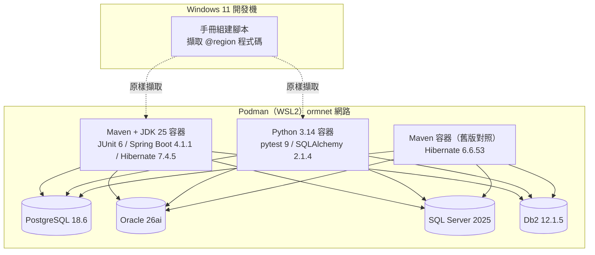

驗證原則：

1. **正例要能通過、反例要能重現問題**：例如 N+1 反例以 Hibernate Statistics 斷言「確實送出 11 句 SQL」。
2. **四種資料庫逐一執行**：差異（如 SQL Server 的 `varchar` 中文變 `??`、Db2 忽略鎖定逾時提示）直接寫進規則與[附錄 B](#附錄-b-四種資料庫差異對照實測)。
3. **文件與程式一致**：手冊中的程式區塊由組建腳本從測試原始碼擷取；手動節錄的片段則由腳本檢查「每一行都依序出現在受測原始碼中」。
4. **不能執行的內容明確標示**：概覽性質的 .NET / Node.js / Go 範例、提示詞範本等，標示為「未執行」並說明理由。

### 0.6 與其他手冊的關係

| 主題 | 本手冊 | 延伸閱讀 |
| --- | --- | --- |
| 實體與關聯的來源 | 第 5、7 章：如何把模型對映成程式 | [ER Model 教學手冊]()：如何設計模型 |
| 類別設計 | 第 5、16 章：Entity、值物件、聚合 | [OOAD 教學]()、[DDD 教學]() |
| 資料庫實體設計 | 第 12 章：遷移流程 | [資料庫設計指引]()：型別、索引、命名 |
| 後端程式 | 第 11、17 章：交易與錯誤 | [後端開發指引]() |
| 測試 | 第 15 章 | [測試與品質保證指引]() |
| 安全 | 第 14 章 | [安全程式碼指引]() |

---

## 1. ORM 核心概念

### 1.1 什麼是 ORM

ORM（Object-Relational Mapping）是一種在**物件導向程式語言的物件**與**關聯式資料庫的資料表**之間自動轉換的技術。開發者操作物件（`order.addLine(...)`），ORM 負責產生並執行對應的 SQL（`INSERT INTO order_line ...`）。

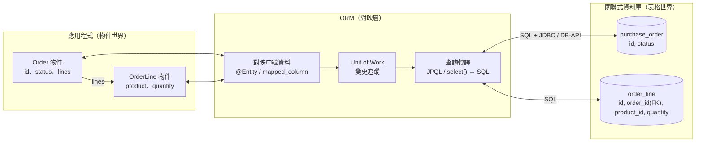

ORM 解決的是「**重複且容易出錯的對映工作**」：組 SQL、綁參數、把 `ResultSet` 轉成物件、追蹤哪些欄位被修改、依外鍵順序寫入。它**不**取代你對 SQL 與資料庫的理解——本手冊每一章都會告訴你 ORM 實際送出了什麼 SQL。

### 1.2 物件與關聯的阻抗不匹配

物件模型與關聯模型的基本假設不同，這些差異稱為「阻抗不匹配（object-relational impedance mismatch）」。ORM 的每個功能，幾乎都是為了處理其中一項：

| 差異 | 物件世界 | 關聯世界 | ORM 的對應機制 | 本手冊章節 |
| --- | --- | --- | --- | --- |
| 識別（Identity） | `==` 參考相等、`equals()` | 主鍵 | Identity Map、`@Id`、equals/hashCode 規範 | [5](#5-實體與基本對映)、[6](#6-persistence-context-與-session-生命週期) |
| 粒度（Granularity） | 細粒度類別（`Money`、`Address`） | 欄位 | Embeddable / composite | [ORM-MAP-008](#orm-map-008-值物件以-embeddablerecord建模並在建構時檢查不變條件) |
| 關聯方向 | 物件參考有方向（`order.customer`） | 外鍵無方向、可雙向 JOIN | owning side / inverse side | [7](#7-關聯對映) |
| 繼承 | `extends`、多型 | 無繼承概念 | SINGLE_TABLE / JOINED / TABLE_PER_CLASS | [8](#8-繼承對映) |
| 導覽（Navigation） | 沿物件圖逐一走訪 | 以 JOIN 一次取得 | Lazy / Eager loading、fetch join | [10](#10-載入策略與-n1-問題) |
| 資料型別 | `String`、`Instant`、`BigDecimal`、`enum` | `VARCHAR`/`NVARCHAR`、`TIMESTAMP`、`NUMERIC` | 型別對映與方言 | [5](#5-實體與基本對映)、[附錄 B](#附錄-b-四種資料庫差異對照實測) |
| 交易與並行 | 記憶體中的物件無鎖 | 交易、隔離等級、鎖 | 交易邊界、@Version、悲觀鎖 | [11](#11-交易與並行控制) |

### 1.3 企業應用架構模式（PoEAA）

Martin Fowler 在《Patterns of Enterprise Application Architecture》中整理的資料來源模式，是理解所有 ORM 的共同語言：

| 模式 | 說明 | Hibernate / JPA | SQLAlchemy | 其他 |
| --- | --- | --- | --- | --- |
| **Data Mapper** | 物件不知道資料庫；由獨立的對映層負責存取 | 是（Entity 為 POJO） | 是（Declarative 對映） | EF Core、MikroORM |
| **Active Record** | 物件自己有 `save()`、`delete()` | 否 | 否 | Django ORM、Rails、Laravel Eloquent |
| **Unit of Work** | 追蹤一個工作單元內的變更，在提交時一次寫入 | `EntityManager` / `Session` | `Session` | EF Core `DbContext` |
| **Identity Map** | 同一個工作單元內，同一主鍵只對應一個物件實例 | Persistence Context | `Session.identity_map` | `DbContext` 追蹤器 |
| **Lazy Load** | 物件的部分資料在第一次存取時才載入 | proxy、`FetchType.LAZY` | `lazy="select"` | — |
| **Query Object** | 以物件組合查詢條件 | Criteria API、Spring Data `Specification` | `select()` 建構式 | LINQ |
| **Repository** | 以集合的語意存取聚合 | Spring Data `JpaRepository` | 自行撰寫 | — |

Unit of Work 是理解 ORM 行為最關鍵的一個模式：

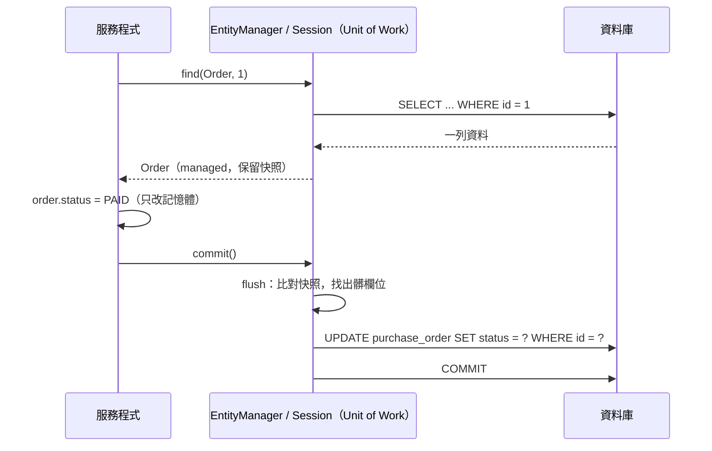

這張圖解釋了許多「意外」：沒有呼叫 `save()` 也會寫回資料庫（[ORM-CTX-001](#orm-ctx-001-了解自動髒檢查交易內修改-managed-物件就會寫回唯讀情境使用-dto-或唯讀查詢)）、`flush` 之前約束錯誤不會出現（[ORM-TST-003](#orm-tst-003-驗證資料庫約束的測試必須明確-flush)）、交易結束後存取延遲載入屬性會失敗（[第 10 章](#10-載入策略與-n1-問題)）。

### 1.4 ORM 適用與不適用的情境

| 情境 | 適合 ORM | 說明 |
| --- | --- | --- |
| 以聚合為單位的 CRUD、狀態轉換 | ✅ 非常適合 | Unit of Work、樂觀鎖、cascade 大幅減少樣板碼 |
| 交易型系統（訂單、帳務） | ✅ 適合 | 需搭配正確的交易邊界與並行控制（[第 11 章](#11-交易與並行控制)） |
| 複雜報表、大量彙總、視窗函式 | ⚠️ 以 SQL-first 為主 | 使用 DTO 投影、JdbcClient、jOOQ、SQLAlchemy Core（[ORM-SEL-001](#orm-sel-001-orm-與-sql-first-並用交易性存取用-orm報表與彙總用-sql-first)） |
| 百萬筆等級批次匯入、ETL | ⚠️ 謹慎 | StatelessSession、bulk 語法或資料庫原生工具（[第 13 章](#13-效能)） |
| 高度依賴資料庫專屬功能（PL/SQL、遞迴 CTE、全文檢索） | ⚠️ 部分適合 | 以原生 SQL 實作並集中管理 |
| Schema 由其他系統掌控且經常變動 | ❌ 成本高 | 對映層需頻繁同步；考慮 SQL-first |

### 1.5 ORM 與 SQL 的關係

ORM 不是「不用學 SQL」，而是「**不用手寫重複的 SQL**」。在企業專案中，工程師至少要能：

1. 讀懂 ORM 產生的 SQL（開發環境開啟 SQL 日誌，見 [ORM-ENV-005](#orm-env-005-sql-日誌以標準-logger-控制綁定值只在開發環境輸出)）。
2. 判斷一段程式會送出幾句 SQL（N+1、批次、fetch join）。
3. 知道每種資料庫的差異：型別（`NVARCHAR`）、鎖定語法、隔離等級預設值（[附錄 B](#附錄-b-四種資料庫差異對照實測)）。
4. 在 ORM 不適合時切換到 SQL-first，而且兩者可以在同一個應用程式中共存。

### 1.6 小結

- ORM 是 Data Mapper + Unit of Work + Identity Map + Lazy Load 的組合；理解這四個模式，就能預測 ORM 的行為。
- 阻抗不匹配的每一項都對應本手冊的一章，請依[0.2 學習路徑](#02-適用讀者與學習路徑)閱讀。
- ORM 與 SQL-first 是互補關係，而不是二選一。

---

## 2. 標準與規格

### 2.1 Jakarta Persistence 3.2

Jakarta Persistence（舊稱 JPA，Java Persistence API）是 Java 的 ORM 標準 API；Hibernate、EclipseLink 是它的實作。3.2 版隨 **Jakarta EE 11** 發布（審查投票於 2024-05-20 通過），最低需求 Java 17。對日常開發影響較大的新功能：

| 類別 | 3.2 新功能 | 本手冊使用處 |
| --- | --- | --- |
| 設定 | `PersistenceConfiguration`：不需 `persistence.xml`，以程式建立 `EntityManagerFactory` | 所有 `Jpa` 測試輔助類別、[ORM-MIG-001](#orm-mig-001-schema-變更一律以版本化遷移腳本管理ddl-草稿須人工審查後才納入) |
| 交易 | `EntityManagerFactory.runInTransaction()` / `callInTransaction()` | [ORM-CTX-003](#orm-ctx-003-一個-entitymanager--session-對應一個工作單元不跨請求不跨執行緒共用)、[ORM-TX-005](#orm-tx-005-只重試可重試的錯誤重試整個交易並設上限) |
| 對映 | record 可作為 `@Embeddable`；支援 `Instant`、`Year`；`@EnumeratedValue` | [ORM-MAP-008](#orm-map-008-值物件以-embeddablerecord建模並在建構時檢查不變條件)、[ORM-MAP-005](#orm-map-005-時間點使用-instant--offsetdatetime或-utc-正規化不使用-localdatetime-與-javautildate)、[ORM-MAP-004](#orm-map-004-列舉以名稱或穩定代碼儲存不可使用序數ordinal) |
| 對映 | Entity / Embeddable 可為 static inner class；主鍵類別不必 public / Serializable | 本手冊測試大量使用 |
| DDL | `@Table` / `@Column` 新增 `comment`、`check`；新的 `@CheckConstraint`、`SchemaManager` | [ORM-INH-003](#orm-inh-003-single_table-的子類別欄位不可宣告-not-null依類型必填的規則改用-check-約束) |
| JPQL | `union` / `intersect` / `except`、`cast`、`left` / `right`、`replace`、`\|\|`、`id()` / `version()`；`ORDER BY` 可用純量運算式並指定 null 排序 | [第 9 章](#9-查詢) |
| 查詢 | `getSingleResultOrNull()`、`TypedQueryReference` | |
| 棄用 | `Date`、`Calendar`、`@Temporal`、`TemporalType` 不建議新程式使用；`CriteriaQuery.multiselect` 改用 `array`/`tuple` | [ORM-MAP-005](#orm-map-005-時間點使用-instant--offsetdatetime或-utc-正規化不使用-localdatetime-與-javautildate) |

> **實測發現**：`jakarta.persistence-api` 3.2.0 的常數 `PersistenceConfiguration.SCHEMAGEN_CREATE_TARGET` 值為 `jakarta.persistence.schema-generation.create-target`，少了規格中的 `.scripts.`；Hibernate 7.4.5 讀取的是 `jakarta.persistence.schema-generation.scripts.create-target`，使用該常數會得到「Writing to script was requested, but no script file was specified」。請直接使用完整字串（見 [ORM-MIG-001](#orm-mig-001-schema-變更一律以版本化遷移腳本管理ddl-草稿須人工審查後才納入)，追蹤於[附錄 F](#附錄-f-待確認事項)）。

### 2.2 Jakarta Persistence 4.0 動向

- 4.0 是 **Jakarta EE 12** 的一部分，官方規格頁標示「under development」、目標 2026 年底、最低需求 **Java SE 21**；規格頁列出 Milestone 4，Maven Central 上的 API 已發布至 `4.0.0-M7`。
- Hibernate ORM 8.0（目前 8.0.0.Beta3）實作 4.0 草案，並同時實作 Jakarta Data 1.1 與 Jakarta Query 草案。
- **企業建議**：正式專案維持 3.2 + Hibernate 7.4；4.0 GA 且 Spring Boot 納入管理後，再依[附錄 F](#附錄-f-待確認事項) 的追蹤項目評估升級。

### 2.3 Hibernate ORM 7

| 項目 | 說明 |
| --- | --- |
| 授權 | 由 LGPL 2.1 改為 **Apache License 2.0**（官方授權頁：自 7.0.0.Beta5 起），專案隸屬 Commonhaus Foundation |
| 相容性 | 實作 Jakarta Persistence 3.2；最低 Java 17 |
| 版本線 | 7.3 已結束維護；7.4 為目前穩定線（Boot 4.1.1 管理 7.4.5，最新 7.4.13）；8.0 為 Beta |
| 重大移除 | `Session.save()` / `update()` / `saveOrUpdate()` / `delete()` / `load()`、`CascadeType.SAVE_UPDATE`、`@Where`（改 `@SQLRestriction`）、`@LazyToOne` / `@LazyCollection` / `@Proxy` / `@Loader` 等 |
| 行為變更 | 原生查詢預設回傳 `java.time` 型別；`StatelessSession` 預設使用二級快取、`hibernate.jdbc.batch_size` 不作用於 `StatelessSession`；對 `@Immutable` 實體下 UPDATE 查詢預設拋例外；不可 refresh / lock detached 實體 |
| 新能力（7.4） | 官方 What's New「Limits and Fetch Joins」：集合 fetch join 搭配分頁改寫為子查詢，於資料庫分頁（實測，見 [ORM-QRY-003](#orm-qry-003-集合-fetch-join-搭配分頁時必須確認分頁發生在資料庫依-hibernate-版本處理)）；另有套件層級 `@Nationalized`、整合 Reverse Engineering 等 |

### 2.4 Python：PEP 249 與 SQLAlchemy

- **PEP 249（DB-API 2.0）** 定義 Python 資料庫驅動的共通介面（`connect()`、`cursor()`、`execute()`、例外階層 `IntegrityError` 等）。各驅動（psycopg、python-oracledb、mssql-python、ibm_db）都實作它，但**例外類別與訊息內容不同**（[ORM-ERR-001](#orm-err-001-把資料存取例外轉譯為領域例外不依賴驅動專屬類別與原始訊息)）。
- **SQLAlchemy** 分為兩層：**Core**（SQL 表達式語言，SQL-first）與 **ORM**（Data Mapper + Unit of Work）。2.0 起統一為 `select()` 風格；**2.1**（2026-09-24 GA）重點：
  - 最低 Python 3.11；`greenlet` 改為 `[asyncio]` extra 才安裝。
  - Session 自動 flush 改為「無條件」（Core 敘述經由 Session 執行時也會 autoflush）。
  - `tstring()` 支援 Python 3.14 t-string（PEP 750），插值自動成為綁定參數（[ORM-SEC-001](#orm-sec-001-jpql--hql--原生-sql--text-一律參數綁定不串接使用者輸入)）。
  - PostgreSQL 預設驅動改為 psycopg 3、Oracle 改為 python-oracledb；新增 `mssql+mssqlpython` 方言。
  - `relationship(back_populates=lambda: ...)`、`Session(execution_options=...)` 等。

### 2.5 SQL 標準與交易隔離

ISO/IEC 9075（SQL 標準，目前為 SQL:2023）定義四種交易隔離等級（READ UNCOMMITTED、READ COMMITTED、REPEATABLE READ、SERIALIZABLE）與其禁止的現象（dirty read、non-repeatable read、phantom）。各資料庫的**實作方式**（鎖定式或 MVCC）與**預設值**不同，ORM 不會替你抹平這些差異，見[第 11 章](#11-交易與並行控制)與[附錄 B](#附錄-b-四種資料庫差異對照實測)。

### 2.6 標準 API 使用規則

#### ORM-STD-001 服務層只依賴 Jakarta Persistence 標準 API，Hibernate 專屬功能集中在持久層

- **等級**：建議
- **適用**：Java
- **說明**：實體類別上的 Hibernate 註解（`@Nationalized`、`@SoftDelete`、`@TenantId` 等）是合理的；但服務層、應用層不應直接操作 `org.hibernate.Session`、`SelectionQuery` 等專屬 API。
- **原因**：Hibernate 大版本（6 → 7）移除與變更的 API 集中在專屬介面；把它們限制在持久層，升級時的影響面可預測、可盤點。

❌ 反例：

```java
// ❌ 服務層散落 Hibernate 專屬 API：替換實作或升級大版本時影響面難以估計
public class OrderQueryService {
    private final EntityManager em;

    public OrderQueryService(EntityManager em) {
        this.em = em;
    }

    public List<Object[]> totals() {
        Session session = em.unwrap(Session.class);
        return session.createSelectionQuery(
                "select o.customerId, sum(o.amount) from SalesOrder o group by o.customerId", Object[].class).list();
    }
}
```

✅ 正例：

```java
// ✅ 服務層只依賴 Jakarta Persistence 標準 API
public class OrderQueryService {
    private final EntityManager em;

    public OrderQueryService(EntityManager em) {
        this.em = em;
    }

    public List<Object[]> totals() {
        return em.createQuery("select o.customerId, sum(o.amount) from SalesOrder o group by o.customerId",
                Object[].class).getResultList();
    }
}
```

**如何 review**：

- 搜尋 `service`、`application` 套件中的 `import org.hibernate.`；除實體類別與 Repository 實作外應為零。
- 若確實需要 Hibernate 專屬功能（如 `StatelessSession`），應封裝在持久層的類別中，並在程式註解說明理由。

**如何驗證**：以 ArchUnit 規則納入 CI：

```java
static ArchRule servicesUseStandardApi(String root) {
    return noClasses().that().resideInAPackage(root + ".service..")
            .should().dependOnClassesThat().resideInAPackage("org.hibernate..")
            .because("服務層應只依賴 jakarta.persistence；Hibernate 專屬功能集中在持久層（ORM-STD-001）");
}
```

- 實測：`StandardApiTest` 對正例套件通過、對反例套件回報違規（ArchUnit 1.5.1）。

---

## 3. ORM 框架與選型

### 3.1 Java 生態系

| 工具 | 類型 | 2026-10 版本 | 適用 |
| --- | --- | --- | --- |
| Hibernate ORM | Jakarta Persistence 實作（Data Mapper） | 7.4.13（Boot 4.1.1 管理 7.4.5） | 企業主流；Spring Boot 預設 |
| EclipseLink | Jakarta Persistence 參考實作 | 5.0.2 | Jakarta EE 應用伺服器（GlassFish、Payara） |
| Spring Data JPA | JPA 之上的 Repository 抽象 | 2026.0.1（BOM） | 衍生查詢、投影、Specification、keyset 捲動 |
| Jakarta Data | 標準化的 Repository API | 1.0.2（1.1 開發中） | Jakarta EE 11 應用；Hibernate 7 支援 |
| jOOQ | SQL-first、型別安全 DSL | 3.21.x | 複雜報表、資料庫專屬功能 |
| MyBatis | SQL 對映框架 | 3.5.19 | 以 SQL 為中心的既有系統 |
| Spring `JdbcClient` | 輕量 JDBC 流暢 API（Framework 6.1+） | 隨 Spring Framework 7.0.9 | 報表、彙總查詢（[ORM-SEL-001](#orm-sel-001-orm-與-sql-first-並用交易性存取用-orm報表與彙總用-sql-first)） |

### 3.2 Python 生態系

| 工具 | 類型 | 2026-10 版本 | 適用 |
| --- | --- | --- | --- |
| SQLAlchemy | Core（SQL-first）+ ORM（Data Mapper） | 2.1.4 | 通用首選；同時支援 SQL-first 與 ORM |
| Alembic | SQLAlchemy 遷移工具 | 1.20.0 | Schema 版本管理 |
| Django ORM | Active Record | Django 6.1.2 | Django 專案 |
| SQLModel | SQLAlchemy + Pydantic | 0.0.48（尚未 1.0） | FastAPI 小型服務；企業專案請評估成熟度 |

### 3.3 其他語言概覽（未於本手冊執行）

| 語言 | 工具 | 2026-10 版本 | 模式 | 備註 |
| --- | --- | --- | --- | --- |
| C# / .NET | Entity Framework Core | 10.0.12（.NET 10 LTS） | Data Mapper + Unit of Work（`DbContext`） | LINQ 查詢；`AsNoTracking()` 對應唯讀查詢 |
| C# / .NET | Dapper | 2.1.89 | Micro-ORM（SQL-first） | 報表、高效能讀取 |
| TypeScript | Prisma | 7.10.0（npm `latest` 標籤目前指向 8.0.0-rc，請鎖定版本） | Schema-first、產生型別安全 Client | |
| TypeScript | Drizzle ORM | 0.45.4 | SQL-like、輕量 | 尚未 1.0 |
| TypeScript | TypeORM | 1.1.2 | Data Mapper / Active Record 皆可 | 已發布 1.x |
| TypeScript | MikroORM | 7.2.5 | Data Mapper + Unit of Work + Identity Map | 概念最接近 Hibernate |
| Go | GORM | v1.31.2 | Active Record 風格 | 注意預設軟刪除、零值更新語意 |

下列以 EF Core 示意第 10 章 N+1 的同一個概念（**未執行**，僅供對照）：

```csharp
// ❌ N+1：迴圈中延遲載入（需啟用 lazy-loading proxies）
var writers = await db.Writers.ToListAsync();
var total = writers.Sum(w => w.Novels.Count);

// ✅ 以 Include 一次載入；唯讀查詢加 AsNoTracking
var writers2 = await db.Writers.Include(w => w.Novels).AsNoTracking().ToListAsync();
```

### 3.4 框架比較

| 比較面向 | Hibernate + Spring Data JPA | SQLAlchemy 2.1 | jOOQ / JdbcClient | EF Core 10 | Prisma 7 |
| --- | --- | --- | --- | --- | --- |
| 抽象層級 | 高（實體、cascade、髒檢查） | 中高（ORM + Core 並存） | 低（SQL-first） | 高 | 中（產生的 Client） |
| 變更追蹤 | 快照比對 | 屬性事件 | 無 | 快照 / proxy | 無 |
| 學習曲線 | 高（Persistence Context、fetch） | 中高 | 低（需熟 SQL） | 中 | 低 |
| 複雜 SQL | JPQL/HQL 足以應付多數；其餘原生 SQL | Core 表達力完整 | 最完整 | LINQ + 原生 SQL | `$queryRaw` |
| 多資料庫 | 完整（方言自動偵測） | 完整（Db2 由 ibm_db_sa 提供，部分功能受限，見[附錄 B](#附錄-b-四種資料庫差異對照實測)） | 完整 | 依 provider | 依 connector |
| Schema 遷移 | Flyway / Liquibase | Alembic | Flyway / Liquibase | EF Migrations | Prisma Migrate |

### 3.5 選型考量因素

選型應以 ADR（Architecture Decision Record）記錄，至少涵蓋下列問題：

1. **資料存取型態**：以聚合 CRUD 為主 → ORM；以報表與彙總為主 → SQL-first；兩者兼有 → 同一應用程式並用（建議）。
2. **團隊能力**：是否有人能讀懂 ORM 產生的 SQL、處理 Persistence Context 問題？沒有的話先補訓練（本手冊第 6、10 章）。
3. **資料庫**：是否需要支援多種資料庫？目標資料庫的驅動與方言成熟度如何？（例如 Python + Db2 的 Alembic 支援需自行補強，見 [ORM-MIG-002](#orm-mig-002-自動產生的遷移必須人工審查特別是改名)）
4. **框架生命週期**：版本支援期限、授權（Hibernate 7 已改 Apache 2.0）、社群活躍度、是否已 1.0。
5. **可觀測性與測試**：能否取得 SQL 日誌、查詢次數統計，以便在測試中斷言（[ORM-TST-002](#orm-tst-002-以查詢次數斷言防止-n1-與效能回歸)）。

ADR 範本（節錄）：

```text
# ADR-012：訂單服務資料存取技術

狀態：已接受（2026-10-13）
背景：訂單服務以聚合 CRUD 為主，另有每日營收報表；資料庫為 PostgreSQL 18。
決策：交易性存取使用 Spring Data JPA（Hibernate 7.4）；報表查詢使用 JdbcClient + DTO record。
理由：聚合一致性與樂觀鎖由 ORM 提供；報表需視窗函式與大量彙總，以 SQL 撰寫較清楚且效能可控。
後果：需在 CI 中加入查詢次數測試（ORM-TST-002）與 ArchUnit 規則（ORM-STD-001）。
```

### 3.6 選型規則

#### ORM-SEL-001 ORM 與 SQL-first 並用：交易性存取用 ORM，報表與彙總用 SQL-first

- **等級**：建議
- **適用**：Java、Python
- **說明**：同一個應用程式可同時使用 ORM 與 SQL-first 工具。報表、彙總、跨多表的唯讀查詢，直接以 SQL（Spring `JdbcClient`、jOOQ、SQLAlchemy Core）撰寫並映射成 DTO / record / Row。
- **原因**：為了報表載入大量 entity 會浪費記憶體並觸發髒檢查；把 SQL 硬塞進 JPQL 又會失去資料庫專屬功能。

❌ 反例（示意，未單獨執行；相同模式已於 [ORM-QRY-006](#orm-qry-006-篩選排序彙總在資料庫完成動態條件以-criteria--specification-組合) 實測：載入 20 個 entity 只為了 2 筆結果）：

```java
// ❌ 載入全部銷售明細，再於 Java 中分組加總
Map<String, BigDecimal> totals = saleRepository.findAll().stream()
        .collect(Collectors.groupingBy(s -> s.region,
                Collectors.reducing(BigDecimal.ZERO, s -> s.amount, BigDecimal::add)));
```

✅ 正例（Java，Spring Framework 7 `JdbcClient`）：

```java
record RegionTotal(String region, BigDecimal total, long orders) {
}

/** ✅ 報表類查詢：同一個應用程式中以 JdbcClient 直接寫 SQL，結果映射成 record，不建立 entity。 */
class SalesReport {
    private final JdbcClient jdbc;

    SalesReport(JdbcClient jdbc) {
        this.jdbc = jdbc;
    }

    List<RegionTotal> byRegion(BigDecimal minTotal) {
        return jdbc.sql("""
                        select region, sum(amount) as total, count(*) as orders
                        from sel_sale
                        group by region
                        having sum(amount) >= :minTotal
                        order by region""")
                .param("minTotal", minTotal)
                .query(RegionTotal.class)
                .list();
    }
}
```

✅ 正例（Python，SQLAlchemy Core）：

```python
# ✅ 報表：直接以 Core 的 select() 彙總，回傳 Row，不建立 ORM 物件
stmt = (
    select(Sale.region, func.sum(Sale.amount).label("total"), func.count().label("orders"))
    .group_by(Sale.region)
    .having(func.sum(Sale.amount) >= 100)
    .order_by(Sale.region)
)
rows = conn.execute(stmt).all()
```

**如何 review**：

- 以 `findAll()`、`session.scalars(select(Entity))` 取得大量 entity 後在程式中 `groupingBy` / `sum` / `sorted` → 改為資料庫彙總。
- 報表查詢回傳 entity 而非 DTO → 改為投影。

**如何驗證**：

- 測試中斷言「載入的 entity 數」（Hibernate `Statistics.getEntityLoadCount()`）或 Session `identity_map` 大小為 0。
- 實測：`ReportingTest`（四種資料庫）與 `test_core_report`（四種資料庫）皆回傳 `北區 150.00 / 2 筆`。

---

## 4. 環境建置與設定

### 4.1 Java：Spring Boot 4.1 + Hibernate 7.4

Spring Boot 4 將自動設定拆成多個模組（`spring-boot-hibernate`、`spring-boot-jdbc`、`spring-boot-data-jpa` 等），但對應用程式而言仍只需引用 starter。**不要自行指定 Hibernate、驅動、Flyway 的版本**，交由 Boot 的依賴管理。

<!-- from: java/pom.xml -->
```xml
<parent>
    <groupId>org.springframework.boot</groupId>
    <artifactId>spring-boot-starter-parent</artifactId>
    <version>4.1.1</version>
    <relativePath/>
</parent>
<properties>
    <java.version>25</java.version>
</properties>
<dependencies>
    <dependency>
        <groupId>org.springframework.boot</groupId>
        <artifactId>spring-boot-starter-data-jpa</artifactId>
    </dependency>
    <dependency>
        <groupId>org.springframework.boot</groupId>
        <artifactId>spring-boot-starter-flyway</artifactId>
    </dependency>
    <dependency>
        <groupId>org.flywaydb</groupId>
        <artifactId>flyway-database-postgresql</artifactId>
    </dependency>
    <dependency>
        <groupId>org.postgresql</groupId>
        <artifactId>postgresql</artifactId>
        <scope>runtime</scope>
    </dependency>
    <dependency>
        <groupId>org.springframework.boot</groupId>
        <artifactId>spring-boot-starter-test</artifactId>
        <scope>test</scope>
    </dependency>
    <dependency>
        <groupId>org.springframework.boot</groupId>
        <artifactId>spring-boot-starter-data-jpa-test</artifactId>
        <scope>test</scope>
    </dependency>
</dependencies>
```

> Spring Boot 4 的測試切片也拆成獨立模組：`@DataJpaTest` 位於 `spring-boot-starter-data-jpa-test`（套件 `org.springframework.boot.data.jpa.test.autoconfigure`），`@AutoConfigureTestDatabase` 位於 `org.springframework.boot.jdbc.test.autoconfigure`，`@EntityScan` 位於 `org.springframework.boot.persistence.autoconfigure`。從 Boot 3 升級時這些 import 都要調整。

各資料庫驅動與 Flyway 模組（版本皆由 Boot 4.1.1 管理）：

| 資料庫 | JDBC 驅動（groupId:artifactId） | Boot 4.1.1 管理版本 | Flyway 模組 | `{vendor}` |
| --- | --- | --- | --- | --- |
| PostgreSQL 18 | `org.postgresql:postgresql` | 42.7.13 | `flyway-database-postgresql` | `postgresql` |
| Oracle 26ai | `com.oracle.database.jdbc:ojdbc17` | 23.26.3.0.0 | `flyway-database-oracle` | `oracle` |
| SQL Server 2025 | `com.microsoft.sqlserver:mssql-jdbc` | 13.4.0.jre11 | `flyway-sqlserver` | `sqlserver` |
| Db2 12.1 | `com.ibm.db2:jcc` | 12.1.5.0 | `flyway-database-db2` | `db2` |

### 4.2 建議的 application.yml

下列設定檔已由 `ProductionConfigTest` 載入並逐項斷言生效（Hikari 連線池大小、OSIV 關閉、Hibernate 批次與 fetch 設定）：

```yaml
spring:
  datasource:
    url: ${DB_URL}                      # 連線資訊一律由環境變數 / Secret 注入
    username: ${DB_USER}
    password: ${DB_PASSWORD}
    hikari:
      maximum-pool-size: 10             # 依 DB 可承受連線數 ÷ 執行個體數 計算
      minimum-idle: 10                  # Hikari 建議固定大小的連線池
      connection-timeout: 3000          # 毫秒（long），不可寫 3s
      max-lifetime: 1800000             # 毫秒，須短於 DB / 防火牆的閒置斷線時間
  jpa:
    open-in-view: false                 # 關閉 OSIV（ORM-ENV-003）
    hibernate:
      ddl-auto: validate                # 只驗證（ORM-ENV-002）
    properties:
      hibernate:
        jdbc:
          batch_size: 50                # ORM-PERF-001
          time_zone: UTC
        order_inserts: true
        order_updates: true
        default_batch_fetch_size: 16    # ORM-FET-002
        query:
          fail_on_pagination_over_collection_fetch: true   # ORM-QRY-003
          in_clause_parameter_padding: true
  flyway:
    enabled: true
    locations: classpath:db/migration/{vendor}
logging:
  level:
    org.hibernate.SQL: INFO             # 正式環境不輸出 SQL 與綁定值（ORM-SEC-004）
    org.hibernate.orm.jdbc.bind: INFO
```

### 4.3 Python：SQLAlchemy 2.1

```bash
python3.14 -m venv .venv
. .venv/bin/activate           # Windows：.venv\Scripts\activate
pip install -r requirements.txt
```

本手冊驗證環境的 `requirements.txt`（版本皆鎖定）：

```text
sqlalchemy==2.1.4
alembic==1.20.0
psycopg[binary]==3.3.6
oracledb==26.0.1
mssql-python==1.16.0
ibm-db==3.3.0
ibm-db-sa==0.4.4
pytest==9.1.1
```

> **Linux 容器注意**：`mssql-python` 在 Debian slim 映像需額外安裝 `libltdl7 libkrb5-3 libgssapi-krb5-2`，否則連線時出現「Failed to load the driver」（實測）。

連線 URL 對照（SQLAlchemy 2.1）：

| 資料庫 | URL 範例 | 驅動 |
| --- | --- | --- |
| PostgreSQL | `postgresql+psycopg://user:pw@host:5432/db` | psycopg 3（2.1 起為 PostgreSQL 預設驅動） |
| Oracle | `oracle+oracledb://user:pw@host:1521/?service_name=FREEPDB1` | python-oracledb（2.1 起為預設） |
| SQL Server | `mssql+mssqlpython://user:pw@host:1433/db?Encrypt=yes` | mssql-python（2.1 新增方言） |
| Db2 | `db2+ibm_db://user:pw@host:50000/DB` | ibm_db + ibm_db_sa（IBM 維護的第三方方言） |

### 4.4 環境規則

#### ORM-ENV-001 不手動指定 Hibernate 方言，移除過時的方言類別

- **等級**：必須
- **適用**：Java
- **說明**：Hibernate 6 起會由 JDBC 中繼資料自動偵測資料庫版本並選擇方言；不要設定 `hibernate.dialect`（或 `spring.jpa.database-platform`），除非使用自訂方言。
- **原因**：手動指定的版本化方言（`MySQL8Dialect`、`PostgreSQL10Dialect`）在 Hibernate 6 棄用、7 移除，升級時直接啟動失敗；自動偵測則能依實際資料庫版本啟用功能。

❌ 反例（v1.0 的設定）：

```yaml
spring:
  jpa:
    properties:
      hibernate:
        dialect: org.hibernate.dialect.MySQL8Dialect   # Hibernate 7：ClassNotFoundException
```

✅ 正例：不設定 `dialect`；實測 Hibernate 7.4.5 於四種資料庫自動選擇 `PostgreSQLDialect`、`OracleDialect`、`SQLServerDialect`、`DB2Dialect`。

<!-- from: java/src/test/java/ch04/EnvironmentTest.java -->
```java
assertThatThrownBy(() -> Class.forName("org.hibernate.dialect.MySQL8Dialect"))
        .isInstanceOf(ClassNotFoundException.class);
assertThatThrownBy(() -> Class.forName("org.hibernate.dialect.PostgreSQL10Dialect"))
        .isInstanceOf(ClassNotFoundException.class);
```

**如何 review**：搜尋設定檔中的 `dialect`、`database-platform`；若存在，要求說明理由（例如自訂方言）。

**如何驗證**：啟動日誌或 `SessionFactoryImplementor.getJdbcServices().getDialect()`；實測結果見 `EnvironmentTest#dialectIsAutoDetectedAndLegacyDialectsAreGone`。

#### ORM-ENV-002 正式環境的 schema 只驗證、不修改（ddl-auto: validate 或 none）

- **等級**：必須
- **適用**：Java（Python 對應規則：不在正式環境呼叫 `metadata.create_all()`）
- **說明**：Schema 一律由版本化遷移腳本管理（[第 12 章](#12-schema-演進與遷移)）；ORM 在啟動時只做 `validate`，發現實體與資料庫不一致就啟動失敗。
- **原因**：`update` 會在啟動時悄悄執行 `ALTER TABLE`，只會新增、不會刪除或改名，且不同環境啟動順序不同，schema 會逐漸分歧；`create-drop` 更會刪除資料。

❌ 反例：

```java
// ❌ update：啟動時悄悄 ALTER TABLE；只會新增、不會刪除或改名，各環境 schema 漸漸分歧
Map<String, Object> update = Map.of("hibernate.hbm2ddl.auto", "update");
```

✅ 正例：

```java
// ✅ 正式環境：只驗證、不修改；schema 由 Flyway / Liquibase 遷移腳本管理
Map<String, Object> validate = Map.of("hibernate.hbm2ddl.auto", "validate");   // Boot：ddl-auto: validate
```

**如何 review**：

- `spring.jpa.hibernate.ddl-auto` 在正式環境 profile 必須為 `validate` 或 `none`；`update`、`create`、`create-drop` 只允許在本機或測試 profile。
- Python：`Base.metadata.create_all(engine)` 只能出現在測試或本機初始化腳本。

**如何驗證**：

- 實測（四種資料庫）：新版實體多一個 `sku` 欄位時，`validate` 啟動即失敗並回報 `missing column [sku]`；`update` 則悄悄加上欄位（`EnvironmentTest#validateDetectsSchemaDriftUpdateHidesIt`）。
- CI：對正式環境 profile 執行設定檢查（例如 `grep -E "ddl-auto:\s*(update|create)" src/main/resources/application-prod.yml` 應無結果）。

#### ORM-ENV-003 關閉 Open Session in View（spring.jpa.open-in-view: false）

- **等級**：必須
- **適用**：Java（Spring Boot）
- **說明**：Spring Boot 在 Web 應用程式中**預設開啟** OSIV，讓 `EntityManager` 存活到 HTTP 回應完成，使控制器與 View 能觸發延遲載入。啟動時 Boot 會記錄警告「spring.jpa.open-in-view is enabled by default」。
- **原因**：OSIV 讓資料庫連線在整個請求期間被占用、把 N+1 藏到控制器與序列化階段，且交易外的延遲載入不受交易保護。應在服務層交易內決定要載入的資料並轉成 DTO（[ORM-ARC-001](#orm-arc-001-entity-不直接作為-api-請求或回應於交易內轉為-dto)）。

❌ 反例：未設定 `spring.jpa.open-in-view`（預設 `true`）。

✅ 正例：

```yaml
spring:
  jpa:
    open-in-view: false
```

**如何 review**：每個 Web 應用程式的 `application.yml` 都必須明確設定 `open-in-view: false`。

**如何驗證**：

<!-- from: java/src/test/java/ch04/EnvironmentTest.java -->
```java
web().run(ctx -> assertThat(ctx).hasSingleBean(OpenEntityManagerInViewInterceptor.class));   // ❌ 預設開啟
web().withPropertyValues("spring.jpa.open-in-view=false")
        .run(ctx -> assertThat(ctx).doesNotHaveBean(OpenEntityManagerInViewInterceptor.class)); // ✅
```

- 實測：Spring Boot 4.1.1 的 `WebApplicationContextRunner` 中，預設存在 `OpenEntityManagerInViewInterceptor` bean；設為 `false` 後不存在。

#### ORM-ENV-004 明確設定連線池大小與逾時，且使用正確的單位

- **等級**：必須
- **適用**：Java、Python
- **說明**：連線池大小依「資料庫可承受連線數 ÷ 應用程式執行個體數」計算並明確設定；逾時值使用框架要求的單位。HikariCP 的 `connection-timeout`、`max-lifetime` 等屬性型別為 `long`（毫秒），**不能**寫成 `3s`。
- **原因**：預設值不見得適合部署環境；水平擴充時連線數可能超過資料庫上限。單位錯誤則直接導致啟動失敗。

❌ 反例：

```yaml
spring:
  datasource:
    hikari:
      connection-timeout: 3s     # 無法綁定到 long：應用程式啟動失敗
```

✅ 正例（Java）：見 [4.2](#42-建議的-applicationyml) 的 `hikari` 設定。✅ 正例（Python）：

```python
# ✅ 每個行程只建立一個 Engine（內含連線池）與一個 sessionmaker，於啟動時建立、結束時 dispose
def build_engine(url: str):
    return create_engine(
        url,
        pool_size=10,            # 依 DB 可承受連線數 ÷ 執行個體數 計算
        max_overflow=0,
        pool_pre_ping=True,      # 取用前檢查連線是否仍有效（防火牆 / DB 重啟斷線）
        pool_recycle=1800,       # 秒；須短於 DB / 防火牆的閒置斷線時間
    )


engine = None
SessionFactory = sessionmaker(expire_on_commit=False)


def startup(url: str) -> None:
    global engine
    engine = build_engine(url)
    SessionFactory.configure(bind=engine)


def shutdown() -> None:
    engine.dispose()
```

**如何 review**：檢查 `maximum-pool-size` / `pool_size` 的計算依據；逾時值是否為毫秒整數（Hikari）或秒（SQLAlchemy `pool_recycle`）。

**如何驗證**：實測 `EnvironmentTest#hikariTimeoutsAreMillisecondsNotDurations`：`connection-timeout=3s` 時 Spring 容器啟動失敗；`3000` 時 `HikariDataSource.getConnectionTimeout() == 3000`。

#### ORM-ENV-005 SQL 日誌以標準 logger 控制，綁定值只在開發環境輸出

- **等級**：必須
- **適用**：Java、Python
- **說明**：Hibernate 6 起，SQL 敘述記錄於 `org.hibernate.SQL`，綁定參數記錄於 `org.hibernate.orm.jdbc.bind`（TRACE）。v1.0 使用的 `org.hibernate.type.descriptor.sql.BasicBinder` 已無作用。不要使用 `show_sql`（直接寫入 stdout，無法由日誌系統控制）。Python 使用 `sqlalchemy.engine` logger，不要在正式環境設定 `echo=True`。
- **原因**：開發時必須能看到 ORM 產生的 SQL；但綁定值可能含個資或密碼，正式環境不可輸出（[ORM-SEC-004](#orm-sec-004-日誌與錯誤訊息不得洩漏資料值綁定參數約束錯誤詳細內容)）。

❌ 反例（v1.0）：

```yaml
spring:
  jpa:
    show-sql: true
logging:
  level:
    org.hibernate.type.descriptor.sql.BasicBinder: TRACE   # Hibernate 6+ 已無此 logger
```

✅ 正例（開發 profile）：

```yaml
logging:
  level:
    org.hibernate.SQL: DEBUG
    org.hibernate.orm.jdbc.bind: TRACE      # 僅限本機 / 開發環境
```

✅ 正例（Python）：

```python
# ✅ 開發環境：以標準 logging 開啟 SQL 日誌（勿在正式環境使用 echo=True / INFO）
logging.getLogger("sqlalchemy.engine").setLevel(logging.INFO)
```

**如何 review**：正式環境 profile 中不得出現 `show-sql: true`、`org.hibernate.orm.jdbc.bind: TRACE`、`echo=True`。

**如何驗證**：實測 `EnvironmentTest#bindParameterLoggerNameChangedInHibernate6`：對舊 logger 設 TRACE 時沒有任何日誌事件；對 `org.hibernate.orm.jdbc.bind` 設 TRACE 時可看到綁定值 `42`。Python `test_sql_logging_uses_standard_logger` 於四種資料庫通過。

#### ORM-ENV-006 每個行程只建立一個 EntityManagerFactory / Engine

- **等級**：必須
- **適用**：Java、Python
- **說明**：`EntityManagerFactory`（Spring Boot 自動建立）與 SQLAlchemy `Engine` 都是重量級、執行緒安全、內含連線池的物件，應在應用程式啟動時建立一次，結束時關閉（`dispose()`）。
- **原因**：每次請求建立新的 Engine 會產生新的連線池，閒置連線不斷累積，最終耗盡資料庫連線數。

❌ 反例：

```python
# ❌ 每次請求建立新的 Engine：每個 Engine 都有自己的連線池，閒置連線不斷累積
def handle_request_bad(url: str):
    eng = create_engine(url)
    with eng.connect() as conn:
        return conn.execute(text("select 1" + FROM_DUAL)).scalar_one(), eng
```

✅ 正例：見 [ORM-ENV-004](#orm-env-004-明確設定連線池大小與逾時且使用正確的單位) 的 `build_engine()` / `startup()` / `shutdown()`。

**如何 review**：`create_engine(`、`Persistence.createEntityManagerFactory(`、`new PersistenceConfiguration(` 只能出現在啟動或設定程式碼，不得出現在請求處理路徑。

**如何驗證**：實測 `test_engine_per_request_accumulates_connections`（四種資料庫）：5 次請求後，反例累積 5 條閒置連線；正例只有 1 條。

### 4.5 小結

- 版本交給 Spring Boot 依賴管理；方言交給 Hibernate 自動偵測。
- 正式環境：`ddl-auto: validate`、`open-in-view: false`、連線池參數明確、不輸出綁定值。
- `EntityManagerFactory` / `Engine` 是行程層級的單例。

---

## 5. 實體與基本對映

### 5.1 Entity 的基本結構

一個 JPA Entity 至少需要：`@Entity`、一個 `@Id`、一個無參數建構子（可為 `protected`）。Jakarta Persistence 3.2 起，Entity 與 Embeddable 可以是 static inner class，主鍵類別也不必是 public。SQLAlchemy 2.x 以 `DeclarativeBase` + `Mapped[]` 型別註記宣告：

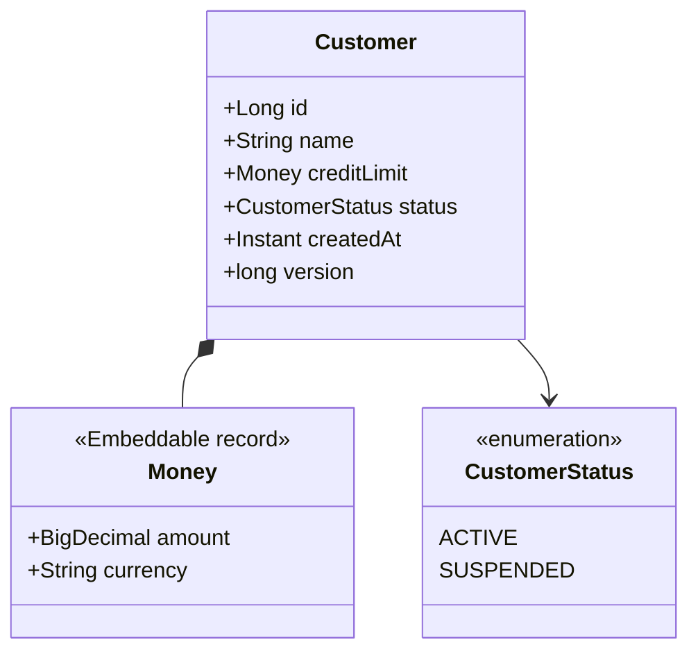

| 概念 | Java（Jakarta Persistence / Hibernate） | Python（SQLAlchemy 2.1） |
| --- | --- | --- |
| 宣告實體 | `@Entity class Customer` | `class Customer(Base)` + `__tablename__` |
| 主鍵 | `@Id @GeneratedValue(...)` | `mapped_column(primary_key=True)` |
| 欄位 | 欄位本身（field access）、`@Column(length, nullable, precision, scale)` | `Mapped[str] = mapped_column(String(100))` |
| 可為 NULL | `@Column(nullable = true)`（預設） | `Mapped[str \| None]` |
| 值物件 | `@Embeddable`（可為 record）、`@Embedded` | `composite()` |
| 列舉 | `@Enumerated(EnumType.STRING)`、`@EnumeratedValue` | `Enum(MyEnum, native_enum=False)` |
| 版本 | `@Version` | `__mapper_args__ = {"version_id_col": ...}` |

### 5.2 主鍵

#### ORM-MAP-001 主鍵優先使用 SEQUENCE（pooled），保留 JDBC 批次寫入能力

- **等級**：建議
- **適用**：Java
- **說明**：在支援序列的資料庫（PostgreSQL、Oracle、SQL Server、Db2 皆支援）使用 `GenerationType.SEQUENCE` 搭配 `@SequenceGenerator(allocationSize = 50)`；Hibernate 7 規定 `SEQUENCE` 策略必須搭配 `@SequenceGenerator`。
- **原因**：`IDENTITY` 必須在 INSERT 執行後才知道主鍵，Hibernate 只能逐筆立即執行 INSERT，JDBC 批次（[ORM-PERF-001](#orm-perf-001-開啟-jdbc-批次寫入並排序-insert--update)）完全失效；pooled 序列一次取得 50 個號碼，INSERT 可以批次送出。

❌ 反例：

```java
// ❌ IDENTITY：每筆 INSERT 都要立即執行才能取得主鍵，JDBC batch 失效
@Entity
static class TicketIdentity {
    @Id
    @GeneratedValue(strategy = GenerationType.IDENTITY)
    Long id;
    String title;
}
```

✅ 正例：

```java
// ✅ SEQUENCE + pooled optimizer：一次取 50 個號碼，INSERT 可批次送出
@Entity
static class TicketSeq {
    @Id
    @GeneratedValue(strategy = GenerationType.SEQUENCE, generator = "ticket_seq")
    @SequenceGenerator(name = "ticket_seq", sequenceName = "ticket_seq", allocationSize = 50)
    Long id;
    String title;
}
```

**如何 review**：

- 新增實體使用 `IDENTITY` 時，確認是否為低寫入量的表；大量寫入的表應使用 `SEQUENCE`。
- `allocationSize` 必須與資料庫序列的 `INCREMENT BY` 一致（由遷移腳本建立序列時尤其要注意）。

**如何驗證**：在開啟 `hibernate.jdbc.batch_size=50` 下新增 20 筆，比較 Hibernate `Statistics.getPrepareStatementCount()`。

| 資料庫 | IDENTITY（20 筆） | SEQUENCE pooled（20 筆） |
| --- | --- | --- |
| PostgreSQL 18.6 | 20 | 3 |
| Oracle 26ai | 20 | 3 |
| SQL Server 2025 | 20 | 3 |
| Db2 12.1.5 | 20 | 3 |

（`IdStrategyTest#identityDisablesBatchingSequenceDoesNot` 實測）

#### ORM-MAP-002 對外公開或分散產生的識別碼使用 UUIDv7，不使用隨機 UUIDv4 作為主鍵

- **等級**：建議
- **適用**：Java、Python
- **說明**：需要 UUID 主鍵時（多個服務各自產生、不想暴露流水號），使用時間排序的 **UUIDv7**（RFC 9562）。Hibernate 7 提供 `@UuidGenerator(style = VERSION_7)`；Python 3.14 內建 `uuid.uuid7()`。
- **原因**：UUIDv4 完全隨機，B-tree 索引的插入位置分散，造成頁分裂與快取失效；UUIDv7 前 48 位元為毫秒時間戳記，插入集中在索引尾端。

❌ 反例：`@Id UUID id = UUID.randomUUID();`（v4，隨機）

✅ 正例（Java）：

```java
// ✅ 時間排序的 UUIDv7：索引插入集中在尾端，不像 v4 隨機分散
@Entity
static class Document {
    @Id
    @GeneratedValue
    @UuidGenerator(style = UuidGenerator.Style.VERSION_7)
    UUID id;
    String title;
}
```

✅ 正例（Python 3.14）：

```python
class Document(Base):
    __tablename__ = "py_document"

    # ✅ Python 3.14 內建 uuid.uuid7()：時間排序，適合作為主鍵
    id: Mapped[uuid.UUID] = mapped_column(primary_key=True, default=uuid.uuid7)
    title: Mapped[str] = mapped_column(String(100))
```

**如何 review**：搜尋 `UUID.randomUUID()`、`uuid.uuid4` 用於主鍵的位置；確認資料庫欄位型別（PostgreSQL `uuid`、SQL Server `uniqueidentifier`、Oracle / Db2 由 Hibernate 對映）。

**如何驗證**：實測（四種資料庫）連續產生 5 筆，斷言 `UUID.version() == 7` 且時間戳記遞增（`IdStrategyTest#uuidV7IsTimeOrdered`、`test_uuid7_is_time_ordered`）。

### 5.3 識別與相等

#### ORM-MAP-003 equals/hashCode 不可依賴會改變的產生式主鍵

- **等級**：必須
- **適用**：Java
- **說明**：Entity 的 `hashCode()` 在整個生命週期必須不變。若以產生式主鍵判斷相等：`id` 為 `null` 時兩個新物件不相等；`hashCode()` 回傳固定值（類別的 hash）；並以 `Hibernate.getClass()` 處理 proxy。也可以使用不可變的業務鍵（`@NaturalId`）。不要使用 Lombok `@Data` / `@EqualsAndHashCode` 自動產生。
- **原因**：物件在 persist 前放入 `HashSet`（例如雙向關聯的集合），persist 後 id 被指定、hashCode 改變，物件就「消失」在集合中，`remove()` 也會失敗。

❌ 反例：

```java
// ❌ hashCode 依賴產生式主鍵：persist 前 id 為 null，persist 後 hashCode 改變
@Entity
static class TagBad {
    @Id
    @GeneratedValue
    Long id;
    String name;

    @Override
    public boolean equals(Object o) {
        return o instanceof TagBad other && Objects.equals(id, other.id);
    }

    @Override
    public int hashCode() {
        return Objects.hash(id);
    }
}
```

✅ 正例：

```java
// ✅ id 為 null 時不相等；hashCode 固定，不隨 persist 改變；以 Hibernate.getClass 處理 proxy
@Entity
static class Tag {
    @Id
    @GeneratedValue
    Long id;
    String name;

    @Override
    public boolean equals(Object o) {
        if (this == o) {
            return true;
        }
        if (o == null || Hibernate.getClass(this) != Hibernate.getClass(o)) {
            return false;
        }
        return id != null && id.equals(((Tag) o).id);
    }

    @Override
    public int hashCode() {
        return Hibernate.getClass(this).hashCode();
    }
}
```

**如何 review**：Entity 上的 `@Data`、`@EqualsAndHashCode`、`Objects.hash(id)`、IDE 自動產生的全欄位 equals → 退回。

**如何驗證**：

```java
TagBad bad = new TagBad();
Set<TagBad> badSet = new HashSet<>();
badSet.add(bad);
jpa.tx(em -> em.persist(bad));
assertThat(badSet.contains(bad)).isFalse();   // ❌ 放進 Set 的物件「找不到了」

Tag good = new Tag();
Set<Tag> goodSet = new HashSet<>();
goodSet.add(good);
jpa.tx(em -> em.persist(good));
assertThat(goodSet.contains(good)).isTrue();   // ✅
```

- 實測：四種資料庫皆重現反例（`EqualityTest`）。

### 5.4 基本型別

#### ORM-MAP-004 列舉以名稱或穩定代碼儲存，不可使用序數（ORDINAL）

- **等級**：必須
- **適用**：Java、Python
- **說明**：Java 一律標註 `@Enumerated(EnumType.STRING)`；需要對應既有代碼表（如 `'G'`、`'S'`）時使用 Jakarta Persistence 3.2 的 `@EnumeratedValue`。SQLAlchemy 的 `Enum` 預設存名稱；建議 `native_enum=False`（以 VARCHAR + CHECK 實作），避免 PostgreSQL 原生 ENUM 新增值需要 `ALTER TYPE`。
- **原因**：**未標註 `@Enumerated` 時，JPA 預設為 ORDINAL**。在列舉中間插入新值，既有資料的意義就全部錯位，而且不會有任何錯誤。

❌ 反例：

```java
// ❌ 未標註 @Enumerated 時，JPA 預設 ORDINAL：資料庫存 0、1、2
@Entity
@Table(name = "acct_ordinal")
static class AccountOrdinalV1 {
    @Id
    Long id;
    StatusV1 status;   // 等同 @Enumerated(EnumType.ORDINAL)
}
```

✅ 正例：

```java
// ✅ 以名稱儲存；新增、重排列舉值不影響既有資料
@Entity
@Table(name = "acct_string")
static class AccountStringV1 {
    @Id
    Long id;
    @Enumerated(EnumType.STRING)
    StatusV1 status;
}
```

✅ 正例（對應既有代碼，Jakarta Persistence 3.2）：

```java
// ✅ Jakarta Persistence 3.2：以 @EnumeratedValue 指定穩定的代碼（對應既有代碼表 'A'/'S'）
enum Grade {
    GOLD("G"), SILVER("S");

    @EnumeratedValue
    final String code;

    Grade(String code) {
        this.code = code;
    }
}

@Entity
@Table(name = "member_grade")
static class Member {
    @Id
    Long id;
    @Enumerated(EnumType.STRING)
    Grade grade;
}
```

✅ 正例（Python）：

```python
class Status(enum.Enum):
    ACTIVE = "A"
    SUSPENDED = "S"


class Account(Base):
    __tablename__ = "py_account"

    id: Mapped[int] = mapped_column(primary_key=True)
    # ✅ SQLAlchemy Enum 預設存「名稱」；native_enum=False 以 VARCHAR + CHECK 實作，
    #    新增列舉值不必 ALTER TYPE（PostgreSQL 原生 ENUM 新增值需遷移）
    status: Mapped[Status] = mapped_column(Enum(Status, native_enum=False, length=20))
```

**如何 review**：每個 enum 型別欄位都要有 `@Enumerated(EnumType.STRING)` 或 `@EnumeratedValue`；出現 `EnumType.ORDINAL` 或缺少標註 → 退回。

**如何驗證**：實測（四種資料庫）以第一版列舉 `{ACTIVE, SUSPENDED}` 寫入 `ACTIVE`，再以第二版 `{PENDING, ACTIVE, SUSPENDED}` 讀取：ORDINAL 讀回 `PENDING`（錯誤），STRING 讀回 `ACTIVE`（`EnumMappingTest`）；`@EnumeratedValue` 在資料庫中存的是 `G`。

#### ORM-MAP-005 時間點使用 Instant / OffsetDateTime（或 UTC 正規化），不使用 LocalDateTime 與 java.util.Date

- **等級**：必須
- **適用**：Java、Python
- **說明**：記錄「某事發生的時間點」（建立時間、交易時間、事件時間）使用 `Instant` 或 `OffsetDateTime`，並以 Jakarta Persistence 3.2 的 `@Column(secondPrecision = 6)` 明確小數秒精度（`precision` 屬性對時間型別無效）；`LocalDate` / `LocalDateTime` 只用於「與時區無關的日曆值」（生日、營業日）。`java.util.Date`、`Calendar`、`@Temporal` 在 Jakarta Persistence 3.2 已標示不建議使用。Python 使用帶時區的 `datetime` 並於寫入前正規化為 UTC。
- **原因**：`LocalDateTime` 不含時區，同一筆資料被不同時區的主機讀寫，就會相差數小時；跨資料庫時，Db2 沒有含時區的 timestamp 型別，更需要統一正規化。

❌ 反例：

```java
// ❌ 以 LocalDateTime 記錄「發生時間點」：不含時區，讀寫兩端時區不同就差 8 小時
@Entity
static class AuditLocal {
    @Id
    Long id;
    LocalDateTime occurredAt;
}
```

✅ 正例：

```java
// ✅ 時間點用 Instant（或 OffsetDateTime），並以 secondPrecision（JPA 3.2）明確小數秒精度
@Entity
static class AuditInstant {
    @Id
    Long id;
    @Column(secondPrecision = 6)          // 注意：precision 屬性對時間型別無效
    Instant occurredAt;
}
```

✅ 正例（Python，四種資料庫行為一致的 TypeDecorator）：

```python
class UTCDateTime(TypeDecorator):
    """✅ 寫入前一律轉成 UTC，讀出時補上 UTC 時區；四種資料庫行為一致。"""

    impl = DateTime
    cache_ok = True

    def process_bind_param(self, value, dialect):
        if value is None:
            return None
        if value.tzinfo is None:
            raise ValueError("拒絕無時區的 datetime")
        return value.astimezone(timezone.utc).replace(tzinfo=None)

    def process_result_value(self, value, dialect):
        return None if value is None else value.replace(tzinfo=timezone.utc)


class AuditEvent(Base):
    __tablename__ = "py_audit_event"

    id: Mapped[int] = mapped_column(primary_key=True)
    occurred_at: Mapped[datetime] = mapped_column(UTCDateTime)
```

**如何 review**：

- 搜尋實體中的 `java.util.Date`、`Calendar`、`@Temporal`、代表時間點的 `LocalDateTime`。
- 時間欄位以 `precision` 指定精度 → 改為 `secondPrecision`。
- Python：`datetime.utcnow()`（3.12 起棄用）、`datetime.now()`（無時區）。

**如何驗證**：實測（四種資料庫）以台北時區寫入、UTC 時區讀取：`LocalDateTime` 換算後差 8 小時，`Instant` 完全一致（`TypeMappingTest#instantSurvivesTimeZoneChangeLocalDateTimeDoesNot`）；Python TypeDecorator 拒絕 naive datetime 並正確往返（`test_utc_datetime_round_trip`）。

> **撰寫時發現的錯誤**：本規則的範例最初寫成 `@Column(precision = 6)`，產生 DDL 後發現 Hibernate 7.4.5 忽略它——Oracle 仍為 `timestamp(9) with time zone`、SQL Server 為 `datetimeoffset(7)`。改為 `secondPrecision = 6` 後四種資料庫皆為 6 位小數（PostgreSQL `timestamp(6) with time zone`、Oracle `timestamp(6) with time zone`、SQL Server `datetimeoffset(6)`、Db2 `timestamp(6)`）。

#### ORM-MAP-006 字串欄位明確長度；可能含非 ASCII 字元的欄位明確指定 Unicode 型別

- **等級**：必須
- **適用**：Java、Python
- **說明**：每個字串欄位都標註長度；姓名、地址、備註等可能含中文的欄位，Java 標註 `@Nationalized`（或全域 `hibernate.use_nationalized_character_data=true`），Python 使用 `Unicode(n)` / `UnicodeText`。
- **原因**：預設對映在四種資料庫的行為不同——SQL Server 對映為 `varchar(255)`，在非 UTF-8 定序下中文被存成 `??`；Db2 的 `VARCHAR(n)` 以位元組計算，UTF-8 下 255 位元組只放得下約 85 個中文字。

❌ 反例：

```java
// ❌ 未指定長度與 Unicode：SQL Server 對應 varchar(255)，中文變成 "??"；
//    Db2 的 VARCHAR(255) 以位元組計，UTF-8 下只放得下約 85 個中文字
@Entity
static class NoteBad {
    @Id
    Long id;
    String content;
}
```

✅ 正例：

```java
// ✅ 明確長度；可能含非 ASCII 的欄位標註 @Nationalized（SQL Server→nvarchar、Db2→vargraphic）
@Entity
static class Note {
    @Id
    Long id;
    @Nationalized
    @Column(length = 200)
    String content;
}
```

✅ 正例（Python）：

```python
class Note(Base):
    __tablename__ = "py_note"

    id: Mapped[int] = mapped_column(primary_key=True)
    # ❌ String → SQL Server VARCHAR：中文變 "??"
    content_bad: Mapped[str | None] = mapped_column(String(200))
    # ✅ Unicode → SQL Server NVARCHAR
    content: Mapped[str | None] = mapped_column(Unicode(200))
```

**如何 review**：

- 沒有 `length` 的 `String` 欄位 → 要求依資料字典補上。
- 會存中文的欄位沒有 `@Nationalized` / `Unicode` → 退回（即使目前只部署在 PostgreSQL，也應保持可攜）。

**如何驗證**：實測（`TypeMappingTest#unicodeAndLengthDifferAcrossDatabases`、`test_unicode_column`）：

| 資料庫 | 預設 `String` 寫入「訂單備註」 | 預設 `String` 寫入 100 個中文字 | `@Nationalized length=200` |
| --- | --- | --- | --- |
| PostgreSQL 18.6 | 正確 | 成功 | 正確 |
| Oracle 26ai | 正確（`varchar2(255 char)`） | 成功 | 正確（`nvarchar2`） |
| SQL Server 2025 | **`????`** | 成功 | 正確（`nvarchar`） |
| Db2 12.1.5 | 正確 | **失敗（超過 255 位元組）** | 正確（`nvarchar`） |

> 本手冊在撰寫範例時，就有兩個範例（第 11 章的 `Ledger.memo`、第 3 章的 `Sale.region`）因漏加 `@Nationalized` 而在 SQL Server 測試失敗——這正是此規則存在的原因。

#### ORM-MAP-007 金額與精確數值使用 BigDecimal / Decimal，並明確 precision 與 scale

- **等級**：必須
- **適用**：Java、Python
- **說明**：金額、匯率、數量等需要精確計算的數值，Java 使用 `BigDecimal` + `@Column(precision, scale)`，Python 使用 `Numeric(p, s)`（預設回傳 `Decimal`）。
- **原因**：二進位浮點數無法精確表示 0.1；累加十次 0.1 得到 `0.9999999999999999`。Hibernate 7 在 Oracle 上更把 `double` 對映為 `binary_double`。

❌ 反例：

```java
// ❌ 金額用 double：二進位浮點無法精確表示 0.1
@Entity
static class WalletBad {
    @Id
    Long id;
    double balance;
}
```

✅ 正例：

```java
// ✅ BigDecimal + 明確 precision/scale
@Entity
static class Wallet {
    @Id
    Long id;
    @Column(precision = 19, scale = 2, nullable = false)
    BigDecimal balance = BigDecimal.ZERO;
}
```

✅ 正例（Python）：

```python
class Wallet(Base):
    __tablename__ = "py_wallet"

    id: Mapped[int] = mapped_column(primary_key=True)
    # ✅ Numeric 預設回傳 Decimal；不要用 Float 表示金額
    balance: Mapped[Decimal] = mapped_column(Numeric(19, 2))
```

**如何 review**：金額相關欄位出現 `double`、`float`、`Float`、`REAL` → 退回。

**如何驗證**：實測（四種資料庫）累加 10 次 0.1：`double` 讀回不等於 1.0；`BigDecimal` 讀回 `1.00`。注意 Python 3.12 起 `sum()` 對浮點數使用補償求和，`sum([0.1]*10) == 1.0` 會成立，必須以逐次累加 `total += 0.1` 才能重現誤差。

### 5.5 值物件、JSON 與命名

#### ORM-MAP-008 值物件以 Embeddable（record）建模，並在建構時檢查不變條件

- **等級**：建議
- **適用**：Java（Python 以 `composite()` 對應）
- **說明**：成對出現、共同具有意義的欄位（金額 + 幣別、地址各欄位）建模為值物件。Jakarta Persistence 3.2 允許 record 作為 `@Embeddable`，在 compact constructor 中檢查不變條件。
- **原因**：散落的欄位讓任何程式都能寫入不一致的組合（負數金額、錯誤幣別），驗證邏輯也會重複。

❌ 反例：

```java
// ❌ 金額與幣別散落為兩個欄位，任何地方都能寫入不一致的組合
@Entity
static class InvoiceBad {
    @Id
    Long id;
    BigDecimal totalAmount;
    String totalCurrency;
}
```

✅ 正例：

```java
// ✅ 值物件以 record 作為 @Embeddable（Jakarta Persistence 3.2），建構時驗證不變條件
@Embeddable
record Money(@Column(precision = 19, scale = 2) BigDecimal amount,
             @Column(length = 3) String currency) {
    Money {
        if (amount == null || amount.signum() < 0) {
            throw new IllegalArgumentException("金額不可為負或空值");
        }
        if (currency == null || currency.length() != 3) {
            throw new IllegalArgumentException("幣別須為 ISO 4217 三碼");
        }
    }
}

@Entity
static class Invoice {
    @Id
    Long id;
    @Embedded
    Money total;
}
```

**如何 review**：同一組前綴的欄位（`totalAmount`、`totalCurrency`）重複出現在多個實體 → 建議抽出值物件。

**如何驗證**：實測（四種資料庫）record embeddable 正確往返；`new Money(-1, "TWD")` 拋 `IllegalArgumentException`；反例接受 `-1` 與「台幣」（`TypeMappingTest#recordEmbeddableRoundTripsAndGuardsInvariants`）。

#### ORM-MAP-009 JSON 欄位只存半結構化、不作查詢條件的屬性，並確保變更可被追蹤

- **等級**：建議
- **適用**：Java、Python
- **說明**：Hibernate 以 `@JdbcTypeCode(SqlTypes.JSON)` 對映 `Map` / record（依方言選擇 `jsonb`、`json`、`clob`）；SQLAlchemy 必須用 `MutableDict.as_mutable(JSON)` 才能偵測「就地修改」。經常作為查詢條件、需要約束的資料，應正規化為欄位。
- **原因**：SQLAlchemy 純 `JSON` 型別不追蹤 dict 的就地修改，`commit()` 後變更**靜默遺失**；Db2 的 Python 方言（ibm_db_sa 0.4.4）不支援 `JSON` 型別。

❌ 反例 / ✅ 正例（Python）：

```python
class Product(JsonBase):
    __tablename__ = "py_product"

    id: Mapped[int] = mapped_column(primary_key=True)
    # ❌ 純 JSON：就地修改 dict 不會被偵測，commit 後變更遺失
    attrs_bad: Mapped[dict] = mapped_column(JSON)
    # ✅ MutableDict 追蹤就地修改
    attrs: Mapped[dict] = mapped_column(MutableDict.as_mutable(JSON))
```

✅ 正例（Java）：

```java
// ✅ 半結構化、不作為查詢條件的屬性才放 JSON；Hibernate 依方言選擇 json/jsonb/clob
@Entity
static class Product {
    @Id
    Long id;
    @Column(length = 100, nullable = false)
    String name;
    @JdbcTypeCode(SqlTypes.JSON)
    Map<String, Object> attributes;
}
```

**如何 review**：Python 的 `JSON` 欄位沒有包 `MutableDict` / `MutableList`；JSON 內的屬性出現在 `WHERE` 條件中 → 考慮正規化。

**如何驗證**：實測 `test_json_mutation_tracking`（PostgreSQL、Oracle、SQL Server）：純 `JSON` 就地新增的 `ram` 鍵在重新讀取後不存在，`MutableDict` 則存在；Db2 因 ibm_db_sa 拋 `UnsupportedCompilationError` 而略過（[附錄 F](#附錄-f-待確認事項)）。Java `TypeMappingTest#jsonRoundTripAndDirtyChecking` 四種資料庫皆可偵測就地修改。

#### ORM-MAP-010 表名與欄位名避開 SQL 保留字

- **等級**：必須
- **適用**：Java、Python
- **說明**：實體類別名稱直接成為表名；`Order`、`User`、`Group` 等是 SQL 保留字。以 `@Table(name = "purchase_order")` 指定不衝突的名稱，不要依賴引號（`hibernate.auto_quote_keyword`），因為引號會讓大小寫敏感。
- **原因**：DDL 直接失敗，或更糟——在某些資料庫可用、換一種資料庫就失敗。

❌ 反例：

```java
// ❌ 實體名稱 Order / User 直接成為表名，與 SQL 保留字衝突
@Entity
static class Order {
    @Id
    Long id;
}
```

✅ 正例：

```java
// ✅ 明確指定不衝突的表名
@Entity
@Table(name = "purchase_order")
static class PurchaseOrder {
    @Id
    Long id;
}
```

**如何 review**：實體名稱與欄位名稱比對 SQL:2023 保留字及目標資料庫保留字表。

**如何驗證**：實測（`NamingTest#reservedWordTableNameFailsDdl`，`hbm2ddl.halt_on_error=true`）：

| 資料庫 | `create table Order (...)` |
| --- | --- |
| PostgreSQL 18.6 | 失敗（syntax error）；**但加上 schema 前綴 `ormj.Order` 時可建立**——限定名稱會掩蓋問題 |
| Oracle 26ai | 失敗 |
| SQL Server 2025 | 失敗 |
| Db2 12.1.5 | **成功**（Db2 允許 ORDER 作為表名），換資料庫即失敗 |

#### ORM-MAP-011 明確指定命名策略或欄位名稱，確保各執行環境產生相同的 schema

- **等級**：建議
- **適用**：Java
- **說明**：Spring Boot 預設使用 `CamelCaseToUnderscoresNamingStrategy`（`displayName` → `display_name`），但**純 Hibernate / Jakarta EE 環境預設保留原名**（`displayName`）。同一組實體在 Boot 應用程式與批次程式、測試工具中可能對應到不同欄位。與遷移腳本對應的欄位請以 `@Column(name = ...)` 明確指定，或在所有環境設定相同的 `hibernate.physical_naming_strategy`。
- **原因**：命名不一致時，`ddl-auto: validate` 在某一個環境失敗，或原生 SQL 找不到欄位。

❌ / ✅ 對照：

```java
@Entity
@Table(name = "customer_profile")
static class CustomerProfile {
    @Id
    Long id;
    String displayName;            // 未指定 @Column(name)：欄位名稱由命名策略決定
    @Column(name = "phone_no")
    String phoneNumber;            // 明確指定：任何命名策略都相同
}
```

**如何 review**：在非 Spring Boot 的程式（批次、工具）使用相同實體時，檢查是否設定相同命名策略；原生 SQL 引用的欄位是否以 `@Column(name)` 固定。

**如何驗證**：實測（四種資料庫）由 JDBC `DatabaseMetaData.getColumns()` 讀取：純 Hibernate 建立 `displayname`（未加引號的大小寫折疊後），Boot 命名策略建立 `display_name`；明確指定的 `phone_no` 兩者相同（`NamingTest#plainHibernateKeepsCamelCaseBootUsesSnakeCase`）。

#### ORM-MAP-012 Python 使用 SQLAlchemy 2.x 型別化宣告（DeclarativeBase、Mapped、mapped_column）

- **等級**：必須
- **適用**：Python
- **說明**：新程式一律使用 `class Base(DeclarativeBase)`、`Mapped[...]` 型別註記與 `mapped_column()`；查詢使用 `select()` + `session.scalars()` / `session.execute()`。不要使用 1.x 的 `sqlalchemy.ext.declarative.declarative_base()`、`Column()` 類別屬性與 `session.query()`。
- **原因**：2.x 寫法讓型別檢查器（mypy、pyright）能推斷欄位與查詢結果型別；1.x 的 `declarative_base` 已移到 `sqlalchemy.orm` 並標示過時，`Query` API 為 legacy。

❌ / ✅ 對照：

```python
# ❌ 1.x 寫法：sqlalchemy.ext.declarative.declarative_base 已移至 sqlalchemy.orm 並標示過時
with warnings.catch_warnings(record=True) as caught:
    warnings.simplefilter("always")
    from sqlalchemy.ext.declarative import declarative_base
    declarative_base()
assert any("declarative_base" in str(w.message) for w in caught)
# ✅ 2.x 寫法：class Base(DeclarativeBase) + Mapped[] + mapped_column()（見本檔上方模型）
```

**如何 review**：搜尋 `from sqlalchemy.ext.declarative import`、`declarative_base(`、`.query(`。

**如何驗證**：

- 實測：在 SQLAlchemy 2.1.4 呼叫 `sqlalchemy.ext.declarative.declarative_base()` 會發出含 `declarative_base` 字樣的棄用警告（`test_legacy_declarative_base_is_deprecated`）。
- CI：以 `python -W error::DeprecationWarning -m pytest` 或 Ruff 規則將警告升級為錯誤。

### 5.6 小結

| 主題 | 一句話 |
| --- | --- |
| 主鍵 | 大量寫入用 SEQUENCE pooled；UUID 用 v7 |
| 相等 | hashCode 不隨 persist 改變 |
| 列舉 | 存名稱或穩定代碼，絕不存序數 |
| 時間 | 時間點用 Instant / UTC |
| 字串 | 明確長度；中文欄位用 `@Nationalized` / `Unicode` |
| 金額 | BigDecimal / Decimal |
| 命名 | 避開保留字；跨環境命名策略一致 |

---

## 6. Persistence Context 與 Session 生命週期

### 6.1 實體的狀態

Jakarta Persistence 的 `EntityManager` 與 SQLAlchemy 的 `Session` 都實作 Unit of Work 與 Identity Map。一個物件相對於某個 Persistence Context 會處於下列狀態之一：

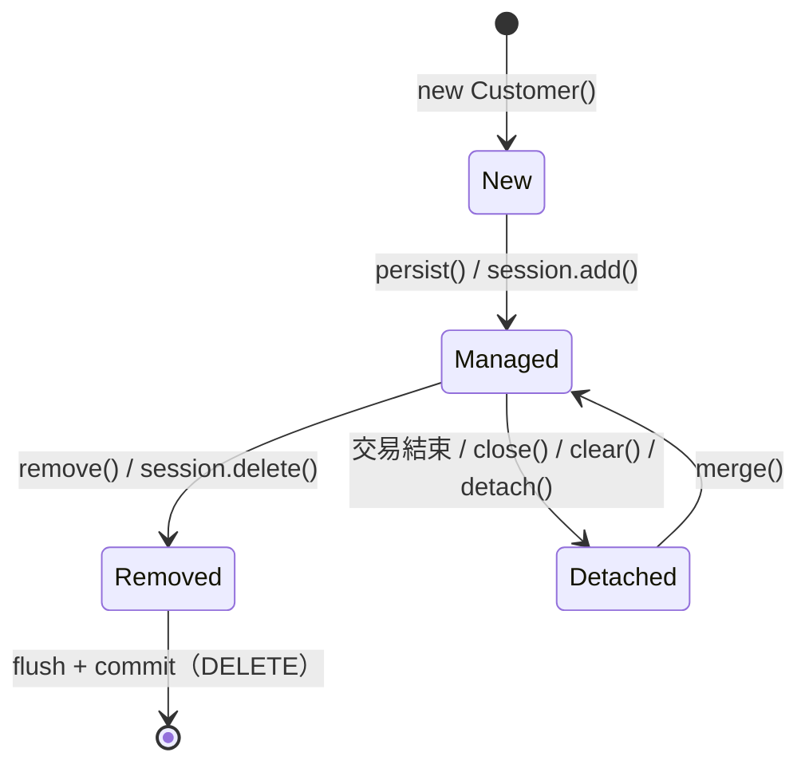

Managed 狀態下，修改屬性會在 flush 時由髒檢查自動產生 UPDATE；Identity Map 保證同一主鍵只有一個實例。`merge()` 不會讓原本的 Detached 物件變成 Managed，而是回傳另一個 managed 實例（[ORM-CTX-002](#orm-ctx-002-新物件用-persist分離物件用-merge-並使用其回傳值)）。

| 狀態 | JPA / Hibernate | SQLAlchemy | 重點 |
| --- | --- | --- | --- |
| 新建 | New / Transient | Transient | 尚未與 Session 關聯 |
| 受管 | Managed / Persistent | Pending → Persistent | 修改會在 flush 時寫回 |
| 分離 | Detached | Detached（commit 後屬性預設 **expired**） | 延遲載入失敗；修改不會寫回 |
| 刪除 | Removed | Deleted | flush 時 DELETE |

### 6.2 Flush 的時機

Flush 是「把記憶體中的變更轉成 SQL 送到資料庫」，**不等於** commit：

| 觸發 | Hibernate（FlushMode.AUTO） | SQLAlchemy 2.1 |
| --- | --- | --- |
| 交易提交 | ✅ | ✅ |
| 執行可能受影響的查詢之前 | ✅（JPQL / Criteria；原生查詢依設定） | ✅ autoflush（2.1 起無條件，Core 敘述經 Session 執行也會 autoflush） |
| 明確呼叫 | `em.flush()` | `session.flush()` |

### 6.3 Persistence Context 規則

#### ORM-CTX-001 了解自動髒檢查：交易內修改 managed 物件就會寫回，唯讀情境使用 DTO 或唯讀查詢

- **等級**：必須
- **適用**：Java、Python
- **說明**：不需要呼叫 `save()`，交易內對 managed 實體的任何修改都會在 flush 時變成 UPDATE。只為顯示、計算而需要資料時，使用 DTO 投影；必須取得實體又不想被寫回時，使用唯讀提示（Hibernate `org.hibernate.readOnly`、Spring `@Transactional(readOnly = true)`）。
- **原因**：把實體拿來做格式轉換、遮罩個資、計算暫存值，會在不知不覺中把錯誤資料寫回資料庫。

❌ 反例：

```java
// ❌ 在交易內為了「顯示」而修改 managed entity：commit 時自動 UPDATE 寫回資料庫
jpa.tx(em -> {
    Customer c = em.find(Customer.class, id);
    c.name = c.name.toUpperCase();      // 只是想顯示成大寫
});
```

✅ 正例（DTO 投影）：

```java
// ✅ 唯讀情境：查詢直接投影成 DTO（不產生 managed entity），在 DTO 上做呈現轉換
CustomerView view = jpa.txr(em -> em.createQuery(
        "select new ch06.CustomerView(c.id, c.name) "
                + "from Customer c where c.id = :id", CustomerView.class)
        .setParameter("id", id2)
        .getSingleResult());
String display = view.displayName().toUpperCase();
```

✅ 正例（必須取得實體時：唯讀查詢）：

```java
// ✅ 必須取得 entity 又不想被寫回：設定唯讀（Hibernate 不保留快照、不做髒檢查）
jpa.tx(em -> {
    Customer c = em.createQuery("from Customer c where c.id = :id", Customer.class)
            .setParameter("id", id2)
            .setHint("org.hibernate.readOnly", true)
            .getSingleResult();
    c.name = c.name.toUpperCase();      // 不會寫回
});
```

**如何 review**：在交易方法中，對實體呼叫 setter / 修改欄位、但方法語意是「查詢」或「顯示」→ 要求改用 DTO 或唯讀。

**如何驗證**：實測（四種資料庫）反例 `getEntityUpdateCount() == 1` 且資料庫值變成 `WANG`；DTO 與唯讀查詢的 update 數為 0（`PersistenceContextTest#dirtyCheckingWritesBackUnintendedChanges`）。Python 對應 `test_dirty_checking`。

#### ORM-CTX-002 新物件用 persist，分離物件用 merge 並使用其回傳值

- **等級**：必須
- **適用**：Java、Python
- **說明**：`persist()` 只用於新物件；分離物件（例如前一個交易載入、或由請求反序列化而來）用 `merge()`，**之後只操作 `merge()` 回傳的 managed 實例**。SQLAlchemy 的 `session.merge()` 同樣回傳 Session 內的另一個物件。Hibernate 7 已移除 `save()`、`update()`、`saveOrUpdate()`。
- **原因**：`merge()` 會把狀態複製到 Persistence Context 中的另一個實例；之後再修改原本的分離物件，變更不會寫回。對分離物件呼叫 `persist()` 則拋出「Detached entity passed to persist」。

❌ 反例：

```java
// ❌ merge 之後繼續修改「原本的 detached 物件」：merge 回傳的是另一個 managed 物件
jpa.tx(em -> {
    em.merge(detached);
    detached.name = "chen-updated";      // 變更遺失
});
```

```java
// ❌ 對已有主鍵的 detached 物件呼叫 persist
assertThatThrownBy(() -> jpa.tx(em -> em.persist(detached)))
        .isInstanceOf(PersistenceException.class)
        .hasMessageContaining("Detached entity passed to persist");
```

✅ 正例：

```java
// ✅ 使用 merge 的回傳值
jpa.tx(em -> {
    Customer managed = em.merge(detached);
    managed.name = "chen-updated";
});
```

✅ 正例（Python）：

```python
with Session(engine) as s, s.begin():
    managed = s.merge(detached)     # ✅ 回傳 Session 內的 managed 物件
    assert managed is not detached
    managed.name = "chen-updated"
```

**如何 review**：`em.merge(x);` 單獨成行（回傳值被丟棄）→ 退回；Spring Data 的 `repository.save(entity)` 也會在分離物件時呼叫 merge，同樣要使用回傳值。

**如何驗證**：實測（四種資料庫）反例的變更遺失（資料庫仍為 `chen`）、對分離物件 persist 拋 `PersistenceException`（訊息含 `Detached entity passed to persist`）；正例寫入 `chen-updated`（`PersistenceContextTest#mergeReturnsManagedCopy`、`test_merge_returns_copy`）。

#### ORM-CTX-003 一個 EntityManager / Session 對應一個工作單元，不跨請求、不跨執行緒共用

- **等級**：必須
- **適用**：Java、Python
- **說明**：`EntityManager` 與 `Session` **不是執行緒安全的**，生命週期應等於一個工作單元（通常是一個請求或一個使用案例）。Spring 注入的 `EntityManager` 是代理，會自動綁定到目前交易；自行建立時使用 try-with-resources（JPA 3.1 起 `EntityManager` 實作 `AutoCloseable`）或 JPA 3.2 的 `runInTransaction`。Python 使用 `sessionmaker` 與 `with` 區塊。
- **原因**：共用 Session 會讓 Identity Map 無限成長、資料過時，並在多執行緒下產生不可預期的錯誤；未關閉的 Session 會一直占用連線。

❌ 反例（Python）：

```python
# ❌ 模組層級共用一個 Session：跨請求、跨執行緒共享狀態，連線一直被占用
_global_session = None


def handle_request_bad(engine, customer_id):
    global _global_session
    if _global_session is None:
        _global_session = Session(engine)
    return _global_session.get(Customer, customer_id).name
```

✅ 正例（Python）：

```python
# ✅ 每個請求一個 Session（工作單元），用 with 確保關閉並歸還連線
def make_session_factory(engine):
    return sessionmaker(engine, expire_on_commit=False)


def handle_request(session_factory, customer_id):
    with session_factory() as session:
        return session.get(Customer, customer_id).name
```

✅ 正例（Java）：

```java
// ✅ EntityManager 的生命週期 = 一個工作單元；JPA 3.1 起 EntityManager 實作 AutoCloseable
Long id;
try (EntityManager em = emf.createEntityManager()) {
    em.getTransaction().begin();
    Customer c = new Customer("huang");
    em.persist(c);
    em.getTransaction().commit();
    id = c.id;
}
// 更精簡：Jakarta Persistence 3.2 的 runInTransaction / callInTransaction
String name = emf.callInTransaction(em -> em.find(Customer.class, id).name);
```

**如何 review**：模組層級或 singleton 欄位保存 `Session` / `EntityManager`（Spring 注入的除外）；`createEntityManager()` 沒有對應的 `close()`。

**如何驗證**：實測（四種資料庫）`test_session_per_request_releases_connection`：正例請求結束後 `pool.checkedout() == 0`，反例為 1（連線被占用）。

#### ORM-CTX-004 大量處理時定期 flush + clear，避免 Persistence Context 無限成長

- **等級**：必須
- **適用**：Java、Python
- **說明**：在單一交易中處理大量實體時，每 N 筆（建議等於 `hibernate.jdbc.batch_size`）呼叫 `flush()` 與 `clear()`；Python 呼叫 `flush()` 與 `expunge_all()`。更大量的處理改用 `StatelessSession` 或 bulk 語法（[第 13 章](#13-效能)）。
- **原因**：Persistence Context 保存每個實體與其快照，記憶體與 flush 時的髒檢查成本都隨筆數線性成長，最後 OutOfMemoryError。

❌ 反例：在同一交易中 `persist()` 500 筆而不清除（實測 Persistence Context 內有 500 個實體）。

✅ 正例：

```java
// ✅ 每 batch_size 筆 flush + clear，persistence context 維持在固定大小
int batchSize = 50;
jpa.tx(em -> {
    for (int i = 0; i < 500; i++) {
        em.persist(new Customer("good" + i));
        if ((i + 1) % batchSize == 0) {
            em.flush();
            em.clear();
        }
    }
});
```

✅ 正例（Python）：

```python
# ✅ 大量新增：分批 flush 後 expunge_all()，避免 identity map 無限成長
with Session(engine) as s, s.begin():
    for i in range(500):
        s.add(Customer(id=1000 + i, name=f"c{i}"))
        if (i + 1) % 100 == 0:
            s.flush()
            s.expunge_all()
            assert len(s.identity_map) == 0
```

**如何 review**：迴圈中 `persist()` / `add()` 且迴圈次數可能超過數百筆，卻沒有 flush/clear → 退回。

**如何驗證**：實測（四種資料庫）以 `Session.getStatistics().getEntityCount()` 量測：反例最高 500、正例最高 50（`PersistenceContextTest#batchProcessingMustClearPersistenceContext`）；Python 每批後 `len(session.identity_map) == 0`。

#### ORM-CTX-005 Python：commit 後屬性會過期，回傳給外部前先轉成 DTO

- **等級**：必須
- **適用**：Python
- **說明**：SQLAlchemy `Session` 預設 `expire_on_commit=True`，commit 後所有物件屬性過期，下一次存取時重新查詢；如果此時 Session 已關閉，就拋出 `DetachedInstanceError`。在 Session 內把需要的資料轉成 DTO（dataclass、Pydantic model）再回傳；只有在明確了解後果時才設定 `expire_on_commit=False`。
- **原因**：Web 框架常在 Session 關閉後才序列化回應，導致只在正式流量下偶發的錯誤。

❌ / ✅ 對照：

```python
@dataclass(frozen=True)
class CustomerDto:
    id: int
    name: str


def load_customer_bad(engine, customer_id):
    # ❌ 預設 expire_on_commit=True：commit 後屬性過期，離開 Session 再讀取即失敗
    with Session(engine) as s, s.begin():
        return s.get(Customer, customer_id)


def load_customer(engine, customer_id) -> CustomerDto:
    # ✅ 在 Session 內轉成 DTO 再回傳
    with Session(engine) as s:
        c = s.get(Customer, customer_id)
        return CustomerDto(c.id, c.name)
```

**如何 review**：函式在 `with Session(...) as s, s.begin():` 區塊中直接 `return` ORM 物件 → 要求轉 DTO。

**如何驗證**：實測（四種資料庫）`test_expire_on_commit`：反例存取 `.name` 拋 `DetachedInstanceError`，正例回傳 `CustomerDto(4, "huang")`。本手冊撰寫第 5 章範例時即踩到此問題（在 `with ... s.begin()` 結束後讀取 `Document.id`）。

### 6.4 小結

- 「managed 物件被修改就會寫回」是 ORM 最重要、也最常被忽略的行為。
- `merge()` 回傳的才是 managed 物件。
- EntityManager / Session 的生命週期 = 一個工作單元；大量處理要分批清除。

---

## 7. 關聯對映

### 7.1 關聯類型與擁有端

| 關聯 | 資料庫表現 | Java 註解 | SQLAlchemy |
| --- | --- | --- | --- |
| 多對一 | 子表外鍵 | `@ManyToOne(fetch = LAZY)` | `relationship()` + `ForeignKey` |
| 一對多 | 同上（由另一端看） | `@OneToMany(mappedBy = ...)` | `relationship(back_populates=...)` |
| 一對一 | 外鍵 + UNIQUE，或共用主鍵 | `@OneToOne` + `@MapsId` | `relationship(uselist=False)` |
| 多對多 | 關聯表 | `@ManyToMany` + `@JoinTable` | `relationship(secondary=...)` |
| 帶屬性的多對多 | 關聯表有自己的欄位 | 中介實體 + 兩個 `@ManyToOne` | Association Object |

**擁有端（owning side）**：資料庫中只有一個外鍵，所以雙向關聯中只有一端負責寫入外鍵——JPA 中是**沒有** `mappedBy` 的那一端（通常是 `@ManyToOne`）。另一端（inverse side，`mappedBy`）只是方便導覽的「鏡像」，修改它不會寫入資料庫。

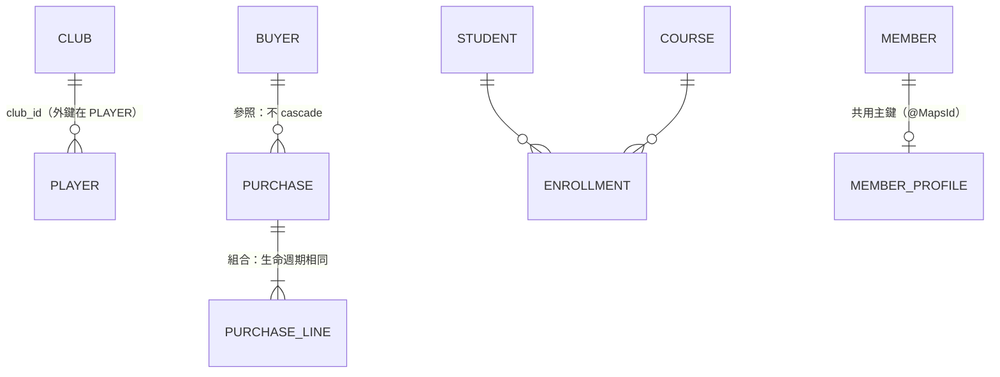

### 7.2 雙向關聯與擁有端

#### ORM-REL-001 雙向關聯必須同時維護兩端，並以擁有端寫入外鍵

- **等級**：必須
- **適用**：Java、Python
- **說明**：Java 在「一」端提供 `addX()` / `removeX()` 輔助方法，同時設定集合與子物件的參照；SQLAlchemy 使用 `back_populates`（兩端在記憶體中自動同步），不要建立兩個互不相識的單向關聯。
- **原因**：只修改反向端集合時，外鍵實際上是 `NULL`；記憶體中兩端不一致，同一個交易內的後續邏輯會讀到錯誤狀態。

❌ 反例（Java）：

```java
// ❌ 只加入反向端集合：外鍵由擁有端（Player.club）決定，資料庫中 club_id 為 null
Player p = new Player();
p.id = 1L;
c.players.add(p);
em.persist(p);
```

✅ 正例（Java）：

```java
@Entity
class Club {
    @Id
    Long id;
    @Column(length = 100)
    String name;

    @OneToMany(mappedBy = "club")            // 反向端（inverse side）：不負責寫入外鍵
    Set<Player> players = new HashSet<>();

    // ✅ 以輔助方法同時維護兩端
    void addPlayer(Player p) {
        players.add(p);
        p.club = this;
    }

    void removePlayer(Player p) {
        players.remove(p);
        p.club = null;
    }
}

@Entity
class Player {
    @Id
    Long id;
    @Column(length = 100)
    String name;

    @ManyToOne(fetch = FetchType.LAZY)       // 擁有端（owning side）：外鍵 club_id 由此寫入
    @JoinColumn(name = "club_id")
    Club club;
}
```

❌ 反例（Python）：

```python
class Band(Base):
    __tablename__ = "py_band"

    id: Mapped[int] = mapped_column(primary_key=True)
    musicians: Mapped[list["Musician"]] = relationship()        # ❌ 兩個互不相識的單向關聯


class Musician(Base):
    __tablename__ = "py_musician"

    id: Mapped[int] = mapped_column(primary_key=True)
    band_id: Mapped[int | None] = mapped_column(ForeignKey("py_band.id"))
    band: Mapped["Band | None"] = relationship()
```

✅ 正例（Python）：

```python
class Club(Base):
    __tablename__ = "py_club"

    id: Mapped[int] = mapped_column(primary_key=True)
    name: Mapped[str] = mapped_column(String(100))
    # ✅ back_populates：兩端在記憶體中自動同步（2.1 起可寫成 lambda: Player.club）
    players: Mapped[list["Player"]] = relationship(back_populates="club")


class Player(Base):
    __tablename__ = "py_player"

    id: Mapped[int] = mapped_column(primary_key=True)
    club_id: Mapped[int | None] = mapped_column(ForeignKey("py_club.id"))
    club: Mapped["Club | None"] = relationship(back_populates="players")
```

**如何 review**：

- 程式中直接 `parent.getChildren().add(child)` 而沒有設定 `child.parent` → 要求改用輔助方法。
- Python 兩個 `relationship()` 指向同一外鍵卻沒有 `back_populates`。

**如何驗證**：

- 實測（四種資料庫）：只加入反向端集合的 `Player` 之 `club_id` 為 `NULL`；使用 `addPlayer()` 的為 `1`（`AssociationTest#inverseSideOnlyLeavesForeignKeyNull`）。
- SQLAlchemy 在設定 mapper 時就對反例發出 `SAWarning: relationship 'Musician.band' will copy column ... which conflicts with relationship(s) ...`；CI 以 `pytest -W error::sqlalchemy.exc.SAWarning` 即可擋下（`test_back_populates_syncs_both_sides` 斷言此警告）。

#### ORM-REL-002 @ManyToOne 與 @OneToOne 一律明確宣告 FetchType.LAZY

- **等級**：必須
- **適用**：Java
- **說明**：JPA 規格中 `@ManyToOne`、`@OneToOne` 的預設是 **EAGER**，`@OneToMany`、`@ManyToMany` 才是 LAZY。所有對一關聯都要寫 `fetch = FetchType.LAZY`，需要時以 fetch join / Entity Graph 載入（[第 10 章](#10-載入策略與-n1-問題)）。
- **原因**：EAGER 無法在個別查詢中關閉；即使 JPQL 沒有要求，Hibernate 也會為每個不同的關聯物件再送一次查詢（N+1）。

❌ 反例：

```java
@Entity
class TeamEager {
    @Id
    Long id;
    @ManyToOne                               // ❌ JPA 預設 FetchType.EAGER
    League league;
}
```

✅ 正例：

```java
@Entity
class TeamLazy {
    @Id
    Long id;
    @ManyToOne(fetch = FetchType.LAZY)       // ✅ 一律明確 LAZY，需要時再以 fetch join 載入
    League league;
}
```

**如何 review**：任何 `@ManyToOne`、`@OneToOne` 缺少 `fetch = FetchType.LAZY`；任何 `FetchType.EAGER`（含集合）→ 退回。

**如何驗證**：實測（四種資料庫）`from TeamEager` 查 3 筆送出 4 句 SQL（1 + 3），`from TeamLazy` 只送 1 句（`AssociationTest#eagerManyToOneCausesExtraQueries`）。

### 7.3 Cascade 與孤兒刪除

#### ORM-REL-003 Cascade 只用在聚合內的組合關係，不對共用的參照物件 cascade

- **等級**：必須
- **適用**：Java、Python
- **說明**：`CascadeType.ALL` / `REMOVE`（SQLAlchemy `cascade="all, delete-orphan"`）只用於「父刪子必刪」的組合關係（訂單 → 訂單明細）。指向聚合外部、被多方共用的物件（顧客、商品）**不設 cascade**。Hibernate 7 已移除 `CascadeType.SAVE_UPDATE`、`DELETE`。
- **原因**：對共用物件 cascade REMOVE，刪除一張訂單就刪掉顧客，其他訂單的外鍵立即違反約束（或在沒有外鍵的系統中留下孤兒資料）。

❌ 反例：

```java
@Entity
class PurchaseBad {
    @Id
    Long id;
    @ManyToOne(fetch = FetchType.LAZY, cascade = CascadeType.ALL)   // ❌ 對「被共用」的一方 cascade
    Buyer buyer;
}
```

✅ 正例：見 [ORM-REL-004](#orm-rel-004-組合關係啟用-orphanremoval--delete-orphan) 的 `Purchase`——對 `Buyer` 不 cascade、對 `PurchaseLine` cascade。

**如何 review**：`@ManyToOne(cascade = ...)`、`@ManyToMany(cascade = REMOVE/ALL)` → 退回；`@OneToMany(cascade = ALL)` 要確認子物件確實只屬於這個父物件。

**如何驗證**：實測（四種資料庫）刪除共用同一 `Buyer` 的其中一張 `PurchaseBad` 時拋出 `PersistenceException`（外鍵違反）（`AssociationTest#cascadeOnSharedReferenceDeletesTooMuch`）。

#### ORM-REL-004 組合關係啟用 orphanRemoval / delete-orphan

- **等級**：必須
- **適用**：Java、Python
- **說明**：子物件生命週期完全隸屬父物件時，`@OneToMany(mappedBy, cascade = ALL, orphanRemoval = true)`；SQLAlchemy `cascade="all, delete-orphan"`。從集合移除即刪除資料列。
- **原因**：沒有孤兒刪除時，從集合移除只會（Java）留下孤兒列、或（Python 預設 `save-update, merge`）把外鍵改成 `NULL`；外鍵為 NOT NULL 時則拋出錯誤。

✅ 正例（Java）：

```java
@Entity
class Purchase {
    @Id
    Long id;
    @ManyToOne(fetch = FetchType.LAZY)       // ✅ 參照聚合外的物件：不 cascade
    Buyer buyer;

    // ✅ 組合關係（聚合內）：生命週期隨 Purchase，移出集合即刪除
    @OneToMany(mappedBy = "purchase", cascade = CascadeType.ALL, orphanRemoval = true)
    List<PurchaseLine> lines = new ArrayList<>();

    void addLine(PurchaseLine line) {
        lines.add(line);
        line.purchase = this;
    }

    void removeLine(PurchaseLine line) {
        lines.remove(line);
        line.purchase = null;
    }
}

@Entity
class PurchaseLine {
    @Id
    Long id;
    @ManyToOne(fetch = FetchType.LAZY, optional = false)
    Purchase purchase;
    @Column(precision = 19, scale = 2)
    BigDecimal amount;
}
```

❌ 反例（Java）：

```java
@Entity
class CartBad {
    @Id
    Long id;
    @OneToMany(mappedBy = "cart", cascade = CascadeType.PERSIST)   // ❌ 沒有 orphanRemoval
    List<CartItemBad> items = new ArrayList<>();
}

@Entity
class CartItemBad {
    @Id
    Long id;
    @ManyToOne(fetch = FetchType.LAZY)
    CartBad cart;
}
```

❌ / ✅ 對照（Python）：

```python
class Purchase(Base):
    __tablename__ = "py_purchase"

    id: Mapped[int] = mapped_column(primary_key=True)
    # ✅ 組合關係：all, delete-orphan → 移出集合即刪除
    lines: Mapped[list["PurchaseLine"]] = relationship(
        back_populates="purchase", cascade="all, delete-orphan")


class PurchaseLine(Base):
    __tablename__ = "py_purchase_line"

    id: Mapped[int] = mapped_column(primary_key=True)
    purchase_id: Mapped[int] = mapped_column(ForeignKey("py_purchase.id"))   # NOT NULL
    purchase: Mapped["Purchase"] = relationship(back_populates="lines")
    amount: Mapped[Decimal] = mapped_column(Numeric(19, 2))


class Cart(Base):
    __tablename__ = "py_cart"

    id: Mapped[int] = mapped_column(primary_key=True)
    # ❌ 預設 cascade="save-update, merge"：移出集合時把外鍵設成 NULL
    items: Mapped[list["CartItem"]] = relationship(back_populates="cart")


class CartItem(Base):
    __tablename__ = "py_cart_item"

    id: Mapped[int] = mapped_column(primary_key=True)
    cart_id: Mapped[int] = mapped_column(ForeignKey("py_cart.id"))           # NOT NULL
    cart: Mapped["Cart"] = relationship(back_populates="items")
```

**如何 review**：組合關係（明細、附件、歷程）的集合沒有 orphanRemoval；或反過來，對可被其他父物件接手的子物件啟用 orphanRemoval。

**如何驗證**：實測（四種資料庫）移除一筆明細後：`PurchaseLine` 剩 1 筆（已刪除）、`CartItemBad` 仍有 2 筆（孤兒）（`AssociationTest#orphanRemovalDeletesRemovedChildren`）；Python 反例送出 `UPDATE ... SET cart_id = NULL`，因 NOT NULL 失敗——**PostgreSQL、SQL Server、Db2 回報 `IntegrityError`，Oracle（ORA-01407）回報 `DatabaseError`**，例外處理不能只捕捉 `IntegrityError`（`test_delete_orphan`）。

### 7.4 多對多

#### ORM-REL-005 @ManyToMany 使用 Set，不使用 List

- **等級**：建議
- **適用**：Java
- **說明**：沒有 `@OrderColumn` 的 `List` 在 Hibernate 中是「bag」語意（允許重複、無法識別單一元素），移除一個元素時 Hibernate 會**刪除整個集合的關聯列再逐筆插回**。使用 `Set`，只刪除被移除的那一列。需要排序時用 `@OrderBy` 於讀取時排序。
- **原因**：大集合上一次小修改變成 N 句 SQL，並在並行修改時放大鎖定範圍。

❌ 反例：

```java
@Entity
class EngineerBag {
    @Id
    Long id;
    @ManyToMany
    @JoinTable(name = "engineer_bag_skill")
    List<Skill> skills = new ArrayList<>();   // ❌ List（bag）：移除一筆 = 刪光再重新插入
}
```

✅ 正例：

```java
@Entity
class Engineer {
    @Id
    Long id;
    @ManyToMany
    @JoinTable(name = "engineer_skill")
    Set<Skill> skills = new HashSet<>();      // ✅ Set：只刪除被移除的那一列
}
```

**如何 review**：`@ManyToMany` 搭配 `List`；`@ManyToMany(cascade = REMOVE/ALL)`（會刪除對方實體）→ 退回。

**如何驗證**：實測（四種資料庫）移除 5 個技能中的 1 個：bag 送出 1 句不帶條件的 `delete from engineer_bag_skill where engineer_bag_id=?` + 4 句 INSERT；Set 只送出 1 句帶 `skills_id` 條件的 DELETE、0 句 INSERT（`AssociationTest#bagManyToManyRecreatesJoinTable`）。

#### ORM-REL-006 關聯本身有屬性時，升格為中介實體

- **等級**：必須
- **適用**：Java、Python
- **說明**：選課需要記錄成績、選課日期時，`@ManyToMany` 的關聯表無處存放這些屬性。建立中介實體（`Enrollment`），以兩個 `@ManyToOne` 參照兩端，並以唯一約束防止重複。SQLAlchemy 稱為 Association Object 模式。
- **原因**：事後才發現需要屬性時，從 `@ManyToMany` 改成中介實體是破壞性變更（API、查詢、遷移都要改）。

❌ 反例：`@ManyToMany Set<Course> courses;`——關聯表只有兩個外鍵，成績無處可存。

✅ 正例（Java）：

```java
// ✅ 關聯本身有屬性（成績、選課日）→ 升格為中介實體
@Entity
@Table(uniqueConstraints = @UniqueConstraint(columnNames = {"student_id", "course_id"}))
class Enrollment {
    @Id
    Long id;
    @ManyToOne(fetch = FetchType.LAZY, optional = false)
    Student student;
    @ManyToOne(fetch = FetchType.LAZY, optional = false)
    Course course;
    @Column(precision = 5, scale = 2)
    BigDecimal grade;
}
```

✅ 正例（Python）：

```python
class Course(Base):
    __tablename__ = "py_course"

    id: Mapped[int] = mapped_column(primary_key=True)
    title: Mapped[str] = mapped_column(String(100))


class Student(Base):
    __tablename__ = "py_student"

    id: Mapped[int] = mapped_column(primary_key=True)
    name: Mapped[str] = mapped_column(String(100))
    enrollments: Mapped[list["Enrollment"]] = relationship(
        back_populates="student", cascade="all, delete-orphan")


class Enrollment(Base):
    """✅ Association Object：關聯本身帶有屬性。"""

    __tablename__ = "py_enrollment"
    __table_args__ = (UniqueConstraint("student_id", "course_id"),)

    id: Mapped[int] = mapped_column(primary_key=True)
    student_id: Mapped[int] = mapped_column(ForeignKey("py_student.id"))
    course_id: Mapped[int] = mapped_column(ForeignKey("py_course.id"))
    grade: Mapped[Decimal | None] = mapped_column(Numeric(5, 2))
    student: Mapped["Student"] = relationship(back_populates="enrollments")
    course: Mapped["Course"] = relationship()
```

**如何 review**：需求文件中多對多關聯帶有屬性（數量、日期、狀態、角色）卻使用 `@ManyToMany`。

**如何驗證**：實測（四種資料庫）可依學生與課程查詢成績 `92.50`；重複選課違反唯一約束而失敗（`AssociationTest#enrollmentEntityCarriesAttributes`、`test_association_object`）。

### 7.5 一對一

#### ORM-REL-007 一對一優先使用單向 + 共用主鍵（@MapsId），避免雙向一對一的反向端

- **等級**：建議
- **適用**：Java
- **說明**：一對一（會員 ↔ 會員檔案）以子端 `@OneToOne(fetch = LAZY) @MapsId` 共用父端主鍵；需要時以父端 id 直接 `find(MemberProfile.class, memberId)`。
- **原因**：雙向一對一的反向端（`mappedBy`）沒有外鍵，Hibernate 無法得知關聯是否存在，只能逐筆查詢——即使宣告 LAZY 也無效（未啟用 bytecode enhancement 時），造成 N+1。

❌ 反例：

```java
@Entity
class MemberBad {
    @Id
    Long id;
    // ❌ 雙向一對一的反向端：Hibernate 必須查詢才能知道是 null 還是 proxy，LAZY 無效
    @OneToOne(mappedBy = "member", fetch = FetchType.LAZY)
    MemberProfileBad profile;
}

@Entity
class MemberProfileBad {
    @Id
    Long id;
    @OneToOne(fetch = FetchType.LAZY)
    MemberBad member;
}
```

✅ 正例：

```java
@Entity
class Member {
    @Id
    Long id;
    @Column(length = 100)
    String name;
}

@Entity
class MemberProfile {
    @Id
    Long id;                                  // 與 Member 共用主鍵值

    @OneToOne(fetch = FetchType.LAZY)
    @MapsId                                   // ✅ 單向 + 共用主鍵：需要時以 member 的 id 直接 find
    Member member;

    @Column(length = 500)
    String bio;
}
```

```java
String bio = jpa.txr(em -> em.find(MemberProfile.class, 2L).bio);   // 以 Member 的 id 直接取得
```

**如何 review**：`@OneToOne(mappedBy = ...)` 出現在經常被列表查詢的實體上。

**如何驗證**：實測（四種資料庫）查詢 3 筆 `MemberBad` 送出 4 句 SQL；查詢 3 筆 `Member` 只送 1 句（`AssociationTest#inverseOneToOneCannotBeLazy`）。

### 7.6 小結

| 關聯 | 預設做法 |
| --- | --- |
| 多對一 | `@ManyToOne(fetch = LAZY)`，不 cascade |
| 一對多（組合） | `mappedBy` + `cascade = ALL` + `orphanRemoval = true` + 輔助方法 |
| 多對多 | `Set`；有屬性就改中介實體 |
| 一對一 | 單向 + `@MapsId` |

---

## 8. 繼承對映

### 8.1 三種策略比較

| 策略 | 表結構 | 多型查詢 SQL | 優點 | 缺點 | 適用 |
| --- | --- | --- | --- | --- | --- |
| `SINGLE_TABLE`（預設） | 一張表 + 鑑別欄位 `DTYPE` | 單表、無 JOIN | 最快、查詢最簡單 | 子類別欄位必須可為 NULL；表會變寬 | 子類別欄位少、經常多型查詢 |
| `JOINED` | 父表 + 每個子類別一張表 | `LEFT JOIN` 所有子表 | 正規化、可加 NOT NULL | JOIN 成本隨子類別數增加 | 子類別欄位多、需資料庫約束 |
| `TABLE_PER_CLASS` | 每個具體類別一張完整表 | `UNION ALL` 所有子表 | 單一子類別查詢快 | 多型查詢最慢；不能用 IDENTITY | 幾乎不需要多型查詢（少用） |
| `@MappedSuperclass` | 無父表，欄位複製到各子表 | 不支援多型查詢 | 簡單 | 不是「實體繼承」 | 只為共用欄位（稽核欄位） |

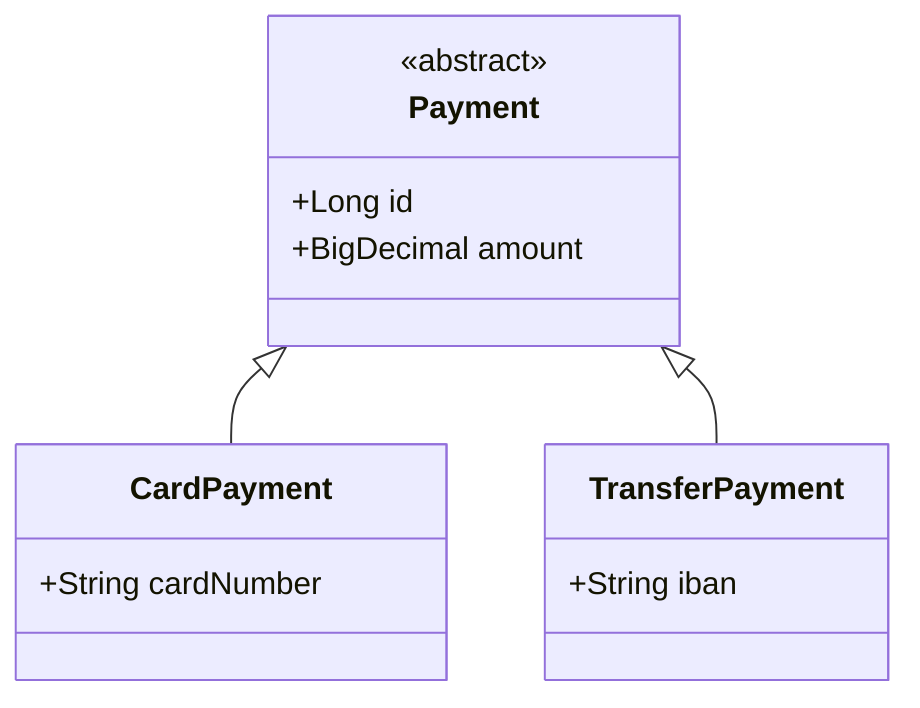

### 8.2 繼承規則

#### ORM-INH-001 依查詢型態選擇繼承策略，預設 SINGLE_TABLE 或 JOINED，避免 TABLE_PER_CLASS

- **等級**：建議
- **適用**：Java、Python
- **說明**：經常以父類別查詢（「所有付款」）且子類別欄位少 → `SINGLE_TABLE`；子類別欄位多、需要 NOT NULL 等約束 → `JOINED`。SQLAlchemy 對應 Single Table Inheritance 與 Joined Table Inheritance（以 `polymorphic_on` / `polymorphic_identity` 宣告）。
- **原因**：`TABLE_PER_CLASS` 的多型查詢必須 `UNION` 所有子表，子類別越多越慢，且無法使用 IDENTITY 主鍵。

✅ 正例（SINGLE_TABLE）：

```java
// ✅ SINGLE_TABLE：一張表 + 鑑別欄位；多型查詢不需 JOIN/UNION，效能最佳
@Entity
@Table(name = "payment")
@Inheritance(strategy = InheritanceType.SINGLE_TABLE)
abstract class Payment {
    @Id
    Long id;
    @Column(precision = 19, scale = 2)
    BigDecimal amount;
}

@Entity
@DiscriminatorValue("CARD")
class CardPayment extends Payment {
    @Column(length = 19)
    String cardNumber;          // 子類別欄位在單表中必須可為 NULL
}

@Entity
@DiscriminatorValue("TRANSFER")
class TransferPayment extends Payment {
    @Column(length = 34)
    String iban;
}
```

✅ 正例（JOINED）：

```java
// JOINED：每個類別一張表，正規化；多型查詢以 LEFT JOIN 組合
@Entity
@Table(name = "account_j")
@Inheritance(strategy = InheritanceType.JOINED)
abstract class AccountJ {
    @Id
    Long id;
}

@Entity
@Table(name = "savings_j")
class SavingsJ extends AccountJ {
    @Column(precision = 5, scale = 4)
    BigDecimal rate;
}

@Entity
@Table(name = "checking_j")
class CheckingJ extends AccountJ {
    @Column(precision = 19, scale = 2)
    BigDecimal overdraft;
}
```

❌ 反例（TABLE_PER_CLASS 用於需要多型查詢的情境）：

```java
// ❌ TABLE_PER_CLASS：多型查詢必須 UNION 所有子表，且無法使用 IDENTITY
@Entity
@Inheritance(strategy = InheritanceType.TABLE_PER_CLASS)
abstract class AssetT {
    @Id
    Long id;
}

@Entity
@Table(name = "vehicle_t")
class VehicleT extends AssetT {
    @Column(length = 20)
    String plate;
}

@Entity
@Table(name = "building_t")
class BuildingT extends AssetT {
    @Column(length = 200)
    String address;
}
```

✅ 正例（Python）：

```python
class Payment(Base):
    """✅ Single Table Inheritance：單表 + 鑑別欄位 type。"""

    __tablename__ = "py_payment"

    id: Mapped[int] = mapped_column(primary_key=True)
    type: Mapped[str] = mapped_column(String(20))
    amount: Mapped[Decimal] = mapped_column(Numeric(19, 2))
    __mapper_args__ = {"polymorphic_on": "type", "polymorphic_identity": "payment"}


class CardPayment(Payment):
    card_number: Mapped[str | None] = mapped_column(String(19))   # 子類別欄位須可為 NULL
    __mapper_args__ = {"polymorphic_identity": "card"}


class TransferPayment(Payment):
    iban: Mapped[str | None] = mapped_column(String(34))
    __mapper_args__ = {"polymorphic_identity": "transfer"}


class Account(Base):
    """Joined Table Inheritance：每個類別一張表。"""

    __tablename__ = "py_account_j"

    id: Mapped[int] = mapped_column(primary_key=True)
    type: Mapped[str] = mapped_column(String(20))
    __mapper_args__ = {"polymorphic_on": "type", "polymorphic_identity": "account"}


class Savings(Account):
    __tablename__ = "py_savings_j"

    id: Mapped[int] = mapped_column(ForeignKey("py_account_j.id"), primary_key=True)
    rate: Mapped[Decimal] = mapped_column(Numeric(5, 4))
    __mapper_args__ = {"polymorphic_identity": "savings"}
```

**如何 review**：出現 `TABLE_PER_CLASS` 時要求說明「為何不需要多型查詢」；`SINGLE_TABLE` 子類別超過 5 個且各有多個專屬欄位時考慮 `JOINED`。

**如何驗證**：實測（四種資料庫）擷取 SQL：`from Payment` 不含 JOIN / UNION；`from AccountJ` 含 `left join`；`from AssetT` 含 `union`（`InheritanceTest#polymorphicQueryShapeDependsOnStrategy`）。Python `test_polymorphic_queries` 確認單表查詢無 JOIN、`with_polymorphic` 查詢含 JOIN。

#### ORM-INH-002 只為共用欄位而繼承時，使用 @MappedSuperclass

- **等級**：建議
- **適用**：Java
- **說明**：稽核欄位（`createdAt`、`createdBy`）、技術欄位（`version`）的共用，使用 `@MappedSuperclass`；不要為此建立實體繼承階層。
- **原因**：實體繼承會產生多型查詢、鑑別欄位與額外 JOIN；而「所有實體都有建立時間」並不需要「查詢所有實體」。

❌ 反例：`@Entity @Inheritance abstract class BaseEntity { Instant createdAt; }`——讓所有實體共用一個繼承階層。

✅ 正例：

```java
// ✅ 只為共用欄位（稽核欄位）而繼承：@MappedSuperclass，不產生表、不參與多型查詢
@MappedSuperclass
abstract class AuditedEntity {
    @Column(nullable = false, updatable = false)
    Instant createdAt;

    @PrePersist
    void onCreate() {
        createdAt = Instant.now();
    }
}

@Entity
@Table(name = "supplier")
class Supplier extends AuditedEntity {
    @Id
    Long id;
    @Column(length = 100)
    String name;
}
```

**如何 review**：名為 `BaseEntity`、`AbstractEntity` 的類別標註 `@Entity` → 改為 `@MappedSuperclass`。

**如何驗證**：實測（四種資料庫）`Supplier` 寫入後 `createdAt` 自動填入，且 Metamodel 中不存在 `AuditedEntity` 實體（`InheritanceTest#mappedSuperclassHasNoTable`）。

#### ORM-INH-003 SINGLE_TABLE 的子類別欄位不可宣告 NOT NULL，依類型必填的規則改用 CHECK 約束

- **等級**：必須
- **適用**：Java、Python
- **說明**：單表策略中，某個子類別必填的欄位，對其他子類別而言必然是 NULL。不要在子類別欄位寫 `@Column(nullable = false)`；以 Hibernate `@Check`（或 Jakarta Persistence 3.2 的 `@CheckConstraint`）表達「當 DTYPE = 'AIR' 時 flightNo 必填」，並在遷移腳本中建立相同的 CHECK。
- **原因**：實測 Hibernate 7.4.5 會依 `nullable = false` 產生 `NOT NULL`，結果是**其他所有子類別都無法寫入**。

❌ 反例：

```java
@Entity
@Table(name = "shipment")
@Inheritance(strategy = InheritanceType.SINGLE_TABLE)
abstract class ShipmentBad {
    @Id
    Long id;
}

@Entity
@DiscriminatorValue("AIR")
class AirShipmentBad extends ShipmentBad {
    @Column(nullable = false, length = 10)   // ❌ 單表中產生 NOT NULL：其他子類別（海運）一律無法寫入
    String flightNo;
}

@Entity
@DiscriminatorValue("SEA")
class SeaShipmentBad extends ShipmentBad {
    @Column(length = 10)
    String vesselNo;
}
```

✅ 正例：

```java
// ✅ 以 CHECK 約束表達「依類型必填」
@Entity
@Table(name = "shipment2")
@Inheritance(strategy = InheritanceType.SINGLE_TABLE)
@Check(name = "ck_air_flight", constraints = "DTYPE <> 'AIR' OR flightNo IS NOT NULL")
abstract class Shipment {
    @Id
    Long id;
}

@Entity
@DiscriminatorValue("AIR")
class AirShipment extends Shipment {
    @Column(length = 10)
    String flightNo;
}

@Entity
@DiscriminatorValue("SEA")
class SeaShipment extends Shipment {
    @Column(length = 10)
    String vesselNo;
}
```

**如何 review**：`SINGLE_TABLE` 階層的子類別欄位出現 `nullable = false`；若子類別欄位標註 Bean Validation `@NotNull`，需檢查產生的 DDL（Hibernate 依 `hibernate.validator.apply_to_ddl` 設定可能將其轉為 NOT NULL；本手冊未實測此組合，見[附錄 F](#附錄-f-待確認事項)）。

**如何驗證**：實測（四種資料庫）寫入沒有航班號碼的 `SeaShipmentBad` 失敗（NOT NULL 違反）；正例中 `SeaShipment` 可寫入，而 `DTYPE = 'AIR'` 且 `flightNo` 為 NULL 的資料被 CHECK 約束拒絕（`InheritanceTest#subclassNotNullBreaksSiblingsInSingleTable`）。

### 8.3 小結

- 先問「會不會以父類別查詢」，再選策略。
- 單表策略的完整性要靠 CHECK 約束，不靠 NOT NULL。
- 共用欄位用 `@MappedSuperclass`。

---

## 9. 查詢

### 9.1 查詢方式總覽

| 方式 | Java | Python | 適用 |
| --- | --- | --- | --- |
| 依主鍵 | `em.find()`、`repo.findById()` | `session.get()` | 單筆、會先查 Persistence Context |
| 物件查詢語言 | JPQL / HQL（`createQuery`） | `select(Entity).where(...)` | 一般查詢 |
| 型別安全組合 | Criteria API、Spring Data `Specification` | `select()` 建構式本身即可組合 | 動態條件 |
| 衍生查詢 | Spring Data 方法名稱（`findByPriceGreaterThan`） | — | 簡單條件 |
| 投影 | 建構子運算式、介面/record 投影 | `select(col1, col2)` → `Row` | 唯讀、列表 |
| 原生 SQL | `createNativeQuery`、`@Query(nativeQuery = true)` | `text()`、`tstring()` | 資料庫專屬功能 |
| 批次修改 | `update ... set` / `@Modifying` | `update()` / `delete()` | 大量修改 |

本章使用的 Spring Data JPA Repository（完整原始碼，已於四種資料庫執行）：

```java
public interface BookRepository extends JpaRepository<Book, Long>, JpaSpecificationExecutor<Book> {

    // ✅ 介面投影（closed projection）：只 SELECT title 欄位
    interface TitleOnly {
        String getTitle();
    }

    List<TitleOnly> findByPriceGreaterThan(BigDecimal price);

    // ✅ DTO 投影：建構子運算式，結果不是 managed entity
    @Query("""
            select new ch09.BookSummary(b.id, b.title, a.name)
            from Book b join b.author a
            where a.name = :author
            order by b.id""")
    List<BookSummary> findSummariesByAuthor(@Param("author") String author);

    // ✅ Keyset（seek）分頁：Spring Data 的 ScrollPosition / Window
    Window<Book> findFirst5ByOrderByIdAsc(ScrollPosition position);

    // ✅ 以 EntityGraph 宣告此查詢要一併載入 author（避免 N+1）
    @EntityGraph(attributePaths = "author")
    List<Book> findByPriceLessThanOrderById(BigDecimal price);

    // ❌ 批次 UPDATE 直接改資料庫，persistence context 中已載入的 Book 仍是舊值
    @Modifying
    @Query("update Book b set b.price = b.price * :factor where b.author.id = :authorId")
    int repriceBad(@Param("authorId") Long authorId, @Param("factor") BigDecimal factor);

    // ✅ 執行前 flush 未送出的變更、執行後 clear，之後讀到的是資料庫最新值
    @Modifying(flushAutomatically = true, clearAutomatically = true)
    @Query("update Book b set b.price = b.price * :factor where b.author.id = :authorId")
    int reprice(@Param("authorId") Long authorId, @Param("factor") BigDecimal factor);
}
```

### 9.2 查詢規則

#### ORM-QRY-001 唯讀與列表查詢使用投影（DTO / 介面 / Row），不載入整個實體

- **等級**：建議
- **適用**：Java、Python
- **說明**：只為顯示或計算而查詢時，以建構子運算式（`select new ...`）、Spring Data 介面投影或 record 投影取得需要的欄位；Python 以 `select(Entity.col1, Entity.col2)` 取得 `Row`。
- **原因**：投影只 SELECT 需要的欄位，不建立 managed 實體（沒有快照、沒有髒檢查、不會意外寫回，見 [ORM-CTX-001](#orm-ctx-001-了解自動髒檢查交易內修改-managed-物件就會寫回唯讀情境使用-dto-或唯讀查詢)），也不會觸發延遲載入。

❌ 反例：列表頁呼叫 `findAll()` 取得完整實體，只為了顯示書名與作者名稱（會連帶延遲載入每本書的作者，見[第 10 章](#10-載入策略與-n1-問題)）。

✅ 正例（Java）：

<!-- from: java/src/test/java/ch09/BookRepository.java -->
```java
interface TitleOnly {
    String getTitle();
}

List<TitleOnly> findByPriceGreaterThan(BigDecimal price);

@Query("""
        select new ch09.BookSummary(b.id, b.title, a.name)
        from Book b join b.author a
        where a.name = :author
        order by b.id""")
List<BookSummary> findSummariesByAuthor(@Param("author") String author);
```

✅ 正例（Python）：

```python
# ✅ 只選需要的欄位：回傳 Row，不建立 ORM 物件、不進入 identity map
rows = s.execute(
    select(Novel.id, Novel.title, Writer.name.label("writer_name"))
    .join(Novel.writer)
    .where(Writer.name == "writer2")
    .order_by(Novel.id)
).all()
```

**如何 review**：只讀取少數欄位的 API / 報表，卻回傳完整實體或在 Service 中由實體逐一組 DTO。

**如何驗證**：實測（四種資料庫）介面投影的 SQL 只含 `title` 不含 `isbn`；DTO 投影後 `Statistics.getEntityLoadCount() == 0`（`BookRepositoryTest#projectionsSelectOnlyNeededColumns`）；Python 投影後 `len(session.identity_map) == 0`。

#### ORM-QRY-002 分頁查詢必須有決定性的排序（最後加上唯一鍵）

- **等級**：必須
- **適用**：Java、Python
- **說明**：所有分頁查詢的 `ORDER BY` 最後都要加上唯一鍵（通常是主鍵）作為 tie-breaker。
- **原因**：SQL 標準不保證相同排序值的資料列順序；各資料庫在不同執行計畫下會回傳不同順序，造成跨頁**重複或遺漏**資料。這類錯誤在測試資料量少時幾乎不會出現。

❌ / ✅ 對照：

```java
// ❌ 只依非唯一欄位排序：同一天出版的書在分頁間順序不保證，可能重複或遺漏
PageRequest bad = PageRequest.of(0, 5, Sort.by("publishedOn"));
// ✅ 最後加上唯一鍵作為 tie-breaker
PageRequest good = PageRequest.of(0, 5, Sort.by("publishedOn").and(Sort.by("id")));
```

Python 對照：`select(Book).order_by(Book.published_on, Book.id).limit(20).offset(40)`。

**如何 review**：`PageRequest.of(...)` 的 `Sort` 或 `order_by()` 最後一個欄位不是唯一鍵 → 退回；沒有 `Sort` 的分頁 → 退回。

**如何驗證**：擷取 SQL 檢查 `order by` 包含唯一鍵；實測（四種資料庫）正例 SQL 為 `order by ... published_on, ... id`，第一頁為 101～105（`BookRepositoryTest#paginationNeedsDeterministicOrder`）。

#### ORM-QRY-003 集合 fetch join 搭配分頁時，必須確認分頁發生在資料庫（依 Hibernate 版本處理）

- **等級**：必須
- **適用**：Java、Python
- **說明**：
  - **Hibernate 7.3 以前（含 Spring Boot 3.5 內建的 6.6）**：`join fetch` 集合 + `setMaxResults()` 會把**全部**資料載入記憶體後再分頁，只記錄警告 `HHH90003004`。必須設定 `hibernate.query.fail_on_pagination_over_collection_fetch=true` 讓它直接失敗，並改用「先分頁取 id、再 fetch join」的兩段式查詢。
  - **Hibernate 7.4（Spring Boot 4.1）**：官方 What's New 的「Limits and Fetch Joins」說明此組合已可安全使用，改寫為「子查詢中先分頁父表，再 JOIN 子表」，適用於支援子查詢 limit/offset 的資料庫（Sybase ASE 除外）；查詢提示 `org.hibernate.limitInMemory` 可恢復舊行為。本手冊於四種資料庫實測確認。仍建議保留 `fail_on_pagination_over_collection_fetch=true` 作為安全網，並以 SQL 日誌確認。
  - **SQLAlchemy**：`joinedload` 集合 + `limit()` 會自動把分頁包進子查詢。
- **原因**：記憶體分頁在資料量大時造成 OutOfMemoryError 與嚴重延遲，而且只有一行警告，極易被忽略。

❌ 反例（Hibernate 6.6 實測）：

<!-- from: legacy/src/test/java/legacy/LegacyHibernate66Test.java -->
```java
List<LegAuthor> page = emf.fromTransaction(em -> em.createQuery(
        "select a from LegAuthor a join fetch a.books order by a.id", LegAuthor.class)
        .setMaxResults(2).getResultList());
assertThat(logs.list).anySatisfy(e -> assertThat(e.getFormattedMessage()).contains("HHH90003004"));
```

✅ 正例（Hibernate 7.4）：

```java
// ✅ Hibernate 7.4 起：集合 fetch join + setMaxResults 會改寫成「先在子查詢分頁父表，再 JOIN 子表」，
//    分頁發生在資料庫；仍以 SQL 日誌確認，並保留 fail_on_pagination_over_collection_fetch=true 作為安全網
List<Author> page = em.createQuery(
                "select a from Author a join fetch a.books order by a.id", Author.class)
        .setMaxResults(2)
        .getResultList();
```

✅ 正例（所有版本與其他 ORM 皆適用的兩段式）：

```java
// ✅ 兩段式（適用所有版本與其他 ORM）：先分頁取得 id，再以 id 清單 fetch join
List<Long> ids = em.createQuery("select a.id from Author a order by a.id", Long.class)
        .setMaxResults(2)
        .getResultList();
List<Author> authors = em.createQuery(
                "select distinct a from Author a join fetch a.books where a.id in :ids order by a.id",
                Author.class)
        .setParameter("ids", ids)
        .getResultList();
```

✅ 正例（Python）：

```python
# ✅ joinedload 集合 + limit：SQLAlchemy 自動把分頁放進子查詢，集合不會被截斷
writers = s.scalars(
    select(Writer).options(joinedload(Writer.novels)).order_by(Writer.id).limit(2)
).unique().all()
```

**如何 review**：`join fetch` 集合的查詢搭配 `setMaxResults` / `Pageable`；確認專案的 Hibernate 版本與 `fail_on_pagination_over_collection_fetch` 設定。

**如何驗證**：

- 實測（四種資料庫，Hibernate 6.6.53）：記錄 `HHH90003004: firstResult/maxResults specified with collection fetch; applying in memory`；開啟 fail 設定後拋出「in-memory pagination was about to be applied, but 'hibernate.query.fail_on_pagination_over_collection_fetch' is enabled」（`LegacyHibernate66Test`）。
- 實測（四種資料庫，Hibernate 7.4.5）：SQL 為 `select ... from (select ... order by a1_0.id offset ? rows fetch first ? rows only) a1_0 join book b1_0 on ...`，每位作者的 5 本書都完整（`BookRepositoryTest#collectionFetchWithPaginationIsDoneInSql`）。
- Python：SQL 含子查詢別名 `anon_1`，兩位作者各 3 本（`test_pagination_with_joinedload_is_wrapped`）。

#### ORM-QRY-004 深分頁與無限捲動使用 keyset（seek）分頁

- **等級**：建議
- **適用**：Java、Python
- **說明**：以「上一頁最後一筆的排序鍵」作為下一頁的條件（`WHERE id > :last ORDER BY id FETCH FIRST n`），取代 `OFFSET`。Spring Data 提供 `ScrollPosition.keyset()` / `Window<T>`。
- **原因**：`OFFSET 100000` 仍要掃描並丟棄前 10 萬筆，頁數越後越慢；且資料新增刪除時，OFFSET 分頁會重複或跳過資料。

❌ 反例：`PageRequest.of(5000, 20)`（第 5000 頁，資料庫要先略過 100,000 筆）。

✅ 正例（Spring Data JPA）：

```java
Window<Book> first = books.findFirst5ByOrderByIdAsc(ScrollPosition.keyset());
Window<Book> second = books.findFirst5ByOrderByIdAsc(first.positionAt(first.size() - 1));
```

✅ 正例（Python）：

```python
# ✅ keyset 分頁：以上一頁最後一筆的鍵值作為條件，不使用 OFFSET
last_id = 0
pages = []
while True:
    page = s.scalars(select(Novel).where(Novel.id > last_id).order_by(Novel.id).limit(10)).all()
    if not page:
        break
    pages.append([n.id for n in page])
    last_id = page[-1].id
```

**如何 review**：對外 API 的分頁參數為頁碼且資料量可能很大 → 建議改為游標（cursor）參數。

**如何驗證**：實測（四種資料庫）第二頁 SQL 含 `where` 條件且不含 `offset`，回傳 201～205（`BookRepositoryTest#keysetScrollingUsesWhereInsteadOfOffset`）；Python 三頁分別從 11、42、73 開始，所有 SQL 都不含 `offset`。

#### ORM-QRY-005 批次 UPDATE / DELETE 之後，Persistence Context 必須同步

- **等級**：必須
- **適用**：Java、Python
- **說明**：JPQL `update` / `delete` 與 Spring Data `@Modifying` 直接在資料庫執行，**不會**更新已載入的實體。Spring Data 使用 `@Modifying(flushAutomatically = true, clearAutomatically = true)`；直接使用 `EntityManager` 時，執行前 `flush()`、執行後 `clear()`。SQLAlchemy 2.x 的 ORM 批次 UPDATE 預設 `synchronize_session="auto"`，會同步 Session 中的物件。注意批次語法會略過 `@Version` 與實體生命週期回呼。
- **原因**：同一交易後續讀到的是舊值，以舊值計算後再寫回，會覆蓋批次更新的結果。

❌ 反例：

```java
// ❌ 批次 UPDATE 直接改資料庫，persistence context 中已載入的 Book 仍是舊值
@Modifying
@Query("update Book b set b.price = b.price * :factor where b.author.id = :authorId")
int repriceBad(@Param("authorId") Long authorId, @Param("factor") BigDecimal factor);
```

✅ 正例：

```java
// ✅ 執行前 flush 未送出的變更、執行後 clear，之後讀到的是資料庫最新值
@Modifying(flushAutomatically = true, clearAutomatically = true)
@Query("update Book b set b.price = b.price * :factor where b.author.id = :authorId")
int reprice(@Param("authorId") Long authorId, @Param("factor") BigDecimal factor);
```

✅ 正例（Python）：

```python
# ORM 啟用的批次 UPDATE：預設 synchronize_session="auto"，Session 中已載入的物件會同步更新
s.execute(update(Novel).where(Novel.writer_id == 1).values(price=Novel.price * 2))
```

**如何 review**：`@Modifying` 沒有 `clearAutomatically = true`；或在同一交易中批次更新後又讀取、修改相同實體。

**如何驗證**：實測（四種資料庫）反例批次加倍後 `findById(101)` 仍回傳 110（舊值）；正例回傳 220（`BookRepositoryTest#bulkUpdateLeavesStaleEntitiesUnlessCleared`）；Python 批次更新後同一 Session 中的物件價格為 `202.00`。

#### ORM-QRY-006 篩選、排序、彙總在資料庫完成；動態條件以 Criteria / Specification 組合

- **等級**：必須
- **適用**：Java、Python
- **說明**：不要 `findAll()` 後在記憶體中 `filter` / `sorted` / `groupingBy`。動態查詢條件（使用者可選擇的篩選欄位）以 Criteria API、Spring Data `Specification`（Spring Data JPA 4 使用 `Specification.unrestricted()` 起始）或 SQLAlchemy `select()` 逐步組合，不要串接 JPQL 字串（[ORM-SEC-001](#orm-sec-001-jpql--hql--原生-sql--text-一律參數綁定不串接使用者輸入)）。
- **原因**：記憶體篩選的成本與表大小成正比；資料量一成長就超時或 OOM。

❌ 反例：

```java
// ❌ 撈出全部再於記憶體中篩選：載入 20 個 entity 只為了 2 筆
List<Book> cheapBad = books.findAll().stream()
        .filter(b -> b.getPrice().compareTo(new BigDecimal("120")) <= 0)
        .filter(b -> b.getTitle().startsWith("title1"))
        .toList();
```

✅ 正例：

```java
// ✅ 動態條件以 Specification（Criteria API）組合，於資料庫篩選；null 條件自動略過
BigDecimal maxPrice = new BigDecimal("120");
String titlePrefix = "title1";
Specification<Book> spec = Specification.<Book>unrestricted()
        .and(maxPrice == null ? null : (r, q, cb) -> cb.le(r.get("price"), maxPrice))
        .and(titlePrefix == null ? null : (r, q, cb) -> cb.like(r.get("title"), titlePrefix + "%"));
List<Book> cheap = books.findAll(spec, Sort.by("id"));
```

Python 對照：`stmt = select(Book)`，依條件 `stmt = stmt.where(...)` 逐步加入，再 `session.scalars(stmt)`。

**如何 review**：`findAll()`、`session.scalars(select(Entity)).all()` 後接 `.stream().filter`、列表推導式篩選。

**如何驗證**：實測（四種資料庫）反例載入 20 個實體、正例只載入 2 個（`Statistics.getEntityLoadCount()`，`BookRepositoryTest#filterInDatabaseNotInMemory`）。

### 9.3 小結

- 唯讀查詢用投影；分頁加唯一鍵；深分頁用 keyset。
- 升級到 Hibernate 7.4 後，集合 fetch join 分頁行為已改變——以 SQL 日誌確認，而不是憑記憶。
- 批次修改後同步 Persistence Context；篩選在資料庫完成。

---

## 10. 載入策略與 N+1 問題

### 10.1 Lazy 與 Eager

| 關聯 | JPA 預設 | SQLAlchemy 預設 | 本手冊建議 |
| --- | --- | --- | --- |
| `@ManyToOne` / `@OneToOne` | **EAGER** | `lazy="select"` | 一律 LAZY（[ORM-REL-002](#orm-rel-002-manytoone-與-onetoone-一律明確宣告-fetchtypelazy)） |
| `@OneToMany` / `@ManyToMany` | LAZY | `lazy="select"` | LAZY |
| 何時載入關聯 | — | — | **由每個使用案例的查詢決定**（fetch join、Entity Graph、`selectinload`） |

「預設全部 LAZY，查詢時依需求載入」是唯一能同時避免 N+1 與過度載入的原則。

### 10.2 N+1 問題

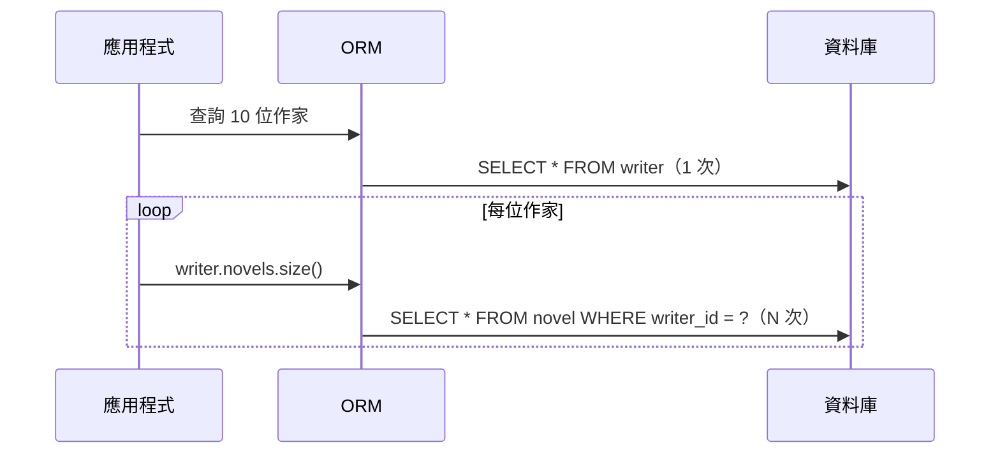

共 1 + N = 11 次查詢；N 越大越慢，而且每一次都是一個網路往返。

本章範例使用的模型：

```java
@Entity
class Writer {
    @Id
    Long id;
    @Column(length = 100)
    String name;
    @OneToMany(mappedBy = "writer")
    List<Novel> novels = new ArrayList<>();
    @OneToMany(mappedBy = "writer")
    List<Award> awards = new ArrayList<>();
}

@Entity
class Novel {
    @Id
    Long id;
    @Column(length = 200)
    String title;
    @ManyToOne(fetch = FetchType.LAZY)
    Writer writer;
}

@Entity
class Award {
    @Id
    Long id;
    @Column(length = 100)
    String name;
    @ManyToOne(fetch = FetchType.LAZY)
    Writer writer;
}
```

```python
class Writer(Base):
    __tablename__ = "py_writer"

    id: Mapped[int] = mapped_column(primary_key=True)
    name: Mapped[str] = mapped_column(String(100))
    novels: Mapped[list["Novel"]] = relationship(back_populates="writer", order_by="Novel.id")


class Novel(Base):
    __tablename__ = "py_novel"

    id: Mapped[int] = mapped_column(primary_key=True)
    title: Mapped[str] = mapped_column(String(200))
    price: Mapped[Decimal] = mapped_column(Numeric(19, 2))
    writer_id: Mapped[int] = mapped_column(ForeignKey("py_writer.id"))
    writer: Mapped["Writer"] = relationship(back_populates="novels")
```

### 10.3 載入規則

#### ORM-FET-001 依使用情境以 fetch join、Entity Graph 或 selectinload 一次載入所需關聯

- **等級**：必須
- **適用**：Java、Python
- **說明**：需要關聯資料的查詢，在查詢中宣告要載入什麼：JPQL `left join fetch`、Jakarta Persistence Entity Graph（`jakarta.persistence.fetchgraph` 提示）、Spring Data `@EntityGraph(attributePaths = ...)`；SQLAlchemy 對集合用 `selectinload()`、對多對一用 `joinedload()`。
- **原因**：迴圈中觸發延遲載入，查詢次數與資料筆數成正比；在列表 API 上是最常見的效能事故。

❌ 反例（Java）：

```java
// ❌ N+1：1 次查作家 + 每位作家 1 次查小說
int total = jpa.txr(em -> {
    List<Writer> writers = em.createQuery("from Writer w order by w.id", Writer.class).getResultList();
    int sum = 0;
    for (Writer w : writers) {
        sum += w.novels.size();          // 觸發延遲載入
    }
    return sum;
});
```

✅ 正例（JPQL fetch join）：

```java
// ✅ 依使用情境以 join fetch 一次載入
List<Writer> writers = jpa.txr(em -> em.createQuery(
        "select w from Writer w left join fetch w.novels order by w.id", Writer.class)
        .getResultList());
```

✅ 正例（Entity Graph）：

```java
// ✅ 或以 Entity Graph 宣告要載入的屬性（Jakarta Persistence 標準，查詢字串保持不變）
List<Writer> viaGraph = jpa.txr(em -> {
    EntityGraph<Writer> graph = em.createEntityGraph(Writer.class);
    graph.addAttributeNode("novels");
    return em.createQuery("from Writer w order by w.id", Writer.class)
            .setHint("jakarta.persistence.fetchgraph", graph)
            .getResultList();
});
```

✅ 正例（Spring Data JPA）：

<!-- from: java/src/test/java/ch09/BookRepository.java -->
```java
@EntityGraph(attributePaths = "author")
List<Book> findByPriceLessThanOrderById(BigDecimal price);
```

❌ 反例（Python）：

```python
# ❌ N+1：預設 lazy="select"，迴圈中逐一載入
writers = s.scalars(select(Writer).order_by(Writer.id)).all()
total = sum(len(w.novels) for w in writers)
```

✅ 正例（Python）：

```python
# ✅ 集合用 selectinload（第二次查詢以 IN 載入）；多對一用 joinedload
writers = s.scalars(select(Writer).options(selectinload(Writer.novels)).order_by(Writer.id)).all()
novels = s.scalars(select(Novel).options(joinedload(Novel.writer)).order_by(Novel.id)).all()
total = sum(len(w.novels) for w in writers)
names = {n.writer.name for n in novels}
```

**如何 review**：迴圈內存取關聯屬性（`for w in writers: w.getNovels()`）、DTO 轉換時存取關聯，而查詢本身沒有 fetch join / Entity Graph / loader option。

**如何驗證**：以查詢次數斷言（[ORM-TST-002](#orm-tst-002-以查詢次數斷言防止-n1-與效能回歸)）。實測（四種資料庫）：

| 寫法 | SQL 句數（10 位作家 × 3 本小說） |
| --- | --- |
| ❌ 延遲載入迴圈（Java / Python） | 11 / 11 |
| ✅ `left join fetch` | 1 |
| ✅ Entity Graph | 1 |
| ✅ Spring Data `@EntityGraph`（8 本書 + 作者） | 1 |
| ✅ Python `selectinload` + `joinedload`（兩個查詢） | 3 |

（`FetchingTest#nPlusOneVersusFetchJoinAndEntityGraph`、`BookRepositoryTest#entityGraphLoadsAuthorInOneQuery`、`test_n_plus_one_and_selectinload`）

#### ORM-FET-002 以 batch fetch（Java）與 raiseload（Python）作為 N+1 的安全網

- **等級**：建議
- **適用**：Java、Python
- **說明**：
  - Java：全域設定 `hibernate.default_batch_fetch_size`（建議 16～50），遺漏 fetch join 的延遲載入會以 `IN (...)` 一次載入多個集合，N+1 降為 1 + ⌈N/批次大小⌉。
  - Python：在查詢加上 `raiseload("*")`（或關聯宣告 `lazy="raise"`），任何未預先載入的關聯在存取時直接拋錯，於開發與測試期就發現問題。
- **原因**：fetch join 需要每個查詢都正確宣告，難免遺漏；安全網讓遺漏的代價從「線性」降為「常數」或「立即失敗」。

✅ 正例（Java）：

```java
// ✅ 全域設定 batch fetch：延遲載入時一次以 IN (...) 載入多個集合，N+1 → 1 + ⌈N/16⌉
Map<String, Object> settings = Map.of("hibernate.default_batch_fetch_size", "16");
```

✅ 正例（Python）：

```python
# ✅ raiseload("*")：任何未預先載入的關聯在存取時直接拋錯，開發/測試期即可發現 N+1
w = s.scalars(select(Writer).options(raiseload("*")).where(Writer.id == 1)).one()
with pytest.raises(InvalidRequestError, match="lazy='raise'"):
    w.novels
```

❌ 反例：沒有任何安全網，N+1 只能等正式環境變慢才發現。

**如何 review**：`application.yml` 是否設定 `default_batch_fetch_size`；Python 測試是否對關鍵查詢使用 `raiseload`。

**如何驗證**：實測（四種資料庫）同樣的延遲載入迴圈，設定 `default_batch_fetch_size=16` 後由 11 句降為 2 句（`FetchingTest#batchFetchingIsASafetyNet`）；Python `raiseload` 存取 `novels` 拋 `InvalidRequestError`（訊息含 `lazy='raise'`）。

#### ORM-FET-003 不可同時 fetch join 兩個以上的 List（bag）集合

- **等級**：必須
- **適用**：Java
- **說明**：一次查詢中 fetch join 兩個 `List` 集合會拋 `MultipleBagFetchException`。改為**分成兩個查詢**（同一個 Persistence Context 中，第二個查詢補齊同一批實體的另一個集合），或將集合改為 `Set`（但會產生笛卡兒積，資料量大時仍應分開查詢）。
- **原因**：多個集合 JOIN 產生笛卡兒積（作家 × 小說 × 獎項），bag 無法還原；即使改用 `Set` 讓 Hibernate 接受，回傳列數也會乘倍放大。

❌ 反例：

```java
// ❌ 同時 fetch join 兩個 List（bag）：笛卡兒積無法還原 → MultipleBagFetchException
assertThatThrownBy(() -> jpa.txr(em -> em.createQuery("""
        select w from Writer w
        left join fetch w.novels
        left join fetch w.awards""", Writer.class).getResultList()))
        .hasStackTraceContaining("MultipleBagFetchException");
```

✅ 正例：

```java
// ✅ 分成兩次查詢：同一個 persistence context 中，第二次查詢補齊同一批 Writer 的另一個集合
List<Writer> writers = jpa.txr(em -> {
    List<Writer> list = em.createQuery(
            "select w from Writer w left join fetch w.novels order by w.id", Writer.class)
            .getResultList();
    em.createQuery("select w from Writer w left join fetch w.awards where w in :writers", Writer.class)
            .setParameter("writers", list)
            .getResultList();
    return list;
});
```

**如何 review**：一個 JPQL 中出現兩個以上 `join fetch` 指向集合屬性。

**如何驗證**：實測（四種資料庫）反例拋出含 `MultipleBagFetchException` 的例外；正例 2 句 SQL 載入每位作家 3 本小說與 3 個獎項（`FetchingTest#twoBagFetchesFail`）。

#### ORM-FET-004 不以 enable_lazy_load_no_trans 或 EAGER「解決」LazyInitializationException

- **等級**：必須
- **適用**：Java
- **說明**：`LazyInitializationException` 代表「在交易外存取了未載入的資料」，正確的修正是在交易內決定要載入的資料（fetch join / Entity Graph / DTO 投影）。不要設定 `hibernate.enable_lazy_load_no_trans=true`、不要改成 EAGER、不要依賴 OSIV（[ORM-ENV-003](#orm-env-003-關閉-open-session-in-viewspringjpaopen-in-view-false)）。
- **原因**：`enable_lazy_load_no_trans` 讓每次延遲載入都**暫時開新 Session 與連線**，N+1 被搬到交易之外、每次取得新連線，且讀到的資料不在任何交易一致性範圍內。

❌ 反例：

```java
// ❌ 以 enable_lazy_load_no_trans 「解決」LazyInitializationException：
//    每次存取都暫時開新 Session 與連線，N+1 被隱藏到交易之外
Map<String, Object> antiPattern = Map.of("hibernate.enable_lazy_load_no_trans", "true");
```

✅ 正例：見 [ORM-FET-001](#orm-fet-001-依使用情境以-fetch-joinentity-graph-或-selectinload-一次載入所需關聯)；或以 DTO 投影在交易內完成轉換（[ORM-ARC-001](#orm-arc-001-entity-不直接作為-api-請求或回應於交易內轉為-dto)）。

**如何 review**：設定檔中出現 `enable_lazy_load_no_trans`；為了消除例外而把關聯改為 EAGER 的 diff。

**如何驗證**：實測（四種資料庫）不設定時，交易外存取 `novels` 拋 `LazyInitializationException`（問題被正確暴露）；設定後不拋例外，但 10 位作家額外送出 10 句 SQL、開啟 10 個 Session（`Statistics.getSessionOpenCount() == 10`，`FetchingTest#lazyLoadNoTransHidesNPlusOne`）。

### 10.4 小結

| 問題 | 首選 | 安全網 |
| --- | --- | --- |
| 列表需要關聯資料 | fetch join / Entity Graph / `selectinload` | `default_batch_fetch_size` / `raiseload` |
| 兩個集合 | 分兩次查詢 | — |
| LazyInitializationException | 交易內決定載入範圍或投影 DTO | — |

---

## 11. 交易與並行控制

### 11.1 交易邊界

一個「使用案例」（下單、轉帳、核准）對應一個交易；交易邊界放在**服務層**，而不是 Repository 或 Controller。Spring 以 `@Transactional` 宣告，Jakarta Persistence 3.2 可用 `runInTransaction`，SQLAlchemy 以 `with session.begin():`。

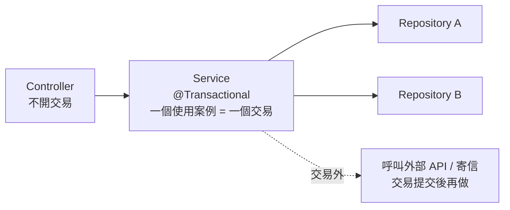

交易內**不要**做遠端呼叫、等待使用者輸入、大量檔案 I/O：交易越長，持有連線與鎖的時間越長，越容易逾時、死結與耗盡連線池。

### 11.2 交易規則

#### ORM-TX-001 交易邊界放在服務層，查詢方法使用 readOnly

- **等級**：必須
- **適用**：Java、Python
- **說明**：在服務層的公開方法上宣告 `@Transactional`；只讀取資料的方法使用 `@Transactional(readOnly = true)`——Spring 會把 Hibernate Session 設為唯讀（`FlushMode.MANUAL`、不保留快照），JDBC 連線也會設為 read-only。
- **原因**：交易邊界散落在 Repository 會讓一個使用案例拆成多個交易，失去原子性；唯讀交易同時節省記憶體並防止意外寫回（[ORM-CTX-001](#orm-ctx-001-了解自動髒檢查交易內修改-managed-物件就會寫回唯讀情境使用-dto-或唯讀查詢)）。

✅ 正例：

<!-- from: java/src/test/java/ch11/TransactionalServiceTest.java -->
```java
@Service
class LedgerService {

    @PersistenceContext
    EntityManager em;

    // ✅ 交易邊界在服務層：一個使用案例 = 一個交易
    @Transactional
    public void create(long id, String memo) {
        Ledger l = new Ledger();
        l.id = id;
        l.memo = memo;
        em.persist(l);
    }

    // ✅ 查詢使用 readOnly：Hibernate 設為唯讀 Session（FlushMode.MANUAL、不保留快照）
    @Transactional(readOnly = true)
    public String readAndTouch(long id) {
        Ledger l = em.find(Ledger.class, id);
        l.memo = l.memo + "（被意外修改）";      // 唯讀交易中不會寫回
        return l.memo;
    }
}
```

❌ 反例：在 Controller 依序呼叫兩個各自有 `@Transactional` 的 Repository 方法（扣款與入帳分屬兩個交易，中間失敗就不一致）。

**如何 review**：`@Transactional` 出現在 Controller 或 Repository 自訂方法上；Service 的查詢方法沒有 `readOnly = true`；交易方法內出現 HTTP client、訊息發送、`Thread.sleep`。

**如何驗證**：實測（四種資料庫）唯讀交易中修改實體後，資料庫仍為「原始」（`TransactionalServiceTest#readOnlyTransactionDoesNotFlush`）。

#### ORM-TX-002 不在同一個類別內自我呼叫 @Transactional 方法

- **等級**：必須
- **適用**：Java（Spring）
- **說明**：Spring 的宣告式交易透過代理（proxy）實作；`this.method()` 不經過代理，被呼叫方法上的 `@Transactional` 不會生效。把交易標註在對外的入口方法，或把被呼叫的方法移到另一個 Bean。
- **原因**：看似有交易、實際上沒有：寫入時拋出 `TransactionRequiredException`，或更糟——在沒有交易的情況下逐筆自動提交，失去原子性。

❌ 反例：

```java
// ❌ 自我呼叫：this.create(...) 不經過 Spring 代理，@Transactional 不生效
public void importAll(long firstId) {
    for (long i = 0; i < 3; i++) {
        this.createInternal(firstId + i, "import");
    }
}

@Transactional
public void createInternal(long id, String memo) {
    Ledger l = new Ledger();
    l.id = id;
    l.memo = memo;
    em.persist(l);
}
```

✅ 正例：

```java
// ✅ 交易標註在對外的入口方法（或拆到另一個 Bean），由代理開啟交易
@Service
class LedgerImportService {

    private final LedgerService ledgers;

    LedgerImportService(LedgerService ledgers) {
        this.ledgers = ledgers;
    }

    @Transactional
    public void importAll(long firstId) {
        for (long i = 0; i < 3; i++) {
            ledgers.createInternal(firstId + i, "import");   // 經由代理呼叫，加入同一交易
        }
    }
}
```

**如何 review**：同一類別中，沒有 `@Transactional` 的方法以 `this.` 或直接呼叫有 `@Transactional` 的方法；`private` 方法上的 `@Transactional`（不會生效）。

**如何驗證**：實測（四種資料庫）反例拋 `TransactionRequiredException`；正例三筆皆寫入（`TransactionalServiceTest#selfInvocationBypassesTransaction`）。

#### ORM-TX-003 會被並行修改的實體使用樂觀鎖（@Version / version_id_col）

- **等級**：必須
- **適用**：Java、Python
- **說明**：庫存、餘額、狀態等可能被多個使用者同時修改的實體，加上版本欄位：Java `@Version`（`long` / `Integer` / `Instant`），SQLAlchemy `__mapper_args__ = {"version_id_col": version}`。UPDATE 會帶上 `WHERE version = ?`，影響 0 筆即拋 `OptimisticLockException` / `StaleDataError`。
- **原因**：沒有版本欄位時，「讀取 → 修改 → 寫回」會互相覆蓋（lost update），而且**不會有任何錯誤**。

❌ 反例：

```java
// ❌ 沒有版本欄位：兩個交易先後讀取同一筆，後提交者覆蓋前者（lost update）
@Entity
class StockBad {
    @Id
    Long id;
    int quantity;
}
```

✅ 正例：

```java
// ✅ @Version：UPDATE ... WHERE id = ? AND version = ?，影響 0 筆即拋 OptimisticLockException
@Entity
class Stock {
    @Id
    Long id;
    int quantity;
    @Version
    long version;
}
```

✅ 正例（Python）：

```python
class Stock(Base):
    __tablename__ = "py_stock"

    id: Mapped[int] = mapped_column(primary_key=True)
    quantity: Mapped[int]
    version: Mapped[int] = mapped_column(Integer, nullable=False)
    # ✅ 樂觀鎖：UPDATE ... WHERE id = ? AND version = ?；影響 0 筆即拋 StaleDataError
    __mapper_args__ = {"version_id_col": version}
```

**如何 review**：會被多人修改的實體沒有 `@Version`；API 更新流程沒有把版本號帶回前端再送回（長對話式編輯）。

**如何驗證**：實測（四種資料庫，Java 與 Python）兩個交易同時讀到庫存 10、分別扣 3 與扣 5：無版本時結果為 5（扣 3 遺失）；有版本時第二個交易被拒絕、結果為 7（`ConcurrencyTest#optimisticLockingPreventsLostUpdate`、`test_lost_update_vs_version`）。

#### ORM-TX-004 悲觀鎖必須設定逾時，並了解各資料庫的實際行為

- **等級**：必須
- **適用**：Java、Python
- **說明**：確實需要「先鎖再改」時（例如序號配發、高衝突熱點），Java 使用 `LockModeType.PESSIMISTIC_WRITE` 並以 `jakarta.persistence.lock.timeout` 設定逾時；Python 需注意方言差異（見下表）。**Db2 不採用 JPA 的 lock.timeout 提示**，必須設定 `CURRENT LOCK TIMEOUT`（JCC 連線屬性 `currentLockTimeout`）或資料庫參數 `LOCKTIMEOUT`——其預設值 **-1 代表無限等待**。
- **原因**：沒有逾時的鎖等待會讓執行緒與連線無限期卡住，最後整個服務不可用。

✅ 正例（Java）：

```java
// ✅ 悲觀鎖：必須設定逾時，避免無限期等待
BankAccount locked = holder.find(BankAccount.class, 1L, LockModeType.PESSIMISTIC_WRITE,
        Map.of("jakarta.persistence.lock.timeout", 2000));
```

❌ 反例（Python，SQL Server 上 `with_for_update()` 被靜默忽略、Db2 上直接拋錯）：

```python
# ❌ 直接使用 with_for_update()：SQL Server 上沒有任何鎖定提示（不加鎖、不報錯）
plain = select(Stock).where(Stock.id == 3).with_for_update()
```

✅ 正例（Python，可攜的鎖定輔助函式）：

```python
def locked(stmt, entity, dialect_name, nowait=False):
    """✅ 可攜的「SELECT ... 加更新鎖」：
    - SQL Server：SQLAlchemy 2.1 會「靜默忽略」with_for_update()，必須改用表格提示
    - Db2：ibm_db_sa 0.4.4 搭配 SQLAlchemy 2.1 呼叫 with_for_update() 會拋 AttributeError
    """
    if dialect_name == "mssql":
        hint = "WITH (UPDLOCK, ROWLOCK, NOWAIT)" if nowait else "WITH (UPDLOCK, ROWLOCK)"
        return stmt.with_hint(entity, hint, "mssql")
    if dialect_name == "ibm_db_sa":
        return stmt.suffix_with("FOR READ ONLY WITH RS USE AND KEEP UPDATE LOCKS")
    return stmt.with_for_update(nowait=nowait)
```

實測各資料庫的悲觀鎖 SQL 與逾時行為（Hibernate 7.4.5、SQLAlchemy 2.1.4）：

| 資料庫 | Hibernate `PESSIMISTIC_WRITE` 產生的 SQL | `lock.timeout = 2000` 時第二個交易 | SQLAlchemy `with_for_update()` |
| --- | --- | --- | --- |
| PostgreSQL 18.6 | `... for no key update of ba1_0` | 約 2.1 秒後 `PessimisticLockException`（lock timeout） | `FOR UPDATE`（`nowait=True` 為 `FOR UPDATE NOWAIT`） |
| Oracle 26ai | `... for update of ba1_0.id wait 2` | 約 2.1 秒後 `LockTimeoutException`（ORA-00054） | `FOR UPDATE` |
| SQL Server 2025 | `... with (updlock,holdlock,rowlock)` | 約 2.2 秒後 `LockTimeoutException`（Lock request time out period exceeded） | **被忽略（沒有任何鎖定提示）**，需改用 `with_hint(..., "WITH (UPDLOCK, ROWLOCK)")` |
| Db2 12.1.5 | `... for read only with rs use and keep update locks` | **忽略提示**，等到 `CURRENT LOCK TIMEOUT`（測試設 10 秒）才以 SQLCODE -911 rc 68 失敗，且整個交易被 rollback | ibm_db_sa 0.4.4 拋 `AttributeError: 'Select' object has no attribute 'for_update'`；以 `suffix_with()` 自行加上鎖定子句 |

**如何 review**：`PESSIMISTIC_WRITE` 沒有逾時設定；Db2 環境的連線設定沒有 `currentLockTimeout`；Python 在 SQL Server / Db2 上直接使用 `with_for_update()`。

**如何驗證**：以兩個交易並行測試（第一個持鎖、第二個嘗試取得同一筆的鎖），斷言第二個在預期時間內失敗（`ConcurrencyTest#pessimisticLockSqlAndTimeoutPerDatabase`、`test_for_update`）。

#### ORM-TX-005 只重試可重試的錯誤，重試整個交易並設上限

- **等級**：必須
- **適用**：Java、Python
- **說明**：樂觀鎖衝突、死結（SQLSTATE 40001 / 40P01、SQL Server 1205、Db2 -911 rc 2）、序列化失敗屬於「可重試」錯誤：重新開始**整個交易**（重新讀取最新資料）並設定最大次數與退避。約束違反、語法錯誤等不可重試。Spring Framework 7 內建 `@Retryable`（需 `@EnableResilientMethods`；Spring 代理規則同 [ORM-TX-002](#orm-tx-002-不在同一個類別內自我呼叫-transactional-方法)）。
- **原因**：只重試最後一個 SQL（而不是整個交易）會用舊資料覆寫；無上限的重試會在高衝突時放大負載。

✅ 正例（Java）：

```java
// ✅ 只對「可重試」的例外重試整個交易，次數有上限；每次重試都重新讀取最新資料
static <R> R inTransactionWithRetry(EntityManagerFactory emf, int maxAttempts,
                                    java.util.function.Function<EntityManager, R> work) {
    for (int attempt = 1; ; attempt++) {
        try {
            return emf.callInTransaction(work);
        } catch (PersistenceException e) {
            boolean retryable = e instanceof OptimisticLockException
                    || e.getCause() instanceof OptimisticLockException;
            if (!retryable || attempt >= maxAttempts) {
                throw e;
            }
        }
    }
}
```

✅ 正例（Python）：

```python
def run_with_retry(session_factory, work, max_attempts=10):
    """✅ 只重試可重試的錯誤（樂觀鎖衝突），且每次重新開啟交易、重新讀取。"""
    for attempt in range(1, max_attempts + 1):
        try:
            with session_factory.begin() as session:
                return work(session)
        except StaleDataError:
            if attempt == max_attempts:
                raise
```

❌ 反例：捕捉 `OptimisticLockException` 後在同一個 `EntityManager` 中再呼叫一次 `merge()`（交易已標記 rollback-only，見 [ORM-ERR-002](#orm-err-002-例外發生後丟棄該交易與-entitymanager--session不可吞掉例外繼續使用)），或以 `while (true)` 無限重試。

**如何 review**：重試迴圈是否包住整個交易方法；是否限定例外類型；是否有次數上限。

**如何驗證**：實測（四種資料庫）20 個並行交易各將庫存 +1（Java 4 執行緒、Python 10 執行緒），在重試下最終值精確為 20 / 10（`ConcurrencyTest#retryResolvesOptimisticConflicts`、`test_retry`）。

#### ORM-TX-006 依資料庫實際的隔離等級語意設計並行邏輯

- **等級**：建議
- **適用**：Java、Python
- **說明**：四種資料庫的 JDBC 預設隔離等級都是 READ COMMITTED，但**實作語意不同**。需要「讀取後依讀到的值寫入」的邏輯，以樂觀鎖或悲觀鎖保護，而不是假設隔離等級會替你處理。只有在確實需要時才提高隔離等級，並為序列化失敗加上重試（[ORM-TX-005](#orm-tx-005-只重試可重試的錯誤重試整個交易並設上限)）。
- **原因**：SQL Server 預設的 READ COMMITTED 是**鎖定式**讀取（讀會被寫阻擋），而 PostgreSQL / Oracle 是 MVCC 快照讀取；同一段程式在不同資料庫的阻塞與死結行為完全不同。

✅ 實測與說明：

| 資料庫 | JDBC 預設隔離（實測） | READ COMMITTED 的實作 | 備註 |
| --- | --- | --- | --- |
| PostgreSQL 18.6 | `TRANSACTION_READ_COMMITTED`（2） | MVCC，每個敘述一個快照 | `default_transaction_isolation = read committed` |
| Oracle 26ai | 2 | MVCC，敘述層級讀取一致性 | 不支援 READ UNCOMMITTED / REPEATABLE READ |
| SQL Server 2025 | 2 | **鎖定式**（共用鎖），讀被寫阻擋 | 實測容器 `is_read_committed_snapshot_on = 0`；可啟用 RCSI 改為快照讀取 |
| Db2 12.1.5 | 2（Db2 稱為 Cursor Stability） | `CUR_COMMIT = ON`：讀取「目前已提交」版本，不等待寫鎖 | 實測 `LOCKTIMEOUT = -1` |

❌ 反例：「先 `SELECT` 餘額、判斷足夠後 `UPDATE` 扣款」而沒有版本欄位或鎖——在四種資料庫的 READ COMMITTED 下都會超賣（與 [ORM-TX-003](#orm-tx-003-會被並行修改的實體使用樂觀鎖version--version_id_col) 的 lost update 同一機制）。

✅ 正例（條件式 UPDATE，不依賴隔離等級）：

```java
// ✅ 條件式 UPDATE：「檢查」與「寫入」在同一句 SQL 中完成，任何隔離等級下都不會超賣
static boolean withdraw(EntityManager em, long accountId, BigDecimal amount) {
    int updated = em.createQuery("""
                    update BankAccount a set a.balance = a.balance - :amount
                    where a.id = :id and a.balance >= :amount""")
            .setParameter("amount", amount)
            .setParameter("id", accountId)
            .executeUpdate();
    return updated == 1;               // 0 表示餘額不足（或帳戶不存在）
}
```

**如何 review**：「檢查後寫入（check-then-act）」的程式碼是否有樂觀鎖、悲觀鎖或條件式 UPDATE（`update ... set balance = balance - :x where id = :id and balance >= :x`）保護。

**如何驗證**：`ConcurrencyTest#defaultIsolationPerDatabase` 讀取 `Connection.getTransactionIsolation()`；實測（四種資料庫）餘額 100、10 個並行交易各扣 30，條件式 UPDATE 恰好 3 個成功、餘額 10.00（`ConcurrencyTest#conditionalUpdateNeverOversells`）。

### 11.3 小結

- 交易邊界在服務層；查詢用 readOnly；不自我呼叫。
- 樂觀鎖是預設的並行控制；悲觀鎖必須有逾時，且要知道 Db2 與 SQL Server 的特殊行為。
- 重試整個交易、只重試可重試錯誤、有上限。

---

## 12. Schema 演進與遷移

### 12.1 遷移流程

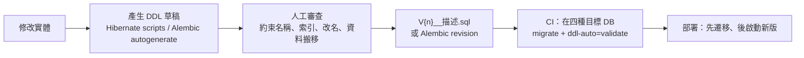

| 工具 | 語言 | 遷移格式 | 特色 |
| --- | --- | --- | --- |
| Flyway 12.4（Boot 4.1.1 管理） | Java / CLI | `V{版本}__{描述}.sql` | 簡單、SQL 為主；`{vendor}` 目錄區分資料庫 |
| Liquibase 5.0 | Java / CLI | XML / YAML / SQL changelog | 資料庫無關的變更描述、rollback |
| Alembic 1.20 | Python | Python revision 檔 | 與 SQLAlchemy 模型整合、autogenerate |

### 12.2 遷移規則

#### ORM-MIG-001 Schema 變更一律以版本化遷移腳本管理，DDL 草稿須人工審查後才納入

- **等級**：必須
- **適用**：Java、Python
- **說明**：所有 DDL 由 Flyway / Liquibase / Alembic 腳本管理、納入版本控制，並在 CI 中於目標資料庫執行後以 `ddl-auto=validate` 驗證。可以讓 Hibernate 產生 DDL「草稿」作為起點，但必須人工補上約束名稱、索引、資料搬移等，才成為正式腳本。
- **原因**：自動產生的 DDL 不知道業務意義（約束命名、部分唯一索引、資料轉換），也不會處理不同資料庫對同一語意的差異。

✅ 產生 DDL 草稿（不修改資料庫）：

```java
// 產生 DDL 草稿到檔案（不連線修改資料庫）；草稿須人工審查後才成為 V1__*.sql
new PersistenceConfiguration("ddl-draft")
        .managedClass(MigCustomer.class)
        .property(PersistenceConfiguration.JDBC_URL, db.url)
        .property(PersistenceConfiguration.JDBC_USER, db.user)
        .property(PersistenceConfiguration.JDBC_PASSWORD, db.password)
        .property(PersistenceConfiguration.SCHEMAGEN_SCRIPTS_ACTION, "create")
        .property("jakarta.persistence.schema-generation.scripts.create-target", target.toString())   // 見下方說明
        .property("hibernate.format_sql", "true")
        .property("hibernate.hbm2ddl.delimiter", ";")
        .createEntityManagerFactory()
        .close();
```

> 注意：此處使用完整屬性名稱 `jakarta.persistence.schema-generation.scripts.create-target`。`jakarta.persistence-api` 3.2.0 的常數 `PersistenceConfiguration.SCHEMAGEN_CREATE_TARGET` 少了 `.scripts.`，Hibernate 7.4.5 不會讀取（實測，[2.1](#21-jakarta-persistence-32)）。

實測 Hibernate 7.4.5 產生的草稿（同一個實體，`name` 標註 `@Nationalized`）：

| 資料庫 | `id` | `name` | `email` |
| --- | --- | --- | --- |
| PostgreSQL | `bigint` | `varchar(100)` | `varchar(200)` |
| Oracle | `number(19,0)` | `nvarchar2(100)` | `varchar2(200 char)` |
| SQL Server | `bigint` | `nvarchar(100)` | `varchar(200)` |
| Db2 | `bigint` | `nvarchar(100)` | `varchar(200)` |

✅ 審查後的正式遷移腳本（每種資料庫一份，以 `{vendor}` 目錄區分）：

```sql
-- 由 Hibernate 草稿審查後定稿：補上約束名稱與唯一鍵
create table mig_customer (
    id      bigint       not null,
    version bigint       not null,
    name    varchar(100) not null,
    email   varchar(200),
    constraint pk_mig_customer primary key (id),
    constraint uk_mig_customer_email unique (email)
);
```

```sql
-- 由 Hibernate 草稿審查後定稿：補上約束名稱與唯一鍵（SQL Server 的 UNIQUE 只允許一個 NULL，改用篩選索引）
create table mig_customer (
    id      bigint        not null,
    version bigint        not null,
    name    nvarchar(100) not null,
    email   varchar(200),
    constraint pk_mig_customer primary key (id)
);
create unique index uk_mig_customer_email on mig_customer (email) where email is not null;
```

```sql
-- 由 Hibernate 草稿審查後定稿：補上約束名稱與唯一鍵（Db2 的 UNIQUE 約束欄位須 NOT NULL，改用 EXCLUDE NULL KEYS 索引）
create table mig_customer (
    id      bigint        not null,
    version bigint        not null,
    name    nvarchar(100) not null,
    email   varchar(200),
    constraint pk_mig_customer primary key (id)
);
create unique index uk_mig_customer_email on mig_customer (email) exclude null keys;
```

```sql
-- 由 Hibernate 草稿審查後定稿：補上約束名稱與唯一鍵
create table mig_customer (
    id      number(19,0)       not null,
    version number(19,0)       not null,
    name    nvarchar2(100)     not null,
    email   varchar2(200 char),
    constraint pk_mig_customer primary key (id),
    constraint uk_mig_customer_email unique (email)
);
```

✅ Spring Boot 4.1：啟動時先執行 Flyway，再驗證：

```java
"spring.flyway.enabled=true",
"spring.flyway.locations=classpath:db/migration/{vendor}",   // {vendor}：postgresql、oracle、sqlserver、db2
"spring.jpa.hibernate.ddl-auto=validate"
```

❌ 反例：正式環境 `ddl-auto: update`（[ORM-ENV-002](#orm-env-002-正式環境的-schema-只驗證不修改ddl-auto-validate-或-none)），或把 Hibernate 產生的 DDL 原封不動放進 `V1__init.sql`（約束名稱為隨機字串，如實測的 `UK3k4cplvh82srueuttfkwnylq0`）。

**如何 review**：

- 實體變更的 PR 必須同時包含遷移腳本；腳本中的約束、索引有明確名稱。
- 可為 NULL 的唯一欄位：SQL Server 需篩選索引（`where email is not null`）、Db2 需 `exclude null keys` 索引——兩者的 UNIQUE 約束對 NULL 的處理與 PostgreSQL / Oracle 不同。

**如何驗證**：實測（四種資料庫）Flyway 套用 2 個版本後，以 `hbm2ddl.auto=validate` 啟動成功（`FlywayMigrationTest#migrateThenValidateBothVersions`、`BootFlywayTest#migrationsAppliedAndValidated`）。

#### ORM-MIG-002 自動產生的遷移必須人工審查，特別是「改名」

- **等級**：必須
- **適用**：Python（Alembic autogenerate）、Java（Liquibase diff / 任何 diff 工具）
- **說明**：Alembic `--autogenerate` 比對模型與資料庫，但**無法辨識改名**——欄位或表改名會被產生為「刪除舊的 + 新增新的」，直接套用即遺失資料。每個自動產生的 revision 都要人工檢查，把改名改寫為 `op.alter_column(..., new_column_name=...)`。在共用 schema 中以 `include_name` / `include_object` 限定比對範圍。
- **原因**：自動產生只能比對「結構差異」，不知道「意圖」。

❌ 反例：

```python
# ❌ autogenerate 無法辨識「改名」，產生 drop + add：直接套用會遺失 email 資料
ctx = MigrationContext.configure(conn, opts={"include_name": owned})
diff = compare_metadata(ctx, v2)
ops = sorted(d[0] for d in diff)
```

✅ 正例：

```python
# ✅ 人工修正遷移腳本：改用 alter_column(new_column_name=...) 保留資料
op = Operations(MigrationContext.configure(conn))
op.alter_column("py_mig_customer", "email", new_column_name="email_address",
                existing_type=String(200))
```

> **Db2 + Alembic**：Alembic 1.20 沒有內建 Db2 實作（`KeyError: 'ibm_db_sa'`），IBM 的 `ibm_db_alembic` 0.2.0 停更於 2018 年且未註冊 `ibm_db_sa` 方言。實測以下最小實作可讓比對與改名在 Db2 上執行（Db2 的改名語法為 `RENAME COLUMN`）：

```python
# Alembic 1.20 未內建 Db2 實作（ibm_db_alembic 0.2.0 停更於 2018 且未註冊 ibm_db_sa）：
# 自行註冊最小實作，讓 autogenerate 比對與一般 op.* 可在 Db2 上執行
from alembic.ddl.base import ColumnName, format_column_name, format_table_name
from alembic.ddl.impl import DefaultImpl
from sqlalchemy.ext.compiler import compiles


class Db2Impl(DefaultImpl):
    __dialect__ = "ibm_db_sa"


@compiles(ColumnName, "ibm_db_sa")
def _db2_rename_column(element, compiler, **kw):
    # Db2 語法為 RENAME COLUMN（Alembic 預設產生 RENAME x TO y）
    return "ALTER TABLE %s RENAME COLUMN %s TO %s" % (
        format_table_name(compiler, element.table_name, element.schema),
        format_column_name(compiler, element.column_name),
        format_column_name(compiler, element.newname),
    )
```

**如何 review**：autogenerate 產生的 revision 中，同一個表同時出現 `drop_column` 與 `add_column` → 確認是否為改名。

**如何驗證**：實測（四種資料庫）欄位改名時 `compare_metadata` 回傳 `add_column` + `remove_column`；改寫為 `alter_column` 後資料保留，且比對結果為空（`test_autogenerate_sees_rename_as_drop_and_add`、`test_handwritten_rename_keeps_data`）。CI 可執行 `alembic check` 確認模型與資料庫一致。

#### ORM-MIG-003 不停機部署採 Expand / Contract：先擴充、後收斂，同一版不刪除或改名舊欄位

- **等級**：必須
- **適用**：Java、Python
- **說明**：滾動部署期間新舊版程式同時運行。破壞性變更拆成多個版本：
  1. **Expand**：新增可為 NULL 的新欄位（新舊版都能運作）。
  2. **Migrate**：新版程式雙寫、背景搬移資料。
  3. **Contract**：確認舊版已全部下線後，才刪除舊欄位或改名。
- **原因**：在同一版直接改名或刪除，仍在運行的舊版程式立即失敗（`ddl-auto=validate` 的新執行個體甚至無法啟動）。

✅ Expand：

```sql
-- Expand：只新增「可為 NULL」的欄位；舊版程式不受影響
alter table mig_customer add phone varchar(30);
```

❌ 一次改名（PostgreSQL / Oracle 寫法）：

```sql
-- ❌ 在同一版直接改名：仍在執行的舊版程式立即找不到 email 欄位
alter table mig_customer rename column email to email_address;
```

不同資料庫「改名」的額外限制（實測）：

```sql
-- ❌ 在同一版直接改名：仍在執行的舊版程式立即找不到 email 欄位
-- （SQL Server：被索引參照的欄位不能 sp_rename，須先刪索引；
--   同一批次會先整批編譯，引用改名後欄位的敘述須以 GO 分批）
drop index uk_mig_customer_email on mig_customer;
exec sp_rename 'mig_customer.email', 'email_address', 'COLUMN';
GO
create unique index uk_mig_customer_email on mig_customer (email_address) where email_address is not null;
```

```sql
-- ❌ 在同一版直接改名：仍在執行的舊版程式立即找不到 email 欄位
-- （Db2：被索引參照的欄位不能 RENAME COLUMN，SQLCODE -478，須先刪索引）
drop index uk_mig_customer_email;
alter table mig_customer rename column email to email_address;
create unique index uk_mig_customer_email on mig_customer (email_address) exclude null keys;
```

**如何 review**：遷移腳本中的 `drop column`、`rename`、`alter column ... not null` 是否與「舊版已下線」的部署步驟對應。

**如何驗證**：實測（四種資料庫）Expand 後舊版實體（無 `phone`）與新版實體（有 `phone`）都能通過 `validate`；套用改名後，舊版實體啟動失敗並回報 `missing column [email]`（`FlywayMigrationTest#renamingInOneStepBreaksRunningOldVersion`）。SQL Server 與 Db2 的改名必須先刪除相依索引，SQL Server 還需以 `GO` 分批（同一批次會先整批編譯，引用改名後欄位的敘述會失敗）。

#### ORM-MIG-004 已套用的遷移腳本不可修改，修正一律以新版本進行

- **等級**：必須
- **適用**：Java、Python
- **說明**：Flyway 以 checksum 記錄已套用的腳本；Alembic 以 revision 鏈記錄。發現錯誤時新增 `V{n+1}`（或新的 Alembic revision）修正，不要改舊檔。
- **原因**：修改已套用的腳本會讓不同環境的 schema 歷史分歧；Flyway `validate` 會拒絕啟動（checksum mismatch）。

❌ 反例：修改已部署的 `V1__create_customer.sql`：

```sql
-- 由 Hibernate 草稿審查後定稿：補上約束名稱與唯一鍵
create table mig_customer (
    id      bigint       not null,
    version bigint       not null,
    name    varchar(100) not null,
    email   varchar(200),
    constraint pk_mig_customer primary key (id),
    constraint uk_mig_customer_email unique (email)
);
-- ❌ 事後修改已套用的腳本（多加一個欄位）
alter table mig_customer add note varchar(10);
```

✅ 正例：保留 V1 原樣，新增下一個版本：

```sql
-- V3__add_note.sql
alter table mig_customer add note varchar(10);
```

CI 中以 Flyway `validate` 偵測：

<!-- from: java/src/test/java/ch12/FlywayMigrationTest.java -->
```java
flyway("classpath:db/migration/" + vendor(db)).migrate();
assertThatThrownBy(() -> flyway("classpath:db/migration-edited/" + vendor(db)).validate())
        .hasMessageContaining("checksum mismatch");               // ❌ 已套用的 V1 被修改
```

**如何 review**：PR 中修改了 `db/migration` 下既有版本號的檔案 → 退回（可在 CI 以 `git diff --name-status origin/main -- '**/db/migration/**'` 檢查狀態為 `M` 的檔案）。

**如何驗證**：實測（四種資料庫）修改已套用的 V1 後，`Flyway.validate()` 拋出含「checksum mismatch」的例外（`FlywayMigrationTest#editingAnAppliedMigrationIsDetected`）。

### 12.3 小結

- DDL 由遷移腳本管理；自動產生的只是草稿。
- 改名與刪除走 Expand / Contract；各資料庫的改名限制不同。
- 已套用的腳本不可修改。

---

## 13. 效能

### 13.1 效能問題的來源

ORM 的效能問題，幾乎都可以歸類為「送出太多句 SQL」或「載入太多資料」：

| 症狀 | 原因 | 對策 | 規則 |
| --- | --- | --- | --- |
| 列表 API 越來越慢 | N+1 | fetch join / Entity Graph / batch fetch | [ORM-FET-001](#orm-fet-001-依使用情境以-fetch-joinentity-graph-或-selectinload-一次載入所需關聯) |
| 匯入 1 萬筆要數分鐘 | 逐筆 INSERT 往返 | JDBC batch、SEQUENCE pooled | [ORM-PERF-001](#orm-perf-001-開啟-jdbc-批次寫入並排序-insert--update)、[ORM-MAP-001](#orm-map-001-主鍵優先使用-sequencepooled保留-jdbc-批次寫入能力) |
| 全表調價很慢 | 逐筆載入再更新 | 批次 UPDATE | [ORM-PERF-002](#orm-perf-002-大量修改使用批次-update--delete不逐筆載入) |
| 批次作業 OOM | Persistence Context 膨脹 | flush/clear、StatelessSession、串流 | [ORM-CTX-004](#orm-ctx-004-大量處理時定期-flush--clear避免-persistence-context-無限成長)、[ORM-PERF-003](#orm-perf-003-大量讀寫使用-statelesssession--串流並設定-fetch-size) |
| 熱門參考資料重複查詢 | 每次都查資料庫 | 二級快取（限參考資料） | [ORM-PERF-004](#orm-perf-004-二級快取只用於讀多寫極少且只由本應用程式修改的參考資料) |
| 報表查詢載入大量實體 | 用 ORM 做報表 | 投影、SQL-first | [ORM-QRY-001](#orm-qry-001-唯讀與列表查詢使用投影dto--介面--row不載入整個實體)、[ORM-SEL-001](#orm-sel-001-orm-與-sql-first-並用交易性存取用-orm報表與彙總用-sql-first) |

**先量測再調整**：開發環境開啟 SQL 日誌與 `hibernate.generate_statistics=true`，以查詢次數斷言把效能需求寫成測試（[ORM-TST-002](#orm-tst-002-以查詢次數斷言防止-n1-與效能回歸)）。

### 13.2 效能規則

#### ORM-PERF-001 開啟 JDBC 批次寫入並排序 INSERT / UPDATE

- **等級**：建議
- **適用**：Java、Python
- **說明**：Java 設定 `hibernate.jdbc.batch_size`（建議 20～50）、`hibernate.order_inserts`、`hibernate.order_updates`，主鍵使用 SEQUENCE（IDENTITY 會停用批次，[ORM-MAP-001](#orm-map-001-主鍵優先使用-sequencepooled保留-jdbc-批次寫入能力)）。Python 以一次 `session.execute(insert(Model), list_of_dicts)` 寫入大量資料（SQLAlchemy 2.x「insertmanyvalues」）。
- **原因**：每句 SQL 都是一次網路往返；批次把 N 次往返降為 N / batch_size 次。

✅ 正例（Java）：

```java
// ✅ 開啟 JDBC batch，並依實體類型排序 INSERT/UPDATE 以提高批次命中率
Map<String, Object> batching = Map.of(
        "hibernate.jdbc.batch_size", "50",
        "hibernate.order_inserts", "true",
        "hibernate.order_updates", "true");
```

✅ 正例（Python）：

```python
# ✅ ORM 批次 INSERT：一次 execute 傳入 list of dict（insertmanyvalues / executemany）
s.execute(insert(Item), [{"id": i, "sku": f"sku{i}", "price": Decimal(10)} for i in range(1000)])
```

❌ 反例：未設定 `batch_size`，或主鍵使用 IDENTITY 卻期待批次。

**如何 review**：大量寫入的程式所屬應用程式是否設定 `batch_size`；Python 是否在迴圈中逐筆 `session.add()` + `flush()`。

**如何驗證**：實測（四種資料庫）新增 100 筆：未開批次 103 句、開啟後 4 句（`PerformanceTest#jdbcBatchingReducesRoundTrips`）。Python 1,000 筆：PostgreSQL / Oracle / Db2 為 1 次 execute，**SQL Server 為 4 次**——SQL Server 單一敘述最多 2,100 個參數，SQLAlchemy 自動分批（`test_bulk_insert_and_update`）。

#### ORM-PERF-002 大量修改使用批次 UPDATE / DELETE，不逐筆載入

- **等級**：建議
- **適用**：Java、Python
- **說明**：對整批資料套用相同規則（調價、狀態批次變更、清除過期資料），使用 JPQL `update` / `delete` 或 SQLAlchemy `update()` / `delete()`，一句 SQL 在資料庫完成。注意批次語法會略過 Persistence Context、`@Version` 與生命週期回呼（[ORM-QRY-005](#orm-qry-005-批次-update--delete-之後persistence-context-必須同步)）。
- **原因**：逐筆載入 + 修改需要 N 個實體的記憶體、N 次髒檢查與 N 句 UPDATE。

❌ 反例：

```java
// ❌ 逐筆載入再修改：100 個 managed entity + 髒檢查 + 100 筆 UPDATE
jpa.tx(em -> em.createQuery("from Item", Item.class).getResultList()
        .forEach(i -> i.price = i.price.multiply(new BigDecimal("1.05"))));
```

✅ 正例：

```java
// ✅ 一句 UPDATE 在資料庫完成（注意：會略過 persistence context 與 @Version，見 ORM-QRY-005）
int rows = jpa.txr(em -> em.createQuery("update Item i set i.price = i.price * 1.05")
        .executeUpdate());
```

✅ 正例（Python）：

```python
# ✅ 批次 UPDATE：一句 SQL，不載入物件
s.execute(update(Item).values(price=Item.price * Decimal("1.05")))
```

**如何 review**：`findAll()` / `scalars(select(X))` 後以迴圈修改同一個欄位。

**如何驗證**：實測（四種資料庫）反例載入 100 個實體、100 次 entity update；正例 1 句 SQL 更新 100 列（`PerformanceTest#bulkUpdateInsteadOfLoadingEachEntity`）。

#### ORM-PERF-003 大量讀寫使用 StatelessSession / 串流，並設定 fetch size

- **等級**：建議
- **適用**：Java、Python
- **說明**：批次匯入、匯出、資料轉換使用 Hibernate `StatelessSession`（不維護 Persistence Context、沒有髒檢查與 cascade）。Hibernate 7 起 `hibernate.jdbc.batch_size` **不作用於** `StatelessSession`，寫入需使用 `insertMultiple()` 等批次方法。讀取以 `getResultStream()` 搭配 fetch size 逐筆處理；Python 使用 `execution_options(yield_per=N)`。Oracle JDBC 預設 fetch size 僅 10（Hibernate 7.4 啟動時記錄 `HHH100123: Low default JDBC fetch size: 10`），大量讀取應設定 `hibernate.jdbc.fetch_size`。
- **原因**：一般 Session 會為每個實體保留快照；一次 `getResultList()` 會把全部結果載入記憶體。

✅ 正例（Java）：

```java
// ✅ 大量匯入：StatelessSession 不維護 persistence context；Hibernate 7 以 insertMultiple 批次寫入
//    （Hibernate 7 起 hibernate.jdbc.batch_size 不作用於 StatelessSession，需用 *Multiple 或 setJdbcBatchSize）
SessionFactory sf = jpa.emf.unwrap(SessionFactory.class);
sf.inStatelessTransaction(ss -> {
    List<Item> items = Stream.iterate(0, i -> i + 1).limit(1_000)
            .map(i -> new Item("bulk" + i, BigDecimal.ONE)).toList();
    ss.insertMultiple(items);
});
// ✅ 大量讀取：以串流逐筆處理，不一次載入全部
BigDecimal total = sf.fromStatelessTransaction(ss -> {
    try (Stream<Item> stream = ss.createSelectionQuery("from Item", Item.class)
            .setFetchSize(500)
            .getResultStream()) {
        return stream.map(i -> i.price).reduce(BigDecimal.ZERO, BigDecimal::add);
    }
});
```

✅ 正例（Python）：

```python
# ✅ 大量讀取：yield_per 以伺服器端游標分批取回，不一次載入全部
total = Decimal(0)
for item in s.scalars(select(Item).execution_options(yield_per=200)):
    total += item.price
```

❌ 反例：以一般 `EntityManager` 在單一交易中 `getResultList()` 百萬筆後逐筆處理。

**如何 review**：批次程式使用一般 `EntityManager` 而沒有 flush/clear 或串流；Oracle 環境沒有設定 fetch size。

**如何驗證**：實測（四種資料庫）`StatelessSession.insertMultiple()` 寫入 1,000 筆並以串流加總為 1000（`PerformanceTest#statelessSessionStreamsWithoutPersistenceContext`）；Python `yield_per=200` 加總 1,000 筆價格為 `10500.00`。

#### ORM-PERF-004 二級快取只用於讀多寫極少、且只由本應用程式修改的參考資料

- **等級**：必須
- **適用**：Java
- **說明**：Hibernate 二級快取（JCache，例如 Caffeine）只用於幣別、國別、參數表這類參考資料，並使用 `READ_ONLY` 或 `NONSTRICT_READ_WRITE`。經常變動、或會被其他系統 / 原生 SQL / 資料庫排程直接修改的資料，不放二級快取。叢集環境要評估快取一致性（本機快取在多個執行個體間不會同步）。
- **原因**：Hibernate 只知道「經過自己」的變更。其他系統直接更新資料庫時，快取中的舊值會持續被讀取，直到過期。

✅ 正例：

```java
Map<String, Object> cache = Map.of(
        "hibernate.cache.use_second_level_cache", "true",
        "hibernate.cache.region.factory_class", "jcache",
        "hibernate.javax.cache.provider",
        "com.github.benmanes.caffeine.jcache.spi.CaffeineCachingProvider",
        "hibernate.javax.cache.missing_cache_strategy", "create");
```

```java
// ✅ 二級快取只放「讀多寫極少」的參考資料，例如幣別、國別
@Entity
@Cacheable
@Cache(usage = CacheConcurrencyStrategy.READ_ONLY)
class Currency {
    @Id
    @Column(length = 3)
    String code;
    @Column(length = 50)
    String name;
}
```

❌ 反例：

```java
// ❌ 對經常被其他系統或原生 SQL 更新的資料啟用快取：Hibernate 不知道資料已變更
@Entity
@Cacheable
@Cache(usage = CacheConcurrencyStrategy.READ_WRITE)
class PriceQuote {
    @Id
    Long id;
    @Column(precision = 19, scale = 2)
    BigDecimal price;
}
```

**如何 review**：`@Cacheable` 標註的實體是否會被其他系統、批次 SQL、觸發程序修改；是否設定過期時間與容量上限。

**如何驗證**：實測（四種資料庫）`Currency` 第二次讀取 0 句 SQL、`getSecondLevelCacheHitCount() == 1`；另一個系統以 JDBC 直接把價格改為 120 後，`find(PriceQuote)` 仍讀到快取中的 100（`PerformanceTest#secondLevelCacheForReferenceDataOnly`）。若是經由同一個 Hibernate 執行原生 UPDATE，Hibernate 會保守地清除快取，因此風險主要來自「繞過本應用程式」的修改。

### 13.3 小結

- 量測句數與載入筆數，把效能需求寫成測試。
- 寫入用批次、修改用批次語法、大量資料用 StatelessSession / 串流。
- 二級快取只放參考資料。

---

## 14. 安全

### 14.1 ORM 相關的安全風險

ORM 會自動綁定參數，但**不會**自動讓程式安全。下表對應 OWASP Top 10（2025）與 OWASP API Security Top 10（2023）中與資料存取相關的項目：

| 風險 | OWASP 對應 | ORM 情境 | 規則 |
| --- | --- | --- | --- |
| 注入 | A05:2025 Injection | JPQL / HQL / 原生 SQL / `text()` 字串串接；動態排序欄位 | [ORM-SEC-001](#orm-sec-001-jpql--hql--原生-sql--text-一律參數綁定不串接使用者輸入)、[ORM-SEC-002](#orm-sec-002-排序欄位表名等識別字以白名單對應不可直接使用使用者輸入) |
| 大量指派 | API3:2023 Broken Object Property Level Authorization | 請求 JSON 直接綁定成 Entity | [ORM-SEC-003](#orm-sec-003-請求資料先綁定到-dto不直接綁定成-entity防止大量指派) |
| 敏感資料外洩 | A09:2025 Security Logging and Alerting Failures | SQL 綁定值日誌、資料庫錯誤訊息含資料值 | [ORM-SEC-004](#orm-sec-004-日誌與錯誤訊息不得洩漏資料值綁定參數約束錯誤詳細內容) |
| 越權存取 | A01:2025 Broken Access Control、API1:2023 BOLA | 多租戶資料隔離 | [ORM-SEC-005](#orm-sec-005-多租戶資料隔離由-orm--資料庫層強制而不是靠每個查詢記得加條件) |
| 權限過大 | A02:2025 Security Misconfiguration | 應用程式帳號擁有 DDL 權限 | [ORM-SEC-006](#orm-sec-006-應用程式的資料庫帳號只授予-dml-權限ddl-由遷移帳號執行) |

> 分類編號依 OWASP 官方網站 top10.owasp.org/2025（2026-10-13 查證）。另 A10:2025 Mishandling of Exceptional Conditions 與[第 17 章](#17-錯誤處理與排錯)的錯誤處理相關。程式碼層級的完整安全規範見[安全程式碼指引]()。

### 14.2 安全規則

#### ORM-SEC-001 JPQL / HQL / 原生 SQL / text() 一律參數綁定，不串接使用者輸入

- **等級**：必須
- **適用**：Java、Python
- **說明**：所有使用者輸入都以具名參數（`:name` + `setParameter`、`bindparam`）傳入。Python 3.14 可使用 t-string 搭配 SQLAlchemy 2.1 的 `tstring()`：一般值自動成為綁定參數，SQLAlchemy 物件（`Table`、`Column`）則以 SQL 呈現。
- **原因**：JPQL / HQL 同樣會被注入——`' or '1'='1` 讓查詢回傳所有使用者。

❌ 反例（Java）：

```java
// ❌ 字串串接使用者輸入：JPQL / HQL 也會被注入
static List<AppUser> findBad(EntityManager em, String username) {
    return em.createQuery("from AppUser u where u.username = '" + username + "'", AppUser.class)
            .getResultList();
}
```

✅ 正例（Java）：

```java
// ✅ 具名參數綁定：輸入只會被當成值
static List<AppUser> find(EntityManager em, String username) {
    return em.createQuery("from AppUser u where u.username = :username", AppUser.class)
            .setParameter("username", username)
            .getResultList();
}
```

❌ 反例（Python）：

```python
# ❌ f-string 拼接 SQL
rows_bad = conn.execute(text(f"select id from {tbl('py_app_user')} where username = '{attack}'")).all()
```

✅ 正例（Python，含 3.14 t-string）：

```python
# ✅ 以 bindparam 綁定（text() 中的 :name）
rows = conn.execute(text(f"select id from {tbl('py_app_user')} where username = :u"), {"u": attack}).all()
# ✅ Python 3.14 t-string + SQLAlchemy 2.1 tstring()：一般值成為綁定參數，
#    SQLAlchemy 物件（Table、Column）則以 SQL 呈現
users = AppUser.__table__
rows_t = conn.execute(tstring(t"select id from {users} where username = {attack}")).all()
```

> **注意**：t-string 中插入「表名字串」也會被當成綁定參數（而不是表名），導致 SQL 錯誤；應插入 SQLAlchemy 的 `Table` 物件。這同時也防止了把使用者輸入當作識別字的錯誤。

**如何 review**：`createQuery(` / `createNativeQuery(` / `text(` 的參數中出現 `+`、`String.format`、`f"`、`.format(`；`tstring()` 中插入字串型別的識別字。

**如何驗證**：

- 實測（四種資料庫）攻擊字串 `x' or '1'='1`：串接寫法回傳 3 筆（全部使用者），參數綁定與 `tstring()` 回傳 0 筆（`SecurityTest#parameterBindingPreventsInjection`、`test_injection`）；`tstring()` 編譯結果不含攻擊字串、只有一個綁定參數（`test_tstring_is_parameterized`）。
- 靜態檢查：Semgrep / SpotBugs + FindSecBugs 的 SQL injection 規則（注意 FindSecBugs 對 `jakarta.persistence` 的偵測有限，仍需人工審查）。

#### ORM-SEC-002 排序欄位、表名等識別字以白名單對應，不可直接使用使用者輸入

- **等級**：必須
- **適用**：Java、Python
- **說明**：識別字（欄位名、表名、排序方向）無法以參數綁定。以 `Map` / `dict` 白名單把使用者輸入對應到固定的欄位名稱，不在白名單就拒絕。Spring Data 的 `Sort.by(property)` 會驗證屬性路徑；但 `JpaSort.unsafe()` 與原生 SQL 字串串接不會。
- **原因**：`ORDER BY` 注入可執行子查詢，進行盲注探測資料。

❌ 反例：

```java
// ❌ 把使用者提供的排序欄位直接串進 SQL：可注入子查詢（盲注探測資料）
String sort = "(case when (select count(*) from " + jpa.t("app_user") + ") > 2 then username end)";
List<?> rows = jpa.txr(em -> em.createNativeQuery(
        "select id from " + jpa.t("app_user") + " order by " + sort).getResultList());
```

✅ 正例：

```java
// ✅ 排序欄位無法以參數綁定：以白名單對應到固定的欄位名稱
static final Map<String, String> SORTABLE = Map.of(
        "name", "username",
        "email", "email");

static String orderBy(String userInput) {
    String column = SORTABLE.get(userInput);
    if (column == null) {
        throw new IllegalArgumentException("不支援的排序欄位：" + userInput);
    }
    return column;
}
```

Python 對照：`SORTABLE = {"name": AppUser.username, "email": AppUser.email}`，再以 `select(AppUser).order_by(SORTABLE[key])`，不在字典中則回傳 400。

**如何 review**：`order by " +`、`JpaSort.unsafe(`、`order_by(text(`、`literal_column(` 的參數來自請求。

**如何驗證**：實測（四種資料庫）把含子查詢的排序字串串入原生 SQL 時，子查詢被執行且查詢成功回傳 3 筆（證明可注入）；白名單函式對同一字串拋 `IllegalArgumentException`（`SecurityTest#sortColumnMustBeWhitelisted`）。

#### ORM-SEC-003 請求資料先綁定到 DTO，不直接綁定成 Entity（防止大量指派）

- **等級**：必須
- **適用**：Java、Python
- **說明**：Controller 接收請求時使用只含「允許使用者提供的欄位」的 DTO（Java record、Python dataclass / Pydantic model），再由服務層逐欄設定到 Entity。不要讓 JSON 反序列化器直接建立 Entity，也不要 `Model(**payload)`。
- **原因**：Entity 含有使用者不該能修改的欄位（角色、餘額、狀態、租戶 ID）；攻擊者只要在 JSON 中多送一個欄位即可提升權限。

❌ 反例（Java，Jackson 3）：

```java
// ❌ 直接把請求 JSON 綁定成 Entity：攻擊者多送一個 role 欄位就成為管理者
AppUser bad = json.readValue(payload, AppUser.class);
```

✅ 正例（Java）：

```java
// ✅ 請求 DTO 只包含允許使用者提供的欄位
record RegisterRequest(String username, String email) {
}
```

```java
RegisterRequest req = json.readValue(payload, RegisterRequest.class);   // role 不存在於 DTO
AppUser user = new AppUser();
user.username = req.username();
user.email = req.email();                                              // role 維持預設 USER
```

✅ 正例（Python）：

```python
@dataclass(frozen=True)
class RegisterRequest:
    """✅ 只允許使用者提供的欄位；多送 is_admin 會在建構時拋 TypeError。"""
    username: str
    email: str | None = None


def register(session: Session, payload: dict) -> AppUser:
    req = RegisterRequest(**payload)
    user = AppUser(id=100, username=req.username, email=req.email)
    session.add(user)
    return user
```

**如何 review**：`@RequestBody` 的型別是 `@Entity` 類別；`ObjectMapper.readValue(..., SomeEntity.class)`；`Model(**request.json)`。

**如何驗證**：實測：Jackson 3 把含 `"role":"ADMIN"` 的 JSON 綁定為 Entity 時 `role == ADMIN`；綁定為 DTO 後建立的使用者 `role == USER`（`SecurityTest#massAssignmentThroughEntityBinding`）。Python 以 `AppUser(**payload)` 建立的物件 `is_admin is True`；DTO 建構時拋 `TypeError`（`test_mass_assignment`）。

#### ORM-SEC-004 日誌與錯誤訊息不得洩漏資料值（綁定參數、約束錯誤詳細內容）

- **等級**：必須
- **適用**：Java、Python
- **說明**：
  1. 正式環境不輸出 SQL 綁定值（`org.hibernate.orm.jdbc.bind` 不開 TRACE；SQLAlchemy 設定 `hide_parameters=True`）。
  2. **資料庫本身的錯誤訊息也會含資料值**：PostgreSQL 的 `DETAIL: Key (username)=(user1) already exists.`、SQL Server 的 `The duplicate key value is (user1).`、Oracle 23ai 起的 `ORA-03301: ... row with column values (USERNAME:'user1') already exists`。PostgreSQL JDBC 可設 `logServerErrorDetail=false`；Oracle 可設 `ERROR_MESSAGE_DETAILS = OFF`（工作階段）或 `DISALLOWED`（DBA，系統層級，工作階段不能再開啟）。SQL Server 沒有對應開關，必須在例外轉譯時不記錄原始訊息（[ORM-ERR-001](#orm-err-001-把資料存取例外轉譯為領域例外不依賴驅動專屬類別與原始訊息)）。
- **原因**：日誌常被集中到多人可存取的平台，個資（Email、身分證字號、電話）一旦寫入就難以清除，違反個資保護要求。

❌ 反例：正式環境 `logging.level.org.hibernate.orm.jdbc.bind: TRACE`；把 `DataIntegrityViolationException.getMessage()` 原文寫入日誌或回傳給前端。

✅ 正例（PostgreSQL JDBC）：

```java
// ✅ PostgreSQL JDBC：不把伺服器錯誤細節（含資料值）放進例外訊息
Map<String, Object> noDetail = Map.of("jakarta.persistence.jdbc.url",
        Db.PG.url + "?logServerErrorDetail=false");
```

✅ 正例（Oracle 26ai）：

```java
// ✅ Oracle 23ai/26ai：關閉錯誤訊息中的資料值（正式環境建議 DBA 設為 DISALLOWED）
em.createNativeQuery("alter session set error_message_details = off").executeUpdate();
```

✅ 正例（Python）：

```python
# ✅ hide_parameters=True：例外與日誌中不出現綁定值
eng = create_engine(URLS[db], hide_parameters=True)
```

**如何 review**：正式環境 logging 設定；例外處理是否記錄 `e.getMessage()` / `str(e)` 原文；PostgreSQL 連線字串是否含 `logServerErrorDetail=false`。

**如何驗證**：實測唯一約束違反時的訊息（`SecurityTest#constraintErrorsMayLeakValues`、`test_hide_parameters`）：

| 資料庫 | 預設訊息含資料值 | 關閉方式（實測有效） |
| --- | --- | --- |
| PostgreSQL 18.6 | 是（`Key (username)=(user1)`） | JDBC `logServerErrorDetail=false` |
| Oracle 26ai | 是（ORA-03301） | `alter session set error_message_details = off` |
| SQL Server 2025 | 是（`The duplicate key value is (user1)`） | 無；需在例外轉譯時處理 |
| Db2 12.1.5 | 否（`SQLCODE=-803, SQLERRMC=2;ORMJ.APP_USER`） | — |

SQLAlchemy `hide_parameters=True` 只隱藏 SQLAlchemy 附加的參數段落（訊息出現 `[SQL parameters hidden due to hide_parameters=True]`），**資料庫錯誤文字本身仍含資料值**（PostgreSQL、Oracle、SQL Server 實測）。

#### ORM-SEC-005 多租戶資料隔離由 ORM / 資料庫層強制，而不是靠每個查詢記得加條件

- **等級**：必須
- **適用**：Java、Python
- **說明**：共用資料表的多租戶系統，使用 Hibernate `@TenantId`（寫入時自動填入、所有查詢與 `find()` 自動加上租戶條件）；租戶解析器在**未設定租戶時拋例外**而不是回傳全部。Python 使用 `do_orm_execute` 事件搭配 `with_loader_criteria()` 達到相同效果。更嚴格的隔離可再加上資料庫層的 Row-Level Security（PostgreSQL RLS、SQL Server Security Policy、Oracle VPD、Db2 RCAC）。
- **原因**：靠每個查詢手寫 `where tenant_id = ?`，只要漏一個就是跨租戶資料外洩（OWASP API1:2023 BOLA）。

✅ 正例：

```java
// ✅ Hibernate @TenantId：寫入時自動填入、查詢時自動加上租戶條件
@Entity
@Table(name = "tenant_note")
class TenantNote {
    @Id
    Long id;
    @TenantId
    @Column(length = 30, nullable = false, updatable = false)
    String tenant;
    @Column(length = 200)
    String content;
}
```

```java
public class TenantContext implements CurrentTenantIdentifierResolver<String> {
    static final ThreadLocal<String> CURRENT = new ThreadLocal<>();

    @Override
    public String resolveCurrentTenantIdentifier() {
        String t = CURRENT.get();
        if (t == null) {
            throw new IllegalStateException("未設定租戶");   // 預設拒絕，而非看見全部資料
        }
        return t;
    }

    @Override
    public boolean validateExistingCurrentSessions() {
        return true;
    }
}
```

✅ 正例（Python，只掛在多租戶專用的 Session 子類別上）：

```python
current_tenant: ContextVar[str | None] = ContextVar("current_tenant", default=None)


class TenantScoped:
    """✅ 混入類別：所有繼承者都會被自動加上租戶條件。"""
    tenant: Mapped[str] = mapped_column(String(30))


class TenantNote(TenantScoped, Base):
    __tablename__ = "py_tenant_note"
    id: Mapped[int] = mapped_column(primary_key=True)
    content: Mapped[str] = mapped_column(String(200))


class TenantSession(Session):
    """✅ 只有多租戶用的 Session 子類別掛上過濾，不影響系統管理等其他用途。"""


@event.listens_for(TenantSession, "do_orm_execute")
def _tenant_filter(state):
    if state.is_select and not state.is_column_load and not state.is_relationship_load:
        tenant = current_tenant.get()
        if tenant is None:
            raise PermissionError("未設定租戶")        # 預設拒絕
        state.statement = state.statement.options(
            with_loader_criteria(TenantScoped, lambda cls: cls.tenant == tenant, include_aliases=True))


@event.listens_for(TenantSession, "before_flush")
def _tenant_stamp(session, flush_context, instances):
    for obj in session.new:
        if isinstance(obj, TenantScoped):
            obj.tenant = current_tenant.get()             # 寫入時自動填入，不信任呼叫端
```

❌ 反例：實體只有一般的 `String tenantId` 欄位，每個 Repository 方法自行加上 `AndTenantId(...)` 條件。

**如何 review**：多租戶實體是否使用 `@TenantId`；租戶解析器在缺少租戶時的行為；原生 SQL 是否也帶租戶條件（`@TenantId` 不作用於原生 SQL）。

**如何驗證**：實測（四種資料庫）租戶 A 的 JPQL 只看到 A 的 2 筆；以 id 直接 `find()` 租戶 B 的資料回傳 `null`；未設定租戶時查詢拋出「未設定租戶」（`SecurityTest#tenantIdIsolatesRows`）。Python 實測（四種資料庫）同樣只看到 A 的 2 筆、`get()` 取不到 B 的資料、呼叫端偽造的 `tenant` 值被覆寫、未設定租戶時拋 `PermissionError`（`test_tenant_isolation`）。注意事件若掛在全域 `Session` 類別上，會影響同一行程中所有 Session（包含系統管理、批次與其他測試模組），應掛在子類別或特定 `sessionmaker`。

#### ORM-SEC-006 應用程式的資料庫帳號只授予 DML 權限，DDL 由遷移帳號執行

- **等級**：必須
- **適用**：Java、Python
- **說明**：應用程式執行期使用的帳號只有 `SELECT / INSERT / UPDATE / DELETE`（必要時 `EXECUTE`）；建表、改表由部署流程中的遷移帳號（Flyway / Alembic）執行。搭配 `ddl-auto: validate`（[ORM-ENV-002](#orm-env-002-正式環境的-schema-只驗證不修改ddl-auto-validate-或-none)）。
- **原因**：即使發生 SQL 注入，攻擊者也無法 `DROP TABLE` 或建立物件；誤設 `ddl-auto: update` 也會立即失敗而不是修改正式 schema。

✅ 正例（PostgreSQL）：

```java
// ✅ 應用程式帳號：只有 DML 權限，DDL 由遷移帳號（Flyway）在部署時執行
"drop role if exists orm_app",
"create role orm_app login password 'Passw0rd'",
"grant usage on schema ormj to orm_app",
"grant select, insert, update, delete on all tables in schema ormj to orm_app"
```

❌ 反例：應用程式以 schema 擁有者、`sa`、`db2inst1`、`system` 等帳號連線。

**如何 review**：正式環境連線帳號與遷移帳號是否分開；帳號權限清單是否納入基礎設施即程式碼（IaC）。

**如何驗證**：實測（PostgreSQL）以 `orm_app` 帳號 `validate` 啟動成功、可查詢；執行 `drop table` 失敗並回報 `must be owner`（`SecurityTest#applicationAccountWithoutDdlRights`）。其他三種資料庫的權限語法不同（Oracle `GRANT SELECT ON ... TO`、SQL Server `db_datareader` / `db_datawriter`、Db2 `GRANT ... ON TABLE`），本手冊未實測，見[附錄 F](#附錄-f-待確認事項)。

### 14.3 小結

- 值用參數綁定；識別字用白名單；請求先進 DTO。
- 不只日誌，資料庫錯誤訊息本身也會洩漏個資。
- 多租戶隔離與帳號權限要由框架與資料庫強制。

---

## 15. 測試策略

### 15.1 ORM 程式的測試層次

| 層次 | 測什麼 | 工具 | 資料庫 |
| --- | --- | --- | --- |
| 單元測試 | 領域邏輯（值物件、聚合方法） | JUnit 6、pytest | 不需要 |
| Repository / 持久層測試 | 對映、查詢、約束、查詢次數 | `@DataJpaTest`、pytest + Session fixture | **與正式環境相同的資料庫引擎** |
| 整合測試 | 交易邊界、並行、遷移 | `@SpringBootTest`、Testcontainers | 同上 |
| 架構測試 | 分層與依賴規則 | ArchUnit | 不需要 |

> 本手冊的驗證專案本身就是這個策略的實作：每條規則的 ❌ / ✅ 都是一個在四種資料庫上執行的測試（[附錄 E](#附錄-e-驗證紀錄)）。測試總體方法論見[測試與品質保證指引]()。

### 15.2 測試規則

#### ORM-TST-001 持久層測試使用與正式環境相同的資料庫引擎與主要版本，不以 H2 代替

- **等級**：必須
- **適用**：Java、Python
- **說明**：Repository、原生 SQL、遷移腳本、鎖定與約束的測試，必須在與正式環境相同的資料庫（同引擎、同主要版本）上執行。使用 Testcontainers（Spring Boot 4 以 `@ServiceConnection` 自動設定連線）或 CI 中的資料庫服務。
- **原因**：H2 等記憶體資料庫的 SQL 方言、型別、鎖定與約束行為都不同；在 H2 通過的測試不代表在正式資料庫可行，反之亦然。本手冊第 5～14 章的大量差異（`NVARCHAR`、保留字、鎖定語法）在 H2 上都無法發現。

✅ 正例（Testcontainers 2.0 + Spring Boot 4.1）：

```java
@Configuration
@AutoConfigurationPackage
@EntityScan(basePackageClasses = TstMember.class)
static class Config {
    @Bean
    @ServiceConnection          // ✅ Spring Boot 自動以容器的連線資訊設定 DataSource
    PostgreSQLContainer postgres() {
        return new PostgreSQLContainer("postgres:18");   // 與正式環境相同的主要版本
    }
}
```

❌ 反例：`@DataJpaTest` 預設（Boot 會嘗試以嵌入式資料庫替換 DataSource）搭配 H2，卻部署到 Oracle / SQL Server。

**如何 review**：測試類別使用 `@AutoConfigureTestDatabase` 預設值（替換為嵌入式資料庫）、測試依賴中只有 H2；Python 測試使用 SQLite 代替正式資料庫。

**如何驗證**：

- 實測（四種資料庫）各取一句正式環境常用、H2 不支援的 SQL：在真實資料庫成功、在 H2 2.4.240 失敗（`RepositoryTestingTest#h2DoesNotBehaveLikeProduction`）。

<!-- from: java/src/test/java/ch15/RepositoryTestingTest.java -->
```java
case PG -> "insert into ormj.tst_member (id, email) values (10, 'a@x') on conflict (email) do nothing";
case ORA -> "select level from dual connect by level <= 3";
case MSS -> "select m.id from ormj.tst_member m cross apply (select top 1 1 as one) x";
case DB2 -> "select current timestamp from sysibm.sysdummy1";
```

- 實測：Testcontainers 2.0.5 於 Podman（rootful socket，`TESTCONTAINERS_HOST_OVERRIDE` 指向容器網路閘道）啟動 `postgres:18`，`show server_version` 回傳 `18.6`（`TestcontainersExampleTest`）。

#### ORM-TST-002 以查詢次數斷言防止 N+1 與效能回歸

- **等級**：必須
- **適用**：Java、Python
- **說明**：對重要的列表與查詢方法，在測試中斷言送出的 SQL 句數。Java 開啟 `hibernate.generate_statistics=true` 後讀取 `Statistics.getPrepareStatementCount()`（或使用 datasource-proxy）；Python 以 `before_cursor_execute` 事件計數。
- **原因**：N+1 不會讓功能測試失敗，只會在資料量增加後變慢；只有把「句數」寫成斷言，回歸才會在 CI 被擋下。

✅ 正例（Java）：

```java
Statistics stats = jpa.emf.unwrap(SessionFactory.class).getStatistics();   // 需 hibernate.generate_statistics=true
stats.clear();
List<EmpRow> rows = jpa.txr(QueryCountAssertionTest::listEmployees);
assertThat(rows).hasSize(15);
assertThat(stats.getPrepareStatementCount())
        .as("listEmployees 必須只發出 1 句 SQL（防止 N+1 回歸）")
        .isEqualTo(1);
```

✅ 正例（Python fixture，本手冊所有 Python 測試共用）：

<!-- from: py/conftest.py -->
```python
@pytest.fixture
def sqllog(engine):
    log = SqlLog()

    def before(conn, cursor, statement, parameters, context, executemany):
        log.append(statement.lower())

    event.listen(engine.engine, "before_cursor_execute", before)
    yield log
    event.remove(engine.engine, "before_cursor_execute", before)
```

❌ 反例：只斷言回傳結果正確（`hasSize(15)`），不斷言查詢次數。

**如何 review**：新增或修改列表 API 時，是否有對應的查詢次數斷言；斷言值是否為常數（不隨資料筆數變化）。

**如何驗證**：實測（四種資料庫）`QueryCountAssertionTest`：15 位員工、3 個部門，以 DTO 投影查詢斷言恰為 1 句；第 9、10、13 章的多數驗證也採用此方式。

#### ORM-TST-003 驗證資料庫約束的測試必須明確 flush

- **等級**：必須
- **適用**：Java、Python
- **說明**：`@DataJpaTest` 預設每個測試包在交易中、結束時 rollback；如果測試中沒有 flush，INSERT 從未送到資料庫，唯一約束、外鍵、CHECK 都不會被檢查。驗證約束時呼叫 `TestEntityManager.flush()` / `saveAndFlush()`；Python 呼叫 `session.flush()`。
- **原因**：測試「通過」只是因為 SQL 根本沒有執行，形成虛假的安全感。

❌ 反例：

```java
// ❌ @DataJpaTest 預設在測試結束時 rollback：沒有 flush，INSERT 從未送出，唯一約束「通過」
tem.persist(new TstMember(1L, "dup@example.com"));
tem.persist(new TstMember(2L, "dup@example.com"));
// （測試結束，什麼都沒發生）
```

✅ 正例：

```java
// ✅ 驗證資料庫約束時明確 flush
tem.persist(new TstMember(1L, "dup@example.com"));
tem.persist(new TstMember(2L, "dup@example.com"));
assertThatThrownBy(() -> tem.flush()).isInstanceOf(PersistenceException.class);
```

**如何 review**：名稱含 duplicate / unique / constraint / invalid 的持久層測試中沒有 `flush`。

**如何驗證**：實測（四種資料庫）反例插入兩筆相同 Email 的測試「通過」；正例在 `flush()` 時拋出 `PersistenceException`（`RepositoryTestingTest`）。

#### ORM-TST-004 Python 持久層測試以外層交易 + SAVEPOINT 隔離，結束時 rollback

- **等級**：建議
- **適用**：Python
- **說明**：測試 fixture 先開啟連線層級的外層交易，再以 `Session(bind=conn, join_transaction_mode="create_savepoint")` 建立 Session。受測程式碼即使呼叫 `commit()`，也只會釋放 SAVEPOINT；測試結束時 rollback 外層交易，資料完全不殘留。
- **原因**：每個測試自行清除資料既慢又容易遺漏，測試之間互相干擾會產生不穩定（flaky）的測試。

✅ 正例：

```python
@pytest.fixture
def db_session(engine):
    """✅ 每個測試在外層交易中執行，結束時 rollback；
    受測程式碼即使呼叫 commit()，也只會釋放 SAVEPOINT，不會真正寫入。"""
    with engine.connect() as conn:
        outer = conn.begin()
        session = Session(bind=conn, join_transaction_mode="create_savepoint")
        try:
            yield session
        finally:
            session.close()
            outer.rollback()
```

❌ 反例：每個測試後 `DELETE FROM` 各表，或共用一個長期存在的 Session。

**如何 review**：Python 持久層測試的 fixture 是否在結束時 rollback；受測程式碼呼叫 `commit()` 時資料是否會殘留到下一個測試。

**如何驗證**：實測（四種資料庫）第一個測試中受測函式 `commit()` 後可查到 1 筆；第二個測試查到 0 筆（`test_isolated_by_savepoint_1`、`_2`）。

### 15.3 小結

- 在正式資料庫引擎上測試；用 Testcontainers 讓它像單元測試一樣容易執行。
- 把「句數」寫成斷言。
- 測約束一定要 flush；測試資料以交易 rollback 隔離。

---

## 16. 架構整合

### 16.1 ORM 在分層架構中的位置

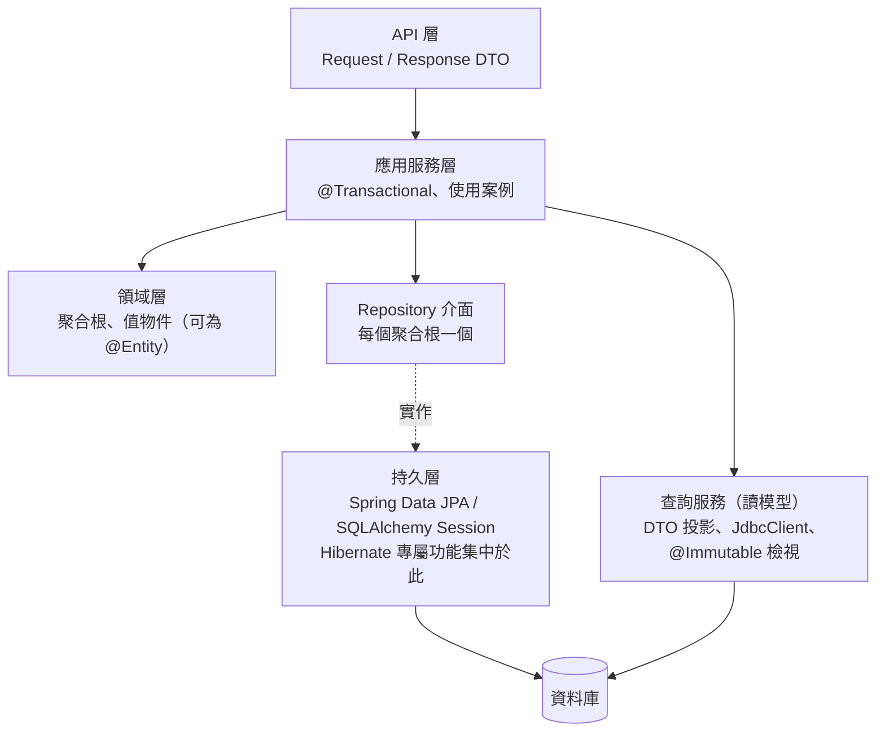

| 原則 | 說明 | 規則 |
| --- | --- | --- |
| Entity 不跨出服務邊界 | API 回應用 DTO | [ORM-ARC-001](#orm-arc-001-entity-不直接作為-api-請求或回應於交易內轉為-dto) |
| 聚合之間以 ID 參照 | 不以物件關聯跨聚合 | [ORM-ARC-002](#orm-arc-002-聚合之間以-id-參照不以物件關聯跨越聚合邊界) |
| 一個聚合根一個 Repository | 子實體經由聚合根存取 | [ORM-REL-004](#orm-rel-004-組合關係啟用-orphanremoval--delete-orphan) |
| 讀寫分離（CQRS） | 寫入走聚合；複雜讀取走投影 / 讀模型 | [ORM-ARC-005](#orm-arc-005-複雜讀取以唯讀的讀模型對映immutable檢視表投影不使用可寫的-entity)、[ORM-SEL-001](#orm-sel-001-orm-與-sql-first-並用交易性存取用-orm報表與彙總用-sql-first) |
| 標準 API 優先 | Hibernate 專屬 API 限持久層 | [ORM-STD-001](#orm-std-001-服務層只依賴-jakarta-persistence-標準-apihibernate-專屬功能集中在持久層) |

DDD 戰術設計（聚合、值物件、領域事件）的完整說明見 [Domain-Driven Design 教學]()。

### 16.2 架構規則

#### ORM-ARC-001 Entity 不直接作為 API 請求或回應，於交易內轉為 DTO

- **等級**：必須
- **適用**：Java、Python
- **說明**：Controller 回傳 DTO（record / dataclass），由服務層在交易內組裝；請求同樣綁定到 DTO（[ORM-SEC-003](#orm-sec-003-請求資料先綁定到-dto不直接綁定成-entity防止大量指派)）。
- **原因**：直接序列化 Entity 會：觸發延遲載入（交易外即 `LazyInitializationException`，或在 OSIV 下產生 N+1）、雙向關聯無窮遞迴、洩漏內部欄位，並讓 API 契約與資料表結構綁死。

❌ 反例：`@GetMapping("/authors/{id}") ArcAuthor get(...)`——直接回傳 Entity（實測結果見下）。

✅ 正例：

```java
// ✅ API 回應使用 DTO：欄位明確、不觸發延遲載入、不受實體重構影響
record AuthorResponse(Long id, String name, List<String> bookTitles) {
    static AuthorResponse from(ArcAuthor a) {
        return new AuthorResponse(a.getId(), a.getName(), a.getBooks().stream().map(ArcBook::getTitle).toList());
    }
}
```

**如何 review**：Controller 方法的回傳型別或 `@RequestBody` 型別為 `@Entity` 類別；Entity 上出現 `@JsonIgnore`、`@JsonManagedReference`（代表正在把 Entity 當 DTO 用）。

**如何驗證**：實測（四種資料庫，Jackson 3）：

| 情境 | 結果 |
| --- | --- |
| 交易內序列化雙向關聯的 Entity | `StreamConstraintsException: Document nesting depth (501) exceeds the maximum allowed (500)` |
| 交易外序列化 Entity | `LazyInitializationException` |
| 交易內轉成 `AuthorResponse` 再序列化 | 成功：`"bookTitles":["book1","book2"]` |

（`ArchitectureTest#entitiesMustNotBeSerializedDirectly`）

#### ORM-ARC-002 聚合之間以 ID 參照，不以物件關聯跨越聚合邊界

- **等級**：建議
- **適用**：Java、Python
- **說明**：訂單聚合參照顧客時保存 `customerId`，而不是 `@ManyToOne Customer customer`。需要顧客資料時由應用服務分別查詢，或以讀模型 JOIN。
- **原因**：跨聚合的物件關聯讓載入範圍、cascade、交易邊界與鎖定互相耦合；聚合無法獨立演進，也無法拆分到不同服務。

❌ 反例：

```java
// ❌ 直接以物件關聯到另一個聚合：載入、cascade、交易邊界全部耦合在一起
@Entity
@Table(name = "arc_bad_order")
public class SalesOrder {
    @Id
    Long id;
    @ManyToOne(fetch = FetchType.LAZY)
    Customer customer;
}
```

✅ 正例：

```java
// ✅ 跨聚合以 ID 參照：訂單與顧客可各自演進、分屬不同交易與服務
@Entity
@Table(name = "arc_good_order")
public class SalesOrder {
    @Id
    Long id;
    @Column(nullable = false)
    Long customerId;
}
```

**如何 review**：不同聚合（不同套件 / 模組）的 Entity 之間出現 `@ManyToOne`、`@OneToMany`。

**如何驗證**：以 ArchUnit 規則檢查套件依賴：

```java
static ArchRule ordersDoNotReferenceCustomerAggregate(String root) {
    return noClasses().that().resideInAPackage(root + ".order..")
            .should().dependOnClassesThat().resideInAPackage(root + ".customer..")
            .because("跨聚合只能以 ID 參照（ORM-ARC-002）");
}
```

- 實測：正例套件通過；反例套件回報 1 個違規（`AggregateBoundaryTest`）。

#### ORM-ARC-003 軟刪除使用框架機制（Hibernate @SoftDelete），不要手寫刪除旗標

- **等級**：建議
- **適用**：Java（Python 以 [ORM-SEC-005](#orm-sec-005-多租戶資料隔離由-orm--資料庫層強制而不是靠每個查詢記得加條件) 相同的 `with_loader_criteria` 技巧實作）
- **說明**：需要保留刪除紀錄（稽核、可還原）時，使用 Hibernate 6.4 起的 `@SoftDelete`：`remove()` 轉成 UPDATE，所有 HQL / Criteria 查詢與 `find()` 自動排除已刪除列。注意原生 SQL 與報表需自行處理；唯一約束需考慮已刪除資料。
- **原因**：手寫 `deleted` 旗標需要每個查詢都記得加條件，漏一個就把已刪除資料顯示給使用者。

❌ 反例：

```java
// ❌ 手寫刪除旗標：每一個查詢都必須記得加 where deleted = false
@Entity
@Table(name = "arc_contract_flag")
class ContractFlag {
    @Id
    Long id;
    @Column(length = 100)
    String title;
    boolean deleted;
}
```

✅ 正例：

```java
// ✅ Hibernate @SoftDelete：remove() 轉成 UPDATE，所有查詢與 find() 自動排除已刪除列
@Entity
@Table(name = "arc_contract")
@SoftDelete
class Contract {
    @Id
    Long id;
    @Column(length = 100)
    String title;
}
```

**如何 review**：Entity 上出現 `boolean deleted` / `isDeleted` / `delFlag` 欄位卻沒有 `@SoftDelete` 或 `@SQLRestriction`。

**如何驗證**：實測（四種資料庫）各刪除 1 筆後：手寫旗標的 `count` 仍為 2（❌），`@SoftDelete` 的 `count` 為 1、`find()` 回傳 `null`，而原生 SQL 查詢資料表仍有 2 列（資料保留）（`ArchitectureTest#softDeleteFiltersAutomatically`）。

#### ORM-ARC-004 稽核欄位由框架自動填寫

- **等級**：建議
- **適用**：Java、Python
- **說明**：建立時間、修改時間、建立者以 Spring Data JPA Auditing（`@CreatedDate`、`@LastModifiedDate`、`@CreatedBy` + `AuditorAware`）、Hibernate `@CreationTimestamp` / `@UpdateTimestamp`，或 SQLAlchemy `server_default` / `onupdate` 自動填寫。
- **原因**：由每段業務程式手動設定，必然會有遺漏或不一致（各主機時鐘不同）。

✅ 正例（Java）：

```java
// ✅ 稽核欄位由框架填寫：Spring Data JPA Auditing
@Entity
@Table(name = "err_member")
@EntityListeners(AuditingEntityListener.class)
class ErrMember {
    @Id
    Long id;
    @Column(length = 100, unique = true, nullable = false)
    String email;
    @CreatedDate
    @Column(nullable = false, updatable = false)
    Instant createdAt;
    @LastModifiedDate
    Instant updatedAt;
    @CreatedBy
    @Column(length = 50, updatable = false)
    String createdBy;

    ErrMember() {
    }

    ErrMember(Long id, String email) {
        this.id = id;
        this.email = email;
    }
}
```

<!-- from: java/src/test/java/ch17/ErrorHandlingTest.java -->
```java
@EnableJpaAuditing
static class Config {
    @Bean
    AuditorAware<String> auditor() {
        return () -> Optional.of("batch-job");   // 實務上取自 Spring Security 的登入者
    }
}
```

✅ 正例（Python）：

```python
class Document(Base):
    __tablename__ = "py_audit_doc"

    id: Mapped[int] = mapped_column(primary_key=True)
    title: Mapped[str] = mapped_column(Unicode(100))
    # ✅ 由資料庫產生時間：不依賴各應用伺服器的時鐘
    created_at: Mapped[datetime] = mapped_column(DateTime, server_default=func.current_timestamp())
    # ✅ ORM 發出 UPDATE 時自動帶入
    updated_at: Mapped[datetime | None] = mapped_column(DateTime, onupdate=func.current_timestamp())
```

❌ 反例：在每個服務方法中 `entity.setUpdatedAt(LocalDateTime.now())`（時區與遺漏問題，見 [ORM-MAP-005](#orm-map-005-時間點使用-instant--offsetdatetime或-utc-正規化不使用-localdatetime-與-javautildate)）。

**如何 review**：Service 程式中手動設定建立 / 修改時間；稽核欄位沒有 `updatable = false`。

**如何驗證**：實測（四種資料庫）註冊後 `createdAt` 不為 null、`createdBy == "batch-job"`（`ErrorHandlingTest#duplicatesAreTranslatedToDomainException`）；Python 新增後 `created_at` 由資料庫填入、修改後 `updated_at` 不為 null（`test_audit_columns`）。

#### ORM-ARC-005 複雜讀取以唯讀的讀模型對映（@Immutable、檢視表、投影），不使用可寫的 Entity

- **等級**：建議
- **適用**：Java
- **說明**：彙總、統計、跨聚合的讀取需求，以 `@Immutable` + `@Subselect`（或資料庫檢視表 + `@Immutable`）對映為唯讀實體，或使用 DTO 投影。原生 SQL 中以 `{h-schema}` 讓 Hibernate 代入預設 schema。Hibernate 7 對 `@Immutable` 實體執行 UPDATE 查詢預設直接拋例外。
- **原因**：讀模型被當成一般 Entity 時，可能被誤改並寫回；把查詢需求塞進聚合則會讓寫入模型膨脹。

✅ 正例：

```java
// ✅ 讀取模型（CQRS 查詢端）：以 @Immutable + @Subselect 對應彙總查詢，Hibernate 不追蹤、不寫入
@Entity
@Immutable
@Subselect("""
        select a.id as author_id, a.name as author_name, count(b.id) as book_count
        from {h-schema}arc_author a left join {h-schema}arc_book b on b.author_id = a.id
        group by a.id, a.name""")   // {h-schema}：由 Hibernate 代入 default_schema
@Synchronize({"arc_author", "arc_book"})   // 查詢前先 flush 這些表的變更
class AuthorStats {
    @Id
    @Column(name = "author_id")
    Long authorId;
    @Column(name = "author_name")
    String authorName;
    @Column(name = "book_count")
    long bookCount;
}
```

❌ 反例：在 `Author` 實體上加一個 `@Formula("(select count(*) ...)") long bookCount` 並在多處修改 `Author`——每次載入作者都執行子查詢，且統計欄位與寫入模型混在一起。

**如何 review**：統計、報表用途的實體沒有 `@Immutable`；`@Subselect` 中寫死 schema 名稱。

**如何驗證**：實測（四種資料庫）`AuthorStats.bookCount == 2`；修改後不會寫回；對其執行 JPQL UPDATE 拋出含 `immutable` 的例外（`ArchitectureTest#immutableReadModel`）。

### 16.3 小結

- Entity 是持久化模型；API 契約用 DTO。
- 聚合以 ID 互相參照，邊界以 ArchUnit 守護。
- 軟刪除、稽核欄位交給框架；讀模型唯讀。

---

## 17. 錯誤處理與排錯

### 17.1 例外的層次

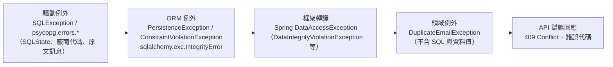

錯誤處理同時是安全議題：OWASP Top 10:2025 新增 **A10 Mishandling of Exceptional Conditions**，吞掉例外、錯誤訊息洩漏內部資訊都屬此類。

### 17.2 錯誤處理規則

#### ORM-ERR-001 把資料存取例外轉譯為領域例外，不依賴驅動專屬類別與原始訊息

- **等級**：必須
- **適用**：Java、Python
- **說明**：Java 在 Spring 中捕捉 `DataIntegrityViolationException` 等 `DataAccessException` 子類別（Spring 已把四種資料庫的錯誤轉成相同類別），轉成領域例外；需要判斷原因時讀取 `SQLException.getSQLState()`（沿 cause 鏈尋找，不要假設 `getMostSpecificCause()` 一定是 `SQLException`）。Python 捕捉 `sqlalchemy.exc.IntegrityError` / `DBAPIError`，不要捕捉驅動專屬類別。
- **原因**：各資料庫的錯誤碼、例外類別與訊息內容都不同；直接把原始訊息傳給前端或寫入日誌，也會洩漏資料值（[ORM-SEC-004](#orm-sec-004-日誌與錯誤訊息不得洩漏資料值綁定參數約束錯誤詳細內容)）。

✅ 正例（Java）：

```java
/** 領域例外：呼叫端（例如 REST 層）轉成 HTTP 409，訊息中不含 SQL 與資料值。 */
class DuplicateEmailException extends RuntimeException {
    DuplicateEmailException() {
        super("此 Email 已註冊");
    }
}

@Service
class MemberService {
    private final ErrMemberRepository members;

    MemberService(ErrMemberRepository members) {
        this.members = members;
    }

    @Transactional
    public void register(long id, String email) {
        try {
            members.saveAndFlush(new ErrMember(id, email));   // flush 讓約束錯誤在此處發生
        } catch (DataIntegrityViolationException e) {        // ✅ Spring 已把各資料庫的錯誤轉成同一種例外
            throw new DuplicateEmailException();
        }
    }
}
```

✅ 正例（Python）：

```python
try:
    with Session(engine) as s, s.begin():
        s.add(Member(id=21, email="dup@example.com"))
except IntegrityError as e:                        # ✅ 以 SQLAlchemy 的例外階層判斷，而非驅動專屬類別
    error = e
```

❌ 反例：`catch (PSQLException e)`、`except psycopg.errors.UniqueViolation`、`if (e.getMessage().contains("duplicate key"))`——只在一種資料庫有效，且依賴訊息文字。

**如何 review**：`catch` / `except` 中出現驅動套件的類別（`org.postgresql`、`oracle.jdbc`、`com.microsoft.sqlserver`、`com.ibm.db2`、`psycopg`、`oracledb`、`mssql_python`、`ibm_db`）；以字串比對錯誤訊息。

**如何驗證**：實測（四種資料庫）唯一約束違反時 Spring 一律拋 `DataIntegrityViolationException`，服務層轉為 `DuplicateEmailException("此 Email 已註冊")`（`ErrorHandlingTest#duplicatesAreTranslatedToDomainException`）。各資料庫的底層資訊：

| 資料庫 | SQLState / 廠商代碼（Java） | `getMostSpecificCause()` | Python `IntegrityError.orig` 類別 |
| --- | --- | --- | --- |
| PostgreSQL 18.6 | 23505 / 0 | `PSQLException` | `psycopg.errors.UniqueViolation` |
| Oracle 26ai | 23000 / 1（ORA-00001） | **`oracle.jdbc.OracleDatabaseException`（不是 `SQLException`）** | `oracledb.exceptions.IntegrityError` |
| SQL Server 2025 | 23000 / 2627 | `SQLServerException` | `mssql_python.exceptions.IntegrityError` |
| Db2 12.1.5 | 23505 / -803 | `SqlIntegrityConstraintViolationException` | `ibm_db_dbi.IntegrityError` |

> 另外兩個實測差異：Oracle 的 NOT NULL 更新違反（ORA-01407）在 Python 中是 `DatabaseError` 而非 `IntegrityError`（[ORM-REL-004](#orm-rel-004-組合關係啟用-orphanremoval--delete-orphan)）；Db2 的鎖定逾時（SQL0911N）在 ibm_db fetch 階段以一般 `Exception`（「Fetch Failure」）拋出，未被包成 `DBAPIError`（[ORM-TX-004](#orm-tx-004-悲觀鎖必須設定逾時並了解各資料庫的實際行為)）。

#### ORM-ERR-002 例外發生後丟棄該交易與 EntityManager / Session，不可吞掉例外繼續使用

- **等級**：必須
- **適用**：Java、Python
- **說明**：持久化操作拋出例外後，交易已被標記為 rollback-only、Persistence Context 狀態不可信。正確做法是 rollback 並關閉 EntityManager / Session，在新的交易中重試或回報錯誤。Hibernate 預設**對 rollback-only 交易呼叫 `commit()` 時不拋例外而是靜默 rollback**；建議設定 `hibernate.jpa.compliance.transaction=true`，讓它依 JPA 規格拋出 `RollbackException`。SQLAlchemy 在 flush 失敗後，任何後續操作都會拋 `PendingRollbackError`，必須先 `rollback()`。
- **原因**：吞掉例外後繼續執行，呼叫端以為「commit 成功」，實際上整個交易（包括後來新增的資料）都被丟棄——無聲的資料遺失。

❌ 反例（Java）：

```java
// ❌ 吞掉例外後繼續使用同一個交易 / EntityManager
EntityManager em = jpa.emf.createEntityManager();
em.getTransaction().begin();
try {
    em.persist(new ErrTicket(2L, "T-001"));
    em.flush();                                   // 違反唯一約束 → 交易被標記 rollback-only
} catch (PersistenceException e) {
    // 只記錄日誌，然後繼續
}
em.persist(new ErrTicket(3L, "T-002"));
try {
    em.getTransaction().commit();                 // 看似成功？
} finally {
    if (em.getTransaction().isActive()) {
        em.getTransaction().rollback();
    }
    em.close();
}
```

✅ 正例（Java，讓 commit 依規格拋錯）：

```java
// ✅ 開啟 JPA 交易相容模式：對 rollback-only 交易 commit 會拋 RollbackException
Map<String, Object> compliant = Map.of("hibernate.jpa.compliance.transaction", "true");
```

❌ / ✅ 對照（Python）：

```python
s.add(Member(id=11, email="x@example.com"))
try:
    s.flush()
except DBAPIError:
    pass                                       # ❌ 吞掉例外後繼續使用同一個 Session
with pytest.raises(PendingRollbackError):
    s.add(Member(id=12, email="y@example.com"))
    s.flush()
s.rollback()                                   # ✅ 例外後必須 rollback（或丟棄此 Session）
```

**如何 review**：`catch (PersistenceException e) { log... }` 之後沒有重新拋出或 rollback；Python `except IntegrityError: pass` 之後繼續使用同一個 Session。

**如何驗證**：實測（四種資料庫）：

| 設定 | 吞掉例外後 `commit()` | 結果 |
| --- | --- | --- |
| Hibernate 預設 | **不拋例外** | `T-002` 默默消失，資料表只有 1 筆 |
| `hibernate.jpa.compliance.transaction=true` | 拋 `RollbackException` | 呼叫端得知失敗 |
| SQLAlchemy 2.1 | 下一次 flush 拋 `PendingRollbackError` | 必須 `rollback()` |

（`RollbackOnlyTest`、`test_pending_rollback`）

### 17.3 常見錯誤速查

以下錯誤訊息皆在本手冊驗證中實際出現過：

| 錯誤（訊息關鍵字） | 原因 | 修正 | 參考 |
| --- | --- | --- | --- |
| `LazyInitializationException` | 交易外存取未載入的延遲關聯 | 交易內 fetch join / Entity Graph / 投影 DTO；不要開 `enable_lazy_load_no_trans` | [ORM-FET-004](#orm-fet-004-不以-enable_lazy_load_no_trans-或-eager解決lazyinitializationexception) |
| `MultipleBagFetchException` | 一次 fetch join 兩個 List | 分兩個查詢 | [ORM-FET-003](#orm-fet-003-不可同時-fetch-join-兩個以上的-listbag集合) |
| `Detached entity passed to persist` | 對已有主鍵的分離物件呼叫 persist | 使用 merge 並取回傳值 | [ORM-CTX-002](#orm-ctx-002-新物件用-persist分離物件用-merge-並使用其回傳值) |
| `OptimisticLockException` / `StaleDataError` | 樂觀鎖衝突 | 重試整個交易或提示使用者 | [ORM-TX-003](#orm-tx-003-會被並行修改的實體使用樂觀鎖version--version_id_col)、[ORM-TX-005](#orm-tx-005-只重試可重試的錯誤重試整個交易並設上限) |
| `TransactionRequiredException` | 沒有交易（常見於 Spring 自我呼叫） | 交易標註在入口方法 | [ORM-TX-002](#orm-tx-002-不在同一個類別內自我呼叫-transactional-方法) |
| `DetachedInstanceError` | Python commit 後屬性過期且 Session 已關閉 | Session 內轉 DTO | [ORM-CTX-005](#orm-ctx-005-pythoncommit-後屬性會過期回傳給外部前先轉成-dto) |
| `PendingRollbackError` | Python flush 失敗後繼續使用 Session | `rollback()` | [ORM-ERR-002](#orm-err-002-例外發生後丟棄該交易與-entitymanager--session不可吞掉例外繼續使用) |
| `missing column [x]`（啟動失敗） | `ddl-auto: validate` 發現 schema 與實體不一致 | 補遷移腳本；或確認命名策略 | [ORM-ENV-002](#orm-env-002-正式環境的-schema-只驗證不修改ddl-auto-validate-或-none)、[ORM-MAP-011](#orm-map-011-明確指定命名策略或欄位名稱確保各執行環境產生相同的-schema) |
| `HHH90003004 ... applying in memory`（Hibernate ≤ 7.3） | 集合 fetch join + 分頁 | 兩段式查詢；開啟 fail 設定 | [ORM-QRY-003](#orm-qry-003-集合-fetch-join-搭配分頁時必須確認分頁發生在資料庫依-hibernate-版本處理) |
| `HHH100123: Low default JDBC fetch size: 10` | Oracle JDBC 預設 fetch size | 設定 `hibernate.jdbc.fetch_size` | [ORM-PERF-003](#orm-perf-003-大量讀寫使用-statelesssession--串流並設定-fetch-size) |
| `Unable to determine Dialect without JDBC metadata` | 無法連線到資料庫（主機、連接埠錯誤） | 檢查連線設定；Testcontainers 於容器內執行需設定 `TESTCONTAINERS_HOST_OVERRIDE` | [ORM-TST-001](#orm-tst-001-持久層測試使用與正式環境相同的資料庫引擎與主要版本不以-h2-代替) |
| SQL Server 中文變 `??` | `varchar` 欄位存 Unicode | `@Nationalized` / `Unicode` | [ORM-MAP-006](#orm-map-006-字串欄位明確長度可能含非-ascii-字元的欄位明確指定-unicode-型別) |
| Db2 `SQLCODE=-911, SQLERRMC=68` | 鎖定逾時（整個交易被 rollback） | 設定 `currentLockTimeout`；縮短交易 | [ORM-TX-004](#orm-tx-004-悲觀鎖必須設定逾時並了解各資料庫的實際行為) |
| Db2 `SQLCODE=-478`（RENAME COLUMN） | 欄位被索引參照 | 先刪索引再改名 | [ORM-MIG-003](#orm-mig-003-不停機部署採-expand--contract先擴充後收斂同一版不刪除或改名舊欄位) |
| Flyway `checksum mismatch` | 修改了已套用的遷移 | 恢復原檔，以新版本修正 | [ORM-MIG-004](#orm-mig-004-已套用的遷移腳本不可修改修正一律以新版本進行) |
| `KeyError: 'ibm_db_sa'`（Alembic） | Alembic 無 Db2 實作 | 註冊最小 `DefaultImpl` | [ORM-MIG-002](#orm-mig-002-自動產生的遷移必須人工審查特別是改名) |
| `StreamConstraintsException: Document nesting depth (501)` | Jackson 3 序列化雙向關聯 Entity | 回傳 DTO | [ORM-ARC-001](#orm-arc-001-entity-不直接作為-api-請求或回應於交易內轉為-dto) |

排錯的基本步驟：

1. **開 SQL 日誌**（開發環境）：`org.hibernate.SQL=DEBUG`、`org.hibernate.orm.jdbc.bind=TRACE`；Python `logging.getLogger("sqlalchemy.engine").setLevel(logging.INFO)`。
2. **數句數**：`hibernate.generate_statistics=true`，或測試中的 `sqllog` fixture。
3. **看 cause 鏈最底層**：SQLState 與廠商代碼比例外類別名稱可靠。
4. **在正式資料庫引擎上重現**：不要在 H2 上判斷（[ORM-TST-001](#orm-tst-001-持久層測試使用與正式環境相同的資料庫引擎與主要版本不以-h2-代替)）。

### 17.4 小結

- 例外要轉譯、不要吞；轉譯時不帶原始訊息。
- 例外發生後，交易與 Session 都不可再用。

---

## 18. AI 輔助 ORM 開發

### 18.1 AI 產生 ORM 程式碼的常見問題

AI 程式助理很擅長產生「能編譯、能通過簡單功能測試」的 ORM 程式碼，但訓練資料中大量的舊版範例，讓它容易產生本手冊列為反例的寫法：

| AI 常見產出 | 問題 | 對應規則 |
| --- | --- | --- |
| `@ManyToOne` 不寫 fetch、`FetchType.EAGER` 解決例外 | N+1 | [ORM-REL-002](#orm-rel-002-manytoone-與-onetoone-一律明確宣告-fetchtypelazy)、[ORM-FET-004](#orm-fet-004-不以-enable_lazy_load_no_trans-或-eager解決lazyinitializationexception) |
| `findAll().stream().filter(...)` | 記憶體篩選 | [ORM-QRY-006](#orm-qry-006-篩選排序彙總在資料庫完成動態條件以-criteria--specification-組合) |
| `ddl-auto: update`、`show-sql: true`、`MySQL8Dialect` | 舊版設定 | [ORM-ENV-001](#orm-env-001-不手動指定-hibernate-方言移除過時的方言類別)、[ORM-ENV-002](#orm-env-002-正式環境的-schema-只驗證不修改ddl-auto-validate-或-none)、[ORM-ENV-005](#orm-env-005-sql-日誌以標準-logger-控制綁定值只在開發環境輸出) |
| `session.save()`、`@Where`、`javax.persistence` | Hibernate 7 / Jakarta 已移除或更名 | [2.3](#23-hibernate-orm-7) |
| `declarative_base()`、`session.query()`、`datetime.utcnow()` | SQLAlchemy 1.x 寫法 | [ORM-MAP-012](#orm-map-012-python-使用-sqlalchemy-2x-型別化宣告declarativebasemappedmapped_column)、[ORM-MAP-005](#orm-map-005-時間點使用-instant--offsetdatetime或-utc-正規化不使用-localdatetime-與-javautildate) |
| Lombok `@Data` 放在 Entity | equals/hashCode 錯誤 | [ORM-MAP-003](#orm-map-003-equalshashcode-不可依賴會改變的產生式主鍵) |
| 字串串接 JPQL | 注入 | [ORM-SEC-001](#orm-sec-001-jpql--hql--原生-sql--text-一律參數綁定不串接使用者輸入) |
| 直接回傳 Entity 給 API | 遞迴、延遲載入、洩漏欄位 | [ORM-ARC-001](#orm-arc-001-entity-不直接作為-api-請求或回應於交易內轉為-dto) |

### 18.2 AI 使用規則

#### ORM-AI-001 AI 產生的 ORM 程式碼必須通過與人工程式碼相同的自動化檢查，才可合併

- **等級**：必須
- **適用**：Java、Python
- **說明**：AI 產生的實體、Repository、查詢，必須通過：查詢次數斷言（[ORM-TST-002](#orm-tst-002-以查詢次數斷言防止-n1-與效能回歸)）、ArchUnit 規則（[ORM-STD-001](#orm-std-001-服務層只依賴-jakarta-persistence-標準-apihibernate-專屬功能集中在持久層)、[ORM-ARC-002](#orm-arc-002-聚合之間以-id-參照不以物件關聯跨越聚合邊界)）、`ddl-auto=validate` 的遷移驗證（[ORM-MIG-001](#orm-mig-001-schema-變更一律以版本化遷移腳本管理ddl-草稿須人工審查後才納入)），並在正式資料庫引擎上執行（[ORM-TST-001](#orm-tst-001-持久層測試使用與正式環境相同的資料庫引擎與主要版本不以-h2-代替)）。審查者以本手冊附錄 A 的規則編號提出意見。
- **原因**：AI 產出的 N+1、EAGER、記憶體篩選在功能測試中完全正常，只有句數斷言與規則化的審查能發現。

❌ 反例（AI 常見產出：功能正確、測試只檢查結果）：

```java
// ❌ N+1：1 次查作家 + 每位作家 1 次查小說
int total = jpa.txr(em -> {
    List<Writer> writers = em.createQuery("from Writer w order by w.id", Writer.class).getResultList();
    int sum = 0;
    for (Writer w : writers) {
        sum += w.novels.size();          // 觸發延遲載入
    }
    return sum;
});
```

✅ 正例（以句數斷言把效能需求寫成測試，AI 產出的 N+1 會直接讓 CI 失敗）：

```java
Statistics stats = jpa.emf.unwrap(SessionFactory.class).getStatistics();   // 需 hibernate.generate_statistics=true
stats.clear();
List<EmpRow> rows = jpa.txr(QueryCountAssertionTest::listEmployees);
assertThat(rows).hasSize(15);
assertThat(stats.getPrepareStatementCount())
        .as("listEmployees 必須只發出 1 句 SQL（防止 N+1 回歸）")
        .isEqualTo(1);
```

**如何 review**：PR 描述註明 AI 產生的部分；審查重點對照 [18.1](#181-ai-產生-orm-程式碼的常見問題) 的表格；沒有句數斷言的列表查詢不得合併。

**如何驗證**：本手冊第 10 章的反例即為典型 AI 產出，實測 10 位作家送出 11 句 SQL（[ORM-FET-001](#orm-fet-001-依使用情境以-fetch-joinentity-graph-或-selectinload-一次載入所需關聯)）；以 [ORM-TST-002](#orm-tst-002-以查詢次數斷言防止-n1-與效能回歸) 的方式斷言「恰為 1 句」，此類產出就無法通過 CI。

#### ORM-AI-002 提供給 AI 的上下文只包含結構，不包含真實資料、連線字串與密碼

- **等級**：必須
- **適用**：所有語言
- **說明**：向 AI 說明資料模型時，提供 DDL、實體定義、遷移腳本或**合成 / 去識別化**的樣本資料；不要貼上正式資料、錯誤訊息原文（可能含資料值，見 [ORM-SEC-004](#orm-sec-004-日誌與錯誤訊息不得洩漏資料值綁定參數約束錯誤詳細內容)）、`application-prod.yml`、連線字串或金鑰。使用公司核准的 AI 工具與資料分級政策。
- **原因**：提示詞與上傳的檔案可能被記錄、留存或用於其他用途；資料庫錯誤訊息本身就可能含個資。

❌ 反例（未執行，提示詞示意）：

```text
幫我看這個錯誤怎麼修：
ERROR: duplicate key value violates unique constraint "uk_customer_email"
Detail: Key (email)=(wang.xiaoming@example.com.tw) already exists.
連線設定：jdbc:postgresql://prod-db.internal:5432/crm user=crm_app password=Pr0d#2026
```

✅ 正例（未執行，提示詞示意）：

```text
環境：Spring Boot 4.1.1、Hibernate 7.4.5、PostgreSQL 18。
實體：Customer(id bigint PK, email varchar(200) UNIQUE, name nvarchar(100))。
現象：註冊時偶發唯一約束違反（SQLState 23505），已確認不是重複送出表單。
需求：請依「先轉譯例外為領域例外、不記錄原始訊息」的原則（ORM-ERR-001、ORM-SEC-004），
     建議服務層的處理方式與對應的 @DataJpaTest 測試（需 flush，ORM-TST-003）。
```

**如何 review**：PR 或文件中引用的 AI 對話紀錄是否含個資、內部主機名稱、帳密。

**如何驗證**：以秘密掃描工具（例如 gitleaks）掃描提交內容；但預設規則對設定檔中的密碼與個資偵測有限，仍需人工審查（本手冊未實測，見[附錄 F](#附錄-f-待確認事項)）。

### 18.3 AI 審查提示詞範本

以下範本可貼入 AI 程式碼審查工具（**未執行**，請依公司核准的工具調整）：

```text
你是資深 Java/Python 資料存取審查者。請依下列規則審查本次 diff 中的 ORM 程式碼，
每個發現請註明規則編號、檔案與行號、風險與建議修改：
- ORM-REL-002：@ManyToOne/@OneToOne 必須 LAZY
- ORM-FET-001/003/004：N+1、多個 bag fetch、enable_lazy_load_no_trans
- ORM-QRY-002/003/005/006：分頁排序、集合 fetch 分頁、批次更新同步、記憶體篩選
- ORM-TX-001/002/003：交易邊界、自我呼叫、樂觀鎖
- ORM-SEC-001/002/003/004：注入、排序白名單、大量指派、個資外洩
- ORM-MAP-003/004/005/006/007：equals/hashCode、列舉、時間、Unicode、金額
只回報有證據的問題；無法確定的請標示「需人工確認」。
```

### 18.4 小結

- AI 產出的 ORM 程式碼「能動」不代表正確；以句數斷言、架構測試與四種資料庫驗證把關。
- 提示詞只給結構、不給資料與秘密。

---

## 19. 能力認證與自我評量

### 19.1 認證現況（2026-10 查證）

v1.0 的「認證考試重點」假設存在 JPA / Hibernate / SQLAlchemy 的專門認證，並列出各主題配分；這些配分**沒有官方來源**。目前實際狀況：

| 認證 | 狀態 | 與本手冊的關係 |
| --- | --- | --- |
| Oracle Certified Expert, Java EE 6 Java Persistence API Developer（1Z0-898） | 已停止（第三方考試準備機構 Enthuware 記載 2019-03-31 起停止；本手冊未查得 Oracle 現行的 JPA 專門認證） | 無 Jakarta Persistence 專門認證可考 |
| Spring Certified Professional（Broadcom，考試代碼 2V0-72.22） | 持續提供；官方考試指南最後更新於 2024 年 1 月 | 考試指南的資料存取目標涵蓋 JdbcTemplate、例外處理、交易管理，以及以 Spring Boot 實作 JPA 應用程式與 Spring Data JPA 儲存庫；本手冊第 4、9、11 章可作為準備材料 |
| Oracle Java SE 認證 | 持續提供 | 範圍為 Java SE，不含 Jakarta Persistence |
| SQLAlchemy / Django ORM | 無官方認證 | 以本章自我評量與第 15 章的測試實作證明能力 |
| 資料庫廠商認證（PostgreSQL、Oracle、Microsoft、IBM Db2） | 各廠商提供 | 補強 SQL、交易與鎖定知識；見[資料庫設計指引]() |

> 認證考試代碼與範圍會變動，報考前請以官方網站為準（[附錄 F](#附錄-f-待確認事項) 追蹤）。

### 19.2 能力等級

| 等級 | 能力描述 | 驗證方式 |
| --- | --- | --- |
| L1 入門 | 能正確宣告實體、主鍵、基本關聯；能寫簡單 CRUD 與 JPQL / `select()` | 19.3 第 1～7 題全對 |
| L2 熟練 | 能說明 Persistence Context 行為；能辨識並修正 N+1；能正確使用交易與樂觀鎖 | 19.3 全部答對 80% 以上；完成 19.4 練習 1 |
| L3 進階 | 能設計遷移流程、處理四種資料庫差異、撰寫查詢次數與並行測試 | 完成 19.4 練習 2；能以規則編號審查他人 PR |
| L4 專家 | 能制定團隊 ORM 規範、評估框架升級（Hibernate 8 / JPA 4.0）、處理正式環境效能事故 | 主導過版本升級或效能調校，並產出 ADR |

### 19.3 自我評量題

每題先作答，再展開解答。題目中的行為皆已在本手冊驗證環境中實測。

**第 1 題**：JPA 中，沒有標註 `fetch` 的 `@ManyToOne` 預設是什麼載入方式？

<details>
<summary>解答</summary>

EAGER。`@ManyToOne`、`@OneToOne` 預設 EAGER，`@OneToMany`、`@ManyToMany` 預設 LAZY。應一律寫 `fetch = FetchType.LAZY`（[ORM-REL-002](#orm-rel-002-manytoone-與-onetoone-一律明確宣告-fetchtypelazy)）。

</details>

**第 2 題**：下列程式在交易提交時會送出 UPDATE 嗎？`Customer c = em.find(Customer.class, 1L); c.name = c.name.toUpperCase();`

<details>
<summary>解答</summary>

會。managed 實體的修改在 flush 時自動寫回（髒檢查），不需要呼叫 `save()`（[ORM-CTX-001](#orm-ctx-001-了解自動髒檢查交易內修改-managed-物件就會寫回唯讀情境使用-dto-或唯讀查詢)）。

</details>

**第 3 題**：未標註 `@Enumerated` 的 enum 欄位，資料庫存的是什麼？為什麼危險？

<details>
<summary>解答</summary>

存序數（ORDINAL）。在列舉中間插入新值後，既有資料全部錯位且沒有錯誤（[ORM-MAP-004](#orm-map-004-列舉以名稱或穩定代碼儲存不可使用序數ordinal)）。

</details>

**第 4 題**：`em.merge(detached); detached.setName("x");` 為什麼不會更新資料庫？

<details>
<summary>解答</summary>

`merge()` 回傳的是 Persistence Context 中另一個 managed 實例；之後應修改回傳值（[ORM-CTX-002](#orm-ctx-002-新物件用-persist分離物件用-merge-並使用其回傳值)）。

</details>

**第 5 題**：SQL Server 上以預設 `String` 對映儲存「訂單備註」，讀回的結果是什麼？如何修正？

<details>
<summary>解答</summary>

`????`。標註 `@Nationalized`（Python 用 `Unicode`）對映為 `nvarchar`（[ORM-MAP-006](#orm-map-006-字串欄位明確長度可能含非-ascii-字元的欄位明確指定-unicode-型別)）。

</details>

**第 6 題**：主鍵使用 `GenerationType.IDENTITY` 對 JDBC 批次寫入有何影響？

<details>
<summary>解答</summary>

Hibernate 必須逐筆立即執行 INSERT 才能取得主鍵，批次失效；20 筆即 20 句 SQL，改用 SEQUENCE pooled 為 3 句（[ORM-MAP-001](#orm-map-001-主鍵優先使用-sequencepooled保留-jdbc-批次寫入能力)）。

</details>

**第 7 題**：SQLAlchemy 中，`with Session(engine) as s, s.begin(): obj = s.get(...)` 區塊結束後讀取 `obj.name` 會發生什麼？

<details>
<summary>解答</summary>

拋出 `DetachedInstanceError`：commit 後屬性過期（`expire_on_commit=True`），Session 已關閉無法重新載入（[ORM-CTX-005](#orm-ctx-005-pythoncommit-後屬性會過期回傳給外部前先轉成-dto)）。

</details>

**第 8 題**：10 位作家、每位 3 本書，迴圈中存取 `writer.getNovels().size()` 會送出幾句 SQL？設定 `hibernate.default_batch_fetch_size=16` 後呢？

<details>
<summary>解答</summary>

11 句（1 + 10）；設定後 2 句（[ORM-FET-001](#orm-fet-001-依使用情境以-fetch-joinentity-graph-或-selectinload-一次載入所需關聯)、[ORM-FET-002](#orm-fet-002-以-batch-fetchjava與-raiseloadpython作為-n1-的安全網)）。

</details>

**第 9 題**：一個 JPQL 同時 `join fetch` 兩個 `List` 集合會怎樣？

<details>
<summary>解答</summary>

拋出 `MultipleBagFetchException`。改為兩個查詢（[ORM-FET-003](#orm-fet-003-不可同時-fetch-join-兩個以上的-listbag集合)）。

</details>

**第 10 題**：Hibernate 6.6 與 7.4 在「集合 fetch join + `setMaxResults`」的行為有何不同？

<details>
<summary>解答</summary>

6.6 記錄 HHH90003004 並在記憶體分頁（全部載入）；7.4 改寫為子查詢，在資料庫分頁（[ORM-QRY-003](#orm-qry-003-集合-fetch-join-搭配分頁時必須確認分頁發生在資料庫依-hibernate-版本處理)）。

</details>

**第 11 題**：Spring Data `@Modifying` 批次更新後，同一交易中 `findById()` 讀到的是新值還是舊值？

<details>
<summary>解答</summary>

舊值（Persistence Context 未同步），除非設定 `clearAutomatically = true`（[ORM-QRY-005](#orm-qry-005-批次-update--delete-之後persistence-context-必須同步)）。

</details>

**第 12 題**：同一個類別中，沒有交易的方法呼叫 `this.createInternal()`（有 `@Transactional`），會在交易中執行嗎？

<details>
<summary>解答</summary>

不會。自我呼叫不經過 Spring 代理；實測拋 `TransactionRequiredException`（[ORM-TX-002](#orm-tx-002-不在同一個類別內自我呼叫-transactional-方法)）。

</details>

**第 13 題**：兩個交易同時讀到庫存 10，各扣 3 與 5，沒有 `@Version` 時結果是多少？有 `@Version` 時呢？

<details>
<summary>解答</summary>

沒有版本：5（扣 3 遺失，lost update）。有版本：第二個交易拋 `OptimisticLockException`，結果 7（[ORM-TX-003](#orm-tx-003-會被並行修改的實體使用樂觀鎖version--version_id_col)）。

</details>

**第 14 題**：在 Db2 上以 `jakarta.persistence.lock.timeout = 2000` 取得悲觀鎖，若該列已被鎖住會怎樣？

<details>
<summary>解答</summary>

Db2 方言忽略此提示，等待時間由 `CURRENT LOCK TIMEOUT` 決定；資料庫預設 `LOCKTIMEOUT = -1` 代表無限等待。應設定 JCC 屬性 `currentLockTimeout`（[ORM-TX-004](#orm-tx-004-悲觀鎖必須設定逾時並了解各資料庫的實際行為)）。

</details>

**第 15 題**：SQLAlchemy 2.1 在 SQL Server 上使用 `select(...).with_for_update()` 會產生什麼 SQL？

<details>
<summary>解答</summary>

沒有任何鎖定提示（靜默忽略）。需使用 `with_hint(..., "WITH (UPDLOCK, ROWLOCK)", "mssql")`（[ORM-TX-004](#orm-tx-004-悲觀鎖必須設定逾時並了解各資料庫的實際行為)）。

</details>

**第 16 題**：Alembic autogenerate 遇到欄位改名會產生什麼操作？

<details>
<summary>解答</summary>

`remove_column` + `add_column`，直接套用會遺失資料；需人工改為 `alter_column(new_column_name=...)`（[ORM-MIG-002](#orm-mig-002-自動產生的遷移必須人工審查特別是改名)）。

</details>

**第 17 題**：滾動部署中，為什麼不能在同一版直接把 `email` 改名為 `email_address`？

<details>
<summary>解答</summary>

仍在運行的舊版程式找不到 `email` 欄位；以 `validate` 啟動的舊版執行個體會失敗。應採 Expand / Contract（[ORM-MIG-003](#orm-mig-003-不停機部署採-expand--contract先擴充後收斂同一版不刪除或改名舊欄位)）。

</details>

**第 18 題**：`"from AppUser u where u.username = '" + input + "'"` 在 `input = x' or '1'='1` 時回傳幾筆？

<details>
<summary>解答</summary>

全部使用者（實測 3 筆）。JPQL 同樣會被注入，必須參數綁定（[ORM-SEC-001](#orm-sec-001-jpql--hql--原生-sql--text-一律參數綁定不串接使用者輸入)）。

</details>

**第 19 題**：哪些資料庫的唯一約束錯誤訊息會包含實際資料值？

<details>
<summary>解答</summary>

PostgreSQL（`DETAIL: Key (...)=(...)`）、SQL Server（`The duplicate key value is (...)`）、Oracle 23ai 起（ORA-03301）；Db2 不含。PostgreSQL 可設 `logServerErrorDetail=false`、Oracle 可設 `ERROR_MESSAGE_DETAILS`（[ORM-SEC-004](#orm-sec-004-日誌與錯誤訊息不得洩漏資料值綁定參數約束錯誤詳細內容)）。

</details>

**第 20 題**：吞掉 `PersistenceException` 後繼續 `commit()`，Hibernate 預設會拋例外嗎？

<details>
<summary>解答</summary>

不會，會靜默 rollback，呼叫端以為成功。設定 `hibernate.jpa.compliance.transaction=true` 才會拋 `RollbackException`（[ORM-ERR-002](#orm-err-002-例外發生後丟棄該交易與-entitymanager--session不可吞掉例外繼續使用)）。

</details>

### 19.4 實作練習

**練習 1（L2）：訂單服務**

1. 以 Spring Boot 4.1 或 SQLAlchemy 2.1 建立 `Customer`、`PurchaseOrder`、`OrderLine`（組合關係）三個實體，遵守第 5、7 章所有規則。
2. 撰寫「訂單列表」API：回傳 DTO，含顧客名稱與明細筆數；以查詢次數斷言恰為 1～2 句。
3. 以 `@Version` 保護訂單狀態轉換，撰寫並行測試證明不會 lost update。
4. 以 Flyway / Alembic 管理 schema，CI 以 `validate` 驗證。

**練習 2（L3）：多資料庫與遷移**

1. 把練習 1 在 PostgreSQL 與 SQL Server（或 Oracle / Db2）兩種資料庫上執行同一組測試（Testcontainers）。
2. 完成一次「欄位改名」的 Expand / Contract 三階段遷移，每一階段都證明新舊版程式可同時運作。
3. 為訂單加上多租戶隔離（`@TenantId` 或 `with_loader_criteria`），以測試證明跨租戶查詢與 `find()` 都取不到資料。
4. 以本手冊附錄 A 的規則編號，互相審查對方的 PR。

### 19.5 學習計畫（8 週參考）

| 週 | 主題 | 章節 | 產出 |
| --- | --- | --- | --- |
| 1 | ORM 概念、環境建置 | 1～4 | 可執行的專案骨架 |
| 2 | 實體與基本對映 | 5 | 通過 MAP 規則的實體 |
| 3 | Persistence Context、關聯 | 6～8 | 雙向關聯與 cascade 測試 |
| 4 | 查詢與載入策略 | 9～10 | 查詢次數斷言 |
| 5 | 交易與並行 | 11 | 樂觀鎖並行測試 |
| 6 | 遷移與效能 | 12～13 | Flyway / Alembic 流程、批次寫入 |
| 7 | 安全、測試、架構 | 14～16 | Testcontainers、ArchUnit |
| 8 | 排錯、AI、綜合練習 | 17～19 | 練習 1 完成、自我評量 |

---

## 20. 檢查清單

每個項目後的規則編號可直接作為審查意見的依據。

### 20.1 新專案啟動

- [ ] 依賴版本由 Spring Boot BOM 管理；未自行指定 Hibernate / 驅動版本（[4.1](#41-javaspring-boot-41--hibernate-74)）
- [ ] 未設定 `hibernate.dialect`（[ORM-ENV-001](#orm-env-001-不手動指定-hibernate-方言移除過時的方言類別)）
- [ ] 正式 profile：`ddl-auto: validate`、`open-in-view: false`（[ORM-ENV-002](#orm-env-002-正式環境的-schema-只驗證不修改ddl-auto-validate-或-none)、[ORM-ENV-003](#orm-env-003-關閉-open-session-in-viewspringjpaopen-in-view-false)）
- [ ] 連線池大小有計算依據、逾時單位正確（[ORM-ENV-004](#orm-env-004-明確設定連線池大小與逾時且使用正確的單位)）
- [ ] 正式環境不輸出綁定值（[ORM-ENV-005](#orm-env-005-sql-日誌以標準-logger-控制綁定值只在開發環境輸出)、[ORM-SEC-004](#orm-sec-004-日誌與錯誤訊息不得洩漏資料值綁定參數約束錯誤詳細內容)）
- [ ] 每個行程一個 EntityManagerFactory / Engine（[ORM-ENV-006](#orm-env-006-每個行程只建立一個-entitymanagerfactory--engine)）
- [ ] 已建立 Flyway / Alembic 遷移流程與 CI 驗證（[ORM-MIG-001](#orm-mig-001-schema-變更一律以版本化遷移腳本管理ddl-草稿須人工審查後才納入)）
- [ ] 應用程式帳號與遷移帳號分開（[ORM-SEC-006](#orm-sec-006-應用程式的資料庫帳號只授予-dml-權限ddl-由遷移帳號執行)）
- [ ] 持久層測試使用正式資料庫引擎（Testcontainers）（[ORM-TST-001](#orm-tst-001-持久層測試使用與正式環境相同的資料庫引擎與主要版本不以-h2-代替)）
- [ ] 已加入 ArchUnit 規則（[ORM-STD-001](#orm-std-001-服務層只依賴-jakarta-persistence-標準-apihibernate-專屬功能集中在持久層)、[ORM-ARC-002](#orm-arc-002-聚合之間以-id-參照不以物件關聯跨越聚合邊界)）

### 20.2 實體設計審查

- [ ] 主鍵策略：大量寫入表使用 SEQUENCE pooled；UUID 使用 v7（[ORM-MAP-001](#orm-map-001-主鍵優先使用-sequencepooled保留-jdbc-批次寫入能力)、[ORM-MAP-002](#orm-map-002-對外公開或分散產生的識別碼使用-uuidv7不使用隨機-uuidv4-作為主鍵)）
- [ ] equals / hashCode 不依賴會變的 id；無 Lombok `@Data`（[ORM-MAP-003](#orm-map-003-equalshashcode-不可依賴會改變的產生式主鍵)）
- [ ] 列舉 `EnumType.STRING` 或 `@EnumeratedValue`（[ORM-MAP-004](#orm-map-004-列舉以名稱或穩定代碼儲存不可使用序數ordinal)）
- [ ] 時間點使用 Instant / UTC（[ORM-MAP-005](#orm-map-005-時間點使用-instant--offsetdatetime或-utc-正規化不使用-localdatetime-與-javautildate)）
- [ ] 字串有長度；中文欄位 `@Nationalized` / `Unicode`（[ORM-MAP-006](#orm-map-006-字串欄位明確長度可能含非-ascii-字元的欄位明確指定-unicode-型別)）
- [ ] 金額 BigDecimal / Decimal（[ORM-MAP-007](#orm-map-007-金額與精確數值使用-bigdecimal--decimal並明確-precision-與-scale)）
- [ ] 表名、欄位名避開保留字；命名策略一致（[ORM-MAP-010](#orm-map-010-表名與欄位名避開-sql-保留字)、[ORM-MAP-011](#orm-map-011-明確指定命名策略或欄位名稱確保各執行環境產生相同的-schema)）
- [ ] 對一關聯皆為 LAZY；雙向關聯有輔助方法（[ORM-REL-001](#orm-rel-001-雙向關聯必須同時維護兩端並以擁有端寫入外鍵)、[ORM-REL-002](#orm-rel-002-manytoone-與-onetoone-一律明確宣告-fetchtypelazy)）
- [ ] cascade 只在組合關係；組合關係有 orphanRemoval（[ORM-REL-003](#orm-rel-003-cascade-只用在聚合內的組合關係不對共用的參照物件-cascade)、[ORM-REL-004](#orm-rel-004-組合關係啟用-orphanremoval--delete-orphan)）
- [ ] 多對多用 Set；有屬性者改中介實體（[ORM-REL-005](#orm-rel-005-manytomany-使用-set不使用-list)、[ORM-REL-006](#orm-rel-006-關聯本身有屬性時升格為中介實體)）
- [ ] 單表繼承子類別欄位無 NOT NULL（[ORM-INH-003](#orm-inh-003-single_table-的子類別欄位不可宣告-not-null依類型必填的規則改用-check-約束)）
- [ ] 會被並行修改的實體有 `@Version`（[ORM-TX-003](#orm-tx-003-會被並行修改的實體使用樂觀鎖version--version_id_col)）
- [ ] 聚合之間以 ID 參照（[ORM-ARC-002](#orm-arc-002-聚合之間以-id-參照不以物件關聯跨越聚合邊界)）

### 20.3 Pull Request 審查（程式碼）

- [ ] 交易邊界在服務層；查詢方法 `readOnly`；無自我呼叫（[ORM-TX-001](#orm-tx-001-交易邊界放在服務層查詢方法使用-readonly)、[ORM-TX-002](#orm-tx-002-不在同一個類別內自我呼叫-transactional-方法)）
- [ ] 沒有為了顯示而修改 managed 實體（[ORM-CTX-001](#orm-ctx-001-了解自動髒檢查交易內修改-managed-物件就會寫回唯讀情境使用-dto-或唯讀查詢)）
- [ ] `merge()` 使用回傳值（[ORM-CTX-002](#orm-ctx-002-新物件用-persist分離物件用-merge-並使用其回傳值)）
- [ ] 大量處理有 flush/clear 或 StatelessSession（[ORM-CTX-004](#orm-ctx-004-大量處理時定期-flush--clear避免-persistence-context-無限成長)、[ORM-PERF-003](#orm-perf-003-大量讀寫使用-statelesssession--串流並設定-fetch-size)）
- [ ] 列表查詢有 fetch join / Entity Graph / 投影，並有查詢次數斷言（[ORM-FET-001](#orm-fet-001-依使用情境以-fetch-joinentity-graph-或-selectinload-一次載入所需關聯)、[ORM-TST-002](#orm-tst-002-以查詢次數斷言防止-n1-與效能回歸)）
- [ ] 分頁有唯一鍵排序；集合 fetch 分頁已確認在資料庫進行（[ORM-QRY-002](#orm-qry-002-分頁查詢必須有決定性的排序最後加上唯一鍵)、[ORM-QRY-003](#orm-qry-003-集合-fetch-join-搭配分頁時必須確認分頁發生在資料庫依-hibernate-版本處理)）
- [ ] 批次更新有同步 Persistence Context（[ORM-QRY-005](#orm-qry-005-批次-update--delete-之後persistence-context-必須同步)）
- [ ] 篩選在資料庫完成（[ORM-QRY-006](#orm-qry-006-篩選排序彙總在資料庫完成動態條件以-criteria--specification-組合)）
- [ ] 查詢參數綁定；排序欄位白名單（[ORM-SEC-001](#orm-sec-001-jpql--hql--原生-sql--text-一律參數綁定不串接使用者輸入)、[ORM-SEC-002](#orm-sec-002-排序欄位表名等識別字以白名單對應不可直接使用使用者輸入)）
- [ ] 請求 / 回應使用 DTO（[ORM-SEC-003](#orm-sec-003-請求資料先綁定到-dto不直接綁定成-entity防止大量指派)、[ORM-ARC-001](#orm-arc-001-entity-不直接作為-api-請求或回應於交易內轉為-dto)）
- [ ] 例外轉譯為領域例外、不記錄原始訊息、不吞例外（[ORM-ERR-001](#orm-err-001-把資料存取例外轉譯為領域例外不依賴驅動專屬類別與原始訊息)、[ORM-ERR-002](#orm-err-002-例外發生後丟棄該交易與-entitymanager--session不可吞掉例外繼續使用)）
- [ ] 實體變更附遷移腳本；已套用腳本未被修改（[ORM-MIG-001](#orm-mig-001-schema-變更一律以版本化遷移腳本管理ddl-草稿須人工審查後才納入)、[ORM-MIG-004](#orm-mig-004-已套用的遷移腳本不可修改修正一律以新版本進行)）
- [ ] AI 產生的部分已依本清單審查（[ORM-AI-001](#orm-ai-001-ai-產生的-orm-程式碼必須通過與人工程式碼相同的自動化檢查才可合併)）

### 20.4 上線前

- [ ] 遷移腳本已在與正式環境相同版本的資料庫演練；破壞性變更採 Expand / Contract（[ORM-MIG-003](#orm-mig-003-不停機部署採-expand--contract先擴充後收斂同一版不刪除或改名舊欄位)）
- [ ] JDBC batch、fetch size、`default_batch_fetch_size` 已設定（[ORM-PERF-001](#orm-perf-001-開啟-jdbc-批次寫入並排序-insert--update)、[ORM-PERF-003](#orm-perf-003-大量讀寫使用-statelesssession--串流並設定-fetch-size)、[ORM-FET-002](#orm-fet-002-以-batch-fetchjava與-raiseloadpython作為-n1-的安全網)）
- [ ] 悲觀鎖有逾時；Db2 已設定 `currentLockTimeout`（[ORM-TX-004](#orm-tx-004-悲觀鎖必須設定逾時並了解各資料庫的實際行為)）
- [ ] 二級快取只包含參考資料（[ORM-PERF-004](#orm-perf-004-二級快取只用於讀多寫極少且只由本應用程式修改的參考資料)）
- [ ] 錯誤訊息個資外洩已處理（PostgreSQL `logServerErrorDetail=false`、Oracle `ERROR_MESSAGE_DETAILS`）（[ORM-SEC-004](#orm-sec-004-日誌與錯誤訊息不得洩漏資料值綁定參數約束錯誤詳細內容)）
- [ ] 連線池監控與慢查詢告警已設定

### 20.5 維運

- [ ] 定期檢視慢查詢與查詢次數異常（APM / 資料庫統計）
- [ ] 連線池使用率、等待時間、逾時次數監控
- [ ] 死結與鎖定逾時（SQLState 40001 / 40P01、SQL Server 1205、Db2 -911）告警與重試成效
- [ ] Hibernate / SQLAlchemy / 驅動版本的安全公告追蹤；依[附錄 F](#附錄-f-待確認事項) 評估升級

### 20.6 故障排除

- [ ] 開啟 SQL 日誌與統計，確認實際 SQL 與句數（[17.3](#173-常見錯誤速查)）
- [ ] 沿 cause 鏈找到 SQLState 與廠商代碼（[ORM-ERR-001](#orm-err-001-把資料存取例外轉譯為領域例外不依賴驅動專屬類別與原始訊息)）
- [ ] 在與正式環境相同的資料庫引擎上重現（[ORM-TST-001](#orm-tst-001-持久層測試使用與正式環境相同的資料庫引擎與主要版本不以-h2-代替)）
- [ ] 修正後補上回歸測試（查詢次數、約束、並行）

---

## 21. 參考資料

### 21.1 規格與標準

- Jakarta Persistence 3.2（Jakarta EE 11）：<https://jakarta.ee/specifications/persistence/3.2/>
- Jakarta Persistence 4.0（開發中，Jakarta EE 12）：<https://jakarta.ee/specifications/persistence/4.0/>
- Jakarta Data：<https://jakarta.ee/specifications/data/>
- PEP 249 – Python Database API Specification v2.0：<https://peps.python.org/pep-0249/>
- PEP 750 – Template Strings（Python 3.14）：<https://peps.python.org/pep-0750/>
- RFC 9562 – Universally Unique IDentifiers（UUIDv7）：<https://www.rfc-editor.org/rfc/rfc9562>
- ISO/IEC 9075:2023 Information technology — Database languages SQL
- OWASP Top 10:2025：<https://top10.owasp.org/2025/>
- OWASP API Security Top 10 2023：<https://api-security.owasp.org/editions/2023/en/0x11-t10>

### 21.2 官方文件

**Java**

- Hibernate ORM 7.4 文件：<https://docs.hibernate.org/orm/7.4/>（What's New：<https://docs.hibernate.org/orm/7.4/whats-new/>）
- Hibernate ORM 7.0 Migration Guide：<https://docs.hibernate.org/orm/7.0/migration-guide/>
- Hibernate 授權（Apache License 2.0）：<https://hibernate.org/community/license/>
- Spring Boot 4.1 參考文件：<https://docs.spring.io/spring-boot/>
- Spring Data JPA 參考文件：<https://docs.spring.io/spring-data/jpa/reference/>
- Spring Framework `JdbcClient`：<https://docs.spring.io/spring-framework/reference/data-access/jdbc/core.html>
- Flyway 文件：<https://documentation.red-gate.com/flyway>
- Testcontainers for Java：<https://java.testcontainers.org/>
- ArchUnit 使用手冊：<https://www.archunit.org/userguide/html/000_Index.html>

**Python**

- SQLAlchemy 2.1 文件：<https://docs.sqlalchemy.org/en/21/>
- What's New in SQLAlchemy 2.1：<https://docs.sqlalchemy.org/en/21/changelog/migration_21.html>
- Alembic 文件：<https://alembic.sqlalchemy.org/>
- ibm_db / ibm_db_sa：<https://github.com/ibmdb/python-ibmdb>、<https://github.com/ibmdb/python-ibmdbsa>
- mssql-python：<https://github.com/microsoft/mssql-python>

**資料庫**

- PostgreSQL 18 文件（交易隔離）：<https://www.postgresql.org/docs/18/transaction-iso.html>
- pgJDBC 連線參數（`logServerErrorDetail`）：<https://jdbc.postgresql.org/documentation/use/>
- Oracle `ERROR_MESSAGE_DETAILS` 參數（26ai）：<https://docs.oracle.com/en/database/oracle/oracle-database/26/refrn/ERROR_MESSAGE_DETAILS.html>
- SQL Server 交易鎖定與資料列版本設定指南：<https://learn.microsoft.com/sql/relational-databases/sql-server-transaction-locking-and-row-versioning-guide>
- Db2 12.1 `CUR_COMMIT`、`LOCKTIMEOUT` 設定參數：<https://www.ibm.com/docs/en/db2/12.1>

**其他語言（第 3 章概覽）**

- Entity Framework Core：<https://learn.microsoft.com/ef/core/>
- Prisma：<https://www.prisma.io/docs>
- Drizzle ORM：<https://orm.drizzle.team/>
- TypeORM：<https://typeorm.io/>
- MikroORM：<https://mikro-orm.io/>
- GORM：<https://gorm.io/docs/>

### 21.3 書籍

- Martin Fowler，*Patterns of Enterprise Application Architecture*，Addison-Wesley，2002（Data Mapper、Unit of Work、Identity Map、Lazy Load）
- Christian Bauer、Gavin King、Gary Gregory，*Java Persistence with Hibernate*（第 2 版），Manning，2015
- Vlad Mihalcea，*High-Performance Java Persistence*，自出版
- Eric Evans，*Domain-Driven Design*，Addison-Wesley，2003
- Harry Percival、Bob Gregory，*Architecture Patterns with Python*，O'Reilly，2020（SQLAlchemy 與 Repository / Unit of Work）

> 書籍出版較早，API 細節（如 Hibernate 5 的 `Session.save()`）請以本手冊與官方文件為準。

### 21.4 本手冊的姊妹文件

- [ER Model 教學手冊]()
- [物件導向分析與設計 (OOAD) 教學]()
- [Domain-Driven Design 教學]()
- [資料庫設計指引]()
- [後端開發指引]()
- [安全程式碼指引]()
- [測試與品質保證指引]()

---

## 附錄 A 規則總表

本手冊共 78 條指引（必須 55 條、建議 23 條），分為 17 類：STD 1 條、SEL 1 條、ENV 6 條、MAP 12 條、CTX 5 條、REL 7 條、INH 3 條、QRY 6 條、FET 4 條、TX 6 條、MIG 4 條、PERF 4 條、SEC 6 條、TST 4 條、ARC 5 條、ERR 2 條、AI 2 條。

| 編號 | 指引 | 等級 | 章節 |
| --- | --- | --- | --- |
| [ORM-STD-001](#orm-std-001-服務層只依賴-jakarta-persistence-標準-apihibernate-專屬功能集中在持久層) | 服務層只依賴 Jakarta Persistence 標準 API，Hibernate 專屬功能集中在持久層 | 建議 | 第 2 章 |
| [ORM-SEL-001](#orm-sel-001-orm-與-sql-first-並用交易性存取用-orm報表與彙總用-sql-first) | ORM 與 SQL-first 並用：交易性存取用 ORM，報表與彙總用 SQL-first | 建議 | 第 3 章 |
| [ORM-ENV-001](#orm-env-001-不手動指定-hibernate-方言移除過時的方言類別) | 不手動指定 Hibernate 方言，移除過時的方言類別 | 必須 | 第 4 章 |
| [ORM-ENV-002](#orm-env-002-正式環境的-schema-只驗證不修改ddl-auto-validate-或-none) | 正式環境的 schema 只驗證、不修改（ddl-auto: validate 或 none） | 必須 | 第 4 章 |
| [ORM-ENV-003](#orm-env-003-關閉-open-session-in-viewspringjpaopen-in-view-false) | 關閉 Open Session in View（spring.jpa.open-in-view: false） | 必須 | 第 4 章 |
| [ORM-ENV-004](#orm-env-004-明確設定連線池大小與逾時且使用正確的單位) | 明確設定連線池大小與逾時，且使用正確的單位 | 必須 | 第 4 章 |
| [ORM-ENV-005](#orm-env-005-sql-日誌以標準-logger-控制綁定值只在開發環境輸出) | SQL 日誌以標準 logger 控制，綁定值只在開發環境輸出 | 必須 | 第 4 章 |
| [ORM-ENV-006](#orm-env-006-每個行程只建立一個-entitymanagerfactory--engine) | 每個行程只建立一個 EntityManagerFactory / Engine | 必須 | 第 4 章 |
| [ORM-MAP-001](#orm-map-001-主鍵優先使用-sequencepooled保留-jdbc-批次寫入能力) | 主鍵優先使用 SEQUENCE（pooled），保留 JDBC 批次寫入能力 | 建議 | 第 5 章 |
| [ORM-MAP-002](#orm-map-002-對外公開或分散產生的識別碼使用-uuidv7不使用隨機-uuidv4-作為主鍵) | 對外公開或分散產生的識別碼使用 UUIDv7，不使用隨機 UUIDv4 作為主鍵 | 建議 | 第 5 章 |
| [ORM-MAP-003](#orm-map-003-equalshashcode-不可依賴會改變的產生式主鍵) | equals/hashCode 不可依賴會改變的產生式主鍵 | 必須 | 第 5 章 |
| [ORM-MAP-004](#orm-map-004-列舉以名稱或穩定代碼儲存不可使用序數ordinal) | 列舉以名稱或穩定代碼儲存，不可使用序數（ORDINAL） | 必須 | 第 5 章 |
| [ORM-MAP-005](#orm-map-005-時間點使用-instant--offsetdatetime或-utc-正規化不使用-localdatetime-與-javautildate) | 時間點使用 Instant / OffsetDateTime（或 UTC 正規化），不使用 LocalDateTime 與 java.util.Date | 必須 | 第 5 章 |
| [ORM-MAP-006](#orm-map-006-字串欄位明確長度可能含非-ascii-字元的欄位明確指定-unicode-型別) | 字串欄位明確長度；可能含非 ASCII 字元的欄位明確指定 Unicode 型別 | 必須 | 第 5 章 |
| [ORM-MAP-007](#orm-map-007-金額與精確數值使用-bigdecimal--decimal並明確-precision-與-scale) | 金額與精確數值使用 BigDecimal / Decimal，並明確 precision 與 scale | 必須 | 第 5 章 |
| [ORM-MAP-008](#orm-map-008-值物件以-embeddablerecord建模並在建構時檢查不變條件) | 值物件以 Embeddable（record）建模，並在建構時檢查不變條件 | 建議 | 第 5 章 |
| [ORM-MAP-009](#orm-map-009-json-欄位只存半結構化不作查詢條件的屬性並確保變更可被追蹤) | JSON 欄位只存半結構化、不作查詢條件的屬性，並確保變更可被追蹤 | 建議 | 第 5 章 |
| [ORM-MAP-010](#orm-map-010-表名與欄位名避開-sql-保留字) | 表名與欄位名避開 SQL 保留字 | 必須 | 第 5 章 |
| [ORM-MAP-011](#orm-map-011-明確指定命名策略或欄位名稱確保各執行環境產生相同的-schema) | 明確指定命名策略或欄位名稱，確保各執行環境產生相同的 schema | 建議 | 第 5 章 |
| [ORM-MAP-012](#orm-map-012-python-使用-sqlalchemy-2x-型別化宣告declarativebasemappedmapped_column) | Python 使用 SQLAlchemy 2.x 型別化宣告（DeclarativeBase、Mapped、mapped_column） | 必須 | 第 5 章 |
| [ORM-CTX-001](#orm-ctx-001-了解自動髒檢查交易內修改-managed-物件就會寫回唯讀情境使用-dto-或唯讀查詢) | 了解自動髒檢查：交易內修改 managed 物件就會寫回，唯讀情境使用 DTO 或唯讀查詢 | 必須 | 第 6 章 |
| [ORM-CTX-002](#orm-ctx-002-新物件用-persist分離物件用-merge-並使用其回傳值) | 新物件用 persist，分離物件用 merge 並使用其回傳值 | 必須 | 第 6 章 |
| [ORM-CTX-003](#orm-ctx-003-一個-entitymanager--session-對應一個工作單元不跨請求不跨執行緒共用) | 一個 EntityManager / Session 對應一個工作單元，不跨請求、不跨執行緒共用 | 必須 | 第 6 章 |
| [ORM-CTX-004](#orm-ctx-004-大量處理時定期-flush--clear避免-persistence-context-無限成長) | 大量處理時定期 flush + clear，避免 Persistence Context 無限成長 | 必須 | 第 6 章 |
| [ORM-CTX-005](#orm-ctx-005-pythoncommit-後屬性會過期回傳給外部前先轉成-dto) | Python：commit 後屬性會過期，回傳給外部前先轉成 DTO | 必須 | 第 6 章 |
| [ORM-REL-001](#orm-rel-001-雙向關聯必須同時維護兩端並以擁有端寫入外鍵) | 雙向關聯必須同時維護兩端，並以擁有端寫入外鍵 | 必須 | 第 7 章 |
| [ORM-REL-002](#orm-rel-002-manytoone-與-onetoone-一律明確宣告-fetchtypelazy) | @ManyToOne 與 @OneToOne 一律明確宣告 FetchType.LAZY | 必須 | 第 7 章 |
| [ORM-REL-003](#orm-rel-003-cascade-只用在聚合內的組合關係不對共用的參照物件-cascade) | Cascade 只用在聚合內的組合關係，不對共用的參照物件 cascade | 必須 | 第 7 章 |
| [ORM-REL-004](#orm-rel-004-組合關係啟用-orphanremoval--delete-orphan) | 組合關係啟用 orphanRemoval / delete-orphan | 必須 | 第 7 章 |
| [ORM-REL-005](#orm-rel-005-manytomany-使用-set不使用-list) | @ManyToMany 使用 Set，不使用 List | 建議 | 第 7 章 |
| [ORM-REL-006](#orm-rel-006-關聯本身有屬性時升格為中介實體) | 關聯本身有屬性時，升格為中介實體 | 必須 | 第 7 章 |
| [ORM-REL-007](#orm-rel-007-一對一優先使用單向--共用主鍵mapsid避免雙向一對一的反向端) | 一對一優先使用單向 + 共用主鍵（@MapsId），避免雙向一對一的反向端 | 建議 | 第 7 章 |
| [ORM-INH-001](#orm-inh-001-依查詢型態選擇繼承策略預設-single_table-或-joined避免-table_per_class) | 依查詢型態選擇繼承策略，預設 SINGLE_TABLE 或 JOINED，避免 TABLE_PER_CLASS | 建議 | 第 8 章 |
| [ORM-INH-002](#orm-inh-002-只為共用欄位而繼承時使用-mappedsuperclass) | 只為共用欄位而繼承時，使用 @MappedSuperclass | 建議 | 第 8 章 |
| [ORM-INH-003](#orm-inh-003-single_table-的子類別欄位不可宣告-not-null依類型必填的規則改用-check-約束) | SINGLE_TABLE 的子類別欄位不可宣告 NOT NULL，依類型必填的規則改用 CHECK 約束 | 必須 | 第 8 章 |
| [ORM-QRY-001](#orm-qry-001-唯讀與列表查詢使用投影dto--介面--row不載入整個實體) | 唯讀與列表查詢使用投影（DTO / 介面 / Row），不載入整個實體 | 建議 | 第 9 章 |
| [ORM-QRY-002](#orm-qry-002-分頁查詢必須有決定性的排序最後加上唯一鍵) | 分頁查詢必須有決定性的排序（最後加上唯一鍵） | 必須 | 第 9 章 |
| [ORM-QRY-003](#orm-qry-003-集合-fetch-join-搭配分頁時必須確認分頁發生在資料庫依-hibernate-版本處理) | 集合 fetch join 搭配分頁時，必須確認分頁發生在資料庫（依 Hibernate 版本處理） | 必須 | 第 9 章 |
| [ORM-QRY-004](#orm-qry-004-深分頁與無限捲動使用-keysetseek分頁) | 深分頁與無限捲動使用 keyset（seek）分頁 | 建議 | 第 9 章 |
| [ORM-QRY-005](#orm-qry-005-批次-update--delete-之後persistence-context-必須同步) | 批次 UPDATE / DELETE 之後，Persistence Context 必須同步 | 必須 | 第 9 章 |
| [ORM-QRY-006](#orm-qry-006-篩選排序彙總在資料庫完成動態條件以-criteria--specification-組合) | 篩選、排序、彙總在資料庫完成；動態條件以 Criteria / Specification 組合 | 必須 | 第 9 章 |
| [ORM-FET-001](#orm-fet-001-依使用情境以-fetch-joinentity-graph-或-selectinload-一次載入所需關聯) | 依使用情境以 fetch join、Entity Graph 或 selectinload 一次載入所需關聯 | 必須 | 第 10 章 |
| [ORM-FET-002](#orm-fet-002-以-batch-fetchjava與-raiseloadpython作為-n1-的安全網) | 以 batch fetch（Java）與 raiseload（Python）作為 N+1 的安全網 | 建議 | 第 10 章 |
| [ORM-FET-003](#orm-fet-003-不可同時-fetch-join-兩個以上的-listbag集合) | 不可同時 fetch join 兩個以上的 List（bag）集合 | 必須 | 第 10 章 |
| [ORM-FET-004](#orm-fet-004-不以-enable_lazy_load_no_trans-或-eager解決lazyinitializationexception) | 不以 enable_lazy_load_no_trans 或 EAGER「解決」LazyInitializationException | 必須 | 第 10 章 |
| [ORM-TX-001](#orm-tx-001-交易邊界放在服務層查詢方法使用-readonly) | 交易邊界放在服務層，查詢方法使用 readOnly | 必須 | 第 11 章 |
| [ORM-TX-002](#orm-tx-002-不在同一個類別內自我呼叫-transactional-方法) | 不在同一個類別內自我呼叫 @Transactional 方法 | 必須 | 第 11 章 |
| [ORM-TX-003](#orm-tx-003-會被並行修改的實體使用樂觀鎖version--version_id_col) | 會被並行修改的實體使用樂觀鎖（@Version / version_id_col） | 必須 | 第 11 章 |
| [ORM-TX-004](#orm-tx-004-悲觀鎖必須設定逾時並了解各資料庫的實際行為) | 悲觀鎖必須設定逾時，並了解各資料庫的實際行為 | 必須 | 第 11 章 |
| [ORM-TX-005](#orm-tx-005-只重試可重試的錯誤重試整個交易並設上限) | 只重試可重試的錯誤，重試整個交易並設上限 | 必須 | 第 11 章 |
| [ORM-TX-006](#orm-tx-006-依資料庫實際的隔離等級語意設計並行邏輯) | 依資料庫實際的隔離等級語意設計並行邏輯 | 建議 | 第 11 章 |
| [ORM-MIG-001](#orm-mig-001-schema-變更一律以版本化遷移腳本管理ddl-草稿須人工審查後才納入) | Schema 變更一律以版本化遷移腳本管理，DDL 草稿須人工審查後才納入 | 必須 | 第 12 章 |
| [ORM-MIG-002](#orm-mig-002-自動產生的遷移必須人工審查特別是改名) | 自動產生的遷移必須人工審查，特別是「改名」 | 必須 | 第 12 章 |
| [ORM-MIG-003](#orm-mig-003-不停機部署採-expand--contract先擴充後收斂同一版不刪除或改名舊欄位) | 不停機部署採 Expand / Contract：先擴充、後收斂，同一版不刪除或改名舊欄位 | 必須 | 第 12 章 |
| [ORM-MIG-004](#orm-mig-004-已套用的遷移腳本不可修改修正一律以新版本進行) | 已套用的遷移腳本不可修改，修正一律以新版本進行 | 必須 | 第 12 章 |
| [ORM-PERF-001](#orm-perf-001-開啟-jdbc-批次寫入並排序-insert--update) | 開啟 JDBC 批次寫入並排序 INSERT / UPDATE | 建議 | 第 13 章 |
| [ORM-PERF-002](#orm-perf-002-大量修改使用批次-update--delete不逐筆載入) | 大量修改使用批次 UPDATE / DELETE，不逐筆載入 | 建議 | 第 13 章 |
| [ORM-PERF-003](#orm-perf-003-大量讀寫使用-statelesssession--串流並設定-fetch-size) | 大量讀寫使用 StatelessSession / 串流，並設定 fetch size | 建議 | 第 13 章 |
| [ORM-PERF-004](#orm-perf-004-二級快取只用於讀多寫極少且只由本應用程式修改的參考資料) | 二級快取只用於讀多寫極少、且只由本應用程式修改的參考資料 | 必須 | 第 13 章 |
| [ORM-SEC-001](#orm-sec-001-jpql--hql--原生-sql--text-一律參數綁定不串接使用者輸入) | JPQL / HQL / 原生 SQL / text() 一律參數綁定，不串接使用者輸入 | 必須 | 第 14 章 |
| [ORM-SEC-002](#orm-sec-002-排序欄位表名等識別字以白名單對應不可直接使用使用者輸入) | 排序欄位、表名等識別字以白名單對應，不可直接使用使用者輸入 | 必須 | 第 14 章 |
| [ORM-SEC-003](#orm-sec-003-請求資料先綁定到-dto不直接綁定成-entity防止大量指派) | 請求資料先綁定到 DTO，不直接綁定成 Entity（防止大量指派） | 必須 | 第 14 章 |
| [ORM-SEC-004](#orm-sec-004-日誌與錯誤訊息不得洩漏資料值綁定參數約束錯誤詳細內容) | 日誌與錯誤訊息不得洩漏資料值（綁定參數、約束錯誤詳細內容） | 必須 | 第 14 章 |
| [ORM-SEC-005](#orm-sec-005-多租戶資料隔離由-orm--資料庫層強制而不是靠每個查詢記得加條件) | 多租戶資料隔離由 ORM / 資料庫層強制，而不是靠每個查詢記得加條件 | 必須 | 第 14 章 |
| [ORM-SEC-006](#orm-sec-006-應用程式的資料庫帳號只授予-dml-權限ddl-由遷移帳號執行) | 應用程式的資料庫帳號只授予 DML 權限，DDL 由遷移帳號執行 | 必須 | 第 14 章 |
| [ORM-TST-001](#orm-tst-001-持久層測試使用與正式環境相同的資料庫引擎與主要版本不以-h2-代替) | 持久層測試使用與正式環境相同的資料庫引擎與主要版本，不以 H2 代替 | 必須 | 第 15 章 |
| [ORM-TST-002](#orm-tst-002-以查詢次數斷言防止-n1-與效能回歸) | 以查詢次數斷言防止 N+1 與效能回歸 | 必須 | 第 15 章 |
| [ORM-TST-003](#orm-tst-003-驗證資料庫約束的測試必須明確-flush) | 驗證資料庫約束的測試必須明確 flush | 必須 | 第 15 章 |
| [ORM-TST-004](#orm-tst-004-python-持久層測試以外層交易--savepoint-隔離結束時-rollback) | Python 持久層測試以外層交易 + SAVEPOINT 隔離，結束時 rollback | 建議 | 第 15 章 |
| [ORM-ARC-001](#orm-arc-001-entity-不直接作為-api-請求或回應於交易內轉為-dto) | Entity 不直接作為 API 請求或回應，於交易內轉為 DTO | 必須 | 第 16 章 |
| [ORM-ARC-002](#orm-arc-002-聚合之間以-id-參照不以物件關聯跨越聚合邊界) | 聚合之間以 ID 參照，不以物件關聯跨越聚合邊界 | 建議 | 第 16 章 |
| [ORM-ARC-003](#orm-arc-003-軟刪除使用框架機制hibernate-softdelete不要手寫刪除旗標) | 軟刪除使用框架機制（Hibernate @SoftDelete），不要手寫刪除旗標 | 建議 | 第 16 章 |
| [ORM-ARC-004](#orm-arc-004-稽核欄位由框架自動填寫) | 稽核欄位由框架自動填寫 | 建議 | 第 16 章 |
| [ORM-ARC-005](#orm-arc-005-複雜讀取以唯讀的讀模型對映immutable檢視表投影不使用可寫的-entity) | 複雜讀取以唯讀的讀模型對映（@Immutable、檢視表、投影），不使用可寫的 Entity | 建議 | 第 16 章 |
| [ORM-ERR-001](#orm-err-001-把資料存取例外轉譯為領域例外不依賴驅動專屬類別與原始訊息) | 把資料存取例外轉譯為領域例外，不依賴驅動專屬類別與原始訊息 | 必須 | 第 17 章 |
| [ORM-ERR-002](#orm-err-002-例外發生後丟棄該交易與-entitymanager--session不可吞掉例外繼續使用) | 例外發生後丟棄該交易與 EntityManager / Session，不可吞掉例外繼續使用 | 必須 | 第 17 章 |
| [ORM-AI-001](#orm-ai-001-ai-產生的-orm-程式碼必須通過與人工程式碼相同的自動化檢查才可合併) | AI 產生的 ORM 程式碼必須通過與人工程式碼相同的自動化檢查，才可合併 | 必須 | 第 18 章 |
| [ORM-AI-002](#orm-ai-002-提供給-ai-的上下文只包含結構不包含真實資料連線字串與密碼) | 提供給 AI 的上下文只包含結構，不包含真實資料、連線字串與密碼 | 必須 | 第 18 章 |

---

## 附錄 B 四種資料庫差異對照（實測）

本附錄彙整驗證過程中實際觀察到的差異（Hibernate 7.4.5、SQLAlchemy 2.1.4；PostgreSQL 18.6、Oracle 26ai 23.26.3、SQL Server 2025、Db2 12.1.5）。

### B.1 型別對映

| Java / Python 型別 | PostgreSQL | Oracle | SQL Server | Db2 | 規則 |
| --- | --- | --- | --- | --- | --- |
| `Long` / `int` 主鍵 | `bigint` | `number(19,0)` | `bigint` | `bigint` | — |
| `String`（預設） | `varchar(255)` | `varchar2(255 char)` | **`varchar(255)`：中文變 `??`** | **`varchar(255)`：以位元組計** | [ORM-MAP-006](#orm-map-006-字串欄位明確長度可能含非-ascii-字元的欄位明確指定-unicode-型別) |
| `@Nationalized String` | `varchar(n)` | `nvarchar2(n)` | `nvarchar(n)` | `nvarchar(n)` | [ORM-MAP-006](#orm-map-006-字串欄位明確長度可能含非-ascii-字元的欄位明確指定-unicode-型別) |
| SQLAlchemy `String` / `Unicode` | `VARCHAR` / `VARCHAR` | `VARCHAR2` / `NVARCHAR2` | `VARCHAR`（`??`）/ `NVARCHAR` | `VARCHAR` / — | [ORM-MAP-006](#orm-map-006-字串欄位明確長度可能含非-ascii-字元的欄位明確指定-unicode-型別) |
| `Instant`（預設） | `timestamp(6) with time zone` | `timestamp(9) with time zone` | `datetimeoffset(7)` | `timestamp(6)`（無時區型別，Hibernate 正規化） | [ORM-MAP-005](#orm-map-005-時間點使用-instant--offsetdatetime或-utc-正規化不使用-localdatetime-與-javautildate) |
| `Instant` + `secondPrecision = 6` | `timestamp(6) with time zone` | `timestamp(6) with time zone` | `datetimeoffset(6)` | `timestamp(6)` | [ORM-MAP-005](#orm-map-005-時間點使用-instant--offsetdatetime或-utc-正規化不使用-localdatetime-與-javautildate) |
| `double` | `float(53)` | `binary_double`（Hibernate 7 起） | `float(53)` | `float(53)` | [ORM-MAP-007](#orm-map-007-金額與精確數值使用-bigdecimal--decimal並明確-precision-與-scale) |
| JSON（Hibernate `SqlTypes.JSON`） | `jsonb` | `json` | `nvarchar(max)` | `clob` | [ORM-MAP-009](#orm-map-009-json-欄位只存半結構化不作查詢條件的屬性並確保變更可被追蹤) |
| JSON（SQLAlchemy `JSON`） | `JSON` | `JSON` | `NVARCHAR(max)` | **不支援（ibm_db_sa 0.4.4）** | [ORM-MAP-009](#orm-map-009-json-欄位只存半結構化不作查詢條件的屬性並確保變更可被追蹤) |

> 表中 Hibernate 的型別皆取自實測產生的 DDL（`DdlDraftTest`、`DdlTypesTest`）；SQLAlchemy 一列依實測行為（中文往返、JSON 編譯錯誤）整理。

### B.2 識別字與保留字

| 項目 | PostgreSQL | Oracle | SQL Server | Db2 |
| --- | --- | --- | --- | --- |
| 未加引號識別字 | 折為小寫 | 折為大寫 | 保留原樣（大小寫不敏感依定序） | 折為大寫 |
| `create table Order` | 失敗；**`schema.Order` 可建立** | 失敗 | 失敗 | **成功** |

### B.3 悲觀鎖與鎖定逾時

| 項目 | PostgreSQL | Oracle | SQL Server | Db2 |
| --- | --- | --- | --- | --- |
| Hibernate `PESSIMISTIC_WRITE` | `for no key update of x` | `for update of x.id wait n` | `with (updlock,holdlock,rowlock)` | `for read only with rs use and keep update locks` |
| `lock.timeout` 提示 | 生效（`PessimisticLockException`） | 生效（ORA-00054 → `LockTimeoutException`） | 生效（`LockTimeoutException`） | **不生效**，依 `CURRENT LOCK TIMEOUT` |
| 資料庫預設鎖定等待 | 無限（`lock_timeout = 0`） | 無限（`FOR UPDATE` 無 `WAIT` 時） | 無限（`LOCK_TIMEOUT -1`） | 實測 `LOCKTIMEOUT = -1`（無限） |
| SQLAlchemy `with_for_update()` | `FOR UPDATE` | `FOR UPDATE` | **靜默忽略** | **`AttributeError`** |
| 鎖定逾時錯誤 | SQLState 55P03 | ORA-00054 / ORA-30006 | 1222 | SQLCODE -911 rc 68（整個交易 rollback） |

> 「資料庫預設鎖定等待」一列除 Db2 外為各資料庫文件記載的預設值，本手冊未逐一實測。

### B.4 交易隔離

| 項目 | PostgreSQL | Oracle | SQL Server | Db2 |
| --- | --- | --- | --- | --- |
| JDBC 預設（實測） | READ COMMITTED | READ COMMITTED | READ COMMITTED | READ COMMITTED（CS） |
| READ COMMITTED 實作 | MVCC | MVCC | 鎖定式（實測 RCSI = 0） | `CUR_COMMIT = ON`（實測） |

### B.5 唯一約束與 NULL

| 項目 | PostgreSQL | Oracle | SQL Server | Db2 |
| --- | --- | --- | --- | --- |
| UNIQUE 欄位允許多個 NULL | 是 | 是（全 NULL 不比較） | **否（只允許一個 NULL）** | **UNIQUE 約束欄位必須 NOT NULL** |
| 可為 NULL 的唯一 | `unique` | `unique` | `create unique index ... where col is not null` | `create unique index ... exclude null keys` |
| 唯一約束違反（Java） | 23505 | 23000 / ORA-00001 | 23000 / 2627 | 23505 / -803 |
| 錯誤訊息含資料值 | 是（可 `logServerErrorDetail=false`） | 是（23ai 起 ORA-03301，可 `ERROR_MESSAGE_DETAILS=OFF`） | 是 | 否 |

### B.6 Schema 變更

| 項目 | PostgreSQL | Oracle | SQL Server | Db2 |
| --- | --- | --- | --- | --- |
| 欄位改名 | `alter table t rename column a to b` | 同左 | `exec sp_rename 't.a', 'b', 'COLUMN'` | `alter table t rename column a to b` |
| 被索引參照的欄位改名 | 可 | 可 | **需先刪索引** | **需先刪索引（SQLCODE -478）** |
| 腳本批次 | 一般 | 一般 | **引用新欄位名稱的敘述需以 `GO` 分批** | 一般 |
| Flyway `{vendor}` | `postgresql` | `oracle` | `sqlserver` | `db2` |
| Flyway 未限定名稱的物件 | 進入 `schemas` 設定的 schema | 進入連線使用者 schema | **進入登入者的預設 schema（`schemas` 設定不改變）** | 進入 `schemas` 設定的 schema |
| Alembic | 支援 | 支援 | 支援 | **無內建實作**（需自訂 `DefaultImpl`） |

### B.7 Python 驅動與方言的已知限制（實測）

| 項目 | 現象 | 對策 |
| --- | --- | --- |
| mssql-python（Debian slim） | 缺少系統函式庫時「Failed to load the driver」 | 安裝 `libltdl7 libkrb5-3 libgssapi-krb5-2` |
| python-oracledb | NOT NULL 更新違反（ORA-01407）為 `DatabaseError` 而非 `IntegrityError` | 以 `DBAPIError` 捕捉 |
| ibm_db | 鎖定逾時於 fetch 時以一般 `Exception`（Fetch Failure）拋出 | 捕捉範圍需涵蓋；縮短交易 |
| ibm_db_sa 0.4.4 | 不支援 `JSON`；`with_for_update()` 拋 `AttributeError`；`has_table` 不採用 URL 的 `CURRENTSCHEMA` | 以 `TypeDecorator` / `suffix_with()` / 帳號預設 schema 因應 |
| ibm_db_sa 0.4.4 + `schema_translate_map` | 產生帶引號的小寫 schema（`"ormp"`），與未加引號的 `ORMP` 為不同 schema | 統一以帳號預設 schema 或一律大寫 |

---

## 附錄 C v1.0 → v2.0 章節對照

v2.0 為全面重寫：v1.0 的每一節都已吸收、改寫或以更新的內容取代。下表列出 v1.0 每個小節在 v2.0 的對應位置（組建腳本會檢查 v1.0 的每一個小節都出現在此表中）。

| v1.0 章節 | v2.0 對應 | 處理方式 |
| --- | --- | --- |
| 1.1 什麼是 ORM？ | [1.1](#11-什麼是-orm) | 改寫，加入對映架構圖 |
| 1.2 為什麼需要 ORM？ | [1.2](#12-物件與關聯的阻抗不匹配)、[1.4](#14-orm-適用與不適用的情境) | 改寫為阻抗不匹配對照表與適用情境 |
| 1.3 ORM 解決的問題 | [1.2](#12-物件與關聯的阻抗不匹配)、[1.3](#13-企業應用架構模式poeaa) | 擴充 PoEAA 模式 |
| 1.4 與 SQL/資料庫互動的關係 | [1.5](#15-orm-與-sql-的關係) | 改寫 |
| 1.5 小結 | [1.6](#16-小結) | 改寫 |
| 2.1 實體 (Entity) | [5.1](#51-entity-的基本結構) | 改寫為 2.x / JPA 3.2 寫法 |
| 2.2 對應 (Mapping) | [5.1](#51-entity-的基本結構)～[5.5](#55-值物件json-與命名) | 擴充為 12 條規則 |
| 2.3 Session/EntityManager | [6.1](#61-實體的狀態)、[ORM-CTX-003](#orm-ctx-003-一個-entitymanager--session-對應一個工作單元不跨請求不跨執行緒共用) | 擴充實體狀態與生命週期 |
| 2.4 Transaction (交易) | [11.1](#111-交易邊界)、[ORM-TX-001](#orm-tx-001-交易邊界放在服務層查詢方法使用-readonly) | 修正：移除 Python 1.x `session.query` 寫法 |
| 2.5 Lazy Loading vs Eager Loading | [10.1](#101-lazy-與-eager)、[ORM-REL-002](#orm-rel-002-manytoone-與-onetoone-一律明確宣告-fetchtypelazy) | 修正：v1 範例對 `@OneToMany` 使用 EAGER |
| 2.6 小結 | [6.4](#64-小結) | 改寫 |
| 3.1 Java 生態系統 | [3.1](#31-java-生態系) | 更新版本，加入 Jakarta Data、JdbcClient |
| 3.2 Python 生態系統 | [3.2](#32-python-生態系) | 更新至 SQLAlchemy 2.1、Django 6.1 |
| 3.3 其他語言的 ORM 框架 | [3.3](#33-其他語言概覽未於本手冊執行) | 更新 EF Core 10、Prisma 7、TypeORM 1.x 等 |
| 3.4 ORM 框架比較 | [3.4](#34-框架比較) | 重做比較表 |
| 3.5 選擇 ORM 框架的考量因素 | [3.5](#35-選型考量因素)、[ORM-SEL-001](#orm-sel-001-orm-與-sql-first-並用交易性存取用-orm報表與彙總用-sql-first) | 加入 ADR 範本 |
| 3.6 小結 | [3.5](#35-選型考量因素) | 併入 |
| 4.1 Java 環境設定 (Spring Boot + JPA) | [4.1](#41-javaspring-boot-41--hibernate-74)、[4.2](#42-建議的-applicationyml) | 更新至 Boot 4.1.1 / Java 25；修正設定錯誤（附錄 D） |
| 4.2 Python 環境設定 (SQLAlchemy) | [4.3](#43-pythonsqlalchemy-21) | 更新至 SQLAlchemy 2.1.4 / Python 3.14 |
| 4.3 開發環境驗證 | [0.5](#05-本手冊範例如何被驗證)、[附錄 E](#附錄-e-驗證紀錄) | 以四種資料庫實測取代 |
| 4.4 常見安裝問題與解決方案 | [4.3](#43-pythonsqlalchemy-21)、[17.3](#173-常見錯誤速查) | 改寫為實測錯誤速查 |
| 4.5 小結 | [4.5](#45-小結) | 改寫 |
| 5.1 實體模型定義 | [5.1](#51-entity-的基本結構) | 改寫 |
| 5.2 Create (建立) | [ORM-CTX-002](#orm-ctx-002-新物件用-persist分離物件用-merge-並使用其回傳值)、[ORM-PERF-001](#orm-perf-001-開啟-jdbc-批次寫入並排序-insert--update) | 改寫：persist / merge、批次寫入 |
| 5.3 Read (查詢) | [9.1](#91-查詢方式總覽)、[ORM-QRY-001](#orm-qry-001-唯讀與列表查詢使用投影dto--介面--row不載入整個實體) | 改寫：投影、2.x `select()` |
| 5.4 Update (更新) | [ORM-CTX-001](#orm-ctx-001-了解自動髒檢查交易內修改-managed-物件就會寫回唯讀情境使用-dto-或唯讀查詢)、[ORM-QRY-005](#orm-qry-005-批次-update--delete-之後persistence-context-必須同步) | 改寫：髒檢查、批次更新同步 |
| 5.5 Delete (刪除) | [ORM-REL-004](#orm-rel-004-組合關係啟用-orphanremoval--delete-orphan)、[ORM-ARC-003](#orm-arc-003-軟刪除使用框架機制hibernate-softdelete不要手寫刪除旗標) | 改寫：orphanRemoval、軟刪除 |
| 5.6 完整的 CRUD 服務範例 | [ORM-TX-001](#orm-tx-001-交易邊界放在服務層查詢方法使用-readonly)、[ORM-ERR-001](#orm-err-001-把資料存取例外轉譯為領域例外不依賴驅動專屬類別與原始訊息) | 以可執行的服務範例取代 |
| 5.7 小結 | [6.4](#64-小結) | 併入 |
| 6.1 關聯類型概述 | [7.1](#71-關聯類型與擁有端) | 改寫，加入擁有端說明 |
| 6.2 One-to-One (一對一關聯) | [ORM-REL-007](#orm-rel-007-一對一優先使用單向--共用主鍵mapsid避免雙向一對一的反向端) | 修正：v1 兩端皆 `cascade = ALL` |
| 6.3 One-to-Many (一對多關聯) | [ORM-REL-001](#orm-rel-001-雙向關聯必須同時維護兩端並以擁有端寫入外鍵)、[ORM-REL-004](#orm-rel-004-組合關係啟用-orphanremoval--delete-orphan) | 改寫 |
| 6.4 Many-to-Many (多對多關聯) | [ORM-REL-005](#orm-rel-005-manytomany-使用-set不使用-list)、[ORM-REL-006](#orm-rel-006-關聯本身有屬性時升格為中介實體) | 改寫 |
| 6.5 小結 | [7.6](#76-小結) | 改寫 |
| 7.1 N+1 問題與解決方案 | [10.2](#102-n1-問題)、[ORM-FET-001](#orm-fet-001-依使用情境以-fetch-joinentity-graph-或-selectinload-一次載入所需關聯) | 以實測句數改寫 |
| 7.2 快取策略 | [ORM-PERF-004](#orm-perf-004-二級快取只用於讀多寫極少且只由本應用程式修改的參考資料) | 改寫為二級快取適用範圍；應用層 Redis 快取移出本手冊範圍 |
| 7.3 效能監控與調校 | [13.1](#131-效能問題的來源)、[ORM-TST-002](#orm-tst-002-以查詢次數斷言防止-n1-與效能回歸) | 改寫為查詢次數斷言 |
| 7.4 小結 | [13.3](#133-小結) | 改寫 |
| 8.1 命名規則 | [ORM-MAP-010](#orm-map-010-表名與欄位名避開-sql-保留字)、[ORM-MAP-011](#orm-map-011-明確指定命名策略或欄位名稱確保各執行環境產生相同的-schema) | 改寫，加入保留字與命名策略實測 |
| 8.2 錯誤處理 | [17.2](#172-錯誤處理規則) | 改寫 |
| 8.3 測試策略 | [15.1](#151-orm-程式的測試層次)～[15.2](#152-測試規則) | 修正：v1 建議 H2 測試 |
| 8.4 小結 | [15.3](#153-小結) | 改寫 |
| 9.1 LazyInitializationException | [ORM-FET-004](#orm-fet-004-不以-enable_lazy_load_no_trans-或-eager解決lazyinitializationexception)、[17.3](#173-常見錯誤速查) | 改寫 |
| 9.2 N+1 查詢問題 | [ORM-FET-001](#orm-fet-001-依使用情境以-fetch-joinentity-graph-或-selectinload-一次載入所需關聯)、[ORM-FET-002](#orm-fet-002-以-batch-fetchjava與-raiseloadpython作為-n1-的安全網) | 改寫 |
| 9.3 資料庫連線問題 | [ORM-ENV-004](#orm-env-004-明確設定連線池大小與逾時且使用正確的單位)、[ORM-ENV-006](#orm-env-006-每個行程只建立一個-entitymanagerfactory--engine) | 改寫 |
| 9.4 效能問題排錯 | [13.1](#131-效能問題的來源)、[17.3](#173-常見錯誤速查) | 改寫 |
| 9.5 資料一致性問題 | [ORM-TX-003](#orm-tx-003-會被並行修改的實體使用樂觀鎖version--version_id_col)～[ORM-TX-006](#orm-tx-006-依資料庫實際的隔離等級語意設計並行邏輯) | 擴充並發控制與隔離等級實測 |
| 9.6 記憶體洩漏問題 | [ORM-CTX-003](#orm-ctx-003-一個-entitymanager--session-對應一個工作單元不跨請求不跨執行緒共用)、[ORM-CTX-004](#orm-ctx-004-大量處理時定期-flush--clear避免-persistence-context-無限成長) | 改寫 |
| 9.7 常見錯誤檢查清單 | [17.3](#173-常見錯誤速查)、[20.6](#206-故障排除) | 改寫 |
| 9.8 小結 | [17.4](#174-小結) | 改寫 |
| 10.1 Java JPA/Hibernate 認證重點 | [19.1](#191-認證現況2026-10-查證)、[19.3](#193-自我評量題) | 修正：移除無來源的考試配分 |
| 10.2 Python SQLAlchemy 認證重點 | [19.1](#191-認證現況2026-10-查證)、[19.3](#193-自我評量題) | 修正：SQLAlchemy 無官方認證 |
| 10.3 認證考試準備策略 | [19.5](#195-學習計畫8-週參考) | 改寫為學習計畫 |
| 10.4 模擬考試題目 | [19.3](#193-自我評量題)、[19.4](#194-實作練習) | 以實測行為為題 |
| 10.5 小結 | [19.2](#192-能力等級) | 改寫為能力等級 |
| 11.1 學習總結 | [1.6](#16-小結) 及各章小結 | 分散至各章 |
| 11.2 推薦學習資源 | [21.2](#212-官方文件)、[21.3](#213-書籍) | 更新連結（JPA 2.2 → Jakarta Persistence 3.2、SQLAlchemy 1.4 → 2.1） |
| 11.3 持續學習建議 | [2.2](#22-jakarta-persistence-40-動向)、[附錄 F](#附錄-f-待確認事項) | 改寫為版本追蹤 |
| 11.4 實務專案建議 | [19.4](#194-實作練習) | 改寫為實作練習 |
| 11.5 職涯發展建議 | [19.1](#191-認證現況2026-10-查證)、[19.2](#192-能力等級) | 改寫 |
| 11.6 最終建議 | [1.6](#16-小結) | 併入 |
| 12.1 新專案啟動檢查清單 | [20.1](#201-新專案啟動) | 改寫並對應規則編號 |
| 12.2 開發階段檢查清單 | [20.2](#202-實體設計審查)、[20.3](#203-pull-request-審查程式碼) | 改寫 |
| 12.3 測試階段檢查清單 | [15.2](#152-測試規則)、[20.3](#203-pull-request-審查程式碼) | 改寫 |
| 12.4 部署前檢查清單 | [20.4](#204-上線前) | 改寫 |
| 12.5 維運階段檢查清單 | [20.5](#205-維運) | 改寫 |
| 12.6 故障排除檢查清單 | [20.6](#206-故障排除) | 改寫 |
| A.1 常用註解速查表 | [5.1](#51-entity-的基本結構)、[7.1](#71-關聯類型與擁有端) | 併入各章對照表 |
| A.2 效能最佳化檢查清單 | [20.4](#204-上線前) | 併入 |
| A.3 常見錯誤解決方案 | [17.3](#173-常見錯誤速查) | 併入 |
| A.4 配置範本 | [4.2](#42-建議的-applicationyml)、[ORM-ENV-004](#orm-env-004-明確設定連線池大小與逾時且使用正確的單位) | 以實測的 application.yml 與 Python 範本取代 |

---

## 附錄 D 勘誤與修正紀錄

### D.1 v1.0 內容修正

下表列出 v1.0 中已過時或錯誤的內容，以及 v2.0 的修正與依據。標示「實測」者已在本手冊驗證環境中重現。

| # | v1.0 位置 | v1.0 內容 | 問題 | v2.0 修正 | 依據 |
| --- | --- | --- | --- | --- | --- |
| 1 | 4.1.1 | Spring Boot 3.1.0、Java 17 | Spring Boot 3.1 已結束開源支援 | Spring Boot 4.1.1、Java 25 | Maven Central / Spring 支援政策 |
| 2 | 4.1.1 | `mysql:mysql-connector-java` | MySQL 驅動座標已改為 `com.mysql:mysql-connector-j` | 改用本手冊四種資料庫的驅動（Boot 管理版本） | Maven Central |
| 3 | 4.1.2 | `hibernate.dialect: org.hibernate.dialect.MySQL8Dialect` | Hibernate 7 已移除此類別，啟動失敗 | 不指定方言（[ORM-ENV-001](#orm-env-001-不手動指定-hibernate-方言移除過時的方言類別)） | 實測 `ClassNotFoundException` |
| 4 | 4.1.2 | `ddl-auto: update` | 正式環境 schema 漂移 | `validate` + Flyway（[ORM-ENV-002](#orm-env-002-正式環境的-schema-只驗證不修改ddl-auto-validate-或-none)） | 實測 |
| 5 | 4.1.2 | `spring.jpa.format-sql: true` | 不是 Spring Boot 屬性（應為 `spring.jpa.properties.hibernate.format_sql`），不會生效 | 移除；開發用 logger 設定 | Spring Boot 屬性文件 |
| 6 | 4.1.2 | `logging:` 縮排在 `spring:` 之下 | 成為 `spring.logging.level...`，Spring Boot 不會讀取 | `logging` 置於最上層（[4.2](#42-建議的-applicationyml)） | Spring Boot 屬性文件；`ProductionConfigTest` 實測正確寫法 |
| 7 | 4.1.2、9.2.1 | `org.hibernate.type.descriptor.sql.BasicBinder: TRACE` | Hibernate 6 起無此 logger，看不到綁定值 | `org.hibernate.orm.jdbc.bind`（[ORM-ENV-005](#orm-env-005-sql-日誌以標準-logger-控制綁定值只在開發環境輸出)） | 實測 |
| 8 | 4.1.2 | `show-sql: true` | 直接寫 stdout，無法由日誌系統控管 | 以 logger 控制 | Hibernate 文件 |
| 9 | 4.1.3 | MySQL `CREATE USER ... GRANT ALL PRIVILEGES` | 應用程式帳號權限過大 | DML 權限帳號（[ORM-SEC-006](#orm-sec-006-應用程式的資料庫帳號只授予-dml-權限ddl-由遷移帳號執行)） | 實測（PostgreSQL） |
| 10 | 4.2.2 | `sqlalchemy==2.0.19`、`pytest==7.4.0` 等 | 版本過舊 | SQLAlchemy 2.1.4、pytest 9.1.1（[4.3](#43-pythonsqlalchemy-21)） | PyPI |
| 11 | 2.1、4.2.3、5.1.2 等 | `from sqlalchemy.ext.declarative import declarative_base` | 2.0 起移至 `sqlalchemy.orm` 並標示過時 | `DeclarativeBase` + `Mapped[]`（[ORM-MAP-012](#orm-map-012-python-使用-sqlalchemy-2x-型別化宣告declarativebasemappedmapped_column)） | 實測棄用警告 |
| 12 | 2.1、5.1.2 | `default=datetime.utcnow` | Python 3.12 起棄用 | UTC TypeDecorator / `server_default`（[ORM-MAP-005](#orm-map-005-時間點使用-instant--offsetdatetime或-utc-正規化不使用-localdatetime-與-javautildate)、[ORM-ARC-004](#orm-arc-004-稽核欄位由框架自動填寫)） | 實測 `DeprecationWarning` |
| 13 | 2.1 | `@Temporal(TemporalType.TIMESTAMP)` | Jakarta Persistence 3.2 標示不建議使用 | `Instant` + `secondPrecision` | Jakarta Persistence 3.2 規格頁 |
| 14 | 2.3、5.x、7.1 等 | `session.query(User).filter(...)` | 1.x legacy Query API | `select()` + `session.scalars()` | SQLAlchemy 2.x 文件 |
| 15 | 2.5、9.1.1 | `@OneToMany(..., fetch = FetchType.EAGER)` | 無法在個別查詢關閉、造成 N+1 | LAZY + 查詢時 fetch（[第 10 章](#10-載入策略與-n1-問題)） | 實測 |
| 16 | 2.1、5.1.1、6.x 等 | 所有實體 `GenerationType.IDENTITY` | JDBC 批次失效 | SEQUENCE pooled（[ORM-MAP-001](#orm-map-001-主鍵優先使用-sequencepooled保留-jdbc-批次寫入能力)） | 實測 20 句 vs 3 句 |
| 17 | 6.2.1 | 一對一兩端皆 `cascade = CascadeType.ALL` | 雙向 cascade 範圍不清；反向端無法 LAZY | 單向 + `@MapsId`（[ORM-REL-007](#orm-rel-007-一對一優先使用單向--共用主鍵mapsid避免雙向一對一的反向端)） | 實測 |
| 18 | 9.5.1 | `connection.execute(f"SET TRANSACTION ISOLATION LEVEL {level}")` | SQLAlchemy 2.x 不接受純字串（`ObjectNotExecutableError`），且以 f-string 組 SQL | `create_engine(..., isolation_level=...)` 或 `execution_options` | 實測 |
| 19 | 8.3、11.2.4 | 以 H2 作為測試資料庫 | 方言、型別、鎖定行為與正式環境不同 | Testcontainers / 正式引擎（[ORM-TST-001](#orm-tst-001-持久層測試使用與正式環境相同的資料庫引擎與主要版本不以-h2-代替)） | 實測四種 SQL 在 H2 失敗 |
| 20 | 10.1 | 「核心概念 (20%)」「實體對映 (25%)」等考試配分 | 無官方認證與配分來源；Oracle JPA 認證已停止 | 改為自我評量與能力等級（[第 19 章](#19-能力認證與自我評量)） | Broadcom 考試指南、Enthuware 停考紀錄 |
| 21 | 10.2 | 「Python SQLAlchemy 認證重點」 | SQLAlchemy 無官方認證 | 自我評量 | — |
| 22 | 10.3.1 | 學習計畫甘特圖日期為 2024 年 | 過時 | 相對週次表（[19.5](#195-學習計畫8-週參考)） | — |
| 23 | 11.2.1 | 「JPA 2.2 規範」連結 jcp.org JSR 338 | JPA 已移交 Eclipse 基金會並更名為 Jakarta Persistence | Jakarta Persistence 3.2 連結 | jakarta.ee |
| 24 | 11.2.1、11.2.3 | SQLAlchemy 文件 `/en/14/` | 1.4 版文件 | `/en/21/` | — |
| 25 | 11.2.3 | Oracle Java EE 6 教學連結 | 過時 | 移除，改列官方現行文件 | — |
| 26 | 11.5.1 | 「Hibernate 相關認證」 | 不存在此類認證 | 移除 | — |
| 27 | 11.2.3 | Pluralsight / Udemy 特定課程名稱 | 無法查證、會變動 | 移除，僅列官方文件與書籍 | — |
| 28 | 7.2.2 | Redis 應用層快取作為 ORM 快取主要方案 | 混淆應用層快取與 ORM 二級快取；未提一致性風險 | 二級快取限參考資料（[ORM-PERF-004](#orm-perf-004-二級快取只用於讀多寫極少且只由本應用程式修改的參考資料)） | 實測外部更新後讀到舊值 |
| 29 | 目錄 | 手動維護、只列到 `###` 層級 | 錨點經 Hugo 0.151 實測皆可解析（290 個連結、0 個失效），但 `####` 小節未列入目錄，且手動維護易與內文脫節 | 目錄由組建腳本自動產生並涵蓋 `##`～`####`，以 Hugo 輸出比對 | [附錄 E](#附錄-e-驗證紀錄) |
| 30 | 3.4 | 框架比較表未區分 Data Mapper / Active Record，且無版本 | 選型資訊不足 | [1.3](#13-企業應用架構模式poeaa)、[3.4](#34-框架比較) | — |

> v1.0 的 `create_engine(..., isolation_level="READ_COMMITTED")`（底線寫法）經實測在 SQLAlchemy 2.1.4 + psycopg 3 仍可運作（方言會正規化），因此**不列為錯誤**。

### D.2 撰寫 v2.0 時自行發現並修正的錯誤

| # | 位置 | 錯誤 | 如何發現 | 修正 |
| --- | --- | --- | --- | --- |
| 1 | [ORM-TX-001](#orm-tx-001-交易邊界放在服務層查詢方法使用-readonly) 範例 `Ledger.memo` | 中文欄位未加 `@Nationalized` | SQL Server 測試讀回 `??` | 加上 `@Nationalized` |
| 2 | [ORM-SEL-001](#orm-sel-001-orm-與-sql-first-並用交易性存取用-orm報表與彙總用-sql-first) 範例 `Sale.region` | 同上 | SQL Server 測試讀回 `??` | 加上 `@Nationalized` |
| 3 | [ORM-MAP-005](#orm-map-005-時間點使用-instant--offsetdatetime或-utc-正規化不使用-localdatetime-與-javautildate) 範例 | `@Column(precision = 6)` 用於 `Instant` | 擷取 DDL 發現 Oracle 仍為 `timestamp(9)` | 改為 `secondPrecision = 6` |
| 4 | [ORM-QRY-003](#orm-qry-003-集合-fetch-join-搭配分頁時必須確認分頁發生在資料庫依-hibernate-版本處理) 初稿 | 以「Hibernate 一定在記憶體分頁」撰寫反例 | Hibernate 7.4.5 實測改寫為子查詢 | 規則改為依版本處理，另以 Hibernate 6.6 重現舊行為 |
| 5 | [ORM-INH-003](#orm-inh-003-single_table-的子類別欄位不可宣告-not-null依類型必填的規則改用-check-約束) 初稿 | 預期子類別 `nullable = false` 不產生 NOT NULL | 實測產生 NOT NULL，導致其他子類別無法寫入 | 改寫規則與反例 |
| 6 | [ORM-MAP-007](#orm-map-007-金額與精確數值使用-bigdecimal--decimal並明確-precision-與-scale) Python 反例 | 以 `sum([0.1]*10) != 1.0` 示範誤差 | Python 3.12 起 `sum()` 使用補償求和，結果等於 1.0 | 改為逐次累加 |
| 7 | [ORM-MAP-002](#orm-map-002-對外公開或分散產生的識別碼使用-uuidv7不使用隨機-uuidv4-作為主鍵) Python 範例 | `with ... s.begin()` 結束後讀取 `id` | `DetachedInstanceError` | 在交易內 flush 後取值；並據此撰寫 [ORM-CTX-005](#orm-ctx-005-pythoncommit-後屬性會過期回傳給外部前先轉成-dto) |
| 8 | [ORM-ERR-002](#orm-err-002-例外發生後丟棄該交易與-entitymanager--session不可吞掉例外繼續使用) 初稿 | 預期 rollback-only 交易 commit 會拋例外 | Hibernate 預設靜默 rollback | 規則改為建議開啟 `hibernate.jpa.compliance.transaction` |

---

## 附錄 E 驗證紀錄

### E.1 驗證環境

| 項目 | 內容 |
| --- | --- |
| 驗證日期 | 2026-10-13 |
| 主機 | Windows 11（10.0.26300），Podman 6（WSL2 machine，rootful），自訂網路 `ormnet` |
| Java 執行環境 | 容器 `maven:3-eclipse-temurin-25`（JDK 25、Maven 3），Spring Boot 4.1.1 BOM：Hibernate 7.4.5.Final、Spring Data 2026.0.1、Flyway 12.4.0、HikariCP 7.0.2、Testcontainers 2.0.5、JUnit 6.0.3、H2 2.4.240；ArchUnit 1.5.1 |
| Java 舊版對照 | Hibernate 6.6.53.Final（Spring Boot 3.5.16 管理版本），同一容器 |
| Python 執行環境 | 容器 `python:3.14-slim` + SQLAlchemy 2.1.4、Alembic 1.20.0、psycopg 3.3.6、oracledb 26.0.1、mssql-python 1.16.0、ibm-db 3.3.0、ibm-db-sa 0.4.4、pytest 9.1.1 |
| 資料庫 | `postgres:18`（18.6）、`gvenzl/oracle-free:23-slim`（Oracle AI Database 26ai 23.26.3）、`mssql/server:2025-latest`、`db2_community/db2`（12.1.5）；Db2 以 rootful podman 執行 |
| 文件工具 | Hugo 0.151.0 extended、mermaid-cli 11（Mermaid 11）、repo 內 `check-md.ps1`、`check-toc.ps1`、`test-mermaid-syntax.ps1`（PowerShell 7） |

### E.2 程式範例驗證結果

| 測試集 | PostgreSQL | Oracle | SQL Server | Db2 | 說明 |
| --- | --- | --- | --- | --- | --- |
| Java（JUnit 6，31 個測試類別） | 81 通過 / 1 略過 | 81 通過 / 1 略過 | 81 通過 / 1 略過 | 81 通過 / 1 略過 | 含 Spring Boot `@DataJpaTest`、ArchUnit、Flyway；略過的 1 項為需 podman socket 的 Testcontainers 測試（另列於下） |
| Java 舊版對照（Hibernate 6.6） | 2 通過 | 2 通過 | 2 通過 | 2 通過 | [ORM-QRY-003](#orm-qry-003-集合-fetch-join-搭配分頁時必須確認分頁發生在資料庫依-hibernate-版本處理) 反例 |
| Python（pytest） | 41 通過 | 41 通過 | 41 通過 | 40 通過 / 1 略過 | Db2 略過 1 項：ibm_db_sa 無 JSON 型別 |
| Testcontainers（`postgres:18`） | 1 通過 | — | — | — | 需掛載 podman socket，另行執行 |

驗證方式重點：

1. **反例必須重現問題**：每條規則的 ❌ 以斷言證明其錯誤行為（錯誤值、例外、SQL 句數、SQL 文字），而不只是「正例能跑」。
2. **測試隔離**：每個測試類別建立 EntityManagerFactory 前，由 `SchemaCleaner` 清空驗證 schema（四種資料庫各自的系統目錄查詢）；Spring 測試以 `BeanFactoryPostProcessor` 在建立 EntityManagerFactory 前清理；Python 每次執行前清除 `py_` 開頭的表。
3. **文件與程式一致**：手冊的 175 個程式區塊由組建腳本從受測原始碼的 `@region` 原樣擷取；11 個手動節錄片段經腳本檢查「每一行依序出現在受測原始碼中」。

### E.3 文件驗證結果

| 檢查 | 結果 |
| --- | --- |
| 組建腳本 | 78 條規則（必須 55 條），編號連續；每條皆有等級、❌ / ✅、程式範例、如何 review、如何驗證；v1.0 全部 `###` 小節皆對應於附錄 C |
| `check-md.ps1` | 0 個問題（MD022 / MD032 / MD040） |
| `check-toc.ps1` | 標題 219 個、TOC 連結 217 個；[A] 失效連結 0、[B] 未收錄的編號標題 0、[C] 重複錨點 0 |
| `test-mermaid-syntax.ps1` | 13 張圖，未發現語法問題 |
| mermaid-cli 11 實際繪製 | 13 / 13 張成功 |
| Hugo 0.151.0 輸出比對 | 頁內 `href="#..."` 共 915 個，全部對應到實際標題 id（未解析 0）；relref 連結指向的 7 份姊妹文件皆存在 |
| 外部連結 | 34 個；以 curl / `gh api` / 網頁擷取逐一確認可存取（curl 對部分網站回傳 000 為本機網路限制，改以其他方式確認）；`www.ibm.com/docs` 對自動化請求回傳 403，未能確認 |

### E.4 驗證過程中的主要發現

下列發現已寫入對應規則與[附錄 B](#附錄-b-四種資料庫差異對照實測)：

| # | 發現 | 規則 |
| --- | --- | --- |
| 1 | Hibernate 7.4 集合 fetch join + 分頁改為子查詢分頁；Hibernate 6.6 仍為記憶體分頁 | [ORM-QRY-003](#orm-qry-003-集合-fetch-join-搭配分頁時必須確認分頁發生在資料庫依-hibernate-版本處理) |
| 2 | Hibernate 預設對 rollback-only 交易 commit 不拋例外（靜默 rollback） | [ORM-ERR-002](#orm-err-002-例外發生後丟棄該交易與-entitymanager--session不可吞掉例外繼續使用) |
| 3 | Db2 方言忽略 `jakarta.persistence.lock.timeout`；Db2 預設 `LOCKTIMEOUT = -1` | [ORM-TX-004](#orm-tx-004-悲觀鎖必須設定逾時並了解各資料庫的實際行為) |
| 4 | SQLAlchemy 2.1 在 SQL Server 忽略 `with_for_update()`；ibm_db_sa 0.4.4 對其拋 `AttributeError` | [ORM-TX-004](#orm-tx-004-悲觀鎖必須設定逾時並了解各資料庫的實際行為) |
| 5 | Oracle 23ai 起唯一約束錯誤訊息含資料值（ORA-03301） | [ORM-SEC-004](#orm-sec-004-日誌與錯誤訊息不得洩漏資料值綁定參數約束錯誤詳細內容) |
| 6 | `jakarta.persistence-api` 3.2.0 `SCHEMAGEN_CREATE_TARGET` 常數值缺 `.scripts.` | [ORM-MIG-001](#orm-mig-001-schema-變更一律以版本化遷移腳本管理ddl-草稿須人工審查後才納入) |
| 7 | `@Column(precision)` 對時間型別無效，需用 `secondPrecision` | [ORM-MAP-005](#orm-map-005-時間點使用-instant--offsetdatetime或-utc-正規化不使用-localdatetime-與-javautildate) |
| 8 | PostgreSQL 接受 schema 限定的保留字表名（`ormj.Order`）；Db2 接受 `ORDER` 表名 | [ORM-MAP-010](#orm-map-010-表名與欄位名避開-sql-保留字) |
| 9 | 單表繼承子類別 `nullable = false` 產生 NOT NULL，其他子類別無法寫入 | [ORM-INH-003](#orm-inh-003-single_table-的子類別欄位不可宣告-not-null依類型必填的規則改用-check-約束) |
| 10 | Alembic 1.20 無 Db2 實作；SQL Server / Db2 改名需先刪相依索引，SQL Server 需 `GO` 分批 | [ORM-MIG-002](#orm-mig-002-自動產生的遷移必須人工審查特別是改名)、[ORM-MIG-003](#orm-mig-003-不停機部署採-expand--contract先擴充後收斂同一版不刪除或改名舊欄位) |
| 11 | Jackson 3 以 `StreamConstraintsException`（巢狀深度 > 500）中止雙向關聯序列化 | [ORM-ARC-001](#orm-arc-001-entity-不直接作為-api-請求或回應於交易內轉為-dto) |
| 12 | Oracle 的 `getMostSpecificCause()` 為 `OracleDatabaseException`（非 `SQLException`） | [ORM-ERR-001](#orm-err-001-把資料存取例外轉譯為領域例外不依賴驅動專屬類別與原始訊息) |

### E.5 重現方式

驗證專案結構（不隨本文發布，供內部重現）：

```text
val/
├── java/      Spring Boot 4.1.1 Maven 專案；src/test/java/chNN/ 對應各章；support/ 為測試輔助
├── legacy/    Hibernate 6.6 對照專案
├── py/        pytest 專案；conftest.py 提供 engine / sqllog / tbl fixture；tests/test_chNN_*.py
├── pyimg/     Python 驗證容器（requirements.txt）
├── runj.sh    ./runj.sh <pg|ora|mss|db2|all> test
├── runl.sh    ./runl.sh all test
├── runp.sh    ./runp.sh <pg|ora|mss|db2|all>
└── run_mmd.py Mermaid 繪製檢查
hb/
├── ch/        各章原稿（@@CODE path#region@@ 佔位）
├── build.py   組建：擷取程式、產生目錄與附錄 A、檢查規則格式與連結
└── check_html.py  比對 Hugo 輸出的錨點
```

---

## 附錄 F 待確認事項

下列項目在 v2.0 撰寫時無法完全確認或未實測，下一版更新時應優先處理：

| # | 項目 | 現況 | 下一步 |
| --- | --- | --- | --- |
| F-1 | Jakarta Persistence 4.0 | 開發中（4.0.0-M7），目標 Jakarta EE 12、2026 年底 | GA 後評估 Hibernate 8 與 Spring Boot 支援時程，更新第 2 章 |
| F-2 | `PersistenceConfiguration.SCHEMAGEN_CREATE_TARGET` 常數值缺少 `.scripts.` | 3.2.0 實測；4.0.0-M7 未能確認 | 檢查 4.0 API 是否修正；必要時回報 Jakarta Persistence 專案 |
| F-3 | Hibernate 7.4 集合 fetch 分頁改寫為子查詢 | 四種資料庫實測；官方 What's New「Limits and Fetch Joins」已說明（Sybase ASE 除外） | 補測多層 fetch、無 `order by`、`org.hibernate.limitInMemory` 提示的行為 |
| F-4 | Spring Certified Professional 考試範圍 | 官方考試指南最後更新 2024-01 | 確認 2026 年版考試代碼與範圍 |
| F-5 | Oracle Java EE 6 JPA 認證（1Z0-898）停止日期 | 僅有第三方（Enthuware）紀錄 | 以 Oracle 官方公告確認 |
| F-6 | SQLAlchemy JSON 於 Db2 | ibm_db_sa 0.4.4 不支援 `JSON` 型別 | 追蹤 ibm_db_sa 新版；或提供 `TypeDecorator` 範例並實測 |
| F-7 | ibm_db_sa 0.4.4 + SQLAlchemy 2.1 的 `with_for_update()` 錯誤 | 實測 `AttributeError`；以 `suffix_with()` 因應 | 追蹤上游修正 |
| F-8 | SQLAlchemy 2.1 在 SQL Server 忽略 `with_for_update()` | 實測產生的 SQL 無鎖定提示；本手冊未查到官方文件說明此行為 | 對照 SQLAlchemy mssql 方言文件與 issue tracker，確認是否為預期行為 |
| F-9 | Alembic Db2 支援 | 以自訂 `DefaultImpl` + `RENAME COLUMN` 編譯器因應；僅實測比對與改名 | 實測 `add_column`、`create_index`、`alter_column(type_=...)` 等常用操作 |
| F-10 | 最小權限帳號（[ORM-SEC-006](#orm-sec-006-應用程式的資料庫帳號只授予-dml-權限ddl-由遷移帳號執行)） | 僅 PostgreSQL 實測 | 補 Oracle、SQL Server、Db2 的授權腳本與測試 |
| F-11 | Bean Validation `@NotNull` 對單表繼承子類別 DDL 的影響 | 未實測（[ORM-INH-003](#orm-inh-003-single_table-的子類別欄位不可宣告-not-null依類型必填的規則改用-check-約束)） | 以 `hibernate.validator.apply_to_ddl` 預設值實測 |
| F-12 | 秘密掃描工具對提示詞與設定檔的偵測能力（[ORM-AI-002](#orm-ai-002-提供給-ai-的上下文只包含結構不包含真實資料連線字串與密碼)） | 未實測 | 以 gitleaks 最新版對範例提示詞與 `application-prod.yml` 實測 |
| F-13 | 第 3 章其他語言 ORM 範例 | 僅列版本與示意程式，未執行 | 視需要以 EF Core 10 / Prisma 7 補實測 |
| F-14 | Prisma npm `latest` 標籤指向 8.0.0-rc | 2026-10-13 查得 `latest = 8.0.0-rc.22`、`prev = 7.10.0` | 確認 Prisma 8 GA 狀態後更新第 3 章 |
| F-15 | Testcontainers 於容器內執行 | 以 Podman rootful socket + `TESTCONTAINERS_HOST_OVERRIDE` 實測可行 | 補充 Docker Desktop / CI（GitHub Actions、GitLab CI）環境的設定說明 |
| F-16 | 外部連結 | 2026-10-13 抽查（[附錄 E](#附錄-e-驗證紀錄)） | 每次改版重新檢查 |

---

## 附錄 G 版本歷史

| 版本 | 日期 | 說明 |
| --- | --- | --- |
| v1.0 | 2025-10-31 | 初版：ORM 概念、Java（Spring Boot 3.1 / JPA）與 Python（SQLAlchemy 2.0）範例、認證準備、檢查清單 |
| v2.0 | 2026-10-13 | 全面重寫：Jakarta Persistence 3.2、Hibernate 7.4.5、Spring Boot 4.1.1、Java 25、SQLAlchemy 2.1.4、Python 3.14；新增 78 條編號規則（必須 55 條），每條含 ❌ / ✅ 範例、如何 review、如何驗證；所有範例於 PostgreSQL 18.6、Oracle 26ai、SQL Server 2025、Db2 12.1.5 實際執行；新增四種資料庫差異對照（附錄 B）、v1.0 勘誤 30 項與撰寫時自我修正 8 項（附錄 D）、驗證紀錄（附錄 E）；目錄改為自動產生並以 Hugo 輸出驗證 |
