+++
date = '2025-10-31T00:00:00+08:00'
draft = false
title = 'Refactoring重構教學'
tags = ['教學', '分析與設計']
categories = ['教學']
lastmod = '2026-10-13T00:00:00+08:00'
+++

# Refactoring（重構）教學手冊

> - **文件版本**：v2.0（2026-10-13）
> - **作者**：資深軟體架構師團隊
> - **適用對象**：Java／TypeScript 開發人員、Tech Lead、程式碼審查者、使用 AI 程式助理的工程師
> - **技術基準**：Java 25 LTS、JUnit 6、Maven 3.9、TypeScript 6／7、IntelliJ IDEA 2026.2（詳見 [0.3](#03-技術基準版本)）
> - **定位**：教學手冊——以「把人教會」為目標，每個觀念都有逐步操作、可執行的範例與練習；規則以 `RFT-*` 編號，可直接當作審查 AI 產出的檢核依據

## 目錄

<!-- TOC-AUTO-BEGIN -->

- [0. 文件資訊與學習指南](#0-文件資訊與學習指南)
  - [0.1 為什麼要學重構](#01-為什麼要學重構)
  - [0.2 讀者與學習路徑](#02-讀者與學習路徑)
  - [0.3 技術基準版本](#03-技術基準版本)
  - [0.4 規則格式與驗證圖示](#04-規則格式與驗證圖示)
  - [0.5 範例的閱讀方式](#05-範例的閱讀方式)
  - [0.6 與其他文件的關係](#06-與其他文件的關係)
  - [0.7 名詞約定](#07-名詞約定)
- [1. 重構基本概念](#1-重構基本概念)
  - [1.1 什麼是重構](#11-什麼是重構)
  - [1.2 可觀察行為的界定](#12-可觀察行為的界定)
  - [1.3 重構的目標與效益](#13-重構的目標與效益)
  - [1.4 重構與其他變更的區別](#14-重構與其他變更的區別)
  - [1.5 國際標準與業界參考](#15-國際標準與業界參考)
  - [1.6 實務案例：一次「不是重構」的重構](#16-實務案例一次不是重構的重構)
- [2. 重構的基本原則](#2-重構的基本原則)
  - [2.1 兩頂帽子](#21-兩頂帽子)
  - [2.2 小步前進與每步驗證](#22-小步前進與每步驗證)
  - [2.3 重構的時機](#23-重構的時機)
  - [2.4 何時不該重構](#24-何時不該重構)
  - [2.5 安全重構的流程](#25-安全重構的流程)
  - [2.6 Tidy First：整理的經濟學](#26-tidy-first整理的經濟學)
  - [2.7 實務注意事項](#27-實務注意事項)
- [3. 識別壞味道（Code Smells）](#3-識別壞味道code-smells)
  - [3.1 什麼是程式碼壞味道](#31-什麼是程式碼壞味道)
  - [3.2 Fowler 第二版的 24 種壞味道](#32-fowler-第二版的-24-種壞味道)
  - [3.3 膨脹類壞味道](#33-膨脹類壞味道)
    - [3.3.1 過長函式（Long Function）](#331-過長函式long-function)
    - [3.3.2 過長參數列（Long Parameter List）](#332-過長參數列long-parameter-list)
    - [3.3.3 過大類別（Large Class）](#333-過大類別large-class)
    - [3.3.4 資料泥團與基本型別偏執（Data Clumps／Primitive Obsession）](#334-資料泥團與基本型別偏執data-clumpsprimitive-obsession)
  - [3.4 阻礙修改類壞味道](#34-阻礙修改類壞味道)
  - [3.5 耦合類壞味道](#35-耦合類壞味道)
  - [3.6 可有可無類壞味道與註解](#36-可有可無類壞味道與註解)
  - [3.7 資料與狀態類壞味道](#37-資料與狀態類壞味道)
  - [3.8 壞味道的量化指標](#38-壞味道的量化指標)
  - [3.9 壞味道識別工具](#39-壞味道識別工具)
    - [3.9.1 靜態分析工具](#391-靜態分析工具)
    - [3.9.2 IDE 內建工具](#392-ide-內建工具)
- [4. 基本重構手法](#4-基本重構手法)
  - [4.1 提煉函式與內聯函式（Extract Function／Inline Function）](#41-提煉函式與內聯函式extract-functioninline-function)
  - [4.2 提煉變數與內聯變數（Extract Variable／Inline Variable）](#42-提煉變數與內聯變數extract-variableinline-variable)
  - [4.3 改名（Rename Variable／Rename Field）](#43-改名rename-variablerename-field)
  - [4.4 改變函式宣告（Change Function Declaration）](#44-改變函式宣告change-function-declaration)
  - [4.5 引入參數物件（Introduce Parameter Object）](#45-引入參數物件introduce-parameter-object)
  - [4.6 封裝變數、以查詢取代暫存變數與拆分變數](#46-封裝變數以查詢取代暫存變數與拆分變數)
  - [4.7 搬移語句與拆分迴圈（Slide Statements／Split Loop）](#47-搬移語句與拆分迴圈slide-statementssplit-loop)
  - [4.8 以具名常數取代魔術字面值（Replace Magic Literal）](#48-以具名常數取代魔術字面值replace-magic-literal)
  - [4.9 拆分階段與函式組合（Split Phase／Combine Functions into Class）](#49-拆分階段與函式組合split-phasecombine-functions-into-class)
  - [4.10 以命令取代函式（Replace Function with Command）](#410-以命令取代函式replace-function-with-command)
  - [4.11 重構方法選擇流程](#411-重構方法選擇流程)
    - [4.11.1 重構決策樹](#4111-重構決策樹)
    - [4.11.2 重構優先順序指南](#4112-重構優先順序指南)
- [5. 搬移特性與組織資料](#5-搬移特性與組織資料)
  - [5.1 搬移函式（Move Function）](#51-搬移函式move-function)
  - [5.2 搬移欄位（Move Field）](#52-搬移欄位move-field)
  - [5.3 提煉類別與內聯類別（Extract Class／Inline Class）](#53-提煉類別與內聯類別extract-classinline-class)
  - [5.4 隱藏委託與移除中間人（Hide Delegate／Remove Middle Man）](#54-隱藏委託與移除中間人hide-delegateremove-middle-man)
  - [5.5 以物件取代基本型別（Replace Primitive with Object）](#55-以物件取代基本型別replace-primitive-with-object)
  - [5.6 移除無用程式碼（Remove Dead Code）](#56-移除無用程式碼remove-dead-code)
  - [5.7 封裝集合與封裝記錄（Encapsulate Collection／Encapsulate Record）](#57-封裝集合與封裝記錄encapsulate-collectionencapsulate-record)
  - [5.8 值物件與參照物件、以查詢取代衍生變數](#58-值物件與參照物件以查詢取代衍生變數)
- [6. 簡化條件邏輯](#6-簡化條件邏輯)
  - [6.1 分解條件式（Decompose Conditional）](#61-分解條件式decompose-conditional)
  - [6.2 合併條件式（Consolidate Conditional Expression）](#62-合併條件式consolidate-conditional-expression)
  - [6.3 以衛述句取代巢狀條件式（Replace Nested Conditional with Guard Clauses）](#63-以衛述句取代巢狀條件式replace-nested-conditional-with-guard-clauses)
  - [6.4 以多型取代條件式（Replace Conditional with Polymorphism）](#64-以多型取代條件式replace-conditional-with-polymorphism)
  - [6.5 引入特例（Introduce Special Case）](#65-引入特例introduce-special-case)
  - [6.6 引入斷言與以 break 取代控制旗標](#66-引入斷言與以-break-取代控制旗標)
- [7. API 與繼承重構](#7-api-與繼承重構)
  - [7.1 將查詢與修改分離（Separate Query from Modifier）](#71-將查詢與修改分離separate-query-from-modifier)
  - [7.2 移除旗標參數與函式參數化（Remove Flag Argument／Parameterize Function）](#72-移除旗標參數與函式參數化remove-flag-argumentparameterize-function)
  - [7.3 保留完整物件與以查詢取代參數（Preserve Whole Object／Replace Parameter with Query）](#73-保留完整物件與以查詢取代參數preserve-whole-objectreplace-parameter-with-query)
  - [7.4 以工廠函式取代建構式（Replace Constructor with Factory Function）](#74-以工廠函式取代建構式replace-constructor-with-factory-function)
  - [7.5 以例外取代錯誤碼（Replace Error Code with Exception）](#75-以例外取代錯誤碼replace-error-code-with-exception)
  - [7.6 繼承結構重構：上移、下移、提煉父類別與摺疊階層](#76-繼承結構重構上移下移提煉父類別與摺疊階層)
  - [7.7 以委託取代繼承（Replace Superclass／Subclass with Delegate）](#77-以委託取代繼承replace-superclasssubclass-with-delegate)
  - [7.8 公開函式庫的相容性檢查](#78-公開函式庫的相容性檢查)
- [8. 重構與測試：建立安全網](#8-重構與測試建立安全網)
  - [8.1 重構的安全網：為什麼測試是前提](#81-重構的安全網為什麼測試是前提)
  - [8.2 特性測試（Characterization Test）](#82-特性測試characterization-test)
  - [8.3 核准測試（Approval Test）](#83-核准測試approval-test)
  - [8.4 覆蓋率與變異測試](#84-覆蓋率與變異測試)
    - [8.4.1 覆蓋率的意義與限制](#841-覆蓋率的意義與限制)
    - [8.4.2 用變異測試檢查安全網](#842-用變異測試檢查安全網)
  - [8.5 重構友善的測試設計](#85-重構友善的測試設計)
  - [8.6 等價性驗證：同一組測試驗證重構前後](#86-等價性驗證同一組測試驗證重構前後)
  - [8.7 重構測試檢查清單](#87-重構測試檢查清單)
- [9. TDD 與重構](#9-tdd-與重構)
  - [9.1 紅燈—綠燈—重構循環詳解](#91-紅燈綠燈重構循環詳解)
  - [9.2 實際 TDD 重構範例](#92-實際-tdd-重構範例)
  - [9.3 重構測試程式碼](#93-重構測試程式碼)
- [10. 遺留程式碼的重構](#10-遺留程式碼的重構)
  - [10.1 遺留程式碼變更演算法](#101-遺留程式碼變更演算法)
  - [10.2 接縫（Seam）](#102-接縫seam)
  - [10.3 Sprout 與 Wrap：讓新程式碼保持可測試](#103-sprout-與-wrap讓新程式碼保持可測試)
  - [10.4 打破相依的常用手法](#104-打破相依的常用手法)
  - [10.5 Mikado 方法](#105-mikado-方法)
  - [10.6 探索性重構（Scratch Refactoring）](#106-探索性重構scratch-refactoring)
- [11. 大型與架構層級的重構](#11-大型與架構層級的重構)
  - [11.1 漸進式重構與大爆炸重寫](#111-漸進式重構與大爆炸重寫)
  - [11.2 Strangler Fig 與平行執行](#112-strangler-fig-與平行執行)
  - [11.3 Branch by Abstraction](#113-branch-by-abstraction)
  - [11.4 架構守護：用 ArchUnit 把規則寫成測試](#114-架構守護用-archunit-把規則寫成測試)
  - [11.5 功能旗標的生命週期](#115-功能旗標的生命週期)
- [12. 資料庫與 API 的演進式重構](#12-資料庫與-api-的演進式重構)
  - [12.1 為什麼不能一次改名](#121-為什麼不能一次改名)
  - [12.2 擴充—遷移—收縮（Expand–Migrate–Contract）](#122-擴充遷移收縮expandmigratecontract)
  - [12.3 API 的演進](#123-api-的演進)
  - [12.4 事件與訊息格式的演進](#124-事件與訊息格式的演進)
- [13. Java 現代化重構](#13-java-現代化重構)
  - [13.1 現代化的原則](#131-現代化的原則)
  - [13.2 sealed 型別與模式比對 switch](#132-sealed-型別與模式比對-switch)
  - [13.3 以 record 取代資料類別](#133-以-record-取代資料類別)
  - [13.4 以管線取代迴圈（Replace Loop with Pipeline）](#134-以管線取代迴圈replace-loop-with-pipeline)
  - [13.5 Optional 的使用](#135-optional-的使用)
  - [13.6 文字區塊與其他語法](#136-文字區塊與其他語法)
  - [13.7 用 OpenRewrite 自動化現代化](#137-用-openrewrite-自動化現代化)
- [14. 前端 TypeScript 重構](#14-前端-typescript-重構)
  - [14.1 TypeScript 重構的安全網](#141-typescript-重構的安全網)
  - [14.2 以可辨識聯集取代型別碼](#142-以可辨識聯集取代型別碼)
  - [14.3 `||` 與 `??`、`&&` 與 `?.` 的差異](#143--與--與--的差異)
  - [14.4 Promise 鏈改寫為 async／await](#144-promise-鏈改寫為-asyncawait)
  - [14.5 以 unknown 取代 any](#145-以-unknown-取代-any)
  - [14.6 以 codemod 進行大量修改](#146-以-codemod-進行大量修改)
- [15. 重構工具與自動化](#15-重構工具與自動化)
  - [15.1 IDE 的自動化重構](#151-ide-的自動化重構)
  - [15.2 靜態分析與品質門檻](#152-靜態分析與品質門檻)
  - [15.3 CI 中的重構守護](#153-ci-中的重構守護)
  - [15.4 編譯器警告與棄用追蹤](#154-編譯器警告與棄用追蹤)
  - [15.5 RefactoringMiner：在審查時辨識重構](#155-refactoringminer在審查時辨識重構)
  - [15.6 工具選擇與配置](#156-工具選擇與配置)
- [16. 效能與重構](#16-效能與重構)
  - [16.1 重構與效能的關係](#161-重構與效能的關係)
  - [16.2 用 JMH 量測](#162-用-jmh-量測)
  - [16.3 效能監控與回歸](#163-效能監控與回歸)
  - [16.4 重構常見的效能退化](#164-重構常見的效能退化)
- [17. 團隊規範與最佳實務](#17-團隊規範與最佳實務)
  - [17.1 重構的責任分配與協作](#171-重構的責任分配與協作)
  - [17.2 提交與 PR 的規範](#172-提交與-pr-的規範)
  - [17.3 程式碼審查中的重構](#173-程式碼審查中的重構)
    - [17.3.1 審查檢查清單](#1731-審查檢查清單)
    - [17.3.2 審查技巧：辨識搬移的程式碼](#1732-審查技巧辨識搬移的程式碼)
  - [17.4 重構標準與約定](#174-重構標準與約定)
    - [17.4.1 命名規範](#1741-命名規範)
    - [17.4.2 程式碼組織約定](#1742-程式碼組織約定)
  - [17.5 持續重構的團隊文化](#175-持續重構的團隊文化)
    - [17.5.1 重構意識培養](#1751-重構意識培養)
    - [17.5.2 工具與流程整合](#1752-工具與流程整合)
    - [17.5.3 團隊重構最佳實務](#1753-團隊重構最佳實務)
  - [17.6 重構培訓計畫](#176-重構培訓計畫)
    - [17.6.1 新人重構訓練](#1761-新人重構訓練)
    - [17.6.2 技能評估標準](#1762-技能評估標準)
- [18. AI 輔助重構](#18-ai-輔助重構)
  - [18.1 AI 輔助重構的機會與風險](#181-ai-輔助重構的機會與風險)
  - [18.2 給 AI 的重構提示](#182-給-ai-的重構提示)
  - [18.3 專案層級的 AI 指示檔](#183-專案層級的-ai-指示檔)
  - [18.4 驗證 AI 產出的流程](#184-驗證-ai-產出的流程)
  - [18.5 AI 常見的重構錯誤](#185-ai-常見的重構錯誤)
  - [18.6 AI 代理的批次重構](#186-ai-代理的批次重構)
- [19. 技術債管理與重構的度量](#19-技術債管理與重構的度量)
  - [19.1 技術債與技術債象限](#191-技術債與技術債象限)
  - [19.2 技術債登錄](#192-技術債登錄)
  - [19.3 熱點分析：決定先重構哪裡](#193-熱點分析決定先重構哪裡)
  - [19.4 重構的時機與投資配置](#194-重構的時機與投資配置)
    - [19.4.1 主動重構與被動重構](#1941-主動重構與被動重構)
    - [19.4.2 重構優先順序矩陣](#1942-重構優先順序矩陣)
    - [19.4.3 容量配置](#1943-容量配置)
  - [19.5 重構效益的評估與度量](#195-重構效益的評估與度量)
- [20. 重構的反模式與常見陷阱](#20-重構的反模式與常見陷阱)
  - [20.1 流程上的反模式](#201-流程上的反模式)
  - [20.2 程式碼上的反模式](#202-程式碼上的反模式)
  - [20.3 測試上的反模式](#203-測試上的反模式)
  - [20.4 AI 協作的反模式](#204-ai-協作的反模式)
- [21. 綜合案例：活動票券對帳單](#21-綜合案例活動票券對帳單)
  - [21.1 起點：需求與現有程式碼](#211-起點需求與現有程式碼)
  - [21.2 建立安全網](#212-建立安全網)
  - [21.3 重構步驟](#213-重構步驟)
  - [21.4 重構後的程式碼](#214-重構後的程式碼)
  - [21.5 加入新功能](#215-加入新功能)
- [22. 練習與自我評量](#22-練習與自我評量)
  - [22.1 能力評量架構](#221-能力評量架構)
    - [22.1.1 觀念能力](#2211-觀念能力)
    - [22.1.2 實作能力](#2212-實作能力)
  - [22.2 觀念選擇題](#222-觀念選擇題)
  - [22.3 情境分析題](#223-情境分析題)
  - [22.4 程式碼重構實作題](#224-程式碼重構實作題)
    - [22.4.1 Kata 1：會員點數（Java）](#2241-kata-1會員點數java)
    - [22.4.2 Kata 2：價格標籤（TypeScript）](#2242-kata-2價格標籤typescript)
  - [22.5 AI 產出審查演練](#225-ai-產出審查演練)
  - [22.6 綜合演練](#226-綜合演練)
  - [22.7 評分基準](#227-評分基準)
  - [22.8 學習建議](#228-學習建議)
- [23. 檢查清單](#23-檢查清單)
  - [23.1 重構前檢查清單](#231-重構前檢查清單)
    - [23.1.1 環境準備](#2311-環境準備)
    - [23.1.2 範圍評估](#2312-範圍評估)
  - [23.2 重構執行檢查清單](#232-重構執行檢查清單)
    - [23.2.1 執行原則](#2321-執行原則)
    - [23.2.2 常見重構步驟](#2322-常見重構步驟)
  - [23.3 重構後檢查清單](#233-重構後檢查清單)
    - [23.3.1 功能驗證](#2331-功能驗證)
    - [23.3.2 品質檢查](#2332-品質檢查)
    - [23.3.3 交付準備](#2333-交付準備)
  - [23.4 緊急應對檢查清單](#234-緊急應對檢查清單)
    - [23.4.1 問題發現](#2341-問題發現)
    - [23.4.2 修復策略](#2342-修復策略)
  - [23.5 持續改善檢查清單](#235-持續改善檢查清單)
    - [23.5.1 定期檢視](#2351-定期檢視)
    - [23.5.2 工具和流程優化](#2352-工具和流程優化)
  - [23.6 AI 產出審查檢查清單](#236-ai-產出審查檢查清單)
- [附錄 A 規則總表](#附錄-a-規則總表)
  - [A.1 依領域統計](#a1-依領域統計)
  - [A.2 驗證方式與範例覆蓋](#a2-驗證方式與範例覆蓋)
  - [A.3 規則清單](#a3-規則清單)
- [附錄 B 手法速查表](#附錄-b-手法速查表)
  - [B.1 Fowler 第二版重構目錄對照](#b1-fowler-第二版重構目錄對照)
  - [B.2 依壞味道查手法](#b2-依壞味道查手法)
  - [B.3 IDE 快捷鍵速查](#b3-ide-快捷鍵速查)
- [附錄 C 設定檔與腳本](#附錄-c-設定檔與腳本)
  - [C.1 範例專案的 pom.xml](#c1-範例專案的-pomxml)
  - [C.2 PMD 規則集](#c2-pmd-規則集)
  - [C.3 Checkstyle 設定](#c3-checkstyle-設定)
  - [C.4 GitHub Actions：重構型 PR 的守護流程](#c4-github-actions重構型-pr-的守護流程)
  - [C.5 equivalence-check.sh](#c5-equivalence-checksh)
  - [C.6 refactor-guard.sh](#c6-refactor-guardsh)
  - [C.7 重構提案範本](#c7-重構提案範本)
- [附錄 D 名詞對照](#附錄-d-名詞對照)
- [附錄 E 參考資料](#附錄-e-參考資料)
  - [E.1 延伸閱讀：書籍](#e1-延伸閱讀書籍)
  - [E.2 國際標準與規範](#e2-國際標準與規範)
  - [E.3 研究報告](#e3-研究報告)
  - [E.4 線上資源](#e4-線上資源)
  - [E.5 工具推薦](#e5-工具推薦)
- [附錄 F 修訂紀錄與查證紀錄](#附錄-f-修訂紀錄與查證紀錄)
  - [F.1 v1.0 章節對照](#f1-v10-章節對照)
  - [F.2 v1.0 內容更正紀錄](#f2-v10-內容更正紀錄)
  - [F.3 查證紀錄](#f3-查證紀錄)
  - [F.4 待確認事項](#f4-待確認事項)
  - [F.5 技術版本紀錄](#f5-技術版本紀錄)

<!-- TOC-AUTO-END -->

---

## 0. 文件資訊與學習指南

### 0.1 為什麼要學重構

重構（refactoring）是「**在不改變軟體可觀察行為的前提下，改善其內部結構**」的一連串小步驟。它是每位工程師每天都在做的事，卻也最容易做錯：

- 一次改太多，測試失敗時不知道是哪一步出錯，只好整批放棄。
- 把功能變更混進重構裡，審查者分不清哪些差異是「整理」、哪些是「新行為」。
- 把「重寫」誤稱為「重構」，讓專案承擔重寫的風險，卻沒有重寫應有的規劃。
- 讓 AI 程式助理「把這段改乾淨」，AI 產出的程式碼看起來更漂亮，卻悄悄改變了邊界條件、例外型別或執行順序。

生成式 AI 讓「產生重構後的程式碼」變得幾乎免費，但**判斷一次重構有沒有改變行為，仍然是人的責任**。因此本手冊的目標不只是讓你「會重構」，更要讓你「能審查與驗證重構」——不論它是你自己、同事或 AI 做的。

讀完本手冊，你應該能夠：

1. 說明什麼是、什麼不是重構，並判斷一次變更是否改變了可觀察行為。
2. 認出常見的程式碼壞味道（code smell），選擇對應的重構手法。
3. 依照手法的**操作步驟**（mechanics）以小步、每步可驗證的方式完成重構，並善用 IDE 的自動化重構。
4. 在沒有測試的遺留程式碼上先建立安全網（特性測試、核准測試），再安全地修改。
5. 以測試、工具與明確的審查問題，驗證 AI 或同事產出的重構確實「行為不變」。
6. 在團隊中以合適的流程、提交方式與度量，讓重構成為日常工作的一部分。

### 0.2 讀者與學習路徑

| 讀者 | 建議閱讀 | 學習重點 |
| --- | --- | --- |
| 新進開發人員 | 第 1～6 章、第 8 章、第 22 章初級練習 | 定義、壞味道、基本手法、IDE 操作、測試安全網 |
| 中階開發人員 | 第 7～10 章、第 13～15 章、第 21 章、第 22 章中級練習 | API 與繼承重構、TDD、遺留程式碼、Java／TypeScript 現代化、工具 |
| 資深開發人員、架構師 | 第 11、12、16、19 章 | 大型重構、資料庫與 API 演進、效能、技術債 |
| 審查者、Tech Lead | 第 17、18、23 章與附錄 A | 審查問題、AI 產出驗證流程、檢查清單 |
| 使用 AI 程式助理的所有人 | 第 18 章、第 22.5 節 | 提示範本、等價性驗證、AI 常見錯誤 |

建議的學習順序如下。每一章開頭都有「🎯 學習目標」，結尾有「📝 本章重點」與「✏️ 自我檢測」，可以用來確認自己是否已經掌握。

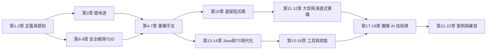

**三週自學計畫（每天約 1 小時）：**

| 週 | 內容 | 產出 |
| --- | --- | --- |
| 第 1 週 | 第 0～4 章；每天在 IDE 中跟著範例做一個手法 | 能在 IDE 中完成 Extract Function、Rename、Introduce Parameter Object，並說明每一步為什麼安全 |
| 第 2 週 | 第 5～10 章；完成 22.4 的 Kata 1 | 對一段沒有測試的程式碼先寫特性測試，再完成重構；提交紀錄符合 17.2 的規則 |
| 第 3 週 | 第 11～18 章、第 21 章；完成 22.4 的 Kata 2 與 22.5 的 AI 產出審查演練 | 能用 18.4 的流程驗證一份 AI 重構，並指出其中的行為改變 |

### 0.3 技術基準版本

本手冊的範例以下列版本撰寫並實際執行（2026-10-13 查證）。版本升級時，請依 [附錄 F.5](#f5-技術版本紀錄) 重新驗證。

| 類別 | 項目 | 版本 | 備註 |
| --- | --- | --- | --- |
| 語言 | Java | 25 LTS | 範例多數也可在 Java 21 編譯；需要 Java 22 以上語法者會標示 |
| 建置 | Maven | 3.9.x | 專案設定見附錄 C.1 |
| 測試 | JUnit Jupiter／AssertJ | 6.1.3／3.27.7 | |
| 測試 | ApprovalTests.Java | 31.0.0 | 核准測試（golden master） |
| 測試 | PIT（pitest-maven）＋pitest-junit5-plugin | 1.30.0＋1.2.3 | 變異測試 |
| 架構 | ArchUnit | 1.5.1 | 架構規則與凍結違規 |
| 效能 | JMH | 1.37 | 微基準測試 |
| 靜態分析 | PMD／Checkstyle | 7.28.0／14.3.0 | 規則名稱以此版本為準 |
| 靜態分析 | SonarQube Server／Community Build | 2026.5／26.9 | 規則鍵如 `java:S3776` |
| 自動化重構 | OpenRewrite（rewrite-maven-plugin） | 6.46.1 | |
| 重構偵測 | RefactoringMiner | 3.1.6 | 列出一個提交中的重構操作 |
| 資料庫 | PostgreSQL | 18 | 第 12 章的 SQL |
| IDE | IntelliJ IDEA | 2026.2 | 快捷鍵以 Windows／Linux 預設鍵盤配置為準 |
| 前端 | TypeScript／Vitest／ESLint／typescript-eslint | 6.0.2／5.0.4／10.12.0／8.71.2 | TypeScript 7 見 14.1 |

### 0.4 規則格式與驗證圖示

本手冊把「必須做到的事」寫成有編號的規則，等級用語採用 [RFC 2119](https://www.rfc-editor.org/rfc/rfc2119) 與 [RFC 8174](https://www.rfc-editor.org/rfc/rfc8174) 的語意：

| 等級 | 英文 | 意義 | 不遵守時 |
| --- | --- | --- | --- |
| **必須** | MUST | 不遵守會讓重構失去「行為不變」的保證，或直接造成缺陷 | 不得合併 |
| **應該** | SHOULD | 業界共識的最佳實務 | 須在 PR／MR 說明理由 |
| **可以** | MAY | 建議做法，依團隊情況選用 | 不阻擋 |
| **不應該** | SHOULD NOT | 通常是錯誤的做法 | 須在 PR／MR 說明理由與替代控制 |

規則編號格式為 `RFT-<領域>-<三位數序號>`（RFT = Refactoring Tutorial），編號一經發布不會重編：

| 前綴 | 領域 | 章 | 前綴 | 領域 | 章 |
| --- | --- | --- | --- | --- | --- |
| `RFT-DEF` | 定義、目標與國際標準 | 1 | `RFT-ARC` | 大型與架構重構 | 11 |
| `RFT-PRN` | 重構原則與時機 | 2 | `RFT-EVO` | 資料庫與 API 的演進式重構 | 12 |
| `RFT-SML` | 程式碼壞味道 | 3 | `RFT-JAVA` | Java 現代化重構 | 13 |
| `RFT-BAS` | 基本重構手法 | 4 | `RFT-FE` | 前端 TypeScript 重構 | 14 |
| `RFT-MOV` | 搬移特性與組織資料 | 5 | `RFT-TOOL` | 重構工具與自動化 | 15 |
| `RFT-CND` | 簡化條件邏輯 | 6 | `RFT-PRF` | 效能與重構 | 16 |
| `RFT-API` | API 與繼承重構 | 7 | `RFT-TEAM` | 團隊流程與程式碼審查 | 17 |
| `RFT-NET` | 安全網：重構前的測試 | 8 | `RFT-AI` | AI 輔助重構 | 18 |
| `RFT-TDD` | TDD 與重構 | 9 | `RFT-DEBT` | 技術債管理與度量 | 19 |
| `RFT-LEG` | 遺留程式碼重構 | 10 | | | |

每條規則都列出**驗證方式**，告訴你「怎麼確認有沒有做到」：

| 圖示 | 意義 | 例子 |
| --- | --- | --- |
| 🤖 | 工具可自動檢查 | PMD、Checkstyle、ArchUnit、CI 腳本 |
| 🧪 | 以測試或實際演練驗證 | 重構前後執行同一組測試、變異測試、基準測試 |
| 👁 | 需要人工判斷 | 程式碼審查時依「🔍 審查與驗證」的問題確認 |

每個含規則的小節最後都有「🔍 審查與驗證」：列出審查者（包括審查 AI 產出時的你）應該問的問題，以及確認答案的具體方法。

### 0.5 範例的閱讀方式

本手冊的範例有固定的寫法，讀懂這些約定，就能用同樣的方法驗證你自己（或 AI）的重構：

1. **❌ 與 ✅**：程式碼第一行的註解標示 ❌（重構前、或錯誤示範）或 ✅（重構後、或正確示範），並列出相關的規則編號。
2. **同名類別**：重構前（❌）與重構後（✅）的範例使用**相同的套件與類別名稱**。這不是偷懶——這正是驗證重構的方法：同一組測試在重構前後都必須通過。本手冊的驗證流程把 ❌ 版本放進另一個專案，用同一組測試執行（附錄 F.3）。
3. **標示「AI 錯誤版」的 ❌**：模擬 AI 或粗心的人做出的「看似重構、實則改變行為」的版本。它們會讓測試失敗，而失敗正是範例要教的事。
4. **「（片段）」**：程式碼區塊下方若標示「（片段）」，代表它只是摘錄，無法單獨編譯；其餘完整的範例都經過編譯與測試。
5. **操作步驟**：手法的操作步驟以 `text` 區塊列出，並附上 IntelliJ IDEA 的對應操作。照著步驟做，每一步之後都應該能編譯、測試通過。

```java
// ✅ 範例格式示意：第一行註解說明這是什麼、對應哪些規則
package com.example.rft.def;

public final class Greeting {

    public String greet(String name) {
        return "Hello, " + name;
    }
}
```

### 0.6 與其他文件的關係

本手冊是**自成一體的教學手冊**：不需要先讀其他文件就能學會重構。若你的團隊同時採用下列文件，可以這樣搭配：

| 文件 | 關係 |
| --- | --- |
| [refactor 重構指引]() | 團隊的規範文件（`RF-*` 規則）。本手冊的 `RFT-*` 規則與它方向一致，但以教學為目的、範例更多步驟；團隊規範以指引為準 |
| [TDD 測試驅動開發教學手冊]() | 第 9 章只說明 TDD 中「重構」那一步，完整的 TDD 教學請見該手冊 |
| [Clean Code 教學]() | 說明「好的程式碼長什麼樣子」；本手冊說明「如何安全地把程式碼改成那個樣子」 |
| [測試與品質保證指引]() | 第 8 章的測試技術在該指引有更完整的規範 |
| [code review 指引]() | 第 17 章的重構型 PR 審查方式與該指引一致 |

### 0.7 名詞約定

| 本手冊用語 | 英文 | 說明 |
| --- | --- | --- |
| 重構 | refactoring | 名詞指單一手法（如「提煉函式」），動詞指套用一連串手法的過程 |
| 可觀察行為 | observable behavior | 呼叫端能看到的結果：回傳值、例外、狀態變化、輸出、對外呼叫（詳見 1.2） |
| 壞味道 | code smell | 程式碼中「可能」有設計問題的徵兆，不一定是錯誤 |
| 操作步驟 | mechanics | 一個重構手法的逐步做法，每一步都維持可編譯、可測試 |
| 安全網 | safety net | 能偵測行為改變的測試集合 |
| 特性測試 | characterization test | 記錄程式「目前實際行為」的測試，不論該行為是否正確 |
| 接縫 | seam | 不修改該處程式碼，就能改變其行為的位置（Feathers） |
| 函式 | function | 本手冊沿用 Fowler 第二版用語，Java 中即「方法」（method） |

手法名稱第一次出現時以「中文（English）」並列，例如「提煉函式（Extract Function）」；之後可能只寫英文名稱，方便在 IDE 選單與文獻中查找。

---

## 1. 重構基本概念

> **🎯 學習目標**
>
> - 用一句話正確說出重構的定義，並說明「可觀察行為」包含哪些項目。
> - 分辨重構、重寫、最佳化、修正缺陷與新增功能。
> - 說明重構與 ISO/IEC 25010、ISO/IEC/IEEE 14764 等國際標準的關係。
> - 看出一段「重構後」的程式碼是否偷偷改變了行為。

### 1.1 什麼是重構

Martin Fowler 在《Refactoring》第二版中給了兩個定義：

- **重構（名詞）**：對軟體內部結構的一種調整，目的是在**不改變可觀察行為**的前提下，讓它更容易理解、修改成本更低。
- **重構（動詞）**：套用一連串重構手法，在不改變可觀察行為的前提下重新組織軟體。

這個定義有三個關鍵詞：

| 關鍵詞 | 意思 | 常見誤解 |
| --- | --- | --- |
| **不改變可觀察行為** | 呼叫端看到的結果完全相同 | 「功能差不多一樣」就算重構 |
| **內部結構** | 命名、函式切分、類別職責、相依方向、資料表示方式 | 只有「改名」「抽方法」才算重構 |
| **一連串小步驟** | 每一步都很小、可以編譯、可以測試 | 花兩週把模組翻新一遍也叫重構 |

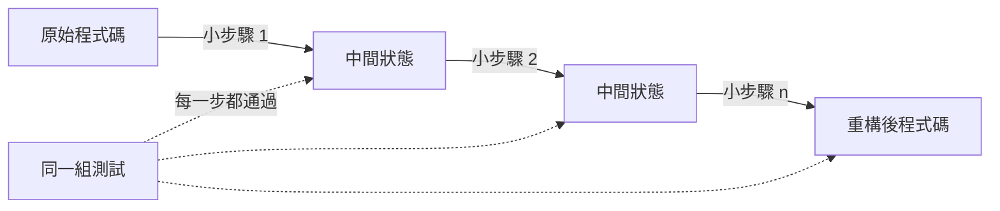

Kent Beck 有一個好記的比喻：寫程式時你戴著兩頂帽子之一——「新增功能」或「重構」。戴著重構的帽子時，你不新增功能、不修正缺陷，只調整結構；需要改行為時，就先換帽子（詳見 2.1）。

### 1.2 可觀察行為的界定

「行為不變」是重構唯一不能妥協的要求，但「行為」包含的東西比多數人想像的多。下表是判斷時的檢查項目：

| 類別 | 屬於可觀察行為 | 範例 |
| --- | --- | --- |
| 回傳值 | 每一組輸入對應的輸出，含邊界值 | 金額 `>= 1000` 免運改成 `> 1000`，剛好 1000 元的訂單行為就變了 |
| 例外 | 是否丟出、例外型別、必要時含訊息 | 除以零原本回傳 `Infinity`，改成丟出 `IllegalArgumentException` |
| `null` 處理 | 傳入或回傳 `null` 時的結果 | `op.equals("+")` 遇到 `null` 會丟 NPE；改成 `"+".equals(op)` 就不會 |
| 副作用 | 修改的狀態、寫入的資料、送出的訊息、呼叫外部服務的**次數與順序** | 把兩次寄信合併成一次 |
| 集合 | 元素順序、是否可修改、是否允許重複 | `Collectors.toList()` 改為 `Stream.toList()`，回傳的清單變成不可修改（13.4） |
| 輸出格式 | 對外輸出的文字、JSON 欄位名稱、數字格式 | `BigDecimal` 的 `120.50` 變成 `120.5` |
| 公開介面 | 仍被使用的公開類別、方法、欄位、序列化格式 | 把公開方法改名，卻還有其他模組在呼叫 |

**通常不屬於**可觀察行為的項目：私有方法與欄位、區域變數名稱、程式碼排列方式、類別內部的資料結構。

**需要依情境判斷**的項目：效能（一般重構允許小幅變動，但若有 SLA 就要量測，見第 16 章）、日誌內容（若有告警或稽核系統依賴日誌格式，它就是行為）、執行緒安全性。

| 編號 | 等級 | 規則 | 驗證方式 |
| --- | --- | --- | --- |
| `RFT-DEF-001` | 必須 | 重構不得改變可觀察行為；需要改變行為（修正缺陷、調整規則、加入檢查）時，必須先完成重構並提交，再以獨立的 `fix`／`feat` 變更處理 | 🧪 重構前後執行同一組測試；👁 程式碼審查 |
| `RFT-DEF-002` | 必須 | 判斷行為是否改變時，必須逐項檢查 1.2 表中的類別：邊界值、例外型別、`null` 處理、副作用的次數與順序、集合的順序與可修改性、輸出格式與公開介面 | 🧪 針對邊界值、`null` 與例外撰寫特性測試；👁 依 1.2 表逐項審查 |

#### 🔍 1.2 審查與驗證

| 審查問題 | 如何確認 |
| --- | --- |
| 這次變更是否只有結構調整？ | 在重構前的程式碼上執行重構後的測試（或反過來），兩邊都要通過；作法見 18.4 的 `equivalence-check.sh` |
| 邊界值有沒有被改到？ | 找出所有比較運算子（`<`、`<=`、`>`、`>=`）與常數，逐一比對前後是否相同 |
| 例外與 `null` 的處理有沒有改變？ | 搜尋 diff 中新增或刪除的 `throw`、`Optional`、`requireNonNull`、`equals` 呼叫方向 |
| 測試本身有沒有被修改？ | 重構型 PR 原則上不應修改既有測試的預期值；若有，逐行說明理由（17.4） |

### 1.3 重構的目標與效益

重構不是目的，而是讓下一次修改更容易的手段。Fowler 把它的效益歸納為四點：

1. **改善設計**：防止程式碼在一次次修改後逐漸腐化。
2. **讓程式碼更容易理解**：程式碼是寫給人看的，下一位讀者可能就是三個月後的你。
3. **幫助找出缺陷**：為了重構而仔細理解程式碼時，常會發現隱藏的錯誤（但發現後要換帽子，另外修正）。
4. **加快開發速度**：Fowler 的「設計耐力假說」（Design Stamina Hypothesis）指出，持續維持良好設計的專案，在初期之後的開發速度會高於放任設計腐化的專案。

這些效益可以對應到 **ISO/IEC 25010:2023** 產品品質模型中「可維護性」（Maintainability）的五個子特性。在 PR 中說明「這次重構改善了哪一個子特性」，能讓審查者判斷它是否值得：

| ISO/IEC 25010 子特性 | 意義 | 常見的重構手法 |
| --- | --- | --- |
| 模組性（Modularity） | 修改一個元件對其他元件的影響很小 | Extract Class、Move Function、Hide Delegate |
| 可重用性（Reusability） | 元件可用於其他系統或功能 | Extract Function、Parameterize Function |
| 易分析性（Analysability） | 容易找出缺陷原因或評估修改影響 | Rename、Extract Variable、Decompose Conditional |
| 易修改性（Modifiability） | 修改時不容易引入缺陷或降低品質 | Replace Conditional with Polymorphism、Encapsulate Collection |
| 易測試性（Testability） | 容易建立測試準則並執行測試 | 引入接縫（10.2）、Separate Query from Modifier |

| 編號 | 等級 | 規則 | 驗證方式 |
| --- | --- | --- | --- |
| `RFT-DEF-003` | 應該 | 每一個重構型 PR 都應說明動機（為了哪一個即將進行的修改、或解決哪一個壞味道），以及預期改善的 ISO/IEC 25010 可維護性子特性 | 👁 PR 範本欄位檢查 |

```markdown
<!-- ✅ RFT-DEF-003：重構型 PR 的說明範例 -->
## 動機
下個迭代要支援「離島運費」（DEBT-112），目前運費計算散落在 OrderService 與 CheckoutController 兩處，
新增規則需要同時修改兩個地方（散彈式修改）。

## 改善的可維護性子特性
- 易修改性：運費規則集中到 ShippingFeePolicy，新增規則只需改一處。
- 易測試性：ShippingFeePolicy 不依賴 Spring，可直接以單元測試覆蓋邊界值。

## 行為不變的證據
- 既有 23 個測試未修改且全部通過；新增 6 個特性測試（含 999／1000／1001 元邊界）。
- equivalence-check.sh：EQUIVALENT（附輸出）。
```

#### 🔍 1.3 審查與驗證

| 審查問題 | 如何確認 |
| --- | --- |
| 說得出這次重構讓「哪一個即將發生的修改」變容易嗎？ | PR 說明中要有具體的需求、議題或壞味道名稱；只寫「讓程式碼更乾淨」不足以判斷價值 |
| 改善的子特性和實際的變更相符嗎？ | 例如宣稱改善易測試性，就應該看到新的測試或新的接縫 |

### 1.4 重構與其他變更的區別

| 項目 | 重構 | 重寫（rewrite） | 效能最佳化 | 修正缺陷／新增功能 |
| --- | --- | --- | --- | --- |
| 外部行為 | 完全不變 | 可能改變（通常會） | 不變，但效能特性改變 | 刻意改變 |
| 進行方式 | 一連串小步驟，每步可測試 | 另起爐灶，完成後切換 | 依量測結果修改熱點 | 依需求修改 |
| 主要風險 | 低（每步可回復） | 高（長時間無法交付、遺漏隱性需求） | 中（可能讓程式碼更難懂） | 依需求而定 |
| 既有測試 | 繼續有效，不應修改 | 多數需要重寫 | 繼續有效 | 部分需要修改或新增 |
| 提交類型（17.2） | `refactor` | 依規劃而定 | `perf` | `fix`／`feat` |

「替換演算法」（Substitute Algorithm）是 Fowler 目錄中的正式手法，只要新演算法對所有輸入產生相同結果，它仍然是重構；但它是風險最高的手法之一，必須有完整的安全網（8.4 的變異測試是好工具）。

| 編號 | 等級 | 規則 | 驗證方式 |
| --- | --- | --- | --- |
| `RFT-DEF-004` | 不應該 | 不應以「重構」之名提交重寫、效能最佳化或行為變更；大範圍的重新實作應依第 11 章以 Strangler Fig 或 Branch by Abstraction 規劃，並標示為對應的變更類型 | 👁 程式碼審查；🤖 RefactoringMiner 列出提交中的重構操作（15.5），無法辨識的大量變更需說明 |

```text
✅ RFT-DEF-004：同一個需求拆成類型正確的三個提交（git log --oneline）
a1c3e9f refactor(order): 提煉 ShippingFeePolicy，運費邏輯集中一處（行為不變）
5b72d04 fix(order): 運費門檻改為「滿 1000 元」含 1000 元（DEF-2291）
e90a6b1 feat(order): 新增離島運費規則

❌ RFT-DEF-004：一個提交混合三種變更，審查者無法判斷哪一行改變了行為
77d0c2a refactor: 重構運費計算
```

#### 🔍 1.4 審查與驗證

| 審查問題 | 如何確認 |
| --- | --- |
| 標示為 `refactor` 的提交中，有沒有行為變更？ | 依 1.2 檢查；若有，要求拆成獨立提交 |
| 這是重構還是重寫？ | 若 diff 中大部分是新檔案、舊程式碼整批刪除，或 RefactoringMiner 幾乎辨識不出重構操作，就是重寫 |

### 1.5 國際標準與業界參考

重構本身沒有專屬的國際標準，但它與下列標準與業界文獻密切相關。理解這些關係，能幫助你在企業內部向管理層說明重構的必要性與定位。

| 標準或文獻 | 與重構的關係 |
| --- | --- |
| **ISO/IEC 25010:2023** 產品品質模型 | 重構的目標是提升「可維護性」的五個子特性（1.3）。2023 版把舊版的 Usability 改名為 Interaction Capability，並新增 Safety 特性；可維護性的五個子特性名稱不變 |
| **ISO/IEC/IEEE 14764:2022** 軟體維護 | 把維護分為更正性（corrective）、預防性（preventive）、調適性（adaptive）、增補性（additive）與完善性（perfective）等類型。重構通常歸類為**預防性維護**：在問題發生前改善可維護性 |
| **ISO/IEC/IEEE 12207:2017** 軟體生命週期流程 | 重構屬於維護流程與實作流程的一部分，需要搭配組態管理（版本控制）與驗證流程 |
| **ISO/IEC 5055:2021** 自動化原始碼品質量測 | 以 CWE 定義可維護性弱點（例如過高的複雜度、重複程式碼、過深的繼承），可作為重構優先順序的客觀依據 |
| **ISO/IEC/IEEE 29119** 軟體測試 | 重構依賴回歸測試；29119 的測試流程與技術（如邊界值分析）可用來設計安全網 |
| Martin Fowler《Refactoring》第二版（2018） | 重構的定義、66 個手法的目錄（[refactoring.com/catalog](https://refactoring.com/catalog/)）與 24 種壞味道，是本手冊第 3～7 章的主要依據 |
| Michael Feathers《Working Effectively with Legacy Code》（2004） | 遺留程式碼的重構：接縫、特性測試、Sprout／Wrap（第 10 章） |
| Kent Beck《Tidy First?》（2023） | 把「整理」（tidying）與行為變更分開、整理的經濟學（2.6） |
| Ellnestam & Brolund《The Mikado Method》（2014） | 大型重構的相依關係圖與回復策略（10.5） |

> 標準條文的引用依各標準的公開摘要與目錄整理；本手冊未取得標準全文逐條比對，相關說明列於附錄 F.4。

### 1.6 實務案例：一次「不是重構」的重構

下面這段計算機程式是許多重構教材的開場範例。請先讀程式碼，再試著回答：如果要把 `if-else` 改成更好擴充的結構，**哪些行為必須保留？**

```java
// ❌ 重構前：以字串判斷運算子的計算機
package com.example.rft.def;

public class Calculator {

    public double calc(double a, double b, String op) {
        if (op.equals("+")) {
            return a + b;
        } else if (op.equals("-")) {
            return a - b;
        } else if (op.equals("*")) {
            return a * b;
        } else if (op.equals("/")) {
            return a / b;
        }
        return 0;
    }
}
```

仔細列出它的可觀察行為（這就是 1.2 的練習）：

1. 四種運算的結果。
2. `b` 為 0 時，`a / b` 是浮點數除法，回傳 `Infinity`、`-Infinity` 或 `NaN`，**不會丟出例外**。
3. 不認得的運算子回傳 `0`。
4. `op` 為 `null` 時，`op.equals("+")` 丟出 `NullPointerException`。

把這些行為寫成測試，這組測試就是本次重構的安全網：

```java
// ✅ RFT-DEF-001、RFT-DEF-002：特性測試——記錄目前的行為（含除以零、未知運算子、null）
package com.example.rft.def;

import static org.assertj.core.api.Assertions.assertThat;
import static org.assertj.core.api.Assertions.assertThatThrownBy;

import org.junit.jupiter.api.Test;
import org.junit.jupiter.params.ParameterizedTest;
import org.junit.jupiter.params.provider.CsvSource;

class CalculatorTest {

    private final Calculator calculator = new Calculator();

    @ParameterizedTest
    @CsvSource({"6, 3, +, 9.0", "6, 3, -, 3.0", "6, 3, *, 18.0", "6, 3, /, 2.0"})
    void fourOperations(double a, double b, String op, double expected) {
        assertThat(calculator.calc(a, b, op)).isEqualTo(expected);
    }

    @Test
    void divisionByZeroFollowsIeee754() {
        assertThat(calculator.calc(1, 0, "/")).isEqualTo(Double.POSITIVE_INFINITY);
        assertThat(calculator.calc(-1, 0, "/")).isEqualTo(Double.NEGATIVE_INFINITY);
        assertThat(calculator.calc(0, 0, "/")).isNaN();
    }

    @Test
    void unknownOperatorReturnsZero() {
        assertThat(calculator.calc(6, 3, "%")).isZero();
    }

    @Test
    void nullOperatorThrowsNullPointerException() {
        assertThatThrownBy(() -> calculator.calc(6, 3, null)).isInstanceOf(NullPointerException.class);
    }
}
```

本手冊 v1.0 的版本把 `calc()` 拆成 `add()`、`subtract()` 等四個方法，並在除法加入「除數不能為零」的檢查。這樣的改法有兩個問題：拿掉 `calc()` 讓所有呼叫端都無法編譯；加入除以零的檢查則改變了行為。AI 程式助理也很常產出這種「順手加上防呆」的版本：

```java
// ❌ AI 錯誤版：看起來更「安全」，其實改變了兩項行為（除以零、未知運算子）
package com.example.rft.def;

public class Calculator {

    public double calc(double a, double b, String op) {
        return switch (op) {
            case "+" -> a + b;
            case "-" -> a - b;
            case "*" -> a * b;
            case "/" -> {
                if (b == 0) {
                    throw new IllegalArgumentException("除數不能為零");
                }
                yield a / b;
            }
            default -> throw new UnsupportedOperationException("不支援的運算子：" + op);
        };
    }
}
```

把同一組 `CalculatorTest` 套在這個版本上，`divisionByZeroFollowsIeee754` 與 `unknownOperatorReturnsZero` 都會失敗——安全網正確地攔下了行為改變。（有趣的是，`switch` 遇到 `null` 也會丟 `NullPointerException`，所以 `null` 這項剛好保留了。）

正確的重構保留所有行為，只改變結構。這裡把運算子集中到列舉（enum）中，新增運算子只要加一行：

```java
// ✅ RFT-DEF-001、RFT-DEF-002：行為完全不變；注意 op.equals(...) 的呼叫方向保留了 null 時的 NPE
package com.example.rft.def;

import java.util.function.DoubleBinaryOperator;

public class Calculator {

    public double calc(double a, double b, String op) {
        for (Operation operation : Operation.values()) {
            if (op.equals(operation.symbol)) {
                return operation.function.applyAsDouble(a, b);
            }
        }
        return 0;
    }

    private enum Operation {
        ADD("+", (a, b) -> a + b),
        SUBTRACT("-", (a, b) -> a - b),
        MULTIPLY("*", (a, b) -> a * b),
        DIVIDE("/", (a, b) -> a / b);

        private final String symbol;
        private final DoubleBinaryOperator function;

        Operation(String symbol, DoubleBinaryOperator function) {
            this.symbol = symbol;
            this.function = function;
        }
    }
}
```

如果業務上真的希望「除以零要報錯」，那是一個**需求變更**：先提交上面的重構，再以 `fix` 或 `feat` 提交修改，並同步修改 `divisionByZeroFollowsIeee754` 的預期——這樣審查者一眼就能看出行為在哪一個提交、因為什麼原因改變。

> 💡 **小技巧**：寫 `"+".equals(op)` 是常見的防禦寫法，但在重構中把 `op.equals("+")` 改成 `"+".equals(op)` 會把「丟 NPE」改成「回傳 0」，屬於行為變更。重構時保持呼叫方向；若要改，另外提交。

#### 📝 第 1 章重點

- 重構＝不改變可觀察行為＋改善內部結構＋一連串小步驟；三者缺一不可。
- 可觀察行為包括邊界值、例外、`null`、副作用、集合特性、輸出格式與公開介面。
- 「順手加上防呆」是最常見的「假重構」，AI 尤其容易這樣做。
- 用同一組測試驗證重構前後，是判斷「行為不變」最直接的方法。

#### ✏️ 第 1 章自我檢測

1. 把 `if (amount >= 1000)` 改成 `if (amount > 999)`，`amount` 型別是 `int` 時算不算重構？是 `BigDecimal` 時呢？
2. 把一段寫入兩次日誌的程式碼合併成寫一次，算不算重構？需要問什麼問題才能判斷？
3. 為什麼本章的 ✅ 版本仍然保留 `op.equals(...)` 的寫法？

<details>
<summary>參考答案</summary>

1. `int` 時兩者對所有整數輸入結果相同，算重構；`BigDecimal`（或 `double`）時 999.5 會得到不同結果，行為改變了，不算重構。
2. 要問「有沒有任何系統依賴這兩筆日誌」，例如告警規則、稽核紀錄或日誌分析報表。若有，日誌就是可觀察行為，合併它不是重構。
3. 為了保留 `op` 為 `null` 時丟出 `NullPointerException` 的行為（`CalculatorTest.nullOperatorThrowsNullPointerException`）。

</details>

---

## 2. 重構的基本原則

> **🎯 學習目標**
>
> - 在工作中區分「新增功能」與「重構」兩頂帽子，並以正確的提交方式呈現。
> - 用「小步前進、每步驗證、失敗就回退」的節奏完成重構。
> - 判斷什麼時候該重構、什麼時候不該重構。
> - 用「準備型重構」讓新功能變得容易加入。

### 2.1 兩頂帽子

Kent Beck 的「兩頂帽子」是重構最重要的紀律：

| 帽子 | 你在做什麼 | 你不做什麼 | 測試的狀態 |
| --- | --- | --- | --- |
| 🎩 新增功能（含修正缺陷） | 加入新行為、新增測試 | 不調整既有結構 | 先新增會失敗的測試，再讓它通過 |
| 🧢 重構 | 調整結構 | 不新增功能、不修正缺陷、不新增「防呆」 | 既有測試全部通過，且**不修改**它們的預期值 |

一天之內你可能換帽子很多次，但**任何時刻只戴一頂**。重構到一半發現缺陷時，先記下來（便條、TODO 清單或議題），完成這一步重構並提交後，再換帽子修正。

| 編號 | 等級 | 規則 | 驗證方式 |
| --- | --- | --- | --- |
| `RFT-PRN-001` | 必須 | 一個提交只能戴一頂帽子：`refactor` 提交不得包含行為變更；`feat`／`fix` 提交不應夾帶與該變更無關的重構 | 👁 逐提交審查；🧪 `refactor` 提交在前一個提交的測試上執行仍全部通過 |

```text
✅ RFT-PRN-001：重構中發現缺陷時，先記下、完成重構、再另外修正
1. 進行 Extract Function 時發現：折扣計算在金額為負數時會給出負折扣（缺陷）。
2. 在 TODO 清單記下「負數金額折扣」——不在這一步修改。
3. 完成 Extract Function，測試全部通過 → git commit -m "refactor(pricing): 提煉 discountFor()"
4. 換帽子：新增會失敗的測試 negativeAmountHasNoDiscount → 修改 → 通過
   → git commit -m "fix(pricing): 負數金額不給折扣（DEF-3310）"
```

#### 🔍 2.1 審查與驗證

| 審查問題 | 如何確認 |
| --- | --- |
| 每個提交的類型與內容相符嗎？ | 逐一檢視提交（`git log -p` 或 PR 的「Commits」頁籤），不要只看合併後的整體 diff |
| `refactor` 提交有沒有修改測試的預期值？ | 檢查該提交中測試檔的變更；只允許新增測試、改名或搬移，不允許改預期（17.4 的 `refactor-guard.sh` 可自動檢查） |

### 2.2 小步前進與每步驗證

重構的安全性來自「步伐小」。每一步都應該小到：

- 改完之後可以**編譯**；
- 執行相關測試只需幾秒鐘，而且**全部通過**；
- 萬一失敗，你能**立刻看出原因**，或直接**丟掉這一步**重來。

> 💡 Fowler 的經驗：重構時如果測試失敗、而你無法在幾分鐘內看出原因，最快的做法通常是**回到上一個綠燈狀態**，用更小的步伐再做一次，而不是在紅燈狀態下除錯。

| 編號 | 等級 | 規則 | 驗證方式 |
| --- | --- | --- | --- |
| `RFT-PRN-002` | 必須 | 每完成一小步都必須編譯並執行相關測試；測試失敗時應回到上一個通過的狀態（`git restore`／`git stash`），以更小的步伐重做，不得在測試失敗的狀態下繼續疊加修改 | 🧪 演練；👁 結對或審查時觀察提交粒度 |
| `RFT-PRN-003` | 應該 | 每到一個測試全數通過的狀態就在本機提交一次（微提交），讓每一步都可以回退；合併前可依團隊政策整理提交，但 `refactor` 與 `feat`／`fix` 不可壓縮在同一個提交 | 👁 檢視分支的提交歷史 |

```bash
#!/usr/bin/env bash
# ✅ RFT-PRN-002、RFT-PRN-003：重構時的微提交節奏（以 Maven 專案為例）
# 用法：./step.sh "提煉 discountFor()"——測試通過就提交，失敗就丟棄這一步
set -euo pipefail
message="$1"
if mvn -q test; then
  git add -A
  git commit -q -m "refactor: ${message}"
  echo "GREEN：已提交「${message}」"
else
  git restore --staged --worktree .
  echo "RED：測試失敗，已回到上一個綠燈；請用更小的步伐重做" >&2
  exit 1
fi
```

這種節奏有個常見的變化叫 **TCR（test && commit || revert）**：每次存檔都自動執行測試，通過就提交、失敗就把修改全部還原。它強迫你採取極小的步伐，很適合用來練習（第 22 章的 Kata 可以試試）。

#### 🔍 2.2 審查與驗證

| 審查問題 | 如何確認 |
| --- | --- |
| 每一步是否小到可以單獨回退？ | 檢視提交歷史：一個 `refactor` 提交最好只包含一個手法（例如只有 Extract Function，或只有 Rename） |
| 有沒有「先改壞、最後一次修好」的痕跡？ | 在 CI 中對 PR 的每個提交執行測試（15.3），或在本機以 `git rebase --exec "mvn -q test" origin/main` 檢查 |

### 2.3 重構的時機

| 時機 | 說明 | 範例 |
| --- | --- | --- |
| **準備型重構**（preparatory） | 新增功能前，先把結構調整成「加入新功能很容易」的樣子 | 新增運費規則前，先把散落的條件集中成規則表 |
| **理解型重構**（comprehension） | 讀不懂程式碼時，透過改名、提煉函式把你的理解寫進程式碼 | 把 `calc2()` 改名為 `lateFeeFor()` |
| **撿垃圾型重構**（litter-pickup） | 經過時看到小問題就順手整理（童子軍規則） | 移除沒人呼叫的方法；但要另外提交 |
| **三法則**（Rule of Three） | 第一次照寫、第二次重複時皺眉、第三次才抽象化 | 第三個報表需要同樣的日期格式時才提煉共用函式 |
| **程式碼審查時** | 審查者提出更好的結構，作者在同一個 PR 的獨立提交中處理 | 「這裡有 Feature Envy，建議搬到 `Order`」 |
| **計畫型重構**（planned） | 長期累積的技術債，排入迭代處理 | 以第 19 章的熱點分析排序 |
| **長期重構**（long-term） | 數週到數月的大型結構調整，以 Branch by Abstraction 分階段進行 | 更換持久層框架（第 11 章） |

Kent Beck 的名言精準描述了準備型重構：「**先讓修改變得容易（這可能很難），再進行這個容易的修改。**」（make the change easy (warning: this may be hard), then make the easy change）

**範例：新增「離島運費」之前的準備型重構。** 目前的運費邏輯用 `if` 寫死了兩個地區：

```java
// ❌ 重構前：新增地區需要再加一段 if，門檻與運費混在流程中
package com.example.rft.prn;

public class ShippingFee {

    public int feeFor(String region, int orderAmount) {
        if ("MAIN".equals(region)) {
            if (orderAmount >= 1000) {
                return 0;
            }
            return 80;
        }
        if ("OVERSEAS".equals(region)) {
            return 350;
        }
        throw new IllegalArgumentException("unknown region: " + region);
    }
}
```

動手之前，先用特性測試鎖住現在的行為，特別是邊界值與錯誤情況：

```java
// ✅ RFT-PRN-004：準備型重構的安全網——邊界值、未知地區與 null 都要涵蓋
package com.example.rft.prn;

import static org.assertj.core.api.Assertions.assertThat;
import static org.assertj.core.api.Assertions.assertThatThrownBy;

import org.junit.jupiter.api.Test;
import org.junit.jupiter.params.ParameterizedTest;
import org.junit.jupiter.params.provider.CsvSource;

class ShippingFeeTest {

    private final ShippingFee shippingFee = new ShippingFee();

    @ParameterizedTest
    @CsvSource({"MAIN, 999, 80", "MAIN, 1000, 0", "MAIN, 1001, 0", "OVERSEAS, 0, 350", "OVERSEAS, 5000, 350"})
    void feeByRegionAndAmount(String region, int amount, int expected) {
        assertThat(shippingFee.feeFor(region, amount)).isEqualTo(expected);
    }

    @Test
    void overseasIsNeverFreeEvenForTheLargestAmount() {
        assertThat(shippingFee.feeFor("OVERSEAS", Integer.MAX_VALUE)).isEqualTo(350);
    }

    @Test
    void unknownOrNullRegionIsRejected() {
        assertThatThrownBy(() -> shippingFee.feeFor("MOON", 100))
                .isInstanceOf(IllegalArgumentException.class).hasMessage("unknown region: MOON");
        assertThatThrownBy(() -> shippingFee.feeFor(null, 100))
                .isInstanceOf(IllegalArgumentException.class).hasMessage("unknown region: null");
    }
}
```

接著把「地區規則」從流程中分離成資料。新增地區時，只需要在規則表加一行：

```java
// ✅ RFT-PRN-004：準備型重構完成——行為不變，新增地區只需在 RULES 加一筆
package com.example.rft.prn;

import java.util.Map;

public class ShippingFee {

    private record Rule(int fee, Integer freeFrom) {

        int feeFor(int orderAmount) {
            boolean free = freeFrom != null && orderAmount >= freeFrom;
            return free ? 0 : fee;
        }
    }

    private static final Map<String, Rule> RULES = Map.of(
            "MAIN", new Rule(80, 1000),
            "OVERSEAS", new Rule(350, null));

    public int feeFor(String region, int orderAmount) {
        Rule rule = region == null ? null : RULES.get(region);
        if (rule == null) {
            throw new IllegalArgumentException("unknown region: " + region);
        }
        return rule.feeFor(orderAmount);
    }
}
```

這個看似簡單的重構藏了兩個陷阱，測試都替我們攔下了：

1. **`Map.of(...).get(null)` 會丟出 `NullPointerException`**，而原本的 `"MAIN".equals(null)` 只會回傳 `false`。如果少了 `region == null ? null : ...` 這段，`unknownOrNullRegionIsRejected` 就會失敗。
2. **不要用「哨兵值」表示「永不免運」**。若把海外的門檻寫成 `Integer.MAX_VALUE`，金額剛好等於 `Integer.MAX_VALUE` 時就會變成免運——`overseasIsNeverFreeEvenForTheLargestAmount` 正是為此而寫。這裡用 `null` 明確表示「沒有免運門檻」。

重構提交之後，新功能就是一個「容易的修改」：

```java
// ✅ RFT-PRN-004：接下來的 feat 提交只改一行規則表，並新增離島的測試（片段）
private static final Map<String, Rule> RULES = Map.of(
        "MAIN", new Rule(80, 1000),
        "OUTLYING", new Rule(150, 2000),
        "OVERSEAS", new Rule(350, null));
```

（片段）

| 編號 | 等級 | 規則 | 驗證方式 |
| --- | --- | --- | --- |
| `RFT-PRN-004` | 應該 | 新增功能前，若現有結構讓修改變得困難，應先做準備型重構並獨立提交，再於下一個提交加入新功能 | 👁 檢視提交順序：`refactor` 在前、`feat` 在後 |
| `RFT-PRN-005` | 應該 | 重複的程式碼第三次出現時才抽象化（三法則）；只出現兩次且變化方向不明時，可以保留重複並在第三次時再整理 | 🤖 PMD CPD 回報重複區塊；👁 審查時確認抽象化有至少三個使用者 |

```java
// ❌ RFT-PRN-005：只有一個使用者就先建立「通用」框架——過早抽象（片段）
public interface ReportExporter<T, R extends ReportOptions> { /* 只有 CsvSalesExporter 一個實作 */ }

// ✅ RFT-PRN-005：第三個報表也需要相同的日期格式時，才提煉共用函式（片段）
static String reportDate(LocalDate date) {
    return date.format(DateTimeFormatter.ofPattern("yyyy/MM/dd"));
}
```

（片段）

#### 🔍 2.3 審查與驗證

| 審查問題 | 如何確認 |
| --- | --- |
| 新功能的提交是否因為先做了準備型重構而變得很小？ | 比較 `feat` 提交的 diff 大小；若 `feat` 提交仍然很大，可能準備型重構做得不夠，或兩者混在一起 |
| 新的抽象有幾個使用者？ | 搜尋介面或共用函式的呼叫端；只有一個使用者的抽象通常是 Speculative Generality（3.6） |

### 2.4 何時不該重構

| 情境 | 為什麼 | 該怎麼做 |
| --- | --- | --- |
| 程式碼雖然醜，但**不需要修改**，也沒人需要讀懂它 | 重構的價值在於讓「下一次修改」更容易；不會被修改的程式碼，重構沒有回報 | 把它當黑盒子，透過 API 使用 |
| **沒有安全網**，又無法快速建立 | 手動修改沒有測試保護的程式碼，風險高 | 先寫特性測試（第 8 章），或只使用 IDE 的自動化重構（15.1） |
| 重寫比重構更划算 | 程式碼已無法運作，或技術平台必須更換 | 依第 11 章以 Strangler Fig 漸進取代 |
| 發布凍結期、緊急修復中 | 審查與測試資源都被壓縮 | 把重構記入技術債清單（第 19 章），發布後處理 |
| 正在處理一個正式環境事故 | 事故處理只做最小修正 | 事後檢討時再安排重構 |

| 編號 | 等級 | 規則 | 驗證方式 |
| --- | --- | --- | --- |
| `RFT-PRN-006` | 不應該 | 在沒有測試覆蓋的程式碼上不應進行手動重構；若無法先補測試，只應使用 IDE 提供的自動化重構（Rename、Extract、Inline、Change Signature 等），並逐一提交 | 🧪 以覆蓋率報告確認修改範圍有測試；👁 審查時確認手動修改的範圍 |
| `RFT-PRN-007` | 不應該 | 不應為了「看起來更好」而重構不需要修改、也沒有理解需求的程式碼；重構範圍應限於本次任務會觸及或必須理解的程式碼 | 👁 PR 說明中的動機（`RFT-DEF-003`） |

```text
✅ RFT-PRN-006：遺留程式碼沒有測試時，可安全使用的 IDE 自動化重構（IntelliJ IDEA）
- Rename（Shift+F6）：同時更新所有參照；注意反射、字串中的名稱與設定檔（15.1）
- Extract Method（Ctrl+Alt+M）、Extract Variable（Ctrl+Alt+V）、Introduce Parameter（Ctrl+Alt+P）
- Inline（Ctrl+Alt+N）
- Change Signature（Ctrl+F6）：新增參數時指定預設值
每一個自動化操作完成後就提交一次；手動修改等補上特性測試後再做。

❌ RFT-PRN-007：PR #812「順便整理 utils 套件」——修改了 37 個與本次需求無關、近兩年沒有人修改過的檔案
```

#### 🔍 2.4 審查與驗證

| 審查問題 | 如何確認 |
| --- | --- |
| 被修改的程式碼有測試保護嗎？ | 查看覆蓋率報告中被修改的行；沒有覆蓋的手動修改要求先補特性測試 |
| 這些檔案和本次需求有關嗎？ | 比對 PR 說明的動機與被修改檔案清單；無關的整理應另開 PR 或移除 |

### 2.5 安全重構的流程

v1.0 的流程圖在測試失敗時要求「修復問題」，這容易讓人在紅燈狀態下越改越多。正確的流程是「**失敗就回退**」：

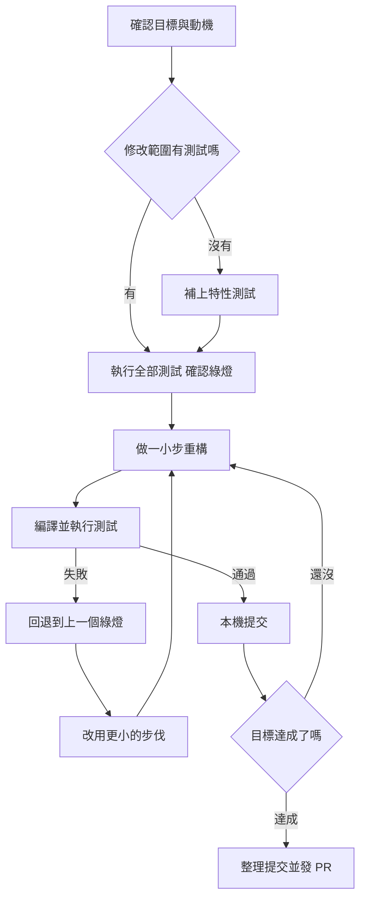

### 2.6 Tidy First：整理的經濟學

Kent Beck 在《Tidy First?》（2023）中把小規模的重構稱為「整理」（tidying），並提出幾個實用的觀點：

1. **結構變更與行為變更分開**：分開提交、最好分開 PR。結構變更可以快速審查與合併，行為變更則需要仔細審查。
2. **整理的時機有四種選擇**：先整理（tidy first）、之後整理（tidy after）、以後再說（tidy later）、永不整理（never）。如果整理能讓接下來的修改更快或更安全，就先整理；如果只是讓程式碼「更好看」，可以以後再說。
3. **整理要小**：每次整理應該在幾分鐘內完成，否則它就是一個需要規劃的重構專案。
4. **整理是可回復的**：因為行為不變，即使整理的方向錯了，也很容易改回來，所以不需要開會討論每一個整理。

Beck 列舉的常見整理手法，和本手冊第 4～6 章的手法對應如下：

| Tidy First 的整理 | 對應的重構手法 | 本手冊章節 |
| --- | --- | --- |
| Guard Clauses | Replace Nested Conditional with Guard Clauses | 6.3 |
| Dead Code | Remove Dead Code | 5.6 |
| Normalize Symmetries、Reading Order | Slide Statements | 4.7 |
| Explaining Variables／Constants | Extract Variable、Replace Magic Literal | 4.2、4.8 |
| Explicit Parameters | Introduce Parameter Object、Preserve Whole Object | 4.5、7.3 |
| Chunk Statements、Extract Helper | Extract Function | 4.1 |
| One Pile | Inline Function | 4.1 |
| Explaining Comments／Delete Redundant Comments | 以命名取代註解 | 3.6 |

### 2.7 實務注意事項

1. **建立檢查點**：開始重構前，確認工作目錄乾淨、最新的測試全部通過，並記下目前的提交。
2. **優先使用 IDE 的自動化重構**：它們比手動修改可靠，但仍有盲點（反射、字串中的類別名稱、設定檔、序列化格式），詳見 15.1。
3. **和團隊溝通**：大範圍的改名或搬移會讓其他人的分支產生大量衝突，先在團隊頻道告知，或選在其他人合併之後進行（17.1）。
4. **注意效能**：一般重構不會明顯影響效能；有效能要求的程式碼，重構前後以 JMH 或負載測試量測（第 16 章），不要憑感覺。
5. **時間盒（timebox）**：替重構設定時間上限（例如 30 分鐘）。超過時間還沒完成，就回退並重新規劃，或改用 Mikado 方法（10.5）。

#### 📝 第 2 章重點

- 任何時刻只戴一頂帽子：重構與行為變更分開提交。
- 小步前進、每步驗證、失敗就回退；微提交讓回退變得便宜。
- 準備型重構：先讓修改變容易，再做容易的修改。
- 沒有安全網、不需要修改、或發布凍結時，不要重構。

#### ✏️ 第 2 章自我檢測

1. 你在重構時發現一個 `NullPointerException` 的缺陷，正確的處理順序是什麼？
2. 2.3 的範例中，為什麼重構後的 `ShippingFee` 需要 `region == null ? null : RULES.get(region)`？
3. 一個 PR 包含一個 `refactor` 提交和一個 `feat` 提交，CI 只對最後一個提交執行測試。這樣有什麼風險？

<details>
<summary>參考答案</summary>

1. 先記下缺陷 → 完成並提交目前的重構步驟 → 換帽子，寫一個會失敗的測試重現缺陷 → 修正 → 以 `fix` 提交。
2. `Map.of` 建立的不可變 Map 呼叫 `get(null)` 會丟出 `NullPointerException`，而原本的程式碼遇到 `null` 地區會丟出 `IllegalArgumentException`。少了這段判斷，例外型別就改變了。
3. 無法證明 `refactor` 提交本身行為不變——如果 `refactor` 提交改壞了行為，又在 `feat` 提交中「順便」修正測試，最後一個提交仍會通過。應對每個提交執行測試（2.2 審查問題）。

</details>

---

## 3. 識別壞味道（Code Smells）

> **🎯 學習目標**
>
> - 說出 Fowler 第二版的 24 種壞味道，並把它們歸類。
> - 看到一段程式碼時，能用標準名稱描述它的問題，並說出對應的重構手法。
> - 用 PMD、Checkstyle、SonarQube 等工具找出壞味道，並理解工具門檻的限制。

### 3.1 什麼是程式碼壞味道

「壞味道」（code smell）一詞由 Kent Beck 提出：程式碼中**可能**有設計問題的徵兆。它不是錯誤——程式照樣能執行——但它暗示「這裡下次修改時會很痛苦」。

壞味道的價值在於提供一套**共同語言**。審查意見寫「這段怪怪的」沒有幫助；寫「這裡有 Feature Envy：`invoiceTotal()` 讀取了 `Order` 的五個欄位，建議 Move Function 到 `Order`」，作者就知道問題是什麼、該怎麼改。

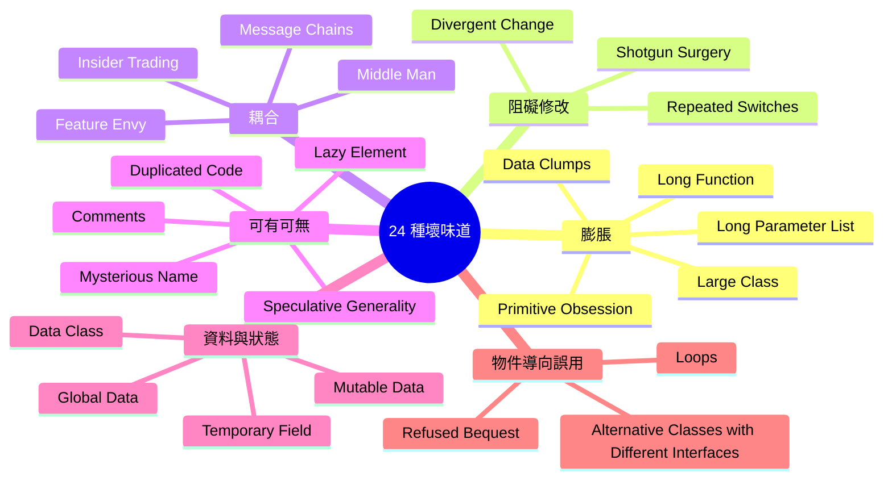

### 3.2 Fowler 第二版的 24 種壞味道

下表依《Refactoring》第二版第 3 章整理。第二版相較於第一版（1999）新增了 Mysterious Name、Global Data、Mutable Data、Loops，把 Switch Statements 改為 Repeated Switches、Inappropriate Intimacy 改為 Insider Trading、Lazy Class 改為 Lazy Element，並移除了 Parallel Inheritance Hierarchies 與 Incomplete Library Class。

| # | 壞味道 | 中文 | 徵兆 | 主要重構手法 | 本手冊 |
| --- | --- | --- | --- | --- | --- |
| 1 | Mysterious Name | 神秘命名 | 名稱看不出用途，例如 `data2`、`proc()`、`flag` | Rename、Change Function Declaration | 4.3、4.4 |
| 2 | Duplicated Code | 重複程式碼 | 同一段邏輯出現在多處 | Extract Function、Slide Statements、Pull Up Method | 4.1、4.7、7.6 |
| 3 | Long Function | 過長函式 | 需要捲動才能讀完；以註解分段 | Extract Function、Replace Temp with Query、Decompose Conditional | 4.1、4.6、6.1 |
| 4 | Long Parameter List | 過長參數列 | 參數超過 3～4 個；呼叫時容易傳錯順序 | Introduce Parameter Object、Preserve Whole Object、Remove Flag Argument | 4.5、7.2、7.3 |
| 5 | Global Data | 全域資料 | 任何地方都能修改的靜態可變狀態 | Encapsulate Variable | 4.6 |
| 6 | Mutable Data | 可變資料 | 資料在多處被修改，難以追蹤 | Encapsulate Variable、Separate Query from Modifier、Remove Setting Method | 4.6、7.1 |
| 7 | Divergent Change | 發散式變化 | 一個類別因為多種不同原因被修改 | Split Phase、Extract Class、Move Function | 4.9、5.3、5.1 |
| 8 | Shotgun Surgery | 散彈式修改 | 一個修改需要改動許多類別 | Move Function、Move Field、Combine Functions into Class、Inline Class | 5.1、5.2、4.9、5.3 |
| 9 | Feature Envy | 依戀情結 | 函式對其他類別的資料比對自己的更感興趣 | Move Function、Extract Function | 5.1 |
| 10 | Data Clumps | 資料泥團 | 同一組欄位或參數總是一起出現 | Extract Class、Introduce Parameter Object | 5.3、4.5 |
| 11 | Primitive Obsession | 基本型別偏執 | 用 `String`、`int`、`double` 表示金額、電話、狀態 | Replace Primitive with Object、Replace Type Code with Subclasses | 5.5、6.4 |
| 12 | Repeated Switches | 重複的 switch | 同一個型別碼的 `switch`／`if` 鏈出現在多處 | Replace Conditional with Polymorphism | 6.4 |
| 13 | Loops | 迴圈 | 迴圈中混合了篩選、轉換與彙總 | Replace Loop with Pipeline | 13.4 |
| 14 | Lazy Element | 冗贅元素 | 類別或函式沒有提供足夠的價值 | Inline Function、Inline Class、Collapse Hierarchy | 4.1、5.3、7.6 |
| 15 | Speculative Generality | 誇誇其談通用性 | 為「將來可能需要」而存在的抽象、參數或掛鉤 | Collapse Hierarchy、Inline Function、Change Function Declaration、Remove Dead Code | 7.6、4.1、4.4、5.6 |
| 16 | Temporary Field | 暫時欄位 | 只在特定情況下才有值的欄位 | Extract Class、Introduce Special Case | 5.3、6.5 |
| 17 | Message Chains | 過長的訊息鏈 | `a.getB().getC().getD()` | Hide Delegate、Extract Function、Move Function | 5.4 |
| 18 | Middle Man | 中間人 | 類別的大部分方法只是轉呼叫 | Remove Middle Man、Inline Function | 5.4 |
| 19 | Insider Trading | 內線交易 | 兩個模組過度交換內部資料 | Move Function、Move Field、Hide Delegate、Replace Subclass with Delegate | 5.1、5.4、7.7 |
| 20 | Large Class | 過大類別 | 欄位與方法太多，職責不明確 | Extract Class、Extract Superclass、Replace Type Code with Subclasses | 5.3、7.6 |
| 21 | Alternative Classes with Different Interfaces | 異曲同工的類別 | 兩個類別做類似的事，介面卻不同 | Change Function Declaration、Move Function、Extract Superclass | 4.4、7.6 |
| 22 | Data Class | 純資料類別 | 只有欄位與 getter／setter，行為散落在別處 | Encapsulate Record、Remove Setting Method、Move Function | 5.7、5.1 |
| 23 | Refused Bequest | 被拒絕的遺贈 | 子類別不需要（或覆寫成丟例外）父類別的方法 | Push Down Method、Replace Subclass with Delegate | 7.6、7.7 |
| 24 | Comments | 過多的註解 | 註解在解釋「程式碼在做什麼」 | Extract Function、Rename、Introduce Assertion | 4.1、4.3、6.6 |

| 編號 | 等級 | 規則 | 驗證方式 |
| --- | --- | --- | --- |
| `RFT-SML-001` | 應該 | 審查意見指出設計問題時，應使用壞味道的標準名稱，並具體指出證據（哪個函式、哪些欄位）與建議的重構手法 | 👁 審查意見抽查 |

```text
❌ RFT-SML-001：「這個方法有點亂，可以整理一下嗎？」

✅ RFT-SML-001：「Feature Envy：InvoiceService.totalFor(Order) 讀取了 order 的
  items、discount、taxRate、currency 共 4 個欄位，卻沒有使用 InvoiceService 自己的任何欄位。
  建議 Move Function 到 Order.total()（手冊 5.1），InvoiceService 改為呼叫它。」
```

#### 🔍 3.2 審查與驗證

| 審查問題 | 如何確認 |
| --- | --- |
| 意見有沒有指出具體位置與證據？ | 意見中要有類別或函式名稱，以及「為什麼是這個壞味道」的事實（欄位數、呼叫次數、重複位置） |
| 建議的手法是否對應該壞味道？ | 對照 3.2 的表格或附錄 B |

### 3.3 膨脹類壞味道

膨脹類（bloaters）的壞味道是程式碼「長得太大」，通常是一點一點累積而成：每次只多加幾行，沒有人覺得需要整理。

#### 3.3.1 過長函式（Long Function）

**徵兆：** 函式需要捲動才能讀完、內部用註解分成好幾段、有多層巢狀、區域變數很多。

**為什麼是問題：** 讀者必須讀完整個函式才知道它在做什麼；任何修改都可能影響函式中的其他段落。

```java
// ❌ RFT-SML-002：以註解分成三段的過長函式（完整範例與重構見 4.1）（片段）
public String print(String customer, List<BigDecimal> amounts, LocalDate today) {
    StringBuilder out = new StringBuilder();
    // 印出標題
    out.append("***********************\n");
    // ...
    // 計算未付金額
    BigDecimal outstanding = BigDecimal.ZERO;
    for (BigDecimal amount : amounts) {
        outstanding = outstanding.add(amount);
    }
    // 計算到期日並印出明細
    // ...
}
```

（片段）

**判斷原則：** Fowler 的建議是「只要覺得需要寫註解說明一段程式碼在做什麼，就把它提煉成函式，並以它的用途命名」。函式的長度本身不是重點，重點是**函式名稱和函式內容之間的語意距離**。

#### 3.3.2 過長參數列（Long Parameter List）

**徵兆：** 參數超過 3～4 個；同型別的參數相鄰（呼叫時容易傳錯順序）；布林旗標參數。

```java
// ❌ RFT-SML-003：七個參數，其中四個 String 相鄰——傳錯順序時編譯器不會發現（片段）
public Invoice createInvoice(String customerName, String email, String phone, String address,
                             LocalDate from, LocalDate to, boolean includeTax) { /* ... */ }

// ✅ RFT-SML-003：以參數物件表達「一起出現的資料」，旗標改為兩個明確的函式（見 4.5、7.2）（片段）
public Invoice createInvoice(Contact contact, DateRange period) { /* ... */ }
public Invoice createInvoiceWithoutTax(Contact contact, DateRange period) { /* ... */ }
```

（片段）

#### 3.3.3 過大類別（Large Class）

**徵兆：** 類別有大量欄位或方法；欄位可以分成幾群，每群只被部分方法使用；類別名稱叫 `XxxManager`、`XxxUtil`、`XxxHelper`。

**判斷方法：** 觀察欄位與方法的使用關係。如果 `name`、`email`、`phone` 只被 `sendNotification()` 等方法使用，而 `balance`、`creditLimit` 只被 `charge()` 等方法使用，這個類別就包含兩個概念，可以用 Extract Class（5.3）拆開。

#### 3.3.4 資料泥團與基本型別偏執（Data Clumps／Primitive Obsession）

**資料泥團**：同一組資料總是一起出現（例如 `startDate`／`endDate`、`street`／`city`／`zipCode`）。檢驗方法：刪掉其中一個，其他的還有意義嗎？如果沒有，它們應該是一個物件。

**基本型別偏執**：用基本型別表示領域概念。最常見、代價最高的例子是**用 `double` 表示金額**：

```java
// ❌ RFT-SML-004：金額用 double、幣別用 String——0.1 + 0.2 不等於 0.3，幣別拼錯也能編譯（片段）
double total = 0.1 + 0.2;          // 0.30000000000000004
String currency = "TWDD";          // 沒有人會發現

// ✅ RFT-SML-004：以值物件表達金額（完整範例見 5.5）（片段）
Money total = Money.of("0.1", TWD).plus(Money.of("0.2", TWD));   // 0.3 TWD
```

（片段）

> ⚠️ 把既有的 `double` 金額改成 `BigDecimal` **不是重構**：計算結果會改變（例如 `0.30000000000000004` 變成 `0.3`）。這是修正缺陷，應以 `fix` 提交並說明影響（第 1.4 節）。在同一型別內把 `BigDecimal` 包成 `Money` 值物件才是重構。

| 編號 | 等級 | 規則 | 驗證方式 |
| --- | --- | --- | --- |
| `RFT-SML-002` | 應該 | 函式超過約 40 行、認知複雜度超過 15、或以註解分段時，應評估以 Extract Function 拆分；門檻是調查的起點，不是硬性標準 | 🤖 PMD `NcssCount`、`CognitiveComplexity`；🤖 SonarQube `java:S3776`；👁 審查 |
| `RFT-SML-003` | 應該 | 參數超過 4 個、相鄰參數型別相同、或有布林旗標參數時，應評估 Introduce Parameter Object 或 Remove Flag Argument | 🤖 Checkstyle `ParameterNumber`；🤖 PMD `ExcessiveParameterList`；👁 審查 |
| `RFT-SML-004` | 應該 | 金額、識別碼、電話、時間區間、狀態等領域概念應以值物件或列舉表示，不應以 `double`、`String`、`int` 表示 | 👁 審查；🤖 ArchUnit 規則禁止領域層公開方法使用 `double` 參數（11.4 的寫法） |

#### 🔍 3.3 審查與驗證

| 審查問題 | 如何確認 |
| --- | --- |
| 新增的程式碼有沒有讓函式或類別繼續膨脹？ | 看 PMD／SonarQube 在 PR 上的新增問題（只看新增，不看既有）；以 IDE 的 Structure 視窗看方法數 |
| 參數中是否有一組總是一起出現？ | 搜尋相同參數組合出現在幾個函式簽章中，出現兩次以上就考慮參數物件 |
| 金額是否用 `double` 計算？ | 搜尋 `double` 與 `Double` 出現在金額相關的名稱中（`amount`、`price`、`total`、`fee`） |

### 3.4 阻礙修改類壞味道

這類壞味道讓「一個修改」變得昂貴：要嘛一個類別因為太多理由被修改，要嘛一個理由需要修改太多類別。

| 壞味道 | 一句話判斷 | 範例 |
| --- | --- | --- |
| **Divergent Change**（發散式變化） | 「每次改資料庫，我要改這個類別；每次加新的金融商品，我**也**要改這個類別」 | `ReportService` 同時處理查詢 SQL、格式轉換與寄送 |
| **Shotgun Surgery**（散彈式修改） | 「每次新增一種付款方式，我要改 7 個檔案」 | 付款方式的 `switch` 散落在結帳、退款、對帳、報表中 |
| **Repeated Switches**（重複的 switch） | 同一個型別碼的條件分支出現在兩處以上 | 下例 |

```java
// ❌ RFT-SML-005：同一個會員等級的 switch 出現在折扣、點數、客服優先序三個地方（片段）
int discountPercent = switch (member.tier()) { case "GOLD" -> 10; case "SILVER" -> 5; default -> 0; };
int pointRate       = switch (member.tier()) { case "GOLD" -> 3;  case "SILVER" -> 2; default -> 1; };
int supportPriority = switch (member.tier()) { case "GOLD" -> 1;  case "SILVER" -> 2; default -> 3; };

// ✅ RFT-SML-005：把「隨等級變化的資料與行為」集中到列舉；新增等級時只改一處（片段）
enum Tier {
    GOLD(10, 3, 1), SILVER(5, 2, 2), BASIC(0, 1, 3);
    final int discountPercent, pointRate, supportPriority;
    Tier(int d, int p, int s) { discountPercent = d; pointRate = p; supportPriority = s; }
}
```

（片段）

> 💡 Java 21 以後，對 `sealed` 型別或列舉使用 `switch` **模式比對**時，編譯器會檢查是否涵蓋所有情況（exhaustiveness）。新增一個等級卻忘了更新某個 `switch` 時會編譯失敗，這讓「重複的 switch」的風險大幅降低（13.2）。所以對 sealed 型別的重複 switch 未必需要重構成多型——判斷時要看新增型別的頻率與各處邏輯的差異。

| 編號 | 等級 | 規則 | 驗證方式 |
| --- | --- | --- | --- |
| `RFT-SML-005` | 應該 | 同一個型別碼的條件分支出現在兩處以上時，應把隨型別變化的資料與行為集中（列舉欄位、多型，或 sealed 型別加上不含 `default` 的窮舉 `switch`） | 🤖 以 `grep`／IDE 搜尋同一型別碼的 `switch`／`case`；👁 審查 |

#### 🔍 3.4 審查與驗證

| 審查問題 | 如何確認 |
| --- | --- |
| 這個 PR 為了一個需求改了幾個檔案？ | 若一個小需求改了 5 個以上不相關的檔案，可能有 Shotgun Surgery；以 `git log --name-only` 看同類需求的歷史 |
| 新增的 `switch` 是不是已存在於其他地方？ | 搜尋相同型別碼的 `case` 標籤 |
| 對 sealed 型別的 `switch` 有沒有 `default`？ | 有 `default` 就失去了窮舉檢查的好處，新增子型別時編譯器不會提醒 |

### 3.5 耦合類壞味道

| 壞味道 | 徵兆 | 處理方式 |
| --- | --- | --- |
| **Feature Envy**（依戀情結） | 函式大量讀取另一個物件的資料 | Move Function 到資料所在的類別（5.1） |
| **Insider Trading**（內線交易） | 兩個模組互相讀寫對方的內部 | 把共同關心的部分搬到一起，或以 Hide Delegate 隔開 |
| **Message Chains**（過長的訊息鏈） | `order.getCustomer().getAddress().getCity().getName()` | Hide Delegate（5.4）；但不要為了消除每一個「點」而建立大量轉呼叫方法 |
| **Middle Man**（中間人） | 類別的方法幾乎都只是轉呼叫 | Remove Middle Man（5.4） |

Message Chains 和 Middle Man 是一體兩面：消除訊息鏈太徹底，就會產生中間人。判斷原則是**呼叫端是否需要知道中間的結構**。如果呼叫端只是想要「客戶所在城市」，就給它一個 `order.customerCity()`；如果呼叫端確實需要操作 `Customer` 物件，就讓它取得 `Customer`。

```java
// ❌ RFT-SML-006：Feature Envy——totalFor 只使用 Order 的資料，卻放在 InvoiceService（片段）
public BigDecimal totalFor(Order order) {
    BigDecimal subtotal = order.getItems().stream().map(Item::price).reduce(BigDecimal.ZERO, BigDecimal::add);
    return subtotal.subtract(order.getDiscount()).multiply(BigDecimal.ONE.add(order.getTaxRate()));
}

// ✅ RFT-SML-006：搬到資料所在的 Order；InvoiceService 只負責開立發票的流程（完整步驟見 5.1）（片段）
BigDecimal total = order.total();
```

（片段）

| 編號 | 等級 | 規則 | 驗證方式 |
| --- | --- | --- | --- |
| `RFT-SML-006` | 應該 | 函式使用其他類別的資料多於自己的資料時（Feature Envy），應評估搬移到資料所在的類別；處理訊息鏈時，應以「呼叫端需要知道什麼」決定是否 Hide Delegate，避免產生只有轉呼叫的中間人 | 🤖 PMD `LawOfDemeter`（僅供參考，誤報多）；👁 審查 |

#### 🔍 3.5 審查與驗證

| 審查問題 | 如何確認 |
| --- | --- |
| 這個函式用到自己類別的哪些欄位？ | 在 IDE 中用 Find Usages 看函式內使用的欄位；若全是別的物件的 getter，就是 Feature Envy |
| 新增的轉呼叫方法有實際價值嗎？ | 若一個類別有超過一半的方法只是轉呼叫，可能變成了 Middle Man |

### 3.6 可有可無類壞味道與註解

| 壞味道 | 徵兆 | 處理方式 |
| --- | --- | --- |
| **Duplicated Code** | 相同或相似的程式碼出現在多處 | Extract Function；不完全相同時先用 Slide Statements 把相同部分排在一起 |
| **Lazy Element** | 只有一行的類別、只轉呼叫一次的函式 | Inline Function／Inline Class |
| **Speculative Generality** | 只有一個實作的介面、從未使用的參數、「將來可能用到」的掛鉤 | Collapse Hierarchy、Remove Dead Code、Change Function Declaration |
| **Mysterious Name** | `data`、`tmp`、`proc2()`、`flag` | Rename；想不出好名字，通常代表設計還沒想清楚 |
| **Comments** | 註解在解釋「程式碼在做什麼」 | 以函式名稱、變數名稱表達；保留解釋「為什麼」的註解 |

**什麼樣的註解該保留？** 註解是「除臭劑」：當你看到一段註解在解釋程式碼做了什麼，往往是因為程式碼本身不夠清楚。但下列註解很有價值，不應刪除：

- 解釋**為什麼**這樣做（業務規則的來源、法規條文、繞過某個函式庫缺陷的原因）。
- 說明**不明顯的限制**（「此 API 每秒最多呼叫 10 次」）。
- 公開 API 的 Javadoc。

```java
// ❌ RFT-SML-007：註解在解釋「做什麼」——應該由名稱來說
// 檢查是否為 VIP 且消費滿一年
if (customer.getLevel() == 3 && ChronoUnit.DAYS.between(customer.getJoinDate(), today) >= 365) {
    applyDiscount(order);
}

// ✅ RFT-SML-007：名稱說明「做什麼」，註解只留下「為什麼」
// 依 2026 年會員條款第 4.2 條：VIP 滿一年者享年度折扣
if (customer.isVipForAtLeastOneYear(today)) {
    applyDiscount(order);
}
```

（片段）

```java
// ❌ RFT-SML-008：只有一個實作的介面、從未傳入的參數、為「將來」準備的掛鉤（片段）
public interface DiscountStrategyFactoryProvider { DiscountStrategyFactory provide(Locale futureLocale); }
public BigDecimal discount(Order order, Map<String, Object> futureOptions) { /* futureOptions 從未被讀取 */ }

// ✅ RFT-SML-008：只保留今天需要的東西；需求真的出現時再加（重構讓這件事很便宜）（片段）
public BigDecimal discount(Order order) { /* ... */ }
```

（片段）

| 編號 | 等級 | 規則 | 驗證方式 |
| --- | --- | --- | --- |
| `RFT-SML-007` | 應該 | 解釋「程式碼在做什麼」的註解，應以 Extract Function、Extract Variable 或 Rename 改由名稱表達；解釋「為什麼」的註解應保留 | 👁 審查 |
| `RFT-SML-008` | 不應該 | 不應為想像中的未來需求保留只有一個實作的抽象、從未使用的參數或掛鉤；應以 Inline、Collapse Hierarchy、Remove Dead Code 移除 | 🤖 IntelliJ「Unused declaration」檢查、PMD `UnusedFormalParameter`；👁 審查 |

#### 🔍 3.6 審查與驗證

| 審查問題 | 如何確認 |
| --- | --- |
| 新增的註解是「做什麼」還是「為什麼」？ | 試著把註解刪掉，看名稱是否足以表達；若不足，建議改名或提煉函式 |
| 新的介面、參數有沒有被使用？ | IntelliJ 的 Find Usages 或 Inspection「Unused declaration」 |

### 3.7 資料與狀態類壞味道

| 壞味道 | 徵兆 | 處理方式 |
| --- | --- | --- |
| **Global Data** | 公開的靜態可變欄位、單例中的可變狀態 | Encapsulate Variable（4.6），再逐步縮小可見範圍 |
| **Mutable Data** | 同一個物件被許多地方修改 | Encapsulate Variable、Separate Query from Modifier（7.1）、Remove Setting Method、改用不可變物件（`record`） |
| **Temporary Field** | 欄位只在某個演算法執行期間才有值 | Extract Class 把欄位與使用它的方法搬走；或改為區域變數 |
| **Data Class** | 只有欄位與 getter／setter，行為都在別處 | 把使用這些資料的行為搬進來（Move Function）；Java 中純資料載體可以用 `record`，那是合理的設計，不一定是壞味道 |

```java
// ❌ RFT-SML-009：公開的可變靜態欄位——任何地方都能改，測試之間互相干擾
package com.example.rft.sml;

public final class TaxConfig {

    public static double rate = 0.05;

    private TaxConfig() {
    }
}
```

```java
// ✅ RFT-SML-009：Encapsulate Variable 的第一步——所有存取都經過函式，之後才能追蹤、限制或改為不可變
package com.example.rft.sml;

public final class TaxConfig {

    private static double rate = 0.05;

    private TaxConfig() {
    }

    public static double rate() {
        return rate;
    }

    public static void changeRate(double newRate) {
        rate = newRate;
    }
}
```

封裝後，在 `changeRate()` 設中斷點或加上日誌，就能找到所有修改它的地方；確認只有啟動時設定一次後，下一步就可以把它改為建構時注入的不可變值。

| 編號 | 等級 | 規則 | 驗證方式 |
| --- | --- | --- | --- |
| `RFT-SML-009` | 應該 | 全域或廣泛共享的可變資料，應先以 Encapsulate Variable 讓所有讀寫都經過函式，再依使用情況縮小可修改的範圍或改為不可變 | 🤖 PMD `MutableStaticState`；🤖 SonarQube `java:S1444`；👁 審查 |

#### 🔍 3.7 審查與驗證

| 審查問題 | 如何確認 |
| --- | --- |
| 有沒有新增 `public static` 的非 `final` 欄位？ | PMD `MutableStaticState` 或搜尋 `public static [^f]` |
| 被多處修改的物件是否應該是不可變的？ | 用 IDE 的 Find Usages 篩選「寫入」用法，計算修改它的地方有幾個 |

### 3.8 壞味道的量化指標

工具可以用指標找出「可能有問題」的地方。下表是常用指標與建議的**調查門檻**（超過時值得看一看，不代表一定要改）：

| 指標 | 意義 | 建議調查門檻 | 工具與規則 |
| --- | --- | --- | --- |
| 函式長度（NCSS） | 不含空白與註解的敘述數 | > 40 | PMD `NcssCount`、Checkstyle `MethodLength` |
| 循環複雜度（Cyclomatic Complexity） | 獨立路徑數，約等於所需測試案例數 | > 10 | PMD `CyclomaticComplexity` |
| 認知複雜度（Cognitive Complexity） | 理解程式碼的困難度，巢狀會加權 | > 15 | SonarQube `java:S3776`、PMD `CognitiveComplexity` |
| 參數數量 | 函式的參數個數 | > 4 | Checkstyle `ParameterNumber`、PMD `ExcessiveParameterList` |
| 巢狀深度 | `if`／迴圈的巢狀層數 | > 3 | PMD `AvoidDeeplyNestedIfStmts`、Checkstyle `NestedIfDepth` |
| 類別大小與內聚 | 方法數、欄位數、LCOM | 方法 > 20 或欄位 > 15 | PMD `GodClass`、`TooManyMethods` |
| 重複程式碼 | 重複的 token 數 | ≥ 100 tokens | PMD CPD |
| 修改頻率 × 複雜度 | 熱點（hotspot） | 排名前 10% | `git log` 統計（19.3） |

**循環複雜度與認知複雜度的差異**：下面兩段程式碼的循環複雜度相同（都是 4），但第二段難懂得多，認知複雜度能反映這個差異：

```java
// ✅ RFT-SML-010：switch 平鋪——循環複雜度 4，認知複雜度 1（片段）
String label(int code) {
    switch (code) {
        case 1: return "one";
        case 2: return "two";
        case 3: return "three";
        default: return "many";
    }
}

// ❌ RFT-SML-010：三層巢狀——循環複雜度同樣是 4，認知複雜度 6（巢狀加權）（片段）
int score(boolean a, boolean b, boolean c) {
    if (a) {                 // +1
        if (b) {             // +2（巢狀 1 層）
            if (c) {         // +3（巢狀 2 層）
                return 3;
            }
        }
    }
    return 0;
}
```

（片段）

| 編號 | 等級 | 規則 | 驗證方式 |
| --- | --- | --- | --- |
| `RFT-SML-010` | 不應該 | 不應只依工具指標機械地重構：指標超過門檻是調查的起點，是否重構應依「這段程式碼是否常被修改或閱讀」（熱點）與實際的理解難度決定；也不應為了讓指標過關而拆出沒有意義的函式 | 👁 審查；🤖 熱點分析（19.3） |

#### 🔍 3.8 審查與驗證

| 審查問題 | 如何確認 |
| --- | --- |
| 重構的目標是熱點嗎？ | 以 19.3 的熱點分析確認該檔案的修改頻率；很少修改的複雜程式碼，優先順序較低 |
| 拆出來的函式名稱有意義嗎？ | 若新函式叫 `part1()`、`processStep2()`，代表只是為了降低指標而拆分 |

### 3.9 壞味道識別工具

#### 3.9.1 靜態分析工具

| 工具 | 擅長 | 在本手冊的設定 |
| --- | --- | --- |
| **PMD 7** | 複雜度、設計規則、CPD 重複程式碼 | 附錄 C.2 的規則集 |
| **Checkstyle 14** | 長度、參數數量、巢狀深度等格式與結構規則 | 附錄 C.3 |
| **SonarQube**（Server 或 Community Build） | 彙整各類問題、技術債估算、「新程式碼」品質門檻 | 以 Quality Gate 只檢查新程式碼 |
| **ArchUnit** | 套件相依、分層規則、循環相依 | 11.4 |
| **RefactoringMiner** | 不是找壞味道，而是在審查時辨識提交中「做了哪些重構」 | 15.5 |

以附錄 C.2 的規則集對本手冊的範例專案執行 `mvn pmd:check`，所有 ❌「重構前」版本共被回報 7 項問題，下面節錄其中 3 項：

```text
✅ RFT-SML-002、RFT-SML-003：PMD 7.28.0 對重構前版本的實際輸出（節錄；完整紀錄見附錄 F.3）
[WARNING] PMD Failure: com.example.rft.bas.BookingService:9 Rule:ExcessiveParameterList Priority:3 Avoid long parameter lists (6 parameters - threshold is 5)..
[WARNING] PMD Failure: com.example.rft.bas.ReportCard:24 Rule:AvoidDeeplyNestedIfStmts Priority:3 Deeply nested if..then statements are hard to read.
[WARNING] PMD Failure: com.example.rft.kata.LoyaltyPoints:11 Rule:CognitiveComplexity Priority:3 The method 'pointsFor(String, BigDecimal, LocalDate, boolean)' has a cognitive complexity of 18, current threshold is 15.
```

重構後的版本只剩 1 項：`BookingService:37` 的 `ExcessiveParameterList`。它是 4.5 遷移期間刻意保留的舊簽章，呼叫端移轉完畢、舊簽章刪除後就會消失。這也說明了 `RFT-SML-010`：**工具回報的問題要放在脈絡中判斷**。

#### 3.9.2 IDE 內建工具

- **IntelliJ IDEA**：`Code | Inspect Code` 可執行完整的檢查（包含 Duplicated code fragment、Unused declaration、Method can be extracted 等）；`Code | Analyze Code | Locate Duplicates` 找出重複程式碼；Problems 視窗中的 Inspections 會在編輯時即時提示。
- **VS Code**：安裝 SonarQube for IDE（原 SonarLint）擴充功能，可以在編輯時看到與 SonarQube 相同的規則；Java 開發可搭配 Extension Pack for Java 的 Problems 面板。
- **SonarQube for IDE 的「連線模式」**：讓 IDE 使用團隊在 SonarQube 伺服器上設定的品質設定檔，避免本機與 CI 規則不一致。

#### 📝 第 3 章重點

- 壞味道是「下次修改會很痛苦」的徵兆，不是錯誤；用標準名稱溝通。
- 第二版的 24 種壞味道可歸為膨脹、阻礙修改、耦合、可有可無、資料與狀態、物件導向誤用六類。
- 工具指標是調查的起點；熱點（常被修改的複雜程式碼）才是優先處理的對象。
- 「把 `double` 改成 `BigDecimal`」是修正缺陷，不是重構。

#### ✏️ 第 3 章自我檢測

1. 一個類別每次「新增報表格式」與「更換資料庫」時都需要修改，這是哪一種壞味道？應該用什麼手法？
2. 為什麼「Message Chains」與「Middle Man」可能互相轉換？
3. 什麼樣的註解不應該被重構掉？

<details>
<summary>參考答案</summary>

1. 發散式變化（Divergent Change）。用 Split Phase 或 Extract Class 把「格式」與「資料存取」兩個變化方向分開。
2. 為了消除訊息鏈而加入許多轉呼叫方法（Hide Delegate），類別最後可能只剩轉呼叫，變成中間人；反過來，移除中間人（Remove Middle Man）會讓呼叫端重新串起訊息鏈。要依「呼叫端需要知道什麼」取得平衡。
3. 解釋「為什麼」的註解（業務規則來源、法規、繞過缺陷的原因）、不明顯的限制、公開 API 的 Javadoc。

</details>

---

## 4. 基本重構手法

> **🎯 學習目標**
>
> - 依照操作步驟（mechanics）完成最常用的十多個手法，每一步都維持可編譯、可測試。
> - 在 IntelliJ IDEA 中使用對應的自動化重構，並知道哪些步驟仍需要人工確認。
> - 修改公開函式的宣告時，使用「遷移式」做法，讓呼叫端可以逐步移轉。
> - 用同一組測試證明重構前後行為不變。

本章到第 7 章依 Fowler《Refactoring》第二版的線上目錄（[refactoring.com/catalog](https://refactoring.com/catalog/)，共 66 個手法）整理最常用的手法。第二版把許多手法改了名稱，本手冊以第二版為準，並在括號中列出第一版的舊名（例如 Extract Function，舊名 Extract Method），方便你對照 IDE 選單與舊文獻。

每個手法的說明包含：**目的**、**何時使用**、**操作步驟**、**IDE 操作**，以及**重構前後的完整範例與測試**。

### 4.1 提煉函式與內聯函式（Extract Function／Inline Function）

**目的：** 把「做什麼」與「怎麼做」分開。當你需要花時間才能看懂一段程式碼在做什麼時，就把它提煉成一個以「做什麼」命名的函式。

**何時使用：** 函式過長；一段程式碼前面有註解說明它在做什麼；同一段邏輯出現在多處。

**反向操作 Inline Function：** 當函式本體和名稱一樣清楚、函式只是單純轉呼叫，或你想先把切得不好的函式合併回來、再重新切分時使用。

```text
✅ RFT-BAS-001：Extract Function 操作步驟（舊名 Extract Method；IntelliJ：選取程式碼 → Ctrl+Alt+M）
1. 建立新函式，以「意圖」命名——說明做什麼，而不是怎麼做。想不出好名字，代表這段程式碼還不該抽。
2. 把要抽出的程式碼「原封不動」複製到新函式（不要同時改寫演算法）。
3. 檢查被抽出的程式碼使用了哪些區域變數：
   - 只被讀取的 → 成為參數。
   - 在片段內被修改、片段外還會用到的 → 成為回傳值（若有兩個以上，先用 Split Variable 或 Replace Temp with Query 拆開）。
   - 只在片段內使用的 → 搬進新函式成為區域變數。
4. 編譯。
5. 把原本的程式碼替換為呼叫新函式。編譯、測試、提交。
6. 搜尋其他相同的程式碼，考慮是否也改為呼叫新函式（Replace Inline Code with Function Call）。

Inline Function 操作步驟（IntelliJ：游標在函式名稱上 → Ctrl+Alt+N）
1. 確認函式不是多型方法（子類別沒有覆寫它）。
2. 找出所有呼叫端，把每個呼叫替換為函式本體（注意參數的求值次數）。
3. 每替換一處就測試；全部替換後刪除函式。
```

**範例：成績單。** 下面的 `render()` 用註解分成三段，等第判斷還有三層巢狀：

```java
// ❌ RFT-BAS-001、RFT-BAS-002：以註解分段的過長函式，等第判斷有三層巢狀
package com.example.rft.bas;

import java.util.List;
import java.util.Locale;

public class ReportCard {

    public String render(String student, List<Integer> scores) {
        StringBuilder out = new StringBuilder();
        // 標題
        out.append("=== 成績單 ===\n");
        out.append("學生：").append(student).append('\n');
        // 計算平均
        int sum = 0;
        for (int score : scores) {
            sum += score;
        }
        double average = scores.isEmpty() ? 0 : (double) sum / scores.size();
        // 判斷等第
        String grade;
        if (average >= 60) {
            if (average >= 80) {
                if (average >= 90) {
                    grade = "A";
                } else {
                    grade = "B";
                }
            } else {
                grade = "C";
            }
        } else {
            grade = "F";
        }
        out.append(String.format(Locale.ROOT, "平均：%.1f", average)).append('\n');
        out.append("等第：").append(grade).append('\n');
        return out.toString();
    }
}
```

先寫測試把輸出鎖住。成績單的**每一個字元**都是可觀察行為，所以用完整字串比對；等第的每個邊界值（59／60、79／80、89／90）都要測：

```java
// ✅ RFT-BAS-002：重構前後都必須通過——完整輸出與所有等第邊界
package com.example.rft.bas;

import static org.assertj.core.api.Assertions.assertThat;

import java.util.List;
import org.junit.jupiter.api.Test;
import org.junit.jupiter.params.ParameterizedTest;
import org.junit.jupiter.params.provider.CsvSource;

class ReportCardTest {

    private final ReportCard reportCard = new ReportCard();

    @Test
    void rendersHeaderAverageAndGrade() {
        assertThat(reportCard.render("王小明", List.of(80, 95, 91))).isEqualTo("""
                === 成績單 ===
                學生：王小明
                平均：88.7
                等第：B
                """);
    }

    @ParameterizedTest
    @CsvSource({"59, F", "60, C", "79, C", "80, B", "89, B", "90, A", "100, A"})
    void gradeBoundaries(int score, String grade) {
        assertThat(reportCard.render("x", List.of(score))).endsWith("等第：" + grade + "\n");
    }

    @Test
    void noScoresMeansZeroAverage() {
        assertThat(reportCard.render("x", List.of())).contains("平均：0.0\n等第：F\n");
    }
}
```

依操作步驟，一次提煉一段，每次都測試並提交：(1) 提煉 `appendHeader()`；(2) 提煉 `averageOf()`；(3) 提煉 `gradeFor()`；(4) 在 `gradeFor()` 中以衛述句取代巢狀條件（6.3）。最後的結果：

```java
// ✅ RFT-BAS-001、RFT-BAS-002：render() 讀起來就是三個步驟；averageOf() 的迴圈原封不動搬移
package com.example.rft.bas;

import java.util.List;
import java.util.Locale;

public class ReportCard {

    public String render(String student, List<Integer> scores) {
        double average = averageOf(scores);
        StringBuilder out = new StringBuilder();
        appendHeader(out, student);
        out.append(String.format(Locale.ROOT, "平均：%.1f", average)).append('\n');
        out.append("等第：").append(gradeFor(average)).append('\n');
        return out.toString();
    }

    private static void appendHeader(StringBuilder out, String student) {
        out.append("=== 成績單 ===\n");
        out.append("學生：").append(student).append('\n');
    }

    private static double averageOf(List<Integer> scores) {
        int sum = 0;
        for (int score : scores) {
            sum += score;
        }
        return scores.isEmpty() ? 0 : (double) sum / scores.size();
    }

    private static String gradeFor(double average) {
        if (average >= 90) {
            return "A";
        }
        if (average >= 80) {
            return "B";
        }
        if (average >= 60) {
            return "C";
        }
        return "F";
    }
}
```

> ⚠️ **為什麼 `averageOf()` 不順便改成 `scores.stream().mapToInt(...).average()`？** 因為那是另一個手法（Replace Loop with Pipeline，13.4），而且**行為不同**：原本的 `int sum` 在分數總和超過 `Integer.MAX_VALUE` 時會溢位，`IntStream.average()` 內部用 `long` 加總則不會。Extract Function 的第 2 步要求「原封不動」搬移，正是為了避免在一個步驟中混入兩種變更。若真的要改，應在下一個提交中進行，並評估溢位行為是否需要保留。

**Inline Function 範例：** 當函式名稱沒有比本體更清楚時，把它內聯回去。

```java
// ❌ RFT-BAS-003：moreThanFiveLateDeliveries() 只是包了一層比較，名稱沒有增加資訊（片段）
int rating(Driver driver) {
    return moreThanFiveLateDeliveries(driver) ? 2 : 1;
}
boolean moreThanFiveLateDeliveries(Driver driver) {
    return driver.lateDeliveries() > 5;
}

// ✅ RFT-BAS-003：Inline Function（Ctrl+Alt+N）後更直接（片段）
int rating(Driver driver) {
    return driver.lateDeliveries() > 5 ? 2 : 1;
}
```

（片段）

| 編號 | 等級 | 規則 | 驗證方式 |
| --- | --- | --- | --- |
| `RFT-BAS-001` | 應該 | 提煉出的函式應以「意圖」命名，讓呼叫端讀起來像在描述步驟；IDE 產生的預設名稱（`extracted`、`extractedMethod`）與 `doWork`、`helper`、`process2` 等名稱必須改掉 | 👁 審查；🤖 以 `grep -E "extracted\|helper[0-9]\|process[0-9]"` 檢查 |
| `RFT-BAS-002` | 必須 | 提煉或內聯函式時，程式碼必須原封不動地搬移，並保持副作用的順序與次數、例外行為與數值運算方式（如整數溢位）；改寫演算法必須是另一個獨立的步驟 | 🧪 重構前後執行同一組測試；👁 比對搬移前後的程式碼（IntelliJ「Compare with Clipboard」） |
| `RFT-BAS-003` | 應該 | 函式本體與名稱一樣清楚、或只是轉呼叫時，應以 Inline Function 移除；內聯前必須確認該函式沒有被子類別覆寫 | 👁 審查；🤖 IntelliJ 的 Inline 會在有覆寫時警告 |

#### 🔍 4.1 審查與驗證

| 審查問題 | 如何確認 |
| --- | --- |
| 新函式的名稱說明了「做什麼」嗎？ | 只讀呼叫端（不看函式本體），能不能理解流程？ |
| 被搬移的程式碼有沒有被順便改寫？ | 在 diff 中，被刪除的程式碼和新函式的本體應該幾乎相同（只差縮排與參數名稱）；Git 的 `--color-moved` 選項會把搬移的程式碼標成不同顏色（17.4） |
| 副作用的順序有沒有改變？ | 特別注意提煉後呼叫順序的調整，例如原本先寫入日誌再更新狀態，提煉後變成反過來 |

### 4.2 提煉變數與內聯變數（Extract Variable／Inline Variable）

**目的：** 為複雜運算式中的一部分取名字，讓讀者不必在腦中解析整個運算式。（舊名 Introduce Explaining Variable；反向操作 Inline Variable，舊名 Inline Temp。）

```text
✅ RFT-BAS-004：Extract Variable 操作步驟（IntelliJ：選取運算式 → Ctrl+Alt+V）
1. 確認要提煉的運算式沒有副作用（若有，提煉後求值次數可能改變）。
2. 宣告一個不可修改的區域變數（Java 中加上 final 或保持有效 final），以運算式的意義命名。
3. 把原本的運算式替換為變數。編譯、測試。
4. 若運算式出現多次，IntelliJ 會詢問是否全部替換——只在每次出現的意義都相同時才選「全部」。
```

```java
// ❌ RFT-BAS-004：一行運算式包含三個業務概念，讀者必須自己拆解
package com.example.rft.bas;

import java.math.BigDecimal;

public class OrderPrice {

    public BigDecimal price(int quantity, BigDecimal itemPrice) {
        return itemPrice.multiply(BigDecimal.valueOf(quantity))
                .subtract(itemPrice.multiply(BigDecimal.valueOf(Math.max(0, quantity - 500)))
                        .multiply(new BigDecimal("0.05")))
                .add(itemPrice.multiply(BigDecimal.valueOf(quantity)).multiply(new BigDecimal("0.1"))
                        .min(new BigDecimal("100")));
    }
}
```

```java
// ✅ RFT-BAS-004：基本價、數量折扣、運費各有名稱；運算順序與 BigDecimal 的精度（scale）都不變
package com.example.rft.bas;

import java.math.BigDecimal;

public class OrderPrice {

    public BigDecimal price(int quantity, BigDecimal itemPrice) {
        final BigDecimal basePrice = itemPrice.multiply(BigDecimal.valueOf(quantity));
        final BigDecimal quantityDiscount = itemPrice.multiply(BigDecimal.valueOf(Math.max(0, quantity - 500)))
                .multiply(new BigDecimal("0.05"));
        final BigDecimal shipping = basePrice.multiply(new BigDecimal("0.1")).min(new BigDecimal("100"));
        return basePrice.subtract(quantityDiscount).add(shipping);
    }
}
```

測試用 `toPlainString()` 比對，連小數位數都鎖住——`BigDecimal` 的 scale 會影響輸出格式，也是可觀察行為：

```java
// ✅ RFT-BAS-004：以字串比對 BigDecimal，連 scale 一起鎖住
package com.example.rft.bas;

import static org.assertj.core.api.Assertions.assertThat;

import java.math.BigDecimal;
import org.junit.jupiter.params.ParameterizedTest;
import org.junit.jupiter.params.provider.CsvSource;

class OrderPriceTest {

    @ParameterizedTest
    @CsvSource({"100, 10, 1100.00", "600, 10, 6050.00", "500, 10, 5100.00", "5, 3, 16.50"})
    void priceIncludesQuantityDiscountAndCappedShipping(int quantity, String itemPrice, String expected) {
        assertThat(new OrderPrice().price(quantity, new BigDecimal(itemPrice)).toPlainString()).isEqualTo(expected);
    }
}
```

| 編號 | 等級 | 規則 | 驗證方式 |
| --- | --- | --- | --- |
| `RFT-BAS-004` | 應該 | 複雜運算式應以 Extract Variable 為其中有業務意義的部分命名；提煉的運算式必須沒有副作用，且不得改變運算順序（`BigDecimal` 的 scale、浮點數的結合順序都會影響結果） | 🧪 以 `toPlainString()` 或完整數值比對的測試；👁 審查 |

#### 🔍 4.2 審查與驗證

| 審查問題 | 如何確認 |
| --- | --- |
| 變數名稱是業務概念嗎？ | `basePrice` 是，`temp1`、`result2` 不是 |
| 提煉的運算式有副作用嗎？ | 運算式中若有 `next()`、`poll()`、`increment()` 等呼叫，提煉後的求值次數可能不同 |
| 數值運算的順序改變了嗎？ | 浮點數的 `(a + b) + c` 與 `a + (b + c)` 可能不同；`BigDecimal` 的乘法順序會影響 scale |

### 4.3 改名（Rename Variable／Rename Field）

**目的：** 好的名字是清晰程式碼的核心。改名是最常用、也最被低估的重構。

**命名的原則：**

| 原則 | ❌ | ✅ |
| --- | --- | --- |
| 說明用途，而不是型別 | `String str`、`List list` | `String customerName`、`List<Order> pendingOrders` |
| 包含單位 | `int timeout`、`long d` | `int timeoutSeconds`、`long elapsedDays` |
| 布林值讀起來像問句 | `boolean flag`、`boolean status` | `boolean isOverdue`、`boolean hasDiscount` |
| 範圍越大，名稱越完整 | 類別欄位叫 `n` | 迴圈索引可以叫 `i`，欄位要叫 `retryCount` |
| 使用領域用語 | `process()`、`handle()` | `settle()`、`reconcile()`（與業務單位用語一致） |

```text
✅ RFT-BAS-005：Rename 操作步驟（IntelliJ：游標在名稱上 → Shift+F6）
1. 若名稱的使用範圍很廣（公開欄位、公開方法），先用 Encapsulate Variable（4.6）或 Change Function Declaration（4.4）的遷移式做法。
2. 使用 IDE 的 Rename：它會更新所有程式碼中的參照。
3. 勾選「Search in comments and strings」與「Search for text occurrences」，逐一檢視 IDE 找到的文字參照，不要全部接受。
4. 手動檢查 IDE 看不到的地方（見下方清單）。
5. 編譯、測試、提交。
```

IDE 的 Rename 只認得程式碼中的參照。下列地方用**字串**引用名稱，改名時必須人工檢查：

| 位置 | 例子 | 改名後的後果 |
| --- | --- | --- |
| JSON／XML 序列化 | Jackson 依欄位或 getter 名稱產生 JSON 屬性 | API 回應的欄位名稱改變，前端或其他服務壞掉 |
| JPA／ORM 對映 | 未加 `@Column` 時，欄位名稱對應資料表欄位 | 啟動失敗，或寫入錯誤欄位 |
| 反射與框架 | `Class.forName("...")`、Spring 的 bean 名稱、`@Value("${...}")` | 執行期才失敗 |
| 設定檔與指令碼 | `application.yml`、SQL、日誌查詢、監控告警規則 | 設定失效、告警不再觸發 |
| 其他儲存庫 | 呼叫此 API 的其他服務 | 編譯器完全不會發現 |

```java
// ❌ RFT-BAS-006：把欄位 d 改名為 elapsedDays，JSON 的屬性名稱也跟著改變——呼叫端讀不到 "d" 了（片段）
public record DeliveryStatus(long elapsedDays) { }            // 原本是 record DeliveryStatus(long d)

// ✅ RFT-BAS-006：內部改用好名字，對外的 JSON 屬性名稱以註記固定，待呼叫端移轉後再另行變更（片段）
public record DeliveryStatus(@JsonProperty("d") long elapsedDays) { }
```

（片段）

| 編號 | 等級 | 規則 | 驗證方式 |
| --- | --- | --- | --- |
| `RFT-BAS-005` | 應該 | 名稱應說明用途、包含單位、使用領域用語；看不懂的名稱（Mysterious Name）應以 IDE 的 Rename 修正，並逐一檢視 IDE 找到的文字參照 | 👁 審查 |
| `RFT-BAS-006` | 必須 | 改名的對象若被序列化、ORM 對映、反射、設定檔或其他服務以字串引用時，必須保持對外名稱不變（以 `@JsonProperty`、`@Column` 等明確指定），或依 4.4 的遷移式做法處理 | 🧪 序列化測試、`@DataJpaTest` 或契約測試；👁 以全文搜尋舊名稱 |

#### 🔍 4.3 審查與驗證

| 審查問題 | 如何確認 |
| --- | --- |
| 舊名稱還出現在哪裡？ | 在整個儲存庫（含 `src/main/resources`、SQL、文件）全文搜尋舊名稱；跨儲存庫的使用者用程式碼搜尋工具查 |
| 對外格式有沒有改變？ | 有序列化測試或契約測試嗎？沒有的話，至少比對改名前後的 API 回應範例 |

### 4.4 改變函式宣告（Change Function Declaration）

**目的：** 修改函式的名稱或參數，讓它更清楚地表達意圖。第二版把 Rename Method、Add Parameter、Remove Parameter 合併成這一個手法。

**兩種做法：**

- **簡單做法**：函式只在自己的模組中被呼叫時，直接用 IDE 的 Change Signature（Ctrl+F6）一次修改宣告與所有呼叫端。
- **遷移式做法**（migration）：函式是公開 API、呼叫端很多、或呼叫端在其他儲存庫時，先建立新函式、讓舊函式委派給它並標示為棄用，再逐步移轉呼叫端，最後刪除舊函式。

```text
✅ RFT-BAS-007：Change Function Declaration 遷移式操作步驟
1. 必要時先重構函式本體，讓接下來的提煉更容易。
2. 對函式本體使用 Extract Function，以新名稱或新參數建立新函式。
3. 舊函式只保留一行：呼叫新函式。加上 @Deprecated(since = "...", forRemoval = true) 與 Javadoc 的 @deprecated 說明替代方案。
4. 編譯、測試、提交。（此時新舊兩個入口行為完全相同。）
5. 逐一把呼叫端改為呼叫新函式，每批移轉都可以獨立提交。
6. 確認沒有呼叫端後（含其他儲存庫），刪除舊函式。
```

```java
// ❌ 重構前：名稱 circum 不易理解
package com.example.rft.bas;

public final class Circle {

    private Circle() {
    }

    public static double circum(double radius) {
        return 2 * Math.PI * radius;
    }
}
```

```java
// ✅ RFT-BAS-007：遷移期間兩個入口並存，舊入口委派給新入口並標示棄用
package com.example.rft.bas;

public final class Circle {

    private Circle() {
    }

    /**
     * 計算圓周長。
     *
     * @deprecated 名稱不清楚，請改用 {@link #circumference(double)}；預計於 2027-03 移除
     */
    @Deprecated(since = "2.4", forRemoval = true)
    public static double circum(double radius) {
        return circumference(radius);
    }

    public static double circumference(double radius) {
        return 2 * Math.PI * radius;
    }
}
```

```java
// ✅ RFT-BAS-007：舊入口的測試在重構前後都通過，保證遷移期間的呼叫端不受影響
package com.example.rft.bas;

import static org.assertj.core.api.Assertions.assertThat;

import org.junit.jupiter.api.Test;

class CircleTest {

    @Test
    @SuppressWarnings("removal")
    void legacyEntryPointStillWorks() {
        assertThat(Circle.circum(1.0)).isEqualTo(2 * Math.PI);
    }
}
```

編譯器會對呼叫 `circum()` 的程式碼發出 `removal` 警告，CI 可以把這類警告列為待辦清單，追蹤移轉進度（15.4）。

| 編號 | 等級 | 規則 | 驗證方式 |
| --- | --- | --- | --- |
| `RFT-BAS-007` | 必須 | 修改公開或跨模組使用的函式宣告時，必須使用遷移式做法：新函式、舊函式委派並標示 `@Deprecated(since, forRemoval = true)`、呼叫端逐步移轉、確認無呼叫端後才刪除；不得在同一個提交中刪除仍有呼叫端的公開函式 | 🧪 舊入口的測試在遷移期間持續通過；🤖 編譯器 `-Xlint:removal` 警告清單 |

#### 🔍 4.4 審查與驗證

| 審查問題 | 如何確認 |
| --- | --- |
| 被刪除的公開函式真的沒有呼叫端了嗎？ | 在所有相關儲存庫搜尋；有發布成函式庫的，檢查相依它的專案 |
| 棄用標示有寫替代方案與移除時間嗎？ | Javadoc 的 `@deprecated` 要指向新函式 |
| 新增參數有沒有合理的預設值？ | 用 IDE 的 Change Signature 新增參數時，呼叫端會填入預設值——確認這個預設值讓行為不變 |

### 4.5 引入參數物件（Introduce Parameter Object）

**目的：** 當一組資料總是一起出現（Data Clumps），把它們包成一個物件。這不只縮短參數列，更重要的是**為一個概念命名**，讓相關的行為有地方可以放。

```text
✅ RFT-BAS-008：Introduce Parameter Object 操作步驟（IntelliJ：Refactor → Introduce Parameter Object）
1. 若還沒有合適的型別，建立一個 record（不可變、自動產生 equals／hashCode）。
2. 使用 Change Function Declaration（4.4）新增這個型別的參數。
3. 在函式本體中，逐一把原本的參數改為從新物件取得；每改一個就測試。
4. 移除舊參數。對公開 API 使用遷移式做法。
5. 尋找可以搬進新型別的行為（例如 nights()），用 Move Function（5.1）搬過去。
```

```java
// ❌ RFT-BAS-008：六個參數，入住與退房日期、大人與小孩人數總是一起出現（Data Clumps）
package com.example.rft.bas;

import java.time.LocalDate;
import java.time.temporal.ChronoUnit;

public class BookingService {

    public long quote(String guestName, LocalDate checkIn, LocalDate checkOut, int adults, int children,
                      long nightlyRate) {
        if (adults < 1) {
            throw new IllegalArgumentException("at least one adult");
        }
        if (!checkOut.isAfter(checkIn)) {
            throw new IllegalArgumentException("checkOut must be after checkIn");
        }
        long nights = ChronoUnit.DAYS.between(checkIn, checkOut);
        long extraGuests = Math.max(0, adults + children - 2);
        return nights * (nightlyRate + extraGuests * 500);
    }
}
```

```java
// ✅ RFT-BAS-008、RFT-BAS-009：Stay 與 Party 為概念命名；舊簽章保留並委派（遷移式），驗證順序與訊息不變
package com.example.rft.bas;

import java.time.LocalDate;
import java.time.temporal.ChronoUnit;

public class BookingService {

    public record Stay(LocalDate checkIn, LocalDate checkOut) {

        public Stay {
            if (!checkOut.isAfter(checkIn)) {
                throw new IllegalArgumentException("checkOut must be after checkIn");
            }
        }

        long nights() {
            return ChronoUnit.DAYS.between(checkIn, checkOut);
        }
    }

    public record Party(int adults, int children) {

        public Party {
            if (adults < 1) {
                throw new IllegalArgumentException("at least one adult");
            }
        }

        long extraGuests() {
            return Math.max(0, adults + children - 2);
        }
    }

    /** @deprecated 請改用 {@link #quote(String, Stay, Party, long)} */
    @Deprecated(since = "3.1", forRemoval = true)
    public long quote(String guestName, LocalDate checkIn, LocalDate checkOut, int adults, int children,
                      long nightlyRate) {
        Party party = new Party(adults, children);
        return quote(guestName, new Stay(checkIn, checkOut), party, nightlyRate);
    }

    public long quote(String guestName, Stay stay, Party party, long nightlyRate) {
        return stay.nights() * (nightlyRate + party.extraGuests() * 500);
    }
}
```

注意舊簽章中**先建立 `Party`、再建立 `Stay`**。原本的程式先檢查大人人數、再檢查日期；如果寫成 `quote(guestName, new Stay(...), new Party(...), ...)`，Java 會由左至右求值，先檢查日期——兩個條件同時不成立時，丟出的例外訊息就不同了。測試的 `whenBothInvalidAdultsAreCheckedFirst` 正是為此而寫：

```java
// ✅ RFT-BAS-008、RFT-BAS-009：以舊簽章測試，重構前後都必須通過——包括「兩個條件都不成立」時的檢查順序
package com.example.rft.bas;

import static org.assertj.core.api.Assertions.assertThat;
import static org.assertj.core.api.Assertions.assertThatThrownBy;

import java.time.LocalDate;
import org.junit.jupiter.api.Test;

@SuppressWarnings("removal")
class BookingServiceTest {

    private final BookingService service = new BookingService();
    private final LocalDate may1 = LocalDate.of(2026, 5, 1);

    @Test
    void quoteChargesExtraGuestsPerNight() {
        assertThat(service.quote("Lin", may1, may1.plusDays(3), 2, 2, 3000)).isEqualTo(3 * (3000 + 2 * 500));
        assertThat(service.quote("Lin", may1, may1.plusDays(1), 1, 0, 3000)).isEqualTo(3000);
    }

    @Test
    void rejectsInvalidStayOrParty() {
        assertThatThrownBy(() -> service.quote("Lin", may1, may1, 2, 0, 3000))
                .hasMessage("checkOut must be after checkIn");
        assertThatThrownBy(() -> service.quote("Lin", may1, may1.plusDays(1), 0, 2, 3000))
                .hasMessage("at least one adult");
    }

    @Test
    void whenBothInvalidAdultsAreCheckedFirst() {
        assertThatThrownBy(() -> service.quote("Lin", may1, may1, 0, 0, 3000))
                .hasMessage("at least one adult");
    }
}
```

| 編號 | 等級 | 規則 | 驗證方式 |
| --- | --- | --- | --- |
| `RFT-BAS-008` | 應該 | 總是一起出現的參數應以 Introduce Parameter Object 組成具名的不可變型別（Java 中優先使用 `record`），並把只依賴這些資料的行為搬進該型別 | 🤖 Checkstyle `ParameterNumber`、PMD `ExcessiveParameterList`；👁 審查 |
| `RFT-BAS-009` | 必須 | 把驗證邏輯搬進參數物件（如 `record` 的精簡建構式）時，必須保持原本的驗證順序、例外型別與訊息；注意 Java 引數由左至右求值的順序 | 🧪 撰寫「多個條件同時不成立」的測試 |

#### 🔍 4.5 審查與驗證

| 審查問題 | 如何確認 |
| --- | --- |
| 新型別的名稱是領域概念嗎？ | `Stay`、`Party`、`DateRange` 是；`QuoteParams`、`Args` 通常表示還沒找到概念 |
| 驗證的順序與訊息有沒有改變？ | 找出所有被搬移的 `throw`，比對前後的先後順序；要求有「多個條件同時不成立」的測試 |
| 舊簽章有保留到呼叫端移轉完畢嗎？ | 依 4.4 的遷移式做法檢查 |

### 4.6 封裝變數、以查詢取代暫存變數與拆分變數

這一節是三個與「變數」有關的手法：

| 手法 | 目的 | IntelliJ |
| --- | --- | --- |
| **Encapsulate Variable**（舊名 Encapsulate Field、Self-Encapsulate Field） | 讓廣泛使用的資料只能透過函式存取，以便追蹤與控制修改 | Refactor → Encapsulate Fields |
| **Replace Temp with Query** | 把暫存變數的計算提煉成函式，讓其他函式也能使用，也方便進一步 Extract Function | 先 Extract Method，再 Inline Variable |
| **Split Variable**（舊名 Split Temp、Remove Assignments to Parameters） | 一個變數被重複指派成不同的意義時，拆成多個變數 | 手動；IntelliJ 會以底線標示被重複指派的變數 |

Encapsulate Variable 的範例見 3.7（`TaxConfig`）。下面示範 Split Variable：

```java
// ❌ RFT-BAS-010：temp 先代表周長、後代表面積——讀者必須追蹤每一行才知道它此刻是什麼
package com.example.rft.bas;

public class ParcelLabel {

    public String describe(double height, double width) {
        double temp = 2 * (height + width);
        String perimeterLine = "周長：" + temp;
        temp = height * width;
        return perimeterLine + "，面積：" + temp;
    }
}
```

```java
// ✅ RFT-BAS-010：每個變數只有一個意義，並且都是 final
package com.example.rft.bas;

public class ParcelLabel {

    public String describe(double height, double width) {
        final double perimeter = 2 * (height + width);
        final double area = height * width;
        return "周長：" + perimeter + "，面積：" + area;
    }
}
```

```java
// ✅ RFT-BAS-010：拆分變數前後都必須通過
package com.example.rft.bas;

import static org.assertj.core.api.Assertions.assertThat;

import org.junit.jupiter.api.Test;

class ParcelLabelTest {

    @Test
    void describesPerimeterAndArea() {
        assertThat(new ParcelLabel().describe(2, 3)).isEqualTo("周長：10.0，面積：6.0");
    }
}
```

**Replace Temp with Query** 的典型情境：

```java
// ❌ 暫存變數 basePrice 只能在 price() 中使用，阻礙了 Extract Function（片段）
double price() {
    double basePrice = quantity * itemPrice;
    return basePrice > 1000 ? basePrice * 0.95 : basePrice * 0.98;
}

// ✅ RFT-BAS-010：以查詢函式取代暫存變數；前提是 basePrice() 沒有副作用、每次呼叫結果相同（片段）
double price() {
    return basePrice() > 1000 ? basePrice() * 0.95 : basePrice() * 0.98;
}
private double basePrice() {
    return quantity * itemPrice;
}
```

（片段）

| 編號 | 等級 | 規則 | 驗證方式 |
| --- | --- | --- | --- |
| `RFT-BAS-010` | 應該 | 每個區域變數只應承擔一個意義，並宣告為 `final` 或保持有效 final；被重複指派成不同意義的變數應以 Split Variable 拆開；不應重新指派參數。以查詢取代暫存變數時，查詢函式必須沒有副作用 | 🤖 Checkstyle `ParameterAssignment`、PMD `AvoidReassigningParameters`；🤖 IntelliJ Inspection「Local variable or parameter can be 'final'」；👁 審查 |

#### 🔍 4.6 審查與驗證

| 審查問題 | 如何確認 |
| --- | --- |
| 有沒有被重複指派的變數？ | IntelliJ 以底線標示被重新指派的區域變數與參數 |
| 取代暫存變數的查詢函式是否純粹？ | 查詢函式中不應有寫入欄位、I/O、`next()` 等呼叫；呼叫次數變多後，若計算昂貴，請依第 16 章量測 |

### 4.7 搬移語句與拆分迴圈（Slide Statements／Split Loop）

**Slide Statements**（舊名 Consolidate Duplicate Conditional Fragments）：把相關的程式碼排在一起，常是 Extract Function 的前置步驟。**移動語句前必須確認：被跨越的程式碼沒有修改它所使用的資料，它也沒有修改被跨越的程式碼使用的資料。**

**Split Loop**：一個迴圈做了兩件事時，拆成兩個迴圈，每個迴圈只做一件事。很多人擔心效能，但走訪兩次通常不是瓶頸；拆開後每個迴圈都可以提煉成函式，甚至改成管線（13.4）。真的有效能疑慮時，以第 16 章的方式量測。

```java
// ❌ RFT-BAS-011：一個迴圈同時計算「最年輕的年齡」與「薪資總額」
package com.example.rft.bas;

import java.util.List;

public class PeopleSummary {

    public record Person(String name, int age, long salary) {
    }

    public String summarize(List<Person> people) {
        int youngest = people.isEmpty() ? Integer.MAX_VALUE : people.get(0).age();
        long totalSalary = 0;
        for (Person p : people) {
            if (p.age() < youngest) {
                youngest = p.age();
            }
            totalSalary += p.salary();
        }
        return "最年輕：" + youngest + "，薪資總額：" + totalSalary;
    }
}
```

```java
// ✅ RFT-BAS-011：先 Split Loop、再各自 Extract Function；空清單時的 Integer.MAX_VALUE 也保留了
package com.example.rft.bas;

import java.util.List;

public class PeopleSummary {

    public record Person(String name, int age, long salary) {
    }

    public String summarize(List<Person> people) {
        return "最年輕：" + youngestAge(people) + "，薪資總額：" + totalSalary(people);
    }

    private static int youngestAge(List<Person> people) {
        int youngest = people.isEmpty() ? Integer.MAX_VALUE : people.get(0).age();
        for (Person p : people) {
            if (p.age() < youngest) {
                youngest = p.age();
            }
        }
        return youngest;
    }

    private static long totalSalary(List<Person> people) {
        long total = 0;
        for (Person p : people) {
            total += p.salary();
        }
        return total;
    }
}
```

```java
// ✅ RFT-BAS-011：拆分迴圈前後都必須通過——包含空清單的邊界
package com.example.rft.bas;

import static org.assertj.core.api.Assertions.assertThat;

import com.example.rft.bas.PeopleSummary.Person;
import java.util.List;
import org.junit.jupiter.api.Test;

class PeopleSummaryTest {

    private final PeopleSummary summary = new PeopleSummary();

    @Test
    void youngestAndTotal() {
        List<Person> people = List.of(new Person("A", 41, 70_000), new Person("B", 25, 52_000),
                new Person("C", 33, 61_000));
        assertThat(summary.summarize(people)).isEqualTo("最年輕：25，薪資總額：183000");
    }

    @Test
    void emptyListKeepsSentinelValue() {
        assertThat(summary.summarize(List.of())).isEqualTo("最年輕：2147483647，薪資總額：0");
    }
}
```

> 💡 空清單時輸出 `2147483647` 顯然不是好的行為，但它是**目前的行為**。重構時保留它，並把「空清單應顯示什麼」記下來，交給產品負責人決定後另以 `fix` 處理。

| 編號 | 等級 | 規則 | 驗證方式 |
| --- | --- | --- | --- |
| `RFT-BAS-011` | 應該 | 一個迴圈同時做多件事時應以 Split Loop 拆開，再分別提煉；移動語句（Slide Statements）前必須確認被跨越的程式碼與被移動的語句之間沒有資料相依 | 🧪 重構前後執行同一組測試（含空集合）；👁 審查 |

#### 🔍 4.7 審查與驗證

| 審查問題 | 如何確認 |
| --- | --- |
| 移動後的語句順序是否影響結果？ | 找出被移動語句讀寫的變數與欄位，確認被跨越的程式碼沒有修改它們 |
| 拆分迴圈後，空集合與單一元素的結果相同嗎？ | 要求測試涵蓋空集合 |

### 4.8 以具名常數取代魔術字面值（Replace Magic Literal）

**目的：** 讓字面值的意義一目了然，並讓同一個值只在一處定義。（舊名 Replace Magic Number with Symbolic Constant。）

```java
// ❌ RFT-BAS-012：9.81、0.05、"P" 是什麼？「P」在其他地方是否代表同一件事？（片段）
double potentialEnergy(double mass, double height) {
    return mass * 9.81 * height;
}
if (order.status().equals("P") && amount > 30000) { review(order); }

// ✅ RFT-BAS-012：有業務或物理意義的值以常數或列舉命名（片段）
static final double STANDARD_GRAVITY = 9.81;
static final long MANUAL_REVIEW_THRESHOLD = 30_000;

double potentialEnergy(double mass, double height) {
    return mass * STANDARD_GRAVITY * height;
}
if (order.status() == OrderStatus.PENDING && amount > MANUAL_REVIEW_THRESHOLD) { review(order); }
```

（片段）

不要過度：`0`、`1`、`""`、`100`（百分比換算）在上下文中意義明顯時，不需要變成 `ZERO`、`ONE` 常數。也要小心「相同的值、不同的意義」——兩個地方都是 `30`，一個是付款天數、一個是密碼長度上限，它們不應共用一個常數。

| 編號 | 等級 | 規則 | 驗證方式 |
| --- | --- | --- | --- |
| `RFT-BAS-012` | 應該 | 有業務意義的字面值應以具名常數或列舉表示，且相同數值但意義不同時應分別定義；不應為 `0`、`1`、空字串等意義明顯的字面值建立常數 | 🤖 Checkstyle `MagicNumber`、SonarQube `java:S109`；👁 審查 |

#### 🔍 4.8 審查與驗證

| 審查問題 | 如何確認 |
| --- | --- |
| 常數名稱說明了意義嗎？ | `THIRTY = 30` 沒有意義；`PAYMENT_TERM_DAYS = 30` 有 |
| 共用的常數在所有使用處意義都相同嗎？ | 用 Find Usages 檢視每個使用處 |

### 4.9 拆分階段與函式組合（Split Phase／Combine Functions into Class）

**Split Phase：** 一段程式碼同時處理兩件不同的事（例如「解析輸入」與「計算結果」），把它拆成兩個循序的階段，中間以一個資料結構傳遞。這是處理 Divergent Change 最有效的手法之一：解析格式變了只改第一階段，計價規則變了只改第二階段。

**Combine Functions into Class：** 一組函式操作同一份資料時，把它們和資料組成一個類別。

```java
// ❌ RFT-BAS-013：解析文字與計價混在一起——改輸入格式或改價格規則都要動同一個函式
package com.example.rft.bas;

import java.util.Map;

public class OrderLinePricer {

    private static final Map<String, Long> PRICES = Map.of("A100", 120L, "B200", 450L);

    public long price(String line) {
        String[] parts = line.trim().split("\\s+");
        String sku = parts[0];
        int quantity = Integer.parseInt(parts[1]);
        Long unitPrice = PRICES.get(sku);
        if (unitPrice == null) {
            throw new IllegalArgumentException("unknown sku: " + sku);
        }
        long total = unitPrice * quantity;
        return quantity >= 10 ? total * 9 / 10 : total;
    }
}
```

```java
// ✅ RFT-BAS-013：第一階段 parse() 產生 OrderLine，第二階段 priceOf() 只處理計價
package com.example.rft.bas;

import java.util.Map;

public class OrderLinePricer {

    private static final Map<String, Long> PRICES = Map.of("A100", 120L, "B200", 450L);

    record OrderLine(String sku, int quantity) {
    }

    public long price(String line) {
        return priceOf(parse(line));
    }

    static OrderLine parse(String line) {
        String[] parts = line.trim().split("\\s+");
        return new OrderLine(parts[0], Integer.parseInt(parts[1]));
    }

    static long priceOf(OrderLine orderLine) {
        Long unitPrice = PRICES.get(orderLine.sku());
        if (unitPrice == null) {
            throw new IllegalArgumentException("unknown sku: " + orderLine.sku());
        }
        long total = unitPrice * orderLine.quantity();
        return orderLine.quantity() >= 10 ? total * 9 / 10 : total;
    }
}
```

```java
// ✅ RFT-BAS-013：拆分階段前後都必須通過——錯誤輸入的例外型別也是行為
package com.example.rft.bas;

import static org.assertj.core.api.Assertions.assertThat;
import static org.assertj.core.api.Assertions.assertThatThrownBy;

import org.junit.jupiter.api.Test;

class OrderLinePricerTest {

    private final OrderLinePricer pricer = new OrderLinePricer();

    @Test
    void pricesWithBulkDiscount() {
        assertThat(pricer.price("A100 3")).isEqualTo(360);
        assertThat(pricer.price("  B200   10 ")).isEqualTo(4050);
    }

    @Test
    void invalidInputKeepsOriginalExceptions() {
        assertThatThrownBy(() -> pricer.price("Z999 1")).isInstanceOf(IllegalArgumentException.class)
                .hasMessage("unknown sku: Z999");
        assertThatThrownBy(() -> pricer.price("A100 many")).isInstanceOf(NumberFormatException.class);
        assertThatThrownBy(() -> pricer.price("A100")).isInstanceOf(ArrayIndexOutOfBoundsException.class);
    }
}
```

`invalidInputKeepsOriginalExceptions` 鎖住了「數量不是數字時丟出 `NumberFormatException`」「缺少數量時丟出 `ArrayIndexOutOfBoundsException`」這些不太漂亮的行為。拆分階段之後，`parse()` 是改善錯誤訊息的好地方——但那是行為變更，要另外提交。

| 編號 | 等級 | 規則 | 驗證方式 |
| --- | --- | --- | --- |
| `RFT-BAS-013` | 應該 | 同時處理兩件不同事情（如解析與計算、查詢與格式化）的程式碼，應以 Split Phase 拆成循序的階段，階段之間以不可變的資料結構（`record`）傳遞；拆分時錯誤輸入的例外型別必須保持不變 | 🧪 包含錯誤輸入的測試；👁 審查 |

#### 🔍 4.9 審查與驗證

| 審查問題 | 如何確認 |
| --- | --- |
| 兩個階段之間只透過中間資料結構溝通嗎？ | 第二階段不應再讀取原始輸入 |
| 錯誤輸入的行為有沒有改變？ | 測試是否涵蓋格式錯誤、缺欄位、未知代碼等情況 |

### 4.10 以命令取代函式（Replace Function with Command）

**目的：** 函式內有大量互相依賴的區域變數，導致無法提煉時，把整個函式變成一個類別（命令物件）：區域變數變成欄位，就能自由地提煉方法。（舊名 Replace Method with Method Object。）

**何時不要用：** 命令物件比普通函式複雜。只有在「區域變數多到無法提煉」，或需要復原（undo）、排程、記錄等命令特性時才使用。反向手法是 Replace Command with Function。

```java
// ❌ RFT-BAS-014：區域變數彼此依賴，難以提煉出任何一段
package com.example.rft.bas;

public final class InsuranceScore {

    private InsuranceScore() {
    }

    public static int score(int age, boolean smoker, int bmi, boolean exercises) {
        int result = 0;
        int healthLevel = 0;
        boolean highRisk = false;
        if (smoker) {
            healthLevel += 10;
            highRisk = true;
        }
        if (bmi > 30) {
            healthLevel += 8;
            highRisk = highRisk || age > 50;
        }
        if (exercises) {
            healthLevel -= 5;
        }
        result += healthLevel * 2;
        if (highRisk) {
            result += 20;
        }
        result += Math.max(0, age - 40);
        return result;
    }
}
```

```java
// ✅ RFT-BAS-014：公開入口不變；區域變數成為命令物件的欄位，於是每一段都能以意圖命名
package com.example.rft.bas;

public final class InsuranceScore {

    private InsuranceScore() {
    }

    public static int score(int age, boolean smoker, int bmi, boolean exercises) {
        return new Scorer(age, smoker, bmi, exercises).execute();
    }

    private static final class Scorer {

        private final int age;
        private final boolean smoker;
        private final int bmi;
        private final boolean exercises;
        private int healthLevel;
        private boolean highRisk;

        Scorer(int age, boolean smoker, int bmi, boolean exercises) {
            this.age = age;
            this.smoker = smoker;
            this.bmi = bmi;
            this.exercises = exercises;
        }

        int execute() {
            assessSmoking();
            assessWeight();
            assessExercise();
            return healthLevel * 2 + riskSurcharge() + agePoints();
        }

        private void assessSmoking() {
            if (smoker) {
                healthLevel += 10;
                highRisk = true;
            }
        }

        private void assessWeight() {
            if (bmi > 30) {
                healthLevel += 8;
                highRisk = highRisk || age > 50;
            }
        }

        private void assessExercise() {
            if (exercises) {
                healthLevel -= 5;
            }
        }

        private int riskSurcharge() {
            return highRisk ? 20 : 0;
        }

        private int agePoints() {
            return Math.max(0, age - 40);
        }
    }
}
```

```java
// ✅ RFT-BAS-014：以全部 2×2×2 組合加上年齡邊界測試，確認命令物件版本與原函式結果相同
package com.example.rft.bas;

import static org.assertj.core.api.Assertions.assertThat;

import org.junit.jupiter.params.ParameterizedTest;
import org.junit.jupiter.params.provider.CsvSource;

class InsuranceScoreTest {

    @ParameterizedTest
    @CsvSource({
        "30, false, 22, false, 0", "30, true, 22, false, 40", "30, false, 31, false, 16", "30, true, 31, false, 56",
        "30, false, 22, true, -10", "30, true, 22, true, 30", "30, false, 31, true, 6", "30, true, 31, true, 46",
        "51, false, 31, false, 47", "51, false, 31, true, 37", "50, false, 31, false, 26", "41, false, 22, false, 1"
    })
    void scoreForAllRiskCombinations(int age, boolean smoker, int bmi, boolean exercises, int expected) {
        assertThat(InsuranceScore.score(age, smoker, bmi, exercises)).isEqualTo(expected);
    }
}
```

| 編號 | 等級 | 規則 | 驗證方式 |
| --- | --- | --- | --- |
| `RFT-BAS-014` | 可以 | 區域變數多到無法提煉時，可以用 Replace Function with Command 把函式變成命令物件，並保持原本的公開入口；不應對簡單函式使用此手法 | 🧪 以組合測試確認結果相同；👁 審查 |

#### 🔍 4.10 審查與驗證

| 審查問題 | 如何確認 |
| --- | --- |
| 命令物件是否只在內部使用？ | 公開入口應維持原簽章；命令類別宜為 `private` |
| 欄位的初始值與原本的區域變數相同嗎？ | 原本 `int healthLevel = 0`，欄位預設值也是 `0`；若原本初始值不是預設值，要在建構式中設定 |
| 測試涵蓋了所有條件組合嗎？ | 布林參數少時可以窮舉；多時以 PIT（8.4）確認測試能偵測變更 |

### 4.11 重構方法選擇流程

#### 4.11.1 重構決策樹

遇到問題時，先問「它是什麼壞味道」，再查對應的手法（完整對照見附錄 B）：

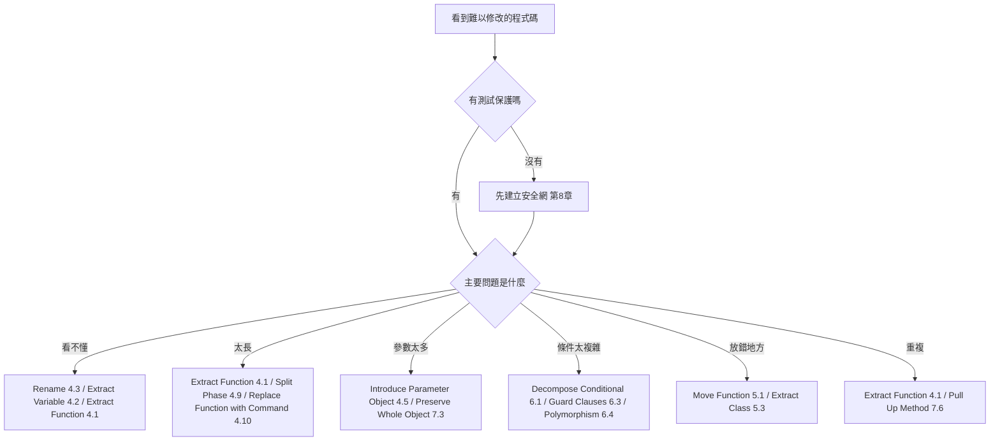

#### 4.11.2 重構優先順序指南

| 優先順序 | 手法 | 理由 |
| --- | --- | --- |
| 1（最先做） | Rename、Extract Variable | 風險最低、IDE 全自動，馬上提高可讀性，也讓你更理解程式碼 |
| 2 | Extract Function、Slide Statements、Split Variable | 把長函式切成可理解的段落，為後續的搬移做準備 |
| 3 | Introduce Parameter Object、Decompose Conditional、Guard Clauses | 簡化介面與條件 |
| 4 | Move Function、Extract Class | 調整職責分配；影響範圍較大 |
| 5（最後做） | Replace Conditional with Polymorphism、繼承相關重構 | 改變類別結構，需要最完整的安全網 |

原則是**由小到大、由內而外**：先在函式內部整理，看清楚結構後，再在類別之間搬移。

#### 📝 第 4 章重點

- 每個手法都有操作步驟；照著步驟做，每一步都能編譯、測試、提交。
- Extract Function 搬移程式碼時要「原封不動」，改寫演算法是另一個步驟。
- 公開 API 的宣告變更用遷移式做法：新入口、舊入口委派並棄用、移轉、刪除。
- `BigDecimal` 的 scale、引數求值順序、`Map.of` 遇到 `null`——這些細節都是「行為」。

#### ✏️ 第 4 章自我檢測

1. 4.5 的範例中，為什麼舊簽章要先建立 `Party` 再建立 `Stay`？
2. Replace Temp with Query 的前提是什麼？
3. 什麼情況下適合用 Replace Function with Command？什麼情況下不適合？

<details>
<summary>參考答案</summary>

1. 原本的程式先檢查大人人數、再檢查日期。兩個條件都不成立時，要丟出相同的「at least one adult」例外，所以必須先建立會檢查人數的 `Party`。
2. 查詢函式必須沒有副作用，而且每次呼叫的結果相同（暫存變數只被指派一次）。
3. 區域變數彼此依賴、多到無法提煉時適合；或需要命令的特性（復原、排程、記錄）。簡單函式不適合，因為會增加不必要的複雜度。

</details>

---

## 5. 搬移特性與組織資料

> **🎯 學習目標**
>
> - 依照操作步驟把函式、欄位搬到更合適的類別，並在搬移期間保持呼叫端可用。
> - 用 Extract Class、Inline Class 調整類別的職責。
> - 以值物件取代基本型別，以封裝集合避免外部任意修改內部狀態。
> - 安全地刪除無用的程式碼。

前一章的手法都在單一函式或類別內進行；本章的手法跨越類別邊界，影響範圍更大。Fowler 說，好的軟體設計最核心的就是**模組化**：修改時只需要理解一小部分程式碼。而模組化的關鍵，就是把相關的程式碼放在一起。

### 5.1 搬移函式（Move Function）

**目的：** 函式和另一個類別的資料互動比和自己的類別多（Feature Envy，3.5）時，把它搬到資料所在的地方。（舊名 Move Method。）

```text
✅ RFT-MOV-001：Move Function 操作步驟（IntelliJ：游標在方法上 → F6）
1. 檢查函式使用的所有元素（欄位、其他函式），判斷哪些也該一起搬。通常先搬「最底層」的函式。
2. 確認函式不是多型方法（沒有被覆寫、也沒有覆寫父類別）。
3. 在目標類別中建立函式的副本，調整它以適應新位置（原本透過參數取得的資料，現在可直接使用欄位）。
4. 編譯目標類別。
5. 讓原函式改為委派給目標函式。編譯、測試、提交。
6. 決定是否保留原函式：只在自己模組內使用的就 Inline Function 移除；公開 API 依 4.4 的遷移式做法。
```

**範例：** 3.5 提到的 Feature Envy。`InvoiceService.totalFor()` 只使用 `Order` 的資料：

```java
// ✅ 搬移後的 Order：計算總額的知識和資料放在一起
package com.example.rft.mov;

import java.math.BigDecimal;
import java.util.List;

public record Order(List<Line> lines, BigDecimal discount, BigDecimal taxRate) {

    public record Line(BigDecimal unitPrice, int quantity) {

        BigDecimal amount() {
            return unitPrice.multiply(BigDecimal.valueOf(quantity));
        }
    }

    public BigDecimal total() {
        BigDecimal subtotal = BigDecimal.ZERO;
        for (Line line : lines) {
            subtotal = subtotal.add(line.amount());
        }
        return subtotal.subtract(discount).multiply(BigDecimal.ONE.add(taxRate));
    }
}
```

```java
// ❌ RFT-MOV-001：Feature Envy——totalFor 只讀取 Order 的資料，沒有使用 InvoiceService 自己的任何狀態
package com.example.rft.mov;

import java.math.BigDecimal;

public class InvoiceService {

    public BigDecimal totalFor(Order order) {
        BigDecimal subtotal = BigDecimal.ZERO;
        for (Order.Line line : order.lines()) {
            subtotal = subtotal.add(line.unitPrice().multiply(BigDecimal.valueOf(line.quantity())));
        }
        return subtotal.subtract(order.discount()).multiply(BigDecimal.ONE.add(order.taxRate()));
    }

    public String invoiceNumber(int sequence) {
        return "INV-%06d".formatted(sequence);
    }
}
```

```java
// ✅ RFT-MOV-001：原函式改為委派（步驟 5）；之後可再把呼叫端改為直接呼叫 order.total()
package com.example.rft.mov;

import java.math.BigDecimal;

public class InvoiceService {

    public BigDecimal totalFor(Order order) {
        return order.total();
    }

    public String invoiceNumber(int sequence) {
        return "INV-%06d".formatted(sequence);
    }
}
```

```java
// ✅ RFT-MOV-001：搬移前後都必須通過；以 toPlainString 鎖住 BigDecimal 的 scale
package com.example.rft.mov;

import static org.assertj.core.api.Assertions.assertThat;

import java.math.BigDecimal;
import java.util.List;
import org.junit.jupiter.api.Test;

class InvoiceServiceTest {

    private final InvoiceService service = new InvoiceService();

    @Test
    void totalAppliesDiscountThenTax() {
        Order order = new Order(List.of(new Order.Line(new BigDecimal("100.50"), 2),
                new Order.Line(new BigDecimal("40"), 1)), new BigDecimal("10"), new BigDecimal("0.05"));
        assertThat(service.totalFor(order).toPlainString()).isEqualTo("242.5500");
    }

    @Test
    void invoiceNumberIsUnaffected() {
        assertThat(service.invoiceNumber(42)).isEqualTo("INV-000042");
    }
}
```

> 💡 搬移時把 `line.unitPrice().multiply(...)` 順手提煉成 `Line.amount()`，運算方式完全相同，所以結果（含 scale）不變。如果你不確定，就分成兩個提交。

| 編號 | 等級 | 規則 | 驗證方式 |
| --- | --- | --- | --- |
| `RFT-MOV-001` | 應該 | 函式使用另一個類別的資料多於自己的資料時，應以 Move Function 搬到資料所在的類別；搬移時先讓原函式委派給新位置，確認測試通過後再決定移除或依遷移式做法棄用 | 🧪 重構前後執行同一組測試；👁 審查 |

#### 🔍 5.1 審查與驗證

| 審查問題 | 如何確認 |
| --- | --- |
| 搬移後，函式還在使用原類別的東西嗎？ | 如果搬過去後需要把原類別整個傳進來，可能搬錯了方向 |
| 被搬移的函式有被覆寫嗎？ | IntelliJ 的 gutter 圖示（向下箭頭）表示有子類別覆寫 |
| 原入口的處理符合遷移式做法嗎？ | 公開 API 依 4.4 檢查 |

### 5.2 搬移欄位（Move Field）

**目的：** 資料結構是程式的骨架。當你發現某個欄位總是和另一個類別的資料一起被傳遞、一起被修改時，把它搬過去。

```text
✅ RFT-MOV-002：Move Field 操作步驟
1. 確認來源欄位已經封裝（Encapsulate Variable，4.6）；所有讀寫都經過 getter／setter。
2. 在目標類別建立欄位與存取函式。
3. 確認來源物件能取得目標物件的參照。
4. 讓來源的存取函式改為讀寫目標欄位。測試、提交。
5. 移除來源欄位。測試、提交。
6. 若欄位有持久化（資料表欄位）或序列化（JSON、訊息格式），先依第 12 章規劃資料遷移——
   程式碼中的欄位可以一次搬好，資料庫中的欄位必須以「擴充—遷移—收縮」分階段搬移。
```

```java
// ❌ RFT-MOV-002：把 discountRate 從 Customer 搬到 CustomerContract 的同時直接修改 JPA 對映——
//    舊版程式仍在執行時，資料表欄位已經不見了（片段）
@Entity class Customer { /* @Column(name = "discount_rate") BigDecimal discountRate; ← 直接刪除 */ }

// ✅ RFT-MOV-002：程式碼先搬到 CustomerContract，資料表欄位暫時保留並雙寫，依 12.2 的步驟收縮（片段）
@Entity class CustomerContract { @Column(name = "discount_rate") BigDecimal discountRate; }
```

（片段）

| 編號 | 等級 | 規則 | 驗證方式 |
| --- | --- | --- | --- |
| `RFT-MOV-002` | 必須 | 搬移欄位前必須先封裝該欄位；若欄位有持久化或序列化，必須依第 12 章的擴充—遷移—收縮步驟處理資料，不得在同一次部署中刪除舊的資料表欄位或訊息欄位 | 🧪 資料庫遷移在新舊版本程式並存下的測試（12.2）；👁 審查 |

#### 🔍 5.2 審查與驗證

| 審查問題 | 如何確認 |
| --- | --- |
| 被搬移的欄位有持久化或序列化嗎？ | 檢查 `@Column`、`@JsonProperty`、Avro／Protobuf 結構與 Flyway 遷移檔 |
| 搬移期間新舊版本程式能同時執行嗎？ | 依 12.1 的滾動部署情境檢查 |

### 5.3 提煉類別與內聯類別（Extract Class／Inline Class）

**目的：** 類別隨著時間成長，承擔了太多職責（Large Class、Divergent Change）。當一部分欄位與方法形成一個獨立的概念時，把它們提煉成新的類別。反向操作 Inline Class 用在類別已經不再值得獨立存在時。

**怎麼看出隱藏的類別：** 一組欄位總是一起被使用、有相同的前綴（`officeAreaCode`、`officeNumber`），或某些欄位只被部分方法使用。

```text
✅ RFT-MOV-003：Extract Class 操作步驟（IntelliJ：Refactor → Extract → Delegate）
1. 決定如何分割職責，為新類別命名（名稱要能說明新的職責；想不出名稱代表分割方式還不對）。
2. 建立新類別，在原類別中建立指向新類別的欄位。
3. 使用 Move Field（5.2）逐一搬移欄位，每搬一個就測試。
4. 使用 Move Function（5.1）搬移函式，先搬被呼叫最多的底層函式。
5. 檢視兩個類別的介面，移除不需要的方法，改善名稱。
6. 決定是否公開新類別。若公開，考慮讓它成為不可變的值物件。
```

```java
// ❌ RFT-MOV-003：Person 同時管理「人」與「電話號碼」兩個概念
package com.example.rft.mov;

public class Person {

    private final String name;
    private final String officeAreaCode;
    private final String officeNumber;

    public Person(String name, String officeAreaCode, String officeNumber) {
        this.name = name;
        this.officeAreaCode = officeAreaCode;
        this.officeNumber = officeNumber;
    }

    public String name() {
        return name;
    }

    public String officeAreaCode() {
        return officeAreaCode;
    }

    public String officeNumber() {
        return officeNumber;
    }

    public String telephoneNumber() {
        return "(" + officeAreaCode + ") " + officeNumber;
    }
}
```

```java
// ✅ RFT-MOV-003：電話號碼成為獨立的值物件；Person 的公開方法維持不變，改為委派
package com.example.rft.mov;

public class Person {

    private final String name;
    private final TelephoneNumber officeTelephone;

    public Person(String name, String officeAreaCode, String officeNumber) {
        this.name = name;
        this.officeTelephone = new TelephoneNumber(officeAreaCode, officeNumber);
    }

    public String name() {
        return name;
    }

    public String officeAreaCode() {
        return officeTelephone.areaCode();
    }

    public String officeNumber() {
        return officeTelephone.number();
    }

    public String telephoneNumber() {
        return officeTelephone.toString();
    }
}
```

```java
// ✅ RFT-MOV-003：提煉出的值物件——record 讓 equals／hashCode 依值比較
package com.example.rft.mov;

public record TelephoneNumber(String areaCode, String number) {

    @Override
    public String toString() {
        return "(" + areaCode + ") " + number;
    }
}
```

```java
// ✅ RFT-MOV-003：提煉前後都必須通過
package com.example.rft.mov;

import static org.assertj.core.api.Assertions.assertThat;

import org.junit.jupiter.api.Test;

class PersonTest {

    @Test
    void exposesTheSameTelephoneDetails() {
        Person person = new Person("陳大文", "02", "2345-6789");
        assertThat(person.telephoneNumber()).isEqualTo("(02) 2345-6789");
        assertThat(person.officeAreaCode()).isEqualTo("02");
        assertThat(person.officeNumber()).isEqualTo("2345-6789");
        assertThat(person.name()).isEqualTo("陳大文");
    }
}
```

**Inline Class** 的時機：類別在多次重構後只剩一兩個方法、或兩個類別的職責需要重新分配時，先把它們合併（Inline Class），再重新提煉——有時「先合再分」比直接搬移容易。

| 編號 | 等級 | 規則 | 驗證方式 |
| --- | --- | --- | --- |
| `RFT-MOV-003` | 應該 | 類別中有一組欄位與方法形成獨立概念時，應以 Extract Class 提煉；提煉期間原類別的公開方法應維持並改為委派 | 🤖 PMD `GodClass`、`TooManyFields`；🧪 重構前後執行同一組測試 |
| `RFT-MOV-004` | 應該 | 類別不再承擔足夠的職責（Lazy Element），或需要重新分配兩個類別的職責時，應以 Inline Class 合併後再重新切分 | 👁 審查 |

```text
✅ RFT-MOV-004：Inline Class 的判斷記錄（寫在 PR 說明中）
TelephoneNumberFormatter 只有一個方法 format(TelephoneNumber)，唯一的呼叫端是 TelephoneNumber.toString()。
→ Inline Class：把 format() 的內容搬進 TelephoneNumber.toString()，刪除 TelephoneNumberFormatter。
→ 驗證：PersonTest 與 TelephoneNumberTest 在內聯前後皆通過。
```

#### 🔍 5.3 審查與驗證

| 審查問題 | 如何確認 |
| --- | --- |
| 新類別的名稱說明了一個清楚的職責嗎？ | `PersonHelper`、`PersonData2` 不是職責 |
| 原類別的公開介面有沒有改變？ | 比對重構前後的公開方法；有改變的話依 4.4 處理 |
| 新類別應該是值物件還是參照物件？ | 若兩個實例內容相同即可互換，用 `record`（5.8） |

### 5.4 隱藏委託與移除中間人（Hide Delegate／Remove Middle Man）

這兩個手法是一體兩面，用來處理 Message Chains 與 Middle Man（3.5）：

```java
// ❌ RFT-MOV-005：呼叫端必須知道 Person → Department → Manager 的結構（Message Chains）（片段）
Person manager = person.getDepartment().getManager();

// ✅ RFT-MOV-005：Hide Delegate——呼叫端只說它要什麼，Person 隱藏了 Department 的存在（片段）
Person manager = person.manager();
// Person 中：
public Person manager() { return department.getManager(); }
```

（片段）

當 `Person` 為了隱藏 `Department` 而加入了十幾個轉呼叫方法（`departmentName()`、`departmentBudget()`、`departmentCode()`……），`Person` 就變成了中間人。這時用 **Remove Middle Man** 讓呼叫端直接取得 `Department`：

```java
// ✅ RFT-MOV-005：Remove Middle Man——呼叫端確實需要操作部門時，直接把部門交給它（片段）
Department department = person.department();
department.budget();
department.code();
```

（片段）

| 編號 | 等級 | 規則 | 驗證方式 |
| --- | --- | --- | --- |
| `RFT-MOV-005` | 應該 | 呼叫端只需要結果時，應以 Hide Delegate 隱藏中間物件；類別中超過一半的方法只是轉呼叫時，應以 Remove Middle Man 讓呼叫端直接使用被委託的物件 | 👁 審查 |

#### 🔍 5.4 審查與驗證

| 審查問題 | 如何確認 |
| --- | --- |
| 呼叫端需要知道中間的結構嗎？ | 若呼叫端只用到鏈末端的一個值，Hide Delegate；若它要操作中間物件的多項功能，讓它直接取得 |
| 新增的轉呼叫方法有多少？ | 在類別的 Structure 視窗中計算只有一行委派的方法比例 |

### 5.5 以物件取代基本型別（Replace Primitive with Object）

**目的：** 處理 Primitive Obsession（3.3.4）。一開始用 `String` 或 `BigDecimal` 表示的資料，隨著需求增加會開始需要格式化、驗證、比較等行為，這些行為需要一個家。（舊名 Replace Data Value with Object、Replace Type Code with Class。）

```text
✅ RFT-MOV-006：Replace Primitive with Object 操作步驟
1. 若欄位尚未封裝，先 Encapsulate Variable（4.6）。
2. 建立值物件類別（Java 中使用 record），只包含這個值，並在建構時驗證。
3. 修改欄位的型別為值物件，存取函式在邊界上轉換（getter 仍回傳原本的型別，暫時不改公開介面）。
4. 測試、提交。
5. 把與這個值有關的行為（加總、格式化、比較）搬進值物件（Move Function）。
6. 視需要再以 Change Function Declaration 讓公開介面直接使用值物件。
```

```java
// ❌ RFT-MOV-006：金額用 BigDecimal、幣別用 String，加總與「同幣別」檢查散落在 Invoice 中
package com.example.rft.mov;

import java.math.BigDecimal;

public class Invoice {

    private final String currency;
    private BigDecimal total = BigDecimal.ZERO;

    public Invoice(String currency) {
        this.currency = currency;
    }

    public void addLine(String amount, String lineCurrency) {
        if (!currency.equals(lineCurrency)) {
            throw new IllegalArgumentException("currency mismatch: " + lineCurrency);
        }
        total = total.add(new BigDecimal(amount));
    }

    public String total() {
        return total.toPlainString() + " " + currency;
    }
}
```

```java
// ✅ RFT-MOV-006、RFT-MOV-007：Invoice 的公開介面不變；金額相關的規則搬進 Money
package com.example.rft.mov;

public class Invoice {

    private Money total;

    public Invoice(String currency) {
        this.total = Money.zero(currency);
    }

    public void addLine(String amount, String lineCurrency) {
        total = total.plus(Money.of(amount, lineCurrency));
    }

    public String total() {
        return total.toString();
    }
}
```

```java
// ✅ RFT-MOV-007：不可變的值物件——相等性依值比較；錯誤訊息與原本的 Invoice 相同
package com.example.rft.mov;

import java.math.BigDecimal;
import java.util.Objects;

public record Money(BigDecimal amount, String currency) {

    public Money {
        Objects.requireNonNull(amount, "amount");
        Objects.requireNonNull(currency, "currency");
    }

    public static Money zero(String currency) {
        return new Money(BigDecimal.ZERO, currency);
    }

    public static Money of(String amount, String currency) {
        return new Money(new BigDecimal(amount), currency);
    }

    public Money plus(Money other) {
        if (!currency.equals(other.currency)) {
            throw new IllegalArgumentException("currency mismatch: " + other.currency);
        }
        return new Money(amount.add(other.amount), currency);
    }

    @Override
    public String toString() {
        return amount.toPlainString() + " " + currency;
    }
}
```

```java
// ✅ RFT-MOV-006：以 Invoice 的公開介面測試，重構前後都必須通過
package com.example.rft.mov;

import static org.assertj.core.api.Assertions.assertThat;
import static org.assertj.core.api.Assertions.assertThatThrownBy;

import org.junit.jupiter.api.Test;

class InvoiceTest {

    @Test
    void sumsLinesInTheSameCurrency() {
        Invoice invoice = new Invoice("TWD");
        invoice.addLine("100.5", "TWD");
        invoice.addLine("20.25", "TWD");
        assertThat(invoice.total()).isEqualTo("120.75 TWD");
    }

    @Test
    void emptyInvoiceAndMismatchedCurrency() {
        Invoice invoice = new Invoice("TWD");
        assertThat(invoice.total()).isEqualTo("0 TWD");
        assertThatThrownBy(() -> invoice.addLine("1", "USD"))
                .isInstanceOf(IllegalArgumentException.class).hasMessage("currency mismatch: USD");
        assertThat(invoice.total()).isEqualTo("0 TWD");
    }
}
```

> ⚠️ **檢查順序的細節**：原本的 `addLine()` 先檢查幣別、再解析金額。重構後的 `Money.of(amount, lineCurrency)` 會**先解析金額**、`plus()` 才檢查幣別。若輸入是 `addLine("abc", "USD")`，原本丟出 `IllegalArgumentException("currency mismatch: USD")`，重構後丟出 `NumberFormatException`（它是 `IllegalArgumentException` 的子類別，但訊息不同）。上面的測試沒有涵蓋這個情況——這就是第 8 章要談的：**測試只能保護它涵蓋到的行為**。若呼叫端依賴錯誤訊息，就要補上這個測試並調整順序；8.4 的變異測試能幫你找出這類漏洞。

| 編號 | 等級 | 規則 | 驗證方式 |
| --- | --- | --- | --- |
| `RFT-MOV-006` | 應該 | 需要驗證、格式化或計算的基本型別資料（金額、幣別、電話、識別碼），應以 Replace Primitive with Object 建立值物件；先在類別內部替換，公開介面另以遷移式做法調整 | 👁 審查；🧪 重構前後執行同一組測試 |
| `RFT-MOV-007` | 必須 | 值物件必須是不可變的，並依值實作 `equals`／`hashCode`（Java 中使用 `record`）；修改操作必須回傳新物件 | 🤖 ArchUnit 檢查值物件套件中的欄位皆為 `final`；🧪 相等性測試 |

#### 🔍 5.5 審查與驗證

| 審查問題 | 如何確認 |
| --- | --- |
| 值物件是不可變的嗎？ | 是 `record`，或所有欄位 `final` 且沒有 setter；`plus()` 回傳新物件 |
| 驗證與例外的順序改變了嗎？ | 列出重構前後每個輸入錯誤組合會丟出的例外，特別是「多個錯誤同時發生」的情況 |
| 公開介面有沒有在同一步被改掉？ | 第一步只改內部；公開介面的型別變更依 4.4 的遷移式做法 |

### 5.6 移除無用程式碼（Remove Dead Code）

沒有被執行的程式碼仍然有成本：每個讀者都要花時間判斷它是否重要。版本控制系統會保存一切，所以**不要把程式碼註解掉「以備不時之需」，直接刪除**。

但「IDE 說沒有被使用」不等於「沒有被使用」。刪除前要檢查：

| 可能的隱藏使用者 | 檢查方式 |
| --- | --- |
| 反射、Spring 依名稱注入、序列化框架 | 全文搜尋類別與方法名稱（含字串） |
| 其他儲存庫或已發布的函式庫使用者 | 程式碼搜尋工具；函式庫要先棄用一個版本 |
| 排程、批次、管理介面等低頻率入口 | 查看正式環境的存取紀錄、APM 中的呼叫統計 |
| 功能旗標關閉中的程式碼 | 確認旗標的狀態與移除計畫 |

```java
// ❌ RFT-MOV-008：被註解掉的舊程式碼——沒有人敢刪，也沒有人知道它為什麼還在（片段）
public BigDecimal discount(Order order) {
    // BigDecimal old = legacyDiscount(order);  // 2023 舊規則，暫時保留
    // if (old.compareTo(BigDecimal.ZERO) > 0) return old;
    return policy.discountFor(order);
}

// ✅ RFT-MOV-008：直接刪除；需要時從版本控制找回（提交訊息寫清楚以便搜尋）（片段）
public BigDecimal discount(Order order) {
    return policy.discountFor(order);
}
// git commit -m "refactor(pricing): 移除 2023 舊折扣規則的註解程式碼（需要時見本提交）"
```

（片段）

| 編號 | 等級 | 規則 | 驗證方式 |
| --- | --- | --- | --- |
| `RFT-MOV-008` | 必須 | 刪除看似無用的程式碼前，必須確認沒有反射、框架、序列化、其他儲存庫或低頻率入口使用它；確認後應直接刪除，不應以註解方式保留舊程式碼 | 🤖 IntelliJ「Unused declaration」、PMD `UnusedPrivateMethod`；🤖 SonarQube `java:S125`（註解掉的程式碼）；👁 全文搜尋與存取紀錄 |

#### 🔍 5.6 審查與驗證

| 審查問題 | 如何確認 |
| --- | --- |
| 被刪除的公開類別或方法有沒有隱藏的使用者？ | 依上表逐項檢查，並在 PR 說明中列出檢查結果 |
| 還有被註解掉的程式碼嗎？ | SonarQube `java:S125` 或搜尋以 `//` 開頭、以 `;` 結尾的行 |

### 5.7 封裝集合與封裝記錄（Encapsulate Collection／Encapsulate Record）

**Encapsulate Collection：** getter 直接回傳內部的可變集合時，任何呼叫端都能繞過類別修改它，類別就失去了對自己狀態的控制。

```text
✅ RFT-MOV-009：Encapsulate Collection 操作步驟
1. 若集合欄位尚未封裝，先 Encapsulate Variable。
2. 新增 addXxx()／removeXxx() 方法。
3. 找出所有透過 getter 修改集合的呼叫端（IntelliJ：對 getter 做 Find Usages，檢查後面接 .add/.remove/.clear 的地方），
   改為呼叫新的方法。每改一處就測試。
4. 確認沒有呼叫端透過 getter 修改後，讓 getter 回傳唯讀檢視（Collections.unmodifiableList）或副本（List.copyOf）。
5. setter 改為複製傳入的集合。測試、提交。
```

```java
// ❌ RFT-MOV-009：getCourses() 回傳內部 List，setCourses() 保存呼叫端傳入的 List——兩端都可以從外部修改狀態
package com.example.rft.mov;

import java.util.ArrayList;
import java.util.List;

public class Student {

    private List<String> courses = new ArrayList<>();

    public List<String> getCourses() {
        return courses;
    }

    public void setCourses(List<String> courses) {
        this.courses = courses;
    }

    public int numberOfAdvancedCourses() {
        int count = 0;
        for (String course : courses) {
            if (course.startsWith("ADV-")) {
                count++;
            }
        }
        return count;
    }
}
```

```java
// ✅ RFT-MOV-009：修改只能透過 addCourse／removeCourse；getter 回傳唯讀檢視，setter 複製傳入的集合
package com.example.rft.mov;

import java.util.ArrayList;
import java.util.Collections;
import java.util.List;

public class Student {

    private final List<String> courses = new ArrayList<>();

    public List<String> getCourses() {
        return Collections.unmodifiableList(courses);
    }

    public void setCourses(List<String> newCourses) {
        courses.clear();
        courses.addAll(newCourses);
    }

    public void addCourse(String course) {
        courses.add(course);
    }

    public boolean removeCourse(String course) {
        return courses.remove(course);
    }

    public int numberOfAdvancedCourses() {
        int count = 0;
        for (String course : courses) {
            if (course.startsWith("ADV-")) {
                count++;
            }
        }
        return count;
    }
}
```

```java
// ✅ RFT-MOV-009：只透過兩個版本共有的公開介面驗證；這組測試在封裝前後都通過
package com.example.rft.mov;

import static org.assertj.core.api.Assertions.assertThat;

import java.util.List;
import org.junit.jupiter.api.Test;

class StudentTest {

    @Test
    void readsCoursesSetThroughTheSetter() {
        Student student = new Student();
        student.setCourses(List.of("ADV-101", "BAS-200", "ADV-310"));
        assertThat(student.getCourses()).containsExactly("ADV-101", "BAS-200", "ADV-310");
        assertThat(student.numberOfAdvancedCourses()).isEqualTo(2);
    }
}
```

**請注意這個測試沒有證明什麼：** 封裝後，「透過 `getCourses().add(...)` 修改」會丟出 `UnsupportedOperationException`，「修改傳給 `setCourses()` 的清單會影響 `Student`」的效果也消失了——對依賴這些行為的呼叫端來說，**行為改變了**。這就是為什麼操作步驟的第 3 步（找出並移轉所有修改集合的呼叫端）是必要的：Encapsulate Collection 只有在確認沒有呼叫端依賴這些行為後，才算是重構。

**Encapsulate Record：** 把公開欄位的資料結構（或 `Map<String, Object>`）改為有存取函式的類別。在 Java 中，若資料本身不可變，直接改用 `record` 就是最好的封裝。

| 編號 | 等級 | 規則 | 驗證方式 |
| --- | --- | --- | --- |
| `RFT-MOV-009` | 必須 | getter 不得回傳內部的可變集合，setter 不得直接保存外部傳入的可變集合；進行封裝前必須先找出並移轉所有透過 getter 修改集合的呼叫端 | 🤖 SpotBugs `EI_EXPOSE_REP`／`EI_EXPOSE_REP2`；👁 以 Find Usages 檢查 getter 的使用方式 |

#### 🔍 5.7 審查與驗證

| 審查問題 | 如何確認 |
| --- | --- |
| 還有呼叫端透過 getter 修改集合嗎？ | 搜尋 `getCourses().add`、`getCourses().remove`、`getCourses().clear` 等模式 |
| 回傳唯讀檢視還是副本？ | 唯讀檢視會反映之後的修改，副本不會；選擇哪一種是行為決定，要和呼叫端的期待一致 |

### 5.8 值物件與參照物件、以查詢取代衍生變數

| 手法 | 用途 | 判斷方式 |
| --- | --- | --- |
| **Change Reference to Value** | 把參照物件改為不可變的值物件 | 兩個內容相同的物件可以互換嗎？可以 → 值物件（如 `Money`、`TelephoneNumber`） |
| **Change Value to Reference** | 多處需要共享同一份會變動的資料時，改為從儲存庫取得同一個實例 | 修改一處時，其他地方需要看到變化嗎？需要 → 參照物件（如 `Customer`） |
| **Replace Derived Variable with Query** | 可由其他資料計算出的欄位，改為每次計算 | 這個欄位是否需要和來源資料同步更新？是 → 改為查詢，消除不同步的風險 |

```java
// ❌ RFT-MOV-010：production 欄位必須在每次調整時同步更新，漏改一處就不一致（片段）
private final List<Adjustment> adjustments = new ArrayList<>();
private long production;
void applyAdjustment(Adjustment a) {
    adjustments.add(a);
    production += a.amount();
}

// ✅ RFT-MOV-010：衍生的值改為查詢，不可能不同步（片段）
long production() {
    return adjustments.stream().mapToLong(Adjustment::amount).sum();
}
```

（片段）

做這個重構前，先用 Introduce Assertion（6.6）在 `production()` 中斷言「計算值等於欄位值」，在測試與預備環境執行一段時間，確認兩者一致後再移除欄位。

| 編號 | 等級 | 規則 | 驗證方式 |
| --- | --- | --- | --- |
| `RFT-MOV-010` | 應該 | 可由其他資料計算出的欄位，應以 Replace Derived Variable with Query 改為查詢；移除欄位前應先以斷言或測試確認計算值與欄位值一致 | 🧪 過渡期間的斷言或比對測試；👁 審查 |

#### 🔍 5.8 審查與驗證

| 審查問題 | 如何確認 |
| --- | --- |
| 衍生欄位與計算值在所有情況下都一致嗎？ | 過渡期間在測試中同時斷言兩者；若欄位有初始值（例如從資料庫載入），要確認計算值能重現它 |
| 查詢的成本可接受嗎？ | 計算昂貴且被頻繁呼叫時，依第 16 章量測 |

#### 📝 第 5 章重點

- 搬移函式與欄位的核心：先讓舊位置委派給新位置，確認後再移除。
- 有持久化或序列化的欄位，程式碼可以一次搬好，資料必須分階段遷移。
- 值物件不可變、依值相等；Java 中用 `record`。
- Encapsulate Collection 只有在確認沒有呼叫端透過 getter 修改集合時才是重構。
- 「IDE 說沒用到」不等於沒用到；確認後直接刪除，不要註解掉。

#### ✏️ 第 5 章自我檢測

1. 5.5 的 `Invoice` 重構後，輸入 `addLine("abc", "USD")` 的行為和原本有什麼不同？要怎麼讓它保持相同？
2. 什麼時候應該 Inline Class？
3. Encapsulate Collection 時，回傳 `Collections.unmodifiableList(courses)` 和 `List.copyOf(courses)` 有什麼差別？

<details>
<summary>參考答案</summary>

1. 原本先檢查幣別，丟出 `IllegalArgumentException("currency mismatch: USD")`；重構後先解析金額，丟出 `NumberFormatException`。要保持相同，可以在 `Invoice.addLine()` 中先檢查幣別再建立 `Money`，或在 `Money` 中提供先檢查幣別的建構方式，並補上這個情況的測試。
2. 當類別經過重構後只剩很少的職責（Lazy Element），或需要重新分配兩個類別的職責時（先合併、再重新切分）。
3. `unmodifiableList` 是唯讀**檢視**，之後 `Student` 內部的修改會反映在呼叫端手上的清單；`List.copyOf` 是**副本**，不會反映之後的修改，且不允許 `null` 元素。

</details>

---

## 6. 簡化條件邏輯

> **🎯 學習目標**
>
> - 把複雜的條件式拆解、合併或改寫成衛述句，讓意圖一目了然。
> - 用多型或 sealed 型別取代重複的 `switch`。
> - 用特例物件（Special Case）消除散落各處的 `null` 檢查。
> - 知道條件重構中最容易出錯的地方：邊界值、短路求值與 `null`。

條件邏輯是程式中最難讀、也最容易藏缺陷的部分。本章的手法有一個共同的風險：**改寫條件時，很容易不小心改變邊界或求值順序**。每一個範例的測試都特別涵蓋了這些地方。

### 6.1 分解條件式（Decompose Conditional）

**目的：** 把條件與各分支的內容提煉成以意圖命名的函式，讓 `if` 讀起來像業務規則。

```java
// ❌ RFT-CND-001：讀者必須在腦中計算日期範圍，才知道這是「夏季」
package com.example.rft.cnd;

import java.time.LocalDate;
import java.time.MonthDay;

public class ChargeCalculator {

    private static final MonthDay SUMMER_START = MonthDay.of(6, 1);
    private static final MonthDay SUMMER_END = MonthDay.of(8, 31);

    public long charge(LocalDate date, int quantity) {
        MonthDay day = MonthDay.from(date);
        if (!day.isBefore(SUMMER_START) && !day.isAfter(SUMMER_END)) {
            return quantity * 80L;
        } else {
            return quantity * 100L + 50;
        }
    }
}
```

```java
// ✅ RFT-CND-001：條件與兩個分支各自以意圖命名；!isBefore／!isAfter 的「含兩端」語意原樣保留
package com.example.rft.cnd;

import java.time.LocalDate;
import java.time.MonthDay;

public class ChargeCalculator {

    private static final MonthDay SUMMER_START = MonthDay.of(6, 1);
    private static final MonthDay SUMMER_END = MonthDay.of(8, 31);

    public long charge(LocalDate date, int quantity) {
        return isSummer(date) ? summerCharge(quantity) : regularCharge(quantity);
    }

    private static boolean isSummer(LocalDate date) {
        MonthDay day = MonthDay.from(date);
        return !day.isBefore(SUMMER_START) && !day.isAfter(SUMMER_END);
    }

    private static long summerCharge(int quantity) {
        return quantity * 80L;
    }

    private static long regularCharge(int quantity) {
        return quantity * 100L + 50;
    }
}
```

```java
// ✅ RFT-CND-001：季節的兩端邊界都要測——5/31、6/1、8/31、9/1
package com.example.rft.cnd;

import static org.assertj.core.api.Assertions.assertThat;

import java.time.LocalDate;
import org.junit.jupiter.params.ParameterizedTest;
import org.junit.jupiter.params.provider.CsvSource;

class ChargeCalculatorTest {

    @ParameterizedTest
    @CsvSource({"2026-05-31, 350", "2026-06-01, 240", "2026-08-31, 240", "2026-09-01, 350", "2028-02-29, 350"})
    void summerBoundariesAreInclusive(LocalDate date, long expected) {
        assertThat(new ChargeCalculator().charge(date, 3)).isEqualTo(expected);
    }
}
```

> 💡 AI 常把 `!day.isBefore(start) && !day.isAfter(end)` 「簡化」成 `day.isAfter(start) && day.isBefore(end)`——這把「含兩端」改成「不含兩端」，6/1 與 8/31 的費用就錯了。邊界值測試能立刻抓到。

| 編號 | 等級 | 規則 | 驗證方式 |
| --- | --- | --- | --- |
| `RFT-CND-001` | 應該 | 複雜的條件式應以 Decompose Conditional 把條件與各分支提煉成以意圖命名的函式；改寫比較運算時必須保持邊界的包含或排除語意 | 🧪 兩端邊界值的測試；👁 審查比較運算子 |

#### 🔍 6.1 審查與驗證

| 審查問題 | 如何確認 |
| --- | --- |
| 條件被提煉後，邊界語意相同嗎？ | 逐一比對 `<`／`<=`、`isBefore`／`!isAfter` 等運算；要求有兩端邊界值的測試 |
| 函式名稱說明了業務規則嗎？ | `isSummer()` 是；`checkDate()` 不是 |

### 6.2 合併條件式（Consolidate Conditional Expression）

**目的：** 一連串條件檢查的結果都相同時，把它們合併成一個條件，並提煉成以意圖命名的函式。這讓讀者知道「這些檢查是同一件事」。

```java
// ❌ RFT-CND-002：三個檢查回傳同樣的結果，但看起來像三條獨立的規則（片段）
int disabilityAmount(Employee e) {
    if (e.seniority() < 2) return 0;
    if (e.monthsDisabled() > 12) return 0;
    if (e.isPartTime()) return 0;
    return computeDisabilityAmount(e);
}

// ✅ RFT-CND-002：合併後以意圖命名；|| 的順序與原本的檢查順序一致（片段）
int disabilityAmount(Employee e) {
    if (isNotEligibleForDisability(e)) return 0;
    return computeDisabilityAmount(e);
}
boolean isNotEligibleForDisability(Employee e) {
    return e.seniority() < 2 || e.monthsDisabled() > 12 || e.isPartTime();
}
```

（片段）

**合併的前提：** 各條件都**沒有副作用**。`||` 與 `&&` 會短路求值，原本三個獨立的 `if` 中每個條件都可能被執行，合併後後面的條件可能不再執行。如果某個條件會寫日誌、更新計數器或呼叫外部服務，合併就會改變行為。

| 編號 | 等級 | 規則 | 驗證方式 |
| --- | --- | --- | --- |
| `RFT-CND-002` | 應該 | 結果相同且代表同一個概念的一連串條件，應合併並提煉成以意圖命名的函式；合併前必須確認各條件沒有副作用，並保持原本的求值順序 | 👁 審查條件中的方法呼叫；🧪 重構前後執行同一組測試 |

#### 🔍 6.2 審查與驗證

| 審查問題 | 如何確認 |
| --- | --- |
| 被合併的條件有副作用嗎？ | 條件中的方法呼叫是否只是查詢？名稱以 `get`、`is`、`has` 開頭不代表沒有副作用，要看實作 |
| 合併後的順序和原本一致嗎？ | 前面的條件可能保護了後面的條件（例如先檢查 `null`），順序改變會導致 NPE |

### 6.3 以衛述句取代巢狀條件式（Replace Nested Conditional with Guard Clauses）

**目的：** 條件式有兩種：兩個分支都是正常情況（用 `if-else`），或一個分支是特殊情況（用衛述句提早返回）。把特殊情況寫成衛述句，主要邏輯就不會被埋在巢狀結構裡。

```java
// ❌ RFT-CND-003：特殊情況與正常情況混在巢狀結構中，還需要一個結果變數
package com.example.rft.cnd;

public class PayCalculator {

    public record Employee(boolean separated, boolean retired, long monthlySalary) {
    }

    public String payAmount(Employee employee) {
        String result;
        if (employee.separated()) {
            result = "SEPARATED:0";
        } else {
            if (employee.retired()) {
                result = "RETIRED:" + employee.monthlySalary() / 2;
            } else {
                result = "NORMAL:" + employee.monthlySalary();
            }
        }
        return result;
    }
}
```

```java
// ✅ RFT-CND-003：特殊情況以衛述句先處理，正常情況留在最後、沒有巢狀
package com.example.rft.cnd;

public class PayCalculator {

    public record Employee(boolean separated, boolean retired, long monthlySalary) {
    }

    public String payAmount(Employee employee) {
        if (employee.separated()) {
            return "SEPARATED:0";
        }
        if (employee.retired()) {
            return "RETIRED:" + employee.monthlySalary() / 2;
        }
        return "NORMAL:" + employee.monthlySalary();
    }
}
```

```java
// ✅ RFT-CND-003：「同時離職又退休」時，離職的檢查優先——衛述句的順序必須和原本巢狀的順序一致
package com.example.rft.cnd;

import static org.assertj.core.api.Assertions.assertThat;

import com.example.rft.cnd.PayCalculator.Employee;
import org.junit.jupiter.api.Test;

class PayCalculatorTest {

    private final PayCalculator calculator = new PayCalculator();

    @Test
    void eachCase() {
        assertThat(calculator.payAmount(new Employee(false, false, 50_000))).isEqualTo("NORMAL:50000");
        assertThat(calculator.payAmount(new Employee(false, true, 50_001))).isEqualTo("RETIRED:25000");
        assertThat(calculator.payAmount(new Employee(true, false, 50_000))).isEqualTo("SEPARATED:0");
    }

    @Test
    void separatedTakesPrecedenceOverRetired() {
        assertThat(calculator.payAmount(new Employee(true, true, 50_000))).isEqualTo("SEPARATED:0");
    }
}
```

> 💡 把正常條件「反轉」成衛述句時（例如把 `if (capital > 0 && rate > 0) { ... }` 改成 `if (capital <= 0 || rate <= 0) return 0;`），要正確套用笛卡兒定律（De Morgan's laws）：`!(a && b)` 等於 `!a || !b`。這是條件重構中最常見的錯誤之一，IntelliJ 的 **Invert 'if' condition**（Alt+Enter）可以自動完成。

| 編號 | 等級 | 規則 | 驗證方式 |
| --- | --- | --- | --- |
| `RFT-CND-003` | 應該 | 處理特殊情況的巢狀條件應改寫為衛述句；衛述句的順序必須保持原本的優先順序，反轉條件時應使用 IDE 的自動操作或以真值表確認 | 🤖 PMD `AvoidDeeplyNestedIfStmts`；🧪 多個條件同時成立的測試 |

#### 🔍 6.3 審查與驗證

| 審查問題 | 如何確認 |
| --- | --- |
| 衛述句的順序和原本的優先順序一致嗎？ | 要求有「多個特殊情況同時成立」的測試 |
| 反轉的條件正確嗎？ | 對反轉前後的條件列出真值表；或確認是用 IDE 的 Invert 'if' condition 完成 |

### 6.4 以多型取代條件式（Replace Conditional with Polymorphism）

**目的：** 同一個型別碼的 `switch` 出現在多處（Repeated Switches）時，為每一種型別建立類別，讓「隨型別變化的行為」放在各自的類別中。新增一種型別時，只需要新增一個類別。

在 Java 17 以後，有兩種做法可選：

| 做法 | 適合情境 | 新增型別時 |
| --- | --- | --- |
| **多型**（介面＋各型別的實作） | 型別經常新增；各型別的行為差異大 | 新增一個類別；不需修改既有的 `switch` |
| **sealed 型別＋窮舉 `switch`**（13.2） | 型別很少新增，但「針對所有型別的操作」經常新增 | 編譯器指出所有需要更新的 `switch` |

**範例：** 運費與預估天數都依物流商（郵局、快遞、貨運）而不同，兩個 `switch` 重複出現：

```java
// ❌ RFT-CND-004、RFT-CND-005：同一個物流商代碼的 switch 出現兩次（Repeated Switches）
package com.example.rft.cnd;

public class ShipmentQuote {

    public int fee(String carrier, int weightKg) {
        switch (carrier) {
            case "POST":
                return 60 + weightKg * 10;
            case "COURIER":
                return weightKg <= 5 ? 150 : 150 + (weightKg - 5) * 20;
            case "TRUCK":
                return Math.max(500, weightKg * 8);
            default:
                throw new IllegalArgumentException("unknown carrier: " + carrier);
        }
    }

    public int etaDays(String carrier, int distanceKm) {
        switch (carrier) {
            case "POST":
                return distanceKm > 200 ? 3 : 2;
            case "COURIER":
                return 1;
            case "TRUCK":
                return 1 + distanceKm / 300;
            default:
                throw new IllegalArgumentException("unknown carrier: " + carrier);
        }
    }
}
```

先為兩個函式寫特性測試，涵蓋每個物流商的分支與邊界，以及未知與 `null` 代碼（`switch` 遇到 `null` 會丟出 `NullPointerException`）：

```java
// ✅ RFT-CND-004、RFT-CND-005：每個物流商、每個邊界，加上未知與 null 代碼
package com.example.rft.cnd;

import static org.assertj.core.api.Assertions.assertThat;
import static org.assertj.core.api.Assertions.assertThatThrownBy;

import org.junit.jupiter.api.Test;
import org.junit.jupiter.params.ParameterizedTest;
import org.junit.jupiter.params.provider.CsvSource;

class ShipmentQuoteTest {

    private final ShipmentQuote quote = new ShipmentQuote();

    @ParameterizedTest
    @CsvSource({"POST, 3, 90", "COURIER, 5, 150", "COURIER, 6, 170", "TRUCK, 10, 500", "TRUCK, 100, 800"})
    void fee(String carrier, int weightKg, int expected) {
        assertThat(quote.fee(carrier, weightKg)).isEqualTo(expected);
    }

    @ParameterizedTest
    @CsvSource({"POST, 200, 2", "POST, 201, 3", "COURIER, 999, 1", "TRUCK, 299, 1", "TRUCK, 600, 3"})
    void etaDays(String carrier, int distanceKm, int expected) {
        assertThat(quote.etaDays(carrier, distanceKm)).isEqualTo(expected);
    }

    @Test
    void unknownAndNullCarriers() {
        assertThatThrownBy(() -> quote.fee("DRONE", 1)).isInstanceOf(IllegalArgumentException.class)
                .hasMessage("unknown carrier: DRONE");
        assertThatThrownBy(() -> quote.etaDays("DRONE", 1)).hasMessage("unknown carrier: DRONE");
        assertThatThrownBy(() -> quote.fee(null, 1)).isInstanceOf(NullPointerException.class);
    }
}
```

重構步驟：(1) 建立 `Carrier` 介面與工廠函式 `Carrier.of(code)`，`switch` 只留在工廠中；(2) 為每個物流商建立實作類別；(3) 逐一把 `fee()` 的各個分支搬到對應類別（每搬一個就測試）；(4) 對 `etaDays()` 做同樣的事；(5) 刪除原本的 `switch`。

```java
// ✅ RFT-CND-004：每個物流商的行為集中在自己的類別；型別碼的 switch 只剩工廠中的一個
package com.example.rft.cnd;

public sealed interface Carrier permits Carrier.Post, Carrier.Courier, Carrier.Truck {

    int fee(int weightKg);

    int etaDays(int distanceKm);

    static Carrier of(String code) {
        return switch (code) {
            case "POST" -> new Post();
            case "COURIER" -> new Courier();
            case "TRUCK" -> new Truck();
            default -> throw new IllegalArgumentException("unknown carrier: " + code);
        };
    }

    record Post() implements Carrier {
        public int fee(int weightKg) {
            return 60 + weightKg * 10;
        }

        public int etaDays(int distanceKm) {
            return distanceKm > 200 ? 3 : 2;
        }
    }

    record Courier() implements Carrier {
        public int fee(int weightKg) {
            return weightKg <= 5 ? 150 : 150 + (weightKg - 5) * 20;
        }

        public int etaDays(int distanceKm) {
            return 1;
        }
    }

    record Truck() implements Carrier {
        public int fee(int weightKg) {
            return Math.max(500, weightKg * 8);
        }

        public int etaDays(int distanceKm) {
            return 1 + distanceKm / 300;
        }
    }
}
```

```java
// ✅ RFT-CND-004、RFT-CND-005：公開介面不變；未知代碼與 null 的行為由 Carrier.of() 保留
package com.example.rft.cnd;

public class ShipmentQuote {

    public int fee(String carrier, int weightKg) {
        return Carrier.of(carrier).fee(weightKg);
    }

    public int etaDays(String carrier, int distanceKm) {
        return Carrier.of(carrier).etaDays(distanceKm);
    }
}
```

> 💡 新增「無人機」物流商時，只要新增一個 `record Drone() implements Carrier` 並在 `permits` 與工廠中各加一行——不需要找出散落各處的 `switch`。

| 編號 | 等級 | 規則 | 驗證方式 |
| --- | --- | --- | --- |
| `RFT-CND-004` | 應該 | 同一個型別碼的條件分支出現在多處時，應以 Replace Conditional with Polymorphism 把各型別的行為集中到各自的類別，型別碼的判斷只留在一個工廠中；型別少而操作常新增時，可改用 sealed 型別與窮舉 `switch`（13.2） | 👁 審查；🤖 搜尋同一型別碼的 `case` 標籤 |
| `RFT-CND-005` | 必須 | 以多型或工廠取代條件式時，必須保留未知代碼與 `null` 代碼的原本行為（例外型別與訊息） | 🧪 未知代碼與 `null` 的特性測試 |

#### 🔍 6.4 審查與驗證

| 審查問題 | 如何確認 |
| --- | --- |
| 每個分支的邏輯是否原封不動地搬到對應類別？ | 逐一比對原 `case` 的內容與新類別的方法；注意 `case` 之間有沒有 fall-through（缺少 `return`／`break`）的情況 |
| `default` 與 `null` 的處理相同嗎？ | 要求有未知代碼與 `null` 代碼的測試 |
| 型別碼的判斷只剩一處嗎？ | 搜尋型別碼字串（如 `"COURIER"`），應只出現在工廠中 |

### 6.5 引入特例（Introduce Special Case）

**目的：** 許多地方都在檢查同一個特殊值（最常見的是 `null`），並在檢查後做相同的處理時，建立一個「特例物件」代表這個特殊情況，把特殊處理集中在一處。（舊名 Introduce Null Object。）

```java
// ✅ 兩個版本共用的客戶資料
package com.example.rft.cnd;

public record Customer(String name, String plan, int weeksDelinquent) {
}
```

```java
// ❌ RFT-CND-006：同樣的 null 檢查重複三次，每一處都要記得「未知客戶」的預設值
package com.example.rft.cnd;

import java.util.Map;

public class BillingReport {

    private final Map<String, Customer> customers;

    public BillingReport(Map<String, Customer> customers) {
        this.customers = customers;
    }

    public String line(String customerId) {
        Customer customer = customers.get(customerId);
        String name = customer == null ? "occupant" : customer.name();
        String plan = customer == null ? "basic" : customer.plan();
        int weeksDelinquent = customer == null ? 0 : customer.weeksDelinquent();
        return name + " / " + plan + " / " + weeksDelinquent;
    }
}
```

```java
// ❌ AI 錯誤版：getOrDefault 看起來等價，但 Map 中「有這個鍵、值是 null」時會回傳 null，導致 NPE
package com.example.rft.cnd;

import java.util.Map;

public class BillingReport {

    private static final Customer UNKNOWN = new Customer("occupant", "basic", 0);

    private final Map<String, Customer> customers;

    public BillingReport(Map<String, Customer> customers) {
        this.customers = customers;
    }

    public String line(String customerId) {
        Customer customer = customers.getOrDefault(customerId, UNKNOWN);
        return customer.name() + " / " + customer.plan() + " / " + customer.weeksDelinquent();
    }
}
```

```java
// ✅ RFT-CND-006：特例物件集中定義「未知客戶」；查無資料與值為 null 都對應到特例
package com.example.rft.cnd;

import java.util.Map;
import java.util.Optional;

public class BillingReport {

    private static final Customer UNKNOWN = new Customer("occupant", "basic", 0);

    private final Map<String, Customer> customers;

    public BillingReport(Map<String, Customer> customers) {
        this.customers = customers;
    }

    public String line(String customerId) {
        Customer customer = Optional.ofNullable(customers.get(customerId)).orElse(UNKNOWN);
        return customer.name() + " / " + customer.plan() + " / " + customer.weeksDelinquent();
    }
}
```

```java
// ✅ RFT-CND-006：「查無此鍵」與「鍵存在但值為 null」兩種情況都要測
package com.example.rft.cnd;

import static org.assertj.core.api.Assertions.assertThat;

import java.util.HashMap;
import java.util.Map;
import org.junit.jupiter.api.Test;

class BillingReportTest {

    @Test
    void knownMissingAndNullCustomers() {
        Map<String, Customer> customers = new HashMap<>();
        customers.put("C1", new Customer("Acme", "premium", 2));
        customers.put("C2", null);
        BillingReport report = new BillingReport(customers);

        assertThat(report.line("C1")).isEqualTo("Acme / premium / 2");
        assertThat(report.line("C9")).isEqualTo("occupant / basic / 0");
        assertThat(report.line("C2")).isEqualTo("occupant / basic / 0");
    }
}
```

`AI 錯誤版` 在 `report.line("C2")` 時丟出 `NullPointerException`——`getOrDefault` 只在「沒有這個鍵」時回傳預設值。這是 AI 與人都常犯的錯，因為兩者在多數測試資料上結果相同。

| 編號 | 等級 | 規則 | 驗證方式 |
| --- | --- | --- | --- |
| `RFT-CND-006` | 應該 | 多處以相同方式處理同一個特殊值（如 `null`、未知客戶）時，應以 Introduce Special Case 集中處理；特例物件的行為必須和每一處原本的特殊處理完全相同，並涵蓋所有會產生特殊值的情況 | 🧪 涵蓋「查無資料」與「值為 null」等所有特殊情況的測試；👁 審查 |

#### 🔍 6.5 審查與驗證

| 審查問題 | 如何確認 |
| --- | --- |
| 特例物件的每個屬性都和原本的預設值一致嗎？ | 逐一比對每一處 `customer == null ? X : ...` 中的 `X` |
| 所有產生特殊值的路徑都轉換成特例了嗎？ | 列出特殊值的來源：查無資料、值為 `null`、例外、空字串；`getOrDefault` 不處理「值為 null」 |
| 還有呼叫端在檢查 `null` 嗎？ | 改用特例後，呼叫端的 `== null` 檢查應全部移除，否則會有兩套邏輯 |

### 6.6 引入斷言與以 break 取代控制旗標

**Introduce Assertion：** 某段程式碼只有在某個條件成立時才能正確運作，就用斷言把這個假設寫出來。斷言是給程式設計師看的文件，失敗代表程式有缺陷，而不是使用者輸入錯誤。

在 Java 中使用 `assert` 時要知道：

- `assert` 預設是**關閉**的，只有以 `-ea` 啟動 JVM 時才會檢查。Maven Surefire 預設會在測試時開啟。
- 所以斷言的條件**不能有副作用**，否則開不開啟斷言會產生不同的行為。
- 斷言**不能用來驗證外部輸入**。輸入驗證要用明確的檢查並丟出例外——但加入新的輸入驗證會改變行為，那是 `fix`／`feat`，不是重構。

```java
// ❌ RFT-CND-007：斷言的條件有副作用（next()），開啟與關閉斷言時行為不同；也不應用斷言驗證使用者輸入（片段）
assert iterator.next() != null;
assert request.amount() > 0 : "amount must be positive";   // 使用者輸入：應該用明確的檢查

// ✅ RFT-CND-007：斷言只陳述「在程式正確時必然成立」的內部假設，且沒有副作用（片段）
private BigDecimal discountRate() {
    assert discountRate == null || discountRate.signum() >= 0 : "discount rate must not be negative";
    return discountRate == null ? BigDecimal.ZERO : discountRate;
}
```

（片段）

**Replace Control Flag with Break：** 用來控制迴圈是否繼續的布林變數，可以用 `break`、`continue` 或 `return` 取代，讓控制流程更直接。（舊名 Remove Control Flag。）

```java
// ❌ RFT-CND-008：found 旗標只是為了「找到後就不要再處理」
package com.example.rft.cnd;

import java.util.List;

public class MiscreantCheck {

    public String firstAlert(List<String> people) {
        String alert = "";
        boolean found = false;
        for (String person : people) {
            if (!found) {
                if (person.equals("Don")) {
                    alert = "ALERT: Don";
                    found = true;
                }
                if (person.equals("John")) {
                    alert = "ALERT: John";
                    found = true;
                }
            }
        }
        return alert;
    }
}
```

```java
// ✅ RFT-CND-008：找到就 return，不需要旗標
package com.example.rft.cnd;

import java.util.List;

public class MiscreantCheck {

    public String firstAlert(List<String> people) {
        for (String person : people) {
            if (person.equals("Don")) {
                return "ALERT: Don";
            }
            if (person.equals("John")) {
                return "ALERT: John";
            }
        }
        return "";
    }
}
```

```java
// ✅ RFT-CND-008：找到之後的 null 元素不會被處理（兩個版本都不會呼叫 equals）；找到之前的 null 則都丟 NPE
package com.example.rft.cnd;

import static org.assertj.core.api.Assertions.assertThat;
import static org.assertj.core.api.Assertions.assertThatThrownBy;

import java.util.Arrays;
import java.util.List;
import org.junit.jupiter.api.Test;

class MiscreantCheckTest {

    private final MiscreantCheck check = new MiscreantCheck();

    @Test
    void reportsTheFirstMiscreantOnly() {
        assertThat(check.firstAlert(List.of("Ann", "John", "Don"))).isEqualTo("ALERT: John");
        assertThat(check.firstAlert(List.of("Ann", "Bob"))).isEmpty();
    }

    @Test
    void nullHandlingIsUnchanged() {
        assertThat(check.firstAlert(Arrays.asList("Don", null))).isEqualTo("ALERT: Don");
        assertThatThrownBy(() -> check.firstAlert(Arrays.asList(null, "Don")))
                .isInstanceOf(NullPointerException.class);
    }
}
```

| 編號 | 等級 | 規則 | 驗證方式 |
| --- | --- | --- | --- |
| `RFT-CND-007` | 必須 | 斷言只能陳述程式正確時必然成立的內部假設，其條件不得有副作用；不得以 `assert` 驗證外部輸入 | 👁 審查；🤖 SonarQube `java:S3346`（斷言中有副作用） |
| `RFT-CND-008` | 應該 | 控制迴圈流程的布林旗標應以 `break`、`continue` 或 `return` 取代；改寫後必須確認「找到之後」的元素在新舊版本中都不會被處理 | 🧪 包含找到後仍有元素（含 `null`）的測試；👁 審查 |

#### 🔍 6.6 審查與驗證

| 審查問題 | 如何確認 |
| --- | --- |
| 斷言有副作用嗎？ | 斷言中不應呼叫會修改狀態的方法（`next()`、`remove()`、`increment()`） |
| 新加的 `assert` 是不是其實在驗證輸入？ | 若條件涉及使用者、外部系統或資料庫的資料，它應該是明確的檢查，並以 `fix`／`feat` 提交 |
| 取代控制旗標後，迴圈的剩餘元素處理方式相同嗎？ | 原本旗標成立後若仍會執行某些語句（例如計數），提早 `return` 會改變行為 |

#### 📝 第 6 章重點

- 改寫條件時，最常出錯的是邊界（含／不含兩端）、短路求值與 `null`。
- 特殊情況用衛述句；兩個正常分支用 `if-else`。
- 多型與 sealed 型別各有適用情境；型別碼的判斷只留在工廠一處。
- `getOrDefault` 不等於「查無資料或值為 null 時使用預設值」。

#### ✏️ 第 6 章自我檢測

1. 把 `if (!(age < 18 || hasGuardian))` 改寫成不含 `!(...)` 的形式。
2. 6.2 中合併條件式的前提是什麼？
3. 為什麼 6.5 的 AI 錯誤版能通過大多數測試？

<details>
<summary>參考答案</summary>

1. 依笛卡兒定律：`age >= 18 && !hasGuardian`。
2. 各條件沒有副作用（因為 `||` 會短路求值），且合併後保持原本的求值順序（前面的條件可能保護後面的條件）。
3. 因為多數測試資料只有「查無此鍵」的情況，`getOrDefault` 在這種情況下確實回傳預設值；只有「鍵存在但值為 null」才會出錯。測試資料要刻意包含這種情況。

</details>

---

## 7. API 與繼承重構

> **🎯 學習目標**
>
> - 讓函式的介面更容易理解、更不容易被誤用：分離查詢與修改、移除旗標參數、保留完整物件。
> - 把錯誤碼改為例外時，確保整個系統的行為不變。
> - 用上移、下移、提煉父類別調整繼承結構；在繼承不適合時改用委託。
> - 對發布給其他團隊使用的函式庫，用工具檢查二進位相容性。

本章的手法大多會改變函式或類別的**公開介面**。記住第 4.4 節的原則：公開介面的變更要用遷移式做法，讓呼叫端有時間移轉。

### 7.1 將查詢與修改分離（Separate Query from Modifier）

**目的：** 一個函式既回傳值、又改變狀態時，呼叫端無法「只問問題而不產生副作用」。把它拆成一個沒有副作用的**查詢**和一個**修改**，查詢就可以安全地被呼叫任意次、被測試、被搬移。（這也是 Bertrand Meyer 的「命令與查詢分離」原則，CQS。）

```java
// ❌ RFT-API-001：找出可疑人物的同時觸發警報——想「只查詢」也會觸發警報
package com.example.rft.api;

import java.util.ArrayList;
import java.util.List;

public class Surveillance {

    private final List<String> alarms = new ArrayList<>();

    public String alertForMiscreant(List<String> people) {
        for (String person : people) {
            if (person.equals("Don")) {
                setOffAlarms();
                return "Don";
            }
            if (person.equals("John")) {
                setOffAlarms();
                return "John";
            }
        }
        return "";
    }

    public List<String> alarms() {
        return List.copyOf(alarms);
    }

    private void setOffAlarms() {
        alarms.add("ALARM");
    }
}
```

```java
// ✅ RFT-API-001：查詢 findMiscreant() 沒有副作用；舊入口保留並委派，觸發警報的次數不變
package com.example.rft.api;

import java.util.ArrayList;
import java.util.List;

public class Surveillance {

    private final List<String> alarms = new ArrayList<>();

    public String findMiscreant(List<String> people) {
        for (String person : people) {
            if (person.equals("Don")) {
                return "Don";
            }
            if (person.equals("John")) {
                return "John";
            }
        }
        return "";
    }

    public void raiseAlarmIfMiscreantFound(List<String> people) {
        if (!findMiscreant(people).isEmpty()) {
            setOffAlarms();
        }
    }

    /** @deprecated 請分別呼叫 {@link #findMiscreant(List)} 與 {@link #raiseAlarmIfMiscreantFound(List)} */
    @Deprecated(since = "1.8", forRemoval = true)
    public String alertForMiscreant(List<String> people) {
        String found = findMiscreant(people);
        if (!found.isEmpty()) {
            setOffAlarms();
        }
        return found;
    }

    public List<String> alarms() {
        return List.copyOf(alarms);
    }

    private void setOffAlarms() {
        alarms.add("ALARM");
    }
}
```

```java
// ✅ RFT-API-001：舊入口的回傳值與「警報觸發次數」在重構前後都相同
package com.example.rft.api;

import static org.assertj.core.api.Assertions.assertThat;

import java.util.List;
import org.junit.jupiter.api.Test;

@SuppressWarnings("removal")
class SurveillanceTest {

    @Test
    void alertsOncePerCallWhenMiscreantFound() {
        Surveillance surveillance = new Surveillance();
        assertThat(surveillance.alertForMiscreant(List.of("Ann", "John"))).isEqualTo("John");
        assertThat(surveillance.alertForMiscreant(List.of("Don"))).isEqualTo("Don");
        assertThat(surveillance.alarms()).hasSize(2);
    }

    @Test
    void noAlarmWhenNobodyFound() {
        Surveillance surveillance = new Surveillance();
        assertThat(surveillance.alertForMiscreant(List.of("Ann"))).isEmpty();
        assertThat(surveillance.alarms()).isEmpty();
    }
}
```

| 編號 | 等級 | 規則 | 驗證方式 |
| --- | --- | --- | --- |
| `RFT-API-001` | 應該 | 同時回傳值又改變可觀察狀態的函式，應以 Separate Query from Modifier 拆成無副作用的查詢與修改；舊入口在遷移期間必須保持相同的回傳值與副作用次數 | 🧪 驗證副作用次數的測試；👁 審查 |

#### 🔍 7.1 審查與驗證

| 審查問題 | 如何確認 |
| --- | --- |
| 新的查詢函式真的沒有副作用嗎？ | 檢查它呼叫的所有函式；快取（memoization）通常可接受，寫入資料庫或送出訊息則不行 |
| 副作用的次數相同嗎？ | 測試要驗證「呼叫一次觸發一次」，而不只是「有觸發」 |

### 7.2 移除旗標參數與函式參數化（Remove Flag Argument／Parameterize Function）

**Remove Flag Argument：** 布林參數讓呼叫端難以理解（`deliveryDate(order, true)` 的 `true` 是什麼？），也讓函式內部多了分支。為每個旗標值建立明確的函式。（舊名 Replace Parameter with Explicit Methods。）

**Parameterize Function：** 反過來，兩個函式只差在某個字面值時（`tenPercentRaise()`、`fivePercentRaise()`），合併成一個帶參數的函式。（舊名 Parameterize Method。）

判斷原則：**呼叫端傳入的是字面值（`true`、`"RUSH"`）時，改成明確的函式；傳入的是資料（從設定或使用者輸入來的值）時，保留參數。**

```java
// ❌ RFT-API-002：rush 是布林旗標，呼叫端寫 deliveryDate(day, "MAIN", true) 時看不出意義
package com.example.rft.api;

import java.time.LocalDate;

public class DeliverySchedule {

    public LocalDate deliveryDate(LocalDate placedOn, String region, boolean rush) {
        if (rush) {
            return placedOn.plusDays("MAIN".equals(region) ? 1 : 2);
        }
        return placedOn.plusDays("MAIN".equals(region) ? 3 : 5);
    }
}
```

```java
// ✅ RFT-API-002：兩個意圖明確的函式；旗標版本保留並委派，直到呼叫端移轉完畢
package com.example.rft.api;

import java.time.LocalDate;

public class DeliverySchedule {

    public LocalDate rushDeliveryDate(LocalDate placedOn, String region) {
        return placedOn.plusDays("MAIN".equals(region) ? 1 : 2);
    }

    public LocalDate regularDeliveryDate(LocalDate placedOn, String region) {
        return placedOn.plusDays("MAIN".equals(region) ? 3 : 5);
    }

    /** @deprecated 請改用 {@link #rushDeliveryDate} 或 {@link #regularDeliveryDate} */
    @Deprecated(since = "2.0", forRemoval = true)
    public LocalDate deliveryDate(LocalDate placedOn, String region, boolean rush) {
        return rush ? rushDeliveryDate(placedOn, region) : regularDeliveryDate(placedOn, region);
    }
}
```

```java
// ✅ RFT-API-002：舊的旗標入口在重構前後都通過
package com.example.rft.api;

import static org.assertj.core.api.Assertions.assertThat;

import java.time.LocalDate;
import org.junit.jupiter.params.ParameterizedTest;
import org.junit.jupiter.params.provider.CsvSource;

@SuppressWarnings("removal")
class DeliveryScheduleTest {

    @ParameterizedTest
    @CsvSource({"MAIN, true, 2026-03-02", "OUTLYING, true, 2026-03-03", "MAIN, false, 2026-03-04",
        "OUTLYING, false, 2026-03-06"})
    void deliveryDates(String region, boolean rush, LocalDate expected) {
        assertThat(new DeliverySchedule().deliveryDate(LocalDate.of(2026, 3, 1), region, rush)).isEqualTo(expected);
    }
}
```

```java
// ❌ RFT-API-003：兩個函式只差在百分比（片段）
void tenPercentRaise(Employee e) { e.setSalary(e.salary().multiply(new BigDecimal("1.10"))); }
void fivePercentRaise(Employee e) { e.setSalary(e.salary().multiply(new BigDecimal("1.05"))); }

// ✅ RFT-API-003：Parameterize Function——差異成為參數（片段）
void raise(Employee e, BigDecimal factor) { e.setSalary(e.salary().multiply(factor)); }
```

（片段）

| 編號 | 等級 | 規則 | 驗證方式 |
| --- | --- | --- | --- |
| `RFT-API-002` | 應該 | 呼叫端以字面值傳入、用來選擇函式行為的布林或列舉旗標參數，應以 Remove Flag Argument 改為多個意圖明確的函式；公開 API 依遷移式做法保留舊入口 | 🤖 SonarQube `java:S2301`（以布林參數選擇行為）；👁 審查 |
| `RFT-API-003` | 應該 | 只差在字面值的多個函式，應以 Parameterize Function 合併；合併前必須確認各函式除了該字面值以外完全相同 | 👁 以 diff 比對各函式本體；🧪 重構前後執行同一組測試 |

#### 🔍 7.2 審查與驗證

| 審查問題 | 如何確認 |
| --- | --- |
| 呼叫端傳入的是字面值還是資料？ | 搜尋呼叫端；若大多是 `true`／`false` 字面值，適合拆成明確的函式 |
| 被合併的函式真的只差一個值嗎？ | 把兩個函式並排 diff；有任何其他差異（例如捨入方式）都不能直接合併 |

### 7.3 保留完整物件與以查詢取代參數（Preserve Whole Object／Replace Parameter with Query）

**Preserve Whole Object：** 呼叫端從一個物件取出幾個值、再把它們傳給函式時，改為直接傳入整個物件。這讓參數列更短，被呼叫的函式需要更多資料時也不用修改簽章。

**Replace Parameter with Query：** 被呼叫的函式可以自己取得某個參數的值時，就不需要呼叫端傳入。反向手法 Replace Query with Parameter 用於移除函式對某個全域狀態或不想要的相依性。

```java
// ❌ RFT-API-004：呼叫端拆開 range 物件再傳入兩個值（片段）
int low = room.daysTempRange().low();
int high = room.daysTempRange().high();
if (!plan.withinRange(low, high)) { alerts.add("房間溫度超出計畫範圍"); }

// ✅ RFT-API-004：Preserve Whole Object——傳入整個 TempRange（片段）
if (!plan.withinRange(room.daysTempRange())) { alerts.add("房間溫度超出計畫範圍"); }
// HeatingPlan 中：
boolean withinRange(TempRange range) { return range.low() >= this.range.low() && range.high() <= this.range.high(); }
```

（片段）

**不要這樣做的時候：** 若傳入整個物件會讓被呼叫端相依一個它原本不認識的類別（例如讓領域層相依 Web 層的請求物件），就不要用 Preserve Whole Object——相依方向比參數數量重要（第 11 章）。

| 編號 | 等級 | 規則 | 驗證方式 |
| --- | --- | --- | --- |
| `RFT-API-004` | 應該 | 呼叫端從同一個物件取出多個值傳給函式時，應以 Preserve Whole Object 改為傳入該物件；但不得因此讓被呼叫端相依其所屬層級不應認識的類別 | 🤖 ArchUnit 分層規則（11.4）；👁 審查 |

#### 🔍 7.3 審查與驗證

| 審查問題 | 如何確認 |
| --- | --- |
| 新的參數型別是否帶來不應有的相依？ | 檢查被呼叫類別的 `import`；以 ArchUnit 規則確認沒有違反分層 |
| 函式只用到物件的一兩個欄位嗎？ | 如果是，而且會擴大相依，保留原本的參數也是合理的選擇 |

### 7.4 以工廠函式取代建構式（Replace Constructor with Factory Function）

建構式有幾個限制：名稱固定、一定回傳新的實例、不能回傳子類別。工廠函式沒有這些限制，可以有表達意圖的名稱。（舊名 Replace Constructor with Factory Method。）

```java
// ❌ RFT-API-005：呼叫端必須知道 "E" 代表工程師（片段）
Employee candidate = new Employee(name, "E");

// ✅ RFT-API-005：工廠函式的名稱說明意圖；建構式可以改為 private（片段）
Employee candidate = Employee.createEngineer(name);
// Employee 中：
public static Employee createEngineer(String name) { return new Employee(name, "E"); }
```

（片段）

| 編號 | 等級 | 規則 | 驗證方式 |
| --- | --- | --- | --- |
| `RFT-API-005` | 可以 | 建構式的參數需要呼叫端知道內部代碼、或需要依條件回傳不同子類別時，可以用 Replace Constructor with Factory Function 提供意圖明確的工廠函式；建構式改為 `private` 前必須確認沒有框架（JPA、序列化）需要它 | 👁 審查；🧪 框架相關的整合測試 |

#### 🔍 7.4 審查與驗證

| 審查問題 | 如何確認 |
| --- | --- |
| 建構式還有其他使用者嗎？ | JPA 實體需要無參數建構式；Jackson 需要建構式或 `@JsonCreator`；改為 `private` 前確認 |

### 7.5 以例外取代錯誤碼（Replace Error Code with Exception）

**目的：** 以回傳值表示錯誤（`-23`、`null`、`false`），呼叫端必須記得每次都檢查，而且錯誤碼要一層一層往上傳。例外讓錯誤處理集中在真正能處理它的地方。

**這個手法對「單一函式」而言會改變行為**（原本回傳 `-23`，現在丟出例外）。它之所以仍是重構，是因為我們**在同一次變更中修改所有呼叫端**，讓**系統最外層的可觀察行為**保持不變。所以操作步驟的重點是：先在最上層建立例外處理，再由下往上替換。

```text
✅ RFT-API-006：Replace Error Code with Exception 操作步驟
1. 建立例外類別（必要時包含原本的錯誤碼）。
2. 在最上層（錯誤碼最終被處理的地方）加上 catch，把例外轉換回原本的處理方式。
3. 從最底層開始，把「回傳錯誤碼」改為「丟出例外」，同時移除中間各層對錯誤碼的檢查。
4. 每改一層就測試；以最外層的公開介面撰寫的測試必須全程通過。
5. 確認沒有其他呼叫端依賴錯誤碼（搜尋錯誤碼常數與 < 0 的檢查）。
```

```java
// ❌ RFT-API-006：錯誤以負數回傳，中間層必須檢查並往上傳
package com.example.rft.api;

import java.util.Map;

public class ShippingCostService {

    private static final Map<String, Integer> RATES = Map.of("TW", 60, "JP", 300);

    public String quote(String country) {
        int status = shippingCost(country);
        if (status < 0) {
            return "ERROR:" + status;
        }
        return "OK:" + status;
    }

    int shippingCost(String country) {
        int rate = localShippingRate(country);
        if (rate < 0) {
            return rate;
        }
        return rate + 20;
    }

    int localShippingRate(String country) {
        Integer rate = RATES.get(country);
        if (rate == null) {
            return -23;
        }
        return rate;
    }
}
```

```java
// ✅ RFT-API-006：底層丟出例外、中間層不再檢查，最上層的 quote() 把例外轉回原本的輸出
package com.example.rft.api;

import java.util.Map;

public class ShippingCostService {

    private static final Map<String, Integer> RATES = Map.of("TW", 60, "JP", 300);

    static final class ShippingRuleException extends RuntimeException {

        private final int code;

        ShippingRuleException(int code) {
            super("shipping rule error " + code);
            this.code = code;
        }

        int code() {
            return code;
        }
    }

    public String quote(String country) {
        try {
            return "OK:" + shippingCost(country);
        } catch (ShippingRuleException e) {
            return "ERROR:" + e.code();
        }
    }

    int shippingCost(String country) {
        return localShippingRate(country) + 20;
    }

    int localShippingRate(String country) {
        Integer rate = RATES.get(country);
        if (rate == null) {
            throw new ShippingRuleException(-23);
        }
        return rate;
    }
}
```

```java
// ✅ RFT-API-006：只透過最外層的 quote() 測試——它的行為在重構前後完全相同（包含 Map.of 遇到 null 的 NPE）
package com.example.rft.api;

import static org.assertj.core.api.Assertions.assertThat;
import static org.assertj.core.api.Assertions.assertThatThrownBy;

import org.junit.jupiter.api.Test;

class ShippingCostServiceTest {

    private final ShippingCostService service = new ShippingCostService();

    @Test
    void knownAndUnknownCountries() {
        assertThat(service.quote("TW")).isEqualTo("OK:80");
        assertThat(service.quote("JP")).isEqualTo("OK:320");
        assertThat(service.quote("XX")).isEqualTo("ERROR:-23");
    }

    @Test
    void nullCountryStillThrows() {
        assertThatThrownBy(() -> service.quote(null)).isInstanceOf(NullPointerException.class);
    }
}
```

**反向情況——Replace Exception with Precheck：** 呼叫端可以事先檢查的情況（例如集合是否為空、索引是否在範圍內），不應用例外來處理。以 `try { list.get(i) } catch (IndexOutOfBoundsException e)` 控制流程，應改成先檢查 `i < list.size()`。（舊名 Replace Exception with Test。）

```java
// ❌ RFT-API-007：以例外控制正常流程（片段）
Resource resource;
try {
    resource = available.pop();
} catch (NoSuchElementException e) {
    resource = Resource.create();
}

// ✅ RFT-API-007：事先檢查（片段）
Resource resource = available.isEmpty() ? Resource.create() : available.pop();
```

（片段）

| 編號 | 等級 | 規則 | 驗證方式 |
| --- | --- | --- | --- |
| `RFT-API-006` | 必須 | 以例外取代錯誤碼時，必須在同一次變更中修改所有使用該錯誤碼的呼叫端，並在原本處理錯誤碼的層級轉換例外，使最外層公開介面的行為保持不變 | 🧪 以最外層公開介面撰寫的測試；👁 搜尋錯誤碼常數與 `< 0` 的檢查 |
| `RFT-API-007` | 應該 | 呼叫端能事先檢查的情況，應以 Replace Exception with Precheck 改為事先檢查，不應以捕捉例外控制正常流程；在多執行緒環境中，檢查與使用之間若可能被其他執行緒改變，則保留例外處理 | 🤖 SonarQube `java:S1696`（捕捉 NPE）等規則；👁 審查 |

#### 🔍 7.5 審查與驗證

| 審查問題 | 如何確認 |
| --- | --- |
| 還有人依賴舊的錯誤碼嗎？ | 搜尋錯誤碼常數、`< 0`、`== -1`、`== null` 等檢查 |
| 例外在正確的層級被處理了嗎？ | 最外層的測試（例如 API 的回應）在重構前後必須相同 |
| 事先檢查在並行情況下仍然正確嗎？ | 若集合可能被其他執行緒修改，「先檢查再取用」有競態條件（TOCTOU），此時保留例外處理 |

### 7.6 繼承結構重構：上移、下移、提煉父類別與摺疊階層

| 手法 | 何時使用 | IntelliJ |
| --- | --- | --- |
| **Pull Up Method／Field／Constructor Body** | 多個子類別有相同的方法或欄位 | Refactor → Pull Members Up |
| **Push Down Method／Field** | 父類別的方法或欄位只與部分子類別有關 | Refactor → Push Members Down |
| **Extract Superclass** | 兩個類別有相似的特性，但沒有共同的父類別 | Refactor → Extract → Superclass |
| **Collapse Hierarchy** | 父類別與子類別已經沒有差別 | 先 Pull Up／Push Down，再刪除 |
| **Replace Type Code with Subclasses** | 型別碼影響行為，且需要多型（另見 6.4） | 手動 |
| **Remove Subclass** | 子類別的差異只剩一個欄位值 | 手動 |

**範例：Extract Superclass。** `Employee` 與 `Department` 都有名稱與「年度成本」，計算方式相同（每月成本 × 12）：

```java
// ❌ RFT-API-008：Employee 與 Department 重複了 name 與 annualCost() 的邏輯
package com.example.rft.api;

public class Employee {

    private final String name;
    private final long monthlyCost;

    public Employee(String name, long monthlyCost) {
        this.name = name;
        this.monthlyCost = monthlyCost;
    }

    public String name() {
        return name;
    }

    public long monthlyCost() {
        return monthlyCost;
    }

    public long annualCost() {
        return monthlyCost() * 12;
    }
}
```

```java
// ❌ RFT-API-008：Department 中相同的 name 與 annualCost()
package com.example.rft.api;

import java.util.List;

public class Department {

    private final String name;
    private final List<Employee> staff;

    public Department(String name, List<Employee> staff) {
        this.name = name;
        this.staff = List.copyOf(staff);
    }

    public String name() {
        return name;
    }

    public long monthlyCost() {
        long total = 0;
        for (Employee e : staff) {
            total += e.monthlyCost();
        }
        return total;
    }

    public long annualCost() {
        return monthlyCost() * 12;
    }
}
```

重構步驟：(1) 建立空的父類別 `Party`，讓兩個類別繼承它；(2) Pull Up Field `name` 與建構式中設定 `name` 的部分（Pull Up Constructor Body）；(3) Pull Up Method `name()`；(4) 確認兩個 `annualCost()` 完全相同後 Pull Up；(5) 在父類別宣告抽象的 `monthlyCost()`。每一步都測試。

```java
// ✅ RFT-API-008：提煉出的父類別——相同的部分只寫一次，不同的部分（monthlyCost）宣告為抽象
package com.example.rft.api;

public abstract class Party {

    private final String name;

    protected Party(String name) {
        this.name = name;
    }

    public String name() {
        return name;
    }

    public abstract long monthlyCost();

    public long annualCost() {
        return monthlyCost() * 12;
    }
}
```

```java
// ✅ RFT-API-008：Employee 只保留自己特有的部分
package com.example.rft.api;

public class Employee extends Party {

    private final long monthlyCost;

    public Employee(String name, long monthlyCost) {
        super(name);
        this.monthlyCost = monthlyCost;
    }

    @Override
    public long monthlyCost() {
        return monthlyCost;
    }
}
```

```java
// ✅ RFT-API-008：Department 只保留自己特有的部分
package com.example.rft.api;

import java.util.List;

public class Department extends Party {

    private final List<Employee> staff;

    public Department(String name, List<Employee> staff) {
        super(name);
        this.staff = List.copyOf(staff);
    }

    @Override
    public long monthlyCost() {
        long total = 0;
        for (Employee e : staff) {
            total += e.monthlyCost();
        }
        return total;
    }
}
```

```java
// ✅ RFT-API-008：提煉父類別前後都必須通過
package com.example.rft.api;

import static org.assertj.core.api.Assertions.assertThat;

import java.util.List;
import org.junit.jupiter.api.Test;

class DepartmentTest {

    @Test
    void annualCostOfEmployeesAndDepartments() {
        Employee ann = new Employee("Ann", 60_000);
        Employee bob = new Employee("Bob", 45_000);
        Department rd = new Department("R&D", List.of(ann, bob));

        assertThat(ann.annualCost()).isEqualTo(720_000);
        assertThat(rd.annualCost()).isEqualTo(1_260_000);
        assertThat(rd.name()).isEqualTo("R&D");
    }
}
```

> ⚠️ **Pull Up Method 前，先確認兩個方法真的相同。** 名稱相同、看起來相似不夠——差一個捨入方式、一個 `null` 檢查，上移後其中一個子類別的行為就變了。先用 diff 比對兩個方法本體；不完全相同時，先用其他重構（Rename、Extract Function、Parameterize Function）讓它們變得完全相同，再上移。

| 編號 | 等級 | 規則 | 驗證方式 |
| --- | --- | --- | --- |
| `RFT-API-008` | 應該 | 多個類別有相同的欄位或方法時，應以 Pull Up 或 Extract Superclass 消除重複；上移方法前必須確認各子類別的方法本體完全相同，不同時先以其他重構使其相同 | 🤖 PMD CPD 偵測重複；🧪 各子類別的測試在重構前後都通過；👁 diff 比對方法本體 |
| `RFT-API-009` | 應該 | 父類別中只與部分子類別有關的成員應以 Push Down 移到相關子類別；父子類別已無差異時應以 Collapse Hierarchy 合併 | 👁 審查；🤖 IntelliJ 的 Inspection「Method is only used in subclass」 |

```java
// ✅ RFT-API-009：Push Down——只有業務員有佣金，quota() 從 Employee 下移到 Salesperson（片段）
public class Salesperson extends Employee {
    private final long quota;
    public long quota() { return quota; }
}
```

（片段）

#### 🔍 7.6 審查與驗證

| 審查問題 | 如何確認 |
| --- | --- |
| 上移的方法在每個子類別中原本都完全相同嗎？ | 要求 PR 說明中附上 diff 比對結果，或在提交中先讓它們相同、再上移 |
| 新的父類別是「is-a」關係嗎？ | 若只是為了共用程式碼而繼承，考慮改用委託（7.7） |
| 子類別有覆寫被上移的方法嗎？ | IntelliJ 的 gutter 圖示；被覆寫的方法上移後，多型行為可能改變 |

### 7.7 以委託取代繼承（Replace Superclass／Subclass with Delegate）

繼承是很強的耦合：子類別會繼承父類別的**所有**公開方法，包括它不需要、甚至不應該提供的方法（Refused Bequest，3.2）。當繼承只是為了「重用程式碼」而不是「is-a」關係時，改用委託。

- **Replace Superclass with Delegate**（舊名 Replace Inheritance with Delegation）：子類別改為持有父類別的實例，只轉呼叫需要的方法。
- **Replace Subclass with Delegate**：多個維度的變化無法都用繼承表達時（例如「優惠訂單」與「海外訂單」可以同時成立），把其中一個維度改為委託。

```java
// ❌ RFT-API-010：繼承 ArrayList 讓 ShoppingList 公開了 clear()、removeIf()、set() 等數十個不需要的方法
package com.example.rft.api;

import java.util.ArrayList;

public class ShoppingList extends ArrayList<String> {

    public boolean addItem(String item) {
        if (contains(item)) {
            return false;
        }
        return add(item);
    }
}
```

```java
// ✅ RFT-API-010：改用委託，只公開需要的操作；toString() 也委派，保持原本 "[milk, eggs]" 的輸出
package com.example.rft.api;

import java.util.ArrayList;
import java.util.List;

public class ShoppingList {

    private final List<String> items = new ArrayList<>();

    public boolean addItem(String item) {
        if (items.contains(item)) {
            return false;
        }
        return items.add(item);
    }

    public boolean contains(String item) {
        return items.contains(item);
    }

    public int size() {
        return items.size();
    }

    @Override
    public String toString() {
        return items.toString();
    }
}
```

```java
// ✅ RFT-API-010：只使用兩個版本都有的方法；toString 的格式也是行為
package com.example.rft.api;

import static org.assertj.core.api.Assertions.assertThat;

import org.junit.jupiter.api.Test;

class ShoppingListTest {

    @Test
    void addsItemsOnce() {
        ShoppingList list = new ShoppingList();
        assertThat(list.addItem("milk")).isTrue();
        assertThat(list.addItem("eggs")).isTrue();
        assertThat(list.addItem("milk")).isFalse();
        assertThat(list.size()).isEqualTo(2);
        assertThat(list.contains("eggs")).isTrue();
        assertThat(list).hasToString("[milk, eggs]");
    }
}
```

**這個重構的前提：** 呼叫端沒有使用任何「不再公開」的方法，也沒有把 `ShoppingList` 當成 `List` 傳遞。若有，要先移轉那些呼叫端。另外，繼承來的 `equals()`／`hashCode()` 也是行為：`ArrayList` 依內容比較，委託版本預設依參考比較——若有程式把 `ShoppingList` 放進 `Set` 或用 `equals` 比較，就要一併委派這兩個方法。

| 編號 | 等級 | 規則 | 驗證方式 |
| --- | --- | --- | --- |
| `RFT-API-010` | 應該 | 子類別只使用父類別一部分功能、或繼承不是 is-a 關係時，應以 Replace Superclass with Delegate 改為委託；必須先確認沒有呼叫端使用不再公開的方法或依賴父型別，並保留 `equals`／`hashCode`／`toString` 的原本語意 | 🤖 編譯（移除繼承後，使用父類別方法的呼叫端會編譯失敗）；🧪 相等性與字串格式的測試；👁 審查 |

#### 🔍 7.7 審查與驗證

| 審查問題 | 如何確認 |
| --- | --- |
| 有呼叫端把它當父型別使用嗎？ | 搜尋以父型別宣告的變數、參數與集合（`List<String> l = shoppingList`）；編譯器會指出大部分問題 |
| `equals`／`hashCode`／`toString` 的語意改變了嗎？ | 搜尋它被放進 `Set`、當作 `Map` 的鍵、或用 `equals` 比較的地方 |

### 7.8 公開函式庫的相容性檢查

當你的程式碼以 JAR 的形式發布給其他團隊使用時，重構公開介面還有一個額外的風險：**二進位相容性**。即使原始碼看起來相容（例如把參數型別從 `int` 改成 `long`，呼叫端重新編譯後沒問題），已經編譯好的呼叫端在執行時仍會發生 `NoSuchMethodError`。

這類問題無法靠肉眼可靠地發現，要用工具比較新舊版本的 JAR。[japicmp](https://siom79.github.io/japicmp/) 是常用的 Maven 外掛：

```xml
<!-- ✅ RFT-API-011：與上一個發布版本比較；依語意化版本判斷——次版本或修訂版本出現不相容變更時建置失敗 -->
<plugin>
  <groupId>com.github.siom79.japicmp</groupId>
  <artifactId>japicmp-maven-plugin</artifactId>
  <version>0.26.3</version>
  <configuration>
    <oldVersion>
      <dependency>
        <groupId>${project.groupId}</groupId>
        <artifactId>${project.artifactId}</artifactId>
        <version>${api.baseline.version}</version>
        <type>jar</type>
      </dependency>
    </oldVersion>
    <parameter>
      <onlyModified>true</onlyModified>
      <breakBuildBasedOnSemanticVersioning>true</breakBuildBasedOnSemanticVersioning>
    </parameter>
  </configuration>
  <executions>
    <execution>
      <phase>verify</phase>
      <goals>
        <goal>cmp</goal>
      </goals>
    </execution>
  </executions>
</plugin>
```

以 4.4 的 `Circle` 實測（基準版本 1.0.0 只有 `circum()`）：

```text
✅ RFT-API-011：japicmp 0.26.3 的實際結果
1.1.0  新增 circumference()、circum() 標示棄用          → BUILD SUCCESS（相容）
1.2.0  刪除 circum()                                     → BUILD FAILURE
       Versions of archives indicate a minor change but binary incompatible changes found.
2.0.0  刪除 circum()（主版本號增加）                     → BUILD SUCCESS（允許的破壞性變更）
```

若希望任何不相容變更都讓建置失敗（不論版本號），可改用 `breakBuildOnBinaryIncompatibleModifications`；實測時它對刪除 `circum()` 回報 `Circle.circum(double):METHOD_REMOVED`。

搭配 4.4 的遷移式做法，一個公開方法的生命週期是：新增新方法（相容）→ 舊方法標示 `@Deprecated(forRemoval = true)`（相容）→ 等待至少一個發布週期 → 在下一個主版本（語意化版本的 major）中刪除舊方法（japicmp 會回報，此時應升級主版本號）。

| 編號 | 等級 | 規則 | 驗證方式 |
| --- | --- | --- | --- |
| `RFT-API-011` | 應該 | 發布給其他團隊使用的函式庫，應在 CI 中以 japicmp 等工具與上一個發布版本比較，破壞相容性的變更只能出現在主版本號變更的發布中 | 🤖 japicmp `cmp`（附錄 F.3 有實際執行結果） |

#### 🔍 7.8 審查與驗證

| 審查問題 | 如何確認 |
| --- | --- |
| 公開 API 的變更是相容的嗎？ | 查看 CI 中 japicmp 的報告（`target/japicmp/`） |
| 版本號與變更的相容性一致嗎？ | 有破壞相容性的變更時，主版本號必須增加 |

#### 📝 第 7 章重點

- 查詢與修改分離，讓查詢可以安全地被呼叫任意次。
- 字面值旗標參數改成明確的函式；只差字面值的函式合併成一個帶參數的函式。
- 以例外取代錯誤碼時，要在同一次變更中修改所有呼叫端，保持最外層的行為。
- 上移前確認方法完全相同；繼承不是 is-a 時改用委託，並注意 `equals`／`toString`。
- 發布的函式庫用 japicmp 檢查二進位相容性。

#### ✏️ 第 7 章自我檢測

1. 為什麼 Replace Error Code with Exception 可以算是重構？
2. 7.7 的 `ShoppingList` 改用委託後，哪些呼叫端會受到影響？
3. 把公開方法的參數從 `int` 改為 `long`，為什麼會破壞二進位相容性？

<details>
<summary>參考答案</summary>

1. 因為在同一次變更中修改了所有呼叫端，並在原本處理錯誤碼的層級把例外轉換回原本的結果，所以系統最外層的可觀察行為不變。
2. 使用 `clear()`、`get()` 等不再公開的方法的呼叫端、把它當成 `List` 傳遞的呼叫端，以及依賴 `equals`／`hashCode` 依內容比較的呼叫端（例如放進 `Set`）。
3. JVM 以「名稱＋參數型別描述子」找出方法。已編譯的呼叫端引用的是 `(I)` 版本的方法，新版本只有 `(J)` 版本，執行時就會丟出 `NoSuchMethodError`；重新編譯才能解決。

</details>

---

## 8. 重構與測試：建立安全網

> **🎯 學習目標**
>
> - 說明為什麼測試是重構的前提，以及什麼樣的測試「適合重構」。
> - 對沒有測試的程式碼撰寫特性測試，並用核准測試處理複雜的輸出。
> - 理解覆蓋率的限制，用變異測試（PIT）檢查測試是否真的能偵測行為改變。
> - 用「同一組測試驗證重構前後」的方法證明行為不變。

### 8.1 重構的安全網：為什麼測試是前提

重構的定義是「不改變可觀察行為」。你怎麼知道行為沒有改變？靠記憶、靠肉眼都不可靠——只有**自動化測試**能在每一小步之後幾秒內告訴你答案。Fowler 說：「重構之前，先確認你有一組可靠的測試。這些測試必須能自我檢查。」

適合當作重構安全網的測試有四個特性：

| 特性 | 說明 | 反例 |
| --- | --- | --- |
| **快** | 相關的測試要能在幾秒內跑完，才能每一小步都執行 | 每次都要啟動整個 Spring 容器、連真實資料庫 |
| **穩定** | 相同的程式碼永遠得到相同的結果 | 依賴目前時間、亂數、執行順序、網路 |
| **驗證行為** | 只透過公開介面驗證結果 | 驗證私有方法、驗證內部協作者被呼叫幾次（8.5） |
| **涵蓋要修改的範圍** | 你要動的程式碼，每一條路徑都有測試會失敗 | 整體覆蓋率 80%，偏偏你要改的那個類別是 0% |

| 編號 | 等級 | 規則 | 驗證方式 |
| --- | --- | --- | --- |
| `RFT-NET-001` | 必須 | 開始重構前，必須確認要修改的程式碼有測試涵蓋，且所有測試在起點全部通過；不得從測試失敗的狀態開始重構 | 🧪 覆蓋率報告（JaCoCo）確認修改範圍；🤖 CI 在重構分支的第一個提交前為綠燈 |

```bash
# ✅ RFT-NET-001：重構開始前的起點檢查——全部測試通過，並產生覆蓋率報告確認修改範圍有被涵蓋
mvn -q verify
# 以瀏覽器開啟 target/site/jacoco/index.html，找到要修改的類別，確認每一行與每個分支都有被執行
```

#### 🔍 8.1 審查與驗證

| 審查問題 | 如何確認 |
| --- | --- |
| 被修改的程式碼在重構前就有測試嗎？ | 比對覆蓋率報告與 PR 的修改範圍；JaCoCo 報告可依類別檢視 |
| 測試夠快、夠穩定嗎？ | 看 CI 中測試的執行時間與重跑紀錄；不穩定的測試會讓人忽略真正的失敗 |

### 8.2 特性測試（Characterization Test）

遺留程式碼通常沒有測試，也沒有人確定它「應該」做什麼。Michael Feathers 提出的**特性測試**解決了這個問題：不問「它應該做什麼」，而是記錄「它**目前**實際做什麼」。重構的目標是保持目前的行為，所以這正是我們需要的安全網。

```text
✅ RFT-NET-002：撰寫特性測試的步驟（Feathers）
1. 讓這段程式碼能在測試中被呼叫（必要時先用 10.2 的方法引入接縫）。
2. 寫一個你「知道會失敗」的斷言，例如 assertThat(fee).isEqualTo(-999)。
3. 執行測試，讓失敗訊息告訴你實際的值：expected: -999 but was: 30。
4. 把斷言改為實際的值。這個測試現在「描述」了程式的行為。
5. 重複以上步驟，直到涵蓋你要修改的每一條路徑：每個分支、每個邊界、每種錯誤輸入。
6. 遇到看起來不合理的行為，照樣記錄下來，並以註解或測試名稱標示「可疑」——不要在這時候修正它。
```

**範例：** 一段運費計算，沒有測試、沒有文件：

```java
// ❌ RFT-NET-002、RFT-NET-003：沒有測試的遺留程式碼——巢狀條件、負數金額回傳 -1 的奇怪行為
package com.example.rft.net;

public class LegacyFeeCalculator {

    public long fee(String memberType, long amount, int itemCount) {
        long fee;
        if (memberType != null && memberType.equals("VIP")) {
            if (amount > 1000) {
                fee = 0;
            } else {
                fee = 30;
            }
        } else {
            fee = 60;
            if (itemCount > 3) {
                fee = fee + (itemCount - 3) * 10;
            }
            if (amount > 1000) {
                fee = fee / 2;
            }
        }
        if (amount < 0) {
            fee = -1;
        }
        return fee;
    }
}
```

依步驟 2～4，先寫一個會失敗的斷言，從失敗訊息得到實際的值：

```text
✅ RFT-NET-002：步驟 3 的實際輸出（JUnit 6）
[ERROR] com.example.rft.net.LegacyFeeCalculatorTest.vipAtExactlyOneThousand -- Time elapsed: 0.196 s <<< FAILURE!
org.opentest4j.AssertionFailedError:

expected: -999L
 but was: 30L
    at com.example.rft.net.LegacyFeeCalculatorTest.vipAtExactlyOneThousand(LegacyFeeCalculatorTest.java:13)
```

重複步驟，直到涵蓋每一條路徑。完成的特性測試：

```java
// ✅ RFT-NET-002、RFT-NET-003：預期值全部來自實際執行；可疑的行為以測試名稱標示，但不修正
package com.example.rft.net;

import static org.assertj.core.api.Assertions.assertThat;

import org.junit.jupiter.api.Test;
import org.junit.jupiter.params.ParameterizedTest;
import org.junit.jupiter.params.provider.CsvSource;

class LegacyFeeCalculatorTest {

    private final LegacyFeeCalculator calculator = new LegacyFeeCalculator();

    @ParameterizedTest(name = "{0} 金額 {1} 件數 {2} → {3}")
    @CsvSource({
        "VIP, 1001, 1, 0", "VIP, 1000, 1, 30", "VIP, 500, 9, 30",
        "NORMAL, 500, 3, 60", "NORMAL, 500, 4, 70", "NORMAL, 500, 6, 90",
        "NORMAL, 1000, 6, 90", "NORMAL, 1001, 6, 45", "NORMAL, 1001, 4, 35", "NORMAL, 1001, 1, 30"
    })
    void currentFees(String memberType, long amount, int itemCount, long expected) {
        assertThat(calculator.fee(memberType, amount, itemCount)).isEqualTo(expected);
    }

    @Test
    void nullMemberTypeIsTreatedAsNormal() {
        assertThat(calculator.fee(null, 500, 3)).isEqualTo(60);
    }

    @Test
    void suspicious_negativeAmountReturnsMinusOne() {
        assertThat(calculator.fee("VIP", -1, 1)).isEqualTo(-1);
        assertThat(calculator.fee("NORMAL", -5, 10)).isEqualTo(-1);
    }

    @Test
    void suspicious_halfFeeUsesIntegerDivision() {
        assertThat(calculator.fee("NORMAL", 2000, 5)).isEqualTo(40);
        assertThat(calculator.fee("NORMAL", 2000, 4)).isEqualTo(35);
    }
}
```

有了安全網，就可以重構（衛述句、提煉函式、以具名常數取代魔術數字）：

```java
// ✅ RFT-NET-003：重構後——負數金額的「奇怪」行為以衛述句明確呈現，其他行為完全不變
package com.example.rft.net;

public class LegacyFeeCalculator {

    private static final long FREE_SHIPPING_THRESHOLD = 1000;
    private static final long VIP_FEE = 30;
    private static final long BASE_FEE = 60;
    private static final int INCLUDED_ITEMS = 3;
    private static final long FEE_PER_EXTRA_ITEM = 10;

    public long fee(String memberType, long amount, int itemCount) {
        if (amount < 0) {
            return -1;
        }
        if ("VIP".equals(memberType)) {
            return vipFee(amount);
        }
        return regularFee(amount, itemCount);
    }

    private static long vipFee(long amount) {
        return amount > FREE_SHIPPING_THRESHOLD ? 0 : VIP_FEE;
    }

    private static long regularFee(long amount, int itemCount) {
        long fee = BASE_FEE + Math.max(0, itemCount - INCLUDED_ITEMS) * FEE_PER_EXTRA_ITEM;
        return amount > FREE_SHIPPING_THRESHOLD ? fee / 2 : fee;
    }
}
```

> 💡 注意 `memberType != null && memberType.equals("VIP")` 被改成 `"VIP".equals(memberType)`：兩者在 `null` 時都回傳 `false`，所以這裡是安全的（對照 1.6：原本**沒有** `null` 檢查時，這樣改就會改變行為）。`nullMemberTypeIsTreatedAsNormal` 證明了這一點。

| 編號 | 等級 | 規則 | 驗證方式 |
| --- | --- | --- | --- |
| `RFT-NET-002` | 必須 | 特性測試的預期值必須來自實際執行目前的程式碼，不得由另一段邏輯推算，也不得依「應該如何」撰寫 | 👁 審查測試的預期值來源；🧪 特性測試在重構前的程式碼上必須全部通過 |
| `RFT-NET-003` | 應該 | 特性測試應涵蓋即將修改的每一條路徑、每一個邊界與錯誤輸入；看起來不合理的行為應照實記錄並標示為可疑，修正須另以 `fix` 變更處理 | 🧪 分支覆蓋率與變異測試（8.4）；👁 審查 |

#### 🔍 8.2 審查與驗證

| 審查問題 | 如何確認 |
| --- | --- |
| 特性測試在「重構前」的程式碼上通過嗎？ | 這是特性測試的定義；在重構前的提交上執行它（`git stash`／`git worktree`） |
| 可疑的行為被修正了嗎？ | 若重構 PR 中的特性測試預期值是「合理的」而不是「實際的」，代表作者偷偷修正了行為 |
| 每個分支都有測試嗎？ | JaCoCo 的分支覆蓋率；更嚴格的檢查用 PIT（8.4） |

### 8.3 核准測試（Approval Test）

當輸出很複雜（報表、HTML、JSON、大量欄位的物件），逐一寫斷言很費工時，可以使用**核准測試**（approval test，又稱黃金主檔 golden master）：把第一次的輸出存成檔案，經人工確認（核准）後納入版本控制；之後每次執行都把輸出和這個檔案比對。

```text
✅ RFT-NET-004：核准測試的流程（ApprovalTests.Java）
1. 撰寫測試，呼叫 Approvals.verify(輸出)。
2. 第一次執行時，因為沒有 *.approved.txt，測試失敗並產生 *.received.txt。
3. 人工檢視 received 檔的內容——確認它就是「目前的行為」。
4. 把 received 檔改名為 approved 檔（或使用工具核准），提交到版本控制。
5. 之後的執行，輸出與 approved 檔不同時測試失敗，並產生 received 檔供比對。
```

```java
// ✅ RFT-NET-004：被測試的對帳單輸出——欄位多、格式複雜，適合核准測試
package com.example.rft.net;

import java.util.List;
import java.util.Locale;

public class StatementPrinter {

    public record Rental(String title, int days, boolean newRelease) {
    }

    public String print(String customer, List<Rental> rentals) {
        StringBuilder out = new StringBuilder("租借明細：" + customer + "\n");
        double total = 0;
        int points = 0;
        for (Rental rental : rentals) {
            double amount = rental.newRelease() ? rental.days() * 3.0 : 2 + Math.max(0, rental.days() - 2) * 1.5;
            points += rental.newRelease() && rental.days() > 1 ? 2 : 1;
            out.append(String.format(Locale.ROOT, "  %-12s %3d 天 %8.2f\n", rental.title(), rental.days(), amount));
            total += amount;
        }
        out.append(String.format(Locale.ROOT, "總金額：%.2f\n", total));
        out.append("累積點數：").append(points).append('\n');
        return out.toString();
    }
}
```

```java
// ✅ RFT-NET-004：一行 verify 鎖住整份輸出
package com.example.rft.net;

import com.example.rft.net.StatementPrinter.Rental;
import java.util.List;
import org.approvaltests.Approvals;
import org.junit.jupiter.api.Test;

class StatementPrinterTest {

    @Test
    void printsStatement() {
        String statement = new StatementPrinter().print("林小華", List.of(
                new Rental("Dune", 3, true), new Rental("Up", 1, false), new Rental("Heat", 5, false)));
        Approvals.verify(statement);
    }
}
```

核准檔 `StatementPrinterTest.printsStatement.approved.txt`（放在測試類別旁、納入版本控制）的內容：

```text
租借明細：林小華
  Dune           3 天     9.00
  Up             1 天     2.00
  Heat           5 天     6.50
總金額：17.50
累積點數：4
```

| 編號 | 等級 | 規則 | 驗證方式 |
| --- | --- | --- | --- |
| `RFT-NET-004` | 應該 | 輸出複雜（報表、文件、大型物件）的程式碼，應以核准測試建立安全網；核准檔必須經人工檢視後納入版本控制，不得在 CI 中自動核准或自動覆蓋 | 👁 審查核准檔的內容與變更；🤖 CI 中執行時 `*.received.*` 不得被提交（`.gitignore`） |

#### 🔍 8.3 審查與驗證

| 審查問題 | 如何確認 |
| --- | --- |
| 核准檔的內容被人看過嗎？ | 核准檔與測試在同一個 PR 中出現時，審查者要實際閱讀核准檔 |
| 重構 PR 中核准檔有變更嗎？ | 重構型 PR 不應修改既有的核准檔；有變更代表輸出改變了 |
| 輸出中有時間、亂數等不穩定的內容嗎？ | 有的話要先以接縫（10.2）固定，或使用 ApprovalTests 的 scrubber 遮蔽 |

### 8.4 覆蓋率與變異測試

#### 8.4.1 覆蓋率的意義與限制

覆蓋率回答的是「哪些程式碼**被執行過**」，不是「哪些行為**被驗證過**」。下面這個測試讓 `LegacyFeeCalculator` 的行覆蓋率達到 100%，卻什麼也沒驗證：

```java
// ❌ RFT-NET-005：行覆蓋率 100%，但沒有任何斷言——把所有計算改錯，這個測試仍然通過（片段）
@Test
void coversEverything() {
    calculator.fee("VIP", 2000, 1);
    calculator.fee("VIP", 500, 1);
    calculator.fee("NORMAL", 2000, 5);
    calculator.fee("NORMAL", -1, 1);
}
```

（片段）

覆蓋率的正確用法是**找出沒有被測試的地方**：覆蓋率低一定代表測試不足，覆蓋率高卻不代表測試足夠。

#### 8.4.2 用變異測試檢查安全網

**變異測試**（mutation testing）回答的才是重構需要的問題：「如果程式碼被改壞了，測試會發現嗎？」工具會自動對程式碼做小修改（**變異**，例如把 `>` 改成 `>=`、把 `+` 改成 `-`、把回傳值改成 0），再執行測試：

- 測試失敗 → 變異被**殺死**（killed），代表測試能偵測這種改變。
- 測試仍然通過 → 變異**存活**（survived），代表這裡的行為改變不會被發現——重構時要特別小心，或補上測試。

Java 最常用的工具是 [PIT](https://pitest.org/)：

```xml
<!-- ✅ RFT-NET-006：PIT 設定——只針對要重構的類別執行，變異分數低於門檻時建置失敗（完整 pom 見附錄 C.1） -->
<plugin>
  <groupId>org.pitest</groupId>
  <artifactId>pitest-maven</artifactId>
  <version>1.30.0</version>
  <dependencies>
    <dependency>
      <groupId>org.pitest</groupId>
      <artifactId>pitest-junit5-plugin</artifactId>
      <version>1.2.3</version>
    </dependency>
  </dependencies>
  <configuration>
    <targetClasses>
      <param>com.example.rft.net.LegacyFeeCalculator</param>
    </targetClasses>
    <targetTests>
      <param>com.example.rft.net.*</param>
    </targetTests>
    <mutationThreshold>80</mutationThreshold>
    <timestampedReports>false</timestampedReports>
  </configuration>
</plugin>
```

對 8.2 重構後的 `LegacyFeeCalculator` 與 8.2 的特性測試執行 `mvn test-compile org.pitest:pitest-maven:mutationCoverage`，得到下列結果：

```text
✅ RFT-NET-006：PIT 1.30.0 對 LegacyFeeCalculator 的實際輸出（只有 8.2 的特性測試時）
================================================================================
- Statistics
================================================================================
>> Line Coverage (for mutated classes only): 9/9 (100%)
>> 7 tests examined
>> Generated 16 mutations Killed 15 (94%)
>> Mutations with no coverage 0. Test strength 94%
>> Ran 32 tests (2 tests per mutation)
```

行覆蓋率 100%，但仍有一個變異存活。HTML 報告（`target/pit-reports/index.html`）指出它是 `fee : changed conditional boundary → SURVIVED`：PIT 把 `amount < 0` 改成 `amount <= 0`，所有測試仍然通過。

存活的變異要逐一判斷：是測試缺了某個情況，還是一個**等價變異**（equivalent mutant，改了程式碼但行為不變，任何測試都殺不死它）？這裡不是等價變異——`amount <= 0` 會讓金額為 0 的訂單回傳 `-1`，而原本回傳正常的運費。8.2 的特性測試剛好沒有涵蓋「金額為 0」這個邊界。補上這個測試：

```java
// ✅ RFT-NET-006：PIT 找出的缺口——金額為 0 不是負數，應收正常運費（預期值同樣來自實際執行）
package com.example.rft.net;

import static org.assertj.core.api.Assertions.assertThat;

import org.junit.jupiter.api.Test;

class LegacyFeeCalculatorBoundaryTest {

    @Test
    void zeroAmountIsNotTreatedAsNegative() {
        assertThat(new LegacyFeeCalculator().fee("NORMAL", 0, 1)).isEqualTo(60);
        assertThat(new LegacyFeeCalculator().fee("VIP", 0, 1)).isEqualTo(30);
    }
}
```

再執行一次 PIT，所有變異都被殺死：

```text
✅ RFT-NET-006：補上邊界測試後的 PIT 實際輸出
>> Line Coverage (for mutated classes only): 9/9 (100%)
>> 8 tests examined
>> Generated 16 mutations Killed 16 (100%)
>> Mutations with no coverage 0. Test strength 100%
>> Ran 32 tests (2 tests per mutation)
```

這個例子說明了變異測試的價值：**行覆蓋率 100% 的測試仍然漏了一個邊界**，而一次只改一個字元的重構（例如 AI 把 `<` 「整理」成 `<=`）就會悄悄改變行為。

| 編號 | 等級 | 規則 | 驗證方式 |
| --- | --- | --- | --- |
| `RFT-NET-005` | 不應該 | 不應只以行覆蓋率判斷安全網是否足夠；沒有斷言或斷言過於寬鬆（如只檢查「不是 null」）的測試不算安全網 | 🤖 PIT 變異分數；🤖 PMD `UnitTestShouldIncludeAssert`；👁 審查 |
| `RFT-NET-006` | 應該 | 重構業務規則複雜或高風險的類別前，應對該類別執行變異測試；存活的變異必須逐一判斷是補測試還是等價變異，並記錄判斷結果 | 🤖 PIT `mutationCoverage` 與 `mutationThreshold` |

#### 🔍 8.4 審查與驗證

| 審查問題 | 如何確認 |
| --- | --- |
| 被重構類別的變異分數是多少？ | 查看 PIT 報告 `target/pit-reports/index.html` |
| 存活的變異有被處理嗎？ | PR 說明中要列出每個存活變異的判斷（已補測試／等價變異與理由） |
| 測試有沒有實際的斷言？ | 搜尋沒有 `assert`、`verify`、`assertThat` 的測試方法 |

### 8.5 重構友善的測試設計

測試本身也可能阻礙重構。當測試綁定在**實作細節**上，每次調整結構都要修改測試——而修改測試又讓「行為不變」失去保證。

| 測試的寫法 | 對重構的影響 |
| --- | --- |
| 透過公開介面驗證結果（狀態驗證） | ✅ 結構怎麼改都不需要修改測試 |
| 使用假物件（fake，例如記憶體中的儲存庫） | ✅ 不依賴呼叫細節 |
| 以 mock 驗證「內部協作者被呼叫了幾次、以什麼參數」 | ❌ 改變呼叫方式（例如合併兩次查詢）就讓測試失敗，即使結果相同 |
| 用反射測試私有方法 | ❌ 提煉、內聯、改名都會破壞測試 |
| 一個測試驗證許多不相關的事情 | ❌ 失敗時看不出原因 |

```java
// ❌ RFT-NET-007：驗證內部實作——把兩次 findById 合併成一次 findAllById，結果相同但測試失敗（片段）
@Test
void totalOfTwoOrders() {
    service.total(List.of(1L, 2L));
    verify(repository, times(1)).findById(1L);
    verify(repository, times(1)).findById(2L);
}
```

（片段）

```java
// ✅ RFT-NET-007：以假物件與結果驗證——只要總額正確，內部怎麼查詢都可以
package com.example.rft.net;

import static org.assertj.core.api.Assertions.assertThat;

import java.util.List;
import java.util.Map;
import org.junit.jupiter.api.Test;

class OrderTotalServiceTest {

    @Test
    void totalOfSeveralOrders() {
        OrderTotalService.OrderRepository fakeRepository = Map.of(1L, 300L, 2L, 450L)::get;
        OrderTotalService service = new OrderTotalService(fakeRepository);
        assertThat(service.total(List.of(1L, 2L))).isEqualTo(750L);
    }
}
```

```java
// ✅ RFT-NET-007：被測試的服務——相依介面讓測試能注入假物件（接縫，10.2）
package com.example.rft.net;

import java.util.List;

public class OrderTotalService {

    @FunctionalInterface
    public interface OrderRepository {
        Long amountOf(Long orderId);
    }

    private final OrderRepository repository;

    public OrderTotalService(OrderRepository repository) {
        this.repository = repository;
    }

    public long total(List<Long> orderIds) {
        long total = 0;
        for (Long id : orderIds) {
            total += repository.amountOf(id);
        }
        return total;
    }
}
```

mock 不是不能用：當「呼叫外部系統」本身就是**可觀察行為**時（例如必須寄出一封通知信、必須呼叫一次付款閘道），驗證它被呼叫是正確的。原則是：**mock 系統邊界，不 mock 自己的內部協作者。**

| 編號 | 等級 | 規則 | 驗證方式 |
| --- | --- | --- | --- |
| `RFT-NET-007` | 應該 | 作為重構安全網的測試應透過公開介面驗證結果，並以假物件取代系統邊界；不應驗證私有方法或內部協作者的呼叫次數與順序（除非該呼叫本身是對外可觀察的行為） | 👁 審查測試中的 `verify(...)`、反射與 `@VisibleForTesting` |

#### 🔍 8.5 審查與驗證

| 審查問題 | 如何確認 |
| --- | --- |
| 重構時有沒有需要修改的測試？ | 若一個純重構需要修改很多測試，代表測試綁定了實作細節；記錄下來，之後改善這些測試 |
| 被 mock 的是系統邊界還是內部類別？ | 列出測試中所有 `mock(...)` 的型別，內部的領域類別通常不應被 mock |

### 8.6 等價性驗證：同一組測試驗證重構前後

本手冊所有 ❌／✅ 範例都使用相同的類別名稱，並以同一組測試驗證（0.5）。在實際的專案中，你可以用同樣的方法驗證一次重構：

1. **舊測試跑新程式碼**：重構後，既有測試不修改預期值就全部通過。這是最基本的要求。
2. **新測試跑舊程式碼**：重構時新增的測試（例如特性測試、改名後的測試），放到重構前的程式碼上也要全部通過。這證明新測試描述的是「原本的行為」，而不是「重構後的新行為」。

第 2 點常被忽略，但它能抓到一種很隱蔽的錯誤：作者（或 AI）在重構時改變了行為，又「順手」寫了一個符合新行為的測試。只看重構後的程式碼，測試全部通過，一切看起來都很正常。

```bash
# ✅ RFT-NET-008、RFT-NET-009：equivalence-check.sh 的核心步驟（完整腳本見附錄 C.5）
# 在目標分支（重構前）的獨立工作目錄中，放入 PR 分支的全部測試後執行；兩邊都通過才算等價
git worktree add --detach -q "$TMP/base" "$BASE"
rm -rf "$TMP/base/src/test"
cp -r src/test "$TMP/base/src/test"
run_side "BASE" "$TMP/base" || base_ok=1    # 新測試 × 舊程式碼
run_side "HEAD" "." || head_ok=1            # 新測試 × 新程式碼
```

（片段）

| 編號 | 等級 | 規則 | 驗證方式 |
| --- | --- | --- | --- |
| `RFT-NET-008` | 必須 | 重構型變更不得修改既有測試的預期值或刪除既有測試；確有必要時（例如測試綁定了實作細節），必須在獨立提交中說明理由並由指定審查者核准 | 🤖 `refactor-guard.sh`（17.4、附錄 C.6）；👁 審查 |
| `RFT-NET-009` | 應該 | 重構時新增或改寫的測試，應在重構前的程式碼上執行並全部通過，證明測試描述的是原本的行為；改名類重構可先以遷移式做法（4.4）保留舊名稱以便執行 | 🤖 `equivalence-check.sh`（附錄 C.5） |

#### 🔍 8.6 審查與驗證

| 審查問題 | 如何確認 |
| --- | --- |
| 既有測試的預期值有被修改嗎？ | 執行 `refactor-guard.sh`，或在 PR 的 diff 中篩選 `src/test` 下被修改（而非新增）的行 |
| 新測試在重構前的程式碼上也通過嗎？ | 執行 `equivalence-check.sh`，並把輸出附在 PR 說明中 |

### 8.7 重構測試檢查清單

**重構開始前：**

- [ ] 要修改的類別有測試，且分支覆蓋率涵蓋要修改的每一條路徑（8.1）
- [ ] 沒有測試的部分已補上特性測試，預期值來自實際執行（8.2）
- [ ] 輸出複雜的部分使用核准測試，核准檔已人工檢視（8.3）
- [ ] 高風險類別已執行 PIT，存活變異已處理（8.4）
- [ ] 全部測試在起點通過

**重構進行中：**

- [ ] 每一小步後執行相關測試（2.2）
- [ ] 測試失敗時回到上一個綠燈，而不是在紅燈狀態下除錯
- [ ] 沒有修改既有測試的預期值（8.6）

**重構完成後：**

- [ ] 全部測試通過；新測試在重構前的程式碼上也通過（`equivalence-check.sh`）
- [ ] 核准檔沒有變更
- [ ] 覆蓋率與變異分數沒有下降

#### 📝 第 8 章重點

- 沒有安全網就不要手動重構；安全網要快、穩定、驗證行為、涵蓋修改範圍。
- 特性測試記錄「目前的行為」，預期值來自實際執行；可疑行為照實記錄，不在重構時修正。
- 覆蓋率告訴你哪裡沒測到；變異測試告訴你測試能不能發現改變。
- 新測試要能在重構前的程式碼上通過，才能證明它描述的是原本的行為。

#### ✏️ 第 8 章自我檢測

1. 特性測試的預期值為什麼不能由另一段計算邏輯推算？
2. 覆蓋率 100% 的測試，為什麼仍可能無法偵測行為改變？
3. 什麼是等價變異？遇到時要怎麼處理？

<details>
<summary>參考答案</summary>

1. 因為那段推算邏輯可能和被測試的程式碼有相同的錯誤，或者描述的是「應該如何」而不是「目前如何」。特性測試的目的是記錄目前的實際行為。
2. 覆蓋率只代表程式碼被執行過；如果測試沒有斷言、或斷言太寬鬆，程式碼被改錯時測試照樣通過。
3. 等價變異是改了程式碼但行為完全不變的變異，任何測試都殺不死它。確認它確實等價後，在報告中記錄判斷理由即可，不需要補測試；必要時可在 PIT 設定中排除。

</details>

---

## 9. TDD 與重構

> **🎯 學習目標**
>
> - 正確說明「紅燈—綠燈—重構」循環中每一步的目的，以及重構步驟只能在綠燈時進行。
> - 在 TDD 的重構步驟中消除重複、改善命名，並重構測試程式碼本身。
> - 重構測試程式碼時，確保測試的偵測能力沒有降低。

本章只說明 TDD 中「重構」那一步。完整的 TDD 教學請見 [TDD 測試驅動開發教學手冊]()。

### 9.1 紅燈—綠燈—重構循環詳解

v1.0 把「紅燈—綠燈—重構」列為「重構的基本原則」，這並不精確：它是 **TDD 的開發循環**，重構只是其中的第三步。不寫 TDD 的團隊同樣可以（也應該）重構；而寫 TDD 的團隊最常犯的錯誤，正是**跳過第三步**。

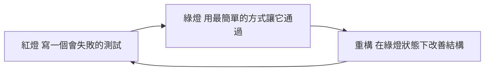

| 步驟 | 目的 | 戴哪頂帽子 | 常見錯誤 |
| --- | --- | --- | --- |
| 🔴 紅燈 | 用測試描述下一個小行為；確認測試真的會失敗 | 新增功能 | 一次寫好幾個測試；測試沒失敗就繼續 |
| 🟢 綠燈 | 以**最簡單**的方式讓測試通過，即使程式碼很醜（寫死值、複製貼上都可以） | 新增功能 | 一邊讓測試通過、一邊設計「漂亮」的架構 |
| 🔵 重構 | 消除剛才為了通過而產生的重複與醜陋；改善命名；整理測試 | 重構 | 跳過這一步；在重構時加入新行為 |

Kent Beck 說「先讓它能動，再讓它正確，再讓它快」（make it work, make it right, make it fast）。綠燈步驟負責「能動」，重構步驟負責「正確」——把兩者分開，你就不必同時思考「怎麼解決問題」和「怎麼設計得好」。

| 編號 | 等級 | 規則 | 驗證方式 |
| --- | --- | --- | --- |
| `RFT-TDD-001` | 必須 | TDD 的重構步驟只能在所有測試通過（綠燈）時進行，重構期間不得新增行為；需要新行為時，必須先回到紅燈步驟寫一個新的失敗測試 | 👁 結對或審查時觀察；🧪 每個 `refactor` 提交的測試全部通過 |
| `RFT-TDD-002` | 應該 | 每個 TDD 循環都應執行重構步驟，至少檢查重複、命名與測試程式碼；綠燈步驟應以最簡單的方式通過測試，不應同時進行設計 | 👁 檢視提交歷史中 `test`／`feat`／`refactor` 的節奏 |

```text
✅ RFT-TDD-001、RFT-TDD-002：一個 TDD 循環的提交紀錄（每個循環都有 refactor 步驟）
c11 test: 密碼少於 8 個字元時回報違規            ← 紅燈
c12 feat: 檢查密碼長度                           ← 綠燈（最簡單的 if）
c13 test: 沒有數字時回報違規                     ← 紅燈
c14 feat: 檢查是否包含數字                       ← 綠燈（複製貼上了迴圈）
c15 test: 沒有大寫字母時回報違規                 ← 紅燈
c16 feat: 檢查是否包含大寫字母                   ← 綠燈（又複製了一次迴圈）
c17 refactor: 以規則表取代三段重複的檢查         ← 重構（三法則：第三次出現時整理）
```

#### 🔍 9.1 審查與驗證

| 審查問題 | 如何確認 |
| --- | --- |
| 重構步驟中有沒有新行為？ | `refactor` 提交前後的測試數量與預期值應相同 |
| 有沒有長期跳過重構步驟？ | 若提交歷史只有 `test`／`feat` 交替，而程式碼中有明顯的重複，代表團隊跳過了重構 |

### 9.2 實際 TDD 重構範例

延續 9.1 的提交紀錄，以下是 `c16` 綠燈時的程式碼：為了快速通過測試，三段檢查各自寫了一次，其中兩段是幾乎相同的迴圈。

```java
// ❌ RFT-TDD-002：綠燈狀態——能動，但有重複（這是 TDD 中正常的中間狀態，接下來就要重構）
package com.example.rft.tdd;

import java.util.ArrayList;
import java.util.List;

public class PasswordPolicy {

    public List<String> violations(String password) {
        List<String> result = new ArrayList<>();
        if (password.length() < 8) {
            result.add("至少 8 個字元");
        }
        boolean hasDigit = false;
        for (char c : password.toCharArray()) {
            if (Character.isDigit(c)) {
                hasDigit = true;
            }
        }
        if (!hasDigit) {
            result.add("至少 1 個數字");
        }
        boolean hasUpper = false;
        for (char c : password.toCharArray()) {
            if (Character.isUpperCase(c)) {
                hasUpper = true;
            }
        }
        if (!hasUpper) {
            result.add("至少 1 個大寫字母");
        }
        return result;
    }
}
```

```java
// ✅ RFT-TDD-001：這組測試在重構前後都必須通過——包括違規訊息的順序與回傳清單可以被修改
package com.example.rft.tdd;

import static org.assertj.core.api.Assertions.assertThat;

import java.util.List;
import org.junit.jupiter.api.Test;

class PasswordPolicyTest {

    private final PasswordPolicy policy = new PasswordPolicy();

    @Test
    void strongPasswordHasNoViolations() {
        assertThat(policy.violations("Secret123")).isEmpty();
    }

    @Test
    void reportsEveryViolationInRuleOrder() {
        assertThat(policy.violations("abc")).containsExactly("至少 8 個字元", "至少 1 個數字", "至少 1 個大寫字母");
        assertThat(policy.violations("abcdefgh1")).containsExactly("至少 1 個大寫字母");
        assertThat(policy.violations("ABCDEFGHI")).containsExactly("至少 1 個數字");
    }

    @Test
    void callersMayAppendToTheReturnedList() {
        List<String> violations = policy.violations("Secret123");
        violations.add("自訂規則：不可包含使用者名稱");
        assertThat(violations).hasSize(1);
    }
}
```

重構步驟：(1) 把三個檢查改成「條件＋訊息」的相同形式（Slide Statements、Extract Function）；(2) 引入規則表；(3) 以迴圈套用規則表。

```java
// ✅ RFT-TDD-001、RFT-TDD-002：重構完成——新增規則只要在 RULES 加一行；回傳的仍是可修改的 ArrayList
package com.example.rft.tdd;

import java.util.ArrayList;
import java.util.List;
import java.util.function.Predicate;

public class PasswordPolicy {

    private record Rule(Predicate<String> satisfied, String message) {
    }

    private static final List<Rule> RULES = List.of(
            new Rule(p -> p.length() >= 8, "至少 8 個字元"),
            new Rule(p -> p.chars().anyMatch(Character::isDigit), "至少 1 個數字"),
            new Rule(p -> p.chars().anyMatch(Character::isUpperCase), "至少 1 個大寫字母"));

    public List<String> violations(String password) {
        List<String> result = new ArrayList<>();
        for (Rule rule : RULES) {
            if (!rule.satisfied().test(password)) {
                result.add(rule.message());
            }
        }
        return result;
    }
}
```

> 💡 為什麼最後沒有寫成 `RULES.stream().filter(...).map(Rule::message).toList()`？因為 `Stream.toList()` 回傳**不可修改**的清單，`callersMayAppendToTheReturnedList` 會失敗——那是行為變更（13.4）。在 TDD 中，「回傳的清單能不能修改」應該由一個測試明確表達；既然已經有測試表達「可以修改」，重構就必須保留它。

#### 🔍 9.2 審查與驗證

| 審查問題 | 如何確認 |
| --- | --- |
| 重構後訊息的順序相同嗎？ | 規則表的順序必須和原本檢查的順序一致；測試用 `containsExactly` 鎖住順序 |
| 回傳型別的特性相同嗎？ | 可修改性、是否允許 `null`、是否為同一個實例，都要和重構前一致 |

### 9.3 重構測試程式碼

測試程式碼也會累積壞味道：重複的準備資料、魔術數字、看不出意圖的測試名稱。在 TDD 的重構步驟中，測試程式碼和產品程式碼一樣需要整理——但測試的重構有一個額外的風險：**測試沒有測試來保護它**。把測試「重構」得更寬鬆（例如把 `containsExactly` 改成 `contains`），所有測試照樣通過，但安全網已經破了一個洞。

```java
// ❌ RFT-TDD-003：每個測試都重複建立相同的資料，看不出哪些值對這個測試是重要的（片段）
@Test
void vipGetsFreeShipping() {
    Order order = new Order("C001", "VIP", "TW", List.of(new Line("A100", 3, 1200)), LocalDate.of(2026, 5, 1));
    assertThat(fees.shippingFor(order)).isZero();
}
@Test
void outlyingIslandsPayExtra() {
    Order order = new Order("C001", "NORMAL", "TW-OUTLYING", List.of(new Line("A100", 3, 1200)), LocalDate.of(2026, 5, 1));
    assertThat(fees.shippingFor(order)).isEqualTo(150);
}

// ✅ RFT-TDD-003：測試資料建構器（Test Data Builder）——只寫出這個測試在意的值，斷言不變（片段）
@Test
void vipGetsFreeShipping() {
    assertThat(fees.shippingFor(anOrder().withMemberType("VIP").build())).isZero();
}
@Test
void outlyingIslandsPayExtra() {
    assertThat(fees.shippingFor(anOrder().withRegion("TW-OUTLYING").build())).isEqualTo(150);
}
```

（片段）

| 編號 | 等級 | 規則 | 驗證方式 |
| --- | --- | --- | --- |
| `RFT-TDD-003` | 應該 | 測試程式碼應和產品程式碼一樣重構（Test Data Builder、參數化測試、具名常數）；重構測試時不得放寬斷言或刪除案例，重構前後的變異分數不得下降 | 🤖 PIT 變異分數比較（8.4）；👁 審查斷言的變更 |

#### 🔍 9.3 審查與驗證

| 審查問題 | 如何確認 |
| --- | --- |
| 斷言有沒有被放寬？ | 比對重構前後的斷言：`isEqualTo` → `isNotNull`、`containsExactly` → `contains`、刪除 `hasMessage` 都是放寬 |
| 測試的偵測能力有沒有下降？ | 對受影響的類別執行 PIT，比較重構前後的變異分數 |

#### 📝 第 9 章重點

- 紅燈—綠燈—重構是 TDD 的循環；重構是第三步，只在綠燈時進行。
- 綠燈求快、重構求好；兩者分開，思考才不會打結。
- 測試程式碼也要重構，但不能放寬斷言；用變異分數確認測試沒有變弱。

#### ✏️ 第 9 章自我檢測

1. 在綠燈步驟中寫死回傳值（例如 `return 0;`）是可以的嗎？為什麼？
2. 9.2 的重構為什麼不使用 `Stream.toList()`？
3. 怎麼確認一次測試程式碼的重構沒有讓測試變弱？

<details>
<summary>參考答案</summary>

1. 可以。綠燈步驟的目的是以最簡單的方式讓測試通過；寫死的值會在下一個測試（三角測量）或重構步驟中被一般化。
2. `Stream.toList()` 回傳不可修改的清單，而既有測試 `callersMayAppendToTheReturnedList` 表達了「回傳的清單可以修改」，使用它會改變行為。
3. 比較重構前後的斷言是否被放寬，並對受影響的產品類別執行變異測試，確認變異分數沒有下降。

</details>

---

## 10. 遺留程式碼的重構

> **🎯 學習目標**
>
> - 依 Feathers 的「遺留程式碼變更演算法」安全地修改沒有測試的程式碼。
> - 找出並引入接縫（seam），讓程式碼可以放進測試中。
> - 在無法立即建立測試時，用 Sprout 與 Wrap 讓新程式碼保持可測試。
> - 用 Mikado 方法規劃一個「改一處就壞十處」的大型修改。

Michael Feathers 對遺留程式碼的定義很直接：**遺留程式碼就是沒有測試的程式碼**。這種程式碼的困境是：要重構它需要測試，要寫測試又常常得先重構它（因為它和資料庫、時間、外部服務緊緊綁在一起）。本章的手法就是用來打破這個循環。

### 10.1 遺留程式碼變更演算法

```text
✅ RFT-LEG-001：Feathers 的遺留程式碼變更演算法
1. 找出變更點（change points）：這次需求要修改哪些程式碼？
2. 找出測試點（test points）：在哪裡可以觀察到這些程式碼的行為？（通常是呼叫它的公開方法）
3. 打破相依（break dependencies）：讓測試點可以在測試中被呼叫——引入接縫（10.2、10.4）。
   這一步還沒有測試保護，所以只做最小、最機械化的修改，盡量使用 IDE 的自動化重構。
4. 撰寫測試：在測試點撰寫特性測試（8.2）。
5. 修改與重構：在測試保護下進行這次的需求修改，並整理程式碼。
```

| 編號 | 等級 | 規則 | 驗證方式 |
| --- | --- | --- | --- |
| `RFT-LEG-001` | 必須 | 修改沒有測試的程式碼時，必須依變更演算法：先找出變更點與測試點、打破相依、建立特性測試，再進行修改與重構；打破相依的步驟只能使用最小且機械化的修改 | 👁 審查提交順序：接縫 → 特性測試 → 修改；🧪 特性測試在修改前的程式碼上通過 |

#### 🔍 10.1 審查與驗證

| 審查問題 | 如何確認 |
| --- | --- |
| 修改前有沒有先建立特性測試？ | 檢查提交順序；特性測試的提交應該在需求修改之前 |
| 打破相依的步驟夠小嗎？ | 這個提交應該只引入接縫（例如新增建構式參數），不應包含其他邏輯變更 |

### 10.2 接縫（Seam）

**接縫**是「不修改該處程式碼，就能改變其行為的位置」。在 Java 中最常用的是**物件接縫**：讓程式碼透過介面或參數取得相依的物件，測試就可以傳入替身。

最常見、也最容易處理的相依是**時間**。下面的程式碼直接呼叫 `LocalDate.now()`，測試的結果會隨著執行的日期改變：

```java
// ❌ RFT-LEG-002、RFT-LEG-003：直接取得系統時間——測試結果取決於今天是幾號，無法穩定測試
package com.example.rft.leg;

import java.time.LocalDate;
import java.time.temporal.ChronoUnit;

public class InvoiceDueChecker {

    public boolean isOverdue(LocalDate dueDate) {
        return LocalDate.now().isAfter(dueDate);
    }

    public long daysOverdue(LocalDate dueDate) {
        LocalDate today = LocalDate.now();
        return today.isAfter(dueDate) ? ChronoUnit.DAYS.between(dueDate, today) : 0;
    }
}
```

引入接縫：新增一個接受 `Clock` 的建構式，原本的無參數建構式使用系統時鐘——**正式環境的行為完全不變**（`LocalDate.now()` 本來就等於 `LocalDate.now(Clock.systemDefaultZone())`），測試則可以傳入固定的時鐘。

```java
// ✅ RFT-LEG-002、RFT-LEG-003：Clock 成為接縫；無參數建構式保留原本的行為，既有呼叫端不需修改
package com.example.rft.leg;

import java.time.Clock;
import java.time.LocalDate;
import java.time.temporal.ChronoUnit;

public class InvoiceDueChecker {

    private final Clock clock;

    public InvoiceDueChecker() {
        this(Clock.systemDefaultZone());
    }

    public InvoiceDueChecker(Clock clock) {
        this.clock = clock;
    }

    public boolean isOverdue(LocalDate dueDate) {
        return LocalDate.now(clock).isAfter(dueDate);
    }

    public long daysOverdue(LocalDate dueDate) {
        LocalDate today = LocalDate.now(clock);
        return today.isAfter(dueDate) ? ChronoUnit.DAYS.between(dueDate, today) : 0;
    }
}
```

```java
// ✅ RFT-LEG-003：固定時鐘讓測試穩定；到期日當天不算逾期的邊界也能測了
package com.example.rft.leg;

import static org.assertj.core.api.Assertions.assertThat;

import java.time.Clock;
import java.time.LocalDate;
import java.time.ZoneId;
import org.junit.jupiter.api.Test;

class InvoiceDueCheckerTest {

    private final Clock may10 = Clock.fixed(LocalDate.of(2026, 5, 10).atStartOfDay(ZoneId.of("Asia/Taipei"))
            .toInstant(), ZoneId.of("Asia/Taipei"));
    private final InvoiceDueChecker checker = new InvoiceDueChecker(may10);

    @Test
    void dueTodayIsNotOverdue() {
        assertThat(checker.isOverdue(LocalDate.of(2026, 5, 10))).isFalse();
        assertThat(checker.daysOverdue(LocalDate.of(2026, 5, 10))).isZero();
    }

    @Test
    void overdueDaysCountFromTheDueDate() {
        assertThat(checker.isOverdue(LocalDate.of(2026, 5, 1))).isTrue();
        assertThat(checker.daysOverdue(LocalDate.of(2026, 5, 1))).isEqualTo(9);
    }

    @Test
    void defaultConstructorStillUsesTheSystemClock() {
        assertThat(new InvoiceDueChecker().isOverdue(LocalDate.now().minusDays(1))).isTrue();
    }
}
```

除了時間，下列「不確定的來源」都應該用同樣的方式變成接縫：

| 不確定來源 | 直接呼叫 | 接縫 |
| --- | --- | --- |
| 時間 | `LocalDate.now()`、`System.currentTimeMillis()` | 注入 `java.time.Clock` |
| 亂數 | `new Random()`、`Math.random()` | 注入 `RandomGenerator` 或固定種子 |
| 識別碼 | `UUID.randomUUID()` | 注入 `Supplier<UUID>` |
| 環境 | `System.getenv()`、`System.getProperty()` | 注入設定物件 |
| 外部服務 | `new HttpClient()`、靜態工具類別 | 注入介面（Extract Interface，10.4） |

| 編號 | 等級 | 規則 | 驗證方式 |
| --- | --- | --- | --- |
| `RFT-LEG-002` | 應該 | 為遺留程式碼引入接縫時，應保留原本的建構方式（例如保留無參數建構式並委派給新建構式），使既有呼叫端與正式環境的行為完全不變 | 🧪 以原本的建構方式執行的測試；👁 審查 |
| `RFT-LEG-003` | 必須 | 時間、亂數、識別碼、環境變數等不確定來源必須透過接縫注入，測試中必須以固定值取代，不得依賴執行當下的日期或環境 | 🤖 ArchUnit 或 grep 禁止在領域程式碼中直接呼叫 `LocalDate.now()`、`UUID.randomUUID()`；🧪 測試在不同日期重複執行結果相同 |

#### 🔍 10.2 審查與驗證

| 審查問題 | 如何確認 |
| --- | --- |
| 正式環境的行為有改變嗎？ | 原本的建構式（或 Spring 的預設 bean）是否仍使用相同的系統來源 |
| 測試還依賴當下時間嗎？ | 搜尋測試中的 `now()`；必要的「預設建構式仍可用」測試只能做與日期無關的斷言 |

### 10.3 Sprout 與 Wrap：讓新程式碼保持可測試

有時候你需要在一段遺留程式碼中加入新功能，卻無法在合理的時間內為它建立測試。這時不要把新功能直接寫進那團程式碼中——**把新程式碼寫在可以測試的新地方**：

| 手法 | 做法 | 適合情境 |
| --- | --- | --- |
| **Sprout Method／Sprout Class** | 新功能寫成新的方法或類別（有完整測試），在遺留程式碼中只加一行呼叫 | 新功能是一段獨立的邏輯 |
| **Wrap Method／Wrap Class** | 把原方法改名，新建一個同名方法：先執行新功能，再呼叫原方法（或反過來） | 新功能要在原行為「之前或之後」執行，例如記錄稽核日誌 |

> 這兩種手法本身**是新增功能**（`feat`），不是重構；但它們讓你在不碰觸遺留邏輯的情況下安全地加入功能，並為之後的重構留下乾淨的起點。

**範例：** 遺留的 `postEntries()` 有 200 行、相依資料庫，現在要加入「同一批資料中重複的交易編號只入帳一次」：

```java
// ❌ RFT-LEG-004：把去重複的邏輯直接寫進 200 行的遺留方法中——新邏輯一樣沒有測試（片段）
public void postEntries(List<Entry> entries) {
    Set<String> seen = new HashSet<>();                 // 新增
    for (Entry entry : entries) {
        if (!seen.add(entry.id())) { continue; }        // 新增
        // ……原本 200 行的入帳邏輯……
    }
}

// ✅ RFT-LEG-004：Sprout Class——去重複的邏輯在可測試的新類別中，遺留方法只多一行呼叫（片段）
public void postEntries(List<Entry> entries) {
    for (Entry entry : new EntryDeduplicator().uniqueById(entries)) {
        // ……原本 200 行的入帳邏輯，一個字都沒改……
    }
}
```

（片段）

```java
// ✅ RFT-LEG-004：新長出來的類別（Sprout Class）——小、獨立、有完整的測試
package com.example.rft.leg;

import java.util.ArrayList;
import java.util.HashSet;
import java.util.List;
import java.util.Set;

public final class EntryDeduplicator {

    public record Entry(String id, long amount) {
    }

    public List<Entry> uniqueById(List<Entry> entries) {
        Set<String> seen = new HashSet<>();
        List<Entry> unique = new ArrayList<>();
        for (Entry entry : entries) {
            if (seen.add(entry.id())) {
                unique.add(entry);
            }
        }
        return unique;
    }
}
```

```java
// ✅ RFT-LEG-004：新類別的測試——保留第一次出現的那一筆，並維持原本的順序
package com.example.rft.leg;

import static org.assertj.core.api.Assertions.assertThat;

import com.example.rft.leg.EntryDeduplicator.Entry;
import java.util.List;
import org.junit.jupiter.api.Test;

class EntryDeduplicatorTest {

    @Test
    void keepsFirstOccurrenceInOriginalOrder() {
        List<Entry> entries = List.of(new Entry("T2", 50), new Entry("T1", 10), new Entry("T2", 99));
        assertThat(new EntryDeduplicator().uniqueById(entries))
                .containsExactly(new Entry("T2", 50), new Entry("T1", 10));
    }
}
```

| 編號 | 等級 | 規則 | 驗證方式 |
| --- | --- | --- | --- |
| `RFT-LEG-004` | 應該 | 無法在合理時間內為遺留程式碼建立測試時，新功能應以 Sprout Method／Class 或 Wrap Method／Class 寫在可測試的新程式碼中，並以 `feat` 提交；遺留程式碼只增加最少的呼叫 | 🧪 新程式碼有完整的單元測試；👁 審查遺留方法的 diff 是否只有呼叫的變更 |

#### 🔍 10.3 審查與驗證

| 審查問題 | 如何確認 |
| --- | --- |
| 遺留方法中新增了多少程式碼？ | 理想情況下只有一兩行呼叫；新邏輯都在新的類別或方法中 |
| 新程式碼有測試嗎？ | 覆蓋率報告中，新類別應接近 100% |

### 10.4 打破相依的常用手法

Feathers 的書中列出了 24 種打破相依的手法。下表是 Java 專案中最常用的幾種，依「安全程度」由高到低排列：

| 手法 | 做法 | IDE 支援 | 注意事項 |
| --- | --- | --- | --- |
| **Parameterize Constructor** | 新增接受相依物件的建構式，原建構式委派給它（10.2 的作法） | Introduce Parameter | 最安全、最常用 |
| **Extract Interface** | 為具體類別提煉介面，呼叫端改為相依介面 | Extract Interface | 介面只放測試需要的方法 |
| **Parameterize Method** | 方法內 `new` 出來的物件改為參數 | Introduce Parameter | 呼叫端要傳入原本的物件 |
| **Extract and Override Call** | 把難以測試的呼叫提煉成 `protected` 方法，測試中以子類別覆寫 | Extract Method | 只作為過渡；之後改為注入 |
| **Subclass and Override Method** | 測試中建立子類別覆寫有副作用的方法 | — | 類別不能是 `final`；只作為過渡 |
| **Introduce Static Setter** | 為單例加入測試用的 setter | — | 最後手段；測試之間會互相影響 |

```java
// ❌ RFT-LEG-005：Introduce Static Setter 被當成永久設計——正式程式碼可以在執行中替換單例（片段）
public final class TaxRateService {
    private static TaxRateService instance = new TaxRateService();
    public static void setInstanceForTesting(TaxRateService fake) { instance = fake; }   // 永久留在正式程式碼中
    public static TaxRateService getInstance() { return instance; }
}

// ✅ RFT-LEG-005：過渡完成後改為建構式注入，並移除靜態 setter 與單例（片段）
public class InvoiceCalculator {
    private final TaxRateService taxRates;
    public InvoiceCalculator(TaxRateService taxRates) { this.taxRates = taxRates; }
}
```

（片段）

| 編號 | 等級 | 規則 | 驗證方式 |
| --- | --- | --- | --- |
| `RFT-LEG-005` | 不應該 | Subclass and Override、Introduce Static Setter、Extract and Override Call 等手法不應作為永久設計；應在建立測試後改為建構式注入，並記錄移除這些過渡手段的技術債 | 👁 審查；🤖 搜尋 `ForTesting`、`@VisibleForTesting` 等標記 |

#### 🔍 10.4 審查與驗證

| 審查問題 | 如何確認 |
| --- | --- |
| 過渡用的手段有移除計畫嗎？ | 技術債清單（19.2）中應有對應項目 |
| 測試之間會互相影響嗎？ | 使用靜態 setter 時，每個測試結束後必須還原；以隨機順序執行測試（JUnit 的 `MethodOrderer.Random`）確認 |

### 10.5 Mikado 方法

有些修改會引發連鎖反應：你想把 A 改掉，卻發現要先改 B 和 C；改 C 又要先改 D……做到一半，程式碼已經無法編譯，測試全紅，只好整批放棄。**Mikado 方法**（Ellnestam & Brolund）用一張相依關係圖與嚴格的「回復」紀律來處理這種情況：

```text
✅ RFT-LEG-006：Mikado 方法的步驟
1. 在紙上（或白板、Markdown 檔）寫下目標，作為圖的根節點。
2. 「天真地」直接嘗試完成目標（或目前的節點）。
3. 觀察哪裡壞掉了（編譯錯誤、測試失敗）——每一個問題就是一個先決條件，畫成子節點。
4. 把程式碼回復（git restore .）到嘗試前的狀態。這一步是方法的核心，不能省略。
5. 對每個子節點重複步驟 2～4，直到找到「直接做就不會壞」的葉節點。
6. 完成一個葉節點，測試通過，提交，在圖上打勾。
7. 由葉節點往根節點逐一完成，直到目標達成。
```

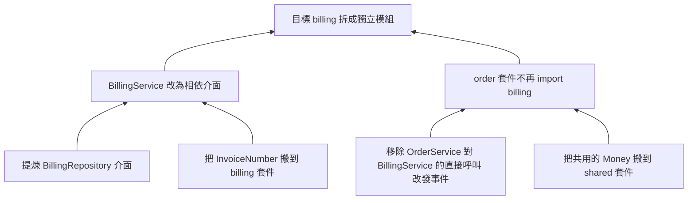

圖中的每個葉節點都是一個可以獨立完成、獨立提交的小重構。即使專案中途被打斷，已完成的節點都已經合併，沒有半成品；圖本身也記錄了剩下的工作。

| 編號 | 等級 | 規則 | 驗證方式 |
| --- | --- | --- | --- |
| `RFT-LEG-006` | 應該 | 一個修改引發多處連鎖修改時，應以 Mikado 方法記錄相依關係圖，每次嘗試失敗就回復程式碼，由葉節點開始逐一完成並提交；Mikado 圖應納入版本控制或議題系統 | 👁 PR 說明附上 Mikado 圖；👁 檢查每個提交都能編譯且測試通過 |

#### 🔍 10.5 審查與驗證

| 審查問題 | 如何確認 |
| --- | --- |
| 每個提交都對應圖上的一個節點嗎？ | 比對提交訊息與 Mikado 圖 |
| 有沒有「做到一半」的提交？ | 每個提交都必須能編譯且測試通過（2.2 的審查問題） |

### 10.6 探索性重構（Scratch Refactoring）

面對完全看不懂的程式碼時，有一個有效的學習方法：**先大膽地重構它來理解它，然後全部丟掉**。不需要測試、不需要小步——目的只是「理解」。理解之後，再回到正式的流程，用測試保護、小步地進行真正的重構。

```bash
# ✅ RFT-LEG-007：探索性重構的開始與結束——在拋棄式分支上進行，結束時一定刪除
git switch -c scratch/understand-billing
# ……大膽地改名、提煉、搬移，邊改邊做筆記……
git switch main
git branch -D scratch/understand-billing   # 丟棄所有修改，只留下筆記與理解
```

| 編號 | 等級 | 規則 | 驗證方式 |
| --- | --- | --- | --- |
| `RFT-LEG-007` | 可以 | 可以用探索性重構理解陌生的程式碼，但探索的修改必須丟棄，不得合併；正式的重構必須重新以測試保護並小步進行 | 👁 檢查 `scratch/` 分支沒有被合併 |

#### 🔍 10.6 審查與驗證

| 審查問題 | 如何確認 |
| --- | --- |
| 探索性的修改有被合併嗎？ | 合併請求的來源分支不應是 `scratch/` 開頭；PR 的修改應有完整的測試與小步提交 |

#### 📝 第 10 章重點

- 遺留程式碼就是沒有測試的程式碼；先找變更點與測試點，打破相依，寫特性測試，再修改。
- 接縫讓程式碼可以放進測試；時間、亂數、識別碼、環境一律注入。
- 無法測試時，新功能用 Sprout／Wrap 寫在可測試的新程式碼中。
- 連鎖修改用 Mikado 方法：嘗試、記錄、回復，由葉節點完成。

#### ✏️ 第 10 章自我檢測

1. 為什麼 10.2 的重構要保留無參數建構式？
2. Sprout Class 是重構嗎？
3. Mikado 方法中，第 4 步「回復程式碼」為什麼不能省略？

<details>
<summary>參考答案</summary>

1. 讓既有的呼叫端不需修改，正式環境繼續使用系統時鐘，行為完全不變；只有測試使用新的建構式。
2. 不是。它是新增功能，以 `feat` 提交；它的價值在於讓新功能不必寫進無法測試的遺留程式碼中。
3. 因為在壞掉的狀態下繼續修改，就會回到「改到一半、全部紅燈」的困境。回復讓程式碼始終處於可運作的狀態，每次只處理一個可以獨立完成的葉節點。

</details>

---

## 11. 大型與架構層級的重構

> **🎯 學習目標**
>
> - 說明為什麼「大爆炸式重寫」風險高，以及漸進式取代的做法。
> - 用 Strangler Fig 與平行執行（parallel run）逐步以新實作取代舊系統。
> - 用 Branch by Abstraction 在主幹上進行長時間的替換，而不需要長壽的功能分支。
> - 用 ArchUnit 把架構規則寫成測試，防止重構後的結構再次腐化。

### 11.1 漸進式重構與大爆炸重寫

當一個系統的問題大到單一手法無法解決時，團隊常會想「乾脆重寫」。重寫的風險在於：

- **長時間無法交付價值**：新系統要做到和舊系統功能相同才能上線，期間舊系統還在持續修改（目標一直在移動）。
- **隱性需求遺失**：舊系統中有大量沒有文件的行為（邊界處理、特殊客戶的例外規則），重寫時很容易遺漏。
- **一次切換的風險**：上線當天所有東西同時改變，出問題時很難判斷原因，也很難回復。

漸進式的做法是**讓新舊並存、逐步移轉、隨時可以回復**。本章的三個技巧都遵循這個原則：

| 技巧 | 範圍 | 核心做法 |
| --- | --- | --- |
| Strangler Fig（絞殺榕） | 系統或服務層級 | 在舊系統前加一層路由，逐一把功能移到新系統 |
| Branch by Abstraction | 單一程式碼庫內的元件 | 先建立抽象層，在抽象層後面替換實作 |
| Parallel Change（平行變更） | 介面、資料格式 | 擴充 → 遷移 → 收縮（第 12 章） |

| 編號 | 等級 | 規則 | 驗證方式 |
| --- | --- | --- | --- |
| `RFT-ARC-001` | 不應該 | 不應以「一次切換」的方式重寫並取代仍在運作的系統或元件；應採用 Strangler Fig 或 Branch by Abstraction，使每個階段都能獨立上線與回復 | 👁 架構審查時確認移轉計畫的階段與回復方式 |

```text
✅ RFT-ARC-001：計價模組現代化的移轉計畫（每個階段都可獨立上線、可回復）
階段 1：建立 PricingRouter，所有請求仍走舊實作（行為不變）                  回復：移除路由
階段 2：新實作上線，以平行執行比對 2 週，不影響回應                         回復：關閉平行執行
階段 3：差異為零的商品類別（A 開頭）改走新實作                              回復：路由設定改回
階段 4：其餘類別逐批移轉；每批觀察 1 週                                     回復：該批路由改回
階段 5：所有類別移轉完成 2 週後，刪除舊實作與路由                           回復：重新部署前一版
```

#### 🔍 11.1 審查與驗證

| 審查問題 | 如何確認 |
| --- | --- |
| 每個階段都能獨立上線嗎？ | 移轉計畫中每一步都要有「上線後的狀態」與「回復方式」 |
| 有沒有「全部完成才能上線」的階段？ | 若有，代表計畫退化成了大爆炸重寫 |

### 11.2 Strangler Fig 與平行執行

Fowler 以熱帶的絞殺榕命名這個模式：絞殺榕從宿主樹的頂端發芽，根系沿著樹幹向下生長，最後完全取代宿主樹。軟體中的做法是：

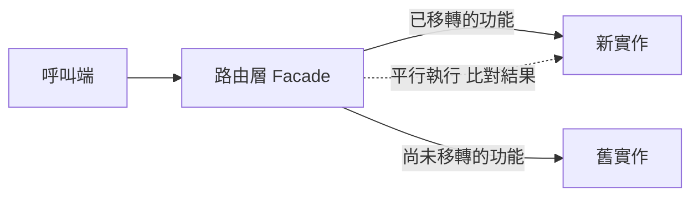

**平行執行**（parallel run，或稱影子執行）是降低風險的關鍵：在正式移轉之前，讓新實作在背景處理同樣的請求，但**只回傳舊實作的結果**，並記錄兩者的差異。差異為零一段時間後，才真正切換。這等於用正式環境的流量做等價性驗證。

```java
// ✅ RFT-ARC-002：兩個實作共同遵守的介面（Strangler Fig 的接縫）
package com.example.rft.arc.domain;

public interface Pricing {

    long price(String sku, int quantity);
}
```

```java
// ✅ RFT-ARC-002：舊實作——行為不變，只是實作了介面
package com.example.rft.arc.infra;

import com.example.rft.arc.domain.Pricing;

public class LegacyPricing implements Pricing {

    @Override
    public long price(String sku, int quantity) {
        long unit = sku.startsWith("A") ? 100 : 255;
        long total = unit * quantity;
        if (quantity >= 10) {
            total = total - total / 10;
        }
        return total;
    }
}
```

```java
// ✅ RFT-ARC-002：新實作——以規則表表達同樣的規則（B 類的計算刻意保留一個差異，示範平行執行如何發現它）
package com.example.rft.arc.infra;

import com.example.rft.arc.domain.Pricing;

public class ModernPricing implements Pricing {

    @Override
    public long price(String sku, int quantity) {
        long unit = sku.startsWith("A") ? 100 : 255;
        long total = unit * quantity;
        return quantity >= 10 ? total * 9 / 10 : total;
    }
}
```

```java
// ✅ RFT-ARC-002、RFT-ARC-003：路由層——已移轉的類別走新實作；平行執行時回傳舊結果並記錄差異
package com.example.rft.arc.app;

import com.example.rft.arc.domain.Pricing;
import java.util.ArrayList;
import java.util.List;
import java.util.Set;

public class PricingRouter implements Pricing {

    private final Pricing legacy;
    private final Pricing modern;
    private final Set<String> migratedPrefixes;
    private final boolean parallelRun;
    private final List<String> mismatches = new ArrayList<>();

    public PricingRouter(Pricing legacy, Pricing modern, Set<String> migratedPrefixes, boolean parallelRun) {
        this.legacy = legacy;
        this.modern = modern;
        this.migratedPrefixes = Set.copyOf(migratedPrefixes);
        this.parallelRun = parallelRun;
    }

    @Override
    public long price(String sku, int quantity) {
        if (isMigrated(sku)) {
            return modern.price(sku, quantity);
        }
        long result = legacy.price(sku, quantity);
        if (parallelRun) {
            compareWithModern(sku, quantity, result);
        }
        return result;
    }

    public List<String> mismatches() {
        return List.copyOf(mismatches);
    }

    private boolean isMigrated(String sku) {
        return migratedPrefixes.stream().anyMatch(sku::startsWith);
    }

    private void compareWithModern(String sku, int quantity, long legacyResult) {
        try {
            long modernResult = modern.price(sku, quantity);
            if (modernResult != legacyResult) {
                mismatches.add(sku + " x" + quantity + ": legacy=" + legacyResult + " modern=" + modernResult);
            }
        } catch (RuntimeException e) {
            mismatches.add(sku + " x" + quantity + ": modern threw " + e.getClass().getSimpleName());
        }
    }
}
```

```java
// ✅ RFT-ARC-002、RFT-ARC-003：平行執行只回傳舊結果；捨入方式的差異（2,525 vs 2,524）被記錄下來
package com.example.rft.arc.app;

import static org.assertj.core.api.Assertions.assertThat;

import com.example.rft.arc.infra.LegacyPricing;
import com.example.rft.arc.infra.ModernPricing;
import java.util.Set;
import org.junit.jupiter.api.Test;

class PricingRouterTest {

    @Test
    void parallelRunReturnsLegacyResultAndRecordsMismatches() {
        PricingRouter router = new PricingRouter(new LegacyPricing(), new ModernPricing(), Set.of(), true);

        assertThat(router.price("A1", 10)).isEqualTo(900);
        assertThat(router.price("B7", 11)).isEqualTo(2525);
        assertThat(router.price("B7", 20)).isEqualTo(4590);
        assertThat(router.mismatches()).containsExactly("B7 x11: legacy=2525 modern=2524");
    }

    @Test
    void migratedPrefixesUseTheModernImplementation() {
        PricingRouter router = new PricingRouter(new LegacyPricing(), new ModernPricing(), Set.of("A"), false);
        assertThat(router.price("A1", 3)).isEqualTo(300);
        assertThat(router.mismatches()).isEmpty();
    }
}
```

| 編號 | 等級 | 規則 | 驗證方式 |
| --- | --- | --- | --- |
| `RFT-ARC-002` | 應該 | 以新實作取代舊系統或元件時，應建立共同的介面與路由層，依功能或資料範圍逐批移轉，每一批都能以設定回復 | 🧪 路由的單元測試；👁 架構審查 |
| `RFT-ARC-003` | 應該 | 移轉業務規則複雜的功能前，應以平行執行比對新舊實作的結果，平行執行期間必須只回傳舊實作的結果、隔離新實作的例外，並在差異為零一段時間後才切換 | 🧪 平行執行的測試；🤖 差異的監控指標或日誌告警 |

#### 🔍 11.2 審查與驗證

| 審查問題 | 如何確認 |
| --- | --- |
| 平行執行會影響回應嗎？ | 新實作的例外必須被捕捉；有效能疑慮時，平行執行應以非同步或抽樣方式進行 |
| 新實作有副作用嗎？ | 平行執行時新實作不得寫入資料或送出訊息，否則會造成重複處理 |
| 差異有被監控嗎？ | 差異應輸出成指標或結構化日誌，並設定告警 |

### 11.3 Branch by Abstraction

當要替換的是**同一個程式碼庫中**的元件（例如更換持久層框架、更換日誌函式庫），而且替換需要好幾週時，不要開一個長壽的功能分支——它會和主幹分歧，合併時充滿衝突。改用 **Branch by Abstraction**：在主幹上透過抽象層「分支」。

```text
✅ RFT-ARC-004：Branch by Abstraction 的步驟（每一步都在主幹上合併，系統隨時可上線）
1. 找出所有使用舊元件的呼叫端。
2. 建立抽象層（介面），先讓「一個」呼叫端改為透過抽象層使用舊元件。測試、合併。
3. 逐一把其他呼叫端改為使用抽象層。每批合併一次。
4. 建立新元件的實作（同樣實作該介面），以功能旗標或設定選擇使用哪一個實作。
5. 逐步把呼叫端（或流量）切換到新實作；有問題時切回。
6. 全部切換完成後，刪除舊實作；視情況移除抽象層與功能旗標。
```

```java
// ❌ RFT-ARC-004：長壽的功能分支——feature/replace-orm 已存在 6 週、與 main 有 340 個衝突（片段）
// git log --oneline main..feature/replace-orm | wc -l   →  187

// ✅ RFT-ARC-004：抽象層讓新舊實作在主幹上並存，以設定切換（片段）
public interface OrderStore {
    Optional<Order> find(OrderId id);
    void save(Order order);
}
@Bean
OrderStore orderStore(@Value("${orders.store:legacy}") String impl, LegacyOrderDao dao, JdbcOrderStore jdbc) {
    return "jdbc".equals(impl) ? jdbc : new LegacyOrderStoreAdapter(dao);
}
```

（片段）

| 編號 | 等級 | 規則 | 驗證方式 |
| --- | --- | --- | --- |
| `RFT-ARC-004` | 應該 | 需要數天以上才能完成的元件替換，應以 Branch by Abstraction 在主幹上分階段進行，不應使用存活超過數天的功能分支 | 🤖 列出存活超過 3 天的分支（`git for-each-ref --sort=committerdate refs/remotes`）；👁 審查 |

#### 🔍 11.3 審查與驗證

| 審查問題 | 如何確認 |
| --- | --- |
| 每個階段合併後，系統都能上線嗎？ | 主幹的 CI 必須保持綠燈；新實作在切換前不影響正式行為 |
| 切換的開關有移除計畫嗎？ | 見 11.5 的功能旗標規則 |

### 11.4 架構守護：用 ArchUnit 把規則寫成測試

大型重構完成後，最常見的結局是：幾個月後結構又慢慢腐化回去。原因很簡單——架構規則只存在於文件和人的記憶中。[ArchUnit](https://www.archunit.org/) 讓你把架構規則寫成**單元測試**，任何人違反規則時 CI 就會失敗。

```java
// ✅ RFT-ARC-005：架構規則即測試——領域層不得相依基礎設施與應用層，領域層的公開方法不得以 double 表示數值
package com.example.rft.arc;

import static com.tngtech.archunit.lang.syntax.ArchRuleDefinition.methods;
import static com.tngtech.archunit.lang.syntax.ArchRuleDefinition.noClasses;

import com.tngtech.archunit.core.domain.JavaMethod;
import com.tngtech.archunit.junit.AnalyzeClasses;
import com.tngtech.archunit.junit.ArchTest;
import com.tngtech.archunit.lang.ArchCondition;
import com.tngtech.archunit.lang.ArchRule;
import com.tngtech.archunit.lang.ConditionEvents;
import com.tngtech.archunit.lang.SimpleConditionEvent;

@AnalyzeClasses(packages = "com.example.rft.arc")
class ArchitectureTest {

    @ArchTest
    static final ArchRule domainDoesNotDependOnOuterLayers = noClasses()
            .that().resideInAPackage("..arc.domain..")
            .should().dependOnClassesThat().resideInAnyPackage("..arc.infra..", "..arc.app..");

    @ArchTest
    static final ArchRule domainMethodsDoNotUseDouble = methods()
            .that().areDeclaredInClassesThat().resideInAPackage("..arc.domain..")
            .and().arePublic()
            .should(notUseDoubleParameters());

    private static ArchCondition<JavaMethod> notUseDoubleParameters() {
        return new ArchCondition<>("not use double parameters") {
            @Override
            public void check(JavaMethod method, ConditionEvents events) {
                boolean usesDouble = method.getRawParameterTypes().stream()
                        .anyMatch(type -> type.isEquivalentTo(double.class) || type.isEquivalentTo(Double.class));
                if (usesDouble) {
                    events.add(SimpleConditionEvent.violated(method, method.getFullName() + " uses double"));
                }
            }
        };
    }
}
```

對**既有**的大型專案加入架構規則時，往往一開始就有數百個違規，不可能一次修完。ArchUnit 的 `FreezingArchRule` 可以**凍結**既有的違規：第一次執行時把現有違規記錄到檔案中，之後只有「新的」違規會讓測試失敗；已記錄的違規被修正後也會自動從檔案中移除。這讓團隊可以「不再變糟，並逐步變好」。

```java
// ✅ RFT-ARC-005：凍結既有違規，只阻擋新增的違規（違規紀錄存於 archunit_store，納入版本控制）（片段）
@ArchTest
static final ArchRule noCycles = FreezingArchRule.freeze(
        slices().matching("com.example.(*)..").should().beFreeOfCycles());
```

（片段）

```properties
# ✅ RFT-ARC-005：src/test/resources/archunit.properties——凍結規則的儲存設定
freeze.store.default.path=src/test/resources/archunit_store
# CI 中不允許建立新的紀錄（違規只能減少）；第一次建立時在本機設為 true 執行一次
freeze.store.default.allowStoreCreation=false
freeze.store.default.allowStoreUpdate=true
```

| 編號 | 等級 | 規則 | 驗證方式 |
| --- | --- | --- | --- |
| `RFT-ARC-005` | 應該 | 重構所建立的架構邊界（分層方向、模組相依、禁止的型別）應以 ArchUnit 等工具寫成測試在 CI 執行；既有違規應以凍結規則記錄並逐步減少，不得新增 | 🤖 ArchUnit 測試；🤖 凍結紀錄檔的行數只減不增 |

#### 🔍 11.4 審查與驗證

| 審查問題 | 如何確認 |
| --- | --- |
| 架構規則能偵測到違規嗎？ | 刻意加入一個違規（例如在 domain 中 import infra 的類別），確認測試失敗——附錄 F.3 記錄了這項驗證 |
| 凍結紀錄檔有變多嗎？ | 審查 `archunit_store` 的 diff；新增的行代表新的違規被「凍結」了，必須說明理由 |

### 11.5 功能旗標的生命週期

Strangler Fig 與 Branch by Abstraction 都依賴「切換開關」。重構用的開關是**暫時性**的，完成移轉後必須移除；否則程式碼中會累積大量永遠為真（或永遠為假）的分支，成為新的技術債。

```yaml
# ✅ RFT-ARC-006：重構用的功能旗標登錄——每個旗標都有負責人、用途與移除期限
flags:
  - key: pricing.modern-engine
    type: refactoring        # refactoring／release／ops／experiment
    owner: team-billing
    purpose: Strangler Fig 移轉計價引擎（11.2）
    created: 2026-09-01
    remove-by: 2026-12-31
    status: rolling-out      # planned／rolling-out／fully-on／removed
```

| 編號 | 等級 | 規則 | 驗證方式 |
| --- | --- | --- | --- |
| `RFT-ARC-006` | 必須 | 為重構而建立的功能旗標必須登錄負責人與移除期限；移轉完成後必須在期限內移除旗標及舊實作 | 🤖 CI 比對旗標登錄的 `remove-by` 日期，逾期時提醒；👁 迭代檢視 |

#### 🔍 11.5 審查與驗證

| 審查問題 | 如何確認 |
| --- | --- |
| 新增的旗標有登錄嗎？ | 程式碼中出現的旗標鍵都要在登錄檔中 |
| 有沒有逾期的旗標？ | 定期執行逾期檢查；逾期旗標列為技術債（19.2） |

#### 📝 第 11 章重點

- 不要大爆炸重寫；讓新舊並存、逐步移轉、隨時可回復。
- Strangler Fig 用路由逐步移轉；平行執行用正式流量驗證等價性。
- Branch by Abstraction 在主幹上分階段替換元件，取代長壽的功能分支。
- 架構規則寫成 ArchUnit 測試；既有違規先凍結，只減不增。
- 重構用的功能旗標是暫時的，要有負責人與移除期限。

#### ✏️ 第 11 章自我檢測

1. 平行執行時，為什麼只能回傳舊實作的結果？
2. 11.2 的範例中，為什麼 `B7 x11` 有差異，`B7 x20` 和 `A1 x10` 卻沒有？
3. FreezingArchRule 解決了什麼問題？

<details>
<summary>參考答案</summary>

1. 因為新實作尚未證明和舊實作等價；平行執行的目的是在不影響使用者的情況下收集差異。
2. 舊實作先算折扣再相減（`total - total / 10`，折扣無條件捨去），新實作直接乘以 0.9 再捨去（`total * 9 / 10`）。總額是 10 的倍數時兩者相同（`A1 x10` 總額 1,000、`B7 x20` 總額 5,100）；`B7 x11` 的總額 2,805 不是 10 的倍數，舊實作得到 `2805 - 280 = 2525`，新實作得到 `25245 / 10 = 2524`。這種只在特定資料下才出現的差異，靠閱讀程式碼很容易漏掉——平行執行用真實流量比對，才能可靠地找出來。
3. 它讓團隊能在有大量既有違規的專案中導入架構規則：既有違規先記錄下來不阻擋建置，只有新的違規會失敗，已修正的違規自動從紀錄中移除。

</details>

---

## 12. 資料庫與 API 的演進式重構

> **🎯 學習目標**
>
> - 說明為什麼資料表欄位、API 欄位、訊息格式不能「一次改名」。
> - 用「擴充—遷移—收縮」（Parallel Change）分階段重構資料庫結構。
> - 撰寫可重複執行、分批進行的資料回填。
> - 以棄用標頭與相容的變更方式演進 API 與事件格式。

### 12.1 為什麼不能一次改名

程式碼中的改名，IDE 可以一次更新所有參照。但資料庫、API 與訊息格式有一個根本的不同：**在部署期間，新舊兩個版本的程式會同時執行。**

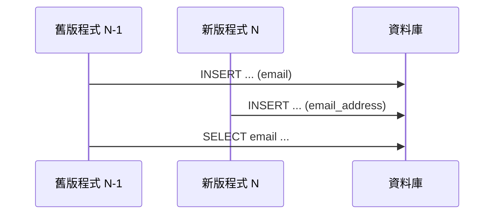

如果新版程式在部署時把欄位 `email` 改名為 `email_address`，還在執行的舊版程式立刻就會失敗；如果部署出問題要回復，回復後的舊版程式也找不到 `email` 欄位。同樣的情況發生在：

- 公開 API 的 JSON 欄位（呼叫端是其他團隊，不會和你同時部署）；
- 訊息佇列中的事件格式（佇列中可能還有用舊格式寫入、尚未被消費的訊息）；
- 快取中的序列化物件、批次檔案的格式。

| 編號 | 等級 | 規則 | 驗證方式 |
| --- | --- | --- | --- |
| `RFT-EVO-001` | 必須 | 資料庫結構、API 與訊息格式的變更，必須同時相容目前版本（N）與前一個版本（N-1）的程式，使滾動部署與回復都能正常運作 | 🧪 以 N-1 版程式對 N 版的資料庫結構執行整合測試；👁 審查遷移腳本 |

```text
✅ RFT-EVO-001：資料庫遷移的相容性檢查表（PR 範本的一部分）
[x] 這次的遷移腳本執行後，前一個版本的程式仍能讀寫（不刪除、不改名、不改型別）
[x] 這次的程式在遷移腳本執行「之前」也能啟動（或遷移在部署前執行且向下相容）
[x] 回復到前一版程式時，不需要回復資料庫
```

#### 🔍 12.1 審查與驗證

| 審查問題 | 如何確認 |
| --- | --- |
| 遷移腳本中有 `DROP`、`RENAME`、`ALTER TYPE`、`NOT NULL` 嗎？ | 這些都可能破壞 N-1 版程式；它們只能出現在「收縮」階段 |
| 前一版程式能在新結構上運作嗎？ | 在 CI 中以前一版的程式（或其整合測試）對新結構執行 |

### 12.2 擴充—遷移—收縮（Expand–Migrate–Contract）

Fowler 稱之為 **Parallel Change**：把一個不相容的變更拆成三個各自相容的階段。以「把 `customer.email` 改名為 `email_address`」為例：

| 階段 | 資料庫 | 程式 | 部署後的狀態 |
| --- | --- | --- | --- |
| **1. 擴充**（expand） | 新增 `email_address` 欄位；以觸發器讓兩個欄位雙向同步 | 不變（仍只讀寫 `email`） | 新舊欄位並存，任何一方寫入都會同步 |
| **2. 遷移**（migrate） | 分批回填既有資料 | 新版改為讀寫 `email_address` | 新舊版程式都能正常運作 |
| **3. 收縮**（contract） | 移除觸發器與 `email` 欄位 | 不變 | 確認沒有任何程式使用 `email` 後才執行 |

每個階段是**獨立的部署**，中間可以間隔數天，以確認沒有問題。

```sql
-- ✅ RFT-EVO-002：V7__expand_customer_email_address.sql——擴充：新增欄位並以觸發器雙向同步
ALTER TABLE customer ADD COLUMN email_address text;

CREATE OR REPLACE FUNCTION customer_sync_email() RETURNS trigger AS $$
BEGIN
    IF TG_OP = 'INSERT' THEN
        IF NEW.email_address IS NULL THEN
            NEW.email_address := NEW.email;
        ELSIF NEW.email IS NULL THEN
            NEW.email := NEW.email_address;
        END IF;
    ELSIF NEW.email IS DISTINCT FROM OLD.email
          AND NEW.email_address IS NOT DISTINCT FROM OLD.email_address THEN
        NEW.email_address := NEW.email;           -- 舊版程式只改了 email
    ELSIF NEW.email_address IS DISTINCT FROM OLD.email_address
          AND NEW.email IS NOT DISTINCT FROM OLD.email THEN
        NEW.email := NEW.email_address;           -- 新版程式只改了 email_address
    END IF;
    RETURN NEW;
END;
$$ LANGUAGE plpgsql;

CREATE TRIGGER customer_sync_email
    BEFORE INSERT OR UPDATE ON customer
    FOR EACH ROW EXECUTE FUNCTION customer_sync_email();
```

```sql
-- ✅ RFT-EVO-003：回填既有資料——分批、可重複執行（中斷後重跑只會處理尚未回填的資料）
-- 在交易區塊之外執行（例如以 psql 或排程作業執行），每批提交一次，避免長時間鎖定大表
DO $$
DECLARE
    updated integer;
BEGIN
    LOOP
        UPDATE customer
           SET email_address = email
         WHERE id IN (SELECT id FROM customer
                       WHERE email_address IS NULL AND email IS NOT NULL
                       ORDER BY id
                       LIMIT 1000);
        GET DIAGNOSTICS updated = ROW_COUNT;
        EXIT WHEN updated = 0;
        COMMIT;
    END LOOP;
END $$;

-- 驗證：兩個欄位不一致的筆數必須為 0
SELECT count(*) AS mismatched FROM customer WHERE email IS DISTINCT FROM email_address;
```

```sql
-- ✅ RFT-EVO-004：V9__contract_customer_email.sql——收縮：確認沒有任何程式讀寫 email 後才執行
DROP TRIGGER customer_sync_email ON customer;
DROP FUNCTION customer_sync_email();
ALTER TABLE customer DROP COLUMN email;
```

以 PostgreSQL 18 實際執行上述三個階段（2,500 筆既有資料，並模擬新舊版程式交錯寫入）的結果：

```text
✅ RFT-EVO-002、RFT-EVO-003、RFT-EVO-004：PostgreSQL 18 實測紀錄（節錄；完整紀錄見附錄 F.3）
擴充後 舊版只寫 email 的新增 → email_address 自動同步          OK
擴充後 新版只寫 email_address 的新增 → email 自動同步          OK
擴充後 舊版只改 email、新版只改 email_address 的修改           OK（雙向同步）
回填（執行兩次）                                                mismatched = 0
收縮後 舊版程式寫入 email                                       ERROR: column "email" of relation "customer" does not exist
```

最後一行正是收縮階段的風險：**收縮之後，舊版程式就無法運作了**。所以收縮前必須確認：所有執行中的程式都已是新版、回復計畫不需要回到使用 `email` 的版本、沒有報表或其他系統直接查詢 `email`。

| 編號 | 等級 | 規則 | 驗證方式 |
| --- | --- | --- | --- |
| `RFT-EVO-002` | 必須 | 資料表欄位的改名、搬移、拆分與型別變更，必須以擴充—遷移—收縮分成獨立部署的階段；擴充期間新舊欄位必須保持同步 | 🧪 在新舊版程式交錯寫入的情境下測試同步（附錄 F.3）；👁 審查遷移腳本 |
| `RFT-EVO-003` | 必須 | 資料回填必須分批提交並可重複執行，執行後必須以查詢確認新舊欄位的不一致筆數為零 | 🧪 回填執行兩次後驗證不一致筆數 |
| `RFT-EVO-004` | 必須 | 收縮階段必須在確認所有程式（含報表、批次與其他系統）都不再使用舊欄位，且回復計畫不需要舊欄位後才執行 | 🤖 資料庫的查詢紀錄（如 `pg_stat_statements`）中不再出現舊欄位；👁 部署檢查表 |

#### 🔍 12.2 審查與驗證

| 審查問題 | 如何確認 |
| --- | --- |
| 擴充與收縮在不同的部署中嗎？ | 遷移腳本的版本號與部署紀錄；同一個 PR 中同時出現 `ADD COLUMN` 與 `DROP COLUMN` 是警訊 |
| 同步邏輯涵蓋了新增與修改的所有組合嗎？ | 要求測試涵蓋：舊版新增、新版新增、舊版修改、新版修改 |
| 回填會鎖住大表嗎？ | 回填必須分批；大表的 `ALTER TABLE` 也要評估鎖定時間（例如新增有預設值的欄位） |

### 12.3 API 的演進

HTTP API 的重構原則和資料庫相同：**新增是相容的，刪除與改名不是。**

| 變更 | 相容嗎 | 做法 |
| --- | --- | --- |
| 新增回應欄位 | ✅（前提是呼叫端會忽略不認識的欄位） | 直接新增 |
| 新增選填的請求參數 | ✅ | 直接新增，並提供預設值 |
| 欄位改名 | ❌ | 新增新欄位，舊欄位保留並標示棄用，呼叫端移轉後再移除 |
| 刪除欄位或端點 | ❌ | 先棄用並公告停用日期，確認使用量為零後移除 |
| 改變欄位的型別或意義 | ❌ | 視為新欄位處理 |

棄用時，除了文件，還應該在 HTTP 回應中告訴呼叫端：

- `Deprecation` 標頭（[RFC 9745](https://www.rfc-editor.org/rfc/rfc9745)，2025）：表示資源已經或將會被棄用，值是一個日期。
- `Sunset` 標頭（[RFC 8594](https://www.rfc-editor.org/rfc/rfc8594)）：表示資源預計停止服務的時間。
- `Link` 標頭搭配 `rel="deprecation"`：指向說明文件。

```http
# ✅ RFT-EVO-005：遷移期間的回應——新舊欄位並存，標頭告知棄用時間、停用時間與說明文件
HTTP/1.1 200 OK
Content-Type: application/json
Deprecation: @1767225600
Sunset: Wed, 30 Jun 2027 23:59:59 GMT
Link: <https://api.example.com/docs/migrations/customer-email>; rel="deprecation"

{"id": 42, "name": "Acme", "email": "ops@acme.example", "emailAddress": "ops@acme.example"}
```

`Deprecation` 的值 `@1767225600` 是 RFC 9745 規定的結構化欄位日期格式（Unix 時間，此例為 2026-01-01T00:00:00Z）。

| 編號 | 等級 | 規則 | 驗證方式 |
| --- | --- | --- | --- |
| `RFT-EVO-005` | 應該 | 公開 API 的欄位改名或刪除，應先新增新欄位並保留舊欄位，以 `Deprecation`、`Sunset` 標頭與文件告知呼叫端；應在停用日期之後、且監控確認舊欄位或端點的使用量為零時才移除 | 🧪 契約測試同時驗證新舊欄位；🤖 API 閘道的使用量監控；🤖 OpenAPI 差異比對工具在 CI 中偵測破壞性變更 |

#### 🔍 12.3 審查與驗證

| 審查問題 | 如何確認 |
| --- | --- |
| 這次的 API 變更相容嗎？ | 以 OpenAPI 差異比對工具比較 PR 前後的 API 規格；或以 12.3 的表格逐項檢查 |
| 舊欄位的使用量是多少？ | 移除前查看 API 閘道或存取日誌的統計 |

### 12.4 事件與訊息格式的演進

事件格式的演進比 API 更需要小心：訊息可能在佇列或事件儲存中保存很久，消費者也可能很多、而且你不一定知道是誰。兩個原則：

1. **生產者只做相容的變更**：新增選填欄位；不刪除、不改名、不改型別。真的需要不相容的變更時，發布新的事件型別（例如 `OrderPlaced.v2`），兩個版本並存一段時間。
2. **消費者是寬容的讀者**（tolerant reader）：只讀取自己需要的欄位，忽略不認識的欄位；欄位缺少時使用合理的預設值。

```json
{
  "_comment": "❌ RFT-EVO-006：直接把 total 改名為 totalAmount 並改成字串——還沒升級的消費者全部失敗",
  "type": "OrderPlaced",
  "orderId": "O-1001",
  "totalAmount": "1200.00"
}
```

```json
{
  "_comment": "✅ RFT-EVO-006：新增欄位，保留舊欄位；消費者移轉完畢並且舊訊息都已消費後，才在新事件版本中移除 total",
  "type": "OrderPlaced",
  "orderId": "O-1001",
  "total": 1200,
  "totalAmount": "1200.00",
  "currency": "TWD"
}
```

| 編號 | 等級 | 規則 | 驗證方式 |
| --- | --- | --- | --- |
| `RFT-EVO-006` | 應該 | 事件與訊息格式的變更應只新增選填欄位；需要刪除、改名或改型別時，應發布新的事件版本並與舊版本並存；消費者應忽略不認識的欄位 | 🤖 結構登錄（schema registry）的相容性檢查（例如 BACKWARD／FULL）；🧪 消費者以新舊格式的訊息進行測試 |

#### 🔍 12.4 審查與驗證

| 審查問題 | 如何確認 |
| --- | --- |
| 佇列中的舊格式訊息還能被新版消費者處理嗎？ | 以舊格式的範例訊息執行新版消費者的測試 |
| 消費者會因為不認識的欄位而失敗嗎？ | JSON 反序列化設定是否忽略未知欄位（例如 Jackson 的 `FAIL_ON_UNKNOWN_PROPERTIES`） |

#### 📝 第 12 章重點

- 部署期間新舊版本同時執行，所以資料庫、API、訊息格式不能一次改名。
- 擴充—遷移—收縮：每個階段都是獨立且相容的部署。
- 回填要分批、可重複執行，並以查詢確認一致。
- 收縮前確認沒有任何人還在使用舊欄位；收縮後舊版程式就無法運作了。

#### ✏️ 第 12 章自我檢測

1. 為什麼擴充階段需要「雙向」同步？
2. 回填腳本為什麼要能重複執行？
3. 刪除一個公開 API 欄位前，需要確認哪些事情？

<details>
<summary>參考答案</summary>

1. 因為遷移階段新舊版程式同時執行：舊版只寫 `email`，新版只寫 `email_address`，兩邊寫入的資料都必須讓另一邊讀得到。
2. 大表的回填可能中途失敗或被中斷；可重複執行讓你直接重跑，只處理尚未回填的資料，不會覆蓋或重複處理已完成的部分。
3. 已發出棄用與停用公告（含 `Deprecation`／`Sunset` 標頭）、停用日期已過、監控顯示該欄位的使用量為零、文件已更新。

</details>

---

## 13. Java 現代化重構

> **🎯 學習目標**
>
> - 把版本升級與語法現代化分開處理。
> - 用 sealed 型別與模式比對 `switch`、`record`、Stream 管線改寫舊程式碼，並避開每一項的行為陷阱。
> - 用 OpenRewrite 進行大量的機械化現代化，並審查它產生的修補檔。

Java 從 8 到 25 增加了大量讓程式碼更簡潔的語法。用新語法改寫舊程式碼是很好的重構——但每一項新語法都有和舊寫法**語意不同**的地方，這也是 AI 最常出錯的地方。本章逐一列出。

### 13.1 現代化的原則

| 類型 | 例子 | 提交類型 |
| --- | --- | --- |
| **平台升級** | JDK 21 → 25、Spring Boot 3 → 4、JUnit 5 → 6 | `build`／`chore`（只做讓它能編譯、測試通過的必要修改） |
| **語法現代化** | `instanceof` 鏈 → 模式比對 `switch`；資料類別 → `record`；迴圈 → Stream | `refactor` |
| **API 現代化** | `Date` → `java.time`；`Optional` 的使用方式 | 視是否改變公開介面，`refactor` 或依 4.4 遷移 |

把三者混在同一個提交中，出問題時就無法判斷是升級造成的、還是改寫造成的。

| 編號 | 等級 | 規則 | 驗證方式 |
| --- | --- | --- | --- |
| `RFT-JAVA-001` | 必須 | JDK、框架或函式庫的版本升級必須與語法現代化分開提交；升級提交只包含讓建置與測試通過的必要修改 | 👁 逐提交審查；🤖 commitlint 檢查提交類型 |

```text
✅ RFT-JAVA-001：升級與現代化分開
3f1a2b0 build: 升級至 JDK 25（maven.compiler.release 21 → 25）
9c0d7e4 refactor(shape): instanceof 鏈改為模式比對 switch（13.2）
51e3a9b refactor(geo): Coordinates 改為 record（13.3）
```

#### 🔍 13.1 審查與驗證

| 審查問題 | 如何確認 |
| --- | --- |
| 升級提交中有沒有夾帶語法改寫？ | 升級提交的 diff 應該主要是建置檔與必要的 API 替換 |

### 13.2 sealed 型別與模式比對 switch

Java 21 的模式比對 `switch` 搭配 sealed 型別，可以取代冗長的 `instanceof` 鏈，而且編譯器會檢查是否涵蓋了所有子型別。但兩者對 `null` 的處理不同：**`instanceof` 遇到 `null` 回傳 `false`；`switch` 遇到 `null` 預設丟出 `NullPointerException`。**

```java
// ✅ 兩個版本共用的 sealed 型別
package com.example.rft.modern;

public sealed interface Shape permits Shape.Circle, Shape.Square, Shape.Rectangle {

    record Circle(double radius) implements Shape {
    }

    record Square(double side) implements Shape {
    }

    record Rectangle(double width, double height) implements Shape {
    }
}
```

```java
// ❌ RFT-JAVA-002：instanceof 鏈——新增 Shape 子型別時，編譯器不會提醒你更新這裡；null 會落到最後的 return 0
package com.example.rft.modern;

public class AreaCalculator {

    public double area(Shape shape) {
        if (shape instanceof Shape.Circle c) {
            return Math.PI * c.radius() * c.radius();
        } else if (shape instanceof Shape.Square s) {
            return s.side() * s.side();
        } else if (shape instanceof Shape.Rectangle r) {
            return r.width() * r.height();
        }
        return 0;
    }
}
```

```java
// ❌ AI 錯誤版：看起來是完美的現代化，但少了 case null——傳入 null 時從回傳 0 變成丟出 NullPointerException
package com.example.rft.modern;

public class AreaCalculator {

    public double area(Shape shape) {
        return switch (shape) {
            case Shape.Circle c -> Math.PI * c.radius() * c.radius();
            case Shape.Square s -> s.side() * s.side();
            case Shape.Rectangle r -> r.width() * r.height();
        };
    }
}
```

```java
// ✅ RFT-JAVA-002、RFT-JAVA-003：case null 保留原本的行為；沒有 default，新增子型別時編譯器會指出這裡
package com.example.rft.modern;

public class AreaCalculator {

    public double area(Shape shape) {
        return switch (shape) {
            case null -> 0;
            case Shape.Circle c -> Math.PI * c.radius() * c.radius();
            case Shape.Square s -> s.side() * s.side();
            case Shape.Rectangle r -> r.width() * r.height();
        };
    }
}
```

```java
// ✅ RFT-JAVA-002：null 的行為也要測
package com.example.rft.modern;

import static org.assertj.core.api.Assertions.assertThat;

import org.junit.jupiter.api.Test;

class AreaCalculatorTest {

    private final AreaCalculator calculator = new AreaCalculator();

    @Test
    void areaOfEachShape() {
        assertThat(calculator.area(new Shape.Circle(1))).isEqualTo(Math.PI);
        assertThat(calculator.area(new Shape.Square(3))).isEqualTo(9);
        assertThat(calculator.area(new Shape.Rectangle(2, 5))).isEqualTo(10);
    }

    @Test
    void nullShapeHasZeroArea() {
        assertThat(calculator.area(null)).isZero();
    }
}
```

| 編號 | 等級 | 規則 | 驗證方式 |
| --- | --- | --- | --- |
| `RFT-JAVA-002` | 必須 | 把 `instanceof` 鏈或傳統 `switch` 改為模式比對 `switch` 時，必須保留原本對 `null` 的處理（以 `case null` 明確表達）與原本落入預設分支的行為 | 🧪 包含 `null` 的測試；👁 審查 |
| `RFT-JAVA-003` | 應該 | 對 sealed 型別的 `switch` 應列出所有子型別而不使用 `default`，讓新增子型別時編譯器能指出所有需要更新的地方 | 🤖 編譯器的窮舉檢查；👁 審查 `default` 的使用 |

#### 🔍 13.2 審查與驗證

| 審查問題 | 如何確認 |
| --- | --- |
| 原本的程式在 `null` 時做什麼？ | `instanceof` 鏈遇到 `null` 會走到最後；舊式 `switch` 遇到 `null` 會丟 NPE——兩者不同，要分別處理 |
| 新的 `switch` 有 `default` 嗎？ | 對 sealed 型別有 `default`，就失去窮舉檢查的好處 |

### 13.3 以 record 取代資料類別

`record` 自動產生建構式、存取方法、`equals`、`hashCode` 與 `toString`，非常適合取代手寫的不可變資料類別。但它自動產生的東西**可能和你原本手寫的不同**：

| 項目 | 手寫類別常見的寫法 | `record` 的預設 | 風險 |
| --- | --- | --- | --- |
| 存取方法名稱 | `getLatitude()` | `latitude()` | 呼叫端、JSON 序列化、範本引擎找不到 getter |
| `toString()` | 自訂格式，例如 `(25.03, 121.56)` | `Coordinates[latitude=25.03, longitude=121.56]` | 日誌、畫面、檔案輸出的格式改變 |
| `equals`／`hashCode` | 可能只比較部分欄位 | 比較所有元件 | 放進 `Set` 或當 `Map` 鍵的行為改變 |
| 可變性 | 可能有 setter | 不可變 | 呼叫 setter 的程式無法編譯 |

```java
// ❌ RFT-JAVA-004：手寫的不可變資料類別——equals、hashCode、toString 都要自己維護
package com.example.rft.modern;

import java.util.Objects;

public final class Coordinates {

    private final double latitude;
    private final double longitude;

    public Coordinates(double latitude, double longitude) {
        this.latitude = latitude;
        this.longitude = longitude;
    }

    public double getLatitude() {
        return latitude;
    }

    public double getLongitude() {
        return longitude;
    }

    @Override
    public boolean equals(Object o) {
        return o instanceof Coordinates other
                && Double.compare(latitude, other.latitude) == 0
                && Double.compare(longitude, other.longitude) == 0;
    }

    @Override
    public int hashCode() {
        return Objects.hash(latitude, longitude);
    }

    @Override
    public String toString() {
        return "(" + latitude + ", " + longitude + ")";
    }
}
```

```java
// ❌ AI 錯誤版：最短的 record——toString 格式改變，getLatitude()／getLongitude() 也不見了
package com.example.rft.modern;

public record Coordinates(double latitude, double longitude) {

    public double getLatitude() {
        return latitude;
    }

    public double getLongitude() {
        return longitude;
    }
}
```

> 上面的 AI 錯誤版為了讓測試能編譯，保留了 `getLatitude()`／`getLongitude()`；實際上 AI 常常連這兩個方法都一起刪掉，讓呼叫端直接無法編譯。

```java
// ✅ RFT-JAVA-004：record 取代手寫類別；保留原本的存取方法名稱與 toString 格式
package com.example.rft.modern;

public record Coordinates(double latitude, double longitude) {

    public double getLatitude() {
        return latitude;
    }

    public double getLongitude() {
        return longitude;
    }

    @Override
    public String toString() {
        return "(" + latitude + ", " + longitude + ")";
    }
}
```

```java
// ✅ RFT-JAVA-004：相等性、雜湊與字串格式都是可觀察行為
package com.example.rft.modern;

import static org.assertj.core.api.Assertions.assertThat;

import java.util.Set;
import org.junit.jupiter.api.Test;

class CoordinatesTest {

    @Test
    void valueSemanticsAndFormat() {
        Coordinates taipei = new Coordinates(25.03, 121.56);
        assertThat(taipei).isEqualTo(new Coordinates(25.03, 121.56));
        assertThat(Set.of(taipei)).contains(new Coordinates(25.03, 121.56));
        assertThat(taipei.getLatitude()).isEqualTo(25.03);
        assertThat(taipei).hasToString("(25.03, 121.56)");
    }

    @Test
    void negativeZeroIsNotEqualToZero() {
        assertThat(new Coordinates(-0.0, 0)).isNotEqualTo(new Coordinates(0.0, 0));
    }
}
```

`negativeZeroIsNotEqualToZero` 鎖住了一個細節：原本的 `equals` 用 `Double.compare`，`-0.0` 與 `0.0` 不相等；`record` 的 `equals` 對 `double` 元件同樣使用 `Double.compare` 的語意，所以這裡行為一致。如果原本的手寫 `equals` 用的是 `==`（`-0.0 == 0.0` 為 `true`），改成 `record` 就會改變行為。

| 編號 | 等級 | 規則 | 驗證方式 |
| --- | --- | --- | --- |
| `RFT-JAVA-004` | 應該 | 不可變的資料載體應改用 `record`；改寫時必須保留原本的存取方法名稱、`toString` 格式與 `equals`／`hashCode` 語意（必要時明確覆寫），並以測試確認 | 🧪 相等性、雜湊與 `toString` 的測試；👁 審查 |

#### 🔍 13.3 審查與驗證

| 審查問題 | 如何確認 |
| --- | --- |
| 原本的 getter 還有人使用嗎？ | 搜尋 `getLatitude(`；JSON 序列化、Thymeleaf、JSP 等也可能以名稱使用 getter |
| `toString()` 的輸出被用在哪裡？ | 搜尋字串串接、日誌與檔案輸出；有使用的話要保留原格式 |
| 原本的 `equals` 比較了哪些欄位、怎麼比較？ | 逐一比對；只比較部分欄位、或用 `==` 比較 `double` 時，`record` 的預設行為不同 |

### 13.4 以管線取代迴圈（Replace Loop with Pipeline）

Stream 管線讓「篩選、轉換、彙總」一目了然，但它和迴圈之間有許多細微的差異：

| 陷阱 | 迴圈的行為 | 常見的管線寫法 | 差異 |
| --- | --- | --- | --- |
| 回傳清單的可修改性 | `new ArrayList<>()` 可以修改 | `.toList()` | **不可修改**，呼叫端 `add()` 會丟出 `UnsupportedOperationException` |
| `null` 元素 | `ArrayList` 允許 | `Collectors.toUnmodifiableList()`、`List.copyOf()` | 遇到 `null` 丟出 NPE（`Stream.toList()` 則允許） |
| 數值溢位 | `int sum` 會溢位 | `mapToLong(...).sum()`、`IntStream.average()` | 不會溢位，結果不同 |
| 執行順序與次數 | 依序、每個元素一次 | `parallel()`、`peek()`、短路運算 | 平行時順序不定；`peek` 不保證執行 |
| 例外發生的時機 | 處理到該元素時 | 延遲求值 | 例外可能在終端操作時才發生 |
| `Map` 的重複鍵 | `put` 後者覆蓋前者 | `Collectors.toMap()` | 預設遇到重複鍵**丟出例外** |

```java
// ❌ RFT-JAVA-005：迴圈收集台灣辦公室的城市
package com.example.rft.modern;

import java.util.ArrayList;
import java.util.List;

public class OfficeDirectory {

    public record Office(String city, String country) {
    }

    public List<String> taiwanCities(List<Office> offices) {
        List<String> result = new ArrayList<>();
        for (Office office : offices) {
            if (office.country().equals("Taiwan")) {
                result.add(office.city());
            }
        }
        return result;
    }
}
```

```java
// ❌ AI 錯誤版：.toList() 讓回傳的清單變成不可修改——依賴「可以再加入元素」的呼叫端會失敗
package com.example.rft.modern;

import java.util.List;

public class OfficeDirectory {

    public record Office(String city, String country) {
    }

    public List<String> taiwanCities(List<Office> offices) {
        return offices.stream()
                .filter(office -> office.country().equals("Taiwan"))
                .map(Office::city)
                .toList();
    }
}
```

```java
// ✅ RFT-JAVA-005：明確收集成 ArrayList，保留可修改性與 null 元素的處理
package com.example.rft.modern;

import java.util.ArrayList;
import java.util.List;
import java.util.stream.Collectors;

public class OfficeDirectory {

    public record Office(String city, String country) {
    }

    public List<String> taiwanCities(List<Office> offices) {
        return offices.stream()
                .filter(office -> office.country().equals("Taiwan"))
                .map(Office::city)
                .collect(Collectors.toCollection(ArrayList::new));
    }
}
```

```java
// ✅ RFT-JAVA-005：順序、null 城市、可修改性都要測
package com.example.rft.modern;

import static org.assertj.core.api.Assertions.assertThat;

import com.example.rft.modern.OfficeDirectory.Office;
import java.util.List;
import org.junit.jupiter.api.Test;

class OfficeDirectoryTest {

    private final OfficeDirectory directory = new OfficeDirectory();
    private final List<Office> offices = List.of(new Office("Taipei", "Taiwan"), new Office("Tokyo", "Japan"),
            new Office(null, "Taiwan"), new Office("Kaohsiung", "Taiwan"));

    @Test
    void keepsOrderAndNullCities() {
        assertThat(directory.taiwanCities(offices)).containsExactly("Taipei", null, "Kaohsiung");
    }

    @Test
    void callersMayAppendToTheResult() {
        List<String> cities = directory.taiwanCities(offices);
        cities.add("Taichung");
        assertThat(cities).hasSize(4);
    }
}
```

| 編號 | 等級 | 規則 | 驗證方式 |
| --- | --- | --- | --- |
| `RFT-JAVA-005` | 必須 | 以管線取代迴圈時，必須保留結果集合的可修改性與 `null` 元素的處理、元素順序、數值型別（溢位行為）、重複鍵的處理與例外發生的時機；重構中不得加入 `parallel()` | 🧪 包含 `null`、重複與可修改性的測試；👁 依 13.4 的陷阱表審查 |

#### 🔍 13.4 審查與驗證

| 審查問題 | 如何確認 |
| --- | --- |
| 原本回傳的集合可以修改嗎？ | 原本是 `new ArrayList<>()` 的，不能改成 `.toList()`；用 `Collectors.toCollection(ArrayList::new)` |
| 有 `Collectors.toMap()` 嗎？ | 原本的迴圈若允許重複鍵（後者覆蓋），要提供合併函式 `(a, b) -> b` |
| 數值累加的型別相同嗎？ | `int` 迴圈改成 `mapToLong` 或 `average()` 會改變溢位行為 |

### 13.5 Optional 的使用

`Optional` 是為了**回傳值**設計的，讓呼叫端明確處理「可能沒有值」。常見的誤用：

```java
// ❌ RFT-JAVA-006：Optional 作為欄位與參數——增加包裝成本，也沒有讓 null 消失（片段）
private Optional<String> nickname;
public void rename(Optional<String> newName) { ... }

// ✅ RFT-JAVA-006：欄位與參數用可為 null 的型別（或多載）；只有回傳值使用 Optional（片段）
private String nickname;                       // 可能為 null，存取方法負責包裝
public Optional<String> nickname() { return Optional.ofNullable(nickname); }
```

（片段）

> ⚠️ 把既有的公開方法從「回傳 `null`」改成「回傳 `Optional`」，是**改變公開介面**：所有呼叫端都要修改。這要依 4.4 的遷移式做法進行（新增回傳 `Optional` 的新方法、舊方法棄用），而不是直接改掉回傳型別。

| 編號 | 等級 | 規則 | 驗證方式 |
| --- | --- | --- | --- |
| `RFT-JAVA-006` | 不應該 | 不應以 `Optional` 作為欄位、方法參數或集合元素的型別；把既有公開方法的回傳型別改為 `Optional` 時，必須依遷移式做法進行 | 🤖 SonarQube `java:S3553`（Optional 參數）、IntelliJ Inspection「Optional used as field or parameter type」；👁 審查 |

#### 🔍 13.5 審查與驗證

| 審查問題 | 如何確認 |
| --- | --- |
| 公開方法的回傳型別改成了 `Optional` 嗎？ | 這是公開介面變更，檢查是否有遷移計畫 |
| 有沒有 `optional.get()` 而沒有先檢查？ | 搜尋 `.get()`；應改用 `orElse`、`orElseThrow`、`map` 等 |

### 13.6 文字區塊與其他語法

| 語法 | 版本 | 用途 | 陷阱 |
| --- | --- | --- | --- |
| 文字區塊 `"""` | 15 | 多行字串 | 結尾的 `"""` 另起一行時，字串**多一個換行**；縮排依最左邊的行計算 |
| `var` | 10 | 區域變數型別推論 | 推論出的型別可能比你想的更具體（例如 `ArrayList` 而非 `List`），影響之後的多型呼叫 |
| `switch` 運算式 | 14 | 以運算式取代多個 `case` 的指派 | 舊式 `switch` 的 fall-through 行為不會保留 |
| 無名變數 `_` | 22 | 不使用的變數 | 需要 Java 22 以上 |
| 序列化集合 `getFirst()` | 21 | 取第一個元素 | `List.getFirst()` 對空清單丟出 `NoSuchElementException`，而 `list.get(0)` 丟出 `IndexOutOfBoundsException`——例外型別不同 |

```java
// ❌ RFT-JAVA-007：AI 把字串串接改成文字區塊——結尾多了一個換行，SQL 比對、雜湊、簽章都會不同（片段）
String sql = "SELECT id, name\n" +
             "FROM customer";
String sql = """
        SELECT id, name
        FROM customer
        """;                                   // 等於 "SELECT id, name\nFROM customer\n"

// ✅ RFT-JAVA-007：結尾的 """ 接在最後一行之後，字串內容與原本完全相同（片段）
String sql = """
        SELECT id, name
        FROM customer""";
```

（片段）

| 編號 | 等級 | 規則 | 驗證方式 |
| --- | --- | --- | --- |
| `RFT-JAVA-007` | 必須 | 把字串串接改為文字區塊、或以新語法改寫既有程式碼時，必須確認結果完全相同：文字區塊的結尾換行與縮排、`switch` 的 fall-through、`getFirst()` 等新 API 的例外型別 | 🧪 以 `isEqualTo` 比對完整字串的測試；👁 依 13.6 的陷阱表審查 |

#### 🔍 13.6 審查與驗證

| 審查問題 | 如何確認 |
| --- | --- |
| 文字區塊的結尾換行與原本一致嗎？ | 看結尾的 `"""` 是否另起一行；有疑問時寫一個比對完整字串的測試 |
| 新 API 的例外型別和原本相同嗎？ | 有捕捉特定例外型別的呼叫端時要特別注意 |

### 13.7 用 OpenRewrite 自動化現代化

[OpenRewrite](https://docs.openrewrite.org/) 以「食譜」（recipe）對整個程式碼庫進行語意層級的自動修改，適合大量、機械化的現代化（升級框架版本、替換棄用 API、套用新語法）。它比文字取代可靠，但**食譜不一定保證行為不變**。

下面是一個實測的例子。`ReplaceStreamCollectWithToList` 食譜把 `collect(Collectors.toUnmodifiableList())` 改為 `toList()`。在預設設定下，它**不會**改動 `Collectors.toList()`——因為那會讓可修改的清單變成不可修改：

```bash
# ✅ RFT-JAVA-008：先 dryRun 產生修補檔審查，不直接修改程式碼（不需要修改 pom.xml）
mvn org.openrewrite.maven:rewrite-maven-plugin:6.46.1:dryRun \
  -Drewrite.recipeArtifactCoordinates=org.openrewrite.recipe:rewrite-migrate-java:3.42.1 \
  -Drewrite.activeRecipes=org.openrewrite.java.migrate.util.ReplaceStreamCollectWithToList
# 修補檔位於 target/rewrite/rewrite.patch
```

```text
✅ RFT-JAVA-008：預設設定的實際修補檔（只改了 toUnmodifiableList）
     public List<String> unmodifiableNames(List<String> names) {
-        return names.stream().filter(n -> !n.isBlank()).collect(Collectors.toUnmodifiableList());
+        return names.stream().filter(n -> !n.isBlank()).toList();
     }
```

但即使是這個「安全」的改寫，也有一個細微的差異：`toUnmodifiableList()` 遇到 `null` 元素會丟出 NPE，`Stream.toList()` 則允許 `null`。

如果有人在團隊的食譜中開啟了 `convertToList` 選項，可修改的清單也會被改掉：

```yaml
# ❌ RFT-JAVA-008：rewrite.yml——開啟 convertToList 會把 Collectors.toList()（可修改）也改為 toList()（不可修改）
type: specs.openrewrite.org/v1beta/recipe
name: com.example.rft.ModernizeCollectors
displayName: 將 collect(...) 改為 Stream.toList()（含可修改清單）
recipeList:
  - org.openrewrite.java.migrate.util.ReplaceStreamCollectWithToList:
      convertToList: true
```

```text
❌ RFT-JAVA-008：開啟 convertToList 後的實際修補檔——mutableNames() 的回傳值變成不可修改
     public List<String> mutableNames(List<String> names) {
-        return names.stream().filter(n -> !n.isBlank()).collect(Collectors.toList());
+        return names.stream().filter(n -> !n.isBlank()).toList();
     }
```

這說明了使用自動化工具的原則：**工具負責「改得一致」，人負責「確認語意」**。每一個食譜都要讀它的說明與選項，修補檔要經過審查，並且以完整的測試驗證。

| 編號 | 等級 | 規則 | 驗證方式 |
| --- | --- | --- | --- |
| `RFT-JAVA-008` | 應該 | 大量的機械化現代化應使用 OpenRewrite 等語意層級的工具，先以 `dryRun` 產生修補檔審查，並以獨立提交套用；必須確認每個食譜及其選項的語意，不得假設食譜一定保持行為不變 | 🤖 `rewrite:dryRun` 修補檔；🧪 套用後執行完整測試；👁 審查修補檔 |

#### 🔍 13.7 審查與驗證

| 審查問題 | 如何確認 |
| --- | --- |
| 使用了哪些食譜與選項？ | `rewrite.yml` 或指令中的 `activeRecipes`；閱讀每個食譜的文件 |
| 自動修改與人工修改混在一起嗎？ | 食譜的修改應該是獨立的提交，提交訊息寫明食譜名稱 |

#### 📝 第 13 章重點

- 版本升級與語法現代化分開提交。
- 模式比對 `switch` 對 `null` 的處理與 `instanceof` 不同；用 `case null` 保留行為。
- `record` 的存取方法名稱、`toString`、`equals` 可能和原本不同。
- `.toList()` 回傳不可修改的清單；`toMap()` 遇到重複鍵會丟例外。
- 自動化工具負責一致，人負責語意；食譜的修補檔一定要審查。

#### ✏️ 第 13 章自我檢測

1. 把 `if (x instanceof A a) {...} else if (x instanceof B b) {...} else { return -1; }` 改成模式比對 `switch`，需要注意什麼？
2. 一個回傳 `List<String>` 的公開方法，把 `Collectors.toList()` 改成 `.toList()`，是不是重構？
3. 為什麼文字區塊可能讓 SQL 字串的內容改變？

<details>
<summary>參考答案</summary>

1. 原本 `x` 為 `null` 時會走到 `else` 回傳 `-1`；`switch` 預設會丟 NPE，要加上 `case null -> -1`。原本落入 `else` 的其他型別要以 `default -> -1` 保留（若 `x` 的型別不是 sealed）。
2. 不一定。若有呼叫端修改回傳的清單，或清單中可能有 `null`（`toList()` 允許、但呼叫端的行為可能依賴可修改性），它就改變了行為。要先確認所有呼叫端，否則應使用 `Collectors.toCollection(ArrayList::new)`。
3. 結尾的 `"""` 另起一行時，字串最後會多一個換行；縮排的計算也可能讓行首空白改變。

</details>

---

## 14. 前端 TypeScript 重構

> **🎯 學習目標**
>
> - 以 TypeScript 的型別系統作為重構的第一道安全網。
> - 用可辨識聯集（discriminated union）取代型別碼與選填欄位的組合。
> - 認出 `||` 與 `??`、`&&` 與 `?.`、Promise 鏈與 `async`／`await` 之間的語意差異。
> - 以 codemod 安全地進行跨檔案的大量修改。

前面各章的原則同樣適用於前端：小步、測試、行為不變。本章聚焦在 TypeScript／JavaScript 特有的陷阱——許多看似等價的語法，在 `0`、`''`、`null`、同步例外等情況下行為不同。

### 14.1 TypeScript 重構的安全網

TypeScript 的型別檢查是重構最便宜的安全網：改名、搬移、改變函式簽章後，`tsc` 會指出所有不一致的地方。但要讓它可靠，必須開啟嚴格模式：

```json
{
  "_comment": "✅ RFT-FE-001：tsconfig.json——嚴格模式是 TypeScript 重構的前提",
  "compilerOptions": {
    "target": "ES2022",
    "module": "ESNext",
    "moduleResolution": "Bundler",
    "strict": true,
    "noUncheckedIndexedAccess": true,
    "noImplicitOverride": true,
    "noEmit": true,
    "skipLibCheck": true
  },
  "include": ["src"]
}
```

```bash
# ✅ RFT-FE-001：重構的每一步都執行型別檢查、lint 與測試
npx tsc -p tsconfig.json
npx eslint src
npx vitest run
```

> 💡 **TypeScript 7**：以 Go 重寫的原生編譯器 TypeScript 7 已發布（npm 上的 `typescript` 最新版為 7.0.x），型別檢查速度大幅提升，非常適合重構時頻繁執行。但查證時 typescript-eslint 8.71.2 支援的 TypeScript 版本仍為 `>=4.8.4 <6.1.0`，因此本章以 TypeScript 6.0.2 為基準執行 lint，並另以 TypeScript 7.0.2 的 `tsc` 驗證型別檢查（附錄 F.3）。

| 編號 | 等級 | 規則 | 驗證方式 |
| --- | --- | --- | --- |
| `RFT-FE-001` | 必須 | TypeScript 專案必須開啟 `strict` 模式，重構的每一步都必須通過型別檢查、lint 與測試；不得以 `any`、`@ts-ignore` 或非空斷言 `!` 讓型別錯誤「消失」 | 🤖 `tsc`、ESLint `@typescript-eslint/no-explicit-any`、`ban-ts-comment`；🧪 Vitest |

#### 🔍 14.1 審查與驗證

| 審查問題 | 如何確認 |
| --- | --- |
| 重構中新增了 `any`、`@ts-ignore`、`!` 嗎？ | ESLint 規則與 diff 搜尋 |
| 型別變更會影響執行期行為嗎？ | 純型別的修改（`interface`、型別註記）不影響輸出的 JavaScript；但伴隨的執行期檢查（型別守衛）會影響，要有測試 |

### 14.2 以可辨識聯集取代型別碼

一個 `kind: string` 加上一堆選填欄位的介面，讓「哪些欄位在哪種情況下存在」只存在於開發者的腦中。可辨識聯集把它寫進型別系統：

```typescript
// ❌ RFT-FE-002：src/bad/payment/fee.ts——kind 可以是任何字串，cardFeeRate 和 transferFee 是否存在要靠記憶
export interface Payment {
  kind: string;
  amount: number;
  cardFeeRate?: number;
  transferFee?: number;
}

export function feeOf(payment: Payment): number {
  if (payment.kind === 'card') {
    return Math.round(payment.amount * (payment.cardFeeRate ?? 0.02));
  }
  if (payment.kind === 'transfer') {
    return payment.transferFee ?? 15;
  }
  if (payment.kind === 'cash') {
    return 0;
  }
  throw new Error(`unknown payment kind: ${payment.kind}`);
}
```

```typescript
// ✅ RFT-FE-002：src/good/payment/fee.ts——每種付款方式的欄位由型別決定；新增 kind 時編譯器會指出未處理的 switch
export type Payment =
  | { kind: 'card'; amount: number; cardFeeRate?: number }
  | { kind: 'transfer'; amount: number; transferFee?: number }
  | { kind: 'cash'; amount: number };

export function feeOf(payment: Payment): number {
  switch (payment.kind) {
    case 'card':
      return Math.round(payment.amount * (payment.cardFeeRate ?? 0.02));
    case 'transfer':
      return payment.transferFee ?? 15;
    case 'cash':
      return 0;
    default:
      return unknownKind(payment);
  }
}

function unknownKind(payment: never): never {
  throw new Error(`unknown payment kind: ${(payment as { kind: string }).kind}`);
}
```

```typescript
// ✅ RFT-FE-002：src/good/payment/fee.test.ts——同一個測試檔在重構前後都執行；執行期收到未知 kind 時的錯誤訊息也要相同
import { describe, expect, it } from 'vitest';
import { feeOf, type Payment } from './fee';

describe('feeOf', () => {
  it('依付款方式計算手續費', () => {
    expect(feeOf({ kind: 'card', amount: 1000 })).toBe(20);
    expect(feeOf({ kind: 'card', amount: 1000, cardFeeRate: 0.015 })).toBe(15);
    expect(feeOf({ kind: 'transfer', amount: 1000 })).toBe(15);
    expect(feeOf({ kind: 'transfer', amount: 1000, transferFee: 0 })).toBe(0);
    expect(feeOf({ kind: 'cash', amount: 1000 })).toBe(0);
  });

  it('執行期收到未知的 kind 時丟出相同的錯誤', () => {
    const fromServer = { kind: 'crypto', amount: 1 } as unknown as Payment;
    expect(() => feeOf(fromServer)).toThrow('unknown payment kind: crypto');
  });
});
```

注意 `transferFee: 0` 的測試：原本用的是 `??`，`0` 會被保留；若有人「順手」改成 `||`，手續費 0 就會變成 15（見 14.3）。

| 編號 | 等級 | 規則 | 驗證方式 |
| --- | --- | --- | --- |
| `RFT-FE-002` | 應該 | 以字串型別碼搭配選填欄位表達多種情況的型別，應改為可辨識聯集，並在 `switch` 的 `default` 以 `never` 型別做窮舉檢查；執行期收到未知值時的行為必須與原本相同 | 🤖 `tsc` 窮舉檢查；🧪 包含未知值的測試 |

#### 🔍 14.2 審查與驗證

| 審查問題 | 如何確認 |
| --- | --- |
| 資料來自伺服器時，執行期會收到型別以外的值嗎？ | 型別只在編譯期有效；外部資料仍可能有未知的 `kind`，要保留執行期的處理 |
| 每個 `switch` 都有窮舉檢查嗎？ | `default` 分支呼叫接受 `never` 的函式 |

### 14.3 `||` 與 `??`、`&&` 與 `?.` 的差異

這是 AI 與人在 JavaScript／TypeScript 重構中**最常犯的錯誤**之一：把 `||` 「現代化」成 `??`，或把 `a && a.b` 改成 `a?.b`。它們只在部分輸入下等價：

| 寫法 | `null`／`undefined` | `0`、`''`、`false`、`NaN` |
| --- | --- | --- |
| `x \|\| fallback` | 使用 fallback | **使用 fallback** |
| `x ?? fallback` | 使用 fallback | **保留 x** |
| `a && a.b` | 回傳 `a`（`null`／`undefined`） | **回傳 `a` 本身**（例如 `0`、`''`） |
| `a?.b` | 回傳 `undefined` | 讀取 `a.b`（例如 `''.length` 為 `0`） |

```typescript
// ❌ RFT-FE-003：src/bad/user/displayName.ts——原本的程式：空字串的暱稱視為沒有暱稱
export interface User {
  name: string;
  nickname?: string | null;
}

export function displayName(user: User): string {
  return user.nickname || user.name;
}
```

```typescript
// ❌ AI 錯誤版：src/ai/user/displayName.ts——「改用更安全的 ??」，暱稱為空字串時顯示空白
export interface User {
  name: string;
  nickname?: string | null;
}

export function displayName(user: User): string {
  return user.nickname ?? user.name;
}
```

```typescript
// ✅ RFT-FE-003：src/good/user/displayName.ts——保留 || 並把意圖寫成名稱，讓下一個人（或 AI）不會「修正」它
export interface User {
  name: string;
  nickname?: string | null;
}

export function displayName(user: User): string {
  return nicknameOrNothing(user) || user.name;
}

/** 空字串的暱稱視為「沒有暱稱」，所以呼叫端刻意使用 ||，不可改為 ??。 */
function nicknameOrNothing(user: User): string | null | undefined {
  return user.nickname;
}
```

```typescript
// ✅ RFT-FE-003：src/good/user/displayName.test.ts——空字串才是會出錯的輸入
import { expect, it } from 'vitest';
import { displayName } from './displayName';

it('沒有暱稱、暱稱為 null 或空字串時顯示姓名', () => {
  expect(displayName({ name: '王小明' })).toBe('王小明');
  expect(displayName({ name: '王小明', nickname: null })).toBe('王小明');
  expect(displayName({ name: '王小明', nickname: '' })).toBe('王小明');
  expect(displayName({ name: '王小明', nickname: '小明' })).toBe('小明');
});
```

| 編號 | 等級 | 規則 | 驗證方式 |
| --- | --- | --- | --- |
| `RFT-FE-003` | 必須 | `\|\|` 與 `??`、`a && a.b` 與 `a?.b` 之間的轉換必須視為行為變更，除非能證明輸入不可能是 `0`、`''`、`false` 或 `NaN`；轉換時必須以這些值撰寫測試 | 🧪 以 falsy 值撰寫的測試；🤖 typescript-eslint `prefer-nullish-coalescing` 的建議必須逐一人工確認 |

#### 🔍 14.3 審查與驗證

| 審查問題 | 如何確認 |
| --- | --- |
| diff 中有 `\|\|` 被改成 `??`，或 `&&` 被改成 `?.` 嗎？ | 搜尋 diff；每一處都要確認輸入的可能值 |
| 有 `0`、`''` 的測試嗎？ | 數量、金額、索引可能是 `0`；名稱、代碼可能是 `''` |

### 14.4 Promise 鏈改寫為 async／await

`async`／`await` 讓非同步程式碼讀起來像同步程式碼，但有兩個語意差異需要注意：

1. **`try` 區塊中沒有 `await` 的 Promise，它的失敗不會被 `catch` 捕捉。** `return somePromise` 在 `try` 中時，Promise 失敗會直接傳給呼叫端。
2. **同步例外的處理不同。** 一般函式中同步丟出的例外會直接傳給呼叫端；`async` 函式中的同步例外會變成被拒絕（rejected）的 Promise，並且會被函式內的 `try`／`catch` 捕捉。

```typescript
// ❌ RFT-FE-004：src/bad/profile/loadProfile.ts——巢狀的 then，任何一步失敗都回傳 'unavailable'
export interface ProfileApi {
  fetchUser(id: string): Promise<{ id: string; name: string }>;
  fetchOrders(userId: string): Promise<number[]>;
}

export function loadProfile(api: ProfileApi, id: string): Promise<string> {
  return api
    .fetchUser(id)
    .then((user) => api.fetchOrders(user.id).then((orders) => `${user.name}:${orders.length}`))
    .catch(() => 'unavailable');
}
```

```typescript
// ❌ AI 錯誤版：src/ai/profile/loadProfile.ts——第二個呼叫沒有 await 就 return，它的失敗逃過了 catch
export interface ProfileApi {
  fetchUser(id: string): Promise<{ id: string; name: string }>;
  fetchOrders(userId: string): Promise<number[]>;
}

export async function loadProfile(api: ProfileApi, id: string): Promise<string> {
  try {
    const user = await api.fetchUser(id);
    return api.fetchOrders(user.id).then((orders) => `${user.name}:${orders.length}`);
  } catch {
    return 'unavailable';
  }
}
```

```typescript
// ✅ RFT-FE-004：src/good/profile/loadProfile.ts——所有非同步呼叫都在 try 中 await
export interface ProfileApi {
  fetchUser(id: string): Promise<{ id: string; name: string }>;
  fetchOrders(userId: string): Promise<number[]>;
}

export async function loadProfile(api: ProfileApi, id: string): Promise<string> {
  try {
    const user = await api.fetchUser(id);
    const orders = await api.fetchOrders(user.id);
    return `${user.name}:${orders.length}`;
  } catch {
    return 'unavailable';
  }
}
```

```typescript
// ✅ RFT-FE-004：src/good/profile/loadProfile.test.ts——兩個呼叫各自失敗的情況都要測
import { describe, expect, it } from 'vitest';
import { loadProfile, type ProfileApi } from './loadProfile';

const user = { id: 'u1', name: 'Ann' };

function api(overrides: Partial<ProfileApi> = {}): ProfileApi {
  return {
    fetchUser: () => Promise.resolve(user),
    fetchOrders: () => Promise.resolve([101, 102]),
    ...overrides,
  };
}

describe('loadProfile', () => {
  it('組合使用者名稱與訂單數', async () => {
    await expect(loadProfile(api(), 'u1')).resolves.toBe('Ann:2');
  });

  it('取得使用者失敗時回傳 unavailable', async () => {
    const failing = api({ fetchUser: () => Promise.reject(new Error('503')) });
    await expect(loadProfile(failing, 'u1')).resolves.toBe('unavailable');
  });

  it('取得訂單失敗時也回傳 unavailable', async () => {
    const failing = api({ fetchOrders: () => Promise.reject(new Error('timeout')) });
    await expect(loadProfile(failing, 'u1')).resolves.toBe('unavailable');
  });
});
```

**還有一個差異測試沒有涵蓋：** 如果 `api.fetchUser()` 不是回傳被拒絕的 Promise，而是**同步丟出**例外（例如參數驗證失敗時直接 `throw`），原本的 `loadProfile` 會同步丟出例外給呼叫端；`async` 版本則會捕捉它並回傳 `'unavailable'`。如果 `ProfileApi` 的實作保證只回傳 Promise（多數 HTTP 用戶端如此），這個差異不會發生；否則就要在 PR 中說明並確認呼叫端可以接受。

| 編號 | 等級 | 規則 | 驗證方式 |
| --- | --- | --- | --- |
| `RFT-FE-004` | 必須 | 把 Promise 鏈改寫為 `async`／`await` 時，原本由 `.catch` 處理的每一個非同步呼叫都必須在 `try` 中被 `await`；必須確認相依的函式是否可能同步丟出例外，並評估其處理方式的改變 | 🧪 每個非同步呼叫各自失敗的測試；🤖 typescript-eslint `return-await`（`in-try-catch`）、`no-floating-promises` |

#### 🔍 14.4 審查與驗證

| 審查問題 | 如何確認 |
| --- | --- |
| `try` 中有沒有沒 `await` 就 `return` 的 Promise？ | typescript-eslint 的 `return-await` 規則（`in-try-catch` 模式）會要求加上 `await` |
| 錯誤處理的範圍和原本相同嗎？ | 原本 `.catch` 的位置決定了它涵蓋哪些步驟；`try` 的範圍要和它一致 |

### 14.5 以 unknown 取代 any

`any` 關掉了型別檢查，是 TypeScript 重構的最大障礙：編譯器無法告訴你改名或搬移後哪裡壞了。把 `any` 改成 `unknown` 並加上型別收斂（narrowing），讓編譯器重新開始工作。

但要小心：**加入的執行期檢查可能改變行為**。下面的 `any` 版本在 `payload` 為 `null` 時會丟出 `TypeError`；如果改寫時加入 `payload !== null` 的檢查，就變成回傳 `0`——這是行為變更。

```typescript
// ❌ RFT-FE-005：src/bad/payload/amount.ts——any 讓編譯器無法幫忙
/* eslint-disable @typescript-eslint/no-explicit-any */
export function amountOf(payload: any): number {
  return typeof payload.amount === 'number' ? payload.amount : 0;
}
```

```typescript
// ✅ RFT-FE-005：src/good/payload/amount.ts——參數改為 unknown；屬性存取方式不變，null／undefined 時同樣丟出 TypeError
export function amountOf(payload: unknown): number {
  const amount = (payload as { amount?: unknown }).amount;
  return typeof amount === 'number' ? amount : 0;
}
```

```typescript
// ✅ RFT-FE-005：src/good/payload/amount.test.ts——無效輸入的行為也鎖住
import { expect, it } from 'vitest';
import { amountOf } from './amount';

it('只接受數字型別的 amount', () => {
  expect(amountOf({ amount: 120 })).toBe(120);
  expect(amountOf({ amount: '120' })).toBe(0);
  expect(amountOf('text')).toBe(0);
});

it('payload 為 null 時與原本一樣丟出 TypeError', () => {
  expect(() => amountOf(null)).toThrow(TypeError);
});
```

如果團隊希望 `null` 時回傳 `0`，那是一個需求變更：先提交上面的重構，再以 `fix` 提交加入 `null` 檢查並修改測試。

| 編號 | 等級 | 規則 | 驗證方式 |
| --- | --- | --- | --- |
| `RFT-FE-005` | 應該 | `any` 應改為 `unknown` 並以型別收斂處理；改寫時必須保持無效輸入（`null`、`undefined`、錯誤型別）的執行期行為，加入新的執行期檢查須另以 `fix` 處理 | 🤖 ESLint `@typescript-eslint/no-explicit-any`；🧪 無效輸入的測試 |

#### 🔍 14.5 審查與驗證

| 審查問題 | 如何確認 |
| --- | --- |
| 型別守衛有沒有改變無效輸入的結果？ | 列出原本對 `null`、`undefined`、錯誤型別的行為，逐一寫成測試 |
| `as` 斷言是否只是把 `any` 換個名字？ | `as` 只應出現在已知安全、且和原本行為一致的地方，並加上註解 |

### 14.6 以 codemod 進行大量修改

跨越數十、數百個檔案的修改（例如改名一個被廣泛匯入的函式），在 IDE 中做容易遺漏，用文字取代又容易誤改。**codemod** 是操作語法樹的程式，修改既精準又可以重複執行。TypeScript 專案常用 [ts-morph](https://ts-morph.com/)：

```javascript
// ✅ RFT-FE-006：codemods/rename-export.mjs——把匯出的函式改名，並同步更新所有匯入與呼叫
// 用法：node codemods/rename-export.mjs src/api/userApi.ts fetchUser loadUser
import { Project } from 'ts-morph';

const [file, from, to] = process.argv.slice(2);
const project = new Project({ tsConfigFilePath: 'tsconfig.json' });
const fn = project.getSourceFileOrThrow(file).getFunctionOrThrow(from);
fn.rename(to);
await project.save();
const changed = project.getSourceFiles().filter((f) => f.getFullText().includes(to));
console.log(`renamed ${from} -> ${to} in ${changed.length} files`);
```

執行後以 `tsc`、測試與 `git diff --stat` 檢查結果，並以獨立提交合併（提交訊息寫明執行的 codemod 與參數）。

| 編號 | 等級 | 規則 | 驗證方式 |
| --- | --- | --- | --- |
| `RFT-FE-006` | 應該 | 跨越多個檔案的機械化修改應以 codemod（如 ts-morph）或 IDE 的語意重構進行，不應使用文字取代；codemod 的修改應為獨立提交，並以型別檢查與測試驗證 | 🤖 `tsc`、Vitest；👁 審查 `git diff --stat` 與抽樣檔案 |

#### 🔍 14.6 審查與驗證

| 審查問題 | 如何確認 |
| --- | --- |
| codemod 的修改與人工修改分開了嗎？ | 提交訊息應寫明 codemod 與參數；同一個提交中不應有其他修改 |
| 字串、動態匯入中的名稱也需要修改嗎？ | ts-morph 只處理語法上的參照；`import('...')` 的字串與設定檔要另外搜尋 |

#### 📝 第 14 章重點

- 嚴格模式的 `tsc` 是最便宜的安全網；不要用 `any`、`@ts-ignore` 讓錯誤消失。
- 可辨識聯集讓「哪種情況有哪些欄位」由型別保證。
- `||`／`??`、`&&`／`?.` 在 `0`、`''`、`false` 時不同；轉換就是行為變更。
- `try` 中的 Promise 要 `await` 才會被 `catch`；同步例外的處理也會改變。
- 大量修改用 codemod，並獨立提交。

#### ✏️ 第 14 章自我檢測

1. `count || 10` 改成 `count ?? 10`，在什麼輸入下結果不同？
2. 14.4 的 AI 錯誤版在什麼情況下會出錯？為什麼？
3. 為什麼 14.5 的 ✅ 版本不加入 `payload !== null` 的檢查？

<details>
<summary>參考答案</summary>

1. `count` 為 `0`、`NaN`（以及在型別允許時的 `''`、`false`）時：`||` 得到 `10`，`??` 保留原值。
2. 取得訂單失敗時。`return api.fetchOrders(...)` 在 `try` 中但沒有 `await`，函式直接回傳這個 Promise，它的失敗不會進入 `catch`，於是 `loadProfile` 被拒絕，而不是回傳 `'unavailable'`。
3. 原本的 `any` 版本在 `payload` 為 `null` 時丟出 `TypeError`；加入檢查會改成回傳 `0`，這是行為變更，必須另外以 `fix` 處理。

</details>

---

## 15. 重構工具與自動化

> **🎯 學習目標**
>
> - 熟練 IntelliJ IDEA 與 VS Code 的自動化重構，並知道它們的盲點。
> - 以靜態分析與品質門檻持續發現壞味道，且只阻擋新增的問題。
> - 在 CI 中自動驗證重構型 PR：逐提交測試、測試守護、等價性檢查。
> - 用 RefactoringMiner 在審查時列出一個提交中「做了哪些重構」。

### 15.1 IDE 的自動化重構

IDE 的自動化重構是最安全的重構方式：它理解程式的語法與型別，能一次正確更新所有參照。能用 IDE 完成的步驟，就不要手動做。

**IntelliJ IDEA 2026.2 常用重構快捷鍵**（Windows／Linux 預設鍵盤配置；macOS 以 ⌘ 取代 Ctrl、⌥ 取代 Alt）：

| 操作 | 快捷鍵 | 對應手法 |
| --- | --- | --- |
| Refactor This（列出游標處可用的所有重構） | Ctrl+Alt+Shift+T | — |
| Rename | Shift+F6 | Rename Variable／Field／Function（4.3） |
| Change Signature | Ctrl+F6 | Change Function Declaration（4.4） |
| Extract Method | Ctrl+Alt+M | Extract Function（4.1） |
| Extract Variable | Ctrl+Alt+V | Extract Variable（4.2） |
| Extract Constant | Ctrl+Alt+C | Replace Magic Literal（4.8） |
| Extract Field | Ctrl+Alt+F | Replace Temp with Query 的前置步驟 |
| Extract Parameter | Ctrl+Alt+P | Parameterize Function（7.2） |
| Inline | Ctrl+Alt+N | Inline Function／Variable／Class（4.1、4.2、5.3） |
| Move | F6 | Move Function／Class（5.1） |
| Safe Delete | Alt+Delete | Remove Dead Code（5.6）——刪除前檢查使用處 |
| Show Context Actions | Alt+Enter | Invert 'if' condition、Replace with switch 等意圖動作 |
| Find Usages | Alt+F7 | 搬移、刪除前確認使用者 |

Pull Members Up／Push Members Down、Extract Interface／Superclass、Introduce Parameter Object、Encapsulate Fields 沒有預設快捷鍵，可從 Refactor This 選單選取。

**VS Code**（TypeScript 內建、Java 需安裝 Extension Pack for Java）：Rename Symbol 為 F2；Refactor… 為 Ctrl+Shift+R；Quick Fix 與重構建議為 Ctrl+.（例如 Extract to function、Extract to constant、Move to a new file、Convert to async function）。

**IDE 自動化重構的盲點：** IDE 只認得**程式碼中的參照**。下列情況必須人工確認：

| 盲點 | 例子 | 處理方式 |
| --- | --- | --- |
| 以字串引用的名稱 | 反射、JPQL 字串、Spring 的 `@Value`、`@ConditionalOnProperty` | Rename 時勾選「Search in comments and strings」並逐一檢視 |
| 序列化格式 | JSON 屬性名稱、`Serializable` 類別的欄位 | 4.3 的 `@JsonProperty`；序列化測試 |
| 框架慣例 | Spring Data 的查詢方法名稱（`findByEmail`）、範本中的屬性名稱 | 啟動整合測試 |
| 其他儲存庫或語言 | 前端呼叫的 API 路徑、SQL 腳本 | 跨儲存庫搜尋 |
| 產生的程式碼 | MapStruct、OpenAPI Generator 的輸出 | 修改來源（介面、規格檔）而不是產生的檔案 |

| 編號 | 等級 | 規則 | 驗證方式 |
| --- | --- | --- | --- |
| `RFT-TOOL-001` | 應該 | IDE 提供的自動化重構應優先於手動修改；使用 Rename、Move、Safe Delete 時，必須檢視 IDE 找到的文字參照，並人工確認反射、序列化、框架慣例與其他儲存庫等 IDE 盲點 | 👁 審查；🧪 整合測試與序列化測試 |

```text
✅ RFT-TOOL-001：改名 Customer.email → emailAddress 時，PR 說明中記錄的人工檢查結果
- IntelliJ Rename（Shift+F6），勾選 Search in comments and strings：12 處程式碼參照、2 處文字參照（已逐一確認）
- @JsonProperty("email") 保留對外的 JSON 名稱（RFT-BAS-006）
- Spring Data 查詢方法 findByEmail → findByEmailAddress：已由 @DataJpaTest 驗證
- 前端儲存庫搜尋 "email"：只使用 JSON 屬性，不受影響
```

#### 🔍 15.1 審查與驗證

| 審查問題 | 如何確認 |
| --- | --- |
| 改名或搬移是用 IDE 完成的嗎？ | 手動的改名常會遺漏；diff 中若有部分參照沒有更新，就是手動做的 |
| IDE 盲點都檢查過了嗎？ | PR 說明中列出人工檢查的結果 |

### 15.2 靜態分析與品質門檻

靜態分析能持續發現壞味道（3.8、3.9），但對既有的大型專案，一次報告數千個問題只會讓人麻木。實務上的做法是 SonarQube 提倡的「**Clean as You Code**」：**品質門檻只檢查新程式碼**——新增或修改的程式碼不能有新問題，既有的問題在修改到時順手改善。

```bash
# ✅ RFT-TOOL-002：在本機執行與 CI 相同的檢查（設定見附錄 C.1～C.3）
mvn -q verify                     # 編譯、測試、JaCoCo 覆蓋率報告
mvn -q pmd:check checkstyle:check # 壞味道規則（failOnViolation 依團隊政策設定）
mvn -q org.pitest:pitest-maven:mutationCoverage   # 只對高風險類別（8.4）
```

| 編號 | 等級 | 規則 | 驗證方式 |
| --- | --- | --- | --- |
| `RFT-TOOL-002` | 應該 | 靜態分析應整合到 CI，品質門檻應針對新增或修改的程式碼（不得新增問題），而不是要求一次清除所有既有問題；本機與 CI 應使用相同的規則設定 | 🤖 SonarQube Quality Gate（New Code 條件）；🤖 PMD／Checkstyle 規則集納入版本控制 |

#### 🔍 15.2 審查與驗證

| 審查問題 | 如何確認 |
| --- | --- |
| 這次 PR 新增了靜態分析問題嗎？ | SonarQube 的 PR 分析頁面（New Issues）；或比較 PR 前後的 PMD 報告 |
| 本機與 CI 的規則一致嗎？ | 規則集檔案在儲存庫中，Maven 外掛指向同一個檔案 |

### 15.3 CI 中的重構守護

重構型 PR 的審查有三個問題，CI 可以自動回答：

1. **每一個提交都能建置並通過測試嗎？**（2.2：每一小步都維持行為不變）
2. **既有測試與核准檔有被修改嗎？**（8.6：`refactor-guard.sh`）
3. **新測試在重構前的程式碼上也通過嗎？**（8.6：`equivalence-check.sh`）

以下是 GitHub Actions 的工作流程（完整檔案與腳本見附錄 C.4～C.6）：

```yaml
# ✅ RFT-TOOL-003：逐一建置並測試 PR 中的每個提交（節錄自附錄 C.4）
- name: 逐一建置並測試 PR 中的每個提交
  env:
    BASE_SHA: ${{ github.event.pull_request.base.sha }}
  run: |
    merge_base="$(git merge-base "$BASE_SHA" HEAD)"
    for commit in $(git rev-list --reverse "$merge_base..HEAD"); do
      echo "::group::$(git log -1 --format='%h %s' "$commit")"
      git checkout -q "$commit"
      mvn -q -B verify
      echo "::endgroup::"
    done
```

```yaml
# ✅ RFT-TOOL-004：只對重構型 PR 執行測試守護與等價性檢查（節錄自附錄 C.4）
refactoring-checks:
  if: startsWith(github.event.pull_request.title, 'refactor') || contains(github.event.pull_request.labels.*.name, 'refactoring')
  steps:
    - name: 既有測試與核准檔沒有被修改（RFT-NET-008）
      env:
        BASE_REF: ${{ github.event.pull_request.base.sha }}
      run: ./scripts/refactor-guard.sh
    - name: 新測試在重構前的程式碼上也通過（RFT-NET-009）
      env:
        BASE_REF: ${{ github.event.pull_request.base.sha }}
      run: ./scripts/equivalence-check.sh
```

（片段）

GitLab CI 的寫法相同：以 `$CI_MERGE_REQUEST_DIFF_BASE_SHA` 作為 `BASE_REF`，並以 `rules: - if: $CI_MERGE_REQUEST_TITLE =~ /^refactor/` 限定執行條件。

| 編號 | 等級 | 規則 | 驗證方式 |
| --- | --- | --- | --- |
| `RFT-TOOL-003` | 必須 | 重構型 PR 中的每一個提交都必須能建置並通過測試；CI 必須逐提交驗證，而不只驗證 PR 的最後一個提交 | 🤖 CI 逐提交建置（附錄 C.4） |
| `RFT-TOOL-004` | 應該 | 重構型 PR 應在 CI 中自動執行測試守護（`refactor-guard.sh`）與等價性檢查（`equivalence-check.sh`），並把結果作為合併條件 | 🤖 CI 工作流程；🤖 分支保護規則的必要檢查 |

#### 🔍 15.3 審查與驗證

| 審查問題 | 如何確認 |
| --- | --- |
| CI 是否逐提交執行？ | 查看工作流程的執行紀錄中每個提交的群組 |
| 守護檢查失敗時有被處理嗎？ | `refactor-guard` 失敗時，PR 中要有指定審查者的核准與理由 |

### 15.4 編譯器警告與棄用追蹤

遷移式做法（4.4）會留下一批 `@Deprecated(forRemoval = true)` 的舊入口。編譯器可以列出所有呼叫它們的地方，這份清單就是「移轉進度表」：

```bash
# ✅ RFT-TOOL-005：列出所有呼叫「預定移除」API 的地方（pom.xml 已設定 -Xlint:deprecation,removal，附錄 C.1）
mvn -q -B clean compile test-compile 2>&1 | grep -E "\[WARNING\].*(removal|deprecat)" | sort | uniq
```

（片段）

| 編號 | 等級 | 規則 | 驗證方式 |
| --- | --- | --- | --- |
| `RFT-TOOL-005` | 應該 | 編譯器應開啟 `-Xlint:deprecation,removal`；呼叫預定移除 API 的警告數應被追蹤，並在移除期限前降為零 | 🤖 CI 統計 `removal` 警告數並設定不得增加 |

#### 🔍 15.4 審查與驗證

| 審查問題 | 如何確認 |
| --- | --- |
| 這次 PR 新增了對棄用 API 的呼叫嗎？ | 比較 PR 前後的 `removal` 警告數 |
| 棄用 API 何時可以移除？ | 警告數為零、且已過了公告的移除期限 |

### 15.5 RefactoringMiner：在審查時辨識重構

審查一個大型重構提交時，最困難的是從 diff 中看出「做了哪些重構」。[RefactoringMiner](https://github.com/tsantalis/RefactoringMiner) 分析 Git 提交，列出其中的重構操作（支援 Java 的 100 多種重構類型）。

```bash
# ✅ RFT-TOOL-006：列出一個提交中的重構操作（RefactoringMiner 3.1.6；Windows 的 .bat 啟動檔可能因類別路徑過長而失敗，改用 java -cp）
java -cp "RefactoringMiner-3.1.6/lib/*" org.refactoringminer.RefactoringMiner -c . <commit-sha> -json refactorings.json
```

對 4.1 的 `ReportCard` 重構前後建立提交後執行，得到下列結果：

```text
✅ RFT-TOOL-006：RefactoringMiner 3.1.6 的實際輸出（整理自 refactorings.json）
Extract Method   private appendHeader(out StringBuilder, student String) : void extracted from public render(...)
Extract Method   private averageOf(scores List<Integer>) : double extracted from public render(...)
Extract Method   private gradeFor(average double) : String extracted from public render(...)
Extract Variable average : double in method public render(student String, scores List<Integer>) : String
```

審查者讀這份清單，就知道這個提交是由三次 Extract Method 與一次 Extract Variable 組成。但也要注意它**沒有**列出的東西：`gradeFor()` 內部由巢狀條件改為衛述句的改寫沒有被辨識。**工具辨識不出來的修改，就是審查者最需要仔細看的地方。**

| 編號 | 等級 | 規則 | 驗證方式 |
| --- | --- | --- | --- |
| `RFT-TOOL-006` | 可以 | 審查大型重構提交時，可以用 RefactoringMiner 列出其中的重構操作，並把工具未辨識的修改列為重點審查範圍 | 🤖 RefactoringMiner 的輸出；👁 審查未辨識的修改 |

#### 🔍 15.5 審查與驗證

| 審查問題 | 如何確認 |
| --- | --- |
| 工具辨識出的操作與 PR 說明一致嗎？ | 比對 PR 說明中列出的手法與 RefactoringMiner 的輸出 |
| 哪些修改沒有被辨識？ | 對照 diff，找出不屬於任何已辨識操作的修改，逐一審查 |

### 15.6 工具選擇與配置

| 需求 | Java | TypeScript | 本手冊 |
| --- | --- | --- | --- |
| 自動化重構 | IntelliJ IDEA、Eclipse、VS Code（Java 擴充） | VS Code、WebStorm | 15.1 |
| 大量機械化修改 | OpenRewrite | ts-morph、jscodeshift | 13.7、14.6 |
| 壞味道偵測 | PMD、Checkstyle、SonarQube | ESLint、typescript-eslint、SonarQube | 3.8、15.2 |
| 測試與覆蓋率 | JUnit 6、AssertJ、JaCoCo | Vitest | 第 8 章 |
| 變異測試 | PIT | Stryker | 8.4 |
| 核准測試 | ApprovalTests.Java | Vitest 快照（`toMatchSnapshot`） | 8.3 |
| 架構守護 | ArchUnit | dependency-cruiser | 11.4 |
| 相容性檢查 | japicmp | — | 7.8 |
| 重構辨識 | RefactoringMiner | — | 15.5 |
| 效能量測 | JMH | Vitest bench、tinybench | 第 16 章 |

選擇工具的原則：**先求「每一步都能自動驗證」，再求功能多**。一個在 CI 中每次都執行的簡單規則，比一個從來沒人看報告的完整平台更有價值。

#### 📝 第 15 章重點

- 能用 IDE 自動化重構完成的，就不要手動；但要人工檢查 IDE 的盲點。
- 品質門檻只檢查新程式碼（Clean as You Code）。
- CI 逐提交測試，並對重構型 PR 自動執行測試守護與等價性檢查。
- RefactoringMiner 告訴你做了哪些重構；它辨識不出來的修改，最需要仔細審查。

#### ✏️ 第 15 章自我檢測

1. 用 IDE 的 Rename 把 Spring Data 的 `findByEmail` 改成 `findByMail`，會發生什麼事？
2. 為什麼 CI 要逐提交測試，而不是只測 PR 的最後一個提交？
3. RefactoringMiner 沒有辨識出某段修改，代表什麼？

<details>
<summary>參考答案</summary>

1. IDE 會更新所有呼叫端，編譯也會通過；但 Spring Data 依方法名稱推導查詢，`Mail` 不是實體的屬性，應用程式啟動時就會失敗。這是框架慣例的盲點，需要整合測試才能發現。
2. 只測最後一個提交，無法證明每個 `refactor` 提交本身行為不變；中間的提交可能改壞了行為，又在之後的提交中被修正或掩蓋。
3. 那段修改不屬於工具認得的重構類型，可能是演算法改寫、條件重寫，或行為變更。它是審查時最需要逐行確認的地方。

</details>

---

## 16. 效能與重構

> **🎯 學習目標**
>
> - 說明重構與效能最佳化的關係：先讓程式碼清楚，再依量測結果最佳化。
> - 用 JMH 正確量測重構前後的效能差異，而不是憑感覺或用 `System.currentTimeMillis()`。
> - 認出重構常見的效能退化：重複的昂貴呼叫、N+1 查詢、不必要的物件建立。

### 16.1 重構與效能的關係

很多人擔心重構會讓程式變慢：多了函式呼叫、多走訪一次集合、多建立幾個物件。Fowler 的看法是：

1. **大部分的程式碼對效能沒有影響。** 效能瓶頸通常集中在一小部分程式碼中；為了「可能的效能」犧牲全部程式碼的可讀性並不划算。
2. **結構良好的程式碼更容易最佳化。** 清楚的結構讓你更容易找到瓶頸、也更容易只替換那一小段。
3. **最佳化要依據量測。** 先重構讓程式碼清楚，再用剖析工具（profiler）找出真正的熱點，最後只最佳化熱點。

JIT 編譯器會內聯短小的方法，所以 Extract Function 產生的額外呼叫在熱點程式碼中通常沒有成本。真正需要注意的是**演算法與 I/O 的改變**（16.4）。

| 編號 | 等級 | 規則 | 驗證方式 |
| --- | --- | --- | --- |
| `RFT-PRF-001` | 必須 | 重構與效能最佳化必須分開提交（`refactor` 與 `perf`）；效能最佳化必須附上量測結果，說明最佳化前後的差異 | 👁 審查提交類型與 PR 中的量測資料 |

```text
✅ RFT-PRF-001：先重構、再依量測最佳化——兩個提交、兩種類型
a71c0de refactor(catalog): 提煉 DuplicateFinder，重複檢查集中一處（行為不變）
d93e2f4 perf(catalog): 以 HashSet 取代巢狀迴圈（JMH：1,000 筆 2,978.9 → 61.8 µs/op，見 PR #2210）
```

#### 🔍 16.1 審查與驗證

| 審查問題 | 如何確認 |
| --- | --- |
| `perf` 提交附上了量測結果嗎？ | PR 說明中有 JMH 或負載測試的前後數據，並說明量測環境 |
| `refactor` 提交是否夾帶了「順便」的最佳化？ | 依 1.4 的區分，最佳化應該是獨立提交 |

### 16.2 用 JMH 量測

微基準測試（microbenchmark）很容易做錯：JIT 暖機、無用程式碼消除（dead code elimination）、常數折疊都會讓結果失真。[JMH](https://github.com/openjdk/jmh)（Java Microbenchmark Harness）由 OpenJDK 團隊開發，處理了這些問題。

**範例：** 找出清單中重複代碼的函式，原本以巢狀迴圈實作（O(n²)）。以 HashSet 改寫（Substitute Algorithm）——只要結果完全相同（包括順序與 `null` 的處理），它就是重構：

```java
// ❌ RFT-PRF-002：巢狀迴圈——依第二次出現的順序回報重複的代碼，每個代碼只回報一次
package com.example.rft.prf;

import java.util.ArrayList;
import java.util.List;
import java.util.Objects;

public class DuplicateFinder {

    public List<String> duplicates(List<String> codes) {
        List<String> result = new ArrayList<>();
        for (int i = 0; i < codes.size(); i++) {
            for (int j = 0; j < i; j++) {
                if (Objects.equals(codes.get(i), codes.get(j)) && !result.contains(codes.get(i))) {
                    result.add(codes.get(i));
                    break;
                }
            }
        }
        return result;
    }
}
```

```java
// ✅ RFT-PRF-002：Substitute Algorithm——LinkedHashSet 保留「第二次出現」的順序；HashSet 與原本一樣接受 null
package com.example.rft.prf;

import java.util.ArrayList;
import java.util.HashSet;
import java.util.LinkedHashSet;
import java.util.List;
import java.util.Set;

public class DuplicateFinder {

    public List<String> duplicates(List<String> codes) {
        Set<String> seen = new HashSet<>();
        Set<String> reported = new LinkedHashSet<>();
        for (String code : codes) {
            if (!seen.add(code)) {
                reported.add(code);
            }
        }
        return new ArrayList<>(reported);
    }
}
```

```java
// ✅ RFT-PRF-002：替換演算法前後都必須通過——順序、只回報一次、null、可修改性
package com.example.rft.prf;

import static org.assertj.core.api.Assertions.assertThat;

import java.util.Arrays;
import java.util.List;
import org.junit.jupiter.api.Test;

class DuplicateFinderTest {

    private final DuplicateFinder finder = new DuplicateFinder();

    @Test
    void reportsEachDuplicateOnceInOrderOfSecondOccurrence() {
        assertThat(finder.duplicates(List.of("B", "A", "C", "A", "B", "A", "D"))).containsExactly("A", "B");
    }

    @Test
    void handlesNullCodesAndReturnsAMutableList() {
        List<String> result = finder.duplicates(Arrays.asList(null, "X", null, "X"));
        assertThat(result).containsExactly(null, "X");
        result.add("extra");
        assertThat(result).hasSize(3);
    }
}
```

基準測試保留舊演算法的副本作為對照，兩者在相同資料上量測：

```java
// ✅ RFT-PRF-002：JMH 基準測試——3 次暖機、5 次量測、1 個 fork；@Param 涵蓋小資料與大資料
package com.example.rft.prf;

import java.util.ArrayList;
import java.util.List;
import java.util.Objects;
import java.util.concurrent.TimeUnit;
import java.util.stream.IntStream;
import org.openjdk.jmh.annotations.Benchmark;
import org.openjdk.jmh.annotations.BenchmarkMode;
import org.openjdk.jmh.annotations.Fork;
import org.openjdk.jmh.annotations.Measurement;
import org.openjdk.jmh.annotations.Mode;
import org.openjdk.jmh.annotations.OutputTimeUnit;
import org.openjdk.jmh.annotations.Param;
import org.openjdk.jmh.annotations.Scope;
import org.openjdk.jmh.annotations.Setup;
import org.openjdk.jmh.annotations.State;
import org.openjdk.jmh.annotations.Warmup;

@State(Scope.Benchmark)
@BenchmarkMode(Mode.AverageTime)
@OutputTimeUnit(TimeUnit.MICROSECONDS)
@Warmup(iterations = 3, time = 1)
@Measurement(iterations = 5, time = 1)
@Fork(1)
public class DuplicateFinderBenchmark {

    @Param({"10", "1000"})
    int size;

    List<String> codes;

    @Setup
    public void setUp() {
        codes = IntStream.range(0, size).mapToObj(i -> "C" + (i % (size / 2 + 1))).toList();
    }

    @Benchmark
    public List<String> nestedLoops() {
        return NestedLoopBaseline.duplicates(codes);
    }

    @Benchmark
    public List<String> hashSet() {
        return new DuplicateFinder().duplicates(codes);
    }

    /** 重構前的演算法副本，只作為基準測試的對照組。 */
    static final class NestedLoopBaseline {

        private NestedLoopBaseline() {
        }

        static List<String> duplicates(List<String> codes) {
            List<String> result = new ArrayList<>();
            for (int i = 0; i < codes.size(); i++) {
                for (int j = 0; j < i; j++) {
                    if (Objects.equals(codes.get(i), codes.get(j)) && !result.contains(codes.get(i))) {
                        result.add(codes.get(i));
                        break;
                    }
                }
            }
            return result;
        }
    }
}
```

實際執行結果（Windows 11、Temurin JDK 25；數值會因機器而異，重要的是相對差異與趨勢）：

```text
✅ RFT-PRF-002：JMH 1.37 的實際輸出（節錄）
Benchmark                             (size)  Mode  Cnt     Score     Error  Units
DuplicateFinderBenchmark.hashSet          10  avgt    5     0.309 ±   0.055  us/op
DuplicateFinderBenchmark.hashSet        1000  avgt    5    61.816 ±  13.593  us/op
DuplicateFinderBenchmark.nestedLoops      10  avgt    5     0.392 ±   0.050  us/op
DuplicateFinderBenchmark.nestedLoops    1000  avgt    5  2978.931 ± 554.577  us/op
```

讀結果時要注意三件事：

1. **資料量決定結論**：10 筆時兩者只差 0.08 µs（約在誤差範圍邊緣），1,000 筆時相差約 48 倍。只用小資料量量測，會得出「改不改都一樣」的錯誤結論；**量測要用貼近正式環境的資料量**。
2. **看誤差欄**：`± 554.577` 代表這台機器的量測波動不小；比較時要看差距是否明顯大於誤差。
3. **絕對值只對這台機器有意義**：在 PR 中報告時，附上量測環境，並以相對差異說明。

| 編號 | 等級 | 規則 | 驗證方式 |
| --- | --- | --- | --- |
| `RFT-PRF-002` | 應該 | 對效能敏感的程式碼進行重構或替換演算法時，應以 JMH 在貼近正式環境的資料量下量測前後差異；替換演算法必須以測試證明結果完全相同（含順序、重複與 `null` 的處理、回傳集合的特性） | 🧪 JMH 基準測試；🧪 重構前後執行同一組測試 |

#### 🔍 16.2 審查與驗證

| 審查問題 | 如何確認 |
| --- | --- |
| 新演算法的結果和舊的完全相同嗎？ | 測試要涵蓋順序、重複、`null`、空集合；高風險時以 PIT（8.4）確認測試的強度 |
| 量測的資料量合理嗎？ | `@Param` 是否涵蓋正式環境的典型與最大資料量 |
| 基準測試的設定合理嗎？ | 有暖機、有多次量測、至少一個 fork；回傳結果（避免無用程式碼消除） |

### 16.3 效能監控與回歸

單元測試中**不應該**用時間斷言效能：

```java
// ❌ RFT-PRF-003：以牆鐘時間斷言——受機器負載、JIT、GC 影響，在 CI 上時而通過時而失敗（片段）
@Test
void isFastEnough() {
    long start = System.currentTimeMillis();
    finder.duplicates(largeList);
    assertThat(System.currentTimeMillis() - start).isLessThan(50);
}
```

（片段）

效能的回歸應以下列方式偵測：

| 層級 | 工具 | 做法 |
| --- | --- | --- |
| 演算法與熱點程式碼 | JMH | 重構前後在同一台機器上量測，比較相對差異 |
| 服務整體 | k6、Gatling、JMeter | 在預備環境以固定的負載腳本比較 p95／p99 延遲與吞吐量 |
| 正式環境 | APM、Prometheus／Grafana | 部署後比較同一時段的延遲、錯誤率與資源使用量；設定告警 |

```text
✅ RFT-PRF-003：重構型 PR 的效能檢查紀錄（PR 說明的一部分）
- 範圍：OrderPricing 的重構觸及結帳 API 的熱路徑
- 預備環境 k6 腳本 checkout-steady.js（200 VU、10 分鐘），同一環境前後各執行一次：
  p95 延遲 182 ms → 179 ms；p99 410 ms → 405 ms；錯誤率 0% → 0%
- 結論：無顯著差異；部署後持續觀察 Grafana「checkout latency」看板 24 小時
```

| 編號 | 等級 | 規則 | 驗證方式 |
| --- | --- | --- | --- |
| `RFT-PRF-003` | 不應該 | 不應在單元測試中以牆鐘時間（`currentTimeMillis`、`nanoTime`）斷言效能；效能回歸應以 JMH、負載測試與正式環境監控偵測 | 👁 審查測試中的時間斷言；🤖 搜尋測試中的 `currentTimeMillis`／`nanoTime` |

#### 🔍 16.3 審查與驗證

| 審查問題 | 如何確認 |
| --- | --- |
| 重構觸及熱路徑嗎？ | 由 APM 的追蹤資料確認被修改的程式碼是否在高流量的請求路徑上 |
| 有前後一致的量測嗎？ | 前後量測要在同一環境、同一腳本、同一資料量下進行 |

### 16.4 重構常見的效能退化

| 重構手法 | 可能的效能退化 | 審查重點 |
| --- | --- | --- |
| Replace Temp with Query（4.6） | 原本算一次的值，現在每次使用都重新計算；若查詢涉及資料庫或遠端呼叫，成本倍增 | 查詢函式是否昂貴？被呼叫幾次？ |
| Move Function（5.1） | 搬到實體上的方法在迴圈中存取延遲載入的關聯，產生 N+1 查詢 | 以查詢次數測試鎖定（例如 Hibernate Statistics） |
| Split Loop（4.7） | 走訪兩次；集合很大或走訪本身昂貴（例如讀取檔案、串流）時有影響 | 集合的大小與來源 |
| Replace Loop with Pipeline（13.4） | 自動裝箱（`Stream<Integer>` 而非 `IntStream`）、多餘的中間集合 | 數值運算使用原始型別的 Stream |
| Replace Primitive with Object（5.5） | 大量的小物件；在極熱的迴圈中增加 GC 壓力 | 以 JMH 或剖析工具確認 |
| Extract Class、Hide Delegate | 通常沒有影響（JIT 會內聯） | 不需要特別處理 |

```java
// ❌ RFT-PRF-004：Replace Temp with Query 後，昂貴的查詢在一個方法中被呼叫三次（片段）
BigDecimal discount() {
    if (customerTier() == Tier.GOLD) { return price.multiply(GOLD_RATE); }
    if (customerTier() == Tier.SILVER) { return price.multiply(SILVER_RATE); }
    return customerTier() == Tier.BASIC ? BigDecimal.ZERO : price.multiply(DEFAULT_RATE);
}
Tier customerTier() { return customerClient.fetchTier(customerId); }   // 遠端呼叫

// ✅ RFT-PRF-004：昂貴的查詢只呼叫一次；可讀性的改善保留，成本不增加（片段）
BigDecimal discount() {
    return switch (customerTier()) {
        case GOLD -> price.multiply(GOLD_RATE);
        case SILVER -> price.multiply(SILVER_RATE);
        case BASIC -> BigDecimal.ZERO;
    };
}
```

（片段）

注意上面的 ❌ 版本不只是效能問題：若遠端服務在三次呼叫之間回傳不同的等級，結果也會不同——**呼叫外部服務的次數本身就是可觀察行為**（1.2）。

| 編號 | 等級 | 規則 | 驗證方式 |
| --- | --- | --- | --- |
| `RFT-PRF-004` | 應該 | 審查重構時應檢查是否引入重複的昂貴呼叫（資料庫、遠端服務、檔案 I/O）或 N+1 查詢；涉及外部呼叫的重構必須保持呼叫次數不變 | 🧪 查詢次數或呼叫次數的測試；👁 依 16.4 的表格審查 |

#### 🔍 16.4 審查與驗證

| 審查問題 | 如何確認 |
| --- | --- |
| 新的查詢函式內部有 I/O 嗎？ | 追蹤查詢函式的實作；名稱看起來像 getter 不代表它很便宜 |
| 資料庫查詢次數有變化嗎？ | 以 Hibernate Statistics 或資料來源代理（datasource-proxy）在測試中斷言查詢次數 |

#### 📝 第 16 章重點

- 先重構讓程式碼清楚，再依量測最佳化；兩者分開提交。
- 用 JMH 量測，資料量要貼近正式環境；不要在單元測試中用時間斷言。
- 替換演算法是重構，前提是結果完全相同。
- 注意重構引入的重複昂貴呼叫與 N+1 查詢；外部呼叫的次數本身就是行為。

#### ✏️ 第 16 章自我檢測

1. 為什麼 16.2 的新演算法要用 `LinkedHashSet` 而不是 `HashSet` 收集結果？
2. 單元測試中斷言「執行時間小於 50 毫秒」有什麼問題？
3. Extract Function 會讓熱點程式碼變慢嗎？

<details>
<summary>參考答案</summary>

1. `HashSet` 不保證順序，而原本的演算法依「第二次出現」的順序回傳結果；`LinkedHashSet` 保留插入順序，結果才會完全相同。
2. 執行時間受機器負載、JIT 暖機、GC 影響，在 CI 上會時而通過時而失敗（不穩定測試）；而且 50 毫秒的門檻在不同機器上意義不同。
3. 通常不會。JIT 編譯器會內聯短小的熱點方法；若有疑慮，以 JMH 量測確認。

</details>

---

## 17. 團隊規範與最佳實務

> **🎯 學習目標**
>
> - 在團隊中分配重構的責任，並在大範圍修改前做好溝通。
> - 以 Conventional Commits、PR 大小限制與 `.git-blame-ignore-revs` 讓重構容易審查、容易追溯。
> - 有效率地審查重構型 PR：逐提交、辨識搬移、守護測試。
> - 建立持續重構的團隊文化與培訓計畫。

### 17.1 重構的責任分配與協作

重構不需要申請許可——它是日常開發的一部分。但不同規模的重構，需要不同程度的溝通與核准：

| 規模 | 例子 | 誰可以決定 | 需要的溝通 |
| --- | --- | --- | --- |
| **小**（數分鐘到數小時） | 改名、提煉函式、整理單一類別 | 開發者自行決定 | 放在 PR 中的獨立提交即可 |
| **中**（數天） | 提煉類別、調整模組內的結構、跨多個檔案的改名 | 開發者＋Tech Lead | 在團隊頻道告知範圍與時間，避免他人的分支大量衝突 |
| **大**（數週以上） | 拆分模組、更換框架、Strangler Fig 移轉 | 架構師＋產品負責人 | 撰寫 ADR 或重構提案，排入迭代計畫，定期回報進度 |

**重構決策矩陣**（價值 × 風險）可以幫助排定優先順序：

| | 低風險（有測試、範圍小） | 高風險（測試不足、範圍大） |
| --- | --- | --- |
| **高價值**（熱點、即將修改） | ✅ 立即進行 | ⚠️ 先補安全網，再分階段進行 |
| **低價值**（很少修改） | 🟡 順手進行（撿垃圾型重構） | ❌ 不要做；記入技術債清單 |

**協作的流程：**

1. 中型以上的重構，在開始前於團隊頻道說明範圍（哪些套件、哪些檔案）與預計時間。
2. 大範圍的改名或搬移，選在其他人合併之後、或約定一個時段進行；完成後立即合併，縮短其他人分支與主幹的分歧時間。
3. 若重構需要多天，依 11.3 的 Branch by Abstraction 分階段合併，不使用長壽分支。
4. 重構型 PR 指定熟悉該模組的審查者。

| 編號 | 等級 | 規則 | 驗證方式 |
| --- | --- | --- | --- |
| `RFT-TEAM-001` | 應該 | 中型以上的重構（跨多個檔案的改名或搬移、模組結構調整）應在開始前於團隊頻道說明範圍與時間；大型重構應以 ADR 或重構提案經架構師與產品負責人同意後排入計畫 | 👁 團隊頻道紀錄與 ADR |

```markdown
<!-- ✅ RFT-TEAM-001：團隊頻道的事前告知範例 -->
📢 重構預告（中型）：今天 14:00–17:00 會把 `com.example.order.pricing` 套件搬到 `com.example.pricing`
（約 40 個檔案，純搬移與改名，不改行為）。請在 14:00 前合併或推送相關的修改；
之後請 rebase。PR 會以「refactor」標籤送出，審查者 @lin。
```

#### 🔍 17.1 審查與驗證

| 審查問題 | 如何確認 |
| --- | --- |
| 大範圍的修改有事先告知嗎？ | 團隊頻道的紀錄；PR 說明中附上連結 |
| 大型重構有提案或 ADR 嗎？ | 重構提案中有動機、範圍、階段、回復方式與完成定義（附錄 C.7） |

### 17.2 提交與 PR 的規範

重構型的變更要讓審查者與未來的維護者**一眼就能認出來**。

**提交訊息**採用 [Conventional Commits 1.0.0](https://www.conventionalcommits.org/)：重構使用 `refactor` 類型，並在訊息中寫出使用的手法。

```text
✅ RFT-TEAM-002：重構型提交訊息的格式
refactor(pricing): Extract Function——把運費計算提煉為 shippingFeeFor()
refactor(order)!: Change Function Declaration——移除已棄用的 quote(String, LocalDate, …)

BREAKING CHANGE: 舊簽章已於 3.1 棄用，本版移除（呼叫端已全數移轉，見 #812）

❌ RFT-TEAM-002：看不出類型與內容
update code
fix and refactor pricing
```

以 [commitlint](https://commitlint.js.org/) 在提交與 CI 時檢查格式：

```javascript
// ✅ RFT-TEAM-002：commitlint.config.mjs——預設的 subject-case 會拒絕「Extract Function…」這種以手法名稱開頭的主旨，因此關閉
export default {
  extends: ['@commitlint/config-conventional'],
  rules: {
    'subject-case': [0],
    'header-max-length': [2, 'always', 100],
  },
};
```

**PR 的大小**直接影響審查品質：研究與業界經驗都顯示，超過約 400 行的變更，審查者發現問題的比例明顯下降。重構很容易產生大 PR，所以要刻意拆分。

```bash
#!/usr/bin/env bash
# ✅ RFT-TEAM-003：pr-size.sh——計算 PR 中人工撰寫的變更行數（排除測試、核准檔與產生的程式碼），超過 400 行時提醒拆分
set -euo pipefail
BASE="${BASE_REF:-origin/main}"
git diff --numstat "$BASE...HEAD" -- . \
  ':(exclude)src/test/*' ':(exclude)*.test.ts' ':(exclude)*.approved.*' ':(exclude)*/generated/*' \
  | awk '{ total += $1 + $2 } END {
      print "changed lines:", total + 0
      if (total > 400) { print "PR 超過 400 行，建議拆分（RFT-TEAM-003）"; exit 1 }
    }'
```

**大量的機械式修改**（套用格式化工具、全專案改名、OpenRewrite 食譜）會讓 `git blame` 失去意義——每一行都顯示是「格式化」那個提交改的。把這類提交列入 `.git-blame-ignore-revs`，`git blame` 就會略過它們（GitHub 的網頁版 blame 會自動讀取這個檔案）：

```text
# ✅ RFT-TEAM-004：.git-blame-ignore-revs——每行一個完整的提交 SHA，前一行寫註解說明
# refactor: 執行 OpenRewrite com.example.rft.ModernizeCollectors（2026-10-02）
4f9d1c2a7b3e8f60d5a1c9e2b7f4a3d6c8e1b0a9
# style: 套用 google-java-format 1.28（2026-09-15）
b2e7a9c4d1f3e8a6b5c0d9f2e4a7b1c3d6e8f0a2
```

本機設定：`git config blame.ignoreRevsFile .git-blame-ignore-revs`。

| 編號 | 等級 | 規則 | 驗證方式 |
| --- | --- | --- | --- |
| `RFT-TEAM-002` | 必須 | 重構型提交必須使用 Conventional Commits 的 `refactor` 類型，並在訊息中寫出主要的重構手法；破壞公開介面的變更必須標示 `!` 與 `BREAKING CHANGE` | 🤖 commitlint |
| `RFT-TEAM-003` | 應該 | 重構型 PR 人工撰寫的變更行數應不超過約 400 行（不含測試、核准檔與產生的程式碼）；超過時應依手法或模組拆成多個 PR | 🤖 `pr-size.sh` |
| `RFT-TEAM-004` | 應該 | 格式化、全專案改名、自動化食譜等大量機械式修改應為獨立提交，並把提交 SHA 列入 `.git-blame-ignore-revs` | 👁 審查；🤖 檢查格式化提交是否已列入 |

#### 🔍 17.2 審查與驗證

| 審查問題 | 如何確認 |
| --- | --- |
| 提交類型與內容一致嗎？ | commitlint 檢查格式；審查者檢查 `refactor` 提交中沒有行為變更（1.4） |
| PR 是否過大？ | `pr-size.sh` 的輸出；過大的 PR 依手法或模組拆分 |

### 17.3 程式碼審查中的重構

#### 17.3.1 審查檢查清單

審查**重構型 PR** 時，依序確認：

| # | 檢查項目 | 方法 |
| --- | --- | --- |
| 1 | PR 說明有動機與改善的可維護性子特性 | `RFT-DEF-003` |
| 2 | 每個提交只戴一頂帽子，類型正確 | 逐提交檢視（`RFT-PRN-001`） |
| 3 | 每個提交都通過 CI | CI 逐提交結果（`RFT-TOOL-003`） |
| 4 | 既有測試與核准檔沒有被修改 | `refactor-guard.sh`（`RFT-NET-008`） |
| 5 | 新測試在重構前也通過 | `equivalence-check.sh`（`RFT-NET-009`） |
| 6 | 搬移的程式碼沒有被順便改寫 | `git diff --color-moved`（17.3.2） |
| 7 | 邊界、例外、`null`、集合特性沒有改變 | 依 1.2 的表格逐項檢查 |
| 8 | 公開介面的變更採遷移式做法 | `RFT-BAS-007` |
| 9 | 工具無法辨識的修改已逐行審查 | RefactoringMiner（15.5） |

審查**一般 PR** 時，審查者也可以提出重構建議——但要分清楚「必須改」與「建議改」，並建議以獨立提交處理：

```text
✅ RFT-TEAM-005：審查意見的寫法——指出壞味道、證據、建議手法，並標示是否阻擋合併
[建議，不阻擋] Long Parameter List：createInvoice() 有 7 個參數，其中 from／to 總是一起出現（Data Clumps）。
可以考慮 Introduce Parameter Object 建立 DateRange（手冊 4.5）。建議另開一個 refactor 提交處理。

[必須] 這個「refactor」提交把 >= 改成了 >（OrderPricing.java:42），金額剛好 1000 的訂單運費會改變。
請把這個修改移到獨立的 fix 提交並補上 1000 元的測試（手冊 1.2、RFT-DEF-001）。

❌ RFT-TEAM-005：「這段寫得不太好，重構一下吧。」
```

#### 17.3.2 審查技巧：辨識搬移的程式碼

搬移與提煉會產生大量的「刪除＋新增」，在一般的 diff 中很難看出哪些是原封不動的搬移、哪些被改寫了。Git 的 `--color-moved` 選項會把搬移的程式碼以不同顏色標示：

```bash
# ✅ RFT-TEAM-005：逐提交審查，並標示搬移的程式碼；搬移且有修改的行會以一般的新增／刪除顏色顯示
git log --reverse -p --color-moved=dimmed-zebra --color-moved-ws=allow-indentation-change origin/main..HEAD
```

`allow-indentation-change` 讓「只改了縮排」的搬移也被視為搬移。在 diff 中仍然以一般顏色顯示的行，就是需要逐行檢查的地方。

| 編號 | 等級 | 規則 | 驗證方式 |
| --- | --- | --- | --- |
| `RFT-TEAM-005` | 應該 | 重構型 PR 應逐提交審查，並以 `--color-moved` 等方式區分搬移與改寫；審查意見應指出壞味道、證據與建議手法，並標示是否阻擋合併；`refactor-guard.sh` 回報的測試修改必須由指定審查者逐項核准 | 👁 審查紀錄；🤖 `refactor-guard.sh` |

#### 🔍 17.3 審查與驗證

| 審查問題 | 如何確認 |
| --- | --- |
| 審查者有逐提交審查嗎？ | PR 的審查意見是否針對特定提交 |
| 搬移的程式碼有被改寫嗎？ | `--color-moved` 中以一般顏色顯示的行 |

### 17.4 重構標準與約定

#### 17.4.1 命名規範

重構最常做的事就是改名，所以團隊需要一致的命名約定，避免「每個人都把別人的名字改成自己喜歡的」：

| 對象 | 約定 | 範例 |
| --- | --- | --- |
| 類別 | 名詞，表達職責；避免 `Manager`、`Helper`、`Util`、`Data` 等空泛字尾 | `ShippingFeePolicy`、`InvoiceNumberGenerator` |
| 方法 | 動詞開頭表達動作；查詢可用名詞或 `is`／`has` | `settle()`、`total()`、`isOverdue()` |
| 布林 | 讀起來像問句 | `isActive`、`hasDiscount`、`canRetry` |
| 單位 | 名稱中包含單位 | `timeoutSeconds`、`distanceKm`、`amountTwd` |
| 領域用語 | 使用業務單位的詞彙，並記錄在團隊的名詞表中 | 「訂單」統一為 `Order`，不混用 `Purchase`、`Bill` |

團隊應維護一份**領域名詞表**（ubiquitous language），列出業務用語與程式碼中的對應名稱。改名時以名詞表為準；名詞表本身的變更要經過討論。

#### 17.4.2 程式碼組織約定

| 約定 | 說明 |
| --- | --- |
| 依功能分套件（package by feature） | `order`、`pricing`、`shipping`，而不是 `controller`、`service`、`repository`；搬移時整個功能一起搬 |
| 套件之間的相依方向 | 以 ArchUnit 規則固定（11.4） |
| 類別內成員的順序 | 常數 → 欄位 → 建構式 → 公開方法 → 私有方法（依被呼叫的順序排列，讓類別可以由上往下閱讀） |
| 測試的位置 | 與被測試的類別相同套件，名稱為 `<類別>Test` |

| 編號 | 等級 | 規則 | 驗證方式 |
| --- | --- | --- | --- |
| `RFT-TEAM-006` | 應該 | 團隊應維護領域名詞表與程式碼組織約定，改名與搬移以其為準；不應依個人偏好修改已符合約定的名稱 | 👁 審查；🤖 ArchUnit 檢查套件相依方向 |

```markdown
<!-- ✅ RFT-TEAM-006：docs/glossary.md——領域名詞表（節錄） -->
| 業務用語 | 程式碼名稱 | 說明 | 不要使用 |
| --- | --- | --- | --- |
| 訂單 | `Order` | 客戶一次結帳的內容 | `Purchase`、`Bill` |
| 出貨單 | `Shipment` | 一張訂單可以分成多張出貨單 | `Delivery` |
| 會員等級 | `Tier`（`GOLD`、`SILVER`、`BASIC`） | 依前一年度消費金額計算 | `Level`、`Rank` |
```

#### 🔍 17.4 審查與驗證

| 審查問題 | 如何確認 |
| --- | --- |
| 新名稱符合名詞表嗎？ | 對照 `docs/glossary.md` |
| 改名是必要的嗎？ | 原名稱已符合約定時，改名只會增加審查成本與衝突 |

### 17.5 持續重構的團隊文化

#### 17.5.1 重構意識培養

| 做法 | 說明 |
| --- | --- |
| **童子軍規則** | 「離開營地時，讓它比你來的時候更乾淨」：每次修改都順手做一個小重構（獨立提交） |
| **結對與群體程式設計** | 重構時兩個人一起做，一個人操作、一個人注意「這一步有沒有改變行為」 |
| **重構套路（kata）練習** | 每月一次團隊練習，例如第 22 章的 Kata；練習小步、測試、提交的節奏 |
| **分享會** | 每兩週由一位成員分享一次重構經驗：遇到的壞味道、用的手法、踩到的陷阱 |
| **讓重構被看見** | 在迭代回顧中報告技術債的處理進度（第 19 章），讓管理層看到重構的價值 |

#### 17.5.2 工具與流程整合

把前面各章的工具串成團隊的日常流程：

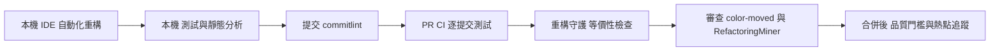

#### 17.5.3 團隊重構最佳實務

1. **小步、常提交、常合併**：重構的分支存活不超過一兩天。
2. **重構與行為變更分開**：分開提交，最好分開 PR。
3. **先補安全網再重構**：沒有測試的地方先寫特性測試。
4. **讓 CI 驗證，讓人判斷**：機械的檢查交給工具，審查者專注於語意。
5. **重構有目的**：每個重構都對應一個即將進行的修改或一個明確的壞味道。
6. **記錄而不是記憶**：技術債、Mikado 圖、功能旗標都要寫下來。
7. **AI 的產出和人的一樣審查**：甚至更嚴格（第 18 章）。

### 17.6 重構培訓計畫

#### 17.6.1 新人重構訓練

| 週 | 主題 | 活動 | 完成標準 |
| --- | --- | --- | --- |
| 1 | 定義、原則、壞味道（第 1～3 章） | 閱讀＋在團隊程式碼中找出 5 個壞味道並命名 | 能以標準名稱說明每個壞味道與對應手法 |
| 2 | 基本手法與 IDE 操作（第 4～7 章、15.1） | 跟著範例在 IDE 中操作每個手法 | 能不看文件完成 Extract Function、Rename、Introduce Parameter Object、Move Function |
| 3 | 安全網（第 8 章） | 為一個沒有測試的類別寫特性測試，並執行 PIT | 變異分數 ≥ 80%，存活變異有判斷紀錄 |
| 4 | 綜合演練（第 21、22 章） | 完成 Kata 1、結對完成一個真實的重構型 PR | PR 通過所有守護檢查，審查者無「必須」等級的意見 |

#### 17.6.2 技能評估標準

| 等級 | 能力描述 | 評估方式 |
| --- | --- | --- |
| **L1 入門** | 能說出重構的定義；能用 IDE 完成 Rename、Extract Function；知道要先跑測試 | 第 22.2 節選擇題 ≥ 80% |
| **L2 熟練** | 能辨識常見壞味道並選擇手法；能寫特性測試；提交符合規範；能審查同事的重構 PR | 完成 Kata 1；22.5 的 AI 審查演練找出至少 3 個問題 |
| **L3 進階** | 能規劃大型重構（Strangler Fig、Branch by Abstraction、Mikado）；能處理資料庫與 API 的演進 | 主導一個中型重構並撰寫提案 |
| **L4 專家** | 能設計團隊的重構流程與工具鏈；能指導他人；能評估重構的投資報酬 | 建立或改善團隊的守護流程；帶領 kata 練習 |

| 編號 | 等級 | 規則 | 驗證方式 |
| --- | --- | --- | --- |
| `RFT-TEAM-007` | 應該 | 團隊應為新成員安排重構訓練，並以技能等級評估；審查重構型 PR 的指定審查者應至少達到 L2 | 👁 訓練紀錄與評估結果 |

```yaml
# ✅ RFT-TEAM-007：訓練紀錄（存放於團隊工程手冊儲存庫）
- member: 陳小美
  joined: 2026-09-01
  level: L2
  completed:
    - { week: 1, date: 2026-09-05, result: 壞味道辨識 5/5 }
    - { week: 2, date: 2026-09-12, result: IDE 操作完成 }
    - { week: 3, date: 2026-09-19, result: "PIT 變異分數 86%，2 個存活變異已判斷" }
    - { week: 4, date: 2026-09-26, result: "Kata 1 完成；PR #2231 通過守護檢查" }
  reviewer-eligible: true
```

#### 🔍 17.6 審查與驗證

| 審查問題 | 如何確認 |
| --- | --- |
| 指定審查者具備足夠的能力嗎？ | 訓練紀錄中的等級；CODEOWNERS 只列入 L2 以上的成員 |

#### 📝 第 17 章重點

- 依規模決定溝通與核准的程度；大範圍修改要事先告知。
- `refactor` 類型的提交、400 行以內的 PR、`.git-blame-ignore-revs` 讓重構容易審查與追溯。
- 逐提交審查，用 `--color-moved` 區分搬移與改寫。
- 名詞表與組織約定讓改名有依據；培訓讓每個人都會重構、會審查。

#### ✏️ 第 17 章自我檢測

1. 為什麼 commitlint 的預設 `subject-case` 規則不適合重構型的提交訊息？
2. `.git-blame-ignore-revs` 解決了什麼問題？
3. 審查重構型 PR 時，哪些檢查可以交給 CI？哪些必須由人判斷？

<details>
<summary>參考答案</summary>

1. 預設規則禁止主旨以大寫字母開頭（例如 sentence-case、start-case 等），而重構的提交訊息常以手法名稱開頭，例如「Extract Function——…」，會被拒絕。
2. 大量的機械式修改（格式化、全專案改名）會讓 `git blame` 把每一行都歸到那個提交，失去追溯價值；列入該檔案後，`git blame` 會略過這些提交，顯示更早的實際作者。
3. 交給 CI：逐提交建置與測試、既有測試是否被修改、新測試在重構前是否通過、提交格式、PR 大小、靜態分析。由人判斷：重構是否有價值、名稱是否恰當、邊界與例外等語意是否改變（尤其是工具無法辨識的修改）、測試的修改是否合理。

</details>

---

## 18. AI 輔助重構

> **🎯 學習目標**
>
> - 說明 AI 程式助理在重構上的優勢與風險。
> - 寫出能讓 AI 產出「可驗證重構」的提示，並以專案層級的指示檔固定規則。
> - 依一套固定的流程驗證 AI 產出的重構，不依賴「看起來沒問題」。
> - 認出 AI 最常犯的重構錯誤，並知道每一種該用什麼方法抓出來。

### 18.1 AI 輔助重構的機會與風險

AI 程式助理很擅長重構的「機械部分」：改名、提煉、改寫成新語法、在數十個檔案中套用相同的修改。它的速度與一致性遠超過人工。但重構的核心要求——**行為不變**——恰好是 AI 最不可靠的地方：

| 觀察 | 來源 | 對重構的意義 |
| --- | --- | --- |
| AI 是「放大器」：讓原本體質好的團隊更好，也讓體質差的團隊問題更嚴重 | DORA《State of AI-assisted Software Development》（2025） | 有完整測試與審查流程的團隊，才能安全地享受 AI 重構的速度 |
| 使用 AI 程式助理後，程式碼中「被搬移」（重構的特徵）的比例下降，重複的程式碼增加 | GitClear《AI Copilot Code Quality》（2025，分析 2020～2024 年 2.11 億行變更） | AI 傾向「新增」而不是「整理」；重構需要刻意要求 |
| 以 GPT-4o 重構 ClassEval 的 100 個 Python 類別，整體而言多數重構保持行為並減少壞味道，但可讀性下降；10 次執行的單元測試平均通過率（mean TPR）為 0.844 | Midolo、Tramontana、Di Penta，arXiv:2601.13139（2026-01） | 約每 6 個測試就有 1 個在重構後失敗——沒有測試，就不會被發現 |
| 多代理 LLM 重構系統即使加入「保留檢查」，仍有斷言／fail 呼叫被修改、公開方法被移除等殘餘風險；作者指出產出仍需編譯、測試、相依分析與人工審查 | Waseem、Ahmad、Abrahamsson，REFINE，arXiv:2608.23611（2026-08） | 結構性的檢查不能取代測試；AI 甚至可能修改測試的斷言 |

結論很簡單：**AI 產出的重構必須和人的重構接受完全相同的驗證，而且審查要更仔細**——因為 AI 產出的程式碼看起來總是很合理，錯誤也更隱蔽。

| 編號 | 等級 | 規則 | 驗證方式 |
| --- | --- | --- | --- |
| `RFT-AI-001` | 必須 | AI 產出的重構必須遵守本手冊的所有規則，並接受與人工重構相同或更嚴格的驗證；PR 中必須標示哪些變更由 AI 產生 | 👁 PR 範本的「AI 協助」欄位；🤖 第 18.4 節的驗證流程 |

```markdown
<!-- ✅ RFT-AI-001：PR 範本中的 AI 協助欄位 -->
## AI 協助
- [x] 本 PR 包含 AI 產生的變更：提交 3c1e9a0、7d20b4f（以 AI 程式助理產生，人工逐行審查）
- 驗證：refactor-guard OK；equivalence-check EQUIVALENT；PIT（OrderPricing）91% → 91%
```

#### 🔍 18.1 審查與驗證

| 審查問題 | 如何確認 |
| --- | --- |
| 哪些變更是 AI 產生的？ | PR 範本的「AI 協助」欄位；有疑問時直接詢問作者 |
| 驗證的強度足夠嗎？ | AI 產生的重構至少要有 18.4 的全部驗證結果 |

### 18.2 給 AI 的重構提示

AI 的輸出品質很大程度取決於提示。一個好的重構提示，要把本手冊的原則**明確寫出來**——AI 不會自動知道「行為不變」包含哪些細節。

```markdown
<!-- ✅ RFT-AI-002：重構提示範本 -->
請對 `src/main/java/com/example/billing/LateFeeCalculator.java` 進行重構。

## 目標
- 壞味道：Long Function（calculate() 約 120 行）、Repeated Switches（會員等級出現 3 次）。
- 希望的手法：Extract Function、Replace Conditional with Polymorphism。一次只做一個手法。

## 限制（必須遵守）
1. 不得改變可觀察行為：回傳值（含 BigDecimal 的 scale）、例外型別與訊息、null 的處理、
   邊界值（所有 < <= > >= 不得改變）、副作用的次數與順序、回傳集合的可修改性。
2. 不得修改任何測試檔，也不得新增會改變行為的檢查（例如「防呆」的 null 檢查或參數驗證）。
3. 不得改變 public 方法的簽章；需要時使用遷移式做法（新方法＋舊方法委派並 @Deprecated）。
4. 不得把 Collectors.toList() 改為 Stream.toList()，不得把 || 改為 ??（如果是 TypeScript）。
5. 如果發現疑似缺陷，不要修正，列在回覆的「發現的問題」中。

## 輸出
- 每個手法一個步驟，說明每一步做了什麼，以及為什麼它保持行為不變。
- 列出你認為「可能改變行為」而需要人工確認的地方。
```

| 編號 | 等級 | 規則 | 驗證方式 |
| --- | --- | --- | --- |
| `RFT-AI-002` | 應該 | 要求 AI 重構時，提示應明確指定壞味道與手法、一次一個手法，並列出不得改變的行為類別、不得修改測試與公開簽章、發現缺陷時只回報不修正 | 👁 檢查提示（可附在 PR 中）；🧪 依 18.4 驗證結果 |

#### 🔍 18.2 審查與驗證

| 審查問題 | 如何確認 |
| --- | --- |
| 提示中有明確的限制嗎？ | 作者可把使用的提示附在 PR 中，或使用團隊共用的範本 |
| AI 回報的「可能改變行為」的地方都檢查過了嗎？ | 逐項確認並在 PR 中回覆 |

### 18.3 專案層級的 AI 指示檔

每次都在提示中寫一遍限制太麻煩，也容易遺漏。主流的 AI 程式助理都支援**專案層級的指示檔**，放在儲存庫中，AI 每次工作時自動讀取：

| 工具 | 指示檔 |
| --- | --- |
| 跨工具的開放格式 | `AGENTS.md`（儲存庫根目錄） |
| Claude Code | `CLAUDE.md`（可用 `@AGENTS.md` 匯入共用內容） |
| GitHub Copilot | `.github/copilot-instructions.md`、`.github/instructions/*.instructions.md`；Copilot 程式代理也會讀取 `AGENTS.md` |

```markdown
<!-- ✅ RFT-AI-003：AGENTS.md 中的重構規則（節錄） -->
## 重構規則（適用於所有 AI 代理）

- 重構與行為變更分開：一個提交只做一種；重構的提交訊息使用 `refactor(<scope>): <手法>——<說明>`。
- 重構不得修改 `src/test/` 中既有測試的預期值，也不得刪除測試；需要新測試時另外新增。
- 每完成一個手法就執行 `mvn -q test`；失敗時回復到上一個通過的狀態，不要在失敗的狀態下繼續修改。
- 不得改變 public API 的簽章；需要時以 `@Deprecated(forRemoval = true)` 的遷移式做法處理。
- 下列改寫視為行為變更，禁止在重構中進行：
  - `Collectors.toList()` → `Stream.toList()`；`||` → `??`；`a && a.b` → `a?.b`
  - 加入 null 檢查、參數驗證或 try/catch
  - 改變比較運算子、例外型別或訊息、BigDecimal 的運算方式
  - 字串串接改為文字區塊（結尾換行）
- 刪除「看似沒有使用」的程式碼前，搜尋反射、設定檔與字串中的名稱。
- 完成後執行 `./scripts/refactor-guard.sh` 與 `./scripts/equivalence-check.sh`，並把輸出附在回覆中。
```

| 編號 | 等級 | 規則 | 驗證方式 |
| --- | --- | --- | --- |
| `RFT-AI-003` | 應該 | 使用 AI 程式助理的儲存庫應在專案層級的指示檔（`AGENTS.md`、`CLAUDE.md`、`.github/copilot-instructions.md`）中寫明重構規則，並與本手冊的規則保持一致 | 👁 檢查指示檔的內容與更新紀錄 |

#### 🔍 18.3 審查與驗證

| 審查問題 | 如何確認 |
| --- | --- |
| 指示檔存在且內容是最新的嗎？ | 儲存庫根目錄的指示檔；團隊規則變更時同步更新 |
| AI 實際遵守了指示嗎？ | 指示檔只能降低錯誤的機率，不能取代 18.4 的驗證 |

### 18.4 驗證 AI 產出的流程

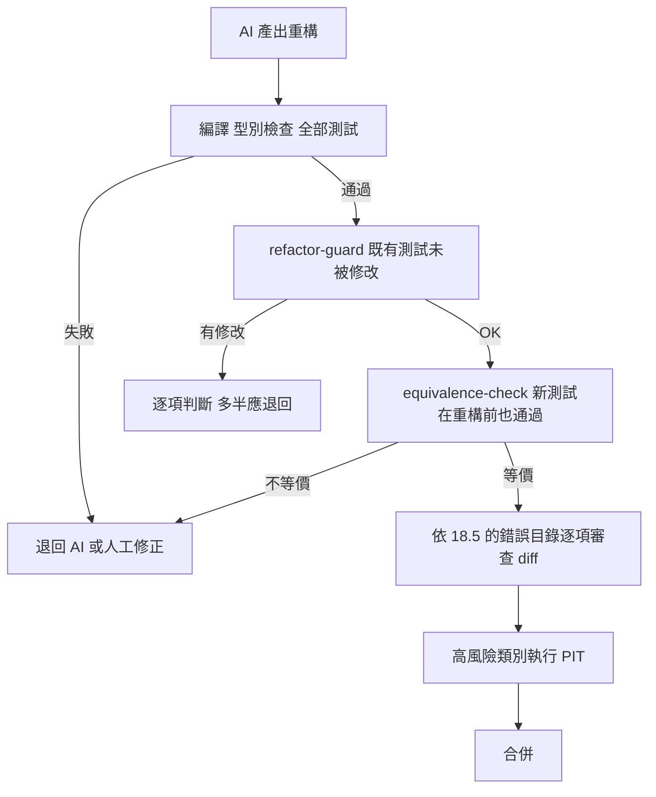

每一步都有它抓得到、和抓不到的問題：

| 步驟 | 抓得到 | 抓不到 |
| --- | --- | --- |
| 編譯與型別檢查 | 遺漏的參照、簽章錯誤 | 所有語意問題 |
| 既有測試 | 測試涵蓋到的行為改變 | 測試沒有涵蓋的行為（例如 5.5 的錯誤訊息順序） |
| `refactor-guard.sh` | AI「修改測試來配合新行為」 | 新增的、描述錯誤行為的測試 |
| `equivalence-check.sh` | 依新行為撰寫的新測試 | 測試沒有涵蓋的行為 |
| 18.5 錯誤目錄審查 | 已知類型的語意陷阱 | 未知類型的問題 |
| PIT 變異測試 | 測試涵蓋不足的地方 | 等價變異以外的語意需由人判斷 |

| 編號 | 等級 | 規則 | 驗證方式 |
| --- | --- | --- | --- |
| `RFT-AI-004` | 必須 | AI 產出的重構在合併前必須依序通過：編譯與全部測試、`refactor-guard.sh`、`equivalence-check.sh`，並由人依 18.5 的錯誤目錄逐項審查 diff；高風險類別必須執行變異測試 | 🤖 CI 守護檢查（15.3）；👁 審查紀錄 |
| `RFT-AI-005` | 不應該 | 不應接受 AI 在重構中對既有測試的修改；AI 修改測試使其通過，通常代表它改變了行為 | 🤖 `refactor-guard.sh`；👁 審查 |

```text
✅ RFT-AI-004、RFT-AI-005：對 1.6 的「AI 錯誤版」Calculator 執行驗證流程的實際結果
[1] 編譯與測試    FAILED  CalculatorTest.divisionByZeroFollowsIeee754：IllegalArgumentException
                         CalculatorTest.unknownOperatorReturnsZero：UnsupportedOperationException
→ 退回。若 AI 接著「修正」測試讓它通過（測試全部通過了）：
[2] refactor-guard FAILED  既有測試中被修改或刪除的程式行（含斷言與測試資料）：
    +++ b/src/test/java/com/example/rft/def/CalculatorTest.java
    -        assertThat(calculator.calc(1, 0, "/")).isEqualTo(Double.POSITIVE_INFINITY);
    -        assertThat(calculator.calc(-1, 0, "/")).isEqualTo(Double.NEGATIVE_INFINITY);
    -        assertThat(calculator.calc(0, 0, "/")).isNaN();
    -        assertThat(calculator.calc(6, 3, "%")).isZero();
[3] equivalence-check
    [equivalence] 以 PR 的測試執行 BASE ... FAILED
    [equivalence] 以 PR 的測試執行 HEAD ... PASSED
    [equivalence] RESULT: TESTS DO NOT DESCRIBE THE ORIGINAL BEHAVIOUR
→ 依 RFT-AI-005 不接受。正確的重構（1.6 的 ✅ 版本）在同一個示範儲存庫中得到 refactor-guard OK、EQUIVALENT。
```

#### 🔍 18.4 審查與驗證

| 審查問題 | 如何確認 |
| --- | --- |
| 驗證流程的每一步都執行了嗎？ | CI 的檢查結果與 PR 中附上的輸出 |
| AI 有沒有修改測試？ | `refactor-guard.sh` 的結果；若有修改，逐項確認理由 |

### 18.5 AI 常見的重構錯誤

下表彙整本手冊各章示範的「AI 錯誤版」與相關陷阱。審查 AI 產出時，逐項檢查 diff 中是否出現這些模式：

| # | 錯誤類型 | 例子 | 本手冊 | 怎麼抓 |
| --- | --- | --- | --- | --- |
| 1 | 順手加上防呆 | 除以零改為丟出例外；未知值改為丟出例外 | 1.6 | 既有測試；搜尋 diff 中新增的 `throw` |
| 2 | 邊界改變 | `>=` 改為 `>`；含兩端改為不含兩端 | 6.1 | 邊界值測試；比對所有比較運算子 |
| 3 | `null` 處理改變 | `instanceof` 改為 `switch` 少了 `case null`；`"x".equals(s)` 與 `s.equals("x")` 互換；`Map.of` 遇到 `null` | 13.2、1.6、2.3 | 包含 `null` 的測試 |
| 4 | 預設值的語意改變 | `getOrDefault` 取代「查無或值為 null」 | 6.5 | 鍵存在但值為 `null` 的測試 |
| 5 | 集合特性改變 | `Collectors.toList()` 改為 `.toList()`；`toMap` 遇到重複鍵 | 13.4、9.2 | 修改回傳集合的測試；重複鍵的測試 |
| 6 | 自動產生的方法改變 | 改為 `record` 後 `toString`、存取方法名稱、`equals` 不同 | 13.3 | `toString` 與相等性的測試 |
| 7 | 字串內容改變 | 文字區塊多了結尾換行 | 13.6 | 完整字串比對 |
| 8 | 求值順序改變 | 引數由左至右求值，改變驗證的順序 | 4.5、5.5 | 多個錯誤同時發生的測試 |
| 9 | 邏輯運算子改變 | `\|\|` 改為 `??`；`&&` 改為 `?.` | 14.3 | 以 `0`、`''`、`false` 測試 |
| 10 | 非同步錯誤處理改變 | `try` 中沒有 `await` 的 `return` | 14.4 | 每個非同步呼叫各自失敗的測試；`return-await` 規則 |
| 11 | 數值行為改變 | `int` 迴圈改為 `mapToLong` 或 `average()`；`double` 改為 `BigDecimal` | 4.1、13.4、3.3 | 溢位與精度的測試 |
| 12 | 外部呼叫次數改變 | Replace Temp with Query 讓遠端呼叫變成多次 | 16.4 | 呼叫次數的測試 |
| 13 | 刪除「沒用到」的程式碼 | 被反射、設定檔或其他服務使用 | 5.6 | 全文搜尋、存取紀錄 |
| 14 | 改了公開介面 | 刪除舊方法、改變簽章、`Optional` 取代 `null` | 4.4、13.5 | 編譯其他模組；japicmp |
| 15 | 修改測試配合新行為 | 改預期值、放寬斷言、刪除測試 | 18.4、9.3 | `refactor-guard.sh`；PIT 分數比較 |

| 編號 | 等級 | 規則 | 驗證方式 |
| --- | --- | --- | --- |
| `RFT-AI-006` | 必須 | 審查 AI 產出的重構時，必須依 18.5 的錯誤目錄逐項檢查 diff；團隊發現新的 AI 錯誤類型時，應補充到錯誤目錄與專案的 AI 指示檔中 | 👁 審查紀錄中對錯誤目錄的檢查結果 |

```text
✅ RFT-AI-006：審查 AI 產出的 PR #2310（Replace Loop with Pipeline，OfficeDirectory）時的錯誤目錄檢查紀錄
#1 防呆      無新增 throw／null 檢查                          OK
#2 邊界      無比較運算子變更                                  OK
#3 null      filter 中的 equals 呼叫方向不變                   OK
#5 集合      .toList() 取代 new ArrayList<>()                  ✗ → 要求改為 Collectors.toCollection(ArrayList::new)（13.4）
#11 數值     無                                                 OK
#15 測試     refactor-guard OK                                  OK
新類型：無
```

#### 🔍 18.5 審查與驗證

| 審查問題 | 如何確認 |
| --- | --- |
| diff 中出現了錯誤目錄中的模式嗎？ | 以關鍵字搜尋 diff：`throw`、`toList()`、`??`、`?.`、`getOrDefault`、`record`、`"""`、`switch`、比較運算子 |
| 每個模式都有測試保護嗎？ | 對照「怎麼抓」欄，缺少的測試要補上 |

### 18.6 AI 代理的批次重構

AI 代理（agent）可以自主地在整個程式碼庫中執行多步驟的重構：修改、執行測試、根據結果繼續修改。這帶來更高的效率，也帶來更大的風險——一次失控的代理可能修改數百個檔案。

| 控制措施 | 做法 |
| --- | --- |
| **限定範圍** | 每個任務只處理一個手法、一個模組；任務描述中列出允許修改的路徑 |
| **獨立分支與工作目錄** | 每個任務在自己的分支（或 `git worktree`）中進行，完成後以 PR 合併 |
| **限制權限** | 代理只能執行建置與測試指令；不能推送到受保護分支、不能修改 CI 設定與 `scripts/` 中的守護腳本 |
| **要求證據** | 代理的回報必須附上測試、`refactor-guard.sh` 與 `equivalence-check.sh` 的輸出 |
| **人工審查不可省略** | 代理產生的 PR 與人工 PR 走相同的審查流程，並依 18.5 逐項檢查 |

```markdown
<!-- ✅ RFT-AI-007：交給 AI 代理的批次重構任務單 -->
## 任務：以 Replace Magic Literal 處理 billing 模組中的運費常數
- 允許修改的路徑：`src/main/java/com/example/billing/**`（不得修改其他路徑、測試、CI 設定與 scripts/）
- 手法：只做 Replace Magic Literal（手冊 4.8），一個類別一個提交
- 每個提交後執行：`mvn -q test`；失敗時回復該提交
- 完成條件：`./scripts/refactor-guard.sh` 為 OK、`./scripts/equivalence-check.sh` 為 EQUIVALENT
- 交付：一個 PR，說明中附上上述兩個腳本的輸出與每個提交的摘要
```

| 編號 | 等級 | 規則 | 驗證方式 |
| --- | --- | --- | --- |
| `RFT-AI-007` | 應該 | 交給 AI 代理的批次重構應限定手法與可修改的路徑、在獨立分支中進行、限制代理不得修改測試與守護腳本，並要求附上驗證輸出；代理的 PR 必須經過人工審查 | 🤖 分支保護與 CODEOWNERS（守護腳本與 CI 設定需特定審查者）；👁 審查 |

#### 🔍 18.6 審查與驗證

| 審查問題 | 如何確認 |
| --- | --- |
| 代理修改的檔案都在允許的範圍內嗎？ | `git diff --name-only` 與任務單比對 |
| 守護腳本與 CI 設定有被修改嗎？ | CODEOWNERS 讓這些檔案的修改需要特定審查者核准 |

#### 📝 第 18 章重點

- AI 擅長重構的機械部分，但「行為不變」必須靠測試與審查保證。
- 提示與專案指示檔要明確列出「不得改變的行為」與「禁止的改寫」。
- 驗證流程：測試 → 測試守護 → 等價性檢查 → 錯誤目錄審查 → 變異測試。
- AI 修改測試讓它通過，通常代表它改變了行為。

#### ✏️ 第 18 章自我檢測

1. 為什麼「壞味道數量減少、複雜度下降」不能證明 AI 的重構是正確的？
2. AI 在重構中同時修改了程式碼與測試，且所有測試都通過，你要怎麼判斷？
3. 交給 AI 代理的任務單中，為什麼要禁止它修改 `scripts/` 中的守護腳本？

<details>
<summary>參考答案</summary>

1. 這些是結構指標，只說明程式碼「看起來」比較好；行為是否改變，只能由涵蓋該行為的測試驗證。
2. 用 `refactor-guard.sh` 找出被修改的既有測試，逐項檢查修改是否改變了預期值；用 `equivalence-check.sh` 把新的測試放到重構前的程式碼上執行——如果在重構前失敗，代表測試是依新行為寫的，重構改變了行為。
3. 守護腳本是驗證代理輸出的工具；如果代理可以修改它們，就可能（無意或因為「讓檢查通過」的目標）削弱驗證，使驗證失去意義。

</details>

---

## 19. 技術債管理與重構的度量

> **🎯 學習目標**
>
> - 以技術債象限分類技術債，並以一致的格式登錄。
> - 用「修改頻率 × 複雜度」的熱點分析決定重構的優先順序。
> - 為重構配置固定的容量，並向管理層說明它的價值。
> - 以度量評估重構的效益。

### 19.1 技術債與技術債象限

Ward Cunningham 以「債務」比喻：為了快速交付而採取的捷徑，就像借錢——之後每次修改都要多付「利息」（額外的理解與修改成本），直到你「還本」（重構）。重構是償還技術債最主要的方式。

Fowler 的**技術債象限**把技術債依兩個維度分類，幫助團隊判斷它是怎麼產生的、該怎麼避免：

| | 刻意的（deliberate） | 無意的（inadvertent） |
| --- | --- | --- |
| **魯莽的**（reckless） | 「我們沒時間做設計。」 | 「什麼是分層？」 |
| **謹慎的**（prudent） | 「我們必須現在上線，之後再處理後果。」 | 「現在我們才知道當初應該怎麼做。」 |

- **謹慎且刻意**的債是合理的商業決策，但必須**登錄並排定償還時間**。
- **謹慎且無意**的債無法避免——隨著對領域的理解加深，總會發現更好的設計。這正是持續重構的理由。
- **魯莽**的債要靠培訓（17.6）、審查（17.3）與守護工具（第 15 章）避免。

### 19.2 技術債登錄

沒有被記錄的技術債，就不會被償還。每一筆技術債都應該有固定的欄位，讓團隊可以排序與追蹤：

```yaml
# ✅ RFT-DEBT-001：tech-debt.yml 中的一筆紀錄（也可以使用議題系統的固定欄位）
- id: DEBT-112
  title: 運費計算散落在 OrderService 與 CheckoutController
  location: [src/main/java/com/example/order/OrderService.java, src/main/java/com/example/web/CheckoutController.java]
  smells: [Shotgun Surgery, Duplicated Code]
  quadrant: prudent-deliberate          # 19.1 的象限
  interest: 每次調整運費規則需改兩處；過去 6 個月因漏改造成 2 次正式環境缺陷
  proposal: Extract Class → ShippingFeePolicy（手冊 5.3），再以規則表取代條件（2.3）
  estimate: 2d
  safety-net: OrderServiceTest 涵蓋 60% 分支；需先補特性測試
  owner: team-checkout
  created: 2026-06-02
  target-sprint: 2026-S21
  status: planned                       # planned／in-progress／done／wont-fix
```

| 編號 | 等級 | 規則 | 驗證方式 |
| --- | --- | --- | --- |
| `RFT-DEBT-001` | 應該 | 技術債應登錄在可追蹤的清單中，至少包含位置、壞味道、利息（造成的成本）、建議手法、安全網狀態、負責人與目標時程；刻意產生的技術債必須在產生時登錄 | 👁 迭代規劃時檢視清單；🤖 以腳本檢查必填欄位 |

#### 🔍 19.2 審查與驗證

| 審查問題 | 如何確認 |
| --- | --- |
| PR 中刻意保留的捷徑有登錄嗎？ | PR 說明中提到「之後再處理」時，要有對應的 DEBT 編號 |
| 技術債的「利息」有具體描述嗎？ | 利息越具體（缺陷次數、多花的工時），越容易排定優先順序 |

### 19.3 熱點分析：決定先重構哪裡

不是所有複雜的程式碼都值得重構。Adam Tornhill 在《Your Code as a Crime Scene》中提出**熱點分析**：**經常被修改**又**很複雜**的檔案，才是重構投資報酬率最高的地方——因為每次修改都在支付利息。很少被修改的複雜程式碼，即使很醜，重構的回報也很低（2.4）。

```bash
#!/usr/bin/env bash
# ✅ RFT-DEBT-002：hotspots.sh——列出最近 180 天修改次數最多的檔案與其行數（行數是複雜度的粗略代理）
# 用法：./hotspots.sh '*.java'   （core.quotePath=false 讓含中文的路徑不被加上引號）
set -euo pipefail
pattern="${1:-*.java}"
git -c core.quotePath=false log --since="180 days ago" --format= --name-only -- "$pattern" \
  | grep -v '^$' | sort | uniq -c | sort -rn | head -15 \
  | while read -r changes file; do
      [ -f "$file" ] && printf '%5d %7d  %s\n' "$changes" "$(wc -l < "$file")" "$file"
    done
```

對本部落格儲存庫的 Markdown 檔執行 `./hotspots.sh '*.md'` 的實際輸出（前 5 筆；欄位為修改次數、行數、路徑）：

```text
✅ RFT-DEBT-002：hotspots.sh 的實際輸出
   13   10553  content/posts/教學/AI開發/GitHub Copilot 建立 SSDLC Agent Team 教學手冊.md
   12    9510  content/posts/教學/AI開發/spec-kit使用教學.md
    8    7058  content/posts/教學/AI開發/Hermes Agent生態系教學手冊.md
    8   16291  content/posts/教學/AI開發/Claude Code 建立 SSDLC Agent Team 教學手冊.md
    6    6011  content/posts/教學/AI開發/github copilot生態圈教學手冊.md
```

在 Java 專案中，可以把行數換成更好的複雜度指標（PMD 的 `CognitiveComplexity` 報告、SonarQube 的檔案複雜度），把兩個指標相乘或以散布圖呈現：右上角（修改頻繁且複雜）就是優先重構的目標。

| 編號 | 等級 | 規則 | 驗證方式 |
| --- | --- | --- | --- |
| `RFT-DEBT-002` | 應該 | 計畫型重構的優先順序應依熱點分析（修改頻率 × 複雜度）與技術債的利息決定，而不是只依靜態分析的問題數量 | 🤖 熱點分析腳本；👁 迭代規劃時檢視 |

#### 🔍 19.3 審查與驗證

| 審查問題 | 如何確認 |
| --- | --- |
| 這次的重構目標是熱點嗎？ | 執行熱點分析，確認目標檔案在前段 |
| 分析的時間範圍合理嗎？ | 太短看不出趨勢，太長會包含已不再活躍的程式碼；通常 3～12 個月 |

### 19.4 重構的時機與投資配置

#### 19.4.1 主動重構與被動重構

| 類型 | 何時 | 例子 | 優點 | 風險 |
| --- | --- | --- | --- | --- |
| **主動重構**（proactive） | 在需求出現之前，依技術債清單與熱點計畫進行 | 每個迭代保留容量處理 DEBT 清單 | 可預期、可規劃 | 若沒有對應到即將進行的修改，可能投資在不重要的地方 |
| **被動重構**（reactive） | 在修改程式碼時順便進行 | 準備型重構（2.3）、撿垃圾型重構 | 直接降低本次修改的成本 | 單次範圍有限；大型問題無法以此解決 |

兩者應該並行：日常以被動重構為主，主動重構處理被動重構無法解決的結構問題。

#### 19.4.2 重構優先順序矩陣

| | 修改頻率高（熱點） | 修改頻率低 |
| --- | --- | --- |
| **複雜度高** | 🔴 優先處理：排入計畫型重構 | 🟡 觀察：有需求時再以準備型重構處理 |
| **複雜度低** | 🟢 順手整理：撿垃圾型重構 | ⚪ 不處理 |

#### 19.4.3 容量配置

把重構完全交給「有空再做」，結果通常是永遠不做。常見的做法是**每個迭代保留固定比例的容量**給技術債與重構（業界常見的比例是 15%～20%），並在迭代回顧中報告處理的項目。

```yaml
# ✅ RFT-DEBT-003：迭代計畫中的容量配置（2026-S21，團隊總容量 40 點）
capacity: 40
allocation:
  features: 30        # 75%
  tech-debt: 7        # 17.5%：DEBT-112（5 點）、DEBT-097（2 點）
  buffer: 3           # 7.5%：緊急修復
review:
  tech-debt-done: [DEBT-112]
  carried-over: [DEBT-097]
```

| 編號 | 等級 | 規則 | 驗證方式 |
| --- | --- | --- | --- |
| `RFT-DEBT-003` | 應該 | 團隊應在每個迭代保留固定比例的容量處理技術債與計畫型重構，並在迭代回顧中報告處理結果；日常修改應同時進行準備型與撿垃圾型重構 | 👁 迭代計畫與回顧紀錄 |

#### 🔍 19.4 審查與驗證

| 審查問題 | 如何確認 |
| --- | --- |
| 技術債的容量是否被功能需求擠掉？ | 比較計畫與實際完成的技術債點數；連續數個迭代為零是警訊 |
| 處理的技術債是熱點嗎？ | 對照 19.3 的分析結果 |

### 19.5 重構效益的評估與度量

重構的效益不容易直接看到——它的價值在於「之後的修改變便宜了」。以下指標可以讓效益被看見：

| 層級 | 指標 | 如何量測 | 預期的變化 |
| --- | --- | --- | --- |
| **程式碼** | 熱點檔案的認知複雜度、重複程式碼比例、ArchUnit 凍結違規數 | PMD／SonarQube、ArchUnit 紀錄檔 | 下降 |
| **流程** | 修改熱點檔案的 PR 的前置時間（從第一個提交到合併）、審查時間 | Git 與 PR 平台的資料 | 縮短 |
| **品質** | 熱點模組的缺陷數、變更失敗率 | 議題系統、DORA 指標 | 下降 |
| **團隊** | 開發者對該模組的「修改信心」 | 簡短的定期問卷（1～5 分） | 上升 |

**短期、中期、長期的追蹤：**

| 時間 | 追蹤重點 |
| --- | --- |
| 重構後立即 | 測試與守護檢查全部通過；正式環境的錯誤率與延遲沒有變化（16.3） |
| 1～3 個月 | 修改該模組的 PR 前置時間、審查時間、修改涉及的檔案數 |
| 6 個月以上 | 該模組的缺陷數趨勢、是否還在熱點清單上 |

```markdown
<!-- ✅ RFT-DEBT-004：重構效益報告（迭代回顧用） -->
## DEBT-112 運費計算集中化——效益追蹤（重構完成：2026-06-20）
| 指標 | 重構前（前 3 個月） | 重構後（後 3 個月） |
| --- | --- | --- |
| 運費相關 PR 的平均修改檔案數 | 4.2 | 1.3 |
| 運費相關 PR 的平均前置時間 | 3.1 天 | 1.2 天 |
| 運費相關的正式環境缺陷 | 2 | 0 |
| ShippingFeePolicy 的認知複雜度（最大方法） | 23 | 6 |
```

| 編號 | 等級 | 規則 | 驗證方式 |
| --- | --- | --- | --- |
| `RFT-DEBT-004` | 應該 | 計畫型重構應在開始前記錄基準指標（複雜度、前置時間、缺陷數），完成後依短期、中期、長期追蹤效益，並在迭代回顧中報告 | 👁 效益報告；🤖 指標由工具自動收集 |

#### 🔍 19.5 審查與驗證

| 審查問題 | 如何確認 |
| --- | --- |
| 有重構前的基準嗎？ | 沒有基準就無法比較；開始前先記錄 |
| 指標的變化是重構造成的嗎？ | 比較同期沒有重構的模組，排除其他因素 |

#### 📝 第 19 章重點

- 技術債要登錄；刻意的債要排定償還時間。
- 熱點（修改頻繁 × 複雜）才是重構投資報酬率最高的地方。
- 每個迭代保留固定容量處理技術債，並報告結果。
- 以前置時間、缺陷數、複雜度等指標讓重構的效益被看見。

#### ✏️ 第 19 章自我檢測

1. 一個三年沒有人修改過、認知複雜度 80 的類別，應該優先重構嗎？
2. 「謹慎且無意」的技術債可以避免嗎？
3. 要向管理層說明一次重構的效益，你會準備哪些資料？

<details>
<summary>參考答案</summary>

1. 通常不應該。它不是熱點，重構的回報很低；記錄在技術債清單中，等到有需求要修改它時再以準備型重構處理。
2. 無法完全避免。隨著對領域的理解加深，總會發現更好的設計；這類技術債要靠持續重構償還。
3. 重構前後的基準指標對照：相關 PR 的前置時間與修改檔案數、相關缺陷數、熱點檔案的複雜度，以及開發者的修改信心調查。

</details>

---

## 20. 重構的反模式與常見陷阱

> **🎯 學習目標**
>
> - 認出團隊中常見的「錯誤的重構方式」，並知道每一種的後果與替代做法。

前面各章從「該怎麼做」的角度說明重構；本章反過來，彙整實務中最常見的錯誤做法。每一個反模式都對應到前面的規則，可以在審查與回顧時當作檢核清單。

### 20.1 流程上的反模式

| 反模式 | 症狀 | 後果 | 正確做法 |
| --- | --- | --- | --- |
| **大爆炸重構** | 「這個模組我花兩週整個重構一遍」 | PR 無法審查；出問題時無法判斷原因；和其他人的修改大量衝突 | 小步提交、每天合併；大型重構用 Strangler Fig 或 Branch by Abstraction（第 11 章） |
| **重構與功能混在一起** | 一個提交同時有結構調整與行為變更 | 審查者無法判斷哪些差異改變了行為；回復時無法只回復其中一部分 | 兩頂帽子，分開提交（2.1） |
| **沒有安全網的重構** | 「這段程式沒有測試，但我很小心」 | 行為悄悄改變，直到正式環境才發現 | 先寫特性測試，或只用 IDE 自動化重構（2.4、第 8 章） |
| **紅燈中繼續修改** | 測試失敗後繼續疊加修改，想「一起修好」 | 越改越亂，最後只能整批放棄 | 失敗就回退，用更小的步伐重做（2.2） |
| **長壽的重構分支** | 重構分支存活數週，與主幹嚴重分歧 | 合併時衝突大量，重構本身變成風險 | Branch by Abstraction，在主幹上分階段合併（11.3） |
| **永遠「下次再重構」** | 技術債沒有登錄，也沒有容量 | 修改成本持續上升，最後變成「只能重寫」 | 登錄技術債、保留容量（第 19 章） |

### 20.2 程式碼上的反模式

| 反模式 | 症狀 | 後果 | 正確做法 |
| --- | --- | --- | --- |
| **以重構之名加防呆** | 「順便」加入 `null` 檢查、參數驗證、例外處理 | 行為改變，且藏在 `refactor` 提交中 | 先重構，再以 `fix` 提交（1.6） |
| **為了指標而拆分** | 拆出 `part1()`、`step2()` 只為了讓複雜度過關 | 程式碼更難讀，指標好看但沒有改善 | 依意圖提煉；門檻是調查的起點（3.8） |
| **過早抽象** | 只有一個實作的介面、只有一個使用者的「通用框架」 | 增加理解成本，真正的需求出現時抽象往往是錯的 | 三法則（2.3）；移除 Speculative Generality（3.6） |
| **繼承只為重用** | 繼承 `ArrayList`、繼承工具類別 | 公開大量不需要的方法，父類別的變更影響子類別 | 以委託取代繼承（7.7） |
| **以註解保留舊程式碼** | 大段被註解掉的程式碼 | 沒有人敢刪，也沒有人看得懂 | 直接刪除，版本控制會保存（5.6） |
| **文字取代式的改名** | 以編輯器的「全部取代」改名 | 改到不該改的字串、漏改 IDE 才看得到的參照 | IDE 的 Rename 或 codemod（15.1、14.6） |
| **「現代化」等於改語法** | 把所有迴圈改成 Stream、所有類別改成 `record` | 引入 13.4、13.3 的語意陷阱，卻沒有改善設計 | 以壞味道與目的驅動，逐項確認語意（第 13 章） |

### 20.3 測試上的反模式

| 反模式 | 症狀 | 後果 | 正確做法 |
| --- | --- | --- | --- |
| **修改測試讓它通過** | 重構後測試失敗，於是修改預期值 | 安全網失效，行為變更被「合法化」 | 測試失敗代表行為改變；回退或另以 `fix` 處理（8.6） |
| **測試綁定實作** | 大量以 mock 驗證內部呼叫 | 每次重構都要修改測試，失去安全網的意義 | 透過公開介面驗證結果（8.5） |
| **以覆蓋率代替驗證** | 覆蓋率 90%，但測試沒有斷言 | 安全網看似完整，實際上抓不到行為改變 | 變異測試（8.4） |
| **特性測試寫成「應該如何」** | 依規格或想像撰寫預期值 | 測試在重構前就失敗，或把缺陷當成正確行為鎖住的同時又改了它 | 預期值來自實際執行（8.2） |

### 20.4 AI 協作的反模式

| 反模式 | 症狀 | 後果 | 正確做法 |
| --- | --- | --- | --- |
| **「看起來沒問題」就合併** | AI 產出的程式碼很整齊，測試通過就合併 | 測試沒有涵蓋的語意改變直接進入正式環境 | 依 18.4 的流程驗證，依 18.5 的錯誤目錄審查 |
| **一次要求 AI 大改** | 「把這個模組重構得更好」 | 產出大量變更，無法逐項驗證 | 一次一個手法、一個範圍（18.2） |
| **讓 AI 修改測試** | AI 為了讓測試通過而修改測試 | 行為變更被掩蓋 | `refactor-guard.sh`；不接受（18.4） |
| **沒有專案層級的規則** | 每個人用自己的提示 | AI 的行為不一致，同樣的錯誤反覆出現 | 專案指示檔（18.3） |

#### 📝 第 20 章重點

- 流程反模式的共同點是「步伐太大」；程式碼反模式的共同點是「沒有目的」；測試反模式的共同點是「安全網失效」。
- 每一個反模式都有對應的規則與工具；在審查與回顧時用本章的表格逐項檢查。

---

## 21. 綜合案例：活動票券對帳單

> **🎯 學習目標**
>
> - 把前面各章的手法串成一次完整的重構：建立安全網、規劃步驟、小步提交、驗證、再加入新功能。
> - 體會準備型重構的價值：重構完成後，新功能只需要很小的修改。

本章的案例改編自 Fowler《Refactoring》第二版第 1 章的劇團對帳單範例，改以 Java 25 與台灣的情境重新撰寫。建議你先自己動手做一遍，再對照本章的步驟。

### 21.1 起點：需求與現有程式碼

一家票務公司為企業客戶包場演出，每月寄出對帳單。現在業務單位提出兩個需求：

1. 對帳單要增加 **HTML 版本**，寄送電子郵件時使用。
2. 下一季要新增「**脫口秀**」這種演出類型，有自己的計價規則。

現有的程式碼只有一個方法：

```java
// ✅ 兩個版本共用的資料型別
package com.example.rft.casestudy;

import java.util.List;

public interface Ticketing {

    record Show(String name, String type) {
    }

    record Performance(String showId, int audience) {
    }

    record Invoice(String customer, List<Performance> performances) {
    }
}
```

```java
// ❌ 重構前：計價、點數、格式化全部混在一個迴圈裡；要加 HTML 版只能複製整個方法
package com.example.rft.casestudy;

import com.example.rft.casestudy.Ticketing.Invoice;
import com.example.rft.casestudy.Ticketing.Performance;
import com.example.rft.casestudy.Ticketing.Show;
import java.util.Locale;
import java.util.Map;

public class TicketStatement {

    public String statement(Invoice invoice, Map<String, Show> shows) {
        int totalAmount = 0;
        int volumeCredits = 0;
        StringBuilder result = new StringBuilder("對帳單：" + invoice.customer() + "\n");
        for (Performance perf : invoice.performances()) {
            Show show = shows.get(perf.showId());
            int thisAmount;
            switch (show.type()) {
                case "drama":
                    thisAmount = 40000;
                    if (perf.audience() > 30) {
                        thisAmount += 1000 * (perf.audience() - 30);
                    }
                    break;
                case "concert":
                    thisAmount = 30000;
                    if (perf.audience() > 20) {
                        thisAmount += 10000 + 500 * (perf.audience() - 20);
                    }
                    thisAmount += 300 * perf.audience();
                    break;
                default:
                    throw new IllegalArgumentException("unknown type: " + show.type());
            }
            // 累積點數
            volumeCredits += Math.max(perf.audience() - 30, 0);
            // 每 5 位音樂會觀眾多 1 點
            if ("concert".equals(show.type())) {
                volumeCredits += perf.audience() / 5;
            }
            // 印出這一場
            result.append(String.format(Locale.ROOT, "  %s：%,d 元（%d 位觀眾）\n",
                    show.name(), thisAmount, perf.audience()));
            totalAmount += thisAmount;
        }
        result.append(String.format(Locale.ROOT, "應付金額：%,d 元\n", totalAmount));
        result.append("累積點數：").append(volumeCredits).append('\n');
        return result.toString();
    }
}
```

**壞味道診斷**（第 3 章）：Long Function（一個方法做三件事）、Repeated Switches 的雛形（`switch (show.type())` 與 `"concert".equals(show.type())` 兩處依類型判斷）、Comments（以註解分段）、Divergent Change（改格式與改計價都要動同一個方法）。

### 21.2 建立安全網

依第 8 章，先以特性測試鎖住目前的行為：完整的輸出、每種類型的計價邊界、錯誤情況。

```java
// ✅ 綜合案例的安全網：重構的每一步都必須通過；預期值來自實際執行
package com.example.rft.casestudy;

import static org.assertj.core.api.Assertions.assertThat;
import static org.assertj.core.api.Assertions.assertThatThrownBy;

import com.example.rft.casestudy.Ticketing.Invoice;
import com.example.rft.casestudy.Ticketing.Performance;
import com.example.rft.casestudy.Ticketing.Show;
import java.util.List;
import java.util.Map;
import org.junit.jupiter.api.Test;

class TicketStatementTest {

    private final Map<String, Show> shows = Map.of(
            "hamlet", new Show("Hamlet", "drama"),
            "as-like", new Show("As You Like It", "concert"),
            "othello", new Show("Othello", "drama"),
            "improv", new Show("Improv Night", "standup"));
    private final TicketStatement statement = new TicketStatement();

    @Test
    void fullStatement() {
        Invoice invoice = new Invoice("BigCo", List.of(new Performance("hamlet", 55),
                new Performance("as-like", 35), new Performance("othello", 40)));
        assertThat(statement.statement(invoice, shows)).isEqualTo("""
                對帳單：BigCo
                  Hamlet：65,000 元（55 位觀眾）
                  As You Like It：58,000 元（35 位觀眾）
                  Othello：50,000 元（40 位觀眾）
                應付金額：173,000 元
                累積點數：47
                """);
    }

    @Test
    void pricingBoundaries() {
        Invoice invoice = new Invoice("Small", List.of(new Performance("hamlet", 30), new Performance("as-like", 20)));
        assertThat(statement.statement(invoice, shows))
                .contains("Hamlet：40,000 元", "As You Like It：36,000 元", "累積點數：4\n");
    }

    @Test
    void unknownTypeAndUnknownShow() {
        Invoice unknownType = new Invoice("X", List.of(new Performance("improv", 10)));
        assertThatThrownBy(() -> statement.statement(unknownType, shows))
                .isInstanceOf(IllegalArgumentException.class).hasMessage("unknown type: standup");
        Invoice unknownShow = new Invoice("X", List.of(new Performance("macbeth", 10)));
        assertThatThrownBy(() -> statement.statement(unknownShow, shows)).isInstanceOf(NullPointerException.class);
    }
}
```

### 21.3 重構步驟

依 2.3 的準備型重構，目標是讓「加 HTML 版」與「加脫口秀」都變成容易的修改。每一步都是一個提交，每個提交都執行測試：

```text
✅ 綜合案例的提交紀錄（每一步都通過 TicketStatementTest）
 1 test:     加入 TicketStatementTest 特性測試（21.2）
 2 refactor: Extract Function——amountFor(show, perf)（4.1）
 3 refactor: Replace Temp with Query——show 改為 showFor(perf)（4.6）
 4 refactor: Extract Function——volumeCreditsFor(show, perf)（4.1）
 5 refactor: Split Loop——金額、點數、輸出各自一個迴圈（4.7）
 6 refactor: Extract Function——totalAmount()、totalVolumeCredits()（4.1）
 7 refactor: Split Phase——createStatementData() 產生 StatementData，renderPlainText() 只負責格式（4.9）
 8 refactor: Replace Conditional with Polymorphism——PerformanceCalculator 與 Drama／Concert（6.4）
 9 refactor: Move Function——amount()、volumeCredits() 搬到各自的計算類別（5.1）
10 refactor: Inline Function——移除只剩轉呼叫的 amountFor()、volumeCreditsFor()（4.1）
```

第 5 步（Split Loop）之後，`statement()` 的迴圈變成三個；第 7 步（Split Phase）是整個案例的關鍵：計算與格式化完全分開，HTML 版只需要另一個「格式化」階段。第 8 步讓「依類型計價」集中在各自的類別，新增類型只需要新增一個類別。

### 21.4 重構後的程式碼

```java
// ✅ 重構完成：計算（createStatementData）與格式（renderPlainText）分成兩個階段；公開的 statement() 行為完全不變
package com.example.rft.casestudy;

import com.example.rft.casestudy.Ticketing.Invoice;
import com.example.rft.casestudy.Ticketing.Performance;
import com.example.rft.casestudy.Ticketing.Show;
import java.util.ArrayList;
import java.util.List;
import java.util.Locale;
import java.util.Map;

public class TicketStatement {

    record Line(String showName, int amount, int audience) {
    }

    record StatementData(String customer, List<Line> lines, int totalAmount, int volumeCredits) {
    }

    public String statement(Invoice invoice, Map<String, Show> shows) {
        return renderPlainText(createStatementData(invoice, shows));
    }

    static StatementData createStatementData(Invoice invoice, Map<String, Show> shows) {
        List<Line> lines = new ArrayList<>();
        int totalAmount = 0;
        int volumeCredits = 0;
        for (Performance perf : invoice.performances()) {
            PerformanceCalculator calculator = PerformanceCalculator.of(shows.get(perf.showId()), perf.audience());
            lines.add(new Line(calculator.showName(), calculator.amount(), perf.audience()));
            totalAmount += calculator.amount();
            volumeCredits += calculator.volumeCredits();
        }
        return new StatementData(invoice.customer(), List.copyOf(lines), totalAmount, volumeCredits);
    }

    static String renderPlainText(StatementData data) {
        StringBuilder result = new StringBuilder("對帳單：" + data.customer() + "\n");
        for (Line line : data.lines()) {
            result.append(String.format(Locale.ROOT, "  %s：%,d 元（%d 位觀眾）\n",
                    line.showName(), line.amount(), line.audience()));
        }
        result.append(String.format(Locale.ROOT, "應付金額：%,d 元\n", data.totalAmount()));
        result.append("累積點數：").append(data.volumeCredits()).append('\n');
        return result.toString();
    }
}
```

```java
// ✅ 依類型計價的多型結構：新增演出類型時，只需要新增一個 record 並加入工廠
package com.example.rft.casestudy;

import com.example.rft.casestudy.Ticketing.Show;

sealed interface PerformanceCalculator permits PerformanceCalculator.Drama, PerformanceCalculator.Concert {

    String showName();

    int amount();

    int volumeCredits();

    static PerformanceCalculator of(Show show, int audience) {
        return switch (show.type()) {
            case "drama" -> new Drama(show.name(), audience);
            case "concert" -> new Concert(show.name(), audience);
            default -> throw new IllegalArgumentException("unknown type: " + show.type());
        };
    }

    record Drama(String showName, int audience) implements PerformanceCalculator {

        @Override
        public int amount() {
            int amount = 40000;
            if (audience > 30) {
                amount += 1000 * (audience - 30);
            }
            return amount;
        }

        @Override
        public int volumeCredits() {
            return Math.max(audience - 30, 0);
        }
    }

    record Concert(String showName, int audience) implements PerformanceCalculator {

        @Override
        public int amount() {
            int amount = 30000;
            if (audience > 20) {
                amount += 10000 + 500 * (audience - 20);
            }
            return amount + 300 * audience;
        }

        @Override
        public int volumeCredits() {
            return Math.max(audience - 30, 0) + audience / 5;
        }
    }
}
```

**驗證重構的過程中需要特別注意的地方：**

1. **例外的時機與型別**：原本在迴圈中遇到未知類型時丟出 `IllegalArgumentException`，遇到不存在的演出時 `show.type()` 丟出 `NullPointerException`。重構後由 `PerformanceCalculator.of()` 在同樣的時機丟出同樣的例外——`unknownTypeAndUnknownShow` 證明了這一點。
2. **數值型別**：原本以 `int` 計算，重構後仍是 `int`。如果「順便」改成 `long` 或 `BigDecimal`，溢位與格式行為就可能不同。
3. **輸出格式**：`Locale.ROOT` 與 `%,d` 的千分位格式原封不動地搬到 `renderPlainText()`。

### 21.5 加入新功能

重構提交之後，兩個需求都變成了「容易的修改」：

```java
// ✅ feat 提交 1：HTML 版只是另一個格式化階段，計算完全重用（片段）
public String htmlStatement(Invoice invoice, Map<String, Show> shows) {
    return renderHtml(createStatementData(invoice, shows));
}

static String renderHtml(StatementData data) {
    StringBuilder html = new StringBuilder("<h1>對帳單：" + escape(data.customer()) + "</h1>\n<table>\n");
    for (Line line : data.lines()) {
        html.append("<tr><td>").append(escape(line.showName())).append("</td><td>")
            .append(String.format(Locale.ROOT, "%,d", line.amount())).append("</td></tr>\n");
    }
    return html.append("</table>\n").toString();
}

// ✅ feat 提交 2：新增脫口秀——一個 record、工廠中的一行，以及新的測試（片段）
case "standup" -> new Standup(show.name(), audience);
record Standup(String showName, int audience) implements PerformanceCalculator {
    public int amount() { return 20000 + 800 * audience; }
    public int volumeCredits() { return Math.max(audience - 30, 0) + audience / 10; }
}
```

（片段）

注意第 2 個 `feat` 提交會讓 `unknownTypeAndUnknownShow` 中「`standup` 是未知類型」的斷言失敗——**這是預期中的行為變更**，所以要在同一個 `feat` 提交中修改這個測試（改用另一個真正未知的類型），並在 PR 中說明。`refactor` 提交不改測試、`feat` 提交才改測試，正是兩頂帽子（2.1）的具體呈現。

#### 📝 第 21 章重點

- 先建立安全網，再依壞味道規劃一連串的小步驟。
- Split Phase 讓計算與格式分開；多型讓依類型的行為集中。
- 重構完成後，新功能只是「容易的修改」；測試的修改只出現在 `feat` 提交中。

#### ✏️ 第 21 章自我檢測

1. 21.3 的第 5 步（Split Loop）讓迴圈從一個變成三個，為什麼這一步是值得的？
2. 如果在第 8 步之後才發現漏測了「觀眾數為 0」的情況，該怎麼處理？
3. 為什麼第 2 個 `feat` 提交可以修改 `unknownTypeAndUnknownShow`，而 `refactor` 提交不行？

<details>
<summary>參考答案</summary>

1. 拆開後每個迴圈只做一件事，才能分別提煉成 `totalAmount()`、`totalVolumeCredits()`，並為第 7 步的 Split Phase 鋪路；效能的影響在這個資料量下可以忽略，若有疑慮再以第 16 章的方式量測。
2. 在重構前的提交上（或以 `equivalence-check.sh`）確認觀眾數為 0 時的實際行為，補上特性測試，並確認它在目前的重構結果上也通過；若不通過，代表某一步改變了行為，要找出並修正那一步。
3. 因為新增脫口秀是刻意的行為變更：`standup` 從「未知類型」變成了「已知類型」。`refactor` 提交不改變行為，所以不應該需要修改測試。

</details>

---

## 22. 練習與自我評量

> **🎯 學習目標**
>
> - 以分級的練習確認自己對本手冊的掌握程度。
> - 透過 Kata 練習「小步、測試、提交」的節奏。
> - 練習審查 AI 產出的重構，找出其中的行為改變。

📌 **關於「認證考試」**：v1.0 的本章名為「考試重點與練習」並列出各主題的配分比例，但業界並沒有以「重構」為主題的國際認證考試（相關內容散見於 iSAQB CPSA、ISTQB 等認證的部分章節）。v2.0 改為**團隊內部的能力評量**，對應 17.6 的技能等級（L1～L4）。

### 22.1 能力評量架構

#### 22.1.1 觀念能力

| 主題 | 對應章節 | 評量重點 | 建議比重 |
| --- | --- | --- | --- |
| 定義與原則 | 第 1、2 章 | 可觀察行為的範圍、兩頂帽子、小步與回退 | 20% |
| 壞味道 | 第 3 章 | 以標準名稱辨識壞味道，並說出對應手法 | 20% |
| 重構手法 | 第 4～7 章、第 13～14 章 | 操作步驟與每個手法的語意陷阱 | 30% |
| 安全網 | 第 8～10 章 | 特性測試、變異測試、等價性驗證、接縫 | 15% |
| 團隊與 AI | 第 11～12 章、第 17～19 章 | 漸進式重構、演進式資料庫、審查 AI 產出、技術債 | 15% |

#### 22.1.2 實作能力

| 能力 | 評量方式 | 通過標準 |
| --- | --- | --- |
| 為遺留程式碼建立安全網 | 22.4 Kata 1 的第一階段 | 特性測試涵蓋所有分支與邊界；PIT 變異分數 ≥ 80% |
| 小步重構 | 22.4 的 Kata 1、Kata 2 | 每個提交只有一個手法且測試通過；最後的程式碼通過同一組測試 |
| 審查重構 | 22.5 的 AI 產出審查演練 | 找出所有行為改變，並正確判斷哪些修改是安全的 |

### 22.2 觀念選擇題

1. 下列何者**不是**重構？
   - (A) 把 `calc()` 改名為 `calculateShippingFee()` 並更新所有呼叫端
   - (B) 把 `if (b == 0) return Double.POSITIVE_INFINITY;` 加到除法函式中（原本 `a / b` 已回傳 `Infinity`）
   - (C) 在除法函式中加入「除數為 0 時丟出例外」
   - (D) 把三段重複的驗證提煉成一個函式
2. 重構時測試失敗了，而且你看不出原因，最好的做法是：
   - (A) 用除錯器逐步找出原因
   - (B) 修改測試的預期值
   - (C) 回到上一個測試通過的狀態，以更小的步伐重做
   - (D) 先提交，下一個提交再修
3. 函式大量讀取另一個類別的欄位，而幾乎不使用自己類別的資料，這是哪一種壞味道？
   - (A) Middle Man　(B) Feature Envy　(C) Data Class　(D) Shotgun Surgery
4. 關於特性測試，下列何者正確？
   - (A) 預期值應依需求規格撰寫
   - (B) 預期值應來自實際執行目前的程式碼
   - (C) 發現可疑行為時應在特性測試中修正
   - (D) 特性測試只需要涵蓋正常路徑
5. 把 Java 的 `collect(Collectors.toList())` 改為 `.toList()`，可能改變什麼？
   - (A) 元素順序　(B) 回傳清單的可修改性　(C) 元素型別　(D) 不會改變任何行為
6. 在 TypeScript 中，`count || 10` 與 `count ?? 10` 在下列哪個輸入下結果不同？
   - (A) `undefined`　(B) `null`　(C) `0`　(D) `5`
7. 資料表欄位改名時，正確的做法是：
   - (A) 在同一次部署中 `RENAME COLUMN` 並更新程式
   - (B) 擴充（新增欄位並同步）→ 遷移（回填、程式改用新欄位）→ 收縮（移除舊欄位），分成不同的部署
   - (C) 先刪除舊欄位，再新增新欄位
   - (D) 只修改程式中的欄位名稱
8. 下列何者是 Mikado 方法的核心步驟？
   - (A) 一次完成所有修改再測試
   - (B) 嘗試失敗時記下先決條件，然後**回復**程式碼
   - (C) 開一個長壽的功能分支
   - (D) 先寫完所有文件
9. 下列何者**最能**證明「AI 的重構沒有改變行為」？
   - (A) 壞味道數量減少
   - (B) 認知複雜度下降
   - (C) 既有測試不修改即全部通過，且新測試在重構前的程式碼上也通過
   - (D) AI 說明它保持了行為
10. 行覆蓋率 100% 的測試，為什麼仍可能無法保護重構？
    - (A) 覆蓋率工具有錯誤
    - (B) 程式碼被執行過，不代表它的結果被斷言驗證過
    - (C) 行覆蓋率不包含建構式
    - (D) 不可能，100% 就足夠了

<details>
<summary>參考答案與說明</summary>

| 題號 | 答案 | 說明 |
| --- | --- | --- |
| 1 | C | (B) 不改變行為（結果原本就是 `Infinity`），雖然沒什麼意義，仍算重構；(C) 改變了除以零的行為（1.6） |
| 2 | C | 2.2：失敗就回退，用更小的步伐重做 |
| 3 | B | 3.5：Feature Envy，以 Move Function 處理 |
| 4 | B | 8.2：特性測試記錄目前的行為；可疑行為照實記錄，不在重構時修正 |
| 5 | B | 13.4：`.toList()` 回傳不可修改的清單 |
| 6 | C | 14.3：`0` 是 falsy，`\|\|` 會換成 10，`??` 保留 0 |
| 7 | B | 12.2：擴充—遷移—收縮 |
| 8 | B | 10.5：回復是 Mikado 方法的核心 |
| 9 | C | 8.6、18.4：等價性驗證；指標與 AI 的說明都不能證明行為不變 |
| 10 | B | 8.4：覆蓋率不等於驗證；以變異測試確認 |

</details>

### 22.3 情境分析題

**情境 1：** 你負責的結帳模組有一個 600 行的 `CheckoutService.checkout()`，沒有任何測試，下週要加入「點數折抵」功能。主管問你要不要先重構。

**情境 2：** 同事送出一個標題為 `refactor: 整理訂單模組` 的 PR，共 2,300 行變更、只有一個提交，PR 說明寫「純重構，測試都通過」。

**情境 3：** AI 程式助理把 `PaymentService` 的 15 個 `if-else` 重構成策略模式，所有測試都通過，但 PR 中也修改了 3 個測試檔。

**情境 4：** 你想把公開 REST API 回應中的 `custName` 欄位改名為 `customerName`，這個 API 有 5 個外部合作夥伴使用。

<details>
<summary>參考答案</summary>

**情境 1：**

- 先依 10.1 的變更演算法，找出「點數折抵」的變更點與測試點。
- 在 `checkout()` 的公開入口撰寫特性測試（8.2），必要時先引入接縫（10.2），例如注入時鐘或付款閘道。
- 只重構與這次需求相關的部分，例如以 Extract Function 提煉金額計算；這是準備型重構（2.3），以獨立提交完成。
- 新功能盡量以 Sprout Class（10.3）寫在可測試的新類別中。
- 其餘部分登錄為技術債（19.2），依熱點分析決定是否排入計畫。

**情境 2：** 要求拆分：

- 依手法或模組拆成多個 PR，每個 PR 不超過約 400 行（17.2）。
- 每個 PR 包含多個小提交，每個提交只做一個手法（2.2）。

審查時再依序確認：

- 執行 `refactor-guard.sh`，確認既有測試沒有被修改。
- 執行 `equivalence-check.sh`。
- 用 RefactoringMiner 與 `--color-moved` 找出不是單純搬移的修改，逐行檢查（15.5、17.3）。
- PR 說明要補上動機（`RFT-DEF-003`）。

**情境 3：** 依 18.4：

- 先看 `refactor-guard.sh` 列出的修改。
- 若修改了預期值或刪除了案例，代表 AI 可能改變了行為；依 `RFT-AI-005`，不接受這些修改。
- 把原本的測試還原後重新執行，找出失敗的原因。
- 若只是改名或搬移造成的機械式修改，例如測試中呼叫的類別名稱改了，由指定審查者逐項核准。
- 再依 18.5 的錯誤目錄審查 diff，特別注意 `default` 分支與 `null` 的處理（6.4）。

**情境 4：** 依 12.3：

- 回應中同時提供 `custName` 與 `customerName`。
- 以 `Deprecation`、`Sunset` 標頭與文件公告停用日期，並通知 5 個合作夥伴。
- 監控 `custName` 的使用量，停用日期過後、確認使用量為零時才移除。
- 移除屬於破壞性變更，要依 API 的版本政策處理。

</details>

### 22.4 程式碼重構實作題

#### 22.4.1 Kata 1：會員點數（Java）

**題目：** 下面的 `LoyaltyPoints` 沒有測試。請完成兩個階段：

1. **建立安全網**：撰寫特性測試，涵蓋所有分支、邊界與錯誤輸入，並執行 PIT，目標變異分數 ≥ 80%。
2. **重構**：以衛述句、提煉函式、具名常數改善結構，每個手法一個提交；最後的程式碼必須通過你在第 1 階段寫的同一組測試。

```java
// ❌ Kata 1 的起點：巢狀條件、魔術數字、單字母變數
package com.example.rft.kata;

import java.math.BigDecimal;
import java.math.RoundingMode;
import java.time.DayOfWeek;
import java.time.LocalDate;

public class LoyaltyPoints {

    public int pointsFor(String tier, BigDecimal amount, LocalDate date, boolean firstOrder) {
        int p = 0;
        if (amount != null) {
            if (amount.compareTo(BigDecimal.ZERO) > 0) {
                p = amount.divide(new BigDecimal("100"), 0, RoundingMode.DOWN).intValue();
                if (tier.equals("GOLD")) {
                    p = p * 3;
                } else if (tier.equals("SILVER")) {
                    p = p * 2;
                }
                if (date.getDayOfWeek() == DayOfWeek.SATURDAY || date.getDayOfWeek() == DayOfWeek.SUNDAY) {
                    p = p + 10;
                }
                if (firstOrder) {
                    if (p < 50) {
                        p = 50;
                    }
                }
            }
        }
        return p;
    }
}
```

<details>
<summary>參考解答：特性測試</summary>

```java
// ✅ Kata 1 參考解答：特性測試——每個分支、邊界與錯誤輸入（預期值來自實際執行）
package com.example.rft.kata;

import static org.assertj.core.api.Assertions.assertThat;
import static org.assertj.core.api.Assertions.assertThatThrownBy;

import java.math.BigDecimal;
import java.time.LocalDate;
import org.junit.jupiter.api.Test;
import org.junit.jupiter.params.ParameterizedTest;
import org.junit.jupiter.params.provider.CsvSource;

class LoyaltyPointsTest {

    private final LoyaltyPoints loyalty = new LoyaltyPoints();

    @ParameterizedTest(name = "{0} {1} 元 {2} 首購={3} → {4}")
    @CsvSource({
        "GOLD, 250, 2026-10-14, false, 6",
        "GOLD, 250, 2026-10-17, false, 16",
        "SILVER, 1999, 2026-10-19, false, 38",
        "SILVER, 1999, 2026-10-19, true, 50",
        "BASIC, 99, 2026-10-18, true, 50",
        "BASIC, 99, 2026-10-16, false, 0",
        "BASIC, 100, 2026-10-16, false, 1",
        "GOLD, 10000, 2026-10-18, true, 310",
        "BASIC, 0, 2026-10-17, true, 0",
        "BASIC, -50, 2026-10-17, true, 0"
    })
    void currentPoints(String tier, BigDecimal amount, LocalDate date, boolean firstOrder, int expected) {
        assertThat(loyalty.pointsFor(tier, amount, date, firstOrder)).isEqualTo(expected);
    }

    @Test
    void nullAmountMeansNoPointsEvenWithoutTierOrDate() {
        assertThat(loyalty.pointsFor(null, null, null, true)).isZero();
    }

    @Test
    void nullTierOrDateWithPositiveAmountThrows() {
        LocalDate wednesday = LocalDate.of(2026, 10, 14);
        assertThatThrownBy(() -> loyalty.pointsFor(null, new BigDecimal("100"), wednesday, false))
                .isInstanceOf(NullPointerException.class);
        assertThatThrownBy(() -> loyalty.pointsFor("GOLD", new BigDecimal("100"), null, false))
                .isInstanceOf(NullPointerException.class);
    }
}
```

</details>

<details>
<summary>參考解答：重構後的程式碼</summary>

```java
// ✅ Kata 1 參考解答：衛述句＋提煉函式＋具名常數；null 與 0 元的行為、各種錯誤輸入的例外都保持不變
package com.example.rft.kata;

import java.math.BigDecimal;
import java.math.RoundingMode;
import java.time.DayOfWeek;
import java.time.LocalDate;

public class LoyaltyPoints {

    private static final BigDecimal AMOUNT_PER_POINT = new BigDecimal("100");
    private static final int WEEKEND_BONUS = 10;
    private static final int FIRST_ORDER_MINIMUM = 50;

    public int pointsFor(String tier, BigDecimal amount, LocalDate date, boolean firstOrder) {
        if (amount == null || amount.signum() <= 0) {
            return 0;
        }
        int points = basePoints(amount) * multiplierFor(tier) + weekendBonus(date);
        return firstOrder ? Math.max(points, FIRST_ORDER_MINIMUM) : points;
    }

    private static int basePoints(BigDecimal amount) {
        return amount.divide(AMOUNT_PER_POINT, 0, RoundingMode.DOWN).intValue();
    }

    private static int multiplierFor(String tier) {
        return switch (tier) {
            case "GOLD" -> 3;
            case "SILVER" -> 2;
            default -> 1;
        };
    }

    private static int weekendBonus(LocalDate date) {
        DayOfWeek day = date.getDayOfWeek();
        return day == DayOfWeek.SATURDAY || day == DayOfWeek.SUNDAY ? WEEKEND_BONUS : 0;
    }
}
```

**檢查重點：**

- `amount.signum() <= 0` 是 `compareTo(BigDecimal.ZERO) > 0` 的否定。
- `switch (tier)` 遇到 `null` 會丟 NPE，和原本 `tier.equals(...)` 的行為相同。
- `basePoints(amount) * multiplierFor(tier) + weekendBonus(date)` 由左至右求值，`tier` 為 `null` 時會在讀取 `date` 之前就丟出例外，例外的時機也和原本相同。

</details>

#### 22.4.2 Kata 2：價格標籤（TypeScript）

**題目：** 重構 `priceLabel()`，消除巢狀條件與重複的折扣判斷。注意：這段程式碼中有兩個「看起來應該改、其實不能改」的地方。

```typescript
// ❌ Kata 2 的起點：src/bad/kata/priceLabel.ts
export interface Item {
  price: number;
  discountPercent?: number;
  currency?: string;
  soldOut?: boolean;
}

export function priceLabel(item: Item): string {
  let label = '';
  if (!item.soldOut) {
    let price = item.price;
    if (item.discountPercent) {
      price = price - (price * item.discountPercent) / 100;
    }
    label = (item.currency || 'NT$') + price.toFixed(0);
    if (item.discountPercent) {
      label = label + `（${item.discountPercent}% off）`;
    }
  } else {
    label = '已售完';
  }
  return label;
}
```

<details>
<summary>參考解答</summary>

```typescript
// ✅ Kata 2 參考解答：src/good/kata/priceLabel.ts——衛述句、提煉函式；保留 || 與「有折扣才計算」的條件
export interface Item {
  price: number;
  discountPercent?: number;
  currency?: string;
  soldOut?: boolean;
}

const DEFAULT_CURRENCY = 'NT$';

export function priceLabel(item: Item): string {
  if (item.soldOut) {
    return '已售完';
  }
  const discount = item.discountPercent;
  const price = discount ? discounted(item.price, discount) : item.price;
  const suffix = discount ? `（${discount}% off）` : '';
  // 空字串的幣別視為未設定，所以刻意使用 ||
  return (item.currency || DEFAULT_CURRENCY) + price.toFixed(0) + suffix;
}

function discounted(price: number, percent: number): number {
  return price - (price * percent) / 100;
}
```

```typescript
// ✅ Kata 2 參考解答：src/good/kata/priceLabel.test.ts——同一個測試檔在重構前後都執行
import { expect, it } from 'vitest';
import { priceLabel } from './priceLabel';

it('一般、折扣、幣別與售完', () => {
  expect(priceLabel({ price: 1200 })).toBe('NT$1200');
  expect(priceLabel({ price: 1000, discountPercent: 15 })).toBe('NT$850（15% off）');
  expect(priceLabel({ price: 30, currency: 'US$' })).toBe('US$30');
  expect(priceLabel({ price: 1200, soldOut: true })).toBe('已售完');
});

it('看起來應該改、其實不能改的兩個地方', () => {
  expect(priceLabel({ price: 30, currency: '' })).toBe('NT$30');
  expect(priceLabel({ price: Infinity, discountPercent: 0 })).toBe('NT$Infinity');
});
```

**兩個陷阱：**

1. **`item.currency || 'NT$'` 不能改成 `??`**：空字串的幣別會變成空白（14.3）。
2. **不能把「有折扣才計算」簡化成永遠計算**：寫成 `item.price - (item.price * (discount ?? 0)) / 100` 看起來更簡潔，但價格為 `Infinity` 時，`Infinity * 0` 是 `NaN`，結果從 `NT$Infinity` 變成 `NT$NaN`。這是「替換演算法」看似等價、其實不等價的典型例子。

</details>

### 22.5 AI 產出審查演練

AI 程式助理對 22.4 的 Kata 1 起點產出了下面的「重構」。請找出所有**改變行為**的地方，並指出哪些修改其實是**安全的**：

```text
❌ AI 產出的 diff（節錄）
-        int p = 0;
-        if (amount != null) {
-            if (amount.compareTo(BigDecimal.ZERO) > 0) {
-                p = amount.divide(new BigDecimal("100"), 0, RoundingMode.DOWN).intValue();
+        if (firstOrder && (amount == null || amount.signum() <= 0)) {          // (1)
+            return FIRST_ORDER_MINIMUM;
+        }
+        if (amount == null || amount.signum() <= 0) {
+            return 0;
+        }
+        int points = amount.divide(AMOUNT_PER_POINT, 0, RoundingMode.HALF_UP).intValue();   // (2)
+        points *= switch (tier == null ? "BASIC" : tier) {                    // (3)
+            case "GOLD" -> 3;
+            case "SILVER" -> 2;
+            default -> 1;
+        };
+        if (date.getDayOfWeek().getValue() >= 6) {                            // (4)
+            points += WEEKEND_BONUS;
+        }
...
--- a/src/test/java/com/example/rft/kata/LoyaltyPointsTest.java
+++ b/src/test/java/com/example/rft/kata/LoyaltyPointsTest.java
-        "BASIC, 0, 2026-10-17, true, 0",
+        "BASIC, 0, 2026-10-17, true, 50",                                     // (5)
```

<details>
<summary>參考答案</summary>

| # | 判斷 | 說明 |
| --- | --- | --- |
| (1) | ❌ 改變行為 | 原本金額為 `null` 或 ≤ 0 時，即使是首購也回傳 0；現在回傳 50。這是「順手修正看似不合理的行為」（18.5 #1） |
| (2) | ❌ 改變行為 | `RoundingMode.DOWN` 改成 `HALF_UP`：150 元原本得 1 點，現在得 2 點（18.5 #11） |
| (3) | ❌ 改變行為 | 原本 `tier` 為 `null` 時丟出 NPE，現在當作 BASIC（18.5 #3） |
| (4) | ✅ 安全 | `DayOfWeek.getValue()` 中週六是 6、週日是 7，`>= 6` 與原本的條件等價；這是讀起來比較不直觀、但行為相同的改寫 |
| (5) | ❌ 修改測試配合新行為 | AI 為了讓 (1) 通過而修改了測試的預期值；`refactor-guard.sh` 會攔下（18.4、`RFT-AI-005`） |

**評分方式：**

- 找出 (1)、(2)、(3)、(5)，每項 2 分。
- 正確判斷 (4) 是安全的，得 2 分；誤判為問題則扣 1 分。
- 能說出每一項該用什麼方法抓出來（測試、`refactor-guard.sh`、審查問題），另加 2 分。

</details>

### 22.6 綜合演練

綜合演練建議以 **90 分鐘**進行，可作為 17.6 的 L2 評估：

| 時間 | 內容 | 產出 |
| --- | --- | --- |
| 0～10 分 | 閱讀 Kata 1 的起點，列出壞味道（以標準名稱） | 壞味道清單 |
| 10～40 分 | 撰寫特性測試，執行 PIT | 測試＋變異分數 |
| 40～75 分 | 小步重構，每個手法一個提交 | Git 提交紀錄 |
| 75～90 分 | 完成 22.5 的 AI 產出審查演練 | 審查意見 |

**完整演練的題目組合**：22.2 的 10 題選擇題（20 分）、22.3 的情境 1 與情境 3（各 10 分）、Kata 1（40 分）、22.5（20 分），合計 100 分。

### 22.7 評分基準

| 項目 | 優秀（90～100%） | 合格（70～89%） | 待加強（< 70%） |
| --- | --- | --- | --- |
| 壞味道辨識 | 以標準名稱指出所有主要壞味道，並說出證據 | 指出主要壞味道，名稱大致正確 | 只能說「很亂」，無法命名 |
| 安全網 | 涵蓋所有分支、邊界與錯誤輸入；變異分數 ≥ 80%；存活變異有判斷 | 涵蓋主要分支；變異分數 60%～80% | 只涵蓋正常路徑，或預期值不是來自實際執行 |
| 重構步驟 | 每個提交一個手法、全部通過測試；提交訊息符合規範 | 提交稍大，但每個都通過測試 | 一次大提交；或中途有提交測試失敗 |
| 行為保持 | 最終程式碼通過原本的全部測試，未修改任何測試 | 通過全部測試，但修改了測試的寫法（未改預期值） | 修改了預期值，或有測試失敗 |
| 審查能力 | 找出所有行為改變，並正確判斷安全的修改 | 找出大部分行為改變 | 只找出明顯的問題，或把安全的修改誤判為問題 |

### 22.8 學習建議

1. **每天一個手法**：依 0.2 的三週計畫，在 IDE 中實際操作，不要只讀。
2. **重複做同一個 Kata**：第二次、第三次做 Kata 時，試著用更小的步伐、更多的 IDE 自動化；可以用 TCR（2.2）強迫自己小步。
3. **找真實的程式碼練習**：在自己的專案中找一個熱點（19.3），先寫特性測試，再在拋棄式分支上做探索性重構（10.6）。
4. **練習審查**：每週審查一個同事的重構型 PR，或請 AI 對一段程式碼做重構，再用 18.5 的錯誤目錄審查它。
5. **延伸練習的 Kata**：Emily Bache 的 Gilded Rose、Tennis、Theatrical Players、Parrot；Sandro Mancuso 的 Trip Service（遺留程式碼與接縫）。連結見附錄 E.4。

#### 📝 第 22 章重點

- 評量分為觀念與實作；實作評量以「安全網、小步、行為保持、審查」四項為主。
- Kata 的重點不是最後的程式碼，而是過程：每一步都通過測試。
- 審查 AI 產出時，同時要能找出問題，也要能判斷哪些修改是安全的。

---

## 23. 檢查清單

本章把全書的規則整理成可以直接使用的檢查清單。每一項後面的括號是對應的章節或規則，需要時可以回頭查閱說明與範例。

### 23.1 重構前檢查清單

#### 23.1.1 環境準備

- [ ] 工作目錄乾淨（`git status` 沒有未提交的修改），並從最新的主幹建立分支
- [ ] 全部測試在起點通過（`RFT-NET-001`）
- [ ] 已產生覆蓋率報告，確認要修改的範圍有測試涵蓋（8.1）
- [ ] IDE 的自動化重構可以正常使用（專案已正確匯入、索引完成）（15.1）
- [ ] 知道如何快速回退：微提交、`git restore`、`git stash`（2.2）

#### 23.1.2 範圍評估

- [ ] 說得出這次重構的動機：為了哪個即將進行的修改，或解決哪個壞味道（`RFT-DEF-003`）
- [ ] 已用標準名稱辨識壞味道，並選定手法（第 3 章、附錄 B）
- [ ] 確認重構目標是熱點，或與本次需求直接相關（19.3、`RFT-PRN-007`）
- [ ] 沒有測試的部分已規劃特性測試或核准測試（8.2、8.3）
- [ ] 判斷規模（小／中／大），中型以上已在團隊頻道告知，大型已有提案或 ADR（17.1）
- [ ] 涉及資料庫、公開 API、訊息格式時，已規劃擴充—遷移—收縮（第 12 章）
- [ ] 設定時間盒；超過時間就回退並重新規劃，或改用 Mikado 方法（2.7、10.5）

### 23.2 重構執行檢查清單

#### 23.2.1 執行原則

- [ ] 只戴一頂帽子：不新增功能、不修正缺陷、不加入防呆（2.1）
- [ ] 一次一個手法，每一步都編譯並執行相關測試（2.2）
- [ ] 測試失敗時回退，以更小的步伐重做（`RFT-PRN-002`）
- [ ] 每到綠燈就提交；提交訊息使用 `refactor` 類型並寫出手法（17.2）
- [ ] 發現缺陷時記下來，重構完成後另以 `fix` 處理
- [ ] 不修改既有測試的預期值（`RFT-NET-008`）

#### 23.2.2 常見重構步驟

- [ ] 能用 IDE 完成的操作都用 IDE（Rename、Extract、Inline、Move、Change Signature）（15.1）
- [ ] 改名時檢查 IDE 的盲點：字串、反射、序列化、框架慣例、其他儲存庫（4.3）
- [ ] 提煉時原封不動地搬移，不同時改寫演算法（`RFT-BAS-002`）
- [ ] 修改公開介面時使用遷移式做法（4.4）
- [ ] 改寫條件時確認邊界、短路求值與 `null`（第 6 章）
- [ ] 使用新語法時對照陷阱表：`switch` 的 `null`、`record` 的 `toString`、`.toList()`、文字區塊、`??`（第 13、14 章）

### 23.3 重構後檢查清單

#### 23.3.1 功能驗證

- [ ] 全部測試通過，且沒有修改既有測試的預期值（`refactor-guard.sh`）
- [ ] 新增的測試在重構前的程式碼上也通過（`equivalence-check.sh`）
- [ ] 核准檔沒有變更（8.3）
- [ ] 高風險類別的變異分數沒有下降（8.4）
- [ ] 涉及框架、資料庫、序列化的變更已執行整合測試

#### 23.3.2 品質檢查

- [ ] 靜態分析沒有新增問題（15.2）
- [ ] 架構規則（ArchUnit）通過，凍結的違規沒有增加（11.4）
- [ ] 新名稱符合團隊名詞表（17.4）
- [ ] 沒有留下被註解掉的程式碼、IDE 的預設名稱（`extracted`）（5.6、4.1）
- [ ] 效能敏感的程式碼已量測（第 16 章）

#### 23.3.3 交付準備

- [ ] PR 說明包含動機、改善的可維護性子特性、行為不變的證據（1.3）
- [ ] PR 大小合理（約 400 行以內），提交歷史整理過、每個提交都通過 CI（17.2、15.3）
- [ ] 機械式的大量修改已列入 `.git-blame-ignore-revs`（17.2）
- [ ] 若有 AI 協助，已標示並附上驗證結果（18.1）
- [ ] 若有功能旗標，已登錄負責人與移除期限（11.5）
- [ ] 若有棄用的 API，已記錄移除計畫（4.4、15.4）

### 23.4 緊急應對檢查清單

#### 23.4.1 問題發現

- [ ] 確認問題與重構的關聯：比對部署時間、錯誤開始的時間與變更內容
- [ ] 以 RefactoringMiner 與 diff 找出相關提交中「不是單純搬移」的修改（15.5）
- [ ] 確認影響範圍：哪些功能、哪些使用者、資料是否受影響
- [ ] 通知相關人員，並依事故處理流程記錄時間軸

#### 23.4.2 修復策略

- [ ] 優先回復而不是修正：因為重構與行為變更分開提交，可以只 `git revert` 重構的提交（2.1）
- [ ] 若有功能旗標或路由（Strangler Fig），先切回舊實作（11.2）
- [ ] 資料庫已收縮（刪除舊欄位）時，不能單純回復程式；依事前準備的回復計畫處理（12.2）
- [ ] 修復後補上能重現問題的測試，確認它在出問題的版本上失敗、在修復後通過
- [ ] 事後檢討：為什麼安全網沒有攔下？補上對應的測試、守護規則或錯誤目錄項目（18.5）

### 23.5 持續改善檢查清單

#### 23.5.1 定期檢視

- [ ] 每個迭代：技術債清單的處理進度與容量使用（19.4）
- [ ] 每月：熱點分析，更新重構優先順序（19.3）
- [ ] 每月：逾期的功能旗標與棄用 API（11.5、15.4）
- [ ] 每季：重構效益指標（前置時間、缺陷數、複雜度）（19.5）
- [ ] 每季：AI 錯誤目錄與專案 AI 指示檔是否需要更新（18.3、18.5）

#### 23.5.2 工具和流程優化

- [ ] CI 是否逐提交測試、是否對重構型 PR 執行守護檢查（15.3）
- [ ] 靜態分析的規則與門檻是否需要調整（避免噪音，也避免漏網）（15.2）
- [ ] 測試的執行時間是否夠短，足以支撐小步重構（8.1）
- [ ] 新成員的重構訓練與技能評估是否按計畫進行（17.6）
- [ ] 團隊的 kata 練習與分享會是否持續（17.5）

### 23.6 AI 產出審查檢查清單

- [ ] PR 已標示哪些變更由 AI 產生（`RFT-AI-001`）
- [ ] 編譯、型別檢查與全部測試通過
- [ ] `refactor-guard.sh` 為 OK；若有測試被修改，逐項確認且不接受改預期值的修改（`RFT-AI-005`）
- [ ] `equivalence-check.sh` 為 EQUIVALENT
- [ ] 依 18.5 的錯誤目錄逐項檢查 diff：
  - [ ] 新增的 `throw`、`null` 檢查、驗證（防呆）
  - [ ] 比較運算子與邊界
  - [ ] `switch`／`instanceof` 的 `null` 處理
  - [ ] `getOrDefault`、`Optional`
  - [ ] `.toList()`、`toMap()`、集合的可修改性
  - [ ] `record` 的 `toString`、存取方法、`equals`
  - [ ] 文字區塊、字串格式
  - [ ] `??`、`?.`、`async`／`await`
  - [ ] 數值型別、捨入方式
  - [ ] 外部呼叫的次數
  - [ ] 刪除的程式碼與公開介面
- [ ] 高風險類別已執行 PIT
- [ ] AI 回報的「可能改變行為」之處都已確認

---

## 附錄 A 規則總表

本附錄由各章的規則表自動彙整，共 **137** 條規則。審查重構型 PR 或 AI 產出的重構時，可直接把本表當成檢核清單；每條規則的完整說明、範例與審查問題請點選「所在章節」。

### A.1 依領域統計

| 前綴 | 領域 | 章 | 規則數 | 必須 | 應該 | 可以 | 不應該 |
| --- | --- | --- | --- | --- | --- | --- | --- |
| `RFT-DEF` | 定義、目標與國際標準 | 1 | 4 | 2 | 1 | 0 | 1 |
| `RFT-PRN` | 重構原則與時機 | 2 | 7 | 2 | 3 | 0 | 2 |
| `RFT-SML` | 程式碼壞味道 | 3 | 10 | 0 | 8 | 0 | 2 |
| `RFT-BAS` | 基本重構手法 | 4 | 14 | 4 | 9 | 1 | 0 |
| `RFT-MOV` | 搬移特性與組織資料 | 5 | 10 | 4 | 6 | 0 | 0 |
| `RFT-CND` | 簡化條件邏輯 | 6 | 8 | 2 | 6 | 0 | 0 |
| `RFT-API` | API 與繼承重構 | 7 | 11 | 1 | 9 | 1 | 0 |
| `RFT-NET` | 安全網：重構前的測試 | 8 | 9 | 3 | 5 | 0 | 1 |
| `RFT-TDD` | TDD 與重構 | 9 | 3 | 1 | 2 | 0 | 0 |
| `RFT-LEG` | 遺留程式碼重構 | 10 | 7 | 2 | 3 | 1 | 1 |
| `RFT-ARC` | 大型與架構重構 | 11 | 6 | 1 | 4 | 0 | 1 |
| `RFT-EVO` | 資料庫與 API 的演進式重構 | 12 | 6 | 4 | 2 | 0 | 0 |
| `RFT-JAVA` | Java 現代化重構 | 13 | 8 | 4 | 3 | 0 | 1 |
| `RFT-FE` | 前端 TypeScript 重構 | 14 | 6 | 3 | 3 | 0 | 0 |
| `RFT-TOOL` | 重構工具與自動化 | 15 | 6 | 1 | 4 | 1 | 0 |
| `RFT-PRF` | 效能與重構 | 16 | 4 | 1 | 2 | 0 | 1 |
| `RFT-TEAM` | 團隊流程與程式碼審查 | 17 | 7 | 1 | 6 | 0 | 0 |
| `RFT-AI` | AI 輔助重構 | 18 | 7 | 3 | 3 | 0 | 1 |
| `RFT-DEBT` | 技術債管理與度量 | 19 | 4 | 0 | 4 | 0 | 0 |
| **合計** | | | **137** | **39** | **83** | **4** | **11** |

### A.2 驗證方式與範例覆蓋

依各規則表的「驗證方式」欄統計（圖示定義見 [0.4](#04-規則格式與驗證圖示)）。一條規則可以同時有多種驗證方式；「僅人工」表示沒有工具或測試可以取代人的判斷，審查時請依各節「🔍 審查與驗證」的問題逐一確認。

| 前綴 | 規則數 | 🤖 工具檢查 | 🧪 測試或演練 | 👁 僅人工 | 有範例 |
| --- | --- | --- | --- | --- | --- |
| `RFT-DEF` | 4 | 1 | 2 | 1 | 4 |
| `RFT-PRN` | 7 | 1 | 3 | 3 | 7 |
| `RFT-SML` | 10 | 8 | 0 | 2 | 10 |
| `RFT-BAS` | 14 | 6 | 8 | 1 | 14 |
| `RFT-MOV` | 10 | 4 | 6 | 2 | 10 |
| `RFT-CND` | 8 | 3 | 6 | 0 | 8 |
| `RFT-API` | 11 | 7 | 6 | 0 | 11 |
| `RFT-NET` | 9 | 6 | 3 | 1 | 9 |
| `RFT-TDD` | 3 | 1 | 1 | 1 | 3 |
| `RFT-LEG` | 7 | 2 | 4 | 2 | 7 |
| `RFT-ARC` | 6 | 4 | 2 | 1 | 6 |
| `RFT-EVO` | 6 | 3 | 5 | 0 | 6 |
| `RFT-JAVA` | 8 | 4 | 5 | 0 | 8 |
| `RFT-FE` | 6 | 6 | 5 | 0 | 6 |
| `RFT-TOOL` | 6 | 5 | 1 | 0 | 6 |
| `RFT-PRF` | 4 | 1 | 2 | 1 | 4 |
| `RFT-TEAM` | 7 | 5 | 0 | 2 | 7 |
| `RFT-AI` | 7 | 4 | 1 | 2 | 7 |
| `RFT-DEBT` | 4 | 3 | 0 | 1 | 4 |
| **合計** | **137** | **74** | **60** | **20** | **137** |

> 「有範例」指規則編號出現在至少一個正文程式碼區塊的 ✅／❌ 標記中，由建置腳本自動檢查。

### A.3 規則清單

| 編號 | 等級 | 規則 | 所在章節 |
| --- | --- | --- | --- |
| `RFT-DEF-001` | 必須 | 重構不得改變可觀察行為；需要改變行為（修正缺陷、調整規則、加入檢查）時，必須先完成重構並提交，再以獨立的 `fix`／`feat` 變更處理 | [1.2](#12-可觀察行為的界定) |
| `RFT-DEF-002` | 必須 | 判斷行為是否改變時，必須逐項檢查 1.2 表中的類別：邊界值、例外型別、`null` 處理、副作用的次數與順序、集合的順序與可修改性、輸出格式與公開介面 | [1.2](#12-可觀察行為的界定) |
| `RFT-DEF-003` | 應該 | 每一個重構型 PR 都應說明動機（為了哪一個即將進行的修改、或解決哪一個壞味道），以及預期改善的 ISO/IEC 25010 可維護性子特性 | [1.3](#13-重構的目標與效益) |
| `RFT-DEF-004` | 不應該 | 不應以「重構」之名提交重寫、效能最佳化或行為變更；大範圍的重新實作應依第 11 章以 Strangler Fig 或 Branch by Abstraction 規劃，並標示為對應的變更類型 | [1.4](#14-重構與其他變更的區別) |
| `RFT-PRN-001` | 必須 | 一個提交只能戴一頂帽子：`refactor` 提交不得包含行為變更；`feat`／`fix` 提交不應夾帶與該變更無關的重構 | [2.1](#21-兩頂帽子) |
| `RFT-PRN-002` | 必須 | 每完成一小步都必須編譯並執行相關測試；測試失敗時應回到上一個通過的狀態（`git restore`／`git stash`），以更小的步伐重做，不得在測試失敗的狀態下繼續疊加修改 | [2.2](#22-小步前進與每步驗證) |
| `RFT-PRN-003` | 應該 | 每到一個測試全數通過的狀態就在本機提交一次（微提交），讓每一步都可以回退；合併前可依團隊政策整理提交，但 `refactor` 與 `feat`／`fix` 不可壓縮在同一個提交 | [2.2](#22-小步前進與每步驗證) |
| `RFT-PRN-004` | 應該 | 新增功能前，若現有結構讓修改變得困難，應先做準備型重構並獨立提交，再於下一個提交加入新功能 | [2.3](#23-重構的時機) |
| `RFT-PRN-005` | 應該 | 重複的程式碼第三次出現時才抽象化（三法則）；只出現兩次且變化方向不明時，可以保留重複並在第三次時再整理 | [2.3](#23-重構的時機) |
| `RFT-PRN-006` | 不應該 | 在沒有測試覆蓋的程式碼上不應進行手動重構；若無法先補測試，只應使用 IDE 提供的自動化重構（Rename、Extract、Inline、Change Signature 等），並逐一提交 | [2.4](#24-何時不該重構) |
| `RFT-PRN-007` | 不應該 | 不應為了「看起來更好」而重構不需要修改、也沒有理解需求的程式碼；重構範圍應限於本次任務會觸及或必須理解的程式碼 | [2.4](#24-何時不該重構) |
| `RFT-SML-001` | 應該 | 審查意見指出設計問題時，應使用壞味道的標準名稱，並具體指出證據（哪個函式、哪些欄位）與建議的重構手法 | [3.2](#32-fowler-第二版的-24-種壞味道) |
| `RFT-SML-002` | 應該 | 函式超過約 40 行、認知複雜度超過 15、或以註解分段時，應評估以 Extract Function 拆分；門檻是調查的起點，不是硬性標準 | [3.3](#33-膨脹類壞味道) |
| `RFT-SML-003` | 應該 | 參數超過 4 個、相鄰參數型別相同、或有布林旗標參數時，應評估 Introduce Parameter Object 或 Remove Flag Argument | [3.3](#33-膨脹類壞味道) |
| `RFT-SML-004` | 應該 | 金額、識別碼、電話、時間區間、狀態等領域概念應以值物件或列舉表示，不應以 `double`、`String`、`int` 表示 | [3.3](#33-膨脹類壞味道) |
| `RFT-SML-005` | 應該 | 同一個型別碼的條件分支出現在兩處以上時，應把隨型別變化的資料與行為集中（列舉欄位、多型，或 sealed 型別加上不含 `default` 的窮舉 `switch`） | [3.4](#34-阻礙修改類壞味道) |
| `RFT-SML-006` | 應該 | 函式使用其他類別的資料多於自己的資料時（Feature Envy），應評估搬移到資料所在的類別；處理訊息鏈時，應以「呼叫端需要知道什麼」決定是否 Hide Delegate，避免產生只有轉呼叫的中間人 | [3.5](#35-耦合類壞味道) |
| `RFT-SML-007` | 應該 | 解釋「程式碼在做什麼」的註解，應以 Extract Function、Extract Variable 或 Rename 改由名稱表達；解釋「為什麼」的註解應保留 | [3.6](#36-可有可無類壞味道與註解) |
| `RFT-SML-008` | 不應該 | 不應為想像中的未來需求保留只有一個實作的抽象、從未使用的參數或掛鉤；應以 Inline、Collapse Hierarchy、Remove Dead Code 移除 | [3.6](#36-可有可無類壞味道與註解) |
| `RFT-SML-009` | 應該 | 全域或廣泛共享的可變資料，應先以 Encapsulate Variable 讓所有讀寫都經過函式，再依使用情況縮小可修改的範圍或改為不可變 | [3.7](#37-資料與狀態類壞味道) |
| `RFT-SML-010` | 不應該 | 不應只依工具指標機械地重構：指標超過門檻是調查的起點，是否重構應依「這段程式碼是否常被修改或閱讀」（熱點）與實際的理解難度決定；也不應為了讓指標過關而拆出沒有意義的函式 | [3.8](#38-壞味道的量化指標) |
| `RFT-BAS-001` | 應該 | 提煉出的函式應以「意圖」命名，讓呼叫端讀起來像在描述步驟；IDE 產生的預設名稱（`extracted`、`extractedMethod`）與 `doWork`、`helper`、`process2` 等名稱必須改掉 | [4.1](#41-提煉函式與內聯函式extract-functioninline-function) |
| `RFT-BAS-002` | 必須 | 提煉或內聯函式時，程式碼必須原封不動地搬移，並保持副作用的順序與次數、例外行為與數值運算方式（如整數溢位）；改寫演算法必須是另一個獨立的步驟 | [4.1](#41-提煉函式與內聯函式extract-functioninline-function) |
| `RFT-BAS-003` | 應該 | 函式本體與名稱一樣清楚、或只是轉呼叫時，應以 Inline Function 移除；內聯前必須確認該函式沒有被子類別覆寫 | [4.1](#41-提煉函式與內聯函式extract-functioninline-function) |
| `RFT-BAS-004` | 應該 | 複雜運算式應以 Extract Variable 為其中有業務意義的部分命名；提煉的運算式必須沒有副作用，且不得改變運算順序（`BigDecimal` 的 scale、浮點數的結合順序都會影響結果） | [4.2](#42-提煉變數與內聯變數extract-variableinline-variable) |
| `RFT-BAS-005` | 應該 | 名稱應說明用途、包含單位、使用領域用語；看不懂的名稱（Mysterious Name）應以 IDE 的 Rename 修正，並逐一檢視 IDE 找到的文字參照 | [4.3](#43-改名rename-variablerename-field) |
| `RFT-BAS-006` | 必須 | 改名的對象若被序列化、ORM 對映、反射、設定檔或其他服務以字串引用時，必須保持對外名稱不變（以 `@JsonProperty`、`@Column` 等明確指定），或依 4.4 的遷移式做法處理 | [4.3](#43-改名rename-variablerename-field) |
| `RFT-BAS-007` | 必須 | 修改公開或跨模組使用的函式宣告時，必須使用遷移式做法：新函式、舊函式委派並標示 `@Deprecated(since, forRemoval = true)`、呼叫端逐步移轉、確認無呼叫端後才刪除；不得在同一個提交中刪除仍有呼叫端的公開函式 | [4.4](#44-改變函式宣告change-function-declaration) |
| `RFT-BAS-008` | 應該 | 總是一起出現的參數應以 Introduce Parameter Object 組成具名的不可變型別（Java 中優先使用 `record`），並把只依賴這些資料的行為搬進該型別 | [4.5](#45-引入參數物件introduce-parameter-object) |
| `RFT-BAS-009` | 必須 | 把驗證邏輯搬進參數物件（如 `record` 的精簡建構式）時，必須保持原本的驗證順序、例外型別與訊息；注意 Java 引數由左至右求值的順序 | [4.5](#45-引入參數物件introduce-parameter-object) |
| `RFT-BAS-010` | 應該 | 每個區域變數只應承擔一個意義，並宣告為 `final` 或保持有效 final；被重複指派成不同意義的變數應以 Split Variable 拆開；不應重新指派參數。以查詢取代暫存變數時，查詢函式必須沒有副作用 | [4.6](#46-封裝變數以查詢取代暫存變數與拆分變數) |
| `RFT-BAS-011` | 應該 | 一個迴圈同時做多件事時應以 Split Loop 拆開，再分別提煉；移動語句（Slide Statements）前必須確認被跨越的程式碼與被移動的語句之間沒有資料相依 | [4.7](#47-搬移語句與拆分迴圈slide-statementssplit-loop) |
| `RFT-BAS-012` | 應該 | 有業務意義的字面值應以具名常數或列舉表示，且相同數值但意義不同時應分別定義；不應為 `0`、`1`、空字串等意義明顯的字面值建立常數 | [4.8](#48-以具名常數取代魔術字面值replace-magic-literal) |
| `RFT-BAS-013` | 應該 | 同時處理兩件不同事情（如解析與計算、查詢與格式化）的程式碼，應以 Split Phase 拆成循序的階段，階段之間以不可變的資料結構（`record`）傳遞；拆分時錯誤輸入的例外型別必須保持不變 | [4.9](#49-拆分階段與函式組合split-phasecombine-functions-into-class) |
| `RFT-BAS-014` | 可以 | 區域變數多到無法提煉時，可以用 Replace Function with Command 把函式變成命令物件，並保持原本的公開入口；不應對簡單函式使用此手法 | [4.10](#410-以命令取代函式replace-function-with-command) |
| `RFT-MOV-001` | 應該 | 函式使用另一個類別的資料多於自己的資料時，應以 Move Function 搬到資料所在的類別；搬移時先讓原函式委派給新位置，確認測試通過後再決定移除或依遷移式做法棄用 | [5.1](#51-搬移函式move-function) |
| `RFT-MOV-002` | 必須 | 搬移欄位前必須先封裝該欄位；若欄位有持久化或序列化，必須依第 12 章的擴充—遷移—收縮步驟處理資料，不得在同一次部署中刪除舊的資料表欄位或訊息欄位 | [5.2](#52-搬移欄位move-field) |
| `RFT-MOV-003` | 應該 | 類別中有一組欄位與方法形成獨立概念時，應以 Extract Class 提煉；提煉期間原類別的公開方法應維持並改為委派 | [5.3](#53-提煉類別與內聯類別extract-classinline-class) |
| `RFT-MOV-004` | 應該 | 類別不再承擔足夠的職責（Lazy Element），或需要重新分配兩個類別的職責時，應以 Inline Class 合併後再重新切分 | [5.3](#53-提煉類別與內聯類別extract-classinline-class) |
| `RFT-MOV-005` | 應該 | 呼叫端只需要結果時，應以 Hide Delegate 隱藏中間物件；類別中超過一半的方法只是轉呼叫時，應以 Remove Middle Man 讓呼叫端直接使用被委託的物件 | [5.4](#54-隱藏委託與移除中間人hide-delegateremove-middle-man) |
| `RFT-MOV-006` | 應該 | 需要驗證、格式化或計算的基本型別資料（金額、幣別、電話、識別碼），應以 Replace Primitive with Object 建立值物件；先在類別內部替換，公開介面另以遷移式做法調整 | [5.5](#55-以物件取代基本型別replace-primitive-with-object) |
| `RFT-MOV-007` | 必須 | 值物件必須是不可變的，並依值實作 `equals`／`hashCode`（Java 中使用 `record`）；修改操作必須回傳新物件 | [5.5](#55-以物件取代基本型別replace-primitive-with-object) |
| `RFT-MOV-008` | 必須 | 刪除看似無用的程式碼前，必須確認沒有反射、框架、序列化、其他儲存庫或低頻率入口使用它；確認後應直接刪除，不應以註解方式保留舊程式碼 | [5.6](#56-移除無用程式碼remove-dead-code) |
| `RFT-MOV-009` | 必須 | getter 不得回傳內部的可變集合，setter 不得直接保存外部傳入的可變集合；進行封裝前必須先找出並移轉所有透過 getter 修改集合的呼叫端 | [5.7](#57-封裝集合與封裝記錄encapsulate-collectionencapsulate-record) |
| `RFT-MOV-010` | 應該 | 可由其他資料計算出的欄位，應以 Replace Derived Variable with Query 改為查詢；移除欄位前應先以斷言或測試確認計算值與欄位值一致 | [5.8](#58-值物件與參照物件以查詢取代衍生變數) |
| `RFT-CND-001` | 應該 | 複雜的條件式應以 Decompose Conditional 把條件與各分支提煉成以意圖命名的函式；改寫比較運算時必須保持邊界的包含或排除語意 | [6.1](#61-分解條件式decompose-conditional) |
| `RFT-CND-002` | 應該 | 結果相同且代表同一個概念的一連串條件，應合併並提煉成以意圖命名的函式；合併前必須確認各條件沒有副作用，並保持原本的求值順序 | [6.2](#62-合併條件式consolidate-conditional-expression) |
| `RFT-CND-003` | 應該 | 處理特殊情況的巢狀條件應改寫為衛述句；衛述句的順序必須保持原本的優先順序，反轉條件時應使用 IDE 的自動操作或以真值表確認 | [6.3](#63-以衛述句取代巢狀條件式replace-nested-conditional-with-guard-clauses) |
| `RFT-CND-004` | 應該 | 同一個型別碼的條件分支出現在多處時，應以 Replace Conditional with Polymorphism 把各型別的行為集中到各自的類別，型別碼的判斷只留在一個工廠中；型別少而操作常新增時，可改用 sealed 型別與窮舉 `switch`（13.2） | [6.4](#64-以多型取代條件式replace-conditional-with-polymorphism) |
| `RFT-CND-005` | 必須 | 以多型或工廠取代條件式時，必須保留未知代碼與 `null` 代碼的原本行為（例外型別與訊息） | [6.4](#64-以多型取代條件式replace-conditional-with-polymorphism) |
| `RFT-CND-006` | 應該 | 多處以相同方式處理同一個特殊值（如 `null`、未知客戶）時，應以 Introduce Special Case 集中處理；特例物件的行為必須和每一處原本的特殊處理完全相同，並涵蓋所有會產生特殊值的情況 | [6.5](#65-引入特例introduce-special-case) |
| `RFT-CND-007` | 必須 | 斷言只能陳述程式正確時必然成立的內部假設，其條件不得有副作用；不得以 `assert` 驗證外部輸入 | [6.6](#66-引入斷言與以-break-取代控制旗標) |
| `RFT-CND-008` | 應該 | 控制迴圈流程的布林旗標應以 `break`、`continue` 或 `return` 取代；改寫後必須確認「找到之後」的元素在新舊版本中都不會被處理 | [6.6](#66-引入斷言與以-break-取代控制旗標) |
| `RFT-API-001` | 應該 | 同時回傳值又改變可觀察狀態的函式，應以 Separate Query from Modifier 拆成無副作用的查詢與修改；舊入口在遷移期間必須保持相同的回傳值與副作用次數 | [7.1](#71-將查詢與修改分離separate-query-from-modifier) |
| `RFT-API-002` | 應該 | 呼叫端以字面值傳入、用來選擇函式行為的布林或列舉旗標參數，應以 Remove Flag Argument 改為多個意圖明確的函式；公開 API 依遷移式做法保留舊入口 | [7.2](#72-移除旗標參數與函式參數化remove-flag-argumentparameterize-function) |
| `RFT-API-003` | 應該 | 只差在字面值的多個函式，應以 Parameterize Function 合併；合併前必須確認各函式除了該字面值以外完全相同 | [7.2](#72-移除旗標參數與函式參數化remove-flag-argumentparameterize-function) |
| `RFT-API-004` | 應該 | 呼叫端從同一個物件取出多個值傳給函式時，應以 Preserve Whole Object 改為傳入該物件；但不得因此讓被呼叫端相依其所屬層級不應認識的類別 | [7.3](#73-保留完整物件與以查詢取代參數preserve-whole-objectreplace-parameter-with-query) |
| `RFT-API-005` | 可以 | 建構式的參數需要呼叫端知道內部代碼、或需要依條件回傳不同子類別時，可以用 Replace Constructor with Factory Function 提供意圖明確的工廠函式；建構式改為 `private` 前必須確認沒有框架（JPA、序列化）需要它 | [7.4](#74-以工廠函式取代建構式replace-constructor-with-factory-function) |
| `RFT-API-006` | 必須 | 以例外取代錯誤碼時，必須在同一次變更中修改所有使用該錯誤碼的呼叫端，並在原本處理錯誤碼的層級轉換例外，使最外層公開介面的行為保持不變 | [7.5](#75-以例外取代錯誤碼replace-error-code-with-exception) |
| `RFT-API-007` | 應該 | 呼叫端能事先檢查的情況，應以 Replace Exception with Precheck 改為事先檢查，不應以捕捉例外控制正常流程；在多執行緒環境中，檢查與使用之間若可能被其他執行緒改變，則保留例外處理 | [7.5](#75-以例外取代錯誤碼replace-error-code-with-exception) |
| `RFT-API-008` | 應該 | 多個類別有相同的欄位或方法時，應以 Pull Up 或 Extract Superclass 消除重複；上移方法前必須確認各子類別的方法本體完全相同，不同時先以其他重構使其相同 | [7.6](#76-繼承結構重構上移下移提煉父類別與摺疊階層) |
| `RFT-API-009` | 應該 | 父類別中只與部分子類別有關的成員應以 Push Down 移到相關子類別；父子類別已無差異時應以 Collapse Hierarchy 合併 | [7.6](#76-繼承結構重構上移下移提煉父類別與摺疊階層) |
| `RFT-API-010` | 應該 | 子類別只使用父類別一部分功能、或繼承不是 is-a 關係時，應以 Replace Superclass with Delegate 改為委託；必須先確認沒有呼叫端使用不再公開的方法或依賴父型別，並保留 `equals`／`hashCode`／`toString` 的原本語意 | [7.7](#77-以委託取代繼承replace-superclasssubclass-with-delegate) |
| `RFT-API-011` | 應該 | 發布給其他團隊使用的函式庫，應在 CI 中以 japicmp 等工具與上一個發布版本比較，破壞相容性的變更只能出現在主版本號變更的發布中 | [7.8](#78-公開函式庫的相容性檢查) |
| `RFT-NET-001` | 必須 | 開始重構前，必須確認要修改的程式碼有測試涵蓋，且所有測試在起點全部通過；不得從測試失敗的狀態開始重構 | [8.1](#81-重構的安全網為什麼測試是前提) |
| `RFT-NET-002` | 必須 | 特性測試的預期值必須來自實際執行目前的程式碼，不得由另一段邏輯推算，也不得依「應該如何」撰寫 | [8.2](#82-特性測試characterization-test) |
| `RFT-NET-003` | 應該 | 特性測試應涵蓋即將修改的每一條路徑、每一個邊界與錯誤輸入；看起來不合理的行為應照實記錄並標示為可疑，修正須另以 `fix` 變更處理 | [8.2](#82-特性測試characterization-test) |
| `RFT-NET-004` | 應該 | 輸出複雜（報表、文件、大型物件）的程式碼，應以核准測試建立安全網；核准檔必須經人工檢視後納入版本控制，不得在 CI 中自動核准或自動覆蓋 | [8.3](#83-核准測試approval-test) |
| `RFT-NET-005` | 不應該 | 不應只以行覆蓋率判斷安全網是否足夠；沒有斷言或斷言過於寬鬆（如只檢查「不是 null」）的測試不算安全網 | [8.4](#84-覆蓋率與變異測試) |
| `RFT-NET-006` | 應該 | 重構業務規則複雜或高風險的類別前，應對該類別執行變異測試；存活的變異必須逐一判斷是補測試還是等價變異，並記錄判斷結果 | [8.4](#84-覆蓋率與變異測試) |
| `RFT-NET-007` | 應該 | 作為重構安全網的測試應透過公開介面驗證結果，並以假物件取代系統邊界；不應驗證私有方法或內部協作者的呼叫次數與順序（除非該呼叫本身是對外可觀察的行為） | [8.5](#85-重構友善的測試設計) |
| `RFT-NET-008` | 必須 | 重構型變更不得修改既有測試的預期值或刪除既有測試；確有必要時（例如測試綁定了實作細節），必須在獨立提交中說明理由並由指定審查者核准 | [8.6](#86-等價性驗證同一組測試驗證重構前後) |
| `RFT-NET-009` | 應該 | 重構時新增或改寫的測試，應在重構前的程式碼上執行並全部通過，證明測試描述的是原本的行為；改名類重構可先以遷移式做法（4.4）保留舊名稱以便執行 | [8.6](#86-等價性驗證同一組測試驗證重構前後) |
| `RFT-TDD-001` | 必須 | TDD 的重構步驟只能在所有測試通過（綠燈）時進行，重構期間不得新增行為；需要新行為時，必須先回到紅燈步驟寫一個新的失敗測試 | [9.1](#91-紅燈綠燈重構循環詳解) |
| `RFT-TDD-002` | 應該 | 每個 TDD 循環都應執行重構步驟，至少檢查重複、命名與測試程式碼；綠燈步驟應以最簡單的方式通過測試，不應同時進行設計 | [9.1](#91-紅燈綠燈重構循環詳解) |
| `RFT-TDD-003` | 應該 | 測試程式碼應和產品程式碼一樣重構（Test Data Builder、參數化測試、具名常數）；重構測試時不得放寬斷言或刪除案例，重構前後的變異分數不得下降 | [9.3](#93-重構測試程式碼) |
| `RFT-LEG-001` | 必須 | 修改沒有測試的程式碼時，必須依變更演算法：先找出變更點與測試點、打破相依、建立特性測試，再進行修改與重構；打破相依的步驟只能使用最小且機械化的修改 | [10.1](#101-遺留程式碼變更演算法) |
| `RFT-LEG-002` | 應該 | 為遺留程式碼引入接縫時，應保留原本的建構方式（例如保留無參數建構式並委派給新建構式），使既有呼叫端與正式環境的行為完全不變 | [10.2](#102-接縫seam) |
| `RFT-LEG-003` | 必須 | 時間、亂數、識別碼、環境變數等不確定來源必須透過接縫注入，測試中必須以固定值取代，不得依賴執行當下的日期或環境 | [10.2](#102-接縫seam) |
| `RFT-LEG-004` | 應該 | 無法在合理時間內為遺留程式碼建立測試時，新功能應以 Sprout Method／Class 或 Wrap Method／Class 寫在可測試的新程式碼中，並以 `feat` 提交；遺留程式碼只增加最少的呼叫 | [10.3](#103-sprout-與-wrap讓新程式碼保持可測試) |
| `RFT-LEG-005` | 不應該 | Subclass and Override、Introduce Static Setter、Extract and Override Call 等手法不應作為永久設計；應在建立測試後改為建構式注入，並記錄移除這些過渡手段的技術債 | [10.4](#104-打破相依的常用手法) |
| `RFT-LEG-006` | 應該 | 一個修改引發多處連鎖修改時，應以 Mikado 方法記錄相依關係圖，每次嘗試失敗就回復程式碼，由葉節點開始逐一完成並提交；Mikado 圖應納入版本控制或議題系統 | [10.5](#105-mikado-方法) |
| `RFT-LEG-007` | 可以 | 可以用探索性重構理解陌生的程式碼，但探索的修改必須丟棄，不得合併；正式的重構必須重新以測試保護並小步進行 | [10.6](#106-探索性重構scratch-refactoring) |
| `RFT-ARC-001` | 不應該 | 不應以「一次切換」的方式重寫並取代仍在運作的系統或元件；應採用 Strangler Fig 或 Branch by Abstraction，使每個階段都能獨立上線與回復 | [11.1](#111-漸進式重構與大爆炸重寫) |
| `RFT-ARC-002` | 應該 | 以新實作取代舊系統或元件時，應建立共同的介面與路由層，依功能或資料範圍逐批移轉，每一批都能以設定回復 | [11.2](#112-strangler-fig-與平行執行) |
| `RFT-ARC-003` | 應該 | 移轉業務規則複雜的功能前，應以平行執行比對新舊實作的結果，平行執行期間必須只回傳舊實作的結果、隔離新實作的例外，並在差異為零一段時間後才切換 | [11.2](#112-strangler-fig-與平行執行) |
| `RFT-ARC-004` | 應該 | 需要數天以上才能完成的元件替換，應以 Branch by Abstraction 在主幹上分階段進行，不應使用存活超過數天的功能分支 | [11.3](#113-branch-by-abstraction) |
| `RFT-ARC-005` | 應該 | 重構所建立的架構邊界（分層方向、模組相依、禁止的型別）應以 ArchUnit 等工具寫成測試在 CI 執行；既有違規應以凍結規則記錄並逐步減少，不得新增 | [11.4](#114-架構守護用-archunit-把規則寫成測試) |
| `RFT-ARC-006` | 必須 | 為重構而建立的功能旗標必須登錄負責人與移除期限；移轉完成後必須在期限內移除旗標及舊實作 | [11.5](#115-功能旗標的生命週期) |
| `RFT-EVO-001` | 必須 | 資料庫結構、API 與訊息格式的變更，必須同時相容目前版本（N）與前一個版本（N-1）的程式，使滾動部署與回復都能正常運作 | [12.1](#121-為什麼不能一次改名) |
| `RFT-EVO-002` | 必須 | 資料表欄位的改名、搬移、拆分與型別變更，必須以擴充—遷移—收縮分成獨立部署的階段；擴充期間新舊欄位必須保持同步 | [12.2](#122-擴充遷移收縮expandmigratecontract) |
| `RFT-EVO-003` | 必須 | 資料回填必須分批提交並可重複執行，執行後必須以查詢確認新舊欄位的不一致筆數為零 | [12.2](#122-擴充遷移收縮expandmigratecontract) |
| `RFT-EVO-004` | 必須 | 收縮階段必須在確認所有程式（含報表、批次與其他系統）都不再使用舊欄位，且回復計畫不需要舊欄位後才執行 | [12.2](#122-擴充遷移收縮expandmigratecontract) |
| `RFT-EVO-005` | 應該 | 公開 API 的欄位改名或刪除，應先新增新欄位並保留舊欄位，以 `Deprecation`、`Sunset` 標頭與文件告知呼叫端；應在停用日期之後、且監控確認舊欄位或端點的使用量為零時才移除 | [12.3](#123-api-的演進) |
| `RFT-EVO-006` | 應該 | 事件與訊息格式的變更應只新增選填欄位；需要刪除、改名或改型別時，應發布新的事件版本並與舊版本並存；消費者應忽略不認識的欄位 | [12.4](#124-事件與訊息格式的演進) |
| `RFT-JAVA-001` | 必須 | JDK、框架或函式庫的版本升級必須與語法現代化分開提交；升級提交只包含讓建置與測試通過的必要修改 | [13.1](#131-現代化的原則) |
| `RFT-JAVA-002` | 必須 | 把 `instanceof` 鏈或傳統 `switch` 改為模式比對 `switch` 時，必須保留原本對 `null` 的處理（以 `case null` 明確表達）與原本落入預設分支的行為 | [13.2](#132-sealed-型別與模式比對-switch) |
| `RFT-JAVA-003` | 應該 | 對 sealed 型別的 `switch` 應列出所有子型別而不使用 `default`，讓新增子型別時編譯器能指出所有需要更新的地方 | [13.2](#132-sealed-型別與模式比對-switch) |
| `RFT-JAVA-004` | 應該 | 不可變的資料載體應改用 `record`；改寫時必須保留原本的存取方法名稱、`toString` 格式與 `equals`／`hashCode` 語意（必要時明確覆寫），並以測試確認 | [13.3](#133-以-record-取代資料類別) |
| `RFT-JAVA-005` | 必須 | 以管線取代迴圈時，必須保留結果集合的可修改性與 `null` 元素的處理、元素順序、數值型別（溢位行為）、重複鍵的處理與例外發生的時機；重構中不得加入 `parallel()` | [13.4](#134-以管線取代迴圈replace-loop-with-pipeline) |
| `RFT-JAVA-006` | 不應該 | 不應以 `Optional` 作為欄位、方法參數或集合元素的型別；把既有公開方法的回傳型別改為 `Optional` 時，必須依遷移式做法進行 | [13.5](#135-optional-的使用) |
| `RFT-JAVA-007` | 必須 | 把字串串接改為文字區塊、或以新語法改寫既有程式碼時，必須確認結果完全相同：文字區塊的結尾換行與縮排、`switch` 的 fall-through、`getFirst()` 等新 API 的例外型別 | [13.6](#136-文字區塊與其他語法) |
| `RFT-JAVA-008` | 應該 | 大量的機械化現代化應使用 OpenRewrite 等語意層級的工具，先以 `dryRun` 產生修補檔審查，並以獨立提交套用；必須確認每個食譜及其選項的語意，不得假設食譜一定保持行為不變 | [13.7](#137-用-openrewrite-自動化現代化) |
| `RFT-FE-001` | 必須 | TypeScript 專案必須開啟 `strict` 模式，重構的每一步都必須通過型別檢查、lint 與測試；不得以 `any`、`@ts-ignore` 或非空斷言 `!` 讓型別錯誤「消失」 | [14.1](#141-typescript-重構的安全網) |
| `RFT-FE-002` | 應該 | 以字串型別碼搭配選填欄位表達多種情況的型別，應改為可辨識聯集，並在 `switch` 的 `default` 以 `never` 型別做窮舉檢查；執行期收到未知值時的行為必須與原本相同 | [14.2](#142-以可辨識聯集取代型別碼) |
| `RFT-FE-003` | 必須 | `\|\|` 與 `??`、`a && a.b` 與 `a?.b` 之間的轉換必須視為行為變更，除非能證明輸入不可能是 `0`、`''`、`false` 或 `NaN`；轉換時必須以這些值撰寫測試 | [14.3](#143--與--與--的差異) |
| `RFT-FE-004` | 必須 | 把 Promise 鏈改寫為 `async`／`await` 時，原本由 `.catch` 處理的每一個非同步呼叫都必須在 `try` 中被 `await`；必須確認相依的函式是否可能同步丟出例外，並評估其處理方式的改變 | [14.4](#144-promise-鏈改寫為-asyncawait) |
| `RFT-FE-005` | 應該 | `any` 應改為 `unknown` 並以型別收斂處理；改寫時必須保持無效輸入（`null`、`undefined`、錯誤型別）的執行期行為，加入新的執行期檢查須另以 `fix` 處理 | [14.5](#145-以-unknown-取代-any) |
| `RFT-FE-006` | 應該 | 跨越多個檔案的機械化修改應以 codemod（如 ts-morph）或 IDE 的語意重構進行，不應使用文字取代；codemod 的修改應為獨立提交，並以型別檢查與測試驗證 | [14.6](#146-以-codemod-進行大量修改) |
| `RFT-TOOL-001` | 應該 | IDE 提供的自動化重構應優先於手動修改；使用 Rename、Move、Safe Delete 時，必須檢視 IDE 找到的文字參照，並人工確認反射、序列化、框架慣例與其他儲存庫等 IDE 盲點 | [15.1](#151-ide-的自動化重構) |
| `RFT-TOOL-002` | 應該 | 靜態分析應整合到 CI，品質門檻應針對新增或修改的程式碼（不得新增問題），而不是要求一次清除所有既有問題；本機與 CI 應使用相同的規則設定 | [15.2](#152-靜態分析與品質門檻) |
| `RFT-TOOL-003` | 必須 | 重構型 PR 中的每一個提交都必須能建置並通過測試；CI 必須逐提交驗證，而不只驗證 PR 的最後一個提交 | [15.3](#153-ci-中的重構守護) |
| `RFT-TOOL-004` | 應該 | 重構型 PR 應在 CI 中自動執行測試守護（`refactor-guard.sh`）與等價性檢查（`equivalence-check.sh`），並把結果作為合併條件 | [15.3](#153-ci-中的重構守護) |
| `RFT-TOOL-005` | 應該 | 編譯器應開啟 `-Xlint:deprecation,removal`；呼叫預定移除 API 的警告數應被追蹤，並在移除期限前降為零 | [15.4](#154-編譯器警告與棄用追蹤) |
| `RFT-TOOL-006` | 可以 | 審查大型重構提交時，可以用 RefactoringMiner 列出其中的重構操作，並把工具未辨識的修改列為重點審查範圍 | [15.5](#155-refactoringminer在審查時辨識重構) |
| `RFT-PRF-001` | 必須 | 重構與效能最佳化必須分開提交（`refactor` 與 `perf`）；效能最佳化必須附上量測結果，說明最佳化前後的差異 | [16.1](#161-重構與效能的關係) |
| `RFT-PRF-002` | 應該 | 對效能敏感的程式碼進行重構或替換演算法時，應以 JMH 在貼近正式環境的資料量下量測前後差異；替換演算法必須以測試證明結果完全相同（含順序、重複與 `null` 的處理、回傳集合的特性） | [16.2](#162-用-jmh-量測) |
| `RFT-PRF-003` | 不應該 | 不應在單元測試中以牆鐘時間（`currentTimeMillis`、`nanoTime`）斷言效能；效能回歸應以 JMH、負載測試與正式環境監控偵測 | [16.3](#163-效能監控與回歸) |
| `RFT-PRF-004` | 應該 | 審查重構時應檢查是否引入重複的昂貴呼叫（資料庫、遠端服務、檔案 I/O）或 N+1 查詢；涉及外部呼叫的重構必須保持呼叫次數不變 | [16.4](#164-重構常見的效能退化) |
| `RFT-TEAM-001` | 應該 | 中型以上的重構（跨多個檔案的改名或搬移、模組結構調整）應在開始前於團隊頻道說明範圍與時間；大型重構應以 ADR 或重構提案經架構師與產品負責人同意後排入計畫 | [17.1](#171-重構的責任分配與協作) |
| `RFT-TEAM-002` | 必須 | 重構型提交必須使用 Conventional Commits 的 `refactor` 類型，並在訊息中寫出主要的重構手法；破壞公開介面的變更必須標示 `!` 與 `BREAKING CHANGE` | [17.2](#172-提交與-pr-的規範) |
| `RFT-TEAM-003` | 應該 | 重構型 PR 人工撰寫的變更行數應不超過約 400 行（不含測試、核准檔與產生的程式碼）；超過時應依手法或模組拆成多個 PR | [17.2](#172-提交與-pr-的規範) |
| `RFT-TEAM-004` | 應該 | 格式化、全專案改名、自動化食譜等大量機械式修改應為獨立提交，並把提交 SHA 列入 `.git-blame-ignore-revs` | [17.2](#172-提交與-pr-的規範) |
| `RFT-TEAM-005` | 應該 | 重構型 PR 應逐提交審查，並以 `--color-moved` 等方式區分搬移與改寫；審查意見應指出壞味道、證據與建議手法，並標示是否阻擋合併；`refactor-guard.sh` 回報的測試修改必須由指定審查者逐項核准 | [17.3](#173-程式碼審查中的重構) |
| `RFT-TEAM-006` | 應該 | 團隊應維護領域名詞表與程式碼組織約定，改名與搬移以其為準；不應依個人偏好修改已符合約定的名稱 | [17.4](#174-重構標準與約定) |
| `RFT-TEAM-007` | 應該 | 團隊應為新成員安排重構訓練，並以技能等級評估；審查重構型 PR 的指定審查者應至少達到 L2 | [17.6](#176-重構培訓計畫) |
| `RFT-AI-001` | 必須 | AI 產出的重構必須遵守本手冊的所有規則，並接受與人工重構相同或更嚴格的驗證；PR 中必須標示哪些變更由 AI 產生 | [18.1](#181-ai-輔助重構的機會與風險) |
| `RFT-AI-002` | 應該 | 要求 AI 重構時，提示應明確指定壞味道與手法、一次一個手法，並列出不得改變的行為類別、不得修改測試與公開簽章、發現缺陷時只回報不修正 | [18.2](#182-給-ai-的重構提示) |
| `RFT-AI-003` | 應該 | 使用 AI 程式助理的儲存庫應在專案層級的指示檔（`AGENTS.md`、`CLAUDE.md`、`.github/copilot-instructions.md`）中寫明重構規則，並與本手冊的規則保持一致 | [18.3](#183-專案層級的-ai-指示檔) |
| `RFT-AI-004` | 必須 | AI 產出的重構在合併前必須依序通過：編譯與全部測試、`refactor-guard.sh`、`equivalence-check.sh`，並由人依 18.5 的錯誤目錄逐項審查 diff；高風險類別必須執行變異測試 | [18.4](#184-驗證-ai-產出的流程) |
| `RFT-AI-005` | 不應該 | 不應接受 AI 在重構中對既有測試的修改；AI 修改測試使其通過，通常代表它改變了行為 | [18.4](#184-驗證-ai-產出的流程) |
| `RFT-AI-006` | 必須 | 審查 AI 產出的重構時，必須依 18.5 的錯誤目錄逐項檢查 diff；團隊發現新的 AI 錯誤類型時，應補充到錯誤目錄與專案的 AI 指示檔中 | [18.5](#185-ai-常見的重構錯誤) |
| `RFT-AI-007` | 應該 | 交給 AI 代理的批次重構應限定手法與可修改的路徑、在獨立分支中進行、限制代理不得修改測試與守護腳本，並要求附上驗證輸出；代理的 PR 必須經過人工審查 | [18.6](#186-ai-代理的批次重構) |
| `RFT-DEBT-001` | 應該 | 技術債應登錄在可追蹤的清單中，至少包含位置、壞味道、利息（造成的成本）、建議手法、安全網狀態、負責人與目標時程；刻意產生的技術債必須在產生時登錄 | [19.2](#192-技術債登錄) |
| `RFT-DEBT-002` | 應該 | 計畫型重構的優先順序應依熱點分析（修改頻率 × 複雜度）與技術債的利息決定，而不是只依靜態分析的問題數量 | [19.3](#193-熱點分析決定先重構哪裡) |
| `RFT-DEBT-003` | 應該 | 團隊應在每個迭代保留固定比例的容量處理技術債與計畫型重構，並在迭代回顧中報告處理結果；日常修改應同時進行準備型與撿垃圾型重構 | [19.4](#194-重構的時機與投資配置) |
| `RFT-DEBT-004` | 應該 | 計畫型重構應在開始前記錄基準指標（複雜度、前置時間、缺陷數），完成後依短期、中期、長期追蹤效益，並在迭代回顧中報告 | [19.5](#195-重構效益的評估與度量) |

---

## 附錄 B 手法速查表

### B.1 Fowler 第二版重構目錄對照

下表列出 [refactoring.com/catalog](https://refactoring.com/catalog/) 的全部 66 個手法（2026-10-13 查證），以及第一版或其他文獻中的舊名、本手冊說明的章節。「—」表示本手冊未獨立說明，請參考線上目錄。

| # | 手法 | 中文 | 舊名／別名 | 本手冊 |
| --- | --- | --- | --- | --- |
| 1 | Change Function Declaration | 改變函式宣告 | Add Parameter、Remove Parameter、Rename Function／Method、Change Signature | 4.4 |
| 2 | Change Reference to Value | 將參照物件改為值物件 | — | 5.8 |
| 3 | Change Value to Reference | 將值物件改為參照物件 | — | 5.8 |
| 4 | Collapse Hierarchy | 摺疊繼承體系 | — | 7.6 |
| 5 | Combine Functions into Class | 函式組合成類別 | — | 4.9 |
| 6 | Combine Functions into Transform | 函式組合成變換 | — | — |
| 7 | Consolidate Conditional Expression | 合併條件式 | — | 6.2 |
| 8 | Decompose Conditional | 分解條件式 | — | 6.1 |
| 9 | Encapsulate Collection | 封裝集合 | — | 5.7 |
| 10 | Encapsulate Record | 封裝記錄 | Replace Record with Data Class | 5.7 |
| 11 | Encapsulate Variable | 封裝變數 | Encapsulate Field、Self-Encapsulate Field | 4.6、3.7 |
| 12 | Extract Class | 提煉類別 | — | 5.3 |
| 13 | Extract Function | 提煉函式 | Extract Method | 4.1 |
| 14 | Extract Superclass | 提煉父類別 | — | 7.6 |
| 15 | Extract Variable | 提煉變數 | Introduce Explaining Variable | 4.2 |
| 16 | Hide Delegate | 隱藏委託關係 | — | 5.4 |
| 17 | Inline Class | 內聯類別 | — | 5.3 |
| 18 | Inline Function | 內聯函式 | Inline Method | 4.1 |
| 19 | Inline Variable | 內聯變數 | Inline Temp | 4.2 |
| 20 | Introduce Assertion | 引入斷言 | — | 6.6 |
| 21 | Introduce Parameter Object | 引入參數物件 | — | 4.5 |
| 22 | Introduce Special Case | 引入特例 | Introduce Null Object | 6.5 |
| 23 | Move Field | 搬移欄位 | — | 5.2 |
| 24 | Move Function | 搬移函式 | Move Method | 5.1 |
| 25 | Move Statements into Function | 搬移語句到函式 | — | — |
| 26 | Move Statements to Callers | 搬移語句到呼叫者 | — | — |
| 27 | Parameterize Function | 函式參數化 | Parameterize Method | 7.2 |
| 28 | Preserve Whole Object | 保持物件完整 | — | 7.3 |
| 29 | Pull Up Constructor Body | 建構式本體上移 | — | 7.6 |
| 30 | Pull Up Field | 欄位上移 | — | 7.6 |
| 31 | Pull Up Method | 函式上移 | — | 7.6 |
| 32 | Push Down Field | 欄位下移 | — | 7.6 |
| 33 | Push Down Method | 函式下移 | — | 7.6 |
| 34 | Remove Dead Code | 移除無用程式碼 | — | 5.6 |
| 35 | Remove Flag Argument | 移除旗標參數 | Replace Parameter with Explicit Methods | 7.2 |
| 36 | Remove Middle Man | 移除中間人 | — | 5.4 |
| 37 | Remove Setting Method | 移除設值函式 | — | 3.7 |
| 38 | Remove Subclass | 移除子類別 | Replace Subclass with Fields | 7.6 |
| 39 | Rename Field | 欄位改名 | — | 4.3 |
| 40 | Rename Variable | 變數改名 | — | 4.3 |
| 41 | Replace Command with Function | 以函式取代命令 | — | 4.10 |
| 42 | Replace Conditional with Polymorphism | 以多型取代條件式 | — | 6.4 |
| 43 | Replace Constructor with Factory Function | 以工廠函式取代建構式 | Replace Constructor with Factory Method | 7.4 |
| 44 | Replace Control Flag with Break | 以 break 取代控制旗標 | Remove Control Flag | 6.6 |
| 45 | Replace Derived Variable with Query | 以查詢取代衍生變數 | — | 5.8 |
| 46 | Replace Error Code with Exception | 以例外取代錯誤碼 | — | 7.5 |
| 47 | Replace Exception with Precheck | 以預先檢查取代例外 | Replace Exception with Test | 7.5 |
| 48 | Replace Function with Command | 以命令取代函式 | Replace Method with Method Object | 4.10 |
| 49 | Replace Inline Code with Function Call | 以函式呼叫取代內聯程式碼 | — | 4.1 |
| 50 | Replace Loop with Pipeline | 以管線取代迴圈 | — | 13.4 |
| 51 | Replace Magic Literal | 以具名常數取代魔術字面值 | Replace Magic Number with Symbolic Constant | 4.8 |
| 52 | Replace Nested Conditional with Guard Clauses | 以衛述句取代巢狀條件式 | — | 6.3 |
| 53 | Replace Parameter with Query | 以查詢取代參數 | Replace Parameter with Method | 7.3 |
| 54 | Replace Primitive with Object | 以物件取代基本型別 | Replace Data Value with Object、Replace Type Code with Class | 5.5 |
| 55 | Replace Query with Parameter | 以參數取代查詢 | — | 7.3 |
| 56 | Replace Subclass with Delegate | 以委託取代子類別 | — | 7.7 |
| 57 | Replace Superclass with Delegate | 以委託取代父類別 | Replace Inheritance with Delegation | 7.7 |
| 58 | Replace Temp with Query | 以查詢取代暫存變數 | — | 4.6 |
| 59 | Replace Type Code with Subclasses | 以子類別取代型別碼 | Extract Subclass、Replace Type Code with State／Strategy | 6.4、7.6 |
| 60 | Return Modified Value | 回傳修改後的值 | — | — |
| 61 | Separate Query from Modifier | 將查詢與修改分離 | — | 7.1 |
| 62 | Slide Statements | 搬移語句 | Consolidate Duplicate Conditional Fragments | 4.7 |
| 63 | Split Loop | 拆分迴圈 | — | 4.7 |
| 64 | Split Phase | 拆分階段 | — | 4.9 |
| 65 | Split Variable | 拆分變數 | Remove Assignments to Parameters、Split Temp | 4.6 |
| 66 | Substitute Algorithm | 替換演算法 | — | 1.4、16.2 |

### B.2 依壞味道查手法

| 你看到的問題 | 壞味道 | 先試這些手法 |
| --- | --- | --- |
| 看不懂名稱 | Mysterious Name | Rename（4.3）、Change Function Declaration（4.4） |
| 需要捲動才能讀完函式 | Long Function | Extract Function（4.1）、Split Phase（4.9）、Replace Function with Command（4.10） |
| 參數很多、相鄰參數同型別 | Long Parameter List | Introduce Parameter Object（4.5）、Preserve Whole Object（7.3）、Remove Flag Argument（7.2） |
| 同一段邏輯出現好幾次 | Duplicated Code | Extract Function（4.1）、Slide Statements（4.7）、Pull Up Method（7.6） |
| 同一個型別碼的 `switch` 出現多次 | Repeated Switches | Replace Conditional with Polymorphism（6.4） |
| 函式大量讀取別的物件 | Feature Envy | Move Function（5.1） |
| 一個修改要改很多檔案 | Shotgun Surgery | Move Function／Field（5.1、5.2）、Combine Functions into Class（4.9） |
| 一個類別因很多理由被修改 | Divergent Change | Split Phase（4.9）、Extract Class（5.3） |
| 金額、電話用 `double`／`String` | Primitive Obsession | Replace Primitive with Object（5.5） |
| 到處都在檢查 `null` | （Special Case 的需求） | Introduce Special Case（6.5） |
| 巢狀的 `if` | Long Function、Complex Conditional | Guard Clauses（6.3）、Decompose Conditional（6.1） |
| getter 回傳內部的集合 | Mutable Data | Encapsulate Collection（5.7） |
| 公開的可變靜態欄位 | Global Data | Encapsulate Variable（4.6、3.7） |
| 只有一個實作的介面 | Speculative Generality | Inline、Collapse Hierarchy（7.6）、Remove Dead Code（5.6） |
| 子類別不需要父類別的方法 | Refused Bequest | Push Down（7.6）、Replace Superclass with Delegate（7.7） |
| 註解在解釋程式碼做什麼 | Comments | Extract Function（4.1）、Rename（4.3） |

完整的 24 種壞味道說明見 [3.2](#32-fowler-第二版的-24-種壞味道)。

### B.3 IDE 快捷鍵速查

| 操作 | IntelliJ IDEA（Windows／Linux） | VS Code |
| --- | --- | --- |
| 列出可用的重構 | Ctrl+Alt+Shift+T | Ctrl+Shift+R |
| 改名 | Shift+F6 | F2 |
| 提煉方法／變數／常數／欄位／參數 | Ctrl+Alt+M／V／C／F／P | Ctrl+.（選取後） |
| 內聯 | Ctrl+Alt+N | Ctrl+.（Inline variable） |
| 改變簽章 | Ctrl+F6 | — |
| 搬移 | F6 | Ctrl+.（Move to a new file） |
| 安全刪除 | Alt+Delete | — |
| 意圖動作（反轉條件、轉為 switch 等） | Alt+Enter | Ctrl+. |
| 尋找使用處 | Alt+F7 | Shift+Alt+F12 |

---

## 附錄 C 設定檔與腳本

本附錄收錄本手冊驗證時**實際使用**的設定檔與腳本（附錄 F.3）。檔案以原樣嵌入，可以直接複製到專案中使用；版本號請依附錄 F.5 定期更新。

### C.1 範例專案的 pom.xml

Java 25、JUnit 6、AssertJ、ApprovalTests、ArchUnit、JMH，以及 JaCoCo、PMD、Checkstyle、PIT 外掛。`rft.config` 指向 C.2、C.3 的規則檔所在目錄。

```xml
<?xml version="1.0" encoding="UTF-8"?>
<project xmlns="http://maven.apache.org/POM/4.0.0"
         xmlns:xsi="http://www.w3.org/2001/XMLSchema-instance"
         xsi:schemaLocation="http://maven.apache.org/POM/4.0.0 https://maven.apache.org/xsd/maven-4.0.0.xsd">
  <modelVersion>4.0.0</modelVersion>
  <groupId>com.example</groupId>
  <artifactId>rft-samples</artifactId>
  <version>2.0.0</version>

  <properties>
    <maven.compiler.release>25</maven.compiler.release>
    <project.build.sourceEncoding>UTF-8</project.build.sourceEncoding>
    <rft.config>${project.basedir}/config</rft.config>
  </properties>

  <dependencyManagement>
    <dependencies>
      <dependency>
        <groupId>org.junit</groupId>
        <artifactId>junit-bom</artifactId>
        <version>6.1.3</version>
        <type>pom</type>
        <scope>import</scope>
      </dependency>
    </dependencies>
  </dependencyManagement>

  <dependencies>
    <dependency>
      <groupId>org.openjdk.jmh</groupId>
      <artifactId>jmh-core</artifactId>
      <version>1.37</version>
    </dependency>
    <dependency>
      <groupId>org.junit.jupiter</groupId>
      <artifactId>junit-jupiter</artifactId>
      <scope>test</scope>
    </dependency>
    <dependency>
      <groupId>org.assertj</groupId>
      <artifactId>assertj-core</artifactId>
      <version>3.27.7</version>
      <scope>test</scope>
    </dependency>
    <dependency>
      <groupId>com.approvaltests</groupId>
      <artifactId>approvaltests</artifactId>
      <version>31.0.0</version>
      <scope>test</scope>
    </dependency>
    <dependency>
      <groupId>com.tngtech.archunit</groupId>
      <artifactId>archunit-junit5</artifactId>
      <version>1.5.1</version>
      <scope>test</scope>
    </dependency>
  </dependencies>

  <build>
    <plugins>
      <plugin>
        <groupId>org.apache.maven.plugins</groupId>
        <artifactId>maven-compiler-plugin</artifactId>
        <version>3.15.0</version>
        <configuration>
          <compilerArgs>
            <arg>-Xlint:deprecation,removal</arg>
          </compilerArgs>
          <annotationProcessorPaths>
            <path>
              <groupId>org.openjdk.jmh</groupId>
              <artifactId>jmh-generator-annprocess</artifactId>
              <version>1.37</version>
            </path>
          </annotationProcessorPaths>
        </configuration>
      </plugin>
      <plugin>
        <groupId>org.apache.maven.plugins</groupId>
        <artifactId>maven-surefire-plugin</artifactId>
        <version>3.6.0</version>
      </plugin>
      <plugin>
        <groupId>org.jacoco</groupId>
        <artifactId>jacoco-maven-plugin</artifactId>
        <version>0.8.15</version>
        <executions>
          <execution>
            <goals>
              <goal>prepare-agent</goal>
            </goals>
          </execution>
          <execution>
            <id>report</id>
            <phase>verify</phase>
            <goals>
              <goal>report</goal>
            </goals>
          </execution>
        </executions>
      </plugin>
      <plugin>
        <groupId>org.apache.maven.plugins</groupId>
        <artifactId>maven-pmd-plugin</artifactId>
        <version>3.28.0</version>
        <dependencies>
          <!-- pmd-core 與 pmd-java 必須同版本，否則外掛內建的舊版 pmd-core 會造成 NoSuchMethodError -->
          <dependency>
            <groupId>net.sourceforge.pmd</groupId>
            <artifactId>pmd-core</artifactId>
            <version>7.28.0</version>
          </dependency>
          <dependency>
            <groupId>net.sourceforge.pmd</groupId>
            <artifactId>pmd-java</artifactId>
            <version>7.28.0</version>
          </dependency>
        </dependencies>
        <configuration>
          <rulesets>
            <ruleset>${rft.config}/pmd-ruleset.xml</ruleset>
          </rulesets>
          <includeTests>false</includeTests>
          <minimumTokens>100</minimumTokens>
          <failOnViolation>false</failOnViolation>
          <printFailingErrors>true</printFailingErrors>
          <excludeRoots>
            <excludeRoot>target/generated-sources</excludeRoot>
          </excludeRoots>
        </configuration>
      </plugin>
      <plugin>
        <groupId>org.apache.maven.plugins</groupId>
        <artifactId>maven-checkstyle-plugin</artifactId>
        <version>3.6.0</version>
        <dependencies>
          <dependency>
            <groupId>com.puppycrawl.tools</groupId>
            <artifactId>checkstyle</artifactId>
            <version>14.3.0</version>
          </dependency>
        </dependencies>
        <configuration>
          <configLocation>${rft.config}/checkstyle.xml</configLocation>
          <consoleOutput>true</consoleOutput>
          <failOnViolation>false</failOnViolation>
          <includeTestSourceDirectory>false</includeTestSourceDirectory>
          <excludeGeneratedSources>true</excludeGeneratedSources>
        </configuration>
      </plugin>
      <plugin>
        <groupId>org.pitest</groupId>
        <artifactId>pitest-maven</artifactId>
        <version>1.30.0</version>
        <dependencies>
          <dependency>
            <groupId>org.pitest</groupId>
            <artifactId>pitest-junit5-plugin</artifactId>
            <version>1.2.3</version>
          </dependency>
        </dependencies>
        <configuration>
          <targetClasses>
            <param>com.example.rft.net.LegacyFeeCalculator</param>
          </targetClasses>
          <targetTests>
            <param>com.example.rft.net.*</param>
          </targetTests>
          <mutationThreshold>80</mutationThreshold>
          <timestampedReports>false</timestampedReports>
        </configuration>
      </plugin>
    </plugins>
  </build>
</project>
```

需要檢查二進位相容性的函式庫專案，另外加入 7.8 的 japicmp 外掛。

### C.2 PMD 規則集

```xml
<?xml version="1.0" encoding="UTF-8"?>
<ruleset name="rft-smells"
         xmlns="http://pmd.sourceforge.net/ruleset/2.0.0"
         xmlns:xsi="http://www.w3.org/2001/XMLSchema-instance"
         xsi:schemaLocation="http://pmd.sourceforge.net/ruleset/2.0.0 https://pmd.sourceforge.io/ruleset_2_0_0.xsd">
  <description>重構教學手冊的壞味道規則集（PMD 7）：門檻是「調查起點」，不是硬性標準（RFT-SML-010）</description>

  <!-- 膨脹類（3.3） -->
  <rule ref="category/java/design.xml/NcssCount">
    <properties>
      <property name="methodReportLevel" value="40"/>
      <property name="classReportLevel" value="500"/>
    </properties>
  </rule>
  <rule ref="category/java/design.xml/CognitiveComplexity">
    <properties>
      <property name="reportLevel" value="15"/>
    </properties>
  </rule>
  <rule ref="category/java/design.xml/CyclomaticComplexity">
    <properties>
      <property name="methodReportLevel" value="10"/>
    </properties>
  </rule>
  <rule ref="category/java/design.xml/ExcessiveParameterList">
    <properties>
      <property name="minimum" value="5"/>
    </properties>
  </rule>
  <rule ref="category/java/design.xml/AvoidDeeplyNestedIfStmts">
    <properties>
      <property name="problemDepth" value="3"/>
    </properties>
  </rule>
  <rule ref="category/java/design.xml/GodClass"/>
  <rule ref="category/java/design.xml/TooManyMethods">
    <properties>
      <property name="maxmethods" value="20"/>
    </properties>
  </rule>
  <rule ref="category/java/design.xml/TooManyFields">
    <properties>
      <property name="maxfields" value="15"/>
    </properties>
  </rule>

  <!-- 資料與狀態（3.7） -->
  <rule ref="category/java/design.xml/MutableStaticState"/>

  <!-- 可有可無（3.6、5.6） -->
  <rule ref="category/java/bestpractices.xml/UnusedPrivateMethod"/>
  <rule ref="category/java/bestpractices.xml/UnusedFormalParameter"/>
  <rule ref="category/java/bestpractices.xml/UnusedPrivateField"/>

  <!-- 變數（4.6） -->
  <rule ref="category/java/bestpractices.xml/AvoidReassigningParameters"/>

  <!-- 安全網（8.4）：includeTests=true 時檢查測試方法是否有斷言 -->
  <rule ref="category/java/bestpractices.xml/UnitTestShouldIncludeAssert"/>
</ruleset>
```

### C.3 Checkstyle 設定

```xml
<?xml version="1.0"?>
<!DOCTYPE module PUBLIC
    "-//Checkstyle//DTD Checkstyle Configuration 1.3//EN"
    "https://checkstyle.org/dtds/configuration_1_3.dtd">
<!-- 重構教學手冊的結構檢查（Checkstyle 14）：只保留和壞味道有關的規則，格式規則交給格式化工具 -->
<module name="Checker">
  <property name="charset" value="UTF-8"/>
  <property name="severity" value="warning"/>
  <module name="TreeWalker">
    <!-- 3.3 過長函式、過長參數列 -->
    <module name="MethodLength">
      <property name="max" value="60"/>
      <property name="countEmpty" value="false"/>
    </module>
    <module name="ParameterNumber">
      <property name="max" value="4"/>
      <property name="ignoreOverriddenMethods" value="true"/>
    </module>
    <!-- 3.8 巢狀深度 -->
    <module name="NestedIfDepth">
      <property name="max" value="2"/>
    </module>
    <module name="NestedForDepth">
      <property name="max" value="2"/>
    </module>
    <!-- 4.8 魔術數字 -->
    <module name="MagicNumber">
      <property name="ignoreNumbers" value="-1, 0, 1, 2, 10, 100"/>
      <property name="ignoreHashCodeMethod" value="true"/>
    </module>
    <!-- 4.6 不重新指派參數（FinalLocalVariable 對既有程式碼噪音過大，改由 IDE Inspection 提示） -->
    <module name="ParameterAssignment"/>
    <!-- 3.7 可變的公開欄位 -->
    <module name="VisibilityModifier">
      <property name="protectedAllowed" value="true"/>
      <property name="allowPublicFinalFields" value="true"/>
    </module>
  </module>
</module>
```

### C.4 GitHub Actions：重構型 PR 的守護流程

放在 `.github/workflows/refactoring.yml`。動作以完整的提交 SHA 固定版本，權限只有 `contents: read`。

```yaml
# .github/workflows/refactoring.yml：重構型 PR 的守護流程（RFT-TOOL-003、RFT-TOOL-004）
name: refactoring

on:
  pull_request:
    branches: [main]

permissions:
  contents: read

jobs:
  every-commit:
    # 每個提交都必須能建置並通過測試，證明每一小步都維持行為不變（RFT-PRN-002）
    runs-on: ubuntu-latest
    timeout-minutes: 60
    steps:
      - uses: actions/checkout@3d3c42e5aac5ba805825da76410c181273ba90b1 # v7.0.1
        with:
          ref: ${{ github.event.pull_request.head.sha }}
          fetch-depth: 0
          persist-credentials: false
      - uses: actions/setup-java@de7274f081f381c8f8158605e0321c36c376e2e6 # v6.0.1
        with:
          distribution: temurin
          java-version: '25'
          cache: maven
      - name: 逐一建置並測試 PR 中的每個提交
        env:
          BASE_SHA: ${{ github.event.pull_request.base.sha }}
        run: |
          merge_base="$(git merge-base "$BASE_SHA" HEAD)"
          for commit in $(git rev-list --reverse "$merge_base..HEAD"); do
            echo "::group::$(git log -1 --format='%h %s' "$commit")"
            git checkout -q "$commit"
            mvn -q -B verify
            echo "::endgroup::"
          done

  refactoring-checks:
    # 只對重構型 PR 執行：標題以 refactor 開頭（Conventional Commits），或帶有 refactoring 標籤
    if: startsWith(github.event.pull_request.title, 'refactor') || contains(github.event.pull_request.labels.*.name, 'refactoring')
    runs-on: ubuntu-latest
    timeout-minutes: 30
    steps:
      - uses: actions/checkout@3d3c42e5aac5ba805825da76410c181273ba90b1 # v7.0.1
        with:
          ref: ${{ github.event.pull_request.head.sha }}
          fetch-depth: 0
          persist-credentials: false
      - uses: actions/setup-java@de7274f081f381c8f8158605e0321c36c376e2e6 # v6.0.1
        with:
          distribution: temurin
          java-version: '25'
          cache: maven
      - name: 既有測試與核准檔沒有被修改（RFT-NET-008）
        env:
          BASE_REF: ${{ github.event.pull_request.base.sha }}
        run: ./scripts/refactor-guard.sh
      - name: 新測試在重構前的程式碼上也通過（RFT-NET-009）
        env:
          BASE_REF: ${{ github.event.pull_request.base.sha }}
        run: ./scripts/equivalence-check.sh
```

### C.5 equivalence-check.sh

放在 `scripts/equivalence-check.sh`，需要可執行權限（`git update-index --chmod=+x`）。

```bash
#!/usr/bin/env bash
# equivalence-check.sh：重構前後的等價性檢查（RFT-NET-009、RFT-AI-003）
# 把 PR 分支（HEAD）的全部測試放到目標分支（重構前）的獨立工作目錄中執行，再在 HEAD 上執行；
# 兩邊都通過，才代表「這組測試描述的是原本的行為，而重構保留了它」。
# 限制：改名類重構會讓測試在重構前無法編譯，需先以遷移式做法（4.4）保留舊名稱。
# 用法：BASE_REF=origin/main ./equivalence-check.sh
set -euo pipefail

BASE="${BASE_REF:-origin/main}"
TMP="$(mktemp -d)"
# shellcheck disable=SC2329  # 由 trap 呼叫
cleanup() {
  git worktree remove --force "$TMP/base" >/dev/null 2>&1 || true
  rm -rf "$TMP"
}
trap cleanup EXIT

git diff --name-only --diff-filter=AM "$BASE...HEAD" -- 'src/test/*' | while read -r f; do
  echo "[equivalence] PR 中新增或修改的測試：$f"
done

git worktree add --detach -q "$TMP/base" "$BASE"
rm -rf "$TMP/base/src/test"
cp -r src/test "$TMP/base/src/test"

run_side() {   # $1 = 標籤、$2 = 專案目錄
  printf '[equivalence] 以 PR 的測試執行 %s ... ' "$1"
  if mvn -q -B -f "$2/pom.xml" test >"$TMP/$1.log" 2>&1; then
    echo "PASSED"
    return 0
  fi
  echo "FAILED"
  grep -E '<<< FAILURE|expected:|but was:' "$TMP/$1.log" | sed 's/^/  /' | head -20
  return 1
}

base_ok=0
head_ok=0
run_side "BASE" "$TMP/base" || base_ok=1
run_side "HEAD" "." || head_ok=1

if [ "$base_ok" -eq 0 ] && [ "$head_ok" -eq 0 ]; then
  echo "[equivalence] RESULT: EQUIVALENT"
  exit 0
elif [ "$base_ok" -ne 0 ]; then
  echo "[equivalence] RESULT: TESTS DO NOT DESCRIBE THE ORIGINAL BEHAVIOUR（測試在重構前就失敗：測試依重構後的行為撰寫，或含有新功能）"
else
  echo "[equivalence] RESULT: NOT EQUIVALENT（重構前通過、重構後失敗：重構改變了行為）"
fi
exit 1
```

### C.6 refactor-guard.sh

```bash
#!/usr/bin/env bash
# refactor-guard.sh：重構型 PR 的測試守護檢查（RFT-NET-008、RFT-TEAM-005、RFT-AI-004）
# 列出相對於目標分支：既有測試檔中「被修改或刪除的程式行」（不含空白、import、package 與註解）、
# 被刪除的測試檔、被修改的核准檔；有任何一項就以結束碼 1 結束，交由指定審查者確認。
# 只檢查斷言行是不夠的：參數化測試的預期值寫在 @CsvSource 等資料列中，不在 assertThat 那一行。
# 用法：BASE_REF=origin/main ./refactor-guard.sh
set -euo pipefail

BASE="${BASE_REF:-origin/main}"
TESTS=('src/test/*' '*.test.ts' '*.spec.ts')

removed_lines=$(git diff --unified=0 --diff-filter=M "$BASE...HEAD" -- "${TESTS[@]}" \
  | grep -E '^(\+\+\+ |-[^-])' \
  | grep -vE '^-[[:space:]]*(import |package |//|/?\*|$)' \
  | grep -B1 -E '^-' | grep -vE '^--$' || true)
deleted_tests=$(git diff --name-only --diff-filter=D "$BASE...HEAD" -- "${TESTS[@]}" || true)
approved_files=$(git diff --name-only "$BASE...HEAD" -- '*.approved.*' || true)

status=0
if [ -n "$removed_lines" ]; then
  echo "[refactor-guard] 既有測試中被修改或刪除的程式行（含斷言與測試資料）："
  echo "$removed_lines"
  status=1
fi
if [ -n "$deleted_tests" ]; then
  echo "[refactor-guard] 被刪除的測試檔："
  echo "$deleted_tests"
  status=1
fi
if [ -n "$approved_files" ]; then
  echo "[refactor-guard] 被修改的核准檔："
  echo "$approved_files"
  status=1
fi
if [ "$status" -eq 0 ]; then
  echo "[refactor-guard] OK：既有測試與核准檔都沒有被修改或刪除"
else
  echo "[refactor-guard] FAILED：重構型 PR 不得改變測試的預期值；若只是改名或搬移造成的機械式修改，請由指定審查者核准"
fi
exit "$status"
```

### C.7 重構提案範本

中型以上的重構（17.1）使用的提案範本：

```markdown
# 重構提案：<標題>（DEBT-xxx）

## 背景與動機
- 要解決的壞味道（標準名稱與證據）：
- 即將進行、因此需要這次重構的需求：
- 熱點分析結果（修改次數、複雜度）：

## 目標狀態
- 預期改善的 ISO/IEC 25010 可維護性子特性：
- 重構後的結構（類別、模組、相依方向）：

## 做法與階段
| 階段 | 內容 | 上線後的狀態 | 回復方式 |
| --- | --- | --- | --- |
| 1 | | | |

## 安全網
- 既有測試的覆蓋情況：
- 需要補上的特性測試／核准測試：
- 等價性驗證方式（equivalence-check、平行執行）：

## 風險與溝通
- 影響的團隊與儲存庫：
- 資料庫／API／訊息格式的變更（擴充—遷移—收縮）：
- 功能旗標（負責人、移除期限）：

## 完成定義
- [ ] 所有階段完成並移除過渡用的抽象、旗標與舊實作
- [ ] 架構規則（ArchUnit）已加入並通過
- [ ] 基準指標與重構後指標已記錄（第 19.5 節）
```

---

## 附錄 D 名詞對照

| 中文 | 英文 | 說明 | 本手冊 |
| --- | --- | --- | --- |
| 重構 | refactoring | 不改變可觀察行為，改善內部結構的一連串小步驟 | 1.1 |
| 可觀察行為 | observable behavior | 呼叫端能看到的結果：回傳值、例外、狀態、輸出、對外呼叫 | 1.2 |
| 兩頂帽子 | two hats | 新增功能與重構分開進行 | 2.1 |
| 準備型重構 | preparatory refactoring | 新增功能前，先讓修改變容易 | 2.3 |
| 三法則 | Rule of Three | 第三次重複時才抽象化 | 2.3 |
| 整理 | tidying | Kent Beck 對小規模重構的稱呼 | 2.6 |
| 壞味道 | code smell | 程式碼中可能有設計問題的徵兆 | 第 3 章 |
| 認知複雜度 | cognitive complexity | 理解程式碼的困難度，巢狀會加權 | 3.8 |
| 循環複雜度 | cyclomatic complexity | 程式中的獨立路徑數 | 3.8 |
| 操作步驟 | mechanics | 重構手法的逐步做法 | 第 4 章 |
| 遷移式做法 | migration mechanics | 新舊介面並存、逐步移轉、最後移除 | 4.4 |
| 參數物件 | parameter object | 把一起出現的參數組成一個型別 | 4.5 |
| 值物件 | value object | 不可變、依值比較相等的物件 | 5.5 |
| 特例 | special case | 代表特殊情況（如「未知客戶」）的物件 | 6.5 |
| 衛述句 | guard clause | 在函式開頭處理特殊情況並提早返回 | 6.3 |
| 安全網 | safety net | 能偵測行為改變的測試集合 | 第 8 章 |
| 特性測試 | characterization test | 記錄程式目前實際行為的測試 | 8.2 |
| 核准測試／黃金主檔 | approval test／golden master | 以人工核准的輸出檔作為預期值 | 8.3 |
| 變異測試 | mutation testing | 自動修改程式碼，檢查測試能否發現 | 8.4 |
| 等價變異 | equivalent mutant | 改了程式碼但行為不變的變異 | 8.4 |
| 等價性驗證 | equivalence check | 以同一組測試驗證重構前後 | 8.6 |
| 遺留程式碼 | legacy code | Feathers 的定義：沒有測試的程式碼 | 第 10 章 |
| 接縫 | seam | 不修改該處程式碼就能改變其行為的位置 | 10.2 |
| 萌芽方法／類別 | sprout method／class | 把新功能寫在可測試的新程式碼中 | 10.3 |
| 包裝方法／類別 | wrap method／class | 在原方法前後加入新行為 | 10.3 |
| Mikado 方法 | Mikado Method | 以相依關係圖與回復處理連鎖修改 | 10.5 |
| 探索性重構 | scratch refactoring | 為了理解而重構，完成後丟棄 | 10.6 |
| 絞殺榕模式 | Strangler Fig | 以路由逐步用新系統取代舊系統 | 11.2 |
| 平行執行 | parallel run | 新舊實作同時處理請求並比對結果 | 11.2 |
| 抽象分支 | Branch by Abstraction | 在主幹上以抽象層替換元件 | 11.3 |
| 功能旗標 | feature flag／toggle | 以設定切換程式行為的開關 | 11.5 |
| 平行變更 | Parallel Change | 擴充—遷移—收縮 | 12.2 |
| 回填 | backfill | 把既有資料寫入新欄位 | 12.2 |
| 寬容的讀者 | tolerant reader | 只讀取需要的欄位、忽略不認識的欄位 | 12.4 |
| 食譜 | recipe | OpenRewrite 的自動修改規則 | 13.7 |
| 可辨識聯集 | discriminated union | 以共同的標記欄位區分各種情況的聯集型別 | 14.2 |
| codemod | codemod | 操作語法樹的批次修改程式 | 14.6 |
| 微基準測試 | microbenchmark | 量測一小段程式碼的效能 | 16.2 |
| 熱點 | hotspot | 修改頻繁且複雜的程式碼 | 19.3 |
| 技術債 | technical debt | 為了短期利益而在設計上欠下、日後要償還的成本 | 19.1 |
| 套路 | kata | 反覆練習的小型程式設計題目 | 22.4 |

---

## 附錄 E 參考資料

### E.1 延伸閱讀：書籍

| 書名 | 作者 | 本手冊使用的內容 |
| --- | --- | --- |
| 《Refactoring: Improving the Design of Existing Code》第二版（2018；中譯《重構：改善既有程式的設計》） | Martin Fowler（部分章節與 Kent Beck 合著） | 重構的定義、66 個手法與操作步驟、24 種壞味道、綜合案例（第 1～7、21 章） |
| 《Working Effectively with Legacy Code》（2004） | Michael Feathers | 遺留程式碼的定義、變更演算法、接縫、特性測試、Sprout／Wrap（第 8、10 章） |
| 《Tidy First?: A Personal Exercise in Empirical Software Design》（2023） | Kent Beck | 整理、結構與行為分開（2.6） |
| 《Test-Driven Development: By Example》（2002） | Kent Beck | 紅燈—綠燈—重構（第 9 章） |
| 《The Mikado Method》（2014） | Ola Ellnestam、Daniel Brolund | Mikado 方法（10.5） |
| 《Refactoring Databases: Evolutionary Database Design》（2006） | Scott W. Ambler、Pramod J. Sadalage | 資料庫重構與過渡期（第 12 章） |
| 《Your Code as a Crime Scene》第二版（2024） | Adam Tornhill | 熱點分析（19.3） |
| 《Clean Code》（2008） | Robert C. Martin | 命名與函式的原則（4.3、17.4） |
| 《Accelerate》（2018） | Nicole Forsgren、Jez Humble、Gene Kim | DORA 指標（19.5） |

### E.2 國際標準與規範

| 文件 | 本手冊使用的內容 |
| --- | --- |
| ISO/IEC 25010:2023 Systems and software engineering — SQuaRE — Product quality model | 可維護性的五個子特性（1.3） |
| ISO/IEC/IEEE 14764:2022 Software engineering — Software life cycle processes — Maintenance | 維護類型，重構屬預防性維護（1.5） |
| ISO/IEC/IEEE 12207:2017 Systems and software engineering — Software life cycle processes | 維護與組態管理流程（1.5） |
| ISO/IEC 5055:2021 Information technology — Software measurement — Software quality measurement — Automated source code quality measures | 以 CWE 定義的可維護性弱點（1.5） |
| ISO/IEC/IEEE 29119 Software and systems engineering — Software testing | 測試流程與技術（1.5、第 8 章） |
| [RFC 2119](https://www.rfc-editor.org/rfc/rfc2119)／[RFC 8174](https://www.rfc-editor.org/rfc/rfc8174) | 規範等級用語（0.4） |
| [RFC 9745](https://www.rfc-editor.org/rfc/rfc9745) The Deprecation HTTP Response Header Field（2025） | `Deprecation` 標頭（12.3） |
| [RFC 8594](https://www.rfc-editor.org/rfc/rfc8594) The Sunset HTTP Header Field（2019） | `Sunset` 標頭（12.3） |
| [Conventional Commits 1.0.0](https://www.conventionalcommits.org/en/v1.0.0/) | 提交訊息格式（17.2） |

### E.3 研究報告

| 報告 | 本手冊使用的內容 |
| --- | --- |
| DORA, *State of AI-assisted Software Development*（2025） | AI 是放大器（18.1） |
| GitClear, *AI Copilot Code Quality: 2025 Research*（分析 2020～2024 年 2.11 億行變更） | 搬移的程式碼比例下降、重複增加（18.1） |
| A. Midolo, E. Tramontana, M. Di Penta, *From Human to Machine Refactoring: Assessing GPT-4's Impact on Python Class Quality and Readability*, [arXiv:2601.13139](https://arxiv.org/abs/2601.13139)（2026） | GPT-4o 重構的測試通過率（18.1） |
| M. Waseem, A. Ahmad, P. Abrahamsson, *REFINE: A Multi-Agent LLM Approach for Evidence-Guided Code Refactoring*, [arXiv:2608.23611](https://arxiv.org/abs/2608.23611)（2026） | AI 重構的殘餘風險（18.1） |

### E.4 線上資源

| 資源 | 網址 | 說明 |
| --- | --- | --- |
| Refactoring 目錄 | <https://refactoring.com/catalog/> | Fowler 第二版 66 個手法 |
| Strangler Fig Application | <https://martinfowler.com/bliki/StranglerFigApplication.html> | 絞殺榕模式 |
| Branch By Abstraction | <https://martinfowler.com/bliki/BranchByAbstraction.html> | 抽象分支 |
| Parallel Change | <https://martinfowler.com/bliki/ParallelChange.html> | 擴充—遷移—收縮 |
| Technical Debt Quadrant | <https://martinfowler.com/bliki/TechnicalDebtQuadrant.html> | 技術債象限 |
| Design Stamina Hypothesis | <https://martinfowler.com/bliki/DesignStaminaHypothesis.html> | 設計耐力假說 |
| Refactoring.Guru | <https://refactoring.guru/refactoring> | 以圖解說明壞味道與手法（v1.0 已引用） |
| IntelliJ IDEA 重構文件 | <https://www.jetbrains.com/help/idea/refactoring-source-code.html> | 自動化重構操作 |
| OpenRewrite 文件 | <https://docs.openrewrite.org/> | 食譜目錄、Maven 外掛 |
| ArchUnit 使用手冊 | <https://www.archunit.org/userguide/html/000_Index.html> | 架構規則、凍結規則 |
| PIT | <https://pitest.org/> | 變異測試 |
| ApprovalTests.Java | <https://github.com/approvals/ApprovalTests.Java> | 核准測試 |
| JMH | <https://github.com/openjdk/jmh> | 微基準測試 |
| RefactoringMiner | <https://github.com/tsantalis/RefactoringMiner> | 辨識提交中的重構操作 |
| japicmp | <https://siom79.github.io/japicmp/> | 二進位相容性比較 |
| ts-morph | <https://ts-morph.com/> | TypeScript codemod |
| typescript-eslint | <https://typescript-eslint.io/> | TypeScript lint 規則 |
| JUnit 6 使用手冊 | <https://docs.junit.org/current/user-guide/> | 測試框架（v1.0 引用的 JUnit 5 文件已由此取代） |
| SonarQube 文件 | <https://docs.sonarsource.com/sonarqube-server/> | 品質門檻與 Clean as You Code |
| Gilded Rose 重構套路 | <https://github.com/emilybache/GildedRose-Refactoring-Kata> | 附核准測試的經典重構練習 |
| Emily Bache 的其他重構套路 | <https://github.com/emilybache> | Tennis、Theatrical Players、Parrot 等 |
| Trip Service Kata | <https://github.com/sandromancuso/trip-service-kata> | 遺留程式碼與接縫練習 |

### E.5 工具推薦

| 類別 | 工具 | 用途 |
| --- | --- | --- |
| IDE | IntelliJ IDEA、Eclipse、VS Code | 自動化重構（15.1）；IntelliJ 的 Java 重構支援最完整，Eclipse 的 JDT 重構同樣成熟，VS Code 需安裝 Java 擴充 |
| 靜態分析 | SonarQube、PMD、Checkstyle、SpotBugs | 壞味道與缺陷偵測（3.9、15.2） |
| 測試 | JUnit 6、AssertJ、ApprovalTests、PIT、JaCoCo | 安全網（第 8 章） |
| 架構 | ArchUnit | 架構規則（11.4） |
| 自動化重構 | OpenRewrite、ts-morph | 大量機械化修改（13.7、14.6） |
| 審查 | RefactoringMiner、`git diff --color-moved` | 辨識重構操作（15.5、17.3） |
| 前端 | TypeScript、ESLint、typescript-eslint、Vitest | 第 14 章 |

---

## 附錄 F 修訂紀錄與查證紀錄

### F.1 v1.0 章節對照

v1.0 的每一個章節在 v2.0 中的去處（建置腳本會檢查 v1.0 的每個 `##`、`###` 標題都出現在本表中）：

| v1.0 章節 | v2.0 章節 | 說明 |
| --- | --- | --- |
| 1. 重構基本概念 | 第 1 章 | 擴充可觀察行為的界定與國際標準 |
| 1.1 什麼是重構？ | 1.1 | 補上 Fowler 第二版的名詞與動詞定義 |
| 1.2 重構的目標 | 1.3 | 對應 ISO/IEC 25010 可維護性子特性 |
| 1.3 重構 vs 重寫 | 1.4 | 擴充為與重寫、最佳化、修正缺陷的比較 |
| 1.4 實務案例 | 1.6 | 更正：v1.0 的「重構後」改變了行為（F.2 #2） |
| 2. 重構的基本原則 | 第 2 章 | |
| 2.1 紅燈-綠燈-重構循環 | 9.1 | 更正為 TDD 的循環（F.2 #3）；第 2 章改以「兩頂帽子」開始 |
| 2.2 重構的黃金法則 | 2.1、2.2 | 以規則與微提交腳本具體化 |
| 2.3 重構的時機 | 2.3、2.4 | 補上準備型、理解型、撿垃圾型重構與三法則 |
| 2.4 安全重構的步驟 | 2.5 | 更正：測試失敗時回退而非修復（F.2 #4） |
| 2.5 實務注意事項 | 2.7 | |
| 3. 識別壞味道（Code Smells） | 第 3 章 | |
| 3.1 什麼是程式碼壞味道？ | 3.1 | 心智圖改為第二版的 24 種壞味道 |
| 3.2 常見的程式碼壞味道 | 3.2～3.7 | 擴充為完整的 24 種與分類 |
| 3.3 壞味道識別工具 | 3.8、3.9 | 附 PMD 實測輸出 |
| 3.4 實務練習 | 22.2～22.4 | 練習集中到第 22 章 |
| 4. 常見重構方法 | 第 4～7 章 | 擴充為 Fowler 第二版的主要手法 |
| 4.1 方法層級重構 | 4.1～4.10 | Extract Method、Rename、Introduce Parameter Object、Method Object 均有操作步驟與等價測試 |
| 4.2 類別層級重構 | 5.1～5.3 | 更正：v1.0 的 Move Method 範例無法編譯（F.2 #7） |
| 4.3 條件邏輯重構 | 6.1～6.6 | |
| 4.4 重構方法選擇流程 | 4.11 | |
| 4.5 實務練習 | 22.4 | |
| 5. 重構與測試的關聯 | 第 8、9 章 | |
| 5.1 重構的安全網：單元測試 | 8.1 | |
| 5.2 測試先行的重構策略 | 8.2、8.3 | 補上特性測試與核准測試 |
| 5.3 TDD 與重構的結合 | 9.1～9.3 | |
| 5.4 重構時的測試最佳實務 | 8.4、8.5 | 更正：覆蓋率不足以保證安全網（F.2 #9） |
| 5.5 重構測試檢查清單 | 8.7 | |
| 6. 實務應用策略 | 第 11、16、19 章 | |
| 6.1 重構時機的判斷 | 19.4 | 主動與被動重構、優先順序矩陣 |
| 6.2 團隊重構策略 | 17.1 | |
| 6.3 大型專案重構策略 | 11.1～11.3 | 補上平行執行（F.2 #10） |
| 6.4 效能考量 | 第 16 章 | JMH 實測 |
| 6.5 重構實務指引 | 2.7、第 20 章 | |
| 7. 團隊規範與最佳實務 | 第 17 章 | |
| 7.1 團隊重構約定 | 17.1 | |
| 7.2 程式碼審查中的重構指引 | 17.3 | |
| 7.3 重構標準與約定 | 17.4 | |
| 7.4 持續重構的團隊文化 | 17.5 | 更正：CI 範例的版本與權限（F.2 #12） |
| 7.5 重構培訓計畫 | 17.6 | |
| 7.6 團隊重構最佳實務 | 17.5.3 | |
| 8. 考試重點與練習 | 第 22 章 | 改為能力評量（F.2 #13） |
| 8.1 認證考試重點 | 22.1 | |
| 8.2 練習題庫 | 22.2～22.4 | |
| 8.3 模擬考試 | 22.6、22.7 | |
| 8.4 考試準備建議 | 22.8 | |
| 9. 檢查清單 | 第 23 章 | |
| 9.1 重構前檢查清單 | 23.1 | |
| 9.2 重構執行檢查清單 | 23.2 | |
| 9.3 重構後檢查清單 | 23.3 | |
| 9.4 緊急應對檢查清單 | 23.4 | |
| 9.5 持續改善檢查清單 | 23.5 | 新增 23.6 AI 產出審查檢查清單 |
| 10. 參考資源 | 附錄 E | |
| 10.1 延伸閱讀 | E.1～E.4 | |
| 10.2 工具推薦 | E.5、15.6 | |

v2.0 新增的章節：第 0 章、第 7 章（API 與繼承）、第 10 章（遺留程式碼）、第 12 章（資料庫與 API 演進）、第 13 章（Java 現代化）、第 14 章（TypeScript）、第 15 章（工具）、第 18 章（AI 輔助重構）、第 20 章（反模式）、第 21 章（綜合案例）、附錄 A～D。

### F.2 v1.0 內容更正紀錄

| # | v1.0 的內容 | 問題 | v2.0 的更正 |
| --- | --- | --- | --- |
| 1 | 目錄連結 `#實務案例`、`#實務注意事項`、`#實務練習` 等 | 多個章節有相同的標題，Hugo 產生的錨點加上 `-1`、`-2` 等字尾，目錄中只有第一個連結正確 | 目錄由建置腳本依實際標題產生並檢查重複錨點，以 Hugo 輸出頁面逐一比對 |
| 2 | 1.4 的「重構後」把 `calc()` 拆成四個方法，並在除法加入「除數不能為零」的例外 | 刪除仍有呼叫端的公開方法；除以零的行為從回傳 `Infinity` 變成丟出例外——這不是重構 | 1.6 以特性測試示範，並把它作為「AI 錯誤版」的教材 |
| 3 | 2.1 把「紅燈-綠燈-重構」列為重構的基本原則 | 那是 TDD 的開發循環，重構只是其中一步 | 移到 9.1；第 2 章以「兩頂帽子」說明 |
| 4 | 2.4 的流程圖在測試失敗時「修復問題」 | 鼓勵在紅燈狀態下繼續修改 | 2.5：失敗就回退，以更小的步伐重做 |
| 5 | 2.3「沒有測試覆蓋時不適合重構」 | 讓最需要改善的遺留程式碼永遠無法重構 | 2.4、第 10 章：先寫特性測試，或只用 IDE 自動化重構 |
| 6 | 範例中以 `double` 計算金額與價格 | 浮點誤差；而且把 `double` 改為 `BigDecimal` 會改變結果，屬於修正缺陷而非重構 | 金額範例改用 `BigDecimal` 或整數；3.3.4 說明兩者的差異 |
| 7 | 4.2.2 Move Method 的 `isPremium()` 只有註解、沒有回傳值 | 範例無法編譯 | 5.1 以可編譯並經測試的範例重寫 |
| 8 | 3.1 的壞味道心智圖使用第一版名稱（如「霸王類別」等） | 與 Fowler 第二版的 24 種壞味道不一致 | 3.1、3.2 依第二版重整，並說明兩版的差異 |
| 9 | 5.4.1「行覆蓋率至少 80%、方法覆蓋率 90%」作為安全網標準 | 覆蓋率不等於驗證；且 JaCoCo 0.8.7 不支援 Java 21 以上 | 8.4：以變異測試檢查，PIT 實測找出 100% 行覆蓋率下漏掉的邊界；JaCoCo 0.8.15 |
| 10 | 6.3.1 Strangler Fig 以功能旗標一次切換新舊實作 | 沒有平行執行，切換時才發現差異 | 11.2：路由層＋平行執行，實測發現新舊實作的捨入差異 |
| 11 | 6.4.1 以 AOP 記錄方法耗時作為重構的效能監控 | 方法層級的計時無法比較重構前後；6.4.2 的 JMH 範例沒有暖機、量測次數與 fork 設定 | 第 16 章：JMH 完整設定與實測；服務層以負載測試與 APM 監控 |
| 12 | 6.4.3、7.4.2 的 Maven 與 GitHub Actions 設定：checkstyle 外掛 3.1.2、PMD 外掛 3.15.0（`targetJdk` 11）、`actions/checkout@v3`、JDK 11 | 版本過舊；動作未以 SHA 固定、未限縮權限；只測試最後一個提交 | 附錄 C：Java 25、PMD 7.28.0、Checkstyle 14.3.0；動作以完整 SHA 固定、`contents: read`；逐提交測試 |
| 13 | 第 8 章「認證考試重點」列出各主題的配分比例 | 業界沒有以重構為主題的認證考試 | 第 22 章改為團隊內部的能力評量（L1～L4） |
| 14 | 6.4.3 的 IDE 比較表標示 VS Code「Inline 重構：❌ 無」 | VS Code 的 TypeScript 與 Java 擴充都提供 Inline 重構 | 15.1、B.3 更新 IDE 操作 |
| 15 | 參考資料連到 JUnit 5 使用手冊、`docs.sonarqube.org` | 已由 JUnit 6 與新的 SonarQube 文件網址取代 | 附錄 E.4 |
| 16 | 規則沒有編號、沒有驗證方式 | 審查者無法判斷是否遵守，無法審查 AI 產出 | 137 條 `RFT-*` 規則，每條都有驗證方式與範例 |
| 17 | 沒有資料庫、API、Java 新語法、TypeScript、AI 輔助重構的內容 | 無法因應現代專案的重構情境 | 第 12、13、14、18 章 |

### F.3 查證紀錄

查證日期：2026-10-13。環境：Windows 11、Temurin JDK 25.0.0、Maven 3.9.9、Node.js 24.16.0、PostgreSQL 18.6。

| 項目 | 方法 | 結果 |
| --- | --- | --- |
| Java ✅ 範例 | 抽出所有完整的 ✅ Java 範例（92 個類別與測試），放入附錄 C.1 的專案以 JDK 25 編譯並執行 | 135 個測試全部通過（含 ArchUnit、ApprovalTests、參數化測試、Kata 與綜合案例） |
| 重構前後等價性 | 35 個 ❌「重構前」類別與對應的 ✅ 類別使用相同的套件與類別名稱，放入另一個專案，以同一組測試執行（10.2 的接縫測試因重構前沒有接縫而除外） | 重構前專案的 125 個測試全部通過，證明各章的重構都保持行為 |
| AI 錯誤版 | 5 個標示「AI 錯誤版」的 Java 類別放入第三個專案，以同一組測試執行 | 14 個測試中 6 個失敗，正是刻意示範的行為改變：1.6 除以零與未知運算子（2）、6.5 `getOrDefault`（1）、13.2 `case null`（1）、13.3 `toString`（1）、13.4 `.toList()`（1） |
| PMD 7.28.0 | 附錄 C.2 規則集對重構前與重構後的專案執行 `pmd:check` | 重構前 7 項（`ExcessiveParameterList`、`AvoidDeeplyNestedIfStmts`×4、`CognitiveComplexity` 18、`MutableStaticState`）；重構後只剩遷移期間保留的舊簽章 1 項（3.9.1）。初次執行時外掛內建的 pmd-core 與 pmd-java 7.28.0 不相容（`NoSuchMethodError`），已在 C.1 明確指定 pmd-core |
| Checkstyle 14.3.0 | 附錄 C.3 設定 | 規則可正常載入；`ParameterNumber` 回報 `BookingService` 的 6 個參數。`FinalLocalVariable` 對既有程式碼噪音過大，已從設定中移除。各章的 ✅ 範例只示範該節的手法，仍有 `MagicNumber` 提示（例如 6.4 的運費常數），屬預期 |
| PIT 1.30.0 | 對 `LegacyFeeCalculator` 執行 `mutationCoverage` | 只有 8.2 的特性測試時：行覆蓋率 100%、16 個變異殺死 15 個（94%），存活的 `amount < 0` 邊界變異揭露「金額為 0」未被測試；補上 `LegacyFeeCalculatorBoundaryTest` 後 16/16（100%） |
| 特性測試步驟 | 以「會失敗的斷言」執行 8.2 的步驟 3 | 實際訊息 `expected: -999L but was: 30L`（8.2） |
| ApprovalTests 31.0.0 | `StatementPrinterTest` 與 8.3 的核准檔 | 核准檔內容與實際輸出一致，測試通過 |
| ArchUnit 1.5.1 | 11.4 的兩條規則；另刻意加入一個 domain 套件中相依 infra、且使用 `double` 參數的類別 | 正常情況通過；加入違規類別後兩條規則都失敗（`was violated (2 times)`、`uses double`），移除後恢復通過 |
| JMH 1.37 | `DuplicateFinderBenchmark`，3 次暖機、5 次量測、1 個 fork | 10 筆：0.309／0.392 µs；1,000 筆：61.8／2,978.9 µs（16.2） |
| OpenRewrite | rewrite-maven-plugin 6.46.1＋rewrite-migrate-java 3.42.1，`ReplaceStreamCollectWithToList` 的 `dryRun` | 預設只改寫 `toUnmodifiableList()`；以 `rewrite.yml` 開啟 `convertToList` 後，`Collectors.toList()` 也被改寫（13.7 的兩份修補檔） |
| RefactoringMiner 3.1.6 | 對 4.1 `ReportCard` 的重構前後建立 Git 提交後執行 | 偵測到 3 個 Extract Method 與 1 個 Extract Variable；巢狀條件改為衛述句未被辨識（15.5）。`.bat` 啟動檔因類別路徑問題無法執行，改用 `java -cp "lib/*"` |
| japicmp 0.26.3 | 以 4.4 的 `Circle` 建立 1.0.0 基準，再比較 1.1.0、1.2.0、2.0.0 | 語意化版本模式：1.1.0 通過、1.2.0 失敗（minor change but binary incompatible）、2.0.0 通過；一律失敗模式回報 `METHOD_REMOVED`（7.8） |
| 資料庫遷移 | PostgreSQL 18.6，2,500 筆資料：擴充、模擬新舊版程式交錯新增與修改、回填兩次、收縮 | 四種交錯寫入皆同步；兩次回填後不一致 0 筆；收縮後舊版寫入失敗（`column "email" of relation "customer" does not exist`） |
| 腳本 | `refactor-guard.sh`、`equivalence-check.sh`、`pr-size.sh`、`hotspots.sh`、`step.sh` 在示範 Git 儲存庫中執行；所有完整的 bash 範例以 shellcheck 0.11.0 檢查 | 正確的重構：guard OK、EQUIVALENT；AI 錯誤版加上修改後的測試：guard 列出 4 行被刪除的斷言、equivalence 回報 TESTS DO NOT DESCRIBE THE ORIGINAL BEHAVIOUR（18.4）；`step.sh` 綠燈時提交、紅燈時回復；shellcheck 全部通過。示範儲存庫的檔案換行字元不一致時，guard 會把整個檔案列為修改（需 `.gitattributes` 統一換行） |
| CI 設定 | actionlint 1.7.12（PATH 中有 shellcheck）、zizmor 1.30.1 | 附錄 C.4 無任何問題；動作 SHA 以 `gh api` 查得 v7.0.1、v6.0.1 |
| commitlint 21.2.3 | 以 17.2 的合規與不合規訊息測試 | 合規訊息通過、不合規訊息失敗；預設設定以 `subject-case` 拒絕「Extract Function——…」，關閉該規則後通過 |
| TypeScript | `tsc`（TypeScript 6.0.2 與 7.0.2）、ESLint 10.12.0＋typescript-eslint 8.71.2、Vitest 5.0.4 | 兩個版本的型別檢查皆通過；✅ 版本通過 lint；Vitest 24 個測試中只有 2 個「AI 錯誤版」的測試失敗（14.3、14.4）；`return-await` 規則抓到 14.4 的 AI 錯誤版；`no-explicit-any`、`ban-ts-comment` 確實拒絕 `any` 與 `@ts-ignore` |
| codemod | ts-morph 28.0.0 執行 14.6 的腳本 | `fetchUser` 改名為 `loadUser`，2 個檔案同步更新，`tsc` 通過 |
| YAML／JSON／XML | PyYAML、`json`、`xml.dom` 解析 | 16 個範例語法正確 |
| Mermaid | mermaid-cli 11.17.0（mermaid 11.17.2）逐張渲染 | 11 張全部成功 |
| 研究報告 | 以 arXiv 摘要頁與全文核對 18.1 的數字 | Midolo 等 Table 3：mean TPR 0.844（10 次執行）；REFINE 摘要中的殘餘風險描述 |
| 參考網址 | HTTP GET；本機代理阻擋的網站以 `gh api` 或 WebFetch 確認 | 附錄 E 與正文的外部網址全部可存取 |
| 目錄與錨點 | 以 Hugo 產生頁面，比對所有頁內連結與標題 id | 見下方「格式與連結檢查」 |

**格式與連結檢查：** 儲存庫的 `check-md.ps1`（0 個格式問題、0 個未標語言的程式碼區塊）、`check-toc.ps1`（391 個標題、目錄 240 個連結全部對應、無重複錨點）、`test-mermaid-syntax.ps1`（11 張圖無語法問題）全部通過；以 Hugo 0.151.0 產生頁面後，391 個標題 id、773 個頁內連結（392 個不重複）全部解析，只有佈景主題的「回到頂端」連結 `#top` 不在頁內標題中；5 個指向其他文件的 `relref` 連結全部解析。建置腳本另外檢查：程式碼區塊配對、表格欄數（含程式碼片段中的 `|`）、MD022／MD028／MD031／MD032／MD036／MD058、規則編號連續且每條都有範例、每個含規則的小節都有「🔍 審查與驗證」。

### F.4 待確認事項

| # | 項目 | 原因 | 建議 |
| --- | --- | --- | --- |
| 1 | SonarQube 規則鍵（`java:S3776`、`java:S1444`、`java:S2301`、`java:S3553`、`java:S125` 等） | 未架設 SonarQube 實際掃描，規則鍵依官方規則庫撰寫 | 以 SonarQube Community Build 掃描範例專案確認 |
| 2 | IntelliJ IDEA 2026.2 與 VS Code 的快捷鍵 | 未在 IDE 中逐一操作，依預設鍵盤配置整理 | 以 IDE 的 Keymap 匯出檔核對 |
| 3 | SpotBugs `EI_EXPOSE_REP`（5.7） | 本輪未執行 SpotBugs | 加入 spotbugs-maven-plugin 對 5.7 的重構前版本執行 |
| 4 | GitHub Actions 工作流程 | 只做靜態檢查（actionlint、zizmor），未在 GitHub 上實際執行 | 在測試儲存庫建立 PR 驗證逐提交測試與守護檢查 |
| 5 | ISO/IEC 標準條文 | 未取得標準全文，內容依標準摘要與公開資料 | 取得 ISO/IEC 25010:2023、ISO/IEC/IEEE 14764:2022 全文後核對 1.3、1.5 |
| 6 | 專案層級 AI 指示檔（18.3）的讀取行為 | 未在各 AI 工具中實際驗證 `AGENTS.md` 的讀取與優先順序 | 依各工具最新文件確認 |
| 7 | TypeScript 7 與 typescript-eslint | 查證時 typescript-eslint 8.71.2 只支援 `<6.1.0` | typescript-eslint 支援 TypeScript 7 後，改以 7.x 執行 lint |
| 8 | 資料庫遷移工具 | SQL 以 psql 執行驗證，未透過 Flyway 執行；`DO` 區塊中的 `COMMIT` 需在交易區塊外執行 | 以 Flyway 實際執行三個遷移，確認回填腳本的交易設定 |
| 9 | 負載測試與 APM（16.3） | 範例紀錄為格式示意，未實際執行 k6 | 以 k6 對示範服務實測 |
| 10 | GitClear、DORA 報告的數字（18.1） | 引用報告公開摘要，未取得完整資料集 | 定期以最新年度報告更新 |

### F.5 技術版本紀錄

| 項目 | 本版使用 | 查證時最新版（2026-10-13） | 備註 |
| --- | --- | --- | --- |
| Java | 25 LTS（Temurin 25.0.0） | 25 | 範例多數可在 Java 21 編譯；13.6 的無名變數需要 Java 22 以上 |
| Maven | 3.9.9 | — | |
| JUnit | 6.1.3（junit-bom） | 6.1.3 | |
| AssertJ | 3.27.7 | 3.27.7（4.0.0-M1 為里程碑版） | |
| ApprovalTests.Java | 31.0.0 | 31.0.0 | |
| PIT／pitest-junit5-plugin | 1.30.0／1.2.3 | 同左 | |
| ArchUnit | 1.5.1 | 1.5.1 | |
| JMH | 1.37 | 1.37 | |
| JaCoCo | 0.8.15 | 0.8.15 | |
| PMD／maven-pmd-plugin | 7.28.0／3.28.0 | 同左 | 需同時指定 pmd-core |
| Checkstyle／maven-checkstyle-plugin | 14.3.0／3.6.0 | 同左 | |
| maven-compiler-plugin／maven-surefire-plugin | 3.15.0／3.6.0 | 3.16.0／3.6.0 | |
| japicmp-maven-plugin | 0.26.3 | 0.26.3 | |
| OpenRewrite | rewrite-maven-plugin 6.46.1、rewrite-migrate-java 3.42.1 | 同左 | |
| RefactoringMiner | 3.1.6 | 3.1.6 | |
| PostgreSQL | 18.6 | — | 12.2 的 SQL |
| TypeScript | 6.0.2（lint 基準）、7.0.2（型別檢查） | 7.0.2 | 見 14.1 |
| ESLint／typescript-eslint／Vitest | 10.12.0／8.71.2／5.0.4 | 同左 | |
| ts-morph | 28.0.0 | 28.0.0 | |
| commitlint | 21.2.3 | 21.2.3 | |
| actions/checkout／actions/setup-java | v7.0.1／v6.0.1 | 同左 | 以完整 SHA 固定 |
| Mermaid（網站載入） | 11.x | — | 以 mermaid-cli 11.17.0 驗證 |

**版本歷程：**

| 版本 | 日期 | 說明 |
| --- | --- | --- |
| v1.0 | 2025-09-01 | 初版（10 章） |
| v2.0 | 2026-10-13 | 全面改寫：0～23 章＋附錄 A～F、137 條 `RFT-*` 規則（每條附驗證方式與範例）、所有範例實際執行並以同一組測試驗證重構前後等價；更正 v1.0 的 17 項問題 |

---

*本教學手冊由資深軟體架構師團隊維護。對內容有疑問或建議，請於工程手冊儲存庫提出議題，並引用規則編號或章節。*
