+++
date = '2025-10-31T00:00:00+08:00'
draft = false
title = '物件導向分析與設計 (OOAD) 教學'
tags = ['教學', '分析與設計']
categories = ['教學']
lastmod = '2026-10-12T00:00:00+08:00'
+++

# 物件導向分析與設計 (OOAD) 教學手冊

> - **作者**：系統架構師團隊
> - **更新日期**：2026 年 10 月 12 日
> - **版本**：v3.0
> - **適用對象**：新進開發同仁、資深工程師、技術主管、Code Reviewer
> - **技術基準**：OMG UML 2.5.1、ISO/IEC 25010:2023、Java 25、JUnit 6.1、ArchUnit 1.5、Mermaid 11

## 目錄

<!-- TOC-AUTO-BEGIN -->

- [0. 文件資訊與使用方式](#0-文件資訊與使用方式)
  - [0.1 文件資訊](#01-文件資訊)
  - [0.2 如何使用本手冊](#02-如何使用本手冊)
  - [0.3 指引條目的格式與編號](#03-指引條目的格式與編號)
  - [0.4 範例的驗證方式](#04-範例的驗證方式)
- [1. 前言與學習目標](#1-前言與學習目標)
  - [1.1 為什麼要學習 OOAD](#11-為什麼要學習-ooad)
  - [1.2 學習目標](#12-學習目標)
  - [1.3 學習路徑與建議時數](#13-學習路徑與建議時數)
  - [1.4 前置知識與環境準備](#14-前置知識與環境準備)
  - [1.5 本章自我檢核](#15-本章自我檢核)
- [2. 物件導向基礎概念](#2-物件導向基礎概念)
  - [2.1 物件與類別](#21-物件與類別)
  - [2.2 封裝](#22-封裝)
  - [2.3 抽象](#23-抽象)
  - [2.4 繼承與組合](#24-繼承與組合)
  - [2.5 多型](#25-多型)
  - [2.6 值物件、實體與相等性](#26-值物件實體與相等性)
  - [2.7 介面與抽象類別](#27-介面與抽象類別)
  - [2.8 實務案例：學生管理模型](#28-實務案例學生管理模型)
  - [2.9 練習題](#29-練習題)
  - [2.10 章節小結](#210-章節小結)
- [3. 設計原則：SOLID、GRASP 與契約式設計](#3-設計原則solidgrasp-與契約式設計)
  - [3.1 單一職責原則（SRP）](#31-單一職責原則srp)
  - [3.2 開放封閉原則（OCP）](#32-開放封閉原則ocp)
  - [3.3 里氏替換原則（LSP）](#33-里氏替換原則lsp)
  - [3.4 介面隔離原則（ISP）](#34-介面隔離原則isp)
  - [3.5 依賴反轉原則（DIP）](#35-依賴反轉原則dip)
  - [3.6 GRASP：職責指派的九個模式](#36-grasp職責指派的九個模式)
  - [3.7 迪米特法則、KISS 與 YAGNI](#37-迪米特法則kiss-與-yagni)
  - [3.8 契約式設計](#38-契約式設計)
  - [3.9 以自動化測試守護設計原則](#39-以自動化測試守護設計原則)
  - [3.10 練習題](#310-練習題)
  - [3.11 章節小結](#311-章節小結)
- [4. OOAD 開發流程](#4-ooad-開發流程)
  - [4.1 流程概覽：迭代與增量](#41-流程概覽迭代與增量)
  - [4.2 需求分析](#42-需求分析)
  - [4.3 領域分析與領域模型](#43-領域分析與領域模型)
  - [4.4 Use Case 分析](#44-use-case-分析)
  - [4.5 強健性分析](#45-強健性分析)
  - [4.6 架構設計](#46-架構設計)
  - [4.7 詳細設計：從系統事件到物件互動](#47-詳細設計從系統事件到物件互動)
  - [4.8 實作：從設計到程式碼](#48-實作從設計到程式碼)
  - [4.9 測試與驗證](#49-測試與驗證)
  - [4.10 追溯性](#410-追溯性)
  - [4.11 練習題](#411-練習題)
  - [4.12 章節小結](#412-章節小結)
- [5. UML 2.5.1 建模實務](#5-uml-251-建模實務)
  - [5.1 UML 簡介與標準現況](#51-uml-簡介與標準現況)
  - [5.2 UML 2.5.1 的 14 種圖形](#52-uml-251-的-14-種圖形)
  - [5.3 Use Case 圖](#53-use-case-圖)
  - [5.4 類別圖](#54-類別圖)
  - [5.5 物件圖](#55-物件圖)
  - [5.6 套件圖](#56-套件圖)
  - [5.7 循序圖](#57-循序圖)
  - [5.8 通訊圖](#58-通訊圖)
  - [5.9 活動圖](#59-活動圖)
  - [5.10 狀態機圖](#510-狀態機圖)
  - [5.11 元件圖與部署圖](#511-元件圖與部署圖)
  - [5.12 其他圖形](#512-其他圖形)
  - [5.13 OCL 基礎](#513-ocl-基礎)
  - [5.14 Mermaid、PlantUML 與 UML 標準記法的差異](#514-mermaidplantuml-與-uml-標準記法的差異)
  - [5.15 UML 工具選型](#515-uml-工具選型)
  - [5.16 建模最佳實務與圖形審查清單](#516-建模最佳實務與圖形審查清單)
  - [5.17 練習題](#517-練習題)
  - [5.18 章節小結](#518-章節小結)
- [6. 專案實務：大學選課系統](#6-專案實務大學選課系統)
  - [6.1 專案背景與需求](#61-專案背景與需求)
  - [6.2 Use Case](#62-use-case)
  - [6.3 領域模型與詞彙表](#63-領域模型與詞彙表)
  - [6.4 架構設計](#64-架構設計)
  - [6.5 設計類別圖](#65-設計類別圖)
  - [6.6 關鍵循序圖](#66-關鍵循序圖)
  - [6.7 實作](#67-實作)
  - [6.8 測試](#68-測試)
  - [6.9 已知限制與演進方向](#69-已知限制與演進方向)
  - [6.10 章節小結](#610-章節小結)
- [7. 領域驅動設計（DDD）戰術模式與 OOAD 的銜接](#7-領域驅動設計ddd戰術模式與-ooad-的銜接)
  - [7.1 通用語言與限界上下文](#71-通用語言與限界上下文)
  - [7.2 實體與值物件](#72-實體與值物件)
  - [7.3 聚合](#73-聚合)
  - [7.4 領域服務與應用服務](#74-領域服務與應用服務)
  - [7.5 儲存庫](#75-儲存庫)
  - [7.6 工廠](#76-工廠)
  - [7.7 領域事件](#77-領域事件)
  - [7.8 練習題](#78-練習題)
  - [7.9 章節小結](#79-章節小結)
- [8. 設計模式實務](#8-設計模式實務)
  - [8.1 GoF 模式分類](#81-gof-模式分類)
  - [8.2 Strategy 模式](#82-strategy-模式)
  - [8.3 Observer 模式與事件通知](#83-observer-模式與事件通知)
  - [8.4 Factory Method 與靜態工廠方法](#84-factory-method-與靜態工廠方法)
  - [8.5 Template Method 與 Strategy 的選擇](#85-template-method-與-strategy-的選擇)
  - [8.6 Decorator 模式](#86-decorator-模式)
  - [8.7 Adapter 模式](#87-adapter-模式)
  - [8.8 State 模式](#88-state-模式)
  - [8.9 Singleton 的風險](#89-singleton-的風險)
  - [8.10 審查模式的使用](#810-審查模式的使用)
  - [8.11 練習題](#811-練習題)
  - [8.12 章節小結](#812-章節小結)
- [9. 常見錯誤與最佳實務](#9-常見錯誤與最佳實務)
  - [9.1 分析階段常見錯誤](#91-分析階段常見錯誤)
  - [9.2 設計階段常見錯誤](#92-設計階段常見錯誤)
  - [9.3 實作階段常見錯誤](#93-實作階段常見錯誤)
  - [9.4 程式碼可讀性](#94-程式碼可讀性)
  - [9.5 安全設計](#95-安全設計)
  - [9.6 效能考量](#96-效能考量)
  - [9.7 練習題](#97-練習題)
  - [9.8 章節小結](#98-章節小結)
- [10. AI 輔助 OOAD 的實務與審查](#10-ai-輔助-ooad-的實務與審查)
  - [10.1 適用與不適用的情境](#101-適用與不適用的情境)
  - [10.2 AI 輔助的 OOAD 流程](#102-ai-輔助的-ooad-流程)
  - [10.3 結構化提示](#103-結構化提示)
  - [10.4 資料保護與合規](#104-資料保護與合規)
  - [10.5 AI 產出的程式碼](#105-ai-產出的程式碼)
  - [10.6 練習題](#106-練習題)
  - [10.7 章節小結](#107-章節小結)
- [11. UML 認證（OCUP 2）準備](#11-uml-認證ocup-2準備)
  - [11.1 認證概述](#111-認證概述)
  - [11.2 Foundation 考試範圍](#112-foundation-考試範圍)
  - [11.3 Intermediate 與 Advanced 考試範圍](#113-intermediate-與-advanced-考試範圍)
  - [11.4 重點知識整理](#114-重點知識整理)
  - [11.5 模擬題與解析](#115-模擬題與解析)
  - [11.6 準備計畫](#116-準備計畫)
  - [11.7 學習資源](#117-學習資源)
  - [11.8 章節小結](#118-章節小結)
- [12. 能力評量與成長路徑](#12-能力評量與成長路徑)
  - [12.1 能力模型與評量量表](#121-能力模型與評量量表)
  - [12.2 知識與技能自我檢核](#122-知識與技能自我檢核)
  - [12.3 實作評量](#123-實作評量)
  - [12.4 成長路徑](#124-成長路徑)
  - [12.5 學習紀錄範本](#125-學習紀錄範本)
  - [12.6 章節小結](#126-章節小結)
- [13. 專案交付與審查檢查清單](#13-專案交付與審查檢查清單)
  - [13.1 需求分析檢查清單](#131-需求分析檢查清單)
  - [13.2 設計審查檢查清單](#132-設計審查檢查清單)
  - [13.3 實作檢查清單](#133-實作檢查清單)
  - [13.4 Code Review 檢查清單](#134-code-review-檢查清單)
  - [13.5 專案交付檢查清單](#135-專案交付檢查清單)
  - [13.6 章節小結](#136-章節小結)
- [14. 延伸閱讀與參考資料](#14-延伸閱讀與參考資料)
  - [14.1 OOAD 與 UML 經典書籍](#141-ooad-與-uml-經典書籍)
  - [14.2 設計原則、模式與領域驅動設計](#142-設計原則模式與領域驅動設計)
  - [14.3 架構與軟體工程](#143-架構與軟體工程)
  - [14.4 國際標準與規格](#144-國際標準與規格)
  - [14.5 線上資源與工具](#145-線上資源與工具)
  - [14.6 本站相關教學與指引](#146-本站相關教學與指引)
  - [14.7 結語](#147-結語)
- [附錄 A 指引總表](#附錄-a-指引總表)
- [附錄 B v2.1 至 v3.0 章節對照](#附錄-b-v21-至-v30-章節對照)
- [附錄 C 修正紀錄](#附錄-c-修正紀錄)
- [附錄 D 驗證紀錄](#附錄-d-驗證紀錄)
- [附錄 E 待確認事項](#附錄-e-待確認事項)
- [附錄 F 版本歷程](#附錄-f-版本歷程)

<!-- TOC-AUTO-END -->

---

## 0. 文件資訊與使用方式

### 0.1 文件資訊

| 項目 | 內容 |
|------|------|
| 文件名稱 | 物件導向分析與設計 (OOAD) 教學手冊 |
| 版本 | v3.0（全面改版，變更內容見[附錄 B](#附錄-b-v21-至-v30-章節對照)與[附錄 C](#附錄-c-修正紀錄)） |
| 更新日期 | 2026-10-12 |
| 作者 | 系統架構師團隊 |
| 適用對象 | 新進開發同仁、資深工程師、技術主管、Code Reviewer |
| 文件定位 | 企業內部技術白皮書等級的教學手冊：教會「怎麼做」，也教會「怎麼審查與驗證別人做得對不對」 |

**本版技術基準**（所有程式範例皆以此基準實際編譯與執行，結果見[附錄 D](#附錄-d-驗證紀錄)）：

| 類別 | 基準版本 | 說明 |
|------|----------|------|
| 建模標準 | OMG UML 2.5.1（formal/17-12-05，2017 年 12 月） | OMG 目前最新的正式 UML 版本 |
| 限制語言 | OMG OCL 2.4 | 第 5.13 節 |
| 程式語言 | Java 25（LTS） | 使用 `record`、`sealed`、pattern matching for `switch` |
| 測試框架 | JUnit 6.1.3、AssertJ 3.27.7、Mockito 5.24.0 | JUnit 6 起最低需求為 Java 17 |
| 架構驗證 | ArchUnit 1.5.1 | 用測試自動檢查分層與依賴規則 |
| 安全元件 | Spring Security Crypto 7.1.1 | 第 9.5 節密碼雜湊範例 |
| 圖表 | Mermaid 11.x（Hugo 頁面直接渲染） | Mermaid 記法與 UML 標準的差異見第 5.14 節 |

### 0.2 如何使用本手冊

本手冊依「先建立觀念 → 再學方法 → 再實作 → 最後學會審查」的順序編排。不同角色可依下表選讀：

| 角色 | 建議閱讀順序 | 學完應能做到 |
|------|--------------|--------------|
| 新進開發同仁 | 第 1、2、3、5 章 → 第 6 章案例 → 第 12 章自我檢核 | 看懂並畫出類別圖、循序圖、狀態圖；寫出符合封裝與 SOLID 的類別 |
| 資深工程師 | 第 3、4、6、7、8、9 章 | 從需求推導領域模型與設計，並用測試與 ArchUnit 守住設計 |
| 技術主管／架構師 | 第 4、7、10、13 章與附錄 A | 制定團隊規範、審查設計文件與 AI 產出的模型 |
| Code Reviewer | 附錄 A 指引總表 → 各指引的「如何 review」「如何驗證」 | 依指引編號提出可追溯的審查意見 |
| 準備 OCUP 2 認證者 | 第 5、11 章 | 了解官方考試範圍與比重，完成模擬題 |

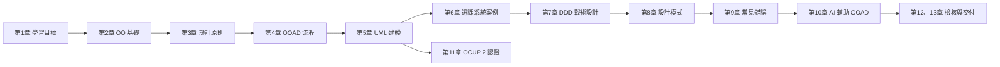

### 0.3 指引條目的格式與編號

本手冊把可執行、可審查的要求寫成「指引條目」，每條都有固定格式，方便在 Code Review 或設計審查時直接引用編號：

| 欄位 | 意義 |
|------|------|
| 編號 | `OOAD-<領域>-<序號>`，例如 `OOAD-OO-001`。編號一經發布不重新編排，廢止的條目保留編號並標示「已廢止」 |
| 等級 | **必須**（違反即退件）／**建議**（偏離時須在 PR 或設計文件說明理由） |
| 說明 | 這條指引要解決什麼問題、為什麼 |
| ❌ 反例／✅ 正例 | 每條指引至少一組範例，範例皆可編譯或可渲染 |
| 如何 review | 審查者用眼睛看時要找什麼特徵 |
| 如何驗證 | 用測試、工具或檢查步驟客觀證明「有做到」 |

領域代碼對照：

| 代碼 | 領域 | 所在章節 |
|------|------|----------|
| OO | 物件導向基礎 | 第 2 章 |
| PRN | 設計原則（SOLID、GRASP 等） | 第 3 章 |
| PRC | 流程、需求與分析 | 第 4 章 |
| UML | UML 建模 | 第 5 章 |
| DDD | 領域驅動設計戰術模式 | 第 7 章 |
| PAT | 設計模式 | 第 8 章 |
| IMP | 實作、例外、並行與效能 | 第 9 章 |
| SEC | 安全設計 | 第 9 章 |
| AI | AI 輔助分析與設計 | 第 10 章 |

全部條目彙整於[附錄 A 指引總表](#附錄-a-指引總表)。

### 0.4 範例的驗證方式

為了讓讀者「能自己驗證正確性」，本手冊的範例遵守以下規則：

1. **Java 範例皆可編譯**：每個 `java` 程式區塊都是可獨立編譯的單元（含 `import`）。若同一區塊有多個頂層型別，示範時省略的只有 `public` 修飾字的檔案拆分，語意不變。
2. **含 `@Test` 的區塊會實際執行**：測試類別名稱以 `Test` 結尾，以 JUnit 6 Console Launcher 執行，必須全部通過。
3. **含 `main` 並標示「輸出」的區塊會比對輸出**：實際輸出必須與註解中的輸出一致。
4. **Mermaid 圖表皆以 mermaid-cli 實際渲染**，不只做語法檢查。
5. **反例也必須能編譯**：反例展示的是「設計上錯」而不是「語法上錯」；若反例的錯誤可以被測試抓到，會在正例後附上證明測試。

> **注意事項**：範例為教學目的而精簡，例如省略日誌、國際化與完整的錯誤碼。正式專案仍須遵循[程式寫作指引]()、[安全程式碼指引]()與[測試與品質保證指引]()。

---

## 1. 前言與學習目標

### 1.1 為什麼要學習 OOAD

物件導向分析與設計（Object-Oriented Analysis and Design, OOAD）是一套「先理解問題，再決定程式結構」的方法。它把系統拆成一群各自負責一部分職責、彼此透過訊息合作的物件，並用 UML 把這些決策畫出來，讓團隊可以在寫程式之前就討論、審查與修正。

在 2026 年的開發環境中，OOAD 的價值不減反增：

| 挑戰 | OOAD 提供的解法 |
|------|----------------|
| 系統規模與需求變動頻繁 | 以職責與介面切分系統，變動被封裝在少數類別內 |
| AI 程式助理可以快速產生大量程式碼 | 工程師必須具備「判斷設計對不對」的能力，模型與指引就是判斷的依據（第 10 章） |
| 跨團隊、跨供應商協作 | UML 是 OMG 與 ISO/IEC 標準化的共同語言，降低溝通成本 |
| 稽核與合規要求可追溯 | 需求 → Use Case → 設計 → 程式 → 測試的追溯鏈（第 4.10 節） |

OOAD 由三個層次組成，學習時要分清楚：

| 層次 | 關注的問題 | 主要產出 |
|------|-----------|----------|
| 物件導向分析（OOA） | 問題領域裡「有什麼」、「發生什麼」 | Use Case、領域模型（概念類別）、系統循序圖 |
| 物件導向設計（OOD） | 軟體裡「誰負責什麼」、「怎麼合作」 | 設計類別圖、互動圖、狀態機、套件與元件圖 |
| 物件導向程式設計（OOP） | 用程式語言實現設計 | 類別、介面、測試 |

> **實務案例**：某團隊直接用 AI 助理產生「訂單模組」，程式可執行，但訂單狀態可以被任何類別用 `setStatus()` 任意改寫，上線後出現「已出貨又被改回待付款」的資料。事後補畫狀態機圖（第 5.10 節）並把狀態轉換收斂到 `Order` 自己的方法中，問題才根除。這正是「先分析設計、再實作」能預防的典型缺陷。

### 1.2 學習目標

完成本手冊後，您應該能達到以下三個層級的目標。每一項都對應到第 12 章的檢核方式：

**知道（Knowledge）**

- 說明封裝、抽象、繼承、多型的定義，以及它們各自要解決的問題。
- 說明 SOLID 與 GRASP 各原則的意圖，並舉出違反時的症狀。
- 列出 UML 2.5.1 的 14 種圖形與其分類，說明各自適用的分析設計階段。

**會做（Skill）**

- 從一段需求敘述找出 Use Case、領域概念與其關聯，畫出 Use Case 圖與領域模型。
- 把領域模型轉為設計類別圖與循序圖，並寫出對應的 Java 程式與單元測試。
- 用狀態機圖描述物件生命週期，並實作不可非法轉換的狀態機。

**會審查（Review）**

- 依指引編號指出設計或程式碼的問題，並提出可驗證的修正方式。
- 用 ArchUnit 等工具把設計規則變成自動化檢查。
- 審查 AI 產生的 UML 模型與程式碼，找出與需求不一致之處。

### 1.3 學習路徑與建議時數

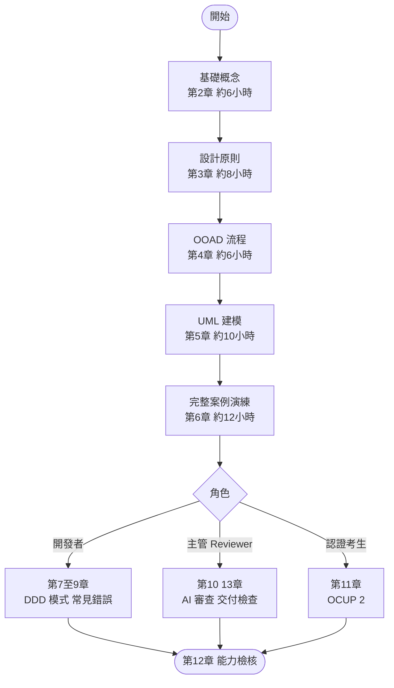

| 階段 | 時數（參考） | 驗收方式 |
|------|--------------|----------|
| 基礎概念與設計原則 | 14 小時 | 完成第 2、3 章練習題，程式通過單元測試 |
| 流程與 UML | 16 小時 | 為指定需求產出 Use Case 規格、領域模型、2 張循序圖、1 張狀態機圖，由資深同仁依第 13 章清單審查 |
| 案例演練 | 12 小時 | 在第 6 章案例上新增一項需求（例如「候補遞補」），含設計圖、程式與測試 |
| 進階主題 | 依角色 8～16 小時 | 依第 12 章能力評量表自評並由主管覆核 |

### 1.4 前置知識與環境準備

**前置知識**

- Java 基本語法：類別、介面、例外、集合、Lambda。
- 會使用 Git 與一種 IDE（IntelliJ IDEA、VS Code 或 Eclipse）。
- 了解軟體開發生命週期的基本階段。

**環境準備**

| 工具 | 用途 | 確認方式 |
|------|------|----------|
| JDK 25 | 編譯與執行範例 | `java -version` 顯示 `25` |
| Maven 3.9 以上 | 建置與相依管理 | `mvn -v` |
| Mermaid 預覽外掛或 Mermaid Live Editor | 練習繪製圖表 | 能預覽本手冊任一圖表 |
| PlantUML（選用） | 需要完整 UML 記法時使用 | `java -jar plantuml.jar -version` |

最小可執行的練習專案 `pom.xml`（測試相依版本與本手冊驗證基準一致）：

```xml
<project xmlns="http://maven.apache.org/POM/4.0.0">
  <modelVersion>4.0.0</modelVersion>
  <groupId>com.example</groupId>
  <artifactId>ooad-lab</artifactId>
  <version>1.0.0</version>
  <properties>
    <maven.compiler.release>25</maven.compiler.release>
    <project.build.sourceEncoding>UTF-8</project.build.sourceEncoding>
  </properties>
  <dependencies>
    <dependency>
      <groupId>org.junit.jupiter</groupId>
      <artifactId>junit-jupiter</artifactId>
      <version>6.1.3</version>
      <scope>test</scope>
    </dependency>
    <dependency>
      <groupId>org.assertj</groupId>
      <artifactId>assertj-core</artifactId>
      <version>3.27.7</version>
      <scope>test</scope>
    </dependency>
    <dependency>
      <groupId>com.tngtech.archunit</groupId>
      <artifactId>archunit-junit5</artifactId>
      <version>1.5.1</version>
      <scope>test</scope>
    </dependency>
  </dependencies>
  <build>
    <plugins>
      <plugin>
        <groupId>org.apache.maven.plugins</groupId>
        <artifactId>maven-surefire-plugin</artifactId>
        <version>3.6.0</version>
      </plugin>
    </plugins>
  </build>
</project>
```

> **注意事項**：`maven.compiler.release` 設為 25 可確保不會誤用 JDK 25 以後才有的 API。若公司專案仍在 Java 21，範例中的語法（`record`、`sealed`、pattern matching for `switch`）在 Java 21 也都可用。

### 1.5 本章自我檢核

- [ ] 我能用自己的話說明 OOA、OOD、OOP 的差別，並各舉一個產出物。
- [ ] 我已完成環境準備，並能執行 `mvn test`。
- [ ] 我知道本手冊指引條目的格式，以及在附錄 A 查詢條目的方式。

---

## 2. 物件導向基礎概念

### 2.1 物件與類別

**物件（Object）** 是同時擁有「身分（identity）」、「狀態（state）」與「行為（behavior）」的執行期實體；**類別（Class）** 是描述一群物件共同結構與行為的定義。

| 特性 | 說明 | Java 對應 |
|------|------|-----------|
| 身分 | 即使狀態完全相同，兩個物件仍是不同個體 | `a == b` 比較的是身分 |
| 狀態 | 物件在某一時間點的屬性值組合 | 欄位（field） |
| 行為 | 物件能回應的訊息 | 方法（method） |

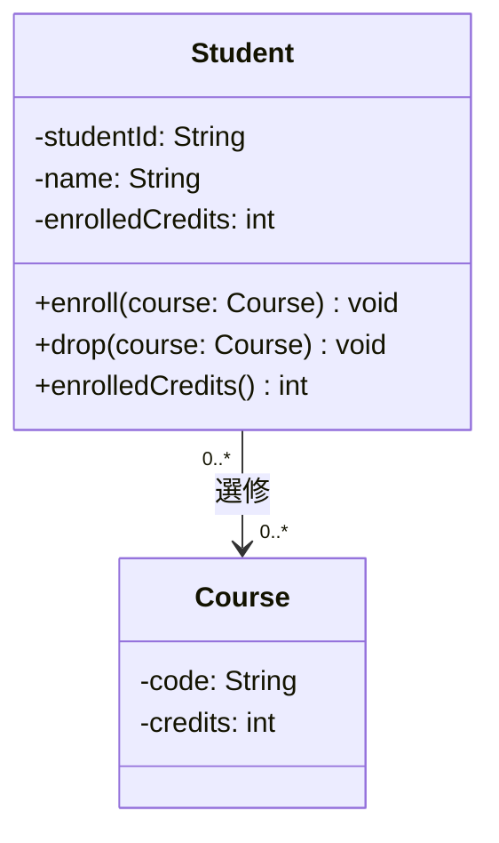

上圖中 `-` 代表 private、`+` 代表 public，`0..*` 是多重性（multiplicity），箭頭表示可由 `Student` 導覽到 `Course`。完整記法見第 5.4 節。

下面的程式示範「身分」與「狀態相等」的差別：

```java
import java.util.Objects;

public class IdentityDemo {
    record Isbn(String value) { }          // 值物件：狀態相同即相等

    static final class Book {              // 實體：以身分區分
        private final Isbn isbn;
        Book(Isbn isbn) { this.isbn = Objects.requireNonNull(isbn); }
    }

    public static void main(String[] args) {
        Isbn a = new Isbn("978-0137488803");
        Isbn b = new Isbn("978-0137488803");
        Book book1 = new Book(a);
        Book book2 = new Book(b);
        System.out.println(a.equals(b));        // 值相等
        System.out.println(book1 == book2);     // 不同身分
        System.out.println(book1.equals(book2)); // 未覆寫 equals，比較身分
    }
    // 輸出：
    // true
    // false
    // false
}
```

> **注意事項**：「兩本書是否相同」是業務問題而非技術問題。若業務上同一 ISBN 的實體書仍是不同庫存品，就不能以 ISBN 判斷相等（見 OOAD-OO-008）。

### 2.2 封裝

**封裝（Encapsulation）** 是把資料與操作資料的規則放在同一個類別，外界只能透過類別提供的行為改變狀態。封裝的目的不是「把欄位改成 private 再補 getter/setter」，而是**讓不變量（invariant）只能在一個地方被維護**。

#### OOAD-OO-001 屬性一律私有並以行為方法改變狀態

- **等級**：必須
- **說明**：公開欄位或無條件的 setter 讓任何呼叫者都能把物件改成非法狀態，業務規則因此散落在各處。狀態改變應透過有業務意義的方法（`withdraw`、`confirm`），由方法負責檢查規則。

❌ **反例**：規則由呼叫者負責，任何人都能把餘額設成負數。

```java
import java.math.BigDecimal;

public class AnemicAccount {
    private BigDecimal balance = BigDecimal.ZERO;

    public BigDecimal getBalance() { return balance; }

    public void setBalance(BigDecimal balance) { this.balance = balance; }
}

class TransferScript {
    void withdraw(AnemicAccount account, BigDecimal amount) {
        // 規則寫在外面；另一個呼叫者可能忘了檢查
        if (account.getBalance().compareTo(amount) >= 0) {
            account.setBalance(account.getBalance().subtract(amount));
        }
    }
}
```

✅ **正例**：狀態只能透過 `deposit`／`withdraw` 改變，規則集中在類別內。

```java
import java.math.BigDecimal;
import org.junit.jupiter.api.Test;
import static org.assertj.core.api.Assertions.assertThat;
import static org.assertj.core.api.Assertions.assertThatThrownBy;

public class Account {
    private BigDecimal balance = BigDecimal.ZERO;

    public void deposit(BigDecimal amount) {
        requirePositive(amount);
        balance = balance.add(amount);
    }

    public void withdraw(BigDecimal amount) {
        requirePositive(amount);
        if (balance.compareTo(amount) < 0) {
            throw new IllegalStateException("餘額不足");
        }
        balance = balance.subtract(amount);
    }

    public BigDecimal balance() { return balance; }

    private static void requirePositive(BigDecimal amount) {
        if (amount == null || amount.signum() <= 0) {
            throw new IllegalArgumentException("金額必須大於 0");
        }
    }
}

class AccountTest {
    @Test
    void 提款超過餘額時拒絕且餘額不變() {
        Account account = new Account();
        account.deposit(new BigDecimal("100"));

        assertThatThrownBy(() -> account.withdraw(new BigDecimal("101")))
            .isInstanceOf(IllegalStateException.class);
        assertThat(account.balance()).isEqualByComparingTo("100");
    }

    @Test
    void 不接受零或負數金額() {
        Account account = new Account();
        assertThatThrownBy(() -> account.deposit(BigDecimal.ZERO))
            .isInstanceOf(IllegalArgumentException.class);
    }
}
```

- **如何 review**：搜尋領域類別中的 `public void set`；每個 setter 都要問「誰可以呼叫、會不會破壞規則」。看到「先 get、判斷、再 set」的呼叫端程式，就是規則外洩的訊號。
- **如何驗證**：為每個會改變狀態的方法撰寫「非法輸入被拒絕且狀態不變」的測試（如上 `AccountTest`）；可再用 ArchUnit 禁止領域套件出現 public setter（見第 3.9 節範例）。

#### OOAD-OO-002 物件建立後即處於有效狀態

- **等級**：必須
- **說明**：如果物件可以先 `new` 出來再用 setter 補資料，就會存在「半成品」物件。必要屬性應在建構子或靜態工廠方法中一次給齊並驗證。

❌ **反例**：建立後必須記得呼叫三個 setter，漏一個就是無效物件。

```java
import java.time.LocalTime;

public class TimeSlotDraft {
    private LocalTime start;
    private LocalTime end;

    public void setStart(LocalTime start) { this.start = start; }
    public void setEnd(LocalTime end) { this.end = end; }

    public boolean overlaps(TimeSlotDraft other) {
        // 若 start 或 end 尚未設定，這裡會拋出 NullPointerException
        return start.isBefore(other.end) && other.start.isBefore(end);
    }
}
```

✅ **正例**：用 `record` 的精簡建構子（compact constructor）在建立時驗證。

```java
import java.time.DayOfWeek;
import java.time.LocalTime;
import java.util.Objects;
import org.junit.jupiter.api.Test;
import static org.assertj.core.api.Assertions.assertThat;
import static org.assertj.core.api.Assertions.assertThatThrownBy;

public record TimeSlot(DayOfWeek day, LocalTime start, LocalTime end) {
    public TimeSlot {
        Objects.requireNonNull(day, "day");
        Objects.requireNonNull(start, "start");
        Objects.requireNonNull(end, "end");
        if (!start.isBefore(end)) {
            throw new IllegalArgumentException("開始時間必須早於結束時間");
        }
    }

    /** 半開區間 [start, end)：10:00-12:00 與 12:00-14:00 不重疊。 */
    public boolean overlaps(TimeSlot other) {
        return day == other.day
            && start.isBefore(other.end)
            && other.start.isBefore(end);
    }
}

class TimeSlotTest {
    @Test
    void 開始等於結束的時段無法建立() {
        assertThatThrownBy(() -> new TimeSlot(DayOfWeek.MONDAY,
                LocalTime.of(10, 0), LocalTime.of(10, 0)))
            .isInstanceOf(IllegalArgumentException.class);
    }

    @Test
    void 首尾相接的時段不算重疊() {
        TimeSlot a = new TimeSlot(DayOfWeek.MONDAY, LocalTime.of(10, 0), LocalTime.of(12, 0));
        TimeSlot b = new TimeSlot(DayOfWeek.MONDAY, LocalTime.of(12, 0), LocalTime.of(14, 0));
        assertThat(a.overlaps(b)).isFalse();
    }

    @Test
    void 不同星期幾不重疊() {
        TimeSlot a = new TimeSlot(DayOfWeek.MONDAY, LocalTime.of(10, 0), LocalTime.of(12, 0));
        TimeSlot b = new TimeSlot(DayOfWeek.TUESDAY, LocalTime.of(10, 0), LocalTime.of(12, 0));
        assertThat(a.overlaps(b)).isFalse();
    }
}
```

- **如何 review**：找無參數建構子加大量 setter 的領域類別；確認每個必要欄位都在建構時被驗證，且驗證條件與需求文件的業務規則一致（例如「開始時間必須早於結束時間」而不是「不可晚於」）。
- **如何驗證**：為每條建構期規則寫一個「邊界值無法建立」的測試；邊界值要包含相等的情況（如上例 10:00–10:00）。

#### OOAD-OO-003 不洩漏可變的內部集合

- **等級**：必須
- **說明**：回傳內部 `List` 的參考，等於把修改權交給外界，類別的規則（例如人數上限）會被繞過。

❌ **反例**：呼叫者可以直接 `students().add(...)`，繞過名額檢查。

```java
import java.util.ArrayList;
import java.util.List;

public class LeakyCourse {
    private final int capacity;
    private final List<String> students = new ArrayList<>();

    public LeakyCourse(int capacity) { this.capacity = capacity; }

    public void enroll(String studentId) {
        if (students.size() >= capacity) {
            throw new IllegalStateException("名額已滿");
        }
        students.add(studentId);
    }

    public List<String> students() { return students; } // 洩漏內部集合
}
```

✅ **正例**：回傳不可修改的複本；修改只能透過 `enroll`。

```java
import java.util.ArrayList;
import java.util.List;
import org.junit.jupiter.api.Test;
import static org.assertj.core.api.Assertions.assertThatThrownBy;

public class Course {
    private final int capacity;
    private final List<String> students = new ArrayList<>();

    public Course(int capacity) {
        if (capacity <= 0) throw new IllegalArgumentException("名額必須大於 0");
        this.capacity = capacity;
    }

    public void enroll(String studentId) {
        if (students.contains(studentId)) throw new IllegalStateException("重複選課");
        if (students.size() >= capacity) throw new IllegalStateException("名額已滿");
        students.add(studentId);
    }

    public List<String> students() { return List.copyOf(students); }
}

class CourseTest {
    @Test
    void 外部無法透過查詢結果繞過名額檢查() {
        Course course = new Course(1);
        course.enroll("S001");
        assertThatThrownBy(() -> course.students().add("S002"))
            .isInstanceOf(UnsupportedOperationException.class);
    }

    @Test
    void 名額已滿時拒絕選課() {
        Course course = new Course(1);
        course.enroll("S001");
        assertThatThrownBy(() -> course.enroll("S002"))
            .isInstanceOf(IllegalStateException.class)
            .hasMessage("名額已滿");
    }
}
```

- **如何 review**：檢查回傳 `List`、`Set`、`Map`、陣列或 `Date` 等可變型別的 getter，確認回傳的是 `List.copyOf`、`Collections.unmodifiableList` 或不可變型別。
- **如何驗證**：寫一個「嘗試修改查詢結果會拋出 `UnsupportedOperationException`」的測試，如上 `CourseTest`。

> **實務案例**：v2.1 版手冊的 `Course` 同時維護 `enrolledStudents` 與 `enrollments` 兩份集合，且 `addStudent()` 是 public，`EnrollmentService` 與 `Student` 都會呼叫它，名額檢查因此在兩處各做一次且結果可能不一致。v3.0 的第 6 章案例改為只由 `CourseSection` 一處維護選課名單。

### 2.3 抽象

**抽象（Abstraction）** 是只保留對目前問題有意義的特徵，忽略其他細節。在程式中，抽象最常以**介面（interface）** 與**抽象類別（abstract class）** 表達。

#### OOAD-OO-004 金額與數量等業務數值使用專用型別

- **等級**：必須
- **說明**：`double` 是二進位浮點數，無法精確表示 0.1，金額累加會產生誤差。金額應使用 `BigDecimal`，更好的做法是包成 `Money` 值物件，把「幣別」與「進位規則」一起封裝。

❌ **反例**：

```java
public class DoublePrice {
    public static void main(String[] args) {
        double total = 0;
        for (int i = 0; i < 10; i++) {
            total += 0.1;
        }
        System.out.println(total);
        System.out.println(total == 1.0);
    }
    // 輸出：
    // 0.9999999999999999
    // false
}
```

✅ **正例**：

```java
import java.math.BigDecimal;
import java.math.RoundingMode;
import java.util.Currency;
import java.util.Objects;
import org.junit.jupiter.api.Test;
import static org.assertj.core.api.Assertions.assertThat;
import static org.assertj.core.api.Assertions.assertThatThrownBy;

public record Money(BigDecimal amount, Currency currency) {
    public Money {
        Objects.requireNonNull(amount, "amount");
        Objects.requireNonNull(currency, "currency");
        amount = amount.setScale(currency.getDefaultFractionDigits(), RoundingMode.HALF_UP);
    }

    public static Money of(String amount, String currencyCode) {
        return new Money(new BigDecimal(amount), Currency.getInstance(currencyCode));
    }

    public Money plus(Money other) {
        requireSameCurrency(other);
        return new Money(amount.add(other.amount), currency);
    }

    public Money times(int quantity) {
        return new Money(amount.multiply(BigDecimal.valueOf(quantity)), currency);
    }

    private void requireSameCurrency(Money other) {
        if (!currency.equals(other.currency)) {
            throw new IllegalArgumentException("幣別不同不可相加");
        }
    }
}

class MoneyTest {
    @Test
    void 十次加一角等於一元() {
        Money total = Money.of("0", "TWD");
        for (int i = 0; i < 10; i++) {
            total = total.plus(Money.of("0.1", "TWD"));
        }
        assertThat(total).isEqualTo(Money.of("1", "TWD"));
    }

    @Test
    void 不同幣別相加會被拒絕() {
        assertThatThrownBy(() -> Money.of("1", "TWD").plus(Money.of("1", "USD")))
            .isInstanceOf(IllegalArgumentException.class);
    }
}
```

- **如何 review**：搜尋 `double price`、`float amount`、`double total` 等宣告；檢查 `BigDecimal` 是否以字串建構（`new BigDecimal("0.1")`）而非 `new BigDecimal(0.1)`。
- **如何驗證**：寫「累加 0.1 十次等於 1」與「不同幣別相加被拒絕」的測試；也可在 CI 加入 SpotBugs 規則 `DMI_BIGDECIMAL_CONSTRUCTED_FROM_DOUBLE`。

> **注意事項**：新台幣（TWD）在 ISO 4217 的小數位數是 2，因此 `Money.of("1", "TWD")` 的金額為 `1.00`。若業務規則要求以「元」為最小單位，應在 `Money` 內明確定義進位規則，而不是依賴 ISO 預設值。

### 2.4 繼承與組合

**繼承（Inheritance）** 讓子類別取得父類別的結構與行為，表達「是一種（is-a）」關係；**組合（Composition）** 讓物件持有另一個物件並委派工作給它，表達「有一個（has-a）」關係。

| 比較項目 | 繼承 | 組合 |
|----------|------|------|
| 關係在何時決定 | 編譯期，固定 | 執行期，可替換 |
| 對父類別實作的依賴 | 強（父類別改動可能破壞子類別） | 弱（只依賴介面） |
| 適用情境 | 真正的 is-a，且子類別完全遵守父類別契約 | 需要重用行為、或行為需要動態切換 |

#### OOAD-OO-005 優先使用組合，繼承僅用於真正的 is-a 關係

- **等級**：建議
- **說明**：為了「重用程式碼」而繼承，會讓子類別暴露父類別所有公開方法，也把子類別綁死在父類別的實作細節上（脆弱基底類別問題）。

❌ **反例**：`Stack` 繼承 `ArrayList` 只為了重用儲存功能，結果外界可以呼叫 `add(0, x)` 從底部插入，破壞堆疊語意。

```java
import java.util.ArrayList;

public class InheritedStack<E> extends ArrayList<E> {
    public void push(E element) { add(element); }

    public E pop() { return remove(size() - 1); }
}

class InheritedStackMisuse {
    static void misuse() {
        InheritedStack<String> stack = new InheritedStack<>();
        stack.push("a");
        stack.add(0, "z"); // 繼承來的方法讓堆疊可以從底部插入
    }
}
```

✅ **正例**：以組合持有 `Deque`，只公開堆疊需要的操作。

```java
import java.util.ArrayDeque;
import java.util.Deque;
import java.util.NoSuchElementException;
import org.junit.jupiter.api.Test;
import static org.assertj.core.api.Assertions.assertThat;
import static org.assertj.core.api.Assertions.assertThatThrownBy;

public final class Stack<E> {
    private final Deque<E> elements = new ArrayDeque<>();

    public void push(E element) { elements.push(element); }

    public E pop() {
        if (elements.isEmpty()) throw new NoSuchElementException("堆疊為空");
        return elements.pop();
    }

    public boolean isEmpty() { return elements.isEmpty(); }
}

class StackTest {
    @Test
    void 後進先出() {
        Stack<String> stack = new Stack<>();
        stack.push("a");
        stack.push("b");
        assertThat(stack.pop()).isEqualTo("b");
        assertThat(stack.pop()).isEqualTo("a");
    }

    @Test
    void 空堆疊彈出時拋出明確例外() {
        assertThatThrownBy(() -> new Stack<String>().pop())
            .isInstanceOf(NoSuchElementException.class);
    }
}
```

- **如何 review**：看到 `extends` 時，問兩個問題：(1)「子類別是一種父類別」這句話在業務上是否成立？(2) 父類別的**每一個**公開方法對子類別都有意義嗎？任何一題答「否」，就改用組合。
- **如何驗證**：用 ArchUnit 限制領域套件內不得繼承 JDK 集合類別，或限制繼承深度；子類別必須通過父類別的契約測試（見 OOAD-PRN-003）。

**繼承階層範例**：真正的 is-a 關係可以使用繼承，但要搭配抽象方法讓子類別提供差異行為。

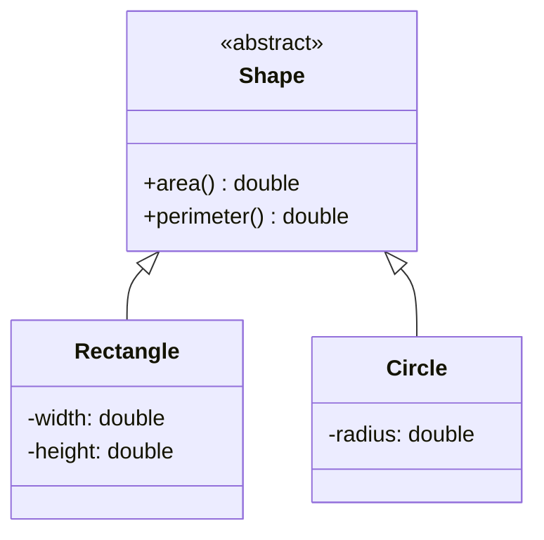

### 2.5 多型

**多型（Polymorphism）** 是「同一個訊息，由不同物件以各自的方式回應」。Java 中要分清楚兩種機制：

| 機制 | 決定時機 | 說明 |
|------|----------|------|
| 覆寫（override） | **執行期**（動態繫結） | 子類別重新定義父型別的方法，依物件的實際型別決定執行哪個版本，這是 OOAD 所說的多型 |
| 多載（overload） | **編譯期**（靜態決定） | 同名方法參數不同，依變數的宣告型別選擇版本；它不是執行期多型 |

#### OOAD-OO-006 以多型取代依型別分支的條件判斷

- **等級**：建議
- **說明**：在多處用 `if (type == ...)` 或 `instanceof` 判斷型別再決定行為，新增一種型別就要修改所有分支（違反開放封閉原則，見 OOAD-PRN-002）。應讓各型別自己實作行為。若型別集合是封閉且穩定的，Java 17 以後可用 `sealed` 介面搭配 `switch` 模式比對，由編譯器檢查是否涵蓋所有型別。

❌ **反例**：

```java
public class ShippingFeeCalculator {
    public int fee(String memberType, int orderAmount) {
        if ("GOLD".equals(memberType)) {
            return 0;
        } else if ("SILVER".equals(memberType)) {
            return orderAmount >= 1000 ? 0 : 60;
        } else {
            return orderAmount >= 2000 ? 0 : 100;
        }
        // 新增「白金會員」時，這裡與其他所有判斷會員類型的地方都要修改
    }
}
```

✅ **正例一（開放擴充）**：每種會員自行決定運費。

```java
import java.util.List;
import org.junit.jupiter.api.Test;
import static org.assertj.core.api.Assertions.assertThat;

interface MemberTier {
    int shippingFee(int orderAmount);
}

final class Gold implements MemberTier {
    public int shippingFee(int orderAmount) { return 0; }
}

final class Silver implements MemberTier {
    public int shippingFee(int orderAmount) { return orderAmount >= 1000 ? 0 : 60; }
}

final class Regular implements MemberTier {
    public int shippingFee(int orderAmount) { return orderAmount >= 2000 ? 0 : 100; }
}

class MemberTierTest {
    @Test
    void 各等級依自己的規則計算運費() {
        List<MemberTier> tiers = List.of(new Gold(), new Silver(), new Regular());
        assertThat(tiers.stream().map(t -> t.shippingFee(1500)).toList())
            .containsExactly(0, 0, 100);
    }
}
```

✅ **正例二（封閉集合）**：`sealed` 介面讓編譯器保證 `switch` 涵蓋所有型別；新增型別而未處理時會編譯失敗。

```java
import org.junit.jupiter.api.Test;
import static org.assertj.core.api.Assertions.assertThat;

sealed interface PaymentMethod permits CreditCard, BankTransfer, CashOnDelivery { }
record CreditCard(String maskedNumber) implements PaymentMethod { }
record BankTransfer(String bankCode) implements PaymentMethod { }
record CashOnDelivery() implements PaymentMethod { }

final class PaymentFee {
    static int feeOf(PaymentMethod method) {
        return switch (method) {
            case CreditCard c -> 15;
            case BankTransfer b -> 10;
            case CashOnDelivery c -> 30;
        }; // 不需要 default：sealed 已讓編譯器確認涵蓋全部型別
    }
}

class PaymentFeeTest {
    @Test
    void 每種付款方式都有對應手續費() {
        assertThat(PaymentFee.feeOf(new CreditCard("****1234"))).isEqualTo(15);
        assertThat(PaymentFee.feeOf(new CashOnDelivery())).isEqualTo(30);
    }
}
```

- **如何 review**：搜尋同一個型別代碼（字串、enum）在多個類別中被 `switch` 或 `if` 判斷；超過一處就應考慮多型或 `sealed`。`sealed` 版本中出現 `default` 分支會讓編譯器失去完整性檢查，應移除。
- **如何驗證**：新增一個型別，確認只需新增一個類別（正例一），或編譯器會指出所有需要補的 `switch`（正例二）。

#### OOAD-OO-007 不以多載實現依執行期型別而異的行為

- **等級**：必須
- **說明**：多載在編譯期依「宣告型別」選擇方法，不會依物件實際型別切換。用多載來「處理不同子類別」是常見的誤解。

❌ **反例**：

```java
public class OverloadPitfall {
    interface Animal { }
    static final class Dog implements Animal { }

    static String describe(Animal a) { return "某種動物"; }
    static String describe(Dog d) { return "一隻狗"; }

    public static void main(String[] args) {
        Animal pet = new Dog();
        System.out.println(describe(pet));        // 依宣告型別 Animal 選擇
        System.out.println(describe(new Dog()));  // 宣告型別即為 Dog
    }
    // 輸出：
    // 某種動物
    // 一隻狗
}
```

✅ **正例**：把行為放在型別本身，以覆寫達成執行期多型。

```java
public class OverrideCorrect {
    interface Animal { String describe(); }
    static final class Dog implements Animal {
        public String describe() { return "一隻狗"; }
    }

    public static void main(String[] args) {
        Animal pet = new Dog();
        System.out.println(pet.describe());
    }
    // 輸出：
    // 一隻狗
}
```

- **如何 review**：同一類別中出現參數型別互為父子關係的多載方法時，特別檢查呼叫端的宣告型別。
- **如何驗證**：以父型別變數呼叫並斷言結果（如上 `main` 的輸出）。

### 2.6 值物件、實體與相等性

#### OOAD-OO-008 依業務身分定義相等並同時覆寫 equals 與 hashCode

- **等級**：必須
- **說明**：Java 規定 `equals` 相等的物件 `hashCode` 必須相同，否則放進 `HashSet`／`HashMap` 會出錯。**實體（Entity）** 以識別碼判斷相等；**值物件（Value Object）** 以全部屬性判斷相等。

❌ **反例**：只覆寫 `equals`，放進 `HashSet` 後找不到。

```java
import java.util.HashSet;
import java.util.Set;

public class BrokenEquality {
    static final class StudentId {
        private final String value;
        StudentId(String value) { this.value = value; }

        @Override
        public boolean equals(Object o) {
            return o instanceof StudentId other && value.equals(other.value);
        }
        // 缺少 hashCode
    }

    public static void main(String[] args) {
        Set<StudentId> ids = new HashSet<>();
        ids.add(new StudentId("S001"));
        System.out.println(new StudentId("S001").equals(new StudentId("S001")));
        System.out.println(ids.contains(new StudentId("S001")));
    }
    // 輸出：
    // true
    // false
}
```

✅ **正例**：值物件用 `record`（自動產生一致的 `equals`／`hashCode`）；實體只以 ID 判斷相等。

```java
import java.util.HashSet;
import java.util.Objects;
import java.util.Set;
import org.junit.jupiter.api.Test;
import static org.assertj.core.api.Assertions.assertThat;

record StudentId(String value) {
    StudentId {
        if (value == null || !value.matches("S\\d{3}")) {
            throw new IllegalArgumentException("學號格式錯誤：" + value);
        }
    }
}

final class Student {
    private final StudentId id;
    private String name;

    Student(StudentId id, String name) {
        this.id = Objects.requireNonNull(id);
        this.name = Objects.requireNonNull(name);
    }

    void rename(String newName) { this.name = Objects.requireNonNull(newName); }

    @Override
    public boolean equals(Object o) {
        return o instanceof Student other && id.equals(other.id);
    }

    @Override
    public int hashCode() { return id.hashCode(); }
}

class EqualityTest {
    @Test
    void 值物件以屬性判斷相等() {
        Set<StudentId> ids = new HashSet<>();
        ids.add(new StudentId("S001"));
        assertThat(ids).contains(new StudentId("S001"));
    }

    @Test
    void 實體改名後仍是同一個實體() {
        Student a = new Student(new StudentId("S001"), "王小明");
        Student b = new Student(new StudentId("S001"), "王小明");
        b.rename("王大明");
        assertThat(a).isEqualTo(b).hasSameHashCodeAs(b);
    }
}
```

- **如何 review**：有 `equals` 就要有 `hashCode`；實體的 `equals` 不可包含可變的業務屬性（姓名、狀態），否則改名後在 `Set` 中會「消失」。
- **如何驗證**：使用 EqualsVerifier（`nl.jqno.equalsverifier`）或至少寫「放入 `HashSet` 後可查到」與「可變屬性改變後仍相等」兩個測試。

#### OOAD-OO-009 值物件設計為不可變

- **等級**：建議
- **說明**：值物件被多處共享，若可變，一處修改會影響所有持有者。Java 16 以後用 `record` 表達值物件最簡潔；運算一律回傳新物件（如 `Money.plus`）。

❌ **反例**：

```java
public class MutableRange {
    private int min;
    private int max;

    public MutableRange(int min, int max) { this.min = min; this.max = max; }

    public void setMax(int max) { this.max = max; } // 共享後被修改，所有持有者同時受影響

    public boolean contains(int value) { return value >= min && value <= max; }
}
```

✅ **正例**：

```java
import org.junit.jupiter.api.Test;
import static org.assertj.core.api.Assertions.assertThat;

public record CreditRange(int min, int max) {
    public CreditRange {
        if (min < 0 || min > max) throw new IllegalArgumentException("學分範圍錯誤");
    }

    public boolean contains(int credits) { return credits >= min && credits <= max; }

    public CreditRange withMax(int newMax) { return new CreditRange(min, newMax); }
}

class CreditRangeTest {
    @Test
    void 修改產生新物件而不影響原物件() {
        CreditRange original = new CreditRange(9, 25);
        CreditRange relaxed = original.withMax(28);
        assertThat(original.max()).isEqualTo(25);
        assertThat(relaxed.contains(27)).isTrue();
    }
}
```

- **如何 review**：值物件不應有 setter；`record` 的元件若是可變集合，須在精簡建構子中以 `List.copyOf` 防禦性複製。
- **如何驗證**：「修改操作後原物件不變」的測試；ArchUnit 可檢查標記為值物件的類別所有欄位皆為 `final`。

### 2.7 介面與抽象類別

#### OOAD-OO-010 以介面表達角色並以抽象類別表達共同骨架

- **等級**：建議
- **說明**：介面描述「能做什麼」（角色、能力），一個類別可以扮演多個角色；抽象類別描述「共同的骨架與部分實作」，適合樣板方法（Template Method，見第 8.5 節）。不要為了「以後可能換實作」而替每個類別都建一個只有單一實作的介面。

| 判斷問題 | 選擇 |
|----------|------|
| 需要多種彼此無關的類別扮演同一角色？ | 介面 |
| 子類別共享狀態或演算法骨架？ | 抽象類別 |
| 跨越架構層的依賴（例如領域層使用儲存庫）？ | 介面（依賴反轉，見 OOAD-PRN-005） |
| 只有一種實作且沒有替換或測試替身需求？ | 不需要介面 |

❌ **反例**：一個介面混合多種角色，實作者被迫提供不相干的方法。

```java
public interface Printer {
    void print(String document);
    void scan(String document);   // 單功能印表機無法實作
    void fax(String number);
}

class SimplePrinter implements Printer {
    public void print(String document) { System.out.println(document); }
    public void scan(String document) { throw new UnsupportedOperationException(); }
    public void fax(String number) { throw new UnsupportedOperationException(); }
}
```

✅ **正例**：依角色拆分介面，多功能事務機同時實作多個角色。

```java
import java.util.ArrayList;
import java.util.List;
import org.junit.jupiter.api.Test;
import static org.assertj.core.api.Assertions.assertThat;

interface Printing { void print(String document); }
interface Scanning { String scan(); }

final class SimplePrinter implements Printing {
    final List<String> printed = new ArrayList<>();
    public void print(String document) { printed.add(document); }
}

final class MultiFunctionDevice implements Printing, Scanning {
    public void print(String document) { }
    public String scan() { return "scanned"; }
}

class RoleInterfaceTest {
    @Test
    void 只需要列印的呼叫者只依賴列印角色() {
        SimplePrinter printer = new SimplePrinter();
        Printing role = printer;
        role.print("報表");
        assertThat(printer.printed).containsExactly("報表");
    }
}
```

- **如何 review**：實作類別中出現 `throw new UnsupportedOperationException()` 實作介面方法，代表介面太胖（也違反 OOAD-PRN-004）。
- **如何驗證**：統計介面的實作類別中拋出 `UnsupportedOperationException` 的方法數，目標為 0。

### 2.8 實務案例：學生管理模型

v2.1 版的範例以 `Person` 抽象類別派生 `Student` 與 `Teacher`，並以 `displayInfo()` 在領域物件中直接 `System.out.println`。這有兩個設計問題：

1. 「學生」與「教師」是**角色**而不是**型別**：同一個人可能同時是在職專班學生與兼任教師，用繼承會讓一個人必須存在兩個物件。
2. 領域物件負責輸出畫面，混入了呈現層職責（違反 OOAD-PRN-001）。

改良後的模型以「人員」持有多個「角色」（組合），呈現交給呼叫端：

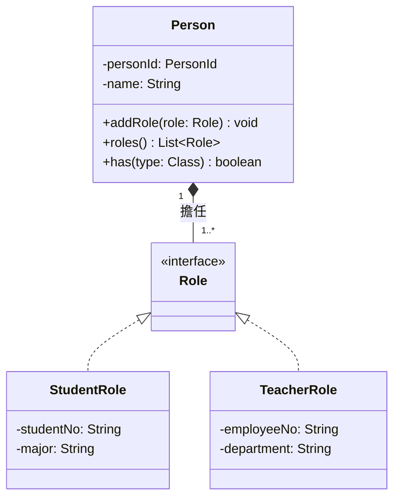

```java
import java.util.ArrayList;
import java.util.List;
import java.util.Objects;
import org.junit.jupiter.api.Test;
import static org.assertj.core.api.Assertions.assertThat;
import static org.assertj.core.api.Assertions.assertThatThrownBy;

record PersonId(String value) { }

sealed interface Role permits StudentRole, TeacherRole { }
record StudentRole(String studentNo, String major) implements Role { }
record TeacherRole(String employeeNo, String department) implements Role { }

final class Person {
    private final PersonId id;
    private final String name;
    private final List<Role> roles = new ArrayList<>();

    Person(PersonId id, String name, Role firstRole) {
        this.id = Objects.requireNonNull(id);
        this.name = Objects.requireNonNull(name);
        addRole(firstRole);
    }

    void addRole(Role role) {
        Objects.requireNonNull(role);
        if (has(role.getClass())) {
            throw new IllegalStateException("同一種角色只能擔任一次");
        }
        roles.add(role);
    }

    boolean has(Class<? extends Role> type) {
        return roles.stream().anyMatch(type::isInstance);
    }

    List<Role> roles() { return List.copyOf(roles); }

    String name() { return name; }
}

class PersonTest {
    @Test
    void 同一人可同時是學生與教師() {
        Person p = new Person(new PersonId("P01"), "林老師", new TeacherRole("E100", "資工系"));
        p.addRole(new StudentRole("M11301", "資管所"));
        assertThat(p.has(StudentRole.class)).isTrue();
        assertThat(p.has(TeacherRole.class)).isTrue();
    }

    @Test
    void 不可重複擔任同一種角色() {
        Person p = new Person(new PersonId("P02"), "陳同學", new StudentRole("B11201", "資工系"));
        assertThatThrownBy(() -> p.addRole(new StudentRole("B11202", "電機系")))
            .isInstanceOf(IllegalStateException.class);
    }
}
```

> **注意事項**：角色模型不是唯一正解。如果業務明確規定「學生與教師的帳號與資料完全分開管理」，以兩個獨立類別建模（不共用父類別）會更簡單。設計決策應寫進設計文件，說明採用與不採用的理由。

### 2.9 練習題

**練習 2.1：圖書館的封裝設計**

為圖書館系統設計 `Book`、`Member`、`Loan` 三個類別，需求如下：會員最多同時借 5 本書；同一本書同時只能被一人借出；逾期未還的會員不得再借書。

- 交付：類別圖一張、Java 程式、單元測試。
- 驗收標準：(1) 沒有 public setter；(2)「借第 6 本被拒絕」、「借出中的書再借被拒絕」、「逾期會員被拒絕」三個測試通過；(3) 查詢借閱清單不能被外部修改。

**練習 2.2：以角色介面取代胖介面**

為「館員」與「自助借還機」設計介面：館員可借書、還書、新增書籍、註銷書籍；自助借還機只能借書與還書。

- 驗收標準：自助借還機的實作類別中沒有任何方法拋出 `UnsupportedOperationException`。

**參考解答要點**：借閱上限是 `Member` 的規則還是 `Loan` 的規則？依「資訊專家」原則（OOAD-PRN-006），擁有「目前借閱數」資訊的物件應負責檢查上限。

### 2.10 章節小結

| 重點 | 對應指引 |
|------|----------|
| 封裝的目的是集中維護不變量，不是補 getter/setter | OOAD-OO-001、002、003 |
| 業務數值使用專用型別 | OOAD-OO-004 |
| 組合優於繼承，繼承僅用於真正的 is-a | OOAD-OO-005 |
| 相等性依業務身分定義，值物件不可變 | OOAD-OO-008、009 |
| 多型靠覆寫，不靠多載；封閉集合用 sealed | OOAD-OO-006、007 |
| 介面表達角色，抽象類別表達骨架 | OOAD-OO-010 |

**常見陷阱**

- 把「每個欄位都有 getter/setter」誤認為封裝。
- 為了重用程式碼而繼承，導致子類別繼承到不該有的方法。
- 實體的 `equals` 包含可變屬性，物件放入 `HashSet` 後修改屬性就再也查不到。

---

## 3. 設計原則：SOLID、GRASP 與契約式設計

第 2 章談的是「物件長什麼樣子」，本章談「職責該放在哪裡」。設計原則不是教條，而是**判斷設計好壞的檢查問題**。每一條原則都要能回答：違反它會出現什麼症狀？怎麼用測試或工具證明沒有違反？

| 原則家族 | 來源 | 回答的問題 |
|----------|------|-----------|
| SOLID | Robert C. Martin 彙整（2000 年代初）；LSP 源自 Barbara Liskov（1987） | 類別與模組如何因應變動 |
| GRASP | Craig Larman《Applying UML and Patterns》第 3 版（2004） | 某個職責應該指派給哪個物件 |
| 契約式設計 | Bertrand Meyer（Eiffel 語言，1986） | 方法對呼叫者承諾什麼、要求什麼 |

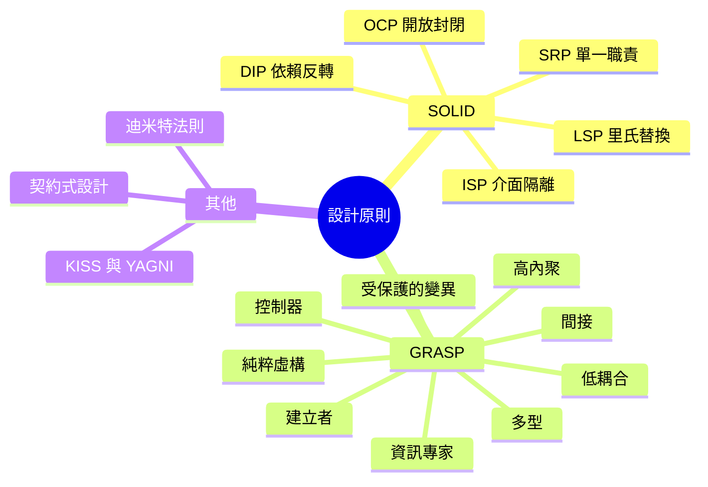

### 3.1 單一職責原則（SRP）

> 一個模組應該只對一個「行為者（actor）」負責。——Robert C. Martin，《Clean Architecture》（2017）

SRP 常被誤解為「一個類別只做一件事」。更精確的判斷方式是：**這個類別會因為哪些人（部門、角色）提出的需求而修改？** 如果答案超過一個，就應拆分。

#### OOAD-PRN-001 一個類別只因一種行為者的需求而改變

- **等級**：必須
- **說明**：當財務、人資、IT 三種角色的需求都會改動同一個類別時，任何一方的修改都可能意外影響另一方。

❌ **反例**：薪資計算（財務）、工時報表（人資）、資料存檔（IT）集中在同一類別。

```java
import java.math.BigDecimal;

public class Employee {
    private final String id;
    private final BigDecimal hourlyRate;
    private int hoursThisMonth;

    public Employee(String id, BigDecimal hourlyRate) {
        this.id = id;
        this.hourlyRate = hourlyRate;
    }

    public BigDecimal calculatePay() {               // 財務部的規則
        return hourlyRate.multiply(BigDecimal.valueOf(regularHours()));
    }

    public String reportHours() {                    // 人資部的報表格式
        return id + ":" + regularHours();
    }

    public String toCsv() {                          // IT 的儲存格式
        return id + "," + hourlyRate + "," + hoursThisMonth;
    }

    private int regularHours() {                     // 財務與人資共用，任何一方修改都會影響對方
        return Math.min(hoursThisMonth, 160);
    }
}
```

✅ **正例**：資料留在 `Employee`，各行為者的規則分別放在獨立類別。

```java
import java.math.BigDecimal;
import org.junit.jupiter.api.Test;
import static org.assertj.core.api.Assertions.assertThat;

record EmployeeData(String id, BigDecimal hourlyRate, int hoursThisMonth) { }

final class PayCalculator {                   // 財務
    BigDecimal pay(EmployeeData e) {
        int regular = Math.min(e.hoursThisMonth(), 160);
        int overtime = Math.max(e.hoursThisMonth() - 160, 0);
        return e.hourlyRate().multiply(BigDecimal.valueOf(regular))
            .add(e.hourlyRate().multiply(new BigDecimal("1.34")).multiply(BigDecimal.valueOf(overtime)));
    }
}

final class HourReporter {                    // 人資
    String report(EmployeeData e) { return e.id() + ":" + e.hoursThisMonth(); }
}

final class EmployeeCsvWriter {               // IT
    String toCsv(EmployeeData e) { return e.id() + "," + e.hourlyRate() + "," + e.hoursThisMonth(); }
}

class SrpTest {
    @Test
    void 財務修改加班費規則不影響人資報表() {
        EmployeeData e = new EmployeeData("E01", new BigDecimal("200"), 170);
        assertThat(new HourReporter().report(e)).isEqualTo("E01:170");
        assertThat(new PayCalculator().pay(e)).isEqualByComparingTo("34680.00");
    }
}
```

- **如何 review**：列出類別的公開方法，在每個方法旁寫下「誰會要求修改它」；出現兩個以上的行為者就拆分。也可看 Git 歷史：同一檔案的提交訊息若同時出現「報表格式」與「計薪規則」，就是警訊。
- **如何驗證**：以 `git log --format=%s -- <檔案>` 檢視修改原因的多樣性；類別行數與方法數可用 PMD 的 `GodClass`、`TooManyMethods` 規則當作輔助訊號。

> **注意事項**：上例的 1.34 倍是示意值。台灣《勞動基準法》第 24 條規定延長工時前 2 小時加給 1/3 以上、再延長 2 小時加給 2/3 以上，實際計薪規則須依法規與公司規定，由財務與人資確認後實作。

### 3.2 開放封閉原則（OCP）

> 軟體實體應該對擴充開放，對修改封閉。——Bertrand Meyer（1988），後由 Robert C. Martin 以多型重新詮釋

#### OOAD-PRN-002 以抽象隔離預期會變動的部分

- **等級**：建議
- **說明**：新增一種折扣、付款方式或通知管道時，若必須修改既有且已測試的類別，風險就會累積。把**已知會變動的維度**抽成介面，新增需求時只新增類別。
- **限制**：OCP 只針對「預期會變」的維度。對不會變的地方預先抽象，會違反 YAGNI（OOAD-PRN-013）。

❌ **反例**：

```java
import java.math.BigDecimal;

public class DiscountService {
    public BigDecimal discount(String campaign, BigDecimal amount) {
        return switch (campaign) {
            case "NEW_MEMBER" -> amount.multiply(new BigDecimal("0.10"));
            case "ANNIVERSARY" -> amount.multiply(new BigDecimal("0.15"));
            default -> BigDecimal.ZERO;   // 每檔新活動都要修改這個方法
        };
    }
}
```

✅ **正例**：

```java
import java.math.BigDecimal;
import java.util.List;
import org.junit.jupiter.api.Test;
import static org.assertj.core.api.Assertions.assertThat;

interface DiscountPolicy {
    boolean appliesTo(String campaign);
    BigDecimal discount(BigDecimal amount);
}

record PercentageDiscount(String campaign, BigDecimal rate) implements DiscountPolicy {
    public boolean appliesTo(String c) { return campaign.equals(c); }
    public BigDecimal discount(BigDecimal amount) { return amount.multiply(rate); }
}

final class DiscountService {
    private final List<DiscountPolicy> policies;

    DiscountService(List<DiscountPolicy> policies) { this.policies = List.copyOf(policies); }

    BigDecimal discount(String campaign, BigDecimal amount) {
        return policies.stream()
            .filter(p -> p.appliesTo(campaign))
            .map(p -> p.discount(amount))
            .findFirst()
            .orElse(BigDecimal.ZERO);
    }
}

class OcpTest {
    @Test
    void 新增活動只需新增策略物件() {
        DiscountService service = new DiscountService(List.of(
            new PercentageDiscount("NEW_MEMBER", new BigDecimal("0.10")),
            new PercentageDiscount("DOUBLE_ELEVEN", new BigDecimal("0.11"))));
        assertThat(service.discount("DOUBLE_ELEVEN", new BigDecimal("1000")))
            .isEqualByComparingTo("110");
        assertThat(service.discount("UNKNOWN", new BigDecimal("1000")))
            .isEqualByComparingTo("0");
    }
}
```

- **如何 review**：檢查最近幾次需求變更是否都改到同一個 `switch`；若是，該維度已證明會變動，應抽象化。
- **如何驗證**：模擬一次新增需求（新增活動），確認既有類別的 diff 為零，只有新增檔案與組態。

### 3.3 里氏替換原則（LSP）

> 若 S 是 T 的子型別，則程式中所有使用 T 的地方都可以換成 S，而不改變程式的正確性。——Barbara Liskov（1987）

LSP 用**契約**來判斷：子型別不可以**加強前置條件**、不可以**減弱後置條件**、必須**維持父型別的不變量**。

#### OOAD-PRN-003 子型別必須通過父型別的契約測試

- **等級**：必須
- **說明**：經典反例是「正方形繼承長方形」：長方形的契約是「設定寬度不影響高度」，正方形為了維持四邊相等而破壞了這個契約。

❌ **反例**：

```java
public class Rectangle {
    protected int width;
    protected int height;

    public void setWidth(int width) { this.width = width; }
    public void setHeight(int height) { this.height = height; }
    public int area() { return width * height; }
}

class Square extends Rectangle {
    @Override
    public void setWidth(int width) { this.width = width; this.height = width; }

    @Override
    public void setHeight(int height) { this.width = height; this.height = height; }
}
```

✅ **正例**：把父型別的契約寫成抽象測試類別，每個子型別都必須繼承並通過；同時示範反例如何被抓到。

```java
import org.junit.jupiter.api.Test;
import static org.assertj.core.api.Assertions.assertThat;

class Rectangle {
    protected int width;
    protected int height;
    void setWidth(int width) { this.width = width; }
    void setHeight(int height) { this.height = height; }
    int area() { return width * height; }
}

class Square extends Rectangle {
    @Override void setWidth(int w) { width = w; height = w; }
    @Override void setHeight(int h) { width = h; height = h; }
}

/** 長方形契約：設定寬度不影響高度。 */
abstract class RectangleContract {
    abstract Rectangle create();

    boolean widthIndependentOfHeight() {
        Rectangle r = create();
        r.setHeight(4);
        r.setWidth(5);
        return r.area() == 20;
    }
}

class RectangleContractTest extends RectangleContract {
    Rectangle create() { return new Rectangle(); }

    @Test
    void 長方形符合契約() { assertThat(widthIndependentOfHeight()).isTrue(); }
}

class SquareViolatesContractTest extends RectangleContract {
    Rectangle create() { return new Square(); }

    @Test
    void 正方形無法通過長方形契約_證明不應繼承() {
        assertThat(widthIndependentOfHeight()).isFalse();
    }
}
```

修正方式：讓兩者都實作一個沒有 setter 的 `Shape` 介面（`area()`），而不是互相繼承。

- **如何 review**：子類別覆寫方法時，檢查是否 (1) 拋出父類別沒有宣告的例外、(2) 對參數有更嚴格的檢查、(3) 回傳值範圍變窄或變寬、(4) 方法變成空實作。任何一項成立都可能違反 LSP。
- **如何驗證**：建立父型別的「契約測試」（abstract test class），所有子型別的測試類別繼承它；新增子型別時，CI 會自動執行契約測試。

### 3.4 介面隔離原則（ISP）

#### OOAD-PRN-004 用戶端不應被迫依賴用不到的方法

- **等級**：建議
- **說明**：胖介面讓使用者依賴他用不到的方法；該方法簽章一改，所有使用者都要重新編譯與測試。介面應依「使用者需求」切分，而不是依「實作者能提供什麼」切分。範例見 OOAD-OO-010（`Printing`／`Scanning` 角色介面）。

❌ **反例**：報表模組只需要查詢，卻依賴了含寫入與刪除的儲存庫介面。

```java
import java.util.List;
import java.util.Optional;

interface OrderRepository {
    Optional<String> findById(String id);
    List<String> findByCustomer(String customerId);
    void save(String order);
    void delete(String id);
}

class MonthlyReport {
    private final OrderRepository repository;   // 報表其實只需要查詢

    MonthlyReport(OrderRepository repository) { this.repository = repository; }

    int countFor(String customerId) { return repository.findByCustomer(customerId).size(); }
}
```

✅ **正例**：

```java
import java.util.List;
import java.util.Map;
import org.junit.jupiter.api.Test;
import static org.assertj.core.api.Assertions.assertThat;

interface OrderQueries {
    List<String> findByCustomer(String customerId);
}

interface OrderCommands {
    void save(String customerId, String orderId);
}

final class MonthlyReport {
    private final OrderQueries queries;

    MonthlyReport(OrderQueries queries) { this.queries = queries; }

    int countFor(String customerId) { return queries.findByCustomer(customerId).size(); }
}

class IspTest {
    @Test
    void 報表只需提供查詢的測試替身() {
        OrderQueries stub = customerId -> Map.of("C01", List.of("O1", "O2"))
            .getOrDefault(customerId, List.of());
        assertThat(new MonthlyReport(stub).countFor("C01")).isEqualTo(2);
    }
}
```

- **如何 review**：檢查每個用戶端實際呼叫了介面中的哪些方法；若某用戶端只用到不到一半，考慮拆分出角色介面。
- **如何驗證**：撰寫用戶端的單元測試時，若只需實作一個方法的 lambda 替身即可測試（如上例），代表介面已足夠精簡。

### 3.5 依賴反轉原則（DIP）

> 高層模組不應依賴低層模組，兩者都應依賴抽象；抽象不應依賴細節，細節應依賴抽象。

DIP 的重點是**介面的所有權**：介面由「使用它的高層模組」定義並放在高層的套件中，低層模組（資料庫、外部 API）去實作它。這樣依賴方向就從「業務 → 技術」反轉為「技術 → 業務」。

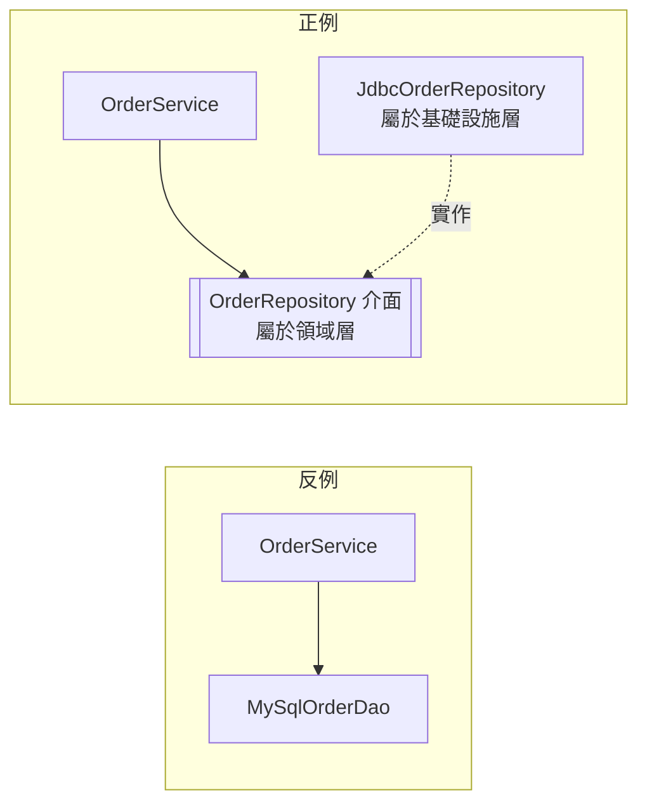

#### OOAD-PRN-005 業務邏輯依賴自己擁有的抽象而非技術細節

- **等級**：必須
- **說明**：業務類別內 `new` 出具體的資料庫或寄信類別，會讓業務邏輯無法單獨測試，也無法替換技術。

❌ **反例**：

```java
public class OrderService {
    public void placeOrder(String orderId) {
        SmtpMailer mailer = new SmtpMailer("smtp.example.com");   // 直接依賴技術細節
        mailer.send("訂單 " + orderId + " 已成立");
    }
}

class SmtpMailer {
    private final String host;
    SmtpMailer(String host) { this.host = host; }
    void send(String message) { /* 連線 SMTP 伺服器寄信 */ }
}
```

✅ **正例**：`Notifier` 介面由領域層定義，透過建構子注入；測試時用替身。

```java
import java.util.ArrayList;
import java.util.List;
import java.util.Objects;
import org.junit.jupiter.api.Test;
import static org.assertj.core.api.Assertions.assertThat;

interface Notifier {                         // 領域層擁有的抽象
    void notify(String message);
}

final class OrderService {
    private final Notifier notifier;

    OrderService(Notifier notifier) { this.notifier = Objects.requireNonNull(notifier); }

    void placeOrder(String orderId) {
        notifier.notify("訂單 " + orderId + " 已成立");
    }
}

final class RecordingNotifier implements Notifier {   // 測試替身
    final List<String> messages = new ArrayList<>();
    public void notify(String message) { messages.add(message); }
}

class DipTest {
    @Test
    void 下單後送出通知() {
        RecordingNotifier notifier = new RecordingNotifier();
        new OrderService(notifier).placeOrder("O-1");
        assertThat(notifier.messages).containsExactly("訂單 O-1 已成立");
    }
}
```

- **如何 review**：在領域與應用層類別中搜尋 `new` 出來的技術類別（`new JdbcTemplate`、`new RestClient`、`new SmtpMailer`）；檢查介面所在的套件是否屬於使用者（高層），而不是實作者。
- **如何驗證**：用 ArchUnit 規則「`..domain..` 不得依賴 `..infrastructure..`」（見第 3.9 節），並確認業務類別可以只用測試替身完成單元測試。

### 3.6 GRASP：職責指派的九個模式

GRASP（General Responsibility Assignment Software Patterns）回答的是 OOD 中最常見的問題：「這個職責應該給誰？」

| 模式 | 問題 | 解答 |
|------|------|------|
| 資訊專家（Information Expert） | 職責該給誰？ | 給擁有完成該職責所需資訊的類別 |
| 建立者（Creator） | 誰負責建立 A？ | 包含、聚合、密切使用或擁有 A 初始化資料的 B |
| 控制器（Controller） | 誰接收並協調系統事件？ | 代表 Use Case 或子系統的非 UI 物件 |
| 低耦合（Low Coupling） | 如何降低變動的衝擊？ | 指派職責時讓不必要的依賴最少 |
| 高內聚（High Cohesion） | 如何讓類別聚焦、好懂？ | 讓類別內的職責彼此高度相關 |
| 多型（Polymorphism） | 行為隨型別而異時怎麼辦？ | 用多型操作，不用型別判斷（OOAD-OO-006） |
| 純粹虛構（Pure Fabrication） | 指派給領域物件會破壞內聚時？ | 建立一個不代表領域概念的輔助類別 |
| 間接（Indirection） | 如何避免兩者直接耦合？ | 加入中介物件（例如 Adapter） |
| 受保護的變異（Protected Variations） | 如何讓變動點不影響其他元素？ | 在變動點周圍建立穩定介面 |

#### OOAD-PRN-006 依資訊專家原則指派職責

- **等級**：建議
- **說明**：計算訂單總額需要每個明細的單價與數量，這些資訊在 `Order` 與 `OrderLine` 裡，所以由它們負責計算，而不是由外部的 `OrderService` 取出所有資料自己算。

❌ **反例**：服務取出資料自行計算（「貧血模型」的典型樣貌）。

```java
import java.math.BigDecimal;
import java.util.List;

record OrderLine(BigDecimal unitPrice, int quantity) { }
record Order(List<OrderLine> lines) { }

public class OrderTotalService {
    public BigDecimal total(Order order) {
        BigDecimal sum = BigDecimal.ZERO;
        for (OrderLine line : order.lines()) {
            sum = sum.add(line.unitPrice().multiply(BigDecimal.valueOf(line.quantity())));
        }
        return sum;   // 其他地方需要總額時，可能再寫一次（而且寫錯）
    }
}
```

✅ **正例**：

```java
import java.math.BigDecimal;
import java.util.List;
import org.junit.jupiter.api.Test;
import static org.assertj.core.api.Assertions.assertThat;

record OrderLine(BigDecimal unitPrice, int quantity) {
    OrderLine {
        if (quantity <= 0) throw new IllegalArgumentException("數量必須大於 0");
    }
    BigDecimal subtotal() { return unitPrice.multiply(BigDecimal.valueOf(quantity)); }
}

record Order(List<OrderLine> lines) {
    Order { lines = List.copyOf(lines); }
    BigDecimal total() {
        return lines.stream().map(OrderLine::subtotal).reduce(BigDecimal.ZERO, BigDecimal::add);
    }
}

class InformationExpertTest {
    @Test
    void 訂單自行計算總額() {
        Order order = new Order(List.of(
            new OrderLine(new BigDecimal("500"), 2),
            new OrderLine(new BigDecimal("600"), 1)));
        assertThat(order.total()).isEqualByComparingTo("1600");
    }
}
```

- **如何 review**：看到某方法大量呼叫另一個物件的 getter 再計算（「依戀情結 Feature Envy」），就把計算移到擁有資料的類別。
- **如何驗證**：以 IntelliJ 的 Inspection「Feature envy」或 PMD 的 `LawOfDemeter` 規則找出候選；移動後原呼叫端的 getter 呼叫數應下降。

#### OOAD-PRN-007 由擁有或聚合者負責建立物件

- **等級**：建議
- **說明**：`OrderLine` 只在 `Order` 之中有意義，所以由 `Order.addLine(...)` 建立，而不是由外部 `new OrderLine` 再塞進去；這樣 `Order` 才能在建立時檢查規則（例如明細上限、同商品合併）。

❌ **反例**：

```java
import java.util.ArrayList;
import java.util.List;

record OrderLine(String sku, int quantity) { }

public class Order {
    private final List<OrderLine> lines = new ArrayList<>();

    public List<OrderLine> lines() { return lines; }   // 外部 new 好再 add，Order 無從檢查
}
```

✅ **正例**：

```java
import java.util.ArrayList;
import java.util.List;
import org.junit.jupiter.api.Test;
import static org.assertj.core.api.Assertions.assertThat;
import static org.assertj.core.api.Assertions.assertThatThrownBy;

record OrderLine(String sku, int quantity) { }

final class Order {
    private static final int MAX_LINES = 50;
    private final List<OrderLine> lines = new ArrayList<>();

    void addLine(String sku, int quantity) {
        for (int i = 0; i < lines.size(); i++) {
            if (lines.get(i).sku().equals(sku)) {          // 同商品合併數量
                lines.set(i, new OrderLine(sku, lines.get(i).quantity() + quantity));
                return;
            }
        }
        if (lines.size() >= MAX_LINES) throw new IllegalStateException("明細超過上限");
        lines.add(new OrderLine(sku, quantity));
    }

    List<OrderLine> lines() { return List.copyOf(lines); }
}

class CreatorTest {
    @Test
    void 同商品自動合併() {
        Order order = new Order();
        order.addLine("A", 1);
        order.addLine("A", 2);
        assertThat(order.lines()).containsExactly(new OrderLine("A", 3));
    }

    @Test
    void 超過明細上限時拒絕() {
        Order order = new Order();
        for (int i = 0; i < 50; i++) order.addLine("SKU" + i, 1);
        assertThatThrownBy(() -> order.addLine("SKU50", 1)).isInstanceOf(IllegalStateException.class);
    }
}
```

- **如何 review**：組合關係（第 5.4 節實心菱形）中的「部分」物件，其 `new` 應只出現在「整體」類別內。
- **如何驗證**：ArchUnit 可檢查「`OrderLine` 的建構子只能被 `Order` 呼叫」：`constructors().that().areDeclaredIn(OrderLine.class).should().onlyBeCalled().byClassesThat().belongToAnyOf(Order.class)`。

#### OOAD-PRN-008 系統事件由代表 Use Case 的控制器協調

- **等級**：建議
- **說明**：UI（或 REST Controller）只負責接收輸入與呈現結果；「選課」這個系統事件應由代表 Use Case 的應用服務（例如 `EnrollCourseUseCase`）協調領域物件。控制器本身不含業務規則，只負責流程協調與交易邊界。避免兩種極端：(1) 把業務規則寫在 Web Controller；(2) 一個「萬能控制器」處理所有 Use Case（臃腫控制器）。
- **範例**：見第 6.7 節 `EnrollCourseUseCase`：它載入 `CourseSection` 與 `Student`，呼叫 `section.enroll(...)`（規則在領域物件內），再交給儲存庫保存。

❌ **反例**（業務規則寫在 Web 層，換成批次或訊息觸發時規則就遺失了）：

```java
import java.util.HashMap;
import java.util.Map;

public class EnrollmentWebController {
    private final Map<String, Integer> enrolledCount = new HashMap<>();

    public String post(String courseId, int capacity) {
        int count = enrolledCount.getOrDefault(courseId, 0);
        if (count >= capacity) {               // 業務規則寫在 Web 控制器
            return "400 名額已滿";
        }
        enrolledCount.put(courseId, count + 1);
        return "200 OK";
    }
}
```

✅ **正例**（Web 層只做轉換，規則在領域物件，協調在 Use Case）：

```java
import java.util.HashMap;
import java.util.Map;
import org.junit.jupiter.api.Test;
import static org.assertj.core.api.Assertions.assertThat;

final class Section {
    private final int capacity;
    private int enrolled;
    Section(int capacity) { this.capacity = capacity; }
    void enroll() {
        if (enrolled >= capacity) throw new IllegalStateException("名額已滿");
        enrolled++;
    }
}

final class EnrollUseCase {                       // GRASP 控制器（應用層）
    private final Map<String, Section> sections;
    EnrollUseCase(Map<String, Section> sections) { this.sections = sections; }
    void enroll(String sectionId) { sections.get(sectionId).enroll(); }
}

final class EnrollmentWebController {             // 只做輸入輸出轉換
    private final EnrollUseCase useCase;
    EnrollmentWebController(EnrollUseCase useCase) { this.useCase = useCase; }
    String post(String sectionId) {
        try {
            useCase.enroll(sectionId);
            return "200 OK";
        } catch (IllegalStateException e) {
            return "409 " + e.getMessage();
        }
    }
}

class ControllerTest {
    @Test
    void 同一規則可被批次與Web共用() {
        Map<String, Section> sections = new HashMap<>(Map.of("CS101-01", new Section(1)));
        EnrollUseCase useCase = new EnrollUseCase(sections);
        useCase.enroll("CS101-01");                       // 批次觸發
        assertThat(new EnrollmentWebController(useCase).post("CS101-01"))
            .isEqualTo("409 名額已滿");                    // Web 觸發得到相同規則
    }
}
```

- **如何 review**：Web Controller 方法內出現 `if` 判斷業務條件（名額、餘額、狀態）就是警訊；理想上只有參數轉換、呼叫 Use Case、轉換回應與例外對應。
- **如何驗證**：ArchUnit 規則「`..web..` 不得直接存取 `..domain..` 的狀態改變方法，只能呼叫 `..application..`」；以「同一 Use Case 由兩種入口觸發得到相同結果」的測試證明規則不在 Web 層。

#### OOAD-PRN-009 指派職責時兼顧低耦合與高內聚

- **等級**：建議
- **說明**：低耦合與高內聚是評估其他所有原則的兩把尺。耦合可以量測（類別依賴了多少其他類別、套件之間是否有循環），內聚可以由「方法是否使用相同的欄位」觀察。

| 訊號 | 可能問題 | 改善方向 |
|------|----------|----------|
| 一個類別 import 超過 15～20 個專案內類別 | 耦合過高 | 拆分職責或引入中介 |
| 類別的方法分成幾群，各群使用不同欄位 | 內聚過低 | 依欄位群拆成多個類別 |
| 套件之間互相依賴（A→B→A） | 循環依賴 | 抽出共用介面或移動類別 |

❌ **反例**：同一類別的兩群方法使用不相交的欄位（內聚低）。

```java
public class UserProfileAndBilling {
    private String displayName;      // 群組一：個人資料
    private String avatarUrl;
    private String cardToken;        // 群組二：付款
    private int billingDay;

    public void rename(String name) { this.displayName = name; }
    public void changeAvatar(String url) { this.avatarUrl = url; }
    public void updateCard(String token) { this.cardToken = token; }
    public void changeBillingDay(int day) { this.billingDay = day; }
}
```

✅ **正例**：依欄位群拆分，並以 ArchUnit 證明套件間沒有循環依賴（多檔案範例，`// 檔案：` 標示每個檔案）。

```java
// 檔案：com/example/cohesion/profile/UserProfile.java
package com.example.cohesion.profile;

public final class UserProfile {
    private String displayName;
    private String avatarUrl;

    public void rename(String name) { this.displayName = name; }
    public void changeAvatar(String url) { this.avatarUrl = url; }
    public String displayName() { return displayName; }
}

// 檔案：com/example/cohesion/billing/BillingAccount.java
package com.example.cohesion.billing;

public final class BillingAccount {
    private String cardToken;
    private int billingDay;

    public void updateCard(String token) { this.cardToken = token; }
    public void changeBillingDay(int day) {
        if (day < 1 || day > 28) throw new IllegalArgumentException("扣款日須為 1 至 28");
        this.billingDay = day;
    }
}

// 檔案：com/example/cohesion/CohesionArchTest.java
package com.example.cohesion;

import com.tngtech.archunit.core.domain.JavaClasses;
import com.tngtech.archunit.core.importer.ClassFileImporter;
import org.junit.jupiter.api.Test;
import static com.tngtech.archunit.library.dependencies.SlicesRuleDefinition.slices;

class CohesionArchTest {
    @Test
    void 子套件之間沒有循環依賴() {
        JavaClasses classes = new ClassFileImporter().importPackages("com.example.cohesion");
        slices().matching("com.example.cohesion.(*)..").should().beFreeOfCycles().check(classes);
    }
}
```

- **如何 review**：畫出類別的欄位與方法使用關係，若能分成互不相交的群組，就是拆分點（此即 LCOM 指標的直觀版本）。
- **如何驗證**：ArchUnit `slices().should().beFreeOfCycles()`（如上）；類別耦合度可用 SonarQube 的「Coupling between objects」或 jdeps 輸出輔助觀察。

#### OOAD-PRN-010 領域物件放不下的技術職責交給純粹虛構類別

- **等級**：建議
- **說明**：「把訂單存進資料庫」若交給 `Order` 自己做（資訊專家的字面解讀），`Order` 會依賴資料庫技術而失去內聚。此時建立一個不代表領域概念的類別（`OrderRepository` 實作、`PdfInvoiceRenderer`）承擔這個職責，稱為純粹虛構；儲存庫介面本身也同時是一種「間接」。
- **範例**：第 3.5 節的 `Notifier` 與第 6.7 節的 `InMemorySectionRepository` 都是純粹虛構。

❌ **反例**：

```java
import java.util.HashMap;
import java.util.Map;

public class Invoice {
    static final Map<String, String> DATABASE = new HashMap<>();   // 模擬資料庫連線
    private final String number;
    private final int amount;

    public Invoice(String number, int amount) { this.number = number; this.amount = amount; }

    public void saveToDatabase() { DATABASE.put(number, number + "," + amount); } // 領域物件負責持久化
    public String renderPdf() { return "%PDF-1.7 ... " + number; }               // 也負責呈現
}
```

✅ **正例**：

```java
import java.util.HashMap;
import java.util.Map;
import java.util.Optional;
import org.junit.jupiter.api.Test;
import static org.assertj.core.api.Assertions.assertThat;

record Invoice(String number, int amount) { }

interface InvoiceRepository {                       // 間接：領域只認得介面
    void save(Invoice invoice);
    Optional<Invoice> find(String number);
}

final class InMemoryInvoiceRepository implements InvoiceRepository {   // 純粹虛構
    private final Map<String, Invoice> store = new HashMap<>();
    public void save(Invoice invoice) { store.put(invoice.number(), invoice); }
    public Optional<Invoice> find(String number) { return Optional.ofNullable(store.get(number)); }
}

final class InvoiceTextRenderer {                   // 純粹虛構：呈現
    String render(Invoice invoice) { return "發票 " + invoice.number() + " 金額 " + invoice.amount(); }
}

class PureFabricationTest {
    @Test
    void 持久化與呈現由專責類別處理() {
        InvoiceRepository repo = new InMemoryInvoiceRepository();
        repo.save(new Invoice("AB-12345678", 1050));
        assertThat(repo.find("AB-12345678")).isPresent();
        assertThat(new InvoiceTextRenderer().render(new Invoice("AB-12345678", 1050)))
            .isEqualTo("發票 AB-12345678 金額 1050");
    }
}
```

- **如何 review**：領域類別中出現 I/O、SQL、HTTP、檔案、序列化格式等程式碼時，應移到純粹虛構類別。
- **如何驗證**：ArchUnit 規則「`..domain..` 不得依賴 `java.sql..`、`java.net.http..`、`java.io.File`」。

#### OOAD-PRN-011 在已知變動點周圍建立穩定介面

- **等級**：建議
- **說明**：受保護的變異（Protected Variations）是 OCP、DIP、資訊隱藏的共同目標。實務上的變動點包括：外部系統（金流、簡訊供應商）、法規參數（稅率、計息規則）、演算法（排課、推薦）。在變動點建立介面或設定，讓變動只影響一處。

❌ **反例**：外部簡訊供應商的 API 格式散落在多處業務程式中。

```java
public class OtpService {
    public String sendOtp(String phone, String code) {
        // 業務程式直接組出供應商 A 的請求格式；換供應商時要找出所有這類程式碼
        return "https://sms-vendor-a.example.com/send?to=" + phone + "&msg=" + code;
    }
}
```

✅ **正例**：以介面保護變動點，供應商差異封裝在 Adapter 中（Adapter 模式見第 8.7 節）。

```java
import java.util.ArrayList;
import java.util.List;
import org.junit.jupiter.api.Test;
import static org.assertj.core.api.Assertions.assertThat;

interface SmsGateway { void send(String phone, String text); }

final class VendorAAdapter implements SmsGateway {
    final List<String> requests = new ArrayList<>();
    public void send(String phone, String text) {
        requests.add("to=" + phone + "&msg=" + text);       // 供應商 A 的格式只出現在這裡
    }
}

final class OtpService {
    private final SmsGateway gateway;
    OtpService(SmsGateway gateway) { this.gateway = gateway; }
    void sendOtp(String phone, String code) { gateway.send(phone, "驗證碼 " + code); }
}

class ProtectedVariationsTest {
    @Test
    void 更換供應商只需替換Adapter() {
        VendorAAdapter vendor = new VendorAAdapter();
        new OtpService(vendor).sendOtp("0912000000", "123456");
        assertThat(vendor.requests).containsExactly("to=0912000000&msg=驗證碼 123456");
    }
}
```

- **如何 review**：在設計審查時列出系統的已知變動點（第 4.2 節需求訪談時就該收集），逐一確認每個變動點都有穩定的介面或設定。
- **如何驗證**：搜尋外部供應商的網域、API 路徑或 SDK 套件名稱，確認只出現在 Adapter 套件中（可用 ArchUnit 限制 SDK 套件只能被 `..adapter..` 依賴）。

### 3.7 迪米特法則、KISS 與 YAGNI

#### OOAD-PRN-012 只與直接的朋友交談

- **等級**：建議
- **說明**：迪米特法則（Law of Demeter）：方法只應呼叫自己、參數、自己建立的物件、自己的欄位的方法。`a.getB().getC().doSomething()` 這種「火車殘骸」讓呼叫者依賴整條物件結構。相關的「Tell, Don't Ask」原則要求：告訴物件要做什麼，而不是問出它的狀態再替它決定。
- **例外**：流式 API（`stream().filter().map()`）與建造者模式回傳的是同一抽象層的物件，不算違反。

❌ **反例**：

```java
import java.math.BigDecimal;

record Wallet(BigDecimal balance) { }
record Customer(Wallet wallet) { }

public class Cashier {
    public boolean canPay(Customer customer, BigDecimal amount) {
        // 收銀員翻顧客的錢包：依賴 Customer 與 Wallet 兩層結構
        return customer.wallet().balance().compareTo(amount) >= 0;
    }
}
```

✅ **正例**：

```java
import java.math.BigDecimal;
import org.junit.jupiter.api.Test;
import static org.assertj.core.api.Assertions.assertThat;

final class Wallet {
    private BigDecimal balance;
    Wallet(BigDecimal balance) { this.balance = balance; }
    boolean covers(BigDecimal amount) { return balance.compareTo(amount) >= 0; }
}

final class Customer {
    private final Wallet wallet;
    Customer(Wallet wallet) { this.wallet = wallet; }
    boolean canAfford(BigDecimal amount) { return wallet.covers(amount); }   // 顧客自己決定
}

final class Cashier {
    boolean canPay(Customer customer, BigDecimal amount) { return customer.canAfford(amount); }
}

class DemeterTest {
    @Test
    void 收銀員只與顧客交談() {
        Customer c = new Customer(new Wallet(new BigDecimal("300")));
        assertThat(new Cashier().canPay(c, new BigDecimal("299"))).isTrue();
        assertThat(new Cashier().canPay(c, new BigDecimal("301"))).isFalse();
    }
}
```

- **如何 review**：一行中出現兩個以上的 getter 串接（排除流式 API）即標記討論。
- **如何驗證**：PMD 規則 `LawOfDemeter`（類別 Design）可列出候選，再人工判斷是否屬於例外情況。

#### OOAD-PRN-013 只為已確認的需求設計

- **等級**：建議
- **說明**：KISS（Keep It Simple）與 YAGNI（You Aren't Gonna Need It）提醒：為「將來可能」的需求預先建立抽象層、外掛機制或泛型框架，會增加理解與維護成本，而那些需求常常不會出現。與 OCP 的界線：**已發生過一次以上的變動**才值得抽象。

❌ **反例**：只有一種匯出格式，卻建立了工廠、註冊表與外掛介面。

```java
import java.util.HashMap;
import java.util.Map;
import java.util.function.Supplier;

interface ExportFormat { String export(String data); }
interface ExportFormatProvider { ExportFormat create(); }

public class ExportFormatRegistry {
    private final Map<String, ExportFormatProvider> providers = new HashMap<>();

    public void register(String name, ExportFormatProvider provider) { providers.put(name, provider); }

    public ExportFormat lookup(String name, Supplier<ExportFormat> fallback) {
        ExportFormatProvider p = providers.get(name);
        return p == null ? fallback.get() : p.create();
    }
}
```

✅ **正例**：需求只有 CSV 時，就直接實作 CSV；第二種格式真的出現時再抽介面（屆時重構成本很低，因為呼叫點只有一處）。

```java
import java.util.List;
import org.junit.jupiter.api.Test;
import static org.assertj.core.api.Assertions.assertThat;

final class CsvExporter {
    String export(List<List<String>> rows) {
        StringBuilder sb = new StringBuilder();
        for (List<String> row : rows) {
            sb.append(String.join(",", row.stream().map(CsvExporter::quote).toList())).append("\r\n");
        }
        return sb.toString();
    }

    private static String quote(String value) {
        boolean needQuote = value.contains(",") || value.contains("\"") || value.contains("\n");
        return needQuote ? "\"" + value.replace("\"", "\"\"") + "\"" : value;
    }
}

class CsvExporterTest {
    @Test
    void 含逗號與引號的欄位依RFC4180跳脫() {
        String csv = new CsvExporter().export(List.of(List.of("王,小明", "說\"你好\"")));
        assertThat(csv).isEqualTo("\"王,小明\",\"說\"\"你好\"\"\"\r\n");
    }
}
```

- **如何 review**：新增的介面若只有一個實作、且沒有測試替身的需要，請作者說明它保護的變動點是什麼（對應 OOAD-PRN-011）；說不出來就移除。
- **如何驗證**：統計「只有單一實作且未在測試中被替換」的介面數量，作為技術債指標追蹤。

### 3.8 契約式設計

契約式設計（Design by Contract, DbC）把方法的承諾寫清楚：

| 契約元素 | 意義 | 違反時誰有錯 | Java 實作方式 |
|----------|------|-------------|---------------|
| 前置條件（precondition） | 呼叫前必須成立的條件 | 呼叫者 | 方法開頭檢查，拋出 `IllegalArgumentException`／`IllegalStateException` |
| 後置條件（postcondition） | 方法完成後保證成立的條件 | 被呼叫者 | 由單元測試驗證；必要時以 `assert` 輔助 |
| 不變量（invariant） | 物件在任何公開方法前後都成立的條件 | 被呼叫者 | 建構子與每個改變狀態的方法維護；以測試驗證 |

UML 以 OCL 表達契約（第 5.13 節），Java 以程式檢查與測試表達。

#### OOAD-PRN-014 公開方法明確定義並檢查前置條件與不變量

- **等級**：必須
- **說明**：契約不寫清楚，呼叫者只能猜；檢查散落各處，就會有地方漏掉。在 Javadoc 寫明契約，在方法開頭檢查前置條件，以測試證明後置條件與不變量。

❌ **反例**：沒有任何契約，超賣時庫存變成負數。

```java
public class Inventory {
    private int onHand;

    public Inventory(int onHand) { this.onHand = onHand; }

    public void reserve(int quantity) { onHand -= quantity; }   // 數量為負或超過庫存都會接受

    public int onHand() { return onHand; }
}
```

✅ **正例**：

```java
import org.junit.jupiter.api.Test;
import static org.assertj.core.api.Assertions.assertThat;
import static org.assertj.core.api.Assertions.assertThatThrownBy;

/** 不變量：0 <= reserved <= onHand。 */
final class Inventory {
    private final int onHand;
    private int reserved;

    Inventory(int onHand) {
        if (onHand < 0) throw new IllegalArgumentException("庫存不可為負");
        this.onHand = onHand;
    }

    /**
     * 預留庫存。
     * 前置條件：quantity > 0 且 quantity <= available()。
     * 後置條件：available() 減少 quantity。
     */
    void reserve(int quantity) {
        if (quantity <= 0) throw new IllegalArgumentException("數量必須大於 0");
        if (quantity > available()) throw new IllegalStateException("可用庫存不足");
        reserved += quantity;
    }

    int available() { return onHand - reserved; }
}

class InventoryContractTest {
    @Test
    void 後置條件_可用量減少預留數量() {
        Inventory inv = new Inventory(10);
        inv.reserve(3);
        assertThat(inv.available()).isEqualTo(7);
    }

    @Test
    void 違反前置條件時拒絕且不變量維持() {
        Inventory inv = new Inventory(10);
        assertThatThrownBy(() -> inv.reserve(11)).isInstanceOf(IllegalStateException.class);
        assertThatThrownBy(() -> inv.reserve(0)).isInstanceOf(IllegalArgumentException.class);
        assertThat(inv.available()).isEqualTo(10);
    }
}
```

- **如何 review**：檢查公開方法的 Javadoc 是否寫明前置與後置條件；方法開頭是否檢查參數；呼叫者違反前置條件時，物件狀態是否保持不變。
- **如何驗證**：每個前置條件一個「違反時被拒絕且狀態不變」的測試；每個後置條件一個「正常路徑結果符合承諾」的測試。

> **注意事項**：Java 的 `assert` 預設在執行期關閉（需 `-ea` 才啟用），**不可**用來檢查公開方法的前置條件，只適合檢查內部假設。

### 3.9 以自動化測試守護設計原則

設計原則若只寫在文件中，很快就會被違反。把可以機器判斷的規則寫成 ArchUnit 測試，放進 CI，每次建置都檢查。

#### OOAD-PRN-015 可機器判斷的設計規則寫成架構測試

- **等級**：必須
- **說明**：分層方向、套件循環、領域層不得依賴技術框架、領域類別不得有 public setter 等規則都可以自動檢查。每條規則也要有「確實能抓到違規」的證明，否則可能是一條永遠通過的空規則。

❌ **反例**：規則只寫在 Wiki，`domain` 套件悄悄依賴了 `infrastructure`，沒有人發現。

```java
// 檔案：com/example/layers/bad/domain/Order.java
package com.example.layers.bad.domain;

import com.example.layers.bad.infrastructure.JdbcHelper;

public class Order {
    private String status;

    public void setStatus(String status) { this.status = status; }   // public setter

    public void save() { JdbcHelper.execute("UPDATE orders SET status = ?"); } // 依賴基礎設施
}

// 檔案：com/example/layers/bad/infrastructure/JdbcHelper.java
package com.example.layers.bad.infrastructure;

public class JdbcHelper {
    public static void execute(String sql) { }
}
```

✅ **正例**：同一組 ArchUnit 規則對「正確的套件」通過、對「違規的套件」偵測出違規，證明規則有效。

```java
// 檔案：com/example/layers/good/domain/Order.java
package com.example.layers.good.domain;

public class Order {
    private String status = "NEW";

    public void confirm() {
        if (!status.equals("NEW")) throw new IllegalStateException("只有新訂單可確認");
        status = "CONFIRMED";
    }

    public String status() { return status; }
}

// 檔案：com/example/layers/good/domain/OrderRepository.java
package com.example.layers.good.domain;

public interface OrderRepository { void save(Order order); }

// 檔案：com/example/layers/good/infrastructure/JdbcOrderRepository.java
package com.example.layers.good.infrastructure;

import com.example.layers.good.domain.Order;
import com.example.layers.good.domain.OrderRepository;

public class JdbcOrderRepository implements OrderRepository {
    public void save(Order order) { }
}

// 檔案：com/example/layers/bad/domain/Order.java
package com.example.layers.bad.domain;

import com.example.layers.bad.infrastructure.JdbcHelper;

public class Order {
    private String status;
    public void setStatus(String status) { this.status = status; }
    public void save() { JdbcHelper.execute("UPDATE orders SET status = ?"); }
}

// 檔案：com/example/layers/bad/infrastructure/JdbcHelper.java
package com.example.layers.bad.infrastructure;

public class JdbcHelper {
    public static void execute(String sql) { }
}

// 檔案：com/example/layers/DesignRulesTest.java
package com.example.layers;

import com.tngtech.archunit.core.domain.JavaClasses;
import com.tngtech.archunit.core.importer.ClassFileImporter;
import com.tngtech.archunit.lang.ArchRule;
import org.junit.jupiter.api.Test;
import static com.tngtech.archunit.lang.syntax.ArchRuleDefinition.methods;
import static com.tngtech.archunit.lang.syntax.ArchRuleDefinition.noClasses;
import static org.assertj.core.api.Assertions.assertThat;

class DesignRulesTest {
    static final ArchRule DOMAIN_INDEPENDENT = noClasses().that().resideInAPackage("..domain..")
        .should().dependOnClassesThat().resideInAPackage("..infrastructure..");

    static final ArchRule NO_PUBLIC_SETTERS = methods().that().areDeclaredInClassesThat()
        .resideInAPackage("..domain..").and().arePublic()
        .should().haveNameNotStartingWith("set");

    @Test
    void 正確的設計通過所有規則() {
        JavaClasses good = new ClassFileImporter().importPackages("com.example.layers.good");
        DOMAIN_INDEPENDENT.check(good);
        NO_PUBLIC_SETTERS.check(good);
    }

    @Test
    void 規則確實能偵測違規() {
        JavaClasses bad = new ClassFileImporter().importPackages("com.example.layers.bad");
        assertThat(DOMAIN_INDEPENDENT.evaluate(bad).hasViolation()).isTrue();
        assertThat(NO_PUBLIC_SETTERS.evaluate(bad).hasViolation()).isTrue();
    }
}
```

- **如何 review**：新增或修改架構規則時，要求 PR 附上「規則能偵測違規」的證明（如上第二個測試，或在 PR 描述貼出故意違規時的失敗訊息）。
- **如何驗證**：CI 執行架構測試；定期（例如每季）以故意違規的分支確認規則仍然有效。

> **實務案例**：某專案的 ArchUnit 規則寫成 `resideInAPackage("..domian..")`（拼錯），規則永遠通過，持續一年沒有人發現。加上「規則能偵測違規」的測試後，此類錯誤會立即暴露。ArchUnit 1.x 對「`that()` 沒有比對到任何類別」的規則預設會失敗（`archRule.failOnEmptyShould=true`），也能抓到一部分此類問題。

### 3.10 練習題

**練習 3.1：找出違反的原則**

下列類別違反了哪些原則？請列出指引編號，並提出重構後的類別圖。

```java
import java.math.BigDecimal;

public class ReportManager {
    public BigDecimal tax(String region, BigDecimal amount) {
        if ("TW".equals(region)) return amount.multiply(new BigDecimal("0.05"));
        if ("JP".equals(region)) return amount.multiply(new BigDecimal("0.10"));
        return BigDecimal.ZERO;
    }

    public String toHtml(String title, BigDecimal amount) { return "<h1>" + title + "</h1>" + amount; }

    public void saveToFile(String html) { /* 寫入檔案系統 */ }
}
```

- 驗收標準：至少指出 OOAD-PRN-001、002、010；重構後的稅率計算可以用一個新類別新增國家而不修改既有類別，並附單元測試。

**練習 3.2：撰寫契約測試**

為 `Account`（OOAD-OO-001）建立抽象契約測試類別，再建立 `SavingsAccount`（不可透支）與 `OverdraftAccount`（可透支 1,000 元）兩個實作。

- 驗收標準：判斷 `OverdraftAccount` 是否能通過「餘額不足時拒絕提款」的契約；若不能，說明這代表契約該如何調整，或兩者不應有父子關係。

### 3.11 章節小結

| 原則 | 一句話 | 主要驗證方式 |
|------|--------|-------------|
| SRP（PRN-001） | 一個類別只對一種行為者負責 | Git 修改原因分析、PMD GodClass |
| OCP（PRN-002） | 已知變動點以抽象隔離 | 模擬新增需求時既有類別 diff 為零 |
| LSP（PRN-003） | 子型別通過父型別契約測試 | 抽象契約測試類別 |
| ISP（PRN-004） | 依使用者切分介面 | 單一 lambda 即可當測試替身 |
| DIP（PRN-005） | 業務依賴自己擁有的抽象 | ArchUnit 分層規則 |
| GRASP（PRN-006～011） | 依資訊、建立、協調、耦合、內聚、變動點指派職責 | Feature Envy 檢查、循環依賴檢查 |
| 迪米特、YAGNI（PRN-012、013） | 只和朋友說話、只為已知需求設計 | PMD LawOfDemeter、單一實作介面統計 |
| DbC（PRN-014） | 前置條件、後置條件、不變量 | 每個條件一個測試 |
| 架構測試（PRN-015） | 規則寫成測試並證明能抓到違規 | ArchUnit 正反兩面測試 |

**常見陷阱**

- 把 SRP 理解成「一個類別只能有一個方法」，導致類別過度碎片化。
- 為每個類別都建立介面，以為這就是 DIP；DIP 的重點是「介面屬於誰」。
- 架構規則從未被證明能抓到違規。

---

## 4. OOAD 開發流程

### 4.1 流程概覽：迭代與增量

OOAD 不是「先把所有需求分析完、再一次設計完、最後實作」的瀑布式流程。Larman 與統一軟體開發流程（Unified Process, UP）都主張**迭代與增量**：每次迭代挑選少量 Use Case，完整走過分析、設計、實作、測試，再依回饋修正模型。

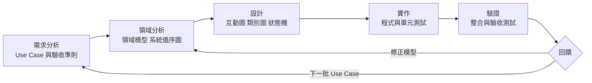

UP 的四個階段與敏捷開發的對應：

| UP 階段 | 目的 | 主要 OOAD 產出 | 敏捷團隊的對應做法 |
|---------|------|----------------|-------------------|
| 啟始（Inception） | 確認範圍與可行性 | Use Case 清單（約 10% 寫成完整規格）、主要風險 | 產品願景、初始 Backlog、Sprint 0 |
| 細化（Elaboration） | 建立穩定的架構與核心領域模型 | 領域模型、架構關鍵 Use Case 的設計與可執行骨架 | 前幾個 Sprint 處理高風險故事、建立架構測試 |
| 建構（Construction） | 增量完成其餘功能 | 其餘 Use Case 的設計、程式與測試 | 一般 Sprint |
| 轉移（Transition） | 交付與上線 | 部署圖、維運文件 | 發布、上線、Hypercare |

> **注意事項**：UP 的階段不是瀑布的階段；每個階段內都包含多次迭代，每次迭代都會做需求、設計、實作與測試，只是比重不同。

### 4.2 需求分析

需求分析的產出要能**被測試**。v2.1 版範例中的「系統回應時間不超過 2 秒」缺少量測條件（哪個操作？多少負載？平均還是百分位數？），無法作為驗收依據。

#### OOAD-PRC-001 功能需求以可測試的驗收準則表達

- **等級**：必須
- **說明**：使用者故事（User Story）描述「誰、要什麼、為什麼」，驗收準則（Acceptance Criteria）描述「怎樣算完成」。驗收準則建議以 Given／When／Then 格式撰寫，可直接轉成自動化測試。

❌ **反例**：

```text
作為顧客，我想要把書加入購物車，以便購買。
驗收：購物車功能正常。
```

✅ **正例**：

```gherkin
Feature: 購物車加入書籍
  作為已登入的顧客
  我想要把書籍加入購物車
  以便一次結帳多本書

  Scenario: 加入有庫存的書籍
    Given 書籍 "978-0137488803" 庫存為 3 本
    And 我的購物車是空的
    When 我把該書籍加入購物車 1 本
    Then 購物車有 1 個項目
    And 購物車總額為該書籍的售價

  Scenario: 加入數量超過可用庫存
    Given 書籍 "978-0137488803" 庫存為 3 本
    When 我把該書籍加入購物車 4 本
    Then 系統拒絕加入並顯示 "可用庫存不足，目前剩餘 3 本"
    And 購物車內容不變
```

- **如何 review**：每個 Scenario 是否有具體的資料（而非「有效資料」）、明確的預期結果；是否涵蓋至少一個失敗情境；用語是否為業務用語而非技術用語（不出現「呼叫 API」、「寫入資料表」）。
- **如何驗證**：每個 Scenario 對應一個自動化測試（Cucumber 或 JUnit 測試，以 `@DisplayName` 標示 Scenario 名稱），並登錄於追溯矩陣（第 4.10 節）。詳細撰寫方式見 [BDD 行為驅動開發教學]()。

#### OOAD-PRC-002 非功能需求依 ISO/IEC 25010:2023 分類且可量測

- **等級**：必須
- **說明**：ISO/IEC 25010:2023（第 2 版，2023 年 11 月）將產品品質分為 9 個特性。與 2011 年版相比，新增「安全性（Safety）」，並把「易用性（Usability）」更名為「互動能力（Interaction capability）」、「可攜性（Portability）」更名為「彈性（Flexibility）」。每條非功能需求都要指出所屬特性，並寫出量測方法與門檻。

| 特性（2023 版） | 常見需求範例 | 量測方式範例 |
|----------------|-------------|-------------|
| 功能適合性 Functional suitability | 計算結果正確 | 驗收測試通過率 |
| 效能效率 Performance efficiency | 回應時間、吞吐量 | 負載測試的 P95 回應時間 |
| 相容性 Compatibility | 與既有系統共存與互通 | 介面契約測試 |
| 互動能力 Interaction capability | 易學、無障礙 | 可用性測試、WCAG 檢測 |
| 可靠性 Reliability | 可用率、容錯、復原 | 可用率監控、RTO／RPO 演練 |
| 資訊安全 Security | 機密性、完整性、可歸責性 | 弱點掃描、滲透測試、稽核紀錄檢查 |
| 可維護性 Maintainability | 模組化、可測試性 | 架構測試、測試覆蓋率 |
| 彈性 Flexibility | 可調適、可擴充、可安裝 | 部署至不同環境的驗證 |
| 安全性 Safety | 避免危害人員或環境 | 危害分析（適用於醫療、工控等系統） |

❌ **反例**：

```text
NFR01：系統回應要快。
NFR02：系統要安全。
NFR03：支援 1000 個使用者。
```

✅ **正例**：

```text
NFR-PERF-01（效能效率／時間行為）
  在 500 位同時在線使用者、每秒 50 筆查詢的負載下，
  「書籍搜尋」API 的第 95 百分位回應時間 ≤ 800 ms，錯誤率 < 0.1%。
  量測：k6 負載測試 15 分鐘，於預備環境（與正式環境同規格）執行。

NFR-SEC-01（資訊安全／機密性）
  密碼以 Argon2id 雜湊儲存（參數符合 OWASP Password Storage Cheat Sheet 最低建議）。
  量測：程式碼審查＋資料庫抽樣確認無明碼或可逆加密。

NFR-REL-01（可靠性／可用性）
  每月可用率 ≥ 99.9%（每月停機 ≤ 43.8 分鐘，不含事先公告的維護時段）。
  量測：外部監控每分鐘探測一次健康檢查端點。
```

- **如何 review**：每條 NFR 是否有編號、所屬 25010 特性、具體數值、量測方式與環境；數值是否有業務依據（例如選課尖峰的實際人數）。
- **如何驗證**：NFR 對應到測試計畫中的具體測試（負載測試腳本、安全掃描工作），並於追溯矩陣登錄。

### 4.3 領域分析與領域模型

領域模型（Domain Model）是**問題領域中概念類別的視覺化**，不是軟體設計圖。它只有概念、屬性與關聯，**沒有方法、沒有技術類別**（Service、DAO、Controller 都不應出現）。

**找出概念類別的三種技巧**

| 技巧 | 做法 | 注意事項 |
|------|------|----------|
| 名詞片語分析 | 從 Use Case 文字中標出名詞 | 會產生同義詞與屬性，需篩選；不可機械化採用 |
| 概念類別清單 | 依常見分類（交易、交易明細、角色、地點、目錄、事件等）檢查 | 參考 Larman《Applying UML and Patterns》第 9 章的分類表 |
| 領域專家訪談 | 詢問「這個詞在你們部門是什麼意思」 | 同一個詞在不同部門可能意義不同（見第 7 章限界上下文） |

**名詞片語分析示例**

需求敘述：「**顧客**瀏覽**書籍目錄**，選擇**書籍**加入**購物車**，然後**結帳**。系統檢查**庫存**，向**金流服務**請款，並建立**訂單**。」

| 候選名詞 | 判斷 | 理由 |
|----------|------|------|
| 顧客 | 概念類別 | 有身分、有生命週期 |
| 書籍目錄 | 概念類別 | 書籍的集合與描述來源 |
| 書籍 | 拆為「書籍描述」與「庫存品」 | 同一本書的描述只有一份，庫存可能有多筆 |
| 購物車 | 概念類別 | 有內容會變動 |
| 結帳 | 不是類別 | 是行為（Use Case 的一步） |
| 庫存 | 屬性或概念類別 | 若需記錄倉別、批號則為類別 |
| 金流服務 | 外部行為者 | 系統邊界外，不放進領域模型 |
| 訂單 | 概念類別 | 交易，含訂單明細 |

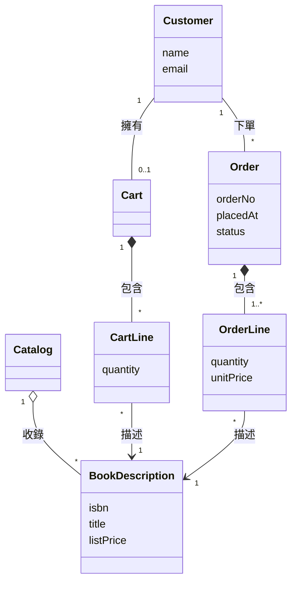

#### OOAD-PRC-003 領域模型只包含問題領域的概念

- **等級**：必須
- **說明**：在領域模型中放入 `OrderService`、`OrderDAO`、`OrderController`，代表分析階段已經混入設計決策，業務人員也無法審查。領域模型的讀者包含業務人員，必須能用業務語言逐一解釋每個方塊。

❌ **反例**：

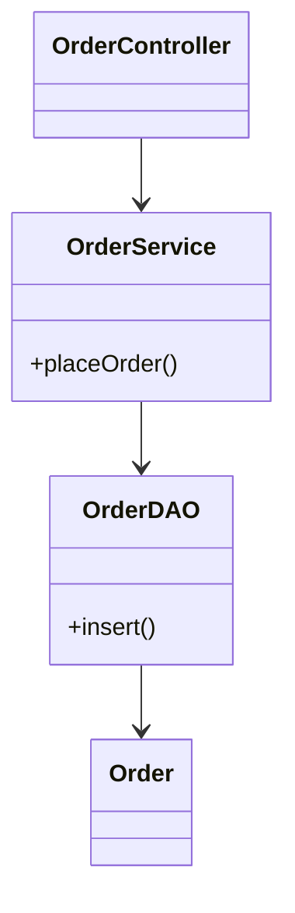

✅ **正例**：見上方線上書店領域模型——只有 `Customer`、`Order`、`OrderLine` 等業務概念與關聯，屬性不標型別、不含方法。

- **如何 review**：逐一指著每個方塊問業務代表「這是什麼」；出現 Service、Manager、DAO、DTO、Controller、Helper 等字尾即退回。
- **如何驗證**：以腳本檢查模型原始檔（Mermaid 或 PlantUML 文字）中類別名稱不含上述技術字尾。

#### OOAD-PRC-004 建立並維護詞彙表以統一用語

- **等級**：必須
- **說明**：同一概念若在需求、程式、資料庫中使用不同名稱（「選課」「加選」「註冊」、`enroll`／`register`／`signup`），溝通與搜尋都會出錯。詞彙表是領域模型的文字版，也是第 7 章「通用語言」的基礎。

❌ **反例**：

```text
需求文件：學生「加選」課程
程式碼：  StudentRegistrationService.signUp(...)
資料表：  COURSE_APPLY
畫面：    「報名課程」按鈕
```

✅ **正例**：

| 中文術語 | 英文術語（程式用） | 定義 | 不要使用的同義詞 | 負責人 |
|----------|-------------------|------|-----------------|--------|
| 選課 | Enrollment／enroll | 學生在選課期間將某開課班加入自己的課表 | 加選、報名、註冊、signUp、register | 教務處 |
| 開課班 | CourseSection | 某學期某課程的一個授課班級，有固定時段與名額 | 班別、課程（單指課程時另有 Course） | 教務處 |
| 退選 | Withdrawal／withdraw | 在退選期限內將已選課的開課班移除 | 取消、drop、cancel | 教務處 |

- **如何 review**：程式碼的類別與方法名稱、資料表名稱、畫面文字是否都使用詞彙表中的英文或中文術語；詞彙表的「不要使用」欄是否在程式中出現。
- **如何驗證**：以 `rg -i "signup|register" src/` 之類的搜尋，確認禁用同義詞未出現在新程式碼中；可做成 CI 的文字檢查。

### 4.4 Use Case 分析

Use Case 是「行為者為達成目標而與系統互動的一系列情境」。Alistair Cockburn《Writing Effective Use Cases》（2000）將 Use Case 分成三個層級：

| 層級 | 說明 | 例子 |
|------|------|------|
| 摘要層（雲／風箏） | 跨多個使用者目標的業務流程 | 管理學期選課作業 |
| 使用者目標層（海平面） | 一個人一次坐下來可以完成、完成後覺得有價值的目標 | 選修課程、退選課程 |
| 子功能層（魚／蛤） | 支援使用者目標的步驟 | 登入、查詢課程、驗證學號 |

UML Use Case 圖應以**使用者目標層**為主；「登入」屬於子功能層，通常不畫成獨立 Use Case，更不應以 include 連到每個 Use Case（見 OOAD-UML-002）。

#### OOAD-PRC-005 Use Case 以使用者目標命名並寫出主要與擴充情境

- **等級**：必須
- **說明**：Use Case 名稱用「動詞＋受詞」表達行為者的目標（「選修課程」，而不是「選課功能」或「課程管理」）。完整規格至少包含：主要行為者、利害關係人與利益、前置條件、成功保證（後置條件）、主要成功情境、擴充情境（替代與失敗流程）。擴充情境的編號對應主要情境的步驟（例如 `4a` 表示第 4 步的擴充）。

❌ **反例**：

```text
Use Case：課程管理
流程：學生可以選課、退選、查課表。
```

✅ **正例**（完整格式）：

```text
UC-02 選修課程
層級：使用者目標
主要行為者：學生
利害關係人與利益：
  - 學生：能選到想修的課，且課表不衝堂。
  - 授課教師：修課人數不超過教室容量。
  - 教務處：學分上限規定被遵守，資料可稽核。
前置條件：學生已通過身分驗證；目前在選課期間內。
成功保證：選課紀錄已建立；開課班已選人數加 1；學生課表包含該開課班。
主要成功情境：
  1. 學生查詢可選的開課班。
  2. 系統顯示開課班清單（課號、名稱、時段、學分、剩餘名額）。
  3. 學生選擇一個開課班並送出選課。
  4. 系統確認與已選開課班的時段不衝突。
  5. 系統確認選課後總學分不超過上限。
  6. 系統確認該開課班仍有名額。
  7. 系統建立選課紀錄，並顯示選課成功與更新後的課表。
擴充情境：
  4a. 時段衝突：系統列出衝突的開課班，回到步驟 1。
  5a. 超過學分上限：系統顯示目前學分與上限，回到步驟 1。
  6a. 名額已滿：
      6a1. 若該開課班開放候補，系統登記候補並顯示候補順位。
      6a2. 若不開放候補，系統告知名額已滿，回到步驟 1。
  *a. 任何時候選課期間結束：系統拒絕送出並顯示選課期間。
業務規則：BR-01 每學期學分上限依學籍設定（預設 25 學分）。
特殊需求：NFR-PERF-02 選課尖峰（開放後 10 分鐘內）P95 回應時間 ≤ 2 秒。
```

- **如何 review**：名稱是否為「動詞＋受詞」；主要成功情境是否 3～9 步、每步只有一個行為者動作或系統回應；每個系統檢查步驟是否都有對應的擴充情境；是否混入 UI 細節（「點擊藍色按鈕」）。
- **如何驗證**：每個主要成功情境與每個擴充情境各對應至少一個驗收測試（第 4.9 節），以追溯矩陣確認無遺漏。

#### OOAD-PRC-006 以系統循序圖與操作契約界定系統行為

- **等級**：建議
- **說明**：系統循序圖（System Sequence Diagram, SSD）把系統當成黑箱，只畫行為者與系統之間的**系統事件**；每個系統事件再寫一份**操作契約（Operation Contract）**，以領域模型的變化描述後置條件（建立了哪些物件、建立了哪些關聯、哪些屬性被修改）。操作契約是設計階段指派職責的輸入。

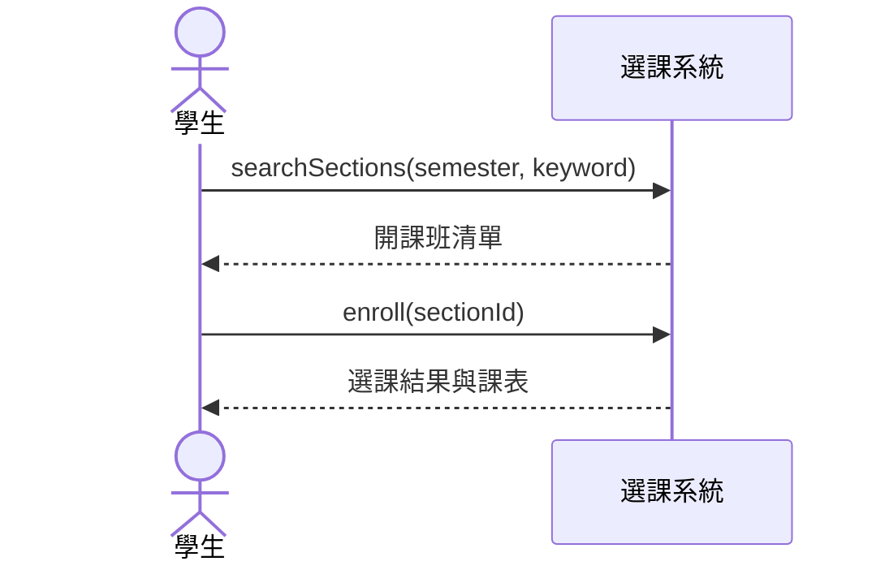

❌ **反例**（操作契約描述的是實作步驟，而不是領域模型的狀態變化）：

```text
操作：enroll(sectionId)
後置條件：呼叫 EnrollmentDAO.insert()，再呼叫 SectionDAO.update()，最後回傳 200。
```

✅ **正例**：

```text
操作契約 CO-02：enroll(sectionId: SectionId)
交互參照：UC-02 選修課程
前置條件：
  - 存在以 sectionId 識別的開課班 s，且 s 屬於目前學期。
  - 學生 st 已通過身分驗證。
後置條件：
  - 建立了選課紀錄 e（物件建立）。
  - e 與 st、s 建立了關聯（關聯建立）。
  - e.status 設為 ENROLLED，e.enrolledAt 設為系統時間（屬性修改）。
  - s 的已選人數增加 1（屬性修改）。
```

- **如何 review**：SSD 只能有行為者、系統（黑箱）與外部系統；操作契約的後置條件只能使用領域模型中的名詞，且用過去式描述「已建立／已關聯／已修改」。
- **如何驗證**：操作契約的每一條後置條件都對應一個測試斷言（例如第 6.8 節選課測試中的 `enrolledCount()` 與 `status()` 斷言）。

### 4.5 強健性分析

強健性分析（Robustness Analysis，源自 Jacobson 的 OOSE，後由 ICONIX 流程推廣）把 Use Case 文字轉成三種物件，作為從分析到設計的橋梁：

| 構造型 | 意義 | 後續通常對應 |
|--------|------|-------------|
| 邊界（Boundary） | 行為者與系統互動的介面 | 畫面、REST Controller、外部系統 Adapter |
| 控制（Control） | 協調一個 Use Case 的流程 | 應用服務（Use Case 類別） |
| 實體（Entity） | 需要長期保存的業務資訊 | 領域物件、聚合 |

規則：行為者只能與邊界物件互動；邊界物件只能與控制物件互動；實體物件之間不直接互動。

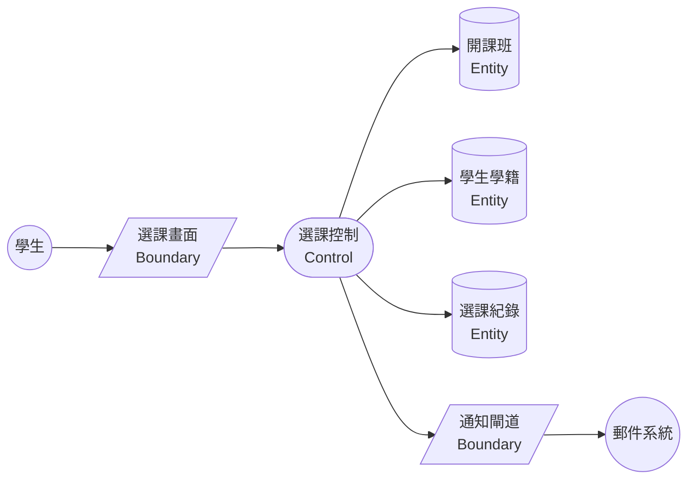

> **注意事項**：強健性圖的目的是檢查 Use Case 文字是否完整（每一步都找得到負責的物件），不是最終設計。若發現某一步找不到物件，代表 Use Case 寫得太模糊，要回頭修正。

### 4.6 架構設計

架構設計決定「程式碼放在哪一層、依賴往哪個方向」。兩種常見選擇：

| 架構 | 依賴方向 | 適用情境 |
|------|----------|----------|
| 傳統分層（Presentation → Business → Data Access） | 由上往下，業務層依賴資料存取層 | 以 CRUD 為主、業務規則簡單的系統 |
| 六角形／整潔架構（Ports and Adapters） | 一律向內，領域層不依賴任何外層 | 業務規則複雜、需長期維護、需替換外部技術 |

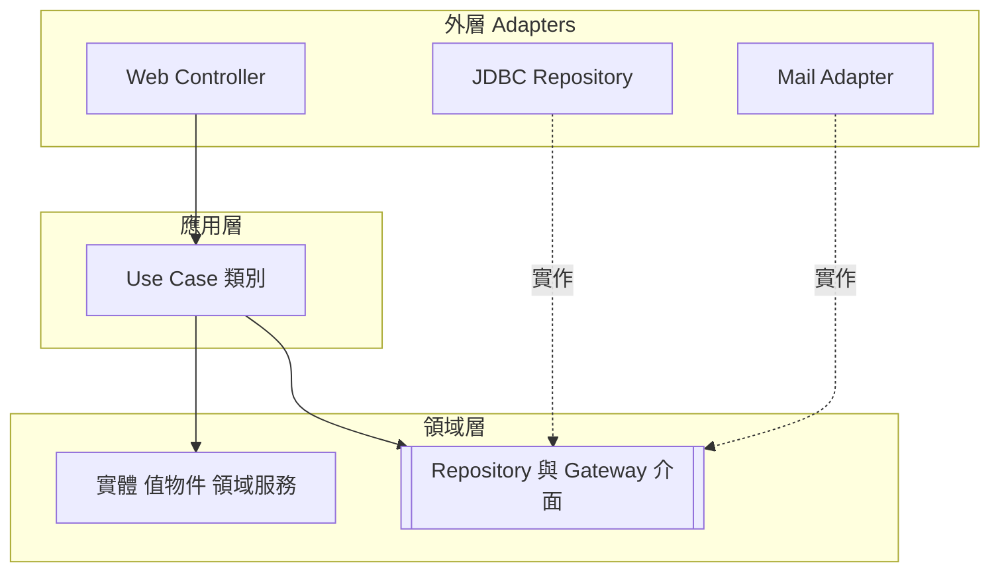

本手冊第 6 章的案例採六角形架構，並以 ArchUnit 驗證依賴方向（OOAD-PRN-015）。更完整的說明見 [Hexagonal Architecture 設計教學]() 與[架構設計指引]()。

### 4.7 詳細設計：從系統事件到物件互動

詳細設計的工作是：針對 SSD 中的每個系統事件，依操作契約與 GRASP 決定由哪些物件合作完成，畫成**設計循序圖**與**設計類別圖**。

步驟：

1. 從操作契約找出要建立或修改的領域物件。
2. 依控制器原則（OOAD-PRN-008）決定誰接收系統事件。
3. 依資訊專家與建立者原則（OOAD-PRN-006、007）決定誰檢查規則、誰建立物件。
4. 畫出設計循序圖，確認每則訊息的接收者都擁有處理它所需的資訊。
5. 從循序圖收集每個類別收到的訊息，即為該類別的公開方法，畫成設計類別圖。

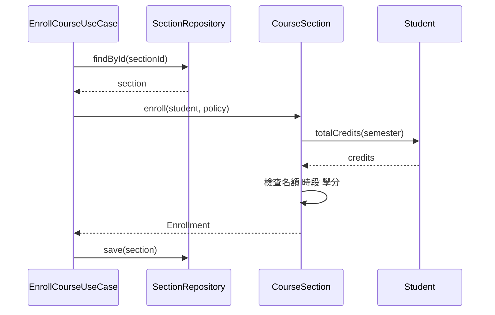

### 4.8 實作：從設計到程式碼

v2.1 版第 3.6 節的 `OrderService` 範例有三個缺陷，是實作階段的典型錯誤：

| 缺陷 | 後果 | v3.0 修正 |
|------|------|-----------|
| 先請款、後扣庫存 | 請款成功但庫存不足時，已向顧客收款卻無法出貨 | 先預留庫存，請款失敗時釋放預留 |
| `catch (Exception e)` 一律包成 `OrderProcessingException` | 呼叫端無法分辨「庫存不足」與「系統錯誤」，原測試預期 `InsufficientStockException` 因此必定失敗 | 只攔截需要補償的情況，業務例外原樣拋出 |
| 失敗時呼叫 `rollbackOrder(customerId)` | 以顧客為單位回滾，會誤刪該顧客其他訂單 | 補償動作只針對本次預留 |

修正後的實作與測試（以 Mockito 建立外部依賴的替身）：

```java
import java.math.BigDecimal;
import java.util.List;
import java.util.Objects;
import java.util.UUID;
import org.junit.jupiter.api.Test;
import org.junit.jupiter.api.extension.ExtendWith;
import org.mockito.InOrder;
import org.mockito.Mock;
import org.mockito.junit.jupiter.MockitoExtension;
import static org.assertj.core.api.Assertions.assertThat;
import static org.assertj.core.api.Assertions.assertThatThrownBy;
import static org.mockito.ArgumentMatchers.any;
import static org.mockito.Mockito.inOrder;
import static org.mockito.Mockito.never;
import static org.mockito.Mockito.verify;
import static org.mockito.Mockito.when;
import static org.mockito.Mockito.doThrow;

record CartItem(String isbn, int quantity, BigDecimal unitPrice) {
    BigDecimal subtotal() { return unitPrice.multiply(BigDecimal.valueOf(quantity)); }
}

record ReservationId(String value) { }
record PaymentReceipt(String transactionId) { }
record OrderId(String value) { }

class InsufficientStockException extends RuntimeException {
    InsufficientStockException(String isbn) { super("庫存不足：" + isbn); }
}

class PaymentDeclinedException extends RuntimeException {
    PaymentDeclinedException(String reason) { super("付款被拒：" + reason); }
}

interface InventoryService {
    /** 全部項目一起預留；任一項不足時拋出 InsufficientStockException，且不預留任何項目。 */
    ReservationId reserve(List<CartItem> items);
    void release(ReservationId reservationId);
}

interface PaymentGateway {
    PaymentReceipt charge(String customerId, BigDecimal amount);
}

interface OrderRepository {
    void save(PlacedOrder order);
}

interface OrderNotifier {
    void orderPlaced(PlacedOrder order);
}

record PlacedOrder(OrderId id, String customerId, List<CartItem> items,
                   BigDecimal total, String transactionId) { }

/** UC-01 下訂單（GRASP 控制器）。 */
final class PlaceOrderService {
    private final InventoryService inventory;
    private final PaymentGateway payment;
    private final OrderRepository orders;
    private final OrderNotifier notifier;

    PlaceOrderService(InventoryService inventory, PaymentGateway payment,
                      OrderRepository orders, OrderNotifier notifier) {
        this.inventory = Objects.requireNonNull(inventory);
        this.payment = Objects.requireNonNull(payment);
        this.orders = Objects.requireNonNull(orders);
        this.notifier = Objects.requireNonNull(notifier);
    }

    OrderId placeOrder(String customerId, List<CartItem> items) {
        if (items == null || items.isEmpty()) {
            throw new IllegalArgumentException("購物車為空");
        }
        BigDecimal total = items.stream().map(CartItem::subtotal)
            .reduce(BigDecimal.ZERO, BigDecimal::add);

        ReservationId reservation = inventory.reserve(items);   // 1. 先預留（不足時直接拋出業務例外）
        PaymentReceipt receipt;
        try {
            receipt = payment.charge(customerId, total);        // 2. 再請款
        } catch (RuntimeException e) {
            inventory.release(reservation);                     // 補償：只釋放本次預留
            throw e;                                            // 原樣拋出，不吞掉也不改包裝
        }
        PlacedOrder order = new PlacedOrder(new OrderId(UUID.randomUUID().toString()),
            customerId, List.copyOf(items), total, receipt.transactionId());
        orders.save(order);                                     // 3. 保存訂單
        notifier.orderPlaced(order);                            // 4. 通知（實務上建議以事件非同步處理）
        return order.id();
    }
}

@ExtendWith(MockitoExtension.class)
class PlaceOrderServiceTest {
    @Mock InventoryService inventory;
    @Mock PaymentGateway payment;
    @Mock OrderRepository orders;
    @Mock OrderNotifier notifier;

    final List<CartItem> items = List.of(
        new CartItem("978-0137488803", 2, new BigDecimal("500")),
        new CartItem("978-0321125217", 1, new BigDecimal("600")));

    PlaceOrderService service() { return new PlaceOrderService(inventory, payment, orders, notifier); }

    @Test
    void 成功下單時先預留再請款_金額為明細加總() {
        when(inventory.reserve(items)).thenReturn(new ReservationId("R1"));
        when(payment.charge("C01", new BigDecimal("1600"))).thenReturn(new PaymentReceipt("T1"));

        OrderId id = service().placeOrder("C01", items);

        assertThat(id.value()).isNotBlank();
        InOrder order = inOrder(inventory, payment, orders, notifier);
        order.verify(inventory).reserve(items);
        order.verify(payment).charge("C01", new BigDecimal("1600"));
        order.verify(orders).save(any());
        order.verify(notifier).orderPlaced(any());
    }

    @Test
    void 庫存不足時拋出業務例外且不請款() {
        when(inventory.reserve(items)).thenThrow(new InsufficientStockException("978-0137488803"));

        assertThatThrownBy(() -> service().placeOrder("C01", items))
            .isInstanceOf(InsufficientStockException.class)
            .hasMessageContaining("庫存不足");
        verify(payment, never()).charge(any(), any());
        verify(orders, never()).save(any());
    }

    @Test
    void 付款被拒時釋放預留且不建立訂單() {
        when(inventory.reserve(items)).thenReturn(new ReservationId("R1"));
        doThrow(new PaymentDeclinedException("額度不足")).when(payment).charge(any(), any());

        assertThatThrownBy(() -> service().placeOrder("C01", items))
            .isInstanceOf(PaymentDeclinedException.class);
        verify(inventory).release(new ReservationId("R1"));
        verify(orders, never()).save(any());
    }
}
```

> **注意事項**：上例假設「請款」與「保存訂單」之間不會失敗。正式系統中，跨越外部金流與本地資料庫的操作無法以單一資料庫交易保證一致，需搭配冪等請款鍵、交易外送箱（Transactional Outbox）或 Saga 補償流程，詳見[系統設計指引]()。

### 4.9 測試與驗證

| 測試層級 | 驗證對象 | OOAD 產出的對應 | 常用工具 |
|----------|----------|----------------|----------|
| 單元測試 | 單一類別的契約 | 類別的前置、後置條件與不變量（OOAD-PRN-014） | JUnit 6、AssertJ |
| 元件／整合測試 | 多個類別合作、與資料庫或外部系統整合 | 設計循序圖的訊息流程 | JUnit 6、Testcontainers |
| 架構測試 | 依賴方向與設計規則 | 套件圖、分層架構 | ArchUnit |
| 驗收測試 | Use Case 情境 | Use Case 規格的主要與擴充情境 | Cucumber、JUnit 6 |

測試金字塔（下層多、上層少）是**數量與執行成本的指引**，不是固定比例。v2.1 版寫的「單元 70～80%、整合 15～20%」並非業界標準數值，本版移除；各專案應依風險決定比例。測試策略與覆蓋率門檻請依[測試與品質保證指引]()。

#### OOAD-PRC-007 每個 Use Case 情境都有對應的自動化測試

- **等級**：必須
- **說明**：Use Case 的每個主要成功情境與擴充情境，都應有至少一個自動化測試；測試名稱或 `@DisplayName` 標註 Use Case 與情境編號，讓追溯可以自動化。

❌ **反例**：

```java
import org.junit.jupiter.api.Test;

class EnrollmentTests {
    @Test void test1() { }   // 無法得知對應哪個需求，也沒有任何斷言
    @Test void test2() { }
}
```

✅ **正例**：

```java
import org.junit.jupiter.api.DisplayName;
import org.junit.jupiter.api.Test;
import static org.assertj.core.api.Assertions.assertThat;
import static org.assertj.core.api.Assertions.assertThatThrownBy;

final class Section {
    private final int capacity;
    private int enrolled;
    Section(int capacity) { this.capacity = capacity; }
    void enroll() {
        if (enrolled >= capacity) throw new IllegalStateException("名額已滿");
        enrolled++;
    }
    int enrolled() { return enrolled; }
}

class Uc02EnrollCourseTest {
    @Test
    @DisplayName("UC-02 主要成功情境：有名額時選課成功")
    void mainSuccess() {
        Section s = new Section(30);
        s.enroll();
        assertThat(s.enrolled()).isEqualTo(1);
    }

    @Test
    @DisplayName("UC-02 擴充 6a：名額已滿時拒絕")
    void ext6a() {
        Section s = new Section(1);
        s.enroll();
        assertThatThrownBy(s::enroll).hasMessage("名額已滿");
    }
}
```

- **如何 review**：比對 Use Case 規格的情境清單與測試的 `@DisplayName`，逐項打勾。
- **如何驗證**：以 JUnit 的 XML 報告（Surefire 產出 `TEST-*.xml`）擷取測試顯示名稱，比對 Use Case 情境清單，自動列出缺少測試的情境。

### 4.10 追溯性

追溯性（Traceability）讓我們回答兩個問題：「這個需求由哪些設計與程式實現、被哪些測試驗證？」以及「改這段程式會影響哪些需求？」金融、醫療與政府專案的稽核常要求提供追溯矩陣。

#### OOAD-PRC-008 維護需求到測試的雙向追溯矩陣

- **等級**：必須（受稽核專案）／建議（其他專案）
- **說明**：追溯矩陣的最小欄位：需求編號 → Use Case 與情境 → 設計元素（類別或圖） → 程式位置 → 測試案例 → 測試結果。矩陣應盡量由工具產生（例如從 `@DisplayName` 與需求標籤擷取），人工維護的矩陣很快就會過時。

❌ **反例**：

```text
追溯矩陣.xlsx（最後修改：一年前）
FR-03 選課 → 已完成
```

✅ **正例**：

| 需求 | Use Case／情境 | 設計元素 | 程式 | 測試 | 結果 |
|------|---------------|----------|------|------|------|
| FR-03 學生選課 | UC-02 主要情境 | 第 6.6 節循序圖、`CourseSection.enroll` | `domain/CourseSection.java` | `UC-02 主要成功情境：有名額時選課成功` | 通過 |
| FR-03 學生選課 | UC-02 擴充 6a | 同上 | 同上 | `UC-02 擴充 6a：名額已滿時拒絕` | 通過 |
| BR-01 學分上限 | UC-02 擴充 5a | `CreditLimitPolicy` | `domain/CreditLimitPolicy.java` | `UC-02 擴充 5a：超過學分上限時拒絕` | 通過 |
| NFR-PERF-02 尖峰效能 | UC-02 特殊需求 | 第 6.7 節樂觀鎖設計 | `infra/JdbcSectionRepository.java` | k6 腳本 `enroll-peak.js` | 待執行 |

- **如何 review**：抽查 3 筆需求，從需求追到測試，再從測試反追回需求；任一方向斷鏈即為缺陷。
- **如何驗證**：在 CI 產出測試報告後，以腳本比對「需求清單」與「測試顯示名稱中的需求或 Use Case 編號」，列出未被任何測試覆蓋的需求。更完整的需求追溯做法見[系統分析指引]()。

### 4.11 練習題

**練習 4.1：完整走一次迭代**

以「圖書館預約借書」為題（書被借出時，其他會員可以預約；書歸還後通知第一位預約者，保留 3 天）：

1. 寫出 2 個使用者故事與 Given／When／Then 驗收準則（含失敗情境）。
2. 畫出領域模型（不含方法與技術類別）。
3. 寫出「預約書籍」Use Case 完整規格與操作契約。
4. 畫出設計循序圖並實作、撰寫測試。

- 驗收標準：通過 OOAD-PRC-001、003、005、006、007 的「如何 review」檢查；測試全部通過。

**練習 4.2：改寫非功能需求**

把下列需求改寫成符合 OOAD-PRC-002 的格式：「系統要穩定」、「報表要快」、「要符合資安規範」。

### 4.12 章節小結

| 階段 | 關鍵產出 | 對應指引 |
|------|----------|----------|
| 需求分析 | 使用者故事與驗收準則、可量測 NFR | OOAD-PRC-001、002 |
| 領域分析 | 領域模型、詞彙表 | OOAD-PRC-003、004 |
| Use Case 分析 | 完整 Use Case 規格、SSD、操作契約 | OOAD-PRC-005、006 |
| 設計 | 強健性分析、架構、設計循序圖與類別圖 | 第 3 章 GRASP、OOAD-PRN-015 |
| 實作與驗證 | 程式、單元／整合／驗收測試、追溯矩陣 | OOAD-PRC-007、008 |

**常見陷阱**

- 領域模型畫成資料庫 ER 圖或設計類別圖。
- Use Case 只寫主要成功情境，失敗情境留給開發者「自由發揮」。
- 以 `catch (Exception e)` 統一包裝例外，導致呼叫端無法區分業務失敗與系統錯誤。

---

## 5. UML 2.5.1 建模實務

### 5.1 UML 簡介與標準現況

統一建模語言（Unified Modeling Language, UML）是用於**視覺化、規格化、建構與記錄**軟體密集系統的標準圖形語言，由 Object Management Group（OMG）維護。UML 只定義「記法與語意」，不規定開發流程；第 4 章的流程搭配任何方法論都能使用 UML。

**發展歷程**（依 OMG 官方版本紀錄整理）：

| 年份 | 事件 |
|------|------|
| 1994 | James Rumbaugh（OMT）加入 Rational，與 Grady Booch（Booch 方法）開始整合 |
| 1995 | Ivar Jacobson（OOSE／Objectory）加入，發表 Unified Method 0.8 |
| 1997 年 11 月 | OMG 採納 UML 1.1，成為業界標準 |
| 2005 年 7 月 | UML 2.0 正式版：大幅改寫互動圖、活動圖，新增時序圖、組合結構圖等 |
| 2005 | UML 1.4.2 成為國際標準 ISO/IEC 19501:2005 |
| 2011 年 7 月 | UML 2.4.1 |
| 2012 | UML 2.4.1 成為國際標準 ISO/IEC 19505-1／19505-2:2012 |
| 2015 年 | UML 2.5：規格書簡化重寫，合併 Infrastructure 與 Superstructure 為單一文件 |
| 2017 年 12 月 | **UML 2.5.1**（formal/17-12-05），截至 2026 年 10 月仍是 OMG 最新正式版本 |

**相關標準對照**（v2.1 版的編號有誤，本版已更正）：

| 標準 | 內容 | 對應 OMG 版本 |
|------|------|--------------|
| ISO/IEC 19501:2005 | UML | UML 1.4.2 |
| ISO/IEC 19505-1:2012 | UML Part 1：Infrastructure | UML 2.4.1 |
| ISO/IEC 19505-2:2012 | UML Part 2：Superstructure | UML 2.4.1 |
| ISO/IEC 19507:2012 | Object Constraint Language（OCL） | OCL 2.3.1 |
| ISO/IEC 19503:2005 | XML Metadata Interchange（XMI） | XMI 2.0.1 |
| ISO/IEC 19508:2014 | Meta Object Facility（MOF）Core | MOF 2.4.2 |
| ISO/IEC 19509:2014 | XML Metadata Interchange（XMI） | XMI 2.4.2 |

> **注意事項**：ISO 版本落後 OMG 版本。企業規範若需引用「國際標準」，應引用 ISO/IEC 19505:2012；若要引用「最新規格」，應引用 OMG UML 2.5.1。兩者在本手冊涵蓋的記法上沒有實質差異。

**與 SysML v2 的關係**：OMG 於 2025 年 7 月通過 SysML v2.0、KerML 1.0 與 Systems Modeling API and Services 1.0 的最終採納（SysML 2.0 正式規格文件於 2025 年 9 月發布）。SysML v1 是 UML 的 Profile（擴充），**SysML v2 改以 KerML 為基礎，不再是 UML 的擴充**，並提供文字記法。系統工程（硬體與軟體整合、航太、車用）專案可評估 SysML v2；一般企業資訊系統仍以 UML 為主。

### 5.2 UML 2.5.1 的 14 種圖形

UML 2.5.1 的圖形分成**結構圖**與**行為圖**兩大類，**互動圖是行為圖的子類**（v2.1 版寫成「三大類」並漏列 Profile 圖，本版已更正）。

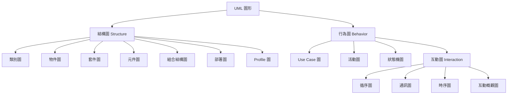

| 圖形 | 分類 | 回答的問題 | 主要使用階段 | 實務使用頻率 |
|------|------|-----------|-------------|-------------|
| Use Case 圖 | 行為 | 誰用系統達成什麼目標 | 需求 | 高 |
| 類別圖 | 結構 | 有哪些類別、屬性與關係 | 分析（領域模型）、設計 | 高 |
| 循序圖 | 互動 | 物件依時間順序如何傳遞訊息 | 分析（SSD）、設計 | 高 |
| 狀態機圖 | 行為 | 物件的生命週期與合法轉換 | 設計 | 中高 |
| 活動圖 | 行為 | 流程、分支、並行 | 需求（業務流程）、設計 | 中高 |
| 元件圖 | 結構 | 可替換的模組與介面 | 架構設計 | 中 |
| 部署圖 | 結構 | 軟體在哪些節點上執行 | 架構設計、維運 | 中 |
| 套件圖 | 結構 | 模型或程式的分組與依賴 | 架構設計 | 中 |
| 物件圖 | 結構 | 某一時間點的物件與連結快照 | 分析（驗證類別圖） | 低 |
| 通訊圖 | 互動 | 物件之間的連結與訊息編號 | 設計 | 低 |
| 組合結構圖 | 結構 | 類別內部的零件、埠與連接器 | 嵌入式、元件設計 | 低 |
| 時序圖 | 互動 | 狀態隨時間的變化與時間約束 | 即時系統 | 低 |
| 互動概觀圖 | 互動 | 多個互動之間的控制流程 | 複雜流程 | 低 |
| Profile 圖 | 結構 | 自訂構造型與標記值（擴充 UML） | 建模規範制定 | 低 |

#### OOAD-UML-001 每張圖都說明目的、讀者與抽象層級

- **等級**：必須
- **說明**：同一個系統可以畫成給主管看的概觀、給架構師看的元件圖、給開發者看的詳細類別圖。沒有說明目的的圖，讀者無法判斷「沒畫出來的東西是省略還是不存在」。

❌ **反例**：沒有標題、沒有說明，混合了領域概念與技術類別，看不出是分析還是設計。

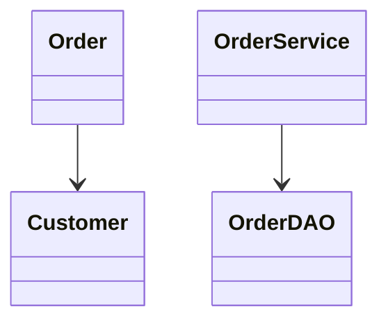

✅ **正例**：以 Mermaid 的 `title` 標明圖名，並在圖下方說明目的、讀者、抽象層級與省略內容。

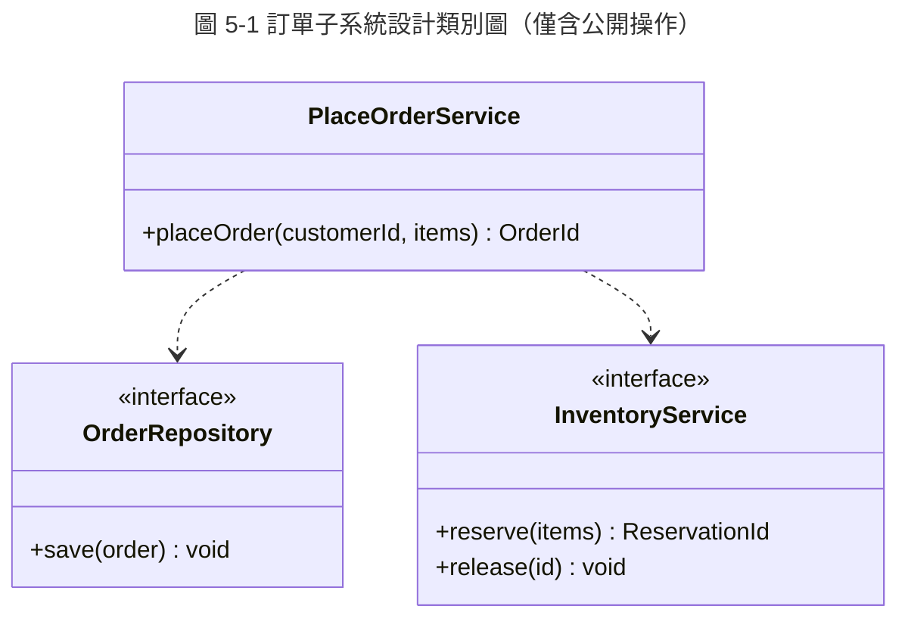

> 圖 5-1 說明：**目的**——說明下訂單 Use Case 的應用服務依賴哪些埠（port）；**讀者**——開發與 Code Review 人員；**抽象層級**——設計層，只列公開操作，省略私有方法、建構子與 getter；**對應程式**——第 4.8 節 `PlaceOrderService`。

- **如何 review**：每張圖是否有編號與標題；圖下方是否寫出目的、讀者、抽象層級；圖中元素的抽象層級是否一致（領域概念與技術類別不混在同一張分析圖）。
- **如何驗證**：文件審查清單（第 13.2 節）逐圖勾選；以腳本檢查 Markdown 中每個 `mermaid` 區塊是否有 `title` 或緊接的說明段落。

### 5.3 Use Case 圖

Use Case 圖呈現系統邊界、行為者與 Use Case 之間的關係，**不呈現流程順序**（流程寫在 Use Case 規格中，見第 4.4 節）。

**元素與關係**

| 元素／關係 | UML 記法 | 意義 |
|-----------|----------|------|
| 行為者（Actor） | 人形圖示 | 系統外部、與系統互動的角色（人、外部系統、時間） |
| Use Case | 橢圓 | 行為者的一個使用者目標 |
| 系統邊界（Subject） | 矩形框 | 系統範圍 |
| 關聯 | 實線 | 行為者參與 Use Case |
| 包含（include） | 虛線箭頭＋`«include»`，**由基礎 Use Case 指向被包含者** | 基礎 Use Case **每次都必須**執行被包含的行為 |
| 擴充（extend） | 虛線箭頭＋`«extend»`，**由擴充 Use Case 指向基礎 Use Case** | 在基礎 Use Case 的擴充點、條件成立時才插入的行為 |
| 泛化 | 空心三角箭頭 | 行為者或 Use Case 的一般化 |

> **注意事項**：Mermaid 沒有 Use Case 圖類型。以下 Mermaid 圖以流程圖**近似**表示（橢圓用圓角框代替），正式文件若需標準記法，請使用 PlantUML 或 UML 建模工具（記法差異見第 5.14 節）。

#### OOAD-UML-002 正確使用 include 與 extend

- **等級**：必須
- **說明**：常見錯誤有三：(1) 把「登入」畫成每個 Use Case 都 include 的獨立 Use Case——登入是前置條件，不是使用者目標；(2) extend 箭頭方向畫反；(3) 用 include／extend 拆解功能步驟，把 Use Case 圖畫成功能分解圖。

❌ **反例**（v2.1 版的畫法）：

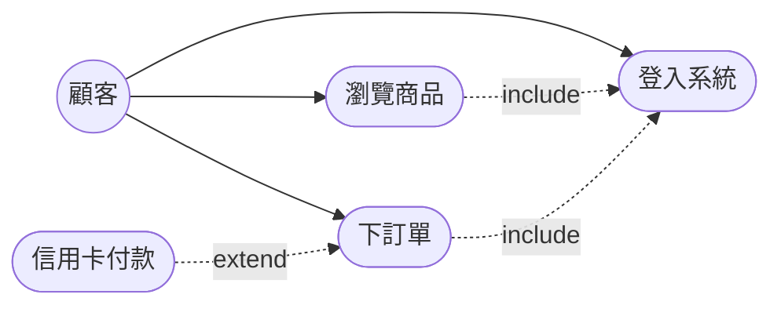

問題：瀏覽商品通常不需登入；「登入」應寫在下訂單的前置條件中；信用卡付款是下訂單的必要步驟之一（付款方式的選擇），不是條件式插入的額外行為。

✅ **正例**（Mermaid 近似表示）：

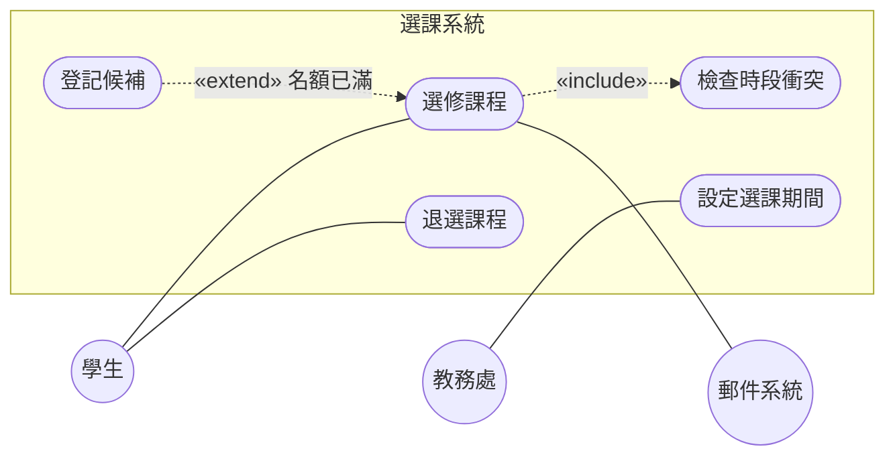

✅ **正例**（PlantUML 標準記法）：

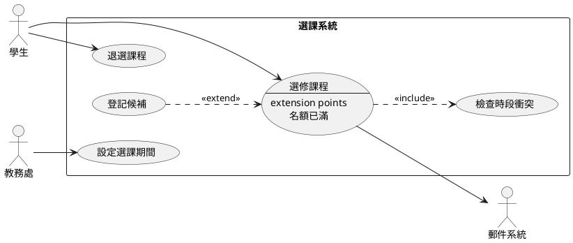

| 關係 | 判斷問題 | 本例 |
|------|----------|------|
| include | 基礎 Use Case **每次**執行都需要它嗎？是否被兩個以上 Use Case 共用？ | 選課與調課都要「檢查時段衝突」 |
| extend | 它是否只在**特定條件**下發生？基礎 Use Case 少了它是否仍完整？ | 只有名額已滿才「登記候補」；不候補的選課流程仍完整 |

- **如何 review**：(1) include 箭頭從基礎指向被包含者，extend 箭頭從擴充者指向基礎；(2) 每個 Use Case 是使用者目標層（第 4.4 節）；(3) 圖中沒有「登入」「查詢資料庫」這類子功能。
- **如何驗證**：把每個 include／extend 對照 Use Case 規格文字——include 在主要成功情境中必有對應步驟；extend 在擴充情境中必有對應條件（如 UC-02 的 6a）。對不上即為錯誤。

### 5.4 類別圖

類別圖是 OOAD 最核心的結構圖。分析階段的類別圖就是領域模型（第 4.3 節），設計階段的類別圖則包含型別、可見性、操作與介面。

**類別的記法**

| 項目 | UML 記法 | Mermaid 記法 | 說明 |
|------|----------|--------------|------|
| 可見性 | `+` public、`-` private、`#` protected、`~` package | 相同 | |
| 屬性 | `name : Type [多重性] = 預設值` | `-name: Type` 或 `-Type name` | |
| 操作 | `name(param : Type) : ReturnType` | `+name(param) ReturnType` | |
| 抽象 | 類別或操作名稱以*斜體*或 `{abstract}` 表示 | 操作後加 `*`，類別用 `<<abstract>>` | `*` 是 Mermaid 專用記法 |
| 靜態 | 加底線 | 操作或屬性後加 `$` | `$` 是 Mermaid 專用記法 |
| 構造型 | `«interface»`、`«enumeration»` | `<<interface>>` | |

**關係的記法與程式對應**

| 關係 | UML 記法 | Mermaid | 語意 | Java 典型對應 |
|------|----------|---------|------|---------------|
| 關聯 | 實線（可加箭頭表示導覽方向） | `A --> B` | A 長期知道 B | A 有 B 型別的欄位 |
| 聚合 | 空心菱形在**整體**端 | `Whole o-- Part` | 整體與部分，部分可獨立存在、可被共用 | 欄位持有外部傳入的物件 |
| 組合 | 實心菱形在**整體**端 | `Whole *-- Part` | 部分的生命週期由整體負責，一個部分同時只屬於一個整體 | 整體內部建立部分，不對外暴露 |
| 泛化 | 空心三角箭頭指向父類別 | `Parent <\|-- Child` | is-a | `extends` |
| 實現 | 虛線空心三角指向介面 | `Interface <\|.. Impl` | 實作契約 | `implements` |
| 依賴 | 虛線箭頭 | `A ..> B` | A 暫時使用 B | 參數、區域變數、靜態呼叫 |

#### OOAD-UML-003 聚合與組合依生命週期判斷且菱形畫在整體端

- **等級**：必須
- **說明**：菱形永遠畫在「整體」端。v2.1 版大量使用 `Customer "1" --o "many" Order`：Mermaid 的 `--o` 會把空心菱形畫在**右邊**的 `Order`，意思變成「訂單是整體、顧客是部分」，語意完全相反。另外，顧客與訂單的生命週期互相獨立，本來就不該用聚合或組合，而應是一般關聯。
- **判斷流程**：
  1. 兩者是否為「整體與部分」？否 → 一般關聯。
  2. 整體刪除時，部分是否一定隨之刪除，且部分同時只能屬於一個整體？是 → 組合；否 → 聚合（或直接用關聯——UML 規格對聚合的語意定義很弱，許多團隊規定只用關聯與組合）。

❌ **反例**：

```mermaid
classDiagram
    Customer "1" --o "many" Order : places
    Order "1" --o "many" OrderItem : contains
    Book "1" --o "many" OrderItem : ordered as
```

✅ **正例**：

```mermaid
classDiagram
    class Customer
    class Order
    class OrderItem
    class BookDescription
    Customer "1" --> "0..*" Order : 下單
    Order "1" *-- "1..*" OrderItem : 包含
    OrderItem "0..*" --> "1" BookDescription : 描述
```

對應程式：`Order` 在內部建立並擁有 `OrderItem`（組合），`OrderItem` 參照一個獨立存在的 `BookDescription`（關聯）。

```java
import java.math.BigDecimal;
import java.util.ArrayList;
import java.util.List;
import java.util.Objects;
import org.junit.jupiter.api.Test;
import static org.assertj.core.api.Assertions.assertThat;
import static org.assertj.core.api.Assertions.assertThatThrownBy;

record BookDescription(String isbn, String title, BigDecimal price) { }   // 獨立存在

final class Order {
    private final String customerId;                   // 關聯：只持有對方的識別
    private final List<OrderItem> items = new ArrayList<>();   // 組合

    Order(String customerId) { this.customerId = Objects.requireNonNull(customerId); }

    void add(BookDescription book, int quantity) {     // 部分只能由整體建立（建立者原則）
        items.add(new OrderItem(book, quantity));
    }

    List<OrderItem> items() { return List.copyOf(items); }

    BigDecimal total() {
        if (items.isEmpty()) throw new IllegalStateException("訂單至少需要一個項目");   // 多重性 1..*
        return items.stream().map(OrderItem::subtotal).reduce(BigDecimal.ZERO, BigDecimal::add);
    }

    record OrderItem(BookDescription book, int quantity) {   // 巢狀於整體內
        BigDecimal subtotal() { return book.price().multiply(BigDecimal.valueOf(quantity)); }
    }
}

class CompositionTest {
    @Test
    void 部分由整體建立且不可由外部加入() {
        BookDescription b = new BookDescription("978-0137488803", "Refactoring", new BigDecimal("1500"));
        Order order = new Order("C01");
        order.add(b, 2);
        assertThat(order.total()).isEqualByComparingTo("3000");
        assertThatThrownBy(() -> order.items().add(new Order.OrderItem(b, 1)))
            .isInstanceOf(UnsupportedOperationException.class);
    }

    @Test
    void 沒有項目的訂單違反多重性() {
        assertThatThrownBy(() -> new Order("C01").total()).isInstanceOf(IllegalStateException.class);
    }
}
```

- **如何 review**：(1) 每個菱形是否在整體端；(2) 用「整體刪除時部分是否一起刪除」與「部分能否同時屬於兩個整體」驗證組合；(3) 兩個生命週期獨立的實體（顧客與訂單、學生與課程）之間不應出現菱形。
- **如何驗證**：組合關係的「部分」類別，其建構子只被「整體」呼叫（ArchUnit，見 OOAD-PRN-007）；資料庫層面，組合通常對應 `ON DELETE CASCADE` 或在同一聚合內一起保存（第 7 章）。

#### OOAD-UML-004 多重性必須標示並與程式一致

- **等級**：必須
- **說明**：多重性是業務規則。`Order "1" *-- "1..*" OrderItem` 表示訂單至少要有一個項目，程式就必須保證（如上例 `total()` 的檢查）。常見錯誤是圖上寫 `1..*`，程式卻允許空集合；或圖上寫 `0..1`，程式卻用 `List`。

| 多重性 | 意義 | 程式對應 |
|--------|------|----------|
| `1` | 恰好一個 | 非 null 的欄位，建構子必填 |
| `0..1` | 零或一個 | 可為 null 的欄位，或 `Optional` 回傳值 |
| `0..*` 或 `*` | 零或多個 | 集合，可為空 |
| `1..*` | 至少一個 | 集合，建立時與移除時都檢查不得為空 |
| `n..m` | 範圍 | 集合，加入與移除時檢查上下限 |

❌ **反例**（圖上的多重性與程式不一致）：

```mermaid
classDiagram
    class Course
    class Teacher
    Course "0..*" --> "1" Teacher : 授課教師
```

```java
public class Course {
    private Teacher teacher;            // 圖上是 1，程式卻允許 null，也沒有建構子檢查

    public void setTeacher(Teacher teacher) { this.teacher = teacher; }
}

class Teacher { }
```

✅ **正例**：

```java
import java.util.Objects;
import org.junit.jupiter.api.Test;
import static org.assertj.core.api.Assertions.assertThatThrownBy;

record Teacher(String employeeNo) { }

final class Course {
    private Teacher teacher;                     // 多重性 1：任何時候都不為 null

    Course(Teacher teacher) { this.teacher = Objects.requireNonNull(teacher, "授課教師必填"); }

    void reassign(Teacher newTeacher) { this.teacher = Objects.requireNonNull(newTeacher, "授課教師必填"); }

    Teacher teacher() { return teacher; }
}

class MultiplicityTest {
    @Test
    void 多重性為1的關聯不可為空() {
        assertThatThrownBy(() -> new Course(null)).isInstanceOf(NullPointerException.class);
        Course c = new Course(new Teacher("E01"));
        assertThatThrownBy(() -> c.reassign(null)).isInstanceOf(NullPointerException.class);
    }
}
```

- **如何 review**：逐條關聯比對類別圖的多重性與程式欄位型別、建構子檢查與集合增刪檢查。
- **如何驗證**：每個下限大於 0 或有上限的多重性，各寫一個「違反時被拒絕」的測試。

**其他類別圖記法**

```mermaid
classDiagram
    class Shape {
        <<abstract>>
        +area()* double
    }
    class Circle {
        -radius: double
        +area() double
        +unit()$ Circle
    }
    class Drawable {
        <<interface>>
        +draw() void
    }
    class Color {
        <<enumeration>>
        RED
        GREEN
    }
    class Enrollment {
        enrolledAt
        status
    }
    Shape <|-- Circle
    Drawable <|.. Circle
    Circle ..> Color : 使用
    Student "*" -- "*" CourseSection
    Enrollment .. Student
    Enrollment .. CourseSection
```

上圖的 `Enrollment` 以虛線連到 `Student` 與 `CourseSection`，近似 UML 的**關聯類別（Association Class）**：當多對多關聯本身帶有屬性（選課時間、狀態、成績），就應把關聯提升為類別。Mermaid 無法畫出 UML 的關聯類別標準記法（虛線連到關聯線中央），正式文件請用 PlantUML：

```plantuml
@startuml
class Student
class CourseSection
class Enrollment {
  enrolledAt : DateTime
  status : EnrollmentStatus
}
Student "*" -- "*" CourseSection
(Student, CourseSection) .. Enrollment
@enduml
```

### 5.5 物件圖

物件圖是類別圖在某一時間點的「快照」，用來以具體例子驗證類別圖的多重性與關聯是否合理。UML 記法：`物件名稱 : 類別名稱` 並加底線，下方列出屬性值。

```plantuml
@startuml
object "cs101 : CourseSection" as cs101 {
  capacity = 2
  semester = "114-1"
}
object "e1 : Enrollment" as e1 {
  status = ENROLLED
}
object "e2 : Enrollment" as e2 {
  status = ENROLLED
}
object "wang : Student" as wang {
  studentNo = "B11201"
}
object "lin : Student" as lin {
  studentNo = "B11202"
}
cs101 -- e1
cs101 -- e2
e1 -- wang
e2 -- lin
@enduml
```

Mermaid 沒有物件圖，可用類別圖的標籤語法近似（無法加底線）：

```mermaid
classDiagram
    class cs101["cs101 : CourseSection"] {
        capacity = 2
    }
    class e1["e1 : Enrollment"] {
        status = ENROLLED
    }
    class wang["wang : Student"] {
        studentNo = B11201
    }
    cs101 -- e1
    e1 -- wang
```

> **實務案例**：設計審查時，對多重性有疑慮（例如「一位學生能否同時對同一開課班有兩筆選課紀錄？」），請作者畫出一張物件圖，把邊界情況具體化。若畫出的物件圖違反業務規則卻符合類別圖，代表類別圖缺少限制（需補多重性或 OCL 不變量，見第 5.13 節）。

### 5.6 套件圖

套件圖呈現模型或程式碼的分組與套件之間的依賴，是檢查分層架構與循環依賴的主要工具。套件依賴應與第 3.9 節的 ArchUnit 規則一致。

```mermaid
flowchart TB
    subgraph web[com.example.enroll.web]
        W[EnrollmentController]
    end
    subgraph app[com.example.enroll.application]
        A[EnrollCourseUseCase]
    end
    subgraph domain[com.example.enroll.domain]
        D[CourseSection Student]
        P[[SectionRepository]]
    end
    subgraph infra[com.example.enroll.infrastructure]
        J[JdbcSectionRepository]
    end
    web -.->|import| app
    app -.->|import| domain
    infra -.->|import| domain
```

**閱讀重點**：箭頭表示「依賴」（虛線），`domain` 沒有任何向外的箭頭；`infrastructure` 依賴 `domain`（實作其介面），符合依賴反轉（OOAD-PRN-005）。

### 5.7 循序圖

循序圖以垂直的生命線表示參與者、以水平箭頭表示訊息，**由上而下代表時間順序**。

**訊息種類**

| 訊息 | UML 記法 | Mermaid | 意義 |
|------|----------|---------|------|
| 同步呼叫 | 實線＋實心箭頭 | `A->>B: call()` | 呼叫者等待回應 |
| 非同步訊息 | 實線＋開放箭頭 | `A-)B: event` | 送出後不等待 |
| 回覆 | 虛線＋開放箭頭 | `B-->>A: result` | 同步呼叫的回應 |
| 建立 | 虛線箭頭指向新生命線的頭部 | `create participant B` 後接訊息 | 建立新物件 |
| 銷毀 | 生命線末端 X | `destroy B` 後接訊息 | 物件結束 |
| 遺失訊息 | 箭頭指向黑點 | `A-xB: msg`（近似） | 送出但未到達 |

**組合片段（Combined Fragment）**

| 運算子 | 意義 | Mermaid |
|--------|------|---------|
| `alt` | 互斥的多選一（if-else） | `alt ... else ... end` |
| `opt` | 條件成立才執行（if） | `opt ... end` |
| `loop` | 重複 | `loop ... end` |
| `par` | 並行 | `par ... and ... end` |
| `break` | 條件成立時執行並跳出外層互動 | `break ... end` |
| `critical` | 不可被中斷的區段 | `critical ... option ... end` |
| `ref` | 參照另一個互動 | Mermaid 不支援，以 `rect` 加說明近似 |

#### OOAD-UML-005 循序圖正確區分同步、非同步與回覆訊息

- **等級**：必須
- **說明**：同步與非同步的差異直接影響設計：非同步代表呼叫者不會知道結果、可能需要重試與冪等設計。v2.1 版的記憶法範例把「非同步呼叫」也畫成同步箭頭（`->>`），讀者會誤以為通知寄送失敗時訂單會回滾。

❌ **反例**：

```mermaid
sequenceDiagram
    participant OS as OrderService
    participant NS as NotificationService
    OS->>NS: 寄送確認信
    NS-->>OS: 完成
```

✅ **正例**：下單同步完成後，以非同步事件觸發通知；通知失敗不影響訂單。

```mermaid
sequenceDiagram
    actor C as 顧客
    participant UC as PlaceOrderService
    participant INV as InventoryService
    participant PAY as PaymentGateway
    participant BUS as EventBus
    participant NS as NotificationService
    C->>+UC: placeOrder(items)
    UC->>+INV: reserve(items)
    INV-->>-UC: reservationId
    UC->>+PAY: charge(amount)
    alt 付款成功
        PAY-->>UC: receipt
        create participant O as Order
        UC->>O: new Order(...)
        UC-)BUS: OrderPlaced
        UC-->>C: orderId
    else 付款被拒
        PAY-->>-UC: declined
        UC->>INV: release(reservationId)
        UC-->>-C: 付款失敗訊息
    end
    BUS-)NS: OrderPlaced
    NS-)C: 確認信
```

- **如何 review**：(1) 每個同步呼叫是否都有對應的回覆或在設計上明確為 void；(2) 非同步訊息之後的步驟是否不依賴其結果；(3) `alt` 的每個分支是否對應 Use Case 的擴充情境。
- **如何驗證**：比對程式：同步呼叫對應方法呼叫並使用回傳值；非同步訊息對應事件發布或訊息佇列；以整合測試驗證「通知失敗時訂單仍成立」。

> **注意事項**：循序圖不適合表達複雜的分支邏輯。若一張圖需要三層以上巢狀 `alt`，應拆成多張圖（每個主要情境一張），或改用活動圖。

### 5.8 通訊圖

通訊圖（Communication Diagram，UML 1.x 稱協作圖）與循序圖表達相同的資訊，但著重**物件之間的連結**，訊息以編號（1、1.1、1.2）表示順序。適合在白板上快速討論「誰認識誰」。Mermaid 沒有通訊圖，可用流程圖近似：

```mermaid
flowchart LR
    UC[":EnrollCourseUseCase"] -- "1: findById(id)" --> R[":SectionRepository"]
    UC -- "2: enroll(student, policy)" --> S[":CourseSection"]
    S -- "2.1: totalCredits(semester)" --> St[":Student"]
    UC -- "3: save(section)" --> R
```

### 5.9 活動圖

活動圖描述流程中的動作、分支、並行與物件流，可用於業務流程（需求階段）與演算法（設計階段）。

| 元素 | UML 記法 | 說明 |
|------|----------|------|
| 初始節點 | 實心黑點 | 流程開始 |
| 活動最終節點 | 圓圈內實心黑點 | 整個活動結束 |
| 流程最終節點 | 圓圈內打叉 | 只結束一條流程，其他並行流程繼續 |
| 動作 | 圓角矩形 | 一個步驟 |
| 決策／合併節點 | 菱形 | 依守衛條件 `[條件]` 分支；合併多條分支 |
| 分岔／匯合節點（Fork／Join） | 粗黑橫線 | 分出並行流程；等待所有並行流程完成 |
| 泳道（Partition） | 分區 | 標示由哪個角色或系統負責 |

#### OOAD-UML-006 活動圖以分岔與匯合表達並行

- **等級**：必須
- **說明**：v2.1 版以菱形決策節點表示「並行處理」與「匯合」，這在 UML 中是錯誤的：菱形代表**多選一**，從菱形出去只會走一條路；粗橫線（fork）才代表**全部同時進行**，join 則等待全部完成。混用會讓讀者誤解流程是否並行。

❌ **反例**：

```mermaid
flowchart TD
    A[付款成功] --> F{並行處理}
    F --> B[扣減庫存]
    F --> C[產生出貨單]
    F --> D[寄送確認信]
    B --> J{匯合}
    C --> J
    D --> J
    J --> E[更新訂單狀態]
```

✅ **正例**（Mermaid 11 的 `fork`、`sm-circ`、`fr-circ` 形狀可近似 UML 記法）：

```mermaid
flowchart TD
    S@{ shape: sm-circ, label: "開始" } --> A[接收訂單]
    A --> D1{庫存足夠?}
    D1 -->|否| R[通知缺貨]
    R --> E1@{ shape: fr-circ, label: "結束" }
    D1 -->|是| P[請款]
    P --> D2{付款成功?}
    D2 -->|否| R2[釋放預留並通知顧客]
    R2 --> E1
    D2 -->|是| F1@{ shape: fork, label: " " }
    F1 --> B[扣減庫存]
    F1 --> C[產生出貨單]
    F1 --> M[寄送確認信]
    B --> J1@{ shape: fork, label: " " }
    C --> J1
    M --> J1
    J1 --> U[更新訂單狀態為已確認]
    U --> E2@{ shape: fr-circ, label: "結束" }
```

✅ **正例**（PlantUML 標準記法，含泳道）：

```plantuml
@startuml
|顧客|
start
:提交訂單;
|訂單系統|
if (庫存足夠?) then (是)
  :預留庫存;
  |金流服務|
  :請款;
  |訂單系統|
  if (付款成功?) then (是)
    fork
      :扣減庫存;
    fork again
      :產生出貨單;
    fork again
      :寄送確認信;
    end fork
    :更新訂單狀態為已確認;
  else (否)
    :釋放預留;
  endif
else (否)
  :通知缺貨;
endif
|顧客|
:查看結果;
stop
@enduml
```

- **如何 review**：(1) 菱形的每條出口都有互斥的守衛條件（`[是]`／`[否]`），且條件涵蓋所有情況；(2) 並行一律用 fork／join；(3) fork 分出的每條流程都會到達對應的 join，或以流程最終節點結束。
- **如何驗證**：把活動圖的每條路徑列成測試情境（路徑覆蓋）；並行的步驟在實作上確認沒有順序依賴（例如寄信不需要出貨單編號）。

### 5.10 狀態機圖

狀態機圖描述**一個物件**在生命週期中的狀態，以及在什麼事件、什麼條件下轉換到哪個狀態。凡是業務上有「狀態欄位」的物件（訂單、申請單、合約、選課紀錄），都應該畫狀態機圖。

**轉換的完整標示**：`事件 [守衛條件] / 效果`

| 部分 | 說明 | 例子 |
|------|------|------|
| 事件（trigger） | 觸發轉換的訊息或事件 | `pay`、`timeout(30 min)` |
| 守衛（guard） | 事件發生時必須成立的條件，方括號包住 | `[amount == total]` |
| 效果（effect） | 轉換時執行的動作，斜線之後 | `/ issueReceipt` |

狀態內部也可定義 `entry /`（進入時執行）、`exit /`（離開時執行）、`do /`（停留期間持續執行）行為。

#### OOAD-UML-007 狀態轉換須完整標示且程式只允許模型中的轉換

- **等級**：必須
- **說明**：v2.1 版的 `OrderStatus` 以 `setStatus()` 開放任意修改，狀態機只是一張「參考圖」；另一個常見錯誤是圖上只寫事件、不寫守衛，導致實作時各自猜測條件。正確做法是：圖上每條轉換都標示事件（必要時加守衛與效果）；程式中狀態欄位**沒有 setter**，只能透過代表事件的方法改變，而合法轉換表與圖一一對應。

✅ **正例：訂單狀態機**

```mermaid
stateDiagram-v2
    [*] --> PendingPayment : place
    PendingPayment --> Paid : pay [金額等於應付總額] / 開立收據
    PendingPayment --> Cancelled : cancel
    PendingPayment --> Cancelled : timeout 30 分鐘 / 釋放庫存預留
    Paid --> Shipped : ship / 通知物流
    Paid --> Refunded : refund / 退款
    Shipped --> Delivered : confirmDelivery
    Delivered --> Completed : close [簽收滿 7 天]
    Delivered --> Returned : requestReturn [簽收 7 天內]
    Returned --> Refunded : receiveReturn / 退款
    Cancelled --> [*]
    Completed --> [*]
    Refunded --> [*]
```

對應的 Java 實作：轉換表以 `EnumMap` 集中定義；以參數化測試**窮舉所有狀態配對**，證明程式允許的轉換恰好等於圖上的轉換。

```java
import java.util.EnumMap;
import java.util.EnumSet;
import java.util.Map;
import java.util.Set;
import java.util.stream.Stream;
import org.junit.jupiter.params.ParameterizedTest;
import org.junit.jupiter.params.provider.Arguments;
import org.junit.jupiter.params.provider.MethodSource;
import static org.assertj.core.api.Assertions.assertThat;
import static org.assertj.core.api.Assertions.assertThatThrownBy;

enum OrderStatus { PENDING_PAYMENT, PAID, SHIPPED, DELIVERED, COMPLETED, RETURNED, CANCELLED, REFUNDED }

final class OrderStateMachine {
    static final Map<OrderStatus, Set<OrderStatus>> TRANSITIONS = new EnumMap<>(OrderStatus.class);
    static {
        TRANSITIONS.put(OrderStatus.PENDING_PAYMENT, EnumSet.of(OrderStatus.PAID, OrderStatus.CANCELLED));
        TRANSITIONS.put(OrderStatus.PAID, EnumSet.of(OrderStatus.SHIPPED, OrderStatus.REFUNDED));
        TRANSITIONS.put(OrderStatus.SHIPPED, EnumSet.of(OrderStatus.DELIVERED));
        TRANSITIONS.put(OrderStatus.DELIVERED, EnumSet.of(OrderStatus.COMPLETED, OrderStatus.RETURNED));
        TRANSITIONS.put(OrderStatus.RETURNED, EnumSet.of(OrderStatus.REFUNDED));
        TRANSITIONS.put(OrderStatus.COMPLETED, EnumSet.noneOf(OrderStatus.class));
        TRANSITIONS.put(OrderStatus.CANCELLED, EnumSet.noneOf(OrderStatus.class));
        TRANSITIONS.put(OrderStatus.REFUNDED, EnumSet.noneOf(OrderStatus.class));
    }

    static boolean allowed(OrderStatus from, OrderStatus to) {
        return TRANSITIONS.get(from).contains(to);
    }
}

final class Order {
    private OrderStatus status = OrderStatus.PENDING_PAYMENT;
    private final long total;

    Order(long total) { this.total = total; }

    void pay(long amount) {
        if (amount != total) throw new IllegalArgumentException("付款金額與應付總額不符");   // 守衛
        moveTo(OrderStatus.PAID);
    }
    void cancel() { moveTo(OrderStatus.CANCELLED); }
    void ship() { moveTo(OrderStatus.SHIPPED); }
    void confirmDelivery() { moveTo(OrderStatus.DELIVERED); }

    /** 測試用：直接嘗試轉換，驗證轉換表。 */
    void attempt(OrderStatus to) { moveTo(to); }

    OrderStatus status() { return status; }

    private void moveTo(OrderStatus to) {
        if (!OrderStateMachine.allowed(status, to)) {
            throw new IllegalStateException(status + " 不可轉換為 " + to);
        }
        status = to;
    }

    static Order in(OrderStatus status) {     // 測試輔助：把訂單推到指定狀態
        Order o = new Order(100);
        o.status = status;
        return o;
    }
}

class OrderStateMachineTest {
    /** 與狀態機圖逐條對照的合法轉換清單。 */
    static final Set<String> DIAGRAM = Set.of(
        "PENDING_PAYMENT>PAID", "PENDING_PAYMENT>CANCELLED", "PAID>SHIPPED", "PAID>REFUNDED",
        "SHIPPED>DELIVERED", "DELIVERED>COMPLETED", "DELIVERED>RETURNED", "RETURNED>REFUNDED");

    static Stream<Arguments> allPairs() {
        return Stream.of(OrderStatus.values()).flatMap(from ->
            Stream.of(OrderStatus.values()).map(to -> Arguments.of(from, to)));
    }

    @ParameterizedTest(name = "{0} -> {1}")
    @MethodSource("allPairs")
    void 程式允許的轉換恰好等於狀態機圖(OrderStatus from, OrderStatus to) {
        Order order = Order.in(from);
        if (DIAGRAM.contains(from + ">" + to)) {
            order.attempt(to);
            assertThat(order.status()).isEqualTo(to);
        } else {
            assertThatThrownBy(() -> order.attempt(to)).isInstanceOf(IllegalStateException.class);
            assertThat(order.status()).isEqualTo(from);
        }
    }

    @ParameterizedTest
    @MethodSource("guardCases")
    void 守衛條件不成立時不轉換(long amount, OrderStatus expected) {
        Order order = new Order(100);
        try { order.pay(amount); } catch (IllegalArgumentException ignored) { }
        assertThat(order.status()).isEqualTo(expected);
    }

    static Stream<Arguments> guardCases() {
        return Stream.of(Arguments.of(100L, OrderStatus.PAID),
                         Arguments.of(99L, OrderStatus.PENDING_PAYMENT));
    }
}
```

> 上例的 `timeout`、`close [簽收滿 7 天]` 等時間事件與守衛，實作上通常由排程工作觸發對應方法，本例省略。

- **如何 review**：(1) 每個狀態都能從初始狀態到達；(2) 除最終狀態外，每個狀態都有離開的轉換（沒有「死狀態」）；(3) 每條轉換都有事件名稱；(4) 同一狀態的同一事件若有多條轉換，守衛條件必須互斥；(5) 程式中狀態欄位沒有公開 setter。
- **如何驗證**：如上例以「全部狀態配對」參數化測試比對程式與圖；狀態數為 n 時共 n² 個案例，8 個狀態即 64 個案例，可在毫秒內完成。

**狀態機的進階記法**

```mermaid
stateDiagram-v2
    [*] --> Draft
    Draft --> UnderReview : submit
    state UnderReview {
        [*] --> TechReview
        TechReview --> SecurityReview : techApproved
        SecurityReview --> [*] : securityApproved
    }
    UnderReview --> Approved : 審查完成
    UnderReview --> Draft : reject / 退回意見
    state check <<choice>>
    Approved --> check : publish
    check --> Published : [無重大變更]
    check --> UnderReview : [有重大變更]
    Published --> [*]
```

上圖示範**複合狀態**（UnderReview 內含子狀態）與**選擇虛擬狀態**（`<<choice>>`，菱形）。UML 的歷史虛擬狀態（H、H\*）Mermaid 不支援，需要時請改用 PlantUML。

### 5.11 元件圖與部署圖

**元件圖**呈現可替換的軟體單元（元件）及其**提供介面**（棒棒糖）與**需求介面**（插座）；**部署圖**呈現執行環境節點（伺服器、容器、裝置）以及部署在其上的成品（artifact）。

> **注意事項**：Mermaid 沒有元件圖與部署圖類型，以下 Mermaid 圖以流程圖近似，屬「架構示意圖」；需要 UML 標準記法時以 PlantUML 繪製。v2.1 版把元件圖與部署圖都畫成一般流程圖卻未說明，本版補上記法說明。

**元件圖（PlantUML 標準記法）**

```plantuml
@startuml
component "選課服務\nenrollment-service" as ES {
  portin " " as p1
}
component "學籍服務\nstudent-service" as SS
component "通知服務\nnotification-service" as NS
interface "EnrollmentAPI" as EAPI
interface "StudentQuery" as SQ
interface "NotificationPort" as NP
EAPI - ES
ES ..> SQ : <<use>>
SQ - SS
ES ..> NP : <<use>>
NP - NS
@enduml
```

**部署圖（Mermaid 近似）**

```mermaid
flowchart TB
    subgraph Client[用戶端裝置]
        B[瀏覽器]
    end
    subgraph K8s[Kubernetes 叢集 正式環境]
        subgraph N1[Node 工作節點]
            P1[Pod enrollment-service<br/>artifact enrollment.jar]
            P2[Pod student-service]
        end
        I[Ingress Controller]
    end
    subgraph Data[資料層]
        DB[(PostgreSQL 主從)]
        MQ[(訊息佇列)]
    end
    B -->|HTTPS 443| I
    I -->|HTTP 8080| P1
    P1 -->|JDBC TLS| DB
    P1 -->|AMQP TLS| MQ
    P1 -->|HTTP| P2
```

**部署圖（PlantUML 標準記法）**

```plantuml
@startuml
node "使用者電腦" {
  artifact "瀏覽器" as Browser
}
node "Kubernetes 叢集" <<executionEnvironment>> {
  node "工作節點" {
    artifact "enrollment.jar" as Jar
  }
}
database "PostgreSQL" as DB
Browser --> Jar : HTTPS
Jar --> DB : JDBC over TLS
@enduml
```

- **閱讀重點**：部署圖的連線應標示通訊協定與是否加密；這些資訊是資安審查與防火牆規則的依據。

### 5.12 其他圖形

| 圖形 | 用途 | 何時值得畫 |
|------|------|-----------|
| 組合結構圖 | 類別內部的零件（part）、埠（port）與連接器 | 設計可組裝的元件、嵌入式系統 |
| 時序圖 | 多個生命線的狀態隨時間的變化與時間約束 | 有明確時間要求的流程，例如「付款逾時 30 分鐘」 |
| 互動概觀圖 | 以活動圖的控制流程串接多個互動（循序圖片段） | 一個 Use Case 涉及多段複雜互動 |
| Profile 圖 | 定義構造型（stereotype）與標記值 | 制定公司建模規範，例如 `«Aggregate»`、`«ValueObject»` |

時序圖示例（PlantUML）：

```plantuml
@startuml
robust "訂單" as O
concise "庫存預留" as R
@0
O is 待付款
R is 已預留
@1800
O is 已取消
R is 已釋放
@0 <-> @1800 : 30 分鐘逾時
@enduml
```

### 5.13 OCL 基礎

物件限制語言（Object Constraint Language, OCL）是 UML 的形式化限制語言，用來寫出圖形無法表達的規則：不變量、操作的前置與後置條件、導出屬性。OMG 最新版本為 OCL 2.4（2014）。即使團隊不使用支援 OCL 的工具，用 OCL 精確寫下規則，也能避免文字描述的歧義。

| OCL 構造 | 語法 | 意義 |
|----------|------|------|
| 不變量 | `context 類別 inv 名稱: 條件` | 該類別所有實例永遠成立 |
| 前置條件 | `context 類別::操作(參數) pre: 條件` | 呼叫前必須成立 |
| 後置條件 | `context 類別::操作(參數) post: 條件` | 執行後保證成立；`@pre` 表示呼叫前的值 |
| 集合操作 | `->size()`、`->forAll(...)`、`->exists(...)`、`->select(...)`、`->isUnique(...)` | 對集合作運算 |

#### OOAD-UML-008 關鍵業務不變量以 OCL 或等價的精確規則記錄

- **等級**：建議
- **說明**：類別圖無法表達「同一學生對同一開課班只能有一筆有效選課」、「已選人數不可超過名額」這類規則。以 OCL（或結構化的等價文字）寫在模型旁，並在程式中以測試驗證。

❌ **反例**（模糊的文字規則）：

```text
規則：選課人數不能太多，學生也不能重複選。
```

✅ **正例**：

```ocl
context CourseSection
inv 名額上限:
  self.enrollments->select(e | e.status = EnrollmentStatus::ENROLLED)->size() <= self.capacity

inv 不重複選課:
  self.enrollments->select(e | e.status = EnrollmentStatus::ENROLLED)->isUnique(e | e.student)

context CourseSection::enroll(s : Student) : Enrollment
pre 未額滿:
  self.enrolledCount() < self.capacity
pre 未選過:
  not self.enrollments->exists(e | e.student = s and e.status = EnrollmentStatus::ENROLLED)
post 人數加一:
  self.enrolledCount() = self.enrolledCount@pre() + 1
post 已建立選課紀錄:
  result.oclIsNew() and result.student = s and result.status = EnrollmentStatus::ENROLLED
```

- **如何 review**：每條 OCL 規則是否都有對應的程式檢查與測試（第 6.8 節選課測試逐條對應上述規則）。
- **如何驗證**：把 OCL 規則編號列入追溯矩陣（第 4.10 節），確認每條規則至少有一個測試；需要機器檢查時，可使用 Eclipse OCL 對 UML 模型做驗證。

### 5.14 Mermaid、PlantUML 與 UML 標準記法的差異

本手冊在 Hugo 網站中以 Mermaid 繪圖，因為它能直接在頁面渲染、以文字存在 Git 中便於審查。但 Mermaid 並非 UML 工具，部分記法是近似或專有的。

| 項目 | UML 2.5.1 標準 | Mermaid 11 | PlantUML |
|------|---------------|------------|----------|
| Use Case 圖 | 有 | 無（以流程圖近似） | 有 |
| 物件圖 | 有（名稱加底線） | 無（以類別標籤近似，無底線） | 有 |
| 抽象操作 | 斜體或 `{abstract}` | 操作後加 `*` | `{abstract}` 或斜體 |
| 靜態成員 | 底線 | 成員後加 `$` | `{static}` 或底線 |
| 關聯類別 | 虛線連到關聯中點 | 無 | 有 |
| 活動圖 fork／join | 粗橫線 | 流程圖 `fork` 形狀（11.3 版起）近似 | 有 |
| 狀態機歷史虛擬狀態 | `H`、`H*` | 無 | 有 |
| 元件圖、部署圖 | 有 | 無（以流程圖近似） | 有 |
| 循序圖 `ref` 片段 | 有 | 無 | 有 |
| 在 Hugo 頁面直接渲染 | — | 是 | 否（需轉成圖片或另行設定） |

#### OOAD-UML-009 文件需註明非標準記法與圖形近似

- **等級**：必須
- **說明**：讀者可能把 Mermaid 的 `*`、`$` 或以流程圖近似的元件圖當成 UML 標準記法，在認證考試或跨團隊溝通時造成誤解（v2.1 版第 7 章模擬題 3 即以 Mermaid 的 `*` 作為 UML 正解之一）。

❌ **反例**：

```text
（圖下無任何說明）
考題：下列何者為 UML 抽象方法的正確表示？答案：+calculateArea(): double*
```

✅ **正例**：

```text
圖 5-3 說明：本圖以 Mermaid 流程圖近似表示 UML 元件圖；元件以方框表示，
介面以雙框表示。標準記法請參考同節 PlantUML 版本。

考題：下列何者為 UML 2.5.1 抽象操作的正確表示？
答案：以斜體顯示操作名稱，或加上 {abstract}。（星號 * 為 Mermaid 專用記法，不屬於 UML 標準）
```

- **如何 review**：使用近似表示的圖，圖下方是否有說明；教材與考題是否只以 UML 標準記法作為正解。
- **如何驗證**：文件審查清單第 13.2 節逐圖勾選。

### 5.15 UML 工具選型

| 類型 | 代表工具 | 優點 | 限制 | 適用 |
|------|----------|------|------|------|
| 文字式（Diagrams as Code） | Mermaid、PlantUML | 純文字可放 Git、可 diff、可 Code Review | 版面控制有限；不是完整 UML 模型（無模型庫與一致性檢查） | 開發團隊日常設計、技術文件 |
| 線上繪圖 | draw.io（diagrams.net）、Lucidchart | 上手快、協作方便 | 圖之間沒有模型關聯，改名不會同步 | 白板討論、簡報 |
| 專業建模工具 | Enterprise Architect（Sparx Systems）、Visual Paradigm、MagicDraw／Cameo（現屬 Dassault Systèmes 的 CATIA Magic 產品線）、StarUML | 有模型庫、多圖一致性、程式碼正反向工程、文件產生 | 授權成本、學習曲線、檔案格式不易 diff | 大型系統、需要完整模型與稽核文件 |
| 開源建模平台 | Eclipse Papyrus | 完整 UML 2.5 支援、免費 | 介面較複雜 | 學術、需完整 UML 又無採購預算 |
| IDE 整合 | IntelliJ IDEA（Diagrams 功能需 Ultimate 訂閱）、Eclipse 外掛 | 從程式碼反向產生類別圖 | 反向產生的圖過於細節，需人工篩選 | 理解既有程式 |

> **注意事項**：工具的版本與授權條款變動頻繁，採購前請以官方網站為準。選型時優先考慮：(1) 能否放進版本控制並審查；(2) 團隊是否需要模型一致性檢查；(3) 授權與資安政策（雲端工具是否允許存放公司設計）。

#### OOAD-UML-010 模型以文字格式納入版本控制並隨程式碼審查

- **等級**：建議
- **說明**：存在個人電腦或共用磁碟的圖檔很快就與程式碼脫節。以 Mermaid／PlantUML 文字存放在與程式碼相同的儲存庫（例如 `docs/design/`），設計變更與程式變更放在同一個 Pull Request 中審查。

❌ **反例**：

```text
docs/
  訂單設計_v3_final_最新版(2).png      ← 無法 diff，不知道與程式是否一致
```

✅ **正例**：

```text
docs/design/
  order-state-machine.mmd           ← 與 OrderStateMachine.java 同一個 PR 修改
  order-class-diagram.mmd
  ADR-0007-訂單狀態機.md
src/main/java/.../order/OrderStateMachine.java
src/test/java/.../order/OrderStateMachineTest.java
```

- **如何 review**：修改狀態、關聯或公開介面的 PR，是否同時修改對應的設計圖；設計圖中的類別與狀態名稱是否與程式一致。
- **如何驗證**：以 CI 腳本比對設計圖中的類別名稱是否存在於程式碼中，例如：

```bash
#!/usr/bin/env bash
# 檢查 docs/design/*.mmd 中 classDiagram 宣告的類別，是否都存在對應的 Java 檔案
set -euo pipefail
missing=0
for name in $(grep -hoE '^\s*class [A-Z][A-Za-z0-9]+' docs/design/*.mmd | awk '{print $2}' | sort -u); do
  if ! find src/main/java -name "${name}.java" | grep -q .; then
    echo "設計圖中的類別 ${name} 在程式碼中找不到"
    missing=1
  fi
done
exit "$missing"
```

### 5.16 建模最佳實務與圖形審查清單

| 原則 | 說明 |
|------|------|
| 為目的而畫 | 先決定這張圖要回答什麼問題，再決定畫什麼（OOAD-UML-001） |
| 一張圖一個觀點 | 結構與行為分開；不同抽象層級分開 |
| 7±2 原則 | 一張圖的主要元素控制在 5～9 個左右，過多就拆圖或分層 |
| 由粗到細 | 先畫概觀，再對重點部分細化 |
| 名稱與詞彙表一致 | 圖中的名稱與程式、詞彙表一致（OOAD-PRC-004） |
| 圖與程式同步 | 文字格式、同一 PR 審查（OOAD-UML-010） |

**圖形審查清單**

- [ ] 圖有編號、標題、目的、讀者與抽象層級說明（UML-001）。
- [ ] Use Case 圖：include／extend 方向與語意正確，沒有子功能層 Use Case（UML-002）。
- [ ] 類別圖：菱形在整體端；組合符合生命週期；多重性已標示並與程式一致（UML-003、004）。
- [ ] 循序圖：同步／非同步／回覆訊息正確；`alt` 分支對應 Use Case 擴充情境（UML-005）。
- [ ] 活動圖：並行使用 fork／join；決策節點的守衛條件互斥且完整（UML-006）。
- [ ] 狀態機圖：每條轉換有事件；無死狀態；程式只允許圖中的轉換（UML-007）。
- [ ] 圖形無法表達的關鍵規則已以 OCL 或精確文字記錄（UML-008）。
- [ ] 非標準記法與近似表示已註明（UML-009）。

### 5.17 練習題

**練習 5.1：修正類別圖**

找出下圖的所有錯誤（至少 4 個），並畫出修正後的圖。

```mermaid
classDiagram
    Student "1" --o "many" Enrollment : has
    Course "many" --o "many" Course : prerequisites
    Teacher "1" --o "many" Course : teaches
    Enrollment "1" --o "0..1" Grade : has
```

- 提示：菱形方向、生命週期、先修課程的自我關聯應如何表示、`many` 不是 UML 多重性寫法（應為 `*` 或 `0..*`）。

**練習 5.2：狀態機與窮舉測試**

為「請假單」畫狀態機圖（草稿、已送出、主管核准、人資核准、駁回、撤回、已銷假），並仿照第 5.10 節以全部狀態配對的參數化測試驗證實作。

- 驗收標準：沒有死狀態；守衛互斥；64 個以內的配對測試全部通過。

**練習 5.3：同一流程三種圖**

以「退選課程」為例，分別畫出活動圖、系統循序圖與設計循序圖，說明三張圖各自回答什麼問題、給誰看。

### 5.18 章節小結

| 重點 | 對應指引 |
|------|----------|
| UML 2.5.1 是 OMG 最新正式版；ISO/IEC 19505:2012 對應 UML 2.4.1 | — |
| 14 種圖分為結構圖與行為圖，互動圖是行為圖的子類 | — |
| 每張圖說明目的、讀者、抽象層級 | UML-001 |
| Use Case 的 include／extend 方向與語意 | UML-002 |
| 菱形在整體端；多重性與程式一致 | UML-003、004 |
| 訊息種類、fork／join、狀態轉換標示 | UML-005、006、007 |
| OCL 精確表達規則；註明非標準記法；模型入版控 | UML-008、009、010 |

**常見陷阱**

- 以 Mermaid 的 `--o` 畫聚合時，把菱形畫在部分那一端。
- 把 Use Case 圖畫成功能分解圖。
- 狀態機只是參考圖，程式卻開放 `setStatus()`。

---

## 6. 專案實務：大學選課系統

本章以「大學選課系統」完整走一次 OOAD：需求 → Use Case → 領域模型 → 架構 → 設計 → 實作 → 測試。v2.1 版的同名案例存在型別不一致、例外被吞掉導致交易不回滾、學分上限規則前後矛盾、選課尖峰時可能超收等問題（詳見附錄 C），本版全部重新設計，**所有程式碼可編譯、所有測試實際執行通過**。

### 6.1 專案背景與需求

**系統目標**：提供學生於選課期間線上選課、退選與候補，確保不超收、不衝堂、不超修學分，並可供教務處稽核。

**利害關係人**

| 利害關係人 | 關心的事 |
|-----------|----------|
| 學生 | 選到想修的課；結果即時、公平 |
| 授課教師 | 修課人數不超過教室容量；名單正確 |
| 教務處 | 學分上限與選課期間規定被遵守；資料可稽核 |
| 資訊處 | 尖峰負載下系統穩定；容易維護 |

**功能需求與業務規則**

| 編號 | 內容 |
|------|------|
| FR-01 | 學生可查詢本學期開課班（課號、名稱、時段、學分、剩餘名額） |
| FR-02 | 學生可在選課期間選課（UC-02） |
| FR-03 | 開課班額滿且開放候補時，學生可登記候補，並得知候補順位 |
| FR-04 | 學生可在選課期間退選（UC-03）；已選課者退選後，第一順位候補者自動遞補 |
| BR-01 | 每學期學分上限：一般學生 25 學分；前一學期學業成績不及格達二分之一（學業預警）者 15 學分 |
| BR-02 | 同一學生在同一開課班只能有一筆有效（已選或候補）紀錄 |
| BR-03 | 已選人數不得超過開課班名額 |
| BR-04 | 已選開課班的上課時段不得重疊（時段為半開區間，10:00–12:00 與 12:00–14:00 不衝突） |

> **注意事項**：BR-01 的數值為範例。實際學分上限依各校學則規定，應由教務處提供並列入設定，而非寫死在程式中。v2.1 版同時出現「25 學分」與「依年級 22／25／28 學分」兩套規則，本版統一為 BR-01，並以 `CreditLimitPolicy` 策略介面封裝（OOAD-PRN-011）。

**非功能需求**

| 編號 | 25010 特性 | 內容 | 量測 |
|------|-----------|------|------|
| NFR-PERF-02 | 效能效率 | 選課開放後 10 分鐘內，3,000 位同時在線學生、每秒 200 次選課請求下，P95 回應時間 ≤ 2 秒 | k6 負載測試 |
| NFR-REL-02 | 可靠性 | 任何負載下不得超收（BR-03 恆成立） | 並行測試（第 6.8 節）＋正式環境每日稽核查詢 |
| NFR-SEC-02 | 資訊安全 | 學生只能為自己選課；選課與退選留存稽核紀錄 | 授權測試、稽核紀錄抽查 |
| NFR-MNT-02 | 可維護性 | 領域層不依賴框架與基礎設施 | ArchUnit 架構測試 |

### 6.2 Use Case

```mermaid
flowchart LR
    S((學生))
    R((教務處))
    subgraph 選課系統
        UC1([查詢開課班])
        UC2([選修課程])
        UC3([退選課程])
        UC4([設定選課期間])
        UCW([登記候補])
    end
    S --- UC1
    S --- UC2
    S --- UC3
    R --- UC4
    UCW -. "«extend» 名額已滿" .-> UC2
```

> 圖 6-1 說明：Mermaid 流程圖近似表示的 Use Case 圖（記法差異見第 5.14 節）；讀者為專案全體成員；只列使用者目標層 Use Case。

UC-02「選修課程」的完整規格見第 4.4 節。以下補上 UC-03：

```text
UC-03 退選課程
層級：使用者目標
主要行為者：學生
前置條件：學生已通過身分驗證；目前在選課期間內；學生在該開課班有已選或候補紀錄。
成功保證：該紀錄狀態為已退選；若原為已選且有候補者，第一順位候補者轉為已選。
主要成功情境：
  1. 學生在個人課表選擇要退選的開課班。
  2. 系統要求確認。
  3. 學生確認。
  4. 系統將紀錄改為已退選。
  5. 系統將第一順位候補者轉為已選，並通知該候補者。
  6. 系統顯示更新後的課表。
擴充情境：
  5a. 原紀錄為候補，或無人候補：略過步驟 5。
  *a. 選課期間結束：系統拒絕並顯示選課期間。
```

### 6.3 領域模型與詞彙表

```mermaid
classDiagram
    class Student {
        studentId
        academicStatus
    }
    class CourseSection {
        sectionId
        courseCode
        credits
        capacity
        waitlistEnabled
    }
    class TimeSlot {
        dayOfWeek
        start
        end
    }
    class Enrollment {
        status
        requestedAt
    }
    class Semester {
        code
    }
    class EnrollmentPeriod {
        opensAt
        closesAt
    }
    CourseSection "1" *-- "1..*" TimeSlot : 上課時段
    CourseSection "1" *-- "0..*" Enrollment : 選課紀錄
    Enrollment "0..*" --> "1" Student : 選課學生
    CourseSection "0..*" --> "1" Semester : 開課學期
    EnrollmentPeriod "0..1" --> "1" Semester : 適用學期
```

> 圖 6-2 說明：分析層領域模型；屬性不標型別、不含方法；`Enrollment` 是「學生」與「開課班」多對多關聯提升出來的類別（關聯類別，見第 5.4 節），其生命週期由開課班負責，因此以組合表示。

**關鍵規則**（OCL 版本見第 5.13 節）：

| 規則 | 由誰負責檢查 | 理由（GRASP） |
|------|------------|---------------|
| BR-02 不重複選課、BR-03 不超收 | `CourseSection` | 資訊專家：開課班擁有自己的選課紀錄 |
| BR-04 時段不衝突、BR-01 學分上限 | `CourseSection.enroll` 搭配 `StudentSchedule` 與 `CreditLimitPolicy` | 需要學生「其他開課班」的資訊，由應用層查詢後以值物件傳入，避免開課班依賴儲存庫 |
| 選課期間 | `EnrollCourseUseCase` | 控制器：系統事件的前置條件 |

**詞彙表（節錄）**：選課 Enrollment／enroll；退選 Withdrawal／withdraw；候補 Waitlist／waitlisted；開課班 CourseSection；學分上限 CreditLimit。程式中不使用 register、signUp、drop 等同義詞（OOAD-PRC-004）。

### 6.4 架構設計

採六角形架構（第 4.6 節）。套件與依賴方向：

```mermaid
flowchart TB
    subgraph app[com.example.enroll.application]
        UC[EnrollCourseUseCase]
    end
    subgraph domain[com.example.enroll.domain]
        CS[CourseSection 與值物件]
        Port[[SectionRepository<br/>StudentRepository]]
        Pol[[CreditLimitPolicy]]
    end
    subgraph infra[com.example.enroll.infrastructure]
        Mem[InMemorySectionRepository]
    end
    app -.-> domain
    infra -.-> domain
```

| 決策 | 選擇 | 理由 | 替代方案與不採用原因 |
|------|------|------|---------------------|
| 聚合邊界 | 以 `CourseSection` 為聚合根，`Enrollment` 屬於其內部 | BR-02、BR-03 必須在單一交易內一致 | 以 `Student` 為聚合根：無法在單一交易內保證開課班不超收 |
| 並行控制 | 樂觀鎖（版本號）＋有限次數重試 | 衝突只發生在同一開課班，鎖定範圍小；不需要資料庫長時間持有鎖 | 悲觀鎖 `SELECT ... FOR UPDATE`：尖峰時排隊嚴重；分散式鎖：增加外部依賴 |
| 學分上限 | `CreditLimitPolicy` 策略介面 | 規則由教務處決定且可能改變（OOAD-PRN-011） | 寫死在程式：v2.1 版即因此出現兩套數字 |

### 6.5 設計類別圖

```mermaid
classDiagram
    class CourseSection {
        -id: SectionId
        -semester: Semester
        -credits: int
        -capacity: int
        -waitlistEnabled: boolean
        -timeSlots: List~TimeSlot~
        -enrollments: List~Enrollment~
        -version: long
        +enroll(student, schedule, policy, now) EnrollmentResult
        +withdraw(studentId) Optional~StudentId~
        +enrolledCount() int
        +snapshot() SectionSnapshot
        +restore(snapshot)$ CourseSection
    }
    class Enrollment {
        -studentId: StudentId
        -status: EnrollmentStatus
        -requestedAt: Instant
    }
    class EnrollmentResult {
        <<interface>>
    }
    class Enrolled
    class Waitlisted {
        -position: int
    }
    class StudentSchedule {
        <<record>>
        +conflictsWith(slots) boolean
    }
    class CreditLimitPolicy {
        <<interface>>
        +maxCredits(student) int
    }
    class SectionRepository {
        <<interface>>
        +findById(id) Optional~CourseSection~
        +findEnrolledSectionsOf(studentId, semester) List~CourseSection~
        +save(section) void
    }
    class EnrollCourseUseCase {
        +enroll(studentId, sectionId) EnrollmentResult
        +withdraw(studentId, sectionId) void
    }
    class InMemorySectionRepository
    CourseSection "1" *-- "0..*" Enrollment
    EnrollmentResult <|.. Enrolled
    EnrollmentResult <|.. Waitlisted
    CourseSection ..> StudentSchedule
    CourseSection ..> CreditLimitPolicy
    EnrollCourseUseCase ..> SectionRepository
    EnrollCourseUseCase ..> CourseSection
    SectionRepository <|.. InMemorySectionRepository
```

> 圖 6-3 說明：設計層類別圖，只列與選課、退選相關的成員；`$` 為 Mermaid 的靜態記法（UML 標準為底線）。

### 6.6 關鍵循序圖

**選課（含樂觀鎖重試）**

```mermaid
sequenceDiagram
    actor S as 學生
    participant UC as EnrollCourseUseCase
    participant SR as SectionRepository
    participant CS as CourseSection
    S->>+UC: enroll(studentId, sectionId)
    UC->>UC: 檢查選課期間
    loop 最多 MAX_ATTEMPTS 次
        UC->>+SR: findById(sectionId)
        SR-->>-UC: section（含 version）
        UC->>+SR: findEnrolledSectionsOf(studentId, semester)
        SR-->>-UC: 已選開課班
        UC->>+CS: enroll(student, schedule, policy, now)
        CS-->>-UC: Enrolled 或 Waitlisted
        UC->>+SR: save(section)
        alt version 相符
            SR-->>UC: 儲存成功
        else version 已被他人更新
            SR-->>-UC: ConcurrencyConflictException
        end
    end
    UC-->>-S: 選課結果
```

**退選與候補遞補**

```mermaid
sequenceDiagram
    actor S as 學生
    participant UC as EnrollCourseUseCase
    participant SR as SectionRepository
    participant CS as CourseSection
    S->>+UC: withdraw(studentId, sectionId)
    UC->>+SR: findById(sectionId)
    SR-->>-UC: section
    UC->>+CS: withdraw(studentId)
    CS->>CS: 原紀錄改為 WITHDRAWN
    opt 原為已選且有候補者
        CS->>CS: 第一順位候補改為 ENROLLED
    end
    CS-->>-UC: 被遞補的學生（可能為空）
    UC->>SR: save(section)
    UC-->>-S: 退選完成
```

### 6.7 實作

以下各區塊依檔案路徑分開說明，合起來是一個可編譯、可測試的完整專案。

**領域層：識別碼與值物件**

<!-- java-group: enroll -->

```java
// 檔案：com/example/enroll/domain/StudentId.java
package com.example.enroll.domain;

public record StudentId(String value) {
    public StudentId {
        if (value == null || !value.matches("[A-Z]\\d{5}")) {
            throw new IllegalArgumentException("學號格式錯誤：" + value);
        }
    }
}

// 檔案：com/example/enroll/domain/SectionId.java
package com.example.enroll.domain;

public record SectionId(String value) {
    public SectionId {
        if (value == null || value.isBlank()) throw new IllegalArgumentException("開課班代碼必填");
    }
}

// 檔案：com/example/enroll/domain/Semester.java
package com.example.enroll.domain;

/** 學期代碼，例如 114-1 表示民國 114 學年度第 1 學期。 */
public record Semester(String code) {
    public Semester {
        if (code == null || !code.matches("\\d{3}-[12]")) throw new IllegalArgumentException("學期代碼錯誤：" + code);
    }
}

// 檔案：com/example/enroll/domain/TimeSlot.java
package com.example.enroll.domain;

import java.time.DayOfWeek;
import java.time.LocalTime;
import java.util.Objects;

/** 上課時段，半開區間 [start, end)。 */
public record TimeSlot(DayOfWeek day, LocalTime start, LocalTime end) {
    public TimeSlot {
        Objects.requireNonNull(day, "day");
        Objects.requireNonNull(start, "start");
        Objects.requireNonNull(end, "end");
        if (!start.isBefore(end)) throw new IllegalArgumentException("開始時間必須早於結束時間");
    }

    public boolean overlaps(TimeSlot other) {
        return day == other.day && start.isBefore(other.end) && other.start.isBefore(end);
    }
}
```

**領域層：學生、學分政策與學生課表**

<!-- java-group: enroll -->

```java
// 檔案：com/example/enroll/domain/AcademicStatus.java
package com.example.enroll.domain;

public enum AcademicStatus { REGULAR, ACADEMIC_WARNING }

// 檔案：com/example/enroll/domain/Student.java
package com.example.enroll.domain;

import java.util.Objects;

public record Student(StudentId id, AcademicStatus academicStatus) {
    public Student {
        Objects.requireNonNull(id, "id");
        Objects.requireNonNull(academicStatus, "academicStatus");
    }
}

// 檔案：com/example/enroll/domain/CreditLimitPolicy.java
package com.example.enroll.domain;

/** BR-01 學分上限。由教務處規則決定，屬於已知變動點。 */
public interface CreditLimitPolicy {
    int maxCredits(Student student);
}

// 檔案：com/example/enroll/domain/StandardCreditLimitPolicy.java
package com.example.enroll.domain;

public final class StandardCreditLimitPolicy implements CreditLimitPolicy {
    private final int regular;
    private final int warning;

    public StandardCreditLimitPolicy(int regular, int warning) {
        if (warning > regular) throw new IllegalArgumentException("預警學生上限不可高於一般學生");
        this.regular = regular;
        this.warning = warning;
    }

    @Override
    public int maxCredits(Student student) {
        return switch (student.academicStatus()) {
            case REGULAR -> regular;
            case ACADEMIC_WARNING -> warning;
        };
    }
}

// 檔案：com/example/enroll/domain/StudentSchedule.java
package com.example.enroll.domain;

import java.util.List;
import java.util.Objects;

/** 學生在某學期已選（不含候補）的學分與時段，由應用層查詢後傳入開課班。 */
public record StudentSchedule(Semester semester, int enrolledCredits, List<TimeSlot> occupied) {
    public StudentSchedule {
        Objects.requireNonNull(semester, "semester");
        if (enrolledCredits < 0) throw new IllegalArgumentException("學分不可為負");
        occupied = List.copyOf(occupied);
    }

    public static StudentSchedule empty(Semester semester) {
        return new StudentSchedule(semester, 0, List.of());
    }

    public boolean conflictsWith(List<TimeSlot> slots) {
        return slots.stream().anyMatch(s -> occupied.stream().anyMatch(s::overlaps));
    }
}
```

**領域層：選課紀錄、結果與例外**

<!-- java-group: enroll -->

```java
// 檔案：com/example/enroll/domain/EnrollmentStatus.java
package com.example.enroll.domain;

public enum EnrollmentStatus { ENROLLED, WAITLISTED, WITHDRAWN }

// 檔案：com/example/enroll/domain/Enrollment.java
package com.example.enroll.domain;

import java.time.Instant;
import java.util.Objects;

/** 開課班聚合內部的實體；只能由 CourseSection 建立與修改。 */
public final class Enrollment {
    private final StudentId studentId;
    private EnrollmentStatus status;
    private final Instant requestedAt;

    Enrollment(StudentId studentId, EnrollmentStatus status, Instant requestedAt) {
        this.studentId = Objects.requireNonNull(studentId);
        this.status = Objects.requireNonNull(status);
        this.requestedAt = Objects.requireNonNull(requestedAt);
    }

    void promote() {
        if (status != EnrollmentStatus.WAITLISTED) throw new IllegalStateException("只有候補可遞補");
        status = EnrollmentStatus.ENROLLED;
    }

    void withdraw() {
        if (status == EnrollmentStatus.WITHDRAWN) throw new IllegalStateException("已退選");
        status = EnrollmentStatus.WITHDRAWN;
    }

    boolean isActive() { return status != EnrollmentStatus.WITHDRAWN; }

    public StudentId studentId() { return studentId; }
    public EnrollmentStatus status() { return status; }
    public Instant requestedAt() { return requestedAt; }
}

// 檔案：com/example/enroll/domain/EnrollmentResult.java
package com.example.enroll.domain;

public sealed interface EnrollmentResult permits EnrollmentResult.Enrolled, EnrollmentResult.Waitlisted {
    record Enrolled(SectionId sectionId) implements EnrollmentResult { }
    record Waitlisted(SectionId sectionId, int position) implements EnrollmentResult { }
}

// 檔案：com/example/enroll/domain/EnrollmentRejectedException.java
package com.example.enroll.domain;

/** 業務規則拒絕；由呼叫端轉為使用者可理解的訊息，不屬於系統錯誤。 */
public final class EnrollmentRejectedException extends RuntimeException {
    public enum Reason { PERIOD_CLOSED, ALREADY_ENROLLED, TIME_CONFLICT, CREDIT_LIMIT, SECTION_FULL, NOT_ENROLLED }

    private final Reason reason;

    public EnrollmentRejectedException(Reason reason, String message) {
        super(message);
        this.reason = reason;
    }

    public Reason reason() { return reason; }
}

// 檔案：com/example/enroll/domain/ConcurrencyConflictException.java
package com.example.enroll.domain;

/** 儲存時發現版本已被他人更新（樂觀鎖衝突）。 */
public final class ConcurrencyConflictException extends RuntimeException {
    public ConcurrencyConflictException(SectionId id) {
        super("開課班 " + id.value() + " 已被其他交易更新");
    }
}
```

**領域層：聚合根 `CourseSection`**

<!-- java-group: enroll -->

```java
// 檔案：com/example/enroll/domain/CourseSection.java
package com.example.enroll.domain;

import com.example.enroll.domain.EnrollmentRejectedException.Reason;
import java.time.Instant;
import java.util.ArrayList;
import java.util.List;
import java.util.Objects;
import java.util.Optional;

/**
 * 聚合根。不變量：
 *   INV-1 已選人數 <= capacity（BR-03）
 *   INV-2 同一學生最多一筆有效紀錄（BR-02）
 */
public final class CourseSection {
    private final SectionId id;
    private final Semester semester;
    private final String courseCode;
    private final int credits;
    private final int capacity;
    private final boolean waitlistEnabled;
    private final List<TimeSlot> timeSlots;
    private final List<Enrollment> enrollments;
    private final long version;

    public CourseSection(SectionId id, Semester semester, String courseCode, int credits,
                         int capacity, boolean waitlistEnabled, List<TimeSlot> timeSlots) {
        this(id, semester, courseCode, credits, capacity, waitlistEnabled, timeSlots, new ArrayList<>(), 0L);
    }

    private CourseSection(SectionId id, Semester semester, String courseCode, int credits, int capacity,
                          boolean waitlistEnabled, List<TimeSlot> timeSlots,
                          List<Enrollment> enrollments, long version) {
        this.id = Objects.requireNonNull(id);
        this.semester = Objects.requireNonNull(semester);
        this.courseCode = Objects.requireNonNull(courseCode);
        if (credits < 0 || credits > 6) throw new IllegalArgumentException("學分須介於 0 至 6");
        if (capacity <= 0) throw new IllegalArgumentException("名額必須大於 0");
        if (timeSlots == null || timeSlots.isEmpty()) throw new IllegalArgumentException("至少一個上課時段");
        this.credits = credits;
        this.capacity = capacity;
        this.waitlistEnabled = waitlistEnabled;
        this.timeSlots = List.copyOf(timeSlots);
        this.enrollments = enrollments;
        this.version = version;
    }

    /** UC-02 步驟 4～7。檢查順序與 Use Case 規格一致。 */
    public EnrollmentResult enroll(Student student, StudentSchedule schedule,
                                   CreditLimitPolicy policy, Instant now) {
        if (!schedule.semester().equals(semester)) {
            throw new IllegalArgumentException("學生課表與開課班不屬於同一學期");
        }
        if (activeOf(student.id()).isPresent()) {
            throw new EnrollmentRejectedException(Reason.ALREADY_ENROLLED, "已選或已候補此開課班");
        }
        if (schedule.conflictsWith(timeSlots)) {
            throw new EnrollmentRejectedException(Reason.TIME_CONFLICT, "與已選課程時段衝突");
        }
        int limit = policy.maxCredits(student);
        if (schedule.enrolledCredits() + credits > limit) {
            throw new EnrollmentRejectedException(Reason.CREDIT_LIMIT,
                "選課後學分 " + (schedule.enrolledCredits() + credits) + " 超過上限 " + limit);
        }
        if (enrolledCount() >= capacity) {
            if (!waitlistEnabled) {
                throw new EnrollmentRejectedException(Reason.SECTION_FULL, "名額已滿");
            }
            enrollments.add(new Enrollment(student.id(), EnrollmentStatus.WAITLISTED, now));
            return new EnrollmentResult.Waitlisted(id, waitlistPosition(student.id()));
        }
        enrollments.add(new Enrollment(student.id(), EnrollmentStatus.ENROLLED, now));
        return new EnrollmentResult.Enrolled(id);
    }

    /** UC-03。回傳被遞補的學生（若有）。 */
    public Optional<StudentId> withdraw(StudentId studentId) {
        Enrollment e = activeOf(studentId).orElseThrow(() ->
            new EnrollmentRejectedException(Reason.NOT_ENROLLED, "沒有可退選的紀錄"));
        boolean freedSeat = e.status() == EnrollmentStatus.ENROLLED;
        e.withdraw();
        if (!freedSeat) return Optional.empty();
        Optional<Enrollment> next = enrollments.stream()
            .filter(x -> x.status() == EnrollmentStatus.WAITLISTED)
            .findFirst();                                   // 依登記先後（清單順序）遞補
        next.ifPresent(Enrollment::promote);
        return next.map(Enrollment::studentId);
    }

    public int enrolledCount() {
        return (int) enrollments.stream().filter(x -> x.status() == EnrollmentStatus.ENROLLED).count();
    }

    public boolean hasEnrolled(StudentId studentId) {
        return enrollments.stream().anyMatch(x ->
            x.studentId().equals(studentId) && x.status() == EnrollmentStatus.ENROLLED);
    }

    public Optional<EnrollmentStatus> statusOf(StudentId studentId) {
        return activeOf(studentId).map(Enrollment::status);
    }

    public SectionId id() { return id; }
    public Semester semester() { return semester; }
    public int credits() { return credits; }
    public List<TimeSlot> timeSlots() { return timeSlots; }
    public long version() { return version; }

    // ---- 持久化用的快照（Memento）；不暴露內部可變狀態 ----

    public SectionSnapshot snapshot() {
        List<SectionSnapshot.EnrollmentState> states = enrollments.stream()
            .map(x -> new SectionSnapshot.EnrollmentState(x.studentId(), x.status(), x.requestedAt()))
            .toList();
        return new SectionSnapshot(id, semester, courseCode, credits, capacity, waitlistEnabled,
            timeSlots, states, version);
    }

    public static CourseSection restore(SectionSnapshot s) {
        List<Enrollment> list = new ArrayList<>();
        for (SectionSnapshot.EnrollmentState st : s.enrollments()) {
            list.add(new Enrollment(st.studentId(), st.status(), st.requestedAt()));
        }
        return new CourseSection(s.id(), s.semester(), s.courseCode(), s.credits(), s.capacity(),
            s.waitlistEnabled(), s.timeSlots(), list, s.version());
    }

    private Optional<Enrollment> activeOf(StudentId studentId) {
        return enrollments.stream().filter(x -> x.studentId().equals(studentId) && x.isActive()).findFirst();
    }

    private int waitlistPosition(StudentId studentId) {
        int pos = 0;
        for (Enrollment x : enrollments) {
            if (x.status() == EnrollmentStatus.WAITLISTED) {
                pos++;
                if (x.studentId().equals(studentId)) return pos;
            }
        }
        throw new IllegalStateException("不在候補名單中");
    }
}

// 檔案：com/example/enroll/domain/SectionSnapshot.java
package com.example.enroll.domain;

import java.time.Instant;
import java.util.List;

public record SectionSnapshot(SectionId id, Semester semester, String courseCode, int credits, int capacity,
                              boolean waitlistEnabled, List<TimeSlot> timeSlots,
                              List<EnrollmentState> enrollments, long version) {
    public SectionSnapshot {
        timeSlots = List.copyOf(timeSlots);
        enrollments = List.copyOf(enrollments);
    }

    public SectionSnapshot withVersion(long newVersion) {
        return new SectionSnapshot(id, semester, courseCode, credits, capacity, waitlistEnabled,
            timeSlots, enrollments, newVersion);
    }

    public record EnrollmentState(StudentId studentId, EnrollmentStatus status, Instant requestedAt) { }
}
```

**領域層：儲存庫介面（埠）與選課期間**

<!-- java-group: enroll -->

```java
// 檔案：com/example/enroll/domain/SectionRepository.java
package com.example.enroll.domain;

import java.util.List;
import java.util.Optional;

public interface SectionRepository {
    Optional<CourseSection> findById(SectionId id);

    /** 學生在某學期「已選」（不含候補）的開課班。 */
    List<CourseSection> findEnrolledSectionsOf(StudentId studentId, Semester semester);

    /** 新增或更新；版本與儲存時不同則拋出 ConcurrencyConflictException。 */
    void save(CourseSection section);
}

// 檔案：com/example/enroll/domain/StudentRepository.java
package com.example.enroll.domain;

import java.util.Optional;

public interface StudentRepository {
    Optional<Student> findById(StudentId id);
}

// 檔案：com/example/enroll/domain/EnrollmentPeriod.java
package com.example.enroll.domain;

import java.time.Instant;
import java.util.Objects;

/** 選課期間，半開區間 [opensAt, closesAt)。 */
public record EnrollmentPeriod(Semester semester, Instant opensAt, Instant closesAt) {
    public EnrollmentPeriod {
        Objects.requireNonNull(semester);
        if (!opensAt.isBefore(closesAt)) throw new IllegalArgumentException("開放時間必須早於結束時間");
    }

    public boolean isOpen(Instant now) {
        return !now.isBefore(opensAt) && now.isBefore(closesAt);
    }
}
```

**應用層：`EnrollCourseUseCase`（GRASP 控制器）**

<!-- java-group: enroll -->

```java
// 檔案：com/example/enroll/application/EnrollCourseUseCase.java
package com.example.enroll.application;

import com.example.enroll.domain.ConcurrencyConflictException;
import com.example.enroll.domain.CourseSection;
import com.example.enroll.domain.CreditLimitPolicy;
import com.example.enroll.domain.EnrollmentPeriod;
import com.example.enroll.domain.EnrollmentRejectedException;
import com.example.enroll.domain.EnrollmentRejectedException.Reason;
import com.example.enroll.domain.EnrollmentResult;
import com.example.enroll.domain.SectionId;
import com.example.enroll.domain.SectionRepository;
import com.example.enroll.domain.Semester;
import com.example.enroll.domain.Student;
import com.example.enroll.domain.StudentId;
import com.example.enroll.domain.StudentRepository;
import com.example.enroll.domain.StudentSchedule;
import com.example.enroll.domain.TimeSlot;
import java.time.Clock;
import java.time.Instant;
import java.util.List;
import java.util.NoSuchElementException;
import java.util.Objects;
import java.util.Optional;

public final class EnrollCourseUseCase {
    static final int MAX_ATTEMPTS = 10;

    private final SectionRepository sections;
    private final StudentRepository students;
    private final CreditLimitPolicy policy;
    private final EnrollmentPeriod period;
    private final Clock clock;

    public EnrollCourseUseCase(SectionRepository sections, StudentRepository students,
                               CreditLimitPolicy policy, EnrollmentPeriod period, Clock clock) {
        this.sections = Objects.requireNonNull(sections);
        this.students = Objects.requireNonNull(students);
        this.policy = Objects.requireNonNull(policy);
        this.period = Objects.requireNonNull(period);
        this.clock = Objects.requireNonNull(clock);
    }

    public EnrollmentResult enroll(StudentId studentId, SectionId sectionId) {
        Instant now = requireOpenPeriod();
        Student student = students.findById(studentId)
            .orElseThrow(() -> new NoSuchElementException("查無學生 " + studentId.value()));
        for (int attempt = 1; ; attempt++) {
            CourseSection section = load(sectionId);
            EnrollmentResult result = section.enroll(student, scheduleOf(studentId, section.semester()), policy, now);
            try {
                sections.save(section);
                return result;
            } catch (ConcurrencyConflictException e) {
                if (attempt >= MAX_ATTEMPTS) throw e;     // 交由呼叫端回覆「系統忙碌，請重試」
            }
        }
    }

    public Optional<StudentId> withdraw(StudentId studentId, SectionId sectionId) {
        requireOpenPeriod();
        for (int attempt = 1; ; attempt++) {
            CourseSection section = load(sectionId);
            Optional<StudentId> promoted = section.withdraw(studentId);
            try {
                sections.save(section);
                return promoted;
            } catch (ConcurrencyConflictException e) {
                if (attempt >= MAX_ATTEMPTS) throw e;
            }
        }
    }

    private Instant requireOpenPeriod() {
        Instant now = clock.instant();
        if (!period.isOpen(now)) {
            throw new EnrollmentRejectedException(Reason.PERIOD_CLOSED, "目前不在選課期間");
        }
        return now;
    }

    private CourseSection load(SectionId id) {
        return sections.findById(id).orElseThrow(() -> new NoSuchElementException("查無開課班 " + id.value()));
    }

    private StudentSchedule scheduleOf(StudentId studentId, Semester semester) {
        List<CourseSection> enrolled = sections.findEnrolledSectionsOf(studentId, semester);
        int credits = enrolled.stream().mapToInt(CourseSection::credits).sum();
        List<TimeSlot> slots = enrolled.stream().flatMap(s -> s.timeSlots().stream()).toList();
        return new StudentSchedule(semester, credits, slots);
    }
}
```

**基礎設施層：記憶體儲存庫（以版本號實作樂觀鎖）**

<!-- java-group: enroll -->

```java
// 檔案：com/example/enroll/infrastructure/InMemorySectionRepository.java
package com.example.enroll.infrastructure;

import com.example.enroll.domain.ConcurrencyConflictException;
import com.example.enroll.domain.CourseSection;
import com.example.enroll.domain.SectionId;
import com.example.enroll.domain.SectionRepository;
import com.example.enroll.domain.SectionSnapshot;
import com.example.enroll.domain.Semester;
import com.example.enroll.domain.StudentId;
import java.util.List;
import java.util.Optional;
import java.util.concurrent.ConcurrentHashMap;

/** 儲存快照而非物件參考，模擬資料庫「讀出的是副本」的行為。 */
public final class InMemorySectionRepository implements SectionRepository {
    private final ConcurrentHashMap<SectionId, SectionSnapshot> store = new ConcurrentHashMap<>();

    @Override
    public Optional<CourseSection> findById(SectionId id) {
        return Optional.ofNullable(store.get(id)).map(CourseSection::restore);
    }

    @Override
    public List<CourseSection> findEnrolledSectionsOf(StudentId studentId, Semester semester) {
        return store.values().stream()
            .map(CourseSection::restore)
            .filter(s -> s.semester().equals(semester) && s.hasEnrolled(studentId))
            .toList();
    }

    @Override
    public void save(CourseSection section) {
        SectionSnapshot next = section.snapshot();
        store.compute(section.id(), (id, current) -> {
            long storedVersion = current == null ? 0L : current.version();
            if (storedVersion != next.version()) {
                throw new ConcurrencyConflictException(id);     // 等同 UPDATE ... WHERE version = ? 影響 0 筆
            }
            return next.withVersion(storedVersion + 1);
        });
    }
}

// 檔案：com/example/enroll/infrastructure/InMemoryStudentRepository.java
package com.example.enroll.infrastructure;

import com.example.enroll.domain.Student;
import com.example.enroll.domain.StudentId;
import com.example.enroll.domain.StudentRepository;
import java.util.Map;
import java.util.Optional;
import java.util.concurrent.ConcurrentHashMap;

public final class InMemoryStudentRepository implements StudentRepository {
    private final Map<StudentId, Student> store = new ConcurrentHashMap<>();

    public void add(Student student) { store.put(student.id(), student); }

    @Override
    public Optional<Student> findById(StudentId id) { return Optional.ofNullable(store.get(id)); }
}
```

使用關聯式資料庫時，樂觀鎖以「條件更新」實作。以下 SQL 以 PostgreSQL 示範：更新筆數為 0 即代表版本衝突，Repository 應拋出 `ConcurrencyConflictException`。

```sql
CREATE TABLE course_section (
    section_id   VARCHAR(20) PRIMARY KEY,
    semester     CHAR(5)     NOT NULL,
    capacity     INT         NOT NULL CHECK (capacity > 0),
    version      BIGINT      NOT NULL DEFAULT 0
);

CREATE TABLE enrollment (
    section_id   VARCHAR(20) NOT NULL REFERENCES course_section (section_id) ON DELETE CASCADE,
    student_id   CHAR(6)     NOT NULL,
    status       VARCHAR(10) NOT NULL CHECK (status IN ('ENROLLED', 'WAITLISTED', 'WITHDRAWN')),
    requested_at TIMESTAMPTZ NOT NULL,
    PRIMARY KEY (section_id, student_id, requested_at)
);

-- BR-02：同一學生在同一開課班最多一筆有效紀錄（部分唯一索引作為最後防線）
CREATE UNIQUE INDEX ux_enrollment_active
    ON enrollment (section_id, student_id)
    WHERE status IN ('ENROLLED', 'WAITLISTED');

INSERT INTO course_section (section_id, semester, capacity) VALUES ('CS101-01', '114-1', 2);

-- 儲存聚合時：先以版本號條件更新聚合根，影響筆數為 1 才繼續寫入子資料
UPDATE course_section
   SET version = version + 1
 WHERE section_id = 'CS101-01'
   AND version = 0;
```

### 6.8 測試

測試對照第 5.13 節的 OCL 規則與 Use Case 情境；並行測試證明 NFR-REL-02「任何負載下不超收」。

<!-- java-group: enroll -->

```java
// 檔案：com/example/enroll/Fixtures.java
package com.example.enroll;

import com.example.enroll.domain.AcademicStatus;
import com.example.enroll.domain.CourseSection;
import com.example.enroll.domain.SectionId;
import com.example.enroll.domain.Semester;
import com.example.enroll.domain.Student;
import com.example.enroll.domain.StudentId;
import com.example.enroll.domain.TimeSlot;
import java.time.DayOfWeek;
import java.time.Instant;
import java.time.LocalTime;
import java.util.List;

final class Fixtures {
    static final Semester SEM = new Semester("114-1");
    static final Instant NOW = Instant.parse("2025-09-01T01:00:00Z");

    static Student student(int n) {
        return new Student(new StudentId(String.format("B%05d", n)), AcademicStatus.REGULAR);
    }

    static CourseSection section(String id, int credits, int capacity, boolean waitlist,
                                 DayOfWeek day, int startHour, int endHour) {
        return new CourseSection(new SectionId(id), SEM, id.substring(0, 5), credits, capacity, waitlist,
            List.of(new TimeSlot(day, LocalTime.of(startHour, 0), LocalTime.of(endHour, 0))));
    }
}

// 檔案：com/example/enroll/CourseSectionTest.java
package com.example.enroll;

import static com.example.enroll.Fixtures.NOW;
import static com.example.enroll.Fixtures.SEM;
import static com.example.enroll.Fixtures.section;
import static com.example.enroll.Fixtures.student;
import static org.assertj.core.api.Assertions.assertThat;
import static org.assertj.core.api.Assertions.assertThatThrownBy;

import com.example.enroll.domain.CourseSection;
import com.example.enroll.domain.EnrollmentRejectedException;
import com.example.enroll.domain.EnrollmentRejectedException.Reason;
import com.example.enroll.domain.EnrollmentResult;
import com.example.enroll.domain.EnrollmentStatus;
import com.example.enroll.domain.StandardCreditLimitPolicy;
import com.example.enroll.domain.StudentSchedule;
import com.example.enroll.domain.TimeSlot;
import java.time.DayOfWeek;
import java.time.LocalTime;
import java.util.List;
import org.junit.jupiter.api.DisplayName;
import org.junit.jupiter.api.Test;

class CourseSectionTest {
    final StandardCreditLimitPolicy policy = new StandardCreditLimitPolicy(25, 15);
    final StudentSchedule empty = StudentSchedule.empty(SEM);

    static EnrollmentRejectedException.Reason reasonOf(Runnable r) {
        try { r.run(); } catch (EnrollmentRejectedException e) { return e.reason(); }
        throw new AssertionError("預期被拒絕");
    }

    @Test
    @DisplayName("UC-02 主要成功情境：有名額時選課成功且人數加一（CO-02 後置條件）")
    void enrollSuccess() {
        CourseSection s = section("CS101-01", 3, 2, false, DayOfWeek.MONDAY, 9, 12);
        assertThat(s.enroll(student(1), empty, policy, NOW)).isInstanceOf(EnrollmentResult.Enrolled.class);
        assertThat(s.enrolledCount()).isEqualTo(1);
        assertThat(s.statusOf(student(1).id())).contains(EnrollmentStatus.ENROLLED);
    }

    @Test
    @DisplayName("BR-02：同一學生不可重複選同一開課班")
    void noDuplicate() {
        CourseSection s = section("CS101-01", 3, 5, false, DayOfWeek.MONDAY, 9, 12);
        s.enroll(student(1), empty, policy, NOW);
        assertThat(reasonOf(() -> s.enroll(student(1), empty, policy, NOW))).isEqualTo(Reason.ALREADY_ENROLLED);
        assertThat(s.enrolledCount()).isEqualTo(1);
    }

    @Test
    @DisplayName("UC-02 擴充 4a：時段衝突時拒絕；首尾相接不算衝突")
    void timeConflict() {
        CourseSection s = section("CS102-01", 3, 5, false, DayOfWeek.MONDAY, 10, 12);
        StudentSchedule overlap = new StudentSchedule(SEM, 3,
            List.of(new TimeSlot(DayOfWeek.MONDAY, LocalTime.of(11, 0), LocalTime.of(13, 0))));
        StudentSchedule adjacent = new StudentSchedule(SEM, 3,
            List.of(new TimeSlot(DayOfWeek.MONDAY, LocalTime.of(12, 0), LocalTime.of(14, 0))));
        assertThat(reasonOf(() -> s.enroll(student(1), overlap, policy, NOW))).isEqualTo(Reason.TIME_CONFLICT);
        assertThat(s.enroll(student(2), adjacent, policy, NOW)).isInstanceOf(EnrollmentResult.Enrolled.class);
    }

    @Test
    @DisplayName("UC-02 擴充 5a：超過學分上限時拒絕（BR-01 邊界值 25 可、26 不可）")
    void creditLimit() {
        CourseSection s = section("CS103-01", 3, 5, false, DayOfWeek.FRIDAY, 9, 12);
        assertThat(s.enroll(student(1), new StudentSchedule(SEM, 22, List.of()), policy, NOW))
            .isInstanceOf(EnrollmentResult.Enrolled.class);
        assertThat(reasonOf(() -> s.enroll(student(2), new StudentSchedule(SEM, 23, List.of()), policy, NOW)))
            .isEqualTo(Reason.CREDIT_LIMIT);
    }

    @Test
    @DisplayName("UC-02 擴充 6a：額滿且不開放候補時拒絕（BR-03）")
    void fullWithoutWaitlist() {
        CourseSection s = section("CS104-01", 2, 1, false, DayOfWeek.TUESDAY, 9, 11);
        s.enroll(student(1), empty, policy, NOW);
        assertThat(reasonOf(() -> s.enroll(student(2), empty, policy, NOW))).isEqualTo(Reason.SECTION_FULL);
        assertThat(s.enrolledCount()).isEqualTo(1);
    }

    @Test
    @DisplayName("UC-02 擴充 6a：額滿且開放候補時登記候補並回傳順位（FR-03）")
    void waitlist() {
        CourseSection s = section("CS105-01", 2, 1, true, DayOfWeek.TUESDAY, 9, 11);
        s.enroll(student(1), empty, policy, NOW);
        assertThat(s.enroll(student(2), empty, policy, NOW))
            .isEqualTo(new EnrollmentResult.Waitlisted(s.id(), 1));
        assertThat(s.enroll(student(3), empty, policy, NOW))
            .isEqualTo(new EnrollmentResult.Waitlisted(s.id(), 2));
        assertThat(s.enrolledCount()).isEqualTo(1);
    }

    @Test
    @DisplayName("UC-03 主要成功情境：已選者退選後第一順位候補遞補（FR-04）")
    void withdrawPromotesFirstWaitlisted() {
        CourseSection s = section("CS105-01", 2, 1, true, DayOfWeek.TUESDAY, 9, 11);
        s.enroll(student(1), empty, policy, NOW);
        s.enroll(student(2), empty, policy, NOW);
        s.enroll(student(3), empty, policy, NOW);
        assertThat(s.withdraw(student(1).id())).contains(student(2).id());
        assertThat(s.statusOf(student(2).id())).contains(EnrollmentStatus.ENROLLED);
        assertThat(s.statusOf(student(3).id())).contains(EnrollmentStatus.WAITLISTED);
        assertThat(s.enrolledCount()).isEqualTo(1);
    }

    @Test
    @DisplayName("UC-03 擴充 5a：候補者退選不觸發遞補")
    void withdrawWaitlistedDoesNotPromote() {
        CourseSection s = section("CS105-01", 2, 1, true, DayOfWeek.TUESDAY, 9, 11);
        s.enroll(student(1), empty, policy, NOW);
        s.enroll(student(2), empty, policy, NOW);
        assertThat(s.withdraw(student(2).id())).isEmpty();
        assertThat(s.enrolledCount()).isEqualTo(1);
    }

    @Test
    @DisplayName("退選後可重新選課（有效紀錄只看未退選者）")
    void reEnrollAfterWithdraw() {
        CourseSection s = section("CS106-01", 2, 2, false, DayOfWeek.THURSDAY, 9, 11);
        s.enroll(student(1), empty, policy, NOW);
        s.withdraw(student(1).id());
        assertThat(s.enroll(student(1), empty, policy, NOW)).isInstanceOf(EnrollmentResult.Enrolled.class);
    }

    @Test
    @DisplayName("建構期不變量：名額與時段")
    void constructionInvariants() {
        assertThatThrownBy(() -> section("CS107-01", 2, 0, false, DayOfWeek.MONDAY, 9, 11))
            .isInstanceOf(IllegalArgumentException.class);
    }
}

// 檔案：com/example/enroll/EnrollCourseUseCaseTest.java
package com.example.enroll;

import static com.example.enroll.Fixtures.NOW;
import static com.example.enroll.Fixtures.SEM;
import static com.example.enroll.Fixtures.section;
import static com.example.enroll.Fixtures.student;
import static org.assertj.core.api.Assertions.assertThat;
import static org.assertj.core.api.Assertions.assertThatThrownBy;

import com.example.enroll.application.EnrollCourseUseCase;
import com.example.enroll.domain.ConcurrencyConflictException;
import com.example.enroll.domain.CourseSection;
import com.example.enroll.domain.EnrollmentPeriod;
import com.example.enroll.domain.EnrollmentRejectedException;
import com.example.enroll.domain.EnrollmentResult;
import com.example.enroll.domain.SectionId;
import com.example.enroll.domain.StandardCreditLimitPolicy;
import com.example.enroll.domain.StudentSchedule;
import com.example.enroll.infrastructure.InMemorySectionRepository;
import com.example.enroll.infrastructure.InMemoryStudentRepository;
import java.time.Clock;
import java.time.DayOfWeek;
import java.time.Duration;
import java.time.ZoneOffset;
import java.util.ArrayList;
import java.util.List;
import java.util.concurrent.Callable;
import java.util.concurrent.CountDownLatch;
import java.util.concurrent.ExecutorService;
import java.util.concurrent.Executors;
import java.util.concurrent.Future;
import org.junit.jupiter.api.DisplayName;
import org.junit.jupiter.api.Test;

class EnrollCourseUseCaseTest {
    final InMemorySectionRepository sections = new InMemorySectionRepository();
    final InMemoryStudentRepository students = new InMemoryStudentRepository();
    final EnrollmentPeriod period = new EnrollmentPeriod(SEM, NOW.minus(Duration.ofHours(1)), NOW.plus(Duration.ofDays(7)));

    EnrollCourseUseCase useCase(Clock clock) {
        return new EnrollCourseUseCase(sections, students, new StandardCreditLimitPolicy(25, 15), period, clock);
    }

    EnrollCourseUseCase useCase() { return useCase(Clock.fixed(NOW, ZoneOffset.UTC)); }

    @Test
    @DisplayName("UC-02 前置條件：選課期間外拒絕")
    void periodClosed() {
        students.add(student(1));
        sections.save(section("CS101-01", 3, 30, false, DayOfWeek.MONDAY, 9, 12));
        EnrollCourseUseCase late = useCase(Clock.fixed(NOW.plus(Duration.ofDays(8)), ZoneOffset.UTC));
        assertThatThrownBy(() -> late.enroll(student(1).id(), new SectionId("CS101-01")))
            .isInstanceOf(EnrollmentRejectedException.class)
            .hasMessage("目前不在選課期間");
    }

    @Test
    @DisplayName("應用層從儲存庫組出學生課表：第二門課時段衝突被拒絕")
    void scheduleAssembledFromRepository() {
        students.add(student(1));
        sections.save(section("CS101-01", 3, 30, false, DayOfWeek.MONDAY, 9, 12));
        sections.save(section("CS102-01", 3, 30, false, DayOfWeek.MONDAY, 11, 13));
        useCase().enroll(student(1).id(), new SectionId("CS101-01"));
        assertThatThrownBy(() -> useCase().enroll(student(1).id(), new SectionId("CS102-01")))
            .isInstanceOf(EnrollmentRejectedException.class)
            .hasMessage("與已選課程時段衝突");
    }

    @Test
    @DisplayName("樂觀鎖：兩個交易讀到同一版本，後儲存者被拒絕（避免遺失更新）")
    void optimisticLockDetectsLostUpdate() {
        sections.save(section("CS101-01", 3, 30, false, DayOfWeek.MONDAY, 9, 12));
        StandardCreditLimitPolicy policy = new StandardCreditLimitPolicy(25, 15);
        CourseSection tx1 = sections.findById(new SectionId("CS101-01")).orElseThrow();
        CourseSection tx2 = sections.findById(new SectionId("CS101-01")).orElseThrow();
        tx1.enroll(student(1), StudentSchedule.empty(SEM), policy, NOW);
        tx2.enroll(student(2), StudentSchedule.empty(SEM), policy, NOW);
        sections.save(tx1);
        assertThatThrownBy(() -> sections.save(tx2)).isInstanceOf(ConcurrencyConflictException.class);
        assertThat(sections.findById(new SectionId("CS101-01")).orElseThrow().enrolledCount()).isEqualTo(1);
    }

    @Test
    @DisplayName("NFR-REL-02：200 位學生同時搶 20 個名額，成功數等於已選人數且不超收")
    void neverOversellUnderConcurrency() throws Exception {
        int capacity = 20;
        int contenders = 200;
        sections.save(section("CS999-01", 2, capacity, false, DayOfWeek.WEDNESDAY, 9, 11));
        for (int i = 1; i <= contenders; i++) students.add(student(i));
        EnrollCourseUseCase uc = useCase();
        CountDownLatch start = new CountDownLatch(1);
        List<Future<String>> futures = new ArrayList<>();
        try (ExecutorService pool = Executors.newFixedThreadPool(32)) {
            for (int i = 1; i <= contenders; i++) {
                final int n = i;
                Callable<String> task = () -> {
                    start.await();
                    try {
                        EnrollmentResult r = uc.enroll(student(n).id(), new SectionId("CS999-01"));
                        return r instanceof EnrollmentResult.Enrolled ? "ENROLLED" : "OTHER";
                    } catch (EnrollmentRejectedException e) {
                        return e.reason().name();
                    } catch (ConcurrencyConflictException e) {
                        return "RETRY_EXHAUSTED";
                    }
                };
                futures.add(pool.submit(task));
            }
            start.countDown();
            List<String> outcomes = new ArrayList<>();
            for (Future<String> f : futures) outcomes.add(f.get());

            long enrolled = outcomes.stream().filter("ENROLLED"::equals).count();
            int stored = sections.findById(new SectionId("CS999-01")).orElseThrow().enrolledCount();
            assertThat(stored).isLessThanOrEqualTo(capacity);
            assertThat(enrolled).isEqualTo(stored);
            assertThat(outcomes).isSubsetOf("ENROLLED", "SECTION_FULL", "RETRY_EXHAUSTED");
            assertThat(enrolled).isPositive();
        }
    }
}

// 檔案：com/example/enroll/ArchitectureTest.java
package com.example.enroll;

import com.tngtech.archunit.core.domain.JavaClasses;
import com.tngtech.archunit.core.importer.ClassFileImporter;
import com.tngtech.archunit.core.importer.ImportOption;
import org.junit.jupiter.api.Test;
import static com.tngtech.archunit.lang.syntax.ArchRuleDefinition.noClasses;
import static com.tngtech.archunit.library.Architectures.layeredArchitecture;
import static com.tngtech.archunit.library.dependencies.SlicesRuleDefinition.slices;

class ArchitectureTest {
    final JavaClasses classes = new ClassFileImporter()
        .withImportOption(location -> !location.contains("Test") && !location.contains("Fixtures"))
        .importPackages("com.example.enroll");

    @Test
    void 依賴方向一律向內() {
        layeredArchitecture().consideringOnlyDependenciesInLayers()
            .layer("Domain").definedBy("com.example.enroll.domain..")
            .layer("Application").definedBy("com.example.enroll.application..")
            .layer("Infrastructure").definedBy("com.example.enroll.infrastructure..")
            .whereLayer("Application").mayNotBeAccessedByAnyLayer()
            .whereLayer("Infrastructure").mayNotBeAccessedByAnyLayer()
            .whereLayer("Domain").mayOnlyBeAccessedByLayers("Application", "Infrastructure")
            .check(classes);
    }

    @Test
    void 領域層不依賴Java以外的框架() {
        noClasses().that().resideInAPackage("com.example.enroll.domain..")
            .should().dependOnClassesThat().resideOutsideOfPackages("com.example.enroll.domain..", "java..")
            .check(classes);
    }

    @Test
    void 套件之間沒有循環依賴() {
        slices().matching("com.example.enroll.(*)..").should().beFreeOfCycles().check(classes);
    }
}
```

> **注意事項**：上面的 `ArchitectureTest` 以 `ImportOption` 排除測試類別，否則位於根套件的測試類別會被當成「依賴所有層」。實際 Maven 專案可改用 `ImportOption.Predefined.DO_NOT_INCLUDE_TESTS`。

### 6.9 已知限制與演進方向

| 限制 | 說明 | 演進方向 |
|------|------|----------|
| 跨聚合的學分上限 | 同一位學生**同時**對兩個不同開課班送出選課，兩個交易各自讀到「目前 22 學分」，可能各加 3 學分而變成 28 學分。樂觀鎖只保護單一開課班 | (1) 以學生為單位序列化選課請求（例如依學號分區的佇列）；(2) 新增「學生學期選課彙總」聚合並在同一交易更新；(3) 事後稽核並通知。需依業務可接受度選擇 |
| 通知 | 範例未實作遞補通知 | 以領域事件 `WaitlistPromoted` 搭配交易外送箱（Transactional Outbox）非同步寄送（第 7.7 節） |
| 重試耗盡 | 極端尖峰時部分請求回覆「系統忙碌」 | 前端排隊頁、限流；或將選課改為請求排隊後批次處理 |
| 稽核 | 範例未記錄操作者與來源 IP | 應用層記錄稽核事件；稽核資料不可被一般程式修改 |

> **實務案例**：某校在選課開放瞬間，以「先查詢剩餘名額、再新增選課紀錄」的兩步驟實作，未加任何並行控制，結果熱門課程超收 30%。導入樂觀鎖與部分唯一索引後，超收歸零；搭配排隊頁後，重試耗盡的比例也降到可接受範圍。這也說明為什麼 NFR-REL-02 必須以並行測試驗證，而不是只靠程式碼審查。

### 6.10 章節小結

- 從需求、Use Case、領域模型到程式碼，每一步都有可追溯的編號：FR／BR → UC 情境 → OCL 規則 → 測試 `@DisplayName`。
- 聚合邊界由「哪些規則必須在單一交易內一致」決定（BR-02、BR-03 → `CourseSection`）。
- 並行控制是設計決策，不是實作細節，必須寫進設計文件並以並行測試驗證。
- 架構規則以 ArchUnit 守護，領域層只依賴 JDK。

---

## 7. 領域驅動設計（DDD）戰術模式與 OOAD 的銜接

OOAD 告訴我們「如何從需求找出物件並指派職責」；Eric Evans《Domain-Driven Design》（2003）與 Vaughn Vernon《Implementing Domain-Driven Design》（2013）則進一步回答：**在業務複雜的系統中，物件邊界、一致性與團隊語言該如何劃分**。本章只介紹與 OOAD 直接相關的戰術模式；策略設計（限界上下文、上下文對應）的完整說明見 [Domain-Driven Design 教學]()。

| OOAD 概念 | DDD 對應 | 補充的重點 |
|-----------|----------|-----------|
| 詞彙表（OOAD-PRC-004） | 通用語言（Ubiquitous Language） | 語言只在一個限界上下文內一致 |
| 領域模型中的概念類別 | 實體、值物件 | 以「身分」或「值」判斷相等（OOAD-OO-008） |
| 組合關係、整體與部分 | 聚合（Aggregate） | 以一致性邊界劃分，一次交易只修改一個聚合 |
| 純粹虛構（OOAD-PRN-010） | 儲存庫、領域服務、工廠 | 區分領域服務與應用服務 |
| 狀態改變 | 領域事件（Domain Event） | 讓其他聚合或系統得知「發生了什麼」 |

### 7.1 通用語言與限界上下文

同一個詞在不同部門可能代表不同概念。例如「課程」：教務處指的是課程目錄中的一門課（課號、學分）；授課教師指的是某學期的一個班（時段、教室、學生名單）。如果硬要用一個 `Course` 類別同時滿足兩者，類別會不斷膨脹。

**限界上下文（Bounded Context）** 是一個語言與模型保持一致的邊界。在選課系統中：

```mermaid
flowchart LR
    subgraph 課程目錄上下文
        C1[Course<br/>課號 名稱 學分 先修]
    end
    subgraph 選課上下文
        C2[CourseSection<br/>時段 名額 選課紀錄]
    end
    subgraph 成績上下文
        C3[GradeSheet<br/>成績 評分標準]
    end
    C1 -- 課號 學分 --> C2
    C2 -- 修課名單 --> C3
```

> **注意事項**：上下文之間只傳遞必要資訊（識別碼與快照值），不共用同一個類別。這也是第 6 章 `CourseSection` 只保存 `courseCode` 與 `credits`、不直接持有 `Course` 物件的原因。

### 7.2 實體與值物件

| 項目 | 實體（Entity） | 值物件（Value Object） |
|------|---------------|----------------------|
| 相等的依據 | 識別碼 | 全部屬性 |
| 可變性 | 狀態可隨時間改變 | 不可變，變更即產生新物件 |
| 生命週期 | 有，需要追蹤 | 無，可任意替換 |
| 範例 | 學生、訂單、開課班 | 金額、時段、學號、地址 |
| Java 建議 | 一般類別，`equals` 只比 ID | `record` |

相關指引：OOAD-OO-008（相等性）、OOAD-OO-009（值物件不可變）、OOAD-OO-004（業務數值專用型別）。

#### OOAD-DDD-001 以值物件取代基本型別表達業務概念

- **等級**：建議
- **說明**：「基本型別偏執（Primitive Obsession）」——以 `String` 表示學號、Email、金額——會讓驗證散落各處，也讓參數容易傳錯順序。把業務概念做成值物件，驗證一次完成，型別系統也能幫忙抓錯。

❌ **反例**：三個 `String` 參數，呼叫時順序寫錯也能編譯。

```java
public class TransferService {
    public void transfer(String fromAccount, String toAccount, String amount) {
        // 每個呼叫點都要自己驗證帳號格式與金額
    }

    void caller() {
        transfer("1000", "012-345678", "987-654321");   // 金額與帳號順序寫錯，編譯器無法發現
    }
}
```

✅ **正例**：

```java
import java.math.BigDecimal;
import org.junit.jupiter.api.Test;
import static org.assertj.core.api.Assertions.assertThatThrownBy;

record AccountNo(String value) {
    AccountNo {
        if (value == null || !value.matches("\\d{3}-\\d{6}")) throw new IllegalArgumentException("帳號格式錯誤");
    }
}

record Amount(BigDecimal value) {
    Amount {
        if (value == null || value.signum() <= 0) throw new IllegalArgumentException("金額必須大於 0");
    }
    static Amount of(String v) { return new Amount(new BigDecimal(v)); }
}

final class TransferService {
    void transfer(AccountNo from, AccountNo to, Amount amount) {
        if (from.equals(to)) throw new IllegalArgumentException("轉出與轉入帳號不可相同");
    }
}

class ValueObjectTest {
    @Test
    void 無效的值無法被建立() {
        assertThatThrownBy(() -> new AccountNo("1000")).isInstanceOf(IllegalArgumentException.class);
        assertThatThrownBy(() -> Amount.of("-1")).isInstanceOf(IllegalArgumentException.class);
    }

    @Test
    void 型別讓參數順序錯誤在編譯期就被發現() {
        // transfer(Amount.of("1000"), new AccountNo(...), ...) 無法通過編譯
        new TransferService().transfer(new AccountNo("012-345678"), new AccountNo("987-654321"), Amount.of("1000"));
    }
}
```

- **如何 review**：方法有兩個以上相同基本型別的參數（尤其是 `String`），或同一個格式驗證（正規表示式）出現在多處，就是值物件的候選。
- **如何驗證**：為每個值物件撰寫「無效值無法建立」的測試；搜尋專案中重複出現的驗證正規表示式，目標為只出現在值物件中。

### 7.3 聚合

**聚合（Aggregate）** 是一群必須一起保持一致的物件，以**聚合根（Aggregate Root）** 作為唯一的對外入口。Vernon 提出四條設計規則：

1. 在一致性邊界內保護真正的不變量。
2. 設計小聚合。
3. 以識別碼參照其他聚合，而非物件參照。
4. 在邊界外使用最終一致性。

#### OOAD-DDD-002 一次交易只修改一個聚合並以識別碼參照其他聚合

- **等級**：必須
- **說明**：若 `Order` 直接持有 `Customer` 物件並在下單時修改顧客的點數，一次交易就同時鎖定兩個聚合，並行衝突與鎖等待都會增加；兩者的一致性需求也不同。聚合之間以 ID 參照；跨聚合的變更以領域事件觸發，採最終一致。

❌ **反例**：

```java
import java.util.ArrayList;
import java.util.List;

class Customer {
    int points;
    final List<Order> orders = new ArrayList<>();     // 顧客聚合直接持有所有訂單物件
}

public class Order {
    private final Customer customer;                   // 物件參照另一個聚合
    private final int amount;

    public Order(Customer customer, int amount) {
        this.customer = customer;
        this.amount = amount;
    }

    public void place() {
        customer.orders.add(this);
        customer.points += amount / 100;              // 同一交易修改另一個聚合
    }
}
```

✅ **正例**：

```java
import java.util.ArrayList;
import java.util.List;
import java.util.Objects;
import org.junit.jupiter.api.Test;
import static org.assertj.core.api.Assertions.assertThat;

record CustomerId(String value) { }
record OrderPlaced(String orderId, CustomerId customerId, int amount) { }

final class Order {
    private final String id;
    private final CustomerId customerId;            // 以識別碼參照
    private final int amount;
    private final List<Object> events = new ArrayList<>();

    Order(String id, CustomerId customerId, int amount) {
        this.id = id;
        this.customerId = Objects.requireNonNull(customerId);
        this.amount = amount;
    }

    void place() { events.add(new OrderPlaced(id, customerId, amount)); }   // 只修改自己並記錄事件

    List<Object> pullEvents() {
        List<Object> copy = List.copyOf(events);
        events.clear();
        return copy;
    }
}

final class LoyaltyAccount {                          // 另一個聚合，由事件處理器在另一個交易中更新
    private final CustomerId customerId;
    private int points;
    LoyaltyAccount(CustomerId customerId) { this.customerId = customerId; }
    void on(OrderPlaced e) {
        if (e.customerId().equals(customerId)) points += e.amount() / 100;
    }
    int points() { return points; }
}

class AggregateBoundaryTest {
    @Test
    void 下單只產生事件_點數由另一聚合處理() {
        Order order = new Order("O1", new CustomerId("C1"), 2500);
        order.place();
        LoyaltyAccount account = new LoyaltyAccount(new CustomerId("C1"));
        order.pullEvents().forEach(e -> account.on((OrderPlaced) e));
        assertThat(account.points()).isEqualTo(25);
    }
}
```

- **如何 review**：(1) 聚合根的欄位中是否有另一個聚合根型別的物件參照；(2) 一個應用服務方法內是否 `save` 了兩個以上的聚合；(3) 聚合是否大到一次載入成百上千個子物件。
- **如何驗證**：ArchUnit 規則限制聚合根類別的欄位不得是其他聚合根型別；應用服務的測試以替身儲存庫記錄 `save` 次數，確認一次只保存一個聚合。

> **注意事項**：「一次只改一個聚合」是預設規則，不是絕對禁止。若業務要求強一致（例如轉帳的兩個帳戶），可以在同一交易中修改，但必須在設計文件中記錄理由，並評估鎖競爭。

### 7.4 領域服務與應用服務

| 項目 | 領域服務（Domain Service） | 應用服務（Application Service） |
|------|---------------------------|-------------------------------|
| 職責 | 不自然屬於任何實體或值物件的**業務規則** | 協調 Use Case 流程：載入、呼叫領域物件、保存、交易邊界 |
| 位置 | 領域層 | 應用層 |
| 是否含業務規則 | 是 | 否（只有流程） |
| 例子 | 匯率換算、跨帳戶轉帳規則、排課衝突檢查 | `EnrollCourseUseCase`、`PlaceOrderService` |

#### OOAD-DDD-003 業務規則不得寫在應用服務中

- **等級**：必須
- **說明**：應用服務若包含 `if` 判斷業務條件，這些規則就無法被其他 Use Case 重用，領域物件也退化成只有 getter/setter 的資料容器（貧血模型）。

❌ **反例**：

```java
import java.util.HashMap;
import java.util.Map;

class Account {
    long balance;
    boolean frozen;
}

public class WithdrawApplicationService {
    private final Map<String, Account> accounts = new HashMap<>();

    public void withdraw(String accountId, long amount) {
        Account a = accounts.get(accountId);
        if (a.frozen) throw new IllegalStateException("帳戶凍結");          // 業務規則在應用層
        if (a.balance < amount) throw new IllegalStateException("餘額不足");
        a.balance -= amount;
    }
}
```

✅ **正例**：

```java
import java.util.HashMap;
import java.util.Map;
import org.junit.jupiter.api.Test;
import static org.assertj.core.api.Assertions.assertThat;
import static org.assertj.core.api.Assertions.assertThatThrownBy;

final class Account {
    private long balance;
    private boolean frozen;

    Account(long balance) { this.balance = balance; }

    void freeze() { frozen = true; }

    void withdraw(long amount) {                    // 規則在領域物件內
        if (frozen) throw new IllegalStateException("帳戶凍結");
        if (amount <= 0) throw new IllegalArgumentException("金額必須大於 0");
        if (balance < amount) throw new IllegalStateException("餘額不足");
        balance -= amount;
    }

    long balance() { return balance; }
}

final class WithdrawApplicationService {           // 只負責流程
    private final Map<String, Account> repository = new HashMap<>();

    void register(String id, Account a) { repository.put(id, a); }

    void withdraw(String accountId, long amount) {
        Account account = repository.get(accountId);
        account.withdraw(amount);
        repository.put(accountId, account);         // 相當於 save
    }
}

class RichDomainModelTest {
    @Test
    void 凍結帳戶的規則由帳戶自己執行() {
        Account a = new Account(1000);
        a.freeze();
        WithdrawApplicationService service = new WithdrawApplicationService();
        service.register("A1", a);
        assertThatThrownBy(() -> service.withdraw("A1", 100)).hasMessage("帳戶凍結");
        assertThat(a.balance()).isEqualTo(1000);
    }
}
```

- **如何 review**：應用服務方法中出現領域物件的 getter 加上比較運算子（`a.getBalance() < amount`）時，把判斷移入領域物件。
- **如何驗證**：領域物件的單元測試不需任何替身就能涵蓋全部業務規則；ArchUnit 可要求應用層類別不得呼叫領域物件的 `get*` 方法後再呼叫其狀態改變方法（實務上以 Code Review 為主）。

### 7.5 儲存庫

**儲存庫（Repository）** 為聚合提供「像集合一樣」的存取介面，隱藏持久化細節。重點：

- 一個聚合根一個儲存庫；聚合內部的實體沒有自己的儲存庫（第 6 章只有 `SectionRepository`，沒有 `EnrollmentRepository`）。
- 介面放在領域層，實作放在基礎設施層（OOAD-PRN-005）。
- 方法以業務語言命名（`findEnrolledSectionsOf`），而非 SQL 語言（`selectByStudentIdAndStatus`）。

### 7.6 工廠

當建立聚合需要複雜的組裝或驗證邏輯時，以**工廠**封裝建立過程，讓建構子保持簡單。Java 中常見的形式是靜態工廠方法（`Money.of`、`CourseSection.restore`）或獨立的工廠類別。工廠也是 GRASP 建立者原則的延伸（OOAD-PRN-007）。

### 7.7 領域事件

**領域事件（Domain Event）** 記錄「領域中發生了值得關注的事」，以過去式命名（`OrderPlaced`、`WaitlistPromoted`）。用途：

1. 觸發其他聚合的更新（最終一致，見 OOAD-DDD-002 正例）。
2. 通知外部系統（寄信、簡訊、其他微服務）。
3. 作為稽核軌跡。

```mermaid
sequenceDiagram
    participant UC as 應用服務
    participant AR as 聚合根
    participant DB as 資料庫
    participant OB as Outbox 轉送程序
    participant MQ as 訊息佇列
    UC->>AR: 執行業務操作
    AR-->>UC: 產生領域事件
    UC->>DB: 同一交易：保存聚合 與 寫入 outbox 資料表
    OB->>DB: 輪詢未送出的事件
    OB-)MQ: 發布事件
    OB->>DB: 標記已送出
```

#### OOAD-DDD-004 領域事件以過去式命名並與狀態變更在同一交易中記錄

- **等級**：建議
- **說明**：若先提交資料庫交易、再發送訊息，兩者之間當機就會遺失事件；若先發送訊息、交易卻回滾，下游會收到不存在的事件。交易外送箱（Transactional Outbox）模式把事件與聚合寫在同一交易，再由獨立程序轉送，保證「至少一次」送達（下游需冪等）。

❌ **反例**：

```java
import java.util.ArrayList;
import java.util.List;

public class OrderAppService {
    final List<String> database = new ArrayList<>();
    final List<String> broker = new ArrayList<>();

    public void place(String orderId) {
        database.add(orderId);                 // 1. 交易提交
        // 若此處當機：訂單已存在，但永遠不會發出事件
        broker.add("PlaceOrder:" + orderId);   // 2. 另行發送；事件名稱為命令式而非過去式
    }
}
```

✅ **正例**（以記憶體模擬「同一交易寫入聚合與 outbox」）：

```java
import java.util.ArrayList;
import java.util.List;
import org.junit.jupiter.api.Test;
import static org.assertj.core.api.Assertions.assertThat;

record OrderPlaced(String orderId) { }

final class UnitOfWork {                               // 模擬一個資料庫交易
    final List<String> orders = new ArrayList<>();
    final List<Object> outbox = new ArrayList<>();
    void commit(String order, Object event) {          // 兩者同時成功或同時失敗
        orders.add(order);
        outbox.add(event);
    }
}

final class OutboxRelay {
    final List<Object> published = new ArrayList<>();
    void relay(UnitOfWork db) {
        published.addAll(db.outbox);
        db.outbox.clear();                             // 標記已送出
    }
}

class OutboxTest {
    @Test
    void 事件與狀態在同一交易寫入_再由轉送程序發布() {
        UnitOfWork db = new UnitOfWork();
        db.commit("O1", new OrderPlaced("O1"));
        OutboxRelay relay = new OutboxRelay();
        relay.relay(db);
        assertThat(relay.published).containsExactly(new OrderPlaced("O1"));
        assertThat(db.outbox).isEmpty();
    }
}
```

- **如何 review**：事件名稱為過去式；事件內容是不可變的值（`record`）；發布點不在交易提交之後的另一個步驟。
- **如何驗證**：整合測試模擬「交易回滾」時 outbox 中沒有事件、「交易提交」時 outbox 中恰有一筆；下游處理器以相同事件重送兩次，結果不變（冪等）。

### 7.8 練習題

**練習 7.1：找出聚合邊界**

線上書店有：顧客、購物車、訂單、訂單明細、書籍、庫存、評論。請劃分聚合、指出聚合根，並說明每個聚合保護的不變量。

- 驗收標準：每個聚合至少寫出一條不變量；聚合之間以 ID 參照；說明「下單扣庫存」跨越哪兩個聚合，以及如何以事件或其他方式維持一致。

**練習 7.2：從貧血模型重構**

把 OOAD-DDD-003 反例改寫為豐富領域模型，新增「每日提款上限 3 萬元」規則，並撰寫測試。

### 7.9 章節小結

| 重點 | 對應指引 |
|------|----------|
| 值物件取代基本型別 | OOAD-DDD-001 |
| 一次交易一個聚合，以 ID 參照 | OOAD-DDD-002 |
| 業務規則在領域層，應用服務只管流程 | OOAD-DDD-003 |
| 領域事件過去式、與狀態同交易記錄 | OOAD-DDD-004 |

---

## 8. 設計模式實務

設計模式是「在特定情境下反覆出現之問題的經驗解法」。Gamma、Helm、Johnson、Vlissides（俗稱 GoF）在《Design Patterns: Elements of Reusable Object-Oriented Software》（1994）整理了 23 個模式。本章不重複列出所有模式的結構（完整介紹見 [Design Pattern 教學]()），而是聚焦 OOAD 實務中最常用的模式：**何時該用、何時不該用、如何審查**。

### 8.1 GoF 模式分類

| 分類 | 目的 | 模式 |
|------|------|------|
| 建立型（5） | 封裝物件建立的方式 | Abstract Factory、Builder、Factory Method、Prototype、Singleton |
| 結構型（7） | 組合類別與物件成為更大的結構 | Adapter、Bridge、Composite、Decorator、Facade、Flyweight、Proxy |
| 行為型（11） | 物件之間的職責分配與溝通 | Chain of Responsibility、Command、Interpreter、Iterator、Mediator、Memento、Observer、State、Strategy、Template Method、Visitor |

模式與第 3 章原則的關係：

| 模式 | 主要實現的原則 |
|------|---------------|
| Strategy、State | OCP、多型（OOAD-OO-006、PRN-002） |
| Adapter、Facade | 間接、受保護的變異（PRN-010、011） |
| Decorator | OCP、SRP（不修改原類別即可加入行為） |
| Observer | 低耦合（發布者不認識具體訂閱者） |
| Factory Method、Builder | 建立者原則（PRN-007）、OOAD-OO-002 |

> **注意事項**：Java 的語言演進讓部分模式變得更輕量：Strategy 常以 Lambda 實現；Visitor 在 Java 21 以後可由 `sealed` 介面加 `switch` 模式比對取代（OOAD-OO-006 正例二）；Iterator 已內建於集合框架。

### 8.2 Strategy 模式

**意圖**：定義一系列可互換的演算法，讓演算法可以獨立於使用它的用戶端而變化。

#### OOAD-PAT-001 策略在建構時注入且不得處於未設定狀態

- **等級**：必須
- **說明**：v2.1 版的 `PaymentProcessor` 以 `setPaymentStrategy()` 設定策略：建立後若忘記呼叫，`processPayment` 會拋出 `NullPointerException`；多執行緒共用同一個 processor 時，A 請求設定的策略可能被 B 請求覆蓋。策略應在建構時注入（不可變），或依請求參數從註冊表選出。

❌ **反例**：

```java
import java.math.BigDecimal;

interface PaymentStrategy { boolean pay(BigDecimal amount); }

public class PaymentProcessor {
    private PaymentStrategy strategy;                     // 可能為 null，且可被其他執行緒改寫

    public void setPaymentStrategy(PaymentStrategy strategy) { this.strategy = strategy; }

    public boolean process(BigDecimal amount) { return strategy.pay(amount); }
}
```

✅ **正例**：依付款方式從不可變的註冊表選出策略；缺少對應策略時在啟動期就失敗。

```java
import java.math.BigDecimal;
import java.util.EnumMap;
import java.util.Map;
import org.junit.jupiter.api.Test;
import static org.assertj.core.api.Assertions.assertThat;
import static org.assertj.core.api.Assertions.assertThatThrownBy;

enum PaymentMethod { CREDIT_CARD, LINE_PAY, BANK_TRANSFER }

interface PaymentStrategy {
    String pay(BigDecimal amount);
}

final class PaymentProcessor {
    private final Map<PaymentMethod, PaymentStrategy> strategies;

    PaymentProcessor(Map<PaymentMethod, PaymentStrategy> strategies) {
        EnumMap<PaymentMethod, PaymentStrategy> copy = new EnumMap<>(PaymentMethod.class);
        copy.putAll(strategies);
        for (PaymentMethod m : PaymentMethod.values()) {
            if (!copy.containsKey(m)) throw new IllegalStateException("缺少付款策略：" + m);   // 啟動即失敗
        }
        this.strategies = Map.copyOf(copy);
    }

    String process(PaymentMethod method, BigDecimal amount) {
        return strategies.get(method).pay(amount);
    }
}

class StrategyTest {
    @Test
    void 依請求選擇策略且共用處理器不互相干擾() {
        PaymentProcessor p = new PaymentProcessor(Map.of(
            PaymentMethod.CREDIT_CARD, a -> "card:" + a,
            PaymentMethod.LINE_PAY, a -> "line:" + a,
            PaymentMethod.BANK_TRANSFER, a -> "atm:" + a));
        assertThat(p.process(PaymentMethod.LINE_PAY, new BigDecimal("100"))).isEqualTo("line:100");
        assertThat(p.process(PaymentMethod.CREDIT_CARD, new BigDecimal("50"))).isEqualTo("card:50");
    }

    @Test
    void 缺少策略時建構即失敗() {
        assertThatThrownBy(() -> new PaymentProcessor(Map.of(PaymentMethod.CREDIT_CARD, a -> "x")))
            .isInstanceOf(IllegalStateException.class)
            .hasMessageContaining("缺少付款策略");
    }
}
```

- **如何 review**：策略欄位是否 `final`；是否存在 setter 改變策略；策略選擇是否依「請求參數」而非「物件狀態」。
- **如何驗證**：建構期完整性測試（如上第二個測試）；並行測試以多執行緒同時使用不同付款方式，結果互不干擾。

### 8.3 Observer 模式與事件通知

**意圖**：定義一對多的依賴關係，當一個物件狀態改變時，所有依賴者都會收到通知。在企業系統中，Observer 常以領域事件（第 7.7 節）或訊息佇列實現。

#### OOAD-PAT-002 觀察者之間互相隔離且通知清單可安全並行存取

- **等級**：必須
- **說明**：v2.1 版的 `InventoryManager` 有兩個問題：(1) 使用 `ArrayList` 存放觀察者，若通知過程中有觀察者取消訂閱，會拋出 `ConcurrentModificationException`；(2) 任一觀察者拋出例外，後面的觀察者都收不到通知，而且例外還會傳回更新庫存的呼叫者，可能使庫存更新被誤判為失敗。

❌ **反例**：

```java
import java.util.ArrayList;
import java.util.List;

interface StockListener { void onChanged(String sku, int level); }

public class InventoryManager {
    private final List<StockListener> listeners = new ArrayList<>();

    public void subscribe(StockListener l) { listeners.add(l); }

    public void unsubscribe(StockListener l) { listeners.remove(l); }

    public void update(String sku, int level) {
        for (StockListener l : listeners) {
            l.onChanged(sku, level);       // 某個 listener 拋例外，後面的都收不到
        }
    }
}
```

✅ **正例**：

```java
import java.util.ArrayList;
import java.util.List;
import java.util.concurrent.CopyOnWriteArrayList;
import org.junit.jupiter.api.Test;
import static org.assertj.core.api.Assertions.assertThat;

interface StockListener { void onChanged(String sku, int level); }

final class InventoryManager {
    private final List<StockListener> listeners = new CopyOnWriteArrayList<>();
    final List<String> errors = new ArrayList<>();          // 實務上寫入日誌與監控

    void subscribe(StockListener l) { listeners.add(l); }
    void unsubscribe(StockListener l) { listeners.remove(l); }

    void update(String sku, int level) {
        for (StockListener l : listeners) {
            try {
                l.onChanged(sku, level);
            } catch (RuntimeException e) {                  // 隔離單一觀察者的失敗
                errors.add(l.getClass().getSimpleName() + ": " + e.getMessage());
            }
        }
    }
}

class ObserverTest {
    @Test
    void 單一觀察者失敗不影響其他觀察者() {
        InventoryManager m = new InventoryManager();
        List<String> received = new ArrayList<>();
        m.subscribe((sku, level) -> { throw new IllegalStateException("簡訊閘道逾時"); });
        m.subscribe((sku, level) -> received.add(sku + "=" + level));
        m.update("A01", 3);
        assertThat(received).containsExactly("A01=3");
        assertThat(m.errors).hasSize(1);
    }

    @Test
    void 通知過程中取消訂閱不會拋出例外() {
        InventoryManager m = new InventoryManager();
        StockListener[] self = new StockListener[1];
        self[0] = (sku, level) -> m.unsubscribe(self[0]);
        m.subscribe(self[0]);
        m.subscribe((sku, level) -> { });
        m.update("A01", 1);
        m.update("A01", 2);
    }
}
```

- **如何 review**：通知迴圈是否有 try/catch 隔離；觀察者清單是否為執行緒安全的集合；觀察者執行時間是否可能很長（長時間工作應改為非同步）。
- **如何驗證**：如上兩個測試；若觀察者會進行 I/O，以整合測試驗證「下游失敗時主流程仍成功且有錯誤紀錄」。

### 8.4 Factory Method 與靜態工廠方法

#### OOAD-PAT-003 以具名靜態工廠方法表達建立意圖

- **等級**：建議
- **說明**：建構子只能有一個名字，參數組合多時呼叫端難以理解（`new Money(100, true)` 的 `true` 是什麼？）。具名的靜態工廠方法（`Money.ofCents`、`Duration.ofMinutes`）能表達意圖、可回傳快取實例或子型別，也可在建立前驗證。這是 Joshua Bloch《Effective Java》第 3 版條目 1 的建議。

❌ **反例**：

```java
public class Temperature {
    private final double celsius;

    public Temperature(double value, boolean isFahrenheit) {      // 呼叫端看不出 true 代表什麼
        this.celsius = isFahrenheit ? (value - 32) * 5 / 9 : value;
    }

    public double celsius() { return celsius; }
}
```

✅ **正例**：

```java
import org.junit.jupiter.api.Test;
import static org.assertj.core.api.Assertions.assertThat;
import static org.assertj.core.api.Assertions.within;

final class Temperature {
    private final double celsius;

    private Temperature(double celsius) {
        if (celsius < -273.15) throw new IllegalArgumentException("低於絕對零度");
        this.celsius = celsius;
    }

    static Temperature ofCelsius(double c) { return new Temperature(c); }
    static Temperature ofFahrenheit(double f) { return new Temperature((f - 32) * 5 / 9); }

    double celsius() { return celsius; }
}

class StaticFactoryTest {
    @Test
    void 工廠方法名稱表達單位() {
        assertThat(Temperature.ofFahrenheit(212).celsius()).isCloseTo(100.0, within(1e-9));
        assertThat(Temperature.ofCelsius(37).celsius()).isEqualTo(37.0);
    }
}
```

- **如何 review**：建構子是否有布林或旗標參數；是否有多個參數型別相同而容易混淆的建構子。
- **如何驗證**：搜尋 `public .*\(.*boolean` 的建構子簽章作為候選清單。

### 8.5 Template Method 與 Strategy 的選擇

Template Method 以**繼承**定義演算法骨架、讓子類別覆寫步驟；Strategy 以**組合**注入可替換的演算法。依 OOAD-OO-005「優先組合」，新設計建議優先考慮 Strategy；Template Method 適用於框架提供骨架、使用者只填入少數步驟的情境。

#### OOAD-PAT-004 樣板方法的骨架方法須宣告為 final

- **等級**：必須（使用 Template Method 時）
- **說明**：骨架方法若可被覆寫，子類別可能跳過必要步驟（例如稽核紀錄、交易控制），破壞模式的目的。

❌ **反例**：

```java
public abstract class ReportJob {
    public void run() {                 // 未宣告 final，子類別可整個覆寫而略過稽核
        audit("start");
        String data = fetch();
        publish(render(data));
        audit("end");
    }

    protected abstract String fetch();
    protected abstract String render(String data);
    protected void publish(String report) { }
    protected void audit(String event) { }
}

class SneakyReport extends ReportJob {
    @Override public void run() { publish(render(fetch())); }     // 稽核被略過
    protected String fetch() { return "x"; }
    protected String render(String data) { return data; }
}
```

✅ **正例**：

```java
import com.tngtech.archunit.core.domain.JavaModifier;
import com.tngtech.archunit.core.importer.ClassFileImporter;
import com.tngtech.archunit.lang.ArchRule;
import java.util.ArrayList;
import java.util.List;
import org.junit.jupiter.api.Test;
import static com.tngtech.archunit.lang.syntax.ArchRuleDefinition.methods;
import static org.assertj.core.api.Assertions.assertThat;

abstract class ReportJob {
    final List<String> auditTrail = new ArrayList<>();

    public final String run() {                     // final：骨架不可被改變
        auditTrail.add("start");
        String report = render(fetch());
        auditTrail.add("end");
        return report;
    }

    protected abstract String fetch();
    protected abstract String render(String data);
}

final class MonthlySalesReport extends ReportJob {
    protected String fetch() { return "1000"; }
    protected String render(String data) { return "本月營收：" + data; }
}

abstract class LooseReportJob {                     // 違規樣本：骨架方法未宣告 final
    public String run() { return fetch(); }
    protected abstract String fetch();
}

class TemplateMethodTest {
    static final ArchRule SKELETON_IS_FINAL = methods().that().areDeclaredInClassesThat()
        .haveModifier(JavaModifier.ABSTRACT)
        .and().arePublic()
        .and().doNotHaveModifier(JavaModifier.ABSTRACT)
        .should().haveModifier(JavaModifier.FINAL);

    @Test
    void 子類別只能填入步驟而無法略過稽核() {
        MonthlySalesReport job = new MonthlySalesReport();
        assertThat(job.run()).isEqualTo("本月營收：1000");
        assertThat(job.auditTrail).containsExactly("start", "end");
    }

    @Test
    void 架構規則確認骨架方法為final且能抓到違規() {
        SKELETON_IS_FINAL.check(new ClassFileImporter().importClasses(ReportJob.class));
        assertThat(SKELETON_IS_FINAL.evaluate(new ClassFileImporter().importClasses(LooseReportJob.class))
            .hasViolation()).isTrue();
    }
}
```

- **如何 review**：抽象類別中呼叫抽象方法的公開方法是否為 `final`；可覆寫的步驟是否為 `protected` 而非 `public`。
- **如何驗證**：以 ArchUnit 規則「抽象類別中非抽象的公開方法必須是 `final`」（上例 `SKELETON_IS_FINAL`）檢查，並以違規樣本證明規則有效。

### 8.6 Decorator 模式

#### OOAD-PAT-005 以裝飾者加入橫切行為而不修改原類別

- **等級**：建議
- **說明**：快取、計時、重試、稽核等橫切行為，若直接寫進業務類別，會違反 SRP；以實作相同介面的裝飾者包裹原物件，可依環境組合，也易於單獨測試。Spring 的 AOP 代理本質上是自動產生的裝飾者。

❌ **反例**：

```java
import java.util.HashMap;
import java.util.Map;

public class ExchangeRateService {
    private final Map<String, Double> cache = new HashMap<>();

    public double rate(String currency) {
        if (cache.containsKey(currency)) return cache.get(currency);   // 快取邏輯混入業務類別
        long start = System.nanoTime();
        double r = callCentralBank(currency);
        System.out.println("耗時 " + (System.nanoTime() - start));      // 計時邏輯也混入
        cache.put(currency, r);
        return r;
    }

    private double callCentralBank(String currency) { return 32.1; }
}
```

✅ **正例**：

```java
import java.util.concurrent.ConcurrentHashMap;
import java.util.concurrent.atomic.AtomicInteger;
import org.junit.jupiter.api.Test;
import static org.assertj.core.api.Assertions.assertThat;

interface ExchangeRates { double rate(String currency); }

final class CentralBankRates implements ExchangeRates {
    final AtomicInteger calls = new AtomicInteger();
    public double rate(String currency) { calls.incrementAndGet(); return 32.1; }
}

final class CachingRates implements ExchangeRates {          // 裝飾者
    private final ExchangeRates delegate;
    private final ConcurrentHashMap<String, Double> cache = new ConcurrentHashMap<>();
    CachingRates(ExchangeRates delegate) { this.delegate = delegate; }
    public double rate(String currency) { return cache.computeIfAbsent(currency, delegate::rate); }
}

class DecoratorTest {
    @Test
    void 快取裝飾者避免重複呼叫外部服務() {
        CentralBankRates origin = new CentralBankRates();
        ExchangeRates rates = new CachingRates(origin);
        rates.rate("USD");
        rates.rate("USD");
        assertThat(origin.calls.get()).isEqualTo(1);
    }
}
```

- **如何 review**：業務方法中出現與業務無關的計時、快取、重試迴圈時，建議抽出為裝飾者或使用框架提供的切面。
- **如何驗證**：以計數替身（如上 `calls`）證明裝飾行為生效；原類別的測試不需要任何快取設定。

> **注意事項**：快取必須考慮失效策略與資料一致性。匯率等會變動的資料，應使用具過期時間的快取（如 Caffeine 的 `expireAfterWrite`），上例僅示範模式結構。

### 8.7 Adapter 模式

**意圖**：把一個類別的介面轉換成用戶端期望的另一個介面。在六角形架構中，所有「外部系統」都透過 Adapter 接入領域定義的埠（OOAD-PRN-011）。

#### OOAD-PAT-006 外部系統的資料格式在 Adapter 中轉換為領域型別

- **等級**：必須
- **說明**：讓外部 API 的 DTO（欄位命名、錯誤碼、時區、金額單位）滲入領域層，外部系統一改版，領域邏輯就跟著修改。Adapter 負責雙向轉換，並把外部錯誤碼翻譯為領域例外。這在 DDD 中稱為「防腐層（Anti-Corruption Layer）」。

❌ **反例**：

```java
public class ShippingService {
    // 直接使用物流商的回應格式：status 是物流商的代碼、fee 單位是「分」
    public boolean isDelivered(java.util.Map<String, Object> vendorResponse) {
        return "D9".equals(vendorResponse.get("st_cd"));
    }

    public long fee(java.util.Map<String, Object> vendorResponse) {
        return (Long) vendorResponse.get("fee_cent") / 100;
    }
}
```

✅ **正例**：

```java
import java.math.BigDecimal;
import java.util.Map;
import org.junit.jupiter.api.Test;
import static org.assertj.core.api.Assertions.assertThat;
import static org.assertj.core.api.Assertions.assertThatThrownBy;

enum ShipmentStatus { IN_TRANSIT, DELIVERED, FAILED }
record Shipment(ShipmentStatus status, BigDecimal fee) { }

interface ShipmentTracker {                       // 領域定義的埠
    Shipment track(String trackingNo);
}

final class VendorXTrackerAdapter implements ShipmentTracker {
    private final Map<String, Map<String, Object>> vendorApi;   // 以 Map 模擬物流商 API 回應

    VendorXTrackerAdapter(Map<String, Map<String, Object>> vendorApi) { this.vendorApi = vendorApi; }

    public Shipment track(String trackingNo) {
        Map<String, Object> r = vendorApi.get(trackingNo);
        ShipmentStatus status = switch ((String) r.get("st_cd")) {
            case "T1", "T2" -> ShipmentStatus.IN_TRANSIT;
            case "D9" -> ShipmentStatus.DELIVERED;
            case "E1" -> ShipmentStatus.FAILED;
            default -> throw new IllegalStateException("未知的物流狀態碼：" + r.get("st_cd"));
        };
        BigDecimal fee = BigDecimal.valueOf((Long) r.get("fee_cent")).movePointLeft(2);   // 分轉元
        return new Shipment(status, fee);
    }
}

class AdapterTest {
    @Test
    void 物流商格式在Adapter內轉成領域型別() {
        ShipmentTracker tracker = new VendorXTrackerAdapter(Map.of(
            "TN1", Map.of("st_cd", "D9", "fee_cent", 6500L)));
        assertThat(tracker.track("TN1")).isEqualTo(new Shipment(ShipmentStatus.DELIVERED, new BigDecimal("65.00")));
    }

    @Test
    void 未知狀態碼明確失敗而非默默當作運送中() {
        ShipmentTracker tracker = new VendorXTrackerAdapter(Map.of(
            "TN2", Map.of("st_cd", "Z0", "fee_cent", 0L)));
        assertThatThrownBy(() -> tracker.track("TN2")).hasMessageContaining("未知的物流狀態碼");
    }
}
```

- **如何 review**：領域層程式中是否出現外部系統的欄位名稱、代碼或 SDK 型別；Adapter 是否處理了未知代碼。
- **如何驗證**：以外部系統的實際回應樣本（含錯誤情況）撰寫 Adapter 的契約測試；ArchUnit 限制外部 SDK 只能被 `..adapter..` 套件依賴。

### 8.8 State 模式

**意圖**：讓物件在內部狀態改變時改變其行為，看起來就像改變了類別。

| 實作方式 | 適用情境 |
|----------|----------|
| 列舉加轉換表（第 5.10 節） | 狀態多但各狀態的「行為差異」小，主要是限制哪些轉換合法 |
| State 模式（每個狀態一個類別） | 各狀態對同一事件的處理邏輯差異大，且邏輯複雜 |

#### OOAD-PAT-007 狀態相依的行為差異大時以 State 模式取代分散的狀態判斷

- **等級**：建議
- **說明**：若每個方法都以 `switch (status)` 開頭，新增一個狀態就要修改所有方法。State 模式把「某狀態下對各事件的反應」集中在一個類別。

❌ **反例**：

```java
public class Ticket {
    private String status = "OPEN";

    public String assign(String agent) {
        switch (status) {
            case "OPEN": status = "ASSIGNED"; return "指派給 " + agent;
            case "ASSIGNED": return "改派給 " + agent;
            case "CLOSED": throw new IllegalStateException("已結案不可指派");
            default: throw new IllegalStateException();
        }
    }

    public String close() {
        switch (status) {                    // 每個方法都要再判斷一次狀態
            case "OPEN": throw new IllegalStateException("未指派不可結案");
            case "ASSIGNED": status = "CLOSED"; return "結案";
            default: throw new IllegalStateException("已結案");
        }
    }
}
```

✅ **正例**（`sealed` 狀態介面，每個狀態自行決定回應並回傳下一個狀態）：

```java
import org.junit.jupiter.api.Test;
import static org.assertj.core.api.Assertions.assertThat;
import static org.assertj.core.api.Assertions.assertThatThrownBy;

sealed interface TicketState permits Open, Assigned, Closed {
    TicketState assign(String agent);
    TicketState close();
}

record Open() implements TicketState {
    public TicketState assign(String agent) { return new Assigned(agent); }
    public TicketState close() { throw new IllegalStateException("未指派不可結案"); }
}

record Assigned(String agent) implements TicketState {
    public TicketState assign(String newAgent) { return new Assigned(newAgent); }
    public TicketState close() { return new Closed(agent); }
}

record Closed(String closedBy) implements TicketState {
    public TicketState assign(String agent) { throw new IllegalStateException("已結案不可指派"); }
    public TicketState close() { throw new IllegalStateException("已結案"); }
}

final class Ticket {
    private TicketState state = new Open();
    void assign(String agent) { state = state.assign(agent); }
    void close() { state = state.close(); }
    TicketState state() { return state; }
}

class StatePatternTest {
    @Test
    void 依狀態決定行為() {
        Ticket t = new Ticket();
        assertThatThrownBy(t::close).hasMessage("未指派不可結案");
        t.assign("Amy");
        t.close();
        assertThat(t.state()).isEqualTo(new Closed("Amy"));
        assertThatThrownBy(() -> t.assign("Bob")).hasMessage("已結案不可指派");
    }
}
```

- **如何 review**：同一個狀態欄位在三個以上方法中被 `switch` 判斷時，評估是否改用 State 模式或轉換表。
- **如何驗證**：與第 5.10 節相同，以「狀態 × 事件」窮舉測試確認每個組合的行為。

### 8.9 Singleton 的風險

#### OOAD-PAT-008 不以 Singleton 存放可變的全域狀態

- **等級**：必須
- **說明**：自行實作的 Singleton（`getInstance()`）讓依賴關係隱藏在程式內部、無法替換為測試替身，若持有可變狀態，測試之間還會互相污染。需要「全系統只有一個」的物件時，交給依賴注入容器管理生命週期（例如 Spring 預設的 singleton scope），類別本身保持一般類別。

❌ **反例**：

```java
import java.util.HashMap;
import java.util.Map;

public class ConfigHolder {
    private static final ConfigHolder INSTANCE = new ConfigHolder();
    private final Map<String, String> values = new HashMap<>();   // 可變的全域狀態

    private ConfigHolder() { }

    public static ConfigHolder getInstance() { return INSTANCE; }

    public void set(String key, String value) { values.put(key, value); }

    public String get(String key) { return values.get(key); }
}

class FeeCalculator {
    int fee() {
        return Integer.parseInt(ConfigHolder.getInstance().get("fee"));   // 隱藏的依賴，測試互相干擾
    }
}
```

✅ **正例**：

```java
import java.util.Map;
import org.junit.jupiter.api.Test;
import static org.assertj.core.api.Assertions.assertThat;

record FeeConfig(int fee) {
    FeeConfig { if (fee < 0) throw new IllegalArgumentException("手續費不可為負"); }
    static FeeConfig from(Map<String, String> source) { return new FeeConfig(Integer.parseInt(source.get("fee"))); }
}

final class FeeCalculator {
    private final FeeConfig config;                 // 依賴明確、不可變
    FeeCalculator(FeeConfig config) { this.config = config; }
    int fee() { return config.fee(); }
}

class NoSingletonTest {
    @Test
    void 每個測試使用自己的設定() {
        assertThat(new FeeCalculator(new FeeConfig(15)).fee()).isEqualTo(15);
        assertThat(new FeeCalculator(FeeConfig.from(Map.of("fee", "30"))).fee()).isEqualTo(30);
    }
}
```

- **如何 review**：搜尋 `getInstance()` 與 `private static final .* INSTANCE`，確認其狀態不可變或為無狀態工具類別。
- **如何驗證**：測試以隨機順序執行（JUnit `@TestMethodOrder(MethodOrderer.Random.class)`）仍穩定通過。

### 8.10 審查模式的使用

#### OOAD-PAT-009 引入模式時說明它解決的具體問題

- **等級**：必須
- **說明**：「模式熱」會產生沒有必要的間接層（例如只有一個策略的 Strategy、只有一個產品的 Abstract Factory），增加理解成本卻沒有帶來彈性（違反 OOAD-PRN-013）。PR 或設計文件中引入模式時，須寫明：(1) 解決的問題或變動點；(2) 不使用模式時的替代做法；(3) 預期的擴充情境。

❌ **反例**：

```java
interface GreetingStrategy { String greet(String name); }
interface GreetingStrategyFactory { GreetingStrategy create(); }

final class DefaultGreetingStrategy implements GreetingStrategy {
    public String greet(String name) { return "您好，" + name; }
}

final class DefaultGreetingStrategyFactory implements GreetingStrategyFactory {
    public GreetingStrategy create() { return new DefaultGreetingStrategy(); }
}

public class GreetingService {        // 只有一種問候方式，卻有介面、工廠、策略三層
    private final GreetingStrategyFactory factory;
    public GreetingService(GreetingStrategyFactory factory) { this.factory = factory; }
    public String greet(String name) { return factory.create().greet(name); }
}
```

✅ **正例**：

```java
import org.junit.jupiter.api.Test;
import static org.assertj.core.api.Assertions.assertThat;

final class GreetingService {
    String greet(String name) { return "您好，" + name; }   // 需求出現第二種問候方式時再引入 Strategy
}

class SimpleFirstTest {
    @Test
    void 簡單需求用簡單實作() {
        assertThat(new GreetingService().greet("小明")).isEqualTo("您好，小明");
    }
}
```

**模式審查表**

| 問題 | 期望答案 |
|------|----------|
| 這個模式保護了哪個變動點？ | 指得出具體需求或已發生的變更 |
| 有幾個實作／變體？ | 至少兩個，或有明確近期計畫 |
| 不用模式的最簡單做法是什麼？為什麼不夠？ | 說得出具體不足 |
| 測試是否因此變得更容易？ | 是（可替換的部分能以替身測試） |

- **如何驗證**：統計「只有單一實作的策略／工廠介面」數量並定期檢討（同 OOAD-PRN-013）。

### 8.11 練習題

**練習 8.1：選擇模式**

為下列需求各選一個模式並說明理由：(1) 報表可匯出 PDF、Excel、CSV；(2) 呼叫外部徵信 API，回應格式與我方不同；(3) 所有查詢都要加上執行時間紀錄；(4) 文件審核流程有 6 個狀態，每個狀態可執行的操作不同。

- 參考答案：(1) Strategy；(2) Adapter（防腐層）；(3) Decorator 或 AOP；(4) 視行為差異選轉換表或 State 模式。

**練習 8.2：修正觀察者**

將 OOAD-PAT-002 的反例改為非同步通知（以 `ExecutorService` 執行每個觀察者），並撰寫測試證明「慢的觀察者不會拖慢 `update` 的回應」。

### 8.12 章節小結

| 模式 | 關鍵指引 |
|------|----------|
| Strategy | 建構時注入、不可處於未設定狀態（PAT-001） |
| Observer | 觀察者互相隔離、清單執行緒安全（PAT-002） |
| 靜態工廠 | 具名表達意圖（PAT-003） |
| Template Method | 骨架方法 final（PAT-004） |
| Decorator | 橫切行為不入侵業務類別（PAT-005） |
| Adapter | 外部格式在邊界轉換（PAT-006） |
| State | 狀態相依行為集中（PAT-007） |
| Singleton | 不存放可變全域狀態（PAT-008） |
| 審查 | 說明模式解決的問題（PAT-009） |

---

## 9. 常見錯誤與最佳實務

本章整理 OOAD 各階段最常見的錯誤。分析與設計階段的錯誤多已在前面章節以指引呈現，本章以對照表彙整；實作、例外、並行、效能與安全則以新的指引（IMP、SEC）詳細說明。

### 9.1 分析階段常見錯誤

| 錯誤 | 症狀 | 對應指引 |
|------|------|----------|
| 只聽表面需求 | 「需要登入功能」→ 實際需求是單一登入、多因素驗證、符合資安政策 | OOAD-PRC-001、002 |
| 領域模型混入技術細節 | 領域模型出現 Service、DAO；領域類別加上 `@Entity`、`@Autowired` | OOAD-PRC-003、OOAD-PRN-005 |
| 忽略領域專家 | 用開發者自創的名詞，業務人員看不懂模型 | OOAD-PRC-004、第 7.1 節 |
| 只寫成功情境 | 例外情況到開發時才由工程師自行決定 | OOAD-PRC-005 |
| NFR 無法量測 | 「系統要快」「要穩定」 | OOAD-PRC-002 |

**範例：從表面需求到可驗證需求**

```text
表面需求：系統需要一個登入功能。

追問後的可驗證需求：
FR-AUTH-01 員工以公司 Microsoft Entra ID 帳號單一登入（OIDC Authorization Code + PKCE）。
FR-AUTH-02 外部合作廠商以帳號密碼登入，並必須啟用 TOTP 多因素驗證。
NFR-SEC-03 連續 5 次登入失敗後鎖定 15 分鐘；所有登入成功與失敗事件寫入稽核紀錄並保存 1 年。
NFR-SEC-04 個人資料處理符合《個人資料保護法》與公司個資管理制度。
驗收：上述每一條各有自動化或手動測試案例，並登錄於追溯矩陣。
```

### 9.2 設計階段常見錯誤

| 錯誤 | 症狀 | 對應指引 |
|------|------|----------|
| 上帝類別 | `UserManager` 負責新增、寄信、驗證密碼、產報表、備份 | OOAD-PRN-001 |
| 緊耦合 | 業務方法內 `new` 出具體的寄信、付款、資料庫類別 | OOAD-PRN-005 |
| 貧血模型 | 領域物件只有 getter/setter，規則全在 Service | OOAD-PRN-006、OOAD-DDD-003 |
| 聚合過大或互相持有 | 一次交易修改多個聚合，並行衝突頻繁 | OOAD-DDD-002 |
| 未設計例外 | 例外一律 `catch (Exception)`，呼叫端無法區分錯誤類型 | OOAD-IMP-001、002 |

#### OOAD-IMP-001 區分業務例外與系統例外且不吞掉例外

- **等級**：必須
- **說明**：v2.1 版的例外設計有兩個問題：(1) `BusinessException extends Exception`（受檢例外），迫使每一層都宣告或包裝；(2) 服務以 `catch (Exception e)` 把所有錯誤轉成「失敗結果」回傳——系統錯誤（資料庫斷線、程式缺陷）因此被當成一般業務失敗，交易框架看不到例外而不會回滾，監控也收不到錯誤。
- **建議設計**：
  - **業務例外**（規則不允許，例如餘額不足）：非受檢例外，帶有錯誤碼；呼叫端可預期並轉為使用者訊息（HTTP 4xx）。
  - **系統例外**（技術失敗）：不攔截或只在最外層統一處理；記錄完整堆疊、觸發告警，回傳一般性訊息（HTTP 5xx）。

❌ **反例**：

```java
public class OrderService {
    public String placeOrder(String orderId) {
        try {
            reserveStock(orderId);
            charge(orderId);
            return "OK";
        } catch (Exception e) {                    // 系統錯誤與業務失敗混在一起
            return "訂單處理失敗";                  // 例外被吞掉：交易不回滾、監控收不到
        }
    }

    private void reserveStock(String orderId) { throw new IllegalStateException("資料庫連線逾時"); }
    private void charge(String orderId) { }
}
```

✅ **正例**：

```java
import org.junit.jupiter.api.Test;
import static org.assertj.core.api.Assertions.assertThat;
import static org.assertj.core.api.Assertions.assertThatThrownBy;

/** 業務例外的共同父類別：非受檢、帶錯誤碼。 */
abstract class BusinessException extends RuntimeException {
    private final String code;
    BusinessException(String code, String message) { super(message); this.code = code; }
    String code() { return code; }
}

final class InsufficientStockException extends BusinessException {
    InsufficientStockException(String sku, int requested, int available) {
        super("INV-001", "商品 " + sku + " 庫存不足（需求 " + requested + "，可用 " + available + "）");
    }
}

record ApiResponse(int status, String code, String message) { }

/** 最外層（例如 Web 層的全域例外處理器）統一轉換，業務層不攔截。 */
final class ErrorTranslator {
    ApiResponse translate(RuntimeException e) {
        if (e instanceof BusinessException be) {
            return new ApiResponse(409, be.code(), be.getMessage());
        }
        return new ApiResponse(500, "SYS-500", "系統暫時無法處理，請稍後再試");   // 不外洩內部細節
    }
}

final class OrderService {
    private final int available;
    OrderService(int available) { this.available = available; }

    void placeOrder(String sku, int quantity) {
        if (quantity > available) throw new InsufficientStockException(sku, quantity, available);
    }
}

class ExceptionDesignTest {
    @Test
    void 業務例外原樣傳遞並帶錯誤碼() {
        assertThatThrownBy(() -> new OrderService(3).placeOrder("A01", 5))
            .isInstanceOf(InsufficientStockException.class)
            .hasMessageContaining("需求 5，可用 3");
    }

    @Test
    void 最外層把業務例外與系統例外轉成不同回應() {
        ErrorTranslator t = new ErrorTranslator();
        assertThat(t.translate(new InsufficientStockException("A01", 5, 3)).status()).isEqualTo(409);
        ApiResponse sys = t.translate(new IllegalStateException("Connection reset by peer"));
        assertThat(sys.status()).isEqualTo(500);
        assertThat(sys.message()).doesNotContain("Connection");
    }
}
```

- **如何 review**：搜尋 `catch (Exception`、`catch (Throwable`、`catch (RuntimeException`；除了最外層的統一處理器，其他位置都要說明理由。空的 catch 區塊一律退件。
- **如何驗證**：PMD 規則 `AvoidCatchingGenericException`、`EmptyCatchBlock`；整合測試模擬基礎設施失敗，確認回應為 5xx、交易已回滾、錯誤已記錄。

#### OOAD-IMP-002 包裝例外時保留原始原因

- **等級**：必須
- **說明**：轉換例外型別時若不傳入 `cause`，原始堆疊遺失，事後無法追查根因。

❌ **反例**：

```java
public class ReportLoader {
    public String load(String path) {
        try {
            return java.nio.file.Files.readString(java.nio.file.Path.of(path));
        } catch (java.io.IOException e) {
            throw new IllegalStateException("報表載入失敗");      // 原因遺失
        }
    }
}
```

✅ **正例**：

```java
import java.io.IOException;
import java.io.UncheckedIOException;
import java.nio.file.Files;
import java.nio.file.Path;
import org.junit.jupiter.api.Test;
import static org.assertj.core.api.Assertions.assertThatThrownBy;

final class ReportLoader {
    String load(Path path) {
        try {
            return Files.readString(path);
        } catch (IOException e) {
            throw new UncheckedIOException("報表載入失敗：" + path.getFileName(), e);   // 保留 cause
        }
    }
}

class CauseChainTest {
    @Test
    void 包裝後仍可取得原始例外() {
        assertThatThrownBy(() -> new ReportLoader().load(Path.of("不存在的檔案.csv")))
            .isInstanceOf(UncheckedIOException.class)
            .hasCauseInstanceOf(java.nio.file.NoSuchFileException.class);
    }
}
```

- **如何 review**：`throw new XxxException(...)` 位於 `catch` 區塊內時，建構子參數是否包含捕捉到的例外。
- **如何驗證**：SonarQube 規則 `java:S1166`（Exception handlers should preserve the original exceptions）。

### 9.3 實作階段常見錯誤

#### OOAD-IMP-003 共享的可變狀態必須有並行保護

- **等級**：必須
- **說明**：`count++` 不是原子操作（讀取、加一、寫回），多執行緒同時執行會遺失更新。Web 應用中，單例 Bean 的欄位會被所有請求共享，是最常見的並行缺陷來源。優先順序：(1) 不共享（每個請求自己的物件）；(2) 不可變；(3) 使用 `java.util.concurrent` 的原子類別或並行集合；(4) 鎖。

❌ **反例**：

```java
public class CounterService {
    private int count = 0;

    public int increment() {
        count++;              // 非原子操作，多執行緒下會遺失更新
        return count;
    }
}
```

✅ **正例**：

```java
import java.util.concurrent.ExecutorService;
import java.util.concurrent.Executors;
import java.util.concurrent.TimeUnit;
import java.util.concurrent.atomic.AtomicInteger;
import org.junit.jupiter.api.Test;
import static org.assertj.core.api.Assertions.assertThat;

final class CounterService {
    private final AtomicInteger count = new AtomicInteger();
    int increment() { return count.incrementAndGet(); }
    int current() { return count.get(); }
}

class ConcurrencyTest {
    @Test
    void 八個執行緒各加一萬次結果精確() throws InterruptedException {
        CounterService c = new CounterService();
        ExecutorService pool = Executors.newFixedThreadPool(8);
        for (int t = 0; t < 8; t++) {
            pool.submit(() -> { for (int i = 0; i < 10_000; i++) c.increment(); });
        }
        pool.shutdown();
        assertThat(pool.awaitTermination(30, TimeUnit.SECONDS)).isTrue();
        assertThat(c.current()).isEqualTo(80_000);
    }
}
```

- **如何 review**：單例元件（Spring `@Service`、`@Component`、`@Controller`）中非 `final` 的欄位，或 `final` 但指向可變集合的欄位，都需說明並行安全性。
- **如何驗證**：並行測試（如上）；SpotBugs 的多執行緒檢查（`IS2_INCONSISTENT_SYNC` 等）；對高風險元件以 jcstress 做壓力測試。

#### OOAD-IMP-004 資源以 try-with-resources 管理

- **等級**：必須
- **說明**：檔案、連線、串流等資源若未在 `finally` 或 try-with-resources 中關閉，例外發生時就會洩漏，最終耗盡連線池或檔案描述元。

❌ **反例**：

```java
import java.io.BufferedReader;
import java.io.FileReader;
import java.io.IOException;

public class FileHelper {
    public String firstLine(String fileName) throws IOException {
        BufferedReader reader = new BufferedReader(new FileReader(fileName));
        return reader.readLine();          // 沒有關閉；若 readLine 拋出例外也不會關閉
    }
}
```

✅ **正例**：

```java
import java.util.ArrayList;
import java.util.List;
import org.junit.jupiter.api.Test;
import static org.assertj.core.api.Assertions.assertThat;
import static org.assertj.core.api.Assertions.assertThatThrownBy;

final class TrackedResource implements AutoCloseable {
    static final List<String> closed = new ArrayList<>();
    private final String name;
    TrackedResource(String name) { this.name = name; }
    String read() { throw new IllegalStateException("讀取失敗"); }
    @Override public void close() { closed.add(name); }
}

final class Reader {
    String readFrom(String name) {
        try (TrackedResource r = new TrackedResource(name)) {
            return r.read();
        }
    }
}

class ResourceTest {
    @Test
    void 發生例外時資源仍被關閉() {
        TrackedResource.closed.clear();
        assertThatThrownBy(() -> new Reader().readFrom("conn-1")).hasMessage("讀取失敗");
        assertThat(TrackedResource.closed).containsExactly("conn-1");
    }
}
```

讀取小型文字檔時，`Files.readString(Path)` 會自行管理資源，是更簡潔的選擇。

- **如何 review**：實作 `AutoCloseable` 的物件被 `new` 出來時，是否位於 try-with-resources 的括號內，或由框架管理生命週期。
- **如何驗證**：IDE 與 SonarQube 規則 `java:S2095`（Resources should be closed）；整合測試監看連線池使用量在測試後回到基準。

#### OOAD-IMP-005 以批次載入避免 N+1 查詢

- **等級**：必須
- **說明**：先查出 N 筆主資料，再對每一筆各查一次關聯資料，總共 N+1 次查詢；資料量一大，回應時間與資料庫負載線性上升。v2.1 版的正例把 `@Query` 寫在帶有方法本體的類別上，無法編譯，本版改為可驗證的寫法。JPA 環境可用 `JOIN FETCH` 或 `@EntityGraph`；其他環境以「收集 ID → 一次批次查詢 → 組合」處理。

❌ **反例**：

```java
import java.util.List;
import java.util.Map;
import java.util.Optional;

record Order(String id, String customerId) { }
record Customer(String id, String name) { }

interface CustomerRepository {
    Optional<Customer> findById(String id);
    List<Customer> findAllById(java.util.Set<String> ids);
}

public class OrderQueryService {
    private final CustomerRepository customers;
    public OrderQueryService(CustomerRepository customers) { this.customers = customers; }

    public List<String> describe(List<Order> orders) {
        return orders.stream()
            .map(o -> o.id() + ":" + customers.findById(o.customerId()).orElseThrow().name())   // N 次查詢
            .toList();
    }
}
```

✅ **正例**（以計數替身證明查詢次數固定）：

```java
import java.util.HashMap;
import java.util.List;
import java.util.Map;
import java.util.Optional;
import java.util.Set;
import java.util.function.Function;
import java.util.stream.Collectors;
import org.junit.jupiter.api.Test;
import static org.assertj.core.api.Assertions.assertThat;

record Order(String id, String customerId) { }
record Customer(String id, String name) { }

interface CustomerRepository {
    Optional<Customer> findById(String id);
    List<Customer> findAllById(Set<String> ids);
}

final class CountingCustomerRepository implements CustomerRepository {
    int queries;
    private final Map<String, Customer> data = new HashMap<>();
    CountingCustomerRepository(List<Customer> all) { all.forEach(c -> data.put(c.id(), c)); }
    public Optional<Customer> findById(String id) { queries++; return Optional.ofNullable(data.get(id)); }
    public List<Customer> findAllById(Set<String> ids) {
        queries++;                                      // 一次 IN (...) 查詢
        return ids.stream().map(data::get).toList();
    }
}

final class OrderQueryService {
    private final CustomerRepository customers;
    OrderQueryService(CustomerRepository customers) { this.customers = customers; }

    List<String> describe(List<Order> orders) {
        Set<String> ids = orders.stream().map(Order::customerId).collect(Collectors.toSet());
        Map<String, Customer> byId = customers.findAllById(ids).stream()
            .collect(Collectors.toMap(Customer::id, Function.identity()));
        return orders.stream().map(o -> o.id() + ":" + byId.get(o.customerId()).name()).toList();
    }
}

class NPlusOneTest {
    @Test
    void 不論訂單數量都只查詢一次顧客() {
        CountingCustomerRepository repo = new CountingCustomerRepository(
            List.of(new Customer("C1", "王小明"), new Customer("C2", "林小華")));
        List<Order> orders = List.of(new Order("O1", "C1"), new Order("O2", "C2"), new Order("O3", "C1"));
        assertThat(new OrderQueryService(repo).describe(orders))
            .containsExactly("O1:王小明", "O2:林小華", "O3:王小明");
        assertThat(repo.queries).isEqualTo(1);
    }
}
```

- **如何 review**：在迴圈或 `stream().map()` 中呼叫儲存庫、遠端 API 或延遲載入的關聯屬性。
- **如何驗證**：如上以計數替身斷言查詢次數；JPA 專案可開啟 Hibernate Statistics 並在整合測試中斷言 `getPrepareStatementCount()`。批次查詢的 `IN` 清單需分批（例如每批 500～1,000 筆），避免超過資料庫參數上限。

#### OOAD-IMP-006 以注入的時鐘取得目前時間

- **等級**：建議
- **說明**：在領域物件中直接呼叫 `LocalDateTime.now()`（v2.1 版的 `Enrollment`、`Grade`、`StatusHistory` 都如此），會讓「選課期間」、「逾時取消」等時間規則無法穩定測試，也會受伺服器時區影響。把 `java.time.Clock` 注入應用層，再把取得的 `Instant` 以參數傳給領域物件（第 6 章 `EnrollCourseUseCase` 的做法）。

❌ **反例**：

```java
import java.time.LocalDateTime;

public class Coupon {
    private final LocalDateTime expiresAt;

    public Coupon(LocalDateTime expiresAt) { this.expiresAt = expiresAt; }

    public boolean isValid() {
        return LocalDateTime.now().isBefore(expiresAt);   // 測試結果取決於執行當下的時間與時區
    }
}
```

✅ **正例**：

```java
import java.time.Clock;
import java.time.Duration;
import java.time.Instant;
import java.time.ZoneOffset;
import org.junit.jupiter.api.Test;
import static org.assertj.core.api.Assertions.assertThat;

record Coupon(Instant expiresAt) {
    boolean isValidAt(Instant now) { return now.isBefore(expiresAt); }
}

final class CheckoutService {
    private final Clock clock;
    CheckoutService(Clock clock) { this.clock = clock; }
    boolean canUse(Coupon coupon) { return coupon.isValidAt(clock.instant()); }
}

class ClockTest {
    @Test
    void 以固定時鐘測試到期邊界() {
        Instant expiry = Instant.parse("2026-12-31T16:00:00Z");      // 台灣時間 2027-01-01 00:00
        Coupon coupon = new Coupon(expiry);
        Clock justBefore = Clock.fixed(expiry.minus(Duration.ofSeconds(1)), ZoneOffset.UTC);
        Clock atExpiry = Clock.fixed(expiry, ZoneOffset.UTC);
        assertThat(new CheckoutService(justBefore).canUse(coupon)).isTrue();
        assertThat(new CheckoutService(atExpiry).canUse(coupon)).isFalse();
    }
}
```

- **如何 review**：搜尋 `now()`（`LocalDateTime.now`、`Instant.now`、`System.currentTimeMillis`），領域與應用層中除了取得注入的 `Clock` 外不應出現。
- **如何驗證**：ArchUnit 可禁止領域層呼叫 `java.time.LocalDateTime.now()` 等方法（`noClasses().should().callMethod(LocalDateTime.class, "now")`）。

### 9.4 程式碼可讀性

#### OOAD-IMP-007 以具名常數與意圖揭示的方法取代魔術數字

- **等級**：建議
- **說明**：`if (score < 650 || ratio > 0.43)` 中的 650 與 0.43 代表什麼、來自哪條規則，讀者無從得知；同一數字出現在多處時，修改也容易遺漏。

❌ **反例**：

```java
import java.math.BigDecimal;

public class LoanEvaluator {
    public boolean approve(int creditScore, BigDecimal debt, BigDecimal income) {
        return creditScore >= 650 && debt.divide(income, 4, java.math.RoundingMode.HALF_UP)
            .compareTo(new BigDecimal("0.43")) <= 0;
    }
}
```

✅ **正例**：

```java
import java.math.BigDecimal;
import java.math.RoundingMode;
import org.junit.jupiter.api.Test;
import static org.assertj.core.api.Assertions.assertThat;

final class LoanEvaluator {
    /** 授信政策 CP-12：最低信用評分。 */
    static final int MINIMUM_CREDIT_SCORE = 650;
    /** 授信政策 CP-13：負債收入比上限。 */
    static final BigDecimal MAXIMUM_DEBT_TO_INCOME = new BigDecimal("0.43");

    boolean approve(int creditScore, BigDecimal monthlyDebt, BigDecimal monthlyIncome) {
        return meetsCreditScore(creditScore) && withinDebtToIncome(monthlyDebt, monthlyIncome);
    }

    private boolean meetsCreditScore(int score) { return score >= MINIMUM_CREDIT_SCORE; }

    private boolean withinDebtToIncome(BigDecimal debt, BigDecimal income) {
        return debt.divide(income, 4, RoundingMode.HALF_UP).compareTo(MAXIMUM_DEBT_TO_INCOME) <= 0;
    }
}

class ReadabilityTest {
    @Test
    void 邊界值依政策常數判斷() {
        LoanEvaluator e = new LoanEvaluator();
        assertThat(e.approve(650, new BigDecimal("43"), new BigDecimal("100"))).isTrue();
        assertThat(e.approve(649, new BigDecimal("10"), new BigDecimal("100"))).isFalse();
        assertThat(e.approve(700, new BigDecimal("44"), new BigDecimal("100"))).isFalse();
    }
}
```

> **注意事項**：上例的 650 與 0.43 為示意值。實際授信規則由業務單位制定並可能隨政策調整，應評估是否改為可設定的政策物件（OOAD-PRN-011），並保留變更紀錄供稽核。

- **如何 review**：條件式中出現 0、1、-1 以外的數字常值時，確認其意義與來源是否寫明。
- **如何驗證**：Checkstyle `MagicNumber` 規則；測試涵蓋每個常數的邊界值（如上 650／649）。

### 9.5 安全設計

物件導向設計直接影響安全：授權檢查放在哪個物件、敏感資料如何封裝、錯誤訊息由誰產生。本節列出 OOAD 階段就該決定的安全設計；完整的安全實作規範見[安全程式碼指引]()。

#### OOAD-SEC-001 密碼以 Argon2id 等自適應雜湊並使用 OWASP 建議參數

- **等級**：必須
- **說明**：v2.1 版寫「OWASP 建議 m=64MB、t=3、p=4」，這不是 OWASP 的建議值，而且與同節程式碼使用的 `p=1` 互相矛盾。依 OWASP Password Storage Cheat Sheet（2026 年 10 月查證），Argon2id 的最低建議設定為 **m=19 MiB（19456 KiB）、t=2、p=1**，或其他等效組合（例如 m=46 MiB、t=1、p=1）；無法使用 Argon2id 時改用 scrypt；舊系統的 bcrypt 工作因子至少 10，並注意 72 位元組的密碼長度限制；需要 FIPS-140 合規時使用 PBKDF2-HMAC-SHA256，迭代 600,000 次。實際參數應在伺服器上量測，使單次雜湊時間落在可接受範圍內。

❌ **反例**：

```java
import java.math.BigInteger;
import java.nio.charset.StandardCharsets;
import java.security.MessageDigest;
import java.security.NoSuchAlgorithmException;

public class PasswordHasher {
    public String hash(String password) throws NoSuchAlgorithmException {
        // 未加鹽的快速雜湊：可被彩虹表與 GPU 暴力破解
        byte[] digest = MessageDigest.getInstance("SHA-256").digest(password.getBytes(StandardCharsets.UTF_8));
        return new BigInteger(1, digest).toString(16);
    }
}
```

✅ **正例**（Spring Security Crypto 7.1；Argon2 需 Bouncy Castle `bcprov-jdk18on`，另需 `spring-core` 與 `commons-logging`，Spring Boot 專案已內含後兩者）：

```java
import org.junit.jupiter.api.Test;
import org.springframework.security.crypto.argon2.Argon2PasswordEncoder;
import org.springframework.security.crypto.password.PasswordEncoder;
import static org.assertj.core.api.Assertions.assertThat;

final class PasswordConfig {
    /** OWASP 最低建議：Argon2id、m=19456 KiB、t=2、p=1；鹽 16 位元組、雜湊 32 位元組。 */
    static PasswordEncoder passwordEncoder() {
        int saltLength = 16;
        int hashLength = 32;
        int parallelism = 1;
        int memoryKiB = 19_456;
        int iterations = 2;
        return new Argon2PasswordEncoder(saltLength, hashLength, parallelism, memoryKiB, iterations);
    }
}

class PasswordHashingTest {
    @Test
    void 雜湊字串標示演算法與參數且相同密碼每次結果不同() {
        PasswordEncoder encoder = PasswordConfig.passwordEncoder();
        String h1 = encoder.encode("correct horse battery staple");
        String h2 = encoder.encode("correct horse battery staple");
        assertThat(h1).startsWith("$argon2id$v=19$m=19456,t=2,p=1$");
        assertThat(h1).isNotEqualTo(h2);                                // 每次隨機鹽
        assertThat(encoder.matches("correct horse battery staple", h1)).isTrue();
        assertThat(encoder.matches("wrong password", h1)).isFalse();
    }
}
```

- **如何 review**：搜尋 `MessageDigest`、`DigestUtils`、`MD5`、`SHA-1`、`SHA-256` 是否被用在密碼；確認雜湊參數與 OWASP 最新建議一致，並記錄查證日期。
- **如何驗證**：如上測試斷言雜湊字串的演算法與參數前綴；資料庫抽樣確認儲存格式為 `$argon2id$...`。

#### OOAD-SEC-002 輸入以白名單驗證並以參數化查詢防止注入

- **等級**：必須
- **說明**：v2.1 版以 `containsSqlInjectionPatterns(name)` 黑名單過濾「危險字元」，這種做法既擋不完（編碼繞過），又會誤擋合法輸入（姓名中的單引號，例如 O'Brien）。正確做法分兩層：(1) **輸入驗證**以白名單描述「合法的格式」，在建立值物件時執行（OOAD-DDD-001）；(2) **防注入**由參數化查詢（`PreparedStatement`、JPA 參數綁定）處理，與輸入驗證無關。

❌ **反例**：

```java
import java.sql.Connection;
import java.sql.ResultSet;
import java.sql.SQLException;
import java.sql.Statement;

public class CustomerDao {
    public ResultSet findByName(Connection conn, String name) throws SQLException {
        if (name.contains("'") || name.toUpperCase().contains("DROP")) {      // 黑名單：擋不完也會誤擋
            throw new IllegalArgumentException("名稱包含不允許的字元");
        }
        Statement st = conn.createStatement();
        return st.executeQuery("SELECT * FROM customer WHERE name = '" + name + "'");   // 字串串接
    }
}
```

✅ **正例**：

```java
import java.sql.Connection;
import java.sql.PreparedStatement;
import java.sql.ResultSet;
import java.sql.SQLException;
import java.util.ArrayList;
import java.util.List;
import org.junit.jupiter.api.Test;
import static org.assertj.core.api.Assertions.assertThat;
import static org.assertj.core.api.Assertions.assertThatThrownBy;

/** 白名單：允許中英文字母、空白、連字號、撇號與間隔號，長度 1～50。 */
record PersonName(String value) {
    PersonName {
        if (value == null || !value.matches("[\\p{IsHan}\\p{L} '\\-·]{1,50}")) {
            throw new IllegalArgumentException("姓名格式不正確");
        }
    }
}

final class CustomerDao {
    List<String> findIdsByName(Connection conn, PersonName name) throws SQLException {
        String sql = "SELECT customer_id FROM customer WHERE name = ?";      // 參數化查詢
        try (PreparedStatement ps = conn.prepareStatement(sql)) {
            ps.setString(1, name.value());
            try (ResultSet rs = ps.executeQuery()) {
                List<String> ids = new ArrayList<>();
                while (rs.next()) ids.add(rs.getString(1));
                return ids;
            }
        }
    }
}

class InputValidationTest {
    @Test
    void 合法姓名含撇號與間隔號可通過() {
        assertThat(new PersonName("O'Brien").value()).isEqualTo("O'Brien");
        assertThat(new PersonName("阿凡達·米亞").value()).isEqualTo("阿凡達·米亞");
    }

    @Test
    void 不符合格式者在建立值物件時就被拒絕() {
        assertThatThrownBy(() -> new PersonName("x'; DROP TABLE customer; --"))
            .isInstanceOf(IllegalArgumentException.class);
        assertThatThrownBy(() -> new PersonName(""))
            .isInstanceOf(IllegalArgumentException.class);
    }
}
```

- **如何 review**：SQL、JPQL、LDAP、OS 命令中出現字串串接（`+`、`String.format`、`concat`）一律退件；輸入驗證是否描述「合法格式」而非「禁止字元」。
- **如何驗證**：SAST 工具（SonarQube、Semgrep、CodeQL）的 SQL Injection 規則；JdbcTemplate 的安全寫法見 [JdbcTemplate 安全 SQL 實作指引]()。

#### OOAD-SEC-003 在應用層執行物件層級的授權檢查

- **等級**：必須
- **說明**：只檢查「使用者已登入」或「具有學生角色」不夠：學生 A 修改請求中的學號，就能替學生 B 選課或退選（不安全的直接物件參照，IDOR；OWASP API Security Top 10 的 API1:2023 Broken Object Level Authorization）。授權檢查應在 Use Case（應用層）以「目前使用者」與「被操作物件的擁有者」比對，而不是只依賴 Web 層的角色註解。

❌ **反例**：

```java
public class WithdrawController {
    public String withdraw(String loggedInRole, String studentIdFromRequest, String sectionId) {
        if (!"STUDENT".equals(loggedInRole)) return "403";
        // 只檢查角色，任何學生都能以他人學號退選
        return "已為 " + studentIdFromRequest + " 退選 " + sectionId;
    }
}
```

✅ **正例**：

```java
import org.junit.jupiter.api.Test;
import static org.assertj.core.api.Assertions.assertThat;
import static org.assertj.core.api.Assertions.assertThatThrownBy;

record Principal(String userId, String role) { }

final class AccessDeniedException extends RuntimeException {
    AccessDeniedException(String message) { super(message); }
}

final class WithdrawUseCase {
    String withdraw(Principal current, String studentId, String sectionId) {
        boolean self = current.userId().equals(studentId);
        boolean registrar = "REGISTRAR".equals(current.role());
        if (!self && !registrar) {
            throw new AccessDeniedException("只能為自己退選");       // 物件層級授權
        }
        return studentId + " 退選 " + sectionId;
    }
}

class ObjectLevelAuthorizationTest {
    @Test
    void 學生不可替他人退選() {
        WithdrawUseCase uc = new WithdrawUseCase();
        assertThatThrownBy(() -> uc.withdraw(new Principal("B11201", "STUDENT"), "B11202", "CS101-01"))
            .isInstanceOf(AccessDeniedException.class);
    }

    @Test
    void 本人與教務人員可以退選() {
        WithdrawUseCase uc = new WithdrawUseCase();
        assertThat(uc.withdraw(new Principal("B11201", "STUDENT"), "B11201", "CS101-01")).isNotBlank();
        assertThat(uc.withdraw(new Principal("R001", "REGISTRAR"), "B11202", "CS101-01")).isNotBlank();
    }
}
```

- **如何 review**：每個接受「物件識別碼」參數的 Use Case，是否檢查目前使用者對該物件的權限；授權規則是否寫在 Use Case 規格的前置條件中。
- **如何驗證**：每個 Use Case 至少一個「以他人物件識別碼操作被拒絕」的測試；滲透測試以兩個帳號交叉存取驗證。

#### OOAD-SEC-004 錯誤回應與日誌不得洩漏敏感資訊

- **等級**：必須
- **說明**：例外訊息直接回傳給使用者會洩漏資料表名稱、SQL、檔案路徑；日誌記錄完整身分證字號、卡號、密碼或存取權杖，會讓日誌系統變成個資外洩的來源。物件的 `toString()` 預設會輸出所有欄位（`record` 也是），含敏感欄位的類別必須覆寫。

❌ **反例**：

```java
public record LoginRequest(String account, String password) { }
// record 的預設 toString() 會輸出 LoginRequest[account=amy, password=P@ssw0rd]，一旦被記錄到日誌就外洩
```

✅ **正例**：

```java
import org.junit.jupiter.api.Test;
import static org.assertj.core.api.Assertions.assertThat;

record LoginRequest(String account, char[] password) {
    @Override
    public String toString() { return "LoginRequest[account=" + account + ", password=****]"; }
}

final class Masking {
    /** 身分證字號只保留第一碼與末三碼，例如 A123456789 → A******789。 */
    static String nationalId(String id) {
        if (id == null || id.length() != 10) return "**********";
        return id.charAt(0) + "******" + id.substring(7);
    }
}

class SensitiveDataTest {
    @Test
    void toString不輸出密碼() {
        assertThat(new LoginRequest("amy", "P@ssw0rd".toCharArray()).toString())
            .doesNotContain("P@ssw0rd").contains("****");
    }

    @Test
    void 身分證字號遮罩() {
        assertThat(Masking.nationalId("A123456789")).isEqualTo("A******789");
    }
}
```

- **如何 review**：含密碼、權杖、身分證字號、卡號欄位的類別是否覆寫 `toString()`；日誌敘述是否直接輸出請求物件；錯誤回應是否只含錯誤碼與一般性訊息。
- **如何驗證**：如上單元測試；在測試環境以已知的假個資執行完整流程，掃描日誌檔確認找不到該假資料。

### 9.6 效能考量

#### OOAD-IMP-008 快取必須定義失效策略

- **等級**：必須（使用快取時）
- **說明**：v2.1 版的快取範例只示範「放入」與「更新時清除」，沒有過期時間，也沒有說明多台伺服器各自快取時的一致性。快取設計至少要回答：(1) 資料多久會變？可接受多舊的資料？(2) 何時失效（TTL、主動清除）？(3) 多節點時如何同步？(4) 快取滿了如何淘汰？

❌ **反例**：

```java
import java.util.HashMap;
import java.util.Map;

public class ProductPriceCache {
    private final Map<String, Integer> cache = new HashMap<>();   // 永不過期、無上限、非執行緒安全

    public int price(String sku) {
        return cache.computeIfAbsent(sku, this::loadFromDatabase);
    }

    private int loadFromDatabase(String sku) { return 100; }
}
```

✅ **正例**（以可注入的時鐘實作 TTL，便於測試；正式環境建議使用 Caffeine 或分散式快取）：

```java
import java.time.Clock;
import java.time.Duration;
import java.time.Instant;
import java.time.ZoneOffset;
import java.util.concurrent.ConcurrentHashMap;
import java.util.function.Function;
import org.junit.jupiter.api.Test;
import static org.assertj.core.api.Assertions.assertThat;

final class TtlCache<K, V> {
    private record Entry<V>(V value, Instant expiresAt) { }

    private final ConcurrentHashMap<K, Entry<V>> map = new ConcurrentHashMap<>();
    private final Duration ttl;
    private final Clock clock;

    TtlCache(Duration ttl, Clock clock) { this.ttl = ttl; this.clock = clock; }

    V get(K key, Function<K, V> loader) {
        Instant now = clock.instant();
        return map.compute(key, (k, e) ->
            (e == null || !now.isBefore(e.expiresAt())) ? new Entry<>(loader.apply(k), now.plus(ttl)) : e
        ).value();
    }

    void invalidate(K key) { map.remove(key); }
}

final class MutableClock extends Clock {
    private Instant now;
    MutableClock(Instant start) { this.now = start; }
    void advance(Duration d) { now = now.plus(d); }
    @Override public Instant instant() { return now; }
    @Override public java.time.ZoneId getZone() { return ZoneOffset.UTC; }
    @Override public Clock withZone(java.time.ZoneId zone) { return this; }
}

class CacheTtlTest {
    @Test
    void 超過存活時間後重新載入() {
        MutableClock clock = new MutableClock(Instant.parse("2026-10-01T00:00:00Z"));
        TtlCache<String, Integer> cache = new TtlCache<>(Duration.ofMinutes(5), clock);
        int[] loads = {0};
        Function<String, Integer> loader = sku -> ++loads[0] * 100;
        assertThat(cache.get("A01", loader)).isEqualTo(100);
        clock.advance(Duration.ofMinutes(4));
        assertThat(cache.get("A01", loader)).isEqualTo(100);      // 仍在有效期內
        clock.advance(Duration.ofMinutes(1));
        assertThat(cache.get("A01", loader)).isEqualTo(200);      // 已過期，重新載入
        cache.invalidate("A01");
        assertThat(cache.get("A01", loader)).isEqualTo(300);      // 主動失效
    }
}
```

- **如何 review**：每個快取是否寫明 TTL、容量上限、失效時機與多節點一致性策略；快取鍵是否包含所有影響結果的參數（例如語系、使用者權限）。
- **如何驗證**：以可控時鐘測試過期行為（如上）；監控快取命中率與資料延遲。Spring `@Cacheable` 需注意同一類別內部呼叫不會經過代理而不生效（self-invocation）。

### 9.7 練習題

**練習 9.1：例外重構**

把 OOAD-IMP-001 的反例重構為：業務例外原樣傳遞、系統例外由最外層統一轉換，並撰寫「資料庫逾時時回應 500 且訊息不含技術細節」的測試。

**練習 9.2：安全審查**

審查第 6 章 `EnrollCourseUseCase`，依 OOAD-SEC-003 補上「只能為自己選課」的授權檢查（選課與退選皆需），並撰寫測試。

- 驗收標準：以他人學號選課或退選時拋出授權例外，且開課班狀態不變。

### 9.8 章節小結

| 類別 | 指引 |
|------|------|
| 例外設計 | IMP-001 區分業務與系統例外、IMP-002 保留原因 |
| 並行與資源 | IMP-003 共享狀態保護、IMP-004 try-with-resources |
| 效能 | IMP-005 避免 N+1、IMP-008 快取失效策略 |
| 可測試性與可讀性 | IMP-006 注入時鐘、IMP-007 具名常數 |
| 安全 | SEC-001 密碼雜湊、SEC-002 白名單與參數化查詢、SEC-003 物件層級授權、SEC-004 不洩漏敏感資訊 |

**避免的陷阱**

- 過早最佳化：先以測試與量測找出瓶頸，再針對性優化。
- 在正式環境進行大幅重構：重構應在測試保護下小步進行（見 [Refactoring 重構教學]()）。

---

## 10. AI 輔助 OOAD 的實務與審查

生成式 AI 程式助理（例如 Claude Code、GitHub Copilot 等）可以從需求文字產生 Use Case 草稿、領域模型、Mermaid 圖與程式碼。它們能大幅縮短「從零到草稿」的時間，但產出常見的問題包括：補上需求沒有的功能、把技術類別放進領域模型、多重性與業務規則不符、程式碼通過編譯卻違反架構規則。本章說明如何把 AI 納入 OOAD 流程，並以第 2～9 章的指引作為審查標準。

### 10.1 適用與不適用的情境

| 情境 | 適合度 | 說明 |
|------|--------|------|
| 從訪談紀錄整理 Use Case 草稿與詞彙表候選 | 高 | 仍需與業務代表確認 |
| 產生 Mermaid／PlantUML 圖的初稿 | 高 | 文字格式便於審查與修改 |
| 列出某 Use Case 可能遺漏的擴充情境 | 高 | 作為檢查清單，非最終結論 |
| 依設計圖產生類別骨架與測試 | 中高 | 須通過架構測試與人工審查 |
| 決定聚合邊界、並行控制策略 | 中 | 可提供選項與取捨分析，決策須由架構師負責並記錄 |
| 判斷法規、稅務、學則等業務規則 | 低 | 必須以權責單位的正式文件為準 |
| 處理含個資或機密的原始資料 | 視公司政策 | 只能使用經核准的工具與環境 |

### 10.2 AI 輔助的 OOAD 流程

```mermaid
flowchart LR
    R[需求與訪談紀錄<br/>去識別化] --> P[結構化提示]
    P --> A[AI 產出草稿<br/>Use Case 模型 程式]
    A --> V{人工審查<br/>依指引編號}
    V -->|發現問題| P
    V -->|通過| T[自動化驗證<br/>測試 架構測試 圖形渲染]
    T -->|失敗| P
    T -->|通過| M[合併並登錄追溯矩陣]
```

#### OOAD-AI-001 AI 產出視為草稿並經人工審查與自動化驗證

- **等級**：必須
- **說明**：AI 產出的模型與程式碼，與新進同仁的產出一樣，必須經過相同的審查清單與 CI 檢查才能合併。PR 中應標示哪些內容由 AI 協助產生，審查者應特別比對「需求中沒有、卻出現在產出中」的內容。

❌ **反例**（AI 產生的選課領域模型，未經審查直接放入設計文件）：

```mermaid
classDiagram
    class EnrollmentService {
        +enroll()
    }
    class StudentDTO
    class Course {
        +maxStudents: int
        +discountRate: double
    }
    class Student
    Student "1" --o "many" Course
    EnrollmentService --> StudentDTO
```

審查發現的問題：

| 問題 | 違反指引 |
|------|----------|
| 領域模型出現 `EnrollmentService`、`StudentDTO` 技術類別 | OOAD-PRC-003 |
| `discountRate`：需求中沒有「選課折扣」 | OOAD-AI-001（虛構需求） |
| `--o` 菱形在部分端，且 `many` 不是 UML 多重性 | OOAD-UML-003、004 |
| 缺少「開課班」與「選課紀錄」概念，多對多關聯的屬性無處放 | 第 5.4 節關聯類別 |

✅ **正例**：審查後修正為第 6.3 節的領域模型，並在 PR 描述中記錄：

```text
本 PR 的領域模型初稿由 AI 協助產生（提示詞見 docs/prompts/domain-model-enroll.md）。
人工審查修正：
  1. 移除 EnrollmentService、StudentDTO（OOAD-PRC-003）。
  2. 移除需求中不存在的 discountRate。
  3. 新增 CourseSection、Enrollment；Enrollment 為關聯類別。
  4. 修正多重性與組合方向（OOAD-UML-003、004）。
驗證：mmdc 渲染通過；check_domain_model.py 檢查通過；業務代表（教務處王組長）於 10/05 確認。
```

- **如何 review**：逐一比對 AI 產出與需求文件：每個類別、屬性、關聯、規則都要找得到需求來源；找不到的就是「虛構」，除非業務代表確認新增。
- **如何驗證**：產出與人工產出走相同的 CI（編譯、單元測試、ArchUnit、圖形渲染、文字檢查）；可用下方的腳本自動檢查領域模型中的技術類別字尾。

```python
#!/usr/bin/env python3
"""檢查 Mermaid classDiagram 領域模型是否含技術類別或非 UML 多重性（OOAD-PRC-003、UML-004）。

用法：python check_domain_model.py docs/design/domain-model.mmd
"""
import re
import sys

TECH_SUFFIXES = ("Service", "Manager", "Controller", "Dao", "DAO", "Repository", "Dto", "DTO", "Helper", "Impl")
VALID_MULTIPLICITY = re.compile(r"^(\*|\d+|\d+\.\.(\d+|\*))$")


def check(text: str) -> list[str]:
    problems = []
    names = set(re.findall(r"^\s*class\s+([A-Za-z_]\w*)", text, re.M))
    names |= set(re.findall(r"^\s*([A-Za-z_]\w*)\s+\"[^\"]*\"\s*[-.*o<|]", text, re.M))
    for name in sorted(names):
        if name.endswith(TECH_SUFFIXES):
            problems.append(f"技術類別不應出現在領域模型：{name}")
    for multiplicity in re.findall(r"\"([^\"]+)\"", text):
        if not VALID_MULTIPLICITY.match(multiplicity.strip()):
            problems.append(f"非 UML 多重性寫法：{multiplicity}")
    return problems


def main() -> int:
    text = open(sys.argv[1], encoding="utf-8").read()
    problems = check(text)
    for p in problems:
        print(p)
    return 1 if problems else 0


if __name__ == "__main__":
    sys.exit(main())
```

> 以上腳本以本節的反例執行會列出 `EnrollmentService`、`StudentDTO` 與 `many` 三個問題並回傳 1；以第 6.3 節的領域模型執行則回傳 0（驗證紀錄見附錄 D）。

### 10.3 結構化提示

#### OOAD-AI-002 以結構化提示要求可審查的產出格式

- **等級**：建議
- **說明**：模糊的提示（「幫我設計選課系統」）會得到模糊且難以審查的結果。結構化提示應包含：角色、輸入資料、要遵守的規則（引用本手冊指引編號）、輸出格式（Mermaid／PlantUML、表格）、以及「列出假設與待確認問題」的要求。

❌ **反例**：

```text
幫我設計一個大學選課系統的類別圖，要完整一點。
```

✅ **正例**：

```text
角色：你是協助進行物件導向分析的系統分析師。

輸入：
  - 需求清單：FR-01～FR-04、BR-01～BR-04（如下貼上的文字）
  - 詞彙表：選課 Enrollment、開課班 CourseSection、候補 Waitlist、退選 Withdrawal

任務：產出「分析層」領域模型。

規則：
  1. 只包含問題領域概念，不得出現 Service、DAO、DTO、Controller 等技術類別（OOAD-PRC-003）。
  2. 屬性不標型別、不含方法。
  3. 多重性使用 UML 寫法（1、0..1、0..*、1..*）（OOAD-UML-004）。
  4. 組合與聚合的菱形畫在整體端（OOAD-UML-003）。
  5. 只能使用輸入中出現的需求；若認為需求不足，列在「待確認問題」，不得自行新增功能。

輸出格式：
  A. Mermaid classDiagram 程式碼
  B. 表格：每個類別／關聯 → 對應的需求編號
  C. 假設清單
  D. 待確認問題（給業務代表）
```

- **如何 review**：提示是否引用了指引編號與輸出格式；提示詞是否與產出一起存放（例如 `docs/prompts/`），讓審查者能重現。
- **如何驗證**：檢查產出是否包含「需求對應表」與「待確認問題」；對應表中每一列都能在需求文件找到來源。

### 10.4 資料保護與合規

#### OOAD-AI-003 提供給 AI 的資料須符合公司資料分級與工具核准範圍

- **等級**：必須
- **說明**：需求文件、訪談紀錄、資料庫樣本可能含個人資料、營業秘密或客戶機密。送進未經核准的 AI 服務，等同對外揭露。使用前確認：(1) 工具是否在公司核准清單內、資料是否會被用於模型訓練；(2) 資料分級是否允許；(3) 是否已去識別化。

❌ **反例**：

```text
（將含有真實學生姓名、身分證字號、成績的匯出檔整份貼到未經核准的線上聊天服務）
請根據這些資料幫我設計成績模組。
```

✅ **正例**：

```text
（使用公司核准的企業版工具；提供去識別化的結構描述與假資料）
以下是成績資料表的欄位定義（無真實資料）：
  student_no CHAR(6)、section_id VARCHAR(20)、score NUMERIC(5,2)、graded_at TIMESTAMPTZ
範例資料（假資料）：B00001, CS101-01, 87.50, 2026-01-15T10:00:00+08:00
請依此設計成績領域模型……
```

- **如何 review**：提示詞與附件中是否出現真實姓名、身分證字號、電話、Email、帳號、內部主機名稱或金鑰。
- **如何驗證**：在提交提示詞檔案（`docs/prompts/`）時，以 CI 的機密掃描（例如 gitleaks）與個資樣式掃描檢查；定期稽核工具使用紀錄。

### 10.5 AI 產出的程式碼

#### OOAD-AI-004 AI 產生的程式碼須附測試並通過相同的架構規則

- **等級**：必須
- **說明**：AI 容易產生「看起來合理」卻違反設計的程式：公開 setter、在領域物件中呼叫 `LocalDateTime.now()`、`catch (Exception e)` 吞掉例外、在迴圈中查詢資料庫。這些問題都已有指引與自動檢查（OOAD-OO-001、IMP-001、IMP-005、IMP-006、PRN-015），AI 產出必須通過相同的關卡。
- **範例**：第 3.9 節 `DesignRulesTest` 的兩條規則，可以直接偵測 AI 常產生的「領域層依賴基礎設施」與「公開 setter」問題；第 6.8 節的 `ArchitectureTest` 則保護分層方向。

❌ **反例**（AI 常見產出，沒有測試，且違反多條指引）：

```java
import java.time.LocalDateTime;
import java.util.ArrayList;
import java.util.List;

public class Enrollment {
    private String status;
    private LocalDateTime enrolledAt = LocalDateTime.now();           // 違反 IMP-006
    private List<String> logs = new ArrayList<>();

    public void setStatus(String status) { this.status = status; }    // 違反 OO-001、UML-007

    public List<String> getLogs() { return logs; }                    // 違反 OO-003

    public void save() {
        try {
            // 直接寫資料庫……
        } catch (Exception e) {                                       // 違反 IMP-001
            e.printStackTrace();
        }
    }
}
```

✅ **正例**：要求 AI 依第 6 章的設計與指引重新產生，並附上對應測試；最終程式即第 6.7 節的 `Enrollment` 與 `CourseSection`，由 `CourseSectionTest` 與 `ArchitectureTest` 驗證。

- **如何 review**：以附錄 A 指引總表逐項比對；特別注意 AI 產生的測試是否真的有斷言、是否只測了成功路徑。
- **如何驗證**：CI 必要檢查：編譯、單元測試、ArchUnit、靜態分析、覆蓋率門檻；以變異測試（例如 PIT）檢驗 AI 產生的測試是否能抓到缺陷。

### 10.6 練習題

**練習 10.1：審查 AI 產出**

以 OOAD-AI-002 的正例提示，請 AI 產生「圖書館預約借書」的領域模型，再依 OOAD-AI-001 的方式審查，列出至少 3 個問題與對應指引編號，並以 `check_domain_model.py` 驗證修正後的模型。

**練習 10.2：AI 產生測試的品質**

請 AI 為第 6 章 `CourseSection.withdraw` 產生單元測試，並以第 6.8 節的測試為基準比較：AI 是否遺漏「候補者退選不遞補」與「退選後可重新選課」情境？

### 10.7 章節小結

| 重點 | 對應指引 |
|------|----------|
| AI 產出是草稿，需人工審查與自動化驗證 | OOAD-AI-001 |
| 結構化提示引用指引並要求需求對應與待確認問題 | OOAD-AI-002 |
| 資料分級與工具核准 | OOAD-AI-003 |
| AI 程式碼通過相同的測試與架構規則 | OOAD-AI-004 |

> **注意事項**：AI 工具的功能、授權條款與資料處理政策變動快速。導入前請依公司資訊安全政策與法務意見確認，並定期複核。

---

## 11. UML 認證（OCUP 2）準備

### 11.1 認證概述

OMG Certified UML Professional 2（OCUP 2）是 Object Management Group 以 UML 2.5.1 為範圍的專業認證，分為三個等級。以下資料依 OMG 官網認證頁面與各級 Exam Info Sheet 整理（查證日期：2026-10-12；Info Sheet 文件日期為 2025 年 6 月）。報名前請以 [OMG 官網](https://www.omg.org/certification/uml/) 最新公告為準。

v2.1 版的考試資訊有多處錯誤（考試時間寫 90 分鐘、證書效期寫 5 年、考試比重自行編列），本版已依官方資料更正。

| 項目 | Foundation | Intermediate | Advanced |
|------|-----------|--------------|----------|
| 先決條件 | 無 | 通過 Foundation | 通過 Foundation 與 Intermediate |
| 題型 | 選擇題（含文字與圖） | 選擇題（含文字與圖） | 選擇題（含文字與圖） |
| 題數與及格標準 | 90 題，答對 ≥ 60 題（≥ 67%） | 90 題，答對 ≥ 51 題（≥ 57%） | 90 題，答對 ≥ 57 題（≥ 63%） |
| 考試時間（英語為母語國家） | 120 分鐘 | 105 分鐘 | 105 分鐘 |
| 考試時間（其他國家，含台灣） | 150 分鐘 | 135 分鐘 | 135 分鐘 |
| 考試語言 | 英文、日文 | 英文 | 英文 |
| 費用 | US$350＋稅 | US$350＋稅 | US$350＋稅 |
| 涵蓋規格 | UML 2.5.1 | UML 2.5.1 | UML 2.5.1、Alf 1.1、fUML 1.5 |

**共通規定**

| 項目 | 內容 |
|------|------|
| 考試機構 | Pearson VUE；可選擇實體考場或線上監考（OnVUE，考前須先完成系統測試） |
| 證書效期 | **考試日起 3 年**；在效期內通過同級或更高等級考試即可延長 |
| 重考 | 未通過時，成績單附有重考 20% 折扣碼 |
| 取消 | 考試前 24 小時以上可透過 Pearson VUE 取消並全額退費 |
| 數位證書 | 通過後數小時內可於 Credly 領取數位徽章 |
| 翻譯工具 | 考試中禁止使用翻譯軟體 |

```mermaid
flowchart LR
    F[Foundation<br/>UML 2.5.1 核心元素] --> I[Intermediate<br/>UML 2.5.1 進階元素]
    I --> A[Advanced<br/>Profile MOF Alf fUML]
```

**認證的價值與限制**

- 價值：證明具備標準化的 UML 記法與語意知識；在需要正式建模的產業（政府、金融、系統工程）具參考價值。
- 限制：OCUP 2 測驗的是「UML 規格知識」，不等同於「設計能力」。團隊內部評估設計能力，應搭配第 12 章的實作評量。

### 11.2 Foundation 考試範圍

**官方考試比重**

| 比重 | 主題 |
|------|------|
| 25% | Class Diagram（類別圖） |
| 20% | Activity Diagram（活動圖） |
| 15% | Sequence Diagram（循序圖） |
| 15% | Why We Model（建模的目的與價值） |
| 10% | State Machine Diagram（狀態機圖） |
| 5% | Object Diagram（物件圖） |
| 5% | Package Diagram（套件圖） |
| 5% | Use Case Diagram（Use Case 圖） |

**對應的 UML 2.5.1 規格章節**（官方 Info Sheet 列出的元素，本手冊對應章節）：

| UML 2.5.1 章節 | 考試涵蓋的元素（節錄） | 本手冊 |
|---------------|----------------------|--------|
| 7.8 Common Structure | Comment、Constraint、Dependency、MultiplicityElement、Namespace、PackageImport、Type、VisibilityKind | 5.4、5.6 |
| 8.6 Values | LiteralBoolean、LiteralInteger、LiteralNull、LiteralReal、LiteralString、LiteralUnlimitedNatural、OpaqueExpression | 5.4 |
| 9.9 Classification | AggregationKind（組合與聚合）、Generalization、InstanceSpecification、Operation、Property、Slot 等 | 5.4、5.5 |
| 10.5 Simple Classifiers | DataType、Enumeration、Interface、InterfaceRealization、PrimitiveType、Reception、Signal | 5.4 |
| 11.8 Structured Classifiers | Association、Class | 5.4 |
| 12.4 Packages | Package、PackageMerge | 5.6 |
| 13.4 Common Behavior | CallEvent、OpaqueBehavior、SignalEvent、Trigger | 5.10 |
| 14.5 State Machines | FinalState、Pseudostate（choice、junction、initial）、State、StateMachine、Transition | 5.10 |
| 15.7 Activities | Activity、ActivityFinalNode、ControlFlow、DecisionNode、FlowFinalNode、ForkNode、InitialNode、JoinNode、MergeNode、ObjectFlow、ObjectNode 等 | 5.9 |
| 16.14 Actions | AcceptEventAction、CallBehaviorAction、CallOperationAction、InputPin、OutputPin、SendSignalAction 等 | 5.9 |
| 17.12 Interactions | Interaction、Lifeline、Message、MessageSort、ExecutionSpecification、DestructionOccurrenceSpecification 等 | 5.7 |
| 18.2 Use Cases | Actor、Extend、Include、UseCase | 5.3 |

> **注意事項**：官方比重表中「Why We Model」占 15%，考的是建模的目的、價值與抽象層次，對應本手冊第 1.1 節與第 5.16 節；這部分常被考生忽略。

### 11.3 Intermediate 與 Advanced 考試範圍

**Intermediate 官方比重**

| 比重 | 主題 |
|------|------|
| 20% | Activities & Actions |
| 16% | Basic Structure |
| 14% | Interactions |
| 13% | StateMachines & Use Cases |
| 12% | Components |
| 10% | Common Behavior |
| 9% | Structured Classifiers |
| 6% | Classification |

涵蓋 UML 2.5.1 第 7～20 章的進階主題，包括：時間與區間（第 8 章）、泛化集合（Generalization Set）、協作（Collaboration）、元件與封裝分類器、協定狀態機（Protocol State Machine）、擴充區域（Expansion Region）、互動使用（Interaction Use）與通訊圖、成品與節點（第 19 章）、資訊流（第 20 章）。

**Advanced 官方比重**

| 比重 | 主題 |
|------|------|
| 21% | Common Structure |
| 14% | Classification |
| 12% | The MOF & Metamodeling |
| 9% | Activities |
| 9% | Interactions |
| 8% | Structured Classifiers |
| 7% | Actions |
| 6% | Alf |
| 6% | fUML |
| 5% | StateMachines |
| 3% | Common Behavior |

除 UML 2.5.1 的樣板（Templates）、Profile、狀態機重新定義（Redefinition）、例外處理器（ExceptionHandler）等進階主題外，還涵蓋 **Alf 1.1**（Action Language for Foundational UML）與 **fUML 1.5**（Semantics of a Foundational Subset for Executable UML Models）的範圍、語意一致性與執行模型。

### 11.4 重點知識整理

**類別圖記法速查**

| 記法 | 意義 | 易錯點 |
|------|------|--------|
| `+` `-` `#` `~` | public、private、protected、package | `~` 是 package，不是 internal |
| 斜體或 `{abstract}` | 抽象類別或抽象操作 | `*` 是 Mermaid 記法，不是 UML 標準 |
| 底線 | 靜態（classifier scope）成員 | `$` 是 Mermaid 記法 |
| 空心菱形 | 聚合（shared aggregation） | 菱形在整體端 |
| 實心菱形 | 組合（composite aggregation） | 部分同時只屬於一個整體 |
| 空心三角實線 | 泛化 | 箭頭指向一般化（父）類別 |
| 空心三角虛線 | 介面實現 | 箭頭指向介面 |
| 虛線開放箭頭 | 依賴 | 可加構造型如 `«use»`、`«create»` |
| `0..1`、`*`、`1..*` | 多重性 | `*` 等同 `0..*` |

**行為圖重點**

| 主題 | 必記重點 |
|------|----------|
| Use Case | include 由基礎指向被包含者；extend 由擴充者指向基礎，可附擴充點與條件 |
| 循序圖 | 同步訊息實心箭頭；非同步訊息開放箭頭；回覆虛線；組合片段 `alt`、`opt`、`loop`、`par`、`break`、`critical`、`ref` |
| 活動圖 | 決策／合併為菱形；分岔／匯合為粗線；活動最終節點結束整個活動，流程最終節點只結束一條流程 |
| 狀態機 | 轉換標示 `事件 [守衛] / 效果`；choice 在評估守衛時動態決定、junction 為靜態分支；entry／exit／do 行為 |

### 11.5 模擬題與解析

> 以下題目為依官方考試範圍自行編寫的練習題，非官方考題。

**第 1 題**　UML 2.5.1 將圖形分成哪兩大類？

```text
A) 靜態圖、動態圖、互動圖
B) 結構圖、行為圖
C) 分析圖、設計圖
D) 類別圖、物件圖

答案：B
解析：UML 2.5.1 分為結構圖與行為圖；互動圖是行為圖的子類別。選項 A 是常見誤解。
```

**第 2 題**　下列何者不是結構圖？

```text
A) 類別圖　B) 元件圖　C) 活動圖　D) Profile 圖

答案：C
解析：活動圖是行為圖；Profile 圖是結構圖（v2.1 版漏列此圖）。
```

**第 3 題**　UML 2.5.1 中，抽象操作的正確表示方式為？

```text
A) +calculateArea(): Real
B) 操作名稱以斜體顯示，或加上 {abstract}
C) +calculateArea(): Real*
D) #calculateArea(): Real

答案：B
解析：UML 以斜體或 {abstract} 表示抽象。選項 C 的星號是 Mermaid 專用記法，不屬於 UML 標準。
v2.1 版此題答案寫「B 或 C」，本版更正。
```

**第 4 題**　組合（composite aggregation）的特徵是？

```text
A) 部分可同時屬於多個整體
B) 整體被刪除時，部分通常一併被刪除；部分同時只屬於一個整體
C) 以空心菱形表示
D) 菱形畫在部分那一端

答案：B
解析：組合以實心菱形畫在整體端。部分在同一時間只能屬於一個組合整體。
```

**第 5 題**　Use Case「登記候補」只在「選修課程」名額已滿時發生。兩者的關係應如何繪製？

```text
A) 選修課程 --«include»--> 登記候補
B) 登記候補 --«include»--> 選修課程
C) 登記候補 --«extend»--> 選修課程
D) 選修課程 --«extend»--> 登記候補

答案：C
解析：條件式插入的行為用 extend，箭頭由擴充 Use Case 指向基礎 Use Case。
```

**第 6 題**　狀態轉換的完整標示格式為？

```text
A) 事件/效果[守衛]　B) [守衛]事件/效果　C) 事件[守衛]/效果　D) 效果/事件[守衛]

答案：C
```

**第 7 題**　活動圖中要表示「三個動作同時進行，全部完成後才繼續」，應使用？

```text
A) 決策節點與合併節點
B) 分岔節點與匯合節點
C) 三個活動最終節點
D) 互斥的守衛條件

答案：B
解析：決策節點只會選擇一條路徑；並行要用分岔（fork），等待全部完成用匯合（join）。
```

**第 8 題**　活動圖中有兩條並行流程，其中一條結束時「不應終止另一條」，應使用？

```text
A) 活動最終節點　B) 流程最終節點　C) 初始節點　D) 合併節點

答案：B
解析：活動最終節點會結束整個活動（包含其他並行流程）；流程最終節點只結束所在的那條流程。
```

**第 9 題**　循序圖中，呼叫者送出訊息後不等待回應，應使用哪種箭頭？

```text
A) 實線實心箭頭　B) 實線開放箭頭　C) 虛線開放箭頭　D) 虛線實心箭頭

答案：B
解析：非同步訊息為實線開放箭頭；實線實心箭頭為同步呼叫；虛線為回覆。
```

**第 10 題**　多重性 `*` 等同於？

```text
A) 1..*　B) 0..*　C) 0..1　D) 1

答案：B
```

**第 11 題**　下列哪一個組合片段表示「條件成立時才執行，否則略過」？

```text
A) alt　B) opt　C) loop　D) par

答案：B
解析：opt 是只有一個運算元的選擇；alt 是多個互斥運算元的選擇。
```

**第 12 題**　關於建模的目的（Why We Model），下列敘述何者最正確？

```text
A) 模型應包含系統的所有細節，才能取代程式碼
B) 模型是為特定目的與讀者而做的抽象，省略與目的無關的細節
C) 只有大型專案才需要建模
D) 模型完成後就不需要再修改

答案：B
解析：抽象是建模的核心；不同目的與讀者需要不同的抽象層級（本手冊 OOAD-UML-001）。
```

### 11.6 準備計畫

依官方比重分配時間，以 Foundation 為例（建議 8 週，每週約 6～8 小時）：

| 週次 | 主題（官方比重） | 學習內容 | 驗收 |
|------|----------------|----------|------|
| 1 | Why We Model（15%） | 本手冊第 1、5.1、5.16 節；官方建議閱讀〈Why Model?〉等文章 | 能說明建模目的、抽象層次、模型與程式的關係 |
| 2～3 | Class Diagram（25%） | 第 5.4 節；UML 2.5.1 第 7、9、10、11 章對應元素 | 完成練習 5.1；能區分聚合、組合、依賴、實現 |
| 4 | Object、Package Diagram（10%） | 第 5.5、5.6 節；第 12 章 Packages | 能畫出物件圖驗證類別圖多重性 |
| 5 | Activity Diagram（20%） | 第 5.9 節；第 15、16 章 | 能正確使用 fork、join、兩種最終節點與 Pin |
| 6 | Sequence Diagram（15%） | 第 5.7 節；第 17 章 | 能使用全部組合片段 |
| 7 | State Machine、Use Case（15%） | 第 5.10、5.3 節；第 13、14、18 章 | 能區分 choice 與 junction、include 與 extend |
| 8 | 總複習與模擬 | 完成第 11.5 節與官方建議教材的練習題 | 模擬測驗正確率穩定 ≥ 75% 再報名 |

**應試建議**

- 台灣考生的考試時間為 150 分鐘（Foundation），平均每題約 1.6 分鐘，時間通常足夠；先作答有把握的題目，標記不確定的題目最後回頭檢查。
- 題目以英文為主，建議熟悉規格書中的英文術語（Lifeline、Combined Fragment、Guard、Multiplicity 等）。
- 以 UML 標準記法作答，不要以 Mermaid 或特定工具的記法判斷。

### 11.7 學習資源

**官方資源**

| 資源 | 說明 |
|------|------|
| [OMG UML 2.5.1 規格](https://www.omg.org/spec/UML/2.5.1/) | 考試的權威依據 |
| [OMG UML 認證頁面](https://www.omg.org/certification/uml/) | 報名流程、各級 Exam Info Sheet、折扣資訊 |
| [Pearson VUE OMG 考試頁面](https://www.pearsonvue.com/us/en/omg.html) | 預約考試、線上監考系統測試 |

**官方 Info Sheet 建議的教材**

- Michael Jesse Chonoles，*OCUP 2 Certification Guide: Preparing for the OMG Certified UML 2.5 Professional 2 Foundation Exam*（Morgan Kaufmann，2017）——由考試設計者撰寫，含練習題。
- Dan Pilone、Neil Pitman，*UML 2.0 in a Nutshell*（O'Reilly，2005）。
- Michael Jesse Chonoles、James A. Schardt，*UML 2 for Dummies*（Wiley，2003）。
- 官方列出的線上文章：*The Value of Modeling*（IBM）、*Why Model?*、*Why Domain Modeling*（Wirfs-Brock）、*Model Organization with Packages and the Package Diagram*、*Concurrency in UML* 等，連結見各級 Exam Info Sheet。

**補充讀物**

- Martin Fowler，*UML Distilled*（第 3 版，2003）：精簡的實務導向入門，以 UML 2.0 為基礎。
- Tim Weilkiens、Bernd Oestereich，*UML 2 Certification Guide*（2006）：針對舊版 OCUP（UML 2.0），範圍與 OCUP 2 不同，僅供參考。

### 11.8 章節小結

- OCUP 2 分 Foundation、Intermediate、Advanced 三級，皆為 90 題選擇題，透過 Pearson VUE 應考，證書效期 3 年。
- Foundation 比重最高的是類別圖（25%）與活動圖（20%），「Why We Model」也占 15%。
- 作答以 UML 2.5.1 標準記法為準，避免以 Mermaid 等工具記法判斷。

---

## 12. 能力評量與成長路徑

本章提供學習者自我檢核與主管評量的工具。v2.1 版以「Java 類別裡的註解」呈現檢核清單（例如 `public class 學習計畫 { ... }`），既不是可執行的程式，也不便勾選，本版改為表格與核取清單。

### 12.1 能力模型與評量量表

每項能力分為四級，評量時以**可觀察的證據**判定，而不是自我感覺。

| 能力 | 第 1 級：知道 | 第 2 級：會做 | 第 3 級：會審查 | 第 4 級：能指導與改進 |
|------|--------------|--------------|----------------|---------------------|
| 物件導向基礎 | 能解釋封裝、抽象、繼承、多型 | 寫出符合 OOAD-OO-001～010 的類別與測試 | 能依 OO 指引指出他人程式的問題並提出修正 | 能為團隊補充或修訂 OO 指引 |
| 設計原則 | 能說出 SOLID、GRASP 的意圖 | 能在設計中應用並寫出契約測試 | 能在審查中引用 PRN 指引並以 ArchUnit 驗證 | 能建立團隊的架構規則與檢查機制 |
| 需求與分析 | 知道 Use Case 與領域模型是什麼 | 能寫完整 Use Case 規格、領域模型、操作契約 | 能找出規格中遺漏的擴充情境與無法量測的 NFR | 能主持需求工作坊並帶領領域建模 |
| UML 建模 | 能讀懂 5 種常用圖 | 能正確畫出類別圖、循序圖、狀態機、活動圖 | 能依第 5.16 節清單審查他人的圖 | 能制定團隊建模規範與工具鏈 |
| DDD 與模式 | 知道實體、值物件、聚合與常用模式 | 能劃分聚合並正確使用 Strategy、Adapter 等模式 | 能判斷模式是否被濫用、聚合是否過大 | 能主導限界上下文與整合設計 |
| 品質與安全 | 知道例外、並行、安全的常見錯誤 | 寫出符合 IMP、SEC 指引的程式並附測試 | 能在審查中找出並行、注入、授權問題 | 能建立對應的自動化檢查與教育訓練 |

**證據範例**

| 等級 | 可接受的證據 |
|------|-------------|
| 第 1 級 | 通過本手冊各章練習題的口頭或書面說明 |
| 第 2 級 | 合併到主幹的 PR：包含設計圖、程式與測試，且 CI 全部通過 |
| 第 3 級 | 審查紀錄：至少 5 個 PR 中提出引用指引編號、且被採納的意見 |
| 第 4 級 | 團隊分享、指引修訂提案、或新的自動化檢查被採用 |

### 12.2 知識與技能自我檢核

**物件導向基礎與設計原則**

- [ ] 我能說明「封裝的目的是集中維護不變量」，並舉出 public setter 破壞封裝的例子（第 2.2 節）。
- [ ] 我能判斷何時用組合、何時用繼承，並以「is-a 是否成立、父類別方法是否都有意義」作為依據（第 2.4 節）。
- [ ] 我能說明覆寫與多載的差異，以及為何多載不是執行期多型（第 2.5 節）。
- [ ] 我能為實體與值物件分別正確實作 `equals`／`hashCode`（第 2.6 節）。
- [ ] 我能以行為者（actor）判斷是否違反 SRP，並以契約測試驗證 LSP（第 3.1、3.3 節）。
- [ ] 我能依資訊專家、建立者、控制器原則指派職責（第 3.6 節）。
- [ ] 我能寫出一條 ArchUnit 規則，並證明它能偵測違規（第 3.9 節）。

**需求、分析與 UML**

- [ ] 我能把模糊需求改寫為 Given／When／Then 驗收準則與可量測的 NFR（第 4.2 節）。
- [ ] 我能畫出不含技術類別的領域模型，並維護詞彙表（第 4.3 節）。
- [ ] 我能寫出含擴充情境的完整 Use Case 規格與操作契約（第 4.4 節）。
- [ ] 我能正確使用 include／extend，並說明箭頭方向（第 5.3 節）。
- [ ] 我能判斷聚合與組合，並把菱形畫在整體端（第 5.4 節）。
- [ ] 我能在循序圖中區分同步、非同步與回覆訊息（第 5.7 節）。
- [ ] 我能在活動圖中正確使用 fork／join 與兩種最終節點（第 5.9 節）。
- [ ] 我能畫出狀態機圖，並以全部狀態配對的測試驗證實作（第 5.10 節）。

**實務與品質**

- [ ] 我能說明第 6 章選課系統的聚合邊界與樂觀鎖設計理由。
- [ ] 我能分辨業務例外與系統例外，並說明為何不可 `catch (Exception)` 後回傳失敗結果（第 9.2 節）。
- [ ] 我能以批次查詢避免 N+1，並以測試斷言查詢次數（第 9.3 節）。
- [ ] 我能說明物件層級授權（IDOR）的風險與檢查位置（第 9.5 節）。
- [ ] 我能依第 10 章審查 AI 產生的模型與程式碼。

### 12.3 實作評量

**期末專案**：從下列題目擇一，完成完整的 OOAD 產出。

| 題目 | 核心挑戰 |
|------|----------|
| 圖書館借閱與預約 | 借閱上限、逾期、預約保留期限、狀態機 |
| 醫院門診掛號 | 醫師排班、號碼分配、並行搶號、取消與遞補 |
| 專案工時填報 | 審核流程狀態機、跨月結算、權限（只能看自己的工時） |
| 線上書店下單 | 庫存預留、付款失敗補償、訂單狀態機 |

**交付物與評分標準**

| 交付物 | 比重 | 評分重點（對應指引） |
|--------|------|---------------------|
| 需求：使用者故事、驗收準則、NFR | 15% | PRC-001、002：可測試、可量測 |
| Use Case 圖與 2 份完整規格 | 15% | PRC-005、UML-002：情境完整、include／extend 正確 |
| 領域模型與詞彙表 | 15% | PRC-003、004、UML-003、004 |
| 設計：類別圖、2 張循序圖、1 張狀態機圖 | 20% | UML-001、005、007；GRASP 指派合理 |
| 程式碼與測試 | 25% | OO、PRN、IMP 指引；Use Case 情境皆有測試（PRC-007）；架構測試（PRN-015） |
| 追溯矩陣與設計決策紀錄 | 10% | PRC-008；決策含替代方案與理由 |

**驗收門檻**：每項交付物至少達到「第 2 級：會做」；程式碼 CI 全部通過；由一位第 3 級以上同仁依第 13 章清單審查並簽核。

### 12.4 成長路徑

```mermaid
flowchart LR
    J[初級工程師<br/>0 至 2 年] --> M[中級工程師<br/>2 至 5 年]
    M --> S[資深工程師<br/>5 年以上]
    S --> A[技術主管 架構師]
    J -.-> J1[第2 3 5章<br/>寫出可測試的類別]
    M -.-> M1[第4 6 8章<br/>獨立完成模組設計]
    S -.-> S1[第7 9 10章<br/>審查與品質把關]
    A -.-> A1[第13章與附錄<br/>制定規範與機制]
```

| 階段 | 學習重點 | 延伸閱讀（本站） | 可選的外部認證 |
|------|----------|----------------|---------------|
| 初級 | 封裝、SOLID、UML 常用圖、單元測試 | [Clean Code 教學]()、[TDD 教學]() | OCUP 2 Foundation |
| 中級 | 需求分析、領域模型、設計模式、重構 | [Design Pattern 教學]()、[Refactoring 重構教學]() | OCUP 2 Intermediate |
| 資深 | DDD、架構、並行與安全、審查 | [Domain-Driven Design 教學]()、[Clean Architecture 教學]() | 依技術棧選擇（例如 Java、雲端平台） |
| 主管／架構師 | 架構治理、標準制定、AI 輔助開發治理 | [架構設計指引]()、[系統設計指引]() | 企業架構相關認證（例如 TOGAF） |

### 12.5 學習紀錄範本

| 欄位 | 填寫內容 |
|------|----------|
| 期間 | 2026 年 10 月 |
| 完成章節與練習 | 第 5 章、練習 5.1～5.3 |
| 產出證據 | PR 連結、設計圖檔案路徑 |
| 審查回饋 | 審查者提出的指引編號與修正結果 |
| 能力等級自評／主管評 | UML 建模：第 2 級／第 2 級 |
| 下期目標 | 達到 UML 建模第 3 級：審查 5 個 PR 的設計圖 |

### 12.6 章節小結

- 以四級能力模型與可觀察證據評量，而非自我感覺。
- 期末專案的評分直接對應本手冊指引編號，讓學習成果可追溯。
- 成長路徑結合本站其他教學手冊與指引，依角色逐步深化。

---

## 13. 專案交付與審查檢查清單

本章的清單可直接複製到設計審查文件或 Pull Request 範本。每一項都附「驗證方式」，避免只靠勾選。v2.1 版以 Java 類別包裝的檢查清單（例如 `UseCaseCheckList`、`SOLIDPrincipleCheck`，方法內只有註解並固定回傳 `true`）已全部改為可勾選的清單。

### 13.1 需求分析檢查清單

| 檢查項目 | 驗證方式 | 指引 |
|----------|----------|------|
| 已識別所有利害關係人及其利益 | 利害關係人表格經專案經理確認 | — |
| 每個使用者故事都有 Given／When／Then 驗收準則，含至少一個失敗情境 | 逐條檢查 | PRC-001 |
| 每條 NFR 有編號、25010 特性、數值、量測方式與環境 | 逐條檢查 | PRC-002 |
| 詞彙表已建立且經業務代表確認 | 簽核紀錄 | PRC-004 |
| Use Case 為使用者目標層，名稱為動詞＋受詞 | 逐一檢查 Use Case 清單 | PRC-005 |
| 每個 Use Case 有主要成功情境與擴充情境 | 規格文件審查 | PRC-005 |
| 業務規則（BR）已編號，並註明權責單位 | 規則清單 | — |
| 需求基準已建立，變更流程已定義 | 版本控制中的需求文件與變更紀錄 | — |

### 13.2 設計審查檢查清單

**領域模型與類別設計**

| 檢查項目 | 驗證方式 | 指引 |
|----------|----------|------|
| 領域模型不含技術類別 | `check_domain_model.py`（第 10.2 節） | PRC-003 |
| 每張圖有編號、標題、目的、讀者、抽象層級 | 圖形審查清單（第 5.16 節） | UML-001 |
| 菱形在整體端；組合符合生命週期 | 人工審查 | UML-003 |
| 多重性已標示並與程式一致 | 每個非 `0..*` 的多重性有對應測試 | UML-004 |
| 聚合邊界依不變量劃分，聚合間以 ID 參照 | 設計文件列出每個聚合保護的不變量 | DDD-002 |
| 已知變動點有穩定介面 | 變動點清單逐項對應介面 | PRN-011 |
| 關鍵不變量以 OCL 或精確文字記錄 | 規則清單與測試對照 | UML-008 |

**行為設計**

| 檢查項目 | 驗證方式 | 指引 |
|----------|----------|------|
| 每個系統事件有操作契約 | SSD 與契約對照 | PRC-006 |
| 循序圖的訊息種類正確，`alt` 分支對應擴充情境 | 與 Use Case 規格對照 | UML-005 |
| 活動圖並行使用 fork／join，守衛互斥且完整 | 人工審查 | UML-006 |
| 狀態機無死狀態，每條轉換有事件 | 人工審查＋全部狀態配對測試 | UML-007 |
| 並行控制策略已決定並記錄（樂觀鎖、悲觀鎖、序列化） | 設計決策紀錄（ADR） | 第 6.4 節 |
| 例外策略已定義（業務例外與系統例外） | 例外清單與錯誤碼表 | IMP-001 |

**架構**

| 檢查項目 | 驗證方式 | 指引 |
|----------|----------|------|
| 依賴方向一律向內，領域層不依賴框架 | ArchUnit 分層規則 | PRN-005、015 |
| 套件之間無循環依賴 | ArchUnit `beFreeOfCycles` | PRN-009 |
| 外部系統經 Adapter 接入 | ArchUnit 限制 SDK 只能被 adapter 套件依賴 | PAT-006 |
| 物件層級授權的檢查位置已定義 | Use Case 規格前置條件 | SEC-003 |

### 13.3 實作檢查清單

**專案結構**（v2.1 版建議的 `controller／service／repository／model／util` 是依技術分層；本版建議依架構層與業務模組組織）：

```text
src/main/java/com/example/enroll/
  domain/            領域層：實體、值物件、聚合、領域服務、儲存庫介面（埠）
  application/       應用層：Use Case 類別（交易邊界、流程協調）
  infrastructure/    基礎設施層：儲存庫實作、外部系統 Adapter
  web/               介面層：REST Controller、請求與回應 DTO
src/test/java/com/example/enroll/
  domain/            領域單元測試（不需任何框架）
  application/       Use Case 測試（替身或記憶體儲存庫）
  ArchitectureTest.java
```

**命名慣例**（依 Oracle Java 命名慣例與業界通行做法；v2.1 版「介面名稱以 I 開頭」的建議不符合 Java 慣例，本版移除）

| 對象 | 慣例 | 範例 |
|------|------|------|
| 類別、介面、record、enum | PascalCase 名詞；介面不加 `I` 前綴 | `CourseSection`、`SectionRepository` |
| 方法 | camelCase 動詞開頭；布林以 is／has／can 開頭 | `enroll`、`hasEnrolled` |
| 常數 | UPPER_SNAKE_CASE | `MAX_ATTEMPTS` |
| 套件 | 全小寫、反向網域 | `com.example.enroll.domain` |
| 測試 | 被測類別名＋`Test`；以 `@DisplayName` 標註 Use Case 與情境 | `CourseSectionTest` |
| 業務名詞 | 使用詞彙表中的英文術語 | `withdraw`，不用 `drop` |

**程式碼品質**

| 檢查項目 | 驗證方式（建議門檻，依專案調整） | 指引 |
|----------|-------------------------------|------|
| 領域類別沒有 public setter、不洩漏可變集合 | ArchUnit 規則、測試 | OO-001、003 |
| 業務數值使用專用型別 | Code Review、SpotBugs | OO-004、DDD-001 |
| 無 `catch (Exception)` 吞例外 | PMD `AvoidCatchingGenericException`、`EmptyCatchBlock` | IMP-001 |
| 共享可變狀態有並行保護 | SpotBugs 多執行緒規則、並行測試 | IMP-003 |
| 資源以 try-with-resources 管理 | SonarQube `java:S2095` | IMP-004 |
| 迴圈中無資料庫或遠端呼叫 | Code Review、查詢次數斷言 | IMP-005 |
| 領域層不直接呼叫 `now()` | ArchUnit 規則 | IMP-006 |
| 方法循環複雜度 ≤ 10、方法長度 ≤ 50 行 | Checkstyle `CyclomaticComplexity`、`MethodLength` | — |
| SQL 一律參數化 | SAST（SonarQube、Semgrep、CodeQL） | SEC-002 |

**測試**

| 檢查項目 | 驗證方式 | 指引 |
|----------|----------|------|
| 每個 Use Case 情境有對應測試 | `@DisplayName` 與情境清單比對 | PRC-007 |
| 每個前置條件、不變量有「違反時被拒絕且狀態不變」的測試 | 測試清單審查 | PRN-014 |
| 狀態機有全部狀態配對測試 | 參數化測試 | UML-007 |
| 並行相關需求有並行測試 | 並行測試結果 | 第 6.8 節 |
| 架構規則有「能偵測違規」的證明 | 架構測試的負面案例 | PRN-015 |
| 覆蓋率與變異測試達團隊門檻 | JaCoCo、PIT 報告 | — |

### 13.4 Code Review 檢查清單

可直接放入 `.github/pull_request_template.md`：

```markdown
## 變更摘要

- 對應需求／Use Case：
- 設計圖變更（路徑）：
- AI 協助產生的內容（若有，附提示詞路徑）：

## 審查清單

- [ ] 設計圖與程式同步修改（OOAD-UML-010）
- [ ] 領域類別無 public setter、無洩漏可變集合（OOAD-OO-001、003）
- [ ] 新的業務規則位於領域物件，而非應用服務或 Controller（OOAD-DDD-003、PRN-008）
- [ ] 例外處理：業務例外與系統例外分開，未吞例外，保留 cause（OOAD-IMP-001、002）
- [ ] 並行：共享狀態有保護；並行控制策略與設計一致（OOAD-IMP-003）
- [ ] 效能：迴圈中無資料庫或遠端呼叫（OOAD-IMP-005）
- [ ] 安全：參數化查詢、物件層級授權、無敏感資料外洩（OOAD-SEC-002、003、004）
- [ ] 每個 Use Case 情境都有測試，測試名稱標示情境編號（OOAD-PRC-007）
- [ ] CI 通過：編譯、單元測試、ArchUnit、靜態分析
```

### 13.5 專案交付檢查清單

**文件**

- [ ] 需求規格（使用者故事、Use Case、NFR）為最新版並已簽核。
- [ ] 設計文件：領域模型、架構圖、關鍵循序圖與狀態機圖、設計決策紀錄（ADR）。
- [ ] 追溯矩陣由工具產生，且無未覆蓋的需求（OOAD-PRC-008）。
- [ ] API 文件（例如 OpenAPI）與實作一致。
- [ ] 部署圖與維運手冊（含監控指標與告警、備份與還原程序）。

**品質**

- [ ] 所有自動化測試通過；驗收測試由業務代表確認。
- [ ] NFR 的量測結果符合門檻，並附測試報告。
- [ ] 靜態分析與安全掃描無未處理的高風險項目。
- [ ] 已執行備份還原與災難復原演練，結果符合 RTO／RPO。

**交接**

- [ ] 維運團隊已完成教育訓練與程式碼走查。
- [ ] 問題回報、緊急聯絡與變更管理流程已建立。
- [ ] 技術債清單與後續演進計畫已文件化（例如第 6.9 節的已知限制）。
- [ ] 專案回顧已舉行，經驗教訓已回饋到團隊指引。

### 13.6 章節小結

- 清單的每一項都要能被驗證；「已完成」必須附證據（測試、報告、簽核紀錄）。
- PR 範本把指引編號帶進日常審查，讓設計規範持續被執行。
- 依架構層組織程式碼，並以 ArchUnit 守護結構。

---

## 14. 延伸閱讀與參考資料

以下書目與標準皆已查證書名、作者與版次；網址查證日期為 2026-10-12。v2.1 版列出的兩本中文書（作者與書名的對應無法查證）與部分無法確認的線上資源已移除。

### 14.1 OOAD 與 UML 經典書籍

| 書籍 | 作者 | 版次與年份 | 適合 |
|------|------|-----------|------|
| *Applying UML and Patterns: An Introduction to Object-Oriented Analysis and Design and Iterative Development* | Craig Larman | 第 3 版，2004 | 本手冊第 3、4 章（GRASP、Use Case、SSD、操作契約）的主要依據 |
| *Object-Oriented Analysis and Design with Applications* | Grady Booch 等 | 第 3 版，2007 | OOAD 理論基礎 |
| *UML Distilled: A Brief Guide to the Standard Object Modeling Language* | Martin Fowler | 第 3 版，2003 | UML 實務入門 |
| *The Unified Modeling Language User Guide* | Grady Booch、James Rumbaugh、Ivar Jacobson | 第 2 版，2005 | UML 創始者撰寫的使用指南 |
| *Writing Effective Use Cases* | Alistair Cockburn | 2000 | Use Case 層級與完整格式（第 4.4 節） |
| *UML 2 and the Unified Process* | Jim Arlow、Ila Neustadt | 第 2 版，2005 | UML 與 UP 的結合 |

### 14.2 設計原則、模式與領域驅動設計

| 書籍 | 作者 | 版次與年份 |
|------|------|-----------|
| *Design Patterns: Elements of Reusable Object-Oriented Software* | Erich Gamma、Richard Helm、Ralph Johnson、John Vlissides | 1994 |
| *Head First Design Patterns* | Eric Freeman、Elisabeth Robson | 第 2 版，2020 |
| *Clean Architecture: A Craftsman's Guide to Software Structure and Design* | Robert C. Martin | 2017 |
| *Clean Code: A Handbook of Agile Software Craftsmanship* | Robert C. Martin | 2008 |
| *Refactoring: Improving the Design of Existing Code* | Martin Fowler | 第 2 版，2018 |
| *Effective Java* | Joshua Bloch | 第 3 版，2018 |
| *Domain-Driven Design: Tackling Complexity in the Heart of Software* | Eric Evans | 2003 |
| *Implementing Domain-Driven Design* | Vaughn Vernon | 2013 |
| *Learning Domain-Driven Design* | Vlad Khononov | 2021 |
| *Object-Oriented Software Construction* | Bertrand Meyer | 第 2 版，1997（契約式設計） |

### 14.3 架構與軟體工程

| 書籍 | 作者 | 版次與年份 |
|------|------|-----------|
| *Software Architecture in Practice* | Len Bass、Paul Clements、Rick Kazman | 第 4 版，2021 |
| *Building Microservices* | Sam Newman | 第 2 版，2021 |
| *The Pragmatic Programmer* | David Thomas、Andrew Hunt | 20 週年版（第 2 版），2019 |

**經典論文**

- David L. Parnas，"On the Criteria To Be Used in Decomposing Systems into Modules"，*Communications of the ACM*，1972——資訊隱藏原則的出處。
- Barbara Liskov，"Data Abstraction and Hierarchy"，OOPSLA '87 主題演講，1987——里氏替換原則的出處。

### 14.4 國際標準與規格

| 標準／規格 | 內容 | 連結 |
|-----------|------|------|
| OMG UML 2.5.1（formal/17-12-05） | 統一建模語言，最新正式版 | <https://www.omg.org/spec/UML/2.5.1/> |
| OMG OCL 2.4 | 物件限制語言 | <https://www.omg.org/spec/OCL/2.4/> |
| ISO/IEC 19505-1、19505-2:2012 | UML 2.4.1 國際標準 | ISO 線上商店 |
| ISO/IEC 19507:2012 | OCL 2.3.1 國際標準 | ISO 線上商店 |
| ISO/IEC 25010:2023 | 系統與軟體品質模型（第 2 版） | <https://www.iso.org/standard/78176.html> |
| OMG SysML v2.0、KerML 1.0 | 系統建模語言（2025 年正式通過） | <https://www.omg.org/spec/SysML/> |
| OMG BPMN 2.0.2 | 業務流程模型與標記法，與 UML 活動圖互補 | <https://www.omg.org/spec/BPMN/> |

### 14.5 線上資源與工具

| 資源 | 說明 | 連結 |
|------|------|------|
| OMG UML 認證 | OCUP 2 報名與 Exam Info Sheet | <https://www.omg.org/certification/uml/> |
| Mermaid 文件 | 本手冊圖表語法（網站載入 Mermaid 11） | <https://mermaid.js.org/> |
| PlantUML | 文字式 UML 標準記法 | <https://plantuml.com/> |
| Eclipse Papyrus | 開源 UML 2.5 建模工具 | <https://eclipse.dev/papyrus/> |
| ArchUnit | 以測試驗證架構規則 | <https://www.archunit.org/> |
| JUnit 6 使用手冊 | 測試框架 | <https://docs.junit.org/> |
| OWASP Password Storage Cheat Sheet | 密碼雜湊參數建議（第 9.5 節） | <https://cheatsheetseries.owasp.org/cheatsheets/Password_Storage_Cheat_Sheet.html> |
| OWASP API Security Top 10（2023） | 物件層級授權等 API 安全風險 | <https://owasp.org/API-Security/> |
| Martin Fowler 網站 | 重構、架構、UML 文章 | <https://martinfowler.com/> |

### 14.6 本站相關教學與指引

| 主題 | 文章 |
|------|------|
| UML 各圖形詳解 | [統一建模語言（UML）教學]() |
| 設計模式 | [Design Pattern 教學]() |
| 領域驅動設計 | [Domain-Driven Design 教學]() |
| 架構風格 | [Clean Architecture 教學]()、[Hexagonal Architecture 設計教學]() |
| 測試驅動與行為驅動 | [TDD 教學]()、[BDD 教學]() |
| 需求與分析 | [系統分析指引]()、[客戶需求訪談與分析技巧]() |
| 設計與實作規範 | [系統設計指引]()、[架構設計指引]()、[程式寫作指引]() |
| 品質與安全 | [測試與品質保證指引]()、[安全程式碼指引]()、[code review 指引]() |

### 14.7 結語

物件導向分析與設計的價值，不在於畫出漂亮的圖，而在於讓團隊**在寫程式之前就對問題與解法取得共識，並在寫程式之後能持續驗證設計被遵守**。本手冊把這兩件事落實為：

1. **可教**：每個概念都有正例與反例，說明「為什麼」。
2. **可審查**：每條指引都有編號與「如何 review」，審查意見可追溯。
3. **可驗證**：每條指引都有「如何驗證」，盡可能轉為自動化測試與工具檢查。

技術與工具會持續演進（UML 工具、AI 助理、Java 版本），但「職責放在正確的物件上」、「規則集中且被測試保護」、「模型與程式保持一致」這些原則不會過時。歡迎同仁在實務中發現問題時，依附錄 E 的方式提出修訂建議，讓本手冊持續成長。

---

## 附錄 A 指引總表

本手冊共 72 條指引（必須 47 條、建議 25 條），依領域分為 9 類：OO 10 條、PRN 15 條、PRC 8 條、UML 10 條、DDD 4 條、PAT 9 條、IMP 8 條、SEC 4 條、AI 4 條。

| 編號 | 指引 | 等級 | 章節 |
|------|------|------|------|
| [OOAD-OO-001](#ooad-oo-001-屬性一律私有並以行為方法改變狀態) | 屬性一律私有並以行為方法改變狀態 | 必須 | 第 2 章 |
| [OOAD-OO-002](#ooad-oo-002-物件建立後即處於有效狀態) | 物件建立後即處於有效狀態 | 必須 | 第 2 章 |
| [OOAD-OO-003](#ooad-oo-003-不洩漏可變的內部集合) | 不洩漏可變的內部集合 | 必須 | 第 2 章 |
| [OOAD-OO-004](#ooad-oo-004-金額與數量等業務數值使用專用型別) | 金額與數量等業務數值使用專用型別 | 必須 | 第 2 章 |
| [OOAD-OO-005](#ooad-oo-005-優先使用組合繼承僅用於真正的-is-a-關係) | 優先使用組合，繼承僅用於真正的 is-a 關係 | 建議 | 第 2 章 |
| [OOAD-OO-006](#ooad-oo-006-以多型取代依型別分支的條件判斷) | 以多型取代依型別分支的條件判斷 | 建議 | 第 2 章 |
| [OOAD-OO-007](#ooad-oo-007-不以多載實現依執行期型別而異的行為) | 不以多載實現依執行期型別而異的行為 | 必須 | 第 2 章 |
| [OOAD-OO-008](#ooad-oo-008-依業務身分定義相等並同時覆寫-equals-與-hashcode) | 依業務身分定義相等並同時覆寫 equals 與 hashCode | 必須 | 第 2 章 |
| [OOAD-OO-009](#ooad-oo-009-值物件設計為不可變) | 值物件設計為不可變 | 建議 | 第 2 章 |
| [OOAD-OO-010](#ooad-oo-010-以介面表達角色並以抽象類別表達共同骨架) | 以介面表達角色並以抽象類別表達共同骨架 | 建議 | 第 2 章 |
| [OOAD-PRN-001](#ooad-prn-001-一個類別只因一種行為者的需求而改變) | 一個類別只因一種行為者的需求而改變 | 必須 | 第 3 章 |
| [OOAD-PRN-002](#ooad-prn-002-以抽象隔離預期會變動的部分) | 以抽象隔離預期會變動的部分 | 建議 | 第 3 章 |
| [OOAD-PRN-003](#ooad-prn-003-子型別必須通過父型別的契約測試) | 子型別必須通過父型別的契約測試 | 必須 | 第 3 章 |
| [OOAD-PRN-004](#ooad-prn-004-用戶端不應被迫依賴用不到的方法) | 用戶端不應被迫依賴用不到的方法 | 建議 | 第 3 章 |
| [OOAD-PRN-005](#ooad-prn-005-業務邏輯依賴自己擁有的抽象而非技術細節) | 業務邏輯依賴自己擁有的抽象而非技術細節 | 必須 | 第 3 章 |
| [OOAD-PRN-006](#ooad-prn-006-依資訊專家原則指派職責) | 依資訊專家原則指派職責 | 建議 | 第 3 章 |
| [OOAD-PRN-007](#ooad-prn-007-由擁有或聚合者負責建立物件) | 由擁有或聚合者負責建立物件 | 建議 | 第 3 章 |
| [OOAD-PRN-008](#ooad-prn-008-系統事件由代表-use-case-的控制器協調) | 系統事件由代表 Use Case 的控制器協調 | 建議 | 第 3 章 |
| [OOAD-PRN-009](#ooad-prn-009-指派職責時兼顧低耦合與高內聚) | 指派職責時兼顧低耦合與高內聚 | 建議 | 第 3 章 |
| [OOAD-PRN-010](#ooad-prn-010-領域物件放不下的技術職責交給純粹虛構類別) | 領域物件放不下的技術職責交給純粹虛構類別 | 建議 | 第 3 章 |
| [OOAD-PRN-011](#ooad-prn-011-在已知變動點周圍建立穩定介面) | 在已知變動點周圍建立穩定介面 | 建議 | 第 3 章 |
| [OOAD-PRN-012](#ooad-prn-012-只與直接的朋友交談) | 只與直接的朋友交談 | 建議 | 第 3 章 |
| [OOAD-PRN-013](#ooad-prn-013-只為已確認的需求設計) | 只為已確認的需求設計 | 建議 | 第 3 章 |
| [OOAD-PRN-014](#ooad-prn-014-公開方法明確定義並檢查前置條件與不變量) | 公開方法明確定義並檢查前置條件與不變量 | 必須 | 第 3 章 |
| [OOAD-PRN-015](#ooad-prn-015-可機器判斷的設計規則寫成架構測試) | 可機器判斷的設計規則寫成架構測試 | 必須 | 第 3 章 |
| [OOAD-PRC-001](#ooad-prc-001-功能需求以可測試的驗收準則表達) | 功能需求以可測試的驗收準則表達 | 必須 | 第 4 章 |
| [OOAD-PRC-002](#ooad-prc-002-非功能需求依-isoiec-250102023-分類且可量測) | 非功能需求依 ISO/IEC 25010:2023 分類且可量測 | 必須 | 第 4 章 |
| [OOAD-PRC-003](#ooad-prc-003-領域模型只包含問題領域的概念) | 領域模型只包含問題領域的概念 | 必須 | 第 4 章 |
| [OOAD-PRC-004](#ooad-prc-004-建立並維護詞彙表以統一用語) | 建立並維護詞彙表以統一用語 | 必須 | 第 4 章 |
| [OOAD-PRC-005](#ooad-prc-005-use-case-以使用者目標命名並寫出主要與擴充情境) | Use Case 以使用者目標命名並寫出主要與擴充情境 | 必須 | 第 4 章 |
| [OOAD-PRC-006](#ooad-prc-006-以系統循序圖與操作契約界定系統行為) | 以系統循序圖與操作契約界定系統行為 | 建議 | 第 4 章 |
| [OOAD-PRC-007](#ooad-prc-007-每個-use-case-情境都有對應的自動化測試) | 每個 Use Case 情境都有對應的自動化測試 | 必須 | 第 4 章 |
| [OOAD-PRC-008](#ooad-prc-008-維護需求到測試的雙向追溯矩陣) | 維護需求到測試的雙向追溯矩陣 | 必須（受稽核專案）／建議（其他專案） | 第 4 章 |
| [OOAD-UML-001](#ooad-uml-001-每張圖都說明目的讀者與抽象層級) | 每張圖都說明目的、讀者與抽象層級 | 必須 | 第 5 章 |
| [OOAD-UML-002](#ooad-uml-002-正確使用-include-與-extend) | 正確使用 include 與 extend | 必須 | 第 5 章 |
| [OOAD-UML-003](#ooad-uml-003-聚合與組合依生命週期判斷且菱形畫在整體端) | 聚合與組合依生命週期判斷且菱形畫在整體端 | 必須 | 第 5 章 |
| [OOAD-UML-004](#ooad-uml-004-多重性必須標示並與程式一致) | 多重性必須標示並與程式一致 | 必須 | 第 5 章 |
| [OOAD-UML-005](#ooad-uml-005-循序圖正確區分同步非同步與回覆訊息) | 循序圖正確區分同步、非同步與回覆訊息 | 必須 | 第 5 章 |
| [OOAD-UML-006](#ooad-uml-006-活動圖以分岔與匯合表達並行) | 活動圖以分岔與匯合表達並行 | 必須 | 第 5 章 |
| [OOAD-UML-007](#ooad-uml-007-狀態轉換須完整標示且程式只允許模型中的轉換) | 狀態轉換須完整標示且程式只允許模型中的轉換 | 必須 | 第 5 章 |
| [OOAD-UML-008](#ooad-uml-008-關鍵業務不變量以-ocl-或等價的精確規則記錄) | 關鍵業務不變量以 OCL 或等價的精確規則記錄 | 建議 | 第 5 章 |
| [OOAD-UML-009](#ooad-uml-009-文件需註明非標準記法與圖形近似) | 文件需註明非標準記法與圖形近似 | 必須 | 第 5 章 |
| [OOAD-UML-010](#ooad-uml-010-模型以文字格式納入版本控制並隨程式碼審查) | 模型以文字格式納入版本控制並隨程式碼審查 | 建議 | 第 5 章 |
| [OOAD-DDD-001](#ooad-ddd-001-以值物件取代基本型別表達業務概念) | 以值物件取代基本型別表達業務概念 | 建議 | 第 7 章 |
| [OOAD-DDD-002](#ooad-ddd-002-一次交易只修改一個聚合並以識別碼參照其他聚合) | 一次交易只修改一個聚合並以識別碼參照其他聚合 | 必須 | 第 7 章 |
| [OOAD-DDD-003](#ooad-ddd-003-業務規則不得寫在應用服務中) | 業務規則不得寫在應用服務中 | 必須 | 第 7 章 |
| [OOAD-DDD-004](#ooad-ddd-004-領域事件以過去式命名並與狀態變更在同一交易中記錄) | 領域事件以過去式命名並與狀態變更在同一交易中記錄 | 建議 | 第 7 章 |
| [OOAD-PAT-001](#ooad-pat-001-策略在建構時注入且不得處於未設定狀態) | 策略在建構時注入且不得處於未設定狀態 | 必須 | 第 8 章 |
| [OOAD-PAT-002](#ooad-pat-002-觀察者之間互相隔離且通知清單可安全並行存取) | 觀察者之間互相隔離且通知清單可安全並行存取 | 必須 | 第 8 章 |
| [OOAD-PAT-003](#ooad-pat-003-以具名靜態工廠方法表達建立意圖) | 以具名靜態工廠方法表達建立意圖 | 建議 | 第 8 章 |
| [OOAD-PAT-004](#ooad-pat-004-樣板方法的骨架方法須宣告為-final) | 樣板方法的骨架方法須宣告為 final | 必須（使用 Template Method 時） | 第 8 章 |
| [OOAD-PAT-005](#ooad-pat-005-以裝飾者加入橫切行為而不修改原類別) | 以裝飾者加入橫切行為而不修改原類別 | 建議 | 第 8 章 |
| [OOAD-PAT-006](#ooad-pat-006-外部系統的資料格式在-adapter-中轉換為領域型別) | 外部系統的資料格式在 Adapter 中轉換為領域型別 | 必須 | 第 8 章 |
| [OOAD-PAT-007](#ooad-pat-007-狀態相依的行為差異大時以-state-模式取代分散的狀態判斷) | 狀態相依的行為差異大時以 State 模式取代分散的狀態判斷 | 建議 | 第 8 章 |
| [OOAD-PAT-008](#ooad-pat-008-不以-singleton-存放可變的全域狀態) | 不以 Singleton 存放可變的全域狀態 | 必須 | 第 8 章 |
| [OOAD-PAT-009](#ooad-pat-009-引入模式時說明它解決的具體問題) | 引入模式時說明它解決的具體問題 | 必須 | 第 8 章 |
| [OOAD-IMP-001](#ooad-imp-001-區分業務例外與系統例外且不吞掉例外) | 區分業務例外與系統例外且不吞掉例外 | 必須 | 第 9 章 |
| [OOAD-IMP-002](#ooad-imp-002-包裝例外時保留原始原因) | 包裝例外時保留原始原因 | 必須 | 第 9 章 |
| [OOAD-IMP-003](#ooad-imp-003-共享的可變狀態必須有並行保護) | 共享的可變狀態必須有並行保護 | 必須 | 第 9 章 |
| [OOAD-IMP-004](#ooad-imp-004-資源以-try-with-resources-管理) | 資源以 try-with-resources 管理 | 必須 | 第 9 章 |
| [OOAD-IMP-005](#ooad-imp-005-以批次載入避免-n1-查詢) | 以批次載入避免 N+1 查詢 | 必須 | 第 9 章 |
| [OOAD-IMP-006](#ooad-imp-006-以注入的時鐘取得目前時間) | 以注入的時鐘取得目前時間 | 建議 | 第 9 章 |
| [OOAD-IMP-007](#ooad-imp-007-以具名常數與意圖揭示的方法取代魔術數字) | 以具名常數與意圖揭示的方法取代魔術數字 | 建議 | 第 9 章 |
| [OOAD-SEC-001](#ooad-sec-001-密碼以-argon2id-等自適應雜湊並使用-owasp-建議參數) | 密碼以 Argon2id 等自適應雜湊並使用 OWASP 建議參數 | 必須 | 第 9 章 |
| [OOAD-SEC-002](#ooad-sec-002-輸入以白名單驗證並以參數化查詢防止注入) | 輸入以白名單驗證並以參數化查詢防止注入 | 必須 | 第 9 章 |
| [OOAD-SEC-003](#ooad-sec-003-在應用層執行物件層級的授權檢查) | 在應用層執行物件層級的授權檢查 | 必須 | 第 9 章 |
| [OOAD-SEC-004](#ooad-sec-004-錯誤回應與日誌不得洩漏敏感資訊) | 錯誤回應與日誌不得洩漏敏感資訊 | 必須 | 第 9 章 |
| [OOAD-IMP-008](#ooad-imp-008-快取必須定義失效策略) | 快取必須定義失效策略 | 必須（使用快取時） | 第 9 章 |
| [OOAD-AI-001](#ooad-ai-001-ai-產出視為草稿並經人工審查與自動化驗證) | AI 產出視為草稿並經人工審查與自動化驗證 | 必須 | 第 10 章 |
| [OOAD-AI-002](#ooad-ai-002-以結構化提示要求可審查的產出格式) | 以結構化提示要求可審查的產出格式 | 建議 | 第 10 章 |
| [OOAD-AI-003](#ooad-ai-003-提供給-ai-的資料須符合公司資料分級與工具核准範圍) | 提供給 AI 的資料須符合公司資料分級與工具核准範圍 | 必須 | 第 10 章 |
| [OOAD-AI-004](#ooad-ai-004-ai-產生的程式碼須附測試並通過相同的架構規則) | AI 產生的程式碼須附測試並通過相同的架構規則 | 必須 | 第 10 章 |

## 附錄 B v2.1 至 v3.0 章節對照

v3.0 重新編排章節：新增設計原則（第 3 章）、DDD 戰術模式（第 7 章）、設計模式（第 8 章）、AI 輔助 OOAD（第 10 章）；原第 8 章「結語與延伸閱讀」拆分到第 12 章（成長路徑）與第 14 章（參考資料）。下表列出 v2.1 每一節在 v3.0 的位置。

| v2.1 章節 | v3.0 位置 | 處理方式 |
|-----------|-----------|----------|
| 1.1 為什麼要學習 OOAD？ | [1.1](#11-為什麼要學習-ooad) | 改寫，補充 OOA／OOD／OOP 層次與 AI 時代的意義 |
| 1.2 學習目標 | [1.2](#12-學習目標) | 改為知道／會做／會審查三層，對應第 12 章評量 |
| 1.3 學習路徑 | [1.3](#13-學習路徑與建議時數) | 補充建議時數與驗收方式 |
| 1.4 前置知識 | [1.4](#14-前置知識與環境準備) | 補充環境準備與可執行的 `pom.xml` |
| 2.1 什麼是物件導向？ | [2.1](#21-物件與類別) | 補充身分、狀態、行為與可執行範例 |
| 2.2 核心概念詳解 | [2.2](#22-封裝)～[2.7](#27-介面與抽象類別) | 拆為封裝、抽象、繼承與組合、多型、相等性、介面；每個概念改寫為指引並附測試 |
| 2.3 OOAD 的設計原則 | [第 3 章](#31-單一職責原則srp) | 由一張心智圖擴充為完整一章（SOLID、GRASP、契約式設計、架構測試） |
| 2.4 實務案例：學生管理系統 | [2.8](#28-實務案例學生管理模型) | 改以角色模型重新設計並說明理由 |
| 2.5 章節小結 | [2.10](#210-章節小結) | 改寫 |
| 練習 2.1：基礎概念 | [2.9](#29-練習題) | 改寫並加上驗收標準 |
| 練習 2.2：介面設計 | [2.9](#29-練習題) | 改寫並加上驗收標準 |
| 3.1 OOAD 流程概覽 | [4.1](#41-流程概覽迭代與增量) | 改為迭代流程，補充 UP 階段與敏捷對應 |
| 3.2 階段一：需求分析 | [4.2](#42-需求分析) | 驗收準則改為 Given／When／Then；NFR 依 ISO/IEC 25010:2023 改為可量測 |
| 3.3 階段二：系統分析 | [4.3](#43-領域分析與領域模型)、[4.4](#44-use-case-分析) | 補充名詞分析篩選、詞彙表、Use Case 層級與完整格式、SSD、操作契約 |
| 3.4 階段三：系統設計 | [4.5](#45-強健性分析)、[4.6](#46-架構設計)、[第 8 章](#81-gof-模式分類) | 新增強健性分析；架構改為分層與六角形比較；設計模式移至第 8 章並修正缺陷 |
| 3.5 階段四：詳細設計 | [4.7](#47-詳細設計從系統事件到物件互動) | 修正類別圖聚合方向；說明由系統事件到互動圖的步驟 |
| 3.6 階段五：程式實作 | [4.8](#48-實作從設計到程式碼) | 修正例外處理、處理順序與補償邏輯；測試實際執行通過 |
| 3.7 階段六：測試與驗證 | [4.9](#49-測試與驗證)、[4.10](#410-追溯性) | 移除無依據的測試比例；新增情境測試與追溯矩陣指引 |
| 3.8 章節小結 | [4.12](#412-章節小結) | 改寫 |
| 練習 3.1：流程實作 | [4.11](#411-練習題) | 改為具體題目與驗收標準 |
| 練習 3.2：設計模式應用 | [8.11](#811-練習題) | 移至設計模式章 |
| 4.1 UML 簡介 | [5.1](#51-uml-簡介與標準現況) | 歷程依 OMG 紀錄更正；新增 ISO 標準對照與 SysML v2 說明 |
| 4.2 UML 圖形分類 | [5.2](#52-uml-251-的-14-種圖形) | 更正為結構圖與行為圖兩大類，補 Profile 圖 |
| 4.3 核心 UML 圖形詳解 | [5.3](#53-use-case-圖)～[5.12](#512-其他圖形) | 每種圖改寫並修正記法錯誤；新增物件圖、套件圖、通訊圖、時序圖等 |
| 4.4 UML 工具與最佳實務 | [5.14](#514-mermaidplantuml-與-uml-標準記法的差異)～[5.16](#516-建模最佳實務與圖形審查清單) | 新增記法差異對照、工具選型、模型入版控與圖形審查清單 |
| 4.5 章節小結 | [5.18](#518-章節小結) | 改寫 |
| 練習 4.1：UML 圖形繪製 | [5.17](#517-練習題) | 改為找錯與窮舉測試練習 |
| 練習 4.2：工具實作 | [5.17](#517-練習題) | 併入練習 5.3 |
| 5.1 專案背景：大學課程管理系統 | [6.1](#61-專案背景與需求) | 需求與業務規則重新編號，統一學分上限規則 |
| 5.2 階段一：需求分析與 Use Case 設計 | [6.2](#62-use-case) | 補 UC-03 退選規格 |
| 5.3 階段二：領域分析與建模 | [6.3](#63-領域模型與詞彙表) | 重新建模，新增開課班與選課紀錄（關聯類別） |
| 5.4 階段三：架構設計 | [6.4](#64-架構設計) | 改為六角形架構並記錄設計決策 |
| 5.5 階段四：詳細設計 | [6.5](#65-設計類別圖) | 依新設計重繪 |
| 5.6 階段五：關鍵循序圖 | [6.6](#66-關鍵循序圖) | 重繪選課（含樂觀鎖重試）與退選遞補 |
| 5.7 實作關鍵功能 | [6.7](#67-實作)、[6.8](#68-測試) | 全部重寫：可編譯的多檔案專案、並行測試、架構測試 |
| 5.8 章節小結 | [6.9](#69-已知限制與演進方向)、[6.10](#610-章節小結) | 新增已知限制與演進方向 |
| 6.1 分析階段常見錯誤 | [9.1](#91-分析階段常見錯誤) | 改為對照表與可驗證需求範例 |
| 6.2 設計階段常見錯誤 | [9.2](#92-設計階段常見錯誤) | 例外設計改寫為 IMP-001、002 |
| 6.3 實作階段常見錯誤 | [9.3](#93-實作階段常見錯誤) | 修正無法編譯的 N+1 範例；新增時鐘注入 |
| 6.4 UML 建模最佳實務 | [5.16](#516-建模最佳實務與圖形審查清單) | 併入 UML 章 |
| 6.5 程式碼品質準則 | [9.4](#94-程式碼可讀性)、[13.3](#133-實作檢查清單) | 可讀性改為 IMP-007；命名慣例移至檢查清單 |
| 6.6 效能與安全性考量 | [9.5](#95-安全設計)、[9.6](#96-效能考量) | 更正 Argon2 參數；移除 SQL 黑名單；新增物件層級授權與敏感資料保護 |
| 6.7 章節小結 | [9.8](#98-章節小結) | 改寫 |
| 7.1 UML 認證概述 | [11.1](#111-認證概述) | 依 OMG 官方 Exam Info Sheet 更正考試時間、效期等資訊 |
| 7.2 考試範圍與題型 | [11.2](#112-foundation-考試範圍)、[11.3](#113-intermediate-與-advanced-考試範圍) | 改為官方比重與規格章節 |
| 7.3 重點知識整理 | [11.4](#114-重點知識整理) | 標示 UML 標準與 Mermaid 記法差異 |
| 7.4 模擬考題與解析 | [11.5](#115-模擬題與解析) | 更正第 3 題答案，題目增加為 12 題 |
| 7.5 考試準備策略 | [11.6](#116-準備計畫) | 依官方比重配置週次 |
| 7.6 學習資源推薦 | [11.7](#117-學習資源) | 改列官方建議教材 |
| 7.7 章節小結 | [11.8](#118-章節小結) | 改寫 |
| 8.1 學習成果回顧 | [12.1](#121-能力模型與評量量表) | 改為能力模型與評量量表 |
| 8.2 進階學習方向 | [12.4](#124-成長路徑) | 併入成長路徑 |
| 8.3 參考資料與書籍 | [14.1](#141-ooad-與-uml-經典書籍)～[14.4](#144-國際標準與規格) | 書目補版次與年份；更正 ISO 標準編號；移除無法查證的書目 |
| 8.4 線上資源與社群 | [14.5](#145-線上資源與工具)、[14.6](#146-本站相關教學與指引) | 改列可查證的官方資源與本站相關文章 |
| 8.5 職涯發展建議 | [12.4](#124-成長路徑) | 精簡為成長路徑表 |
| 8.6 最終建議與祝福 | [14.7](#147-結語) | 改寫為結語 |
| 9.1 知識掌握度自我評估 | [12.2](#122-知識與技能自我檢核) | 改為對應章節的核取清單 |
| 9.2 實作能力驗證 | [12.3](#123-實作評量) | 改為期末專案與評分標準 |
| 9.3 知識整合應用 | [12.3](#123-實作評量) | 併入期末專案 |
| 9.4 持續改進計畫 | [12.5](#125-學習紀錄範本) | 改為學習紀錄範本 |
| 9.5 認證與成就里程碑 | [11.1](#111-認證概述)、[12.4](#124-成長路徑) | 移除過時的認證名稱，改連結認證章與成長路徑 |
| 9.6 總結檢核表 | [12.2](#122-知識與技能自我檢核) | 併入自我檢核 |
| 10.1 需求分析檢查清單 | [13.1](#131-需求分析檢查清單) | 每項補驗證方式與指引編號 |
| 10.2 設計階段檢查清單 | [13.2](#132-設計審查檢查清單) | 同上 |
| 10.3 實作階段檢查清單 | [13.3](#133-實作檢查清單) | 專案結構改依架構層；移除「介面以 I 開頭」 |
| 10.4 程式碼審查檢查清單 | [13.4](#134-code-review-檢查清單) | 改為可直接使用的 PR 範本 |
| 10.5 專案交付檢查清單 | [13.5](#135-專案交付檢查清單) | 改為核取清單 |
| 結語 | [14.7](#147-結語) | 改寫 |

## 附錄 C 修正紀錄

v3.0 對 v2.1 內容的實質修正（不含純文字潤飾）：

| 編號 | v2.1 位置 | 問題 | 修正 |
|------|-----------|------|------|
| C-01 | 目錄、各章 | 3 個 `## 練習題` 二級標題重名，Hugo 產生 `練習題`、`練習題-1`、`練習題-2` 錨點，目錄無法區分 | 練習題改為各章的三級小節 |
| C-02 | 2.2.5 | 把「方法多載」列為執行期多型的實現方式 | 區分覆寫（執行期）與多載（編譯期），新增 OOAD-OO-007 |
| C-03 | 2.4 | `Person` 繼承 `Student`／`Teacher`，同一人無法兼具兩種角色；領域物件直接輸出畫面 | 改以角色模型（組合）設計 |
| C-04 | 3.2.2 | NFR「回應時間不超過 2 秒」「支援 1000 並發」缺量測條件 | 依 ISO/IEC 25010:2023 改寫為可量測格式 |
| C-05 | 3.4.2 | `PaymentProcessor` 以 setter 設定策略，未設定時 NPE、多執行緒互相覆蓋 | OOAD-PAT-001：建構時注入並檢查完整性 |
| C-06 | 3.4.2 | `InventoryManager` 觀察者清單非執行緒安全，單一觀察者失敗中斷所有通知 | OOAD-PAT-002：`CopyOnWriteArrayList` 並隔離例外 |
| C-07 | 3.5.1、4.3.2、5.5.1 | Mermaid `--o` 使菱形畫在部分端，聚合方向全部相反；顧客與訂單等獨立實體誤用聚合 | OOAD-UML-003：菱形在整體端，獨立實體用關聯 |
| C-08 | 3.5.1、4.3.2 | 多重性寫成 `many`，不是 UML 寫法 | 改為 `*`、`0..*`、`1..*` |
| C-09 | 3.6.1 | 先請款後扣庫存，請款成功而庫存不足時已收款卻無法出貨 | 改為先預留庫存，付款失敗時釋放 |
| C-10 | 3.6.1、3.6.2 | `catch (Exception e)` 把 `InsufficientStockException` 包成 `OrderProcessingException`，原測試預期前者必定失敗 | 業務例外原樣拋出；測試實際執行通過 |
| C-11 | 3.6.1 | `rollbackOrder(customerId)` 以顧客為單位回滾，會影響其他訂單 | 補償只針對本次預留 |
| C-12 | 3.7.2 | 在 `@SpringBootTest` 中使用 `TestEntityManager`（需 `@DataJpaTest` 或 `@AutoConfigureTestEntityManager`）；使用已停止維護的 `postgres:13` 映像 | 整合測試改為參照測試指引；第 6 章以記憶體儲存庫與 PostgreSQL 18 驗證 |
| C-13 | 3.7.1 | 測試金字塔標示「單元 70～80%、整合 15～20%」為固定比例，無業界標準依據 | 移除固定比例，改依風險決定 |
| C-14 | 4.1.1 | 發展歷程不精確（例如 1997 年事件） | 依 OMG 版本紀錄改寫：1997 年 11 月 OMG 採納 UML 1.1 |
| C-15 | 4.2 | 稱 UML 2.5 圖形分為「三大類」，結構圖漏列 Profile 圖 | 更正為結構圖與行為圖兩大類，互動圖為行為圖子類 |
| C-16 | 4.3.1 | 「瀏覽商品」「下訂單」以 include 連到「登入」；信用卡付款以 extend 表示 | OOAD-UML-002：登入為前置條件；extend 用於條件式擴充 |
| C-17 | 4.3.1 | 以 `@UseCase` 自訂註解示範 Use Case 實作，該註解不存在且非 Java 標準 | 改以 Use Case 類別（GRASP 控制器）說明 |
| C-18 | 4.3.4 | 活動圖以菱形決策節點表示「並行處理」與「匯合」 | OOAD-UML-006：改用 fork／join |
| C-19 | 4.3.5 | `OrderStateMachine` 以 `setStatus` 改變狀態；轉換表與狀態圖未驗證一致 | OOAD-UML-007：無 setter，以全部狀態配對測試驗證 |
| C-20 | 4.3.6、4.3.7 | 以流程圖表示元件圖與部署圖卻未說明為近似表示 | 標示記法差異，並提供 PlantUML 標準記法 |
| C-21 | 4.4.2、6.4.3 | 在 `java` 程式區塊中書寫 UML 記法（`+processOrder(order: Order)`），不是合法 Java | 改為正確語言標示或可編譯的程式 |
| C-22 | 5.1、5.3.2、5.7.1 | 學分上限同時出現「25 學分」與「依年級 22／25／28 學分」兩套規則 | 統一為 BR-01，以 `CreditLimitPolicy` 封裝 |
| C-23 | 5.3.2、5.4.2 | `Student.enrollInCourse` 回傳 `EnrollmentResult`，服務層卻當成 `Enrollment` 使用，型別不符 | 第 6 章重新設計並實際編譯 |
| C-24 | 5.4.2 | `@Transactional` 方法內 `catch (Exception)` 後回傳失敗結果，部分寫入不會回滾 | 例外不攔截；樂觀鎖衝突才重試 |
| C-25 | 5.3.2、5.4.2 | `Course` 同時維護 `enrolledStudents` 與 `enrollments`，`addStudent` 被兩處呼叫，名額檢查重複且可能不一致 | 由 `CourseSection` 單一維護選課紀錄 |
| C-26 | 5.4.2 | 選課尖峰無並行控制，可能超收 | 樂觀鎖加重試；並行測試驗證不超收；部分唯一索引作為最後防線 |
| C-27 | 5.3.2 | `TimeSlot` 以 `startTime.isAfter(endTime)` 檢查，允許開始等於結束的零長度時段 | 改為 `!start.isBefore(end)` 並以邊界值測試 |
| C-28 | 5.3.2 | `Grade` 的分數與等第分別傳入，可能不一致；領域物件直接呼叫 `LocalDateTime.now()` | OOAD-IMP-006：注入時鐘；第 6 章重新設計 |
| C-29 | 5.6.2 | 成績通知郵件發送給教師而非學生 | 循序圖全部重繪 |
| C-30 | 5.6、4.3.3 等 | 循序圖大量使用 Note 註解語法（本 repo 慣例避免使用），且同步與非同步訊息不分 | OOAD-UML-005：區分訊息種類 |
| C-31 | 6.1.2 | 反例把 `@Entity`、`@Table` 標在欄位上（JPA 用法錯誤） | 改以對照表說明，正例保持純領域模型 |
| C-32 | 6.2.3 | `BusinessException extends Exception`（受檢例外）並以 `catch (Exception)` 回傳失敗 | OOAD-IMP-001：非受檢業務例外，系統例外由最外層處理 |
| C-33 | 6.3.3 | N+1 正例把 `@Query` 寫在具方法本體的類別上，無法編譯 | OOAD-IMP-005：可驗證的批次查詢與查詢次數斷言 |
| C-34 | 6.6.1 | 快取未定義過期與一致性策略 | OOAD-IMP-008 |
| C-35 | 6.6.2 | 以黑名單 `containsSqlInjectionPatterns` 防注入 | OOAD-SEC-002：白名單驗證與參數化查詢分層處理 |
| C-36 | 6.6.2 | 稱「OWASP 建議 Argon2 參數 m=64MB、t=3、p=4」，與 OWASP 不符，且與同節程式的 `p=1` 矛盾 | 更正為 OWASP 最低建議 m=19456 KiB、t=2、p=1，並以測試驗證雜湊字串參數 |
| C-37 | 7.2.1 | Foundation 考試時間寫 90 分鐘、證書效期寫 5 年、考試比重自行編列 | 依 OMG Exam Info Sheet：120／150 分鐘、效期 3 年、官方比重 |
| C-38 | 7.4.2 | 模擬題 3 以 Mermaid 的 `*` 作為 UML 抽象操作的正解之一 | 正解只有斜體或 `{abstract}` |
| C-39 | 7.3.3 | 記憶法範例把非同步呼叫畫成同步箭頭 | 標示 Mermaid `-)` 為非同步 |
| C-40 | 7.5.1 | 準備計畫甘特圖使用 2024 年的固定日期 | 改為以週次表示 |
| C-41 | 8.3.4 | ISO 標準編號錯誤：ISO/IEC 19501 標為「UML 國際標準」（實為 UML 1.4.2）、19503 標為「UML Profile」（實為 XMI）、19505 標為「OCL」（實為 UML 2.4.1；OCL 是 19507） | 第 5.1 節與第 14.4 節更正 |
| C-42 | 8.3.1 | 兩本中文書的作者與書名對應無法查證 | 移除，改列可查證的書目並標示版次 |
| C-43 | 8.3.3 | 把《The Unified Modeling Language User Guide》列為學術論文 | 移至書目 |
| C-44 | 8.2、8.4、9.x | 以 Java 類別包裝條列內容（例如 `public class 學習計畫`），非可執行程式 | 改為表格與核取清單 |
| C-45 | 9.5.1 | 列出過時或名稱錯誤的認證（例如「OCUP 2 Fundamental Level」） | 改連結第 11 章與成長路徑 |
| C-46 | 10.3.1 | 建議「介面名稱以 I 開頭」，不符合 Java 命名慣例 | 移除；第 13.3 節依 Java 慣例 |
| C-47 | 10.x | 檢查清單以方法回傳 `true` 的 Java 類別表示 | 改為附驗證方式的核取清單 |
| C-48 | 8.2.1、8.4.3 | Mermaid `style C,D,E fill:...` 不支援逗號列出多個節點：實測 Mermaid 11.17 會把 `C,D,E` 當成一個新節點，多畫出一個方塊，而 C、D、E 本身未套用樣式 | 相關圖表已改寫；多節點共用樣式應使用 `classDef` 與 `class C,D,E 樣式名`；所有圖表經 mermaid-cli 11 渲染驗證 |

## 附錄 D 驗證紀錄

本版所有範例皆實際執行驗證，驗證日期為 2026-10-12。

**驗證環境**

| 項目 | 版本 |
|------|------|
| JDK | Eclipse Temurin 25（`javac --release 25`） |
| 測試與架構驗證 | JUnit 6.1.3（Console Launcher）、AssertJ 3.27.7、Mockito 5.24.0、ArchUnit 1.5.1 |
| 安全元件 | Spring Security Crypto 7.1.1、Spring Core 7.0.9、Bouncy Castle `bcprov-jdk18on` 1.86 |
| 建置 | Apache Maven 3.9.9 |
| Mermaid | mermaid-cli 11.17.0（Mermaid 11.17.2，與網站載入的 `mermaid@11` 同一主版本） |
| PlantUML | 1.2026.8（`-checkonly` 語法檢查） |
| 資料庫 | PostgreSQL 18.6（本機執行） |
| 網站產生器 | Hugo 0.151.0 extended |

**驗證結果**

| 驗證項目 | 方法 | 結果 |
|----------|------|------|
| Java 範例 | 每個 `java` 區塊為一個編譯單元（第 6 章以 `java-group` 合併為一個多檔案專案）並以 `javac --release 25` 編譯 | 全文 120 個 `java` 區塊（第 6 章 8 個區塊合併為 1 個，共 113 個編譯單元）全部編譯成功 |
| 單元與架構測試 | 含 `@Test`／`@ParameterizedTest` 的區塊以 JUnit 6 Console Launcher 執行 | 165 個測試全部通過；第 6 章並行測試連續執行 3 次結果一致 |
| 程式輸出 | 含 `main` 且註明「輸出」的區塊，比對實際標準輸出 | 5 個區塊輸出完全一致 |
| 練習專案 `pom.xml`（第 1.4 節） | 以 JDK 25 執行 `mvn test`（含 `@ArchTest`） | 2 個測試通過 |
| Mermaid 圖表 | 每張圖以 mermaid-cli 11 渲染為 SVG，並檢查無語法錯誤 | 46 張全部渲染成功 |
| PlantUML 圖表 | `plantuml -checkonly -failfast2` | 7 段全部通過 |
| SQL（第 6.7 節） | 於 PostgreSQL 18.6 執行建表、條件更新；並以舊版本號更新、重複有效選課、退選後重選三個情境驗證 | 舊版本號更新影響 0 筆；重複有效紀錄被部分唯一索引拒絕；退選後可重新選課 |
| Bash 腳本（第 5.15 節） | 建立測試目錄，分別放入「類別都存在」與「缺一個類別」兩種情況 | 前者結束碼 0；後者列出缺少的類別並回傳 1 |
| Python 腳本（第 10.2 節） | 以第 10.2 節反例與第 6.3 節領域模型執行 | 反例列出 3 個問題並回傳 1；正確模型回傳 0 |
| 反面驗證 | 架構規則（第 3.9、8.5 節）以違規樣本證明能偵測；驗證工具本身以故意錯誤的區塊確認會回報失敗 | 全部如預期 |
| 目錄與錨點 | `hugo -d <暫存目錄>` 產生網站後，比對頁面中所有 `href="#..."` 與標題 `id` | 228 個標題 id 與建置腳本計算結果完全一致；542 個頁內連結中，僅主題的「回到頂端」`#top` 不屬於本文 |
| 跨文章連結 | 檢查 `relref` 產生的站內連結對應頁面是否存在 | 38 個連結全部存在 |
| Markdown 格式 | repo 的 `check-md.ps1`、`check-toc.ps1`、`test-mermaid-syntax.ps1`（以 PowerShell 7 執行） | 0 筆格式問題、0 個未標語言的程式區塊（v2.1 為 110 筆與 9 個）；目錄檢查（連結找不到標題、編號標題未收錄、重複錨點）三項皆無問題；Mermaid 語法檢查無警告 |
| 外部連結 | WebFetch 抽查 OMG、OWASP、JUnit、ArchUnit、PlantUML、Mermaid 等官方網址 | 可存取且內容與本文描述一致；ISO 網站對自動化存取回應 403，連結以 ISO 委員會頁面交叉確認 |

**事實查證來源**（2026-10-12）

| 主題 | 來源 |
|------|------|
| UML 版本歷程與最新版本 | OMG UML 規格頁（<https://www.omg.org/spec/UML/>）：2.5.1 為 formal/17-12-05，2017 年 12 月 |
| OCL 版本 | OMG OCL 2.4 規格頁（2014 年 2 月） |
| SysML v2 | OMG 2025-07-21 新聞稿與 SysML 規格頁（2.0 正式文件 2025 年 9 月） |
| ISO/IEC 19501、19503、19505、19507、19508、19509 | ISO／IEC 線上商店與各國標準機構目錄 |
| ISO/IEC 25010:2023 品質特性 | ISO 委員會頁面（第 2 版，2023-11）與 arc42 Quality Model、Sonar 說明文章交叉比對 |
| OCUP 2 考試資訊 | OMG 認證頁與 UML 2 Foundation／Intermediate／Advanced Exam Info Sheet（2025 年 6 月版） |
| Argon2id 等密碼雜湊參數 | OWASP Password Storage Cheat Sheet |
| 函式庫版本 | Maven Central `maven-metadata.xml`（JUnit 6.1.3、ArchUnit 1.5.1、Spring Boot 4.1.1 等） |
| Mermaid 網站版本 | 本 repo `layouts/partials/extend_head.html` 載入 `mermaid@11` |

**重現方式**：驗證腳本位於作者工作環境（`run_java.py`、`run_mmd.py`、`run_puml.py`、`build.py`），作法為：抽出每個程式區塊 → 以上述版本編譯、執行或渲染 → 比對結果。同仁可依第 1.4 節建立練習專案，將任一範例貼入 `src/test/java` 後執行 `mvn test` 自行驗證。

## 附錄 E 待確認事項

以下項目於本版查證時無法取得權威依據，或可能隨時間變動，下次改版時應優先確認：

| 編號 | 項目 | 現況 | 確認方式 |
|------|------|------|----------|
| E-01 | OMG 是否發布 UML 2.5.1 之後的新版本或修訂工作組（RTF）成果 | 查證時 OMG 規格頁最新正式版仍為 2.5.1（2017-12） | 檢查 <https://www.omg.org/spec/UML/> |
| E-02 | OCUP 2 考試資訊（費用、時間、題數、語言、效期） | 依 2025 年 6 月版 Exam Info Sheet | 檢查 OMG 認證頁與 Info Sheet 文件日期 |
| E-03 | OWASP Password Storage Cheat Sheet 的 Argon2id 建議參數 | m=19456 KiB、t=2、p=1（2026-10-12 查證） | 重新查閱 Cheat Sheet |
| E-04 | Mermaid 主版本 | 網站載入 `mermaid@11`（實測 11.17.2）；npm 最新為 12.1.0 | 若網站升級到 Mermaid 12，需以 mermaid-cli 12 重新渲染全部圖表 |
| E-05 | ISO/IEC 19505 是否改版為 UML 2.5 | 現行仍為 2012 年版（UML 2.4.1） | 檢查 ISO 線上商店 |
| E-06 | 工具版本與授權（Enterprise Architect、Visual Paradigm、CATIA Magic 等） | 未列具體版本 | 採購或導入前以官方網站為準 |
| E-07 | 第 6 章 BR-01 學分上限數值 | 範例值（25／15 學分） | 實際專案須依各校學則與教務處規定 |
| E-08 | 跨聚合學分上限的並行一致性方案 | 第 6.9 節列出三種方向，尚未選定 | 依業務可接受度在實際專案中決策並記錄 ADR |
| E-09 | Testcontainers 2.x 整合測試範例 | 本版未在本手冊內執行容器化整合測試（以 PostgreSQL 18 本機執行 SQL 驗證） | 於有容器環境時補上 `@Testcontainers` 範例並執行 |
| E-10 | 公司核准的 AI 工具清單與資料分級政策 | 第 10 章以原則描述 | 依資訊安全單位最新公告補充 |

**修訂建議方式**：於專案的 Issue 系統建立「OOAD 手冊修訂」議題，註明章節或指引編號、問題描述、建議修正與依據（官方文件連結或測試結果）。

## 附錄 F 版本歷程

| 版本 | 日期 | 摘要 |
|------|------|------|
| v1.0 | 2025-10-31 | 初版 |
| v2.1 | 2026-07-17 | 補充 Java record 值物件、Argon2 密碼雜湊、AI 輔助建模說明等 |
| v3.0 | 2026-10-12 | 全面改版：依 UML 2.5.1、ISO/IEC 25010:2023、OCUP 2 官方資料與 OWASP 最新建議查證更新；新增指引條目（每條含正反例、如何 review、如何驗證，總表見附錄 A）；新增設計原則、DDD、設計模式、AI 輔助 OOAD 四章；選課案例全部重新設計；所有 Java 範例以 Java 25 實際編譯與測試、所有 Mermaid 圖以 Mermaid 11 渲染；修正 48 項錯誤（附錄 C）；目錄依 Hugo 實際錨點重建 |
