+++
date = '2025-10-31T00:00:00+08:00'
draft = false
title = '統一建模語言(UML)教學'
tags = ['教學', '分析與設計']
categories = ['教學']
lastmod = '2026-10-13T00:00:00+08:00'
+++

# 統一建模語言(UML)教學手冊

> - **作者**：系統架構師團隊
> - **更新日期**：2026 年 10 月 13 日
> - **版本**：v2.0
> - **適用對象**：新進開發同仁、系統分析師、架構師、測試工程師、Code Reviewer
> - **技術基準**：OMG UML 2.5.1（ISO/IEC 19505:2012 對應 UML 2.4.1）、OCL 2.4、PlantUML 1.2026.8、Mermaid 11、Java 25、JUnit 6.1

## 目錄

<!-- TOC-AUTO-BEGIN -->

- [0. 文件資訊與使用方式](#0-文件資訊與使用方式)
  - [0.1 文件資訊](#01-文件資訊)
  - [0.2 適用對象與學習路徑](#02-適用對象與學習路徑)
  - [0.3 與其他手冊的分工](#03-與其他手冊的分工)
  - [0.4 指引條目的格式與編號](#04-指引條目的格式與編號)
  - [0.5 範例的驗證方式](#05-範例的驗證方式)
  - [0.6 圖例與記法慣例](#06-圖例與記法慣例)
- [1. UML 概論與標準體系](#1-uml-概論與標準體系)
  - [1.1 什麼是 UML](#11-什麼是-uml)
  - [1.2 發展歷程](#12-發展歷程)
  - [1.3 標準體系與版本現況](#13-標準體系與版本現況)
    - [UML-GEN-001 引用 UML 時標明規格版本](#uml-gen-001-引用-uml-時標明規格版本)
  - [1.4 模型、圖與後設模型](#14-模型圖與後設模型)
  - [1.5 14 種圖的分類](#15-14-種圖的分類)
  - [1.6 建模的目的與抽象層級](#16-建模的目的與抽象層級)
    - [UML-GEN-002 每張圖都要標明目的、讀者與抽象層級](#uml-gen-002-每張圖都要標明目的讀者與抽象層級)
    - [UML-GEN-003 一張圖只表達一個主題並控制元素數量](#uml-gen-003-一張圖只表達一個主題並控制元素數量)
  - [1.7 常見誤解](#17-常見誤解)
  - [1.8 練習題](#18-練習題)
- [2. 共通記法元素](#2-共通記法元素)
  - [2.1 名稱與命名空間](#21-名稱與命名空間)
  - [2.2 可見性](#22-可見性)
  - [2.3 多重性](#23-多重性)
    - [UML-GEN-004 多重性使用 UML 標準語法](#uml-gen-004-多重性使用-uml-標準語法)
  - [2.4 型別、資料型別與列舉](#24-型別資料型別與列舉)
  - [2.5 註解、約束、關鍵字與構造型](#25-註解約束關鍵字與構造型)
    - [UML-GEN-005 構造型限用團隊登錄清單](#uml-gen-005-構造型限用團隊登錄清單)
    - [UML-GEN-006 重要業務規則以約束表達並可轉成測試](#uml-gen-006-重要業務規則以約束表達並可轉成測試)
  - [2.6 依賴與抽象關係](#26-依賴與抽象關係)
  - [2.7 練習題](#27-練習題)
- [3. 類別圖](#3-類別圖)
  - [3.1 用途與觀點](#31-用途與觀點)
  - [3.2 類別的記法](#32-類別的記法)
  - [3.3 介面與抽象類別](#33-介面與抽象類別)
  - [3.4 關聯](#34-關聯)
    - [UML-CLS-001 關聯兩端都要標示多重性](#uml-cls-001-關聯兩端都要標示多重性)
    - [UML-CLS-002 導航方向只在設計與實作觀點標示](#uml-cls-002-導航方向只在設計與實作觀點標示)
  - [3.5 聚合與組合](#35-聚合與組合)
    - [UML-CLS-003 組合與聚合的菱形畫在整體端](#uml-cls-003-組合與聚合的菱形畫在整體端)
    - [UML-CLS-004 只在生命週期確實綁定時使用組合](#uml-cls-004-只在生命週期確實綁定時使用組合)
  - [3.6 泛化與泛化集合](#36-泛化與泛化集合)
    - [UML-CLS-005 泛化只表達 is-a 關係](#uml-cls-005-泛化只表達-is-a-關係)
  - [3.7 依賴與實現在類別圖中的使用](#37-依賴與實現在類別圖中的使用)
  - [3.8 同一模型的三種觀點](#38-同一模型的三種觀點)
  - [3.9 常見錯誤](#39-常見錯誤)
  - [3.10 審查清單](#310-審查清單)
  - [3.11 練習題](#311-練習題)
- [4. 物件圖](#4-物件圖)
  - [4.1 用途](#41-用途)
  - [4.2 記法](#42-記法)
  - [4.3 以物件圖驗證類別圖](#43-以物件圖驗證類別圖)
    - [UML-OBJ-001 物件以「名稱 : 類別」表示，連結不標多重性](#uml-obj-001-物件以名稱--類別表示連結不標多重性)
    - [UML-OBJ-002 以邊界情境的物件圖驗證多重性與約束](#uml-obj-002-以邊界情境的物件圖驗證多重性與約束)
  - [4.4 審查清單與練習](#44-審查清單與練習)
- [5. 套件圖](#5-套件圖)
  - [5.1 用途](#51-用途)
  - [5.2 記法](#52-記法)
  - [5.3 依賴規則與循環依賴](#53-依賴規則與循環依賴)
    - [UML-PKG-001 套件之間不可有循環依賴](#uml-pkg-001-套件之間不可有循環依賴)
    - [UML-PKG-002 套件圖與程式套件一致並以架構測試守護](#uml-pkg-002-套件圖與程式套件一致並以架構測試守護)
  - [5.4 Mermaid 的近似畫法](#54-mermaid-的近似畫法)
  - [5.5 審查清單與練習](#55-審查清單與練習)
- [6. 組合結構圖](#6-組合結構圖)
  - [6.1 用途](#61-用途)
  - [6.2 記法](#62-記法)
  - [6.3 協作](#63-協作)
    - [UML-CSD-001 連接器兩端的埠必須介面相容](#uml-csd-001-連接器兩端的埠必須介面相容)
  - [6.4 練習](#64-練習)
- [7. 元件圖](#7-元件圖)
  - [7.1 用途與元件的定義](#71-用途與元件的定義)
  - [7.2 記法](#72-記法)
  - [7.3 黑箱與白箱視圖](#73-黑箱與白箱視圖)
    - [UML-CMP-001 元件之間只透過介面相依](#uml-cmp-001-元件之間只透過介面相依)
    - [UML-CMP-002 元件圖不畫類別層級的細節](#uml-cmp-002-元件圖不畫類別層級的細節)
  - [7.4 Mermaid 的近似畫法與 C4 模型](#74-mermaid-的近似畫法與-c4-模型)
  - [7.5 審查清單與練習](#75-審查清單與練習)
- [8. 部署圖](#8-部署圖)
  - [8.1 用途](#81-用途)
  - [8.2 記法](#82-記法)
  - [8.3 元件、成品與節點的關係](#83-元件成品與節點的關係)
    - [UML-DEP-001 明確區分節點、執行環境與成品](#uml-dep-001-明確區分節點執行環境與成品)
    - [UML-DEP-002 通訊路徑標示協定、埠號與安全邊界](#uml-dep-002-通訊路徑標示協定埠號與安全邊界)
    - [UML-DEP-003 標示軟體版本時確認仍在支援期](#uml-dep-003-標示軟體版本時確認仍在支援期)
  - [8.4 雲端與容器環境的對應](#84-雲端與容器環境的對應)
  - [8.5 Mermaid 的近似畫法](#85-mermaid-的近似畫法)
  - [8.6 審查清單與練習](#86-審查清單與練習)
- [9. Profile 圖](#9-profile-圖)
  - [9.1 用途](#91-用途)
  - [9.2 記法](#92-記法)
    - [UML-PRF-001 自訂構造型必須定義在 Profile 並附說明](#uml-prf-001-自訂構造型必須定義在-profile-並附說明)
  - [9.3 練習](#93-練習)
- [10. Use Case 圖](#10-use-case-圖)
  - [10.1 用途](#101-用途)
  - [10.2 記法](#102-記法)
  - [10.3 Use Case 的粒度](#103-use-case-的粒度)
    - [UML-UC-001 Use Case 以「動詞＋受詞」命名並代表使用者目標](#uml-uc-001-use-case-以動詞受詞命名並代表使用者目標)
    - [UML-UC-002 Actor 與 Use Case 以無箭頭的實線關聯](#uml-uc-002-actor-與-use-case-以無箭頭的實線關聯)
    - [UML-UC-003 include 由基礎指向被包含者，extend 由擴充指向基礎](#uml-uc-003-include-由基礎指向被包含者extend-由擴充指向基礎)
    - [UML-UC-004 登入不畫成被 include 的 Use Case](#uml-uc-004-登入不畫成被-include-的-use-case)
  - [10.4 Use Case 規格](#104-use-case-規格)
    - [UML-UC-005 每個 Use Case 都有文字規格](#uml-uc-005-每個-use-case-都有文字規格)
  - [10.5 Mermaid 的近似畫法](#105-mermaid-的近似畫法)
  - [10.6 審查清單與練習](#106-審查清單與練習)
- [11. 活動圖](#11-活動圖)
  - [11.1 用途與語意](#111-用途與語意)
  - [11.2 記法](#112-記法)
  - [11.3 範例：選課流程](#113-範例選課流程)
    - [UML-ACT-001 決策節點的守衛條件必須互斥且完整](#uml-act-001-決策節點的守衛條件必須互斥且完整)
    - [UML-ACT-002 fork 與 join 成對，且 join 只結合並行路徑](#uml-act-002-fork-與-join-成對且-join-只結合並行路徑)
    - [UML-ACT-003 區分活動終點與流程終點](#uml-act-003-區分活動終點與流程終點)
    - [UML-ACT-004 泳道代表負責的角色或系統](#uml-act-004-泳道代表負責的角色或系統)
  - [11.4 進階元素](#114-進階元素)
  - [11.5 審查清單與練習](#115-審查清單與練習)
- [12. 狀態機圖](#12-狀態機圖)
  - [12.1 用途](#121-用途)
  - [12.2 記法](#122-記法)
  - [12.3 範例：選課紀錄的生命週期](#123-範例選課紀錄的生命週期)
    - [UML-STM-001 轉換標示遵循「觸發 [守衛] / 效果」語法](#uml-stm-001-轉換標示遵循觸發-守衛--效果語法)
    - [UML-STM-002 同一狀態、同一事件的多條轉換，守衛必須互斥](#uml-stm-002-同一狀態同一事件的多條轉換守衛必須互斥)
    - [UML-STM-003 每個狀態都可到達，每個非最終狀態都可離開](#uml-stm-003-每個狀態都可到達每個非最終狀態都可離開)
  - [12.4 從狀態機圖到程式與測試](#124-從狀態機圖到程式與測試)
    - [UML-STM-004 狀態機圖必須轉成轉換表與測試](#uml-stm-004-狀態機圖必須轉成轉換表與測試)
    - [UML-STM-005 狀態以形容詞或過去分詞命名，事件以動詞或名詞片語命名](#uml-stm-005-狀態以形容詞或過去分詞命名事件以動詞或名詞片語命名)
  - [12.5 進階元素](#125-進階元素)
  - [12.6 審查清單與練習](#126-審查清單與練習)
- [13. 循序圖](#13-循序圖)
  - [13.1 用途](#131-用途)
  - [13.2 記法](#132-記法)
  - [13.3 範例：選修課程的設計循序圖](#133-範例選修課程的設計循序圖)
    - [UML-SEQ-001 訊息箭頭依同步、非同步、回覆正確區分](#uml-seq-001-訊息箭頭依同步非同步回覆正確區分)
    - [UML-SEQ-002 生命線以「角色 : 型別」命名並維持同一抽象層級](#uml-seq-002-生命線以角色--型別命名並維持同一抽象層級)
    - [UML-SEQ-003 組合片段的守衛條件必須明確](#uml-seq-003-組合片段的守衛條件必須明確)
  - [13.4 組合片段](#134-組合片段)
    - [UML-SEQ-004 一張循序圖描述一個情境，長流程以 ref 拆分](#uml-seq-004-一張循序圖描述一個情境長流程以-ref-拆分)
  - [13.5 以測試驗證循序圖](#135-以測試驗證循序圖)
    - [UML-SEQ-005 關鍵的呼叫順序以 InOrder 測試守護](#uml-seq-005-關鍵的呼叫順序以-inorder-測試守護)
  - [13.6 審查清單與練習](#136-審查清單與練習)
- [14. 通訊圖](#14-通訊圖)
  - [14.1 用途](#141-用途)
  - [14.2 記法](#142-記法)
    - [UML-COM-001 通訊圖的訊息以階層式序號表示順序](#uml-com-001-通訊圖的訊息以階層式序號表示順序)
  - [14.3 練習](#143-練習)
- [15. 時序圖](#15-時序圖)
  - [15.1 用途](#151-用途)
  - [15.2 記法](#152-記法)
    - [UML-TIM-001 時間約束必須標示單位與起訖事件](#uml-tim-001-時間約束必須標示單位與起訖事件)
  - [15.3 練習](#153-練習)
- [16. 互動概觀圖](#16-互動概觀圖)
  - [16.1 用途](#161-用途)
  - [16.2 記法](#162-記法)
    - [UML-IOV-001 每個 ref 都必須能找到對應的互動](#uml-iov-001-每個-ref-都必須能找到對應的互動)
  - [16.3 練習](#163-練習)
- [17. OCL 實務](#17-ocl-實務)
  - [17.1 為什麼需要 OCL](#171-為什麼需要-ocl)
  - [17.2 基本語法](#172-基本語法)
  - [17.3 範例：選課約束](#173-範例選課約束)
    - [UML-OCL-001 OCL 約束必須有 context 與名稱](#uml-ocl-001-ocl-約束必須有-context-與名稱)
  - [17.4 從 OCL 到程式與測試](#174-從-ocl-到程式與測試)
  - [17.5 約束追溯表](#175-約束追溯表)
    - [UML-OCL-002 每條 OCL 約束都要對應程式檢查與測試](#uml-ocl-002-每條-ocl-約束都要對應程式檢查與測試)
- [18. 模型與程式碼的對應](#18-模型與程式碼的對應)
  - [18.1 類別圖元素與 Java 的對應](#181-類別圖元素與-java-的對應)
  - [18.2 範例：組合與多重性的實作](#182-範例組合與多重性的實作)
    - [UML-MAP-001 組合在程式中必須體現生命週期擁有](#uml-map-001-組合在程式中必須體現生命週期擁有)
    - [UML-MAP-002 多重性必須對應型別與驗證](#uml-map-002-多重性必須對應型別與驗證)
  - [18.3 架構圖與程式的自動比對](#183-架構圖與程式的自動比對)
    - [UML-MAP-003 架構圖以可執行的規則守護](#uml-map-003-架構圖以可執行的規則守護)
  - [18.4 類別圖與 ER 模型的差異](#184-類別圖與-er-模型的差異)
  - [18.5 練習](#185-練習)
- [19. 工具鏈與 Docs-as-Code](#19-工具鏈與-docs-as-code)
  - [19.1 工具比較](#191-工具比較)
  - [19.2 PlantUML 安裝與使用](#192-plantuml-安裝與使用)
    - [UML-TOOL-001 圖以文字原始碼納入版本控制](#uml-tool-001-圖以文字原始碼納入版本控制)
    - [UML-TOOL-002 機敏的圖不使用公開的線上渲染服務](#uml-tool-002-機敏的圖不使用公開的線上渲染服務)
  - [19.3 Mermaid、PlantUML 與 UML 標準的差異](#193-mermaidplantuml-與-uml-標準的差異)
    - [UML-TOOL-003 以非標準記法近似時必須在圖上註明](#uml-tool-003-以非標準記法近似時必須在圖上註明)
  - [19.4 Docs-as-Code 目錄與設定](#194-docs-as-code-目錄與設定)
  - [19.5 自動檢查：check_uml.py](#195-自動檢查check_umlpy)
  - [19.6 CI 自動驗證](#196-ci-自動驗證)
    - [UML-TOOL-004 CI 中的繪圖工具與 Action 固定版本](#uml-tool-004-ci-中的繪圖工具與-action-固定版本)
- [20. 生命週期、團隊協作與審查流程](#20-生命週期團隊協作與審查流程)
  - [20.1 專案生命週期中的 UML](#201-專案生命週期中的-uml)
  - [20.2 依專案類型選擇的最小圖組](#202-依專案類型選擇的最小圖組)
  - [20.3 敏捷開發中的建模](#203-敏捷開發中的建模)
    - [UML-PRC-001 建模深度依風險與變更頻率決定](#uml-prc-001-建模深度依風險與變更頻率決定)
  - [20.4 與不同角色溝通](#204-與不同角色溝通)
  - [20.5 圖的審查流程](#205-圖的審查流程)
    - [UML-PRC-002 圖與程式在同一個 Pull Request 中依清單審查](#uml-prc-002-圖與程式在同一個-pull-request-中依清單審查)
    - [UML-PRC-003 每張正式圖都有負責人與最後驗證日期](#uml-prc-003-每張正式圖都有負責人與最後驗證日期)
  - [20.6 練習](#206-練習)
- [21. 綜合案例](#21-綜合案例)
  - [21.1 學生選課系統：從需求到程式的模型鏈](#211-學生選課系統從需求到程式的模型鏈)
  - [21.2 追溯矩陣](#212-追溯矩陣)
  - [21.3 其他領域的精簡範例](#213-其他領域的精簡範例)
  - [21.4 跨領域的共同模式](#214-跨領域的共同模式)
  - [21.5 練習](#215-練習)
- [22. AI 輔助建模](#22-ai-輔助建模)
  - [22.1 適合與不適合的用途](#221-適合與不適合的用途)
  - [22.2 AI 產出的典型錯誤](#222-ai-產出的典型錯誤)
  - [22.3 建議的工作流程](#223-建議的工作流程)
    - [UML-AI-001 AI 產生的圖必須通過工具驗證與人工審查](#uml-ai-001-ai-產生的圖必須通過工具驗證與人工審查)
    - [UML-AI-002 不把機敏資訊提供給未核准的 AI 工具](#uml-ai-002-不把機敏資訊提供給未核准的-ai-工具)
- [23. OCUP 2 認證準備](#23-ocup-2-認證準備)
  - [23.1 認證概述](#231-認證概述)
  - [23.2 Foundation 考試範圍](#232-foundation-考試範圍)
  - [23.3 Intermediate 與 Advanced 考試範圍](#233-intermediate-與-advanced-考試範圍)
  - [23.4 模擬題與解析](#234-模擬題與解析)
  - [23.5 準備計畫與資源](#235-準備計畫與資源)
- [24. 審查與驗證清單總表](#24-審查與驗證清單總表)
  - [24.1 每張圖的共通檢查](#241-每張圖的共通檢查)
  - [24.2 各圖的重點檢查](#242-各圖的重點檢查)
  - [24.3 模型與程式一致性檢查](#243-模型與程式一致性檢查)
  - [24.4 專案階段檢查](#244-專案階段檢查)
  - [24.5 團隊協作檢查](#245-團隊協作檢查)
- [附錄 A 指引總表](#附錄-a-指引總表)
- [附錄 B 符號速查](#附錄-b-符號速查)
- [附錄 C v1.0 至 v2.0 章節對照](#附錄-c-v10-至-v20-章節對照)
- [附錄 D 修正紀錄](#附錄-d-修正紀錄)
- [附錄 E 驗證紀錄](#附錄-e-驗證紀錄)
- [附錄 F 待確認事項](#附錄-f-待確認事項)
- [附錄 G 參考文獻](#附錄-g-參考文獻)
- [附錄 H 版本歷程](#附錄-h-版本歷程)

<!-- TOC-AUTO-END -->

---

## 0. 文件資訊與使用方式

### 0.1 文件資訊

| 項目 | 內容 |
|------|------|
| 文件名稱 | 統一建模語言（UML）教學手冊 |
| 版本 | v2.0（2026-10-13） |
| 前一版 | v1.0（2025-09-01 內容，2025-10-31 發布） |
| 文件性質 | 企業標準技術白皮書：記法規範、審查準則與教學 |
| 規範基準 | OMG UML 2.5.1（formal/17-12-05）；國際標準引用 ISO/IEC 19505-1／19505-2:2012 |
| 輔助規範 | OCL 2.4、XMI 2.5.1、fUML 1.5、Alf 1.1、PSSM 1.0 |
| 驗證工具 | PlantUML 1.2026.8、mermaid-cli 11（網站載入 `mermaid@11`）、Java 25、JUnit 6.1、ArchUnit 1.5、Python 3 |
| 指引條目 | 58 條（必須 35 條），總表見[附錄 A](#附錄-a-指引總表) |

本手冊是公司內部 **UML 記法的權威文件**：圖該怎麼畫、每個符號代表什麼、怎麼審查一張圖是否正確，都以本手冊為準。

### 0.2 適用對象與學習路徑

| 角色 | 必讀章節 | 選讀章節 | 學習目標 |
|------|----------|----------|----------|
| 新進開發同仁 | 1、2、3、10、12、13 | 11、18、19 | 能讀懂團隊的類別圖、循序圖、狀態機圖，並畫出符合規範的圖 |
| 系統分析師 | 1、2、3、4、10、11 | 12、17、21 | 能以 Use Case、活動圖、領域類別圖表達需求 |
| 架構師 | 1–3、5、7、8、9 | 6、16、19、20 | 能以套件、元件、部署圖表達架構並訂定團隊規範 |
| 測試工程師 | 10、11、12、13 | 15、17、18 | 能從狀態機圖、循序圖、OCL 推導測試案例 |
| Code Reviewer／技術主管 | 0、20、24、附錄 A | 全部 | 能依指引與審查清單審查圖與程式的一致性 |
| OCUP 2 考生 | 1–4、10–13、17、23 | 5–9、14–16 | 準備 Foundation 等級考試 |

建議的學習順序如下。每個階段完成後，用該章的「審查清單」自我檢查，並完成「練習題」：

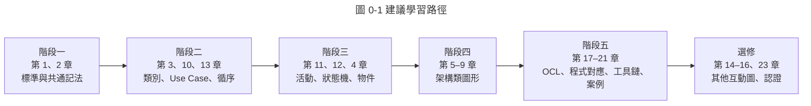

### 0.3 與其他手冊的分工

| 主題 | 本手冊（UML 教學） | 其他手冊 |
|------|-------------------|----------|
| UML 記法與語意 | **權威來源**：14 種圖的完整記法、語意、常見錯誤與審查方法 | 《物件導向分析與設計 (OOAD) 教學》第 5 章摘要說明，並以本手冊為準 |
| 物件導向分析與設計方法 | 只說明「怎麼畫」 | 《物件導向分析與設計 (OOAD) 教學》說明「怎麼分析、怎麼設計」（職責分配、設計原則、DDD、設計模式） |
| 資料模型 | 類別圖與 ER 模型的差異（第 18 章） | 《ER Model 教學手冊》《資料庫設計指引》 |
| 流程與資料流 | 活動圖 | 《資料流程圖(DFD)教學》 |
| 需求文件 | Use Case 圖與 Use Case 規格的格式 | 《系統分析指引》《客戶需求訪談與分析技巧》 |
| 架構文件 | 元件圖、部署圖的記法；與 C4 的對應 | 《架構設計指引》《系統設計指引》 |
| OCUP 2 認證 | 考試資訊、範圍、模擬題（第 23 章） | 《物件導向分析與設計 (OOAD) 教學》第 11 章（內容一致） |

### 0.4 指引條目的格式與編號

本手冊的規範以「指引條目」表達，每一條都有固定格式，讓審查者能逐條勾選：

```text
#### UML-<類別>-<三位數流水號> <指引標題>

- 等級：必須｜建議
- 說明：為什麼要這樣做；違反時會造成什麼問題
❌ 反例：違反指引的圖或程式
✅ 正例：符合指引的圖或程式
- 如何 review：審查者用眼睛檢查什麼
- 如何驗證：可以用什麼工具或測試自動確認
```

| 等級 | 意義 | 不符合時的處理 |
|------|------|----------------|
| 必須 | 違反會造成語意錯誤或誤導讀者 | 審查不通過，必須修正後重新送審 |
| 建議 | 提升可讀性與一致性的做法 | 審查者提出意見；作者可說明理由後保留 |

| 類別代碼 | 範圍 | 類別代碼 | 範圍 |
|----------|------|----------|------|
| GEN | 通用（所有圖） | ACT | 活動圖 |
| CLS | 類別圖 | STM | 狀態機圖 |
| OBJ | 物件圖 | SEQ | 循序圖 |
| PKG | 套件圖 | COM | 通訊圖 |
| CSD | 組合結構圖 | TIM | 時序圖 |
| CMP | 元件圖 | IOV | 互動概觀圖 |
| DEP | 部署圖 | OCL | 物件約束語言 |
| PRF | Profile 圖 | MAP | 模型與程式碼對應 |
| UC | Use Case 圖 | TOOL | 工具鏈與 Docs-as-Code |
| PRC | 流程與審查 | AI | AI 輔助建模 |

> **注意事項**：指引編號一經發布就不再重新編號。若某條指引廢止，保留編號並標註「已廢止」，避免既有審查紀錄引用錯亂。

### 0.5 範例的驗證方式

本手冊的每個範例都經過實際執行，驗證結果記錄在[附錄 E](#附錄-e-驗證紀錄)。讀者可以用同樣方法自行驗證：

| 範例類型 | 驗證方式 | 讀者自行驗證的方法 |
|----------|----------|--------------------|
| `mermaid` 圖 | 以 mermaid-cli 11 渲染為 SVG，確認沒有語法錯誤 | 直接在本網頁檢視；或貼到 Mermaid Live Editor |
| `plantuml` 圖 | 以 PlantUML 1.2026.8 執行語法檢查並渲染成 SVG，人工檢視箭頭與符號 | `java -jar plantuml.jar -tsvg 檔名.puml`；或 VS Code PlantUML 擴充套件預覽 |
| `java` 程式 | 以 `javac --release 25` 編譯；含 `@Test` 者以 JUnit 6 執行 | 貼到 Maven 專案的 `src/test/java` 後執行 `mvn test` |
| `python` 腳本 | 以 Python 3 執行，並用正例與反例檔案確認結束碼 | 依該節「預期結果」執行比對 |
| `yaml`（CI 設定） | 以 YAML 解析器確認格式；Action 版本查證官方發行頁 | 放入測試 repo 觸發一次 workflow |

### 0.6 圖例與記法慣例

本網站只會渲染 `mermaid` 區塊；`plantuml` 區塊在網頁上顯示為原始碼。兩者的定位如下：

| 記法 | 在本手冊的角色 | 限制 |
|------|----------------|------|
| **PlantUML** | 標準 UML 記法的主要示範工具。14 種圖中有 12 種能以接近標準的符號表達 | 網頁上不渲染，需自行產生圖片 |
| **Mermaid** | 網頁上可直接看到的圖。類別圖、循序圖、狀態機圖與 UML 記法接近 | 沒有 Use Case、元件、部署、時序等圖；部分符號與 UML 不同（第 19.3 節） |
| **流程圖示意** | Mermaid `flowchart` 畫的近似圖 | 一律在圖標題標註「示意，非 UML 標準記法」 |

本手冊的圖都依以下慣例繪製：

- 每張圖都有編號與標題，例如「圖 3-2」。
- 圖下方有說明，交代目的、讀者與抽象層級（[UML-GEN-002](#uml-gen-002-每張圖都要標明目的讀者與抽象層級)）。
- 範例中的「❌ 反例」是故意畫錯的圖，用來示範錯誤，請勿照抄。

## 1. UML 概論與標準體系

### 1.1 什麼是 UML

統一建模語言（Unified Modeling Language, UML）是由 Object Management Group（OMG）維護的標準建模語言，用於**視覺化、規格化、建構與記錄**軟體密集系統。理解 UML 要掌握三個重點：

| 重點 | 說明 | 常見誤解 |
|------|------|----------|
| UML 是「語言」 | 有語法（記法）與語意（後設模型）；每個符號都有規格定義的意義 | 「UML 就是畫框框連線，怎麼畫都行」 |
| UML 不是方法論 | 只定義怎麼表達，不規定開發流程；可搭配 RUP、敏捷、DDD 等任何方法 | 「用 UML 就是瀑布式開發」 |
| 圖不等於模型 | 模型是元素與關係的集合；圖只是模型的某個檢視（view）。同一個類別可以出現在多張圖 | 「圖上沒畫就代表不存在」 |

UML 規格書（UML 2.5.1 第 1 章）把它定位為「一般用途」的建模語言：除了軟體，也能描述業務流程與系統結構。需要更精確的系統工程模型時，則使用以 UML 為基礎的 SysML（第 1.3 節）。

### 1.2 發展歷程

| 年份 | 事件 |
|------|------|
| 1994 | James Rumbaugh（OMT）加入 Rational，與 Grady Booch（Booch 方法）開始整合 |
| 1995 | Ivar Jacobson（OOSE／Objectory）加入，發表 Unified Method 0.8 |
| 1997 年 11 月 | OMG 採納 **UML 1.1**，成為業界標準 |
| 2005 | UML 1.4.2 成為國際標準 ISO/IEC 19501:2005 |
| 2005 年 7 月 | **UML 2.0** 正式版：重寫互動圖與活動圖（改用 Petri net 式的 token 語意），新增時序圖、互動概觀圖、組合結構圖 |
| 2011 年 7 月 | UML 2.4.1 |
| 2012 | UML 2.4.1 成為 ISO/IEC 19505-1（Infrastructure）與 19505-2（Superstructure）:2012 |
| 2015 年 6 月 | UML 2.5：合併 Infrastructure 與 Superstructure 為單一規格書，大幅簡化文字 |
| 2017 年 12 月 | **UML 2.5.1**（formal/17-12-05）：截至 2026 年 10 月仍是 OMG 最新正式版本 |

> **為什麼是「統一」**：1990 年代初期有數十種物件導向方法，各自使用不同符號，跨團隊溝通困難。Booch、Rumbaugh、Jacobson（常稱為「三巨頭」，Three Amigos）把各自的方法整合成一套共同記法，交由 OMG 標準化。

### 1.3 標準體系與版本現況

UML 不是單一文件，而是 OMG 一系列相互關聯的規格。下表為 2026-10-13 於 OMG 規格頁查證的現況：

| 規格 | 最新版本 | 發布 | 用途 | 與日常工作的關係 |
|------|----------|------|------|------------------|
| UML | 2.5.1 | 2017-12 | 建模語言本體 | 本手冊的基準 |
| OCL（Object Constraint Language） | 2.4 | 2014-02 | 以文字精確表達約束 | 第 17 章 |
| XMI（XML Metadata Interchange） | 2.5.1 | 2015-06 | 模型交換的 XML 格式 | 工具之間匯入匯出 |
| MOF（Meta Object Facility） | 2.5.1 | 2016-10 | 定義 UML 的後設語言 | 第 1.4 節的 M3 層 |
| UML DI（Diagram Interchange） | UML 2.5.1 內含 | 2017-12 | 圖的版面資訊交換 | 工具間保留版面 |
| fUML（Foundational UML） | 1.5 | 2021-06 | 可執行 UML 子集的精確語意 | OCUP 2 Advanced 範圍 |
| Alf（Action Language for fUML） | 1.1 | 2017-06 | fUML 的文字動作語言 | OCUP 2 Advanced 範圍 |
| PSSM（Precise Semantics of State Machines） | 1.0 | 2019-05 | 狀態機的精確執行語意 | 第 12 章語意依據 |
| MARTE | 1.3 | 2024-08 | 即時與嵌入式系統的 UML Profile | 第 9 章 Profile 範例 |
| SysML v1 | 1.7 | 2024-06 | 以 UML Profile 擴充的系統工程語言 | 與 UML 共用記法 |
| SysML v2／KerML | 2.0／1.0 | 2025-09 正式發布 | 新一代系統工程語言，**不再是 UML Profile** | 系統工程專案評估 |

國際標準（ISO/IEC）與 OMG 版本的對應如下。ISO 版本落後 OMG 版本：

| ISO/IEC 標準 | 內容 | 對應 OMG 版本 |
|--------------|------|---------------|
| ISO/IEC 19501:2005 | UML | UML 1.4.2 |
| ISO/IEC 19505-1:2012 | UML Part 1：Infrastructure | UML 2.4.1 |
| ISO/IEC 19505-2:2012 | UML Part 2：Superstructure | UML 2.4.1 |
| ISO/IEC 19507:2012 | OCL | OCL 2.3.1 |
| ISO/IEC 19508:2014 | MOF Core | MOF 2.4.2 |
| ISO/IEC 19509:2014 | XMI | XMI 2.4.2 |

> **注意事項**：
>
> - 合約或政府標案若要求「符合國際標準」，引用 ISO/IEC 19505:2012。
> - 技術文件應引用 OMG UML 2.5.1。
> - 本手冊涵蓋的記法在 2.4.1 與 2.5.1 之間沒有實質差異。2.5 主要是重寫規格書的文字與結構，並移除少數已不建議使用的元素。

**UML 與 SysML v2 的關係**：

- OMG 於 2025 年 7 月最終採納 SysML 2.0、KerML 1.0 與 Systems Modeling API and Services 1.0。
- SysML v1 是 UML 的 Profile，與 UML 共用記法；**SysML v2 改以 KerML 為基礎，有自己的文字記法與圖形記法，不再是 UML 的擴充**。
- 硬體與軟體整合、航太、車用等系統工程專案，可評估 SysML v2。
- 企業資訊系統（Web、微服務、資料處理）仍以 UML 為主，沒有轉換的必要。

#### UML-GEN-001 引用 UML 時標明規格版本

- **等級**：建議
- **說明**：不同版本的 UML 在記法上有差異，例如 UML 1.x 的活動圖是狀態機的特例，UML 2.x 改為 token 流。文件只寫「依照 UML 標準」，讀者無法判斷依據。

❌ **反例**：

```text
本系統設計文件遵循 UML 標準繪製。
```

✅ **正例**：

```text
本系統設計文件依 OMG UML 2.5.1（formal/17-12-05）繪製；
約束以 OCL 2.4 表示；圖形工具為 PlantUML 1.2026.8。
若合約要求國際標準，對應 ISO/IEC 19505-2:2012（UML 2.4.1）。
```

- **如何 review**：文件首頁或「文件資訊」區是否寫明 UML 版本、OCL 版本與繪圖工具版本。
- **如何驗證**：搜尋文件是否含 `UML 2.5.1` 或 `ISO/IEC 19505` 字串；可放入文件範本的必填欄位。

### 1.4 模型、圖與後設模型

UML 以四層架構定義自己，理解這個架構可以回答「為什麼這個符號一定要這樣畫」：

| 層級 | 名稱 | 內容 | 例子 |
|------|------|------|------|
| M3 | 後設後設模型 | 定義「如何定義語言」 | MOF 的 `Class`、`Property` |
| M2 | 後設模型 | 定義 UML 本身有哪些元素 | UML 的 `Class`、`Association`、`StateMachine` |
| M1 | 使用者模型 | 我們畫的模型 | `Student`、`Course` 類別 |
| M0 | 執行期實例 | 系統執行時的真實物件 | 學號 S001 的學生物件 |

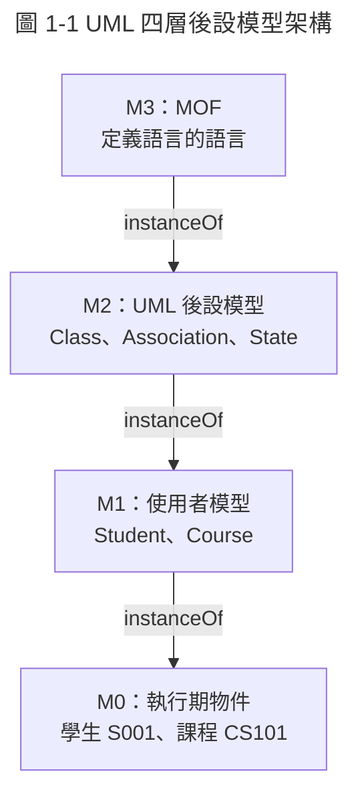

> 圖 1-1 說明：**目的**——說明 UML 元素的定義來源；**讀者**——想理解規格書與考 OCUP 2 的同仁；**抽象層級**——概念說明（本圖為示意，非 UML 標準記法）。

這個架構帶來三個實務上的結論：

1. **符號的意義來自 M2**：例如實心菱形代表 `AggregationKind::composite`，規格書定義了它的語意（整體刪除時部分一併刪除），不能自行賦予其他意義。
2. **物件圖畫的是 M0 的快照**：物件圖的 `s1 : Student` 是 M1 類別 `Student` 的實例。
3. **工具交換的是模型不是圖**：XMI 交換的是 M1 模型元素；圖的位置資訊另外以 UML DI 交換。

### 1.5 14 種圖的分類

UML 2.5.1 附錄 A 把圖分為**結構圖**與**行為圖**兩大類；**互動圖是行為圖的子類**。v1.0 的分類圖把循序圖等直接放在行為圖下、沒有標出互動圖子類，本版已更正。

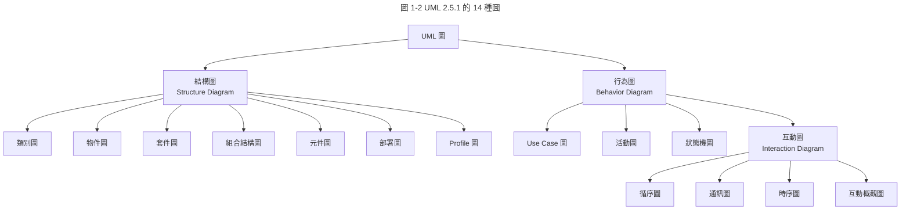

| 圖 | 英文 | 分類 | 回答的問題 | 主要階段 | 使用頻率 | 本手冊 |
|----|------|------|------------|----------|----------|--------|
| 類別圖 | Class Diagram | 結構 | 有哪些類別、屬性、操作與關係 | 分析、設計 | 高 | 第 3 章 |
| 物件圖 | Object Diagram | 結構 | 某一時間點的物件與連結 | 分析（驗證類別圖） | 低 | 第 4 章 |
| 套件圖 | Package Diagram | 結構 | 模型或程式如何分組、彼此依賴 | 架構 | 中 | 第 5 章 |
| 組合結構圖 | Composite Structure Diagram | 結構 | 類別內部由哪些零件、埠、連接器組成 | 元件設計、嵌入式 | 低 | 第 6 章 |
| 元件圖 | Component Diagram | 結構 | 可替換的模組與提供／需要的介面 | 架構 | 中 | 第 7 章 |
| 部署圖 | Deployment Diagram | 結構 | 軟體成品部署在哪些節點 | 架構、維運 | 中 | 第 8 章 |
| Profile 圖 | Profile Diagram | 結構 | 自訂構造型與標記值 | 建模規範制定 | 低 | 第 9 章 |
| Use Case 圖 | Use Case Diagram | 行為 | 誰使用系統達成什麼目標 | 需求 | 高 | 第 10 章 |
| 活動圖 | Activity Diagram | 行為 | 流程、分支、並行與責任分工 | 需求、設計 | 中高 | 第 11 章 |
| 狀態機圖 | State Machine Diagram | 行為 | 物件的生命週期與合法狀態轉換 | 設計 | 中高 | 第 12 章 |
| 循序圖 | Sequence Diagram | 互動 | 參與者依時間順序傳遞哪些訊息 | 分析、設計、測試 | 高 | 第 13 章 |
| 通訊圖 | Communication Diagram | 互動 | 參與者之間的連結與訊息編號 | 設計 | 低 | 第 14 章 |
| 時序圖 | Timing Diagram | 互動 | 狀態隨時間的變化與時間約束 | 即時系統 | 低 | 第 15 章 |
| 互動概觀圖 | Interaction Overview Diagram | 互動 | 多個互動之間的控制流程 | 複雜情境 | 低 | 第 16 章 |

> **名詞對照**：本手冊統一使用左欄譯名。v1.0 混用「用例圖／包圖／複合結構圖／輪廓圖／序列圖／時序圖（指循序圖）」，容易與「時序圖（Timing Diagram）」混淆，本版已統一。

### 1.6 建模的目的與抽象層級

OCUP 2 Foundation 考試有 15% 的題目在考「為什麼要建模」（Why We Model），實務上這也是最常被忽略的問題。模型的價值來自**抽象**：刻意省略與目前問題無關的細節。

| 用途 | 說明 | 例子 |
|------|------|------|
| 理解 | 在動手前看清問題的結構 | 以領域類別圖釐清「選課」與「修課紀錄」的差異 |
| 溝通 | 讓不同角色對同一件事有一致理解 | 以 Use Case 圖與業務單位確認系統範圍 |
| 規格 | 精確定義行為，作為實作與測試的依據 | 以狀態機圖定義訂單的合法轉換 |
| 記錄 | 保存設計決策，降低維護與交接成本 | 以部署圖記錄正式環境的拓樸 |
| 產生 | 由模型產生程式碼或測試 | 以 OpenAPI／XMI 產生骨架（本手冊不深入） |

Martin Fowler 在《UML Distilled》把 UML 的使用方式分為三種，團隊應先決定採用哪一種：

| 使用方式 | 說明 | 精確度要求 | 適合情境 |
|----------|------|------------|----------|
| 草圖（Sketch） | 討論時畫、用完即丟或只保留重點 | 低，但符號不可誤用 | 設計討論、白板會議 |
| 藍圖（Blueprint） | 正式設計文件，實作依圖進行 | 高，須通過審查 | 核心領域、跨團隊介面、受稽核系統 |
| 程式語言（Programming Language） | 模型即程式，以工具產生可執行碼 | 極高 | 可執行 UML（fUML）、嵌入式 MDA |

同一個類別在不同抽象層級的畫法不同。本手冊將圖分為三種**觀點**（perspective）：

| 觀點 | 目的 | 類別圖要畫什麼 | 不畫什麼 |
|------|------|----------------|----------|
| 概念（Conceptual） | 描述業務領域的概念 | 領域名詞、關聯、多重性、關鍵屬性 | 操作、可見性、技術型別、框架類別 |
| 規格（Specification） | 描述軟體介面 | 介面、公開操作、參數與回傳型別 | 私有成員、實作類別 |
| 實作（Implementation） | 描述程式結構 | 類別、全部成員、導航方向、技術型別 | 與當下主題無關的類別 |

#### UML-GEN-002 每張圖都要標明目的、讀者與抽象層級

- **等級**：必須
- **說明**：同一個系統可以畫成給主管看的概觀，也可以畫成給開發者看的詳細設計。沒有說明目的的圖，讀者無法判斷「圖上沒畫的東西是刻意省略，還是真的不存在」。

❌ **反例**：沒有標題與說明，領域概念與技術類別混在一起，看不出是分析還是設計。

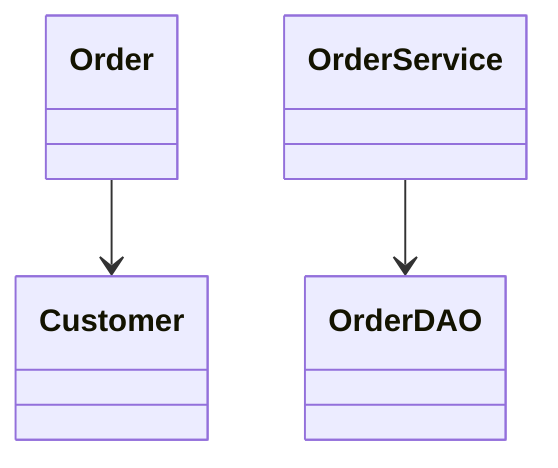

✅ **正例**：以 `title` 標明圖號與圖名，並在圖下方寫出目的、讀者、抽象層級與省略內容。

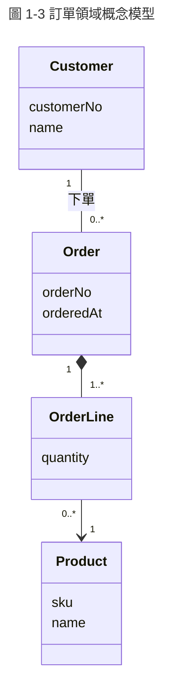

> 圖 1-3 說明：**目的**——確認訂單相關的業務概念與數量關係；**讀者**——業務分析師、產品負責人、開發團隊；**抽象層級**——概念觀點，只列關鍵屬性，不含型別、操作與技術類別。

- **如何 review**：
  - 每張圖是否有編號與標題。
  - 圖下方是否寫出目的、讀者與抽象層級。
  - 圖中元素是否都屬於同一個抽象層級，例如分析圖中不應出現 `OrderDAO`。
- **如何驗證**：以第 19.5 節的 `check_uml.py` 檢查每個 `mermaid`／`plantuml` 區塊是否有 `title`（規則 L01）。說明段落則由審查清單（第 24 章）逐圖勾選。

#### UML-GEN-003 一張圖只表達一個主題並控制元素數量

- **等級**：建議
- **說明**：人一次能有效比較的元素數量有限。一張圖塞進數十個類別或十幾條生命線，讀者會失去重點，審查者也無法逐一確認關係是否正確。超過約 20 個元素（類別、生命線或動作）時，應依主題拆圖，或改以套件、互動參照（`ref`）收合細節。

❌ **反例**：把整個系統的 45 個類別畫在同一張「系統類別圖」中。

✅ **正例**：依子領域拆成「選課」「成績」「帳務」三張類別圖，另以一張套件圖（第 5 章）表達三者之間的依賴。

- **如何 review**：數一數圖中的元素數量；確認圖的標題是否能用一句話說明主題。
- **如何驗證**：`check_uml.py` 規則 L04 計算 Mermaid 類別圖的類別數、循序圖的參與者數，超過門檻時提出警告。

### 1.7 常見誤解

| 誤解 | 事實 | 參考 |
|------|------|------|
| UML 只適合瀑布式開發 | UML 是語言，不是流程。敏捷團隊常以草圖方式使用 UML 討論設計 | 第 20 章 |
| 要畫齊 14 種圖才算完整 | 依問題選圖。多數企業系統以類別、循序、狀態機、活動、Use Case、部署圖為主 | 第 20.2 節 |
| 圖畫得越詳細越好 | 詳細程度依抽象層級與讀者決定；過度詳細的圖難以維護 | 第 1.6 節 |
| Mermaid 畫出來的就是 UML | Mermaid 部分語法近似 UML，但不完全符合規格 | 第 19.3 節 |
| 聚合與組合差不多 | 組合（實心菱形）有生命週期擁有與「部分只能屬於一個整體」的語意，聚合（空心菱形）在 UML 2.5.1 中沒有精確語意 | 第 3.5 節 |
| Use Case 就是功能清單 | Use Case 是 Actor 想達成的目標，一個 Use Case 通常包含多個步驟與替代流程 | 第 10 章 |
| 模型畫完就結束 | 圖必須與程式同步，否則會誤導讀者；應以版本控制與自動驗證維護 | 第 18、19 章 |

### 1.8 練習題

**題目 1**：UML 2.5.1 的 14 種圖中，屬於「互動圖」的有哪幾種？

**題目 2**：某顧問在報告中寫「本系統依 ISO/IEC 19505 繪製 UML 2.5.1 圖形」。這句話有什麼問題？

**題目 3**：請判斷下列敘述屬於四層架構的哪一層：(a) UML 規格中的 `Association`；(b) 你畫的 `Order` 類別；(c) 編號 A-001 的訂單物件。

**題目 4**：團隊在白板討論新功能時畫了一張類別圖，討論結束後拍照留存。這屬於哪一種使用方式？這張照片應該放進正式設計文件嗎？

**解答與解析**：

1. 循序圖、通訊圖、時序圖、互動概觀圖四種。互動圖是行為圖的子類，所以它們同時也是行為圖。
2. ISO/IEC 19505:2012 對應的是 UML 2.4.1，不是 2.5.1。應寫成「依 OMG UML 2.5.1 繪製」；若合約要求國際標準，再註明「對應 ISO/IEC 19505-2:2012（UML 2.4.1）」。
3. (a) M2 後設模型；(b) M1 使用者模型；(c) M0 執行期實例。
4. 屬於草圖（Sketch）。照片可以附在會議紀錄中；若內容要成為實作依據，應改寫成文字原始碼的圖（PlantUML 或 Mermaid），通過審查後納入版本控制（[UML-TOOL-001](#uml-tool-001-圖以文字原始碼納入版本控制)）。

## 2. 共通記法元素

本章介紹所有圖共用的記法：名稱、可見性、多重性、型別、註解、約束、構造型與依賴。這些元素在後續各章反覆出現，先在這裡一次講清楚。

### 2.1 名稱與命名空間

UML 的每個具名元素都屬於一個命名空間（Namespace），例如套件、類別。跨命名空間引用時使用**限定名稱**（qualified name），以 `::` 分隔：

```text
Enrollment::Domain::Student      -- Enrollment 套件下 Domain 子套件的 Student 類別
Student::name                    -- Student 類別的 name 屬性
```

命名慣例（UML 規格沒有強制，本手冊統一如下）：

| 元素 | 慣例 | 例子 |
|------|------|------|
| 類別、介面、列舉、元件、Actor | 大寫開頭的名詞（PascalCase） | `Student`、`PaymentGateway`、`OrderStatus` |
| 屬性、角色名稱 | 小寫開頭的名詞（camelCase） | `studentNo`、`enrolledCourses` |
| 操作 | 小寫開頭的動詞片語 | `enroll()`、`calculateTotal()` |
| 列舉值 | 全大寫或與程式一致 | `PENDING`、`CONFIRMED` |
| Use Case | 動詞＋受詞 | 「選修課程」「查詢成績」 |
| 狀態 | 形容詞或過去分詞 | 「已確認」「待付款」 |
| 套件 | 小寫或與程式套件一致 | `enrollment.domain` |

> **中英文命名**：分析階段的概念模型可以使用中文名稱，方便與業務單位溝通；設計與實作觀點的圖應使用與程式一致的英文名稱，才能直接比對程式。

### 2.2 可見性

可見性（Visibility）標在屬性與操作名稱前，表示誰可以存取：

| 符號 | UML 名稱 | 意義 | Java 對應 |
|------|----------|------|-----------|
| `+` | public | 任何能看到所屬元素的元素都可存取 | `public` |
| `-` | private | 只有所屬類別內部可存取 | `private` |
| `#` | protected | 所屬類別與其子類別可存取 | `protected`（Java 還包含同套件） |
| `~` | package | 同一個套件內的元素可存取 | 不寫修飾字（package-private） |

> **注意事項**：
>
> - 概念觀點的圖不標可見性，因為業務概念沒有「私有」的意義。
> - 實作觀點的圖應標出可見性，讓審查者能比對程式。
> - Java 的 `protected` 比 UML 的 protected 範圍更大：Java 的 `protected` 也允許同套件存取。

### 2.3 多重性

多重性（Multiplicity）表示一個元素可以有幾個值或幾個連結，語法為 `下限..上限`：

| 寫法 | 意義 | 常見用法 |
|------|------|----------|
| `1` | 剛好一個（等同 `1..1`） | 訂單明細一定屬於一張訂單 |
| `0..1` | 零或一個（選填） | 學生「可能」有一位指導教授 |
| `*` | 零或多個（等同 `0..*`） | 客戶有多張訂單 |
| `1..*` | 至少一個 | 訂單至少有一筆明細 |
| `2..4` | 二到四個 | 專題小組 2 到 4 人 |
| `0..25` | 零到二十五 | 一學期最多修 25 學分（以學分為單位時另以約束表達） |

多重性可以加上修飾，決定集合的性質。這組組合直接對應 OCL 與程式的集合型別：

| `isOrdered` | `isUnique` | 修飾寫法 | OCL 集合 | Java 對應 |
|-------------|------------|----------|----------|-----------|
| false | true（預設） | 不寫，或 `{unique}` | `Set` | `Set<T>` |
| true | true | `{ordered}` | `OrderedSet` | `LinkedHashSet<T>`、`SequencedSet<T>` |
| false | false | `{nonunique}` | `Bag` | 允許重複的 `Collection<T>` |
| true | false | `{ordered, nonunique}` 或 `{seq}` | `Sequence` | `List<T>` |

**屬性的完整語法**（UML 2.5.1 第 9.5.4 節）：

```text
[可見性] ['/'] 名稱 [':' 型別] ['[' 多重性 ']'] ['=' 預設值] ['{' 修飾 [',' 修飾]* '}']

例子：
- studentNo : String {readOnly, id}
- email : EmailAddress [0..1]
+ / totalCredits : Integer          -- 斜線 / 代表衍生屬性
- phones : PhoneNumber [1..3] {ordered}
- status : EnrollmentStatus = PENDING
```

**操作的完整語法**（UML 2.5.1 第 9.6.4 節）：

```text
[可見性] 名稱 '(' [參數方向 參數名 ':' 型別 ['[' 多重性 ']'] ['=' 預設值]]* ')' [':' 回傳型別 ['[' 多重性 ']']] ['{' 修飾 '}']

參數方向：in（預設）、out、inout、return
例子：
+ enroll(in section : Section) : Enrollment
+ findByStudent(studentNo : String) : Enrollment [0..*] {query}
```

#### UML-GEN-004 多重性使用 UML 標準語法

- **等級**：必須
- **說明**：`many`、`n`、`N`、`多` 都不是 UML 多重性語法。工具無法解析，讀者也無法判斷下限是 0 還是 1，而「可以沒有」與「至少一個」在程式驗證與資料庫約束上完全不同。v1.0 多處使用 `"many"`，本版已全部更正。

❌ **反例**：

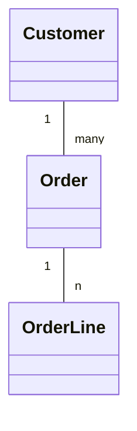

✅ **正例**：

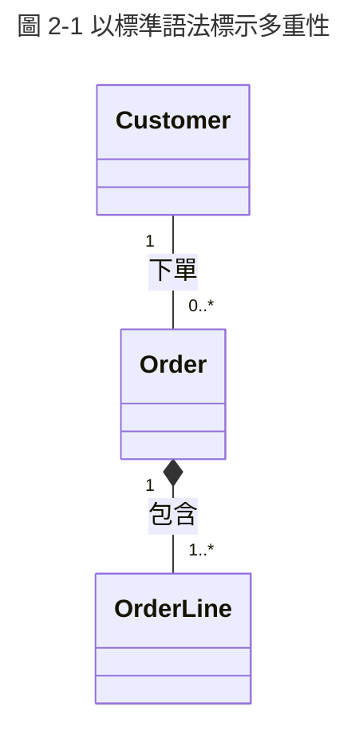

> 圖 2-1 說明：客戶可以沒有訂單（`0..*`），訂單至少有一筆明細（`1..*`）。兩者的下限不同，程式驗證與資料庫約束也不同。

- **如何 review**：多重性是否都符合 `下限..上限` 或 `*` 格式；下限是 0 或 1 是否與業務規則一致。
- **如何驗證**：`check_uml.py` 規則 L02 會以正規表示式檢查 Mermaid 與 PlantUML 關聯兩端的多重性字串，出現 `many`、`n`、`N` 時回報錯誤。

### 2.4 型別、資料型別與列舉

UML 2.5.1 預先定義五種基本型別（PrimitiveType）：

| UML 基本型別 | 意義 | Java 對應 |
|--------------|------|-----------|
| `Boolean` | 真假值 | `boolean` |
| `Integer` | 整數 | `int`、`long`、`BigInteger` |
| `Real` | 實數 | `double`；金額請改用 `BigDecimal` 或自訂值物件 |
| `String` | 字串 | `String` |
| `UnlimitedNatural` | 非負整數或 `*`（無限） | 多重性上限專用 |

類別（Class）、資料型別（DataType）與列舉（Enumeration）的差異：

| 元素 | 識別方式 | 記法 | 例子 |
|------|----------|------|------|
| Class | 有身分（identity），兩個屬性相同的物件仍是不同物件 | 一般矩形 | `Student`、`Order` |
| DataType | 以「值」判斷相等，沒有身分 | 矩形加 `«dataType»` | `Money`、`EmailAddress`、`DateRange` |
| Enumeration | 有限且固定的值集合 | 矩形加 `«enumeration»`，下方列出值 | `OrderStatus` |

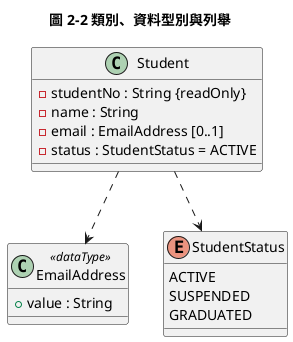

> 圖 2-2 說明：`EmailAddress` 是資料型別，兩個 email 字串相同就是同一個值；`Student` 是類別，同名的兩位學生仍是不同的人。PlantUML 的 `enum` 關鍵字會顯示 `«enumeration»` 的圖示 E。

### 2.5 註解、約束、關鍵字與構造型

| 元素 | 記法 | 用途 | 例子 |
|------|------|------|------|
| 註解（Comment） | 右上角摺角的矩形，以虛線連到元素 | 補充說明，沒有語意 | 「金額含稅」 |
| 約束（Constraint） | 大括號 `{...}`，可用自然語言或 OCL | 必須成立的條件 | `{total >= 0}` |
| 關鍵字（Keyword） | 書名號 `«...»`，UML 規格預先定義 | 區分元素種類 | `«interface»`、`«enumeration»` |
| 構造型（Stereotype） | 書名號 `«...»`，由 Profile 定義 | 擴充元素意義 | `«entity»`、`«REST»` |
| 標記值（Tagged Value） | `{名稱 = 值}` | 構造型的附加屬性 | `{table = "student"}` |

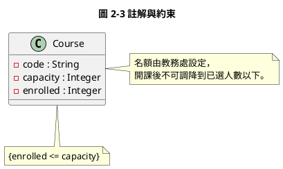

> 圖 2-3 說明：右側是一般註解；下方是約束，以大括號表示，可以改寫成 OCL `context Course inv: enrolled <= capacity`（第 17 章）並轉成測試。

#### UML-GEN-005 構造型限用團隊登錄清單

- **等級**：建議
- **說明**：構造型會改變元素的意義。若每個人自創構造型，同一個概念可能出現 `«entity»`、`«Entity»`、`«domain»`、`«model»` 四種寫法，讀者無法判斷差異，工具也無法依構造型產生程式或檢查規則。團隊應在 Profile 文件（第 9 章）登錄允許的構造型與意義。

❌ **反例**：同一份文件中混用 `«entity»`、`«Entity»`、`«DomainObject»`，指的都是持久化的領域物件。

✅ **正例**：團隊 Profile 登錄表：

| 構造型 | 套用元素 | 意義 | 標記值 |
|--------|----------|------|--------|
| `«entity»` | Class | 有身分、需持久化的領域物件 | `table` |
| `«valueObject»` | DataType | 以值判斷相等、不可變 | 無 |
| `«service»` | Class | 無狀態的應用服務 | 無 |
| `«REST»` | Interface | 對外 HTTP API | `basePath` |

- **如何 review**：圖中出現的構造型是否都在登錄表內；大小寫是否一致。
- **如何驗證**：`check_uml.py` 規則 L05 擷取 `<<...>>` 字串，與允許清單比對（清單可放在 repo 的設定檔）。

#### UML-GEN-006 重要業務規則以約束表達並可轉成測試

- **等級**：建議
- **說明**：只寫在口頭或會議紀錄的規則容易遺失。寫成 `{...}` 約束放在圖上，審查者可以看到；改寫成 OCL 後可以一對一轉成單元測試（第 17 章），讓模型與程式保持一致。

❌ **反例**：圖上沒有任何約束，只在需求文件某段寫「選課人數不得超過名額」。

✅ **正例**：圖 2-3 的 `{enrolled <= capacity}`，並在測試中對應：

```text
約束：context Course inv capacityNotExceeded: enrolled <= capacity
測試：CourseTest.cannotEnrollWhenFull()（第 17.4 節）
```

- **如何 review**：圖上的約束是否都能找到對應的測試名稱。
- **如何驗證**：在約束旁註記對應的測試方法名稱，以 `grep` 確認測試存在（第 17.5 節的追溯表）。

### 2.6 依賴與抽象關係

依賴（Dependency）是最弱的關係：「A 依賴 B」表示 B 改變時 A 可能需要跟著改。記法為**虛線加開放箭頭**，箭頭指向被依賴者。依賴可以加上標準構造型說明種類：

| 構造型 | UML 2.5.1 定義 | 例子 |
|--------|----------------|------|
| `«use»` | 使用關係（Usage）：A 需要 B 才能完成功能 | `OrderService «use» PaymentGateway` |
| `«call»` | A 的操作呼叫 B 的操作 | 操作層級的依賴 |
| `«create»` | A 建立 B 的實例 | `OrderFactory «create» Order` |
| `«instantiate»` | A 的操作建立 B 的實例 | 同上，用在操作 |
| `«trace»` | 兩個不同模型之間的追溯關係（Abstraction） | 設計類別 `«trace»` 分析類別 |
| `«refine»` | 較詳細的元素精煉較抽象的元素 | 設計循序圖 `«refine»` 系統循序圖 |
| `«derive»` | 可由另一個元素計算得出 | `totalCredits «derive»` 選課紀錄 |

實現（Realization）是特殊的依賴：**虛線加空心三角形**，表示實作者提供規格者定義的行為，最常見的是「類別實作介面」（InterfaceRealization）。

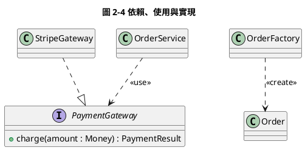

> 圖 2-4 說明：`StripeGateway` 以虛線空心三角實現 `PaymentGateway`；`OrderService` 使用介面而不是具體類別；`OrderFactory` 建立 `Order`。

### 2.7 練習題

**題目 1**：請寫出下列屬性的 UML 語法：私有的「學號」，型別 String，唯讀，作為識別碼。

**題目 2**：「一位學生可以有 1 到 3 支電話，順序有意義（第一支是主要聯絡電話）」，請寫出屬性宣告，並說明對應的 Java 型別。

**題目 3**：下列哪些多重性寫法是合法的 UML？`0..1`、`1..n`、`*`、`many`、`3`、`1..*`、`0..*`

**題目 4**：`Money` 應該建模為 Class 還是 DataType？為什麼？

**解答與解析**：

1. `- studentNo : String {readOnly, id}`。`{id}` 表示此屬性參與物件識別（UML 2.5.1 的 `isID`）。
2. `- phones : PhoneNumber [1..3] {ordered}`。若允許重複，則寫 `{ordered, nonunique}`，對應 `List<PhoneNumber>`；若不允許重複，對應 `SequencedSet<PhoneNumber>`（Java 21 起）。
3. 合法的有 `0..1`、`*`、`3`、`1..*`、`0..*`。`1..n` 與 `many` 不合法（[UML-GEN-004](#uml-gen-004-多重性使用-uml-標準語法)）。
4. 應建模為 DataType。兩個「新台幣 100 元」是同一個值，沒有身分；在 Java 中通常實作為不可變的 `record`。

## 3. 類別圖

### 3.1 用途與觀點

類別圖（Class Diagram）描述系統的**靜態結構**：有哪些類別、每個類別有哪些屬性與操作，以及類別之間的關係。它是最常用、也是 OCUP 2 Foundation 比重最高（25%）的圖。

| 觀點 | 何時畫 | 讀者 | 內容重點 |
|------|--------|------|----------|
| 概念（領域模型） | 需求分析 | 業務、分析師、開發 | 業務概念、關聯、多重性 |
| 規格 | 介面設計 | 開發、整合方 | 介面、公開操作、資料型別 |
| 實作 | 詳細設計、Code Review | 開發、Reviewer | 類別、成員、可見性、導航方向 |

### 3.2 類別的記法

類別以矩形表示，分為三格（compartment）：名稱、屬性、操作。屬性格與操作格可以省略；省略**不代表**沒有成員。

| 記法 | 意義 | PlantUML | Mermaid |
|------|------|----------|---------|
| 名稱斜體或 `{abstract}` | 抽象類別 | `abstract class Shape` | `<<abstract>>` |
| 成員加底線 | 靜態（類別層級）成員 | `{static}` | 成員後加 `$` |
| 操作斜體或 `{abstract}` | 抽象操作 | `{abstract}` | 操作後加 `*` |
| `«interface»` | 介面 | `interface Payable` | `<<interface>>` |
| `/名稱` | 衍生屬性（由其他資料計算） | `/totalCredits` | `/totalCredits` |
| 右上角虛線框 `T` | 樣板（泛型）參數 | `class Box<T>` | `Box~T~` |

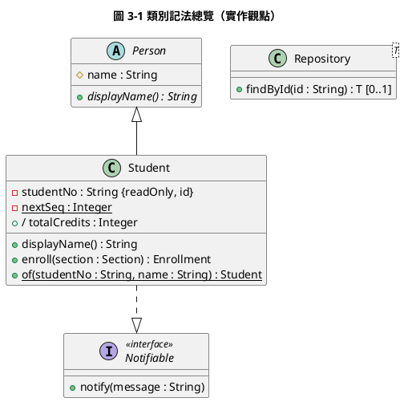

> 圖 3-1 說明：**目的**——一次示範抽象類別、抽象操作、靜態成員、衍生屬性、介面與樣板；**讀者**——學習記法的同仁；**抽象層級**——實作觀點。

### 3.3 介面與抽象類別

| 比較 | 介面（Interface） | 抽象類別（Abstract Class） |
|------|-------------------|----------------------------|
| 意義 | 一組行為的**規格**（契約） | 不能直接建立實例的類別，提供部分實作 |
| 記法 | `«interface»` 矩形，或「棒棒糖」圓圈 | 名稱斜體或標 `{abstract}` |
| 關係 | 類別以**實現**（虛線空心三角）連到介面 | 子類別以**泛化**（實線空心三角）連到父類別 |
| 提供／需要 | 提供介面（棒棒糖 `○`）、需要介面（插座 `◠`） | 不適用 |

在類別圖中，「提供介面」以實現關係表達，「需要介面」以 `«use»` 依賴表達：

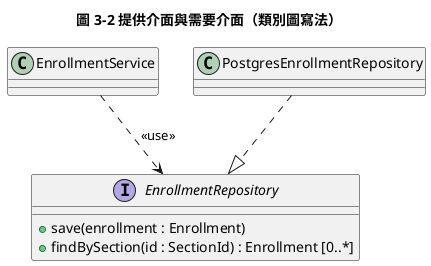

> 圖 3-2 說明：
>
> - `PostgresEnrollmentRepository` **提供** `EnrollmentRepository` 介面，以實現關係表達。
> - `EnrollmentService` **需要**同一個介面，以 `«use»` 依賴表達。
> - 兩者只透過介面耦合。
> - 同樣的關係也可以畫成「棒棒糖—插座」的簡化記法，常用於元件圖（第 7.2 節）。

### 3.4 關聯

關聯（Association）表示兩個類別的實例之間存在**結構上的連結**，記法為實線。完整的關聯端（association end）可以標示：

| 標示 | 位置 | 意義 | 例子 |
|------|------|------|------|
| 多重性 | 靠近**另一端**類別 | 一個本端物件可連到幾個對端物件 | 「學生 1 —— 0..* 選課紀錄」 |
| 角色名稱 | 靠近該端類別 | 對端物件在本端看來的角色，常對應屬性名稱 | `advisor`、`advisees` |
| 導航性 | 箭頭 `>` 表示可導航，`×` 表示不可導航 | 能否從一端取得另一端 | `Order --> Product` |
| 關聯名稱 | 線的中間，可加三角形 ▶ 指示閱讀方向 | 描述關係 | 「指導 ▶」 |
| 所有權圓點 | 線端的小實心點 | 該端由對面類別以屬性擁有 | 實作觀點才使用 |

> **多重性的閱讀方式**：「`Student 1 —— 0..* Enrollment`」從左往右讀為「**一位**學生有**零到多筆**選課紀錄」；從右往左讀為「**一筆**選課紀錄屬於**一位**學生」。每一端的多重性描述的是「從對面看過來，可以連到幾個我」。

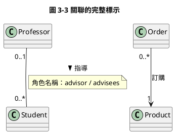

> 圖 3-3 說明：一位教授指導零到多位學生，一位學生最多有一位指導教授。`Order --> Product` 表示只能從訂單導航到商品；商品不知道有哪些訂單參照它。

**特殊關聯**：

| 種類 | 記法 | 何時使用 | 例子 |
|------|------|----------|------|
| 自身關聯（reflexive） | 關聯兩端是同一個類別 | 階層或網狀結構 | 員工「主管／部屬」 |
| 關聯類別（Association Class） | 類別以虛線連到關聯線 | 屬性屬於「關係」本身，而不是任一端 | 學生與課程之間的「成績」 |
| 限定關聯（Qualified Association） | 一端加小方框寫限定詞 | 以鍵值找到對端的唯一物件 | 銀行以「帳號」找到帳戶 |
| 多元關聯（n-ary） | 中間的空心菱形連到三個以上類別 | 關係同時涉及三方 | 「教師在某學期教授某課程」 |

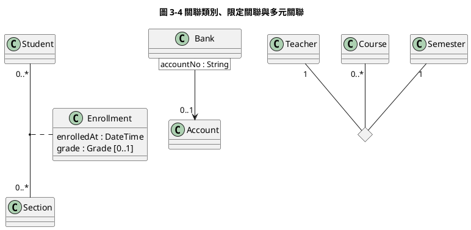

> 圖 3-4 說明：
>
> - **關聯類別**：「成績」既不屬於學生也不屬於課程，而是屬於「某位學生修某個開課班」這個關係，因此建模為關聯類別。
> - **限定關聯**：給定銀行與帳號，最多找到一個帳戶。
> - **多元關聯**：多重性的讀法與二元關聯不同。某一端的多重性，是在**固定其他各端的一組物件**時，這一端可以有幾個物件。例如課程端的 `0..*` 表示：同一位教師在同一個學期，可以教零到多門課程。

#### UML-CLS-001 關聯兩端都要標示多重性

- **等級**：必須
- **說明**：只標一端或完全不標，讀者會自行猜測，而猜錯的結果直接影響資料庫外鍵、必填欄位與集合型別。UML 規格中未標示的多重性預設為 `1`，這通常不是作者的本意。

❌ **反例**：

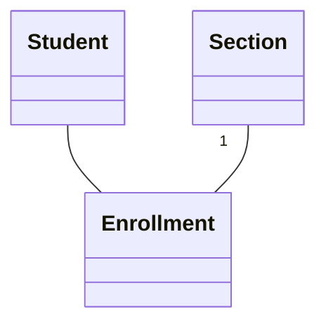

✅ **正例**：

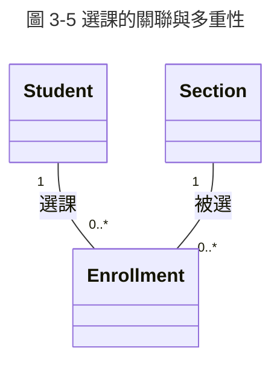

> 圖 3-5 說明：一筆選課紀錄恰好屬於一位學生與一個開課班；學生與開課班都可以沒有任何選課紀錄。

- **如何 review**：逐條關聯確認兩端都有多重性；以「一個 A 有幾個 B」「一個 B 屬於幾個 A」兩句話念出來，與業務規則核對。
- **如何驗證**：`check_uml.py` 規則 L03 檢查 Mermaid 類別圖中每條關聯是否兩端都有引號包住的多重性（實作觀點的依賴與泛化除外）。

#### UML-CLS-002 導航方向只在設計與實作觀點標示

- **等級**：建議
- **說明**：導航性是「程式中能不能從 A 拿到 B」的設計決策。概念觀點的領域模型還沒做這個決策，提早畫箭頭會讓讀者誤以為已經決定。實作觀點則應標出導航方向，因為它決定了程式中誰持有誰的參照。

❌ **反例**：需求訪談時的領域模型就畫成 `Customer --> Order`，開發者據此只在 `Customer` 中放 `List<Order>`，後來發現需要從訂單查客戶。

✅ **正例**：概念觀點畫 `Customer "1" -- "0..*" Order`（無箭頭）；設計觀點決定 `Order --> "1" Customer`（訂單持有客戶編號），並在設計文件說明理由。

- **如何 review**：先確認圖的觀點（[UML-GEN-002](#uml-gen-002-每張圖都要標明目的讀者與抽象層級)），再確認箭頭的有無與觀點相符。
- **如何驗證**：實作觀點的導航方向可以與程式比對：`A --> B` 時，`A` 應有型別為 `B` 或 `B` 識別碼的欄位。可用 ArchUnit 或第 18 章的比對腳本檢查。

### 3.5 聚合與組合

聚合與組合都是「整體—部分」關係的特殊關聯，**菱形一律畫在整體那一端**：

| 關係 | 記法 | UML 2.5.1 語意 | 例子 |
|------|------|----------------|------|
| 聚合（shared aggregation） | 空心菱形 ◇ 在整體端 | 規格書明言「其精確語意依應用領域與建模者而定」，即**沒有精確語意** | 課程 ◇— 教材（教材可共用） |
| 組合（composite aggregation） | 實心菱形 ◆ 在整體端 | 部分**同時最多只屬於一個整體**；整體被刪除時，部分一併刪除 | 訂單 ◆— 訂單明細 |

工具語法中菱形的位置**跟著符號寫的那一側**：

| 工具 | 正確寫法（整體在左） | 結果 |
|------|----------------------|------|
| Mermaid | `Order *-- OrderLine`、`Course o-- Material` | 菱形在 `Order`、`Course` 端 |
| PlantUML | `Order *-- OrderLine`、`Course o-- Material` | 同上 |

> **注意事項**：
>
> - v1.0 寫成 `Student "1" --o "many" Enrollment`。這個寫法把空心菱形放在 `Enrollment`（部分）那一端，語意變成「選課紀錄聚合了學生」，方向相反。
> - 學生與選課紀錄本來就不是整體—部分關係，應該使用一般關聯。
> - 本版已將所有 `--o` 更正。

#### UML-CLS-003 組合與聚合的菱形畫在整體端

- **等級**：必須
- **說明**：菱形畫反，就把「訂單包含明細」變成「明細包含訂單」，生命週期與刪除規則全部顛倒。Mermaid 與 PlantUML 的 `--o`、`--*` 寫法會把菱形放在右側類別，常因為習慣「整體寫在左邊」而畫反。

❌ **反例**：

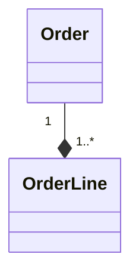

（菱形在 `OrderLine` 端，意思變成「訂單明細由訂單組成」。）

✅ **正例**：

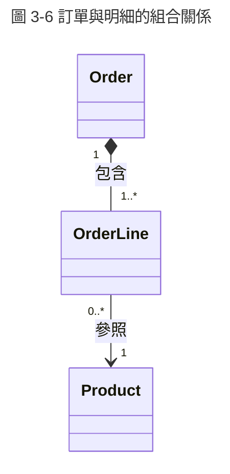

> 圖 3-6 說明：訂單明細的生命週期由訂單決定，訂單刪除時明細一併刪除；商品不屬於訂單，所以明細與商品之間是一般關聯。

- **如何 review**：看到菱形就問兩個問題：「菱形那端是不是整體？」「如果是組合，刪除整體時部分是否一定要一起刪除？」
- **如何驗證**：`check_uml.py` 規則 L03 在 Mermaid 中發現 `--*` 或 `--o` 時提出警告，提醒審查者確認方向；團隊可規定「整體一律寫在左側，使用 `*--`／`o--`」，讓檢查變成錯誤。

#### UML-CLS-004 只在生命週期確實綁定時使用組合

- **等級**：必須
- **說明**：組合有明確語意：部分不能同時屬於兩個整體，整體刪除時部分跟著刪除。若業務上部分可以獨立存在或被共用，使用組合會導致錯誤的串聯刪除（cascade delete）設計。

❌ **反例**：`Department *-- Employee`。部門裁撤時員工並不會被刪除，而是轉調到其他部門。

✅ **正例**：`Department "1" -- "0..*" Employee`（一般關聯）；`Order *-- OrderLine`（明細不能脫離訂單存在）。

- **如何 review**：對每個實心菱形問「部分可以轉移到另一個整體嗎？」「整體刪除後部分還有業務意義嗎？」任一答案為「是」就不該用組合。
- **如何驗證**：組合在程式中對應「整體擁有部分的生命週期」，例如部分不對外公開建構子、只能由整體建立，或 JPA 的 `orphanRemoval = true`。第 18.3 節的測試示範如何驗證。

### 3.6 泛化與泛化集合

泛化（Generalization）以**實線空心三角形**表示，三角形指向一般（父）類別，代表「子類別 **is-a** 父類別」：子類別的每個實例同時也是父類別的實例。

多個泛化可以組成**泛化集合**（Generalization Set），以 `{完整性, 互斥性}` 標示：

| 標示 | 意義 | 例子 |
|------|------|------|
| `{complete}` | 每個父類別實例都必定屬於某個子類別 | 付款方式只有信用卡、轉帳兩種 |
| `{incomplete}` | 可能有不屬於任何子類別的實例 | 人員：學生、教職員（還有訪客） |
| `{disjoint}` | 一個實例最多屬於一個子類別 | 正職、約聘 |
| `{overlapping}` | 一個實例可同時屬於多個子類別 | 學生、助教（研究生可兼任） |

UML 2.5.1 的預設值是 `{incomplete, overlapping}`（規格第 9.7.4 節）；只標示一個時，另一個取預設值。坊間資料常寫成 `{incomplete, disjoint}`，請以 UML 2.5.1 規格為準。

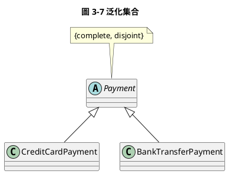

> 圖 3-7 說明：付款方式只有兩種且互斥。PlantUML 沒有泛化集合的專用語法，以註解標示；正式建模工具（如 Enterprise Architect、Papyrus）可以直接在泛化線上標示。

#### UML-CLS-005 泛化只表達 is-a 關係

- **等級**：必須
- **說明**：為了共用程式碼而建立的繼承（例如 `Order extends BaseEntity` 只是為了共用 `id` 欄位），在概念模型中沒有業務意義；為了角色變化而繼承（例如 `Student extends Person`，但同一個人可能後來成為教職員），會造成「物件無法改變類別」的問題。

❌ **反例**：`Person <|-- Student`、`Person <|-- Staff`，再用 `{disjoint}`。研究生兼任助教時，無法同時是 `Student` 與 `Staff`。

✅ **正例**：以角色（Role）組合取代繼承：

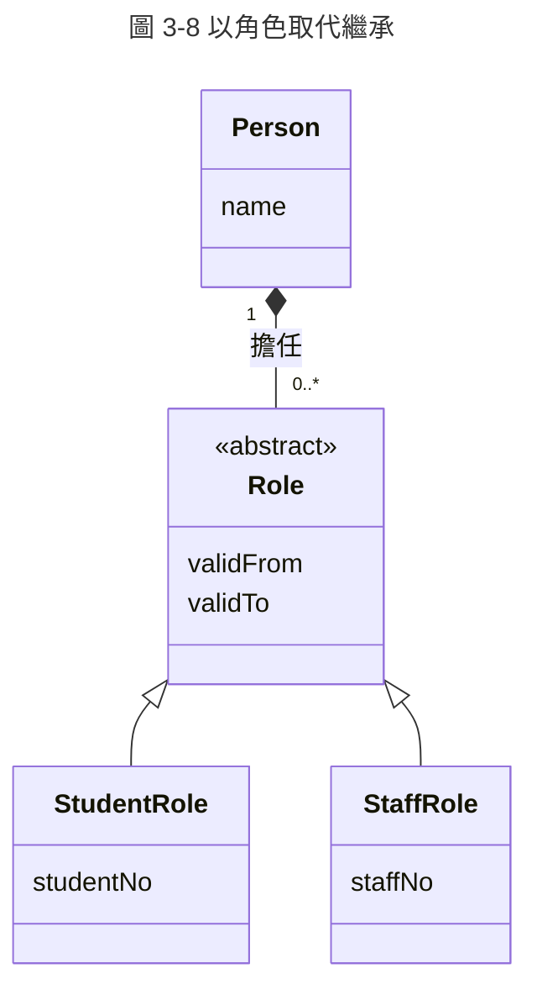

> 圖 3-8 說明：一個人可以同時或先後擔任多個角色，角色有起訖日期。這種設計稱為角色模式（Role Object），詳見《物件導向分析與設計 (OOAD) 教學》的設計模式章節。

- **如何 review**：對每條泛化念出「每個子類別實例**一定是**父類別實例，而且**永遠是**」。如果句子不成立，或實例的類別會隨時間改變，就不應使用泛化。
- **如何驗證**：檢查子類別是否覆寫父類別行為後違反父類別的契約（Liskov 替換原則）；可針對父類別撰寫契約測試，再讓每個子類別執行同一組測試。

### 3.7 依賴與實現在類別圖中的使用

| 關係 | 線型 | 箭頭 | 何時使用 |
|------|------|------|----------|
| 關聯 | 實線 | 無或開放箭頭（導航） | 物件之間有持續的結構連結（欄位） |
| 依賴 | 虛線 | 開放箭頭 | 暫時使用：參數、區域變數、靜態方法呼叫 |
| 泛化 | 實線 | 空心三角 | is-a |
| 實現 | 虛線 | 空心三角 | 類別實作介面 |

判斷關聯還是依賴的簡單規則：**如果 A 有一個欄位的型別是 B（或 B 的集合），畫關聯；如果 B 只出現在 A 的方法參數或區域變數，畫依賴。**

### 3.8 同一模型的三種觀點

以選課系統為例，同一組概念在三種觀點下的畫法：

```mermaid
---
title: 圖 3-9 概念觀點：選課領域模型
---
classDiagram
    class Student {
        學號
        姓名
    }
    class Course {
        課號
        學分
    }
    class Section {
        學期
        名額
    }
    class Enrollment {
        選課時間
        狀態
    }
    Course "1" -- "0..*" Section : 開設
    Student "1" -- "0..*" Enrollment
    Section "1" -- "0..*" Enrollment
```

> 圖 3-9 說明：**讀者**——業務單位與分析師；只有業務名詞、關鍵屬性與多重性，沒有型別、操作與導航方向。

```mermaid
---
title: 圖 3-10 實作觀點：選課聚合
---
classDiagram
    class Section {
        -SectionId id
        -int capacity
        -List~Enrollment~ enrollments
        +enroll(StudentId studentId) Enrollment
        +drop(StudentId studentId) void
        +remainingSeats() int
    }
    class Enrollment {
        -StudentId studentId
        -Instant enrolledAt
        -EnrollmentStatus status
        +cancel() void
    }
    class EnrollmentStatus {
        <<enumeration>>
        ACTIVE
        DROPPED
    }
    class StudentId {
        <<dataType>>
        +String value
    }
    Section "1" *-- "0..*" Enrollment : enrollments
    Enrollment --> "1" StudentId
    Enrollment ..> EnrollmentStatus
```

> 圖 3-10 說明：**讀者**——開發者與 Code Reviewer。選課紀錄由開課班建立與管理（組合），學生以識別碼參照，避免跨聚合持有物件參照。此圖對應第 18.3 節的 Java 程式。

### 3.9 常見錯誤

| 錯誤 | 錯在哪裡 | 正確做法 |
|------|----------|----------|
| 菱形畫在部分端（`A --o B` 而 A 是整體） | 整體—部分方向顛倒 | 整體在菱形端（[UML-CLS-003](#uml-cls-003-組合與聚合的菱形畫在整體端)） |
| 多重性寫 `many`、`n` | 非 UML 語法，下限不明 | `0..*`、`1..*`（[UML-GEN-004](#uml-gen-004-多重性使用-uml-標準語法)） |
| 所有關聯都用聚合 | 聚合沒有精確語意，只增加閱讀負擔 | 預設用一般關聯，確定生命週期綁定才用組合 |
| 用屬性又畫關聯（重複表達） | 同一事實出現兩次，修改時容易只改一處 | 以關聯表達，屬性格不再列出該欄位 |
| 金額用 `float`／`double` | 二進位浮點數無法精確表示十進位金額 | 使用 `Money` 資料型別或 `BigDecimal` |
| 概念模型出現 `DAO`、`Controller` | 抽象層級混雜 | 分圖：概念圖只放業務概念 |
| 領域類別有 `password` 屬性 | 洩漏安全設計，且暗示明文儲存 | 以 `passwordHash` 或獨立的憑證元件表達 |
| 繼承只為共用欄位 | 違反 is-a，增加耦合 | 以組合或介面取代（[UML-CLS-005](#uml-cls-005-泛化只表達-is-a-關係)） |

### 3.10 審查清單

- [ ] 圖有編號、標題，並說明目的、讀者與觀點（[UML-GEN-002](#uml-gen-002-每張圖都要標明目的讀者與抽象層級)）
- [ ] 所有元素屬於同一觀點；概念圖沒有技術類別、型別與可見性
- [ ] 每條關聯兩端都有多重性，語法正確（[UML-CLS-001](#uml-cls-001-關聯兩端都要標示多重性)）
- [ ] 菱形畫在整體端；組合只用在生命週期綁定的情況（[UML-CLS-003](#uml-cls-003-組合與聚合的菱形畫在整體端)、[UML-CLS-004](#uml-cls-004-只在生命週期確實綁定時使用組合)）
- [ ] 每條泛化都是 is-a，且實例不會在執行期改變類別（[UML-CLS-005](#uml-cls-005-泛化只表達-is-a-關係)）
- [ ] 介面以實現（虛線空心三角）連接，不是泛化
- [ ] 同一事實沒有同時以屬性與關聯重複表達
- [ ] 實作觀點的導航方向、可見性、型別與程式一致
- [ ] 重要約束以 `{...}` 標示，並有對應測試

### 3.11 練習題

**題目 1**：請指出下列 Mermaid 類別圖的所有錯誤：

```mermaid
classDiagram
    Department "1" --* "many" Employee
    Employee <|-- Manager
    Employee : -float salary
    Employee : -String password
```

**題目 2**：「一位教師在一個學期可以教授多門課程，一門課程在一個學期可以由多位教師合授，且需要記錄每位教師負責的週數」。請以 PlantUML 畫出類別圖。

**題目 3**：一個 `Order` 有欄位 `List<OrderLine> lines`，並在 `checkout(PaymentGateway gw)` 方法中使用 `gw`。`Order` 與 `OrderLine`、`Order` 與 `PaymentGateway` 分別該畫什麼關係？

**解答與解析**：

1. 共有四個錯誤：
   - `--*` 把菱形放在 `Employee` 端，方向相反。
   - 即使改成部門在菱形端，部門裁撤時員工不會刪除，也不應使用組合，應改為一般關聯（[UML-CLS-004](#uml-cls-004-只在生命週期確實綁定時使用組合)）。
   - `many` 不是合法多重性。
   - 薪資使用 `float`，且 `password` 不應出現在領域類別。

   `Manager` 繼承 `Employee` 也值得討論：若「主管」是會變動的職務，應改為角色或職務關聯。
2. 「負責週數」屬於「教師、課程、學期」三者的關係，可畫成多元關聯加上關聯類別，也可以把關係具體化成類別（較常見）：

   ```plantuml
   @startuml
   title 練習 3-2 解答：授課指派
   class Teacher
   class Course
   class Semester
   class TeachingAssignment {
     weeks : Integer
   }
   Teacher "1" -- "0..*" TeachingAssignment
   Course "1" -- "0..*" TeachingAssignment
   Semester "1" -- "0..*" TeachingAssignment
   note bottom of TeachingAssignment
     {同一教師、課程、學期組合只能有一筆}
   end note
   @enduml
   ```

3. `Order` 與 `OrderLine` 是組合（`Order *-- OrderLine`），因為是欄位且生命週期綁定；`Order` 與 `PaymentGateway` 是依賴（`Order ..> PaymentGateway`），因為只出現在方法參數。

## 4. 物件圖

### 4.1 用途

物件圖（Object Diagram）描述**某一時間點**系統中的物件（實例）、物件的屬性值，以及物件之間的連結（link）。它是類別圖的「具體例子」：

| 用途 | 說明 |
|------|------|
| 驗證類別圖 | 用具體資料畫出來，檢查多重性與約束是否合理 |
| 說明複雜結構 | 遞迴結構（樹狀、圖狀）用例子比用類別圖更容易理解 |
| 設計測試資料 | 物件圖本身就是測試的前置資料（fixture） |
| 溝通業務情境 | 與業務單位討論「某位學生在某學期的選課狀況」 |

### 4.2 記法

| 元素 | 記法 | 例子 |
|------|------|------|
| 具名實例 | `實例名稱 : 類別名稱`，**加底線** | <u>s1 : Student</u> |
| 匿名實例 | `: 類別名稱`，加底線 | <u>: Enrollment</u> |
| 未指定類別 | `實例名稱`，加底線 | <u>s1</u> |
| 屬性值（slot） | `屬性名稱 = 值` | `studentNo = "S001"` |
| 連結 | 實線，是關聯的實例；**不標多重性** | 可標角色名稱 |

```plantuml
@startuml
title 圖 4-1 選課情境物件圖（2026 年秋季學期）
object "s1 : Student" as s1 {
  studentNo = "S001"
  name = "王小明"
}
object "cs101A : Section" as sec {
  semester = "2026-1"
  capacity = 2
}
object "e1 : Enrollment" as e1 {
  status = ACTIVE
}
object "e2 : Enrollment" as e2 {
  status = ACTIVE
}
object "s2 : Student" as s2 {
  studentNo = "S002"
}
s1 -- e1
s2 -- e2
sec -- e1
sec -- e2
@enduml
```

> 圖 4-1 說明：**目的**——驗證圖 3-5 的類別圖能否表達「開課班名額 2 人、已有 2 人選課」的情境；**讀者**——分析師與測試人員；**抽象層級**——實例層（M0 快照）。PlantUML 的物件名稱沒有底線，正式工具與手繪時應加上底線。

### 4.3 以物件圖驗證類別圖

物件圖最有價值的用途是**找出類別圖的錯誤**。步驟如下：

1. 選一個業務情境，特別是邊界情況，例如名額已滿、退選後重選、同一學生重複選課。
2. 依類別圖建立物件與連結。
3. 逐條檢查：連結數是否落在多重性範圍內？約束是否成立？能否表達這個情境？
4. 無法表達或違反約束的地方，就是類別圖需要修正的地方。

**範例**：學生退選後重新選同一門課。若類別圖規定「一位學生在同一開課班最多一筆選課紀錄」，物件圖就無法同時表達「已退選的舊紀錄」與「新的有效紀錄」：

```plantuml
@startuml
title 圖 4-2 退選後重選：揭露類別圖的缺陷
object "s1 : Student" as s1
object "cs101A : Section" as sec
object "old : Enrollment" as old {
  status = DROPPED
}
object "new : Enrollment" as new {
  status = ACTIVE
}
s1 -- old
s1 -- new
sec -- old
sec -- new
note bottom of new
  若約束為「同一學生與開課班最多一筆紀錄」，
  此情境違反約束。
  修正：改為「最多一筆 ACTIVE 紀錄」。
end note
@enduml
```

> 圖 4-2 說明：這個情境揭露原約束過嚴。修正後的約束以 OCL 表達為 `context Section inv: enrollments->select(status = ACTIVE)->isUnique(studentId)`（第 17 章），資料庫則以部分唯一索引實作。

#### UML-OBJ-001 物件以「名稱 : 類別」表示，連結不標多重性

- **等級**：必須
- **說明**：物件圖畫的是實例。若寫成類別名稱或在連結上標多重性，讀者無法分辨這是類別圖還是物件圖，等於把 M1 與 M0 混在一起。

❌ **反例**：方框內只寫 `Student`，連結標 `1` 與 `0..*`。

✅ **正例**：圖 4-1：每個物件寫成 `s1 : Student`，連結只有線，沒有多重性。

- **如何 review**：每個方框是否含冒號 `:`，並加底線（手繪或正式工具）；連結上是否沒有多重性。
- **如何驗證**：在 PlantUML 中物件必須以 `object` 關鍵字宣告；`check_uml.py` 規則 L06 檢查 `object` 宣告的名稱是否包含 ` : `。

#### UML-OBJ-002 以邊界情境的物件圖驗證多重性與約束

- **等級**：建議
- **說明**：類別圖的錯誤常常只在特殊情境才會暴露，例如退選後重選、名額剛好用完、遞迴結構只有一層。為這些情境各畫一張物件圖，等於在寫程式前先做一次「紙上測試」，成本最低。

❌ **反例**：只用「一般情況」驗證類別圖，上線後才發現退選後無法重選。

✅ **正例**：圖 4-2，以退選後重選的情境驗證，提早發現約束過嚴。

- **如何 review**：類別圖送審時，是否附上至少一張邊界情境的物件圖；情境是否涵蓋多重性的上下限，例如 `0`、`1`、上限值。
- **如何驗證**：把物件圖轉成測試的前置資料，執行約束測試（第 17.4 節）；違反約束時測試應失敗，修正後通過。

### 4.4 審查清單與練習

**審查清單**：

- [ ] 每個物件以 `名稱 : 類別` 或 `: 類別` 表示（[UML-OBJ-001](#uml-obj-001-物件以名稱--類別表示連結不標多重性)）
- [ ] 每條連結都對應類別圖中存在的關聯
- [ ] 連結數量落在類別圖的多重性範圍內
- [ ] 屬性值符合型別與約束
- [ ] 至少涵蓋一個邊界情境（[UML-OBJ-002](#uml-obj-002-以邊界情境的物件圖驗證多重性與約束)）

**練習題**：類別圖規定 `Employee "0..1" -- "0..*" Employee`（主管—部屬自身關聯）。請以物件圖表達「A 是 B 與 C 的主管，B 是 D 的主管」，並說明這張物件圖驗證了什麼。

**解答與解析**：

```plantuml
@startuml
title 練習 4-1 解答：主管與部屬
object "a : Employee" as a
object "b : Employee" as b
object "c : Employee" as c
object "d : Employee" as d
a -- b : manager / subordinate
a -- c : manager / subordinate
b -- d : manager / subordinate
@enduml
```

這張物件圖驗證了以下幾點：

- 一位主管可以有多位部屬（a 有兩位），每位員工最多一位主管。
- 自身關聯可以形成多層結構。
- 應補充約束「不可形成循環」：類別圖本身無法排除 d 成為 a 的主管，需要以 OCL 或程式檢查（第 17 章）。

## 5. 套件圖

### 5.1 用途

套件圖（Package Diagram）描述模型元素或程式如何**分組**，以及群組之間的**依賴**。在企業系統中主要用於：

- 表達分層架構，例如展示層、應用層、領域層與基礎設施層。
- 表達子領域或模組邊界，例如選課、成績、帳務。
- 檢查依賴方向，避免循環依賴。

### 5.2 記法

| 元素 | 記法 | 意義 |
|------|------|------|
| 套件 | 左上角有頁籤的資料夾形狀 | 命名空間，擁有其中的元素 |
| 巢狀包含 | 套件畫在另一套件內，或以「圓圈加號 ⊕」線連接 | 子套件 |
| 依賴 | 虛線開放箭頭 | 來源套件的元素使用目標套件的元素 |
| `«import»` | 依賴加構造型 | 公開匯入：目標的元素名稱加入來源命名空間，且對外可見 |
| `«access»` | 依賴加構造型 | 私有匯入：名稱只在來源內部可用 |
| `«merge»` | 依賴加構造型 | 套件合併，主要用於後設模型，一般專案不使用 |

```plantuml
@startuml
title 圖 5-1 選課系統分層套件圖
package "enrollment" {
  package "web" as web
  package "application" as app
  package "domain" as dom
  package "infrastructure" as infra
}
package "shared.kernel" as sk
web ..> app : <<use>>
app ..> dom : <<use>>
infra ..> dom : <<use>>
dom ..> sk : <<import>>
@enduml
```

> 圖 5-1 說明：**目的**——規定選課系統的套件依賴方向；**讀者**——開發者與架構師；**抽象層級**——架構層，不列出類別。
>
> - `infrastructure` 依賴 `domain`：實作領域定義的儲存庫介面，屬於依賴反轉。
> - `domain` 不依賴任何技術套件。

### 5.3 依賴規則與循環依賴

套件之間的循環依賴（A 依賴 B、B 又依賴 A）會造成三個問題：

| 問題 | 影響 |
|------|------|
| 無法獨立理解 | 要看懂 A 必須同時看懂 B |
| 無法獨立建置與部署 | 兩個模組必須一起編譯、一起發布 |
| 變更擴散 | 修改任一方都可能影響另一方 |

打破循環的常用方法：

1. **依賴反轉**：在被依賴的一方定義介面，由另一方實作。
2. **抽出共用套件**：把雙方都需要的元素移到第三個套件。
3. **事件解耦**：以領域事件取代直接呼叫。

#### UML-PKG-001 套件之間不可有循環依賴

- **等級**：必須
- **說明**：套件圖上的循環依賴代表程式中的循環依賴，會讓模組無法獨立建置、測試與替換。圖上一旦出現循環，就必須在設計階段修正，而不是等到程式完成後才處理。

❌ **反例**：

```plantuml
@startuml
title 反例：選課與成績互相依賴
package enrollment
package grading
enrollment ..> grading : 查詢是否及格
grading ..> enrollment : 取得修課名單
@enduml
```

✅ **正例**：成績套件依賴選課套件；選課需要知道「先修課是否及格」時，透過選課套件定義的介面 `PrerequisiteChecker` 查詢，由成績套件實作：

```plantuml
@startuml
title 圖 5-2 以依賴反轉打破循環
package enrollment {
  interface PrerequisiteChecker
}
package grading {
  class GradeBasedPrerequisiteChecker
}
grading ..> enrollment : <<use>>
GradeBasedPrerequisiteChecker ..|> PrerequisiteChecker
@enduml
```

- **如何 review**：沿著每條依賴箭頭走，確認不會回到起點；特別注意雙向箭頭與三個以上套件形成的環。
- **如何驗證**：以 ArchUnit 的 `slices().should().beFreeOfCycles()` 在建置時檢查實際程式。下例同時示範「通過」與「偵測到違規」兩種情況：

```java
// 檔案：com/example/uml/pkg/good/web/EnrollmentController.java
package com.example.uml.pkg.good.web;

import com.example.uml.pkg.good.application.EnrollmentService;

public class EnrollmentController {
    private final EnrollmentService service = new EnrollmentService();

    public String enroll(String studentNo, String sectionId) {
        return service.enroll(studentNo, sectionId);
    }
}

// 檔案：com/example/uml/pkg/good/application/EnrollmentService.java
package com.example.uml.pkg.good.application;

import com.example.uml.pkg.good.domain.Section;

public class EnrollmentService {
    public String enroll(String studentNo, String sectionId) {
        Section section = new Section(sectionId, 30);
        return section.enroll(studentNo);
    }
}

// 檔案：com/example/uml/pkg/good/domain/Section.java
package com.example.uml.pkg.good.domain;

public class Section {
    private final String id;
    private final int capacity;

    public Section(String id, int capacity) {
        this.id = id;
        this.capacity = capacity;
    }

    public String enroll(String studentNo) {
        return studentNo + "@" + id + "/" + capacity;
    }
}

// 檔案：com/example/uml/pkg/bad/enrollment/EnrollmentFacade.java
package com.example.uml.pkg.bad.enrollment;

import com.example.uml.pkg.bad.grading.GradeBook;

public class EnrollmentFacade {
    public boolean canEnroll(String studentNo) {
        return new GradeBook().hasPassed(studentNo, "CS101");
    }
}

// 檔案：com/example/uml/pkg/bad/grading/GradeBook.java
package com.example.uml.pkg.bad.grading;

import com.example.uml.pkg.bad.enrollment.EnrollmentFacade;

public class GradeBook {
    public boolean hasPassed(String studentNo, String courseCode) {
        return studentNo.startsWith("S");
    }

    public boolean roster(String studentNo) {
        return new EnrollmentFacade().canEnroll(studentNo);
    }
}

// 檔案：com/example/uml/pkg/PackageRulesTest.java
package com.example.uml.pkg;

import static com.tngtech.archunit.library.Architectures.layeredArchitecture;
import static com.tngtech.archunit.library.dependencies.SlicesRuleDefinition.slices;
import static org.junit.jupiter.api.Assertions.assertFalse;
import static org.junit.jupiter.api.Assertions.assertTrue;

import com.tngtech.archunit.core.domain.JavaClasses;
import com.tngtech.archunit.core.importer.ClassFileImporter;
import com.tngtech.archunit.lang.ArchRule;
import org.junit.jupiter.api.Test;

class PackageRulesTest {

    private final JavaClasses good = new ClassFileImporter().importPackages("com.example.uml.pkg.good");
    private final JavaClasses bad = new ClassFileImporter().importPackages("com.example.uml.pkg.bad");

    @Test
    void goodPackagesHaveNoCycles() {
        ArchRule rule = slices().matching("com.example.uml.pkg.good.(*)..").should().beFreeOfCycles();
        assertFalse(rule.evaluate(good).hasViolation());
    }

    @Test
    void cycleBetweenEnrollmentAndGradingIsDetected() {
        ArchRule rule = slices().matching("com.example.uml.pkg.bad.(*)..").should().beFreeOfCycles();
        assertTrue(rule.evaluate(bad).hasViolation());
    }

    @Test
    void layersFollowPackageDiagram() {
        ArchRule rule = layeredArchitecture().consideringOnlyDependenciesInLayers()
                .layer("Web").definedBy("..good.web..")
                .layer("Application").definedBy("..good.application..")
                .layer("Domain").definedBy("..good.domain..")
                .whereLayer("Web").mayNotBeAccessedByAnyLayer()
                .whereLayer("Application").mayOnlyBeAccessedByLayers("Web")
                .whereLayer("Domain").mayOnlyBeAccessedByLayers("Application");
        assertFalse(rule.evaluate(good).hasViolation());
    }
}
```

> **預期結果**：3 個測試全部通過。
>
> - 第二個測試證明 ArchUnit 能偵測 `bad` 套件中的循環依賴。
> - 若把 `GradeBook` 中參照 `EnrollmentFacade` 的方法刪除，第二個測試會失敗，因為循環已不存在。

#### UML-PKG-002 套件圖與程式套件一致並以架構測試守護

- **等級**：建議
- **說明**：套件圖如果只存在文件中，程式很快就會偏離設計。把套件圖的依賴規則寫成架構測試，每次建置都會自動檢查；圖與程式不一致時，建置會失敗。

❌ **反例**：套件圖規定 `web` 不可直接使用 `domain`，但沒有任何檢查，半年後 Controller 直接操作 Entity。

✅ **正例**：圖 5-1 的每條依賴規則都對應上方 `layersFollowPackageDiagram` 測試中的 `whereLayer` 敘述。

- **如何 review**：比對套件圖的箭頭與架構測試中的 `mayOnlyBeAccessedByLayers` 設定是否一致。
- **如何驗證**：CI 執行 `mvn test` 時架構測試必須通過；修改套件圖時，同一個 Pull Request 必須同時修改架構測試。

### 5.4 Mermaid 的近似畫法

Mermaid 沒有套件圖。必須在網頁上直接顯示時，可以用 `flowchart` 的 `subgraph` 近似，並在標題註明：

```mermaid
---
title: 圖 5-3 分層依賴（示意，非 UML 標準記法）
---
flowchart TB
    subgraph enrollment
        web[web] -.->|use| app[application]
        app -.->|use| dom[domain]
        infra[infrastructure] -.->|use| dom
    end
    dom -.->|import| sk[shared.kernel]
```

### 5.5 審查清單與練習

**審查清單**：

- [ ] 套件名稱與程式套件或模組名稱一致
- [ ] 依賴方向符合分層原則：上層依賴下層，領域層不依賴技術層
- [ ] 沒有循環依賴（[UML-PKG-001](#uml-pkg-001-套件之間不可有循環依賴)）
- [ ] `«import»` 與 `«access»` 的使用有明確理由
- [ ] 依賴規則已寫成架構測試（[UML-PKG-002](#uml-pkg-002-套件圖與程式套件一致並以架構測試守護)）

**練習題**：訂單套件需要在訂單成立後通知庫存套件扣減庫存；庫存套件又需要讀取訂單明細以計算保留量。請提出不產生循環依賴的設計，並畫出套件圖。

**解答與解析**：讓訂單套件發布領域事件 `OrderPlaced`（事件類別放在訂單套件），庫存套件訂閱事件並從事件內容取得明細。依賴方向只有「庫存 → 訂單」：

```plantuml
@startuml
title 練習 5-1 解答：以事件解耦
package ordering {
  class OrderPlaced <<event>>
}
package inventory {
  class OrderPlacedHandler
}
inventory ..> ordering : <<use>>
OrderPlacedHandler ..> OrderPlaced : 訂閱
@enduml
```

## 6. 組合結構圖

### 6.1 用途

組合結構圖（Composite Structure Diagram）描述一個類別或元件的**內部結構**：由哪些零件（part）組成、透過哪些埠（port）與外界互動、零件之間如何以連接器（connector）連接。

| 適合使用 | 不適合使用 |
|----------|------------|
| 嵌入式與即時系統的元件內部配線 | 一般企業系統的類別設計，用類別圖即可 |
| 說明某個元件在「這個情境」下的零件組合 | 只想表達整體—部分，用組合關聯即可 |
| 協作（Collaboration）：一組角色共同完成某個行為，例如設計模式的參與者 | 部署拓樸，請改用部署圖 |

與類別圖組合關係的差異：類別圖說「`Car` 有 4 個 `Wheel`」；組合結構圖進一步說「前輪零件 `front : Wheel[2]` 透過 `frontAxle` 連接器連到引擎零件」，強調的是**在這個整體中的角色與連線**。

### 6.2 記法

| 元素 | 記法 | 意義 |
|------|------|------|
| 結構化類別 | 大矩形，內部畫零件 | 被描述的整體 |
| 零件（Part） | 內部矩形，`角色名稱 : 型別 [多重性]` | 整體擁有的屬性（組合） |
| 參照零件 | 虛線矩形 | 非組合，只是參照 |
| 埠（Port） | 邊框上的小方塊 | 整體或零件對外的互動點，可帶提供／需要介面 |
| 連接器（Connector） | 零件或埠之間的實線 | 執行期的通訊連結 |
| 委派連接器 | 外部埠連到內部零件的埠 | 把外部請求轉給內部處理 |
| 協作 | 虛線橢圓 | 一組角色及其連接器 |

PlantUML 沒有組合結構圖的專用語法，以元件圖的巢狀元件與埠近似：

```plantuml
@startuml
title 圖 6-1 選課服務的內部結構（近似組合結構圖）
component "EnrollmentService" as svc {
  portin "api : EnrollmentApi" as api
  portout "db : JdbcPort" as db
  component "controller : EnrollmentController" as c
  component "handler : EnrollCommandHandler" as h
  component "repo : EnrollmentRepository" as r
  api --> c : 委派
  c --> h
  h --> r
  r --> db : 委派
}
@enduml
```

> 圖 6-1 說明：**目的**——說明選課服務內部零件的配線，以及外部埠如何委派給內部零件；**讀者**——負責該服務的開發者；**抽象層級**——元件內部設計。PlantUML 以 `portin`／`portout` 表示埠；正式工具（Papyrus、Enterprise Architect）可畫出標準的零件與埠記法。

### 6.3 協作

協作（Collaboration）以**虛線橢圓**表示，描述一組角色如何合作。常用來記錄設計模式在系統中的套用：

```plantuml
@startuml
title 圖 6-2 觀察者模式的協作（示意）
usecase "Observer 協作" as collab #line.dashed
rectangle "subject : EnrollmentService" as s
rectangle "observer : NotificationListener" as o
collab .. s : subject
collab .. o : observer
@enduml
```

> 圖 6-2 說明：PlantUML 沒有協作專用語法，此處以虛線橢圓近似；`subject`、`observer` 是角色名稱，冒號後是在本系統中扮演該角色的類別。

#### UML-CSD-001 連接器兩端的埠必須介面相容

- **等級**：建議
- **說明**：連接器表示執行期的通訊。若一端提供 `EnrollmentApi`，另一端卻需要 `GradingApi`，代表設計錯誤：不是缺了轉接器，就是連錯零件。

❌ **反例**：`handler` 的需要介面是 `EnrollmentRepository`，卻連到提供 `CourseRepository` 的零件。

✅ **正例**：圖 6-1 中，每條連接器兩端的需要介面與提供介面名稱相同；不相同時，中間加入轉接器零件（Adapter）。

- **如何 review**：逐條連接器確認兩端的介面名稱與方向（提供／需要）相符。
- **如何驗證**：組合結構對應程式的建構子注入，例如 `new EnrollCommandHandler(repo)`；編譯器會檢查型別相容。正式建模工具也提供模型驗證功能。

### 6.4 練習

**題目**：說明在什麼情況下，應該用組合結構圖取代類別圖的組合關係？

**解答**：當重點是「**在這個整體裡，零件扮演什麼角色、彼此如何連線**」時使用。例如同一個型別 `Sensor` 在一台機器裡有 `front`、`rear` 兩個角色，分別連到不同控制器。類別圖只能表達「機器有 2 個感測器」，表達不出連線。一般企業系統很少需要組合結構圖。

## 7. 元件圖

### 7.1 用途與元件的定義

元件圖（Component Diagram）描述系統由哪些**可替換的模組**組成，以及模組之間透過哪些**介面**協作。

UML 2.5.1 對元件（Component）的定義是：「系統中模組化的部分，封裝其內容，並可在其環境中被替換」。重點是**封裝與可替換**：只要介面相同，元件的實作可以替換，使用者不受影響。

> **注意事項**：
>
> - v1.0 把元件定義為「可獨立部署的軟體單元」，這與 UML 2.5.1 的定義不同。
> - 「可部署的實體檔案」在 UML 中稱為**成品**（Artifact），例如 JAR 檔、容器映像，屬於部署圖（第 8 章）的範疇。
> - 一個元件可以由一個或多個成品**具體化**（manifest）。

| 適用情境 | 例子 |
|----------|------|
| 模組化單體（Modular Monolith）的模組邊界 | 選課、成績、帳務模組 |
| 微服務的服務邊界與 API | 選課服務提供 `EnrollmentApi` |
| 外部系統整合 | 金流閘道、校務系統、郵件服務 |
| 函式庫與框架的使用關係 | 應用程式需要 `Clock` 介面 |

### 7.2 記法

| 元素 | 記法 | 意義 |
|------|------|------|
| 元件 | 矩形，標 `«component»` 或右上角元件圖示 | 可替換的模組 |
| 提供介面 | 「棒棒糖」：實線加圓圈 ○ | 元件對外提供的服務 |
| 需要介面 | 「插座」：實線加半圓 ◠ | 元件需要外部提供的服務 |
| 組裝連接器 | 棒棒糖插入插座（ball-and-socket） | 一個元件的需要介面由另一個元件提供 |
| 埠 | 邊框上的小方塊 | 元件對外的互動點 |
| 委派連接器 | 外部埠連到內部零件 | 白箱視圖中，把請求轉給內部 |
| 依賴 | 虛線開放箭頭 | 未指定介面的使用關係 |
| `«subsystem»` | 元件加構造型 | 大型的功能單位 |

```plantuml
@startuml
title 圖 7-1 選課系統元件圖
[Student Portal] as portal
[Enrollment] as enr
[Grading] as grd
[Notification] as ntf
() "EnrollmentApi" as IEnr
() "PrerequisiteChecker" as IPre
() "Notifier" as INtf
enr - IEnr
portal --( IEnr
grd - IPre
enr --( IPre
ntf - INtf
enr --( INtf
@enduml
```

> 圖 7-1 說明：**目的**——說明選課系統的模組邊界與介面；**讀者**——架構師與各模組負責人；**抽象層級**——架構層，不列出內部類別。
>
> - `Enrollment` 提供 `EnrollmentApi`，給 `Student Portal` 使用。
> - `Enrollment` 需要 `PrerequisiteChecker`（由 `Grading` 提供）與 `Notifier`（由 `Notification` 提供）。
> - 任何提供相同介面的元件都可以替換現有元件，例如以簡訊通知替換郵件通知。

### 7.3 黑箱與白箱視圖

| 視圖 | 畫什麼 | 讀者 |
|------|--------|------|
| 黑箱（外部視圖） | 元件與提供／需要介面 | 使用元件的團隊 |
| 白箱（內部視圖） | 元件內部的零件、類別與委派連接器 | 開發該元件的團隊 |

```plantuml
@startuml
title 圖 7-2 Enrollment 元件白箱視圖
component Enrollment {
  portin " " as pApi
  portout " " as pPre
  [EnrollmentController] as ctl
  [EnrollmentService] as svc
  [EnrollmentRepository] as repo
  pApi --> ctl : EnrollmentApi
  ctl --> svc
  svc --> repo
  svc --> pPre : PrerequisiteChecker
}
@enduml
```

> 圖 7-2 說明：外部對 `EnrollmentApi` 的呼叫由埠委派給 `EnrollmentController`；`EnrollmentService` 需要的 `PrerequisiteChecker` 由輸出埠向外委派。

#### UML-CMP-001 元件之間只透過介面相依

- **等級**：必須
- **說明**：元件的價值在於「可替換」。如果元件 A 直接依賴元件 B 的內部類別，B 的任何重構都可能破壞 A，替換 B 也不可能。元件圖上應該只出現「介面到介面」的連接；直接從元件畫依賴箭頭到另一個元件的內部，代表設計有問題。

❌ **反例**：

```plantuml
@startuml
title 反例：直接依賴另一元件的內部類別
component Enrollment {
  [EnrollmentService] as svc
}
component Grading {
  [GradeRepository] as grepo
}
svc ..> grepo : 直接查成績資料表
@enduml
```

✅ **正例**：圖 7-1，`Enrollment` 透過 `Grading` 提供的 `PrerequisiteChecker` 介面查詢，不知道 `Grading` 內部如何儲存成績。

- **如何 review**：元件之間的每條線都應該經過一個具名介面；線的端點不應落在另一個元件的內部零件上。
- **如何驗證**：
  - 以 ArchUnit 限制「其他模組只能存取本模組的 `api` 套件」，例如 `noClasses().that().resideOutsideOfPackage("..grading..").should().accessClassesThat().resideInAPackage("..grading.internal..")`。
  - 使用 Spring Modulith 的模組驗證，或 Java Platform Module System 的 `exports`。

#### UML-CMP-002 元件圖不畫類別層級的細節

- **等級**：建議
- **說明**：元件圖的讀者關心模組邊界與介面；放入屬性、操作與類別關聯，會掩蓋架構重點，而且類別一重構，元件圖就過時了。類別細節應放在各元件的類別圖。

❌ **反例**：元件圖中每個元件內都列出所有類別與方法簽章。

✅ **正例**：黑箱視圖（圖 7-1）只畫元件與介面；需要說明內部時，另畫白箱視圖（圖 7-2），且只畫主要零件。

- **如何 review**：元件圖中是否出現屬性、操作或類別之間的關聯線。
- **如何驗證**：`check_uml.py` 規則 L07 檢查 PlantUML 元件圖區塊中是否出現 `class`、`{`、`+`/`-` 開頭的成員宣告。

### 7.4 Mermaid 的近似畫法與 C4 模型

Mermaid 沒有 UML 元件圖。網頁上需要顯示時可以用 `flowchart` 近似，介面以圓形節點表示：

```mermaid
---
title: 圖 7-3 選課系統元件與介面（示意，非 UML 標準記法）
---
flowchart LR
    portal[Student Portal] -->|需要| IEnr((EnrollmentApi))
    enr[Enrollment] ---|提供| IEnr
    enr -->|需要| IPre((PrerequisiteChecker))
    grd[Grading] ---|提供| IPre
    enr -->|需要| INtf((Notifier))
    ntf[Notification] ---|提供| INtf
```

許多團隊以 **C4 模型**（Context、Container、Component、Code）記錄架構。C4 與 UML 的對應如下：

| C4 層級 | 意義 | 對應的 UML 圖 |
|---------|------|---------------|
| System Context | 系統與外部使用者、外部系統 | Use Case 圖的邊界；元件圖的最外層 |
| Container | 可獨立執行或部署的單位（應用程式、資料庫） | 元件圖（加 `«container»` 構造型）＋部署圖 |
| Component | Container 內部的主要模組 | 元件圖（白箱） |
| Code | 程式碼結構 | 類別圖 |

> **注意事項**：C4 的「Component」比 UML 的元件範圍更窄，專指 Container 內部的模組。在同一份文件中混用兩種體系時，請在圖說明中標明採用哪一種定義。

### 7.5 審查清單與練習

**審查清單**：

- [ ] 每個元件有明確職責，名稱反映業務能力而非技術層
- [ ] 元件之間只透過具名介面相依（[UML-CMP-001](#uml-cmp-001-元件之間只透過介面相依)）
- [ ] 提供介面與需要介面的方向正確：棒棒糖是提供，插座是需要
- [ ] 沒有元件之間的循環依賴
- [ ] 黑箱視圖不含類別細節（[UML-CMP-002](#uml-cmp-002-元件圖不畫類別層級的細節)）
- [ ] 元件與成品（部署圖）的對應關係清楚

**練習題**：「報表模組」需要讀取選課資料與成績資料產生學期報表。請畫出元件圖，並說明如何確保報表模組不直接存取另外兩個模組的資料表。

**解答與解析**：選課與成績模組各自提供唯讀查詢介面，例如 `EnrollmentQuery`、`GradeQuery`；報表模組只依賴這兩個介面。ArchUnit 規則禁止報表模組存取 `..enrollment.infrastructure..` 與 `..grading.infrastructure..`。

```plantuml
@startuml
title 練習 7-1 解答：報表模組
[Reporting] as rpt
[Enrollment] as enr
[Grading] as grd
() "EnrollmentQuery" as IEQ
() "GradeQuery" as IGQ
enr - IEQ
grd - IGQ
rpt --( IEQ
rpt --( IGQ
@enduml
```

## 8. 部署圖

### 8.1 用途

部署圖（Deployment Diagram）描述**軟體成品部署在哪些執行節點上**，以及節點之間的通訊路徑。它回答維運與架構審查最常問的問題：

- 系統跑在哪些機器、容器或雲端服務上？
- 哪些服務之間有網路連線？使用什麼協定？
- 安全邊界在哪裡？哪些連線會跨越信任區？
- 哪些節點有備援？

### 8.2 記法

| 元素 | 記法 | 意義 | 例子 |
|------|------|------|------|
| 節點（Node） | 立體方塊 | 執行運算的資源 | 伺服器、虛擬機器、Kubernetes 節點 |
| 裝置（Device） | 節點加 `«device»` | 實體硬體 | 實體伺服器、手機、IoT 閘道 |
| 執行環境（Execution Environment） | 節點加 `«executionEnvironment»`，常巢狀在裝置內 | 承載成品的軟體環境 | JVM、容器執行環境、Pod、資料庫引擎 |
| 成品（Artifact） | 矩形加 `«artifact»` 或摺角文件圖示 | 實體檔案 | `enrollment.jar`、容器映像 |
| 部署 | 成品畫在節點內，或以 `«deploy»` 依賴連到節點 | 成品安裝在節點上 | |
| 具體化 | 成品以 `«manifest»` 依賴連到元件 | 成品實作了某個元件 | `enrollment.jar «manifest» Enrollment` |
| 通訊路徑 | 節點之間的實線，可加協定 | 節點可以互相通訊 | `HTTPS`、`JDBC/TLS` |
| 部署規格 | 矩形加 `«deploymentSpec»` | 部署參數 | 環境變數、資源限制 |

```plantuml
@startuml
title 圖 8-1 選課系統正式環境部署圖（Kubernetes）
node "使用者裝置" <<device>> as client {
  node "瀏覽器" <<executionEnvironment>> as browser
}
cloud "網際網路" as inet
node "K8s 叢集 prod" as k8s {
  node "Ingress Controller" <<executionEnvironment>> as ing
  node "enrollment Pod ×3" <<executionEnvironment>> as pod {
    artifact "enrollment:2.4.0\n（容器映像）" as img
  }
}
node "資料庫主機" <<device>> as dbhost {
  node "PostgreSQL 18" <<executionEnvironment>> as pg {
    artifact "enrollment_db\n（schema）" as schema
  }
}
browser -- inet : HTTPS
inet -- ing : HTTPS 443
ing -- pod : HTTP 8080\n（叢集內網路）
pod -- pg : JDBC over TLS 5432
@enduml
```

> 圖 8-1 說明：**目的**——說明正式環境的節點、成品與網路連線；**讀者**——架構師、維運與資安審查人員；**抽象層級**——實體部署。
>
> - Pod 數量標在節點名稱上（×3），表示水平擴展的副本數。
> - 實際版本號以 Helm values 或部署清單為準，本圖只標主要版本。

### 8.3 元件、成品與節點的關係

三者的關係是「**元件由成品具體化，成品部署到節點**」：

```plantuml
@startuml
title 圖 8-2 元件、成品與節點
component Enrollment as comp
artifact "enrollment-2.4.0.jar" as jar
node "enrollment Pod" <<executionEnvironment>> as pod
jar ..> comp : <<manifest>>
jar ..> pod : <<deploy>>
@enduml
```

> 圖 8-2 說明：元件是邏輯概念（第 7 章）；成品是實體檔案；節點是執行資源。一個元件可以由多個成品具體化，一個成品也可以部署到多個節點。

#### UML-DEP-001 明確區分節點、執行環境與成品

- **等級**：必須
- **說明**：把「伺服器」「JVM」「JAR 檔」都畫成一樣的方框，讀者無法分辨哪個是硬體、哪個是軟體環境、哪個是部署的檔案，也就無法據此規劃容量、修補與備援。v1.0 的部署圖以 `flowchart` 的一般方框表示所有元素，本版已改用標準記法。

❌ **反例**：

```mermaid
flowchart LR
    A[應用伺服器] --> B[Spring Boot]
    B --> C[(MySQL)]
```

✅ **正例**：圖 8-1。裝置以 `«device»`、軟體環境以 `«executionEnvironment»`、部署的檔案以 `artifact` 表示，並巢狀表達「什麼裝在什麼裡面」。

- **如何 review**：每個方框是否都能歸類為 Node、Device、Execution Environment 或 Artifact 其中之一；成品是否都畫在某個節點內或以 `«deploy»` 連到節點。
- **如何驗證**：以 PlantUML 的 `node`、`artifact` 關鍵字與構造型繪製；`check_uml.py` 規則 L08 檢查部署圖中每個 `artifact` 是否位於某個 `node` 區塊內，或有 `<<deploy>>` 連線。

#### UML-DEP-002 通訊路徑標示協定、埠號與安全邊界

- **等級**：必須
- **說明**：部署圖是資安審查與防火牆規則的依據。沒有標示協定與埠號，審查者無法確認傳輸是否加密；沒有標示信任區，無法判斷哪些連線跨越安全邊界。

❌ **反例**：節點之間只有線，沒有任何標示；或只標 `HTTP`，看不出外部連線是否加密。

✅ **正例**：圖 8-1 的每條連線都標示協定與埠號；外部連線使用 HTTPS，資料庫連線使用 TLS。若有多個網段，以 `rectangle "DMZ"`、`rectangle "內部網路"` 包住節點，表示信任區。

- **如何 review**：
  - 每條通訊路徑是否都有協定。
  - 跨越網際網路或信任區的連線是否都加密。
  - 埠號是否與防火牆申請單、Kubernetes NetworkPolicy 一致。
- **如何驗證**：將部署圖的連線清單與 NetworkPolicy、防火牆規則做差異比對；以 `nmap` 或 `openssl s_client` 抽測加密連線。

#### UML-DEP-003 標示軟體版本時確認仍在支援期

- **等級**：建議
- **說明**：部署圖上的版本常被直接拿來建置環境。v1.0 的範例使用 Ubuntu 20.04（標準支援已於 2025 年 5 月結束）與 MySQL 8.0（已於 2026 年 4 月結束支援），照著建置會得到沒有安全更新的環境。

❌ **反例**：`應用伺服器 Ubuntu 20.04`、`MySQL 8.0`。

✅ **正例**：

- 標示仍在支援期內的版本，例如 PostgreSQL 18、Java 25（LTS）、Ubuntu 24.04 LTS。
- 或只標主要產品名稱，具體版本以部署清單為準，並在圖說明中註明。

- **如何 review**：圖上每個版本號是否能在官方生命週期頁面找到，且結束支援日期晚於文件的有效期限。
- **如何驗證**：以 endoflife.date 的 API 查詢，例如 `https://endoflife.date/api/postgresql.json`；或納入相依套件掃描工具的報告。

### 8.4 雲端與容器環境的對應

| 雲端或容器概念 | UML 元素 | 構造型建議 |
|----------------|----------|------------|
| 實體機、虛擬機器、K8s Worker Node | Node／Device | `«device»`、`«vm»` |
| Kubernetes Pod、容器執行環境 | Execution Environment | `«pod»`、`«container»` |
| 容器映像、JAR、靜態網站檔案 | Artifact | `«image»`、`«jar»` |
| 託管服務（RDS、Cloud SQL、S3） | Node | `«managedService»`，並註明服務等級 |
| 可用區域、VPC、子網路 | 以框線分組（非標準元素） | 圖說明中解釋 |
| Helm values、ConfigMap | Deployment Specification | `«deploymentSpec»` |

> **注意事項**：可用區域與 VPC 不是 UML 元素。以 `rectangle` 或 `frame` 分組可以幫助理解，但要在圖說明中註明這是分組框，不是節點。

### 8.5 Mermaid 的近似畫法

Mermaid 沒有部署圖。網頁上需要顯示時，可以用 `flowchart` 的 `subgraph` 表示節點巢狀，並把協定寫在連線上：

```mermaid
---
title: 圖 8-3 選課系統部署（示意，非 UML 標準記法）
---
flowchart LR
    subgraph client["«device» 使用者裝置"]
        browser["«executionEnvironment» 瀏覽器"]
    end
    subgraph k8s["K8s 叢集 prod"]
        ing["«executionEnvironment» Ingress"]
        subgraph pod["«executionEnvironment» enrollment Pod ×3"]
            img["«artifact» enrollment:2.4.0"]
        end
    end
    subgraph dbhost["«device» 資料庫主機"]
        pg["«executionEnvironment» PostgreSQL 18"]
    end
    browser -->|HTTPS 443| ing
    ing -->|HTTP 8080| pod
    pod -->|JDBC over TLS 5432| pg
```

### 8.6 審查清單與練習

**審查清單**：

- [ ] 節點、裝置、執行環境、成品區分清楚（[UML-DEP-001](#uml-dep-001-明確區分節點執行環境與成品)）
- [ ] 每條通訊路徑都標示協定與埠號，跨信任區的連線已加密（[UML-DEP-002](#uml-dep-002-通訊路徑標示協定埠號與安全邊界)）
- [ ] 備援與副本數量有標示
- [ ] 版本號仍在支援期內，或標註以部署清單為準（[UML-DEP-003](#uml-dep-003-標示軟體版本時確認仍在支援期)）
- [ ] 與網路政策、防火牆規則一致
- [ ] 不同環境（開發、測試、正式）分別繪製，或在圖說明中標明適用環境

**練習題**：請指出下列部署描述的問題：「Web Server（Nginx）以 HTTP 連到三台 App Server；App Server 以 JDBC 連到 MySQL 8.0；資料庫在 Ubuntu 20.04 上執行」。

**解答與解析**：

1. Nginx 到 App Server 若跨主機或跨網段，應評估使用 HTTPS 或 mTLS；至少要標明是否在同一信任區內。
2. JDBC 連線未標示是否加密與埠號。
3. MySQL 8.0 已於 2026 年 4 月結束支援，Ubuntu 20.04 的標準支援已於 2025 年 5 月結束，應更新為支援期內的版本（[UML-DEP-003](#uml-dep-003-標示軟體版本時確認仍在支援期)）。
4. 沒有區分節點與執行環境：「App Server」是指主機，還是應用程式伺服器軟體？

## 9. Profile 圖

### 9.1 用途

Profile 是 UML 的**輕量擴充機制**：不修改 UML 後設模型，只透過構造型、標記值與約束，為特定領域或平台訂製 UML。Profile 圖（Profile Diagram）用來定義這些擴充。

| 用途 | 例子 |
|------|------|
| 訂定團隊建模規範 | 規定 `«entity»`、`«valueObject»`、`«service»` 的意義 |
| 對應技術平台 | `«REST»` 介面帶 `basePath` 標記值，可產生 OpenAPI |
| 領域標準 | SysML v1、MARTE（即時系統）、SoaML（服務導向）都是 UML Profile |
| 模型驗證 | 依構造型套用檢查規則，例如 `«entity»` 必須有 `{id}` 屬性 |

### 9.2 記法

| 元素 | 記法 | 意義 |
|------|------|------|
| Profile | 套件加 `«profile»` | Profile 本身 |
| 後設類別（Metaclass） | 類別加 `«metaclass»` | 被擴充的 UML 元素，例如 `Class`、`Interface` |
| 構造型（Stereotype） | 類別加 `«stereotype»` | 新的元素種類 |
| 擴充（Extension） | 實線加**實心**三角形，由構造型指向後設類別 | 構造型可套用到該後設類別的元素 |
| 標記值定義 | 構造型的屬性 | 套用時可填寫的值 |
| 套用 Profile | 模型套件以 `«apply»` 依賴連到 Profile | 該模型可使用 Profile 的構造型 |

```plantuml
@startuml
title 圖 9-1 團隊領域建模 Profile
set separator none
package TeamDomainProfile <<profile>> {
  class "Class" as MC <<metaclass>>
  class "DataType" as MD <<metaclass>>
  class "Interface" as MI <<metaclass>>
  class "entity" as SE <<stereotype>> {
    table : String
  }
  class "valueObject" as SV <<stereotype>>
  class "REST" as SR <<stereotype>> {
    basePath : String
  }
  SE -->> MC
  SV -->> MD
  SR -->> MI
}
package enrollment.model {
  class Section <<entity>>
}
enrollment.model ..> TeamDomainProfile : <<apply>>
@enduml
```

> 圖 9-1 說明：**目的**——定義團隊可用的構造型與標記值；**讀者**——全體建模人員與工具維護者；**抽象層級**——後設層（M2 擴充）。PlantUML 以 `-->>`（實心箭頭）近似 Extension 的實心三角形。

套用 Profile 後，模型中的元素可以這樣使用構造型與標記值：

```plantuml
@startuml
title 圖 9-2 套用 Profile 的類別
class Section <<entity>> {
  - id : SectionId {id}
  - capacity : Integer
}
note right of Section
  {table = "section"}
end note
class SectionId <<valueObject>> {
  + value : String
}
interface EnrollmentApi <<REST>>
note right of EnrollmentApi
  {basePath = "/api/v1/enrollments"}
end note
Section --> "1" SectionId
@enduml
```

#### UML-PRF-001 自訂構造型必須定義在 Profile 並附說明

- **等級**：建議
- **說明**：只出現在圖上、沒有定義的構造型，讀者只能猜意義。把構造型集中定義在 Profile 中，並附上「套用對象、意義、標記值、檢查規則」，是 [UML-GEN-005](#uml-gen-005-構造型限用團隊登錄清單) 的具體做法。

❌ **反例**：圖上出現 `«core»`、`«important»`，沒有任何文件說明。

✅ **正例**：圖 9-1 定義構造型及其擴充的後設類別，並搭配第 2.5 節的登錄表說明意義與標記值。

- **如何 review**：圖中每個構造型都能在 Profile 圖或登錄表中找到；套用的元素種類與擴充的後設類別一致，例如 `«REST»` 只套用在介面上。
- **如何驗證**：把登錄表存成設定檔（例如 `uml-stereotypes.txt`），以 `check_uml.py --stereotypes uml-stereotypes.txt` 檢查（第 19.5 節）。

### 9.3 練習

**題目**：團隊想讓所有對外 API 介面標示版本與負責團隊。請設計構造型與標記值，並說明要擴充哪個後設類別。

**解答**：定義構造型 `«publicApi»`，以 Extension 擴充後設類別 `Interface`，並設定標記值 `version : String`、`owner : String`。套用範例為 `«publicApi» {version = "v1", owner = "enrollment-team"}`。檢查規則：每個 `«publicApi»` 都必須填寫兩個標記值。

## 10. Use Case 圖

### 10.1 用途

Use Case 圖（Use Case Diagram）描述**誰（Actor）使用系統達成什麼目標（Use Case）**，以及系統的範圍。它是需求階段與業務單位溝通的主要工具。

| Use Case 圖能表達 | Use Case 圖不能表達 |
|-------------------|---------------------|
| 系統範圍（什麼在系統內、什麼在系統外） | 步驟順序，要寫在 Use Case 規格或活動圖 |
| 有哪些使用者角色與外部系統 | 畫面設計 |
| 每個角色能達成哪些目標 | 資料結構，要畫類別圖 |
| 共用行為（include）與選擇性行為（extend） | 非功能需求 |

> **重點**：Use Case 圖只是**目錄**，真正的需求內容在每個 Use Case 的**文字規格**（第 10.4 節）。只畫圖、不寫規格，等於只有目錄沒有內文。

### 10.2 記法

| 元素 | 記法 | 意義 |
|------|------|------|
| Actor | 人形圖示，或矩形加 `«actor»` | 系統外部、與系統互動的角色。可以是人、外部系統或時間 |
| Use Case | 橢圓，內寫名稱 | Actor 想達成的一個目標，系統提供可觀察的結果 |
| 主體（Subject） | 矩形框，左上角寫系統名稱 | 系統邊界 |
| 關聯 | Actor 與 Use Case 之間的**實線** | Actor 參與該 Use Case；一般不畫箭頭 |
| 包含（include） | 虛線開放箭頭加 `«include»`，**由基礎 Use Case 指向被包含者** | 基礎 Use Case **每次都會**執行被包含的行為 |
| 擴充（extend） | 虛線開放箭頭加 `«extend»`，**由擴充 Use Case 指向基礎 Use Case** | 在特定條件下，於擴充點插入額外行為 |
| 泛化 | 實線空心三角 | Actor 或 Use Case 的特化 |

**include 與 extend 的箭頭方向**是最常見的錯誤，可以這樣記：

| 關係 | 箭頭方向 | 誰知道誰 | 例子 |
|------|----------|----------|------|
| `«include»` | 基礎 → 被包含 | 基礎 Use Case 知道它包含了誰 | 「選修課程」→「檢查先修條件」 |
| `«extend»` | 擴充 → 基礎 | 基礎 Use Case **不知道**誰擴充它，只定義擴充點 | 「申請加簽」→「選修課程」 |

```plantuml
@startuml
title 圖 10-1 選課系統 Use Case 圖
left to right direction
actor 學生 as stu
actor 教師 as tch
actor 教務處 as reg
actor "校務資訊系統" <<system>> as sis
rectangle 選課系統 {
  usecase "選修課程" as UC1
  usecase "退選課程" as UC2
  usecase "查詢選課結果" as UC3
  usecase "檢查先修條件" as UC4
  usecase "申請加簽" as UC5
  usecase "核准加簽" as UC6
  usecase "設定開課名額" as UC7
}
stu -- UC1
stu -- UC2
stu -- UC3
stu -- UC5
tch -- UC6
reg -- UC7
UC1 ..> UC4 : <<include>>
UC5 ..> UC1 : <<extend>>
UC4 -- sis
note right of UC5
  擴充點：名額已滿
  條件：{剩餘名額 = 0}
end note
@enduml
```

> 圖 10-1 說明：**目的**——界定選課系統的範圍與使用者目標；**讀者**——教務處、系統分析師、開發與測試團隊；**抽象層級**——使用者目標層。
>
> - 「選修課程」每次都要檢查先修條件，所以是 include。
> - 「申請加簽」只在名額已滿時才發生，所以是 extend，箭頭指向「選修課程」。
> - 校務資訊系統是提供成績資料的外部系統，屬於次要 Actor。

### 10.3 Use Case 的粒度

Alistair Cockburn 在《Writing Effective Use Cases》中把 Use Case 分為三個層級，Use Case 圖應以**使用者目標層**為主：

| 層級 | 判斷方式 | 例子 | 是否畫在 Use Case 圖 |
|------|----------|------|----------------------|
| 摘要層（雲） | 跨越多次操作、多個工作階段 | 「完成本學期選課」 | 視需要，作為總覽 |
| 使用者目標層（海平面） | 一次坐下來完成，完成後使用者滿意離開（咖啡測試） | 「選修課程」「查詢成績」 | **主要** |
| 子功能層（魚） | 單獨執行沒有業務價值 | 「輸入學號」「登入」「驗證密碼」 | 原則上不畫；共用時才以 include 表示 |

#### UML-UC-001 Use Case 以「動詞＋受詞」命名並代表使用者目標

- **等級**：必須
- **說明**：Use Case 是 Actor 想達成的目標，不是系統的功能模組或畫面。以名詞命名，例如「課程管理」，或以 CRUD 命名，例如「新增課程」「修改課程」「刪除課程」，會讓圖退化成功能清單，看不出使用者真正的目的。

❌ **反例**：「課程管理」「學生資料」「選課模組」；或把「管理課程」拆成四個 CRUD Use Case。

✅ **正例**：「選修課程」「退選課程」「設定開課名額」。每個名稱回答「Actor 想完成什麼事」。

- **如何 review**：
  - 每個 Use Case 名稱是否以動詞開頭。
  - 能否通過「咖啡測試」：完成這個 Use Case 後，使用者是否可以滿意地去喝杯咖啡。
  - 有沒有只是 CRUD 操作的 Use Case。
- **如何驗證**：`check_uml.py` 規則 L09 以清單檢查 Use Case 名稱是否以「管理」「資料」「模組」「功能」結尾，或以「新增／修改／刪除／查詢」開頭，命中時提出警告由審查者判斷。

#### UML-UC-002 Actor 與 Use Case 以無箭頭的實線關聯

- **等級**：必須
- **說明**：Actor 與 Use Case 之間是**關聯**，不是資料流或呼叫方向。v1.0 以 `flowchart` 畫成箭頭（`Customer --> UC1`），讀者容易誤解為「顧客把資料傳給 Use Case」。UML 允許在關聯上加導航箭頭，但沒有特殊理由時不加。

❌ **反例**：

```mermaid
flowchart LR
    Customer[顧客] --> UC1((結帳))
    UC1 --> Payment[金流系統]
```

✅ **正例**：圖 10-1，以 PlantUML 的 `--`（實線）連接 Actor 與 Use Case。

- **如何 review**：Actor 與 Use Case 之間的線是否為實線、無箭頭；虛線只出現在 include／extend。
- **如何驗證**：`check_uml.py` 規則 L10 檢查 PlantUML Use Case 圖中，`actor` 別名與 `usecase` 別名之間的連線是否使用 `--`。

#### UML-UC-003 include 由基礎指向被包含者，extend 由擴充指向基礎

- **等級**：必須
- **說明**：方向畫反，語意就完全相反：`A ..> B : <<include>>` 表示 A 每次都執行 B；若誤畫成 `B ..> A`，變成 B 每次都執行 A。extend 的方向更常畫錯，因為直覺上「A 擴充出 B」會想從 A 畫向 B。

❌ **反例**：`UC1 ..> UC5 : <<extend>>`，從「選修課程」畫向「申請加簽」。

✅ **正例**：`UC5 ..> UC1 : <<extend>>`，由「申請加簽」畫向「選修課程」，並在註解寫出擴充點與條件。

- **如何 review**：念出關係：「選修課程**一定會**檢查先修條件」（include 成立）；「申請加簽**在名額已滿時擴充**選修課程」（extend 成立）。
- **如何驗證**：檢查 Use Case 規格：include 的被包含者必須出現在基礎 Use Case 的主要流程步驟中；extend 的擴充點必須在基礎 Use Case 規格中定義。

#### UML-UC-004 登入不畫成被 include 的 Use Case

- **等級**：建議
- **說明**：「登入」是使用其他 Use Case 的**前置條件**，不是它們的一部分。v1.0 把「結帳」「加入購物車」「查看訂單」都 include「登入」，讓圖上布滿指向登入的虛線，模糊了真正重要的關係。

❌ **反例**：每個 Use Case 都 `..> 登入 : <<include>>`。

✅ **正例**：圖上不畫登入；在每個 Use Case 規格的「前置條件」欄位寫「使用者已通過身分驗證」。若身分驗證本身有複雜需求，例如多因子驗證或單一登入，另立「驗證身分」Use Case 由獨立的規格描述。

- **如何 review**：被三個以上 Use Case include 的元素，是否其實是前置條件或橫切關注點，例如登入、記錄稽核日誌。
- **如何驗證**：計算每個 Use Case 被 include 的次數，超過三次者列入審查重點。

### 10.4 Use Case 規格

每個 Use Case 都要有文字規格。本手冊建議的最小欄位如下，完整範本見《系統分析指引》：

```text
Use Case 編號：UC-01
名稱：選修課程
主要 Actor：學生
次要 Actor：校務資訊系統（提供歷年成績）
層級：使用者目標
前置條件：學生已通過身分驗證，且目前在選課期間內
成功保證（後置條件）：系統建立一筆 ACTIVE 選課紀錄，開課班剩餘名額減一
主要成功情境：
  1. 學生搜尋並選擇開課班。
  2. 系統顯示課程資訊與剩餘名額。
  3. 學生確認選修。
  4. 系統檢查先修條件（include UC-04 檢查先修條件）。
  5. 系統檢查衝堂與學分上限。
  6. 系統建立選課紀錄並顯示結果。
擴充情境：
  4a. 先修條件不符：系統顯示未修畢的先修課程，Use Case 結束。
  5a. 衝堂：系統顯示衝突的課程，回到步驟 1。
  5b. 超過學分上限：系統顯示目前學分與上限，Use Case 結束。
  6a. 名額已滿（擴充點「名額已滿」）：系統提示可申請加簽（extend UC-05）。
業務規則：BR-01 每學期學分上限 25 學分；BR-02 同一開課班只能有一筆 ACTIVE 紀錄
```

#### UML-UC-005 每個 Use Case 都有文字規格

- **等級**：必須
- **說明**：Use Case 圖上的一個橢圓，可能對應數十個步驟與例外情境。沒有文字規格，開發與測試只能各自猜測細節，驗收時才發現理解不一致。

❌ **反例**：需求文件只有 Use Case 圖與一句話描述「學生可以選課」。

✅ **正例**：第 10.4 節的規格，包含前置條件、成功保證、主要情境、擴充情境與業務規則。

- **如何 review**：
  - Use Case 圖上的每個橢圓都能找到同名、同編號的規格。
  - 每個擴充情境都有處理方式。
  - include 與 extend 的關係都出現在規格中。
- **如何驗證**：以腳本比對 Use Case 圖中的名稱清單與規格文件的標題清單。測試案例至少涵蓋主要成功情境與每個擴充情境，以追溯矩陣確認。

### 10.5 Mermaid 的近似畫法

Mermaid 沒有 Use Case 圖。網頁上需要顯示時，可以用 `flowchart` 近似：Use Case 以圓角節點表示，Actor 與 Use Case 之間用**無箭頭**的 `---`：

```mermaid
---
title: 圖 10-2 選課系統 Use Case（示意，非 UML 標準記法）
---
flowchart LR
    stu["🧑 學生"]
    tch["🧑 教師"]
    subgraph 選課系統
        UC1(["選修課程"])
        UC4(["檢查先修條件"])
        UC5(["申請加簽"])
        UC6(["核准加簽"])
    end
    stu --- UC1
    stu --- UC5
    tch --- UC6
    UC1 -.->|«include»| UC4
    UC5 -.->|«extend»| UC1
```

### 10.6 審查清單與練習

**審查清單**：

- [ ] 系統邊界清楚，所有 Use Case 都在邊界內，所有 Actor 都在邊界外
- [ ] Actor 是角色而不是特定人員或職稱；外部系統也列為 Actor
- [ ] Use Case 以動詞＋受詞命名，屬於使用者目標層（[UML-UC-001](#uml-uc-001-use-case-以動詞受詞命名並代表使用者目標)）
- [ ] Actor 與 Use Case 以實線無箭頭關聯（[UML-UC-002](#uml-uc-002-actor-與-use-case-以無箭頭的實線關聯)）
- [ ] include／extend 方向正確，extend 有擴充點與條件（[UML-UC-003](#uml-uc-003-include-由基礎指向被包含者extend-由擴充指向基礎)）
- [ ] 沒有把登入等前置條件畫成 include（[UML-UC-004](#uml-uc-004-登入不畫成被-include-的-use-case)）
- [ ] 每個 Use Case 都有文字規格（[UML-UC-005](#uml-uc-005-每個-use-case-都有文字規格)）

**練習題**：v1.0 的線上購物 Use Case 圖包含：顧客 → 瀏覽商品、搜尋商品、加入購物車、結帳、註冊會員、登入系統、查看訂單；管理員 → 管理商品、處理訂單、查看銷售報表；結帳、加入購物車、查看訂單都 include 登入系統。請列出問題並重畫。

**解答與解析**：

問題：

1. 以 `flowchart` 箭頭表示 Actor 與 Use Case 的關聯（違反 UC-002）。
2. 三個 Use Case include 登入（違反 UC-004）。
3. 「管理商品」是 CRUD 集合，應拆成使用者目標，例如「上架商品」「調整售價」（違反 UC-001）。
4. 缺少金流系統等外部 Actor。

```plantuml
@startuml
title 練習 10-1 解答：線上購物系統
left to right direction
actor 顧客 as c
actor 商品管理員 as m
actor "金流服務" <<system>> as pay
rectangle 線上購物系統 {
  usecase "搜尋商品" as U1
  usecase "結帳" as U2
  usecase "追蹤訂單" as U3
  usecase "上架商品" as U4
  usecase "套用優惠券" as U5
}
c -- U1
c -- U2
c -- U3
m -- U4
U2 -- pay
U5 ..> U2 : <<extend>>
@enduml
```

## 11. 活動圖

### 11.1 用途與語意

活動圖（Activity Diagram）描述**流程**：步驟的順序、條件分支、並行，以及每個步驟由誰負責。常見用途：

| 用途 | 階段 | 例子 |
|------|------|------|
| 業務流程 | 需求 | 選課、加簽審核的作業流程 |
| Use Case 情境 | 需求 | 把 Use Case 規格的主要與擴充情境畫成流程 |
| 演算法或複雜邏輯 | 設計 | 學分上限與衝堂檢查的判斷順序 |
| 並行處理 | 設計 | 同時呼叫多個外部服務後彙整 |

UML 2 的活動圖採用類似 Petri net 的**記號（token）語意**：記號沿著邊流動，動作在所有輸入邊都有記號時才執行。這個語意解釋了幾個常見問題：

- **fork（分岔）**：把一個記號複製成多個，讓多條路徑並行。
- **join（合併）**：等待**所有**輸入邊都有記號才繼續。
- **merge**：只要任一輸入邊有記號就繼續，不等待。
- **activity final**：任一記號抵達時，**整個活動結束**，其他路徑的記號也一併終止。
- **flow final**：只結束**抵達的那條路徑**，其他路徑繼續執行。

### 11.2 記法

| 元素 | 記法 | 意義 |
|------|------|------|
| 初始節點 | 實心圓 ● | 活動開始 |
| 活動終點（Activity Final） | 外圈內實心的圓（牛眼） ◉ | 整個活動結束 |
| 流程終點（Flow Final） | 圓圈內有 X ⊗ | 只結束該條路徑 |
| 動作（Action） | 圓角矩形 | 一個步驟 |
| 呼叫行為動作 | 圓角矩形，右下角有耙子符號 | 呼叫另一個活動（子流程） |
| 決策節點（Decision） | 空心菱形，一進多出，出邊標 `[守衛條件]` | 依條件選一條路 |
| 合併節點（Merge） | 空心菱形，多進一出 | 匯合分支，不等待 |
| 分岔（Fork） | 粗黑線，一進多出 | 開始並行 |
| 結合（Join） | 粗黑線，多進一出 | 等待所有並行路徑完成 |
| 物件節點 | 矩形 | 流程中傳遞的資料 |
| 分區（Partition，泳道） | 縱向或橫向的區塊 | 標示負責的角色或系統 |
| 送出訊號 | 凸五邊形 | 發送事件 |
| 接收事件 | 凹五邊形 | 等待外部事件 |
| 時間事件 | 沙漏 | 等待一段時間或某個時間點 |
| 可中斷區域 | 虛線圓角框，以閃電形的邊離開 | 區域內任何動作都可被中斷 |

> **注意事項**：v1.0 的符號速查表把「合併節點」畫成實心菱形 ◆，這是錯的。決策與合併**都是空心菱形**，差別只在進出邊的數量。實心菱形是類別圖的組合關係。

### 11.3 範例：選課流程

```plantuml
@startuml
title 圖 11-1 選修課程流程（含泳道）
|學生|
start
:選擇開課班;
|選課系統|
:檢查先修條件;
if (先修條件符合？) then ([是])
  fork
    :檢查衝堂;
  fork again
    :檢查學分上限;
  end fork
  if (衝堂或超過學分上限？) then ([是])
    |學生|
    :檢視錯誤原因;
    stop
  else ([否])
    |選課系統|
    if (剩餘名額 > 0？) then ([是])
      :建立選課紀錄;
      :寄送選課通知;
    else ([否])
      |學生|
      :申請加簽;
      |教師|
      :審核加簽;
    endif
  endif
else ([否])
  |學生|
  :檢視未修畢的先修課程;
endif
stop
@enduml
```

> 圖 11-1 說明：**目的**——描述 UC-01「選修課程」的主要與擴充情境；**讀者**——分析師、開發與測試人員；**抽象層級**——業務流程。
>
> - 「檢查衝堂」與「檢查學分上限」互不相依，以 fork／join 表示可並行。
> - 每個決策的出邊都標示守衛條件。
> - PlantUML 的 `stop` 繪製活動終點（牛眼）；`end` 繪製流程終點（⊗）。

Mermaid 11.3 起提供 `sm-circ`（小實心圓）、`fr-circ`（框線圓）、`fork`（粗線）等形狀，可以在網頁上畫出接近 UML 的活動圖：

```mermaid
---
title: 圖 11-2 選課檢查流程（Mermaid 近似 UML 記法）
---
flowchart TD
    start@{ shape: sm-circ, label: "開始" }
    a1(["檢查先修條件"])
    d1{" "}
    f1@{ shape: fork, label: "分岔" }
    a2(["檢查衝堂"])
    a3(["檢查學分上限"])
    j1@{ shape: fork, label: "結合" }
    d2{" "}
    a4(["建立選課紀錄"])
    a5(["顯示錯誤原因"])
    m1{" "}
    stop@{ shape: fr-circ, label: "結束" }
    start --> a1 --> d1
    d1 -->|"[符合]"| f1
    d1 -->|"[不符]"| a5
    f1 --> a2 --> j1
    f1 --> a3 --> j1
    j1 --> d2
    d2 -->|"[無衝堂且未超過上限]"| a4
    d2 -->|"[else]"| a5
    a4 --> m1
    a5 --> m1
    m1 --> stop
```

> 圖 11-2 說明：空白菱形分別是決策節點（`d1`、`d2`）與合併節點（`m1`）。Mermaid 的形狀只是外觀近似，沒有 UML 的記號語意，例如 Mermaid 不會檢查 fork 與 join 是否成對。

#### UML-ACT-001 決策節點的守衛條件必須互斥且完整

- **等級**：必須
- **說明**：守衛條件重疊時（例如 `[分數 >= 60]` 與 `[分數 >= 50]`），流程走哪條路未定義；條件不完整時（例如只有 `[分數 >= 60]` 與 `[分數 < 50]`），50 到 59 分的記號會卡住，活動永遠不會結束。

❌ **反例**：`[庫存充足]` 與 `[庫存不足且客戶要等待]` 兩條出邊。漏了「庫存不足且客戶不等待」。

✅ **正例**：圖 11-2 的 `d2`，以 `[無衝堂且未超過上限]` 與 `[else]` 兩條出邊，保證完整。條件複雜時至少保留一條 `[else]`。

- **如何 review**：把每個決策節點的所有守衛條件以「或」連起來，確認涵蓋全部情況；任兩個條件以「且」連起來，確認不可能同時成立。
- **如何驗證**：守衛條件通常對應程式中的 `if/else` 或 `switch`。以參數化測試涵蓋每個條件的邊界值，例如 59、60、61 分。

#### UML-ACT-002 fork 與 join 成對，且 join 只結合並行路徑

- **等級**：必須
- **說明**：join 會等待**所有**輸入路徑。若 join 的某條輸入來自決策節點的分支（不一定會有記號），流程會永遠等待；若 fork 後的路徑以 merge 匯合，則下游動作會被執行多次。

❌ **反例**：決策節點分出「是／否」兩條路，再以粗黑線（join）合併。實際上只會有一條路徑有記號，join 會永遠等待。

✅ **正例**：決策分支以空心菱形（merge）匯合；fork 分出的並行路徑以 join 匯合（圖 11-1、圖 11-2）。

- **如何 review**：每條粗黑線要確認兩件事：
  - 它是 fork 還是 join。
  - 若是 join，每條輸入路徑是否都來自同一個 fork，且中途沒有會吞掉記號的決策分支。
- **如何驗證**：並行流程在程式中常以 `CompletableFuture.allOf(...)` 或 structured concurrency 實作；測試時讓其中一條路徑失敗，確認整體行為符合活動圖。

#### UML-ACT-003 區分活動終點與流程終點

- **等級**：必須
- **說明**：活動終點會終止整個活動，包含所有並行路徑。若並行路徑中的一條在完成時使用活動終點，其他尚未完成的路徑會被強制終止；這種錯誤在流程上線後才會以「資料不完整」的形式出現。

❌ **反例**：fork 後「寄送通知」路徑結束時使用活動終點，導致另一條「寫入稽核紀錄」路徑被中斷。

✅ **正例**：不影響其他路徑的分支以流程終點 ⊗（PlantUML 的 `end`）結束；整個活動的正常結束只在 join 之後使用活動終點。

- **如何 review**：每個牛眼符號前，是否所有並行路徑都已結合？在 fork 與 join 之間出現的終點，是否應該是 ⊗？
- **如何驗證**：對照程式：活動終點對應「整個交易或工作流程結束」；流程終點對應「這個非同步任務結束」。整合測試應確認所有並行任務的副作用都已發生。

#### UML-ACT-004 泳道代表負責的角色或系統

- **等級**：建議
- **說明**：泳道（分區）讓讀者看出交接點，也就是責任從一個角色轉到另一個角色的地方。延遲與錯誤最常發生在交接點。沒有泳道時，讀者無法判斷「審核加簽」是系統自動執行還是教師人工處理。

❌ **反例**：所有動作畫在同一個區塊，動作名稱寫成「系統檢查」「教師審核」來暗示負責者。

✅ **正例**：圖 11-1 以 `|學生|`、`|選課系統|`、`|教師|` 三條泳道標示負責者，動作名稱只寫做什麼。

- **如何 review**：每個動作是否都在某條泳道內；泳道名稱是角色或系統，而不是部門內的特定人員。
- **如何驗證**：泳道之間的每個交接點，都應能在 Use Case 規格或系統介面清單中找到對應的互動或 API。

### 11.4 進階元素

```plantuml
@startuml
title 圖 11-3 送出訊號與接收事件
start
:送出加簽申請;
:通知教師>
:等待教師回覆<
:記錄回覆結果;
if (教師回覆？) then ([核准])
  :建立選課紀錄;
else ([拒絕或逾時])
  :通知學生加簽失敗;
endif
stop
@enduml
```

> 圖 11-3 說明：
>
> - PlantUML 以 `:...>` 表示送出訊號（凸五邊形），`:...<` 表示接收事件（凹五邊形）。
> - PlantUML 不支援可中斷區域與時間事件（沙漏）的標準記法。需要表達「等待期間可被取消」時，請改用正式建模工具，或在圖說明中以文字補充。
> - 工具限制（PlantUML 1.2026.8 實測）：本圖若讓接收事件 `:等待教師回覆<` 直接接上中文條件的 `if／else`，會回報語法錯誤；換成英文標籤則正常。在兩者之間加入一個動作即可避免。遇到類似錯誤時，可用 `java -jar plantuml.jar -syntax < 檔名.puml` 找出出錯的行號。
> - 實務上，逾時通常以排程或計時器事件實作，例如三天未回覆即視為拒絕。

### 11.5 審查清單與練習

**審查清單**：

- [ ] 有且只有一個初始節點；每條路徑都能到達某個終點
- [ ] 動作名稱以動詞開頭
- [ ] 決策節點的守衛條件互斥且完整（[UML-ACT-001](#uml-act-001-決策節點的守衛條件必須互斥且完整)）
- [ ] fork 與 join 成對；決策分支以 merge 匯合（[UML-ACT-002](#uml-act-002-fork-與-join-成對且-join-只結合並行路徑)）
- [ ] 活動終點與流程終點使用正確（[UML-ACT-003](#uml-act-003-區分活動終點與流程終點)）
- [ ] 泳道標示負責角色，交接點清楚（[UML-ACT-004](#uml-act-004-泳道代表負責的角色或系統)）
- [ ] 例外與錯誤路徑都已畫出

**練習題**：請找出下列流程的錯誤：「開始 → 驗證訂單 → 決策〔有效〕→ fork → (扣庫存、扣款) → join → 出貨 → 結束；決策〔無效〕→ 顯示錯誤 → 連到 join」。

**解答與解析**：「顯示錯誤」連到 join 是錯的。join 會等待所有輸入邊，「有效」路徑與「無效」路徑不可能同時有記號，流程會永遠卡住。應改為「顯示錯誤」直接連到活動終點，或在 join 之後以 merge 匯合（[UML-ACT-002](#uml-act-002-fork-與-join-成對且-join-只結合並行路徑)）。另外，扣款失敗的路徑也沒有畫出。

## 12. 狀態機圖

### 12.1 用途

狀態機圖（State Machine Diagram）描述**一個物件在生命週期中可能處於哪些狀態，以及哪些事件會讓它從一個狀態轉換到另一個狀態**。它是最能直接轉成程式與測試的 UML 圖。

| 種類 | 描述對象 | 例子 |
|------|----------|------|
| 行為狀態機（Behavior State Machine） | 物件收到事件時的反應，包含動作 | 選課紀錄、訂單、帳戶 |
| 協定狀態機（Protocol State Machine） | 介面的合法呼叫順序，不描述動作 | 「必須先 `open()` 才能 `read()`」 |

**什麼時候需要畫狀態機圖**：

- 物件有明確的狀態欄位，例如 `status`、`state`。
- 同一個操作在不同狀態下行為不同，或不被允許。
- 業務規則以「只有在……狀態才能……」的形式出現。
- 測試需要涵蓋所有合法與非法的狀態轉換。

### 12.2 記法

| 元素 | 記法 | 意義 |
|------|------|------|
| 狀態 | 圓角矩形 | 物件滿足某條件、等待事件或執行活動的期間 |
| 初始虛擬狀態 | 實心圓 ● | 區域的起點。只能有一條離開的轉換，且**不可有觸發與守衛**，可以有效果（UML 2.5.1 第 14.2.3.7 節） |
| 最終狀態 | 外圈內實心的圓（牛眼） ◉ | 所屬區域完成 |
| 終止虛擬狀態 | X | 狀態機立即終止，物件被銷毀 |
| 轉換 | 實線箭頭，標 `觸發 [守衛] / 效果` | 事件發生且守衛為真時，執行效果並進入目標狀態 |
| 內部活動 | 狀態內寫 `entry /`、`do /`、`exit /` | 進入時、停留期間、離開時執行 |
| 內部轉換 | 狀態內寫 `事件 [守衛] / 效果` | 處理事件但**不離開**狀態，不觸發 entry／exit |
| 自身轉換 | 從狀態指回自己的箭頭 | **會**離開再進入，觸發 exit 與 entry |
| 組合狀態 | 狀態內含子狀態 | 階層化，共用外層轉換 |
| 正交區域 | 組合狀態以虛線分隔多個區域 | 同時處於多個子狀態 |
| 選擇（Choice） | 空心菱形 ◇ | **執行到此時**才評估守衛（動態分支） |
| 接合（Junction） | 小實心圓 | **觸發前**就評估整條路徑的守衛（靜態分支） |
| 淺歷史 | 圓圈內 H | 回到組合狀態上次停留的直接子狀態 |
| 深歷史 | 圓圈內 H* | 回到上次停留的最內層子狀態 |
| 分岔／結合 | 粗黑線 | 進入或離開多個正交區域 |

> **注意事項**：v1.0 寫「最終狀態：雙圓圈」，這是錯的。最終狀態是**外圈內實心圓**（牛眼），與活動圖的活動終點外觀相同；「雙圓圈」不是 UML 符號。

**轉換標示的語法**（UML 2.5.1 第 14.2.4 節）：

```text
[觸發事件 [',' 觸發事件]*] ['[' 守衛條件 ']'] ['/' 效果]

例子：
退選 [在退選期限內] / 釋出名額
成績登錄
after(3 days) / 自動取消          -- 時間事件
when(剩餘名額 > 0)                 -- 變化事件
```

### 12.3 範例：選課紀錄的生命週期

```mermaid
---
title: 圖 12-1 選課紀錄狀態機
---
stateDiagram-v2
    [*] --> 申請中
    申請中 --> 已選上 : 審核通過 [有剩餘名額]
    申請中 --> 候補中 : 審核通過 [名額已滿]
    申請中 --> 已取消 : 學生取消
    候補中 --> 已選上 : 名額釋出 [候補順位第一]
    候補中 --> 已取消 : 選課期間結束
    已選上 --> 已退選 : 退選 [在退選期限內] / 釋出名額
    已選上 --> 已完成 : 成績登錄
    已取消 --> [*]
    已退選 --> [*]
    已完成 --> [*]
```

> 圖 12-1 說明：**目的**——定義選課紀錄的合法狀態與轉換，作為實作與測試的依據；**讀者**——開發、測試與教務處承辦人；**抽象層級**——設計層。
>
> - 選課紀錄在學生「提交選課」時建立，建立後即處於「申請中」。初始轉換不標觸發與守衛（第 12.2 節）。
> - 未列出的「狀態＋事件」組合，例如「已完成」收到「退選」，都屬於非法操作。
> - 守衛不成立時（例如超過退選期限才退選），事件被丟棄，狀態不變。

同一張圖以 PlantUML 繪製，並加上內部活動：

```plantuml
@startuml
title 圖 12-2 選課紀錄狀態機（含內部活動）
[*] --> 申請中
state 申請中 : entry / 檢查先修條件
state 已選上 : entry / 寄送選課通知
state 候補中 : entry / 計算候補順位
申請中 --> 已選上 : 審核通過 [有剩餘名額]
申請中 --> 候補中 : 審核通過 [名額已滿]
申請中 --> 已取消 : 學生取消
候補中 --> 已選上 : 名額釋出 [候補順位第一]
候補中 --> 已取消 : 選課期間結束
已選上 --> 已退選 : 退選 [在退選期限內] / 釋出名額
已選上 --> 已完成 : 成績登錄
已取消 --> [*]
已退選 --> [*]
已完成 --> [*]
@enduml
```

#### UML-STM-001 轉換標示遵循「觸發 [守衛] / 效果」語法

- **等級**：必須
- **說明**：轉換上的文字分成三部分，各有語意：觸發是「什麼事件」，守衛是「在什麼條件下」，效果是「轉換時做什麼」。混寫成一句話，例如「名額未滿時審核通過並寄信」，讀者與測試人員無法分辨哪部分是條件、哪部分是動作，也無法對應到程式。

❌ **反例**：

```mermaid
stateDiagram-v2
    申請中 --> 已選上 : 名額未滿時審核通過並寄信
    已選上 --> 已退選 : 期限內可以退選
```

✅ **正例**：`審核通過 [有剩餘名額]`、`退選 [在退選期限內] / 釋出名額`（圖 12-1）。

- **如何 review**：
  - 每條轉換是否都有觸發事件。只有離開初始狀態，或在完成活動後自動轉換時，才可以省略。
  - 條件是否放在 `[...]` 內。
  - 動作是否放在 `/` 之後。
- **如何驗證**：`check_uml.py` 規則 L11 以正規表示式檢查 Mermaid 與 PlantUML 狀態圖的轉換標籤，是否符合 `觸發 [守衛] / 效果` 的結構。

#### UML-STM-002 同一狀態、同一事件的多條轉換，守衛必須互斥

- **等級**：必須
- **說明**：同一個狀態收到同一事件時，若有兩條守衛同時為真的轉換，UML 規格把這種情況定義為「衝突」，會任選一條執行，結果不確定。程式中則表現為 `if` 的順序決定行為，換個人重構就可能改變結果。

❌ **反例**：`申請中 --> 已選上 : 審核通過 [名額 > 0]` 與 `申請中 --> 候補中 : 審核通過 [名額 < 5]`，名額為 1 到 4 時兩者都成立。

✅ **正例**：`[有剩餘名額]` 與 `[名額已滿]` 互斥且完整（圖 12-1）。

- **如何 review**：把同一狀態、同一事件的所有守衛列出，兩兩確認不可能同時為真；全部以「或」連接後，確認涵蓋所有情況，否則要說明未涵蓋時事件被丟棄。
- **如何驗證**：參數化測試涵蓋守衛的邊界值，例如名額 0、1，並斷言目標狀態唯一（第 12.4 節）。

#### UML-STM-003 每個狀態都可到達，每個非最終狀態都可離開

- **等級**：必須
- **說明**：無法到達的狀態是多餘的設計，或代表漏畫了轉換；無法離開的非最終狀態是「死胡同」，物件進入後永遠卡住，例如「候補中」沒有逾時轉換，學生的候補紀錄會永遠留在系統裡。

❌ **反例**：

```mermaid
stateDiagram-v2
    [*] --> 申請中
    申請中 --> 候補中 : 審核通過 [名額已滿]
    申請中 --> 已選上 : 審核通過 [有剩餘名額]
    暫停 --> 已選上 : 恢復
    已選上 --> [*]
```

（「候補中」無法離開；「暫停」無法到達。）

✅ **正例**：圖 12-1。每個狀態都能從初始狀態沿著轉換到達，每個非最終狀態都至少有一條離開的轉換。

- **如何 review**：從初始狀態出發，沿箭頭標記可到達的狀態；再對每個非最終狀態確認有離開的箭頭。
- **如何驗證**：第 12.4 節的 `everyStateIsReachableAndEveryNonFinalStateCanLeave` 測試，以廣度優先搜尋自動檢查。

### 12.4 從狀態機圖到程式與測試

狀態機圖可以一對一轉成**轉換表**，轉換表再轉成程式與參數化測試。審查者只要比對「圖 ↔ 轉換表」與「轉換表 ↔ 測試」兩組對應，就能確認程式符合設計：

| 目前狀態 | 事件 | 守衛 | 目標狀態 | 效果 |
|----------|------|------|----------|------|
| 申請中 `REQUESTED` | 審核通過 `APPROVE` | 有剩餘名額 | 已選上 `ENROLLED` | |
| 申請中 `REQUESTED` | 審核通過 `APPROVE` | 名額已滿 | 候補中 `WAITLISTED` | |
| 申請中 `REQUESTED` | 學生取消 `CANCEL` | | 已取消 `CANCELLED` | |
| 候補中 `WAITLISTED` | 名額釋出 `SEAT_RELEASED` | 候補順位第一 | 已選上 `ENROLLED` | |
| 候補中 `WAITLISTED` | 選課期間結束 `PERIOD_ENDED` | | 已取消 `CANCELLED` | |
| 已選上 `ENROLLED` | 退選 `DROP` | 在退選期限內 | 已退選 `DROPPED` | 釋出名額 |
| 已選上 `ENROLLED` | 成績登錄 `GRADE_POSTED` | | 已完成 `COMPLETED` | |

> **設計決策**：UML 語意中，在目前狀態沒有可觸發轉換的事件會被**丟棄**。本實作把它分成兩種情況處理：
>
> - **守衛不成立**時，狀態不變，例如退選期限已過。
> - **狀態根本不接受該事件**時，丟出 `IllegalStateException`，例如已完成的紀錄收到退選，以便及早發現呼叫端的錯誤。
>
> 這種與規格預設語意不同的決策，應寫在圖說明中。

```java
import static org.junit.jupiter.api.Assertions.assertEquals;
import static org.junit.jupiter.api.Assertions.assertFalse;
import static org.junit.jupiter.api.Assertions.assertThrows;
import static org.junit.jupiter.api.Assertions.assertTrue;

import java.util.ArrayDeque;
import java.util.ArrayList;
import java.util.Deque;
import java.util.EnumSet;
import java.util.List;
import java.util.Optional;
import java.util.Set;
import org.junit.jupiter.api.Test;
import org.junit.jupiter.params.ParameterizedTest;
import org.junit.jupiter.params.provider.CsvSource;

enum EnrollmentState {
    REQUESTED, WAITLISTED, ENROLLED, CANCELLED, DROPPED, COMPLETED;

    boolean isFinal() {
        return this == CANCELLED || this == DROPPED || this == COMPLETED;
    }
}

enum EnrollmentEvent { APPROVE, CANCEL, SEAT_RELEASED, PERIOD_ENDED, DROP, GRADE_POSTED }

/** 守衛條件需要的資訊。 */
record GuardContext(boolean seatAvailable, boolean firstInQueue, boolean withinDropDeadline) {

    static List<GuardContext> all() {
        List<GuardContext> list = new ArrayList<>();
        for (int bits = 0; bits < 8; bits++) {
            list.add(new GuardContext((bits & 1) != 0, (bits & 2) != 0, (bits & 4) != 0));
        }
        return list;
    }
}

final class Enrollment {
    private EnrollmentState state = EnrollmentState.REQUESTED;
    private int releasedSeats;

    EnrollmentState state() {
        return state;
    }

    int releasedSeats() {
        return releasedSeats;
    }

    void fire(EnrollmentEvent event, GuardContext ctx) {
        EnrollmentState target = next(state, event, ctx)
                .orElseThrow(() -> new IllegalStateException(state + " 不接受事件 " + event));
        if (state == EnrollmentState.ENROLLED && target == EnrollmentState.DROPPED) {
            releasedSeats++; // 效果：釋出名額
        }
        state = target;
    }

    /** 轉換表：Optional.empty() 表示此狀態不接受該事件。 */
    static Optional<EnrollmentState> next(EnrollmentState s, EnrollmentEvent e, GuardContext c) {
        EnrollmentState target = switch (s) {
            case REQUESTED -> switch (e) {
                case APPROVE -> c.seatAvailable() ? EnrollmentState.ENROLLED : EnrollmentState.WAITLISTED;
                case CANCEL -> EnrollmentState.CANCELLED;
                default -> null;
            };
            case WAITLISTED -> switch (e) {
                case SEAT_RELEASED -> c.firstInQueue() ? EnrollmentState.ENROLLED : EnrollmentState.WAITLISTED;
                case PERIOD_ENDED -> EnrollmentState.CANCELLED;
                default -> null;
            };
            case ENROLLED -> switch (e) {
                case DROP -> c.withinDropDeadline() ? EnrollmentState.DROPPED : EnrollmentState.ENROLLED;
                case GRADE_POSTED -> EnrollmentState.COMPLETED;
                default -> null;
            };
            case CANCELLED, DROPPED, COMPLETED -> null;
        };
        return Optional.ofNullable(target);
    }
}

class EnrollmentStateMachineTest {

    private static final GuardContext ALL_TRUE = new GuardContext(true, true, true);

    @ParameterizedTest(name = "{0} --{1} [{2}]--> {3}")
    @CsvSource({
        "REQUESTED,  APPROVE,       有剩餘名額,     ENROLLED",
        "REQUESTED,  APPROVE,       名額已滿,       WAITLISTED",
        "REQUESTED,  CANCEL,        無,             CANCELLED",
        "WAITLISTED, SEAT_RELEASED, 候補順位第一,   ENROLLED",
        "WAITLISTED, SEAT_RELEASED, 非候補順位第一, WAITLISTED",
        "WAITLISTED, PERIOD_ENDED,  無,             CANCELLED",
        "ENROLLED,   DROP,          在退選期限內,   DROPPED",
        "ENROLLED,   DROP,          已過退選期限,   ENROLLED",
        "ENROLLED,   GRADE_POSTED,  無,             COMPLETED"
    })
    void transitionTableMatchesDiagram(EnrollmentState from, EnrollmentEvent event, String guard,
                                       EnrollmentState to) {
        GuardContext ctx = switch (guard) {
            case "名額已滿" -> new GuardContext(false, true, true);
            case "非候補順位第一" -> new GuardContext(true, false, true);
            case "已過退選期限" -> new GuardContext(true, true, false);
            default -> ALL_TRUE;
        };
        assertEquals(Optional.of(to), Enrollment.next(from, event, ctx));
    }

    @Test
    void finalStatesAcceptNoEvents() {
        for (EnrollmentState s : EnrollmentState.values()) {
            if (!s.isFinal()) {
                continue;
            }
            for (EnrollmentEvent e : EnrollmentEvent.values()) {
                assertTrue(Enrollment.next(s, e, ALL_TRUE).isEmpty(), s + " 不應接受 " + e);
            }
        }
    }

    @Test
    void everyStateIsReachableAndEveryNonFinalStateCanLeave() {
        Set<EnrollmentState> reached = EnumSet.of(EnrollmentState.REQUESTED);
        Deque<EnrollmentState> queue = new ArrayDeque<>(reached);
        while (!queue.isEmpty()) {
            EnrollmentState s = queue.poll();
            for (EnrollmentEvent e : EnrollmentEvent.values()) {
                for (GuardContext c : GuardContext.all()) {
                    Enrollment.next(s, e, c).filter(reached::add).ifPresent(queue::add);
                }
            }
        }
        assertEquals(EnumSet.allOf(EnrollmentState.class), reached, "有無法到達的狀態");

        for (EnrollmentState s : EnrollmentState.values()) {
            if (s.isFinal()) {
                continue;
            }
            boolean canLeave = false;
            for (EnrollmentEvent e : EnrollmentEvent.values()) {
                for (GuardContext c : GuardContext.all()) {
                    canLeave |= Enrollment.next(s, e, c).filter(t -> t != s).isPresent();
                }
            }
            assertTrue(canLeave, s + " 是死胡同狀態");
        }
    }

    @Test
    void dropWithinDeadlineReleasesSeatAndIllegalEventIsRejected() {
        Enrollment enrollment = new Enrollment();
        enrollment.fire(EnrollmentEvent.APPROVE, ALL_TRUE);
        enrollment.fire(EnrollmentEvent.DROP, ALL_TRUE);
        assertEquals(EnrollmentState.DROPPED, enrollment.state());
        assertEquals(1, enrollment.releasedSeats());

        IllegalStateException ex = assertThrows(IllegalStateException.class,
                () -> enrollment.fire(EnrollmentEvent.GRADE_POSTED, ALL_TRUE));
        assertTrue(ex.getMessage().contains("DROPPED"));
        assertFalse(enrollment.state() == EnrollmentState.COMPLETED);
    }
}
```

> **預期結果**：參數化測試 9 個案例加上 3 個測試，共 12 個測試通過。
>
> **反向驗證**：故意在 `ENROLLED` 分支刪除 `case GRADE_POSTED` 這一行後重新執行，會有兩個測試失敗：
>
> - `transitionTableMatchesDiagram` 的最後一個案例失敗。
> - `everyStateIsReachableAndEveryNonFinalStateCanLeave` 回報 `COMPLETED` 無法到達。
>
> 這證明測試確實能抓出「程式與圖不一致」。

#### UML-STM-004 狀態機圖必須轉成轉換表與測試

- **等級**：必須
- **說明**：狀態機圖是最容易與程式脫節的圖。新增一個狀態或轉換時，若只改程式不改圖、或只改圖不改程式，兩者馬上不一致。把圖轉成轉換表，再把轉換表寫成參數化測試，三者以同樣的列對應，任何一方修改都會讓測試失敗或審查時被發現。

❌ **反例**：狀態轉換邏輯散落在多個 Service 的 `if (status == ...)` 判斷中，沒有任何測試覆蓋非法轉換。

✅ **正例**：第 12.4 節的轉換表與 `EnrollmentStateMachineTest`，每一列對應圖上的一條轉換。

- **如何 review**：
  - 圖上的轉換數量與轉換表列數一致。
  - 轉換表的每一列都在 `@CsvSource` 中。
  - 守衛的每個分支都有案例。
- **如何驗證**：執行測試；以第 12.4 節的反向驗證方法，確認刪除任一轉換時測試會失敗。也可以加入變異測試，例如 PIT，確認狀態轉換邏輯的變異都會被測試殺死。

#### UML-STM-005 狀態以形容詞或過去分詞命名，事件以動詞或名詞片語命名

- **等級**：建議
- **說明**：狀態是一段「持續的期間」，事件是一個「瞬間的發生」。狀態用動詞命名（例如「審核」），讀者會分不清它是狀態還是事件；事件用狀態命名（例如「已核准」），又會讓轉換讀起來像條件。

❌ **反例**：狀態「審核」「付款」；事件「已付款」。

✅ **正例**：狀態「申請中」「已選上」「候補中」；事件「審核通過」「名額釋出」「成績登錄」。

- **如何 review**：把每個狀態放進「物件目前**處於**＿＿」，把每個事件放進「當＿＿**發生**時」，確認讀起來通順。
- **如何驗證**：程式中的列舉命名，例如 `EnrollmentState.ENROLLED`、`EnrollmentEvent.APPROVE`，與圖一致；以 `grep` 比對列舉值與圖中的英文對照。

### 12.5 進階元素

```plantuml
@startuml
title 圖 12-3 組合狀態、歷史與選擇
[*] --> 學期進行中
state 學期進行中 {
  [*] --> 上課中
  上課中 --> 期中考 : 期中考週開始
  期中考 --> 上課中 : 期中考週結束
}
學期進行中 --> 停課 : 颱風停課公告
停課 --> 學期進行中[H] : 復課公告
學期進行中 --> 結算 : 學期結束
state 結算 <<choice>>
結算 --> 及格 : [總分 >= 60]
結算 --> 不及格 : [總分 < 60]
及格 --> [*]
不及格 --> [*]
@enduml
```

> 圖 12-3 說明：
>
> - 「學期進行中」是組合狀態。不論處於哪個子狀態，收到「颱風停課公告」都會離開。
> - 復課時進入淺歷史 `[H]`，回到停課前的子狀態，例如期中考。
> - 「結算」是選擇虛擬狀態，在到達時才評估總分，兩個守衛互斥且完整。

### 12.6 審查清單與練習

**審查清單**：

- [ ] 有初始虛擬狀態；最終狀態以牛眼表示
- [ ] 轉換標示符合 `觸發 [守衛] / 效果`（[UML-STM-001](#uml-stm-001-轉換標示遵循觸發-守衛--效果語法)）
- [ ] 同一狀態同一事件的守衛互斥（[UML-STM-002](#uml-stm-002-同一狀態同一事件的多條轉換守衛必須互斥)）
- [ ] 沒有無法到達或無法離開的狀態（[UML-STM-003](#uml-stm-003-每個狀態都可到達每個非最終狀態都可離開)）
- [ ] 已轉成轉換表與參數化測試（[UML-STM-004](#uml-stm-004-狀態機圖必須轉成轉換表與測試)）
- [ ] 狀態與事件命名一致（[UML-STM-005](#uml-stm-005-狀態以形容詞或過去分詞命名事件以動詞或名詞片語命名)）
- [ ] 非法事件的處理方式（丟棄或丟出例外）已在圖說明中註明
- [ ] 時間相關的轉換（逾時、期限）都已畫出

**練習題**：v1.0 的「學生狀態圖」包含狀態「未註冊、已註冊、學習中、選課中、已選課、考試中、已完成」，事件包含 `setStudentId()`、`study()`、`attendClass()`。請指出問題。

**解答與解析**：

1. 把方法呼叫當成事件，例如 `setStudentId()`。事件應是業務上有意義的發生，例如「完成學籍註冊」。setter 不該觸發狀態轉換。
2. 混雜了不同物件的生命週期：「學生」的學籍狀態，與「選課紀錄」「考試」的狀態混在一張圖。應拆成學籍狀態機與選課紀錄狀態機（圖 12-1）。
3. 一位學生同時修多門課，「學習中」與「選課中」可以同時成立，單一狀態機無法表達，需要正交區域或拆成多個物件。
4. 「已完成 → 畢業」以事件名稱表示終點，但沒有休學、退學等轉換，無法涵蓋實際情況。

## 13. 循序圖

### 13.1 用途

循序圖（Sequence Diagram）以**時間由上而下**的方式，描述參與者之間傳遞哪些訊息。它是最常用的互動圖，常見的兩種用法如下：

| 種類 | 參與者 | 階段 | 目的 |
|------|--------|------|------|
| 系統循序圖（System Sequence Diagram, SSD） | Actor 與「系統」（黑箱） | 需求分析 | 找出系統要提供哪些操作（系統事件） |
| 設計循序圖 | 系統內部的物件或服務 | 設計 | 分配職責，決定誰呼叫誰 |

### 13.2 記法

| 元素 | 記法 | 意義 |
|------|------|------|
| 生命線（Lifeline） | 頂端方框加垂直虛線，方框寫 `角色名稱 : 型別` | 互動中的一個參與者 |
| 執行規格（Execution Specification） | 生命線上的細長矩形 | 參與者正在執行某個行為的期間；v1.0 稱為「啟用框」 |
| 同步訊息 | **實線＋實心箭頭** | 呼叫者等待回應，例如方法呼叫 |
| 非同步訊息 | **實線＋開放箭頭** | 呼叫者不等待，例如送出訊息到佇列 |
| 回覆訊息 | **虛線**，開放或實心箭頭皆可（團隊統一用開放箭頭） | 同步呼叫的回傳 |
| 建立訊息 | 虛線開放箭頭，指向生命線頂端方框 | 建立新的參與者 |
| 銷毀 | 生命線底端的 X | 參與者結束 |
| 發現訊息（Found） | 從實心小圓出發 | 來源不在圖中，例如排程觸發 |
| 遺失訊息（Lost） | 指向實心小圓 | 目的地不在圖中 |
| 組合片段 | 外框左上角寫運算子 | `alt`、`opt`、`loop` 等，見第 13.4 節 |
| 互動使用 | 外框寫 `ref` 與互動名稱 | 參照另一張循序圖 |

> **注意事項**：v1.0 的訊息類型表把非同步訊息寫成虛線 `┈┈┈>`，這是錯的。依 UML 2.5.1 第 17.4.4.1 節：
>
> - **虛線只用於回覆與建立**。
> - 同步與非同步都是實線，差別在箭頭：同步是實心箭頭，非同步是開放箭頭。

各工具的箭頭語法對照：

| 訊息種類 | UML 外觀 | Mermaid | PlantUML |
|----------|----------|---------|----------|
| 同步呼叫 | 實線、實心箭頭 | `A->>B` | `A -> B` |
| 非同步訊息 | 實線、開放箭頭 | `A-)B` | `A ->> B` |
| 回覆 | 虛線（開放或實心箭頭） | `B-->>A` | `B --> A` |
| 建立 | 虛線、指向方框 | `create participant B` 後 `A->>B` | `create B` 後 `A -> B` |
| 銷毀 | X | `destroy B` | `destroy B` |
| 發現訊息 | 從實心圓出發 | 不支援 | `[o-> A` |

### 13.3 範例：選修課程的設計循序圖

```mermaid
---
title: 圖 13-1 選修課程（設計循序圖）
---
sequenceDiagram
    autonumber
    actor stu as 學生
    participant ctl as :EnrollmentController
    participant svc as :EnrollmentService
    participant pre as :PrerequisiteChecker
    participant repo as :SectionRepository
    participant bus as :EventPublisher
    stu->>ctl: POST /enrollments
    activate ctl
    ctl->>svc: enroll(studentId, sectionId)
    activate svc
    svc->>pre: check(studentId, courseId)
    activate pre
    pre-->>svc: 符合
    deactivate pre
    svc->>repo: findById(sectionId)
    activate repo
    repo-->>svc: section
    deactivate repo
    alt 有剩餘名額
        svc->>svc: section.enroll(studentId)
        svc->>repo: save(section)
        svc-)bus: publish(StudentEnrolled)
        svc-->>ctl: Enrollment(ENROLLED)
    else 名額已滿
        svc-->>ctl: Enrollment(WAITLISTED)
    end
    deactivate svc
    ctl-->>stu: 201 Created
    deactivate ctl
```

> 圖 13-1 說明：**目的**——分配「選修課程」的職責，確認先檢查先修條件、再寫入、最後才發布事件；**讀者**——開發與 Code Reviewer；**抽象層級**——設計層，省略交易、日誌與例外處理。
>
> - 第 9 步的 `publish` 是非同步訊息（開放箭頭）：服務不等待通知寄出。
> - 先修條件不符的情境另見圖 13-3。

同一張圖以 PlantUML 繪製時，生命線可以直接寫成標準的 `角色 : 型別` 格式：

```plantuml
@startuml
title 圖 13-2 選修課程（PlantUML 版）
autonumber
actor 學生 as stu
participant ":EnrollmentController" as ctl
participant ":EnrollmentService" as svc
participant ":PrerequisiteChecker" as pre
participant ":SectionRepository" as repo
participant ":EventPublisher" as bus
stu -> ctl ++ : POST /enrollments
ctl -> svc ++ : enroll(studentId, sectionId)
svc -> pre ++ : check(studentId, courseId)
return 符合
svc -> repo ++ : findById(sectionId)
return section
alt 有剩餘名額
  svc -> svc : section.enroll(studentId)
  svc -> repo : save(section)
  svc ->> bus : publish(StudentEnrolled)
  svc --> ctl : Enrollment(ENROLLED)
else 名額已滿
  svc --> ctl : Enrollment(WAITLISTED)
end
deactivate svc
ctl --> stu : 201 Created
deactivate ctl
@enduml
```

#### UML-SEQ-001 訊息箭頭依同步、非同步、回覆正確區分

- **等級**：必須
- **說明**：箭頭種類代表執行語意。把非同步訊息畫成同步，讀者會以為呼叫者會等待結果，因而低估延遲與失敗處理；把同步畫成非同步，則會漏掉逾時與重試的設計。v1.0 把非同步訊息畫成虛線，與回覆訊息無法區分。

❌ **反例**：

```mermaid
sequenceDiagram
    participant svc as :EnrollmentService
    participant bus as :EventPublisher
    svc-->>bus: publish(StudentEnrolled)
    bus-->>svc: ok
```

（以回覆箭頭表示發布事件，看不出是呼叫還是回傳。）

✅ **正例**：圖 13-1 的 `svc-)bus: publish(StudentEnrolled)`，開放箭頭表示非同步，且沒有回覆訊息。

- **如何 review**：
  - 每個實心箭頭的呼叫，在程式中是否真的會阻塞等待。
  - 每個開放箭頭，在程式中是否是送出訊息、事件或 `CompletableFuture`。
  - 虛線是否只用在回覆與建立。
- **如何驗證**：`check_uml.py` 規則 L12 檢查 Mermaid 循序圖的回覆箭頭 `-->>`，前面是否有方向相反的同步呼叫可以配對。程式層面以下方的 `InOrder` 測試，驗證同步呼叫的順序。

#### UML-SEQ-002 生命線以「角色 : 型別」命名並維持同一抽象層級

- **等級**：建議
- **說明**：生命線代表互動中的**角色**，不是類別本身。`:EnrollmentService` 表示「某個 EnrollmentService 實例」；`primary : Database` 與 `replica : Database` 則表示同型別的兩個角色。同一張圖混用「系統」「資料庫」「Controller」「HTTP 用戶端」等不同抽象層級的參與者，讀者無法判斷這張圖要說明的是什麼。

❌ **反例**：同一張圖中有「🖥️ 網頁介面」「🛒 購物車服務」「🗃️ 資料庫」，資料庫的 SQL 與服務的業務方法混在一起。

✅ **正例**：圖 13-1 的參與者都是應用程式內的服務層物件，以 `:型別` 命名；資料庫細節藏在 `:SectionRepository` 後面。

- **如何 review**：生命線名稱是否含冒號；所有參與者是否屬於同一層，例如全部是系統之間，或全部是同一服務內的物件。
- **如何驗證**：比對生命線型別與程式中的類別或介面名稱，可用 `grep` 確認型別存在。

#### UML-SEQ-003 組合片段的守衛條件必須明確

- **等級**：必須
- **說明**：`alt` 的每個運算元、`opt` 與 `loop` 都要有守衛條件，寫在方括號或片段標籤中。沒有條件的 `alt`，讀者無法知道何時走哪一條；`loop` 沒有次數或條件，無法估計效能。

❌ **反例**：`alt` 只寫「成功」「失敗」；`loop` 沒有任何標示。

✅ **正例**：`alt 有剩餘名額`／`else 名額已滿`；`loop 每個購物車項目（1..*）`；`loop [重試次數 < 3]`。

- **如何 review**：每個 `alt` 的條件是否互斥；`else` 是否涵蓋其餘情況；`loop` 是否寫出次數範圍或結束條件。
- **如何驗證**：每個 `alt` 運算元至少對應一個測試案例；`loop` 的上限對應效能測試的資料量。

### 13.4 組合片段

| 運算子 | 意義 | 常見用途 |
|--------|------|----------|
| `alt` | 多選一，依守衛擇一執行 | if／else |
| `opt` | 守衛成立才執行 | if（無 else） |
| `loop(min, max)` | 重複執行 | 迴圈、重試 |
| `break` | 守衛成立時執行此片段後，**離開外層片段** | 例外中止 |
| `par` | 多個運算元並行 | 平行呼叫 |
| `critical` | 臨界區段，不可被其他訊息穿插 | 鎖定、交易 |
| `neg` | 描述**不應該**發生的互動 | 安全需求、反例 |
| `assert` | 描述**唯一有效**的互動 | 協定規格 |
| `strict` | 嚴格依照片段內的順序 | 跨生命線的順序約束 |
| `seq` | 弱順序（預設） | 同一生命線依序，不同生命線不限 |
| `ignore`／`consider` | 忽略或只考慮特定訊息 | 抽象化 |
| `ref` | 互動使用，參照其他互動 | 拆分大型循序圖 |

```plantuml
@startuml
title 圖 13-3 先修條件不符（break）與並行查詢（par）
participant ":EnrollmentService" as svc
participant ":PrerequisiteChecker" as pre
participant ":TimetableService" as tt
participant ":CreditPolicy" as cp
svc -> pre ++ : check(studentId, courseId)
return 不符合
break 先修條件不符合
  svc -> svc : 回傳 PrerequisiteNotMet
end
par 衝堂檢查
  svc -> tt ++ : hasConflict(studentId, sectionId)
  return false
else 學分上限檢查
  svc -> cp ++ : exceeds(studentId, credits)
  return false
end
ref over svc, cp : 建立選課紀錄（圖 13-1 第 7–10 步）
@enduml
```

> 圖 13-3 說明：
>
> - `break` 成立時執行片段內容，然後結束整個互動，後面的 `par` 不會執行。
> - `par` 的兩個運算元可以並行。
> - `ref` 參照圖 13-1，避免重畫相同內容（[UML-SEQ-004](#uml-seq-004-一張循序圖描述一個情境長流程以-ref-拆分)）。

#### UML-SEQ-004 一張循序圖描述一個情境，長流程以 ref 拆分

- **等級**：建議
- **說明**：把主要情境、所有擴充情境與例外都塞進一張圖，會產生層層巢狀的 `alt`，讀者難以追蹤。v1.0 的「學生選課序列圖」在一張圖中處理三種結果，還在 `alt` 外多出不成對的 `deactivate`。每張圖只畫一個情境，共用片段以 `ref` 參照，讀者與測試都更容易對應。

❌ **反例**：一張圖含有 4 層巢狀 `alt`，涵蓋 6 種結果、12 條生命線。

✅ **正例**：圖 13-1 畫主要情境；圖 13-3 畫先修條件不符，並以 `ref` 參照共用部分。

- **如何 review**：圖的標題是否能用一個情境名稱說明，例如「選修課程：名額已滿」；巢狀片段是否超過兩層；生命線是否超過 8 條。
- **如何驗證**：`check_uml.py` 規則 L04 計算 Mermaid 循序圖的參與者數量與片段巢狀深度，超過門檻時提出警告。

### 13.5 以測試驗證循序圖

設計循序圖規定了「誰在什麼時候呼叫誰」。以 Mockito 的 `InOrder` 可以驗證程式確實依照圖上的順序呼叫，例如「先檢查先修條件，再儲存，最後發布事件」，以及「名額已滿時不發布事件」：

```java
import static org.junit.jupiter.api.Assertions.assertEquals;
import static org.mockito.ArgumentMatchers.any;
import static org.mockito.Mockito.inOrder;
import static org.mockito.Mockito.mock;
import static org.mockito.Mockito.never;
import static org.mockito.Mockito.verify;
import static org.mockito.Mockito.when;

import java.util.ArrayList;
import java.util.List;
import org.junit.jupiter.api.Test;
import org.mockito.InOrder;

interface PrerequisiteChecker {
    boolean check(String studentId, String courseId);
}

interface SectionRepository {
    Section findById(String sectionId);

    void save(Section section);
}

interface EventPublisher {
    void publish(Object event);
}

record StudentEnrolled(String studentId, String sectionId) {}

final class Section {
    private final String id;
    private final String courseId;
    private final int capacity;
    private final List<String> students = new ArrayList<>();

    Section(String id, String courseId, int capacity) {
        this.id = id;
        this.courseId = courseId;
        this.capacity = capacity;
    }

    String id() {
        return id;
    }

    String courseId() {
        return courseId;
    }

    boolean hasSeat() {
        return students.size() < capacity;
    }

    void enroll(String studentId) {
        students.add(studentId);
    }
}

final class EnrollmentService {
    private final PrerequisiteChecker checker;
    private final SectionRepository repository;
    private final EventPublisher publisher;

    EnrollmentService(PrerequisiteChecker checker, SectionRepository repository, EventPublisher publisher) {
        this.checker = checker;
        this.repository = repository;
        this.publisher = publisher;
    }

    String enroll(String studentId, String sectionId) {
        Section section = repository.findById(sectionId);
        if (!checker.check(studentId, section.courseId())) {
            return "PREREQUISITE_NOT_MET";
        }
        if (!section.hasSeat()) {
            return "WAITLISTED";
        }
        section.enroll(studentId);
        repository.save(section);
        publisher.publish(new StudentEnrolled(studentId, sectionId));
        return "ENROLLED";
    }
}

class EnrollmentSequenceTest {

    private final PrerequisiteChecker checker = mock(PrerequisiteChecker.class);
    private final SectionRepository repository = mock(SectionRepository.class);
    private final EventPublisher publisher = mock(EventPublisher.class);
    private final EnrollmentService service = new EnrollmentService(checker, repository, publisher);

    @Test
    void mainScenarioFollowsSequenceDiagram() {
        when(repository.findById("CS101-A")).thenReturn(new Section("CS101-A", "CS101", 30));
        when(checker.check("S001", "CS101")).thenReturn(true);

        assertEquals("ENROLLED", service.enroll("S001", "CS101-A"));

        InOrder order = inOrder(checker, repository, publisher);
        order.verify(checker).check("S001", "CS101");
        order.verify(repository).save(any(Section.class));
        order.verify(publisher).publish(new StudentEnrolled("S001", "CS101-A"));
    }

    @Test
    void fullSectionDoesNotSaveOrPublish() {
        when(repository.findById("CS101-A")).thenReturn(new Section("CS101-A", "CS101", 0));
        when(checker.check("S001", "CS101")).thenReturn(true);

        assertEquals("WAITLISTED", service.enroll("S001", "CS101-A"));
        verify(repository, never()).save(any());
        verify(publisher, never()).publish(any());
    }

    @Test
    void prerequisiteFailureBreaksBeforeAnyWrite() {
        when(repository.findById("CS101-A")).thenReturn(new Section("CS101-A", "CS101", 30));
        when(checker.check("S001", "CS101")).thenReturn(false);

        assertEquals("PREREQUISITE_NOT_MET", service.enroll("S001", "CS101-A"));
        verify(repository, never()).save(any());
        verify(publisher, never()).publish(any());
    }
}
```

> **預期結果**：3 個測試通過。
>
> **注意圖與程式的差異**：
>
> - 圖 13-1 中，`check` 在 `findById` **之前**呼叫；這段程式則先 `findById` 取得 `courseId` 再 `check`。
> - `InOrder` 只驗證了 `check → save → publish` 的相對順序，所以測試仍然通過。
> - 若設計要求「先檢查再讀取」，必須在 `InOrder` 中加入 `findById` 的驗證。
>
> 這個例子說明：**測試只會驗證你寫進去的順序**，審查時要比對「圖上的每一步」與「InOrder 中的每一行」。

#### UML-SEQ-005 關鍵的呼叫順序以 InOrder 測試守護

- **等級**：建議
- **說明**：循序圖中有些順序攸關正確性，例如「先檢查再寫入」「寫入成功後才發布事件」。這些順序一旦被重構打亂，就會產生資料不一致，卻不一定讓既有測試失敗。把關鍵順序寫成 `InOrder` 驗證，就能把圖上的約束變成可執行的檢查。

❌ **反例**：只測試回傳值 `ENROLLED`，沒有驗證事件是否在儲存之後才發布。

✅ **正例**：`mainScenarioFollowsSequenceDiagram` 以 `InOrder` 驗證 `check → save → publish`；`fullSectionDoesNotSaveOrPublish` 驗證 `alt` 的另一個運算元。

- **如何 review**：循序圖中標示為關鍵的順序，是否都能在測試的 `InOrder` 中找到；每個 `alt`／`break` 運算元是否都有對應的測試。
- **如何驗證**：反向驗證：把程式中的 `save` 與 `publish` 對調，`mainScenarioFollowsSequenceDiagram` 應該失敗。

### 13.6 審查清單與練習

**審查清單**：

- [ ] 標題寫出情境名稱，一張圖一個情境（[UML-SEQ-004](#uml-seq-004-一張循序圖描述一個情境長流程以-ref-拆分)）
- [ ] 生命線以 `角色 : 型別` 命名且抽象層級一致（[UML-SEQ-002](#uml-seq-002-生命線以角色--型別命名並維持同一抽象層級)）
- [ ] 同步、非同步、回覆箭頭正確（[UML-SEQ-001](#uml-seq-001-訊息箭頭依同步非同步回覆正確區分)）
- [ ] 組合片段有明確守衛，`alt` 條件互斥（[UML-SEQ-003](#uml-seq-003-組合片段的守衛條件必須明確)）
- [ ] 執行規格（activation）的開始與結束成對
- [ ] 例外與失敗路徑另有圖或以 `break` 表示
- [ ] 關鍵順序有 `InOrder` 測試（[UML-SEQ-005](#uml-seq-005-關鍵的呼叫順序以-inorder-測試守護)）

**練習題**：v1.0 的「線上購物結帳流程」中，`PaymentService->>PaymentService: 驗證信用卡資訊` 之後在 `alt 付款成功` 內才建立訂單，並在同一個 `alt` 中清空購物車。請從設計角度提出兩個問題。

**解答與解析**：

1. 付款在建立訂單**之前**完成。若建立訂單失敗，已經扣款卻沒有訂單，需要補償（退款）流程，但圖上沒有畫。常見的設計是先建立「待付款」訂單，付款成功後再確認。
2. 付款服務自己「驗證信用卡資訊」。信用卡資料應由金流服務商處理，系統不應接觸卡號，以符合 PCI DSS。圖上應改為呼叫外部金流的非同步或同步 API，並以 `alt` 處理逾時與失敗。

## 14. 通訊圖

### 14.1 用途

通訊圖（Communication Diagram，UML 1.x 稱為協作圖 Collaboration Diagram）與循序圖表達相同的資訊，但著重點不同：

| 比較 | 循序圖 | 通訊圖 |
|------|--------|--------|
| 版面 | 時間由上而下 | 參與者自由擺放，以連結相連 |
| 強調 | 訊息的**時間順序** | 參與者之間的**結構關係**：誰認識誰 |
| 順序表示 | 垂直位置 | **訊息編號** |
| 組合片段 | 支援 `alt`、`loop` 等 | 不支援，只能以編號與守衛表示 |
| 適合 | 流程複雜、有分支與迴圈 | 參與者少、想強調物件連結，例如檢查耦合 |

### 14.2 記法

| 元素 | 記法 | 意義 |
|------|------|------|
| 生命線 | 方框，`角色 : 型別` | 參與者 |
| 連結 | 參與者之間的實線 | 訊息能夠傳遞的通道 |
| 訊息 | 連結旁的小箭頭加 `序號: 訊息名稱` | 箭頭方向即訊息方向 |
| 階層式序號 | `1`、`1.1`、`1.2`、`2` | `1.1` 是在處理訊息 `1` 時發出的巢狀呼叫 |
| 並行序號 | `1.1a`、`1.1b` | 同時發生 |
| 迭代 | `1.2 *[i := 1..n]: 訊息` | 重複發送 |
| 守衛 | `2 [有剩餘名額]: 訊息` | 條件成立才發送 |

PlantUML 沒有通訊圖的專用語法，可以用物件與帶標籤的連結近似：

```plantuml
@startuml
title 圖 14-1 選修課程（通訊圖近似）
left to right direction
object ":EnrollmentController" as ctl
object ":EnrollmentService" as svc
object ":PrerequisiteChecker" as pre
object ":SectionRepository" as repo
ctl --> svc : 1: enroll(studentId, sectionId)
svc --> pre : 1.1: check(studentId, courseId)
svc --> repo : 1.2: findById(sectionId)
svc --> repo : 1.3 [有剩餘名額]: save(section)
@enduml
```

> 圖 14-1 說明：**目的**——呈現選修課程時 `EnrollmentService` 直接耦合哪些物件；**讀者**——設計審查人員；**抽象層級**——設計層。
>
> - `1.1`、`1.2`、`1.3` 都是處理訊息 `1` 時發出的巢狀呼叫，順序依序號。
> - 正式記法中，同一條連結上的多個訊息共用一條線，箭頭與序號標在線旁。

#### UML-COM-001 通訊圖的訊息以階層式序號表示順序

- **等級**：必須
- **說明**：通訊圖沒有時間軸，訊息的先後**只能**靠序號表達。只用 `1`、`2`、`3` 流水號，讀者無法分辨「`2` 是在 `1` 回傳之後才發生」還是「`2` 是 `1` 內部的巢狀呼叫」；完全不編號則無法得知順序。

❌ **反例**：訊息標成 `1: enroll`、`2: check`、`3: findById`。`check` 實際上是 `enroll` 內部的呼叫，看起來卻像是 `enroll` 結束後的另一個呼叫。

✅ **正例**：`1: enroll`、`1.1: check`、`1.2: findById`（圖 14-1）。

- **如何 review**：每個巢狀呼叫的序號是否以呼叫者訊息的序號為前綴；同層序號是否連續。
- **如何驗證**：把通訊圖轉成循序圖比對：序號 `1.1` 應出現在訊息 `1` 的執行規格內。

### 14.3 練習

**題目**：將圖 13-1 的主要情境（有剩餘名額）改寫為通訊圖的訊息清單，含序號與守衛。

**解答**：

```text
1: enroll(studentId, sectionId)                     ctl → svc
1.1: check(studentId, courseId)                     svc → pre
1.2: findById(sectionId)                            svc → repo
1.3 [有剩餘名額]: enroll(studentId)                  svc → section
1.4 [有剩餘名額]: save(section)                      svc → repo
1.5 [有剩餘名額]: publish(StudentEnrolled)（非同步）  svc → bus
```

## 15. 時序圖

### 15.1 用途

時序圖（Timing Diagram）以**水平時間軸**描述一個或多個參與者的狀態如何隨時間改變，以及事件之間的**時間約束**。

| 適合使用 | 例子 |
|----------|------|
| 有嚴格時間要求的互動 | 「付款請求送出後 30 秒內未回應即取消」 |
| 即時與嵌入式系統 | 感測器取樣週期、看門狗計時器 |
| 服務等級目標的說明 | 「選課請求的 p99 回應時間 ≤ 800 毫秒」 |
| 逾時與重試策略 | 第一次重試等 1 秒、第二次等 2 秒 |

> **注意事項**：本章的「時序圖」指 Timing Diagram。v1.0 把 Sequence Diagram 譯為「序列圖」，坊間也有人譯為「時序圖」，容易混淆。本手冊統一以「循序圖」指 Sequence Diagram。

### 15.2 記法

| 元素 | 記法 | 意義 |
|------|------|------|
| 生命線 | 左側寫名稱，右側為時間軸 | 參與者 |
| 狀態時間線（robust） | 階梯狀折線，縱軸列出狀態 | 精確表達每個時間點的狀態 |
| 值時間線（concise） | 一列六角形區段，區段內寫狀態或值 | 精簡表達 |
| 時間刻度 | 底部時間軸 | 單位必須標明 |
| 時間約束 | `{t..t+30s}` 或 `{d <= 800ms}` | 兩個事件之間的時間限制 |
| 訊息 | 生命線之間的箭頭 | 觸發狀態改變的訊息 |

```plantuml
@startuml
title 圖 15-1 付款逾時（時間單位：秒）
robust "訂單" as order
concise "金流服務" as pay
@0
order is 待付款
pay is 閒置
@1
pay is 處理中
order -> pay : 請款請求
@31
order is 已取消
pay is 閒置
@1 <-> @31 : {逾時 30 s}
@enduml
```

> 圖 15-1 說明：**目的**——說明訂單在請款後 30 秒內沒有收到回應時自動取消；**讀者**——開發、測試與維運人員；**抽象層級**——設計層。時間軸單位為秒。

#### UML-TIM-001 時間約束必須標示單位與起訖事件

- **等級**：必須
- **說明**：只寫 `{30}`，讀者無法知道是 30 毫秒、30 秒還是 30 分鐘；只寫「30 秒內」而沒有起訖事件，測試人員不知道要從哪一刻開始計時。時間約束通常直接對應組態值與測試斷言，單位錯一級就是 1000 倍的差距。

❌ **反例**：`{< 30}`，沒有單位，也沒有標示從哪個事件到哪個事件。

✅ **正例**：`@1 <-> @31 : {逾時 30 s}`，從「請款請求」送出到「訂單取消」為 30 秒，標題註明時間單位。

- **如何 review**：每個時間約束是否有數值與單位，是否能指出起點事件與終點事件。
- **如何驗證**：
  - 約束值應與設定檔一致，例如 `payment.timeout=30s`。
  - 測試以可控時鐘模擬時間經過，例如 Java 的 `Clock` 搭配測試用的固定時鐘，在 29 秒與 31 秒兩個邊界斷言狀態。

### 15.3 練習

**題目**：選課系統規定「選課期間開放後，每位學生在 10 分鐘內最多送出 20 次選課請求，超過則鎖定 5 分鐘」。請說明時序圖上要標示哪些時間約束。

**解答**：

1. 計數視窗的約束 `{10 min}`：起點是第一次請求，終點是視窗結束。
2. 鎖定期間的約束 `{5 min}`：起點是第 21 次請求被拒絕，終點是解除鎖定。
3. 生命線「學生請求狀態」的狀態依序為「正常 → 鎖定 → 正常」。
4. 測試應涵蓋第 20 次（允許）、第 21 次（鎖定），以及鎖定 4 分 59 秒與 5 分 01 秒兩個邊界。

## 16. 互動概觀圖

### 16.1 用途

互動概觀圖（Interaction Overview Diagram）是**活動圖與循序圖的組合**：以活動圖的控制流程（決策、分岔、合併）串起多個互動。流程中的每個節點是一個互動使用（`ref`），或是一小段內嵌的循序圖。

| 適合使用 | 不適合使用 |
|----------|------------|
| 一個業務情境包含多段互動，需要總覽它們的先後與分支 | 只有單一互動，直接畫循序圖即可 |
| 想讓讀者先看全貌，再深入各段循序圖 | 需要細到訊息層級的分支，改用循序圖的組合片段 |

### 16.2 記法

| 元素 | 記法 |
|------|------|
| 初始、終點、決策、合併、分岔、結合 | 與活動圖相同（第 11.2 節） |
| 互動使用 | 外框左上角寫 `ref`，框內寫被參照的互動名稱 |
| 內嵌互動 | 外框左上角寫 `sd` 與互動名稱，框內畫小型循序圖 |

PlantUML 沒有互動概觀圖的專用語法，可以用活動圖近似：每個動作寫成 `ref 圖號 互動名稱`：

```plantuml
@startuml
title 圖 16-1 選修課程互動概觀（近似）
start
:ref 圖 13-3 檢查先修條件與衝堂;
if (檢查結果？) then ([全部通過])
  :ref 圖 13-1 建立選課紀錄;
  if (選課結果？) then ([ENROLLED])
    :ref 圖 13-1 第 9 步 發布 StudentEnrolled;
  else ([WAITLISTED])
    :ref 加入候補名單;
  endif
else ([任一檢查失敗])
  :ref 顯示失敗原因;
endif
stop
@enduml
```

> 圖 16-1 說明：**目的**——讓讀者先掌握「選修課程」各段互動的先後與分支，再依 `ref` 查閱細節；**讀者**——新加入專案的開發者、測試規劃人員；**抽象層級**——情境總覽。

#### UML-IOV-001 每個 ref 都必須能找到對應的互動

- **等級**：建議
- **說明**：互動概觀圖的價值在於「從總覽導向細節」。若 `ref` 指向的循序圖不存在，或圖號、名稱不一致，讀者就斷了線。`ref` 應寫出可查找的圖號或檔名。

❌ **反例**：`ref 選課處理`，文件中找不到名稱為「選課處理」的循序圖。

✅ **正例**：`ref 圖 13-1 建立選課紀錄`；在 Docs-as-Code 環境中，可寫成檔名，例如 `ref enroll-main.puml`。

- **如何 review**：逐一確認每個 `ref` 的圖號或檔名存在，且名稱一致。
- **如何驗證**：`check_uml.py` 規則 L13 擷取所有 `ref` 後面的圖號，例如 `圖 13-1`，與文件中所有 `title 圖 x-y` 比對，找不到時回報錯誤。

### 16.3 練習

**題目**：圖 16-1 中「加入候補名單」與「顯示失敗原因」沒有圖號。請說明在正式文件中應如何處理。

**解答**：有兩種處理方式：

- 為這兩段互動補畫循序圖並給予圖號。
- 若互動很簡單，改為內嵌互動（`sd` 框），直接把訊息畫在概觀圖內。

不可保留沒有對應的 `ref`（[UML-IOV-001](#uml-iov-001-每個-ref-都必須能找到對應的互動)）。

## 17. OCL 實務

### 17.1 為什麼需要 OCL

圖形記法能表達結構與多重性，但很多業務規則畫不出來：

- 開課班的有效選課人數不可超過名額。
- 同一位學生在同一開課班最多一筆有效紀錄。
- 學期總學分不可超過 25。
- 主管關係不可形成循環。

這些規則若只寫成自然語言，容易產生歧義。物件約束語言（Object Constraint Language, OCL）2.4 是 OMG 定義的文字語言，可以**精確**地寫出這類約束，而且沒有副作用（只描述、不修改）。

| 用法 | 關鍵字 | 意義 |
|------|--------|------|
| 不變式 | `inv` | 任何穩定時刻都必須成立 |
| 前置條件 | `pre` | 呼叫操作前必須成立，由呼叫者負責 |
| 後置條件 | `post` | 操作完成後必須成立，由操作負責 |
| 衍生值 | `derive` | 衍生屬性如何計算 |
| 初始值 | `init` | 屬性的初始值 |
| 查詢本體 | `body` | `{query}` 操作的回傳值 |

### 17.2 基本語法

```text
context 類別名稱 inv 約束名稱: 布林運算式
context 類別名稱::操作名稱(參數 : 型別) : 回傳型別
  pre 約束名稱: 布林運算式
  post 約束名稱: 布林運算式

運算子速查：
self                    目前的物件
屬性 / 角色名稱           以 . 導航，例如 self.section.capacity
集合->操作()              集合運算一律用 ->
size() isEmpty() notEmpty() includes(x) excludes(x)
forAll(e | 條件)  exists(e | 條件)  one(e | 條件)
select(條件) reject(條件) collect(運算式) sum() isUnique(運算式)
closure(角色)              遞迴導航（OCL 2.3 起）
屬性@pre                  後置條件中，表示操作執行前的值
result                    後置條件中，表示回傳值
列舉型別::值               例如 EnrollmentStatus::ACTIVE
and or not implies        邏輯運算；a implies b 等同 not a or b
let x = 運算式 in ...      區域變數
```

> **注意事項**：
>
> - OCL 的集合運算使用 `->`，屬性導航使用 `.`。
> - 混用是最常見的語法錯誤，例如寫成 `enrollments.size()` 而不是 `enrollments->size()`。
> - 對集合使用 `.` 會被解讀為 `collect` 的簡寫，語意完全不同。

### 17.3 範例：選課約束

以圖 3-10 的模型為基礎：

```text
context Section
  inv capacityPositive:
    capacity > 0
  inv notOverbooked:
    enrollments->select(status = EnrollmentStatus::ACTIVE)->size() <= capacity
  inv oneActivePerStudent:
    enrollments->select(status = EnrollmentStatus::ACTIVE)->isUnique(studentId)

context Section::remainingSeats() : Integer
  body: capacity - enrollments->select(status = EnrollmentStatus::ACTIVE)->size()

context Section::enroll(studentId : String) : Enrollment
  pre hasSeat:
    remainingSeats() > 0
  pre notAlreadyActive:
    not enrollments->exists(e | e.studentId = studentId and e.status = EnrollmentStatus::ACTIVE)
  post oneMoreActive:
    enrollments->select(status = EnrollmentStatus::ACTIVE)->size()
      = enrollments@pre->select(status = EnrollmentStatus::ACTIVE)->size() + 1
  post resultIsActive:
    result.studentId = studentId and result.status = EnrollmentStatus::ACTIVE

context Employee
  inv noManagementCycle:
    not self->closure(manager)->includes(self)
```

> **讀法示範**：`oneActivePerStudent` 讀作「在這個開課班的選課紀錄中，**篩選**出狀態為 ACTIVE 的紀錄，這些紀錄的 `studentId` **彼此不重複**」。這正是第 4.3 節物件圖揭露的修正後約束：允許退選後重選。

#### UML-OCL-001 OCL 約束必須有 context 與名稱

- **等級**：必須
- **說明**：沒有 `context`，讀者不知道 `self` 指的是什麼；沒有名稱，違反約束時的錯誤訊息、測試名稱與審查紀錄都無法引用同一條規則。

❌ **反例**：

```text
enrollments->size() <= capacity
```

✅ **正例**：

```text
context Section
  inv notOverbooked:
    enrollments->select(status = EnrollmentStatus::ACTIVE)->size() <= capacity
```

- **如何 review**：
  - 每條約束都以 `context` 開頭，且 `inv`、`pre`、`post` 後有名稱。
  - 名稱與程式的錯誤訊息、測試方法名稱一致。
  - 集合運算都使用 `->`。
- **如何驗證**：以支援 OCL 的工具解析，例如 Eclipse OCL，或德國不來梅大學的 USE（UML-based Specification Environment）。USE 能載入類別模型與物件圖，逐一評估約束是否成立。

### 17.4 從 OCL 到程式與測試

每一條 OCL 約束都對應程式中的一個檢查，以及至少一個測試。錯誤訊息直接引用約束名稱，讓三者可以互相追溯：

```java
import static org.junit.jupiter.api.Assertions.assertDoesNotThrow;
import static org.junit.jupiter.api.Assertions.assertEquals;
import static org.junit.jupiter.api.Assertions.assertThrows;
import static org.junit.jupiter.api.Assertions.assertTrue;

import java.util.ArrayList;
import java.util.HashSet;
import java.util.List;
import java.util.Set;
import org.junit.jupiter.api.Test;

enum EnrollmentStatus { ACTIVE, DROPPED }

final class Enrollment {
    private final String studentId;
    private EnrollmentStatus status = EnrollmentStatus.ACTIVE;

    Enrollment(String studentId) {
        this.studentId = studentId;
    }

    String studentId() {
        return studentId;
    }

    EnrollmentStatus status() {
        return status;
    }

    void drop() {
        status = EnrollmentStatus.DROPPED;
    }
}

final class ConstraintViolation extends RuntimeException {
    ConstraintViolation(String constraintName) {
        super(constraintName);
    }
}

final class Section {
    private final int capacity;
    private final List<Enrollment> enrollments = new ArrayList<>();

    Section(int capacity) {
        if (capacity <= 0) {
            throw new ConstraintViolation("inv capacityPositive");
        }
        this.capacity = capacity;
    }

    private List<Enrollment> active() {
        return enrollments.stream().filter(e -> e.status() == EnrollmentStatus.ACTIVE).toList();
    }

    int remainingSeats() {
        return capacity - active().size();
    }

    Enrollment enroll(String studentId) {
        if (remainingSeats() <= 0) {
            throw new ConstraintViolation("pre hasSeat");
        }
        if (active().stream().anyMatch(e -> e.studentId().equals(studentId))) {
            throw new ConstraintViolation("pre notAlreadyActive");
        }
        int activeBefore = active().size();
        Enrollment result = new Enrollment(studentId);
        enrollments.add(result);
        if (active().size() != activeBefore + 1) {
            throw new ConstraintViolation("post oneMoreActive");
        }
        checkInvariants();
        return result;
    }

    void drop(String studentId) {
        active().stream().filter(e -> e.studentId().equals(studentId)).findFirst().ifPresent(Enrollment::drop);
        checkInvariants();
    }

    void checkInvariants() {
        if (active().size() > capacity) {
            throw new ConstraintViolation("inv notOverbooked");
        }
        Set<String> seen = new HashSet<>();
        for (Enrollment e : active()) {
            if (!seen.add(e.studentId())) {
                throw new ConstraintViolation("inv oneActivePerStudent");
            }
        }
    }
}

class SectionConstraintTest {

    @Test
    void capacityPositive() {
        ConstraintViolation ex = assertThrows(ConstraintViolation.class, () -> new Section(0));
        assertEquals("inv capacityPositive", ex.getMessage());
    }

    @Test
    void hasSeatPreventsOverbooking() {
        Section section = new Section(1);
        section.enroll("S001");
        ConstraintViolation ex = assertThrows(ConstraintViolation.class, () -> section.enroll("S002"));
        assertEquals("pre hasSeat", ex.getMessage());
    }

    @Test
    void notAlreadyActive() {
        Section section = new Section(5);
        section.enroll("S001");
        ConstraintViolation ex = assertThrows(ConstraintViolation.class, () -> section.enroll("S001"));
        assertEquals("pre notAlreadyActive", ex.getMessage());
    }

    @Test
    void reEnrollAfterDropIsAllowed() {
        Section section = new Section(1);
        section.enroll("S001");
        section.drop("S001");
        assertDoesNotThrow(() -> section.enroll("S001"));
        assertEquals(0, section.remainingSeats());
    }

    @Test
    void postconditionsOfEnroll() {
        Section section = new Section(3);
        int before = section.remainingSeats();
        Enrollment result = section.enroll("S001");
        assertEquals(before - 1, section.remainingSeats());
        assertTrue(result.studentId().equals("S001") && result.status() == EnrollmentStatus.ACTIVE);
    }
}
```

> **預期結果**：5 個測試通過。`reEnrollAfterDropIsAllowed` 對應圖 4-2 的物件圖情境，證明修正後的約束允許退選後重選。

### 17.5 約束追溯表

| OCL 約束 | 程式位置 | 測試 |
|----------|----------|------|
| `Section inv capacityPositive` | `Section` 建構子 | `capacityPositive` |
| `Section inv notOverbooked` | `checkInvariants()` | 由 `pre hasSeat` 保證；`hasSeatPreventsOverbooking` |
| `Section inv oneActivePerStudent` | `checkInvariants()` | 由 `pre notAlreadyActive` 保證；`notAlreadyActive` |
| `Section::enroll pre hasSeat` | `enroll()` 開頭 | `hasSeatPreventsOverbooking` |
| `Section::enroll pre notAlreadyActive` | `enroll()` 開頭 | `notAlreadyActive`、`reEnrollAfterDropIsAllowed` |
| `Section::enroll post oneMoreActive`、`resultIsActive` | `enroll()` 結尾 | `postconditionsOfEnroll` |
| `Employee inv noManagementCycle` | 指派主管的服務 | 本手冊未實作，列入[附錄 F](#附錄-f-待確認事項) |

#### UML-OCL-002 每條 OCL 約束都要對應程式檢查與測試

- **等級**：建議
- **說明**：OCL 寫得再精確，若程式沒有實作、測試沒有涵蓋，就只是文件。以約束名稱串連「OCL → 程式錯誤訊息 → 測試方法」，審查時只要比對追溯表，就能確認每條規則都有落實。

❌ **反例**：設計文件列出 10 條 OCL，程式中的錯誤訊息是「操作失敗」，看不出違反哪一條。

✅ **正例**：第 17.5 節的追溯表；`ConstraintViolation` 的訊息就是約束名稱，例如 `pre hasSeat`。

- **如何 review**：追溯表中每一列都有程式位置與測試；沒有實作的約束有記錄理由。
- **如何驗證**：以 `grep` 搜尋約束名稱，例如 `grep -rn "pre hasSeat" src/`，確認同時出現在主程式與測試中。

## 18. 模型與程式碼的對應

### 18.1 類別圖元素與 Java 的對應

審查「程式是否符合設計」時，以下對應表是共同的判斷依據：

| UML 元素 | Java 對應 | 注意事項 |
|----------|-----------|----------|
| Class | `class` | 抽象類別對應 `abstract class` |
| Interface | `interface` | |
| Enumeration | `enum` | |
| DataType（值物件） | `record`，或不可變的 `final class` | 以值判斷相等，`record` 自動產生 `equals`／`hashCode` |
| 屬性 `[1]` | 非 null 欄位，建構時以 `Objects.requireNonNull` 檢查 | |
| 屬性 `[0..1]` | 可為 null 的欄位；存取方法回傳 `Optional<T>` | 不要把 `Optional` 當欄位或參數型別 |
| 屬性 `[*]`、`[1..*]` | 集合欄位；`1..*` 需在建構或修改時檢查至少一個 | `{ordered}` → `List`／`SequencedSet`；預設 `{unique}` → `Set` |
| `{readOnly}` | `final` 欄位且沒有 setter | |
| 靜態成員（底線） | `static` | |
| 衍生屬性 `/x` | 計算方法，不存欄位 | 例如 `remainingSeats()` |
| 單向關聯 `A --> B` | A 有 B（或 B 的識別碼）型別的欄位 | 跨聚合時建議只存識別碼 |
| 雙向關聯 | 雙方都有欄位，需同步維護 | 能用單向就用單向 |
| 組合 `A *-- B` | A 擁有 B 的生命週期：B 由 A 建立、不對外暴露可修改的集合 | 第 18.2 節 |
| 聚合 `A o-- B` | 一般欄位參照 | UML 沒有精確語意，程式上與關聯無差別 |
| 依賴 `A ..> B` | B 只出現在參數、區域變數、回傳值 | |
| 泛化 | `extends` | |
| 實現 | `implements` | |
| 關聯類別 | 獨立的類別，持有兩端的參照或識別碼 | 例如 `Enrollment` |
| 限定關聯 `[key]` | `Map<Key, B>` | |
| 操作 `{query}` | 沒有副作用的方法 | |

### 18.2 範例：組合與多重性的實作

以圖 3-10 為例，`Section *-- Enrollment` 是組合，`Enrollment --> "1" StudentId` 是必填的單向關聯：

```java
import static org.junit.jupiter.api.Assertions.assertEquals;
import static org.junit.jupiter.api.Assertions.assertThrows;
import static org.junit.jupiter.api.Assertions.assertTrue;

import java.lang.reflect.Modifier;
import java.time.Instant;
import java.util.ArrayList;
import java.util.List;
import java.util.Objects;
import java.util.Optional;
import org.junit.jupiter.api.Test;

/** «dataType» StudentId：以值判斷相等。 */
record StudentId(String value) {
    StudentId {
        Objects.requireNonNull(value, "studentId [1]");
        if (!value.matches("S\\d{3}")) {
            throw new IllegalArgumentException("學號格式錯誤：" + value);
        }
    }
}

enum EnrollmentStatus { ACTIVE, DROPPED }

/** 組合的部分：建構子不公開，只能由 Section 建立。 */
final class Enrollment {
    private final StudentId studentId;      // Enrollment --> "1" StudentId
    private final Instant enrolledAt;       // [1]
    private EnrollmentStatus status = EnrollmentStatus.ACTIVE;
    private String remark;                  // remark : String [0..1]

    private Enrollment(StudentId studentId, Instant enrolledAt) {
        this.studentId = Objects.requireNonNull(studentId);
        this.enrolledAt = Objects.requireNonNull(enrolledAt);
    }

    static Enrollment createFor(Section owner, StudentId studentId, Instant at) {
        Objects.requireNonNull(owner, "組合的部分必須有整體");
        return new Enrollment(studentId, at);
    }

    StudentId studentId() {
        return studentId;
    }

    EnrollmentStatus status() {
        return status;
    }

    Optional<String> remark() {
        return Optional.ofNullable(remark);
    }

    void cancel(String reason) {
        status = EnrollmentStatus.DROPPED;
        remark = reason;
    }
}

/** 組合的整體：擁有 Enrollment 的生命週期。 */
final class Section {
    private final String id;
    private final int capacity;
    private final List<Enrollment> enrollments = new ArrayList<>();   // Section "1" *-- "0..*" Enrollment

    Section(String id, int capacity) {
        this.id = Objects.requireNonNull(id);
        this.capacity = capacity;
    }

    Enrollment enroll(StudentId studentId) {
        Enrollment e = Enrollment.createFor(this, studentId, Instant.parse("2026-09-01T00:00:00Z"));
        enrollments.add(e);
        return e;
    }

    /** 對外只提供唯讀檢視，外部無法繞過 Section 新增或移除部分。 */
    List<Enrollment> enrollments() {
        return List.copyOf(enrollments);
    }

    /** 衍生屬性 /remainingSeats。 */
    int remainingSeats() {
        return capacity - (int) enrollments.stream().filter(e -> e.status() == EnrollmentStatus.ACTIVE).count();
    }
}

class ModelMappingTest {

    @Test
    void compositionPartCannotBeCreatedOutsideWhole() throws Exception {
        var ctor = Enrollment.class.getDeclaredConstructor(StudentId.class, Instant.class);
        assertTrue(Modifier.isPrivate(ctor.getModifiers()), "部分的建構子不應公開");
        assertThrows(NullPointerException.class,
                () -> Enrollment.createFor(null, new StudentId("S001"), Instant.EPOCH));
    }

    @Test
    void wholeDoesNotExposeMutableParts() {
        Section section = new Section("CS101-A", 30);
        section.enroll(new StudentId("S001"));
        assertThrows(UnsupportedOperationException.class, () -> section.enrollments().clear());
        assertEquals(1, section.enrollments().size());
    }

    @Test
    void multiplicityOneAndZeroToOne() {
        assertThrows(NullPointerException.class, () -> new StudentId(null));
        Section section = new Section("CS101-A", 30);
        Enrollment e = section.enroll(new StudentId("S001"));
        assertTrue(e.remark().isEmpty(), "[0..1] 以 Optional 表示可以沒有值");
        e.cancel("個人因素");
        assertEquals(Optional.of("個人因素"), e.remark());
        assertEquals(30, section.remainingSeats());
    }

    @Test
    void dataTypeEqualityByValue() {
        assertEquals(new StudentId("S001"), new StudentId("S001"));
    }
}
```

> **預期結果**：4 個測試通過。

#### UML-MAP-001 組合在程式中必須體現生命週期擁有

- **等級**：必須
- **說明**：圖上畫了組合，程式卻讓任何人都能建立部分物件、或直接修改整體內部的集合，組合的語意就失效了。常見後果是部分物件脫離整體存在（孤兒資料），或繞過整體的規則，例如繞過名額檢查直接把選課紀錄加進集合。

❌ **反例**：`public Enrollment(...)` 公開建構子；`public List<Enrollment> getEnrollments() { return enrollments; }` 回傳可修改的內部集合。

✅ **正例**：第 18.2 節：`Enrollment` 建構子為 `private`，只能透過 `Section.enroll()` 建立；`enrollments()` 回傳 `List.copyOf(...)`。

- **如何 review**：對圖上每個實心菱形，確認部分類別的建構子不公開，整體不回傳可修改的內部集合。
- **如何驗證**：如 `compositionPartCannotBeCreatedOutsideWhole`、`wholeDoesNotExposeMutableParts` 以測試檢查；或以 ArchUnit 規則限制「只有整體類別可以呼叫部分的建立方法」。使用 JPA 時，以 `cascade = ALL, orphanRemoval = true` 表達組合，並撰寫整合測試確認刪除整體會一併刪除部分。

#### UML-MAP-002 多重性必須對應型別與驗證

- **等級**：必須
- **說明**：多重性 `1` 卻允許 null、`0..1` 卻用空字串表示沒有值、`1..*` 卻允許空集合，都會讓程式行為與設計不一致，最後在資料庫或報表中出現無法解釋的資料。

❌ **反例**：`Enrollment --> "1" StudentId`，程式中 `studentId` 可為 null；`remark [0..1]` 以 `""` 表示沒有值。

✅ **正例**：`[1]` 在建構時 `requireNonNull`；`[0..1]` 以 `Optional` 回傳；`[1..*]` 在建構子與移除方法中檢查至少保留一個。

- **如何 review**：對照第 18.1 節的對應表，逐一確認類別圖上每個屬性與關聯端的多重性。
- **如何驗證**：測試涵蓋多重性的下限與上限，例如傳入 null 必須失敗、`[0..1]` 可以沒有值；資料庫層以 `NOT NULL`、外鍵與 `CHECK` 約束雙重保護。

### 18.3 架構圖與程式的自動比對

ArchUnit 可以直接讀取 PlantUML 元件圖，檢查程式的套件依賴是否符合圖。圖中以構造型 `<<..套件樣式..>>` 指定每個元件對應的套件：

```java
// 檔案：com/example/uml/arch/web/EnrollmentController.java
package com.example.uml.arch.web;

import com.example.uml.arch.application.EnrollmentService;

public class EnrollmentController {
    private final EnrollmentService service = new EnrollmentService();

    public String post(String studentNo) {
        return service.enroll(studentNo);
    }
}

// 檔案：com/example/uml/arch/application/EnrollmentService.java
package com.example.uml.arch.application;

import com.example.uml.arch.domain.Section;

public class EnrollmentService {
    public String enroll(String studentNo) {
        return new Section().accept(studentNo);
    }
}

// 檔案：com/example/uml/arch/domain/Section.java
package com.example.uml.arch.domain;

public class Section {
    public String accept(String studentNo) {
        return "ENROLLED:" + studentNo;
    }
}

// 檔案：com/example/uml/arch/PlantUmlArchitectureTest.java
package com.example.uml.arch;

import static com.tngtech.archunit.lang.syntax.ArchRuleDefinition.classes;
import static com.tngtech.archunit.library.plantuml.rules.PlantUmlArchCondition.Configuration.consideringOnlyDependenciesInDiagram;
import static com.tngtech.archunit.library.plantuml.rules.PlantUmlArchCondition.adhereToPlantUmlDiagram;
import static org.junit.jupiter.api.Assertions.assertFalse;
import static org.junit.jupiter.api.Assertions.assertTrue;

import com.tngtech.archunit.core.domain.JavaClasses;
import com.tngtech.archunit.core.importer.ClassFileImporter;
import java.nio.file.Files;
import java.nio.file.Path;
import org.junit.jupiter.api.Test;

class PlantUmlArchitectureTest {

    private static final String DIAGRAM = """
            @startuml
            [Web] <<..arch.web..>>
            [Application] <<..arch.application..>>
            [Domain] <<..arch.domain..>>
            [Web] --> [Application]
            [Application] --> [Domain]
            @enduml
            """;

    private final JavaClasses classes = new ClassFileImporter().importPackages("com.example.uml.arch");

    private boolean violates(String diagram) throws Exception {
        Path file = Files.createTempFile("architecture", ".puml");
        Files.writeString(file, diagram);
        return classes().should(adhereToPlantUmlDiagram(file.toUri().toURL(), consideringOnlyDependenciesInDiagram()))
                .evaluate(classes).hasViolation();
    }

    @Test
    void codeAdheresToComponentDiagram() throws Exception {
        assertFalse(violates(DIAGRAM));
    }

    @Test
    void missingArrowInDiagramIsReported() throws Exception {
        assertTrue(violates(DIAGRAM.replace("[Application] --> [Domain]\n", "")));
    }
}
```

> **預期結果**：2 個測試通過。第二個測試證明：圖上若少畫一條依賴，程式中實際存在的 `application → domain` 依賴就會被回報為違規。

#### UML-MAP-003 架構圖以可執行的規則守護

- **等級**：建議
- **說明**：架構圖最容易「畫完就過時」。讓建置流程直接讀取圖並比對程式，圖就成為可執行的規格：程式新增了圖上沒有的依賴，建置失敗；要合法新增依賴，就必須同時修改圖，並經過審查。

❌ **反例**：架構圖放在 Wiki，半年沒有更新，程式中已出現 `domain → web` 的反向依賴。

✅ **正例**：第 18.3 節，PlantUML 元件圖與 `PlantUmlArchitectureTest` 一起放在 repo，CI 每次建置都執行。

- **如何 review**：修改架構的 Pull Request 是否同時修改了 `.puml` 檔與測試；圖中元件的套件樣式是否涵蓋所有程式套件。
- **如何驗證**：CI 執行 `mvn test`；以反向測試確認規則有效（`missingArrowInDiagramIsReported`）。

### 18.4 類別圖與 ER 模型的差異

類別圖常被直接當成資料庫設計，但兩者的關注點不同：

| 比較 | 類別圖 | ER 模型 |
|------|--------|---------|
| 目的 | 物件的結構與行為 | 資料的儲存結構 |
| 繼承 | 直接支援泛化 | 需轉換：單表、每類一表、每具體類一表 |
| 多對多 | 直接以 `*` 對 `*` 表達 | 需要關聯表 |
| 識別 | 物件身分（記憶體參照） | 主鍵 |
| 行為 | 有操作 | 沒有，最多是觸發程序與預存程序 |
| 集合順序 | `{ordered}` | 需要排序欄位 |
| 值物件 | DataType | 內嵌欄位或獨立表 |

詳細的資料模型設計請參閱《ER Model 教學手冊》與《資料庫設計指引》。

### 18.5 練習

**題目**：類別圖上有 `Order "1" *-- "1..*" OrderLine` 與 `Order --> "0..1" Coupon`。請寫出 `Order` 的欄位宣告與建構子的關鍵檢查。

**解答**：

- `private final List<OrderLine> lines;` 建構子要求傳入至少一筆明細（`1..*`），並以 `List.copyOf` 保存。
- `removeLine` 方法禁止移除最後一筆。
- `private Coupon coupon;` 可為 null，存取方法回傳 `Optional<Coupon>`（`0..1`）。
- `OrderLine` 建構子不公開，只能由 `Order` 建立（組合）。

## 19. 工具鏈與 Docs-as-Code

### 19.1 工具比較

| 工具 | 類型 | 授權 | UML 符合度 | 版本控制友善 | 適用情境 |
|------|------|------|------------|--------------|----------|
| PlantUML | 文字轉圖 | 開源（GPL；另有 MIT、Apache、EPL、LGPL 等授權版本的 jar） | 中高，涵蓋大部分圖 | 高 | 開發團隊、Docs-as-Code |
| Mermaid | 文字轉圖（瀏覽器渲染） | MIT | 中，類別、循序、狀態圖較完整 | 高 | GitHub、GitLab、Hugo 等平台直接顯示 |
| Enterprise Architect（Sparx Systems） | 建模工具 | 商業 | 高，支援模型驗證、XMI、程式產生 | 中，需搭配版本控制整合 | 大型專案、需要完整模型庫 |
| Visual Paradigm | 建模工具 | 商業；Community Edition 限非商業用途 | 高 | 中 | 企業建模、教學 |
| Eclipse Papyrus | 建模工具 | 開源（EPL） | 高，貼近 OMG 規格 | 中 | 需要標準符合度、SysML |
| StarUML | 建模工具 | 商業，可免費試用 | 中高 | 中 | 中小型團隊 |
| draw.io（diagrams.net） | 通用繪圖 | 開源（Apache 2.0） | 低，只是圖形，沒有模型 | 低，XML 差異難以審查 | 草圖、簡報 |
| Structurizr | C4 架構模型 | 開源 DSL；有商業服務 | 不適用（C4） | 高 | 架構文件 |

選用原則：

- **要放進 repo、隨程式一起審查的圖**：使用 PlantUML 或 Mermaid（[UML-TOOL-001](#uml-tool-001-圖以文字原始碼納入版本控制)）。
- **要在 Markdown 平台直接顯示**：使用 Mermaid，並遵守第 19.3 節的限制。
- **需要模型驗證、XMI 交換、程式產生，或稽核要求完整模型庫**：使用 Enterprise Architect、Papyrus 等正式建模工具。
- **只是會議討論**：白板或 draw.io 都可以，但正式化時要轉成文字原始碼。

> **注意事項**：各工具的版本與授權條款經常變動，導入前請以官方網站為準（[附錄 F](#附錄-f-待確認事項)）。

### 19.2 PlantUML 安裝與使用

| 項目 | 說明 |
|------|------|
| 執行環境 | PlantUML 1.2026.8 的主程式 jar 需要 Java 11 以上（另有 `plantuml-java8` 版本） |
| Graphviz | 類別、元件、Use Case、狀態等圖的版面配置需要 Graphviz 的 `dot`；循序圖、活動圖（新語法）、時序圖不需要。也可以在圖中加上 `!pragma layout smetana` 改用內建的版面引擎 |
| 下載 | GitHub Releases：`plantuml-1.2026.8.jar` |
| 語法檢查 | `java -jar plantuml.jar -checkonly -failfast2 檔名.puml` |
| 產生 SVG | `java -jar plantuml.jar -tsvg 檔名.puml` |
| 定位錯誤 | `java -jar plantuml.jar -syntax < 檔名.puml`，輸出錯誤的行號 |
| 確認 Graphviz | `java -jar plantuml.jar -testdot` |

VS Code 的 PlantUML 擴充套件（`jebbs.plantuml`）建議設定如下。v1.0 把 `plantuml.exportSubFolder` 設成路徑字串，但這個設定是**布林值**（是否輸出到與原檔同名的子資料夾）；輸出目錄應使用 `plantuml.exportOutDir`：

```json
{
  "plantuml.exportFormat": "svg",
  "plantuml.exportOutDir": "docs/uml/generated",
  "plantuml.exportSubFolder": false,
  "plantuml.exportConcurrency": 3,
  "plantuml.previewAutoUpdate": true
}
```

#### UML-TOOL-001 圖以文字原始碼納入版本控制

- **等級**：必須
- **說明**：存成圖片檔或專有格式的圖，在 Pull Request 中無法看出改了什麼，審查者只能「相信作者」。文字原始碼（`.puml`、`.mmd`，或 Markdown 中的程式區塊）可以逐行比對差異，能與程式在同一個 Pull Request 中一起審查，也能由 CI 自動檢查。

❌ **反例**：`docs/architecture.png` 由某位同仁在個人電腦上以繪圖軟體產生，原始檔不在 repo 中。

✅ **正例**：`docs/uml/enrollment/state.puml` 納入版本控制，CI 產生 SVG 作為建置產物。

- **如何 review**：Pull Request 中修改的圖是否有文字原始碼的差異；repo 中是否有只有圖片、沒有原始碼的圖。
- **如何驗證**：CI 檢查 `docs/` 下的每個 `.png`、`.svg` 都有同名的 `.puml` 或 `.mmd`，或位於 `generated/` 目錄中。

#### UML-TOOL-002 機敏的圖不使用公開的線上渲染服務

- **等級**：必須
- **說明**：PlantUML 公開伺服器（`plantuml.com`）與部分線上編輯器，會把圖的原始碼編碼在 URL 或請求中送到外部伺服器。系統架構、內部網段、資料表結構屬於公司機敏資訊，不應送出。VS Code 擴充套件的 `plantuml.render` 若設為 `PlantUMLServer`，也會把內容送到設定的伺服器。

❌ **反例**：在公開線上編輯器貼上正式環境的部署圖，或在 Markdown 中以 `https://www.plantuml.com/plantuml/svg/...` 引用含內部 IP 的圖。

✅ **正例**：

- 在本機或 CI 中以 jar 渲染。
- 需要伺服器時，自建內部的 PlantUML Server 容器，並把 `plantuml.render` 設為 `Local`，或指向內部伺服器。
- 學習用的範例才使用公開服務。

- **如何 review**：文件中是否出現公開渲染服務的網址；團隊的 VS Code 設定是否指定本機渲染。
- **如何驗證**：以 `grep -rn "plantuml.com/plantuml" docs/` 搜尋；在 repo 的 `.vscode/settings.json` 固定 `"plantuml.render": "Local"`。

### 19.3 Mermaid、PlantUML 與 UML 標準的差異

| 圖 | Mermaid 11 | PlantUML 1.2026.8 | 主要差異或缺口 |
|----|------------|-------------------|----------------|
| 類別圖 | 支援 | 支援 | Mermaid 不支援關聯類別、限定關聯、多元關聯、泛化集合 |
| 物件圖 | 不支援 | 支援（`object`） | PlantUML 物件名稱沒有底線 |
| 套件圖 | 不支援，以 `subgraph` 近似 | 支援 | |
| 組合結構圖 | 不支援 | 以元件與 `portin`／`portout` 近似 | 無標準零件與連接器記法 |
| 元件圖 | 不支援（`architecture-beta` 不是 UML） | 支援，含棒棒糖與插座 | |
| 部署圖 | 不支援 | 支援（`node`、`artifact`） | |
| Profile 圖 | 不支援 | 以類別圖近似 | Extension 的實心三角形以 `-->>` 近似 |
| Use Case 圖 | 不支援 | 支援 | |
| 活動圖 | 以 `flowchart` 的形狀近似（11.3 起） | 支援，含泳道 | 兩者都不支援可中斷區域、時間事件的標準記法 |
| 狀態機圖 | 支援 | 支援 | Mermaid 不支援歷史虛擬狀態、接合點、進入點與離開點 |
| 循序圖 | 支援 | 支援 | Mermaid 不支援發現訊息、遺失訊息、`ref`、`neg`、`assert` |
| 通訊圖 | 不支援 | 以物件圖近似 | |
| 時序圖 | 不支援 | 支援（`robust`、`concise`） | |
| 互動概觀圖 | 不支援 | 以活動圖近似 | |

#### UML-TOOL-003 以非標準記法近似時必須在圖上註明

- **等級**：必須
- **說明**：讀者看到方框與箭頭，會自然以 UML 的語意解讀。若以 `flowchart` 畫部署圖，或以物件圖近似通訊圖，卻沒有註明，讀者可能把近似符號當成標準符號，進而在其他文件中誤用。

❌ **反例**：以 Mermaid `flowchart` 畫 Use Case 圖，標題寫「Use Case 圖」，Actor 到 Use Case 是箭頭。

✅ **正例**：標題寫「（示意，非 UML 標準記法）」，例如圖 5-3、圖 7-3、圖 8-3、圖 10-2；圖說明中說明近似的部分。

- **如何 review**：以 `flowchart`、`graph` 或其他非 UML 語法畫的圖，標題是否含「示意」或「近似」。
- **如何驗證**：`check_uml.py` 可擴充一條規則：Mermaid `flowchart` 區塊的 `title` 若含「Use Case」「部署」「元件」「套件」，卻不含「示意」或「近似」，就回報錯誤。

### 19.4 Docs-as-Code 目錄與設定

```text
專案根目錄/
├── .gitattributes
├── .vscode/settings.json
├── .github/workflows/uml-check.yml
├── tools/check_uml.py
└── docs/uml/
    ├── stereotypes.txt          # 構造型登錄清單（UML-GEN-005）
    ├── enrollment/
    │   ├── domain-model.puml
    │   ├── enroll-main.puml
    │   └── enrollment-state.puml
    ├── architecture/
    │   ├── components.puml      # 同時供 ArchUnit 檢查（第 18.3 節）
    │   └── deployment-prod.puml
    └── generated/               # CI 產物，不納入版本控制
```

`.gitattributes` 固定圖檔的行尾為 LF。驗證本手冊時實際遇到：Windows 的 CRLF 會讓 PlantUML 無法辨識部分語法，例如以 `>` 結尾的送出訊號節點。

```text
*.puml text eol=lf
*.mmd  text eol=lf
```

### 19.5 自動檢查：check_uml.py

本手冊各章的「如何驗證」引用的 L01–L13 規則，都由下面的腳本實作。它以正規表示式檢查常見錯誤；無法機械判斷的項目只發出警告（WARN），仍需由審查者判斷。

| 規則 | 等級 | 檢查內容 | 對應指引 |
|------|------|----------|----------|
| L01 | ERROR | 圖有 `title` | UML-GEN-002 |
| L02 | ERROR | 多重性語法合法 | UML-GEN-004 |
| L03 | ERROR／WARN | Mermaid 類別圖關聯兩端都有多重性；菱形在右側時提醒確認 | UML-CLS-001、UML-CLS-003 |
| L04 | WARN | 類別數、參與者數、片段巢狀深度超過門檻 | UML-GEN-003、UML-SEQ-004 |
| L05 | ERROR | 構造型在登錄清單內（指定 `--stereotypes` 時） | UML-GEN-005 |
| L06 | ERROR | PlantUML 物件名稱含冒號 | UML-OBJ-001 |
| L07 | WARN | 元件圖出現類別或成員宣告 | UML-CMP-002 |
| L08 | ERROR | 成品位於節點內或有 `«deploy»` | UML-DEP-001 |
| L09 | WARN | Use Case 名稱疑似功能清單或 CRUD | UML-UC-001 |
| L10 | ERROR | Actor 與 Use Case 以實線連接 | UML-UC-002 |
| L11 | ERROR／WARN | 狀態轉換的守衛括號成對；條件詞疑似未放入守衛 | UML-STM-001 |
| L12 | WARN | 循序圖的回覆訊息有對應的同步呼叫（依 `alt` 分支分別配對） | UML-SEQ-001 |
| L13 | ERROR | `ref` 指向的圖號存在 | UML-IOV-001 |

```python
"""check_uml.py：檢查 Markdown／.puml／.mmd 中的 UML 圖是否符合團隊規範。

用法：python check_uml.py [--stereotypes 清單檔] [--max-elements 20] 檔案或目錄...
結束碼：有 ERROR 時為 1；只有 WARN 或全部通過時為 0。
"""
import argparse
import pathlib
import re
import sys

MULT = re.compile(r"^(\*|\d+|\d+\.\.(\d+|\*))$")
BUILTIN_KEYWORDS = {
    "interface", "abstract", "enumeration", "dataType", "primitive", "metaclass", "stereotype",
    "profile", "include", "extend", "use", "create", "call", "instantiate", "trace", "refine",
    "derive", "import", "access", "merge", "apply", "manifest", "deploy", "device",
    "executionEnvironment", "artifact", "component", "actor", "system", "choice", "fork", "join",
}
CONDITION_WORDS = re.compile(r"(時|如果|若|當|才|可以)")
UC_NOUN_SUFFIX = re.compile(r"(管理|資料|模組|功能)$")
UC_CRUD_PREFIX = re.compile(r"^(新增|修改|刪除|查詢)")


class Finding:
    def __init__(self, level, code, where, message):
        self.level, self.code, self.where, self.message = level, code, where, message

    def __str__(self):
        return f"{self.level} {self.code} {self.where}: {self.message}"


def extract_blocks(path):
    """回傳 [(語言, 起始行號, 原始碼)]。"""
    text = path.read_text(encoding="utf-8-sig").replace("\r\n", "\n")
    if path.suffix == ".puml":
        return [("plantuml", 1, text)]
    if path.suffix == ".mmd":
        return [("mermaid", 1, text)]
    blocks, lines, i = [], text.split("\n"), 0
    while i < len(lines):
        m = re.match(r"^(`{3,})(mermaid|plantuml)\s*$", lines[i])
        if m:
            j = i + 1
            while j < len(lines) and lines[j].strip() != m.group(1):
                j += 1
            blocks.append((m.group(2), i + 1, "\n".join(lines[i + 1:j])))
            i = j
        i += 1
    return blocks


def diagram_type(lang, src):
    body = [ln.strip() for ln in src.split("\n") if ln.strip()]
    if lang == "mermaid":
        for ln in body:
            if ln == "---" or ln.startswith("title:"):
                continue
            return ln.split()[0]
        return ""
    rules = [
        ("state", r"^(\[\*\]|state\s)"), ("usecase", r"^usecase\s"), ("deployment", r"^(node|artifact)\s"),
        ("component", r"^(component\s|\[[^\]]+\])"), ("object", r"^object\s"),
        ("activity", r"^start$"), ("sequence", r"^(participant|actor)\s.*|.*\s->>?\s.*"),
        ("class", r"^(class|interface|enum|abstract)\s"),
    ]
    for name, pattern in rules:
        if any(re.match(pattern, ln) for ln in body):
            return name
    return "unknown"


def check_block(lang, src, where, opts, titles, refs):
    out = []
    kind = diagram_type(lang, src)
    lines = src.split("\n")

    # L01 標題
    title = None
    for ln in lines:
        m = re.match(r"^\s*title:?\s+(.*)$", ln)
        if m:
            title = m.group(1).strip()
            break
    if title:
        fig = re.match(r"(圖\s*\d+-\d+)", title)
        if fig:
            titles.add(fig.group(1).replace(" ", ""))
    else:
        out.append(Finding("ERROR", "L01", where, "圖缺少 title（UML-GEN-002）"))

    # L02、L03 多重性與菱形方向（類別圖）
    if kind in ("classDiagram", "class"):
        for ln in lines:
            if not re.search(r"(--|\.\.)", ln) or re.search(r"(<\|--|--\|>|\.\.\|>|<\|\.\.|\.\.>|<\.\.)", ln):
                continue
            for q in re.findall(r'"([^"]*)"', ln):
                if not MULT.match(q.strip()):
                    out.append(Finding("ERROR", "L02", where, f"多重性不合法：{q!r}（UML-GEN-004）"))
            if lang == "mermaid" and re.search(r"\s(\*--|o--|--\*|--o|--|-->)\s", " " + ln + " "):
                if len(re.findall(r'"[^"]*"', ln)) < 2 and not re.search(r"-->\s*\"", ln):
                    out.append(Finding("ERROR", "L03", where, f"關聯兩端未都標示多重性：{ln.strip()}（UML-CLS-001）"))
            if re.search(r"--[*o](\s|$)", ln):
                out.append(Finding("WARN", "L03", where, f"菱形在右側類別，請確認右側是整體：{ln.strip()}（UML-CLS-003）"))

    # L04 元素數量與巢狀深度
    limit = opts.max_elements
    if kind == "classDiagram":
        names = set(re.findall(r"^\s*class\s+(\w+)", src, re.M))
        names |= set(re.findall(r"^\s*(\w+)\s+\"?[^\s\"]*\"?\s*(?:<\|--|\*--|o--|--|-->|\.\.>|\.\.\|>)", src, re.M))
        if len(names) > limit:
            out.append(Finding("WARN", "L04", where, f"類別數 {len(names)} 超過 {limit}（UML-GEN-003）"))
    if kind == "sequenceDiagram":
        parts = re.findall(r"^\s*(?:participant|actor)\s+(\w+)", src, re.M)
        if len(parts) > 8:
            out.append(Finding("WARN", "L04", where, f"參與者 {len(parts)} 個，超過 8 個（UML-SEQ-004）"))
        depth = maxd = 0
        for ln in lines:
            if re.match(r"^\s*(alt|opt|loop|par|critical|break)\b", ln):
                depth += 1
                maxd = max(maxd, depth)
            elif re.match(r"^\s*end\s*$", ln):
                depth -= 1
        if maxd > 2:
            out.append(Finding("WARN", "L04", where, f"組合片段巢狀 {maxd} 層，超過 2 層（UML-SEQ-004）"))

    # L05 構造型白名單
    if opts.stereotypes is not None:
        for st in re.findall(r"<<\s*([\w.]+)\s*>>", src):
            if st not in BUILTIN_KEYWORDS and st not in opts.stereotypes:
                out.append(Finding("ERROR", "L05", where, f"未登錄的構造型 «{st}»（UML-GEN-005）"))

    # L06 物件命名
    if lang == "plantuml":
        for name in re.findall(r'^\s*object\s+"([^"]+)"', src, re.M):
            if ":" not in name:
                out.append(Finding("ERROR", "L06", where, f"物件名稱應為「名稱 : 類別」：{name}（UML-OBJ-001）"))

    # L07 元件圖不含類別細節
    if kind == "component":
        for ln in lines:
            if re.match(r"^\s*(class|abstract|enum)\s", ln) or re.match(r"^\s*[+\-#~]\s*\w+\s*[:(]", ln):
                out.append(Finding("WARN", "L07", where, f"元件圖出現類別細節：{ln.strip()}（UML-CMP-002）"))

    # L08 成品必須部署到節點
    if kind == "deployment":
        depth_nodes, orphans = [], []
        for ln in lines:
            s = ln.strip()
            if re.match(r"^(node|cloud|rectangle|frame)\b.*\{$", s):
                depth_nodes.append(s)
            elif re.match(r"^\w+.*\{$", s):
                depth_nodes.append(None)
            elif s == "}" and depth_nodes:
                depth_nodes.pop()
            m = re.match(r'^artifact\s+(?:"[^"]*"\s+as\s+)?(\w+)', s)
            if m and not any(depth_nodes):
                orphans.append(m.group(1))
        for alias in orphans:
            if not re.search(rf"\b{alias}\b.*<<deploy>>", src):
                out.append(Finding("ERROR", "L08", where, f"成品 {alias} 未部署到任何節點（UML-DEP-001）"))

    # L09、L10 Use Case 命名與關聯線型
    if kind == "usecase":
        actors = set(re.findall(r'^\s*actor\s+(?:"[^"]*"|\S+)(?:\s+<<\w+>>)?\s+as\s+(\w+)', src, re.M))
        cases = dict(re.findall(r'^\s*usecase\s+"([^"]+)"\s+as\s+(\w+)', src, re.M))
        for name in cases:
            if UC_NOUN_SUFFIX.search(name) or UC_CRUD_PREFIX.search(name):
                out.append(Finding("WARN", "L09", where, f"Use Case 名稱可能不是使用者目標：{name}（UML-UC-001）"))
        aliases = set(cases.values())
        for a, arrow, b in re.findall(r"^\s*(\w+)\s+(\S+)\s+(\w+)", src, re.M):
            if ((a in actors and b in aliases) or (b in actors and a in aliases)) and arrow not in ("--", "-"):
                out.append(Finding("ERROR", "L10", where, f"Actor 與 Use Case 應以實線關聯：{a} {arrow} {b}（UML-UC-002）"))

    # L11 狀態轉換標籤
    if kind in ("stateDiagram-v2", "stateDiagram", "state"):
        for ln in lines:
            m = re.match(r"^\s*\S+\s+-->\s+\S+\s*:\s*(.+)$", ln)
            if not m:
                continue
            label = m.group(1).strip()
            if ln.strip().startswith("[*]") and not label.startswith("/"):
                out.append(Finding("WARN", "L11", where, f"初始轉換不可有觸發或守衛：{label}（UML 2.5.1 第 14.2.3.7 節）"))
                continue
            outside = re.sub(r"\[[^\]]*\]", "", label.split("/")[0])
            if label.count("[") != label.count("]"):
                out.append(Finding("ERROR", "L11", where, f"守衛括號不成對：{label}（UML-STM-001）"))
            elif CONDITION_WORDS.search(outside):
                out.append(Finding("WARN", "L11", where, f"條件疑似未放入 [守衛]：{label}（UML-STM-001）"))

    # L12 循序圖回覆訊息配對
    if kind == "sequenceDiagram":
        pending, saved = {}, []
        for ln in lines:
            if re.match(r"^\s*(alt|opt|loop|par|critical|break)\b", ln):
                saved.append(dict(pending))      # 片段開始時的配對狀態
            elif re.match(r"^\s*(else|and)\b", ln) and saved:
                pending = dict(saved[-1])        # alt 的每個分支各自配對
            elif re.match(r"^\s*end\s*$", ln) and saved:
                saved.pop()
            m = re.match(r"^\s*(\w+)\s*(->>|-->>|-\)|->)\+?\s*(\w+)\s*:", ln)
            if not m:
                continue
            a, arrow, b = m.groups()
            if arrow == "->>":
                pending[(a, b)] = pending.get((a, b), 0) + 1
            elif arrow == "-->>":
                if pending.get((b, a), 0) > 0:
                    pending[(b, a)] -= 1
                else:
                    out.append(Finding("WARN", "L12", where, f"回覆訊息 {a}-->>{b} 沒有對應的同步呼叫（UML-SEQ-001）"))

    # L13 收集 ref 目標，全部檔案掃描後再比對
    for target in re.findall(r"ref\b[^\n]*?(圖\s*\d+-\d+)", src):
        refs.append((where, target.replace(" ", "")))
    return out


def main(argv=None):
    ap = argparse.ArgumentParser()
    ap.add_argument("paths", nargs="+")
    ap.add_argument("--stereotypes")
    ap.add_argument("--max-elements", type=int, default=20)
    opts = ap.parse_args(argv)
    if opts.stereotypes:
        opts.stereotypes = {ln.strip() for ln in open(opts.stereotypes, encoding="utf-8") if ln.strip()}
    files = []
    for p in map(pathlib.Path, opts.paths):
        files += sorted(f for ext in ("*.md", "*.puml", "*.mmd") for f in p.rglob(ext)) if p.is_dir() else [p]
    findings, titles, refs = [], set(), []
    for f in files:
        for lang, line, src in extract_blocks(f):
            findings += check_block(lang, src, f"{f}:{line}", opts, titles, refs)
    for where, target in refs:
        if target not in titles:
            findings.append(Finding("ERROR", "L13", where, f"ref 指向不存在的 {target}（UML-IOV-001）"))
    for x in findings:
        print(x)
    errors = sum(x.level == "ERROR" for x in findings)
    print(f"檢查 {len(files)} 個檔案：{errors} 個錯誤、{len(findings) - errors} 個警告")
    return 1 if errors else 0


if __name__ == "__main__":
    sys.exit(main())
```

**測試資料**：反例集 `bad.md` 每段違反一條規則；正例集 `good.md` 全部符合規範。兩者都是 Markdown 檔，內含圖的程式區塊，所以下面以四個反引號包住。

````markdown
# 反例集：每段違反一條規則

```mermaid
classDiagram
    A "1" -- "0..*" B
```

```mermaid
---
title: 圖 90-1 多重性
---
classDiagram
    Customer "1" -- "many" Order
    Order "1" --* "1..*" OrderLine
    Section -- Enrollment
```

```plantuml
@startuml
title 圖 90-2 物件
object "s1" as s1
@enduml
```

```plantuml
@startuml
title 圖 90-3 元件
[Enrollment] as enr
class EnrollmentService
@enduml
```

```plantuml
@startuml
title 圖 90-4 部署
node "server" as srv
artifact "app.jar" as jar
@enduml
```

```plantuml
@startuml
title 圖 90-5 Use Case
actor 學生 as stu
rectangle 系統 {
  usecase "課程管理" as U1
}
stu --> U1
@enduml
```

```mermaid
---
title: 圖 90-6 狀態
---
stateDiagram-v2
    [*] --> 申請中 : 提交選課 [已登入]
    申請中 --> 已選上 : 名額未滿時審核通過並寄信
    已選上 --> 已退選 : 退選 [在期限內
```

```mermaid
---
title: 圖 90-7 循序
---
sequenceDiagram
    participant svc as :EnrollmentService
    participant bus as :EventPublisher
    svc-->>bus: publish(StudentEnrolled)
```

```plantuml
@startuml
title 圖 90-8 參照與構造型
class Order <<core>>
participant a
participant b
a -> b : x
ref over a, b : 圖 99-9 不存在的互動
@enduml
```
````

````markdown
# 正例集：全部符合規範

```mermaid
---
title: 圖 91-1 訂單
---
classDiagram
    Customer "1" -- "0..*" Order : 下單
    Order "1" *-- "1..*" OrderLine
    OrderLine "0..*" --> "1" Product
    Order ..> PaymentGateway
    Shape <|-- Circle
```

```plantuml
@startuml
title 圖 91-2 物件
object "s1 : Student" as s1
object ": Enrollment" as e1
s1 -- e1
@enduml
```

```plantuml
@startuml
title 圖 91-3 部署
node "K8s" as k8s {
  node "Pod" <<executionEnvironment>> as pod {
    artifact "app:1.0" as img
  }
}
artifact "schema.sql" as sql
node "PostgreSQL 18" <<executionEnvironment>> as pg
sql ..> pg : <<deploy>>
pod -- pg : JDBC over TLS 5432
@enduml
```

```plantuml
@startuml
title 圖 91-4 Use Case
left to right direction
actor 學生 as stu
actor "校務系統" <<system>> as sis
rectangle 選課系統 {
  usecase "選修課程" as U1
  usecase "檢查先修條件" as U2
}
stu -- U1
U1 ..> U2 : <<include>>
U2 -- sis
@enduml
```

```mermaid
---
title: 圖 91-5 狀態
---
stateDiagram-v2
    [*] --> 申請中
    申請中 --> 已選上 : 審核通過 [有剩餘名額]
    已選上 --> 已退選 : 退選 [在退選期限內] / 釋出名額
    已退選 --> [*]
```

```mermaid
---
title: 圖 91-6 循序
---
sequenceDiagram
    participant ctl as :Controller
    participant svc as :Service
    participant bus as :Bus
    ctl->>svc: enroll()
    svc-)bus: publish(Event)
    svc-->>ctl: Enrollment
```

```plantuml
@startuml
title 圖 91-7 參照
participant a
participant b
a -> b : x
ref over a, b : 圖 91-6 循序
@enduml
```
````

構造型登錄清單 `stereotypes.txt` 的內容為 `entity`、`valueObject`、`service`、`REST`，每行一個。以反例集執行的實際輸出：

```text
$ python check_uml.py --stereotypes stereotypes.txt bad.md
ERROR L01 bad.md:3: 圖缺少 title（UML-GEN-002）
ERROR L02 bad.md:8: 多重性不合法：'many'（UML-GEN-004）
WARN L03 bad.md:8: 菱形在右側類別，請確認右側是整體：Order "1" --* "1..*" OrderLine（UML-CLS-003）
ERROR L03 bad.md:8: 關聯兩端未都標示多重性：Section -- Enrollment（UML-CLS-001）
ERROR L06 bad.md:18: 物件名稱應為「名稱 : 類別」：s1（UML-OBJ-001）
WARN L07 bad.md:25: 元件圖出現類別細節：class EnrollmentService（UML-CMP-002）
ERROR L08 bad.md:33: 成品 jar 未部署到任何節點（UML-DEP-001）
WARN L09 bad.md:41: Use Case 名稱可能不是使用者目標：課程管理（UML-UC-001）
ERROR L10 bad.md:41: Actor 與 Use Case 應以實線關聯：stu --> U1（UML-UC-002）
WARN L11 bad.md:52: 初始轉換不可有觸發或守衛：提交選課 [已登入]（UML 2.5.1 第 14.2.3.7 節）
WARN L11 bad.md:52: 條件疑似未放入 [守衛]：名額未滿時審核通過並寄信（UML-STM-001）
ERROR L11 bad.md:52: 守衛括號不成對：退選 [在期限內（UML-STM-001）
WARN L12 bad.md:62: 回覆訊息 svc-->>bus 沒有對應的同步呼叫（UML-SEQ-001）
ERROR L05 bad.md:72: 未登錄的構造型 «core»（UML-GEN-005）
ERROR L13 bad.md:72: ref 指向不存在的 圖99-9（UML-IOV-001）
檢查 1 個檔案：9 個錯誤、6 個警告
```

> **預期結果**：
>
> - 反例集回傳結束碼 1，除了 L04（數量門檻）之外，每條規則都至少觸發一次。
> - 正例集回傳 0，且沒有任何發現。
> - 以本手冊全文執行時，所有 ERROR 都落在故意畫錯的「❌ 反例」與練習題中。
> - 唯一的 WARN 是第 10 章的「查詢選課結果」：這是合理的使用者目標，屬於需要人工判斷的警告。
>
> **限制**：腳本以文字比對為主，無法理解語意，例如判斷「菱形那端是否真的是整體」。它的角色是**擋下明顯錯誤、提醒審查重點**，不能取代人工審查。

### 19.6 CI 自動驗證

```yaml
name: uml-check
on:
  pull_request:
    paths:
      - "docs/uml/**"
      - "tools/check_uml.py"
permissions:
  contents: read
jobs:
  check:
    runs-on: ubuntu-24.04
    steps:
      - uses: actions/checkout@v7
      - uses: actions/setup-java@v6
        with:
          distribution: temurin
          java-version: "25"
      - uses: actions/setup-python@v7
        with:
          python-version: "3.14"
      - uses: actions/setup-node@v7
        with:
          node-version: "24"
      - name: 安裝 Graphviz
        run: sudo apt-get update && sudo apt-get install -y graphviz
      - name: 下載固定版本的 PlantUML
        run: curl -fsSL -o plantuml.jar https://github.com/plantuml/plantuml/releases/download/v1.2026.8/plantuml-1.2026.8.jar
      - name: 團隊規範檢查
        run: python tools/check_uml.py --stereotypes docs/uml/stereotypes.txt docs/uml
      - name: PlantUML 語法檢查與產生 SVG
        run: |
          find docs/uml -name '*.puml' -print0 | xargs -0 -r java -jar plantuml.jar -checkonly -failfast2
          find docs/uml -name '*.puml' -print0 | xargs -0 -r java -jar plantuml.jar -tsvg -o "$PWD/docs/uml/generated"
      - name: Mermaid 渲染檢查
        run: |
          echo '{"args":["--no-sandbox"]}' > puppeteer.json
          find docs/uml -name '*.mmd' -print0 | while IFS= read -r -d '' f; do
            npx -y @mermaid-js/mermaid-cli@11.17.0 -p puppeteer.json -i "$f" -o "docs/uml/generated/$(basename "${f%.mmd}").svg"
          done
      - uses: actions/upload-artifact@v7
        with:
          name: uml-svg
          path: docs/uml/generated/
```

#### UML-TOOL-004 CI 中的繪圖工具與 Action 固定版本

- **等級**：建議
- **說明**：v1.0 的 workflow 使用 `actions/checkout@v2`（早已停止支援的 Node 12 執行環境）與 `cloudbees/plantuml-github-action@master`（`@master` 每次執行都可能拿到不同的程式）。工具版本不固定，同一張圖今天通過、明天失敗，而且第三方 Action 被竄改時會直接影響建置環境。

❌ **反例**：`uses: some-org/plantuml-action@master`；`npx @mermaid-js/mermaid-cli` 不指定版本。

✅ **正例**：第 19.6 節：

- PlantUML 以固定版本的 jar 下載。
- mermaid-cli 指定 `@11.17.0`，主版本與網站載入的 `mermaid@11` 一致。
- 官方 Action 使用主版本標籤，並設定最小權限 `permissions: contents: read`。

  對供應鏈安全要求更高的 repo，可再把第三方 Action 固定到完整的 commit SHA。

- **如何 review**：workflow 中是否有 `@master`、`@main`、`latest`，或沒有版本的 `npx` 套件。
- **如何驗證**：以 `actionlint` 檢查 workflow 語法；以 `zizmor` 等工具掃描未固定版本的 Action 與過大的權限設定。

## 20. 生命週期、團隊協作與審查流程

### 20.1 專案生命週期中的 UML

| 階段 | 主要的圖 | 用途 | 產出 | 驗證方式 |
|------|----------|------|------|----------|
| 需求 | Use Case 圖、活動圖（業務流程）、領域類別圖（概念）、系統循序圖 | 界定範圍、釐清流程與業務概念 | Use Case 規格、詞彙表、領域模型 | 與業務單位走查；以物件圖驗證領域模型 |
| 分析 | 類別圖（概念）、物件圖、狀態機圖（主要實體） | 找出業務規則與生命週期 | OCL 約束、狀態轉換表 | 邊界情境物件圖；轉換表走查 |
| 架構設計 | 套件圖、元件圖、部署圖 | 決定模組邊界、介面與部署 | 架構文件、ADR | ArchUnit 架構測試；部署與網路政策比對 |
| 詳細設計 | 類別圖（實作）、設計循序圖、狀態機圖 | 分配職責、決定呼叫順序 | 介面規格、設計循序圖 | `InOrder` 測試；狀態機參數化測試 |
| 實作 | 以程式為主，圖隨程式同步更新 | 保持圖與程式一致 | 更新後的 `.puml`／`.mmd` | CI 規範檢查與渲染 |
| 測試 | 狀態機圖、活動圖、循序圖 | 推導測試案例 | 測試案例與追溯矩陣 | 每條轉換、每個分支都有測試 |
| 維運 | 部署圖、元件圖 | 故障排除、容量規劃、交接 | 運維手冊 | 與實際環境的組態比對 |

### 20.2 依專案類型選擇的最小圖組

不必畫齊 14 種圖。下表列出各類專案的**最小建議組合**；其他圖在有需要時才畫：

| 專案類型 | 最小圖組 | 說明 |
|----------|----------|------|
| Web 應用、微服務 | Use Case、領域類別、設計循序、元件、部署 | 服務之間的互動與部署拓樸最容易出錯 |
| 有複雜生命週期的業務系統（訂單、案件、保單） | 上列再加狀態機圖、活動圖 | 狀態轉換是主要風險 |
| 系統整合 | 元件（介面）、循序（含錯誤路徑）、部署 | 重點在介面契約、逾時與重試 |
| 行動應用 | Use Case、活動（畫面流程）、狀態機（畫面或離線同步狀態）、循序（API） | |
| 批次與資料處理 | 活動（含並行）、部署 | 檢查並行與失敗重跑 |
| 嵌入式與即時系統 | 狀態機、時序、組合結構、部署 | 時間約束與硬體配置 |

### 20.3 敏捷開發中的建模

敏捷開發不排斥建模，而是要求「**剛好足夠**」（just enough）：

| 時機 | 建模活動 | 產出 |
|------|----------|------|
| 產品待辦清單細化 | 以 Use Case 或使用者故事，搭配活動圖草圖釐清流程 | 驗收條件 |
| Sprint 規劃 | 對風險高的故事畫狀態機或循序圖草圖 | 設計重點、任務拆分 |
| 開發期間 | 模型風暴（Model Storming）：遇到設計問題時花 10～30 分鐘在白板畫圖討論 | 決策記錄 |
| 合併前 | 把仍有價值的草圖轉成文字原始碼，與程式一起送審 | 更新後的 `.puml` |
| Sprint 回顧 | 檢查圖是否過時，刪除不再維護的圖 | 精簡後的圖庫 |

#### UML-PRC-001 建模深度依風險與變更頻率決定

- **等級**：建議
- **說明**：所有功能都畫完整的圖，成本高且很快過時；完全不畫，又會讓高風險的設計失去審查機會。依「出錯的代價」與「是否跨團隊」決定建模深度，才能把時間花在最需要的地方。

❌ **反例**：為每個 CRUD 畫面都畫一張循序圖；或者核心的付款流程只有口頭說明。

✅ **正例**：

| 風險等級 | 判斷條件 | 建模要求 |
|----------|----------|----------|
| 高 | 金流、個資、跨系統整合、有法規要求、狀態超過 5 個 | 正式圖（藍圖）＋審查＋自動驗證 |
| 中 | 跨模組、有並行或非同步處理 | 正式圖＋審查 |
| 低 | 單一模組內的 CRUD | 不另畫圖，或只畫草圖 |

- **如何 review**：設計文件是否標示每個功能的風險等級，且高風險項目都有對應的圖與測試。
- **如何驗證**：在需求追溯矩陣加入「風險等級」與「圖號」欄位，以腳本檢查高風險列的圖號不得為空。

### 20.4 與不同角色溝通

| 對象 | 適合的圖 | 溝通重點 | 避免 |
|------|----------|----------|------|
| 業務單位、產品負責人 | Use Case、活動圖（業務流程）、領域類別（概念） | 範圍、流程、業務規則 | 技術類別、可見性、框架名稱 |
| UI／UX 設計師 | 活動圖（畫面流程）、狀態機圖（畫面狀態） | 使用者路徑、錯誤狀態 | 後端實作細節 |
| 開發團隊 | 類別、循序、狀態機、元件 | 職責、介面、呼叫順序 | 與程式不一致的過時圖 |
| 測試團隊 | 狀態機、活動、循序、Use Case 規格 | 轉換、分支、例外路徑 | 只有主要成功情境 |
| 維運團隊 | 部署、元件 | 節點、連線、版本、備援 | 邏輯設計細節 |
| 資安團隊 | 部署（信任邊界）、循序（認證授權流程）、DFD | 資料流向、加密、存取控制 | 缺少協定與埠號的圖 |

### 20.5 圖的審查流程

```mermaid
---
title: 圖 20-1 圖與程式一起審查的流程
---
flowchart LR
    A[作者修改 .puml／.mmd<br/>與程式] --> B[本機執行<br/>check_uml.py 與渲染]
    B --> C[建立 Pull Request]
    C --> D{CI 規範檢查<br/>與渲染}
    D -->|失敗| A
    D -->|通過| E[審查者依第 24 章<br/>清單審查]
    E -->|需修改| A
    E -->|核准| F[合併並發布 SVG]
```

> 圖 20-1 說明：**目的**——定義圖的審查流程；**讀者**——全體開發者與審查者；**抽象層級**——流程（示意，非 UML 標準記法）。

#### UML-PRC-002 圖與程式在同一個 Pull Request 中依清單審查

- **等級**：必須
- **說明**：圖若另外審查，例如會議中投影、事後寄信確認，很容易與程式的變更脫節。放在同一個 Pull Request 中，審查者可以同時比對設計與實作，CI 也能同時驗證兩者。使用清單，則可以讓不同審查者有一致的標準。

❌ **反例**：程式先合併，設計文件「之後補」；審查意見寫在聊天訊息中，沒有紀錄。

✅ **正例**：Pull Request 同時包含 `enrollment-state.puml` 與 `EnrollmentStateMachineTest`；審查者在 Pull Request 留言中貼上第 24 章的清單並逐項勾選。

- **如何 review**：Pull Request 描述中是否列出修改的圖與對應的程式、測試；清單是否逐項勾選。
- **如何驗證**：在 Pull Request 範本加入「修改的圖」與「審查清單」欄位；以 CODEOWNERS 指定 `docs/uml/` 的審查者。

#### UML-PRC-003 每張正式圖都有負責人與最後驗證日期

- **等級**：建議
- **說明**：沒有負責人的圖，沒有人會更新；沒有驗證日期，讀者無法判斷圖是否仍然正確。把「誰負責」與「何時確認過與程式一致」寫在圖上，過時的圖就能被及早發現。

❌ **反例**：Wiki 上的架構圖沒有作者與日期，三年前的設計仍被新人當成現況。

✅ **正例**：在 PlantUML 中加上頁尾 `footer 負責：enrollment-team｜最後驗證：2026-10-13（對應 commit a1b2c3d）`。

- **如何 review**：正式圖是否有負責人與驗證日期；日期是否在團隊規定的期限內，例如 6 個月。
- **如何驗證**：以腳本擷取每個 `.puml` 的 `footer` 日期，超過期限時在 CI 中提出警告。

### 20.6 練習

**題目**：你的團隊要開發「線上請假系統」：員工申請、主管核准、人資備查，並與薪資系統整合。請依第 20.2 節與 [UML-PRC-001](#uml-prc-001-建模深度依風險與變更頻率決定) 決定要畫哪些圖，並說明理由。

**解答**：

| 圖 | 理由 |
|----|------|
| Use Case 圖 | 界定員工、主管、人資與薪資系統（外部 Actor）的範圍 |
| 狀態機圖（假單） | 有草稿、待核准、已核准、已駁回、已撤回、已銷假等多個狀態，屬於高風險 |
| 活動圖（簽核流程，含泳道） | 跨角色交接，例如代理人、逐級簽核 |
| 循序圖（與薪資系統整合） | 跨系統，需要畫出失敗與重送路徑 |
| 部署圖 | 標示與薪資系統之間的連線與加密方式 |

單純的「查詢假別餘額」屬於低風險，不另外畫圖。

## 21. 綜合案例

### 21.1 學生選課系統：從需求到程式的模型鏈

本手冊各章以同一個「學生選課系統」為例。本節把這些圖串成一條完整的**模型鏈**，示範每張圖之間、圖與程式和測試之間如何互相追溯。

**需求摘要**：

- 學生在選課期間選修或退選開課班。
- 選修時要檢查先修條件、衝堂與學分上限（每學期 25 學分）。
- 名額已滿時可登記候補或申請加簽；教師核准加簽後選課成功。
- 選課結果以通知寄送；成績由校務資訊系統提供。

```mermaid
---
title: 圖 21-1 選課系統的模型鏈（示意，非 UML 標準記法）
---
flowchart TB
    UC["Use Case 圖<br/>圖 10-1"] --> SPEC["Use Case 規格<br/>第 10.4 節"]
    SPEC --> ACT["活動圖<br/>圖 11-1"]
    SPEC --> DM["領域類別圖<br/>圖 3-9"]
    DM --> OBJ["物件圖<br/>圖 4-1、4-2"]
    DM --> STM["狀態機圖<br/>圖 12-1"]
    DM --> OCL["OCL 約束<br/>第 17.3 節"]
    ACT --> SEQ["設計循序圖<br/>圖 13-1、13-3"]
    STM --> T1["狀態機測試<br/>第 12.4 節"]
    OCL --> T2["約束測試<br/>第 17.4 節"]
    SEQ --> T3["InOrder 測試<br/>第 13.5 節"]
    SEQ --> CMP["元件圖<br/>圖 7-1"]
    CMP --> PKG["套件圖<br/>圖 5-1"]
    PKG --> T4["ArchUnit 測試<br/>第 5.3、18.3 節"]
    CMP --> DEP["部署圖<br/>圖 8-1"]
```

> 圖 21-1 說明：**目的**——呈現各模型之間的推導關係與對應的驗證；**讀者**——專案成員與審查者；**抽象層級**——文件結構。

### 21.2 追溯矩陣

追溯矩陣把需求、模型、程式與測試串在一起。審查者可以從任一欄出發，確認其他欄都有對應：

| 需求或規則 | 模型元素 | 程式 | 測試 |
|------------|----------|------|------|
| UC-01 選修課程 主要情境 | 圖 13-1 第 1–12 步 | `EnrollmentService.enroll` | `mainScenarioFollowsSequenceDiagram` |
| UC-01 擴充 4a 先修條件不符 | 圖 13-3 `break` | `enroll` 中的先修檢查 | `prerequisiteFailureBreaksBeforeAnyWrite` |
| UC-01 擴充 6a 名額已滿 | 圖 12-1「申請中 → 候補中」 | `Enrollment.next` | `transitionTableMatchesDiagram`（名額已滿） |
| BR-02 同一開課班只有一筆有效紀錄 | OCL `oneActivePerStudent`；圖 4-2 | `Section.enroll` 前置條件 | `notAlreadyActive`、`reEnrollAfterDropIsAllowed` |
| 退選在期限內才生效 | 圖 12-1 守衛 `[在退選期限內]` | `Enrollment.next` | `transitionTableMatchesDiagram`（已過退選期限） |
| 選課模組不直接依賴成績模組的實作 | 圖 7-1 `PrerequisiteChecker` 介面；圖 5-2 | 套件結構 | `cycleBetweenEnrollmentAndGradingIsDetected` |
| 分層依賴方向 | 圖 5-1 | 套件結構 | `layersFollowPackageDiagram`、`codeAdheresToComponentDiagram` |
| 外部連線加密 | 圖 8-1 通訊路徑 | Ingress、JDBC 設定 | 部署組態審查（[UML-DEP-002](#uml-dep-002-通訊路徑標示協定埠號與安全邊界)） |

### 21.3 其他領域的精簡範例

以下三個範例是 v1.0 電商、銀行、醫療範例的修正版，重點放在 v1.0 的錯誤如何更正。

**電子商務：訂單領域模型**（v1.0 把顧客—訂單、商品—明細都畫成聚合，菱形還畫在部分端）

```mermaid
---
title: 圖 21-2 電子商務訂單領域模型（概念觀點）
---
classDiagram
    class Customer {
        customerNo
        email
    }
    class Order {
        orderNo
        orderedAt
        status
    }
    class OrderLine {
        quantity
        unitPrice
    }
    class Product {
        sku
        name
        listPrice
    }
    class Payment {
        amount
        status
    }
    Customer "1" -- "0..*" Order : 下單
    Order "1" *-- "1..*" OrderLine : 包含
    OrderLine "0..*" --> "1" Product : 參照
    Order "1" -- "0..*" Payment : 支付
```

> 圖 21-2 說明：
>
> - 訂單與明細是組合；顧客與訂單、明細與商品都是一般關聯。
> - 一張訂單可以有多筆付款紀錄，例如第一次失敗、第二次成功，因此是 `0..*`，不是 v1.0 的 `1` 對 `1`。
> - `unitPrice` 記錄下單當時的價格，與商品目前的 `listPrice` 分開。

**銀行：帳戶狀態機**（v1.0 的轉換標示混合了條件與事件，例如「異常交易/法規要求」中的斜線會被誤讀為效果）

```plantuml
@startuml
title 圖 21-3 存款帳戶狀態機
[*] --> 已收件
已收件 --> 審核中 : 文件檢查完成 [文件完整]
已收件 --> 補件中 : 文件檢查完成 [文件不完整]
補件中 --> 審核中 : 補件完成
補件中 --> [*] : 申請取消
審核中 --> 正常 : 審核通過 / 開立帳號
審核中 --> [*] : 審核不通過
正常 --> 凍結 : 偵測異常交易
正常 --> 凍結 : 收到法院扣押命令
正常 --> 靜止 : after(12 個月) [期間無主動交易]
凍結 --> 正常 : 解除凍結 [具授權主管核准]
靜止 --> 正常 : 臨櫃辦理恢復 [身分驗證通過]
正常 --> 已結清 : 申請結清 [餘額 = 0]
凍結 --> 已結清 : 強制結清 [依法院命令]
已結清 --> [*]
@enduml
```

> 圖 21-3 說明：
>
> - v1.0 從初始狀態直接以守衛分支到兩個狀態，但 UML 2.5.1 規定初始轉換不可有觸發與守衛，所以先進入「已收件」，再依文件檢查結果分支。
> - 時間事件以 `after(12 個月)` 表示。
> - 「靜止」期間的長度依各銀行規定，此處為範例值。
> - 法規要求的凍結與異常交易凍結，拆成兩個不同的觸發事件。

**醫療：掛號循序圖**（v1.0 由通知服務以同步訊息通知病患與醫師，且沒有處理時段被搶走的情況）

```mermaid
---
title: 圖 21-4 線上掛號（設計循序圖）
---
sequenceDiagram
    actor p as 病患
    participant ui as :RegistrationUI
    participant appt as :AppointmentService
    participant repo as :SlotRepository
    participant ntf as :NotificationService
    p->>ui: 選擇醫師與時段
    ui->>appt: book(patientId, slotId)
    appt->>repo: reserve(slotId, version)
    alt 時段仍可預約
        repo-->>appt: 預約成功
        appt-)ntf: AppointmentBooked
        appt-->>ui: 預約編號
        ui-->>p: 顯示預約成功
    else 時段已被預約（版本衝突）
        repo-->>appt: 衝突
        appt-->>ui: SlotUnavailable
        ui-->>p: 請重新選擇時段
    end
```

> 圖 21-4 說明：
>
> - `reserve` 以版本號做樂觀鎖定，處理同一時段被兩人同時預約的情況。
> - 通知改為非同步事件。
> - 病歷與身分資料屬於個資，通知內容只包含預約編號與時間。

### 21.4 跨領域的共同模式

| 共同模式 | 出現在 | 建模重點 |
|----------|--------|----------|
| 有生命週期的核心實體 | 選課紀錄、訂單、帳戶、掛號 | 以狀態機圖定義，並轉成轉換表測試 |
| 整體—部分 | 開課班與選課紀錄、訂單與明細 | 組合只用在生命週期綁定的情況 |
| 併發衝突 | 名額、庫存、掛號時段 | 循序圖畫出衝突分支；以樂觀鎖定或條件更新處理 |
| 非同步通知 | 選課通知、訂單確認、掛號通知 | 開放箭頭；通知失敗不影響主要交易 |
| 外部系統整合 | 校務系統、金流、薪資系統 | 外部 Actor；循序圖畫出逾時與重試 |
| 個資與稽核 | 醫療、銀行 | 部署圖標示信任邊界；通知內容最小化 |

### 21.5 練習

**題目**：請為「圖書館借閱系統」完成最小模型鏈：Use Case 圖、領域類別圖、借閱紀錄的狀態機圖，並列出至少 3 列追溯矩陣。

**解答要點**：

- **Use Case**：讀者「借書」「還書」「續借」「預約」；館員「處理逾期」；排程「寄送到期通知」（時間 Actor）。
- **領域模型**：`Book "1" -- "1..*" Copy`（館藏複本）；`Member "1" -- "0..*" Loan`；`Loan "0..*" --> "1" Copy`。複本不是書的組合部分，因為複本可以轉館，所以用一般關聯並在說明中註明。
- **借閱狀態機**：「借出中」→「已歸還」（還書）；「借出中」→「已逾期」（`after(到期日)`）；「借出中」→「借出中」（續借 `[續借次數 < 2 且無人預約]`）；「已逾期」→「已歸還」（還書 / 計算罰金）。
- **追溯**：續借上限對應狀態機守衛、`Loan.renew()` 與參數化測試；逾期對應時間事件、排程工作與以固定時鐘撰寫的測試；預約衝突對應循序圖的 `alt` 與整合測試。

## 22. AI 輔助建模

### 22.1 適合與不適合的用途

生成式 AI 工具可以快速產生 PlantUML 或 Mermaid 原始碼，但它產生的是「看起來合理」的圖，不保證語意正確。

| 適合 | 不適合 |
|------|--------|
| 從 Use Case 規格產生活動圖或循序圖的**初稿** | 未經審查就把產出當成正式設計 |
| 從既有程式產生類別圖，作為理解程式的起點 | 讓 AI 決定組合或聚合、守衛條件等業務規則 |
| 把手繪草圖或白板照片轉成文字原始碼 | 貼上含個資、內部網段、金鑰的內容 |
| 檢查圖是否違反本手冊的指引（搭配清單） | 取代 `check_uml.py` 與工具渲染的實際驗證 |
| Mermaid 與 PlantUML 之間的語法轉換 | 產生 OCUP 考題答案而不查證規格 |

### 22.2 AI 產出的典型錯誤

依實務經驗，AI 產生的 UML 原始碼常見以下錯誤。這些錯誤正好是本手冊各條指引要防範的：

| 典型錯誤 | 對應指引 | 如何發現 |
|----------|----------|----------|
| 多重性寫成 `many`、`n` | [UML-GEN-004](#uml-gen-004-多重性使用-uml-標準語法) | `check_uml.py` L02 |
| 每條關聯都加上菱形，或菱形方向相反 | [UML-CLS-003](#uml-cls-003-組合與聚合的菱形畫在整體端) | L03 警告＋人工判斷 |
| Use Case 圖畫成功能清單，到處 include「登入」 | [UML-UC-001](#uml-uc-001-use-case-以動詞受詞命名並代表使用者目標)、[UML-UC-004](#uml-uc-004-登入不畫成被-include-的-use-case) | L09＋人工審查 |
| 非同步呼叫畫成同步，回覆箭頭配錯 | [UML-SEQ-001](#uml-seq-001-訊息箭頭依同步非同步回覆正確區分) | L12＋比對程式 |
| 狀態轉換只寫一句話，沒有守衛 | [UML-STM-001](#uml-stm-001-轉換標示遵循觸發-守衛--效果語法) | L11 |
| 虛構不存在的類別、方法或外部系統 | [UML-MAP-003](#uml-map-003-架構圖以可執行的規則守護) | 與程式比對、ArchUnit |
| Mermaid 語法錯誤或使用新版才有的語法 | [UML-TOOL-004](#uml-tool-004-ci-中的繪圖工具與-action-固定版本) | 以網站使用的版本實際渲染 |

### 22.3 建議的工作流程

```mermaid
---
title: 圖 22-1 AI 輔助建模流程
---
flowchart LR
    A["準備輸入<br/>去識別化的規格<br/>＋團隊 Profile 與指引"] --> B["AI 產生初稿<br/>（核准的工具）"]
    B --> C["check_uml.py<br/>＋實際渲染"]
    C -->|錯誤| B
    C -->|通過| D["人工審查<br/>第 24 章清單"]
    D -->|語意錯誤| A
    D -->|核准| E["納入版本控制<br/>標註 AI 協助"]
```

> 圖 22-1 說明：**目的**——規範以 AI 產生 UML 原始碼的流程；**讀者**——所有使用 AI 工具的同仁；**抽象層級**——作業流程（示意，非 UML 標準記法）。

提示詞範本。把團隊規範一起交給 AI，可以減少典型錯誤，但不能取代驗證：

```text
你是熟悉 OMG UML 2.5.1 的建模助理。請依下列規格產生 PlantUML 狀態機圖：
- 每條轉換使用「觸發 [守衛] / 效果」格式；同一狀態同一事件的守衛必須互斥。
- 狀態以形容詞或過去分詞命名；事件以動詞或名詞片語命名。
- 圖必須有 title，格式為「圖 X-Y 名稱」。
- 只使用規格中出現的狀態與事件，不要自行新增；若規格不足，請在圖後列出疑問。
規格：
<貼上去識別化後的 Use Case 規格或業務規則>
```

#### UML-AI-001 AI 產生的圖必須通過工具驗證與人工審查

- **等級**：必須
- **說明**：AI 產出的圖語法可能正確，語意卻錯誤，例如菱形方向、守衛條件、虛構的元件。它的錯誤往往很「合理」，比手寫的錯誤更難發現。因此 AI 產出必須與人寫的圖經過相同的驗證，並在紀錄中標註 AI 協助，讓審查者知道要特別檢查語意。

❌ **反例**：把 AI 產生的類別圖直接貼進設計文件，沒有渲染檢查，也沒有與程式比對；圖中出現程式裡不存在的 `EnrollmentManager`。

✅ **正例**：依圖 22-1 的流程：

1. 先通過 `check_uml.py` 與實際渲染。
2. 審查者以第 24 章清單審查。
3. 每個類別、介面與外部系統都能在程式或需求中找到。
4. Pull Request 描述註明「圖初稿由 AI 協助產生，已人工審查」。

- **如何 review**：AI 協助的圖是否標註；圖中每個元素是否都能追溯到需求或程式。
- **如何驗證**：CI 的規範檢查與渲染；以 ArchUnit 或 `grep` 確認圖中的類別名稱存在於程式中。

#### UML-AI-002 不把機敏資訊提供給未核准的 AI 工具

- **等級**：必須
- **說明**：系統架構、部署拓樸、內部網段、資料表結構、個資欄位都屬於機敏資訊。貼進未經公司核准的 AI 服務，可能被保存或用於訓練，造成資訊外洩。

❌ **反例**：把正式環境的部署圖（含內部 IP 與主機名稱）貼到個人帳號的 AI 聊天服務，請它「幫忙畫漂亮一點」。

✅ **正例**：

- 只使用公司核准、且有資料保護條款的 AI 工具。
- 輸入前先去識別化，例如以 `db-primary` 取代實際主機名稱、移除 IP。
- 涉及個資或機密等級較高的內容，不使用 AI 工具。

- **如何 review**：提交的圖與提示紀錄中，是否含有 IP、主機名稱、帳號、個資欄位的實際值。
- **如何驗證**：以 secret scanning 與自訂規則掃描 `docs/uml/`；依資訊安全單位公告的 AI 工具清單與資料分級政策執行（[附錄 F](#附錄-f-待確認事項)）。

## 23. OCUP 2 認證準備

### 23.1 認證概述

OMG Certified UML Professional 2（OCUP 2）是 OMG 以 UML 2.5.1 為範圍的專業認證。以下資料依 OMG 認證頁與各級 Exam Info Sheet（文件日期 2025 年 6 月）整理，查證日期為 2026-10-13。報名前請以 [OMG 官網](https://www.omg.org/certification/uml/) 最新公告為準。

v1.0 的認證資訊有多處錯誤：

- 等級名稱寫成「Fundamental」，正確是 Foundation。
- 考試時間寫 90 分鐘、題數寫 50 題。
- 考試比重是自行編列的，與官方不同。
- 寫「13 種 UML 圖表」，與第 1 章的 14 種互相矛盾。

本版已依官方資料更正。

| 項目 | Foundation | Intermediate | Advanced |
|------|-----------|--------------|----------|
| 先決條件 | 無 | 通過 Foundation | 通過 Foundation 與 Intermediate |
| 題型 | 選擇題（含文字與圖） | 選擇題（含文字與圖） | 選擇題（含文字與圖） |
| 題數與及格標準 | 90 題，答對 ≥ 60 題（≥ 67%） | 90 題，答對 ≥ 51 題（≥ 57%） | 90 題，答對 ≥ 57 題（≥ 63%） |
| 考試時間（英語為母語的國家） | 120 分鐘 | 105 分鐘 | 105 分鐘 |
| 考試時間（其他國家，含台灣） | 150 分鐘 | 135 分鐘 | 135 分鐘 |
| 考試語言 | 英文、日文 | Info Sheet 列英文；OMG 認證頁另公告提供日文 | 英文 |
| 費用 | US$350＋稅 | US$350＋稅 | US$350＋稅 |
| 涵蓋規格 | UML 2.5.1 | UML 2.5.1 | UML 2.5.1、Alf 1.1、fUML 1.5 |

| 共通規定 | 內容 |
|----------|------|
| 考試機構 | Pearson VUE；可選擇實體考場或線上監考（OnVUE，考前須先完成系統測試） |
| 證書效期 | 考試日起 3 年；在效期內通過同級或更高等級考試即可延長 |
| 重考 | 未通過時，成績單附有重考 20% 折扣碼 |
| 取消 | 考試前 24 小時以上可透過 Pearson VUE 取消並全額退費 |
| 數位證書 | 通過後數小時內可於 Credly 領取數位徽章 |
| 翻譯工具 | 考試中禁止使用翻譯軟體 |

> **注意事項**：Intermediate 的考試語言，在官方兩份資料中不一致：Info Sheet（2025-06）只列英文，OMG 認證頁則公告「UML 2 Intermediate exam is available in Japanese」。報名時以 Pearson VUE 實際可選的語言為準（[附錄 F](#附錄-f-待確認事項)）。

### 23.2 Foundation 考試範圍

| 比重 | 主題 | 本手冊章節 |
|------|------|------------|
| 25% | Class Diagram | 第 2、3 章 |
| 20% | Activity Diagram | 第 11 章 |
| 15% | Sequence Diagram | 第 13 章 |
| 15% | Why We Model | 第 1.6 節 |
| 10% | State Machine Diagram | 第 12 章 |
| 5% | Object Diagram | 第 4 章 |
| 5% | Package Diagram | 第 5 章 |
| 5% | Use Case Diagram | 第 10 章 |

官方列出的 UML 2.5.1 規格範圍（節錄）與易錯點：

| 規格章節 | 考試元素（節錄） | 易錯點 |
|----------|------------------|--------|
| 7.8 Common Structure | Comment、Constraint、Dependency、MultiplicityElement、Namespace、PackageImport、VisibilityKind | Foundation 只考 public、private、protected 三種可見性 |
| 8.6 Values | LiteralBoolean、LiteralInteger、LiteralNull、LiteralReal、LiteralString、LiteralUnlimitedNatural | `*` 是 LiteralUnlimitedNatural |
| 9.9 Classification | AggregationKind、Generalization、InstanceSpecification、Operation、Parameter、Property、Slot | 物件圖的 Slot 對應屬性值 |
| 10.5 Simple Classifiers | DataType、Enumeration、Interface、InterfaceRealization、PrimitiveType、Reception、Signal | Reception 表示類別能接收某個 Signal |
| 11.8 Structured Classifiers | Association、Class | |
| 12.4 Packages | Package、PackageMerge | |
| 13.4 Common Behavior | CallEvent、OpaqueBehavior、SignalEvent、Trigger | |
| 14.5 State Machines | FinalState、Pseudostate（choice、junction、initial）、State、Transition | 初始轉換不可有觸發與守衛 |
| 15.7 Activities | ActivityFinalNode、ActivityParameterNode、DecisionNode、FlowFinalNode、ForkNode、JoinNode、MergeNode、ObjectFlow、ObjectNode | 兩種終點的差異 |
| 16.14 Actions | AcceptEventAction、CallBehaviorAction、CallOperationAction、InputPin、OutputPin、SendSignalAction | |
| 17.12 Interactions | ExecutionSpecification、Interaction、Lifeline、Message、MessageSort、DestructionOccurrenceSpecification | MessageSort 決定箭頭外觀 |
| 18.2 Use Cases | Actor、Extend、Include、UseCase | include 與 extend 的方向 |

### 23.3 Intermediate 與 Advanced 考試範圍

**Intermediate 官方比重**：Activities & Actions 20%、Basic Structure 16%、Interactions 14%、StateMachines & Use Cases 13%、Components 12%、Common Behavior 10%、Structured Classifiers 9%、Classification 6%。

範圍涵蓋 UML 2.5.1 第 7～20 章的進階主題，包括：

- 時間與區間（UML 2.5.1 第 8 章；本手冊第 15 章）。
- 泛化集合、協作、元件與封裝分類器（本手冊第 3.6 節、第 6、7 章）。
- 協定狀態機、擴充區域、互動使用與通訊圖（第 12、14、16 章）。
- 成品與節點（本手冊第 8 章）。
- 資訊流（UML 2.5.1 第 20 章）。

**Advanced 官方比重**：Common Structure 21%、Classification 14%、The MOF & Metamodeling 12%、Activities 9%、Interactions 9%、Structured Classifiers 8%、Actions 7%、Alf 6%、fUML 6%、StateMachines 5%、Common Behavior 3%。除 UML 2.5.1 的樣板、Profile（第 9 章）、重新定義等進階主題外，也涵蓋 Alf 1.1 與 fUML 1.5 的語意與執行模型。

### 23.4 模擬題與解析

> 以下題目依官方考試範圍自行編寫，非官方考題。題目與《物件導向分析與設計 (OOAD) 教學》第 11.5 節不重複，可搭配練習。

**第 1 題**　下列何者最能說明「模型」與「圖」的關係？

```text
A) 圖就是模型，兩者是同義詞
B) 模型是元素與關係的集合，圖是模型的部分檢視
C) 模型只能以 XMI 表示，圖只能以 PNG 表示
D) 一個模型元素只能出現在一張圖上

答案：B
解析：同一個類別可以出現在多張圖；圖上沒有畫出的元素仍可能存在於模型中（第 1.1 節）。
```

**第 2 題**　多重性 `*` 在後設模型中屬於哪一種值？

```text
A) LiteralInteger　B) LiteralUnlimitedNatural　C) LiteralNull　D) LiteralReal

答案：B
解析：UnlimitedNatural 是非負整數加上「無限」（*），用於多重性上限（第 2.4 節）。
```

**第 3 題**　屬性宣告 `+ / age : Integer` 中的斜線代表什麼？

```text
A) 靜態屬性　B) 衍生屬性　C) 唯讀屬性　D) 抽象屬性

答案：B
解析：斜線表示衍生屬性（isDerived），其值可由其他資料計算。靜態以底線表示，唯讀以 {readOnly} 表示。
```

**第 4 題**　物件圖中 `s1 : Student` 方框內的 `name = "王小明"` 在後設模型中稱為？

```text
A) Property　B) Slot　C) Attribute　D) Constraint

答案：B
解析：InstanceSpecification 以 Slot 記錄某個 StructuralFeature 的值。
```

**第 5 題**　套件 A 以 `«import»` 匯入套件 B，與以 `«access»` 匯入的差別是？

```text
A) «import» 是公開匯入，匯入的名稱對外可見；«access» 是私有匯入
B) 兩者完全相同
C) «access» 會複製 B 的元素到 A
D) «import» 只能用在 Profile

答案：A
解析：PackageImport 的 visibility 為 public 時記為 «import»，為 private 時記為 «access»（第 5.2 節）。
```

**第 6 題**　活動圖中，兩條並行路徑在 fork 之後，其中一條抵達「活動終點」時會發生什麼？

```text
A) 只結束該條路徑
B) 整個活動結束，另一條路徑也被終止
C) 等待另一條路徑完成後才結束
D) 語法錯誤，fork 後不得使用活動終點

答案：B
解析：活動終點終止整個活動；只想結束一條路徑應使用流程終點（第 11.1 節、UML-ACT-003）。
```

**第 7 題**　下列何者是正確的狀態轉換標示？

```text
A) [名額 > 0] 審核通過 / 寄信
B) 審核通過 [名額 > 0] / 寄信
C) 審核通過 / 寄信 [名額 > 0]
D) 寄信 / 審核通過 [名額 > 0]

答案：B
解析：語法為「觸發 [守衛] / 效果」（第 12.2 節）。
```

**第 8 題**　狀態機中 choice 與 junction 的主要差別是？

```text
A) choice 在到達時才評估守衛；junction 在轉換觸發前就評估整條路徑的守衛
B) junction 用於並行，choice 用於循序
C) 兩者完全相同，只是外觀不同
D) choice 只能有兩個出口

答案：A
解析：choice 是動態條件分支，junction 是靜態條件分支（第 12.2 節）。
```

**第 9 題**　循序圖中「實線＋開放箭頭」代表哪一種訊息？

```text
A) 同步呼叫　B) 非同步訊息　C) 回覆訊息　D) 建立訊息

答案：B
解析：同步為實心箭頭；回覆與建立都是虛線（UML 2.5.1 第 17.4.4.1 節）。
```

**第 10 題**　循序圖組合片段 `break` 的語意是？

```text
A) 跳出迴圈後繼續執行片段之後的訊息
B) 守衛成立時執行片段內容，然後結束外層互動的其餘部分
C) 中斷所有並行片段
D) 表示不應發生的互動

答案：B
解析：break 執行後會略過外層片段剩餘的部分；表示不應發生的互動是 neg（第 13.4 節）。
```

**第 11 題**　「申請加簽」只在「選修課程」的名額已滿時發生，關係應畫成？

```text
A) 選修課程 ..> 申請加簽 : «include»
B) 申請加簽 ..> 選修課程 : «include»
C) 申請加簽 ..> 選修課程 : «extend»
D) 選修課程 ..> 申請加簽 : «extend»

答案：C
解析：條件式的額外行為使用 extend，箭頭由擴充 Use Case 指向基礎 Use Case（第 10.2 節）。
```

**第 12 題**　介面實現（InterfaceRealization）的記法是？

```text
A) 實線＋空心三角形　B) 虛線＋空心三角形　C) 虛線＋開放箭頭　D) 實線＋實心菱形

答案：B
解析：實線空心三角是泛化；虛線開放箭頭是依賴；實心菱形是組合（第 3.7 節）。
```

### 23.5 準備計畫與資源

以 Foundation 為例，建議 8 週，每週約 6～8 小時：

| 週次 | 主題（官方比重） | 本手冊章節 | 驗收 |
|------|------------------|------------|------|
| 1 | Why We Model（15%） | 第 1 章 | 能說明建模目的、抽象層級、模型與圖的關係 |
| 2～3 | Class Diagram（25%） | 第 2、3 章 | 完成第 3.11 節練習；能區分聚合、組合、依賴、實現 |
| 4 | Object、Package Diagram（10%） | 第 4、5 章 | 能以物件圖驗證多重性 |
| 5 | Activity Diagram（20%） | 第 11 章 | 能正確使用 fork／join 與兩種終點 |
| 6 | Sequence Diagram（15%） | 第 13 章 | 能使用全部組合片段 |
| 7 | State Machine、Use Case（15%） | 第 10、12 章 | 能區分 choice／junction、include／extend |
| 8 | 總複習 | 第 23.4 節、官方建議教材 | 模擬測驗正確率穩定 ≥ 75% 再報名 |

**應試建議**：

- 台灣考生的 Foundation 考試時間為 150 分鐘，平均每題約 1.6 分鐘。
- 題目以英文或日文作答，建議熟悉規格的英文術語，例如 Lifeline、Combined Fragment、Guard、Multiplicity。
- 以 UML 標準記法作答，不要以 Mermaid 或特定工具的記法判斷，例如 Mermaid 的 `$`、`*` 都不是 UML 記法。

**官方 Info Sheet 建議的教材**：

- Michael Jesse Chonoles，*OCUP 2 Certification Guide*（Morgan Kaufmann，2017）：Foundation 專用，含考試設計者撰寫的練習題。
- Dan Pilone、Neil Pitman，*UML 2.0 in a Nutshell*（O'Reilly，2005）。
- Michael Jesse Chonoles、James A. Schardt，*UML 2 for Dummies*（Wiley，2003）。
- 官方列出的線上文章，例如 *The Value of Modeling*、*Why Model?*、*Why Domain Modeling*、*Concurrency in UML*，連結見各級 Info Sheet。

## 24. 審查與驗證清單總表

本章彙整全手冊的審查清單，供審查者在 Pull Request 中直接使用。每一項都標示對應的指引，審查者可以點選連結查看反例、正例與驗證方式。

### 24.1 每張圖的共通檢查

- [ ] 有編號與標題；圖下方有目的、讀者與抽象層級（[UML-GEN-002](#uml-gen-002-每張圖都要標明目的讀者與抽象層級)）
- [ ] 一張圖一個主題，元素數量合理（[UML-GEN-003](#uml-gen-003-一張圖只表達一個主題並控制元素數量)）
- [ ] 多重性語法正確（[UML-GEN-004](#uml-gen-004-多重性使用-uml-標準語法)）
- [ ] 構造型都在登錄清單內（[UML-GEN-005](#uml-gen-005-構造型限用團隊登錄清單)）
- [ ] 以非標準記法近似時，標題已註明「示意」或「近似」（[UML-TOOL-003](#uml-tool-003-以非標準記法近似時必須在圖上註明)）
- [ ] 原始碼納入版本控制，通過 `check_uml.py` 與渲染（[UML-TOOL-001](#uml-tool-001-圖以文字原始碼納入版本控制)）
- [ ] 沒有機敏資訊，例如內部 IP、帳號、個資（[UML-TOOL-002](#uml-tool-002-機敏的圖不使用公開的線上渲染服務)、[UML-AI-002](#uml-ai-002-不把機敏資訊提供給未核准的-ai-工具)）
- [ ] 正式圖有負責人與最後驗證日期（[UML-PRC-003](#uml-prc-003-每張正式圖都有負責人與最後驗證日期)）

### 24.2 各圖的重點檢查

| 圖 | 必查項目 | 詳細清單 |
|----|----------|----------|
| 類別圖 | 關聯兩端多重性、菱形在整體端、組合的生命週期、泛化是 is-a | 第 3.10 節 |
| 物件圖 | `名稱 : 類別`、連結不標多重性、涵蓋邊界情境 | 第 4.4 節 |
| 套件圖 | 無循環依賴、與架構測試一致 | 第 5.5 節 |
| 元件圖 | 只透過介面相依、黑箱不含類別細節 | 第 7.5 節 |
| 部署圖 | 節點／執行環境／成品區分、協定與埠號、支援期內的版本 | 第 8.6 節 |
| Use Case 圖 | 使用者目標層、實線關聯、include／extend 方向、每個 Use Case 有規格 | 第 10.6 節 |
| 活動圖 | 守衛互斥且完整、fork／join 成對、兩種終點正確、泳道 | 第 11.5 節 |
| 狀態機圖 | 轉換語法、守衛互斥、可到達且可離開、轉換表測試 | 第 12.6 節 |
| 循序圖 | 箭頭種類、生命線命名、片段守衛、一圖一情境、`InOrder` 測試 | 第 13.6 節 |
| 通訊圖 | 階層式序號 | 第 14.2 節 |
| 時序圖 | 時間約束有單位與起訖事件 | 第 15.2 節 |
| 互動概觀圖 | 每個 `ref` 都找得到 | 第 16.2 節 |
| OCL | 有 context 與名稱、每條約束有程式與測試 | 第 17.5 節 |

### 24.3 模型與程式一致性檢查

- [ ] 實作觀點類別圖的類別、欄位、可見性、導航方向與程式一致
- [ ] 組合的部分不能在整體外建立，整體不回傳可修改的內部集合（[UML-MAP-001](#uml-map-001-組合在程式中必須體現生命週期擁有)）
- [ ] 多重性對應正確的型別與驗證（[UML-MAP-002](#uml-map-002-多重性必須對應型別與驗證)）
- [ ] 套件圖或元件圖已寫成架構測試，並在 CI 中執行（[UML-PKG-002](#uml-pkg-002-套件圖與程式套件一致並以架構測試守護)、[UML-MAP-003](#uml-map-003-架構圖以可執行的規則守護)）
- [ ] 狀態機圖已轉成轉換表與參數化測試（[UML-STM-004](#uml-stm-004-狀態機圖必須轉成轉換表與測試)）
- [ ] 關鍵呼叫順序有 `InOrder` 測試（[UML-SEQ-005](#uml-seq-005-關鍵的呼叫順序以-inorder-測試守護)）
- [ ] OCL 約束有追溯表（[UML-OCL-002](#uml-ocl-002-每條-ocl-約束都要對應程式檢查與測試)）

### 24.4 專案階段檢查

**需求階段**：

- [ ] 所有 Actor（含外部系統與時間）都已識別
- [ ] Use Case 圖與 Use Case 規格一一對應
- [ ] 領域模型以物件圖驗證過邊界情境
- [ ] 業務規則以約束或 OCL 記錄

**設計階段**：

- [ ] 高風險功能都有狀態機圖或循序圖（[UML-PRC-001](#uml-prc-001-建模深度依風險與變更頻率決定)）
- [ ] 元件圖定義所有跨模組介面
- [ ] 部署圖標示信任邊界與加密
- [ ] 設計決策以 ADR 記錄，並在圖說明中引用

**實作與測試階段**：

- [ ] 圖與程式在同一個 Pull Request 中審查（[UML-PRC-002](#uml-prc-002-圖與程式在同一個-pull-request-中依清單審查)）
- [ ] 每條狀態轉換、每個活動圖分支、每個 `alt` 運算元都有測試
- [ ] CI 的規範檢查、渲染與架構測試全部通過

**維護階段**：

- [ ] 過時的圖已更新或刪除
- [ ] 部署圖的版本仍在支援期內
- [ ] 圖的驗證日期在團隊規定期限內

### 24.5 團隊協作檢查

- [ ] 團隊已訂定建模規範：本手冊的指引，加上團隊 Profile 與構造型清單
- [ ] 圖的目錄結構、命名與 `.gitattributes` 設定一致
- [ ] CODEOWNERS 指定 `docs/uml/` 的審查者
- [ ] Pull Request 範本包含「修改的圖」與審查清單
- [ ] AI 協助產生的圖已標註並經過人工審查（[UML-AI-001](#uml-ai-001-ai-產生的圖必須通過工具驗證與人工審查)）
- [ ] 新進同仁已完成第 0.2 節的學習路徑

## 附錄 A 指引總表

本手冊共 58 條指引（必須 35 條、建議 23 條），依類別分為 20 類：GEN 6 條、CLS 5 條、OBJ 2 條、PKG 2 條、CSD 1 條、CMP 2 條、DEP 3 條、PRF 1 條、UC 5 條、ACT 4 條、STM 5 條、SEQ 5 條、COM 1 條、TIM 1 條、IOV 1 條、OCL 2 條、MAP 3 條、TOOL 4 條、PRC 3 條、AI 2 條。

| 編號 | 指引 | 等級 | 章節 |
|------|------|------|------|
| [UML-GEN-001](#uml-gen-001-引用-uml-時標明規格版本) | 引用 UML 時標明規格版本 | 建議 | 第 1 章 |
| [UML-GEN-002](#uml-gen-002-每張圖都要標明目的讀者與抽象層級) | 每張圖都要標明目的、讀者與抽象層級 | 必須 | 第 1 章 |
| [UML-GEN-003](#uml-gen-003-一張圖只表達一個主題並控制元素數量) | 一張圖只表達一個主題並控制元素數量 | 建議 | 第 1 章 |
| [UML-GEN-004](#uml-gen-004-多重性使用-uml-標準語法) | 多重性使用 UML 標準語法 | 必須 | 第 2 章 |
| [UML-GEN-005](#uml-gen-005-構造型限用團隊登錄清單) | 構造型限用團隊登錄清單 | 建議 | 第 2 章 |
| [UML-GEN-006](#uml-gen-006-重要業務規則以約束表達並可轉成測試) | 重要業務規則以約束表達並可轉成測試 | 建議 | 第 2 章 |
| [UML-CLS-001](#uml-cls-001-關聯兩端都要標示多重性) | 關聯兩端都要標示多重性 | 必須 | 第 3 章 |
| [UML-CLS-002](#uml-cls-002-導航方向只在設計與實作觀點標示) | 導航方向只在設計與實作觀點標示 | 建議 | 第 3 章 |
| [UML-CLS-003](#uml-cls-003-組合與聚合的菱形畫在整體端) | 組合與聚合的菱形畫在整體端 | 必須 | 第 3 章 |
| [UML-CLS-004](#uml-cls-004-只在生命週期確實綁定時使用組合) | 只在生命週期確實綁定時使用組合 | 必須 | 第 3 章 |
| [UML-CLS-005](#uml-cls-005-泛化只表達-is-a-關係) | 泛化只表達 is-a 關係 | 必須 | 第 3 章 |
| [UML-OBJ-001](#uml-obj-001-物件以名稱--類別表示連結不標多重性) | 物件以「名稱 : 類別」表示，連結不標多重性 | 必須 | 第 4 章 |
| [UML-OBJ-002](#uml-obj-002-以邊界情境的物件圖驗證多重性與約束) | 以邊界情境的物件圖驗證多重性與約束 | 建議 | 第 4 章 |
| [UML-PKG-001](#uml-pkg-001-套件之間不可有循環依賴) | 套件之間不可有循環依賴 | 必須 | 第 5 章 |
| [UML-PKG-002](#uml-pkg-002-套件圖與程式套件一致並以架構測試守護) | 套件圖與程式套件一致並以架構測試守護 | 建議 | 第 5 章 |
| [UML-CSD-001](#uml-csd-001-連接器兩端的埠必須介面相容) | 連接器兩端的埠必須介面相容 | 建議 | 第 6 章 |
| [UML-CMP-001](#uml-cmp-001-元件之間只透過介面相依) | 元件之間只透過介面相依 | 必須 | 第 7 章 |
| [UML-CMP-002](#uml-cmp-002-元件圖不畫類別層級的細節) | 元件圖不畫類別層級的細節 | 建議 | 第 7 章 |
| [UML-DEP-001](#uml-dep-001-明確區分節點執行環境與成品) | 明確區分節點、執行環境與成品 | 必須 | 第 8 章 |
| [UML-DEP-002](#uml-dep-002-通訊路徑標示協定埠號與安全邊界) | 通訊路徑標示協定、埠號與安全邊界 | 必須 | 第 8 章 |
| [UML-DEP-003](#uml-dep-003-標示軟體版本時確認仍在支援期) | 標示軟體版本時確認仍在支援期 | 建議 | 第 8 章 |
| [UML-PRF-001](#uml-prf-001-自訂構造型必須定義在-profile-並附說明) | 自訂構造型必須定義在 Profile 並附說明 | 建議 | 第 9 章 |
| [UML-UC-001](#uml-uc-001-use-case-以動詞受詞命名並代表使用者目標) | Use Case 以「動詞＋受詞」命名並代表使用者目標 | 必須 | 第 10 章 |
| [UML-UC-002](#uml-uc-002-actor-與-use-case-以無箭頭的實線關聯) | Actor 與 Use Case 以無箭頭的實線關聯 | 必須 | 第 10 章 |
| [UML-UC-003](#uml-uc-003-include-由基礎指向被包含者extend-由擴充指向基礎) | include 由基礎指向被包含者，extend 由擴充指向基礎 | 必須 | 第 10 章 |
| [UML-UC-004](#uml-uc-004-登入不畫成被-include-的-use-case) | 登入不畫成被 include 的 Use Case | 建議 | 第 10 章 |
| [UML-UC-005](#uml-uc-005-每個-use-case-都有文字規格) | 每個 Use Case 都有文字規格 | 必須 | 第 10 章 |
| [UML-ACT-001](#uml-act-001-決策節點的守衛條件必須互斥且完整) | 決策節點的守衛條件必須互斥且完整 | 必須 | 第 11 章 |
| [UML-ACT-002](#uml-act-002-fork-與-join-成對且-join-只結合並行路徑) | fork 與 join 成對，且 join 只結合並行路徑 | 必須 | 第 11 章 |
| [UML-ACT-003](#uml-act-003-區分活動終點與流程終點) | 區分活動終點與流程終點 | 必須 | 第 11 章 |
| [UML-ACT-004](#uml-act-004-泳道代表負責的角色或系統) | 泳道代表負責的角色或系統 | 建議 | 第 11 章 |
| [UML-STM-001](#uml-stm-001-轉換標示遵循觸發-守衛--效果語法) | 轉換標示遵循「觸發 [守衛] / 效果」語法 | 必須 | 第 12 章 |
| [UML-STM-002](#uml-stm-002-同一狀態同一事件的多條轉換守衛必須互斥) | 同一狀態、同一事件的多條轉換，守衛必須互斥 | 必須 | 第 12 章 |
| [UML-STM-003](#uml-stm-003-每個狀態都可到達每個非最終狀態都可離開) | 每個狀態都可到達，每個非最終狀態都可離開 | 必須 | 第 12 章 |
| [UML-STM-004](#uml-stm-004-狀態機圖必須轉成轉換表與測試) | 狀態機圖必須轉成轉換表與測試 | 必須 | 第 12 章 |
| [UML-STM-005](#uml-stm-005-狀態以形容詞或過去分詞命名事件以動詞或名詞片語命名) | 狀態以形容詞或過去分詞命名，事件以動詞或名詞片語命名 | 建議 | 第 12 章 |
| [UML-SEQ-001](#uml-seq-001-訊息箭頭依同步非同步回覆正確區分) | 訊息箭頭依同步、非同步、回覆正確區分 | 必須 | 第 13 章 |
| [UML-SEQ-002](#uml-seq-002-生命線以角色--型別命名並維持同一抽象層級) | 生命線以「角色 : 型別」命名並維持同一抽象層級 | 建議 | 第 13 章 |
| [UML-SEQ-003](#uml-seq-003-組合片段的守衛條件必須明確) | 組合片段的守衛條件必須明確 | 必須 | 第 13 章 |
| [UML-SEQ-004](#uml-seq-004-一張循序圖描述一個情境長流程以-ref-拆分) | 一張循序圖描述一個情境，長流程以 ref 拆分 | 建議 | 第 13 章 |
| [UML-SEQ-005](#uml-seq-005-關鍵的呼叫順序以-inorder-測試守護) | 關鍵的呼叫順序以 InOrder 測試守護 | 建議 | 第 13 章 |
| [UML-COM-001](#uml-com-001-通訊圖的訊息以階層式序號表示順序) | 通訊圖的訊息以階層式序號表示順序 | 必須 | 第 14 章 |
| [UML-TIM-001](#uml-tim-001-時間約束必須標示單位與起訖事件) | 時間約束必須標示單位與起訖事件 | 必須 | 第 15 章 |
| [UML-IOV-001](#uml-iov-001-每個-ref-都必須能找到對應的互動) | 每個 ref 都必須能找到對應的互動 | 建議 | 第 16 章 |
| [UML-OCL-001](#uml-ocl-001-ocl-約束必須有-context-與名稱) | OCL 約束必須有 context 與名稱 | 必須 | 第 17 章 |
| [UML-OCL-002](#uml-ocl-002-每條-ocl-約束都要對應程式檢查與測試) | 每條 OCL 約束都要對應程式檢查與測試 | 建議 | 第 17 章 |
| [UML-MAP-001](#uml-map-001-組合在程式中必須體現生命週期擁有) | 組合在程式中必須體現生命週期擁有 | 必須 | 第 18 章 |
| [UML-MAP-002](#uml-map-002-多重性必須對應型別與驗證) | 多重性必須對應型別與驗證 | 必須 | 第 18 章 |
| [UML-MAP-003](#uml-map-003-架構圖以可執行的規則守護) | 架構圖以可執行的規則守護 | 建議 | 第 18 章 |
| [UML-TOOL-001](#uml-tool-001-圖以文字原始碼納入版本控制) | 圖以文字原始碼納入版本控制 | 必須 | 第 19 章 |
| [UML-TOOL-002](#uml-tool-002-機敏的圖不使用公開的線上渲染服務) | 機敏的圖不使用公開的線上渲染服務 | 必須 | 第 19 章 |
| [UML-TOOL-003](#uml-tool-003-以非標準記法近似時必須在圖上註明) | 以非標準記法近似時必須在圖上註明 | 必須 | 第 19 章 |
| [UML-TOOL-004](#uml-tool-004-ci-中的繪圖工具與-action-固定版本) | CI 中的繪圖工具與 Action 固定版本 | 建議 | 第 19 章 |
| [UML-PRC-001](#uml-prc-001-建模深度依風險與變更頻率決定) | 建模深度依風險與變更頻率決定 | 建議 | 第 20 章 |
| [UML-PRC-002](#uml-prc-002-圖與程式在同一個-pull-request-中依清單審查) | 圖與程式在同一個 Pull Request 中依清單審查 | 必須 | 第 20 章 |
| [UML-PRC-003](#uml-prc-003-每張正式圖都有負責人與最後驗證日期) | 每張正式圖都有負責人與最後驗證日期 | 建議 | 第 20 章 |
| [UML-AI-001](#uml-ai-001-ai-產生的圖必須通過工具驗證與人工審查) | AI 產生的圖必須通過工具驗證與人工審查 | 必須 | 第 22 章 |
| [UML-AI-002](#uml-ai-002-不把機敏資訊提供給未核准的-ai-工具) | 不把機敏資訊提供給未核准的 AI 工具 | 必須 | 第 22 章 |

## 附錄 B 符號速查

**類別圖關係**

| 關係 | 線型 | 端點 | Mermaid／PlantUML | 例子 |
|------|------|------|-------------------|------|
| 關聯 | 實線 | 無，或開放箭頭表示導航 | `A -- B`、`A --> B` | 學生 —— 選課紀錄 |
| 聚合 | 實線 | 整體端空心菱形 ◇ | `Whole o-- Part` | 課程 ◇— 教材 |
| 組合 | 實線 | 整體端實心菱形 ◆ | `Whole *-- Part` | 訂單 ◆— 明細 |
| 泛化 | 實線 | 父類別端空心三角 △ | `Parent <\|-- Child` | 付款 △— 信用卡付款 |
| 實現 | 虛線 | 介面端空心三角 △ | `Impl ..\|> Iface` | 儲存庫實作 ┈▷ 儲存庫介面 |
| 依賴 | 虛線 | 開放箭頭 → | `A ..> B` | 服務 ┈> 閘道 |

**循序圖訊息**

| 訊息 | 線型 | 箭頭 | Mermaid | PlantUML |
|------|------|------|---------|----------|
| 同步呼叫 | 實線 | 實心 | `A->>B` | `A -> B` |
| 非同步訊息 | 實線 | 開放 | `A-)B` | `A ->> B` |
| 回覆 | 虛線 | 開放或實心 | `B-->>A` | `B --> A` |
| 建立 | 虛線 | 開放，指向生命線頭 | `create participant B` | `create B` |
| 銷毀 | 生命線底端 X | | `destroy B` | `destroy B` |

**活動圖節點**

| 符號 | 名稱 | 說明 |
|------|------|------|
| ● | 初始節點 | 活動開始 |
| ◉ | 活動終點 | 結束整個活動 |
| ⊗ | 流程終點 | 只結束該條路徑 |
| ◇（一進多出） | 決策節點 | 出邊標 `[守衛]` |
| ◇（多進一出） | 合併節點 | 不等待 |
| ▬（一進多出） | 分岔 | 開始並行 |
| ▬（多進一出） | 結合 | 等待全部 |

**狀態機圖**

| 符號 | 名稱 | 說明 |
|------|------|------|
| ● | 初始虛擬狀態 | 初始轉換不可有觸發與守衛 |
| ◉ | 最終狀態 | 區域完成 |
| X | 終止虛擬狀態 | 狀態機立即終止 |
| ◇ | 選擇 | 動態分支 |
| ● 小 | 接合 | 靜態分支 |
| Ⓗ／Ⓗ* | 淺歷史／深歷史 | 回到上次的子狀態 |
| `觸發 [守衛] / 效果` | 轉換標示 | |

**Use Case 圖**

| 符號 | 意義 |
|------|------|
| 人形或 `«actor»` 矩形 | Actor |
| 橢圓 | Use Case |
| 矩形框 | 系統邊界（主體） |
| 實線 | Actor 與 Use Case 的關聯 |
| `基礎 ┈> 被包含 «include»` | 每次都執行 |
| `擴充 ┈> 基礎 «extend»` | 在擴充點、條件成立時執行 |

## 附錄 C v1.0 至 v2.0 章節對照

| v1.0 章節 | v2.0 對應 | 處理方式 |
|-----------|-----------|----------|
| 1.1 什麼是 UML？ | 第 1.1、1.2 節 | 補充語言、方法論、模型與圖的區別；歷程補上版本與 ISO 對應 |
| 1.2 UML 的用途與價值 | 第 1.6 節 | 改寫為建模目的、使用方式與觀點 |
| 1.3 UML 圖表分類 | 第 1.5 節 | 更正分類（互動圖為行為圖子類），統一譯名 |
| 1.4 實務注意事項 | 第 0.2、1.7 節 | 學習順序併入學習路徑；常見誤區擴充為常見誤解表 |
| 1.5 練習與自我檢測 | 第 1.8 節、第 0.2 節 | 練習題改寫；學習資源查證後移至附錄 G |
| 2.1 用例圖（Use Case Diagram） | 第 10 章 | 全面重寫，新增 5 條指引與 Use Case 規格範本 |
| 2.2 類別圖（Class Diagram） | 第 2、3 章 | 拆為共通記法與類別圖兩章；更正多重性與菱形方向 |
| 2.3 序列圖（Sequence Diagram） | 第 13 章 | 更正非同步訊息記法；新增 InOrder 測試 |
| 2.4 活動圖（Activity Diagram） | 第 11 章 | 新增記號語意、兩種終點、Mermaid 11 形狀 |
| 2.5 狀態圖（State Diagram） | 第 12 章 | 更正最終狀態記法；新增轉換表與 Java 測試 |
| 2.6 元件圖（Component Diagram） | 第 7 章 | 更正元件定義；改用標準介面記法 |
| 2.7 部署圖（Deployment Diagram） | 第 8 章 | 改用節點／執行環境／成品記法；更新版本 |
| 3.1 專案生命週期中的 UML 應用 | 第 20.1 節 | 加入產出與驗證方式；刪除非 UML 的「測試案例圖」 |
| 3.2 不同專案類型的 UML 選擇 | 第 20.2 節 | 改為最小圖組表 |
| 3.3 團隊協作中的 UML | 第 20.4 節 | 新增維運與資安角色 |
| 4.1 UML 建模流程 | 第 20.1、20.3 節 | 敏捷建模改寫為「剛好足夠」做法 |
| 4.2 我們專案中的 UML 應用範例 | 第 21 章、第 12.6 節 | 學生狀態圖改為練習題分析；案例整合到選課系統 |
| 4.3 建模最佳實務 | 第 20.5 節、第 24 章 | 迭代建模併入審查流程；檢查清單併入第 24 章 |
| 5.1 常用 UML 工具比較 | 第 19.1 節 | 新增授權、符合度欄位與 Papyrus、Structurizr |
| 5.2 PlantUML 詳細介紹 | 第 19.2 節 | 補充 Java、Graphviz 需求與錯誤定位 |
| 5.3 在我們專案中整合 UML 工具 | 第 19.4、19.6 節 | 更正 VS Code 設定與 CI workflow |
| 6.1 專案背景 | 第 21.1 節 | 改為選課系統需求摘要 |
| 6.2 Step-by-Step UML 建模 | 第 21.1、21.2 節 | 改為模型鏈與追溯矩陣，引用各章已驗證的圖 |
| 6.3 架構設計 - 元件圖 | 第 7 章、圖 7-1 | 以標準元件圖重畫 |
| 6.4 部署建模 - 部署圖 | 第 8 章、圖 8-1 | 以標準部署圖重畫 |
| 6.5 其他領域實務範例 | 第 21.3 節 | 電商、銀行、醫療範例修正後保留精簡版 |
| 6.6 跨領域建模經驗總結 | 第 21.4 節 | 改寫為共同模式表 |
| 7.1 OMG UML 認證概述 | 第 23.1 節 | 依官方 Info Sheet 全面更正 |
| 7.2 考試重點知識 | 第 23.2、23.3 節 | 改用官方比重與規格章節 |
| 7.3 學習路線圖 | 第 23.5 節 | 依官方比重重新規劃 |
| 7.4 考試技巧 | 第 23.5 節 | 依正確的考試時間更新 |
| 8.1 推薦書籍 | 附錄 G | 查證作者與版次，刪除無法查證的書目 |
| 8.2 線上資源 | 附錄 G | 查證網址 |
| 8.3 學習進度追蹤系統 | 第 0.2 節 | 濃縮為學習路徑；刪除與 UML 無關的工具推薦 |
| 8.4 練習題庫 | 各章練習題、第 21.5 節 | 練習題分散到各章並附解答 |
| 8.4 常用符號速查表 | 附錄 B | 更正非同步訊息與合併節點符號（v1.0 此節編號重複，應為 8.5） |
| 9.1 UML 專案檢查清單 | 第 24.4 節 | 加上指引連結 |
| 9.2 UML 圖表品質檢查清單 | 第 24.1、24.2 節 | 擴充到 13 種圖與 OCL |
| 9.3 團隊協作檢查清單 | 第 24.5 節 | 新增 CODEOWNERS、AI 標註 |
| 結語 | 第 0 章、附錄 H | 學習建議併入第 0.2 節 |
| 📈 教學增強功能總結 | 附錄 H | 改為版本歷程 |
| 💡 學習建議 | 第 0.2 節 | 併入學習路徑 |

## 附錄 D 修正紀錄

v1.0 經逐章查證後發現並更正以下問題：

| 編號 | v1.0 位置 | 問題 | 更正 | v2.0 位置 |
|------|-----------|------|------|-----------|
| D-01 | 1.3、7.2 | 1.3 寫 14 種圖、7.2 寫「13 種」，互相矛盾；分類圖未標示互動圖子類 | 依 UML 2.5.1 附錄 A 圖 A.5 更正 | 1.5 |
| D-02 | 1.1、1.3 | 未標示 UML 版本與 ISO/IEC 19505 的對應 | 標明 UML 2.5.1 與 ISO/IEC 19505:2012（UML 2.4.1） | 1.3 |
| D-03 | 全文 | 譯名混用：用例圖、包圖、複合結構圖、輪廓圖、序列圖、啟用框 | 統一名詞並附對照 | 1.5、13.2 |
| D-04 | 1.5 | Coursera 連結描述為中文免費課程「UML 基礎入門」，實為 Universidad de los Andes 的西班牙文課程「Introducción a UML」，可免費旁聽、證書需付費 | 更正描述 | 附錄 G |
| D-05 | 1.5 | Lucidchart 連結轉址後為 404；「UML 圖表速查 App」等資源無法查證 | 移除 | 附錄 G |
| D-06 | 2.1、6.2、6.5 | Use Case 圖以 `flowchart` 箭頭連接 Actor 與 Use Case | 改為實線關聯 | 10.2、UML-UC-002 |
| D-07 | 2.1、6.2、6.5 | 結帳、加入購物車、查看訂單等都 include 登入 | 登入改列為前置條件 | UML-UC-004 |
| D-08 | 2.1、6.2、6.5 | Use Case 以功能模組命名（管理商品、管理課程） | 改為使用者目標 | UML-UC-001 |
| D-09 | 2.2、6.2、6.5 | 多重性寫成 `"many"` | 改為 `0..*`、`1..*` | UML-GEN-004 |
| D-10 | 2.2、6.2、6.5 | 以 `--o` 繪製，聚合菱形落在部分端；學生—選課紀錄、教師—課程、客戶—訂單等非整體—部分關係誤用聚合 | 改用一般關聯或方向正確的組合 | 3.5、UML-CLS-003、UML-CLS-004 |
| D-11 | 2.3 訊息類型、8.4 速查表 | 非同步訊息畫成虛線 | 非同步為實線開放箭頭；虛線只用於回覆與建立 | 13.2、附錄 B |
| D-12 | 2.3、6.2 | 執行規格（activation）開關不成對；一張圖混合多個情境 | 一圖一情境，以 `ref` 拆分 | UML-SEQ-004 |
| D-13 | 2.3 | 參與者混用畫面、服務、資料庫等不同抽象層級 | 生命線以 `角色 : 型別` 命名，同一抽象層級 | UML-SEQ-002 |
| D-14 | 2.5 | 最終狀態寫成「雙圓圈」 | 外圈內實心的牛眼 | 12.2 |
| D-15 | 2.5、6.5 | 初始轉換帶觸發事件，例如 `[*] --> 草稿 : 建立訂單` | 依 UML 2.5.1 第 14.2.3.7 節，初始轉換不可有觸發與守衛 | 12.2、21.3 |
| D-16 | 2.5、6.2、6.5 | 轉換標示混合條件與事件，例如「異常交易/法規要求」「成績公布（>=60分）」 | `觸發 [守衛] / 效果` 語法 | UML-STM-001 |
| D-17 | 4.2 | 學生狀態圖以 setter 方法當事件，並混合多個物件的生命週期 | 改為練習題分析 | 12.6 |
| D-18 | 8.4 速查表 | 合併節點畫成實心菱形 ◆ | 決策與合併都是空心菱形 | 11.2、附錄 B |
| D-19 | 2.4 | fork／join 以 `[===]` 一般方框表示 | 以 PlantUML 或 Mermaid 11 的 `fork` 形狀表示 | 11.3 |
| D-20 | 2.6 | 元件定義為「可獨立部署的軟體單元」 | 依 UML 2.5.1：封裝內容、可替換的模組；可部署的檔案是成品 | 7.1 |
| D-21 | 2.6、6.3 | 元件圖以一般箭頭表示介面，未區分提供與需要 | 棒棒糖與插座記法 | 7.2 |
| D-22 | 2.7、6.4 | 部署圖以一般方框混合節點、軟體與檔案 | 節點、執行環境、成品 | UML-DEP-001 |
| D-23 | 2.7 | 使用 Ubuntu 20.04（標準支援已於 2025-05-31 結束）與 MySQL 8.0（已於 2026-04-30 結束支援） | 更新為支援期內版本 | UML-DEP-003 |
| D-24 | 2.7 | 跨主機連線使用 HTTP，未標示信任區 | 標示協定、埠號與加密 | UML-DEP-002 |
| D-25 | 4.1 | 「測試案例圖」不是 UML 圖 | 刪除 | 20.1 |
| D-26 | 6.2 | 領域模型的 `User` 含 `password` 屬性 | 不在領域類別放密碼 | 3.9 |
| D-27 | 6.2、6.5 | 分數與金額使用 `float` | 使用 `Money` 資料型別或 `BigDecimal` | 3.9 |
| D-28 | 6.5.1 | 訂單與付款畫成 1 對 1 | 一張訂單可有多筆付款紀錄 `0..*` | 21.3 |
| D-29 | 6.5.3 | 掛號流程以同步訊息通知病患與醫師，且未處理時段被搶 | 非同步事件；版本衝突分支 | 21.3 |
| D-30 | 2.3 | 結帳流程先付款後建立訂單，且由系統自行驗證信用卡 | 改為練習題分析設計問題 | 13.6 |
| D-31 | 7.1 | 認證等級名稱寫成「Fundamental」 | Foundation | 23.1 |
| D-32 | 7.1 | 考試時間 90 分鐘、50 題 | 90 題；Foundation 120／150 分鐘 | 23.1 |
| D-33 | 7.2 | 考試比重自行編列（20%／40%／40%） | 依官方 Info Sheet | 23.2 |
| D-34 | 7.4 | 「每題平均 1.8 分鐘」依錯誤資料計算 | 約 1.6 分鐘（台灣 150 分鐘／90 題） | 23.5 |
| D-35 | 5.3 | VS Code 設定 `plantuml.exportSubFolder` 填路徑字串，此設定為布林值 | 改用 `plantuml.exportOutDir` | 19.2 |
| D-36 | 5.3 | workflow 使用 `actions/checkout@v2`（actionlint 判定 runner 過舊）與 `@master` 的第三方 Action | 固定版本並設定最小權限 | UML-TOOL-004 |
| D-37 | 5.3 | `paths: ['docs/uml/*.puml']` 不含子目錄，與建議的目錄結構不符；workflow 直接把產生的圖 push 回 repo | 改為 `docs/uml/**`；產物以 artifact 上傳 | 19.6 |
| D-38 | 1.5 | 推薦公開 PlantUML 線上編輯器，未提示機敏資訊風險 | 新增指引 | UML-TOOL-002 |
| D-39 | 8.1 | 《UML 用戶指南》作者只列 Grady Booch | Booch、Rumbaugh、Jacobson 三人合著 | 附錄 G |
| D-40 | 8.1 | 《學會 UML 基礎入門》（蔡煥麟）無法查證出版資訊 | 移除 | 附錄 G |
| D-41 | 8.3 | 學習成就系統、Forest／Toggl／Habitica 等與 UML 無關的內容 | 濃縮為學習路徑 | 0.2 |
| D-42 | 目錄 | 1.5 未列入目錄；「8.4」標題重複，目錄的 8.5 連結找不到對應標題 | 依 Hugo 實際錨點自動產生目錄 | 目錄 |
| D-43 | 2.5 | 「狀態圖」為 UML 1.x 名稱 | 狀態機圖（State Machine Diagram） | 12 |

本版撰寫過程中，以 UML 2.5.1 規格原文自我查證時發現並在發布前修正的項目，也一併記錄，供日後撰寫參考：

| 項目 | 初稿寫法 | 規格原文 | 位置 |
|------|----------|----------|------|
| 泛化集合預設值 | `{incomplete, disjoint}` | 「The default values are {incomplete, overlapping}」（第 9.7.4 節） | 3.6 |
| 回覆訊息箭頭 | 只能用開放箭頭 | 「dashed line with either an open or filled arrow head」（第 17.4.4.1 節） | 13.2 |
| 初始轉換 | 範例圖帶觸發事件；誤記為第 14.2.3.8 節，並寫「最上層可標 «create»」 | 「may have an associated effect Behavior, but not an associated trigger or guard」（第 14.2.3.7 節）；2.5.1 原文沒有 «create» 的例外 | 12.2、12.3 |

## 附錄 E 驗證紀錄

本版所有範例都經過實際執行驗證，驗證日期為 2026-10-13。

**驗證環境**

| 項目 | 版本 |
|------|------|
| PlantUML | 1.2026.8（GPL jar），Graphviz 2.44.1 |
| Mermaid | mermaid-cli 11.17.0（Mermaid 11.17.2，與網站載入的 `mermaid@11` 同一主版本） |
| JDK | Eclipse Temurin 25（`javac --release 25`） |
| 測試函式庫 | JUnit 6.1.3、Mockito 5.24.0、ArchUnit 1.5.1 |
| Python | 3.12（`python -X utf8 -I`） |
| workflow 檢查 | actionlint 1.7.12 |
| 網站產生器 | Hugo 0.151.0 extended |
| 規格原文 | OMG UML 2.5.1 PDF（formal/17-12-05），以 `pdftotext` 轉文字後搜尋 |

**驗證結果**

| 驗證項目 | 方法 | 結果 |
|----------|------|------|
| Mermaid 圖 | 每個 `mermaid` 區塊以 mermaid-cli 11 渲染為 SVG，並以「Syntax error」字串判定失敗；代表性的圖另外渲染成 PNG 人工檢視 | 32 張全部成功；第 19.5 節測試資料中巢狀的 7 個區塊是原始碼，不渲染 |
| PlantUML 圖 | `-checkonly -failfast2` 語法檢查，並產生 PNG 逐張人工檢視箭頭、菱形、多重性位置 | 37 段全部通過 |
| Java 範例 | `javac --release 25` 編譯，以 JUnit 6 Console Launcher 執行 | 6 個區塊全部編譯成功，29 個測試全部通過 |
| 反向驗證：狀態機（第 12.4 節） | 刪除 `case GRADE_POSTED` 後重新執行 | 2 個測試失敗，與第 12.4 節的描述一致 |
| 反向驗證：循序圖順序（第 13.5 節） | 把 `save` 與 `publish` 對調後重新執行 | `mainScenarioFollowsSequenceDiagram` 回報 `VerificationInOrderFailure` |
| 反向驗證：套件循環（第 5.3 節） | `bad` 套件刻意製造循環 | `cycleBetweenEnrollmentAndGradingIsDetected` 確認 ArchUnit 能偵測 |
| 反向驗證：架構圖（第 18.3 節） | 從 PlantUML 元件圖刪除一條依賴 | `missingArrowInDiagramIsReported` 確認 ArchUnit 回報違規 |
| `check_uml.py`（第 19.5 節） | 以反例集與正例集執行，並確認手冊中的程式與測試的檔案逐字相同 | 反例集：9 個錯誤、6 個警告，結束碼 1；正例集：0 個發現，結束碼 0 |
| `check_uml.py` 掃描本手冊 | 對各章原始檔執行 | 所有 ERROR 都落在故意畫錯的「❌ 反例」與練習題中；唯一的 WARN 是第 10 章「查詢選課結果」（L09），經判斷為合理的使用者目標。初版的 L12 對 `alt` 分支產生誤報，已修正為依分支分別配對 |
| JSON 與 YAML | JSON 以 Python 解析；workflow 以 actionlint 檢查；另以 `checkout@v2` 的版本做對照 | 全部通過；`checkout@v2` 版本被 actionlint 判定為「runner 過舊」 |
| 目錄與錨點 | `hugo -d <暫存目錄>` 產生網站，比對頁面中所有 `href="#..."` 與標題 `id` | 224 個標題 id 與建置腳本計算的錨點完全一致；頁內連結中，只有主題的「回到頂端」`#top` 不屬於本文 |
| 純文字交叉引用 | 以腳本比對「第 x.y 節」「第 n 章」「圖 x-y」是否存在 | 全部存在 |
| Markdown 格式 | repo 的 `check-md.ps1`、`check-toc.ps1`、`test-mermaid-syntax.ps1`，以 PowerShell 7 執行 | 見下表 |
| 檔案格式 | 以 Python 檢查位元組 | UTF-8 含 BOM、全部 CRLF 行尾，與 v1.0 相同 |

**repo 檢查器結果與 v1.0 比較**

| 檢查器 | v1.0 | v2.0 | 說明 |
|--------|------|------|------|
| `check-md.ps1` 其他格式問題 | 53 筆（MD009 11、MD022 20、MD032 22） | 0 筆 | |
| `check-md.ps1` 未標語言的程式區塊（MD040） | 3 筆 | 16 筆 | 16 筆都是第 19.5 節四個反引號巢狀區塊的內層結束 fence；檢查器不支援巢狀 fence，屬於已知誤報 |
| `check-toc.ps1` | 沒有目錄標記，檢查不到目錄連結 | 連結找不到標題 0、編號標題未收錄 0、重複錨點 0 | |
| `test-mermaid-syntax.ps1` | — | 提示「發現 note 語法」 | 命中的是 PlantUML 區塊的 `note`；以腳本確認所有 Mermaid 區塊都沒有 `note`，屬於誤報 |

**事實查證來源**（2026-10-13）

| 主題 | 來源 |
|------|------|
| UML、OCL、XMI、MOF、fUML、Alf、PSSM、MARTE、SysML 版本 | OMG 各規格頁（`https://www.omg.org/spec/<名稱>/`） |
| 泛化集合預設值、初始轉換規則、訊息箭頭、元件定義、聚合語意、圖的分類 | UML 2.5.1 規格原文第 9.7.4、14.2.3.7、17.4.4.1、11.6.3.1、9.5.3 節與附錄 A 圖 A.5 |
| SysML v2／KerML 採納 | OMG 2025-07-21 新聞稿、SysML 規格頁（2.0：2025-09） |
| OCUP 2 考試資訊 | OMG 認證頁；UML 2 Foundation／Intermediate Exam Info Sheet（2025-06-02） |
| PlantUML 版本與發行資產 | `gh api repos/plantuml/plantuml/releases/latest`；jar 的 class 檔版本 55（Java 11） |
| GitHub Actions 版本 | `gh api repos/actions/<名稱>/releases/latest` |
| VS Code PlantUML 設定 | `qjebbs/vscode-plantuml` 的 `package.json`（`exportSubFolder` 為布林值；`render` 為 `Local`／`PlantUMLServer`） |
| MySQL 8.0、Ubuntu 20.04 支援期 | endoflife.date API |
| 外部連結 | WebFetch 與 `gh api`：Coursera 課程頁、Visual Paradigm 教學頁、Eclipse Papyrus、USE、ArchUnit、Mermaid、PlantUML、actionlint、zizmor 可存取；Lucidchart 舊連結轉址後為 404 |

**重現方式**：

1. 抽出每個程式區塊。
2. 以上述版本編譯、執行或渲染，並比對結果。

同仁可以把任一 Java 範例貼到 Maven 專案的 `src/test/java` 後執行 `mvn test`；把圖存成 `.puml` 後執行 `java -jar plantuml.jar -checkonly 檔名.puml`；以第 19.5 節的測試資料執行 `check_uml.py`。

## 附錄 F 待確認事項

| 編號 | 項目 | 現況（2026-10-13） | 確認方式 |
|------|------|-------------------|----------|
| F-01 | UML 2.5.1 之後的新版本或修訂成果 | OMG 規格頁最新正式版仍為 2.5.1（2017-12） | 檢查 <https://www.omg.org/spec/UML/> |
| F-02 | OCUP 2 Intermediate 考試語言 | Info Sheet（2025-06）列英文；認證頁公告提供日文 | 以 Pearson VUE 報名頁實際選項為準 |
| F-03 | OCUP 2 費用、時間、題數、效期 | 依 2025-06 Info Sheet | 檢查 Info Sheet 文件日期 |
| F-04 | 網站 Mermaid 主版本 | 網站載入 `mermaid@11`；npm 最新為 12.1.0 | 網站升級到 Mermaid 12 時，以 mermaid-cli 12 重新渲染全部圖並更新第 19.3 節 |
| F-05 | ISO/IEC 19505 是否改版對應 UML 2.5 | 現行為 2012 年版（UML 2.4.1） | 檢查 ISO 線上商店 |
| F-06 | 建模工具的版本與授權 | 第 19.1 節未列具體版本 | 導入前以官方網站為準 |
| F-07 | `Employee inv noManagementCycle` 的程式與測試 | 本手冊只示範 OCL，未實作 | 於實際專案以遞迴檢查實作並加上測試 |
| F-08 | `check_uml.py` 的誤報與漏報 | 以文字比對為主；第 19.3 節建議的「示意標註」規則尚未實作 | 依團隊使用回饋調整，並維護正例與反例集 |
| F-09 | PlantUML 中文標籤時，接收事件後接 `if／else` 的解析錯誤 | 1.2026.8 可重現（第 11.4 節） | 新版發布後重新測試，必要時回報 PlantUML 專案 |
| F-10 | 公司核准的 AI 工具清單與資料分級政策 | 第 22 章以原則描述 | 依資訊安全單位公告補充 |
| F-11 | 《物件導向分析與設計 (OOAD) 教學》第 11.1 節 Intermediate 語言 | 該手冊寫「英文」，與 OMG 認證頁公告不一致 | 下次改版 OOAD 手冊時同步 |
| F-12 | GitHub Actions 主版本 | checkout v7、setup-java v6、setup-python v7、setup-node v7、upload-artifact v7（2026-10-13） | 定期以 `gh api repos/actions/<name>/releases/latest` 確認 |

## 附錄 G 參考文獻

**標準與規格**

| 文件 | 網址 |
|------|------|
| OMG UML 2.5.1（formal/17-12-05） | <https://www.omg.org/spec/UML/2.5.1/> |
| OMG OCL 2.4 | <https://www.omg.org/spec/OCL/> |
| OMG XMI 2.5.1、MOF 2.5.1 | <https://www.omg.org/spec/XMI/>、<https://www.omg.org/spec/MOF/> |
| OMG fUML 1.5、Alf 1.1、PSSM 1.0 | <https://www.omg.org/spec/FUML/>、<https://www.omg.org/spec/ALF/>、<https://www.omg.org/spec/PSSM/> |
| OMG SysML 1.7／2.0、MARTE 1.3 | <https://www.omg.org/spec/SysML/>、<https://www.omg.org/spec/MARTE/> |
| ISO/IEC 19505-1／19505-2:2012 | ISO 線上商店（自動化存取會回應 403，請以瀏覽器查閱） |
| OCUP 2 認證與 Info Sheet | <https://www.omg.org/certification/uml/> |

**書籍**

| 書名 | 作者 | 說明 |
|------|------|------|
| *The Unified Modeling Language User Guide*（第 2 版，2005） | Grady Booch、James Rumbaugh、Ivar Jacobson | UML 創始者合著 |
| *The Unified Modeling Language Reference Manual*（第 2 版，2004） | James Rumbaugh、Ivar Jacobson、Grady Booch | 記法與語意的詳細參考 |
| *UML Distilled*（第 3 版，2003） | Martin Fowler | 精簡實務入門；第 1.6 節的三種使用方式出自本書 |
| *Writing Effective Use Cases*（2000） | Alistair Cockburn | Use Case 層級與規格寫法 |
| *The Object Constraint Language*（第 2 版，2003） | Jos Warmer、Anneke Kleppe | OCL 入門 |
| *Software Modeling and Design*（2011） | Hassan Gomaa | 以 UML 進行大型系統設計 |
| *OCUP 2 Certification Guide*（2017） | Michael Jesse Chonoles | OCUP 2 Foundation 官方建議教材 |

**工具與線上資源**

| 資源 | 網址 | 說明 |
|------|------|------|
| PlantUML | <https://plantuml.com/>、<https://github.com/plantuml/plantuml> | 公開線上伺服器只用於非機敏的學習範例（UML-TOOL-002） |
| Mermaid | <https://mermaid.js.org/> | 網站使用 Mermaid 11 |
| ArchUnit | <https://www.archunit.org/> | 架構測試、PlantUML 元件圖比對 |
| USE（UML-based Specification Environment） | <https://github.com/useocl/use> | OCL 約束與物件圖驗證 |
| Eclipse Papyrus | <https://eclipse.dev/papyrus/> | 開源 UML 建模工具；2026 年 4 月起提供 Papyrus-Web |
| VS Code PlantUML 擴充套件 | <https://github.com/qjebbs/vscode-plantuml> | 設定見第 19.2 節 |
| actionlint、zizmor | <https://github.com/rhysd/actionlint>、<https://github.com/zizmorcore/zizmor> | workflow 檢查 |
| endoflife.date | <https://endoflife.date/> | 軟體支援期查詢 |
| Visual Paradigm 教學 | <https://www.visual-paradigm.com/tutorials/> | 含 UML 繪圖教學 |
| Coursera「Introducción a UML」 | <https://www.coursera.org/learn/uml> | Universidad de los Andes，西班牙文；可免費旁聽，證書需付費 |

## 附錄 H 版本歷程

| 版本 | 日期 | 摘要 |
|------|------|------|
| v1.0 | 2025-09-01（2025-10-31 發布） | 初版：7 種常用圖教學、工具、案例、認證、檢查清單 |
| v2.0 | 2026-10-13 | 全面改版為企業標準技術白皮書。<br>- 依 UML 2.5.1 規格原文、OMG 規格頁與 OCUP 2 官方 Info Sheet 查證。<br>- 14 種圖各有完整記法、指引、審查清單與練習；新增 OCL、模型與程式對應、工具鏈、AI 輔助建模。<br>- 新增 58 條指引，每條含正反例、如何 review、如何驗證。<br>- 修正 43 項錯誤（附錄 D）。<br>- 所有圖以 PlantUML 1.2026.8 與 mermaid-cli 11 渲染驗證；Java 範例以 Java 25 執行測試。<br>- 目錄依 Hugo 實際錨點重建。 |
