+++
date = '2025-10-31T00:00:00+08:00'
draft = false
title = '資料流程圖(DFD)教學'
tags = ['教學', '分析與設計']
categories = ['教學']
lastmod = '2026-10-12T00:00:00+08:00'
+++

# 資料流程圖 (Data Flow Diagram, DFD) 教學手冊

> - **作者**：系統分析與架構團隊
> - **更新日期**：2026 年 10 月 12 日
> - **版本**：v2.0
> - **適用對象**：系統分析師、需求分析人員、後端與資料工程師、資安與個資人員、技術主管、設計審查者
> - **技術基準**：DeMarco／Yourdon／Gane-Sarson 結構化分析、IIBA BABOK v3、ISO/IEC/IEEE 29148:2018、STRIDE-per-element、Mermaid 11、Python 3.12（check_dfd.py）

## 目錄

<!-- TOC-AUTO-BEGIN -->

- [0. 文件資訊與使用方式](#0-文件資訊與使用方式)
  - [0.1 文件資訊](#01-文件資訊)
  - [0.2 如何使用本手冊](#02-如何使用本手冊)
  - [0.3 指引條目的格式與編號](#03-指引條目的格式與編號)
  - [0.4 本手冊的層次命名約定](#04-本手冊的層次命名約定)
- [1. 學習目標與能力等級](#1-學習目標與能力等級)
  - [1.1 學完本手冊應具備的能力](#11-學完本手冊應具備的能力)
  - [1.2 能力自我檢核](#12-能力自我檢核)
  - [1.3 建議學習時程](#13-建議學習時程)
- [2. 基礎概念與發展歷史](#2-基礎概念與發展歷史)
  - [2.1 什麼是資料流程圖](#21-什麼是資料流程圖)
    - [DFD-CON-001 資料流必須表達資料，不可表達控制訊號或執行順序](#dfd-con-001-資料流必須表達資料不可表達控制訊號或執行順序)
    - [DFD-CON-002 資料流只能是資料，實體物品與金錢要轉成代表它的資料](#dfd-con-002-資料流只能是資料實體物品與金錢要轉成代表它的資料)
  - [2.2 DFD 的用途與價值](#22-dfd-的用途與價值)
  - [2.3 發展歷史與記法演進](#23-發展歷史與記法演進)
  - [2.4 DFD 與其他圖的比較與選用](#24-dfd-與其他圖的比較與選用)
    - [DFD-CON-003 先寫出這張 DFD 要回答的問題，再選擇層次與範圍](#dfd-con-003-先寫出這張-dfd-要回答的問題再選擇層次與範圍)
  - [2.5 DFD 在開發生命週期中的位置](#25-dfd-在開發生命週期中的位置)
- [3. DFD 元素、記法與命名](#3-dfd-元素記法與命名)
  - [3.1 外部實體](#31-外部實體)
    - [DFD-NOT-001 團隊必須統一一套記法，並在文件開頭寫明](#dfd-not-001-團隊必須統一一套記法並在文件開頭寫明)
    - [DFD-NOT-002 外部實體以「角色」命名，不以人名、職稱個人或技術元件命名](#dfd-not-002-外部實體以角色命名不以人名職稱個人或技術元件命名)
  - [3.2 處理程序](#32-處理程序)
    - [DFD-NOT-003 處理程序以「動詞＋受詞」命名，並有模型內唯一的編號](#dfd-not-003-處理程序以動詞受詞命名並有模型內唯一的編號)
  - [3.3 資料流](#33-資料流)
    - [DFD-NOT-004 外部實體之間不可畫資料流](#dfd-not-004-外部實體之間不可畫資料流)
    - [DFD-NOT-005 外部實體不可直接讀寫資料儲存](#dfd-not-005-外部實體不可直接讀寫資料儲存)
    - [DFD-NOT-006 資料儲存之間不可直接流動](#dfd-not-006-資料儲存之間不可直接流動)
    - [DFD-NOT-007 同名資料流在整個模型中代表相同內容，不同內容必須不同名](#dfd-not-007-同名資料流在整個模型中代表相同內容不同內容必須不同名)
  - [3.4 資料儲存](#34-資料儲存)
    - [DFD-NOT-008 一張圖的處理程序數量控制在 7±2 個以內](#dfd-not-008-一張圖的處理程序數量控制在-72-個以內)
    - [DFD-NOT-009 雙向箭頭必須拆成兩條各自命名的單向資料流](#dfd-not-009-雙向箭頭必須拆成兩條各自命名的單向資料流)
  - [3.5 三套常用記法對照](#35-三套常用記法對照)
  - [3.6 用 Mermaid 繪製 DFD](#36-用-mermaid-繪製-dfd)
    - [DFD-NOT-010 Mermaid 圖以 classDef 標示元素類別，不以逐一 style 上色](#dfd-not-010-mermaid-圖以-classdef-標示元素類別不以逐一-style-上色)
  - [3.7 版面與視覺規範](#37-版面與視覺規範)
- [4. 分層、編號與平衡](#4-分層編號與平衡)
  - [4.1 分層分解的原理](#41-分層分解的原理)
    - [DFD-LVL-001 文件開頭必須寫明層次命名約定](#dfd-lvl-001-文件開頭必須寫明層次命名約定)
  - [4.2 Context 圖](#42-context-圖)
    - [DFD-LVL-002 Context 圖只能有一個處理程序，且不可包含資料儲存](#dfd-lvl-002-context-圖只能有一個處理程序且不可包含資料儲存)
  - [4.3 Level 0 圖](#43-level-0-圖)
  - [4.4 編號規則](#44-編號規則)
    - [DFD-LVL-003 子圖處理程序的編號必須以父處理程序編號為前綴](#dfd-lvl-003-子圖處理程序的編號必須以父處理程序編號為前綴)
  - [4.5 平衡：父子圖的資料守恆](#45-平衡父子圖的資料守恆)
    - [DFD-LVL-004 子圖的淨輸入與淨輸出必須與父處理程序平衡](#dfd-lvl-004-子圖的淨輸入與淨輸出必須與父處理程序平衡)
    - [DFD-LVL-005 子圖拆分或合併父圖資料流時，組合關係必須寫在資料字典](#dfd-lvl-005-子圖拆分或合併父圖資料流時組合關係必須寫在資料字典)
  - [4.6 資料儲存在分層中的位置](#46-資料儲存在分層中的位置)
    - [DFD-LVL-006 只被一個處理程序使用的資料儲存，應下移到該處理程序的子圖](#dfd-lvl-006-只被一個處理程序使用的資料儲存應下移到該處理程序的子圖)
  - [4.7 何時停止分解](#47-何時停止分解)
    - [DFD-LVL-007 分解到功能基元即停止，每個功能基元都要有處理規格](#dfd-lvl-007-分解到功能基元即停止每個功能基元都要有處理規格)
- [5. 資料字典與處理規格](#5-資料字典與處理規格)
  - [5.1 為什麼 DFD 一定要搭配資料字典](#51-為什麼-dfd-一定要搭配資料字典)
  - [5.2 資料字典記法](#52-資料字典記法)
    - [DFD-DIC-001 每條資料流與資料儲存都必須在資料字典定義，並展開到資料元素](#dfd-dic-001-每條資料流與資料儲存都必須在資料字典定義並展開到資料元素)
    - [DFD-DIC-002 組合定義必須使用統一記法，且可以被工具解析](#dfd-dic-002-組合定義必須使用統一記法且可以被工具解析)
  - [5.3 資料元素的定義](#53-資料元素的定義)
    - [DFD-DIC-003 資料元素至少定義型別、格式或值域，以及是否為個資](#dfd-dic-003-資料元素至少定義型別格式或值域以及是否為個資)
  - [5.4 處理規格：結構化英文](#54-處理規格結構化英文)
    - [DFD-DIC-004 功能基元的處理規格以結構化英文、決策表或決策樹撰寫，並寫明輸入、輸出與前後置條件](#dfd-dic-004-功能基元的處理規格以結構化英文決策表或決策樹撰寫並寫明輸入輸出與前後置條件)
  - [5.5 處理規格：決策表與決策樹](#55-處理規格決策表與決策樹)
    - [DFD-DIC-005 決策表必須完整且互斥，並以工具或窮舉驗證](#dfd-dic-005-決策表必須完整且互斥並以工具或窮舉驗證)
- [6. 繪製方法](#6-繪製方法)
  - [6.1 需求蒐集與資料流識別](#61-需求蒐集與資料流識別)
  - [6.2 事件分割法](#62-事件分割法)
    - [DFD-MTH-001 Level 0 圖以事件清單推導，事件清單與 Context 圖的邊界資料流必須一一對應](#dfd-mth-001-level-0-圖以事件清單推導事件清單與-context-圖的邊界資料流必須一一對應)
  - [6.3 由外而內的八步驟繪製流程](#63-由外而內的八步驟繪製流程)
  - [6.4 從表單、報表與介面推導資料流](#64-從表單報表與介面推導資料流)
    - [DFD-MTH-002 每份輸入表單、輸出報表與外部介面，都必須對應到 Context 圖的一條資料流](#dfd-mth-002-每份輸入表單輸出報表與外部介面都必須對應到-context-圖的一條資料流)
  - [6.5 常見錯誤型錄](#65-常見錯誤型錄)
  - [6.6 走查與確認](#66-走查與確認)
    - [DFD-MTH-003 每條跨越系統邊界的資料流都要經業務代表走查確認，並留下紀錄](#dfd-mth-003-每條跨越系統邊界的資料流都要經業務代表走查確認並留下紀錄)
- [7. 邏輯與實體 DFD、現況與未來、現代架構](#7-邏輯與實體-dfd現況與未來現代架構)
  - [7.1 邏輯 DFD 與實體 DFD](#71-邏輯-dfd-與實體-dfd)
    - [DFD-MTH-004 每張 DFD 都必須標示為邏輯或實體，邏輯 DFD 不得出現技術名詞](#dfd-mth-004-每張-dfd-都必須標示為邏輯或實體邏輯-dfd-不得出現技術名詞)
  - [7.2 現況與未來](#72-現況與未來)
    - [DFD-MTH-005 訊息佇列與事件主題依用途畫成資料儲存或資料流，不畫成處理程序](#dfd-mth-005-訊息佇列與事件主題依用途畫成資料儲存或資料流不畫成處理程序)
    - [DFD-MTH-006 現況與未來分開建模，每個模型都要標示狀態](#dfd-mth-006-現況與未來分開建模每個模型都要標示狀態)
  - [7.3 實體 DFD 的寫法](#73-實體-dfd-的寫法)
  - [7.4 即時系統延伸：控制流與控制處理程序](#74-即時系統延伸控制流與控制處理程序)
  - [7.5 在微服務、事件驅動與資料管線中使用 DFD](#75-在微服務事件驅動與資料管線中使用-dfd)
- [8. 品質審查與自動驗證](#8-品質審查與自動驗證)
  - [8.1 DFD 品質的三個層面](#81-dfd-品質的三個層面)
  - [8.2 守恆檢查：黑洞、奇蹟與灰洞](#82-守恆檢查黑洞奇蹟與灰洞)
    - [DFD-QA-001 每個處理程序都必須有輸入與輸出，且輸出可由輸入、讀取的資料儲存或宣告的推導取得](#dfd-qa-001-每個處理程序都必須有輸入與輸出且輸出可由輸入讀取的資料儲存或宣告的推導取得)
  - [8.3 自動驗證工具 check_dfd.py](#83-自動驗證工具-check_dfdpy)
  - [8.4 其他檢查工具](#84-其他檢查工具)
  - [8.5 資料儲存的使用完整性](#85-資料儲存的使用完整性)
    - [DFD-QA-002 完整模型中的每個資料儲存都必須同時有寫入與讀取，外部維護的只讀儲存必須明確宣告](#dfd-qa-002-完整模型中的每個資料儲存都必須同時有寫入與讀取外部維護的只讀儲存必須明確宣告)
  - [8.6 語意審查：層次一致與命名](#86-語意審查層次一致與命名)
    - [DFD-QA-003 同一張圖上的處理程序必須處於相同的抽象層次](#dfd-qa-003-同一張圖上的處理程序必須處於相同的抽象層次)
  - [8.7 審查流程與紀錄](#87-審查流程與紀錄)
    - [DFD-QA-004 審查意見必須引用指引編號，並附上工具檢查結果](#dfd-qa-004-審查意見必須引用指引編號並附上工具檢查結果)
- [9. 以 DFD 進行威脅建模](#9-以-dfd-進行威脅建模)
  - [9.1 為什麼威脅建模使用 DFD](#91-為什麼威脅建模使用-dfd)
  - [9.2 信任邊界](#92-信任邊界)
    - [DFD-SEC-001 威脅建模必須使用實體 DFD，並標示所有信任邊界](#dfd-sec-001-威脅建模必須使用實體-dfd並標示所有信任邊界)
  - [9.3 STRIDE-per-element](#93-stride-per-element)
    - [DFD-SEC-002 每個 DFD 元素都要依 STRIDE-per-element 評估，結果記錄在威脅登錄表](#dfd-sec-002-每個-dfd-元素都要依-stride-per-element-評估結果記錄在威脅登錄表)
    - [DFD-SEC-003 跨越信任邊界的資料流必須評估竄改、資訊洩漏與阻斷服務，並寫明防護方式](#dfd-sec-003-跨越信任邊界的資料流必須評估竄改資訊洩漏與阻斷服務並寫明防護方式)
    - [DFD-SEC-004 威脅模型必須與架構一起納入版本控制，架構變更時同步更新](#dfd-sec-004-威脅模型必須與架構一起納入版本控制架構變更時同步更新)
  - [9.4 威脅建模工具](#94-威脅建模工具)
  - [9.5 隱私威脅：LINDDUN](#95-隱私威脅linddun)
- [10. 以 DFD 進行個資盤點與資料治理](#10-以-dfd-進行個資盤點與資料治理)
  - [10.1 為什麼個資盤點要用 DFD](#101-為什麼個資盤點要用-dfd)
  - [10.2 DFD 與個資處理活動紀錄的對照](#102-dfd-與個資處理活動紀錄的對照)
  - [10.3 個資標記與自動追蹤](#103-個資標記與自動追蹤)
    - [DFD-PRV-001 資料字典必須標示每個資料元素的個資等級，並以工具追蹤個資經過的元素](#dfd-prv-001-資料字典必須標示每個資料元素的個資等級並以工具追蹤個資經過的元素)
    - [DFD-PRV-002 存放個資的資料儲存必須寫明蒐集目的、保存期限與刪除方式](#dfd-prv-002-存放個資的資料儲存必須寫明蒐集目的保存期限與刪除方式)
    - [DFD-PRV-003 送往外部實體的個資資料流必須寫明利用目的，跨境傳輸必須標示](#dfd-prv-003-送往外部實體的個資資料流必須寫明利用目的跨境傳輸必須標示)
    - [DFD-PRV-004 資料流只能帶著接收方完成目的所需的個資欄位](#dfd-prv-004-資料流只能帶著接收方完成目的所需的個資欄位)
  - [10.4 資料血緣與資料治理](#104-資料血緣與資料治理)
  - [10.5 個資相關審查重點](#105-個資相關審查重點)
- [11. 專案實務：文件、追溯、版本控制與團隊協作](#11-專案實務文件追溯版本控制與團隊協作)
  - [11.1 DFD 在需求文件中的位置](#111-dfd-在需求文件中的位置)
  - [11.2 需求追溯](#112-需求追溯)
    - [DFD-PRJ-001 每個功能基元與每條邊界資料流都必須追溯到需求編號與測試案例](#dfd-prj-001-每個功能基元與每條邊界資料流都必須追溯到需求編號與測試案例)
  - [11.3 從 DFD 到設計與程式](#113-從-dfd-到設計與程式)
    - [DFD-PRJ-002 每個資料儲存都要有 CRUD 矩陣，確認寫入者與讀取者都已設計](#dfd-prj-002-每個資料儲存都要有-crud-矩陣確認寫入者與讀取者都已設計)
  - [11.4 版本控制與 CI](#114-版本控制與-ci)
    - [DFD-PRJ-003 DFD 模型以文字格式納入版本控制，合併前由 CI 執行全部檢查](#dfd-prj-003-dfd-模型以文字格式納入版本控制合併前由-ci-執行全部檢查)
  - [11.5 變更管理與影響分析](#115-變更管理與影響分析)
    - [DFD-PRJ-004 變更 DFD 前先做影響分析，列出受影響的圖、介面、測試與文件](#dfd-prj-004-變更-dfd-前先做影響分析列出受影響的圖介面測試與文件)
  - [11.6 團隊角色與審查會議](#116-團隊角色與審查會議)
  - [11.7 敏捷開發中的 DFD](#117-敏捷開發中的-dfd)
- [12. 與 ER 模型、UML、BPMN、C4 與 DDD 的整合](#12-與-er-模型umlbpmnc4-與-ddd-的整合)
  - [12.1 三種觀點互補](#121-三種觀點互補)
  - [12.2 DFD 與 ER 模型](#122-dfd-與-er-模型)
    - [DFD-PRJ-005 資料儲存的資料字典定義必須與 ER 模型的屬性一致](#dfd-prj-005-資料儲存的資料字典定義必須與-er-模型的屬性一致)
  - [12.3 DFD 與 UML](#123-dfd-與-uml)
  - [12.4 DFD 與 BPMN](#124-dfd-與-bpmn)
  - [12.5 DFD 與 C4 模型](#125-dfd-與-c4-模型)
  - [12.6 DFD 與領域驅動設計（DDD）](#126-dfd-與領域驅動設計ddd)
  - [12.7 跨模型對照總表](#127-跨模型對照總表)
- [13. 繪圖與建模工具](#13-繪圖與建模工具)
  - [13.1 選擇工具的原則](#131-選擇工具的原則)
  - [13.2 工具比較](#132-工具比較)
  - [13.3 Mermaid 繪製 DFD 的實務技巧](#133-mermaid-繪製-dfd-的實務技巧)
- [14. AI 輔助繪製與審查](#14-ai-輔助繪製與審查)
  - [14.1 AI 能做什麼、不能做什麼](#141-ai-能做什麼不能做什麼)
  - [14.2 建議的工作流程](#142-建議的工作流程)
  - [14.3 AI 產出的檢查](#143-ai-產出的檢查)
    - [DFD-AI-001 AI 產生的 DFD 必須轉成可檢查的模型，並通過工具檢查後才能進入審查](#dfd-ai-001-ai-產生的-dfd-必須轉成可檢查的模型並通過工具檢查後才能進入審查)
    - [DFD-AI-002 AI 產生的每條資料流都必須標示需求來源，並由分析師逐條對照](#dfd-ai-002-ai-產生的每條資料流都必須標示需求來源並由分析師逐條對照)
    - [DFD-AI-003 不得將個資、客戶機密或內部架構細節輸入未經組織核准的 AI 服務](#dfd-ai-003-不得將個資客戶機密或內部架構細節輸入未經組織核准的-ai-服務)
- [15. 完整案例](#15-完整案例)
  - [15.1 案例一：ATM 提款系統](#151-案例一atm-提款系統)
    - [需求描述與範圍](#需求描述與範圍)
    - [事件清單](#事件清單)
    - [模型](#模型)
    - [驗證結果](#驗證結果)
    - [資料字典](#資料字典)
    - [每日限額的決策表](#每日限額的決策表)
    - [本案例的學習重點](#本案例的學習重點)
  - [15.2 案例二：圖書館管理系統](#152-案例二圖書館管理系統)
    - [需求與事件](#需求與事件)
  - [15.3 案例三：學生選課系統](#153-案例三學生選課系統)
  - [15.4 案例四：中小企業進銷存系統](#154-案例四中小企業進銷存系統)
  - [15.5 練習題](#155-練習題)
    - [練習 1：診所掛號與看診系統](#練習-1診所掛號與看診系統)
    - [練習 2：停車場自動繳費系統](#練習-2停車場自動繳費系統)
    - [練習 3：員工差旅報帳系統](#練習-3員工差旅報帳系統)
- [16. 認證與自我評量](#16-認證與自我評量)
  - [16.1 與 DFD 相關的認證](#161-與-dfd-相關的認證)
  - [16.2 必備知識點與對應章節](#162-必備知識點與對應章節)
  - [16.3 自我評量：選擇題](#163-自我評量選擇題)
  - [16.4 自我評量：實作題](#164-自我評量實作題)
    - [實作題 1：找出錯誤](#實作題-1找出錯誤)
    - [實作題 2：補成平衡的子圖](#實作題-2補成平衡的子圖)
    - [實作題 3：決策表](#實作題-3決策表)
  - [16.5 參考解答與解析](#165-參考解答與解析)
- [17. 檢查清單](#17-檢查清單)
  - [17.1 快速檢查表（Quick Checklist）](#171-快速檢查表quick-checklist)
  - [17.2 Context 圖](#172-context-圖)
  - [17.3 Level 0 圖與子圖](#173-level-0-圖與子圖)
  - [17.4 資料字典與處理規格](#174-資料字典與處理規格)
  - [17.5 實體 DFD 與威脅建模](#175-實體-dfd-與威脅建模)
  - [17.6 個資](#176-個資)
  - [17.7 文件、追溯與協作](#177-文件追溯與協作)
  - [17.8 AI 輔助](#178-ai-輔助)
- [18. 參考資料](#18-參考資料)
  - [18.1 原始方法與教科書](#181-原始方法與教科書)
  - [18.2 標準與知識體系](#182-標準與知識體系)
  - [18.3 威脅建模與隱私](#183-威脅建模與隱私)
  - [18.4 工具與相關模型](#184-工具與相關模型)
  - [18.5 本站相關手冊](#185-本站相關手冊)
- [附錄 A 指引總表](#附錄-a-指引總表)
- [附錄 B 符號與模型格式速查](#附錄-b-符號與模型格式速查)
  - [B.1 記法符號](#b1-記法符號)
  - [B.2 資料字典記法](#b2-資料字典記法)
  - [B.3 YAML 模型區段](#b3-yaml-模型區段)
  - [B.4 工具檢查代碼](#b4-工具檢查代碼)
- [附錄 C v1.1 → v2.0 章節對照](#附錄-c-v11--v20-章節對照)
- [附錄 D 修正說明](#附錄-d-修正說明)
- [附錄 E 驗證紀錄](#附錄-e-驗證紀錄)
  - [E.1 驗證環境](#e1-驗證環境)
  - [E.2 模型範例驗證](#e2-模型範例驗證)
  - [E.3 工具的自我測試](#e3-工具的自我測試)
  - [E.4 Mermaid 圖](#e4-mermaid-圖)
  - [E.5 程式範例](#e5-程式範例)
  - [E.6 目錄與錨點](#e6-目錄與錨點)
  - [E.7 Markdown 格式](#e7-markdown-格式)
  - [E.8 外部資訊查證](#e8-外部資訊查證)
  - [E.9 如何重現](#e9-如何重現)
- [附錄 F 待確認事項](#附錄-f-待確認事項)
- [附錄 G 版本歷史](#附錄-g-版本歷史)

<!-- TOC-AUTO-END -->

---

## 0. 文件資訊與使用方式

### 0.1 文件資訊

| 項目 | 內容 |
| --- | --- |
| 文件名稱 | 資料流程圖 (Data Flow Diagram, DFD) 教學手冊 |
| 版本 | v2.0（全面改版，章節對照見[附錄 C](#附錄-c-v11--v20-章節對照)，修正內容見[附錄 D](#附錄-d-修正說明)） |
| 更新日期 | 2026-10-12 |
| 作者 | 系統分析與架構團隊 |
| 適用對象 | 新進系統分析師、需求分析人員、後端與資料工程師、資安人員（威脅建模）、個資管理人員、技術主管與設計審查者 |
| 文件定位 | 企業內部技術白皮書等級的教學手冊。目標是教會讀者「畫出正確的 DFD」，也教會讀者「審查與驗證別人畫的 DFD 是否正確」 |
| 前置知識 | 看得懂業務流程描述即可。第 8 章的檢查工具需要能執行 Python 3.10 以上版本 |

**本版技術基準**：下表是本手冊查證過的來源與版本（查證日 2026-10-12）。所有 YAML 模型範例都由第 8 章的 `check_dfd.py` 實際檢查過，所有 Mermaid 圖都以 mermaid-cli 11 實際渲染過，結果見[附錄 E](#附錄-e-驗證紀錄)。

| 類別 | 基準 | 說明 |
| --- | --- | --- |
| DFD 原始方法 | DeMarco (1978/1979)、Gane & Sarson (1977/1979)、Yourdon (1989) | 四種元素、分層、平衡與資料字典的原始定義 |
| 事件分割法 | McMenamin & Palmer, *Essential Systems Analysis* (1984) | 以「外部事件」切出 Level 0 處理程序 |
| 即時系統延伸 | Ward & Mellor (1985)、Hatley & Pirbhai (1987) | 控制流、控制處理程序 |
| 業務分析知識體系 | IIBA *BABOK Guide* v3（2015，仍為現行版） | 第 10 章技法「Data Flow Diagrams」 |
| 需求工程標準 | ISO/IEC/IEEE 29148:2018（2024 年複審確認；第 3 版草案審議中） | 需求規格中的系統脈絡與介面描述 |
| 架構描述標準 | ISO/IEC/IEEE 42010:2022 | 「視圖」與「觀點」的概念；DFD 屬於功能／資訊觀點 |
| 威脅建模 | Shostack, *Threat Modeling: Designing for Security* (2014)、OWASP Threat Modeling、Threat Modeling Manifesto | STRIDE-per-element、信任邊界 |
| 威脅建模工具 | Microsoft Threat Modeling Tool 7.3.51110.1（2025-11）、OWASP Threat Dragon v2.6.2（2026-05）、OWASP pytm v1.4.0（2026-07） | 都以 DFD 為輸入 |
| 個資法規 | 個人資料保護法（2025-11-11 公布部分修正條文，施行日期由行政院另定）、GDPR 第 30 條 | 個資盤點與處理活動紀錄 |
| 圖表 | Mermaid 11（本站 Hugo 頁面直接渲染；以 mermaid-cli 11.17.2 驗證） | DFD 的 Mermaid 寫法見[第 3.6 節](#36-用-mermaid-繪製-dfd) |

### 0.2 如何使用本手冊

本手冊的順序是「觀念 → 符號 → 分層 → 資料字典 → 方法 → 品質驗證 → 延伸應用 → 專案實務 → 案例 → 評量」。建議依角色挑選章節：

| 角色 | 建議閱讀順序 | 學完應能做到 |
| --- | --- | --- |
| 初學者（第一次接觸 DFD） | 第 1～4 章 → 第 15.1 節 ATM 案例 → 第 16 章自我評量 | 畫出 Context 圖與 Level 0 圖，並說明每條資料流的來源與去向 |
| 系統分析師／需求分析人員 | 第 3～8 章、第 11 章、第 15 章 | 從訪談紀錄推導分層 DFD 與資料字典，並用工具證明圖與圖之間平衡 |
| 後端／資料工程師 | 第 5、7、11、12 章 | 把 DFD 對應到 API、訊息、資料表與程式模組，做雙向追溯 |
| 資安人員 | 第 3、4 章、第 7.3 節、第 9 章 | 在 DFD 上畫信任邊界，依 STRIDE-per-element 列出威脅 |
| 個資管理人員 | 第 3、10 章 | 用 DFD 盤點個資的蒐集、處理、利用、傳輸與刪除 |
| 技術主管／設計審查者 | 第 8、17 章與附錄 A | 用指引編號提出審查意見，並以 `check_dfd.py` 客觀驗證 |

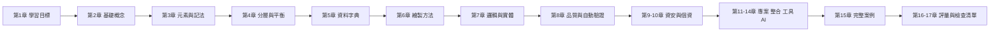

### 0.3 指引條目的格式與編號

本手冊把「必須遵守的規則」寫成指引條目。每一條都有固定欄位，讓讀者知道怎麼做，也讓審查者知道怎麼查：

- **標題**：`DFD-<領域>-<序號> 一句話規則`，例如 `DFD-LVL-003`。編號依出現順序指派，日後新增只往後加，不重新編號，審查意見可以長期引用。
- **等級**：「必須」代表違反就要退回修改；「建議」代表有正當理由時可以不遵守，但要在文件寫明理由。
- **說明**：為什麼要有這條規則。
- **❌ 反例／✅ 正例**：盡量用可以被 `check_dfd.py` 檢查的 YAML 模型表示，並在第二行寫出預期結果（`# 預期：PASS` 或 `# 預期：FAIL CHK-xx`）。無法用工具檢查的規則，以圖或表格示範。
- **如何 review**：審查者看圖時要看什麼。
- **如何驗證**：可重複執行的客觀驗證方法（工具、查詢或核對步驟）。

| 領域代碼 | 範圍 | 主要章節 |
| --- | --- | --- |
| CON | 基本概念與適用範圍 | 第 2 章 |
| NOT | 元素、記法與命名 | 第 3 章 |
| LVL | 分層、編號與平衡 | 第 4 章 |
| DIC | 資料字典與處理規格 | 第 5 章 |
| MTH | 繪製方法 | 第 6～7 章 |
| QA | 品質審查與自動驗證 | 第 8 章 |
| SEC | 威脅建模 | 第 9 章 |
| PRV | 個資與資料治理 | 第 10 章 |
| PRJ | 專案實務與追溯 | 第 11～12 章 |
| AI | AI 輔助繪製與審查 | 第 14 章 |

全部 51 條指引（其中「必須」34 條）彙整在[附錄 A](#附錄-a-指引總表)。

### 0.4 本手冊的層次命名約定

不同教科書與工具對「第幾層」的叫法不同，這是初學者最常混淆的地方。本手冊統一使用下表左欄的名稱，並在第 4 章詳細說明：

| 本手冊名稱 | 內容 | 處理程序編號 | 其他常見叫法 |
| --- | --- | --- | --- |
| Context 圖（環境圖、系統脈絡圖） | 整個系統是一個處理程序，只畫外部實體與資料流 | `0` | 部分網路教材與工具稱為「Level 0」 |
| Level 0 圖 | 展開 Context 圖的處理程序 `0` | `1.0`、`2.0`…（或 `1`、`2`…） | Yourdon 的「Figure 0」；部分教材稱為「Level 1」 |
| Level 1 圖 | 展開 Level 0 圖的某一個處理程序，例如 `3.0` | `3.1`、`3.2`… | 部分教材稱為「Level 2」 |
| Level 2 圖 | 展開 Level 1 圖的某一個處理程序，例如 `3.2` | `3.2.1`、`3.2.2`… | 部分教材稱為「Level 3」 |

> - 本手冊選擇這組名稱，是因為它與處理程序編號的位數一致：Level 0 圖的編號只有一位整數，Level 1 圖兩段，Level 2 圖三段。
> - 團隊若已經習慣另一種叫法，可以沿用，但必須在文件開頭寫明（見 DFD-LVL-001）。

## 1. 學習目標與能力等級

### 1.1 學完本手冊應具備的能力

本手冊把 DFD 能力分成四級。每一級都有「可觀察的產出」，主管或導師可以據此判斷學員是否達標：

| 等級 | 名稱 | 能做到的事 | 可觀察的產出 | 對應章節 |
| --- | --- | --- | --- | --- |
| L1 | 讀圖 | 看懂四種元素與分層編號，能說出任一條資料流從哪裡來、到哪裡去 | 用口頭或文字說明一張 Level 0 圖 | 第 2～4 章 |
| L2 | 繪圖 | 從需求描述畫出 Context 圖、Level 0 圖與資料字典，命名符合規則 | 一組通過 `check_dfd.py` 的 YAML 模型與 Mermaid 圖 | 第 3～6 章 |
| L3 | 審查 | 找出別人圖上的黑洞、奇蹟、灰洞、不平衡與命名問題，並引用指引編號 | 一份審查紀錄，每個問題對應一條指引 | 第 8、17 章 |
| L4 | 應用 | 把 DFD 用在威脅建模、個資盤點、追溯與架構文件，並把模型納入版本控制與 CI | 威脅清單、個資盤點表、追溯矩陣、CI 檢查紀錄 | 第 9～12 章 |

### 1.2 能力自我檢核

學完每一級後，用下列問題自我檢核。每題都要能「指著圖」回答，而不是背定義：

| 等級 | 檢核問題 | 參考答案位置 |
| --- | --- | --- |
| L1 | 為什麼兩個外部實體之間不能畫資料流？ | DFD-NOT-004 |
| L1 | Context 圖可以畫資料儲存嗎？ | DFD-LVL-002 |
| L2 | 「驗證失敗」能當作資料流名稱嗎？應該怎麼改？ | DFD-CON-001 |
| L2 | 子圖可以把父圖的「訂單資料」拆成「客戶資料」與「商品清單」兩條流嗎？條件是什麼？ | DFD-LVL-005 |
| L3 | 一個處理程序輸出「報價（含單價）」，輸入只有「商品編號、數量」，問題在哪裡？ | DFD-QA-001 |
| L3 | 如何不用人工比對就證明 Level 1 圖與父處理程序平衡？ | 第 8.3 節 |
| L4 | 跨越信任邊界的資料流，至少要評估哪幾類 STRIDE 威脅？ | DFD-SEC-003 |
| L4 | DFD 上哪些元素要對應到個資處理活動紀錄的哪些欄位？ | 第 10.2 節 |

### 1.3 建議學習時程

| 對象 | 時程 | 內容 | 驗收方式 |
| --- | --- | --- | --- |
| 初學者 | 第 1 週 | 第 1～4 章，完成第 15.1 節 ATM 案例的 Context 圖與 Level 0 圖 | 導師以第 17.1 節快速檢查表審查 |
| 初學者 | 第 2 週 | 第 5～8 章，安裝 `check_dfd.py`，把 ATM 案例寫成 YAML 並通過檢查 | 提交 YAML 與檢查輸出 |
| 初學者 | 第 3 週 | 第 15.2～15.4 節，並獨立完成第 15.5 節的一個練習題 | 第 16 章自我評量達 80 分 |
| 有經驗的分析師 | 第 1 週 | 快速瀏覽第 2～4 章，精讀第 5～8、11 章 | 為自己目前的專案補上平衡檢查 |
| 資安／個資人員 | 3 天 | 第 3、4 章、第 7.3 節、第 9、10 章 | 產出一份威脅清單或個資盤點表 |
| 技術主管 | 2 天 | 第 8、11、17 章與附錄 A | 將檢查清單與 CI 檢查納入團隊流程 |

## 2. 基礎概念與發展歷史

### 2.1 什麼是資料流程圖

**資料流程圖（Data Flow Diagram, DFD）** 是一種描述「資料如何在系統內外移動、在哪裡被轉換、在哪裡被保存」的圖形模型。它只用四種元素：

| 元素 | 回答的問題 | 一句話定義 |
| --- | --- | --- |
| 外部實體（External Entity，也稱 Terminator、Source/Sink） | 資料從誰來、送給誰？ | 系統範圍之外、與系統交換資料的人、組織或其他系統 |
| 處理程序（Process，也稱 Transform、Bubble） | 資料在哪裡被改變？ | 把輸入資料轉換成輸出資料的工作 |
| 資料流（Data Flow） | 什麼資料在移動？ | 一組有名稱、有方向、在兩個元素之間移動的資料 |
| 資料儲存（Data Store，也稱 File） | 資料在哪裡等待被再次使用？ | 處理程序之間「延遲使用」的資料 |

DFD 的核心觀念是**守恆**：處理程序輸出的每一筆資料，都必須能由它的輸入（或它讀取的資料儲存）推導出來；子圖的輸入輸出，必須與父圖中被展開的處理程序相同。這兩個守恆規則讓 DFD 可以被客觀檢查，而不只是「看起來合理」的圖。

DFD 刻意不描述下列事項，這些要用其他模型表達：

| DFD 不描述 | 原因 | 應使用的模型 |
| --- | --- | --- |
| 執行順序、判斷分支、迴圈 | 資料流只代表「資料可以從 A 到 B」，不代表「A 做完才做 B」 | 流程圖、BPMN、UML 活動圖 |
| 時間與訊息往返順序 | 同一張圖上的流可能在不同時間發生 | UML 循序圖 |
| 資料的結構與關係 | 資料儲存只是「名稱」，內容在資料字典 | ER 模型、UML 類別圖 |
| 部署位置與技術 | 邏輯 DFD 刻意隱藏技術（實體 DFD 例外，見第 7 章） | 部署圖、C4 Container 圖 |

#### DFD-CON-001 資料流必須表達資料，不可表達控制訊號或執行順序

- **等級**：必須
- **說明**：初學者常把流程圖的習慣帶進 DFD，畫出「成功」「失敗」「下一步」等箭頭。這些是控制訊號，沒有資料內容，無法寫進資料字典，也無法檢查守恆。真正需要的資料（例如錯誤原因、驗證結果明細）要用資料名詞命名。
- **❌ 反例**：處理程序 1.0 把「失敗」送回客戶。

```yaml
# dfd-model: con001-bad
# 預期：FAIL CHK-15
processes: {"1.0": 驗證身分}
entities: {E1: 客戶}
stores: {D1: 帳戶}
flows:
  - {from: E1, to: "1.0", data: 登入資料}
  - {from: D1, to: "1.0", data: 帳戶狀態}
  - {from: "1.0", to: E1, data: 失敗}
```

- **✅ 正例**：把控制訊號改成有內容的資料。「驗證結果」在資料字典定義為 `驗證結果 = 結果代碼 + (錯誤原因)`。

```yaml
# dfd-model: con001-good
# 預期：PASS
processes: {"1.0": 驗證身分}
entities: {E1: 客戶}
stores: {D1: 帳戶}
flows:
  - {from: E1, to: "1.0", data: 登入資料}
  - {from: D1, to: "1.0", data: 帳戶狀態}
  - {from: "1.0", to: E1, data: 驗證結果}
```

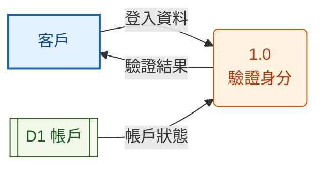

- **如何 review**：逐條讀資料流名稱，問「這條流能在資料字典寫出組成欄位嗎？」不能的就是控制訊號。圖上出現菱形判斷、「是／否」標籤、「開始／結束」節點，表示作者在畫流程圖。
- **如何驗證**：執行 `check_dfd.py`，CHK-15 會攔下常見控制詞（是、否、成功、失敗、開始、結束、下一步等），以及以「成功、失敗、通過、完成」結尾的名稱（例如「驗證成功」）；再以 DFD-DIC-001 確認每條資料流在資料字典都有組成定義。

#### DFD-CON-002 資料流只能是資料，實體物品與金錢要轉成代表它的資料

- **等級**：必須
- **說明**：DFD 描述資訊系統。ATM 吐出的現金、倉庫出貨的商品是實體物品，不會流進或流出資訊系統。系統處理的是代表它們的資料：「出鈔指令」「出貨單」「付款通知」。把物品畫成資料流，會讓人誤以為系統要「保存現金」或「處理商品」。
- **❌ 反例**：v1.1 的 ATM Context 圖有一條「現金」資料流，進銷存案例有「商品」「付款」資料流（見[附錄 D](#附錄-d-修正說明)）。

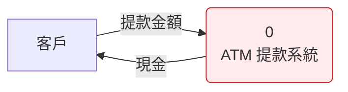

- **✅ 正例**：系統送出「出鈔指令」給出鈔模組（實體 DFD）或在邏輯 DFD 中送給客戶「交易明細」；現金本身不畫。


- **如何 review**：問「這條流能用電腦傳送或儲存嗎？」能的才是資料流。名稱是「現金、商品、貨物、包裹、鑰匙」等實物時退回。
- **如何驗證**：資料字典中每條資料流都必須拆到資料元素（見 DFD-DIC-001），實物無法拆成資料元素，會在字典審查時被發現。

### 2.2 DFD 的用途與價值

| 用途 | DFD 提供什麼 | 對應章節 |
| --- | --- | --- |
| 界定範圍 | Context 圖把「誰在系統外」說清楚，是範圍協議的依據 | 第 4.2 節 |
| 需求分析 | 每條進出系統的資料流就是一個介面需求；每個處理程序對應一組功能需求 | 第 6、11 章 |
| 發現遺漏 | 守恆規則會暴露「輸出缺少來源」「資料存了卻沒人用」等需求缺口 | 第 8 章 |
| 設計銜接 | 資料流對應 API／訊息，資料儲存對應資料表或主題，處理程序對應模組 | 第 11.3 節 |
| 威脅建模 | 信任邊界與資料流是 STRIDE 分析的基本單位 | 第 9 章 |
| 個資盤點 | 追蹤個資從蒐集到刪除經過哪些處理程序與儲存 | 第 10 章 |
| 溝通與交接 | 業務人員看得懂，又能精確到資料欄位 | 第 11.5 節 |

### 2.3 發展歷史與記法演進

| 年代 | 里程碑 | 對今日的影響 |
| --- | --- | --- |
| 1970 年代初 | Larry Constantine 等人在結構化設計中使用「資料流」觀念；Yourdon & Constantine《Structured Design》（1975 初版、1979 Prentice Hall 版） | 處理程序是「轉換」，由資料驅動 |
| 1977～1979 | Gane & Sarson《Structured Systems Analysis: Tools and Techniques》 | 圓角矩形處理程序、開口矩形資料儲存的「Gane-Sarson 記法」 |
| 1978～1979 | Tom DeMarco《Structured Analysis and System Specification》 | 圓形處理程序的「DeMarco/Yourdon 記法」、分層、平衡、資料字典、結構化英文 |
| 1981～1990 年代 | 英國政府 SSADM（1981 起，第 4 版 1990） | 以 DFD 搭配邏輯資料結構與實體事件模型；英國 BCS 課程沿用 |
| 1984 | McMenamin & Palmer《Essential Systems Analysis》 | 事件分割法（event partitioning）、基本模型（essential model） |
| 1985～1987 | Ward & Mellor、Hatley & Pirbhai | 即時系統延伸：控制流、控制處理程序、狀態轉換 |
| 1989 | Yourdon《Modern Structured Analysis》 | 整合事件分割與平衡檢查，成為教科書主流 |
| 1990 年代 | CASE 工具普及；物件導向與 UML（1997 起）興起 | DFD 在軟體設計中被 UML 取代，但在需求、整合與資料面持續使用 |
| 2000 年代 | Swiderski & Snyder《Threat Modeling》（2004）、Microsoft SDL（2006） | DFD 成為威脅建模的標準輸入 |
| 2014～今 | Shostack《Threat Modeling》、Threat Modeling Manifesto（2020）、OWASP Threat Dragon、pytm | 「diagrams as code」：DFD 以程式或 YAML 描述並自動檢查 |

> - DFD 沒有像 UML 或 BPMN 那樣由標準組織發布的正式規格。本手冊的規則來自上表的原始著作與現行教科書，並在[第 18 章](#18-參考資料)列出出處。
> - 因為沒有單一標準，團隊必須自己決定記法與層次名稱，並寫在文件裡（DFD-NOT-001、DFD-LVL-001）。

### 2.4 DFD 與其他圖的比較與選用

| 想回答的問題 | 最適合的圖 | 為什麼不是 DFD |
| --- | --- | --- |
| 資料從哪裡來、在哪裡被轉換、存在哪裡？ | **DFD** | — |
| 系統與誰互動、範圍到哪裡？ | **Context 圖**（DFD 的最上層）或 C4 System Context 圖 | — |
| 工作的先後順序、誰負責、在哪裡分支？ | BPMN 2.0（ISO/IEC 19510）或 UML 活動圖 | DFD 沒有順序與分支 |
| 一次呼叫中物件／服務之間訊息的時間順序？ | UML 循序圖 | DFD 沒有時間 |
| 資料有哪些實體與關係、基數為何？ | ER 模型、UML 類別圖 | 資料儲存只有名稱，沒有結構 |
| 系統由哪些可部署單元組成、用什麼技術？ | C4 Container 圖、UML 部署圖 | 邏輯 DFD 刻意隱藏技術 |
| 某個報表欄位是從哪個來源欄位算出來的？ | 資料血緣圖（lineage） | DFD 到欄位層級會過度複雜；血緣可視為欄位級的 DFD |
| 攻擊者能在哪裡竄改或竊取資料？ | 加上信任邊界的 DFD | — |

#### DFD-CON-003 先寫出這張 DFD 要回答的問題，再選擇層次與範圍

- **等級**：建議
- **說明**：同一個系統可以畫出很多張 DFD。為了範圍協議、為了威脅建模、為了個資盤點，所需的層次與元素都不同。沒有先寫目的，圖會越畫越大，最後誰也看不懂。
- **❌ 反例**：圖的標題只有「訂單系統 DFD」，同一張圖同時有 API 名稱、資料表名稱與業務部門，審查者不知道該用哪個標準審查。

```text
標題：訂單系統 DFD
（無目的說明、無層次標示、無邏輯／實體標示）
```

- **✅ 正例**：每張圖的標題區塊固定寫出下列項目。

```text
標題：訂單系統 Level 0 圖（邏輯、未來）
目的：確認訂單、付款、出貨三個子領域的資料介面，作為 API 規格的輸入
範圍：不含退貨（另見 RMA 系統）；外部實體以業務角色表示
版本：v1.3（2026-10-12）  模型檔：dfd/order/level0.yaml
```

- **如何 review**：先讀標題區塊，再看圖。若圖上的元素與「目的」無關（例如為了範圍協議的圖畫出資料表欄位），要求移到其他層次或其他圖。
- **如何驗證**：檢查模型庫中每個 YAML 檔都有 `system`、`purpose`、`level`、`view`（logical／physical）、`state`（as-is／to-be）欄位（可用第 11.4 節的 CI 腳本檢查）。

### 2.5 DFD 在開發生命週期中的位置

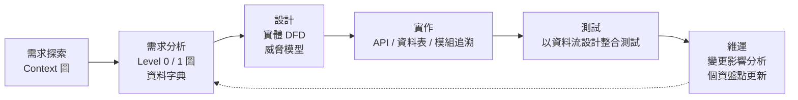

| 階段 | DFD 產出 | 審查重點 | 交給誰 |
| --- | --- | --- | --- |
| 需求探索 | Context 圖、外部實體清單 | 範圍、遺漏的外部實體 | 專案發起人、業務負責人 |
| 需求分析 | Level 0、Level 1 圖、資料字典、處理規格 | 守恆、平衡、命名 | 需求審查會、開發團隊 |
| 設計 | 實體 DFD、信任邊界、威脅清單 | 技術對應、STRIDE 覆蓋 | 架構師、資安 |
| 實作 | 追溯矩陣（處理程序→模組、資料流→API） | 每個元素都有實作、沒有多餘實作 | 開發團隊 |
| 測試 | 以每條外部資料流設計整合測試 | 每條流至少一個正常與一個異常案例 | 測試團隊 |
| 維運 | 隨變更更新模型；個資盤點表 | 模型與實作一致 | 維運、個資管理 |

## 3. DFD 元素、記法與命名

### 3.1 外部實體

**外部實體**是系統範圍之外、與系統交換資料的人、組織、設備或其他系統。判斷標準只有一個：**我們能不能改變它的內部運作？** 不能改變的就是外部實體。

| 判斷問題 | 是 → | 否 → |
| --- | --- | --- |
| 這個對象的行為由本專案決定嗎？ | 處理程序（在系統內） | 外部實體 |
| 本專案要替它設計畫面、規則或資料表嗎？ | 處理程序或資料儲存 | 外部實體 |
| 它保存的資料由本系統負責維護嗎？ | 資料儲存 | 外部實體（例如外部的徵信資料庫） |

外部實體的識別方法：

1. 列出所有「提供資料給系統」的對象：客戶、員工、上游系統、感測器、主管機關。
2. 列出所有「接收系統產出」的對象：報表使用者、下游系統、通知對象。
3. 列出「時間」觸發的事件（每日結帳、每月對帳），它們在 Yourdon 方法中是「時間事件」，不畫成外部實體，而是在處理規格中說明觸發條件。
4. 對每個對象問上表的三個問題，確認它真的在範圍外。

#### DFD-NOT-001 團隊必須統一一套記法，並在文件開頭寫明

- **等級**：必須
- **說明**：Yourdon/DeMarco、Gane-Sarson、SSADM 的符號不同，混用會讓讀者誤判元素種類（例如把圓角矩形的處理程序看成外部實體）。記法本身沒有對錯，混用才是錯。
- **❌ 反例**：同一份文件中，第一張圖的處理程序是圓形，第二張是圓角矩形，第三張用圓柱代表資料儲存，沒有圖例。

```text
圖 1：處理程序 = 圓形；資料儲存 = 兩條平行線
圖 2：處理程序 = 圓角矩形；資料儲存 = 開口矩形
圖 3：資料儲存 = 圓柱（資料庫符號）
文件中沒有圖例
```

- **✅ 正例**：文件開頭寫明採用的記法並附圖例，所有圖一致。本手冊採用的 Mermaid 圖例如下（定義見[第 3.6 節](#36-用-mermaid-繪製-dfd)）：


- **如何 review**：翻閱文件中所有 DFD，確認同一種元素的形狀一致，且文件開頭有圖例與記法名稱。
- **如何驗證**：用 diagrams-as-code 管理時，所有圖都由同一個產生器輸出（例如 `check_dfd.py --mermaid`），記法自然一致；手繪工具則以範本檔鎖定圖形庫，審查時比對範本版本。

#### DFD-NOT-002 外部實體以「角色」命名，不以人名、職稱個人或技術元件命名

- **等級**：建議
- **說明**：外部實體代表一類資料來源或去向。用人名（「王經理」）會在人事異動後失效；用技術元件（「Nginx」「Kafka」）屬於實體設計，不應出現在邏輯 DFD。
- **❌ 反例**：外部實體叫「王經理」「SAP RFC」「Kafka」。

```text
外部實體：王經理、SAP RFC、Kafka
```

- **✅ 正例**：以角色或系統的業務名稱命名。

```text
外部實體：核決主管、ERP 系統、物流業者
```

- **如何 review**：看到人名、IP、主機名稱、通訊協定、中介軟體名稱，就要求改成角色名稱；技術資訊移到實體 DFD（第 7 章）。
- **如何驗證**：在 CI 中以關鍵字清單（中介軟體、協定、主機命名規則）掃描邏輯 DFD 模型的 `entities` 名稱，有命中即提出警告。

### 3.2 處理程序

**處理程序**接收輸入資料並產生不同的輸出資料。它必須「改變」資料：計算、驗證、彙總、篩選、格式轉換、產生新資料都算；只是把資料原封不動轉送，不是處理程序。

處理程序的組成：

| 部分 | 規則 | 範例 |
| --- | --- | --- |
| 編號 | 在整個模型內唯一，子圖編號以父處理程序編號為前綴（第 4.4 節） | `3.2` |
| 名稱 | 強動詞＋單一受詞，表達「做什麼」而不是「誰做」或「怎麼做」 | 計算訂單金額 |
| 處理規格 | 只有最底層（不再展開）的處理程序需要，見第 5.4 節 | 結構化英文、決策表 |

#### DFD-NOT-003 處理程序以「動詞＋受詞」命名，並有模型內唯一的編號

- **等級**：必須
- **說明**：名稱是審查處理程序是否「只做一件事」的第一道線索。名稱若是名詞（「訂單」）、空泛動詞（「處理資料」「管理系統」），或包含「和」「與」，通常代表職責不清或應該拆開。
- **❌ 反例**：名稱沒有動詞或過於空泛，且兩個處理程序編號重複。

```text
1.0 訂單
2.0 處理資料
2.0 驗證並計算並通知
```

- **✅ 正例**：

```text
1.0 接收訂單
2.0 計算訂單金額
3.0 通知出貨結果
```

- **如何 review**：逐一讀出處理程序名稱，確認是「強動詞＋受詞」，沒有「處理、管理、作業、系統」這類空泛詞，也沒有連接詞。
- **如何驗證**：`check_dfd.py` 的 CHK-13 檢查編號重複；名稱以 CI 規則檢查是否包含「和、與、及、並」或只由空泛詞組成（見第 11.4 節的範例腳本）。

### 3.3 資料流

**資料流**是一組在兩個元素之間移動、有名稱、有方向的資料。資料流的規則：

| 規則 | 說明 |
| --- | --- |
| 名稱是資料名詞 | 「訂單資料」「出貨單」；不是動作（「查詢」）或控制（「成功」） |
| 同名代表同內容 | 整個模型中，同名的資料流在資料字典只有一個定義 |
| 可以分岔與匯合 | 同一份資料可以同時送到兩個處理程序（分岔），兩條流也可以匯合成一條組合資料流；組合關係要寫在資料字典 |
| 方向是資料移動方向 | 「查詢」本身不畫成資料流；畫的是「查詢條件」送進去、「查詢結果」送出來 |
| 進出資料儲存可以不命名 | 讀寫整筆記錄時，沿用資料儲存名稱；只讀寫部分欄位時要命名 |

#### DFD-NOT-004 外部實體之間不可畫資料流

- **等級**：必須
- **說明**：兩個外部實體之間的資料交換發生在系統範圍之外，系統看不到也管不到。畫出來會讓人以為系統要負責。若這段交換確實影響系統，代表範圍定義錯了：其中一方應該在系統內。
- **❌ 反例**：v1.1 ATM 案例中「銀行總部 → 核心銀行系統」是兩個外部實體之間的流。

```yaml
# dfd-model: not004-bad
# 預期：FAIL CHK-03
id: context
processes: {"0": ATM 提款系統}
entities: {E1: 客戶, E2: 銀行總部, E3: 核心銀行系統}
flows:
  - {from: E1, to: "0", data: 提款要求}
  - {from: "0", to: E1, data: 交易明細}
  - {from: E2, to: E3, data: 帳戶驗證請求}
  - {from: "0", to: E3, data: 授權請求}
  - {from: E3, to: "0", data: 授權結果}
  - {from: "0", to: E2, data: 交易紀錄}
```

- **✅ 正例**：刪除系統外的交換，只保留與系統有關的流。

```yaml
# dfd-model: not004-good
# 預期：PASS
id: context
processes: {"0": ATM 提款系統}
entities: {E1: 客戶, E2: 銀行總部, E3: 核心銀行系統}
flows:
  - {from: E1, to: "0", data: 提款要求}
  - {from: "0", to: E1, data: 交易明細}
  - {from: "0", to: E3, data: 授權請求}
  - {from: E3, to: "0", data: 授權結果}
  - {from: "0", to: E2, data: 交易紀錄}
```

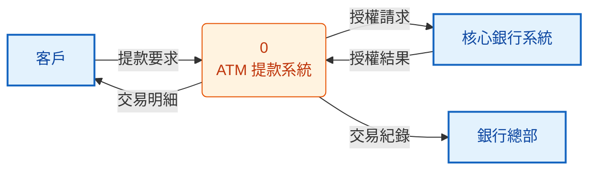

- **如何 review**：找出所有兩端都是外部實體的箭頭。若業務方堅持要畫，回到範圍討論：這段交換是否應由系統處理？
- **如何驗證**：`check_dfd.py` 的 CHK-03。

#### DFD-NOT-005 外部實體不可直接讀寫資料儲存

- **等級**：必須
- **說明**：資料儲存在系統內。外部實體要存取它，必須經過一個處理程序；這個處理程序就是需要設計的權限檢查、格式驗證與稽核紀錄。省略它等於省略了需求。若資料儲存其實由外部維護，它應該是外部實體，不是資料儲存。
- **❌ 反例**：主管直接讀取「D2 交易紀錄」。

```yaml
# dfd-model: not005-bad
# 預期：FAIL CHK-04
processes: {"1.0": 記錄交易}
entities: {E1: 客戶, E2: 稽核主管}
stores: {D2: 交易紀錄}
flows:
  - {from: E1, to: "1.0", data: 交易資料}
  - {from: "1.0", to: D2}
  - {from: "1.0", to: E1, data: 交易明細}
  - {from: D2, to: E2, data: 交易紀錄}
```

- **✅ 正例**：增加「2.0 產生稽核報表」，由它讀取資料儲存並決定主管可以看到什麼。

```yaml
# dfd-model: not005-good
# 預期：PASS
processes: {"1.0": 記錄交易, "2.0": 產生稽核報表}
entities: {E1: 客戶, E2: 稽核主管}
stores: {D2: 交易紀錄}
flows:
  - {from: E1, to: "1.0", data: 交易資料}
  - {from: "1.0", to: D2}
  - {from: "1.0", to: E1, data: 交易明細}
  - {from: E2, to: "2.0", data: 稽核查詢條件}
  - {from: D2, to: "2.0"}
  - {from: "2.0", to: E2, data: 稽核報表}
```


- **如何 review**：找出一端是外部實體、另一端是資料儲存的箭頭，要求補上處理程序，或改為外部實體。
- **如何驗證**：`check_dfd.py` 的 CHK-04。

#### DFD-NOT-006 資料儲存之間不可直接流動

- **等級**：必須
- **說明**：資料不會自己從一個儲存移動到另一個儲存，一定有某個工作（批次、複寫、ETL）在搬移與轉換。這個工作的排程、轉換規則與錯誤處理都是需求。
- **❌ 反例**：「D1 訂單 → D3 訂單歷史」。

```yaml
# dfd-model: not006-bad
# 預期：FAIL CHK-05
processes: {"1.0": 建立訂單}
entities: {E1: 客戶}
stores: {D1: 訂單, D3: 訂單歷史}
flows:
  - {from: E1, to: "1.0", data: 訂單資料}
  - {from: "1.0", to: D1}
  - {from: "1.0", to: E1, data: 訂單確認}
  - {from: D1, to: D3}
```

- **✅ 正例**：加入「4.0 封存已結案訂單」，由它讀取 D1、寫入 D3，處理規格寫明「結案滿 90 天」的條件。

```yaml
# dfd-model: not006-good
# 預期：PASS
processes: {"1.0": 建立訂單, "4.0": 封存已結案訂單}
entities: {E1: 客戶}
stores: {D1: 訂單, D3: 訂單歷史}
flows:
  - {from: E1, to: "1.0", data: 訂單資料}
  - {from: "1.0", to: D1}
  - {from: "1.0", to: E1, data: 訂單確認}
  - {from: D1, to: "4.0", data: 已結案訂單}
  - {from: "4.0", to: D3, data: 封存訂單}
```

- **如何 review**：找出兩端都是資料儲存的箭頭，要求補上搬移資料的處理程序與觸發條件。
- **如何驗證**：`check_dfd.py` 的 CHK-05。

#### DFD-NOT-007 同名資料流在整個模型中代表相同內容，不同內容必須不同名

- **等級**：必須
- **說明**：資料流名稱是資料字典的索引鍵。若「訂單資料」在 Level 0 圖代表「客戶編號＋商品清單」，在 Level 1 圖卻代表「訂單編號＋金額」，平衡檢查會誤判通過，開發人員也會實作出不相容的介面。
- **❌ 反例**：兩張圖用同一個名稱，資料字典卻寫了兩種定義。

```text
訂單資料 = 客戶編號 + {商品編號 + 數量}        ← Level 0 圖
訂單資料 = 訂單編號 + 訂單金額 + 訂單狀態       ← Level 1 圖（衝突）
```

- **✅ 正例**：不同內容使用不同名稱，各有一個定義。

```text
訂單資料 = 客戶編號 + {商品編號 + 數量}
訂單摘要 = 訂單編號 + 訂單金額 + 訂單狀態
```

- **如何 review**：從資料字典反查：每個名稱只能有一個定義；圖上出現的每個名稱都要能在字典找到。
- **如何驗證**：把資料字典也寫成 YAML（`dictionary:` 區段），由 CI 檢查名稱唯一，並比對模型中所有 `data` 名稱都已定義（第 5.2 節）。

### 3.4 資料儲存

**資料儲存**代表「延遲使用」的資料：一個處理程序寫入，之後另一個（或同一個）處理程序在不同時間讀取。資料儲存不等於資料表：一個資料儲存可能實作成多張資料表、一個訊息主題、一個檔案目錄或外部服務中的資料。

| 規則 | 說明 |
| --- | --- |
| 編號 | `D1`、`D2`…，整個模型唯一；同一個資料儲存在不同圖上使用相同編號 |
| 名稱 | 資料內容的名詞（複數意義），例如「訂單」「客戶」；不寫技術（「orders 表」「Redis」） |
| 讀寫 | 在整個模型中至少被寫入一次、讀取一次（CHK-14）；只寫不讀代表沒有用途，只讀不寫代表資料來源未定義 |
| 重複出現 | 同一張圖上為了減少交叉可以重複畫，但要加註記（例如右上角加 `*`） |
| 出現層次 | 一般不出現在 Context 圖（CHK-10）；第一次出現在「兩個以上處理程序共用它」的那一層 |

#### DFD-NOT-008 一張圖的處理程序數量控制在 7±2 個以內

- **等級**：建議
- **說明**：超過約 9 個處理程序，讀者就無法一眼掌握圖的結構，資料流也會大量交叉。此時應把相關的處理程序組成一個上層處理程序，再往下展開。
- **❌ 反例**：Level 0 圖有 14 個處理程序。

```text
1.0 接收訂單  2.0 驗證訂單  3.0 檢查庫存  4.0 保留庫存  5.0 計算金額
6.0 請款      7.0 開立發票  8.0 排定出貨  9.0 列印揀貨單 10.0 通知出貨
11.0 處理退貨 12.0 退款     13.0 產生日報 14.0 產生月報
```

- **✅ 正例**：Level 0 圖收斂為 5 個，各自往下展開。

```text
1.0 接收訂單（展開為 1.1 驗證訂單、1.2 檢查庫存、1.3 保留庫存）
2.0 處理付款（展開為 2.1 計算金額、2.2 請款、2.3 開立發票）
3.0 安排出貨（展開為 3.1 排定出貨、3.2 列印揀貨單、3.3 通知出貨）
4.0 處理退貨（展開為 4.1 受理退貨、4.2 退款）
5.0 產生營運報表
```

- **如何 review**：數處理程序的數量；超過 9 個時，找出共用相同資料儲存或相同外部實體的處理程序，討論是否合併成上層處理程序。
- **如何驗證**：`check_dfd.py --stats model.yaml` 列出每張圖的處理程序、外部實體、資料儲存與資料流數量，CI 可設定處理程序超過 9 個時提出警告。

#### DFD-NOT-009 雙向箭頭必須拆成兩條各自命名的單向資料流

- **等級**：建議
- **說明**：雙向箭頭只能有一個名稱，但兩個方向的資料內容幾乎一定不同（送出「查詢條件」、回傳「查詢結果」）。合併成一條會讓資料字典無法定義，也無法做 STRIDE 分析。
- **❌ 反例**：

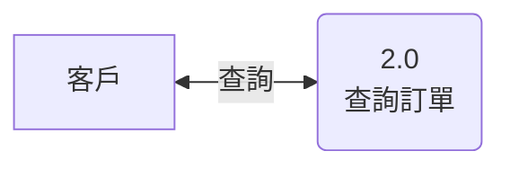

- **✅ 正例**：

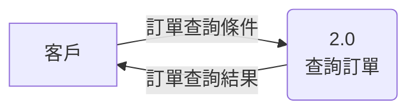

- **如何 review**：找出雙向箭頭或只有動詞名稱（「查詢」「同步」）的流，要求拆開並以資料名詞命名。
- **如何驗證**：YAML 模型的每條 `flows` 本身只有單一方向；Mermaid 原始碼中搜尋 `<-->` 應為零筆。

### 3.5 三套常用記法對照

| 元素 | Yourdon／DeMarco | Gane & Sarson | SSADM | Microsoft TMT／Threat Dragon |
| --- | --- | --- | --- | --- |
| 外部實體 | 矩形 | 有陰影的方形 | 橢圓（可加識別碼） | 矩形（External Interactor／Actor） |
| 處理程序 | 圓形，內含編號與名稱 | 圓角直立矩形，上方編號、中間名稱、下方可寫執行者 | 矩形，上方編號與執行位置 | 圓形（Process） |
| 資料流 | 有名稱的箭頭（可為曲線） | 有名稱的箭頭（直線） | 有名稱的箭頭 | 箭頭（Data Flow），可標協定 |
| 資料儲存 | 上下兩條平行線 | 左側封閉、右側開口的矩形，左格寫 `D1` | 左側封閉、右側開口矩形，左格寫 `D1`（電腦）或 `M1`（人工） | 上下兩條平行線（Data Store） |
| 信任邊界 | 無 | 無 | 無 | 虛線框或虛線（Trust Boundary） |

> - Gane & Sarson 的處理程序下方可寫「執行者」（部門或系統），這屬於實體資訊，邏輯 DFD 應留白。
> - 威脅建模工具沿用 Yourdon 的形狀，並多了信任邊界，第 9 章使用這組記法。

### 3.6 用 Mermaid 繪製 DFD

本站 Hugo 頁面載入 Mermaid 11，可以直接在 Markdown 中畫 DFD。Mermaid 沒有專用的 DFD 圖型，本手冊用 `flowchart` 搭配下列約定：

| 元素 | Mermaid 寫法 | 說明 |
| --- | --- | --- |
| 外部實體 | `id["名稱"]:::ent` | 矩形，粗框 |
| 處理程序 | `id("1.0<br/>名稱"):::proc` | 圓角矩形（Gane-Sarson 風格），編號在第一行 |
| 資料儲存 | `id[["D1 名稱"]]:::store` | 兩側雙線的矩形，近似開口矩形 |
| 資料流 | `a -->|名稱| b` | 一律單向 |
| 信任邊界 | `subgraph TB1["名稱"] ... end` 加上 `style TB1 stroke-dasharray:6 4` | 虛線框 |


#### DFD-NOT-010 Mermaid 圖以 classDef 標示元素類別，不以逐一 style 上色

- **等級**：建議
- **說明**：v1.1 每張圖都用 `style A fill:...` 逐一上色，元素一多就會漏，造成「同類元素顏色不同」。而且 `style A,B fill:...` 這種寫法在 Mermaid 會建立一個名為 `A,B` 的新節點，而不是替兩個節點上色。用 `classDef` 定義一次、`:::類別` 套用，才能保證一致。
- **❌ 反例**：

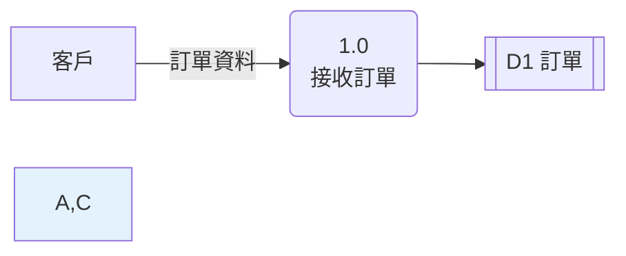

- **✅ 正例**：


- **如何 review**：Mermaid 原始碼中每個節點都要有 `:::ent`、`:::proc` 或 `:::store`（或以 `class` 敘述指定），不可出現含逗號的 `style` 敘述。
- **如何驗證**：以 `grep -nE "^\s*style [^ ]*,"` 掃描 Markdown，結果應為零；再以 mermaid-cli 渲染確認沒有多出的節點（見[附錄 E](#附錄-e-驗證紀錄)）。

### 3.7 版面與視覺規範

| 項目 | 規範 | 理由 |
| --- | --- | --- |
| 方向 | 主要輸入在左、主要輸出在右（`flowchart LR`）；或上進下出 | 符合閱讀方向 |
| 交叉 | 盡量避免；無法避免時重複畫外部實體或資料儲存並加註記 | 交叉線是誤讀的主因 |
| 顏色 | 只用來區分元素種類與標示問題，不承載其他意義；文字與底色對比足夠 | 黑白列印與色覺障礙讀者仍能閱讀 |
| 標題區塊 | 圖名、層次、邏輯／實體、現況／未來、版本、模型檔路徑 | 見 DFD-CON-003 |
| 圖例 | 文件第一張圖附近放一次 | 見 DFD-NOT-001 |
| 圖的大小 | 一張 A4 橫向可讀完；Mermaid 圖不需要水平捲動 | 超過代表該再分層 |

## 4. 分層、編號與平衡

### 4.1 分層分解的原理

真實系統的處理程序可能有上百個，不可能畫在一張圖上。DFD 用**分層（leveling）**管理複雜度：上層圖的一個處理程序，在下一層展開成一張完整的子圖。整組圖稱為**分層 DFD（leveled set）**。

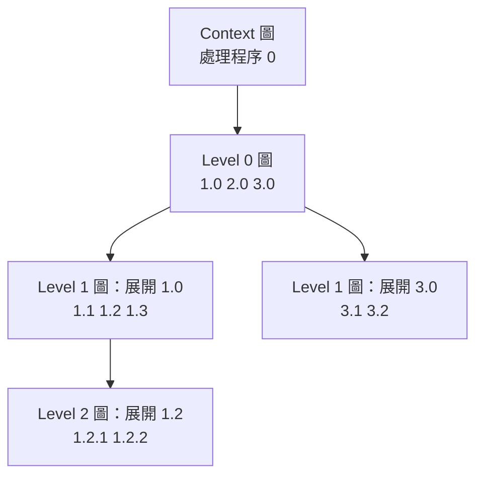

分層必須遵守三條規則，它們是本章各條指引的基礎：

| 規則 | 內容 | 違反時的後果 | 工具檢查 |
| --- | --- | --- | --- |
| 編號繼承 | 子圖處理程序的編號以父處理程序編號為前綴 | 無法從編號找到父圖，追溯中斷 | CHK-11 |
| 平衡（守恆） | 子圖的淨輸入與淨輸出，等於父處理程序的輸入與輸出 | 子圖多出的輸入在需求中沒有來源；缺少的輸出沒有人產生 | CHK-12 |
| 功能基元 | 不再展開的處理程序要有處理規格 | 開發人員只能猜測處理邏輯 | CHK-16 |

#### DFD-LVL-001 文件開頭必須寫明層次命名約定

- **等級**：必須
- **說明**：「Level 0」在不同教材中可能指 Context 圖，也可能指第一層展開圖（見[第 0.4 節](#04-本手冊的層次命名約定)）。同一個專案中有人用 A 說法、有人用 B 說法，會在審查會議中造成「你說的 Level 1 是哪一張？」的混亂。
- **❌ 反例**：需求文件的圖名寫「Level 1」，附錄卻把同一張圖稱為「Level 0」，沒有任何說明。

```text
3.2 節：圖 3-2 訂單系統 Level 1 DFD（內容為 1.0～5.0）
附錄 B：Level 0 圖（同一張，內容為 1.0～5.0）
```

- **✅ 正例**：文件開頭的「圖表約定」一節寫明對照。

```text
本文件層次命名：
- Context 圖：處理程序 0
- Level 0 圖：展開處理程序 0，編號 1.0～n.0
- Level 1 圖：展開 Level 0 的處理程序，編號 x.1～x.n
（對照：部分工具將 Context 圖稱為 Level 0）
```

- **如何 review**：確認文件開頭有層次命名約定；隨機抽三張圖，比對圖名的層次與處理程序編號位數是否一致。
- **如何驗證**：模型檔中 Context 圖的 `id` 為 `context`，其他圖的 `id` 為被展開的處理程序編號；CI 檢查圖名中的層次數字與 `id` 的段數一致。

### 4.2 Context 圖

Context 圖（環境圖、系統脈絡圖）只回答一個問題：**系統的邊界在哪裡，跨越邊界的資料有哪些？** 它有固定的形式：

| 元素 | 規則 |
| --- | --- |
| 處理程序 | 只有一個，代表整個系統，編號 `0` |
| 外部實體 | 全部列出；同一個角色只畫一次 |
| 資料流 | 列出所有跨越系統邊界的資料流，每條都要命名 |
| 資料儲存 | 不畫。系統內的儲存屬於內部細節；系統外的儲存是外部實體 |

#### DFD-LVL-002 Context 圖只能有一個處理程序，且不可包含資料儲存

- **等級**：必須
- **說明**：Context 圖的價值在於「範圍協議」。畫出內部資料儲存或多個處理程序，會讓業務方在範圍會議中討論內部設計，而忽略「是否漏了外部實體或資料流」這個真正的問題。
- **❌ 反例**：Context 圖上畫了「D1 訂單」。

```yaml
# dfd-model: lvl002-bad
# 預期：FAIL CHK-10
id: context
processes: {"0": 線上購物系統}
entities: {E1: 客戶}
stores: {D1: 訂單}
flows:
  - {from: E1, to: "0", data: 訂單資料}
  - {from: "0", to: D1}
  - {from: "0", to: E1, data: 訂單回覆}
```

- **✅ 正例**：完整的 Context 圖見[第 4.5 節](#45-平衡父子圖的資料守恆)的 `shop` 模型。
- **如何 review**：Context 圖上只能看到一個處理程序與外部實體。逐一指著外部實體問業務方：「這個對象送什麼資料給系統？從系統拿到什麼？」並問「還有誰會送資料進來或從系統拿資料？」
- **如何驗證**：`check_dfd.py` 的 CHK-10（模型中 `id: context` 的圖）。

### 4.3 Level 0 圖

Level 0 圖展開 Context 圖的處理程序 `0`，呈現系統的主要功能區塊與資料儲存。切分處理程序的方法有兩種，第 6 章詳細說明：

| 方法 | 做法 | 適用情境 |
| --- | --- | --- |
| 事件分割法（建議） | 每個「外部實體觸發的事件」或「時間事件」對應一個處理程序 | 需求分析、新系統 |
| 功能分解法 | 依業務功能或部門職責切分 | 盤點現有系統、與組織對照 |

Level 0 圖的檢查重點：

1. Context 圖上的每條資料流，都在 Level 0 圖出現且連到某個處理程序。
2. 沒有出現 Context 圖沒有的外部資料流（否則就是不平衡）。
3. 被兩個以上處理程序共用的資料儲存在這一層出現。

### 4.4 編號規則

| 層次 | 被展開的處理程序 | 子處理程序編號 | 資料儲存編號 |
| --- | --- | --- | --- |
| Context 圖 | — | `0` | 不畫 |
| Level 0 圖 | `0` | `1.0`、`2.0`…（或 `1`、`2`…，團隊擇一） | `D1`、`D2`… |
| Level 1 圖 | `3.0` | `3.1`、`3.2`… | 沿用父圖編號；子圖新增的接續編號 |
| Level 2 圖 | `3.2` | `3.2.1`、`3.2.2`… | 同上 |

> - 編號只是識別碼，不代表執行順序。`1.0` 不一定比 `2.0` 先執行。
> - 處理程序刪除後，編號不要重新排列，以免追溯矩陣與審查意見全部失效。新增的處理程序使用下一個未用過的編號。

#### DFD-LVL-003 子圖處理程序的編號必須以父處理程序編號為前綴

- **等級**：必須
- **說明**：編號是在分層圖之間導航的唯一線索。看到 `3.2.1` 就知道去找 `3.2` 的子圖、再去找 `3.0` 的子圖。編號不一致時，審查者會比對錯誤的父子圖，平衡檢查也無法自動進行。
- **❌ 反例**：展開 `1.0` 的子圖使用 `2.1`。

```yaml
# dfd-model: lvl003-bad
# 預期：FAIL CHK-11
diagrams:
  - id: "0"
    processes: {"1.0": 接收訂單}
    entities: {E1: 客戶}
    flows:
      - {from: E1, to: "1.0", data: 訂單資料}
      - {from: "1.0", to: E1, data: 訂單回覆}
  - id: "1.0"
    explodes: "1.0"
    processes: {"2.1": 驗證訂單, "2.2": 建立訂單}
    entities: {E1: 客戶}
    flows:
      - {from: E1, to: "2.1", data: 訂單資料}
      - {from: "2.1", to: "2.2", data: 有效訂單}
      - {from: "2.2", to: E1, data: 訂單回覆}
```

- **✅ 正例**：子處理程序改為 `1.1`、`1.2`（完整範例見[第 4.5 節](#45-平衡父子圖的資料守恆)）。
- **如何 review**：每張子圖的圖名寫出「展開 x」，逐一確認子圖內所有處理程序編號以 x 開頭。
- **如何驗證**：`check_dfd.py` 的 CHK-11。

### 4.5 平衡：父子圖的資料守恆

**平衡（balancing）**是 DFD 最重要的品質規則：子圖與外界（外部實體、父圖中的資料儲存與其他處理程序）交換的資料，必須與父處理程序完全相同。子圖可以新增「內部」的資料流與資料儲存，但不能新增或遺漏「外部」的資料。

判斷子圖的淨輸入與淨輸出時：

| 流的種類 | 算不算淨輸入／輸出 |
| --- | --- |
| 外部實體 ↔ 子處理程序 | 算 |
| 父圖已有的資料儲存 ↔ 子處理程序 | 算（父處理程序也連著這個儲存） |
| 子圖新增的資料儲存 ↔ 子處理程序 | 不算（屬於被展開處理程序的內部） |
| 子處理程序 ↔ 子處理程序 | 不算 |

下面是一組完整而平衡的模型。`dictionary` 區段說明「訂單回覆」由「訂單確認」或「訂單錯誤明細」組成，因此 Level 1 圖可以把它拆成兩條流；`readonly_stores` 說明「D3 商品」由商品管理系統維護，本模型只讀取。

```yaml
# dfd-model: shop
# 預期：PASS
system: 線上購物
dictionary:
  訂單回覆: [訂單確認, 訂單錯誤明細]
readonly_stores: [D3]
diagrams:
  - id: context
    processes: {"0": 線上購物系統}
    entities: {E1: 客戶, E2: 金流服務商, E3: 物流業者}
    flows:
      - {from: E1, to: "0", data: 訂單資料}
      - {from: "0", to: E1, data: 訂單回覆}
      - {from: "0", to: E2, data: 請款要求}
      - {from: E2, to: "0", data: 請款結果}
      - {from: "0", to: E3, data: 出貨指示}
      - {from: E3, to: "0", data: 配送狀態}
      - {from: "0", to: E1, data: 出貨通知}
  - id: "0"
    explodes: "0"
    processes: {"1.0": 接收訂單, "2.0": 處理付款, "3.0": 安排出貨}
    entities: {E1: 客戶, E2: 金流服務商, E3: 物流業者}
    stores: {D1: 訂單}
    flows:
      - {from: E1, to: "1.0", data: 訂單資料}
      - {from: "1.0", to: E1, data: 訂單回覆}
      - {from: "1.0", to: D1, data: 新訂單}
      - {from: D1, to: "2.0", data: 待付款訂單}
      - {from: "2.0", to: E2, data: 請款要求}
      - {from: E2, to: "2.0", data: 請款結果}
      - {from: "2.0", to: D1, data: 付款狀態}
      - {from: D1, to: "3.0", data: 已付款訂單}
      - {from: "3.0", to: E3, data: 出貨指示}
      - {from: E3, to: "3.0", data: 配送狀態}
      - {from: "3.0", to: D1, data: 出貨狀態}
      - {from: "3.0", to: E1, data: 出貨通知}
  - id: "1.0"
    explodes: "1.0"
    processes: {"1.1": 驗證訂單, "1.2": 計算訂單金額, "1.3": 建立訂單}
    entities: {E1: 客戶}
    stores: {D1: 訂單, D3: 商品}
    flows:
      - {from: E1, to: "1.1", data: 訂單資料}
      - {from: "1.1", to: E1, data: 訂單錯誤明細}
      - {from: "1.1", to: "1.2", data: 有效訂單}
      - {from: D3, to: "1.2", data: 商品價格}
      - {from: "1.2", to: "1.3", data: 已計價訂單}
      - {from: "1.3", to: D1, data: 新訂單}
      - {from: "1.3", to: E1, data: 訂單確認}
```

Context 圖：

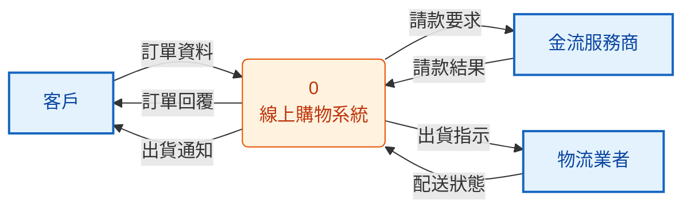

Level 0 圖：

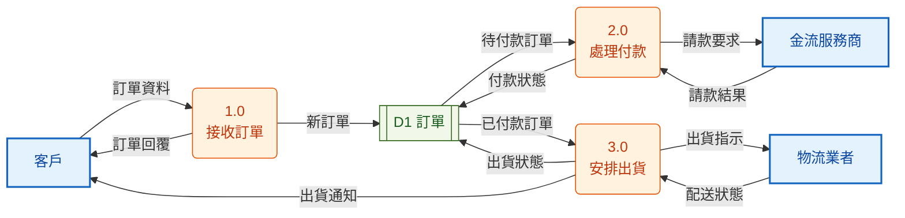

Level 1 圖（展開 1.0）：

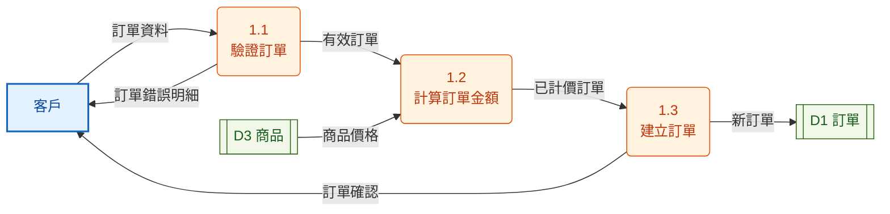

逐項平衡表（Level 1 圖 vs 父處理程序 1.0）：

| 父處理程序 1.0 的流 | 方向 | Level 1 圖的對應 | 結果 |
| --- | --- | --- | --- |
| 訂單資料（客戶） | 輸入 | 客戶 → 1.1 訂單資料 | 相同 |
| 訂單回覆（客戶） | 輸出 | 1.1 → 客戶 訂單錯誤明細、1.3 → 客戶 訂單確認；字典：訂單回覆 = 訂單確認 \| 訂單錯誤明細 | 展開後相同 |
| 新訂單（D1） | 輸出 | 1.3 → D1 新訂單 | 相同 |
| — | 輸入 | D3 → 1.2 商品價格 | D3 不在 Level 0 圖，是 1.0 的內部儲存，不算淨輸入 |

`check_dfd.py` 的實際輸出：

```text
$ python check_dfd.py shop.yaml
[PASS] shop.yaml
（結束碼 0）
```

#### DFD-LVL-004 子圖的淨輸入與淨輸出必須與父處理程序平衡

- **等級**：必須
- **說明**：不平衡代表需求不一致。子圖多出的輸入（例如「折扣碼」）在上層沒有來源，代表 Context 圖漏了一條流、範圍協議不完整；子圖缺少的輸出，代表沒有人產生上層承諾的資料。
- **❌ 反例**：Level 1 圖多了一條「客戶 → 1.2 折扣碼」，父處理程序 1.0 沒有這條輸入。

```yaml
# dfd-model: lvl004-bad
# 預期：FAIL CHK-12
diagrams:
  - id: "0"
    processes: {"1.0": 接收訂單}
    entities: {E1: 客戶}
    stores: {D1: 訂單}
    flows:
      - {from: E1, to: "1.0", data: 訂單資料}
      - {from: "1.0", to: E1, data: 訂單確認}
      - {from: "1.0", to: D1, data: 新訂單}
      - {from: D1, to: "1.0", data: 訂單編號序號}
  - id: "1.0"
    explodes: "1.0"
    processes: {"1.1": 驗證訂單, "1.2": 計算訂單金額}
    entities: {E1: 客戶}
    stores: {D1: 訂單}
    flows:
      - {from: E1, to: "1.1", data: 訂單資料}
      - {from: E1, to: "1.2", data: 折扣碼}
      - {from: "1.1", to: "1.2", data: 有效訂單}
      - {from: D1, to: "1.2", data: 訂單編號序號}
      - {from: "1.2", to: D1, data: 新訂單}
      - {from: "1.2", to: E1, data: 訂單確認}
```

```text
$ python check_dfd.py lvl004-bad.yaml
[FAIL] CHK-12 不平衡：子圖的淨輸入或淨輸出與父處理程序不同｜展開 1.0 的子圖：輸入多出 折扣碼；缺少 無
（結束碼 1）
```

- **✅ 正例**：兩種修法擇一：(1) 回到 Context 圖與 Level 0 圖補上「折扣碼」（範圍擴大，要經過範圍協議）；(2) 把折扣碼併入「訂單資料」的資料字典定義 `訂單資料 = 客戶編號 + {商品編號 + 數量} + (折扣碼)`，Level 1 圖改用「訂單資料」。`shop` 模型就是平衡的完整範例。
- **如何 review**：拿父處理程序的輸入輸出清單，逐一在子圖勾選；再反過來檢查子圖每一條「從外面進來」或「送到外面」的流是否在清單中。
- **如何驗證**：`check_dfd.py` 的 CHK-12，輸出會列出多出與缺少的資料名稱。

#### DFD-LVL-005 子圖拆分或合併父圖資料流時，組合關係必須寫在資料字典

- **等級**：必須
- **說明**：上層圖為了簡潔，常把多種資料合成一條流（「訂單回覆」），下層再拆開（「訂單確認」「訂單錯誤明細」）。這是合法的，但前提是資料字典寫明組合關係，否則審查者與工具都無法判斷是平衡還是遺漏。
- **❌ 反例**：與 `shop` 模型相同，但沒有 `dictionary` 區段。

```yaml
# dfd-model: lvl005-bad
# 預期：FAIL CHK-12
diagrams:
  - id: "0"
    processes: {"1.0": 接收訂單}
    entities: {E1: 客戶}
    flows:
      - {from: E1, to: "1.0", data: 訂單資料}
      - {from: "1.0", to: E1, data: 訂單回覆}
  - id: "1.0"
    explodes: "1.0"
    processes: {"1.1": 驗證訂單, "1.3": 建立訂單}
    entities: {E1: 客戶}
    flows:
      - {from: E1, to: "1.1", data: 訂單資料}
      - {from: "1.1", to: E1, data: 訂單錯誤明細}
      - {from: "1.1", to: "1.3", data: 有效訂單}
      - {from: "1.3", to: E1, data: 訂單確認}
```

```text
$ python check_dfd.py lvl005-bad.yaml
[FAIL] CHK-12 不平衡：子圖的淨輸入或淨輸出與父處理程序不同｜展開 1.0 的子圖：輸出多出 訂單確認、訂單錯誤明細；缺少 訂單回覆
（結束碼 1）
```

- **✅ 正例**：加上資料字典的組合定義。

```yaml
# dfd-model: lvl005-good
# 預期：PASS
dictionary:
  訂單回覆: [訂單確認, 訂單錯誤明細]
diagrams:
  - id: "0"
    processes: {"1.0": 接收訂單}
    entities: {E1: 客戶}
    flows:
      - {from: E1, to: "1.0", data: 訂單資料}
      - {from: "1.0", to: E1, data: 訂單回覆}
  - id: "1.0"
    explodes: "1.0"
    processes: {"1.1": 驗證訂單, "1.3": 建立訂單}
    entities: {E1: 客戶}
    flows:
      - {from: E1, to: "1.1", data: 訂單資料}
      - {from: "1.1", to: E1, data: 訂單錯誤明細}
      - {from: "1.1", to: "1.3", data: 有效訂單}
      - {from: "1.3", to: E1, data: 訂單確認}
```

- **如何 review**：子圖中出現父圖沒有的外部流名稱時，到資料字典找它是否為父圖某條流的元件。
- **如何驗證**：`check_dfd.py` 會依 `dictionary` 展開組合流後再比較，展開後仍不同才報 CHK-12。

### 4.6 資料儲存在分層中的位置

資料儲存應該出現在「最高的、有兩個以上處理程序共用它」的那一層：

- 只有一個處理程序使用的儲存，是該處理程序的內部細節，應該下移到它的子圖。
- 在父圖出現的儲存，子圖中連到它的流必須與父處理程序連到它的流平衡（見[第 4.5 節](#45-平衡父子圖的資料守恆)）。
- 子圖新增的儲存，在父圖不出現；它在子圖中仍須同時被寫入與讀取，或列入 `readonly_stores`。

#### DFD-LVL-006 只被一個處理程序使用的資料儲存，應下移到該處理程序的子圖

- **等級**：建議
- **說明**：把內部暫存畫在上層圖，會讓上層圖變複雜，也讓讀者誤以為那是共用資料、需要考慮並行與一致性。
- **❌ 反例**：Level 0 圖上的「D9 計價暫存」只連到 1.0。

```yaml
# dfd-model: lvl006-bad
# 預期：PASS
processes: {"1.0": 接收訂單, "2.0": 處理付款}
entities: {E1: 客戶}
stores: {D1: 訂單, D9: 計價暫存}
flows:
  - {from: E1, to: "1.0", data: 訂單資料}
  - {from: "1.0", to: D9, data: 計價中間結果}
  - {from: D9, to: "1.0", data: 計價中間結果}
  - {from: "1.0", to: D1, data: 新訂單}
  - {from: D1, to: "2.0", data: 待付款訂單}
  - {from: "2.0", to: E1, data: 付款通知}
```

這個模型本身沒有違反任何結構規則（所以預期為 PASS），但 `--stats` 會提示：

```text
$ python check_dfd.py --stats lvl006-bad.yaml
圖 0：處理程序 2、外部實體 1、資料儲存 2、資料流 6
  只被一個處理程序使用的資料儲存（可考慮下移到子圖）：D9
（結束碼 0）
```

- **✅ 正例**：Level 0 圖移除 D9；在展開 1.0 的 Level 1 圖中，由 1.2 寫入、1.3 讀取 D9。
- **如何 review**：在每張圖上找只連到一個處理程序的資料儲存，詢問作者是否有其他處理程序會使用它。
- **如何驗證**：`check_dfd.py --stats` 列出「只被一個處理程序使用的資料儲存」，審查時逐一確認。

### 4.7 何時停止分解

處理程序分解到**功能基元（functional primitive）**時停止。功能基元同時符合下列條件：

| 條件 | 判斷方法 |
| --- | --- |
| 只做一件事 | 名稱是「一個強動詞＋一個受詞」，處理規格能在一頁內寫完 |
| 輸入輸出單純 | 通常只有一到兩條輸入、一到兩條輸出 |
| 再拆沒有意義 | 再拆下去的子處理程序之間沒有需要命名的資料流，或只剩程式邏輯 |
| 可以被測試 | 能為它寫出輸入→預期輸出的測試案例 |

| 系統規模 | 常見深度 | 說明 |
| --- | --- | --- |
| 小型（< 10 個功能基元） | Context + Level 0 | Level 0 的處理程序本身就是功能基元 |
| 中型 | Context + Level 0 + Level 1 | 最常見 |
| 大型 | 到 Level 2，部分到 Level 3 | 不同分支可以有不同深度，不必齊頭 |

#### DFD-LVL-007 分解到功能基元即停止，每個功能基元都要有處理規格

- **等級**：必須
- **說明**：分層的目的是讓最底層的處理程序簡單到可以用一段規格精確描述。沒有處理規格的功能基元，開發人員只能猜；分解過深（拆到程式邏輯層級），則會讓圖失去溝通價值。
- **❌ 反例**：模型宣告了 `specs`，但功能基元 1.2 沒有規格。

```yaml
# dfd-model: lvl007-bad
# 預期：FAIL CHK-16
specs:
  "1.1": 規格見 spec/1.1-驗證訂單.md
processes: {"1.1": 驗證訂單, "1.2": 計算訂單金額}
entities: {E1: 客戶}
flows:
  - {from: E1, to: "1.1", data: 訂單資料}
  - {from: "1.1", to: "1.2", data: 有效訂單}
  - {from: "1.2", to: E1, data: 訂單金額明細}
```

- **✅ 正例**：每個功能基元都有規格（規格的寫法見[第 5.4 節](#54-處理規格結構化英文)）。

```yaml
# dfd-model: lvl007-good
# 預期：PASS
specs:
  "1.1": 規格見 spec/1.1-驗證訂單.md
  "1.2": 規格見 spec/1.2-計算訂單金額.md
processes: {"1.1": 驗證訂單, "1.2": 計算訂單金額}
entities: {E1: 客戶}
flows:
  - {from: E1, to: "1.1", data: 訂單資料}
  - {from: "1.1", to: "1.2", data: 有效訂單}
  - {from: "1.2", to: E1, data: 訂單金額明細}
```

- **如何 review**：對每個沒有子圖的處理程序，打開它的處理規格，確認規格只用到輸入資料流與讀取的資料儲存中的欄位，並產生所有輸出資料流。
- **如何驗證**：在模型加入 `specs` 區段後，`check_dfd.py` 的 CHK-16 會列出缺少規格的功能基元。

## 5. 資料字典與處理規格

### 5.1 為什麼 DFD 一定要搭配資料字典

DFD 上的資料流只有名稱。「訂單資料」到底包含哪些欄位？「配送狀態」有哪些值？這些問題由**資料字典（data dictionary）**回答。DeMarco 把結構化規格定義為三個部分的組合：

| 部分 | 回答的問題 | 本章位置 |
| --- | --- | --- |
| 分層 DFD | 資料從哪裡來、到哪裡去、在哪裡被轉換 | 第 3、4 章 |
| 資料字典 | 每條資料流與資料儲存由哪些資料組成 | 第 5.2～5.3 節 |
| 處理規格（process specification, mini-spec） | 每個功能基元如何把輸入轉成輸出 | 第 5.4～5.5 節 |

少了資料字典，平衡檢查只能比較名稱，不能確認內容；少了處理規格，開發人員只能猜邏輯。三者合起來才是可驗證的需求規格。

### 5.2 資料字典記法

本手冊沿用 DeMarco／Yourdon 的記法，並以 YAML 字串保存，讓 `check_dict.py` 可以解析：

| 符號 | 意義 | 範例 | 讀法 |
| --- | --- | --- | --- |
| `=` | 由…組成（YAML 中寫成 `名稱: "定義"`） | `訂單明細: "商品編號 + 數量"` | 訂單明細由商品編號與數量組成 |
| `+` | 且 | `商品編號 + 數量` | 兩者都有 |
| `[ a \| b ]` | 擇一 | `[信用卡資料 \| 轉帳資料]` | 二選一 |
| `{ x }` | 重複 0 次以上 | `{訂單明細}` | 零到多筆 |
| `m{ x }n` | 重複 m 到 n 次 | `1{訂單明細}50` | 一到五十筆 |
| `( x )` | 選填 | `(折扣碼)` | 可有可無 |
| 屬性對照表 | 資料元素（不可再分） | `數量: {型別: 整數, 值域: 1～99}` | 定義型別、格式、值域 |

#### DFD-DIC-001 每條資料流與資料儲存都必須在資料字典定義，並展開到資料元素

- **等級**：必須
- **說明**：資料字典是平衡檢查、介面設計、測試資料與個資盤點的共同依據。圖上任何一條沒有定義的流，在實作時都會變成「各自解讀」的介面。
- **❌ 反例**：下面的資料字典對應 [DFD-LVL-005](#dfd-lvl-005-子圖拆分或合併父圖資料流時組合關係必須寫在資料字典) 的 `lvl005-good` 模型，同時犯了幾種常見錯誤：漏定義「訂單錯誤明細」、把「商品編號」打成「商品編碼」、擇一記法少了右括號、資料元素沒有型別。

```yaml
# dfd-dict: dic001-bad
# 模型：lvl005-good
# 預期：FAIL DCT-01, DCT-02, DCT-03, DCT-05, DCT-06
訂單資料: "客戶編號 + 1{訂單明細}50"
訂單明細: "商品編碼 + 數量"
有效訂單: "訂單資料"
訂單回覆: "[訂單確認 | 訂單錯誤明細"
訂單確認: "訂單編號 + 訂單金額"
客戶編號: {型別: 字串, 格式: "C + 8 位數字"}
商品編號: {型別: 字串, 格式: "P + 6 位數字"}
數量: {格式: 正整數}
訂單編號: {型別: 字串, 格式: "yyyyMMdd + 6 位序號"}
訂單金額: {型別: 金額, 單位: 新臺幣元}
```

```text
$ python check_dict.py lvl005-good.yaml dic001-bad.yaml
[FAIL] DCT-03 組合定義的語法錯誤｜訂單回覆 = [訂單確認 | 訂單錯誤明細（第 5 個符號應為 ]，實際為 結尾）
[FAIL] DCT-06 資料元素缺少型別｜數量
[FAIL] DCT-01 資料流或資料儲存沒有在資料字典定義｜訂單錯誤明細
[FAIL] DCT-02 定義中引用了未定義的名稱｜訂單明細 引用 商品編碼
[FAIL] DCT-05 定義了但沒有被模型或其他定義使用｜商品編號
（結束碼 1）
```

- **✅ 正例**：

```yaml
# dfd-dict: dic001-good
# 模型：lvl005-good
# 預期：PASS
訂單資料: "客戶編號 + 1{訂單明細}50"
訂單明細: "商品編號 + 數量"
有效訂單: "訂單資料"
訂單回覆: "[訂單確認 | 訂單錯誤明細]"
訂單確認: "訂單編號 + 訂單金額"
訂單錯誤明細: "1{錯誤代碼 + 錯誤說明}"
客戶編號: {型別: 字串, 格式: "C + 8 位數字", 個資: 否}
商品編號: {型別: 字串, 格式: "P + 6 位數字", 個資: 否}
數量: {型別: 整數, 值域: 1～99, 個資: 否}
訂單編號: {型別: 字串, 格式: "yyyyMMdd + 6 位序號", 個資: 否}
訂單金額: {型別: 金額, 單位: 新臺幣元, 值域: 0～9999999, 個資: 否}
錯誤代碼: {型別: 字串, 值域: "E001～E099，見錯誤代碼表", 個資: 否}
錯誤說明: {型別: 字串, 長度: 200, 個資: 否}
```

```text
$ python check_dict.py lvl005-good.yaml dic001-good.yaml
[PASS] 定義 13 筆，涵蓋模型中所有資料流與資料儲存
（結束碼 0）
```

- **如何 review**：從圖出發，逐條資料流查字典；再從字典出發，追到每個名稱最後都是有型別的資料元素。
- **如何驗證**：`python check_dict.py 模型.yaml 字典.yaml`，DCT-01（未定義）、DCT-02（引用不存在的名稱）、DCT-05（多餘定義）都要為零。

#### DFD-DIC-002 組合定義必須使用統一記法，且可以被工具解析

- **等級**：必須
- **說明**：用散文寫「訂單資料包含客戶與商品等資訊」，無法判斷「等」包含什麼、商品是一筆還是多筆、哪些欄位必填。統一記法讓定義精確，也讓工具可以檢查語法、循環定義與引用。
- **❌ 反例**：

```text
訂單資料：客戶的基本資料以及購買的商品等資訊，必要時可附上折扣。
```

- **✅ 正例**：

```text
訂單資料 = 客戶編號 + 1{訂單明細}50 + 配送資料 + (折扣碼)
```

- **如何 review**：字典中不得出現「等」「相關資訊」「必要時」等模糊字；每個重複都要寫出上下限或說明不限。
- **如何驗證**：`check_dict.py` 的 DCT-03（語法錯誤）與 DCT-04（循環定義，例如 `A = B + C`、`B = A`）。

### 5.3 資料元素的定義

資料元素是不可再分的資料（客戶編號、數量、配送階段）。它的定義要足以讓開發、測試與個資管理各自使用：

| 屬性 | 必要性 | 範例 | 誰會用到 |
| --- | --- | --- | --- |
| 型別 | 必要 | 字串、整數、金額、日期、列舉 | 開發、資料庫設計 |
| 格式或值域 | 必要 | `C + 8 位數字`；1～99；`[待出貨 \| 運送中 \| 已送達]` | 驗證規則、測試資料 |
| 單位 | 數值型必要 | 新臺幣元、公克 | 介面整合 |
| 個資 | 必要 | 否／一般個資／特種個資 | 個資盤點（第 10 章） |
| 來源 | 建議 | 客戶輸入、系統產生、外部系統 | 追溯、資料品質 |
| 別名 | 建議 | 「客編」＝客戶編號 | 消除同義詞 |

#### DFD-DIC-003 資料元素至少定義型別、格式或值域，以及是否為個資

- **等級**：必須
- **說明**：只寫名稱的資料元素會在介面整合時出錯（金額是元還是分？日期是西元還是民國？），也會讓個資盤點漏掉欄位。
- **❌ 反例**：

```yaml
收件人電話: {說明: 收件人的電話}
配送階段: {說明: 目前配送到哪裡}
```

- **✅ 正例**：

```yaml
收件人電話: {型別: 字串, 格式: "09 開頭 10 位數字或市話含區碼", 個資: 一般個資, 來源: 客戶輸入}
配送階段: {型別: 列舉, 值域: "[已出庫 | 運送中 | 已送達 | 退回]", 個資: 否, 來源: 物流業者}
```

- **如何 review**：每個資料元素都要有型別、格式或值域與個資欄位；列舉值要列出全部值。
- **如何驗證**：`check_dict.py` 的 DCT-06 檢查型別；團隊可在 CI 擴充同樣的檢查，要求「個資」欄位存在（第 10 章）。

`shop` 模型（[第 4.5 節](#45-平衡父子圖的資料守恆)）的完整資料字典如下，可以作為撰寫範本：

```yaml
# dfd-dict: shop-dict
# 模型：shop
# 預期：PASS
訂單資料: "客戶編號 + 1{訂單明細}50 + 配送資料 + (折扣碼)"
訂單明細: "商品編號 + 數量"
配送資料: "收件人姓名 + 收件人電話 + 收件地址"
訂單回覆: "[訂單確認 | 訂單錯誤明細]"
訂單確認: "訂單編號 + 訂單金額 + 訂單日期"
訂單錯誤明細: "1{錯誤代碼 + 錯誤說明}"
有效訂單: "訂單資料"
商品價格: "商品編號 + 單價"
已計價訂單: "有效訂單 + 1{商品編號 + 單價}50 + 訂單金額"
新訂單: "訂單編號 + 已計價訂單 + 訂單日期 + 訂單狀態"
訂單: "{新訂單 + (付款狀態) + (出貨狀態)}"
待付款訂單: "訂單編號 + 訂單金額"
請款要求: "訂單編號 + 訂單金額 + 付款憑證"
請款結果: "訂單編號 + 請款狀態 + (授權碼)"
付款狀態: "訂單編號 + 請款狀態 + (授權碼)"
已付款訂單: "訂單編號 + 1{訂單明細}50 + 配送資料"
出貨指示: "訂單編號 + 1{訂單明細}50 + 配送資料"
配送狀態: "訂單編號 + 物流單號 + 配送階段"
出貨狀態: "訂單編號 + 物流單號 + 配送階段"
出貨通知: "訂單編號 + 物流單號 + 配送階段"
商品: "{商品編號 + 商品名稱 + 單價}"
客戶編號: {型別: 字串, 格式: "C + 8 位數字", 個資: 否, 來源: 系統產生}
商品編號: {型別: 字串, 格式: "P + 6 位數字", 個資: 否, 來源: 商品管理系統}
商品名稱: {型別: 字串, 長度: 100, 個資: 否, 來源: 商品管理系統}
數量: {型別: 整數, 值域: 1～99, 個資: 否, 來源: 客戶輸入}
收件人姓名: {型別: 字串, 長度: 50, 個資: 一般個資, 來源: 客戶輸入}
收件人電話: {型別: 字串, 格式: "09 開頭 10 位數字或市話含區碼", 個資: 一般個資, 來源: 客戶輸入}
收件地址: {型別: 字串, 長度: 200, 個資: 一般個資, 來源: 客戶輸入}
折扣碼: {型別: 字串, 格式: "8 位英數字", 個資: 否, 來源: 客戶輸入}
訂單編號: {型別: 字串, 格式: "yyyyMMdd + 6 位序號", 個資: 否, 來源: 系統產生}
訂單日期: {型別: 日期時間, 格式: "ISO 8601，含時區", 個資: 否, 來源: 系統產生}
訂單金額: {型別: 金額, 單位: 新臺幣元, 值域: 0～9999999, 個資: 否, 來源: 系統計算}
訂單狀態: {型別: 列舉, 值域: "[已成立 | 已付款 | 已出貨 | 已取消]", 個資: 否}
單價: {型別: 金額, 單位: 新臺幣元, 個資: 否, 來源: 商品管理系統}
錯誤代碼: {型別: 字串, 值域: "E001～E099，見錯誤代碼表", 個資: 否}
錯誤說明: {型別: 字串, 長度: 200, 個資: 否}
付款憑證: {型別: 字串, 說明: "金流服務商核發的一次性代碼，不含卡號", 個資: 否}
請款狀態: {型別: 列舉, 值域: "[成功 | 拒絕 | 逾時]", 個資: 否}
授權碼: {型別: 字串, 長度: 6, 個資: 否, 來源: 金流服務商}
物流單號: {型別: 字串, 長度: 20, 個資: 否, 來源: 物流業者}
配送階段: {型別: 列舉, 值域: "[已出庫 | 運送中 | 已送達 | 退回]", 個資: 否, 來源: 物流業者}
```

```text
$ python check_dict.py shop.yaml shop-dict.yaml
[PASS] 定義 41 筆，涵蓋模型中所有資料流與資料儲存
（結束碼 0）
```

### 5.4 處理規格：結構化英文

功能基元的處理規格要精確到「另一個人照著寫程式，結果相同」。最常用的形式是**結構化英文（Structured English）**：只使用資料字典中的名稱、少數控制結構（循序、IF／OTHERWISE、FOR EACH、REPEAT UNTIL）與明確的動詞。

處理規格的固定格式：

```text
處理程序：1.2 計算訂單金額
輸入：有效訂單（資料流）、商品價格（讀取 D3 商品）
輸出：已計價訂單（資料流）
前置條件：有效訂單已通過 1.1 驗證（訂單明細 1～50 筆，數量 1～99）
規則：
  FOR EACH 訂單明細 IN 有效訂單
      讀取 D3 商品 WHERE 商品編號 = 訂單明細.商品編號，取得 單價
      小計 = 單價 × 數量
  END FOR
  訂單金額 = 所有小計的總和
  IF 有效訂單 含 折扣碼
      依 折扣規則表（見 1.2-T1）計算 折扣金額
      訂單金額 = 訂單金額 − 折扣金額（不低於 0）
  END IF
  組成 已計價訂單 = 有效訂單 + 每筆明細的 商品編號、單價 + 訂單金額
後置條件：訂單金額 ≥ 0；已計價訂單的明細筆數等於有效訂單的明細筆數
```

#### DFD-DIC-004 功能基元的處理規格以結構化英文、決策表或決策樹撰寫，並寫明輸入、輸出與前後置條件

- **等級**：建議
- **說明**：散文式的規格容易隱藏「其他情況怎麼辦」；結構化英文強迫作者寫出每個分支，決策表強迫作者列出每種條件組合。前後置條件讓測試人員可以直接設計測試案例。
- **❌ 反例**：

```text
1.2 計算訂單金額：系統會根據商品價格計算訂單金額，如果有折扣則扣除折扣。
```

- **✅ 正例**：見上方 1.2 的結構化英文規格；條件組合多的規則改用決策表（[第 5.5 節](#55-處理規格決策表與決策樹)）。
- **如何 review**：確認規格中的每個名稱都能在資料字典找到；每個 IF 都有對應的 OTHERWISE 或明確說明「否則不處理」；輸出資料流的每個欄位都有產生的步驟。
- **如何驗證**：依前置與後置條件寫出測試案例（至少一個正常、一個邊界、一個違反前置條件），由開發完成後執行；資料流欄位的來源可用 `fields` 標註後交給 `check_dfd.py` 的 CHK-08 檢查（[第 8.2 節](#82-守恆檢查黑洞奇蹟與灰洞)）。

### 5.5 處理規格：決策表與決策樹

當處理邏輯是「多個條件的組合決定結果」時，用**決策表（decision table）**最不容易遺漏。決策表有兩個品質要求：**完整**（每種條件組合都有規則）與**互斥**（任何組合只符合一條規則，或符合的規則結果相同）。

下面以「計算運費」為例。條件有三個：會員等級（一般／VIP）、訂單金額是否滿 1,000 元、配送區域（本島／離島），共 2 × 2 × 2 = 8 種組合。`-` 代表「不論」。

#### DFD-DIC-005 決策表必須完整且互斥，並以工具或窮舉驗證

- **等級**：必須
- **說明**：決策表遺漏的組合，就是程式中沒有處理的情況；重疊而結果不同的規則，就是需求衝突。人工檢查 8 種組合還可以，條件一多就會出錯，所以要用窮舉驗證。
- **❌ 反例**：第 4 條「離島一律 150 元」與 VIP、滿額免運的規則衝突。

```yaml
# decision-table: dic005-bad
# 預期：FAIL
conditions:
  會員等級: [一般, VIP]
  金額滿1000: [是, 否]
  配送區域: [本島, 離島]
rules:
  - {when: {會員等級: VIP}, then: 免運}
  - {when: {會員等級: 一般, 金額滿1000: 是}, then: 免運}
  - {when: {會員等級: 一般, 金額滿1000: 否, 配送區域: 本島}, then: 運費80}
  - {when: {配送區域: 離島}, then: 運費150}
```

```text
$ python check_decision_table.py dic005-bad.yaml
[FAIL] 規則 [2, 4] 衝突：會員等級=一般、金額滿1000=是、配送區域=離島
[FAIL] 規則 [1, 4] 衝突：會員等級=VIP、金額滿1000=是、配送區域=離島
[FAIL] 規則 [1, 4] 衝突：會員等級=VIP、金額滿1000=否、配送區域=離島
（結束碼 1）
```

- **✅ 正例**：

```yaml
# decision-table: dic005-good
# 預期：PASS
conditions:
  會員等級: [一般, VIP]
  金額滿1000: [是, 否]
  配送區域: [本島, 離島]
rules:
  - {when: {會員等級: VIP, 金額滿1000: "-", 配送區域: 本島}, then: 免運}
  - {when: {會員等級: VIP, 金額滿1000: "-", 配送區域: 離島}, then: 運費100}
  - {when: {會員等級: 一般, 金額滿1000: 是, 配送區域: 本島}, then: 免運}
  - {when: {會員等級: 一般, 金額滿1000: 是, 配送區域: 離島}, then: 運費100}
  - {when: {會員等級: 一般, 金額滿1000: 否, 配送區域: 本島}, then: 運費80}
  - {when: {會員等級: 一般, 金額滿1000: 否, 配送區域: 離島}, then: 運費180}
```

```text
$ python check_decision_table.py dic005-good.yaml
[PASS] 3 個條件、8 種組合，6 條規則完整且互斥
（結束碼 0）
```

對應的表格形式（給業務人員審閱）：

| 規則 | 1 | 2 | 3 | 4 | 5 | 6 |
| --- | --- | --- | --- | --- | --- | --- |
| 會員等級 | VIP | VIP | 一般 | 一般 | 一般 | 一般 |
| 金額滿 1,000 | - | - | 是 | 是 | 否 | 否 |
| 配送區域 | 本島 | 離島 | 本島 | 離島 | 本島 | 離島 |
| **運費** | 免運 | 100 | 免運 | 100 | 80 | 180 |

同一份邏輯的決策樹：

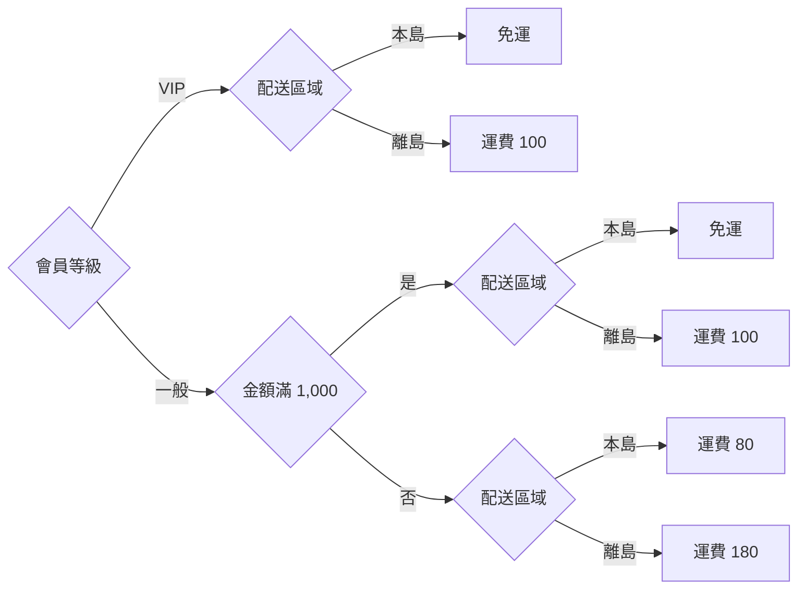

> 決策樹是處理規格的表達方式，不是 DFD。它有判斷與分支，正好是 DFD 刻意不畫的內容（DFD-CON-001）。

- **如何 review**：計算條件組合總數（各條件值數相乘），確認規則覆蓋的組合數相等；找出「不論」(`-`) 的規則，檢查它是否與其他規則重疊。
- **如何驗證**：`python check_decision_table.py 表.yaml` 窮舉所有組合，列出缺少的組合與衝突的規則；決策表同時可以直接轉成參數化測試的測試資料。

## 6. 繪製方法

### 6.1 需求蒐集與資料流識別

DFD 的素材來自需求蒐集。不同方法找到的是不同元素：

| 方法 | 找到什麼 | 要問或要看的內容 |
| --- | --- | --- |
| 訪談 | 外部實體、業務事件、例外情況 | 「誰會給你資料？你處理完交給誰？什麼情況下會發生？出錯時怎麼辦？」 |
| 文件分析 | 資料流、資料字典 | 表單、報表、畫面、介面規格、現有系統的資料表與檔案格式 |
| 觀察 | 實際的資料流與非正式的資料儲存 | 抄寫在筆記本、Excel、即時通訊群組中的資料（常是被遺漏的資料儲存） |
| 系統日誌與介面清單 | 實體 DFD 的資料流 | API 閘道日誌、排程清單、檔案傳輸紀錄 |
| 工作坊 | 跨部門的資料交接 | 讓相關部門在同一面牆上貼出「我收到什麼、我送出什麼」 |

> 本手冊不重複訪談技巧本身。需求訪談的準備、提問與紀錄方法，請參考本站《客戶需求訪談與分析技巧》；系統分析文件的整體結構，請參考《系統分析指引》。

### 6.2 事件分割法

**事件分割法（event partitioning）**由 McMenamin & Palmer 提出、Yourdon 推廣，是建立 Level 0 圖最可靠的方法。核心觀念是：系統存在的目的，就是回應外界發生的事件。

| 事件類型 | 說明 | 範例 | 在 DFD 上的樣子 |
| --- | --- | --- | --- |
| 外部事件（流導向） | 外部實體送來資料 | 客戶下單、物流業者回報配送狀態 | 外部實體 → 處理程序的資料流（刺激） |
| 時間事件 | 到了某個時間點 | 每日 10:00 批次請款、每月 1 日產生月報 | 沒有輸入資料流；處理規格寫明觸發時間 |
| 控制事件 | 外部的狀態改變 | 感測器溫度超過門檻 | 即時系統延伸的控制流（第 7.4 節） |

步驟：

1. 列出**事件清單**：每個事件寫出名稱（主詞＋動詞＋受詞）、類型、刺激資料流、預期回應。
2. 每個事件對應一個處理程序，名稱描述「對事件的回應」。
3. 畫出每個處理程序需要讀寫的資料儲存，資料儲存把不同事件的處理程序連起來。
4. 合併過於細碎、共用相同資料的處理程序，讓 Level 0 圖控制在 7±2 個處理程序。

#### DFD-MTH-001 Level 0 圖以事件清單推導，事件清單與 Context 圖的邊界資料流必須一一對應

- **等級**：建議
- **說明**：依部門或功能名稱切分處理程序，容易漏掉跨部門的事件與時間事件。事件清單把「系統要回應什麼」列成可核對的清單：Context 圖的每條進出資料流都屬於某個事件，每個事件都有處理程序負責。
- **❌ 反例**：事件清單漏了「物流業者回報配送狀態」，而且宣稱「客戶下單」會回應「出貨通知」，但 1.0 並沒有輸出這條流。

```yaml
# dfd-model: mth001-bad
# 預期：FAIL CHK-17
diagrams:
  - id: context
    processes: {"0": 線上購物系統}
    entities: {E1: 客戶, E3: 物流業者}
    flows:
      - {from: E1, to: "0", data: 訂單資料}
      - {from: "0", to: E1, data: 訂單回覆}
      - {from: "0", to: E3, data: 出貨指示}
      - {from: E3, to: "0", data: 配送狀態}
      - {from: "0", to: E1, data: 出貨通知}
  - id: "0"
    explodes: "0"
    processes: {"1.0": 接收訂單, "3.0": 安排出貨}
    entities: {E1: 客戶, E3: 物流業者}
    stores: {D1: 訂單}
    flows:
      - {from: E1, to: "1.0", data: 訂單資料}
      - {from: "1.0", to: E1, data: 訂單回覆}
      - {from: "1.0", to: D1, data: 新訂單}
      - {from: D1, to: "3.0", data: 已付款訂單}
      - {from: "3.0", to: E3, data: 出貨指示}
      - {from: E3, to: "3.0", data: 配送狀態}
      - {from: "3.0", to: D1, data: 出貨狀態}
      - {from: "3.0", to: E1, data: 出貨通知}
events:
  - {name: 客戶下單, type: 外部, stimulus: 訂單資料, process: "1.0", response: [訂單回覆, 出貨通知]}
  - {name: 每小時安排出貨, type: 時間, process: "3.0", response: [出貨指示]}
```

```text
$ python check_dfd.py mth001-bad.yaml
[FAIL] CHK-17 事件清單與資料流不一致｜事件「客戶下單」的回應「出貨通知」不是 1.0 的輸出
[FAIL] CHK-17 事件清單與資料流不一致｜Context 圖的邊界資料流「配送狀態」沒有對應的事件
（結束碼 1）
```

- **✅ 正例**：`shop` 模型的完整事件清單。

| 事件 | 類型 | 刺激 | 處理程序 | 回應 |
| --- | --- | --- | --- | --- |
| 客戶下單 | 外部 | 訂單資料 | 1.0 接收訂單 | 訂單回覆 |
| 每日 10:00 批次請款 | 時間 | — | 2.0 處理付款 | 請款要求 |
| 金流服務商回覆請款結果 | 外部 | 請款結果 | 2.0 處理付款 | （更新 D1） |
| 每小時安排出貨 | 時間 | — | 3.0 安排出貨 | 出貨指示 |
| 物流業者回報配送狀態 | 外部 | 配送狀態 | 3.0 安排出貨 | 出貨通知 |

```yaml
# dfd-model: mth001-good
# 預期：PASS
diagrams:
  - id: context
    processes: {"0": 線上購物系統}
    entities: {E1: 客戶, E2: 金流服務商, E3: 物流業者}
    flows:
      - {from: E1, to: "0", data: 訂單資料}
      - {from: "0", to: E1, data: 訂單回覆}
      - {from: "0", to: E2, data: 請款要求}
      - {from: E2, to: "0", data: 請款結果}
      - {from: "0", to: E3, data: 出貨指示}
      - {from: E3, to: "0", data: 配送狀態}
      - {from: "0", to: E1, data: 出貨通知}
  - id: "0"
    explodes: "0"
    processes: {"1.0": 接收訂單, "2.0": 處理付款, "3.0": 安排出貨}
    entities: {E1: 客戶, E2: 金流服務商, E3: 物流業者}
    stores: {D1: 訂單}
    flows:
      - {from: E1, to: "1.0", data: 訂單資料}
      - {from: "1.0", to: E1, data: 訂單回覆}
      - {from: "1.0", to: D1, data: 新訂單}
      - {from: D1, to: "2.0", data: 待付款訂單}
      - {from: "2.0", to: E2, data: 請款要求}
      - {from: E2, to: "2.0", data: 請款結果}
      - {from: "2.0", to: D1, data: 付款狀態}
      - {from: D1, to: "3.0", data: 已付款訂單}
      - {from: "3.0", to: E3, data: 出貨指示}
      - {from: E3, to: "3.0", data: 配送狀態}
      - {from: "3.0", to: D1, data: 出貨狀態}
      - {from: "3.0", to: E1, data: 出貨通知}
events:
  - {name: 客戶下單, type: 外部, stimulus: 訂單資料, process: "1.0", response: [訂單回覆]}
  - {name: 每日 10:00 批次請款, type: 時間, process: "2.0", response: [請款要求]}
  - {name: 金流服務商回覆請款結果, type: 外部, stimulus: 請款結果, process: "2.0", response: []}
  - {name: 每小時安排出貨, type: 時間, process: "3.0", response: [出貨指示]}
  - {name: 物流業者回報配送狀態, type: 外部, stimulus: 配送狀態, process: "3.0", response: [出貨通知]}
```

- **如何 review**：拿事件清單對照 Context 圖：每條邊界資料流都在清單中出現一次以上；每個時間事件都在處理規格寫明觸發時間；沒有「無刺激也無時間」的事件。
- **如何驗證**：把事件清單寫進模型的 `events` 區段，`check_dfd.py` 的 CHK-17 會檢查刺激與回應是否為該處理程序的輸入輸出，以及 Context 圖每條邊界流是否都屬於某個事件。

### 6.3 由外而內的八步驟繪製流程

| 步驟 | 工作 | 產出 | 完成條件 |
| --- | --- | --- | --- |
| 1 | 寫出圖的目的與範圍 | 標題區塊（DFD-CON-003） | 業務負責人同意範圍 |
| 2 | 列出外部實體 | 外部實體清單 | 每個實體都通過「能不能改變它」的判斷（第 3.1 節） |
| 3 | 列出事件清單 | 事件清單（第 6.2 節） | 每個事件有類型、刺激與回應 |
| 4 | 畫 Context 圖 | Context 圖 + 資料流初稿 | CHK-03、CHK-10 通過；事件與邊界流一一對應 |
| 5 | 畫 Level 0 圖 | 每個事件一個處理程序，加上資料儲存 | CHK-12 平衡；處理程序 ≤ 9 個 |
| 6 | 寫資料字典 | 每條流與每個儲存的定義 | `check_dict.py` 通過 |
| 7 | 展開複雜的處理程序 | Level 1、Level 2 圖 | 每張子圖平衡；分解到功能基元 |
| 8 | 寫處理規格並走查 | 結構化英文、決策表；走查紀錄 | CHK-16 通過；業務代表簽認（DFD-MTH-003） |

> - 步驟不是一次走完。走查中發現新的事件，就回到步驟 3。每一輪都重新執行全部檢查。
> - 第 15 章的每個案例都依照這八個步驟呈現。

### 6.4 從表單、報表與介面推導資料流

現有的表單、報表、畫面與介面規格，是資料流最可靠的來源，也是最常被遺漏的來源。

| 文件 | 對應的 DFD 元素 | 範例 |
| --- | --- | --- |
| 輸入表單、申請畫面 | 外部實體 → 系統的資料流 | 「請假申請單」→ 資料流「請假申請」 |
| 輸出報表、通知信 | 系統 → 外部實體的資料流 | 「月營收報表」→ 資料流「月營收報表」 |
| 系統介面規格（API、檔案） | 系統與外部系統之間的資料流 | 「每日匯出 ERP 傳票檔」→ 資料流「會計傳票」 |
| 主檔維護畫面 | 資料儲存＋維護它的處理程序 | 「商品主檔維護」→ D3 商品＋處理程序「維護商品資料」 |
| 表單上的欄位 | 資料字典的資料元素 | 「請假起日」「假別」 |

#### DFD-MTH-002 每份輸入表單、輸出報表與外部介面，都必須對應到 Context 圖的一條資料流

- **等級**：必須
- **說明**：使用者每天實際使用的表單與報表，就是系統的邊界。若某份報表在 Context 圖找不到對應的流，代表範圍漏了它，或它其實不屬於本系統，兩者都必須在範圍協議中說清楚。
- **❌ 反例**：文件盤點列出 4 份文件，Context 圖只畫了 3 條流。

```text
文件盤點：請假申請單、請假核決通知、每月出勤報表、薪資系統匯出檔
Context 圖資料流：請假申請、核決結果、出勤報表
→「薪資系統匯出檔」沒有對應的資料流
```

- **✅ 正例**：建立「文件盤點表」，每份文件對應一條資料流與一個事件。

| 文件 | 方向 | 資料流 | 外部實體 | 事件 |
| --- | --- | --- | --- | --- |
| 請假申請單（畫面） | 輸入 | 請假申請 | 員工 | 員工提出請假 |
| 請假核決通知（Email） | 輸出 | 核決結果 | 員工 | 主管核決請假 |
| 每月出勤報表（PDF） | 輸出 | 出勤報表 | 人資部 | 每月 1 日產生報表 |
| 薪資系統匯出檔（CSV） | 輸出 | 請假扣薪資料 | 薪資系統 | 每月 25 日匯出 |

- **如何 review**：拿文件盤點表逐列在 Context 圖上找到對應的資料流；再反過來確認 Context 圖每條流都有實際的文件、畫面或介面。
- **如何驗證**：把文件盤點表的「資料流」欄位寫入事件清單的 `stimulus`／`response`，由 CHK-17 確認雙向對應。

### 6.5 常見錯誤型錄

下表整理審查時最常見的錯誤。前兩欄是錯誤名稱與判斷方法，後兩欄是對應的指引與工具檢查，審查意見可以直接引用。

| 錯誤 | 判斷方法 | 指引 | 工具 |
| --- | --- | --- | --- |
| 黑洞（black hole） | 處理程序只有輸入、沒有輸出 | DFD-QA-001 | CHK-06 |
| 奇蹟（miracle） | 處理程序只有輸出、沒有輸入 | DFD-QA-001 | CHK-07 |
| 灰洞（gray hole） | 輸出的資料無法由輸入推導 | DFD-QA-001 | CHK-08 |
| 外部實體直連 | 兩個外部實體之間有流 | DFD-NOT-004 | CHK-03 |
| 外部實體讀寫儲存 | 實體與資料儲存直接相連 | DFD-NOT-005 | CHK-04 |
| 儲存直連 | 兩個資料儲存之間有流 | DFD-NOT-006 | CHK-05 |
| 控制流當資料流 | 「成功」「下一步」等名稱 | DFD-CON-001 | CHK-15 |
| 實物當資料流 | 「現金」「商品」 | DFD-CON-002 | 字典審查 |
| 不平衡 | 子圖淨輸入輸出與父處理程序不同 | DFD-LVL-004 | CHK-12 |
| 編號錯亂 | 子圖編號不以父編號為前綴 | DFD-LVL-003 | CHK-11 |
| Context 圖畫了儲存 | — | DFD-LVL-002 | CHK-10 |
| 未定義的流 | 圖上的名稱不在資料字典 | DFD-DIC-001 | DCT-01 |
| 只寫不讀的儲存 | 資料存了卻沒有人使用 | DFD-QA-002 | CHK-14 |
| 處理程序過多 | 一張圖超過 9 個 | DFD-NOT-008 | `--stats` |
| 層次混用 | 同一張圖混有「客戶管理」與「檢查密碼格式」 | DFD-QA-003 | 審查 |
| 邏輯實體混用 | 邏輯圖上出現 API、資料表或主機名稱 | DFD-MTH-004 | 審查 |

### 6.6 走查與確認

DFD 的正確性最終要由業務人員確認。**走查（walkthrough）**的做法是：由分析師沿著一條資料流，從外部實體開始「講故事」，一路說到資料被儲存或送出，業務代表隨時打斷修正。

| 角色 | 職責 |
| --- | --- |
| 主講（分析師） | 沿著事件清單逐一走過每條資料流 |
| 業務代表 | 確認每條資料流的名稱、內容與例外情況 |
| 記錄 | 記下每個問題與對應的指引編號 |
| 審查者（另一位分析師或架構師） | 以第 17 章檢查清單與工具檢查結果把關 |

#### DFD-MTH-003 每條跨越系統邊界的資料流都要經業務代表走查確認，並留下紀錄

- **等級**：建議
- **說明**：圖畫得再工整，若資料流的內容與業務實況不符，後續的設計、測試與個資盤點都會建立在錯誤的基礎上。走查紀錄也讓日後的變更有依據：「這條流是哪一天、誰確認的？」
- **❌ 反例**：

```text
審查會議紀錄：DFD 已說明，與會者無意見。
```

- **✅ 正例**：

| 資料流 | 確認人 | 日期 | 結果 | 問題與處理 |
| --- | --- | --- | --- | --- |
| 訂單資料 | 電商營運 林組長 | 2026-10-05 | 修改 | 需加入「發票載具」；已更新資料字典 v1.4 |
| 出貨指示 | 物流窗口 陳專員 | 2026-10-05 | 確認 | — |
| 配送狀態 | 物流窗口 陳專員 | 2026-10-05 | 修改 | 物流業者會回傳「退回原因」；新增元素 |

- **如何 review**：Context 圖的每條資料流在走查紀錄中都有一列，且狀態為「確認」或已處理的「修改」。
- **如何驗證**：以 Context 圖的資料流清單比對走查紀錄的「資料流」欄位（可匯出模型中 `id: context` 的所有 `data` 後做差集），差集應為空。

## 7. 邏輯與實體 DFD、現況與未來、現代架構

### 7.1 邏輯 DFD 與實體 DFD

同一個系統可以畫兩種 DFD，它們回答不同的問題：

| 比較項目 | 邏輯 DFD（logical） | 實體 DFD（physical） |
| --- | --- | --- |
| 回答的問題 | 業務上需要哪些資料、做哪些轉換？ | 實際由哪個元件、用什麼技術完成？ |
| 處理程序 | 業務功能（「計算訂單金額」） | 服務、程式、批次、人工作業（「order-service：POST /orders」） |
| 資料儲存 | 業務資料（「訂單」） | 資料表、主題、檔案、試算表（「orders 表」「orders.v1 主題」） |
| 資料流 | 業務資料（「訂單資料」） | 訊息、檔案、API 呼叫，可加協定（「HTTPS JSON」） |
| 外部實體 | 業務角色、外部組織 | 實際的系統與裝置 |
| 會隨技術改變嗎？ | 不會 | 會 |
| 主要讀者 | 業務、需求審查、測試設計 | 開發、維運、資安（威脅建模） |

McMenamin & Palmer 把只描述「系統本質」的邏輯模型稱為**基本模型（essential model）**：假設技術完美（無限快、無限大、不會故障），系統仍然必須做的事，才是需求。

#### DFD-MTH-004 每張 DFD 都必須標示為邏輯或實體，邏輯 DFD 不得出現技術名詞

- **等級**：必須
- **說明**：混用時，業務人員看不懂圖上的 API 與資料表，開發人員又把業務名稱當成元件名稱，兩邊都無法審查。更嚴重的是，技術名詞會把「目前的實作方式」偽裝成「需求」，阻礙之後的設計選擇。
- **❌ 反例**：標示為邏輯 DFD，卻出現 REST API、Kafka 主題與資料表。

```yaml
# dfd-model: mth004-bad
# 預期：PASS
system: 線上購物
purpose: 確認訂單與出貨的資料介面
view: logical
state: to-be
processes: {"1.0": 接收訂單 REST API, "3.0": 安排出貨}
entities: {E1: 客戶, E3: 物流業者}
stores: {D1: orders 資料表, D5: Kafka topic order-paid}
flows:
  - {from: E1, to: "1.0", data: 訂單 JSON}
  - {from: "1.0", to: D1, data: 新訂單}
  - {from: "1.0", to: D5, data: 已付款事件}
  - {from: D5, to: "3.0", data: 已付款事件}
  - {from: "3.0", to: E3, data: 出貨指示}
  - {from: "1.0", to: E1, data: 訂單回覆}
```

這個模型的結構沒有錯（`check_dfd.py` 通過），問題在文字。`lint_models.py` 的結果：

```text
$ python lint_models.py mth004-bad.yaml
[WARN] LNT-02 邏輯 DFD 出現技術名詞｜圖 0：接收訂單 REST API
[WARN] LNT-02 邏輯 DFD 出現技術名詞｜圖 0：orders 資料表
[WARN] LNT-02 邏輯 DFD 出現技術名詞｜圖 0：Kafka topic order-paid
[WARN] LNT-02 邏輯 DFD 出現技術名詞｜圖 0：訂單 JSON
（結束碼 1）
```

- **✅ 正例**：邏輯 DFD 只用業務名稱；技術細節放在對應的實體 DFD，並以對照表連結兩者。

```yaml
# dfd-model: mth004-good-logical
# 預期：PASS
system: 線上購物
purpose: 確認訂單與出貨的資料介面
view: logical
state: to-be
processes: {"1.0": 接收訂單, "3.0": 安排出貨}
entities: {E1: 客戶, E3: 物流業者}
stores: {D1: 訂單, D5: 已付款訂單通知}
flows:
  - {from: E1, to: "1.0", data: 訂單資料}
  - {from: "1.0", to: D1, data: 新訂單}
  - {from: "1.0", to: D5, data: 付款完成通知}
  - {from: D5, to: "3.0", data: 付款完成通知}
  - {from: "3.0", to: E3, data: 出貨指示}
  - {from: "1.0", to: E1, data: 訂單回覆}
```

```text
$ python lint_models.py mth004-good-logical.yaml
[PASS] mth004-good-logical.yaml
（結束碼 0）
```

| 邏輯元素 | 實體元素（2026-10 架構） | 備註 |
| --- | --- | --- |
| 1.0 接收訂單 | `order-service`：`POST /api/v1/orders` | Spring Boot 服務 |
| 3.0 安排出貨 | `shipping-worker`（消費者群組 `shipping`） | |
| D1 訂單 | PostgreSQL `orders`、`order_items` 兩張表 | 一個邏輯儲存可對應多張表 |
| D5 已付款訂單通知 | Kafka 主題 `order-paid.v1`，保留 7 天 | 見 DFD-MTH-005 |
| 訂單資料 | HTTPS + JSON（`OrderRequest` schema v3） | |

- **如何 review**：先看標題區塊的「邏輯／實體」標示，再掃描所有名稱：邏輯圖出現協定、產品、資料表、主機名稱就退回。
- **如何驗證**：模型最上層必須有 `view: logical` 或 `view: physical`；`lint_models.py` 的 LNT-01 檢查標示是否存在，LNT-02 檢查邏輯圖中的技術名詞。

### 7.2 現況與未來

Yourdon 早期的方法依序建立四種模型：現況實體 → 現況邏輯 → 未來邏輯 → 未來實體。後來 Yourdon 自己在《Modern Structured Analysis》中提醒：花太多時間描繪現況實體模型，是結構化分析專案最常見的浪費。實務建議如下：

| 模型 | 何時需要 | 詳細程度 |
| --- | --- | --- |
| 現況實體（As-Is physical） | 系統汰換、資料移轉、盤點介面 | 只畫到能列出所有介面與資料儲存為止 |
| 現況邏輯（As-Is logical） | 想找出「現在真正在做什麼」，去除技術包袱 | Context 圖 + Level 0 圖 |
| 未來邏輯（To-Be logical） | **一定需要**，這就是需求 | 到功能基元並有處理規格 |
| 未來實體（To-Be physical） | 設計階段、威脅建模 | 到可部署元件與介面 |

#### DFD-MTH-005 訊息佇列與事件主題依用途畫成資料儲存或資料流，不畫成處理程序

- **等級**：建議
- **說明**：Kafka、RabbitMQ 等中介軟體只負責傳遞資料，不轉換資料。畫成處理程序會產生「輸入等於輸出」的假處理程序，平衡與灰洞檢查都失去意義。在邏輯 DFD 中：資料會被保留、之後由其他處理程序讀取的，畫成資料儲存（例如「已付款訂單通知」）；只是同步傳遞的，就是一條資料流。在實體 DFD 中可以標示主題名稱。
- **❌ 反例**：把 Kafka 畫成處理程序 9.0，它的輸入與輸出名稱完全相同。

```yaml
# dfd-model: mth005-bad
# 預期：PASS
system: 線上購物
purpose: 示範中介軟體誤畫成處理程序
view: physical
state: to-be
processes: {"1.0": 接收訂單, "9.0": 傳遞訊息, "3.0": 安排出貨}
entities: {E1: 客戶, E3: 物流業者}
flows:
  - {from: E1, to: "1.0", data: 訂單資料}
  - {from: "1.0", to: E1, data: 訂單回覆}
  - {from: "1.0", to: "9.0", data: 付款完成通知}
  - {from: "9.0", to: "3.0", data: 付款完成通知}
  - {from: "3.0", to: E3, data: 出貨指示}
```

```text
$ python lint_models.py mth005-bad.yaml
[WARN] LNT-04 處理程序只轉送資料而沒有轉換（輸入與輸出名稱相同）｜圖 0：9.0 傳遞訊息（付款完成通知）
（結束碼 1）
```

- **✅ 正例**：`mth004-good-logical` 模型把它畫成資料儲存「D5 已付款訂單通知」，實體對照表再標出 Kafka 主題。
- **如何 review**：找出輸入與輸出名稱完全相同的處理程序，詢問它做了什麼轉換；若答案是「只是轉送」，改成資料流或資料儲存。
- **如何驗證**：`lint_models.py` 的 LNT-04 列出「只轉送不轉換」的處理程序。

#### DFD-MTH-006 現況與未來分開建模，每個模型都要標示狀態

- **等級**：建議
- **說明**：在同一張圖上同時畫現況與未來（例如用不同顏色標示「新增」），讀者很難判斷哪些是需求、哪些只是現況描述；平衡檢查也會混淆。分開建模，再用差異表說明變更。
- **❌ 反例**：

```text
圖 3-1 訂單系統 Level 0 圖
（藍色：現有；綠色：新增；灰色：將停用）——沒有標示這張圖是現況還是未來
```

- **✅ 正例**：

```text
dfd/order/as-is/level0.yaml   state: as-is
dfd/order/to-be/level0.yaml   state: to-be
dfd/order/CHANGES.md          差異表：新增 4.0 處理退貨；停用 D7 傳真訂單；…
```

- **如何 review**：每個模型檔都標示 `state`；差異表的每一列都能在兩個模型中找到對應元素。
- **如何驗證**：`lint_models.py` 的 LNT-01／LNT-05 檢查 `state` 存在且為 `as-is` 或 `to-be`；差異可用 `git diff` 比較兩個 YAML 模型。

### 7.3 實體 DFD 的寫法

實體 DFD 是威脅建模（第 9 章）與維運文件的基礎。建議在每個元素上加註以下資訊：

| 元素 | 加註內容 | 範例 |
| --- | --- | --- |
| 處理程序 | 可部署單元名稱、執行環境、負責團隊 | `order-service`（Kubernetes，訂單團隊） |
| 資料儲存 | 技術、實際名稱、保存期限、是否加密 | PostgreSQL `orders`，保存 7 年，靜態加密 |
| 資料流 | 協定、格式、驗證方式、同步或非同步 | HTTPS/JSON，OAuth 2.0 Bearer，同步 |
| 外部實體 | 實際系統名稱與介接方式 | 金流服務商 API v2 |
| 信任邊界 | 網段、雲端帳號、組織邊界 | 網際網路／DMZ／內網 |

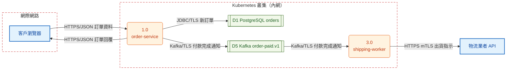

### 7.4 即時系統延伸：控制流與控制處理程序

一般的 DFD 不畫控制訊號（DFD-CON-001）。但嵌入式、工業控制與監控系統的需求，有很大一部分是「什麼狀態下啟用哪個功能」。Ward & Mellor 與 Hatley & Pirbhai 在 1980 年代提出延伸記法：

| 延伸元素 | 記法 | 意義 |
| --- | --- | --- |
| 控制流（事件流） | 虛線箭頭 | 只有發生與否、沒有資料內容的訊號（「門已開啟」） |
| 控制處理程序 | 虛線圓圈 | 依控制流決定啟用或停用哪些資料處理程序，內容以狀態轉換圖描述 |
| 連續資料流 | 雙箭頭 | 隨時存在的數值（溫度讀數） |
| 控制儲存 | 虛線的資料儲存 | 保存狀態（「系統模式」） |


> - 控制處理程序的內部邏輯用狀態機圖描述（UML 狀態機圖或狀態轉換表），不要寫成結構化英文。
> - 一般資訊系統不需要這組延伸；需要時要在文件開頭的記法說明（DFD-NOT-001）中寫明。

### 7.5 在微服務、事件驅動與資料管線中使用 DFD

| 架構 | DFD 的用法 | 注意事項 |
| --- | --- | --- |
| 微服務 | 邏輯 DFD 的 Level 0 處理程序常對應限界上下文（bounded context）；實體 DFD 的處理程序對應服務 | 先畫邏輯圖決定切分，再畫實體圖；不要從現有服務反推需求 |
| 事件驅動 | 事件主題在邏輯圖中是資料儲存（被保留、被多個消費者讀取）；事件名稱就是資料流名稱 | 事件內容寫進資料字典；同名事件不同版本要不同名（`付款完成通知 v2`） |
| 事件溯源（Event Sourcing） | 「事件儲存」是一個資料儲存；投影（projection）是讀取事件、寫入讀取模型的處理程序 | 讀取模型是另一個資料儲存，不要與事件儲存合併 |
| CQRS | 寫入端與查詢端是不同的處理程序，透過資料儲存連接 | 查詢端只讀不寫的儲存要列入 `readonly_stores` 或由投影處理程序寫入 |
| 資料管線、ETL | 每個轉換步驟是處理程序，暫存區是資料儲存 | 細到欄位層級時改用資料血緣工具；DFD 留在資料集層級 |
| 第三方 SaaS | SaaS 是外部實體；本系統送給它的資料是邊界資料流 | 這些流是個資盤點與資安審查的重點（第 9、10 章） |

## 8. 品質審查與自動驗證

### 8.1 DFD 品質的三個層面

| 層面 | 問題 | 怎麼檢查 | 本手冊工具 |
| --- | --- | --- | --- |
| 結構正確 | 元素之間的連接是否合法？父子圖是否平衡？ | 規則明確，可以完全自動化 | `check_dfd.py`（CHK-01～17） |
| 定義完整 | 每條流、每個儲存是否都有定義？決策邏輯是否完整？ | 大部分可自動化 | `check_dict.py`、`check_decision_table.py` |
| 語意正確 | 圖是否反映業務實況？層次是否一致？名稱是否恰當？ | 需要人工判斷，工具只能輔助 | `lint_models.py`、走查、第 17 章檢查清單 |

原則是：**能交給工具的，就不要靠人眼**。人工審查的時間應該花在工具無法判斷的語意問題上。

### 8.2 守恆檢查：黑洞、奇蹟與灰洞

處理程序必須「有進有出，且出的能由進的推導」。違反時有三種典型錯誤：

| 錯誤 | 定義 | 代表的需求問題 |
| --- | --- | --- |
| 黑洞（black hole） | 只有輸入，沒有輸出 | 資料進來後不知道去哪裡；漏了輸出或漏了寫入的資料儲存 |
| 奇蹟（miracle） | 只有輸出，沒有輸入 | 資料憑空產生；漏了輸入或讀取的資料儲存 |
| 灰洞（gray hole） | 有輸入也有輸出，但輸出的部分欄位無法由輸入取得 | 漏了某個資料來源（常是主檔或參數表） |

灰洞需要知道欄位才能判斷。在模型的資料流上加 `fields`（欄位清單），並用 `derives` 宣告處理程序自行產生的欄位（計算結果、系統時間、序號），`check_dfd.py` 就能檢查。

#### DFD-QA-001 每個處理程序都必須有輸入與輸出，且輸出可由輸入、讀取的資料儲存或宣告的推導取得

- **等級**：必須
- **說明**：黑洞、奇蹟、灰洞都代表需求有缺口。它們在圖上不一定顯眼，尤其是灰洞：「報價」看起來就應該從「計算報價」出來，但若沒有人提供單價，程式寫不出來。
- **❌ 反例 1**：2.0 是黑洞，3.0 是奇蹟。

```yaml
# dfd-model: qa001-bad-holes
# 預期：FAIL CHK-06, CHK-07
processes: {"1.0": 接收申請, "2.0": 審核申請, "3.0": 寄發通知}
entities: {E1: 申請人}
stores: {D1: 申請案件}
flows:
  - {from: E1, to: "1.0", data: 申請資料}
  - {from: "1.0", to: D1, data: 新申請案件}
  - {from: D1, to: "2.0", data: 待審案件}
  - {from: "3.0", to: E1, data: 審核結果通知}
```

```text
$ python check_dfd.py qa001-bad-holes.yaml
[FAIL] CHK-06 黑洞：處理程序只有輸入沒有輸出｜圖 0：2.0 審核申請
[FAIL] CHK-07 奇蹟：處理程序只有輸出沒有輸入｜圖 0：3.0 寄發通知
（結束碼 1）
```

- **❌ 反例 2**：灰洞。報價中的「單價」「小計」沒有來源。

```yaml
# dfd-model: qa001-bad-gray
# 預期：FAIL CHK-08
processes: {"1.0": 計算報價}
entities: {E1: 客戶}
flows:
  - {from: E1, to: "1.0", data: 詢價, fields: [商品編號, 數量]}
  - {from: "1.0", to: E1, data: 報價, fields: [商品編號, 數量, 單價, 小計]}
```

```text
$ python check_dfd.py qa001-bad-gray.yaml
[FAIL] CHK-08 灰洞：輸出欄位無法由輸入欄位或 derives 取得｜圖 0：1.0 輸出「報價」的 單價, 小計 沒有來源
（結束碼 1）
```

- **✅ 正例**：讀取「D3 商品」取得單價，並宣告「小計」由 1.0 計算產生。

```yaml
# dfd-model: qa001-good
# 預期：PASS
processes: {"1.0": 計算報價}
entities: {E1: 客戶}
stores: {D3: 商品}
derives:
  "1.0": [小計]
flows:
  - {from: E1, to: "1.0", data: 詢價, fields: [商品編號, 數量]}
  - {from: D3, to: "1.0", data: 商品價格, fields: [商品編號, 單價]}
  - {from: "1.0", to: E1, data: 報價, fields: [商品編號, 數量, 單價, 小計]}
```

```mermaid
flowchart LR
    n1["客戶"]:::ent
    n2("1.0<br/>計算報價"):::proc
    n3[["D3 商品"]]:::store
    n1 -->|詢價| n2
    n3 -->|商品價格| n2
    n2 -->|報價| n1
    classDef ent fill:#e3f2fd,stroke:#1565c0,stroke-width:2px,color:#0d47a1
    classDef proc fill:#fff3e0,stroke:#e65100,color:#bf360c
    classDef store fill:#f1f8e9,stroke:#33691e,color:#1b5e20
```

- **如何 review**：對每個處理程序問三個問題：「有東西進來嗎？有東西出去嗎？出去的每個欄位，是從哪條進來的流或哪個儲存拿到的，還是自己算的？」
- **如何驗證**：`check_dfd.py` 的 CHK-06（黑洞）、CHK-07（奇蹟）；在關鍵處理程序的資料流上標註 `fields` 後，CHK-08 檢查灰洞。

### 8.3 自動驗證工具 check_dfd.py

`check_dfd.py` 是本手冊為了「讓 DFD 可以被客觀驗證」而撰寫的工具，只依賴 Python 3.10 以上與 PyYAML。它讀取第 4 章介紹的 YAML 模型，執行下表的檢查，並能產生 Mermaid 圖。

| 代碼 | 檢查內容 | 對應指引 |
| --- | --- | --- |
| CHK-01 | 資料流未命名（兩端都不是資料儲存） | DFD-NOT-007 |
| CHK-02 | 資料流引用未定義的元素 | — |
| CHK-03 | 外部實體直接連到外部實體 | DFD-NOT-004 |
| CHK-04 | 外部實體直接連到資料儲存 | DFD-NOT-005 |
| CHK-05 | 資料儲存直接連到資料儲存 | DFD-NOT-006 |
| CHK-06 | 黑洞 | DFD-QA-001 |
| CHK-07 | 奇蹟 | DFD-QA-001 |
| CHK-08 | 灰洞（需 `fields`） | DFD-QA-001 |
| CHK-09 | 孤立元素 | DFD-QA-001 |
| CHK-10 | Context 圖不只一個處理程序或含資料儲存 | DFD-LVL-002 |
| CHK-11 | 子圖編號與父處理程序不一致 | DFD-LVL-003 |
| CHK-12 | 父子圖不平衡（依 `dictionary` 展開後比較） | DFD-LVL-004、DFD-LVL-005 |
| CHK-13 | 元素編號重複 | DFD-NOT-003 |
| CHK-14 | 資料儲存只寫不讀或只讀不寫（兩張圖以上的模型） | DFD-QA-002 |
| CHK-15 | 資料流名稱是控制訊號 | DFD-CON-001 |
| CHK-16 | 功能基元缺少處理規格（需 `specs`） | DFD-LVL-007 |
| CHK-17 | 事件清單與資料流不一致（需 `events`） | DFD-MTH-001、DFD-MTH-002 |

使用方式：

```text
python check_dfd.py dfd/order/*.yaml             檢查模型，有違規時結束碼為 1（可用於 CI）
python check_dfd.py --mermaid dfd/order/model.yaml 1.0   產生「展開 1.0」那張圖的 Mermaid 原始碼
python check_dfd.py --stats dfd/order/model.yaml        列出每張圖的元素數量與可下移的資料儲存
```

完整原始碼（審查者可以逐行確認每條規則的判斷方式）：

```python
"""check_dfd.py — 檢查以 YAML 撰寫的 DFD 模型是否符合結構化分析規則。

用法：
    python check_dfd.py model.yaml [...]        檢查模型，違規時結束碼為 1
    python check_dfd.py --mermaid model.yaml [圖id]  由模型產生 Mermaid flowchart
    python check_dfd.py --stats model.yaml      列出每張圖的元素數量
    python check_dfd.py --crud model.yaml       列出功能基元 × 資料儲存的讀寫矩陣
    python check_dfd.py --impact model.yaml X   列出與元素 X（編號或資料流名稱）相關的資料流與子圖

模型格式（單張圖可省略 diagrams，直接把各鍵放在最上層）：
    system: 線上購物
    dictionary:                 # 選填：組合資料流 = 元件清單（供平衡檢查展開）
      訂單回覆: [訂單確認, 訂單錯誤明細]
    diagrams:
      - id: context             # context 圖：只有一個處理程序 0
        processes: {"0": 線上購物系統}
        entities: {E1: 客戶}
        flows:
          - {from: E1, to: "0", data: 訂單資料}
      - id: "0"                 # Level 0 圖：展開 context 圖的處理程序 0
        explodes: "0"
        processes: {"1.0": 接收訂單}
        entities: {E1: 客戶}
        stores: {D1: 訂單}
        flows:
          - {from: E1, to: "1.0", data: 訂單資料}
          - {from: "1.0", to: D1}            # 寫入儲存可省略名稱（整筆記錄）
    readonly_stores: [D9]       # 選填：由其他系統維護、本模型只讀的資料儲存（豁免 CHK-14）
    specs:                      # 選填：有此區段時，每個最底層處理程序都要有處理規格（CHK-16）
      "1.0": 規格文字或檔案路徑
    events:                     # 選填：事件清單，刺激與回應必須是圖上的資料流（CHK-17）
      - {name: 客戶下單, type: 外部, stimulus: 訂單資料, process: "1.0", response: [訂單回覆]}
    boundaries:                 # 選填：信任邊界，只影響 Mermaid 輸出
      TB1: {name: 公司內網, members: ["1.0", D1]}

資料流可加 fields（欄位清單）；圖內可用 derives: {"1.0": [單價]} 宣告處理程序
自行產生或查表取得的欄位，用於偵測「灰洞」（輸出欄位無法由輸入取得）。
"""
import os
import re
import sys

import yaml

CHECKS = {
    "CHK-01": "資料流未命名（兩端都不是資料儲存）",
    "CHK-02": "資料流引用未定義的元素",
    "CHK-03": "外部實體直接連到外部實體",
    "CHK-04": "外部實體直接連到資料儲存",
    "CHK-05": "資料儲存直接連到資料儲存",
    "CHK-06": "黑洞：處理程序只有輸入沒有輸出",
    "CHK-07": "奇蹟：處理程序只有輸出沒有輸入",
    "CHK-08": "灰洞：輸出欄位無法由輸入欄位或 derives 取得",
    "CHK-09": "孤立元素：沒有任何資料流",
    "CHK-10": "context 圖必須只有一個處理程序且不含資料儲存",
    "CHK-11": "子圖處理程序編號與父處理程序不一致",
    "CHK-12": "不平衡：子圖的淨輸入或淨輸出與父處理程序不同",
    "CHK-13": "元素編號重複",
    "CHK-14": "資料儲存在整個模型中只寫不讀或只讀不寫",
    "CHK-15": "資料流名稱是控制訊號而不是資料",
    "CHK-16": "最底層處理程序（功能基元）缺少處理規格",
    "CHK-17": "事件清單與資料流不一致",
}

CONTROL_WORDS = {"是", "否", "成功", "失敗", "通過", "開始", "結束", "完成", "下一步", "繼續",
                 "觸發", "啟動", "停止", "ok", "yes", "no", "true", "false"}
CONTROL_SUFFIX = re.compile(r"(成功|失敗|通過|完成)$")   # 例如「驗證成功」「核決通過」


def load(path):
    with open(path, encoding="utf-8") as f:
        return load_raw(yaml.safe_load(f))


def load_raw(model):
    model = yaml.safe_load(yaml.safe_dump(model, allow_unicode=True))   # 深複製，不改動呼叫者的資料
    if "diagrams" not in model:
        top = {k: model[k] for k in ("system", "dictionary", "boundaries", "readonly_stores", "specs", "events")
               if k in model}
        model = dict(top, diagrams=[model])
    for d in model["diagrams"]:
        d["id"] = str(d.get("id", "0"))
        for kind in ("processes", "entities", "stores"):
            d[kind] = {str(k): v for k, v in (d.get(kind) or {}).items()}
        d["flows"] = d.get("flows") or []
        for fl in d["flows"]:
            fl["from"], fl["to"] = str(fl["from"]), str(fl["to"])
    return model


def kind_of(d, node):
    for kind in ("processes", "entities", "stores"):
        if node in d[kind]:
            return kind
    return None


def flow_name(d, fl):
    """未命名的儲存流沿用儲存名稱（代表整筆記錄）。"""
    if fl.get("data"):
        return fl["data"]
    for end in (fl["from"], fl["to"]):
        if end in d["stores"]:
            return d["stores"][end]
    return ""


def expand(names, dictionary):
    """把組合資料流依資料字典展開成元件，直到不能再展開。"""
    out, todo = set(), list(names)
    while todo:
        n = todo.pop()
        if n in dictionary:
            todo.extend(dictionary[n])
        else:
            out.add(n)
    return out


def child_prefix_ok(parent, child):
    if parent == "0":
        return re.fullmatch(r"\d+(\.0)?", child) is not None
    base = parent[:-2] if parent.endswith(".0") else parent
    return re.fullmatch(re.escape(base) + r"\.\d+", child) is not None


def check_diagram(d, problems):
    tag = f"圖 {d['id']}"
    seen = {}
    for kind in ("processes", "entities", "stores"):
        for k in d[kind]:
            if k in seen:
                problems.append(("CHK-13", f"{tag}：{k} 同時出現在 {seen[k]} 與 {kind}"))
            seen[k] = kind
    ins = {p: [] for p in d["processes"]}
    outs = {p: [] for p in d["processes"]}
    touched = set()
    for fl in d["flows"]:
        a, b = fl["from"], fl["to"]
        ka, kb = kind_of(d, a), kind_of(d, b)
        label = f"{a} → {b}"
        if ka is None or kb is None:
            problems.append(("CHK-02", f"{tag}：{label} 的端點未定義"))
            continue
        touched.update((a, b))
        if not fl.get("data") and "stores" not in (ka, kb):
            problems.append(("CHK-01", f"{tag}：{label}"))
        name = str(fl.get("data", "")).strip().lower()
        if name in CONTROL_WORDS or CONTROL_SUFFIX.search(name):
            problems.append(("CHK-15", f"{tag}：{label}（{fl['data']}）"))
        pair = {ka, kb} if ka != kb else {ka}
        if pair == {"entities"}:
            problems.append(("CHK-03", f"{tag}：{label}（{fl.get('data', '')}）"))
        elif pair == {"entities", "stores"}:
            problems.append(("CHK-04", f"{tag}：{label}（{flow_name(d, fl)}）"))
        elif pair == {"stores"}:
            problems.append(("CHK-05", f"{tag}：{label}"))
        if ka == "processes":
            outs[a].append(fl)
        if kb == "processes":
            ins[b].append(fl)
    for p, name in d["processes"].items():
        if ins[p] and not outs[p]:
            problems.append(("CHK-06", f"{tag}：{p} {name}"))
        if outs[p] and not ins[p]:
            problems.append(("CHK-07", f"{tag}：{p} {name}"))
        in_fields = {f for fl in ins[p] for f in fl.get("fields", [])}
        in_fields |= set(d.get("derives", {}).get(p, []))
        for fl in outs[p]:
            missing = [f for f in fl.get("fields", []) if f not in in_fields]
            if missing and any("fields" in x for x in ins[p]):
                problems.append(("CHK-08", f"{tag}：{p} 輸出「{flow_name(d, fl)}」的 {', '.join(missing)} 沒有來源"))
    for k in seen:
        if k not in touched:
            problems.append(("CHK-09", f"{tag}：{k}"))
    if d["id"] == "context" and (len(d["processes"]) != 1 or d["stores"]):
        problems.append(("CHK-10", f"{tag}：處理程序 {len(d['processes'])} 個、資料儲存 {len(d['stores'])} 個"))


def net_io(d, inside, dictionary):
    """inside 內處理程序與外部（實體、儲存、其他處理程序）之間的淨輸入與淨輸出。"""
    i, o = [], []
    for fl in d["flows"]:
        a_in, b_in = fl["from"] in inside, fl["to"] in inside
        if b_in and not a_in:
            i.append(flow_name(d, fl))
        if a_in and not b_in:
            o.append(flow_name(d, fl))
    return expand(i, dictionary), expand(o, dictionary)


def check_balance(model, problems):
    by_proc = {}
    for d in model["diagrams"]:
        for p in d["processes"]:
            by_proc[p] = d
    dictionary = model.get("dictionary") or {}
    for child in model["diagrams"]:
        parent_proc = child.get("explodes")
        if parent_proc is None:
            continue
        parent_proc = str(parent_proc)
        parent = by_proc.get(parent_proc)
        if parent is None or parent is child:
            problems.append(("CHK-12", f"圖 {child['id']}：找不到被展開的處理程序 {parent_proc}"))
            continue
        for p in child["processes"]:
            if not child_prefix_ok(parent_proc, p):
                problems.append(("CHK-11", f"圖 {child['id']}：{p} 不是 {parent_proc} 的子編號"))
        # 子圖新增的資料儲存屬於被展開處理程序的內部，不算淨輸入輸出
        local = {s for s in child["stores"] if s not in parent["stores"]}
        pi, po = net_io(parent, {parent_proc}, dictionary)
        ci, co = net_io(child, set(child["processes"]) | local, dictionary)
        for label, want, got in (("輸入", pi, ci), ("輸出", po, co)):
            if want != got:
                extra = "、".join(sorted(got - want)) or "無"
                lack = "、".join(sorted(want - got)) or "無"
                problems.append(("CHK-12", f"展開 {parent_proc} 的子圖：{label}多出 {extra}；缺少 {lack}"))


def check_store_usage(model, problems):
    reads, writes, names = set(), set(), {}
    for d in model["diagrams"]:
        names.update(d["stores"])
        for fl in d["flows"]:
            if fl["from"] in d["stores"]:
                reads.add(fl["from"])
            if fl["to"] in d["stores"]:
                writes.add(fl["to"])
    if len(model["diagrams"]) < 2:      # 單張圖常是局部範例，只在完整分層模型檢查
        return
    readonly = {str(s) for s in model.get("readonly_stores") or []}
    for s, name in names.items():
        if s in writes and s not in reads:
            problems.append(("CHK-14", f"{s} {name}：只寫不讀"))
        if s in reads and s not in writes and s not in readonly:
            problems.append(("CHK-14", f"{s} {name}：只讀不寫"))


def check_specs(model, problems):
    """有 specs 區段時，每個沒有被展開的處理程序（功能基元）都要有處理規格。"""
    specs = model.get("specs")
    if specs is None:
        return
    specs = {str(k) for k in specs}
    exploded = {str(d.get("explodes")) for d in model["diagrams"] if d.get("explodes") is not None}
    for d in model["diagrams"]:
        for p, name in d["processes"].items():
            if p not in exploded and p not in specs:
                problems.append(("CHK-16", f"圖 {d['id']}：{p} {name}"))


def check_events(model, problems):
    """有 events 區段時，事件的刺激／回應必須是圖上的資料流；Context 圖的每條邊界流都要屬於某個事件。"""
    events = model.get("events")
    if events is None:
        return
    seen = set()
    for ev in events:
        p = str(ev["process"])
        d = next((x for x in model["diagrams"] if p in x["processes"]), None)
        if d is None:
            problems.append(("CHK-17", f"事件「{ev['name']}」的處理程序 {p} 不存在"))
            continue
        ins = {flow_name(d, f) for f in d["flows"] if f["to"] == p}
        outs = {flow_name(d, f) for f in d["flows"] if f["from"] == p}
        if ev.get("stimulus") and ev["stimulus"] not in ins:
            problems.append(("CHK-17", f"事件「{ev['name']}」的刺激「{ev['stimulus']}」不是 {p} 的輸入"))
        for r in ev.get("response") or []:
            if r not in outs:
                problems.append(("CHK-17", f"事件「{ev['name']}」的回應「{r}」不是 {p} 的輸出"))
        seen.update([ev.get("stimulus")] + list(ev.get("response") or []))
    dictionary = model.get("dictionary") or {}
    covered = expand([s for s in seen if s], dictionary)
    for d in model["diagrams"]:
        if d["id"] != "context":
            continue
        for fl in d["flows"]:
            if fl.get("data") and not expand([fl["data"]], dictionary) <= covered:
                problems.append(("CHK-17", f"Context 圖的邊界資料流「{fl['data']}」沒有對應的事件"))


def check(model):
    problems = []
    for d in model["diagrams"]:
        check_diagram(d, problems)
    check_balance(model, problems)
    check_store_usage(model, problems)
    check_specs(model, problems)
    check_events(model, problems)
    return problems


def to_mermaid(model, diagram_id=None):
    d = next((x for x in model["diagrams"] if diagram_id in (None, x["id"])), None)
    ids = {}

    def nid(k):
        return ids.setdefault(k, f"n{len(ids) + 1}")

    def node(k):
        if k in d["entities"]:
            return f'{nid(k)}["{d["entities"][k]}"]:::ent'
        if k in d["processes"]:
            return f'{nid(k)}("{k}<br/>{d["processes"][k]}"):::proc'
        return f'{nid(k)}[["{k} {d["stores"][k]}"]]:::store'

    lines = ["flowchart LR"]
    members = set()
    for b, spec in (model.get("boundaries") or {}).items():
        inside = [str(m) for m in spec["members"] if kind_of(d, str(m))]
        if not inside:
            continue
        lines.append(f'    subgraph {b}["{spec["name"]}"]')
        lines += [f"        {node(m)}" for m in inside]
        lines.append("    end")
        members.update(inside)
    for kind in ("entities", "processes", "stores"):
        lines += [f"    {node(k)}" for k in d[kind] if k not in members]
    for fl in d["flows"]:
        name = fl.get("data")
        arrow = f"-->|{name}|" if name else "-->"
        lines.append(f"    {nid(fl['from'])} {arrow} {nid(fl['to'])}")
    lines += [
        "    classDef ent fill:#e3f2fd,stroke:#1565c0,stroke-width:2px,color:#0d47a1",
        "    classDef proc fill:#fff3e0,stroke:#e65100,color:#bf360c",
        "    classDef store fill:#f1f8e9,stroke:#33691e,color:#1b5e20",
    ]
    for b in (model.get("boundaries") or {}):
        if any(kind_of(d, str(m)) for m in model["boundaries"][b]["members"]):
            lines.append(f"    style {b} fill:none,stroke:#c62828,stroke-dasharray:6 4")
    return "\n".join(lines)


def stats(model):
    rows = []
    for d in model["diagrams"]:
        rows.append(f"圖 {d['id']}：處理程序 {len(d['processes'])}、外部實體 {len(d['entities'])}、"
                    f"資料儲存 {len(d['stores'])}、資料流 {len(d['flows'])}"
                    + ("（處理程序超過 9 個）" if len(d["processes"]) > 9 else ""))
        users = {s: set() for s in d["stores"]}
        for fl in d["flows"]:
            for s, p in ((fl["from"], fl["to"]), (fl["to"], fl["from"])):
                if s in users and p in d["processes"]:
                    users[s].add(p)
        parent = next((p for p in model["diagrams"] if str(d.get("explodes")) in p["processes"]
                       and p is not d), None)
        inherited = set(parent["stores"]) if parent else set()   # 父圖已有的儲存在子圖只連一個處理程序是正常的
        local = [s for s, ps in users.items() if len(ps) == 1 and s not in inherited]
        if local and d["id"] != "context":
            rows.append(f"  只被一個處理程序使用的資料儲存（可考慮下移到子圖）：{'、'.join(local)}")
    return "\n".join(rows)


def crud(model):
    """功能基元 × 資料儲存的讀寫矩陣（C/U 合併為 W：寫入；R：讀取）。"""
    exploded = {str(d.get("explodes")) for d in model["diagrams"] if d.get("explodes") is not None}
    cells, stores, procs = {}, {}, {}
    for d in model["diagrams"]:
        stores.update(d["stores"])
        for p, name in d["processes"].items():
            if p not in exploded:
                procs[p] = name
        for fl in d["flows"]:
            if fl["from"] in d["stores"] and fl["to"] in d["processes"]:
                cells.setdefault((fl["to"], fl["from"]), set()).add("R")
            if fl["to"] in d["stores"] and fl["from"] in d["processes"]:
                cells.setdefault((fl["from"], fl["to"]), set()).add("W")
    header = "| 處理程序 | " + " | ".join(f"{s} {n}" for s, n in stores.items()) + " |"
    rows = [header, "|" + "---|" * (len(stores) + 1)]
    for p, name in procs.items():
        marks = ["".join(sorted(cells.get((p, s), ""))) or " " for s in stores]
        rows.append(f"| {p} {name} | " + " | ".join(marks) + " |")
    return "\n".join(rows)


def impact(model, target):
    """列出與元素編號或資料流名稱 target 相關的圖、資料流與父子關係。"""
    rows = []
    for d in model["diagrams"]:
        for fl in d["flows"]:
            name = flow_name(d, fl)
            if target in (fl["from"], fl["to"], name):
                rows.append(f"圖 {d['id']}：{fl['from']} → {fl['to']}「{name}」")
        if d.get("explodes") is not None and str(d["explodes"]) == target:
            rows.append(f"圖 {d['id']} 是 {target} 的子圖，子圖內的處理程序都可能受影響：{'、'.join(d['processes'])}")
    return "\n".join(rows) if rows else f"找不到 {target}"


def main(argv):
    if argv and argv[0] == "--stats":
        print(stats(load(argv[1])))
        return 0
    if argv and argv[0] == "--crud":
        print(crud(load(argv[1])))
        return 0
    if argv and argv[0] == "--impact":
        print(impact(load(argv[1]), argv[2]))
        return 0
    if argv and argv[0] == "--mermaid":
        model = load(argv[1])
        print(to_mermaid(model, argv[2] if len(argv) > 2 else None))
        return 0
    failed = 0
    for path in argv:
        problems = check(load(path))
        if problems:
            failed += 1
            for code, msg in problems:
                print(f"[FAIL] {code} {CHECKS[code]}｜{msg}")
        else:
            print(f"[PASS] {os.path.basename(path)}")
    return 1 if failed else 0


if __name__ == "__main__":
    sys.exit(main(sys.argv[1:]))
```

工具本身也要被驗證。`test_check_dfd.py` 為每一個檢查代碼準備一個「剛好違反該規則」的模型，以及兩個應該通過的模型，確認每個檢查都會觸發、且不會誤報：

```python
"""Negative/positive tests for check_dfd.py: each CHK code has a model that must trigger exactly it."""
import os
import sys
import tempfile

import yaml

sys.path.insert(0, os.path.dirname(os.path.abspath(__file__)))
import check_dfd  # noqa: E402

BASE = {
    "processes": {"1.0": "處理"},
    "entities": {"E1": "客戶"},
    "stores": {"D1": "訂單"},
    "flows": [
        {"from": "E1", "to": "1.0", "data": "訂單資料"},
        {"from": "1.0", "to": "D1"},
        {"from": "D1", "to": "1.0"},
        {"from": "1.0", "to": "E1", "data": "訂單確認"},
    ],
}


def variant(**changes):
    m = yaml.safe_load(yaml.safe_dump(BASE, allow_unicode=True))
    for k, v in changes.items():
        if k == "add_flows":
            m["flows"] += v
        elif k == "drop_flows":
            m["flows"] = [f for i, f in enumerate(m["flows"]) if i not in v]
        else:
            m[k] = v
    return m


CASES = {
    "PASS": BASE,
    "CHK-01": variant(processes={"1.0": "處理", "2.0": "出貨"},
                      add_flows=[{"from": "1.0", "to": "2.0"}, {"from": "2.0", "to": "E1", "data": "出貨單"}]),
    "CHK-02": variant(add_flows=[{"from": "1.0", "to": "E9", "data": "x"}]),
    "CHK-03": variant(entities={"E1": "客戶", "E2": "銀行"}, add_flows=[{"from": "E1", "to": "E2", "data": "匯款"}]),
    "CHK-04": variant(add_flows=[{"from": "E1", "to": "D1", "data": "訂單"}]),
    "CHK-05": variant(stores={"D1": "訂單", "D2": "備份"}, add_flows=[{"from": "D1", "to": "D2"}]),
    "CHK-06": variant(drop_flows=[1, 3]),
    "CHK-07": variant(drop_flows=[0, 2]),
    "CHK-08": {
        "processes": {"1.0": "計價"},
        "entities": {"E1": "客戶"},
        "flows": [
            {"from": "E1", "to": "1.0", "data": "訂購", "fields": ["商品編號", "數量"]},
            {"from": "1.0", "to": "E1", "data": "報價", "fields": ["商品編號", "數量", "單價"]},
        ],
    },
    "CHK-09": variant(entities={"E1": "客戶", "E2": "主管"}),
    "CHK-10": dict(variant(), id="context"),
    "CHK-11": {
        "diagrams": [
            {"id": "0", "processes": {"1.0": "訂單"}, "entities": {"E1": "客戶"},
             "flows": [{"from": "E1", "to": "1.0", "data": "a"}, {"from": "1.0", "to": "E1", "data": "b"}]},
            {"id": "1", "explodes": "1.0", "processes": {"2.1": "收單"}, "entities": {"E1": "客戶"},
             "flows": [{"from": "E1", "to": "2.1", "data": "a"}, {"from": "2.1", "to": "E1", "data": "b"}]},
        ]
    },
    "CHK-12": {
        "diagrams": [
            {"id": "0", "processes": {"1.0": "訂單"}, "entities": {"E1": "客戶"},
             "flows": [{"from": "E1", "to": "1.0", "data": "a"}, {"from": "1.0", "to": "E1", "data": "b"}]},
            {"id": "1", "explodes": "1.0", "processes": {"1.1": "收單"}, "entities": {"E1": "客戶"},
             "flows": [{"from": "E1", "to": "1.1", "data": "a"}, {"from": "1.1", "to": "E1", "data": "c"}]},
        ]
    },
    "CHK-13": variant(stores={"D1": "訂單", "E1": "重複"}),
    "CHK-14": {
        "diagrams": [
            {"id": "0", "processes": {"1.0": "記錄"}, "entities": {"E1": "客戶"}, "stores": {"D1": "日誌"},
             "flows": [{"from": "E1", "to": "1.0", "data": "a"}, {"from": "1.0", "to": "D1"},
                       {"from": "1.0", "to": "E1", "data": "b"}]},
            {"id": "1", "explodes": "1.0", "processes": {"1.1": "寫入"}, "entities": {"E1": "客戶"},
             "stores": {"D1": "日誌"},
             "flows": [{"from": "E1", "to": "1.1", "data": "a"}, {"from": "1.1", "to": "D1"},
                       {"from": "1.1", "to": "E1", "data": "b"}]},
        ]
    },
    "CHK-15": variant(add_flows=[{"from": "1.0", "to": "E1", "data": "失敗"}]),
    "CHK-16": dict(variant(), specs={"2.0": "x"}),
    "CHK-17": dict(variant(), events=[{"name": "客戶下單", "process": "1.0", "stimulus": "訂單資料",
                                       "response": ["出貨通知"]}]),
    "PASS-local-store": {
        "diagrams": [
            {"id": "context", "processes": {"0": "系統"}, "entities": {"E1": "客戶"},
             "flows": [{"from": "E1", "to": "0", "data": "a"}, {"from": "0", "to": "E1", "data": "b"}]},
            {"id": "0", "explodes": "0", "processes": {"1.0": "收", "2.0": "回"}, "entities": {"E1": "客戶"},
             "stores": {"D1": "暫存"},
             "flows": [{"from": "E1", "to": "1.0", "data": "a"}, {"from": "1.0", "to": "D1"},
                       {"from": "D1", "to": "2.0"}, {"from": "2.0", "to": "E1", "data": "b"}]},
        ]
    },
}


def main():
    bad = 0
    with tempfile.TemporaryDirectory() as tmp:
        for want, model in CASES.items():
            path = os.path.join(tmp, "m.yaml")
            with open(path, "w", encoding="utf-8") as f:
                yaml.safe_dump(model, f, allow_unicode=True)
            got = sorted({c for c, _ in check_dfd.check(check_dfd.load(path))})
            exp = [] if want.startswith("PASS") else [want]
            status = "ok " if got == exp else "BAD"
            bad += got != exp
            print(f"{status} {want:16} -> {got or 'PASS'}")
            if want == "PASS":
                mm = check_dfd.to_mermaid(check_dfd.load(path))
                assert mm.startswith("flowchart LR") and "classDef store" in mm
    print(f"cases={len(CASES)} bad={bad}")
    sys.exit(1 if bad else 0)


if __name__ == "__main__":
    main()
```

本版實際執行結果：

```text
$ python test_check_dfd.py
ok  PASS             -> PASS
ok  CHK-01           -> ['CHK-01']
ok  CHK-02           -> ['CHK-02']
ok  CHK-03           -> ['CHK-03']
ok  CHK-04           -> ['CHK-04']
ok  CHK-05           -> ['CHK-05']
ok  CHK-06           -> ['CHK-06']
ok  CHK-07           -> ['CHK-07']
ok  CHK-08           -> ['CHK-08']
ok  CHK-09           -> ['CHK-09']
ok  CHK-10           -> ['CHK-10']
ok  CHK-11           -> ['CHK-11']
ok  CHK-12           -> ['CHK-12']
ok  CHK-13           -> ['CHK-13']
ok  CHK-14           -> ['CHK-14']
ok  CHK-15           -> ['CHK-15']
ok  CHK-16           -> ['CHK-16']
ok  CHK-17           -> ['CHK-17']
ok  PASS-local-store -> PASS
cases=19 bad=0
（結束碼 0）
```

### 8.4 其他檢查工具

| 工具 | 用途 | 介紹章節 |
| --- | --- | --- |
| `check_dict.py` | 資料字典涵蓋模型、語法正確、無循環、無多餘定義、元素有型別 | [第 5.2 節](#52-資料字典記法) |
| `check_decision_table.py` | 決策表完整且互斥 | [第 5.5 節](#55-處理規格決策表與決策樹) |
| `lint_models.py` | 中繼資料、邏輯圖的技術名詞、處理程序命名、只轉送不轉換 | [第 7.1 節](#71-邏輯-dfd-與實體-dfd) |
| `pii_trace.py` | 依資料字典的個資標記追蹤個資經過的儲存與對外流，產生個資盤點表 | [第 10.3 節](#103-個資標記與自動追蹤)（原始碼在同節） |
| `ci_check.py` | 在 CI 中一次執行上述所有檢查 | [第 11.4 節](#114-版本控制與-ci) |
| `stride.py` | 由含信任邊界的實體 DFD 產生 STRIDE-per-element 威脅清單，檢查威脅登錄表 | [第 9.3 節](#93-stride-per-element)（原始碼在第 9.4 節） |
| `run_models.py` | 從 Markdown 文件抽出所有模型範例，逐一檢查是否符合 `# 預期：` 的宣告 | [附錄 E](#附錄-e-驗證紀錄) |

`check_dict.py`：

```python
"""check_dict.py — 檢查資料字典是否涵蓋 DFD 模型，且定義本身正確。

用法：python check_dict.py model.yaml dictionary.yaml
      python check_dict.py --er model.yaml dictionary.yaml er-map.yaml   比對資料儲存與 ER 模型的屬性

資料字典格式（YAML）：組合資料寫成 DeMarco 記法字串，資料元素寫成屬性對照表。
    訂單資料: "客戶編號 + 1{訂單明細}50 + (折扣碼)"
    訂單明細: "商品編號 + 數量"
    付款方式: "[信用卡資料 | 轉帳資料]"
    客戶編號: {型別: 字串, 格式: "C + 8 位數字", 個資: 否}

記法：+ 且、[a | b] 擇一、{x} 重複（可寫成 1{x}50 表示 1 到 50 次）、(x) 選填。
"""
import os
import re
import sys

import yaml

sys.path.insert(0, os.path.dirname(os.path.abspath(__file__)))
import check_dfd  # noqa: E402

CHECKS = {
    "DCT-01": "資料流或資料儲存沒有在資料字典定義",
    "DCT-02": "定義中引用了未定義的名稱",
    "DCT-03": "組合定義的語法錯誤",
    "DCT-04": "循環定義",
    "DCT-05": "定義了但沒有被模型或其他定義使用",
    "DCT-06": "資料元素缺少型別",
    "DCT-07": "資料儲存的資料元素在 ER 模型中沒有對應屬性",
    "DCT-08": "ER 模型的屬性沒有出現在資料儲存的資料字典定義",
}

TOKEN = re.compile(r"\s*(\d*\{|\}\d*|[\[\]()|+]|[^\s\[\]{}()|+]+)")


def parse(expr):
    """回傳引用到的名稱；語法錯誤時丟出 ValueError。"""
    tokens = [t for t in TOKEN.findall(expr) if t.strip()]
    pos = 0
    names = []

    def peek():
        return tokens[pos] if pos < len(tokens) else None

    def take(expected=None):
        nonlocal pos
        t = peek()
        if t is None or (expected and not re.fullmatch(expected, t)):
            want = expected.replace("\\", "").replace("d*", "") if expected else "名稱"
            raise ValueError(f"第 {pos + 1} 個符號應為 {want}，實際為 {t or '結尾'}")
        pos += 1
        return t

    def sequence():
        term()
        while peek() == "+":
            take(r"\+")
            term()

    def term():
        t = peek()
        if t is None:
            raise ValueError("運算式不完整")
        if t == "(":
            take(r"\(")
            sequence()
            take(r"\)")
        elif t == "[":
            take(r"\[")
            sequence()
            while peek() == "|":
                take(r"\|")
                sequence()
            take(r"\]")
        elif t.endswith("{"):
            take(r"\d*\{")
            sequence()
            take(r"\}\d*")
        elif re.fullmatch(r"[^\[\]{}()|+]+", t):
            names.append(take())
        else:
            raise ValueError(f"位置 {pos} 出現多餘的符號 {t}")

    sequence()
    if peek() is not None:
        raise ValueError(f"位置 {pos} 出現多餘的符號 {peek()}")
    return names


def check(model, dictionary):
    problems = []
    used_by_model = set()
    for d in model["diagrams"]:
        for fl in d["flows"]:
            used_by_model.add(check_dfd.flow_name(d, fl))
        used_by_model.update(d["stores"].values())
    refs = {}
    for name, value in dictionary.items():
        if isinstance(value, dict):
            if "型別" not in value:
                problems.append(("DCT-06", name))
            refs[name] = []
        else:
            try:
                refs[name] = parse(str(value))
            except ValueError as e:
                problems.append(("DCT-03", f"{name} = {value}（{e}）"))
                refs[name] = []
    for name in sorted(used_by_model):
        if name not in dictionary:
            problems.append(("DCT-01", name))
    for name, rs in refs.items():
        for r in rs:
            if r not in dictionary:
                problems.append(("DCT-02", f"{name} 引用 {r}"))
    state = {}

    def visit(n, path):
        if state.get(n) == 1:
            problems.append(("DCT-04", " → ".join(path + [n])))
            return
        if state.get(n) == 2 or n not in refs:
            return
        state[n] = 1
        for r in refs[n]:
            visit(r, path + [n])
        state[n] = 2
    for n in refs:
        visit(n, [])
    referenced = {r for rs in refs.values() for r in rs}
    for name in dictionary:
        if name not in used_by_model and name not in referenced:
            problems.append(("DCT-05", name))
    return problems


def leaves(name, dictionary, seen=None):
    """展開組合定義，回傳資料元素名稱集合。"""
    seen = set() if seen is None else seen
    if name in seen or name not in dictionary:
        return set()
    seen.add(name)
    value = dictionary[name]
    if isinstance(value, dict):
        return {name}
    out = set()
    for ref in parse(str(value)):
        out |= leaves(ref, dictionary, seen)
    return out


def compare_er(model, dictionary, er_map):
    """er_map：{資料儲存編號: {資料表: [屬性, ...]}}；屬性以資料字典的元素名稱表示。"""
    problems = []
    stores = {}
    for d in model["diagrams"]:
        stores.update(d["stores"])
    for sid, tables in er_map.items():
        name = stores.get(str(sid))
        if name is None:
            continue
        elements = leaves(name, dictionary)
        attrs = {a for cols in tables.values() for a in cols}
        for e in sorted(elements - attrs):
            problems.append(("DCT-07", f"{sid} {name}：{e}"))
        for a in sorted(attrs - elements):
            problems.append(("DCT-08", f"{sid} {name}：{a}"))
    return problems


def main(argv):
    if argv and argv[0] == "--er":
        model = check_dfd.load(argv[1])
        with open(argv[2], encoding="utf-8") as f:
            dictionary = yaml.safe_load(f)
        with open(argv[3], encoding="utf-8") as f:
            er_map = yaml.safe_load(f)
        problems = compare_er(model, dictionary, er_map)
        for code, msg in problems:
            print(f"[FAIL] {code} {CHECKS[code]}｜{msg}")
        if not problems:
            print(f"[PASS] {len(er_map)} 個資料儲存的資料元素與 ER 屬性一致")
        return 1 if problems else 0
    model = check_dfd.load(argv[0])
    with open(argv[1], encoding="utf-8") as f:
        dictionary = yaml.safe_load(f)
    dictionary.pop("模型", None)
    problems = check(model, dictionary)
    for code, msg in problems:
        print(f"[FAIL] {code} {CHECKS[code]}｜{msg}")
    if not problems:
        print(f"[PASS] 定義 {len(dictionary)} 筆，涵蓋模型中所有資料流與資料儲存")
    return 1 if problems else 0


if __name__ == "__main__":
    sys.exit(main(sys.argv[1:]))
```

`check_decision_table.py`：

```python
"""check_decision_table.py — 檢查決策表是否完整（每種條件組合都有規則）且互斥（沒有組合同時符合兩條規則）。

用法：python check_decision_table.py table.yaml

格式：
    conditions:                    # 條件與可能值
      會員等級: [一般, VIP]
      訂單金額滿1000: [是, 否]
    rules:                         # "-" 代表「不論」
      - {when: {會員等級: VIP}, then: 免運}
      - {when: {會員等級: 一般, 訂單金額滿1000: 是}, then: 免運}
      - {when: {會員等級: 一般, 訂單金額滿1000: 否}, then: 運費80}
"""
import itertools
import sys

import yaml


def check(table):
    conds = table["conditions"]
    names = list(conds)
    problems = []
    for i, r in enumerate(table["rules"], 1):
        for k, v in r["when"].items():
            if k not in conds or (v != "-" and v not in conds[k]):
                problems.append(f"規則 {i} 使用未定義的條件或值：{k}={v}")
    for combo in itertools.product(*(conds[n] for n in names)):
        case = dict(zip(names, combo))
        hits = [i for i, r in enumerate(table["rules"], 1)
                if all(v == "-" or case.get(k) == v for k, v in r["when"].items())]
        desc = "、".join(f"{k}={v}" for k, v in case.items())
        if not hits:
            problems.append(f"缺少規則：{desc}")
        elif len(hits) > 1 and len({table["rules"][i - 1]["then"] for i in hits}) > 1:
            problems.append(f"規則 {hits} 衝突：{desc}")
        elif len(hits) > 1:
            problems.append(f"規則 {hits} 重疊（結果相同，建議合併）：{desc}")
    total = 1
    for n in names:
        total *= len(conds[n])
    return problems, total


def main(path):
    with open(path, encoding="utf-8") as f:
        table = yaml.safe_load(f)
    problems, total = check(table)
    for p in problems:
        print("[FAIL] " + p)
    if not problems:
        print(f"[PASS] {len(table['conditions'])} 個條件、{total} 種組合，{len(table['rules'])} 條規則完整且互斥")
    return 1 if problems else 0


if __name__ == "__main__":
    sys.exit(main(sys.argv[1]))
```

`lint_models.py`：

```python
"""lint_models.py — 檢查 DFD 模型的中繼資料與命名慣例（check_dfd.py 檢查結構，本工具檢查文字）。

用法：python lint_models.py model.yaml [...]

模型最上層需要：system、purpose、view（logical／physical）、state（as-is／to-be）。
有 trace 區段時，每個功能基元（以編號）與每條邊界資料流（以名稱）都要有 {需求: ..., 測試: ...}。
ai_generated: true 的模型，每條資料流都要有 source（對應的需求文件句子或訪談紀錄編號）。
"""
import re
import sys

import yaml

import check_dfd

CHECKS = {
    "LNT-01": "缺少中繼資料（system、purpose、view、state）",
    "LNT-02": "邏輯 DFD 出現技術名詞",
    "LNT-03": "處理程序名稱含連接詞或只有空泛詞",
    "LNT-04": "處理程序只轉送資料而沒有轉換（輸入與輸出名稱相同）",
    "LNT-05": "view 或 state 的值不在允許清單",
    "LNT-06": "功能基元或邊界資料流缺少需求與測試追溯（trace）",
    "LNT-07": "AI 產生的模型中，資料流沒有標示需求來源（source）",
}
TECH = re.compile(r"(?i)(?<![A-Za-z])(api|rest|https?|grpc|sql|kafka|rabbitmq|redis|s3|s?ftp|json|xml|csv|"
                  r"lambda|queue|topic|server|db)(?![A-Za-z])|資料表|主機|伺服器|佇列")
CONJ = re.compile(r"[和與及並]|以及")
VAGUE = {"處理", "管理", "作業", "系統", "資料", "處理資料", "管理系統", "資料處理"}


def lint(raw):
    problems = []
    for key in ("system", "purpose", "view", "state"):
        if not raw.get(key):
            problems.append(("LNT-01", key))
    if raw.get("view") and raw["view"] not in ("logical", "physical"):
        problems.append(("LNT-05", f"view={raw['view']}"))
    if raw.get("state") and raw["state"] not in ("as-is", "to-be"):
        problems.append(("LNT-05", f"state={raw['state']}"))
    model = check_dfd.load_raw(raw)
    for d in model["diagrams"]:
        names = list(d["processes"].values()) + list(d["entities"].values()) + list(d["stores"].values())
        names += [f["data"] for f in d["flows"] if f.get("data")]
        if raw.get("view") == "logical":
            for n in names:
                if TECH.search(str(n)):
                    problems.append(("LNT-02", f"圖 {d['id']}：{n}"))
        for p, n in d["processes"].items():
            if CONJ.search(n) or n in VAGUE:
                problems.append(("LNT-03", f"圖 {d['id']}：{p} {n}"))
            ins = {check_dfd.flow_name(d, f) for f in d["flows"] if f["to"] == p}
            outs = {check_dfd.flow_name(d, f) for f in d["flows"] if f["from"] == p}
            if ins and ins == outs:
                problems.append(("LNT-04", f"圖 {d['id']}：{p} {n}（{'、'.join(sorted(ins))}）"))
    if "trace" in raw:
        problems += check_trace(model, raw.get("trace") or {})
    if raw.get("ai_generated"):
        for d in model["diagrams"]:
            for f in d["flows"]:
                if not f.get("source"):
                    problems.append(("LNT-07", f"圖 {d['id']}：{f['from']} → {f['to']} {check_dfd.flow_name(d, f)}"))
    return problems


def check_trace(model, trace):
    problems = []
    exploded = {str(d.get("explodes")) for d in model["diagrams"] if d.get("explodes") is not None}
    context = next((d for d in model["diagrams"] if d["id"] == "context"), None)
    needed = []
    for d in model["diagrams"]:
        needed += [p for p in d["processes"] if p not in exploded]
    boundary = context or model["diagrams"][0]
    needed += [check_dfd.flow_name(boundary, f) for f in boundary["flows"]
               if f["from"] in boundary["entities"] or f["to"] in boundary["entities"]]
    for key in dict.fromkeys(needed):
        entry = trace.get(key) or {}
        missing = [k for k in ("需求", "測試") if not entry.get(k)]
        if missing:
            problems.append(("LNT-06", f"{key} 缺少 {'、'.join(missing)}"))
    return problems


def main(paths):
    failed = 0
    for path in paths:
        with open(path, encoding="utf-8") as f:
            problems = lint(yaml.safe_load(f))
        for code, msg in problems:
            print(f"[WARN] {code} {CHECKS[code]}｜{msg}")
        if not problems:
            print(f"[PASS] {path.replace(chr(92), '/').rsplit('/', 1)[-1]}")
        failed += bool(problems)
    return 1 if failed else 0


if __name__ == "__main__":
    sys.exit(main(sys.argv[1:]))
```

### 8.5 資料儲存的使用完整性

在完整的分層模型中，每個資料儲存都應該至少被寫入一次、讀取一次：

- **只寫不讀**：資料存了卻沒有人使用。可能是漏了使用它的處理程序（例如報表、稽核），也可能是不需要保存的資料（違反個資最小化，見第 10 章）。
- **只讀不寫**：資料來源沒有定義。若它確實由其他系統維護（例如商品主檔），在模型中列入 `readonly_stores` 並在資料字典註明維護者。

#### DFD-QA-002 完整模型中的每個資料儲存都必須同時有寫入與讀取，外部維護的只讀儲存必須明確宣告

- **等級**：必須
- **說明**：只寫不讀的儲存是浪費與個資風險；只讀不寫的儲存代表某個資料來源不在需求範圍內，上線後才發現「誰要維護這些資料」。
- **❌ 反例**：「D2 操作紀錄」只被寫入，沒有任何處理程序讀取。

```yaml
# dfd-model: qa002-bad
# 預期：FAIL CHK-14
diagrams:
  - id: context
    processes: {"0": 請假系統}
    entities: {E1: 員工}
    flows:
      - {from: E1, to: "0", data: 請假申請}
      - {from: "0", to: E1, data: 申請結果}
  - id: "0"
    explodes: "0"
    processes: {"1.0": 受理請假}
    entities: {E1: 員工}
    stores: {D1: 請假紀錄, D2: 操作紀錄}
    flows:
      - {from: E1, to: "1.0", data: 請假申請}
      - {from: D1, to: "1.0", data: 剩餘假別時數}
      - {from: "1.0", to: D1, data: 新請假紀錄}
      - {from: "1.0", to: D2, data: 操作軌跡}
      - {from: "1.0", to: E1, data: 申請結果}
```

```text
$ python check_dfd.py qa002-bad.yaml
[FAIL] CHK-14 資料儲存在整個模型中只寫不讀或只讀不寫｜D2 操作紀錄：只寫不讀
（結束碼 1）
```

- **✅ 正例**：補上讀取操作紀錄的「2.0 產生稽核報表」，Context 圖同步補上稽核人員的兩條流。

```yaml
# dfd-model: qa002-good
# 預期：PASS
diagrams:
  - id: context
    processes: {"0": 請假系統}
    entities: {E1: 員工, E2: 稽核人員}
    flows:
      - {from: E1, to: "0", data: 請假申請}
      - {from: "0", to: E1, data: 申請結果}
      - {from: E2, to: "0", data: 稽核查詢條件}
      - {from: "0", to: E2, data: 稽核報表}
  - id: "0"
    explodes: "0"
    processes: {"1.0": 受理請假, "2.0": 產生稽核報表}
    entities: {E1: 員工, E2: 稽核人員}
    stores: {D1: 請假紀錄, D2: 操作紀錄}
    flows:
      - {from: E1, to: "1.0", data: 請假申請}
      - {from: D1, to: "1.0", data: 剩餘假別時數}
      - {from: "1.0", to: D1, data: 新請假紀錄}
      - {from: "1.0", to: D2, data: 操作軌跡}
      - {from: "1.0", to: E1, data: 申請結果}
      - {from: E2, to: "2.0", data: 稽核查詢條件}
      - {from: D2, to: "2.0", data: 操作軌跡}
      - {from: "2.0", to: E2, data: 稽核報表}
```

- **如何 review**：列出每個資料儲存的寫入者與讀取者（CRUD 矩陣，第 11.3 節），任一欄為空就要說明理由。
- **如何驗證**：`check_dfd.py` 的 CHK-14（模型包含兩張以上的圖時檢查）；外部維護的儲存須列入 `readonly_stores`。

### 8.6 語意審查：層次一致與命名

工具無法判斷「1.0 客戶管理」與「2.0 檢查密碼格式」是否處於同一個抽象層次，這需要審查者判斷。

#### DFD-QA-003 同一張圖上的處理程序必須處於相同的抽象層次

- **等級**：必須
- **說明**：同一張圖同時出現「訂單管理」（一整個業務領域）和「檢查電子郵件格式」（一個驗證規則），代表分層沒有做好：前者應該往下展開，後者應該移到某個子圖。混用會讓平衡檢查失去意義，也讓讀者不知道這張圖的詳細程度。
- **❌ 反例**：

```text
Level 0 圖：
1.0 客戶管理
2.0 檢查密碼格式
3.0 訂單處理
4.0 把訂單金額四捨五入到整數
```

- **✅ 正例**：

```text
Level 0 圖：1.0 管理客戶資料、2.0 驗證身分、3.0 處理訂單
Level 1 圖（展開 2.0）：2.1 檢查密碼格式、2.2 比對憑證、2.3 記錄登入結果
Level 1 圖（展開 3.0）：…、3.3 計算訂單金額（處理規格中寫明四捨五入規則）
```

- **如何 review**：問「這兩個處理程序的工作量是同一個數量級嗎？」若一個需要數十個畫面、另一個只是一條驗證規則，就不在同一層。另一個訊號是名稱的長度與具體程度差異很大。
- **如何驗證**：計算每個功能基元在分層中的深度，同一張圖的處理程序其子樹深度差距超過 2 時列為審查重點（可由模型的 `explodes` 關係計算）；最終由審查者在紀錄中簽認。

### 8.7 審查流程與紀錄

```mermaid
flowchart LR
    A["作者提交模型<br/>YAML + 資料字典"] --> B["CI 執行<br/>check_dfd / check_dict / lint"]
    B -->|有違規| A
    B -->|全部通過| C["人工審查<br/>第 17 章檢查清單"]
    C -->|有意見| A
    C -->|通過| D["業務走查<br/>DFD-MTH-003"]
    D --> E["合併並發布<br/>產生 Mermaid 圖"]
```

#### DFD-QA-004 審查意見必須引用指引編號，並附上工具檢查結果

- **等級**：建議
- **說明**：「這張圖怪怪的」無法被修正也無法被追蹤；「違反 DFD-LVL-004，CHK-12 指出子圖多了『折扣碼』」可以被精確修正、也可以統計團隊最常犯的錯誤，作為教育訓練重點。
- **❌ 反例**：

```text
審查意見：Level 1 有點問題，請再確認。
```

- **✅ 正例**：

| 編號 | 位置 | 指引 | 說明 | 工具輸出 | 狀態 |
| --- | --- | --- | --- | --- | --- |
| R-01 | 展開 1.0 的 Level 1 圖 | DFD-LVL-004 | 多出輸入「折扣碼」，請併入訂單資料或補到上層 | `CHK-12 … 輸入多出 折扣碼` | 已修正 |
| R-02 | Level 0 圖 | DFD-QA-002 | D2 操作紀錄只寫不讀 | `CHK-14 D2 操作紀錄：只寫不讀` | 已修正 |
| R-03 | Level 0 圖 | DFD-QA-003 | 2.0 檢查密碼格式層次過低 | — | 討論中 |

- **如何 review**：審查紀錄的每一列都有指引編號；工具能檢查的項目必須附上工具輸出。
- **如何驗證**：統計審查紀錄中沒有指引編號的列數，應為零；CI 的檢查輸出保存為建置成品（artifact），審查紀錄以連結引用。

## 9. 以 DFD 進行威脅建模

### 9.1 為什麼威脅建模使用 DFD

威脅建模（threat modeling）是在設計階段找出「哪裡可能出錯、要怎麼處理」的活動。Threat Modeling Manifesto 與 Shostack 把它整理成四個問題：

| 問題 | DFD 的角色 |
| --- | --- |
| 我們在做什麼？（What are we working on?） | 畫出加上信任邊界的實體 DFD |
| 可能出什麼錯？（What can go wrong?） | 對 DFD 的每個元素套用 STRIDE |
| 我們要怎麼處理？（What are we going to do about it?） | 為每個威脅決定處置：緩解、接受、轉移或不適用 |
| 我們做得夠好嗎？（Did we do a good enough job?） | 檢查威脅清單是否涵蓋每個元素，並在架構變更時重做 |

DFD 適合威脅建模，因為攻擊者感興趣的正是資料：資料從哪裡進來（攻擊面）、經過哪些處理（注入點）、存在哪裡（竊取目標）、跨越哪些邊界（信任轉換處）。Microsoft Threat Modeling Tool、OWASP Threat Dragon、OWASP pytm 都以 DFD 作為輸入。

### 9.2 信任邊界

**信任邊界（trust boundary）**是「兩側的程式或資料擁有不同權限或由不同主體控制」的分界線。資料跨越信任邊界時，接收方不能再假設資料是可信的。

| 常見的信任邊界 | 範例 |
| --- | --- |
| 網路區段 | 網際網路 ↔ DMZ ↔ 內網 |
| 組織 | 本公司 ↔ 金流服務商、雲端 SaaS |
| 執行權限 | 一般使用者程序 ↔ 系統服務；容器 ↔ 主機 |
| 身分 | 未登入 ↔ 已登入；一般會員 ↔ 管理者 |
| 雲端帳號或租戶 | 正式環境帳號 ↔ 共用服務帳號 |

本手冊的 YAML 模型以 `boundaries` 描述信任邊界，`members` 列出邊界內的元素；跨邊界的資料流以 `protection` 寫明防護方式。下面是線上購物系統付款流程的實體 DFD：

```yaml
# dfd-model: sec-shop
# 預期：PASS
system: 線上購物
purpose: 付款流程威脅建模
view: physical
state: to-be
processes: {"1.0": 接收訂單 order-service, "2.0": 處理付款 payment-service}
entities: {E1: 客戶瀏覽器, E2: 金流服務商 API}
stores: {D1: 訂單 PostgreSQL}
boundaries:
  TB1: {name: 網際網路, members: [E1]}
  TB2: {name: Kubernetes 叢集（內網）, members: ["1.0", "2.0", D1]}
  TB3: {name: 金流服務商, members: [E2]}
flows:
  - {from: E1, to: "1.0", data: 訂單資料, protection: "TLS 1.3；OIDC 存取權杖；輸入驗證"}
  - {from: "1.0", to: E1, data: 訂單回覆, protection: "TLS 1.3；不回傳內部錯誤訊息"}
  - {from: "1.0", to: D1, data: 新訂單}
  - {from: D1, to: "2.0", data: 待付款訂單}
  - {from: "2.0", to: E2, data: 請款要求, protection: "mTLS；HMAC-SHA256 請求簽章；冪等鍵"}
  - {from: E2, to: "2.0", data: 請款結果, protection: "mTLS；驗證回應簽章"}
  - {from: "2.0", to: D1, data: 付款狀態}
```

```mermaid
flowchart LR
    subgraph TB1["網際網路"]
        n1["客戶瀏覽器"]:::ent
    end
    subgraph TB2["Kubernetes 叢集（內網）"]
        n2("1.0<br/>接收訂單 order-service"):::proc
        n3("2.0<br/>處理付款 payment-service"):::proc
        n4[["D1 訂單 PostgreSQL"]]:::store
    end
    subgraph TB3["金流服務商"]
        n5["金流服務商 API"]:::ent
    end
    n1 -->|訂單資料| n2
    n2 -->|訂單回覆| n1
    n2 -->|新訂單| n4
    n4 -->|待付款訂單| n3
    n3 -->|請款要求| n5
    n5 -->|請款結果| n3
    n3 -->|付款狀態| n4
    classDef ent fill:#e3f2fd,stroke:#1565c0,stroke-width:2px,color:#0d47a1
    classDef proc fill:#fff3e0,stroke:#e65100,color:#bf360c
    classDef store fill:#f1f8e9,stroke:#33691e,color:#1b5e20
    style TB1 fill:none,stroke:#c62828,stroke-dasharray:6 4
    style TB2 fill:none,stroke:#c62828,stroke-dasharray:6 4
    style TB3 fill:none,stroke:#c62828,stroke-dasharray:6 4
```

#### DFD-SEC-001 威脅建模必須使用實體 DFD，並標示所有信任邊界

- **等級**：必須
- **說明**：邏輯 DFD 隱藏了技術與部署位置，看不出資料經過網際網路還是內網、由哪個服務處理。沒有信任邊界，就無法判斷哪些資料流需要特別防護，威脅分析會變成對每個元素平均用力，重點反而被淹沒。
- **❌ 反例**：同樣的元素，沒有定義信任邊界，也沒有寫防護方式。

```yaml
# dfd-model: sec001-bad
# 預期：PASS
system: 線上購物
purpose: 付款流程威脅建模
view: physical
state: to-be
processes: {"1.0": 接收訂單 order-service, "2.0": 處理付款 payment-service}
entities: {E1: 客戶瀏覽器, E2: 金流服務商 API}
stores: {D1: 訂單 PostgreSQL}
flows:
  - {from: E1, to: "1.0", data: 訂單資料}
  - {from: "1.0", to: E1, data: 訂單回覆}
  - {from: "1.0", to: D1, data: 新訂單}
  - {from: D1, to: "2.0", data: 待付款訂單}
  - {from: "2.0", to: E2, data: 請款要求}
  - {from: E2, to: "2.0", data: 請款結果}
  - {from: "2.0", to: D1, data: 付款狀態}
```

```text
$ python stride.py sec001-bad.yaml -
[FAIL] STR-01 模型沒有定義信任邊界｜線上購物
（結束碼 1）
```

- **✅ 正例**：上方的 `sec-shop` 模型。
- **如何 review**：確認威脅模型使用的是實體 DFD（`view: physical`）；沿著每條資料流問「兩端是否由相同主體控制、具有相同權限？」不同就要有邊界。
- **如何驗證**：`stride.py` 的 STR-01 檢查模型是否定義信任邊界；`lint_models.py` 檢查 `view` 標示。

### 9.3 STRIDE-per-element

STRIDE 是 Microsoft 提出的六類威脅。**STRIDE-per-element** 的做法是：依 DFD 元素的種類，只評估它「可能遭受」的威脅類別，讓分析可以系統化地展開而不遺漏。

| 類別 | 威脅 | 違反的安全性質 | 典型緩解 |
| --- | --- | --- | --- |
| S Spoofing | 偽冒身分 | 鑑別（authentication） | 強化身分驗證、mTLS、簽章 |
| T Tampering | 竄改資料 | 完整性（integrity） | TLS、簽章、存取控制、雜湊鏈 |
| R Repudiation | 否認做過的事 | 不可否認性（non-repudiation） | 稽核紀錄、時間戳記、簽章 |
| I Information disclosure | 資訊洩漏 | 機密性（confidentiality） | 加密、最小權限、遮罩 |
| D Denial of service | 阻斷服務 | 可用性（availability） | 限流、配額、備援、逾時 |
| E Elevation of privilege | 權限提升 | 授權（authorization） | 最小權限、輸入驗證、沙箱 |

| DFD 元素 | S | T | R | I | D | E |
| --- | --- | --- | --- | --- | --- | --- |
| 外部實體 | ✓ | | ✓ | | | |
| 處理程序 | ✓ | ✓ | ✓ | ✓ | ✓ | ✓ |
| 資料儲存 | | ✓ | ✓（存放稽核紀錄時） | ✓ | ✓ | |
| 資料流 | | ✓ | | ✓ | ✓ | |

> 上表依 Shostack《Threat Modeling: Designing for Security》的 STRIDE-per-element 整理。外部實體的「否認」指的是外部實體否認曾送出資料，所以系統要留下證據；資料儲存只有在存放稽核紀錄時才需要評估「否認」（紀錄被刪改就無法舉證）。

`stride.py` 依這張表展開威脅項目，並以 ★ 標出跨越信任邊界的資料流：

```text
$ python stride.py sec-shop.yaml
| 代碼 | 元素 | 威脅類別 | 跨邊界 |
|------|------|----------|--------|
| E1:S | E1 客戶瀏覽器 | S 偽冒 |  |
| E1:R | E1 客戶瀏覽器 | R 否認 |  |
| E2:S | E2 金流服務商 API | S 偽冒 |  |
| E2:R | E2 金流服務商 API | R 否認 |  |
| 1.0:S | 1.0 接收訂單 order-service | S 偽冒 |  |
| 1.0:T | 1.0 接收訂單 order-service | T 竄改 |  |
| 1.0:R | 1.0 接收訂單 order-service | R 否認 |  |
| 1.0:I | 1.0 接收訂單 order-service | I 資訊洩漏 |  |
| 1.0:D | 1.0 接收訂單 order-service | D 阻斷服務 |  |
| 1.0:E | 1.0 接收訂單 order-service | E 權限提升 |  |
| 2.0:S | 2.0 處理付款 payment-service | S 偽冒 |  |
| 2.0:T | 2.0 處理付款 payment-service | T 竄改 |  |
| 2.0:R | 2.0 處理付款 payment-service | R 否認 |  |
| 2.0:I | 2.0 處理付款 payment-service | I 資訊洩漏 |  |
| 2.0:D | 2.0 處理付款 payment-service | D 阻斷服務 |  |
| 2.0:E | 2.0 處理付款 payment-service | E 權限提升 |  |
| D1:T | D1 訂單 PostgreSQL | T 竄改 |  |
| D1:I | D1 訂單 PostgreSQL | I 資訊洩漏 |  |
| D1:D | D1 訂單 PostgreSQL | D 阻斷服務 |  |
| F1:T | F1 E1→1.0 訂單資料 | T 竄改 | ★ |
| F1:I | F1 E1→1.0 訂單資料 | I 資訊洩漏 | ★ |
| F1:D | F1 E1→1.0 訂單資料 | D 阻斷服務 | ★ |
| F2:T | F2 1.0→E1 訂單回覆 | T 竄改 | ★ |
| F2:I | F2 1.0→E1 訂單回覆 | I 資訊洩漏 | ★ |
| F2:D | F2 1.0→E1 訂單回覆 | D 阻斷服務 | ★ |
| F3:T | F3 1.0→D1 新訂單 | T 竄改 |  |
| F3:I | F3 1.0→D1 新訂單 | I 資訊洩漏 |  |
| F3:D | F3 1.0→D1 新訂單 | D 阻斷服務 |  |
| F4:T | F4 D1→2.0 待付款訂單 | T 竄改 |  |
| F4:I | F4 D1→2.0 待付款訂單 | I 資訊洩漏 |  |
| F4:D | F4 D1→2.0 待付款訂單 | D 阻斷服務 |  |
| F5:T | F5 2.0→E2 請款要求 | T 竄改 | ★ |
| F5:I | F5 2.0→E2 請款要求 | I 資訊洩漏 | ★ |
| F5:D | F5 2.0→E2 請款要求 | D 阻斷服務 | ★ |
| F6:T | F6 E2→2.0 請款結果 | T 竄改 | ★ |
| F6:I | F6 E2→2.0 請款結果 | I 資訊洩漏 | ★ |
| F6:D | F6 E2→2.0 請款結果 | D 阻斷服務 | ★ |
| F7:T | F7 2.0→D1 付款狀態 | T 竄改 |  |
| F7:I | F7 2.0→D1 付款狀態 | I 資訊洩漏 |  |
| F7:D | F7 2.0→D1 付款狀態 | D 阻斷服務 |  |
共 40 項，其中跨邊界資料流 4 條
（結束碼 0）
```

#### DFD-SEC-002 每個 DFD 元素都要依 STRIDE-per-element 評估，結果記錄在威脅登錄表

- **等級**：必須
- **說明**：只挑「想得到的」威脅分析，會漏掉不熟悉的類別（最常被漏掉的是否認與阻斷服務）。以元素 × 類別展開成清單，每一項都要有明確處置，即使處置是「不適用」也要寫理由。
- **❌ 反例**：威脅登錄表只寫了幾個熟悉的項目。

```yaml
# threat-register: sec002-bad
# 模型：sec-shop
# 預期：FAIL STR-03
"E1:S": {處置: 緩解, 說明: OIDC 登入，存取權杖有效期 10 分鐘}
"F1:T": {處置: 緩解, 說明: TLS 1.3}
"F1:I": {處置: 緩解, 說明: TLS 1.3}
"D1:I": {處置: 緩解, 說明: 靜態加密}
```

```text
$ python stride.py sec-shop.yaml sec002-bad.yaml
[FAIL] STR-03 威脅登錄表缺少項目｜E1:R（E1 客戶瀏覽器／否認）
[FAIL] STR-03 威脅登錄表缺少項目｜E2:S（E2 金流服務商 API／偽冒）
[FAIL] STR-03 威脅登錄表缺少項目｜E2:R（E2 金流服務商 API／否認）
[FAIL] STR-03 威脅登錄表缺少項目｜1.0:S（1.0 接收訂單 order-service／偽冒）
[FAIL] STR-03 威脅登錄表缺少項目｜1.0:T（1.0 接收訂單 order-service／竄改）
[FAIL] STR-03 威脅登錄表缺少項目｜…另外 31 項（共缺少 36 項）
（結束碼 1）
```

- **✅ 正例**：涵蓋全部項目的威脅登錄表。

```yaml
# threat-register: sec002-good
# 模型：sec-shop
# 預期：PASS
"E1:S": {處置: 緩解, 說明: OIDC 登入，存取權杖有效期 10 分鐘}
"E1:R": {處置: 緩解, 說明: 下單請求記錄使用者識別碼、時間與請求雜湊}
"E2:S": {處置: 緩解, 說明: mTLS 驗證金流服務商憑證}
"E2:R": {處置: 緩解, 說明: 保存金流回應原文與簽章 7 年}
"1.0:S": {處置: 緩解, 說明: 服務以工作負載身分（SPIFFE ID）向資料庫驗證}
"1.0:T": {處置: 緩解, 說明: 容器映像簽章與唯讀根檔案系統}
"1.0:R": {處置: 緩解, 說明: 結構化稽核日誌送至集中日誌平台}
"1.0:I": {處置: 緩解, 說明: 錯誤回應不含堆疊與 SQL}
"1.0:D": {處置: 緩解, 說明: API 閘道每用戶每分鐘 60 次限流}
"1.0:E": {處置: 緩解, 說明: 參數化查詢；服務帳號只有 orders 表的 INSERT/SELECT}
"2.0:S": {處置: 緩解, 說明: 同 1.0:S}
"2.0:T": {處置: 緩解, 說明: 同 1.0:T}
"2.0:R": {處置: 緩解, 說明: 每次請款記錄冪等鍵與結果}
"2.0:I": {處置: 緩解, 說明: 不保存卡號；只保存金流服務商的付款憑證}
"2.0:D": {處置: 緩解, 說明: 呼叫金流設定逾時 5 秒與斷路器}
"2.0:E": {處置: 緩解, 說明: 服務帳號只能更新付款狀態欄位}
"D1:T": {處置: 緩解, 說明: 資料庫只接受服務帳號連線；變更留稽核}
"D1:I": {處置: 緩解, 說明: 靜態加密；個資欄位欄位級加密}
"D1:D": {處置: 緩解, 說明: 主從複寫與每日備份，RPO 15 分鐘}
"F1:T": {處置: 緩解, 說明: TLS 1.3}
"F1:I": {處置: 緩解, 說明: TLS 1.3；HSTS}
"F1:D": {處置: 轉移, 說明: CDN／WAF 業者的 DDoS 防護（合約 SLA）}
"F2:T": {處置: 緩解, 說明: TLS 1.3}
"F2:I": {處置: 緩解, 說明: 回應只含訂單編號與金額，不含個資}
"F2:D": {處置: 接受, 說明: 回應遺失時客戶可查詢訂單狀態}
"F3:T": {處置: 緩解, 說明: 資料庫連線 TLS}
"F3:I": {處置: 緩解, 說明: 資料庫連線 TLS}
"F3:D": {處置: 緩解, 說明: 連線池上限與逾時}
"F4:T": {處置: 緩解, 說明: 資料庫連線 TLS}
"F4:I": {處置: 緩解, 說明: 資料庫連線 TLS}
"F4:D": {處置: 緩解, 說明: 連線池上限與逾時}
"F5:T": {處置: 緩解, 說明: mTLS；HMAC-SHA256 請求簽章}
"F5:I": {處置: 緩解, 說明: mTLS；請求不含卡號}
"F5:D": {處置: 緩解, 說明: 重試佇列與冪等鍵，避免重複請款}
"F6:T": {處置: 緩解, 說明: 驗證回應簽章}
"F6:I": {處置: 緩解, 說明: mTLS}
"F6:D": {處置: 緩解, 說明: 逾時後以對帳批次補正}
"F7:T": {處置: 緩解, 說明: 資料庫連線 TLS}
"F7:I": {處置: 緩解, 說明: 資料庫連線 TLS}
"F7:D": {處置: 緩解, 說明: 連線池上限與逾時}
```

```text
$ python stride.py sec-shop.yaml sec002-good.yaml
[PASS] 威脅登錄表涵蓋全部 40 項
（結束碼 0）
```

- **如何 review**：確認登錄表的每個處置都具體可驗證（寫出機制與參數，例如「限流每分鐘 60 次」而不是「做好防護」）；「接受」與「轉移」要有負責人簽核。
- **如何驗證**：`python stride.py 模型.yaml 登錄表.yaml`，STR-03（缺少項目）與 STR-04（處置不在允許清單）都要為零；每個「緩解」項目對應到測試案例或設定檢查。

#### DFD-SEC-003 跨越信任邊界的資料流必須評估竄改、資訊洩漏與阻斷服務，並寫明防護方式

- **等級**：必須
- **說明**：跨越信任邊界的資料流是攻擊面。接收方必須重新驗證資料、傳輸過程必須保護機密性與完整性，且要考慮對方故意或意外送出大量請求。把防護方式寫在模型上，審查者可以一眼看出哪條邊界流還沒有設計防護。
- **❌ 反例**：`sec-shop` 模型中的請款要求沒有寫防護方式。

```yaml
# dfd-model: sec003-bad
# 預期：PASS
system: 線上購物
purpose: 付款流程威脅建模
view: physical
state: to-be
processes: {"2.0": 處理付款 payment-service}
entities: {E2: 金流服務商 API}
stores: {D1: 訂單 PostgreSQL}
boundaries:
  TB2: {name: Kubernetes 叢集（內網）, members: ["2.0", D1]}
  TB3: {name: 金流服務商, members: [E2]}
flows:
  - {from: D1, to: "2.0", data: 待付款訂單}
  - {from: "2.0", to: E2, data: 請款要求}
  - {from: E2, to: "2.0", data: 請款結果, protection: "mTLS；驗證回應簽章"}
  - {from: "2.0", to: D1, data: 付款狀態}
```

```text
$ python stride.py sec003-bad.yaml -
[FAIL] STR-02 跨越信任邊界的資料流沒有寫明防護方式（protection）｜F2 2.0→E2 請款要求
（結束碼 1）
```

- **✅ 正例**：`sec-shop` 模型中每條跨邊界流都有 `protection`。
- **如何 review**：在圖上找出所有穿過虛線框的箭頭，逐一確認：傳輸加密、雙方身分驗證、接收方輸入驗證、限流或逾時。
- **如何驗證**：`stride.py` 的 STR-02 列出沒有 `protection` 的跨邊界流；威脅登錄表中這些流的 T、I、D 三項必須存在（STR-03）。

#### DFD-SEC-004 威脅模型必須與架構一起納入版本控制，架構變更時同步更新

- **等級**：建議
- **說明**：威脅模型若只在專案初期做一次，新增的外部介面、新的資料儲存就不會被分析。把模型與登錄表放在同一個儲存庫，讓「模型變更但登錄表沒變」在合併請求中被看見。
- **❌ 反例**：

```text
docs/威脅模型_v1_final_最終版.vsdx    （2024 年製作，之後新增的 3 個外部介面不在圖上）
```

- **✅ 正例**：

```text
dfd/payment/model.yaml             實體 DFD（含信任邊界）
dfd/payment/threats.yaml           威脅登錄表
.github/workflows/dfd.yml          每次合併請求執行 check_dfd.py 與 stride.py
CODEOWNERS: dfd/payment/ @security-team   模型變更需資安審查
```

- **如何 review**：合併請求若修改了實體 DFD，必須同時修改或確認威脅登錄表，並有資安人員核准。
- **如何驗證**：CI 執行 `stride.py model.yaml threats.yaml`，新增元素卻沒有登錄的威脅項目會以 STR-03 失敗；儲存庫的 CODEOWNERS 設定確保資安審查。

### 9.4 威脅建模工具

| 工具 | 版本（查證日 2026-10-12） | 形式 | 特色 | 適用情境 |
| --- | --- | --- | --- | --- |
| Microsoft Threat Modeling Tool | 7.3.51110.1（2025-11-10） | Windows 桌面程式，免費 | 內建 Azure 範本、STRIDE 自動產生威脅、報表 | Windows 環境、Azure 架構 |
| OWASP Threat Dragon | v2.6.2（2026-05-10） | 網頁版與桌面版（Windows、macOS、Linux），開源 | 支援 STRIDE、LINDDUN、CIA 等方法；模型以 JSON 保存，可放進 Git | 跨平台團隊、需要圖形介面 |
| OWASP pytm | v1.4.0（2026-07-06） | Python 程式庫，開源 | 以程式描述 DFD，產生 Graphviz DFD、循序圖與威脅報告 | diagrams-as-code、CI 整合 |
| 本手冊 `stride.py` | — | Python 腳本（第 8.4 節） | 由 YAML 模型產生 STRIDE-per-element 清單並檢查登錄表 | 教學、輕量檢查 |

下面以 pytm 描述同一個付款流程。pytm 的 `Boundary`、`Actor`、`Process`、`Datastore`、`Dataflow` 正好對應 DFD 的元素：

```python
"""以 OWASP pytm 描述線上購物系統的實體 DFD（對應第 9 章 sec-shop 模型）。

執行：python tm_shop.py --dfd > shop.dot        產生 Graphviz DFD
      python tm_shop.py --json shop.json        產生含威脅判定結果的 JSON
"""
from pytm import TM, Actor, Boundary, Dataflow, Datastore, ExternalEntity, Process

tm = TM("線上購物系統")
tm.description = "第 9 章威脅建模範例：客戶下單、付款、出貨"
tm.isOrdered = True

internet = Boundary("網際網路")
cluster = Boundary("Kubernetes 叢集（內網）")
psp = Boundary("金流服務商")

customer = Actor("客戶", inBoundary=internet)
order = Process("1.0 接收訂單", inBoundary=cluster)
payment = Process("2.0 處理付款", inBoundary=cluster)
orders_db = Datastore("D1 訂單", inBoundary=cluster)
orders_db.isEncryptedAtRest = True
gateway = ExternalEntity("金流服務商 API", inBoundary=psp)

f1 = Dataflow(customer, order, "訂單資料")
f1.protocol = "HTTPS"
f1.isEncrypted = True
f2 = Dataflow(order, customer, "訂單回覆")
f2.protocol = "HTTPS"
f2.isEncrypted = True
f2.isResponse = True
f3 = Dataflow(order, orders_db, "新訂單")
f3.protocol = "PostgreSQL/TLS"
f3.isEncrypted = True
f4 = Dataflow(orders_db, payment, "待付款訂單")
f4.protocol = "PostgreSQL/TLS"
f4.isEncrypted = True
f5 = Dataflow(payment, gateway, "請款要求")
f5.protocol = "HTTPS"
f5.isEncrypted = True
f6 = Dataflow(gateway, payment, "請款結果")
f6.protocol = "HTTPS"
f6.isEncrypted = True
f6.isResponse = True
f7 = Dataflow(payment, orders_db, "付款狀態")
f7.protocol = "PostgreSQL/TLS"
f7.isEncrypted = True

if __name__ == "__main__":
    tm.process()
```

本版以 pytm 1.4.0 實際執行（`--dfd` 與 `--json`）的摘要：

```text
$ python run_pytm.py
pytm 1.4.0：--dfd 產生 Graphviz 原始碼 146 行（結束碼 0）
元素 5 個、資料流 7 條、邊界 3 個
威脅判定結果（findings）共 107 筆，依元素統計：
  1.0 接收訂單：34
  2.0 處理付款：34
  D1 訂單：4
  付款狀態：5
  待付款訂單：5
  新訂單：5
  訂單回覆：5
  訂單資料：5
  請款結果：5
  請款要求：5
出現最多的威脅類型：
  DE01 Interception：7
  AC05 Content Spoofing：7
  DE03 Sniffing Attacks：7
  CR06 Communication Channel Manipulation：7
  CR08 Client-Server Protocol Manipulation：7
（結束碼 0）
```

> - pytm 依元素屬性（例如 `isEncrypted`、`checksInputBounds`）判斷威脅是否適用，所以 findings 數量會隨屬性設定而改變。上例刻意只設定加密屬性，因此處理程序仍有大量待處理的輸入驗證類威脅，這正是審查要追問的地方。
> - 工具產生的威脅清單是起點，不是結論。每一筆都要像第 9.3 節那樣寫入登錄表並決定處置。

本手冊 `stride.py` 的完整原始碼：

```python
"""stride.py — 由加上信任邊界的 DFD 模型產生 STRIDE-per-element 威脅清單，並檢查威脅登錄表是否完整。

用法：
    python stride.py model.yaml                    列出應評估的威脅項目
    python stride.py model.yaml register.yaml      另外檢查威脅登錄表是否涵蓋每個項目
    python stride.py model.yaml -                  只檢查信任邊界與防護方式，不列清單

模型需要 boundaries（信任邊界）；跨越邊界的資料流要寫 protection（例如 "TLS 1.3 + OAuth 2.0"）。
威脅登錄表格式：每個項目代碼對應 {處置: 緩解|接受|轉移|不適用, 說明: ...}
    "F3:T": {處置: 緩解, 說明: TLS 1.3 防止傳輸中竄改}
"""
import re
import sys

import yaml

import check_dfd

STRIDE = {"S": "偽冒", "T": "竄改", "R": "否認", "I": "資訊洩漏", "D": "阻斷服務", "E": "權限提升"}
PER_ELEMENT = {"entities": "SR", "processes": "STRIDE", "stores": "TID", "flows": "TID"}
LOG_STORE = re.compile(r"紀錄|日誌|軌跡|log", re.I)
CHECKS = {
    "STR-01": "模型沒有定義信任邊界",
    "STR-02": "跨越信任邊界的資料流沒有寫明防護方式（protection）",
    "STR-03": "威脅登錄表缺少項目",
    "STR-04": "威脅登錄表的處置不在允許清單",
}
ACTIONS = {"緩解", "接受", "轉移", "不適用"}


def items(model):
    """回傳 [(代碼, 元素說明, STRIDE 類別, 是否跨邊界)]。"""
    zone = {}
    for b, spec in (model.get("boundaries") or {}).items():
        for m in spec["members"]:
            zone[str(m)] = b
    out = []
    seen = set()
    for d in model["diagrams"]:
        for kind in ("entities", "processes", "stores"):
            for k, name in d[kind].items():
                if k in seen:
                    continue
                seen.add(k)
                cats = PER_ELEMENT[kind]
                if kind == "stores" and LOG_STORE.search(str(name)):
                    cats = "TRID"
                out += [(f"{k}:{c}", f"{k} {name}", c, False) for c in cats]
        for i, fl in enumerate(d["flows"], 1):
            crossing = zone.get(fl["from"]) != zone.get(fl["to"])
            label = f"F{i} {fl['from']}→{fl['to']} {check_dfd.flow_name(d, fl)}"
            out += [(f"F{i}:{c}", label, c, crossing) for c in PER_ELEMENT["flows"]]
    return out, zone


def check(model, register=None):
    problems = []
    if not model.get("boundaries"):
        problems.append(("STR-01", model.get("system", "")))
    its, zone = items(model)
    for d in model["diagrams"]:
        for i, fl in enumerate(d["flows"], 1):
            if zone.get(fl["from"]) != zone.get(fl["to"]) and not fl.get("protection"):
                problems.append(("STR-02", f"F{i} {fl['from']}→{fl['to']} {check_dfd.flow_name(d, fl)}"))
    if register is not None:
        for code, label, c, _ in its:
            entry = register.get(code)
            if entry is None:
                problems.append(("STR-03", f"{code}（{label}／{STRIDE[c]}）"))
            elif entry.get("處置") not in ACTIONS:
                problems.append(("STR-04", f"{code} 處置={entry.get('處置')}"))
    return problems, its


def main(argv):
    model = check_dfd.load(argv[0])
    register = None
    quiet = len(argv) > 1 and argv[1] == "-"
    if len(argv) > 1 and not quiet:
        with open(argv[1], encoding="utf-8") as f:
            register = yaml.safe_load(f) or {}
    problems, its = check(model, register)
    if register is None and not quiet:
        print("| 代碼 | 元素 | 威脅類別 | 跨邊界 |")
        print("|------|------|----------|--------|")
        for code, label, c, crossing in its:
            print(f"| {code} | {label} | {c} {STRIDE[c]} | {'★' if crossing else ''} |")
        print(f"共 {len(its)} 項，其中跨邊界資料流 {sum(1 for x in its if x[3]) // 3} 條")
    missing = [m for c, m in problems if c == "STR-03"]
    for code, msg in problems:
        if code == "STR-03" and len(missing) > 6 and msg not in missing[:5]:
            continue
        print(f"[FAIL] {code} {CHECKS[code]}｜{msg}")
    if len(missing) > 6:
        print(f"[FAIL] STR-03 {CHECKS['STR-03']}｜…另外 {len(missing) - 5} 項（共缺少 {len(missing)} 項）")
    if not problems and register is not None:
        print(f"[PASS] 威脅登錄表涵蓋全部 {len(its)} 項")
    elif not problems and quiet:
        print("[PASS] 信任邊界已定義，跨邊界資料流都寫明防護方式")
    return 1 if problems else 0


if __name__ == "__main__":
    sys.exit(main(sys.argv[1:]))
```

### 9.5 隱私威脅：LINDDUN

STRIDE 著重安全性。若系統處理大量個資，可以再用 **LINDDUN**（Linking、Identifying、Non-repudiation、Detecting、Data disclosure、Unawareness and unintervenability、Non-compliance）在同一張 DFD 上分析隱私威脅。OWASP Threat Dragon 已內建 LINDDUN。個資相關的 DFD 用法見第 10 章。

## 10. 以 DFD 進行個資盤點與資料治理

### 10.1 為什麼個資盤點要用 DFD

個資法規關心的是個資的**生命週期**：從哪裡蒐集、為了什麼目的處理、提供給誰、存放多久、怎麼刪除。這正好是 DFD 描述的內容：

| 個資生命週期 | DFD 元素 | 要回答的問題 |
| --- | --- | --- |
| 蒐集 | 外部實體 → 處理程序的資料流 | 從誰蒐集？有沒有告知？ |
| 處理、利用 | 處理程序 | 為了哪個特定目的？是否在目的範圍內？ |
| 儲存 | 資料儲存 | 存在哪裡？保存多久？如何保護？ |
| 提供、傳輸 | 處理程序 → 外部實體的資料流 | 提供給誰？是否跨境？ |
| 刪除 | 讀取資料儲存並刪除的處理程序 | 誰、何時、用什麼方式刪除？ |

以 DFD 做盤點的好處是**不容易漏**：只要資料字典標記了哪些元素是個資，就可以用工具自動找出每一條帶著個資的資料流與每一個存放個資的資料儲存，而不是靠各部門憑記憶填問卷。

> **法規狀態（查證日 2026-10-12）**：我國《個人資料保護法》部分條文修正已於 2025 年 11 月 11 日公布，配合個人資料保護委員會的成立，增訂事故通報等規定；修正條文的施行日期由行政院另定，全國法規資料庫標示為「尚未生效」。個資會籌備處已於 2026 年 1 月預告施行細則修正草案。實際適用條文請以全國法規資料庫最新版本為準（待確認事項列於[附錄 F](#附錄-f-待確認事項)）。

### 10.2 DFD 與個資處理活動紀錄的對照

歐盟 GDPR 第 30 條要求控制者保存「處理活動紀錄（Records of Processing Activities, RoPA）」；我國個資法第 8 條的告知事項、第 27 條的安全維護措施，也需要同樣的資訊。下表說明每個欄位可以從 DFD 模型的哪裡取得：

| 處理活動紀錄欄位 | GDPR 第 30 條 | 個資法相關條文 | DFD 模型來源 |
| --- | --- | --- | --- |
| 處理目的 | 第 1 項 (b) | 第 8 條第 1 項第 2 款（蒐集之目的） | `privacy` 的「目的」、資料流的 `purpose` |
| 當事人類別與個資類別 | 第 1 項 (c) | 第 8 條第 1 項第 3 款（個人資料之類別） | 外部實體（當事人）＋資料字典的「個資」標記 |
| 接收者類別 | 第 1 項 (d) | 第 8 條第 1 項第 4 款（利用之對象） | 接收個資資料流的外部實體 |
| 國際傳輸 | 第 1 項 (e) | 第 21 條（國際傳輸限制） | 資料流的 `cross_border` |
| 保存期限 | 第 1 項 (f) | 第 8 條第 1 項第 4 款（利用之期間）、第 11 條（目的消失或期限屆滿應刪除） | `privacy` 的「保存期限」「刪除方式」 |
| 安全措施 | 第 1 項 (g) | 第 27 條（安全維護） | 第 9 章的信任邊界與威脅登錄表 |

### 10.3 個資標記與自動追蹤

做法分三步：

1. 在資料字典的每個資料元素標記 `個資: 否／一般個資／特種個資`（DFD-DIC-003）。特種個資指個資法第 6 條所列的病歷、醫療、基因、性生活、健康檢查及犯罪前科資料。
2. 在模型中為存放個資的資料儲存加上 `privacy`（目的、保存期限、刪除方式），為送往外部實體的個資資料流加上 `purpose`（利用目的）與 `cross_border`。
3. 執行 `pii_trace.py`，它會展開資料字典，找出所有帶著個資的資料儲存與對外資料流，產生盤點表並檢查缺漏。

`pii_trace.py` 原始碼：

```python
"""pii_trace.py — 依資料字典的「個資」標記，追蹤個資經過 DFD 的哪些資料流與資料儲存，產生個資盤點表。

用法：python pii_trace.py model.yaml dictionary.yaml

模型可加：
    privacy:                               # 存放個資的資料儲存：目的、保存期限、刪除方式（特種個資另需法律依據）
      D1: {目的: 訂單履行, 保存期限: 交易完成後 5 年, 刪除方式: 每月批次刪除}
    flows:
      - {from: "3.0", to: E3, data: 出貨指示, purpose: 委託配送, cross_border: 否}
"""
import sys

import yaml

import check_dfd
import check_dict

CHECKS = {
    "PII-01": "存放個資的資料儲存缺少目的、保存期限或刪除方式",
    "PII-02": "送往外部實體的個資資料流沒有寫明利用目的（purpose）",
    "PII-03": "特種個資缺少法律依據",
}
STORE_FIELDS = ("目的", "保存期限", "刪除方式")


def pii_elements(name, dictionary, seen=None):
    """展開組合定義，回傳 {元素: 個資等級}（只列個資）。"""
    seen = seen or set()
    if name in seen or name not in dictionary:
        return {}
    seen.add(name)
    value = dictionary[name]
    if isinstance(value, dict):
        level = str(value.get("個資", "否"))
        return {} if level == "否" else {name: level}
    out = {}
    for ref in check_dict.parse(str(value)):
        out.update(pii_elements(ref, dictionary, seen))
    return out


def trace(model, dictionary):
    privacy = model.get("privacy") or {}
    rows, problems, seen_stores, seen_flows = [], [], set(), set()
    # 同名且送往同一外部實體的資料流在不同層次只需寫一次 purpose
    attrs = {}
    for d in model["diagrams"]:
        for fl in d["flows"]:
            key = (check_dfd.flow_name(d, fl), fl["to"])
            for k in ("purpose", "cross_border", "legal_basis"):
                if fl.get(k):
                    attrs.setdefault(key, {})[k] = fl[k]
    for d in model["diagrams"]:
        for s, name in d["stores"].items():
            if s in seen_stores:
                continue
            seen_stores.add(s)
            pii = pii_elements(name, dictionary)
            if not pii:
                continue
            meta = privacy.get(s) or {}
            missing = [k for k in STORE_FIELDS if not meta.get(k)]
            if missing:
                problems.append(("PII-01", f"{s} {name} 缺少 {'、'.join(missing)}"))
            if "特種個資" in pii.values() and not meta.get("法律依據"):
                problems.append(("PII-03", f"{s} {name}"))
            rows.append((f"{s} {name}（儲存）", pii, meta.get("目的", "？"), meta.get("保存期限", "？"), ""))
        for fl in d["flows"]:
            if fl["to"] not in d["entities"]:
                continue
            fname = check_dfd.flow_name(d, fl)
            pii = pii_elements(fname, dictionary)
            if not pii or (fname, fl["to"]) in seen_flows:
                continue
            seen_flows.add((fname, fl["to"]))
            a = attrs.get((fname, fl["to"]), {})
            target = f"{fl['to']} {d['entities'][fl['to']]}"
            if not a.get("purpose"):
                problems.append(("PII-02", f"圖 {d['id']}：{fl['from']} → {target}「{fname}」"))
            if "特種個資" in pii.values() and not a.get("legal_basis"):
                problems.append(("PII-03", f"圖 {d['id']}：{fname} → {target}"))
            rows.append((f"{fname} → {target}（提供）", pii, a.get("purpose", "？"), "—",
                         str(a.get("cross_border", "否"))))
    return rows, problems


def main(argv):
    with open(argv[0], encoding="utf-8") as f:
        raw = yaml.safe_load(f)
    model = check_dfd.load(argv[0])
    model["privacy"] = raw.get("privacy")
    with open(argv[1], encoding="utf-8") as f:
        dictionary = yaml.safe_load(f)
    rows, problems = trace(model, dictionary)
    print("| 元素 | 個資欄位 | 目的 | 保存期限 | 國際傳輸 |")
    print("|------|----------|------|----------|----------|")
    for elem, pii, purpose, keep, xb in rows:
        fields = "、".join(f"{k}（{v}）" for k, v in pii.items())
        print(f"| {elem} | {fields} | {purpose} | {keep} | {xb} |")
    for code, msg in problems:
        print(f"[FAIL] {code} {CHECKS[code]}｜{msg}")
    if not problems:
        print(f"[PASS] 個資經過 {len(rows)} 個儲存或對外資料流，皆已寫明目的與保存或提供依據")
    return 1 if problems else 0


if __name__ == "__main__":
    sys.exit(main(sys.argv[1:]))
```

#### DFD-PRV-001 資料字典必須標示每個資料元素的個資等級，並以工具追蹤個資經過的元素

- **等級**：必須
- **說明**：人工盤點常漏掉「組合資料流裡的個資」：「出貨指示」聽起來不像個資，但它包含收件人姓名、電話、地址。以資料字典標記元素、再由工具展開組合定義，才能確保每一條帶著個資的流都被看見。
- **❌ 反例**：盤點問卷只問「你的系統有沒有存個資？」，回答「訂單系統只存訂單」，漏掉訂單中的配送資料與送往物流業者的出貨指示。

```text
系統：訂單系統　有無個資：無（只存訂單）
```

- **✅ 正例**：以 `shop-dict`（[第 5.3 節](#53-資料元素的定義)）的個資標記追蹤 `shop` 模型，工具找出帶著個資的儲存與對外流（下方 `priv-bad` 的輸出）。
- **如何 review**：抽查資料字典中名稱含「姓名、電話、地址、身分證、帳號、生日、病歷」等字的元素，確認個資標記正確；再確認工具輸出的盤點表列出了所有預期的流。
- **如何驗證**：`python pii_trace.py 模型.yaml 字典.yaml` 產生盤點表；`check_dict.py` 確保字典涵蓋所有資料流（DCT-01），避免「沒有定義所以沒被追蹤」。

#### DFD-PRV-002 存放個資的資料儲存必須寫明蒐集目的、保存期限與刪除方式

- **等級**：必須
- **說明**：個資法第 11 條要求特定目的消失或期限屆滿時，應主動或依請求刪除、停止處理或利用。若設計階段沒有決定保存期限與刪除方式，系統上線後資料只會無限累積。
- **❌ 反例**：Level 0 圖的「D1 訂單」含有配送資料，但模型沒有任何隱私資訊；送往物流業者的出貨指示也沒有寫利用目的。

```yaml
# dfd-model: priv-bad
# 預期：PASS
processes: {"1.0": 接收訂單, "3.0": 安排出貨}
entities: {E1: 客戶, E3: 物流業者}
stores: {D1: 訂單}
flows:
  - {from: E1, to: "1.0", data: 訂單資料}
  - {from: "1.0", to: E1, data: 訂單回覆}
  - {from: "1.0", to: D1, data: 新訂單}
  - {from: D1, to: "3.0", data: 已付款訂單}
  - {from: "3.0", to: E3, data: 出貨指示}
  - {from: E3, to: "3.0", data: 配送狀態}
  - {from: "3.0", to: D1, data: 出貨狀態}
  - {from: "3.0", to: E1, data: 出貨通知}
```

```text
$ python pii_trace.py priv-bad.yaml shop-dict.yaml
| 元素 | 個資欄位 | 目的 | 保存期限 | 國際傳輸 |
|------|----------|------|----------|----------|
| D1 訂單（儲存） | 收件人姓名（一般個資）、收件人電話（一般個資）、收件地址（一般個資） | ？ | ？ |  |
| 出貨指示 → E3 物流業者（提供） | 收件人姓名（一般個資）、收件人電話（一般個資）、收件地址（一般個資） | ？ | — | 否 |
[FAIL] PII-01 存放個資的資料儲存缺少目的、保存期限或刪除方式｜D1 訂單 缺少 目的、保存期限、刪除方式
[FAIL] PII-02 送往外部實體的個資資料流沒有寫明利用目的（purpose）｜圖 0：3.0 → E3 物流業者「出貨指示」
（結束碼 1）
```

- **✅ 正例**：

```yaml
# dfd-model: priv-good
# 預期：PASS
privacy:
  D1:
    目的: 訂單履行與售後服務
    保存期限: 訂單完成後 5 年（配送資料於送達後 180 天去識別化）
    刪除方式: 每月 1 日由 6.0 將送達滿 180 天的配送資料去識別化，訂單完成滿 5 年整筆刪除
processes: {"1.0": 接收訂單, "3.0": 安排出貨, "6.0": 去識別化逾期配送資料}
entities: {E1: 客戶, E3: 物流業者}
stores: {D1: 訂單}
flows:
  - {from: E1, to: "1.0", data: 訂單資料}
  - {from: "1.0", to: E1, data: 訂單回覆}
  - {from: "1.0", to: D1, data: 新訂單}
  - {from: D1, to: "6.0", data: 逾期配送資料}
  - {from: "6.0", to: D1, data: 去識別化配送資料}
  - {from: D1, to: "3.0", data: 已付款訂單}
  - {from: "3.0", to: E3, data: 出貨指示, purpose: 委託物流業者配送（特定目的內利用）, cross_border: 否}
  - {from: E3, to: "3.0", data: 配送狀態}
  - {from: "3.0", to: D1, data: 出貨狀態}
  - {from: "3.0", to: E1, data: 出貨通知}
```

```text
$ python pii_trace.py priv-good.yaml shop-dict.yaml
| 元素 | 個資欄位 | 目的 | 保存期限 | 國際傳輸 |
|------|----------|------|----------|----------|
| D1 訂單（儲存） | 收件人姓名（一般個資）、收件人電話（一般個資）、收件地址（一般個資） | 訂單履行與售後服務 | 訂單完成後 5 年（配送資料於送達後 180 天去識別化） |  |
| 出貨指示 → E3 物流業者（提供） | 收件人姓名（一般個資）、收件人電話（一般個資）、收件地址（一般個資） | 委託物流業者配送（特定目的內利用） | — | 否 |
[PASS] 個資經過 2 個儲存或對外資料流，皆已寫明目的與保存或提供依據
（結束碼 0）
```

- **如何 review**：盤點表中每個存放個資的資料儲存都有目的、保存期限與刪除方式；刪除方式要對應到模型中真的存在的處理程序（上例的「6.0 去識別化逾期配送資料」讀取並寫回 D1）。
- **如何驗證**：`pii_trace.py` 的 PII-01；刪除處理程序以 `check_dfd.py` 確認它讀取該資料儲存（沒有讀取就是黑洞或沒有作用）。

#### DFD-PRV-003 送往外部實體的個資資料流必須寫明利用目的，跨境傳輸必須標示

- **等級**：必須
- **說明**：把個資提供給外部（委外廠商、合作夥伴、雲端服務）是個資外洩與目的外利用風險最高的地方。每一條這樣的流都必須能回答「為什麼要給他？他能用來做什麼？資料會不會出境？」
- **❌ 反例**：`priv-bad` 模型的「出貨指示 → 物流業者」沒有 `purpose`（見上方 PII-02）。
- **✅ 正例**：`priv-good` 模型寫明「委託物流業者配送（特定目的內利用）」並標示 `cross_border: 否`。

```text
資料流：出貨指示 → E3 物流業者
個資欄位：收件人姓名、收件人電話、收件地址（一般個資）
利用目的：委託物流業者配送（特定目的內利用）
國際傳輸：否
委外契約：物流服務契約第 7 條（個資保護與刪除義務）
```

- **如何 review**：對盤點表中每條「提供」列，確認有目的、有對應的契約或法律依據；跨境傳輸要另確認目的事業主管機關有無限制（個資法第 21 條）。
- **如何驗證**：`pii_trace.py` 的 PII-02；特種個資的資料流與儲存另需 `legal_basis`／「法律依據」（PII-03）。

#### DFD-PRV-004 資料流只能帶著接收方完成目的所需的個資欄位

- **等級**：建議
- **說明**：個資法第 5 條要求個資的蒐集、處理或利用不得逾越特定目的之必要範圍（比例原則）。DFD 的資料字典把每條流的欄位攤開，是檢查「最小化」最直接的方式：物流業者需要收件人姓名、電話、地址，不需要身分證字號與生日。
- **❌ 反例**：

```text
出貨指示 = 訂單編號 + 1{訂單明細}50 + 配送資料 + 會員資料
會員資料 = 身分證字號 + 出生日期 + 電子郵件
```

- **✅ 正例**：

```text
出貨指示 = 訂單編號 + 1{訂單明細}50 + 配送資料
配送資料 = 收件人姓名 + 收件人電話 + 收件地址
```

- **如何 review**：對每條帶著個資的對外流，逐一詢問接收方「這個欄位你拿來做什麼？」答不出來的欄位就移除。
- **如何驗證**：`pii_trace.py` 盤點表的「個資欄位」欄列出每條對外流實際帶出的欄位，與委外契約或介面協議約定的欄位清單做差集，差集應為空。

### 10.4 資料血緣與資料治理

當問題從「個資經過哪些系統」細到「報表上的這個欄位是從哪幾個來源欄位算出來的」，DFD 就太粗了，這時需要**資料血緣（data lineage）**。兩者的分工：

| 面向 | DFD | 資料血緣 |
| --- | --- | --- |
| 粒度 | 資料流與資料儲存（資料集層級） | 欄位層級 |
| 來源 | 分析師依需求繪製 | 由 ETL 工具、SQL 解析或執行期事件自動擷取 |
| 用途 | 需求、設計、範圍、威脅與個資分析 | 影響分析、資料品質追查、法遵稽核 |
| 標準 | 無正式標準（本手冊的 YAML 模型） | OpenLineage（LF AI & Data 基金會的開放規格）等 |

建議做法：以 DFD 定義「應該怎麼流」，以血緣工具記錄「實際怎麼流」，定期比對兩者。DFD 上沒有的資料流卻出現在血緣中，就是未經設計的資料使用，應該納入審查。

### 10.5 個資相關審查重點

| 檢查項目 | 依據 | 檢查方法 |
| --- | --- | --- |
| 每個個資欄位都有標記 | DFD-DIC-003、DFD-PRV-001 | `check_dict.py` + 抽查 |
| 存放個資的儲存有目的、期限、刪除方式 | DFD-PRV-002 | `pii_trace.py` PII-01 |
| 刪除方式對應到實際的處理程序 | DFD-PRV-002 | 模型中存在讀取該儲存的刪除處理程序 |
| 對外個資流有利用目的與契約依據 | DFD-PRV-003 | `pii_trace.py` PII-02 |
| 特種個資有法律依據 | DFD-PRV-003 | `pii_trace.py` PII-03 |
| 只帶必要欄位 | DFD-PRV-004 | 盤點表與契約欄位做差集 |
| 個資儲存與流有安全措施 | DFD-SEC-002 | 威脅登錄表 |
| 隱私威脅 | 第 9.5 節 | LINDDUN 分析 |

## 11. 專案實務：文件、追溯、版本控制與團隊協作

### 11.1 DFD 在需求文件中的位置

ISO/IEC/IEEE 29148:2018 規定了軟體需求規格（SRS）與系統需求規格應包含的資訊項目。DFD 與資料字典可以直接放進這些章節：

| SRS 章節（29148 資訊項目） | 放入的 DFD 產出 | 說明 |
| --- | --- | --- |
| 產品觀點／系統脈絡（product perspective, system context） | Context 圖、外部實體說明 | 範圍協議的依據 |
| 系統介面、使用者介面、軟體介面 | 每條邊界資料流＋資料字典定義 | 介面規格的骨架 |
| 功能需求（functions） | Level 0 圖、各層子圖、功能基元的處理規格 | 每個功能基元對應一組功能需求 |
| 邏輯資料庫需求（logical database requirements） | 資料儲存＋資料字典；與 ER 模型對照（第 12 章） | |
| 安全與隱私需求 | 信任邊界、威脅登錄表、個資盤點表 | 第 9、10 章 |
| 附錄：分析模型 | 完整的 YAML 模型與檢查結果 | 讓審查者可重現 |

完整的模型範本如下。它把前幾章介紹的區段（中繼資料、資料字典組合、只讀儲存、處理規格、事件清單、個資資訊、追溯）放在同一個檔案，可以直接複製到專案使用：

```yaml
# dfd-model: prj-order
# 預期：PASS
system: 線上購物
purpose: 訂單、付款、出貨的需求分析（SRS 第 3 章）
view: logical
state: to-be
dictionary:
  訂單回覆: [訂單確認, 訂單錯誤明細]
readonly_stores: [D3]
privacy:
  D1: {目的: 訂單履行與售後服務, 保存期限: 訂單完成後 5 年, 刪除方式: 每月批次刪除逾期訂單}
specs:
  "1.1": spec/1.1-驗證訂單.md
  "1.2": spec/1.2-計算訂單金額.md
  "1.3": spec/1.3-建立訂單.md
  "2.0": spec/2.0-處理付款.md
  "3.0": spec/3.0-安排出貨.md
events:
  - {name: 客戶下單, type: 外部, stimulus: 訂單資料, process: "1.0", response: [訂單回覆]}
  - {name: 每日 10:00 批次請款, type: 時間, process: "2.0", response: [請款要求]}
  - {name: 金流服務商回覆請款結果, type: 外部, stimulus: 請款結果, process: "2.0", response: []}
  - {name: 每小時安排出貨, type: 時間, process: "3.0", response: [出貨指示]}
  - {name: 物流業者回報配送狀態, type: 外部, stimulus: 配送狀態, process: "3.0", response: [出貨通知]}
trace:
  "1.1": {需求: FR-101, 測試: IT-101}
  "1.2": {需求: FR-102, 測試: UT-102}
  "1.3": {需求: FR-103, 測試: IT-103}
  "2.0": {需求: FR-201, 測試: IT-201}
  "3.0": {需求: FR-301, 測試: IT-301}
  訂單資料: {需求: IR-01, 測試: CT-01}
  訂單回覆: {需求: IR-02, 測試: CT-02}
  請款要求: {需求: IR-03, 測試: CT-03}
  請款結果: {需求: IR-04, 測試: CT-04}
  出貨指示: {需求: IR-05, 測試: CT-05}
  配送狀態: {需求: IR-06, 測試: CT-06}
  出貨通知: {需求: IR-07, 測試: CT-07}
diagrams:
  - id: context
    processes: {"0": 線上購物系統}
    entities: {E1: 客戶, E2: 金流服務商, E3: 物流業者}
    flows:
      - {from: E1, to: "0", data: 訂單資料}
      - {from: "0", to: E1, data: 訂單回覆}
      - {from: "0", to: E2, data: 請款要求}
      - {from: E2, to: "0", data: 請款結果}
      - {from: "0", to: E3, data: 出貨指示}
      - {from: E3, to: "0", data: 配送狀態}
      - {from: "0", to: E1, data: 出貨通知}
  - id: "0"
    explodes: "0"
    processes: {"1.0": 接收訂單, "2.0": 處理付款, "3.0": 安排出貨}
    entities: {E1: 客戶, E2: 金流服務商, E3: 物流業者}
    stores: {D1: 訂單}
    flows:
      - {from: E1, to: "1.0", data: 訂單資料}
      - {from: "1.0", to: E1, data: 訂單回覆}
      - {from: "1.0", to: D1, data: 新訂單}
      - {from: D1, to: "2.0", data: 待付款訂單}
      - {from: "2.0", to: E2, data: 請款要求}
      - {from: E2, to: "2.0", data: 請款結果}
      - {from: "2.0", to: D1, data: 付款狀態}
      - {from: D1, to: "3.0", data: 已付款訂單}
      - {from: "3.0", to: E3, data: 出貨指示, purpose: 委託物流業者配送, cross_border: 否}
      - {from: E3, to: "3.0", data: 配送狀態}
      - {from: "3.0", to: D1, data: 出貨狀態}
      - {from: "3.0", to: E1, data: 出貨通知}
  - id: "1.0"
    explodes: "1.0"
    processes: {"1.1": 驗證訂單, "1.2": 計算訂單金額, "1.3": 建立訂單}
    entities: {E1: 客戶}
    stores: {D1: 訂單, D3: 商品}
    flows:
      - {from: E1, to: "1.1", data: 訂單資料}
      - {from: "1.1", to: E1, data: 訂單錯誤明細}
      - {from: "1.1", to: "1.2", data: 有效訂單}
      - {from: D3, to: "1.2", data: 商品價格}
      - {from: "1.2", to: "1.3", data: 已計價訂單}
      - {from: "1.3", to: D1, data: 新訂單}
      - {from: "1.3", to: E1, data: 訂單確認}
```

### 11.2 需求追溯

追溯（traceability）讓每個 DFD 元素都能回答「它來自哪個需求？由哪段程式實作？用哪個測試驗證？」。

| 方向 | 從 | 到 | 用途 |
| --- | --- | --- | --- |
| 向前 | 需求編號 | 功能基元、邊界資料流 | 確認每個需求都有對應的設計 |
| 向後 | 功能基元、資料流 | 需求編號 | 找出沒有需求依據的功能（鍍金） |
| 向下 | 功能基元、資料流、資料儲存 | 程式元素（服務、DTO、Repository） | 實作完整性 |
| 向右 | 功能基元、邊界資料流 | 測試案例 | 驗證完整性 |

#### DFD-PRJ-001 每個功能基元與每條邊界資料流都必須追溯到需求編號與測試案例

- **等級**：必須
- **說明**：沒有追溯的 DFD 只是一張圖。需求變更時，追溯讓團隊知道要改哪個處理程序、哪個 API、哪些測試；稽核時，追溯證明每個需求都被實作與驗證。
- **❌ 反例**：模型的 `trace` 區段只寫了需求編號，漏了測試，也漏了兩個功能基元。

```yaml
# dfd-model: prj001-bad
# 預期：PASS
system: 線上購物
purpose: 示範追溯缺漏
view: logical
state: to-be
trace:
  "1.1": {需求: FR-101}
  訂單資料: {需求: IR-01, 測試: CT-01}
  訂單回覆: {需求: IR-02, 測試: CT-02}
processes: {"1.1": 驗證訂單, "1.2": 計算訂單金額, "1.3": 建立訂單}
entities: {E1: 客戶}
flows:
  - {from: E1, to: "1.1", data: 訂單資料}
  - {from: "1.1", to: "1.2", data: 有效訂單}
  - {from: "1.2", to: "1.3", data: 已計價訂單}
  - {from: "1.3", to: E1, data: 訂單回覆}
```

```text
$ python lint_models.py prj001-bad.yaml
[WARN] LNT-06 功能基元或邊界資料流缺少需求與測試追溯（trace）｜1.1 缺少 測試
[WARN] LNT-06 功能基元或邊界資料流缺少需求與測試追溯（trace）｜1.2 缺少 需求、測試
[WARN] LNT-06 功能基元或邊界資料流缺少需求與測試追溯（trace）｜1.3 缺少 需求、測試
（結束碼 1）
```

- **✅ 正例**：`prj-order` 模型的 `trace` 區段涵蓋 5 個功能基元與 7 條邊界資料流。程式端以註記標示它實作的 DFD 元素，再用程式檢查「模型要求的元素」與「程式宣告的元素」是否一致（第 11.3 節）。

```text
$ python lint_models.py prj-order.yaml
[PASS] prj-order.yaml
（結束碼 0）
```

- **如何 review**：從追溯矩陣隨機抽 3 個需求，確認能走到功能基元、程式元素與測試案例；再隨機抽 3 個功能基元反向走回需求。
- **如何驗證**：`lint_models.py` 的 LNT-06 檢查 `trace` 區段的完整性；程式端以 `TraceCheck`（第 11.3 節）檢查實作完整性；測試報告中每個測試案例編號都要存在。

### 11.3 從 DFD 到設計與程式

| DFD 元素 | 設計元素 | Java／Spring 範例 | 注意事項 |
| --- | --- | --- | --- |
| Level 0 處理程序 | 模組、限界上下文、微服務 | `order`、`payment`、`shipping` 套件或服務 | 依事件與資料儲存的耦合決定邊界 |
| 功能基元 | 應用服務、用例、批次步驟 | `OrderPricing` | 一個功能基元不一定等於一個類別，但要能找到 |
| 邊界資料流 | API 端點、訊息、檔案介面 | `POST /api/v1/orders`、`OrderRequest` | 資料字典就是介面 schema 的來源 |
| 內部資料流 | 方法參數、回傳值、內部事件 | `ValidOrder`、`PricedOrder` | |
| 資料儲存 | 資料表、主題、快取、物件儲存 | `OrderRepository` → `orders` 表 | 一個資料儲存可對應多張表 |
| 外部實體 | 整合轉接器（adapter）、用戶端 | `PaymentGatewayClient` | 防護方式來自威脅登錄表 |

> v1.1 的對照表把「資料流」對應到 ER 的「屬性」與 UML 的「關聯」，把「外部實體」對應到 UML 的「介面」，這些都不正確：資料流是「移動中的資料」，對應的是訊息或 DTO；外部實體是系統外的參與者，對應 UML 的參與者（actor）或整合轉接器。修正說明見[附錄 D](#附錄-d-修正說明)。

下面的 Java 程式碼示範如何把程式元素標記為它實作的 DFD 元素，並在建置時檢查追溯完整性。程式只使用 JDK 標準函式庫，以 `javac -Xlint:all -Werror` 編譯：

```java
package com.example.dfd;

import java.lang.annotation.ElementType;
import java.lang.annotation.Retention;
import java.lang.annotation.RetentionPolicy;
import java.lang.annotation.Target;

/** 把程式元素標記為它所實作的 DFD 元素，供追溯檢查使用。 */
public final class Dfd {
    private Dfd() {
    }

    /** 實作某個功能基元（處理程序）。 */
    @Retention(RetentionPolicy.RUNTIME)
    @Target(ElementType.TYPE)
    public @interface Process {
        String id();

        String name();
    }

    /** 代表某條資料流的內容（DTO、訊息、事件）。 */
    @Retention(RetentionPolicy.RUNTIME)
    @Target(ElementType.TYPE)
    public @interface Flow {
        String value();
    }

    /** 存取某個資料儲存（Repository、DAO、Topic 用戶端）。 */
    @Retention(RetentionPolicy.RUNTIME)
    @Target(ElementType.TYPE)
    public @interface Store {
        String id();

        String name();
    }
}
```

```java
package com.example.order;

import com.example.dfd.Dfd;
import java.math.BigDecimal;
import java.util.List;

/** shop 模型中展開 1.0 的 Level 1 圖所用到的資料流（定義見資料字典 shop-dict）。 */
public final class OrderFlows {
    private OrderFlows() {
    }

    /** 訂單明細 = 商品編號 + 數量 */
    public record OrderLine(String productId, int quantity) {
        public OrderLine {
            if (quantity < 1 || quantity > 99) {
                throw new IllegalArgumentException("數量必須為 1～99");
            }
        }
    }

    /** 訂單資料 = 客戶編號 + 1{訂單明細}50 + 配送資料 + (折扣碼) */
    @Dfd.Flow("訂單資料")
    public record OrderRequest(String customerId, List<OrderLine> lines, String shippingInfo, String discountCode) {
    }

    /** 有效訂單 = 訂單資料（已通過 1.1 驗證） */
    @Dfd.Flow("有效訂單")
    public record ValidOrder(OrderRequest request) {
    }

    /** 已計價訂單 = 有效訂單 + 1{商品編號 + 單價}50 + 訂單金額 */
    @Dfd.Flow("已計價訂單")
    public record PricedOrder(ValidOrder order, List<PricedLine> pricedLines, BigDecimal amount) {
    }

    /** 商品價格 = 商品編號 + 單價（讀自 D3 商品） */
    @Dfd.Flow("商品價格")
    public record PricedLine(String productId, BigDecimal unitPrice) {
    }
}
```

```java
package com.example.order;

import com.example.dfd.Dfd;
import com.example.order.OrderFlows.OrderRequest;
import com.example.order.OrderFlows.PricedLine;
import com.example.order.OrderFlows.PricedOrder;
import com.example.order.OrderFlows.ValidOrder;
import java.math.BigDecimal;
import java.util.ArrayList;
import java.util.List;
import java.util.Map;
import java.util.Optional;

/** 展開 1.0 的三個功能基元與它們使用的資料儲存。 */
public final class OrderServices {
    private OrderServices() {
    }

    /** D3 商品：由商品管理系統維護，本系統只讀（readonly_stores）。 */
    @Dfd.Store(id = "D3", name = "商品")
    public interface ProductPriceReader {
        Optional<BigDecimal> unitPriceOf(String productId);
    }

    /** D1 訂單。 */
    @Dfd.Store(id = "D1", name = "訂單")
    public interface OrderRepository {
        String save(PricedOrder order);
    }

    @Dfd.Process(id = "1.1", name = "驗證訂單")
    public static final class OrderValidation {
        public ValidOrder validate(OrderRequest request) {
            if (request.lines().isEmpty() || request.lines().size() > 50) {
                throw new IllegalArgumentException("訂單明細必須為 1～50 筆");
            }
            return new ValidOrder(request);
        }
    }

    @Dfd.Process(id = "1.2", name = "計算訂單金額")
    public static final class OrderPricing {
        private final ProductPriceReader prices;

        public OrderPricing(ProductPriceReader prices) {
            this.prices = prices;
        }

        /** 處理規格見第 5.4 節：小計 = 單價 × 數量；訂單金額 = 小計總和（折扣略）。 */
        public PricedOrder price(ValidOrder order) {
            List<PricedLine> priced = new ArrayList<>();
            BigDecimal amount = BigDecimal.ZERO;
            for (var line : order.request().lines()) {
                BigDecimal unit = prices.unitPriceOf(line.productId())
                        .orElseThrow(() -> new IllegalStateException("查無商品 " + line.productId()));
                priced.add(new PricedLine(line.productId(), unit));
                amount = amount.add(unit.multiply(BigDecimal.valueOf(line.quantity())));
            }
            return new PricedOrder(order, priced, amount);
        }
    }

    @Dfd.Process(id = "1.3", name = "建立訂單")
    public static final class OrderCreation {
        private final OrderRepository orders;

        public OrderCreation(OrderRepository orders) {
            this.orders = orders;
        }

        public String create(PricedOrder order) {
            return orders.save(order);
        }
    }

    /** 測試用的記憶體實作。 */
    static ProductPriceReader inMemoryPrices(Map<String, BigDecimal> table) {
        return id -> Optional.ofNullable(table.get(id));
    }
}
```

```java
package com.example.order;

import com.example.dfd.Dfd;
import com.example.order.OrderFlows.OrderLine;
import com.example.order.OrderFlows.OrderRequest;
import java.math.BigDecimal;
import java.util.Arrays;
import java.util.List;
import java.util.Map;
import java.util.Set;
import java.util.TreeSet;

/**
 * 追溯檢查：模型中的功能基元、資料儲存與資料流（命令列參數）都必須有程式元素標記對應；
 * 也不允許程式宣告模型中不存在的 DFD 元素。
 * 用法：java com.example.order.TraceCheck 1.1 1.2 1.3 D1 D3 訂單資料 有效訂單 已計價訂單 商品價格
 */
public final class TraceCheck {
    private static final List<Class<?>> CANDIDATES = List.of(
            OrderServices.OrderValidation.class, OrderServices.OrderPricing.class,
            OrderServices.OrderCreation.class, OrderServices.ProductPriceReader.class,
            OrderServices.OrderRepository.class, OrderFlows.OrderRequest.class,
            OrderFlows.ValidOrder.class, OrderFlows.PricedOrder.class, OrderFlows.PricedLine.class);

    private TraceCheck() {
    }

    public static void main(String[] args) {
        Set<String> required = new TreeSet<>(Arrays.asList(args));
        Set<String> implemented = new TreeSet<>();
        for (Class<?> c : CANDIDATES) {
            Dfd.Process p = c.getAnnotation(Dfd.Process.class);
            Dfd.Store s = c.getAnnotation(Dfd.Store.class);
            Dfd.Flow f = c.getAnnotation(Dfd.Flow.class);
            if (p != null) {
                implemented.add(p.id());
                System.out.println("處理程序 " + p.id() + " " + p.name() + " ← " + c.getSimpleName());
            }
            if (s != null) {
                implemented.add(s.id());
                System.out.println("資料儲存 " + s.id() + " " + s.name() + " ← " + c.getSimpleName());
            }
            if (f != null) {
                implemented.add(f.value());
                System.out.println("資料流 " + f.value() + " ← " + c.getSimpleName());
            }
        }
        Set<String> missing = new TreeSet<>(required);
        missing.removeAll(implemented);
        Set<String> extra = new TreeSet<>(implemented);
        extra.removeAll(required);

        var pricing = new OrderServices.OrderPricing(
                OrderServices.inMemoryPrices(Map.of("P000001", new BigDecimal("120"), "P000002", new BigDecimal("35"))));
        var order = new OrderServices.OrderValidation().validate(new OrderRequest("C00000001",
                List.of(new OrderLine("P000001", 2), new OrderLine("P000002", 3)), "王小明/0912345678/台北市", null));
        System.out.println("1.2 計算訂單金額：2 × 120 + 3 × 35 = " + pricing.price(order).amount());

        System.out.println("模型要求 " + required.size() + " 項，程式未實作：" + (missing.isEmpty() ? "無" : missing)
                + "；模型中不存在：" + (extra.isEmpty() ? "無" : extra));
        System.exit(missing.isEmpty() && extra.isEmpty() ? 0 : 1);
    }
}
```

以 `prj-order` 模型展開 1.0 的 Level 1 圖所需的 9 個元素（3 個功能基元、2 個資料儲存、4 條資料流）執行：

```text
$ python run_java.py 1.1 1.2 1.3 D1 D3 訂單資料 有效訂單 已計價訂單 商品價格
javac 21.0.4：編譯 4 個檔案（-Xlint:all -Werror），結束碼 0
處理程序 1.1 驗證訂單 ← OrderValidation
處理程序 1.2 計算訂單金額 ← OrderPricing
處理程序 1.3 建立訂單 ← OrderCreation
資料儲存 D3 商品 ← ProductPriceReader
資料儲存 D1 訂單 ← OrderRepository
資料流 訂單資料 ← OrderRequest
資料流 有效訂單 ← ValidOrder
資料流 已計價訂單 ← PricedOrder
資料流 商品價格 ← PricedLine
1.2 計算訂單金額：2 × 120 + 3 × 35 = 345
模型要求 9 項，程式未實作：無；模型中不存在：無
TraceCheck 結束碼 0
（結束碼 0）
```

若模型新增了功能基元 1.4、程式卻沒有實作，`TraceCheck` 會以結束碼 1 失敗：

```text
$ python run_java.py 1.1 1.2 1.3 1.4 D1 D3 訂單資料 有效訂單 已計價訂單 商品價格
javac 21.0.4：編譯 4 個檔案（-Xlint:all -Werror），結束碼 0
處理程序 1.1 驗證訂單 ← OrderValidation
處理程序 1.2 計算訂單金額 ← OrderPricing
處理程序 1.3 建立訂單 ← OrderCreation
資料儲存 D3 商品 ← ProductPriceReader
資料儲存 D1 訂單 ← OrderRepository
資料流 訂單資料 ← OrderRequest
資料流 有效訂單 ← ValidOrder
資料流 已計價訂單 ← PricedOrder
資料流 商品價格 ← PricedLine
1.2 計算訂單金額：2 × 120 + 3 × 35 = 345
模型要求 10 項，程式未實作：[1.4]；模型中不存在：無
TraceCheck 結束碼 1
（結束碼 0）
```

#### DFD-PRJ-002 每個資料儲存都要有 CRUD 矩陣，確認寫入者與讀取者都已設計

- **等級**：建議
- **說明**：CRUD 矩陣（功能基元 × 資料儲存）是 DFD 與資料庫設計之間的橋樑。它能快速找出「沒有人建立的資料」「沒有人讀取的資料」，以及「太多處理程序同時寫入同一個儲存」這種需要交易與並行控制設計的熱點。
- **❌ 反例**：人工維護的試算表，與 DFD 不同步。

```text
CRUD.xlsx（2025-03 版）：沒有 D3 商品；2.0 處理付款標示為「R」，但目前的 DFD 中 2.0 會寫入付款狀態
```

- **✅ 正例**：由模型自動產生，永遠與 DFD 一致。

```text
$ python check_dfd.py --crud prj-order.yaml
| 處理程序 | D1 訂單 | D3 商品 |
|---|---|---|
| 2.0 處理付款 | RW |   |
| 3.0 安排出貨 | RW |   |
| 1.1 驗證訂單 |   |   |
| 1.2 計算訂單金額 |   | R |
| 1.3 建立訂單 | W |   |
（結束碼 0）
```

- **如何 review**：每一欄（資料儲存）至少有一個 W 與一個 R，或在 `readonly_stores` 宣告；同一欄有多個 W 時，確認資料庫設計有處理並行更新。
- **如何驗證**：以 `check_dfd.py --crud` 產生矩陣並放進設計文件；CHK-14 同步檢查只寫不讀與只讀不寫。

### 11.4 版本控制與 CI

把 DFD 存成文字（YAML）有三個好處：可以用 Git 比較差異、可以在合併請求中審查、可以在 CI 自動檢查。圖形由模型產生，不再手工維護。

建議的儲存庫結構：

```text
dfd/
  order/
    model.yaml          分層 DFD 模型（含中繼資料、事件、追溯）
    dictionary.yaml     資料字典
    threats.yaml        威脅登錄表（實體 DFD 才需要）
    spec/1.2-計算訂單金額.md
  payment/
    ...
tools/
  check_dfd.py  check_dict.py  check_decision_table.py  lint_models.py  pii_trace.py  stride.py  ci_check.py
.github/workflows/dfd.yml
```

`ci_check.py` 一次執行所有檢查：

```python
"""ci_check.py — 在 CI 中一次執行所有 DFD 檢查。

用法：python ci_check.py model.yaml [dictionary.yaml] [threats.yaml]
建議的儲存庫結構：dfd/<系統>/model.yaml、dictionary.yaml、threats.yaml，CI 對每個子目錄呼叫一次。
任何一項檢查失敗時結束碼為 1。
"""
import sys

import yaml

import check_dfd
import check_dict
import lint_models
import pii_trace
import stride


def main(argv):
    with open(argv[0], encoding="utf-8") as f:
        raw = yaml.safe_load(f)
    model = check_dfd.load(argv[0])
    model["privacy"] = raw.get("privacy")
    results = [("結構（check_dfd）", check_dfd.check(model)),
               ("命名與追溯（lint_models）", lint_models.lint(raw))]
    if len(argv) > 1:
        with open(argv[1], encoding="utf-8") as f:
            dictionary = yaml.safe_load(f)
        results.append(("資料字典（check_dict）", check_dict.check(model, dictionary)))
        results.append(("個資（pii_trace）", pii_trace.trace(model, dictionary)[1]))
    if len(argv) > 2:
        with open(argv[2], encoding="utf-8") as f:
            results.append(("威脅（stride）", stride.check(model, yaml.safe_load(f) or {})[0]))
    failed = 0
    for label, problems in results:
        print(f"{'PASS' if not problems else 'FAIL'}  {label}" + (f"：{len(problems)} 項" if problems else ""))
        for code, msg in problems[:10]:
            print(f"      {code} {msg}")
        failed += bool(problems)
    print(f"共 {len(results)} 項檢查，失敗 {failed} 項")
    return 1 if failed else 0


if __name__ == "__main__":
    sys.exit(main(sys.argv[1:]))
```

對 `prj-order` 模型與 `shop-dict` 資料字典執行的結果：

```text
$ python ci_check.py prj-order.yaml shop-dict.yaml
PASS  結構（check_dfd）
PASS  命名與追溯（lint_models）
PASS  資料字典（check_dict）
PASS  個資（pii_trace）
共 4 項檢查，失敗 0 項
（結束碼 0）
```

GitHub Actions 工作流程範例（每個合併請求執行，並把產生的 Mermaid 圖存為建置成品）：

```yaml
name: dfd-check
on:
  pull_request:
    paths: ["dfd/**", "tools/**"]
permissions:
  contents: read
jobs:
  check:
    runs-on: ubuntu-latest
    steps:
      - uses: actions/checkout@v5
      - uses: actions/setup-python@v6
        with:
          python-version: "3.12"
      - run: pip install pyyaml==6.0.3
      - name: 檢查每個系統的 DFD
        run: |
          set -e
          for dir in dfd/*/; do
            args="$dir/model.yaml"
            [ -f "$dir/dictionary.yaml" ] && args="$args $dir/dictionary.yaml"
            [ -f "$dir/threats.yaml" ] && args="$args $dir/threats.yaml"
            python tools/ci_check.py $args
          done
      - name: 產生 Mermaid 圖
        run: |
          mkdir -p out
          for dir in dfd/*/; do
            python tools/check_dfd.py --mermaid "$dir/model.yaml" > "out/$(basename "$dir").mmd"
          done
      - uses: actions/upload-artifact@v4
        with:
          name: dfd-diagrams
          path: out/
```

> 若 `threats.yaml` 存在但沒有字典，參數位置會錯開。實務上建議每個系統都有 `dictionary.yaml`；或把 `ci_check.py` 改成具名參數。

#### DFD-PRJ-003 DFD 模型以文字格式納入版本控制，合併前由 CI 執行全部檢查

- **等級**：建議
- **說明**：存在簡報或繪圖檔中的 DFD 無法比較差異、無法自動檢查，很快就與實作脫節。文字模型讓「改了哪條資料流」在合併請求中一目了然，CI 則保證沒有人能合併一個不平衡或缺少資料字典的模型。
- **❌ 反例**：

```text
docs/訂單系統DFD_v3_修改版(2).pptx    最後修改 2024-11；沒有人知道哪一版是對的
```

- **✅ 正例**：上方的 `dfd/` 結構與工作流程；分支保護規則要求 `dfd-check` 通過才能合併。
- **如何 review**：檢查合併請求是否同時修改了模型、資料字典與（必要時）威脅登錄表；檢查 CI 結果為通過。
- **如何驗證**：儲存庫設定中 `dfd-check` 為必要檢查；`ci_check.py` 對每個系統目錄的結束碼為 0。

### 11.5 變更管理與影響分析

變更 DFD 之前，先找出「誰會受影響」。`check_dfd.py --impact` 列出某個元素或某條資料流出現在哪些圖、連到哪些元素：

```text
$ python check_dfd.py --impact prj-order.yaml 訂單資料
圖 context：E1 → 0「訂單資料」
圖 0：E1 → 1.0「訂單資料」
圖 1.0：E1 → 1.1「訂單資料」
（結束碼 0）
```

```text
$ python check_dfd.py --impact prj-order.yaml 1.0
圖 0：E1 → 1.0「訂單資料」
圖 0：1.0 → E1「訂單回覆」
圖 0：1.0 → D1「新訂單」
圖 1.0 是 1.0 的子圖，子圖內的處理程序都可能受影響：1.1、1.2、1.3
（結束碼 0）
```

| 變更類型 | 影響範圍 | 需要同步更新 |
| --- | --- | --- |
| 新增或修改邊界資料流 | Context 圖到最底層的每張圖、外部介面 | 資料字典、介面規格、合約測試、威脅登錄表、個資盤點 |
| 修改資料字典的組合定義 | 所有使用該資料流的處理程序 | 平衡檢查、DTO／schema、測試資料 |
| 新增功能基元 | 父圖平衡、CRUD 矩陣 | 處理規格、追溯、程式、測試 |
| 新增資料儲存 | CRUD 矩陣、個資盤點 | ER 模型、保存期限、備份與威脅分析 |
| 新增外部實體 | Context 圖、範圍協議 | 事件清單、信任邊界、委外契約 |

#### DFD-PRJ-004 變更 DFD 前先做影響分析，列出受影響的圖、介面、測試與文件

- **等級**：建議
- **說明**：資料流會穿過多層圖。只改 Level 1 圖的一條流，卻忘了同步 Context 圖、資料字典與介面規格，就會造成不平衡或介面不相容。影響分析把「要一起改的東西」在動手前列清楚。
- **❌ 反例**：

```text
變更單 CR-2026-031：訂單資料增加「發票載具」欄位。
影響範圍：1.1 驗證訂單。
（漏了：資料字典、Context 圖的邊界流、API schema、合約測試 CT-01、個資盤點）
```

- **✅ 正例**：

```text
變更單 CR-2026-031：訂單資料增加「發票載具」欄位。
check_dfd.py --impact prj-order.yaml 訂單資料 → 圖 context、0、1.0 共 3 條流
影響範圍：
- 資料字典：訂單資料 = … + (發票載具)；新增元素「發票載具」（個資：否）
- 介面：POST /api/v1/orders 的 OrderRequest schema v4
- 處理程序：1.1 驗證訂單（新增載具格式驗證規格）
- 測試：CT-01 合約測試、UT-101
- 追溯：IR-01 版本更新
```

- **如何 review**：變更單的影響範圍要包含 `--impact` 列出的每一張圖，以及上表對應的同步更新項目。
- **如何驗證**：合併請求中，資料字典、模型與介面 schema 的差異要同時出現；CI 的 `ci_check.py` 必須通過（不平衡、未定義的流都會失敗）。

### 11.6 團隊角色與審查會議

| 角色 | DFD 相關職責 | 產出 |
| --- | --- | --- |
| 系統分析師 | 繪製與維護模型、資料字典、處理規格 | YAML 模型、字典、規格 |
| 業務代表 | 走查並確認邊界資料流與事件 | 走查紀錄（DFD-MTH-003） |
| 架構師 | 審查分層與邏輯／實體對應 | 設計對照表、審查意見 |
| 開發人員 | 依追溯實作，維護程式註記 | 程式、`TraceCheck` 結果 |
| 測試人員 | 依邊界資料流與處理規格設計測試 | 測試案例與追溯 |
| 資安人員 | 審查實體 DFD 與威脅登錄表 | 威脅登錄表核准 |
| 個資管理人員 | 審查個資盤點表 | 盤點表核准 |
| 專案經理 | 確認範圍（Context 圖）與變更影響 | 範圍協議、變更單核准 |

DFD 審查會議建議議程（60 分鐘）：

| 時間 | 議程 | 依據 |
| --- | --- | --- |
| 5 分鐘 | 說明目的、範圍、層次與記法 | DFD-CON-003、DFD-LVL-001 |
| 5 分鐘 | 檢視 CI 結果：所有工具檢查是否通過 | 第 8 章 |
| 25 分鐘 | 沿事件清單走查 Context 圖與 Level 0 圖 | DFD-MTH-001、DFD-MTH-003 |
| 15 分鐘 | 討論語意問題：層次、命名、遺漏的例外 | DFD-QA-003、第 17 章 |
| 10 分鐘 | 記錄審查意見（引用指引編號）與負責人 | DFD-QA-004 |

### 11.7 敏捷開發中的 DFD

敏捷團隊不需要在專案開始時畫完所有層次，但需要「剛好足夠」的模型：

| 時機 | 建議產出 | 理由 |
| --- | --- | --- |
| 專案啟動（Inception） | Context 圖、事件清單、Level 0 圖 | 範圍與架構切分需要它們 |
| 每個 Epic 開始 | 相關 Level 0 處理程序的 Level 1 圖、資料字典增量 | 拆 User Story 的依據 |
| 每個 Story 的完成定義（DoD） | 受影響的模型已更新、`ci_check.py` 通過、追溯已補 | 讓模型與程式同步 |
| 衝刺檢視（Review） | 以模型說明本次新增的資料流 | 業務代表確認 |

User Story 與 DFD 的對應方式：一個 Story 通常對應「一個事件」或「一條邊界資料流的一種情境」。驗收條件可以直接引用處理規格的前後置條件與決策表規則。

| User Story | 事件／資料流 | 處理程序 | 驗收條件來源 |
| --- | --- | --- | --- |
| 身為客戶，我要下單並立即知道訂單是否成立 | 客戶下單／訂單資料 → 訂單回覆 | 1.1～1.3 | 1.1 的驗證規則、1.2 的計算規格 |
| 身為客戶，我要知道包裹目前配送到哪裡 | 物流業者回報配送狀態／配送狀態 → 出貨通知 | 3.0 | 配送階段的值域（資料字典） |
| 身為營運人員，我要每天自動請款 | 每日 10:00 批次請款 | 2.0 | 2.0 的處理規格與逾時規則 |

## 12. 與 ER 模型、UML、BPMN、C4 與 DDD 的整合

### 12.1 三種觀點互補

一個系統至少要從三個觀點描述，DFD 只負責其中一個：

| 觀點 | 回答的問題 | 主要模型 |
| --- | --- | --- |
| 功能（資料轉換） | 資料從哪裡來、被怎麼轉換、到哪裡去？ | DFD＋資料字典＋處理規格 |
| 資料（結構） | 有哪些資料實體、彼此的關係與限制？ | ER 模型、UML 類別圖 |
| 行為（時間與控制） | 事情發生的順序、狀態如何改變、誰負責哪一步？ | BPMN、UML 活動圖、循序圖、狀態機圖 |

三個觀點透過共用的名稱連在一起：DFD 的資料儲存與資料字典元素 ↔ ER 的實體與屬性；DFD 的事件 ↔ BPMN 的開始事件與 UML 的使用案例；DFD 的功能基元 ↔ 活動圖或循序圖中的步驟。名稱一致，跨模型的審查與追溯才有可能。

### 12.2 DFD 與 ER 模型

| DFD | ER 模型 | 對應規則 |
| --- | --- | --- |
| 資料儲存 | 一個或多個實體（資料表） | 「D1 訂單」可對應 `orders` 與 `order_items` 兩張表 |
| 資料儲存的字典定義中的資料元素 | 屬性（欄位） | 名稱、型別、值域一致 |
| 字典中的重複群 `{ }` | 一對多關係，通常是另一個實體 | `1{訂單明細}50` → `order_items`，基數 1..50 |
| 字典中的選填 `( )` | 可為 NULL 的屬性或選擇性關係 | `(折扣碼)` → `discount_code NULL` |
| 擇一 `[a \| b]` | 子類型（特化）或互斥欄位 | `[信用卡資料 \| 轉帳資料]` |
| CRUD 矩陣 | 實體的存取模式 | 決定索引、交易邊界 |
| 處理程序 | 無直接對應 | 處理規格中的規則可能成為限制（CHECK、觸發程序） |

> 本站《Entity-Relationship Model (ER Model) 教學手冊》詳細說明 ER 建模、映射與正規化；本節只說明兩個模型的一致性檢查。

#### DFD-PRJ-005 資料儲存的資料字典定義必須與 ER 模型的屬性一致

- **等級**：必須
- **說明**：DFD 說「D1 訂單會保存折扣碼」，ER 模型卻沒有對應欄位，實作時折扣碼就會遺失；反過來，資料表多出字典沒有定義的欄位（例如「建立人員」），代表有資料未經分析就被保存，可能是個資或稽核需求的遺漏。
- **❌ 反例**：`orders` 表缺少折扣碼，又多了字典沒有的「建立人員」。

```yaml
# er-map: prj005-bad
# 模型：shop
# 字典：shop-dict
# 預期：FAIL DCT-07, DCT-08
D1:
  orders: [訂單編號, 客戶編號, 收件人姓名, 收件人電話, 收件地址, 訂單金額, 訂單日期, 訂單狀態,
           請款狀態, 授權碼, 物流單號, 配送階段, 建立人員]
  order_items: [訂單編號, 商品編號, 數量, 單價]
```

```text
$ python check_dict.py --er shop.yaml shop-dict.yaml prj005-bad.yaml
[FAIL] DCT-07 資料儲存的資料元素在 ER 模型中沒有對應屬性｜D1 訂單：折扣碼
[FAIL] DCT-08 ER 模型的屬性沒有出現在資料儲存的資料字典定義｜D1 訂單：建立人員
（結束碼 1）
```

- **✅ 正例**：

```yaml
# er-map: prj005-good
# 模型：shop
# 字典：shop-dict
# 預期：PASS
D1:
  orders: [訂單編號, 客戶編號, 收件人姓名, 收件人電話, 收件地址, 折扣碼, 訂單金額, 訂單日期, 訂單狀態,
           請款狀態, 授權碼, 物流單號, 配送階段]
  order_items: [訂單編號, 商品編號, 數量, 單價]
```

```text
$ python check_dict.py --er shop.yaml shop-dict.yaml prj005-good.yaml
[PASS] 1 個資料儲存的資料元素與 ER 屬性一致
（結束碼 0）
```

對應的 ER 圖（Mermaid `erDiagram`）：

```mermaid
erDiagram
    ORDERS ||--|{ ORDER_ITEMS : "包含 1..50 筆"
    ORDERS {
        string order_no PK "訂單編號"
        string customer_id "客戶編號"
        string recipient_name "收件人姓名（個資）"
        string recipient_phone "收件人電話（個資）"
        string recipient_address "收件地址（個資）"
        string discount_code "折扣碼，可為 NULL"
        decimal amount "訂單金額"
        datetime ordered_at "訂單日期"
        string status "訂單狀態"
        string charge_status "請款狀態"
        string auth_code "授權碼，可為 NULL"
        string tracking_no "物流單號"
        string delivery_stage "配送階段"
    }
    ORDER_ITEMS {
        string order_no PK, FK "訂單編號"
        string product_id PK "商品編號"
        int quantity "數量 1..99"
        decimal unit_price "單價"
    }
```

- **如何 review**：拿資料儲存的字典定義與 ER 圖逐欄比對；字典的重複群要變成另一個實體或明確說明為何不正規化。
- **如何驗證**：以 `er-map` 寫出資料儲存與資料表的對應，執行 `check_dict.py --er`；DCT-07（字典有、ER 沒有）與 DCT-08（ER 有、字典沒有）都要為零。對應表也可以由資料庫的 `information_schema.columns` 搭配欄位註解自動產生。

### 12.3 DFD 與 UML

| DFD | UML | 關係 |
| --- | --- | --- |
| 外部實體 | 使用案例圖的參與者（Actor） | 同一組外部角色；外部系統在 UML 中也是參與者 |
| 事件清單中的外部事件 | 使用案例 | 一個事件通常對應一個使用案例的主要情境 |
| 功能基元的處理規格 | 活動圖、循序圖 | 需要表達順序或多個參與者互動時，用 UML 補充 |
| 資料流的內容 | 類別圖中的 DTO、訊息類別 | 資料字典的組合定義 → 類別屬性 |
| 資料儲存 | 類別圖中的實體類別、Repository | 與 ER 模型一致 |
| 控制處理程序（即時延伸） | 狀態機圖 | 第 7.4 節 |

> v1.1 曾把「外部實體」對應到 UML 的「介面（Interface）」，「處理程序」對應到「方法」。這兩個對應會誤導讀者：UML 的介面是程式中的型別契約，不是系統外的參與者；DFD 的處理程序是業務上的轉換，可能由多個類別的多個方法共同完成。

### 12.4 DFD 與 BPMN

BPMN 2.0（ISO/IEC 19510:2013）描述業務流程的順序、分支與負責角色；DFD 描述資料。兩者常一起使用：BPMN 給業務人員看「工作怎麼走」，DFD 給分析與開發看「資料怎麼流」。

| BPMN 元素 | DFD 對應 | 注意 |
| --- | --- | --- |
| 泳道（Pool／Lane） | 外部實體或執行者（實體 DFD） | 系統內部的泳道在邏輯 DFD 中消失 |
| 任務（Task） | 處理程序（只有會轉換資料的任務） | 純人工、不產生資料的任務不畫 |
| 閘道（Gateway） | 無；分支條件寫在處理規格 | DFD-CON-001 |
| 資料物件（Data Object） | 資料流 | 名稱要與資料字典一致 |
| 資料存放區（Data Store） | 資料儲存 | |
| 訊息流（Message Flow） | 跨越 Context 圖邊界的資料流 | |
| 開始事件（Message／Timer） | 事件清單的外部事件／時間事件 | 第 6.2 節 |

```mermaid
flowchart LR
    subgraph BPMN["BPMN：工作順序（給業務人員）"]
        direction LR
        S((收到訂單)) --> T1[驗證訂單] --> G{有效?}
        G -->|是| T2[計算金額] --> T3[建立訂單] --> X((完成))
        G -->|否| T4[通知錯誤] --> X
    end
    subgraph DFD["DFD：資料轉換（給分析與開發）"]
        direction LR
        E1["客戶"]:::ent -->|訂單資料| P1("1.1<br/>驗證訂單"):::proc
        P1 -->|訂單錯誤明細| E1
        P1 -->|有效訂單| P2("1.2<br/>計算訂單金額"):::proc
        P2 -->|已計價訂單| P3("1.3<br/>建立訂單"):::proc
        P3 -->|訂單確認| E1
    end
    classDef ent fill:#e3f2fd,stroke:#1565c0,stroke-width:2px,color:#0d47a1
    classDef proc fill:#fff3e0,stroke:#e65100,color:#bf360c
```

### 12.5 DFD 與 C4 模型

C4 模型（Context、Container、Component、Code）是常用的軟體架構圖表法。兩者的對應：

| C4 圖 | DFD 對應 | 差異 |
| --- | --- | --- |
| System Context | Context 圖 | 幾乎相同；C4 的線條可以是「使用」關係，DFD 必須是有名稱的資料流 |
| Container | 實體 DFD（Level 0） | C4 強調部署單元與技術；實體 DFD 強調資料流與信任邊界 |
| Component | 實體 DFD（Level 1） | |
| Code | 類別圖 | DFD 不到這一層 |

建議：架構文件用 C4 呈現結構，威脅建模與資料分析用 DFD；兩者共用相同的元素名稱與編號，並在實體 DFD 中標示對應的 C4 容器名稱。

### 12.6 DFD 與領域驅動設計（DDD）

| DDD 概念 | DFD 對應 | 用法 |
| --- | --- | --- |
| 限界上下文（Bounded Context） | Level 0 圖的處理程序群組 | 共用資料儲存密集的處理程序放在同一個上下文；跨上下文只透過明確的資料流 |
| 上下文對應（Context Map） | 處理程序之間跨上下文的資料流 | 每條流標註整合模式（例如 Open Host Service、Anti-Corruption Layer） |
| 領域事件（Domain Event） | 事件清單、事件主題資料儲存 | 事件名稱即資料流名稱，內容寫入資料字典 |
| 聚合（Aggregate） | 資料儲存的一致性邊界 | 一個資料儲存的寫入者過多（CRUD 矩陣）是聚合邊界有問題的訊號 |
| 通用語言（Ubiquitous Language） | 資料字典 | 資料字典就是通用語言的書面版本 |

### 12.7 跨模型對照總表

| DFD 元素 | ER 模型 | UML | BPMN | C4 | DDD |
| --- | --- | --- | --- | --- | --- |
| 外部實體 | — | 參與者（Actor） | 泳道（外部） | Person／外部 Software System | 外部上下文 |
| 處理程序 | — | 使用案例、活動、元件 | 任務 | Container／Component | 應用服務、上下文 |
| 資料流 | — | 訊息、DTO 類別 | 資料物件、訊息流 | 關係（加上資料說明） | 整合介面、領域事件 |
| 資料儲存 | 實體（一或多個） | 實體類別、Repository | 資料存放區 | Database／Queue Container | 聚合的持久化 |
| 資料字典元素 | 屬性 | 類別屬性 | 資料物件的屬性 | — | 值物件、通用語言 |
| 信任邊界 | — | 部署圖的節點邊界 | Pool 邊界 | 系統或部署邊界 | 上下文邊界（不一定相同） |

## 13. 繪圖與建模工具

### 13.1 選擇工具的原則

選工具之前先決定「模型的正本放在哪裡」。本手冊的建議是：**正本是文字模型（YAML），圖是產出物**。這樣才能做到版本比較、自動檢查與追溯。繪圖工具適合用在工作坊、走查與對外簡報。

| 需求 | 建議的工具類型 |
| --- | --- |
| 需要 CI 自動檢查、版本比較、追溯 | diagrams-as-code：本手冊的 YAML＋`check_dfd.py`、OWASP pytm |
| 文件直接內嵌、網頁即時渲染 | Mermaid（本站 Hugo 頁面已載入 Mermaid 11） |
| 威脅建模 | Microsoft Threat Modeling Tool、OWASP Threat Dragon、OWASP pytm（第 9.4 節） |
| 與業務人員一起畫、即時協作 | 線上白板或協作繪圖工具 |
| 需要正式的結構化分析功能（分層、平衡、字典） | 支援 DFD 的建模工具（例如 Visual Paradigm），實際功能以廠商文件為準 |

### 13.2 工具比較

下表只列出查證過的資訊（查證日 2026-10-12），不列價格，因為授權方案經常變動。

| 工具 | 類型 | 與 DFD 有關的能力 | 版本或狀態 | 適用情境 |
| --- | --- | --- | --- | --- |
| 本手冊 `check_dfd.py` 等工具 | Python 腳本 | YAML 模型、17 項結構檢查、資料字典、決策表、威脅、個資、Mermaid 產生 | 本手冊附錄 | 教學、CI、審查 |
| Mermaid | 文字轉圖表（JavaScript） | `flowchart` 加上本手冊約定可表達 DFD（第 3.6 節）；沒有專用 DFD 圖型與檢查 | 本站使用 11.x；npm 最新主版本為 12 | 文件內嵌 |
| OWASP pytm | Python 程式庫 | 以程式描述 DFD 元素與信任邊界，產生 Graphviz DFD、循序圖與威脅報告 | v1.4.0（2026-07-06） | 威脅建模 as code |
| OWASP Threat Dragon | 網頁版＋桌面版，開源 | 繪製 DFD 與信任邊界，依 STRIDE、LINDDUN 等方法產生威脅 | v2.6.2（2026-05-10） | 威脅建模 |
| Microsoft Threat Modeling Tool | Windows 桌面程式，免費 | DFD 繪製、STRIDE 自動分析、範本 | 7.3.51110.1（2025-11-10） | Windows／Azure 環境的威脅建模 |
| draw.io（diagrams.net） | 繪圖工具，網頁與桌面版 | 以通用圖形繪製；圖檔為 XML，可放入 Git | 桌面版 v32.4.1（2026-10-09） | 工作坊、簡報 |
| Microsoft Visio | 商用繪圖工具 | 提供資料流程圖相關範本與圖形 | 依 Microsoft 365 方案 | 已有 Visio 授權的組織 |
| Lucidchart、Miro 等線上協作工具 | 雲端白板 | 有 DFD 範本或可自訂圖形，適合多人同時編輯 | 雲端服務 | 遠端工作坊 |
| Visual Paradigm、Sparx Enterprise Architect 等建模工具 | 建模工具 | 支援結構化分析圖表與模型庫（功能依版本而定） | 依廠商版本 | 已採用該工具的大型組織 |

> v1.1 曾列出「DFD Maker」「DFD Assistant」「Systems Analysis Toolkit」等工具與 App，本版查證找不到可信的出處，已全部移除（見[附錄 D](#附錄-d-修正說明)）。

### 13.3 Mermaid 繪製 DFD 的實務技巧

| 問題 | 做法 |
| --- | --- |
| 元素類別樣式不一致 | 用 `classDef` 與 `:::類別`（DFD-NOT-010） |
| 想要開口矩形的資料儲存 | Mermaid 沒有這個形狀，本手冊用 `[[ ]]`（兩側雙線矩形）代替，並在圖例說明 |
| 中文或特殊字元標籤 | 用雙引號包住：`id["D1 訂單"]`、`-->|"HTTPS/JSON 訂單資料"|` |
| 信任邊界 | `subgraph` 加上 `style 邊界 stroke-dasharray:6 4`；`style` 一次只能指定一個 subgraph |
| 圖太大、線條交叉 | 依 DFD-NOT-008 分層；或改用 `flowchart TB` |
| 分號 `;` | 半形分號在 Mermaid 中是敘述結束符號，標籤中要改用全形「；」或放進雙引號 |
| 由模型產生圖 | `python check_dfd.py --mermaid model.yaml 1.0`，避免手工維護兩份 |

驗證 Mermaid 圖是否能被網站正確渲染，最可靠的方法是用與網站相同主版本的 mermaid-cli 實際轉成 SVG，並檢查輸出中沒有「Syntax error」（本手冊的做法見[附錄 E](#附錄-e-驗證紀錄)）。

## 14. AI 輔助繪製與審查

### 14.1 AI 能做什麼、不能做什麼

大型語言模型（例如 Claude、GitHub Copilot 使用的模型）很擅長把文字需求整理成結構化的初稿，但它不知道貴公司的業務實況，也可能「補上」需求文件中沒有的資料流。正確的定位是：**AI 產生草稿，工具檢查結構，人確認語意**。

| 工作 | AI 適合度 | 說明 |
| --- | --- | --- |
| 從訪談紀錄整理事件清單與外部實體 | 高 | 仍需逐項對照原始紀錄 |
| 產生 YAML 模型草稿 | 高 | 必須通過 `check_dfd.py` |
| 由模型產生資料字典草稿 | 中 | 型別、值域、個資等級要人工確認 |
| 審查別人的 DFD，列出可能的問題 | 中 | 可以補充工具抓不到的語意問題，但會有誤報 |
| 判斷範圍、決定處置（威脅、個資） | 低 | 這是責任，不能交給 AI |

### 14.2 建議的工作流程

```mermaid
flowchart LR
    A["需求來源<br/>訪談紀錄、文件"] --> B["AI 產生<br/>YAML 草稿<br/>每條流標註 source"]
    B --> C["工具檢查<br/>check_dfd / lint"]
    C -->|失敗| B
    C -->|通過| D["分析師逐條對照<br/>需求來源"]
    D --> E["業務走查<br/>DFD-MTH-003"]
```

建議的提示詞範本（把方括號內容換成實際資料）：

```text
你是系統分析師。請根據下面的需求文字，產生符合以下格式的 DFD YAML 模型：
- 最上層包含 system、purpose、view: logical、state: to-be、ai_generated: true
- diagrams 包含 id 為 context 的 Context 圖，以及 explodes: "0" 的 Level 0 圖
- 每條資料流都要有 source 欄位，填入它所依據的需求句子編號（例如 R3）；找不到依據的流不要畫
- 不可畫外部實體之間的流、外部實體直接讀寫資料儲存、資料儲存之間的流
- 資料流名稱用資料名詞，不可用「成功」「失敗」「下一步」等控制詞
- 只輸出 YAML，不要解釋

需求文字（每句前面有編號）：
[R1] 員工在系統上提出請假申請，填寫假別、起訖時間與事由。
[R2] 系統檢查剩餘假別時數，並通知直屬主管核決。
[R3] 主管核決後，系統通知員工核決結果。
[R4] 每月 1 日系統產生前月出勤報表給人資部。
```

### 14.3 AI 產出的檢查

#### DFD-AI-001 AI 產生的 DFD 必須轉成可檢查的模型，並通過工具檢查後才能進入審查

- **等級**：必須
- **說明**：AI 產生的圖片或文字描述無法被客觀檢查，看起來合理卻可能不平衡、有黑洞或違反元素連接規則。要求 AI 輸出 YAML 模型，就能立刻用工具攔下結構錯誤，人工審查只需處理語意問題。
- **❌ 反例**：下面是 AI 依上述需求產生的草稿。它讓「人資部」直接讀取出勤紀錄，還用了「核決成功」這種控制詞；`check_dfd.py` 立刻找出問題。

```yaml
# dfd-model: ai001-bad
# 預期：FAIL CHK-04, CHK-15
system: 請假系統
purpose: AI 草稿
view: logical
state: to-be
ai_generated: true
processes: {"1.0": 受理請假申請, "2.0": 核決請假, "3.0": 產生出勤報表}
entities: {E1: 員工, E2: 直屬主管, E3: 人資部}
stores: {D1: 請假紀錄, D2: 假別餘額}
flows:
  - {from: E1, to: "1.0", data: 請假申請, source: R1}
  - {from: D2, to: "1.0", data: 剩餘假別時數, source: R2}
  - {from: "1.0", to: D1, data: 待核決請假, source: R2}
  - {from: D1, to: "2.0", data: 待核決請假, source: R2}
  - {from: "2.0", to: E2, data: 核決通知, source: R2}
  - {from: E2, to: "2.0", data: 核決成功, source: R3}
  - {from: "2.0", to: E1, data: 核決結果, source: R3}
  - {from: "2.0", to: D1, data: 核決紀錄, source: R3}
  - {from: D1, to: E3, data: 出勤紀錄, source: R4}
  - {from: D1, to: "3.0", data: 前月請假紀錄, source: R4}
  - {from: "3.0", to: E3, data: 出勤報表, source: R4}
```

```text
$ python check_dfd.py ai001-bad.yaml
[FAIL] CHK-15 資料流名稱是控制訊號而不是資料｜圖 0：E2 → 2.0（核決成功）
[FAIL] CHK-04 外部實體直接連到資料儲存｜圖 0：D1 → E3（出勤紀錄）
（結束碼 1）
```

- **✅ 正例**：修正後的模型。主管送回的是「核決決定」（核准或駁回加意見），人資部只透過 3.0 取得報表。

```yaml
# dfd-model: ai001-good
# 預期：PASS
system: 請假系統
purpose: 請假與出勤需求分析
view: logical
state: to-be
ai_generated: true
processes: {"1.0": 受理請假申請, "2.0": 核決請假, "3.0": 產生出勤報表}
entities: {E1: 員工, E2: 直屬主管, E3: 人資部}
stores: {D1: 請假紀錄, D2: 假別餘額}
flows:
  - {from: E1, to: "1.0", data: 請假申請, source: R1}
  - {from: D2, to: "1.0", data: 剩餘假別時數, source: R2}
  - {from: "1.0", to: D1, data: 待核決請假, source: R2}
  - {from: D1, to: "2.0", data: 待核決請假, source: R2}
  - {from: "2.0", to: E2, data: 核決通知, source: R2}
  - {from: E2, to: "2.0", data: 核決決定, source: R3}
  - {from: "2.0", to: E1, data: 核決結果, source: R3}
  - {from: "2.0", to: D1, data: 核決紀錄, source: R3}
  - {from: D1, to: "3.0", data: 前月請假紀錄, source: R4}
  - {from: "3.0", to: E3, data: 出勤報表, source: R4}
```

```text
$ python check_dfd.py ai001-good.yaml
[PASS] ai001-good.yaml
（結束碼 0）
```

```mermaid
flowchart LR
    n1["員工"]:::ent
    n2["直屬主管"]:::ent
    n3["人資部"]:::ent
    n4("1.0<br/>受理請假申請"):::proc
    n5("2.0<br/>核決請假"):::proc
    n6("3.0<br/>產生出勤報表"):::proc
    n7[["D1 請假紀錄"]]:::store
    n8[["D2 假別餘額"]]:::store
    n1 -->|請假申請| n4
    n8 -->|剩餘假別時數| n4
    n4 -->|待核決請假| n7
    n7 -->|待核決請假| n5
    n5 -->|核決通知| n2
    n2 -->|核決決定| n5
    n5 -->|核決結果| n1
    n5 -->|核決紀錄| n7
    n7 -->|前月請假紀錄| n6
    n6 -->|出勤報表| n3
    classDef ent fill:#e3f2fd,stroke:#1565c0,stroke-width:2px,color:#0d47a1
    classDef proc fill:#fff3e0,stroke:#e65100,color:#bf360c
    classDef store fill:#f1f8e9,stroke:#33691e,color:#1b5e20
```

- **如何 review**：AI 產出的模型先跑工具，工具通過後才安排人工審查；審查紀錄中註明「AI 草稿」與使用的工具版本。
- **如何驗證**：`check_dfd.py` 與 `lint_models.py` 結束碼為 0；模型標示 `ai_generated: true`，讓審查者知道要特別對照需求來源。

#### DFD-AI-002 AI 產生的每條資料流都必須標示需求來源，並由分析師逐條對照

- **等級**：必須
- **說明**：AI 最常見的錯誤不是畫錯形狀，而是「合理地補上」需求中沒有的資料流（例如自動加上「寄送 Email 通知」）。要求每條流都標示 `source`，分析師就能逐條回到原文確認，沒有依據的流一律刪除或改為待確認問題。
- **❌ 反例**：AI 草稿中的資料流沒有來源，其中「請假提醒簡訊」在需求中並不存在。

```yaml
# dfd-model: ai002-bad
# 預期：PASS
system: 請假系統
purpose: AI 草稿
view: logical
state: to-be
ai_generated: true
processes: {"1.0": 受理請假申請}
entities: {E1: 員工}
stores: {D1: 請假紀錄}
flows:
  - {from: E1, to: "1.0", data: 請假申請}
  - {from: "1.0", to: D1, data: 待核決請假}
  - {from: "1.0", to: E1, data: 請假提醒簡訊}
```

```text
$ python lint_models.py ai002-bad.yaml
[WARN] LNT-07 AI 產生的模型中，資料流沒有標示需求來源（source）｜圖 0：E1 → 1.0 請假申請
[WARN] LNT-07 AI 產生的模型中，資料流沒有標示需求來源（source）｜圖 0：1.0 → D1 待核決請假
[WARN] LNT-07 AI 產生的模型中，資料流沒有標示需求來源（source）｜圖 0：1.0 → E1 請假提醒簡訊
（結束碼 1）
```

- **✅ 正例**：`ai001-good` 模型的每條資料流都有 `source`，並且在對照表中確認。

| 資料流 | source | 對照結果 |
| --- | --- | --- |
| 請假申請 | R1 | 符合 |
| 剩餘假別時數 | R2 | 符合（R2「檢查剩餘假別時數」） |
| 核決通知 | R2 | 符合 |
| 核決決定 | R3 | 符合；與業務確認內容為「核准／駁回＋意見」 |
| 出勤報表 | R4 | 符合 |

- **如何 review**：逐條打開 `source` 指向的需求句子，確認該句真的支持這條流；找不到依據的流列為待確認問題，不得直接採用。
- **如何驗證**：`lint_models.py` 的 LNT-07 檢查 `ai_generated: true` 的模型中每條資料流都有 `source`；對照表的列數等於資料流數。

#### DFD-AI-003 不得將個資、客戶機密或內部架構細節輸入未經組織核准的 AI 服務

- **等級**：必須
- **說明**：實體 DFD、威脅登錄表與個資盤點表正是攻擊者最想要的資訊；需求訪談紀錄也常含客戶機密與個資。把它們貼進未經核准的 AI 服務，可能違反個資法、保密協議與公司政策。
- **❌ 反例**：

```text
把含有客戶姓名、電話的訪談逐字稿與實體 DFD（含主機名稱、網段、信任邊界）整份貼到個人帳號的公開 AI 聊天服務，請它「幫忙找安全漏洞」。
```

- **✅ 正例**：

```text
1. 只使用組織核准、具資料保護合約（不用於訓練、資料保存期限明確）的 AI 服務或內部部署模型。
2. 輸入前先去識別化：人名換成角色、主機名稱換成代號、刪除 IP 與網段。
3. 實體 DFD 與威脅登錄表只在核准的環境中分析。
```

- **如何 review**：審查紀錄中註明 AI 產出所使用的服務名稱，確認在組織核准清單內；抽查提示詞紀錄是否已去識別化。
- **如何驗證**：對照組織的 AI 使用政策與核准服務清單；端點 DLP 或代理伺服器紀錄可佐證未將機敏資料送往未核准服務。

## 15. 完整案例

本章的四個案例都依照[第 6.3 節](#63-由外而內的八步驟繪製流程)的八個步驟呈現，並以工具驗證。訂單管理案例已經貫穿第 4～11 章（`shop`、`prj-order` 模型），這裡不再重複。四個案例都改正了 v1.1 同名案例的錯誤，改正內容列在[附錄 D](#附錄-d-修正說明)。

### 15.1 案例一：ATM 提款系統

#### 需求描述與範圍

銀行要建置 ATM 交易處理系統（軟體），範圍與需求如下：

| 編號 | 需求 |
| --- | --- |
| R1 | 持卡人插卡並輸入密碼，系統向核心銀行系統驗證密碼 |
| R2 | 持卡人可以查詢餘額；餘額由核心銀行系統提供 |
| R3 | 持卡人可以提款；系統先檢查每張卡的每日提款限額，再向核心銀行系統取得授權 |
| R4 | 授權成功後，系統指示出鈔模組出鈔，依出鈔結果記錄交易並列印交易明細 |
| R5 | 維護人員補鈔後登錄補鈔資料，系統回報鈔箱狀態 |
| R6 | 營運監控人員可以查詢交易報表 |

範圍判斷（依[第 3.1 節](#31-外部實體)「能不能改變它」）：

| 對象 | 判斷 | 理由 |
| --- | --- | --- |
| 核心銀行系統 | 外部實體 | 帳戶與餘額由它維護，本專案不能改變 |
| 出鈔模組、讀卡機 | 外部實體（出鈔模組）；讀卡機併入持卡人輸入 | 硬體由廠商提供，本系統只送出指令、接收結果 |
| 帳戶餘額 | 不是本系統的資料儲存 | 只能透過核心銀行系統查詢，否則違反 DFD-NOT-005 的精神（v1.1 讓銀行總部直接讀寫帳戶檔） |
| 現金 | 不是資料流 | DFD-CON-002；系統送出的是「出鈔指令」 |

#### 事件清單

| 編號 | 事件 | 類型 | 刺激 | 處理程序 | 回應 |
| --- | --- | --- | --- | --- | --- |
| EV-1 | 持卡人插卡並輸入密碼 | 外部 | 卡片與密碼資料 | 1.0 | 密碼驗證請求 |
| EV-2 | 核心銀行回覆密碼驗證結果 | 外部 | 密碼驗證結果 | 1.0 | 拒絕原因（失敗時） |
| EV-3 | 持卡人要求查詢餘額 | 外部 | 交易要求 | 2.0 | 餘額查詢請求 |
| EV-4 | 核心銀行回覆餘額 | 外部 | 餘額資料 | 2.0 | 交易明細 |
| EV-5 | 持卡人要求提款 | 外部 | 交易要求 | 3.0 | 提款授權請求、拒絕原因（超過限額時） |
| EV-6 | 核心銀行回覆提款授權 | 外部 | 提款授權結果 | 3.0 | 出鈔指令、拒絕原因（餘額不足時） |
| EV-7 | 出鈔模組回報出鈔結果 | 外部 | 出鈔結果 | 3.0 | 交易明細 |
| EV-8 | 維護人員登錄補鈔 | 外部 | 鈔箱補鈔資料 | 4.0 | 鈔箱狀態 |
| EV-9 | 營運監控人員查詢報表 | 外部 | 報表查詢條件 | 5.0 | 交易報表 |

#### 模型

```yaml
# dfd-model: atm
# 預期：PASS
system: ATM 交易處理系統
purpose: ATM 提款、查詢與補鈔的需求分析
view: logical
state: to-be
dictionary:
  交易回覆: [交易明細, 拒絕原因]
  授權請求: [密碼驗證請求, 餘額查詢請求, 提款授權請求]
  授權結果: [密碼驗證結果, 餘額資料, 提款授權結果]
events:
  - {name: 持卡人插卡並輸入密碼, type: 外部, stimulus: 卡片與密碼資料, process: "1.0", response: [密碼驗證請求]}
  - {name: 核心銀行回覆密碼驗證結果, type: 外部, stimulus: 密碼驗證結果, process: "1.0", response: [拒絕原因]}
  - {name: 持卡人要求查詢餘額, type: 外部, stimulus: 交易要求, process: "2.0", response: [餘額查詢請求]}
  - {name: 核心銀行回覆餘額, type: 外部, stimulus: 餘額資料, process: "2.0", response: [交易明細]}
  - {name: 持卡人要求提款, type: 外部, stimulus: 交易要求, process: "3.0", response: [提款授權請求, 拒絕原因]}
  - {name: 核心銀行回覆提款授權, type: 外部, stimulus: 提款授權結果, process: "3.0", response: [出鈔指令, 拒絕原因]}
  - {name: 出鈔模組回報出鈔結果, type: 外部, stimulus: 出鈔結果, process: "3.0", response: [交易明細]}
  - {name: 維護人員登錄補鈔, type: 外部, stimulus: 鈔箱補鈔資料, process: "4.0", response: [鈔箱狀態]}
  - {name: 營運監控人員查詢報表, type: 外部, stimulus: 報表查詢條件, process: "5.0", response: [交易報表]}
diagrams:
  - id: context
    processes: {"0": ATM 交易處理系統}
    entities: {E1: 持卡人, E2: 核心銀行系統, E3: 營運監控人員, E4: 出鈔模組, E5: 維護人員}
    flows:
      - {from: E1, to: "0", data: 卡片與密碼資料}
      - {from: E1, to: "0", data: 交易要求}
      - {from: "0", to: E1, data: 交易回覆}
      - {from: "0", to: E2, data: 授權請求}
      - {from: E2, to: "0", data: 授權結果}
      - {from: E3, to: "0", data: 報表查詢條件}
      - {from: "0", to: E3, data: 交易報表}
      - {from: "0", to: E4, data: 出鈔指令}
      - {from: E4, to: "0", data: 出鈔結果}
      - {from: E5, to: "0", data: 鈔箱補鈔資料}
      - {from: "0", to: E5, data: 鈔箱狀態}
  - id: "0"
    explodes: "0"
    processes: {"1.0": 驗證持卡人, "2.0": 查詢餘額, "3.0": 處理提款, "4.0": 管理鈔箱, "5.0": 產生交易報表}
    entities: {E1: 持卡人, E2: 核心銀行系統, E3: 營運監控人員, E4: 出鈔模組, E5: 維護人員}
    stores: {D1: ATM交易日誌, D3: 交易工作階段, D4: 鈔箱}
    flows:
      - {from: E1, to: "1.0", data: 卡片與密碼資料}
      - {from: "1.0", to: E2, data: 密碼驗證請求}
      - {from: E2, to: "1.0", data: 密碼驗證結果}
      - {from: "1.0", to: E1, data: 拒絕原因}
      - {from: "1.0", to: D3, data: 已驗證工作階段}
      - {from: E1, to: "2.0", data: 交易要求}
      - {from: D3, to: "2.0", data: 已驗證工作階段}
      - {from: "2.0", to: E2, data: 餘額查詢請求}
      - {from: E2, to: "2.0", data: 餘額資料}
      - {from: "2.0", to: E1, data: 交易明細}
      - {from: "2.0", to: D1, data: 交易紀錄}
      - {from: E1, to: "3.0", data: 交易要求}
      - {from: D3, to: "3.0", data: 已驗證工作階段}
      - {from: "3.0", to: E2, data: 提款授權請求}
      - {from: E2, to: "3.0", data: 提款授權結果}
      - {from: "3.0", to: E4, data: 出鈔指令}
      - {from: E4, to: "3.0", data: 出鈔結果}
      - {from: "3.0", to: E1, data: 交易明細}
      - {from: "3.0", to: E1, data: 拒絕原因}
      - {from: "3.0", to: D1, data: 交易紀錄}
      - {from: "3.0", to: D4, data: 鈔箱餘額更新}
      - {from: E5, to: "4.0", data: 鈔箱補鈔資料}
      - {from: D4, to: "4.0", data: 鈔箱餘額}
      - {from: "4.0", to: D4, data: 補鈔後鈔箱餘額}
      - {from: "4.0", to: E5, data: 鈔箱狀態}
      - {from: E3, to: "5.0", data: 報表查詢條件}
      - {from: D1, to: "5.0", data: 交易紀錄}
      - {from: "5.0", to: E3, data: 交易報表}
  - id: "3.0"
    explodes: "3.0"
    processes: {"3.1": 檢查提款限額, "3.2": 取得提款授權, "3.3": 指示出鈔, "3.4": 記錄提款交易}
    entities: {E1: 持卡人, E2: 核心銀行系統, E4: 出鈔模組}
    stores: {D1: ATM交易日誌, D2: 提款累計, D3: 交易工作階段, D4: 鈔箱}
    flows:
      - {from: E1, to: "3.1", data: 交易要求}
      - {from: D3, to: "3.1", data: 已驗證工作階段}
      - {from: D2, to: "3.1", data: 當日累計提款}
      - {from: "3.1", to: E1, data: 拒絕原因}
      - {from: "3.1", to: "3.2", data: 待授權提款}
      - {from: "3.2", to: E2, data: 提款授權請求}
      - {from: E2, to: "3.2", data: 提款授權結果}
      - {from: "3.2", to: E1, data: 拒絕原因}
      - {from: "3.2", to: "3.3", data: 已授權提款}
      - {from: "3.3", to: E4, data: 出鈔指令}
      - {from: E4, to: "3.3", data: 出鈔結果}
      - {from: "3.3", to: D4, data: 鈔箱餘額更新}
      - {from: "3.3", to: "3.4", data: 出鈔紀錄}
      - {from: "3.4", to: D1, data: 交易紀錄}
      - {from: "3.4", to: D2, data: 當日累計更新}
      - {from: "3.4", to: E1, data: 交易明細}
```

Context 圖：

```mermaid
flowchart LR
    n1["持卡人"]:::ent
    n2["核心銀行系統"]:::ent
    n3["營運監控人員"]:::ent
    n4["出鈔模組"]:::ent
    n5["維護人員"]:::ent
    n6("0<br/>ATM 交易處理系統"):::proc
    n1 -->|卡片與密碼資料| n6
    n1 -->|交易要求| n6
    n6 -->|交易回覆| n1
    n6 -->|授權請求| n2
    n2 -->|授權結果| n6
    n3 -->|報表查詢條件| n6
    n6 -->|交易報表| n3
    n6 -->|出鈔指令| n4
    n4 -->|出鈔結果| n6
    n5 -->|鈔箱補鈔資料| n6
    n6 -->|鈔箱狀態| n5
    classDef ent fill:#e3f2fd,stroke:#1565c0,stroke-width:2px,color:#0d47a1
    classDef proc fill:#fff3e0,stroke:#e65100,color:#bf360c
    classDef store fill:#f1f8e9,stroke:#33691e,color:#1b5e20
```

Level 0 圖：

```mermaid
flowchart LR
    n1["持卡人"]:::ent
    n2["核心銀行系統"]:::ent
    n3["營運監控人員"]:::ent
    n4["出鈔模組"]:::ent
    n5["維護人員"]:::ent
    n6("1.0<br/>驗證持卡人"):::proc
    n7("2.0<br/>查詢餘額"):::proc
    n8("3.0<br/>處理提款"):::proc
    n9("4.0<br/>管理鈔箱"):::proc
    n10("5.0<br/>產生交易報表"):::proc
    n11[["D1 ATM交易日誌"]]:::store
    n12[["D3 交易工作階段"]]:::store
    n13[["D4 鈔箱"]]:::store
    n1 -->|卡片與密碼資料| n6
    n6 -->|密碼驗證請求| n2
    n2 -->|密碼驗證結果| n6
    n6 -->|拒絕原因| n1
    n6 -->|已驗證工作階段| n12
    n1 -->|交易要求| n7
    n12 -->|已驗證工作階段| n7
    n7 -->|餘額查詢請求| n2
    n2 -->|餘額資料| n7
    n7 -->|交易明細| n1
    n7 -->|交易紀錄| n11
    n1 -->|交易要求| n8
    n12 -->|已驗證工作階段| n8
    n8 -->|提款授權請求| n2
    n2 -->|提款授權結果| n8
    n8 -->|出鈔指令| n4
    n4 -->|出鈔結果| n8
    n8 -->|交易明細| n1
    n8 -->|拒絕原因| n1
    n8 -->|交易紀錄| n11
    n8 -->|鈔箱餘額更新| n13
    n5 -->|鈔箱補鈔資料| n9
    n13 -->|鈔箱餘額| n9
    n9 -->|補鈔後鈔箱餘額| n13
    n9 -->|鈔箱狀態| n5
    n3 -->|報表查詢條件| n10
    n11 -->|交易紀錄| n10
    n10 -->|交易報表| n3
    classDef ent fill:#e3f2fd,stroke:#1565c0,stroke-width:2px,color:#0d47a1
    classDef proc fill:#fff3e0,stroke:#e65100,color:#bf360c
    classDef store fill:#f1f8e9,stroke:#33691e,color:#1b5e20
```

Level 1 圖（展開 3.0 處理提款）。「D2 提款累計」只有 3.0 內部使用，所以只出現在這一層（DFD-LVL-006）：

```mermaid
flowchart LR
    n1["持卡人"]:::ent
    n2["核心銀行系統"]:::ent
    n3["出鈔模組"]:::ent
    n4("3.1<br/>檢查提款限額"):::proc
    n5("3.2<br/>取得提款授權"):::proc
    n6("3.3<br/>指示出鈔"):::proc
    n7("3.4<br/>記錄提款交易"):::proc
    n8[["D1 ATM交易日誌"]]:::store
    n9[["D2 提款累計"]]:::store
    n10[["D3 交易工作階段"]]:::store
    n11[["D4 鈔箱"]]:::store
    n1 -->|交易要求| n4
    n10 -->|已驗證工作階段| n4
    n9 -->|當日累計提款| n4
    n4 -->|拒絕原因| n1
    n4 -->|待授權提款| n5
    n5 -->|提款授權請求| n2
    n2 -->|提款授權結果| n5
    n5 -->|拒絕原因| n1
    n5 -->|已授權提款| n6
    n6 -->|出鈔指令| n3
    n3 -->|出鈔結果| n6
    n6 -->|鈔箱餘額更新| n11
    n6 -->|出鈔紀錄| n7
    n7 -->|交易紀錄| n8
    n7 -->|當日累計更新| n9
    n7 -->|交易明細| n1
    classDef ent fill:#e3f2fd,stroke:#1565c0,stroke-width:2px,color:#0d47a1
    classDef proc fill:#fff3e0,stroke:#e65100,color:#bf360c
    classDef store fill:#f1f8e9,stroke:#33691e,color:#1b5e20
```

#### 驗證結果

```text
$ python check_dfd.py atm.yaml
[PASS] atm.yaml
（結束碼 0）
```

```text
$ python check_dfd.py --stats atm.yaml
圖 context：處理程序 1、外部實體 5、資料儲存 0、資料流 11
圖 0：處理程序 5、外部實體 5、資料儲存 3、資料流 28
圖 3.0：處理程序 4、外部實體 3、資料儲存 4、資料流 16
（結束碼 0）
```

```text
$ python check_dfd.py --crud atm.yaml
| 處理程序 | D1 ATM交易日誌 | D3 交易工作階段 | D4 鈔箱 | D2 提款累計 |
|---|---|---|---|---|
| 1.0 驗證持卡人 |   | W |   |   |
| 2.0 查詢餘額 | W | R |   |   |
| 4.0 管理鈔箱 |   |   | RW |   |
| 5.0 產生交易報表 | R |   |   |   |
| 3.1 檢查提款限額 |   | R |   | R |
| 3.2 取得提款授權 |   |   |   |   |
| 3.3 指示出鈔 |   |   | W |   |
| 3.4 記錄提款交易 | W |   |   | W |
（結束碼 0）
```

#### 資料字典

```yaml
# dfd-dict: atm-dict
# 模型：atm
# 預期：PASS
卡片與密碼資料: "卡號 + PIN區塊"
交易要求: "工作階段代號 + 交易類型 + (交易金額)"
交易回覆: "[交易明細 | 拒絕原因]"
交易明細: "交易序號 + 交易類型 + (交易金額) + (餘額) + 交易時間"
拒絕原因: "拒絕原因代碼 + 交易時間"
授權請求: "[密碼驗證請求 | 餘額查詢請求 | 提款授權請求]"
授權結果: "[密碼驗證結果 | 餘額資料 | 提款授權結果]"
密碼驗證請求: "ATM代號 + 交易序號 + 卡號 + PIN區塊"
密碼驗證結果: "交易序號 + 回應代碼"
餘額查詢請求: "ATM代號 + 交易序號 + 卡號"
餘額資料: "交易序號 + 回應代碼 + (餘額)"
提款授權請求: "ATM代號 + 交易序號 + 卡號 + 交易金額"
提款授權結果: "交易序號 + 回應代碼 + (授權碼) + (餘額)"
報表查詢條件: "查詢起日 + 查詢迄日 + (ATM代號)"
交易報表: "{交易紀錄}"
出鈔指令: "交易序號 + 1{面額 + 張數}4"
出鈔結果: "交易序號 + 出鈔狀態 + 1{面額 + 張數}4"
鈔箱補鈔資料: "補鈔人員代號 + 1{鈔箱編號 + 面額 + 張數}4"
鈔箱狀態: "1{鈔箱編號 + 面額 + 張數}4"
鈔箱餘額: "1{鈔箱編號 + 面額 + 張數}4"
補鈔後鈔箱餘額: "1{鈔箱編號 + 面額 + 張數}4"
鈔箱餘額更新: "交易序號 + 1{面額 + 張數}4"
鈔箱: "1{鈔箱編號 + 面額 + 張數}4"
已驗證工作階段: "工作階段代號 + 卡號 + 驗證狀態"
交易工作階段: "{已驗證工作階段}"
交易紀錄: "交易序號 + ATM代號 + 卡號 + 交易類型 + (交易金額) + 回應代碼 + (授權碼) + 交易時間"
ATM交易日誌: "{交易紀錄}"
待授權提款: "交易要求 + 卡號"
已授權提款: "待授權提款 + 授權碼"
出鈔紀錄: "已授權提款 + 出鈔狀態"
當日累計提款: "卡號 + 營業日 + 累計金額"
當日累計更新: "卡號 + 營業日 + 交易金額"
提款累計: "{當日累計提款}"
卡號: {型別: 字串, 格式: "16～19 位數字；顯示與報表一律遮罩中間 6 碼", 個資: 一般個資}
PIN區塊: {型別: 位元組, 格式: "ISO 9564-1 PIN 區塊，於加密硬體內產生，不得記錄", 個資: 否}
工作階段代號: {型別: 字串, 長度: 32, 個資: 否}
驗證狀態: {型別: 列舉, 值域: "[已驗證 | 鎖卡]", 個資: 否}
交易類型: {型別: 列舉, 值域: "[查詢 | 提款]", 個資: 否}
交易金額: {型別: 金額, 單位: 新臺幣元, 值域: "100 的倍數，單筆 100～30000", 個資: 否}
餘額: {型別: 金額, 單位: 新臺幣元, 個資: 一般個資}
交易序號: {型別: 字串, 格式: "ATM代號 + 6 位流水號", 個資: 否}
交易時間: {型別: 日期時間, 格式: "ISO 8601，含時區", 個資: 否}
拒絕原因代碼: {型別: 列舉, 值域: "[密碼錯誤 | 超過限額 | 餘額不足 | 出鈔失敗 | 系統忙碌]", 個資: 否}
ATM代號: {型別: 字串, 長度: 8, 個資: 否}
回應代碼: {型別: 字串, 長度: 2, 說明: 依與核心銀行系統的介面規格, 個資: 否}
授權碼: {型別: 字串, 長度: 6, 個資: 否}
查詢起日: {型別: 日期, 個資: 否}
查詢迄日: {型別: 日期, 個資: 否}
面額: {型別: 列舉, 值域: "[100 | 500 | 1000 | 2000]", 個資: 否}
張數: {型別: 整數, 值域: 0～3000, 個資: 否}
出鈔狀態: {型別: 列舉, 值域: "[完成 | 部分出鈔 | 失敗]", 個資: 否}
鈔箱編號: {型別: 整數, 值域: 1～4, 個資: 否}
補鈔人員代號: {型別: 字串, 長度: 10, 個資: 否}
營業日: {型別: 日期, 個資: 否}
累計金額: {型別: 金額, 單位: 新臺幣元, 個資: 否}
```

```text
$ python check_dict.py atm.yaml atm-dict.yaml
[PASS] 定義 55 筆，涵蓋模型中所有資料流與資料儲存
（結束碼 0）
```

#### 每日限額的決策表

處理程序 3.1 的核心規則用決策表表達（DFD-DIC-005）：

```yaml
# decision-table: atm-limit
# 預期：PASS
conditions:
  卡片狀態: [正常, 鎖卡]
  累計加本次超過每日限額: [是, 否]
rules:
  - {when: {卡片狀態: 鎖卡, 累計加本次超過每日限額: "-"}, then: 拒絕（密碼錯誤）}
  - {when: {卡片狀態: 正常, 累計加本次超過每日限額: 是}, then: 拒絕（超過限額）}
  - {when: {卡片狀態: 正常, 累計加本次超過每日限額: 否}, then: 送出待授權提款}
```

```text
$ python check_decision_table.py atm-limit.yaml
[PASS] 2 個條件、4 種組合，3 條規則完整且互斥
（結束碼 0）
```

#### 本案例的學習重點

| 重點 | 說明 |
| --- | --- |
| 範圍決定資料儲存 | 帳戶在核心銀行系統，ATM 系統只能「請求」它；這讓威脅分析與介面設計都更清楚 |
| 組合流讓上層簡潔 | Context 圖只畫「授權請求／授權結果」，下層再展開為三種請求（字典定義） |
| 區域儲存下移 | 提款累計只在 3.0 內使用，放在 Level 1 圖 |
| 物品不是資料 | 系統輸出的是出鈔指令，現金不畫 |

### 15.2 案例二：圖書館管理系統

#### 需求與事件

| 事件 | 類型 | 刺激 | 處理程序 | 回應 |
| --- | --- | --- | --- | --- |
| 讀者借書 | 外部 | 借書申請 | 1.0 辦理借書 | 借閱回覆 |
| 讀者還書 | 外部 | 還書資料 | 2.0 辦理還書 | 還書收據 |
| 每日 08:00 檢查逾期 | 時間 | — | 3.0 通知逾期 | 逾期通知 |
| 館員異動館藏 | 外部 | 館藏異動資料 | 4.0 維護館藏 | — |
| 館員查詢館藏 | 外部 | 館藏查詢條件 | 4.0 維護館藏 | 館藏報表 |
| 館員提出採購需求 | 外部 | 採購需求 | 5.0 採購圖書 | 採購單 |
| 書商通知到貨 | 外部 | 到貨資料 | 5.0 採購圖書 | — |

> v1.1 把「還書」（實體的書）畫成資料流；本版改為「還書資料」（條碼與讀者證號）。讀者資料由會員系統維護，本系統只讀取，所以列入 `readonly_stores`。

```yaml
# dfd-model: library
# 預期：PASS
system: 圖書館管理系統
purpose: 借還書、逾期、館藏與採購的需求分析
view: logical
state: to-be
dictionary:
  借閱回覆: [借閱確認, 借閱拒絕原因]
readonly_stores: [D2]
events:
  - {name: 讀者借書, type: 外部, stimulus: 借書申請, process: "1.0", response: [借閱回覆]}
  - {name: 讀者還書, type: 外部, stimulus: 還書資料, process: "2.0", response: [還書收據]}
  - {name: 每日 08:00 檢查逾期, type: 時間, process: "3.0", response: [逾期通知]}
  - {name: 館員異動館藏, type: 外部, stimulus: 館藏異動資料, process: "4.0", response: []}
  - {name: 館員查詢館藏, type: 外部, stimulus: 館藏查詢條件, process: "4.0", response: [館藏報表]}
  - {name: 館員提出採購需求, type: 外部, stimulus: 採購需求, process: "5.0", response: [採購單]}
  - {name: 書商通知到貨, type: 外部, stimulus: 到貨資料, process: "5.0", response: []}
diagrams:
  - id: context
    processes: {"0": 圖書館管理系統}
    entities: {E1: 讀者, E2: 館員, E3: 書商}
    flows:
      - {from: E1, to: "0", data: 借書申請}
      - {from: "0", to: E1, data: 借閱回覆}
      - {from: E1, to: "0", data: 還書資料}
      - {from: "0", to: E1, data: 還書收據}
      - {from: "0", to: E1, data: 逾期通知}
      - {from: E2, to: "0", data: 館藏異動資料}
      - {from: E2, to: "0", data: 館藏查詢條件}
      - {from: "0", to: E2, data: 館藏報表}
      - {from: E2, to: "0", data: 採購需求}
      - {from: "0", to: E3, data: 採購單}
      - {from: E3, to: "0", data: 到貨資料}
  - id: "0"
    explodes: "0"
    processes: {"1.0": 辦理借書, "2.0": 辦理還書, "3.0": 通知逾期, "4.0": 維護館藏, "5.0": 採購圖書}
    entities: {E1: 讀者, E2: 館員, E3: 書商}
    stores: {D1: 館藏, D2: 讀者, D3: 借閱紀錄, D4: 採購單}
    flows:
      - {from: E1, to: "1.0", data: 借書申請}
      - {from: D2, to: "1.0", data: 讀者借閱資格}
      - {from: D1, to: "1.0", data: 館藏狀態}
      - {from: D3, to: "1.0", data: 未還筆數}
      - {from: "1.0", to: D3, data: 新借閱紀錄}
      - {from: "1.0", to: D1, data: 館藏狀態更新}
      - {from: "1.0", to: E1, data: 借閱回覆}
      - {from: E1, to: "2.0", data: 還書資料}
      - {from: D3, to: "2.0", data: 借閱中紀錄}
      - {from: "2.0", to: D3, data: 歸還紀錄}
      - {from: "2.0", to: D1, data: 館藏狀態更新}
      - {from: "2.0", to: E1, data: 還書收據}
      - {from: D3, to: "3.0", data: 逾期借閱紀錄}
      - {from: D2, to: "3.0", data: 讀者聯絡資料}
      - {from: "3.0", to: E1, data: 逾期通知}
      - {from: E2, to: "4.0", data: 館藏異動資料}
      - {from: E2, to: "4.0", data: 館藏查詢條件}
      - {from: D1, to: "4.0", data: 館藏清單}
      - {from: "4.0", to: D1, data: 館藏資料}
      - {from: "4.0", to: E2, data: 館藏報表}
      - {from: E2, to: "5.0", data: 採購需求}
      - {from: "5.0", to: E3, data: 採購單}
      - {from: "5.0", to: D4, data: 採購單紀錄}
      - {from: E3, to: "5.0", data: 到貨資料}
      - {from: D4, to: "5.0", data: 待到貨採購單}
      - {from: "5.0", to: D1, data: 新進館藏}
```

```mermaid
flowchart LR
    n1["讀者"]:::ent
    n2["館員"]:::ent
    n3["書商"]:::ent
    n4("1.0<br/>辦理借書"):::proc
    n5("2.0<br/>辦理還書"):::proc
    n6("3.0<br/>通知逾期"):::proc
    n7("4.0<br/>維護館藏"):::proc
    n8("5.0<br/>採購圖書"):::proc
    n9[["D1 館藏"]]:::store
    n10[["D2 讀者"]]:::store
    n11[["D3 借閱紀錄"]]:::store
    n12[["D4 採購單"]]:::store
    n1 -->|借書申請| n4
    n10 -->|讀者借閱資格| n4
    n9 -->|館藏狀態| n4
    n11 -->|未還筆數| n4
    n4 -->|新借閱紀錄| n11
    n4 -->|館藏狀態更新| n9
    n4 -->|借閱回覆| n1
    n1 -->|還書資料| n5
    n11 -->|借閱中紀錄| n5
    n5 -->|歸還紀錄| n11
    n5 -->|館藏狀態更新| n9
    n5 -->|還書收據| n1
    n11 -->|逾期借閱紀錄| n6
    n10 -->|讀者聯絡資料| n6
    n6 -->|逾期通知| n1
    n2 -->|館藏異動資料| n7
    n2 -->|館藏查詢條件| n7
    n9 -->|館藏清單| n7
    n7 -->|館藏資料| n9
    n7 -->|館藏報表| n2
    n2 -->|採購需求| n8
    n8 -->|採購單| n3
    n8 -->|採購單紀錄| n12
    n3 -->|到貨資料| n8
    n12 -->|待到貨採購單| n8
    n8 -->|新進館藏| n9
    classDef ent fill:#e3f2fd,stroke:#1565c0,stroke-width:2px,color:#0d47a1
    classDef proc fill:#fff3e0,stroke:#e65100,color:#bf360c
    classDef store fill:#f1f8e9,stroke:#33691e,color:#1b5e20
```

```text
$ python check_dfd.py library.yaml
[PASS] library.yaml
（結束碼 0）
```

### 15.3 案例三：學生選課系統

v1.1 的練習 2 沒有提供解答。本版提供完整的事件清單、Level 0 圖與「處理選課申請」的 Level 1 圖。

| 事件 | 類型 | 刺激 | 處理程序 | 回應 |
| --- | --- | --- | --- | --- |
| 教師提出開課資料 | 外部 | 開課資料 | 1.0 建立開課資料 | — |
| 教務處設定選課規則 | 外部 | 選課規則 | 2.0 維護選課規則 | — |
| 學生提出選課申請 | 外部 | 選課申請 | 3.0 處理選課申請 | 選課結果 |
| 學生查詢課表 | 外部 | 課表查詢條件 | 4.0 提供課表與名單 | 個人課表 |
| 教師查詢修課名單 | 外部 | 名單查詢條件 | 4.0 提供課表與名單 | 修課名單 |
| 選課期間結束 | 時間 | — | 5.0 產生選課統計 | 選課統計 |

```yaml
# dfd-model: enroll
# 預期：PASS
system: 學生選課系統
purpose: 選課流程需求分析
view: logical
state: to-be
dictionary:
  選課結果: [選課確認, 不符資格原因, 衝突原因]
readonly_stores: [D4]
events:
  - {name: 教師提出開課資料, type: 外部, stimulus: 開課資料, process: "1.0", response: []}
  - {name: 教務處設定選課規則, type: 外部, stimulus: 選課規則, process: "2.0", response: []}
  - {name: 學生提出選課申請, type: 外部, stimulus: 選課申請, process: "3.0", response: [選課結果]}
  - {name: 學生查詢課表, type: 外部, stimulus: 課表查詢條件, process: "4.0", response: [個人課表]}
  - {name: 教師查詢修課名單, type: 外部, stimulus: 名單查詢條件, process: "4.0", response: [修課名單]}
  - {name: 選課期間結束, type: 時間, process: "5.0", response: [選課統計]}
diagrams:
  - id: context
    processes: {"0": 學生選課系統}
    entities: {E1: 學生, E2: 教師, E3: 教務處}
    flows:
      - {from: E2, to: "0", data: 開課資料}
      - {from: E3, to: "0", data: 選課規則}
      - {from: E1, to: "0", data: 選課申請}
      - {from: "0", to: E1, data: 選課結果}
      - {from: E1, to: "0", data: 課表查詢條件}
      - {from: "0", to: E1, data: 個人課表}
      - {from: E2, to: "0", data: 名單查詢條件}
      - {from: "0", to: E2, data: 修課名單}
      - {from: "0", to: E3, data: 選課統計}
  - id: "0"
    explodes: "0"
    processes: {"1.0": 建立開課資料, "2.0": 維護選課規則, "3.0": 處理選課申請, "4.0": 提供課表與名單, "5.0": 產生選課統計}
    entities: {E1: 學生, E2: 教師, E3: 教務處}
    stores: {D1: 開課, D2: 選課紀錄, D3: 選課規則檔, D4: 學籍}
    flows:
      - {from: E2, to: "1.0", data: 開課資料}
      - {from: "1.0", to: D1, data: 開課資訊}
      - {from: E3, to: "2.0", data: 選課規則}
      - {from: "2.0", to: D3, data: 選課規則}
      - {from: E1, to: "3.0", data: 選課申請}
      - {from: D4, to: "3.0", data: 學生資料}
      - {from: D3, to: "3.0", data: 選課規則}
      - {from: D1, to: "3.0", data: 開課資訊}
      - {from: D2, to: "3.0", data: 已選課程}
      - {from: "3.0", to: D2, data: 新選課紀錄}
      - {from: "3.0", to: E1, data: 選課結果}
      - {from: E1, to: "4.0", data: 課表查詢條件}
      - {from: E2, to: "4.0", data: 名單查詢條件}
      - {from: D1, to: "4.0", data: 開課資訊}
      - {from: D2, to: "4.0", data: 已選課程}
      - {from: "4.0", to: E1, data: 個人課表}
      - {from: "4.0", to: E2, data: 修課名單}
      - {from: D1, to: "5.0", data: 開課資訊}
      - {from: D2, to: "5.0", data: 已選課程}
      - {from: "5.0", to: E3, data: 選課統計}
  - id: "3.0"
    explodes: "3.0"
    processes: {"3.1": 檢查選課資格, "3.2": 檢查衝堂與名額, "3.3": 登記選課}
    entities: {E1: 學生}
    stores: {D1: 開課, D2: 選課紀錄, D3: 選課規則檔, D4: 學籍}
    flows:
      - {from: E1, to: "3.1", data: 選課申請}
      - {from: D4, to: "3.1", data: 學生資料}
      - {from: D3, to: "3.1", data: 選課規則}
      - {from: "3.1", to: E1, data: 不符資格原因}
      - {from: "3.1", to: "3.2", data: 合格申請}
      - {from: D1, to: "3.2", data: 開課資訊}
      - {from: D2, to: "3.2", data: 已選課程}
      - {from: "3.2", to: E1, data: 衝突原因}
      - {from: "3.2", to: "3.3", data: 可選課程}
      - {from: "3.3", to: D2, data: 新選課紀錄}
      - {from: "3.3", to: E1, data: 選課確認}
```

```mermaid
flowchart LR
    n1["學生"]:::ent
    n2["教師"]:::ent
    n3["教務處"]:::ent
    n4("1.0<br/>建立開課資料"):::proc
    n5("2.0<br/>維護選課規則"):::proc
    n6("3.0<br/>處理選課申請"):::proc
    n7("4.0<br/>提供課表與名單"):::proc
    n8("5.0<br/>產生選課統計"):::proc
    n9[["D1 開課"]]:::store
    n10[["D2 選課紀錄"]]:::store
    n11[["D3 選課規則檔"]]:::store
    n12[["D4 學籍"]]:::store
    n2 -->|開課資料| n4
    n4 -->|開課資訊| n9
    n3 -->|選課規則| n5
    n5 -->|選課規則| n11
    n1 -->|選課申請| n6
    n12 -->|學生資料| n6
    n11 -->|選課規則| n6
    n9 -->|開課資訊| n6
    n10 -->|已選課程| n6
    n6 -->|新選課紀錄| n10
    n6 -->|選課結果| n1
    n1 -->|課表查詢條件| n7
    n2 -->|名單查詢條件| n7
    n9 -->|開課資訊| n7
    n10 -->|已選課程| n7
    n7 -->|個人課表| n1
    n7 -->|修課名單| n2
    n9 -->|開課資訊| n8
    n10 -->|已選課程| n8
    n8 -->|選課統計| n3
    classDef ent fill:#e3f2fd,stroke:#1565c0,stroke-width:2px,color:#0d47a1
    classDef proc fill:#fff3e0,stroke:#e65100,color:#bf360c
    classDef store fill:#f1f8e9,stroke:#33691e,color:#1b5e20
```

```mermaid
flowchart LR
    n1["學生"]:::ent
    n2("3.1<br/>檢查選課資格"):::proc
    n3("3.2<br/>檢查衝堂與名額"):::proc
    n4("3.3<br/>登記選課"):::proc
    n5[["D1 開課"]]:::store
    n6[["D2 選課紀錄"]]:::store
    n7[["D3 選課規則檔"]]:::store
    n8[["D4 學籍"]]:::store
    n1 -->|選課申請| n2
    n8 -->|學生資料| n2
    n7 -->|選課規則| n2
    n2 -->|不符資格原因| n1
    n2 -->|合格申請| n3
    n5 -->|開課資訊| n3
    n6 -->|已選課程| n3
    n3 -->|衝突原因| n1
    n3 -->|可選課程| n4
    n4 -->|新選課紀錄| n6
    n4 -->|選課確認| n1
    classDef ent fill:#e3f2fd,stroke:#1565c0,stroke-width:2px,color:#0d47a1
    classDef proc fill:#fff3e0,stroke:#e65100,color:#bf360c
    classDef store fill:#f1f8e9,stroke:#33691e,color:#1b5e20
```

```text
$ python check_dfd.py enroll.yaml
[PASS] enroll.yaml
（結束碼 0）
```

> 「選課規則」同時是資料流名稱（教務處送來的規則）也是讀取 D3 的內容，兩者在資料字典中是同一個定義，符合 DFD-NOT-007。資料儲存則命名為「選課規則檔」，避免與資料流同名造成字典循環定義。

### 15.4 案例四：中小企業進銷存系統

v1.1 的參考解答有三個主要問題：把「商品」「付款」畫成資料流（實物與金錢）、Level 2 圖直接連到其他 Level 1 處理程序（2.0、4.0）而破壞分層、子圖與父圖不平衡。本版重新以事件分割法建模。

| 事件 | 類型 | 刺激 | 處理程序 | 回應 |
| --- | --- | --- | --- | --- |
| 每週一檢查安全庫存 | 時間 | — | 1.0 處理採購 | 採購單 |
| 供應商提供報價 | 外部 | 供應商報價 | 1.0 處理採購 | — |
| 供應商送達進貨單據 | 外部 | 進貨單據 | 2.0 處理進貨 | 待入庫清單 |
| 倉庫完成入庫 | 外部 | 入庫確認 | 2.0 處理進貨 | — |
| 客戶下單 | 外部 | 客戶訂單 | 3.0 處理銷售 | 訂單回覆 |
| 每日 14:00 安排出貨 | 時間 | — | 4.0 安排出貨 | 揀貨單 |
| 倉庫完成出貨 | 外部 | 出貨確認 | 4.0 安排出貨 | 銷貨發票 |
| 會計登錄收付款 | 外部 | 收付款紀錄 | 5.0 管理帳款 | 應收應付明細 |
| 經營者查詢報表 | 外部 | 報表查詢條件 | 6.0 產生營運報表 | 營運報表 |

```yaml
# dfd-model: erp
# 預期：PASS
system: 進銷存管理系統
purpose: 採購、進貨、銷售、出貨與帳款的需求分析
view: logical
state: to-be
dictionary:
  訂單回覆: [訂單確認, 訂單錯誤明細, 缺貨通知]
events:
  - {name: 每週一檢查安全庫存, type: 時間, process: "1.0", response: [採購單]}
  - {name: 供應商提供報價, type: 外部, stimulus: 供應商報價, process: "1.0", response: []}
  - {name: 供應商送達進貨單據, type: 外部, stimulus: 進貨單據, process: "2.0", response: [待入庫清單]}
  - {name: 倉庫完成入庫, type: 外部, stimulus: 入庫確認, process: "2.0", response: []}
  - {name: 客戶下單, type: 外部, stimulus: 客戶訂單, process: "3.0", response: [訂單回覆]}
  - {name: 每日 14:00 安排出貨, type: 時間, process: "4.0", response: [揀貨單]}
  - {name: 倉庫完成出貨, type: 外部, stimulus: 出貨確認, process: "4.0", response: [銷貨發票]}
  - {name: 會計登錄收付款, type: 外部, stimulus: 收付款紀錄, process: "5.0", response: [應收應付明細]}
  - {name: 經營者查詢報表, type: 外部, stimulus: 報表查詢條件, process: "6.0", response: [營運報表]}
diagrams:
  - id: context
    processes: {"0": 進銷存管理系統}
    entities: {E1: 客戶, E2: 供應商, E3: 倉庫人員, E4: 會計人員, E5: 經營者}
    flows:
      - {from: E2, to: "0", data: 供應商報價}
      - {from: "0", to: E2, data: 採購單}
      - {from: E2, to: "0", data: 進貨單據}
      - {from: "0", to: E3, data: 待入庫清單}
      - {from: E3, to: "0", data: 入庫確認}
      - {from: E1, to: "0", data: 客戶訂單}
      - {from: "0", to: E1, data: 訂單回覆}
      - {from: "0", to: E3, data: 揀貨單}
      - {from: E3, to: "0", data: 出貨確認}
      - {from: "0", to: E1, data: 銷貨發票}
      - {from: E4, to: "0", data: 收付款紀錄}
      - {from: "0", to: E4, data: 應收應付明細}
      - {from: E5, to: "0", data: 報表查詢條件}
      - {from: "0", to: E5, data: 營運報表}
  - id: "0"
    explodes: "0"
    processes: {"1.0": 處理採購, "2.0": 處理進貨, "3.0": 處理銷售, "4.0": 安排出貨, "5.0": 管理帳款, "6.0": 產生營運報表}
    entities: {E1: 客戶, E2: 供應商, E3: 倉庫人員, E4: 會計人員, E5: 經營者}
    stores: {D1: 採購, D2: 庫存, D3: 銷售, D4: 帳款}
    flows:
      - {from: D2, to: "1.0", data: 低於安全庫存品項}
      - {from: E2, to: "1.0", data: 供應商報價}
      - {from: "1.0", to: E2, data: 採購單}
      - {from: "1.0", to: D1, data: 採購紀錄}
      - {from: E2, to: "2.0", data: 進貨單據}
      - {from: D1, to: "2.0", data: 待進貨採購}
      - {from: "2.0", to: E3, data: 待入庫清單}
      - {from: E3, to: "2.0", data: 入庫確認}
      - {from: "2.0", to: D2, data: 入庫異動}
      - {from: "2.0", to: D4, data: 應付帳款}
      - {from: E1, to: "3.0", data: 客戶訂單}
      - {from: D2, to: "3.0", data: 可用庫存}
      - {from: "3.0", to: E1, data: 訂單回覆}
      - {from: "3.0", to: D3, data: 銷售訂單}
      - {from: D3, to: "4.0", data: 待出貨訂單}
      - {from: "4.0", to: E3, data: 揀貨單}
      - {from: E3, to: "4.0", data: 出貨確認}
      - {from: "4.0", to: D2, data: 出庫異動}
      - {from: "4.0", to: D3, data: 出貨狀態}
      - {from: "4.0", to: E1, data: 銷貨發票}
      - {from: "4.0", to: D4, data: 應收帳款}
      - {from: E4, to: "5.0", data: 收付款紀錄}
      - {from: D4, to: "5.0", data: 未沖銷帳款}
      - {from: "5.0", to: D4, data: 帳款沖銷}
      - {from: "5.0", to: E4, data: 應收應付明細}
      - {from: E5, to: "6.0", data: 報表查詢條件}
      - {from: D2, to: "6.0", data: 庫存統計}
      - {from: D3, to: "6.0", data: 銷售統計}
      - {from: D4, to: "6.0", data: 帳款統計}
      - {from: "6.0", to: E5, data: 營運報表}
  - id: "3.0"
    explodes: "3.0"
    processes: {"3.1": 驗證客戶訂單, "3.2": 檢查可用庫存, "3.3": 建立銷售訂單}
    entities: {E1: 客戶}
    stores: {D2: 庫存, D3: 銷售}
    flows:
      - {from: E1, to: "3.1", data: 客戶訂單}
      - {from: "3.1", to: E1, data: 訂單錯誤明細}
      - {from: "3.1", to: "3.2", data: 有效客戶訂單}
      - {from: D2, to: "3.2", data: 可用庫存}
      - {from: "3.2", to: E1, data: 缺貨通知}
      - {from: "3.2", to: "3.3", data: 可出貨訂單}
      - {from: "3.3", to: D3, data: 銷售訂單}
      - {from: "3.3", to: E1, data: 訂單確認}
```

```mermaid
flowchart LR
    n1["客戶"]:::ent
    n2["供應商"]:::ent
    n3["倉庫人員"]:::ent
    n4["會計人員"]:::ent
    n5["經營者"]:::ent
    n6("1.0<br/>處理採購"):::proc
    n7("2.0<br/>處理進貨"):::proc
    n8("3.0<br/>處理銷售"):::proc
    n9("4.0<br/>安排出貨"):::proc
    n10("5.0<br/>管理帳款"):::proc
    n11("6.0<br/>產生營運報表"):::proc
    n12[["D1 採購"]]:::store
    n13[["D2 庫存"]]:::store
    n14[["D3 銷售"]]:::store
    n15[["D4 帳款"]]:::store
    n13 -->|低於安全庫存品項| n6
    n2 -->|供應商報價| n6
    n6 -->|採購單| n2
    n6 -->|採購紀錄| n12
    n2 -->|進貨單據| n7
    n12 -->|待進貨採購| n7
    n7 -->|待入庫清單| n3
    n3 -->|入庫確認| n7
    n7 -->|入庫異動| n13
    n7 -->|應付帳款| n15
    n1 -->|客戶訂單| n8
    n13 -->|可用庫存| n8
    n8 -->|訂單回覆| n1
    n8 -->|銷售訂單| n14
    n14 -->|待出貨訂單| n9
    n9 -->|揀貨單| n3
    n3 -->|出貨確認| n9
    n9 -->|出庫異動| n13
    n9 -->|出貨狀態| n14
    n9 -->|銷貨發票| n1
    n9 -->|應收帳款| n15
    n4 -->|收付款紀錄| n10
    n15 -->|未沖銷帳款| n10
    n10 -->|帳款沖銷| n15
    n10 -->|應收應付明細| n4
    n5 -->|報表查詢條件| n11
    n13 -->|庫存統計| n11
    n14 -->|銷售統計| n11
    n15 -->|帳款統計| n11
    n11 -->|營運報表| n5
    classDef ent fill:#e3f2fd,stroke:#1565c0,stroke-width:2px,color:#0d47a1
    classDef proc fill:#fff3e0,stroke:#e65100,color:#bf360c
    classDef store fill:#f1f8e9,stroke:#33691e,color:#1b5e20
```

```mermaid
flowchart LR
    n1["客戶"]:::ent
    n2("3.1<br/>驗證客戶訂單"):::proc
    n3("3.2<br/>檢查可用庫存"):::proc
    n4("3.3<br/>建立銷售訂單"):::proc
    n5[["D2 庫存"]]:::store
    n6[["D3 銷售"]]:::store
    n1 -->|客戶訂單| n2
    n2 -->|訂單錯誤明細| n1
    n2 -->|有效客戶訂單| n3
    n5 -->|可用庫存| n3
    n3 -->|缺貨通知| n1
    n3 -->|可出貨訂單| n4
    n4 -->|銷售訂單| n6
    n4 -->|訂單確認| n1
    classDef ent fill:#e3f2fd,stroke:#1565c0,stroke-width:2px,color:#0d47a1
    classDef proc fill:#fff3e0,stroke:#e65100,color:#bf360c
    classDef store fill:#f1f8e9,stroke:#33691e,color:#1b5e20
```

```text
$ python check_dfd.py erp.yaml
[PASS] erp.yaml
（結束碼 0）
```

```text
$ python check_dfd.py --crud erp.yaml
| 處理程序 | D1 採購 | D2 庫存 | D3 銷售 | D4 帳款 |
|---|---|---|---|---|
| 1.0 處理採購 | W | R |   |   |
| 2.0 處理進貨 | R | W |   | W |
| 4.0 安排出貨 |   | W | RW | W |
| 5.0 管理帳款 |   |   |   | RW |
| 6.0 產生營運報表 |   | R | R | R |
| 3.1 驗證客戶訂單 |   |   |   |   |
| 3.2 檢查可用庫存 |   | R |   |   |
| 3.3 建立銷售訂單 |   |   | W |   |
（結束碼 0）
```

### 15.5 練習題

下列練習請依第 6.3 節的八個步驟完成，寫成 YAML 模型並以 `check_dfd.py` 檢查到通過為止。參考解答只列出要點，讓讀者自行比對。

#### 練習 1：診所掛號與看診系統

> 病患可以線上掛號或臨櫃掛號；系統依醫師門診表分配看診號碼並通知病患。醫師看診時查閱病歷並登錄診斷與處方；藥局依處方調劑並記錄領藥。每日結束後，系統將健保申報資料傳送給健保署。

參考要點：

| 項目 | 要點 |
| --- | --- |
| 外部實體 | 病患、醫師、藥局人員、健保署（醫師在多數設計中是使用者角色，也可視為外部實體） |
| 事件 | 病患掛號、醫師登錄診斷、藥局完成調劑、每日申報（時間事件） |
| 個資 | 病歷、診斷、處方屬於特種個資，模型的 `privacy` 與對外資料流都要有法律依據（DFD-PRV-003，PII-03） |
| 常見錯誤 | 把「藥品」畫成資料流；健保署直接讀取病歷資料儲存 |

#### 練習 2：停車場自動繳費系統

> 車輛進場時，車牌辨識設備送出車牌影像與時間；出場前車主在繳費機輸入車牌，系統計算費用（依時段、月票與優惠券），車主以電子支付付款，系統通知柵欄開啟。管理員可以查詢每日營收。

參考要點：

| 項目 | 要點 |
| --- | --- |
| 外部實體 | 車牌辨識設備、車主、電子支付服務商、柵欄控制器、管理員 |
| 決策表 | 費用計算（時段 × 月票 × 優惠券），以 `check_decision_table.py` 驗證完整互斥 |
| 控制訊號 | 「開啟柵欄」是控制訊號，邏輯 DFD 中改為資料「放行指示」（含車牌與出場時間），或用第 7.4 節的即時延伸記法 |
| 個資 | 車牌號碼可間接識別個人，屬於個資 |

#### 練習 3：員工差旅報帳系統

> 員工上傳差旅報帳單與收據影像；系統依差旅規定檢查金額上限，送直屬主管核准；核准後送會計審核，會計審核通過的報帳每週匯出給 ERP 付款。

參考要點：

| 項目 | 要點 |
| --- | --- |
| 事件 | 員工提出報帳、主管核准、會計審核、每週匯出（時間事件） |
| 平衡 | 若 Level 1 圖把「報帳單」拆成「報帳明細＋收據影像」，資料字典要寫明組合關係（DFD-LVL-005） |
| 灰洞 | 「核准金額」若依職級有不同上限，要讀取職級資料，否則就是灰洞（DFD-QA-001） |
| 外部介面 | ERP 是外部實體；匯出檔是邊界資料流，要有資料字典與文件盤點表對應（DFD-MTH-002） |

## 16. 認證與自我評量

### 16.1 與 DFD 相關的認證

目前沒有「DFD 專屬」的國際認證。DFD 是業務分析與系統分析認證中的一項技法，下表列出查證過的資訊（查證日 2026-10-12）。考試題數、時間與費用經常調整，報考前請以各機構官網為準。

| 認證 | 機構 | DFD 在其中的位置 | 本版查證結果 |
| --- | --- | --- | --- |
| ECBA（Entry Certificate in Business Analysis） | IIBA | 依據 *BABOK Guide* v3；第 10 章技法包含 10.12 Data Dictionary、10.13 Data Flow Diagrams | IIBA 官網公告新版 ECBA 考試（目前僅英文），並同時保留舊版考試 |
| CCBA（Certification of Capability in Business Analysis） | IIBA | 同上，偏重技法的實務應用 | 官網列為「Experienced」等級，需 2～3 年業務分析經驗 |
| CBAP（Certified Business Analysis Professional） | IIBA | 同上，偏重情境判斷 | 官網列為「Advanced」等級，需 5 年以上經驗 |
| PMI-PBA（Professional in Business Analysis） | PMI | 需求分析與建模技法 | PMI 官網仍列為現行專業認證，查無停辦公告 |
| BCS Certificate in Systems Modelling Techniques | BCS（英國電腦學會） | 大綱 v3.5（2016）在「Modelling Functionality（35%）」中列有「以 DFD 建模處理程序」「現況與需求的 DFD」 | 現行名稱與大綱版本以 BCS 官網為準（列入[附錄 F](#附錄-f-待確認事項)） |
| システムアーキテクト試験（SA） | 日本 IPA | 午後試題常以 DFD、E-R 圖描述業務 | IPA 公告現行制度實施至 2026 年度，2027 年度起改為新試驗制度 |
| 國內證照 | — | 查無以 DFD 或系統分析為主題的現行國家級證照 | v1.1 所列「經濟部工業局 ITE 資訊系統分析師」查無現行報名資訊；經濟部工業局已於 2023 年改制為產業發展署。iPAS 現有科目以官網為準 |

> v1.1 的「考試重點分佈（基本概念 25%、繪製技術 35%…）」沒有任何官方出處，本版已刪除（見[附錄 D](#附錄-d-修正說明)）。

### 16.2 必備知識點與對應章節

| 知識點 | 必須能做到 | 章節 |
| --- | --- | --- |
| 四種元素與記法 | 正確判斷元素種類，指出元素之間的非法連接 | 第 3 章 |
| 分層與編號 | 說明 Context／Level 0／Level 1 的關係與兩種命名慣例 | 第 4.1～4.4 節 |
| 平衡 | 判斷子圖是否平衡，並用資料字典解釋拆分的流 | 第 4.5 節 |
| 資料字典 | 讀寫 DeMarco 記法（`+`、`[ \| ]`、`{ }`、`( )`） | 第 5.2 節 |
| 處理規格 | 寫出結構化英文與完整互斥的決策表 | 第 5.4～5.5 節 |
| 事件分割 | 從需求列出事件清單並推導 Level 0 圖 | 第 6.2 節 |
| 常見錯誤 | 辨認黑洞、奇蹟、灰洞與控制流 | 第 6.5、8.2 節 |
| 邏輯與實體 | 區分兩種 DFD 的用途 | 第 7.1 節 |
| 延伸應用 | 用 DFD 做威脅建模與個資盤點 | 第 9、10 章 |

### 16.3 自我評量：選擇題

**第 1 題**　下列何者不是 DFD 的基本元素？

(A) 外部實體　(B) 處理程序　(C) 決策菱形　(D) 資料儲存

**第 2 題**　Context 圖的處理程序數量為何？

(A) 不限　(B) 3～7 個　(C) 恰好 1 個　(D) 至少 2 個

**第 3 題**　下列哪一條資料流是合法的？

(A) 客戶 → 供應商「訂單」　(B) 客戶 → D1 訂單　(C) 1.0 接收訂單 → D1 訂單「新訂單」　(D) D1 訂單 → D2 訂單歷史

**第 4 題**　處理程序只有輸出、沒有任何輸入，這種錯誤稱為？

(A) 黑洞　(B) 奇蹟　(C) 灰洞　(D) 不平衡

**第 5 題**　展開處理程序 `3.0` 的子圖，子處理程序應編號為？

(A) 3.1、3.2　(B) 4.0、5.0　(C) 3.0.1、3.0.2　(D) 31、32

**第 6 題**　父處理程序輸出「訂單回覆」，子圖輸出「訂單確認」與「訂單錯誤明細」。要判定平衡，需要什麼？

(A) 不可能平衡，必須改名　(B) 資料字典中定義「訂單回覆 = [訂單確認 \| 訂單錯誤明細]」　(C) 在子圖加一個資料儲存　(D) 把父圖改成兩個處理程序

**第 7 題**　資料字典 `訂單資料 = 客戶編號 + 1{訂單明細}50 + (折扣碼)` 中，`(折扣碼)` 的意思是？

(A) 重複　(B) 擇一　(C) 選填　(D) 註解

**第 8 題**　下列哪一個資料流名稱最恰當？

(A) 驗證成功　(B) 下一步　(C) 驗證結果　(D) 查詢

**第 9 題**　ATM 系統的 DFD 中，下列何者不應畫成資料流？

(A) 出鈔指令　(B) 現金　(C) 交易明細　(D) 授權請求

**第 10 題**　關於邏輯 DFD，下列敘述何者正確？

(A) 處理程序要寫出服務名稱與 API　(B) 資料儲存要寫資料表名稱　(C) 描述業務上需要的資料與轉換，不隨技術改變　(D) 必須畫出信任邊界

**第 11 題**　依 STRIDE-per-element，資料流需要評估哪三類威脅？

(A) S、R、E　(B) T、I、D　(C) S、T、R　(D) R、I、E

**第 12 題**　一個資料儲存在完整模型中只有寫入、沒有讀取，最可能代表什麼？

(A) 設計良好　(B) 漏了使用它的處理程序，或不該保存這些資料　(C) 必須改成外部實體　(D) 應該合併到 Context 圖

**第 13 題**　用事件分割法建立 Level 0 圖時，「每月 1 日產生月報」屬於？

(A) 外部事件　(B) 時間事件　(C) 控制事件　(D) 不是事件

**第 14 題**　決策表有 3 個條件，各有 2 個值。若要完整，至少需要涵蓋幾種組合？

(A) 3　(B) 6　(C) 8　(D) 9

**第 15 題**　關於 AI 產生的 DFD，下列做法何者正確？

(A) 圖看起來合理就直接採用　(B) 要求 AI 輸出 YAML 模型，並為每條資料流標示需求來源，通過工具檢查後再人工審查　(C) 把含個資的訪談逐字稿貼給任何 AI 服務　(D) 由 AI 決定威脅的處置方式

### 16.4 自我評量：實作題

#### 實作題 1：找出錯誤

下面是某位同仁提交的模型。請不要執行工具，先自己找出所有錯誤，並寫出違反的指引編號；完成後再執行 `check_dfd.py` 對照。

```yaml
# dfd-model: quiz1
# 預期：FAIL CHK-03, CHK-04, CHK-06, CHK-15
processes: {"1.0": 受理報修, "2.0": 指派技師, "3.0": 統計報修}
entities: {E1: 住戶, E2: 管理員, E3: 維修技師}
stores: {D1: 報修單}
flows:
  - {from: E1, to: "1.0", data: 報修資料}
  - {from: "1.0", to: D1, data: 新報修單}
  - {from: "1.0", to: E1, data: 受理成功}
  - {from: D1, to: "2.0", data: 待指派報修單}
  - {from: "2.0", to: E3, data: 派工單}
  - {from: E3, to: E2, data: 完工回報}
  - {from: E2, to: D1, data: 結案資料}
  - {from: D1, to: "3.0", data: 報修紀錄}
```

#### 實作題 2：補成平衡的子圖

父圖中，處理程序「2.0 處理退貨」的輸入是「退貨申請」（來自客戶），輸出是「退貨回覆」（送給客戶）與「退款指示」（送給金流服務商），並寫入「D5 退貨」。請畫出展開 2.0 的 Level 1 圖（至少 3 個處理程序），必要時寫出資料字典的組合定義，並以 `check_dfd.py` 驗證平衡。

#### 實作題 3：決策表

圖書館的借書規則：讀者身分（學生／教職員）、是否有逾期未還（是／否）、借閱冊數是否已達上限（是／否）。有逾期未還者一律不得借；教職員上限 20 冊、學生上限 10 冊，達上限者不得借；其餘可借。請寫出完整互斥的決策表，並以 `check_decision_table.py` 驗證。

### 16.5 參考解答與解析

| 題號 | 答案 | 解析 | 相關指引 |
| --- | --- | --- | --- |
| 1 | C | 決策菱形是流程圖元素；DFD 不畫控制 | DFD-CON-001 |
| 2 | C | Context 圖只有代表整個系統的處理程序 0 | DFD-LVL-002 |
| 3 | C | A 是實體直連、B 是實體直接寫入儲存、D 是儲存直連 | DFD-NOT-004～006 |
| 4 | B | 只有輸出是奇蹟；只有輸入是黑洞 | DFD-QA-001 |
| 5 | A | 子編號以父編號為前綴 | DFD-LVL-003 |
| 6 | B | 組合關係寫在資料字典即可平衡 | DFD-LVL-005 |
| 7 | C | `( )` 表示選填 | DFD-DIC-002 |
| 8 | C | A、B 是控制訊號，D 是動作 | DFD-CON-001 |
| 9 | B | 現金是實物 | DFD-CON-002 |
| 10 | C | A、B 屬於實體 DFD；信任邊界用於威脅建模的實體 DFD | DFD-MTH-004 |
| 11 | B | 竄改、資訊洩漏、阻斷服務 | DFD-SEC-003 |
| 12 | B | 只寫不讀代表需求缺口或違反最小化 | DFD-QA-002 |
| 13 | B | 由時間觸發 | DFD-MTH-001 |
| 14 | C | 2 × 2 × 2 = 8 | DFD-DIC-005 |
| 15 | B | AI 產生草稿，工具檢查結構，人確認語意 | DFD-AI-001～003 |

**實作題 1 解答**：共 5 個問題，其中 4 個可以由工具抓到。

| 問題 | 指引 | 工具 |
| --- | --- | --- |
| 「受理成功」是控制訊號，應改為「受理回覆」（含報修單號） | DFD-CON-001 | CHK-15 |
| 維修技師 → 管理員「完工回報」是外部實體之間的流，系統看不到 | DFD-NOT-004 | CHK-03 |
| 管理員直接寫入 D1 報修單，缺少「結案報修單」處理程序 | DFD-NOT-005 | CHK-04 |
| 3.0 統計報修只有輸入沒有輸出（黑洞），漏了送給管理員的統計報表 | DFD-QA-001 | CHK-06 |
| 完工資訊應由技師送進系統（例如「4.0 登錄完工」），系統再通知住戶與管理員；這是範圍問題，工具抓不到 | DFD-MTH-001 | 審查 |

```text
$ python check_dfd.py quiz1.yaml
[FAIL] CHK-15 資料流名稱是控制訊號而不是資料｜圖 0：1.0 → E1（受理成功）
[FAIL] CHK-03 外部實體直接連到外部實體｜圖 0：E3 → E2（完工回報）
[FAIL] CHK-04 外部實體直接連到資料儲存｜圖 0：E2 → D1（結案資料）
[FAIL] CHK-06 黑洞：處理程序只有輸入沒有輸出｜圖 0：3.0 統計報修
（結束碼 1）
```

修正後的模型：

```yaml
# dfd-model: quiz1-answer
# 預期：PASS
processes: {"1.0": 受理報修, "2.0": 指派技師, "3.0": 統計報修, "4.0": 登錄完工}
entities: {E1: 住戶, E2: 管理員, E3: 維修技師}
stores: {D1: 報修單}
flows:
  - {from: E1, to: "1.0", data: 報修資料}
  - {from: "1.0", to: D1, data: 新報修單}
  - {from: "1.0", to: E1, data: 受理回覆}
  - {from: D1, to: "2.0", data: 待指派報修單}
  - {from: "2.0", to: E3, data: 派工單}
  - {from: E3, to: "4.0", data: 完工回報}
  - {from: "4.0", to: D1, data: 結案資料}
  - {from: "4.0", to: E1, data: 完工通知}
  - {from: E2, to: "3.0", data: 統計查詢條件}
  - {from: D1, to: "3.0", data: 報修紀錄}
  - {from: "3.0", to: E2, data: 報修統計報表}
```

```text
$ python check_dfd.py quiz1-answer.yaml
[PASS] quiz1-answer.yaml
（結束碼 0）
```

**實作題 2 參考解答**：

```yaml
# dfd-model: quiz2-answer
# 預期：PASS
dictionary:
  退貨回覆: [退貨受理通知, 退貨拒絕原因]
diagrams:
  - id: "0"
    processes: {"2.0": 處理退貨}
    entities: {E1: 客戶, E2: 金流服務商}
    stores: {D5: 退貨}
    flows:
      - {from: E1, to: "2.0", data: 退貨申請}
      - {from: "2.0", to: E1, data: 退貨回覆}
      - {from: "2.0", to: E2, data: 退款指示}
      - {from: "2.0", to: D5, data: 退貨紀錄}
      - {from: D5, to: "2.0", data: 退貨紀錄}
  - id: "2.0"
    explodes: "2.0"
    processes: {"2.1": 審核退貨資格, "2.2": 登記退貨, "2.3": 計算退款金額}
    entities: {E1: 客戶, E2: 金流服務商}
    stores: {D5: 退貨}
    flows:
      - {from: E1, to: "2.1", data: 退貨申請}
      - {from: "2.1", to: E1, data: 退貨拒絕原因}
      - {from: "2.1", to: "2.2", data: 合格退貨申請}
      - {from: "2.2", to: D5, data: 退貨紀錄}
      - {from: "2.2", to: E1, data: 退貨受理通知}
      - {from: D5, to: "2.3", data: 退貨紀錄}
      - {from: "2.3", to: E2, data: 退款指示}
```

```text
$ python check_dfd.py quiz2-answer.yaml
[PASS] quiz2-answer.yaml
（結束碼 0）
```

> 解析：父圖中 2.0 同時寫入與讀取 D5，所以子圖中「寫入 D5」（2.2）與「讀取 D5」（2.3）都算淨輸出與淨輸入，名稱必須與父圖相同。

**實作題 3 參考解答**：

```yaml
# decision-table: quiz3-answer
# 預期：PASS
conditions:
  讀者身分: [學生, 教職員]
  有逾期未還: [是, 否]
  已達借閱上限: [是, 否]
rules:
  - {when: {讀者身分: "-", 有逾期未還: 是, 已達借閱上限: "-"}, then: 不得借閱（逾期）}
  - {when: {讀者身分: "-", 有逾期未還: 否, 已達借閱上限: 是}, then: 不得借閱（已達上限）}
  - {when: {讀者身分: "-", 有逾期未還: 否, 已達借閱上限: 否}, then: 可借閱}
```

```text
$ python check_decision_table.py quiz3-answer.yaml
[PASS] 3 個條件、8 種組合，3 條規則完整且互斥
（結束碼 0）
```

> 解析：上限的差異（學生 10 冊、教職員 20 冊）放在「已達借閱上限」這個條件的計算規則中，而不是再展開成更多規則；決策表因此只需 3 條規則就涵蓋全部 8 種組合。

## 17. 檢查清單

每個檢查項目都標示對應的指引與檢查方式。「工具」欄有代碼的項目，必須附上工具輸出；標示「審查」的項目由審查者判斷並在審查紀錄簽認。

### 17.1 快速檢查表（Quick Checklist）

提交任何 DFD 前，至少完成以下 10 項：

| # | 檢查項目 | 指引 | 工具 |
| --- | --- | --- | --- |
| 1 | 文件開頭寫明記法、層次命名、邏輯或實體、現況或未來 | DFD-NOT-001、DFD-LVL-001、DFD-MTH-004 | `lint_models.py` LNT-01 |
| 2 | 沒有外部實體之間、外部實體與資料儲存之間、資料儲存之間的流 | DFD-NOT-004～006 | CHK-03～05 |
| 3 | 每條資料流都有資料名詞的名稱，沒有控制訊號與實物 | DFD-CON-001、DFD-CON-002 | CHK-01、CHK-15 |
| 4 | 每個處理程序有輸入、有輸出，輸出可由輸入推導 | DFD-QA-001 | CHK-06～08 |
| 5 | Context 圖只有一個處理程序、沒有資料儲存 | DFD-LVL-002 | CHK-10 |
| 6 | 每張子圖編號正確且與父處理程序平衡 | DFD-LVL-003～005 | CHK-11、CHK-12 |
| 7 | 每條資料流與資料儲存都在資料字典定義到資料元素 | DFD-DIC-001 | DCT-01、DCT-02 |
| 8 | 每個功能基元都有處理規格 | DFD-LVL-007 | CHK-16 |
| 9 | 每個資料儲存都有寫入與讀取 | DFD-QA-002 | CHK-14 |
| 10 | 業務代表已走查每條邊界資料流 | DFD-MTH-003 | 審查 |

### 17.2 Context 圖

| # | 檢查項目 | 指引 | 工具 |
| --- | --- | --- | --- |
| 1 | 圖的目的與範圍寫在標題區塊 | DFD-CON-003 | `lint_models.py` LNT-01 |
| 2 | 每個外部實體都通過「能不能改變它」的判斷，以角色命名 | DFD-NOT-002 | 審查 |
| 3 | 所有表單、報表、外部介面都有對應的資料流 | DFD-MTH-002 | CHK-17 |
| 4 | 事件清單與邊界資料流一一對應 | DFD-MTH-001 | CHK-17 |
| 5 | 雙向互動拆成兩條各自命名的流 | DFD-NOT-009 | 審查 |
| 6 | 沒有畫外部實體之間的交換 | DFD-NOT-004 | CHK-03 |

### 17.3 Level 0 圖與子圖

| # | 檢查項目 | 指引 | 工具 |
| --- | --- | --- | --- |
| 1 | 每張圖的處理程序不超過 9 個 | DFD-NOT-008 | `--stats` |
| 2 | 處理程序名稱是強動詞＋受詞，沒有連接詞 | DFD-NOT-003 | LNT-03 |
| 3 | 同一張圖的處理程序抽象層次一致 | DFD-QA-003 | 審查 |
| 4 | 只被一個處理程序使用的資料儲存已下移 | DFD-LVL-006 | `--stats` |
| 5 | 子圖編號以父編號為前綴 | DFD-LVL-003 | CHK-11 |
| 6 | 子圖與父處理程序平衡，拆分的流有字典組合定義 | DFD-LVL-004、DFD-LVL-005 | CHK-12 |
| 7 | 同名資料流在整個模型中代表同一內容 | DFD-NOT-007 | DCT（字典名稱唯一） |
| 8 | 沒有只轉送不轉換的處理程序（中介軟體） | DFD-MTH-005 | LNT-04 |

### 17.4 資料字典與處理規格

| # | 檢查項目 | 指引 | 工具 |
| --- | --- | --- | --- |
| 1 | 組合定義使用統一記法，沒有語法錯誤與循環 | DFD-DIC-002 | DCT-03、DCT-04 |
| 2 | 沒有多餘、未被使用的定義 | DFD-DIC-001 | DCT-05 |
| 3 | 資料元素有型別、格式或值域、個資等級 | DFD-DIC-003 | DCT-06 |
| 4 | 處理規格寫明輸入、輸出、前後置條件 | DFD-DIC-004 | 審查 |
| 5 | 決策表完整且互斥 | DFD-DIC-005 | `check_decision_table.py` |
| 6 | 資料儲存的元素與 ER 模型屬性一致 | DFD-PRJ-005 | DCT-07、DCT-08 |

### 17.5 實體 DFD 與威脅建模

| # | 檢查項目 | 指引 | 工具 |
| --- | --- | --- | --- |
| 1 | 使用實體 DFD 並定義所有信任邊界 | DFD-SEC-001 | STR-01 |
| 2 | 每條跨邊界資料流寫明防護方式 | DFD-SEC-003 | STR-02 |
| 3 | 威脅登錄表涵蓋每個元素的 STRIDE 項目 | DFD-SEC-002 | STR-03、STR-04 |
| 4 | 「接受」「轉移」的處置有負責人簽核 | DFD-SEC-002 | 審查 |
| 5 | 模型與登錄表一起納入版本控制並由資安審查 | DFD-SEC-004 | CI、CODEOWNERS |

### 17.6 個資

| # | 檢查項目 | 指引 | 工具 |
| --- | --- | --- | --- |
| 1 | 資料字典標記每個元素的個資等級 | DFD-PRV-001 | `pii_trace.py` |
| 2 | 存放個資的儲存有目的、保存期限、刪除方式 | DFD-PRV-002 | PII-01 |
| 3 | 對外個資流有利用目的，跨境已標示 | DFD-PRV-003 | PII-02 |
| 4 | 特種個資有法律依據 | DFD-PRV-003 | PII-03 |
| 5 | 對外流只帶必要欄位 | DFD-PRV-004 | 盤點表與契約差集 |

### 17.7 文件、追溯與協作

| # | 檢查項目 | 指引 | 工具 |
| --- | --- | --- | --- |
| 1 | 功能基元與邊界資料流有需求與測試追溯 | DFD-PRJ-001 | LNT-06、`TraceCheck` |
| 2 | 有由模型產生的 CRUD 矩陣 | DFD-PRJ-002 | `--crud` |
| 3 | 模型以文字納入版本控制，CI 全部通過 | DFD-PRJ-003 | `ci_check.py` |
| 4 | 變更前做影響分析 | DFD-PRJ-004 | `--impact` |
| 5 | 審查意見引用指引編號並附工具輸出 | DFD-QA-004 | 審查紀錄 |
| 6 | Mermaid 圖以 classDef 標示類別，且能以 mermaid-cli 11 渲染 | DFD-NOT-010 | mermaid-cli |

### 17.8 AI 輔助

| # | 檢查項目 | 指引 | 工具 |
| --- | --- | --- | --- |
| 1 | AI 產出已轉成 YAML 並通過工具檢查 | DFD-AI-001 | `check_dfd.py`、`lint_models.py` |
| 2 | 每條資料流都有需求來源並經人工對照 | DFD-AI-002 | LNT-07 |
| 3 | 只使用核准的 AI 服務，輸入已去識別化 | DFD-AI-003 | 審查 |

## 18. 參考資料

網址查證日為 2026-10-12。ISO 網站對自動化工具回應 HTTP 403，ISO 標準頁面的網址依標準編號列出，請以瀏覽器開啟。

### 18.1 原始方法與教科書

| 文獻 | 說明 |
| --- | --- |
| DeMarco, T. *Structured Analysis and System Specification*. Yourdon Press, 1978（Prentice Hall 版 1979） | DFD、分層、平衡、資料字典、結構化英文的原始定義 |
| Gane, C., & Sarson, T. *Structured Systems Analysis: Tools and Techniques*. Prentice Hall, 1979 | Gane-Sarson 記法 |
| Yourdon, E. *Modern Structured Analysis*. Prentice Hall, 1989 | 事件分割、平衡檢查的整合教材 |
| McMenamin, S. M., & Palmer, J. F. *Essential Systems Analysis*. Yourdon Press, 1984 | 事件分割法、基本模型 |
| Ward, P. T., & Mellor, S. J. *Structured Development for Real-Time Systems*. Yourdon Press, 1985 | 即時系統延伸（控制流） |
| Hatley, D. J., & Pirbhai, I. A. *Strategies for Real-Time System Specification*. Dorset House, 1987 | 控制流圖與控制規格 |
| Kendall, K. E., & Kendall, J. E. *Systems Analysis and Design*, 11th ed. Pearson（[出版社頁面](https://www.pearson.com/en-us/subject-catalog/p/systems-analysis-and-design/P200000009877)） | 現行教科書；「Using Data Flow Diagrams」與「Analyzing Systems Using Data Dictionaries」兩章 |
| Shostack, A. *Threat Modeling: Designing for Security*. Wiley, 2014 | STRIDE-per-element、以 DFD 做威脅建模 |

### 18.2 標準與知識體系

| 來源 | 說明 |
| --- | --- |
| [ISO/IEC/IEEE 29148:2018](https://www.iso.org/standard/72089.html) Systems and software engineering — Life cycle processes — Requirements engineering | 需求規格的資訊項目；2024 年複審確認，第 3 版草案審議中 |
| [ISO/IEC/IEEE 42010:2022](https://www.iso.org/standard/74393.html) Software, systems and enterprise — Architecture description | 架構描述的觀點與視圖 |
| [ISO/IEC 19510:2013](https://www.iso.org/standard/62652.html) Business Process Model and Notation (BPMN) | 與 DFD 互補的流程模型 |
| ISO/IEC 27701:2025 Privacy information management systems | 2025-10-14 發布，成為可獨立驗證的隱私管理系統標準 |
| [IIBA *BABOK Guide* v3](https://www.iiba.org/career-resources/a-business-analysis-professionals-foundation-for-success/babok/) | 技法 10.12 Data Dictionary、10.13 Data Flow Diagrams |
| [IIBA 業務分析認證](https://www.iiba.org/business-analysis-certifications/) | ECBA、CCBA、CBAP |
| [PMI-PBA](https://www.pmi.org/certifications/business-analysis-pba) | PMI 業務分析認證 |
| [BCS Certificate in Systems Modelling Techniques 大綱 v3.5](https://www.bcs.org/media/1952/sd-smt-syllabus.pdf) | 「Modelling Functionality」中的 DFD 主題 |
| [IPA システムアーキテクト試験](https://www.ipa.go.jp/shiken/kubun/sa.html) | 現行制度實施至 2026 年度 |

### 18.3 威脅建模與隱私

| 來源 | 說明 |
| --- | --- |
| [Threat Modeling Manifesto](https://www.threatmodelingmanifesto.org/) | 四個關鍵問題 |
| [OWASP Threat Modeling Cheat Sheet](https://cheatsheetseries.owasp.org/cheatsheets/Threat_Modeling_Cheat_Sheet.html) | 系統建模、信任邊界、STRIDE |
| [OWASP Threat Dragon](https://owasp.org/www-project-threat-dragon/)（[GitHub releases](https://github.com/OWASP/threat-dragon/releases)） | v2.6.2 |
| [OWASP pytm](https://github.com/OWASP/pytm) | v1.4.0 |
| [Microsoft Threat Modeling Tool](https://learn.microsoft.com/en-us/azure/security/develop/threat-modeling-tool)（[版本紀錄](https://learn.microsoft.com/en-us/azure/security/develop/threat-modeling-tool-releases)） | 7.3.51110.1（2025-11-10） |
| [LINDDUN](https://linddun.org/) | 隱私威脅建模方法 |
| [個人資料保護法（全國法規資料庫）](https://law.moj.gov.tw/LawClass/LawAll.aspx?PCode=I0050021) | 2025-11-11 修正公布，施行日期由行政院定之 |
| [個人資料保護委員會籌備處公告](https://www.pdpc.gov.tw/News_Content/20/1010/) | 修正條文公布說明 |
| [GDPR（Regulation (EU) 2016/679）](https://eur-lex.europa.eu/eli/reg/2016/679/oj) | 第 30 條處理活動紀錄 |

### 18.4 工具與相關模型

| 來源 | 說明 |
| --- | --- |
| [Mermaid Flowchart 語法](https://mermaid.js.org/syntax/flowchart.html) | 本手冊 DFD 的繪製方式 |
| [C4 model](https://c4model.com/) | System Context、Container、Component、Code 四層架構圖 |
| [OpenLineage](https://openlineage.io/) | 資料血緣的開放規格 |
| [draw.io desktop releases](https://github.com/jgraph/drawio-desktop/releases) | v32.4.1 |

### 18.5 本站相關手冊

| 手冊 | 與本手冊的關係 |
| --- | --- |
| 《Entity-Relationship Model (ER Model) 教學手冊》 | 資料儲存與 ER 模型的一致性（第 12.2 節） |
| 《統一建模語言(UML)教學》《物件導向分析與設計 (OOAD) 教學》 | DFD 與 UML 的對應（第 12.3 節） |
| 《系統分析指引》《客戶需求訪談與分析技巧》 | 需求蒐集與 SRS 結構（第 6.1、11.1 節） |
| 《安全程式碼指引》 | 威脅登錄表中緩解措施的實作 |

## 附錄 A 指引總表

本手冊共 51 條指引（必須 34 條、建議 17 條），依領域分為 10 類：CON 3 條、NOT 10 條、LVL 7 條、DIC 5 條、MTH 6 條、QA 4 條、SEC 4 條、PRV 4 條、PRJ 5 條、AI 3 條。

| 編號 | 指引 | 等級 | 章節 |
| --- | --- | --- | --- |
| [DFD-CON-001](#dfd-con-001-資料流必須表達資料不可表達控制訊號或執行順序) | 資料流必須表達資料，不可表達控制訊號或執行順序 | 必須 | 第 2 章 |
| [DFD-CON-002](#dfd-con-002-資料流只能是資料實體物品與金錢要轉成代表它的資料) | 資料流只能是資料，實體物品與金錢要轉成代表它的資料 | 必須 | 第 2 章 |
| [DFD-CON-003](#dfd-con-003-先寫出這張-dfd-要回答的問題再選擇層次與範圍) | 先寫出這張 DFD 要回答的問題，再選擇層次與範圍 | 建議 | 第 2 章 |
| [DFD-NOT-001](#dfd-not-001-團隊必須統一一套記法並在文件開頭寫明) | 團隊必須統一一套記法，並在文件開頭寫明 | 必須 | 第 3 章 |
| [DFD-NOT-002](#dfd-not-002-外部實體以角色命名不以人名職稱個人或技術元件命名) | 外部實體以「角色」命名，不以人名、職稱個人或技術元件命名 | 建議 | 第 3 章 |
| [DFD-NOT-003](#dfd-not-003-處理程序以動詞受詞命名並有模型內唯一的編號) | 處理程序以「動詞＋受詞」命名，並有模型內唯一的編號 | 必須 | 第 3 章 |
| [DFD-NOT-004](#dfd-not-004-外部實體之間不可畫資料流) | 外部實體之間不可畫資料流 | 必須 | 第 3 章 |
| [DFD-NOT-005](#dfd-not-005-外部實體不可直接讀寫資料儲存) | 外部實體不可直接讀寫資料儲存 | 必須 | 第 3 章 |
| [DFD-NOT-006](#dfd-not-006-資料儲存之間不可直接流動) | 資料儲存之間不可直接流動 | 必須 | 第 3 章 |
| [DFD-NOT-007](#dfd-not-007-同名資料流在整個模型中代表相同內容不同內容必須不同名) | 同名資料流在整個模型中代表相同內容，不同內容必須不同名 | 必須 | 第 3 章 |
| [DFD-NOT-008](#dfd-not-008-一張圖的處理程序數量控制在-72-個以內) | 一張圖的處理程序數量控制在 7±2 個以內 | 建議 | 第 3 章 |
| [DFD-NOT-009](#dfd-not-009-雙向箭頭必須拆成兩條各自命名的單向資料流) | 雙向箭頭必須拆成兩條各自命名的單向資料流 | 建議 | 第 3 章 |
| [DFD-NOT-010](#dfd-not-010-mermaid-圖以-classdef-標示元素類別不以逐一-style-上色) | Mermaid 圖以 classDef 標示元素類別，不以逐一 style 上色 | 建議 | 第 3 章 |
| [DFD-LVL-001](#dfd-lvl-001-文件開頭必須寫明層次命名約定) | 文件開頭必須寫明層次命名約定 | 必須 | 第 4 章 |
| [DFD-LVL-002](#dfd-lvl-002-context-圖只能有一個處理程序且不可包含資料儲存) | Context 圖只能有一個處理程序，且不可包含資料儲存 | 必須 | 第 4 章 |
| [DFD-LVL-003](#dfd-lvl-003-子圖處理程序的編號必須以父處理程序編號為前綴) | 子圖處理程序的編號必須以父處理程序編號為前綴 | 必須 | 第 4 章 |
| [DFD-LVL-004](#dfd-lvl-004-子圖的淨輸入與淨輸出必須與父處理程序平衡) | 子圖的淨輸入與淨輸出必須與父處理程序平衡 | 必須 | 第 4 章 |
| [DFD-LVL-005](#dfd-lvl-005-子圖拆分或合併父圖資料流時組合關係必須寫在資料字典) | 子圖拆分或合併父圖資料流時，組合關係必須寫在資料字典 | 必須 | 第 4 章 |
| [DFD-LVL-006](#dfd-lvl-006-只被一個處理程序使用的資料儲存應下移到該處理程序的子圖) | 只被一個處理程序使用的資料儲存，應下移到該處理程序的子圖 | 建議 | 第 4 章 |
| [DFD-LVL-007](#dfd-lvl-007-分解到功能基元即停止每個功能基元都要有處理規格) | 分解到功能基元即停止，每個功能基元都要有處理規格 | 必須 | 第 4 章 |
| [DFD-DIC-001](#dfd-dic-001-每條資料流與資料儲存都必須在資料字典定義並展開到資料元素) | 每條資料流與資料儲存都必須在資料字典定義，並展開到資料元素 | 必須 | 第 5 章 |
| [DFD-DIC-002](#dfd-dic-002-組合定義必須使用統一記法且可以被工具解析) | 組合定義必須使用統一記法，且可以被工具解析 | 必須 | 第 5 章 |
| [DFD-DIC-003](#dfd-dic-003-資料元素至少定義型別格式或值域以及是否為個資) | 資料元素至少定義型別、格式或值域，以及是否為個資 | 必須 | 第 5 章 |
| [DFD-DIC-004](#dfd-dic-004-功能基元的處理規格以結構化英文決策表或決策樹撰寫並寫明輸入輸出與前後置條件) | 功能基元的處理規格以結構化英文、決策表或決策樹撰寫，並寫明輸入、輸出與前後置條件 | 建議 | 第 5 章 |
| [DFD-DIC-005](#dfd-dic-005-決策表必須完整且互斥並以工具或窮舉驗證) | 決策表必須完整且互斥，並以工具或窮舉驗證 | 必須 | 第 5 章 |
| [DFD-MTH-001](#dfd-mth-001-level-0-圖以事件清單推導事件清單與-context-圖的邊界資料流必須一一對應) | Level 0 圖以事件清單推導，事件清單與 Context 圖的邊界資料流必須一一對應 | 建議 | 第 6 章 |
| [DFD-MTH-002](#dfd-mth-002-每份輸入表單輸出報表與外部介面都必須對應到-context-圖的一條資料流) | 每份輸入表單、輸出報表與外部介面，都必須對應到 Context 圖的一條資料流 | 必須 | 第 6 章 |
| [DFD-MTH-003](#dfd-mth-003-每條跨越系統邊界的資料流都要經業務代表走查確認並留下紀錄) | 每條跨越系統邊界的資料流都要經業務代表走查確認，並留下紀錄 | 建議 | 第 6 章 |
| [DFD-MTH-004](#dfd-mth-004-每張-dfd-都必須標示為邏輯或實體邏輯-dfd-不得出現技術名詞) | 每張 DFD 都必須標示為邏輯或實體，邏輯 DFD 不得出現技術名詞 | 必須 | 第 7 章 |
| [DFD-MTH-005](#dfd-mth-005-訊息佇列與事件主題依用途畫成資料儲存或資料流不畫成處理程序) | 訊息佇列與事件主題依用途畫成資料儲存或資料流，不畫成處理程序 | 建議 | 第 7 章 |
| [DFD-MTH-006](#dfd-mth-006-現況與未來分開建模每個模型都要標示狀態) | 現況與未來分開建模，每個模型都要標示狀態 | 建議 | 第 7 章 |
| [DFD-QA-001](#dfd-qa-001-每個處理程序都必須有輸入與輸出且輸出可由輸入讀取的資料儲存或宣告的推導取得) | 每個處理程序都必須有輸入與輸出，且輸出可由輸入、讀取的資料儲存或宣告的推導取得 | 必須 | 第 8 章 |
| [DFD-QA-002](#dfd-qa-002-完整模型中的每個資料儲存都必須同時有寫入與讀取外部維護的只讀儲存必須明確宣告) | 完整模型中的每個資料儲存都必須同時有寫入與讀取，外部維護的只讀儲存必須明確宣告 | 必須 | 第 8 章 |
| [DFD-QA-003](#dfd-qa-003-同一張圖上的處理程序必須處於相同的抽象層次) | 同一張圖上的處理程序必須處於相同的抽象層次 | 必須 | 第 8 章 |
| [DFD-QA-004](#dfd-qa-004-審查意見必須引用指引編號並附上工具檢查結果) | 審查意見必須引用指引編號，並附上工具檢查結果 | 建議 | 第 8 章 |
| [DFD-SEC-001](#dfd-sec-001-威脅建模必須使用實體-dfd並標示所有信任邊界) | 威脅建模必須使用實體 DFD，並標示所有信任邊界 | 必須 | 第 9 章 |
| [DFD-SEC-002](#dfd-sec-002-每個-dfd-元素都要依-stride-per-element-評估結果記錄在威脅登錄表) | 每個 DFD 元素都要依 STRIDE-per-element 評估，結果記錄在威脅登錄表 | 必須 | 第 9 章 |
| [DFD-SEC-003](#dfd-sec-003-跨越信任邊界的資料流必須評估竄改資訊洩漏與阻斷服務並寫明防護方式) | 跨越信任邊界的資料流必須評估竄改、資訊洩漏與阻斷服務，並寫明防護方式 | 必須 | 第 9 章 |
| [DFD-SEC-004](#dfd-sec-004-威脅模型必須與架構一起納入版本控制架構變更時同步更新) | 威脅模型必須與架構一起納入版本控制，架構變更時同步更新 | 建議 | 第 9 章 |
| [DFD-PRV-001](#dfd-prv-001-資料字典必須標示每個資料元素的個資等級並以工具追蹤個資經過的元素) | 資料字典必須標示每個資料元素的個資等級，並以工具追蹤個資經過的元素 | 必須 | 第 10 章 |
| [DFD-PRV-002](#dfd-prv-002-存放個資的資料儲存必須寫明蒐集目的保存期限與刪除方式) | 存放個資的資料儲存必須寫明蒐集目的、保存期限與刪除方式 | 必須 | 第 10 章 |
| [DFD-PRV-003](#dfd-prv-003-送往外部實體的個資資料流必須寫明利用目的跨境傳輸必須標示) | 送往外部實體的個資資料流必須寫明利用目的，跨境傳輸必須標示 | 必須 | 第 10 章 |
| [DFD-PRV-004](#dfd-prv-004-資料流只能帶著接收方完成目的所需的個資欄位) | 資料流只能帶著接收方完成目的所需的個資欄位 | 建議 | 第 10 章 |
| [DFD-PRJ-001](#dfd-prj-001-每個功能基元與每條邊界資料流都必須追溯到需求編號與測試案例) | 每個功能基元與每條邊界資料流都必須追溯到需求編號與測試案例 | 必須 | 第 11 章 |
| [DFD-PRJ-002](#dfd-prj-002-每個資料儲存都要有-crud-矩陣確認寫入者與讀取者都已設計) | 每個資料儲存都要有 CRUD 矩陣，確認寫入者與讀取者都已設計 | 建議 | 第 11 章 |
| [DFD-PRJ-003](#dfd-prj-003-dfd-模型以文字格式納入版本控制合併前由-ci-執行全部檢查) | DFD 模型以文字格式納入版本控制，合併前由 CI 執行全部檢查 | 建議 | 第 11 章 |
| [DFD-PRJ-004](#dfd-prj-004-變更-dfd-前先做影響分析列出受影響的圖介面測試與文件) | 變更 DFD 前先做影響分析，列出受影響的圖、介面、測試與文件 | 建議 | 第 11 章 |
| [DFD-PRJ-005](#dfd-prj-005-資料儲存的資料字典定義必須與-er-模型的屬性一致) | 資料儲存的資料字典定義必須與 ER 模型的屬性一致 | 必須 | 第 12 章 |
| [DFD-AI-001](#dfd-ai-001-ai-產生的-dfd-必須轉成可檢查的模型並通過工具檢查後才能進入審查) | AI 產生的 DFD 必須轉成可檢查的模型，並通過工具檢查後才能進入審查 | 必須 | 第 14 章 |
| [DFD-AI-002](#dfd-ai-002-ai-產生的每條資料流都必須標示需求來源並由分析師逐條對照) | AI 產生的每條資料流都必須標示需求來源，並由分析師逐條對照 | 必須 | 第 14 章 |
| [DFD-AI-003](#dfd-ai-003-不得將個資客戶機密或內部架構細節輸入未經組織核准的-ai-服務) | 不得將個資、客戶機密或內部架構細節輸入未經組織核准的 AI 服務 | 必須 | 第 14 章 |

## 附錄 B 符號與模型格式速查

### B.1 記法符號

| 元素 | Yourdon／DeMarco | Gane & Sarson | 本手冊 Mermaid | YAML 模型 |
| --- | --- | --- | --- | --- |
| 外部實體 | 矩形 | 有陰影的方形 | `id["名稱"]:::ent` | `entities: {E1: 名稱}` |
| 處理程序 | 圓形 | 圓角矩形 | `id("1.0<br/>名稱"):::proc` | `processes: {"1.0": 名稱}` |
| 資料流 | 有名稱的箭頭 | 有名稱的箭頭 | `a -->|名稱| b` | `flows: [{from: a, to: b, data: 名稱}]` |
| 資料儲存 | 兩條平行線 | 開口矩形，左格 `D1` | `id[["D1 名稱"]]:::store` | `stores: {D1: 名稱}` |
| 信任邊界 | — | — | 虛線 `subgraph` | `boundaries: {TB1: {name: 名稱, members: [...]}}` |
| 控制流（即時延伸） | 虛線箭頭 | — | `a -.->|名稱| b` | 不支援（以文件說明） |

### B.2 資料字典記法

| 符號 | 意義 | 範例 |
| --- | --- | --- |
| `+` | 且 | `商品編號 + 數量` |
| `[a \| b]` | 擇一 | `[信用卡資料 \| 轉帳資料]` |
| `{x}`、`m{x}n` | 重複（m 到 n 次） | `1{訂單明細}50` |
| `(x)` | 選填 | `(折扣碼)` |
| 屬性對照表 | 資料元素 | `數量: {型別: 整數, 值域: 1～99, 個資: 否}` |

### B.3 YAML 模型區段

| 區段 | 層級 | 用途 | 檢查 |
| --- | --- | --- | --- |
| `system`、`purpose`、`view`、`state` | 最上層 | 中繼資料 | LNT-01、LNT-05 |
| `diagrams` | 最上層 | 分層圖清單；單張圖可省略 | — |
| `id`、`explodes` | 每張圖 | 圖的編號；被展開的父處理程序 | CHK-10、CHK-11、CHK-12 |
| `processes`、`entities`、`stores`、`flows` | 每張圖 | 四種元素 | CHK-01～09、CHK-13、CHK-15 |
| `fields`、`derives` | 資料流／每張圖 | 欄位與推導，用於灰洞檢查 | CHK-08 |
| `dictionary` | 最上層 | 組合資料流（平衡展開用） | CHK-12、CHK-17 |
| `readonly_stores` | 最上層 | 外部維護的只讀儲存 | CHK-14 |
| `specs` | 最上層 | 功能基元的處理規格 | CHK-16 |
| `events` | 最上層 | 事件清單 | CHK-17 |
| `boundaries`、`protection` | 最上層／資料流 | 信任邊界與防護方式 | STR-01、STR-02 |
| `privacy`、`purpose`、`cross_border`、`legal_basis` | 最上層／資料流 | 個資資訊 | PII-01～03 |
| `trace` | 最上層 | 需求與測試追溯 | LNT-06 |
| `ai_generated`、`source` | 最上層／資料流 | AI 產出與需求來源 | LNT-07 |

### B.4 工具檢查代碼

| 前綴 | 工具 | 代碼範圍 |
| --- | --- | --- |
| CHK | `check_dfd.py` | CHK-01～CHK-17（第 8.3 節） |
| DCT | `check_dict.py` | DCT-01～DCT-08（第 5.2、12.2 節） |
| LNT | `lint_models.py` | LNT-01～LNT-07（第 7.1、11.2、14.3 節） |
| STR | `stride.py` | STR-01～STR-04（第 9 章） |
| PII | `pii_trace.py` | PII-01～PII-03（第 10 章） |

## 附錄 C v1.1 → v2.0 章節對照

第一欄是 v1.1 的每一個 `###` 標題（建置時會自動比對，確保沒有遺漏）。

| v1.1 標題 | v2.0 位置 | 處理方式 |
| --- | --- | --- |
| 初學者路徑 (2-3週) | [第 1.3 節](#13-建議學習時程) | 改寫為可驗收的時程 |
| 進階學習者路徑 (1-2週) | [第 1.3 節](#13-建議學習時程) | 同上 |
| 團隊領導者路徑 (1週) | [第 1.3 節](#13-建議學習時程)、[第 0.2 節](#02-如何使用本手冊) | 依角色重新規劃 |
| 1. 基礎概念（v1.1 目錄中的 ### 標題） | 自動產生的目錄 | v1.1 用 `###` 寫目錄，造成標題層級混亂；v2.0 目錄由建置程式產生 |
| 2. DFD元素與符號（同上） | 自動產生的目錄 | 同上 |
| 3. DFD層次架構（同上） | 自動產生的目錄 | 同上 |
| 4. 繪製步驟與方法（同上） | 自動產生的目錄 | 同上 |
| 5. 專案實務應用（同上） | 自動產生的目錄 | 同上 |
| 6. 練習與案例（同上） | 自動產生的目錄 | 同上 |
| 7. 認證準備（同上） | 自動產生的目錄 | 同上 |
| 8. 附錄（同上） | 自動產生的目錄 | 同上 |
| 9. 檢查清單（同上） | 自動產生的目錄 | 同上 |
| 1.1 什麼是資料流程圖 (DFD) | [第 2.1 節](#21-什麼是資料流程圖) | 加入守恆觀念與「不描述什麼」 |
| 1.2 DFD的用途與價值 | [第 2.2 節](#22-dfd-的用途與價值) | 加入威脅建模、個資盤點用途 |
| 1.3 DFD發展歷史與演進 | [第 2.3 節](#23-發展歷史與記法演進) | 年代更正，刪除無出處的地區比較 |
| 1.4 在系統分析與程式開發中的角色 | [第 2.4 節](#24-dfd-與其他圖的比較與選用)、[第 2.5 節](#25-dfd-在開發生命週期中的位置) | 新增圖表選用比較 |
| 📋 實務要點（第 1 章） | [第 2.4 節](#24-dfd-與其他圖的比較與選用)、DFD-CON-003 | 改為可審查的指引 |
| 2.1 外部實體 (External Entity) | [第 3.1 節](#31-外部實體) | 新增範圍判斷問題 |
| 2.2 處理程序 (Process) | [第 3.2 節](#32-處理程序) | 新增 DFD-NOT-003 |
| 2.3 資料流 (Data Flow) | [第 3.3 節](#33-資料流) | 更正「不能合併」的錯誤 |
| 2.4 資料儲存 (Data Store) | [第 3.4 節](#34-資料儲存) | 新增讀寫完整性 |
| 2.5 符號標準與繪製規範 | [第 3.5 節](#35-三套常用記法對照)～[第 3.7 節](#37-版面與視覺規範) | 記法對照、Mermaid 約定 |
| 📋 本章實務要點（第 2 章） | DFD-NOT-008、[第 13 章](#13-繪圖與建模工具) | 工具建議移到第 13 章 |
| 3.1 層次概念與原理 | [第 4.1 節](#41-分層分解的原理) | |
| 3.2 Level 0 - Context Diagram (環境圖) | [第 4.2 節](#42-context-圖)、[第 0.4 節](#04-本手冊的層次命名約定) | 層次命名統一（Context 圖 ≠ Level 0 圖） |
| 3.3 Level 1 - 主要功能分解 | [第 4.3 節](#43-level-0-圖) | 本版稱為 Level 0 圖 |
| 3.4 Level 2 及更深層次 | [第 4.4 節](#44-編號規則) | 本版稱為 Level 1、Level 2 圖 |
| 3.5 分層一致性檢查 | [第 4.5 節](#45-平衡父子圖的資料守恆) | 以工具驗證平衡 |
| 3.6 何時停止分解 | [第 4.7 節](#47-何時停止分解) | 新增功能基元條件 |
| 📋 本章實務要點（第 3 章） | [第 4 章](#4-分層編號與平衡) 各指引 | |
| 4.1 需求蒐集與資料流識別 | [第 6.1 節](#61-需求蒐集與資料流識別)、[第 6.4 節](#64-從表單報表與介面推導資料流) | 更正「控制資料流省略、異常流合併」的建議 |
| 4.2 系統化繪製流程 | [第 6.2 節](#62-事件分割法)、[第 6.3 節](#63-由外而內的八步驟繪製流程) | 改以事件分割法為主 |
| 4.3 常見錯誤與避免方式 | [第 6.5 節](#65-常見錯誤型錄)、[第 8 章](#8-品質審查與自動驗證) | 錯誤型錄對應指引與工具代碼 |
| 4.4 工具使用與技巧 | [第 3.7 節](#37-版面與視覺規範)、[第 13 章](#13-繪圖與建模工具) | |
| 📋 本章實務要點（第 4 章） | [第 6.6 節](#66-走查與確認) | 走查 |
| 5.1 在專案需求分析文件中使用DFD | [第 11.1 節](#111-dfd-在需求文件中的位置)、[第 11.2 節](#112-需求追溯) | 對照 ISO/IEC/IEEE 29148 |
| 5.2 讓程式開發與DFD對應 | [第 11.3 節](#113-從-dfd-到設計與程式) | Java 範例改為可編譯、可執行的追溯檢查 |
| 5.3 與ER Model、UML的關聯 | [第 12 章](#12-與-er-模型umlbpmnc4-與-ddd-的整合) | 更正對應表 |
| 5.4 版本控制與變更管理 | [第 11.4 節](#114-版本控制與-ci)、[第 11.5 節](#115-變更管理與影響分析) | 改為 diagrams-as-code 與 CI |
| 5.5 團隊協作與溝通 | [第 11.6 節](#116-團隊角色與審查會議) | |
| 📋 本章實務要點（第 5 章） | [第 11.7 節](#117-敏捷開發中的-dfd) | |
| 6.1 案例一：ATM提款系統 | [第 15.1 節](#151-案例一atm-提款系統) | 重新建模，修正多處錯誤 |
| 6.2 案例二：訂單管理系統 | [第 4.5 節](#45-平衡父子圖的資料守恆)、[第 11.1 節](#111-dfd-在需求文件中的位置) | `shop`／`prj-order` 模型貫穿全書 |
| 6.3 練習題目 | [第 15.5 節](#155-練習題) | 新增 3 題 |
| 6.4 參考解答 | [第 15.2 節](#152-案例二圖書館管理系統)、[第 15.3 節](#153-案例三學生選課系統) | 練習 2（選課）補上解答 |
| 🎯 練習3參考解答：中小企業進銷存系統 | [第 15.4 節](#154-案例四中小企業進銷存系統) | 重新建模 |
| 📋 案例學習重點 | [第 15.1 節](#151-案例一atm-提款系統) | |
| 7.1 國際/業界常見DFD認證介紹 | [第 16.1 節](#161-與-dfd-相關的認證) | 逐項查證 |
| 7.2 必考知識點整理 | [第 16.2 節](#162-必備知識點與對應章節) | 刪除無出處的考試比重 |
| 7.3 考試題型與解題策略 | [第 16.3 節](#163-自我評量選擇題) | |
| 7.4 模擬試題 | [第 16.3 節](#163-自我評量選擇題)、[第 16.4 節](#164-自我評量實作題) | 15 題選擇題、3 題實作題，解答可用工具驗證 |
| 7.5 考試準備策略 | [第 1.3 節](#13-建議學習時程) | |
| 📋 本章實務要點（第 7 章） | [第 16.5 節](#165-參考解答與解析) | |
| 8.1 常用繪圖工具介紹 | [第 13.2 節](#132-工具比較) | 刪除價格與無法查證的工具 |
| 8.2 進一步學習資源 | [第 18 章](#18-參考資料) | 只保留可查證的文獻 |
| 8.3 業界最佳實務參考 | [第 18.2 節](#182-標準與知識體系) | 以 29148、42010 取代無關的標準 |
| 8.4 社群與論壇 | 刪除 | 所列社團與協會無法查證 |
| 9.1 DFD繪製檢查清單 | [第 17.2 節](#172-context-圖)、[第 17.3 節](#173-level-0-圖與子圖) | 每項對應指引與工具 |
| 9.2 品質保證檢查清單 | [第 17.3 節](#173-level-0-圖與子圖)、[第 17.4 節](#174-資料字典與處理規格) | |
| 9.3 文件品質檢查清單 | [第 17.7 節](#177-文件追溯與協作) | |
| 9.4 團隊協作檢查清單 | [第 17.7 節](#177-文件追溯與協作) | |
| 9.5 快速檢查表 (Quick Checklist) | [第 17.1 節](#171-快速檢查表quick-checklist) | |

## 附錄 D 修正說明

下表列出 v1.1 的錯誤與本版的修正。審查者可以依「v1.1 位置」回到舊版確認。

| # | v1.1 位置 | 問題 | 修正 |
| --- | --- | --- | --- |
| 1 | 2.2、3.2、3.3 | 把 Context 圖稱為 Level 0，又把 `1.0` 列為「Level 0」、`1.1` 列為「Level 1」，兩種慣例混用 | 統一層次命名並說明對照（第 0.4 節、DFD-LVL-001） |
| 2 | 2.3 | 「資料流可以分叉但不能合併」 | 資料流可以分叉也可以匯合，組合關係寫在資料字典（第 3.3 節） |
| 3 | 2.5 | 「建議使用」欄混用 Yourdon 的圓形與 Gane-Sarson 的開口矩形 | 團隊擇一記法並附圖例（DFD-NOT-001） |
| 4 | 4.1 | 「控制資料流：在 DFD 中省略」「異常資料流：簡化或合併處理」 | 控制訊號不畫；異常情況要以有內容的資料流表達，例如「訂單錯誤明細」（DFD-CON-001） |
| 5 | 6.1 Context 圖 | 「銀行總部 → 核心銀行系統」是外部實體之間的流 | 刪除系統外的交換（DFD-NOT-004） |
| 6 | 6.1 Context 圖、Level 1、Level 2 | 「現金」畫成資料流 | 改為「出鈔指令」與出鈔模組（DFD-CON-002） |
| 7 | 6.1 Level 1 | 銀行總部直接讀寫「D1 帳戶檔」；帳戶屬於核心銀行系統卻畫成本系統的儲存 | 帳戶由核心銀行系統維護，以授權請求存取（第 15.1 節） |
| 8 | 6.1 Level 1、Level 2 | 「驗證成功」「驗證失敗」「餘額充足」「超過限額」「交易成功」等控制訊號 | 改為「拒絕原因」「待授權提款」等資料（CHK-15） |
| 9 | 6.1 Level 1 | 「2.0 選擇交易」只轉送選單選擇，沒有轉換資料 | 刪除；交易要求直接送到各處理程序 |
| 10 | 3.4、6.2 Level 2 | 「庫存充足／庫存不足」等控制訊號；子圖送往供應商的流在父處理程序中不存在（不平衡） | 重新建模並以 CHK-12 驗證平衡（第 4.5 節） |
| 11 | 6.2 Context 圖 | 供應商送來「庫存補充」（實物） | 改為進貨單據等資料 |
| 12 | 6.4 練習 1 解答 | 「還書」（實體的書）畫成資料流 | 改為「還書資料」（第 15.2 節） |
| 13 | 6.4 練習 2 | 沒有提供解答 | 補上完整解答（第 15.3 節） |
| 14 | 練習 3 參考解答 | 「付款」「商品」畫成資料流；Level 2 圖直接連到 `2.0`、`4.0` 等其他 Level 1 處理程序，破壞分層 | 重新建模，子圖只與父處理程序的外部互動（第 15.4 節） |
| 15 | 練習 3 Level 1 | 「財務查詢」「資料查詢」由處理程序指向資料儲存，方向表示寫入 | 讀取應由資料儲存指向處理程序，並以資料名詞命名 |
| 16 | 5.3 對應關係表 | 資料流 ↔ ER 屬性／UML 關聯；外部實體 ↔ UML 介面；處理程序 ↔ 方法 | 更正為資料流 ↔ 訊息／DTO、外部實體 ↔ 參與者（第 12.3、12.7 節） |
| 17 | 5.2 | Java 範例的方法沒有回傳值，無法編譯 | 改為可編譯、可執行的追溯範例（第 11.3 節） |
| 18 | 1.3 | Gane & Sarson 列在 1980 年代；「不同地區的發展」沒有出處 | 更正為 1977～1979；刪除無出處內容 |
| 19 | 7.1 | 「ISEB」「BCS Systems Analysis & Design」名稱無法查證 | 改列 BCS Certificate in Systems Modelling Techniques（大綱 v3.5） |
| 20 | 7.1 | 「經濟部工業局 (ITE) 資訊系統分析師，DFD 約佔 15-20%」 | 查無現行報名資訊與比重出處；工業局已改制為產業發展署（第 16.1 節） |
| 21 | 7.2 | 考試重點分佈（25%／35%／25%／15%）無官方出處 | 刪除 |
| 22 | 8.1 | Visio「僅支援 Windows」、各工具價格 | 刪除價格；工具資訊改為查證過的版本與能力 |
| 23 | 8.2 | 「DFD Maker」「DFD Assistant」「Systems Analysis Toolkit」等工具，以及數本無法查證的中文書 | 刪除（第 13.2 節） |
| 24 | 8.3 | 稱 ISO/IEC 12207 有「DFD 相關」規範；列 ISO 9000、ITIL 為 DFD 參考 | 改列 ISO/IEC/IEEE 29148、42010 |
| 25 | 8.4 | 「台灣系統分析師協會」等社群無法查證 | 刪除 |
| 26 | 全文 Mermaid | 以 `style A fill:...` 逐一上色，部分元素漏上色 | 改用 `classDef`（DFD-NOT-010），並由模型自動產生 |
| 27 | 6.4、7.4 | 三處 U+FFFD 亂碼（標題前的表情符號、一段被截斷的句子） | 移除 |
| 28 | 第 9 章 | `## 9. 檢查清單` 標題重複出現兩次 | 重建結構 |
| 29 | 6.4 | 練習 3 的題目放在「參考解答」節內，標題層級不一致 | 題目移到第 15.5 節，解答獨立成節 |
| 30 | 文件資訊 | 開頭寫 v1.1、結尾寫 v1.0；適用範圍寫「Java Tutorial 專案團隊」 | 統一為 v2.0 文件資訊（第 0.1 節） |
| 31 | 目錄 | 目錄以 `###` 撰寫、只到第二層、手工維護 | 由建置程式產生，並以 Hugo 輸出比對每個錨點 |

## 附錄 E 驗證紀錄

本附錄記錄 v2.0 發布前實際執行的驗證。所有數字都是 2026-10-12 在下列環境中實際執行的結果；文中 `（結束碼 n）` 結尾的程式輸出區塊，都是建置時由工具實際執行後嵌入的，不是手寫的。

### E.1 驗證環境

| 項目 | 版本 |
| --- | --- |
| Python | 3.12.8，PyYAML 6.0.3 |
| 本手冊工具 | `check_dfd.py`、`check_dict.py`、`check_decision_table.py`、`lint_models.py`、`stride.py`、`pii_trace.py`、`ci_check.py`（原始碼見第 8.3、8.4、9.4、10.3、11.4 節） |
| Java | OpenJDK javac 21.0.4（Eclipse Adoptium），`-Xlint:all -Werror` |
| OWASP pytm | 1.4.0（獨立 Python 虛擬環境） |
| Mermaid 渲染 | mermaid-cli 11.17.2（Mermaid 11.17.2），與本站載入的 `mermaid@11` 相同主版本 |
| Hugo | v0.151.0 extended |
| PowerShell | 7（執行 repo 的 `check-md.ps1`、`check-toc.ps1`、`test-mermaid-syntax.ps1`） |

### E.2 模型範例驗證

建置程式把文中每個以 `# dfd-model:`、`# dfd-dict:`、`# decision-table:`、`# threat-register:`、`# er-map:` 開頭的 YAML 區塊抽出，`run_models.py` 依區塊第二、三行的 `# 預期：` 宣告逐一檢查：反例必須「剛好」觸發宣告的檢查代碼，正例必須完全通過。

| 區塊種類 | 數量 | 預期通過 | 預期失敗 | 檢查工具 |
| --- | --- | --- | --- | --- |
| DFD 模型 | 44 | 29 | 15 | `check_dfd.py` |
| 資料字典 | 4 | 3 | 1 | `check_dict.py` |
| 決策表 | 4 | 3 | 1 | `check_decision_table.py` |
| 威脅登錄表 | 2 | 1 | 1 | `stride.py` |
| ER 對應 | 2 | 1 | 1 | `check_dict.py --er` |
| **合計** | **56** | **37** | **19** | 結果：56／56 符合預期 |

此外，`lint_models.py`、`pii_trace.py`、`stride.py -`、`ci_check.py` 對部分模型的檢查結果，以實際輸出嵌入對應章節。

### E.3 工具的自我測試

`test_check_dfd.py`（第 8.3 節）為 CHK-01～CHK-17 各準備一個「剛好違反該規則」的模型，另有兩個應通過的模型，共 19 個案例，全部符合預期（輸出見第 8.3 節）。撰寫過程中，這些測試與範例實際抓到並修正了工具本身的 5 個問題：

| 問題 | 發現方式 | 修正 |
| --- | --- | --- |
| 子圖新增的資料儲存被當成淨輸入輸出，造成合法模型誤報不平衡 | `shop` 模型的 Level 0 圖對 Context 圖報 CHK-12 | 子圖新增的儲存視為被展開處理程序的內部 |
| `pii_trace.py` 要求 Context 圖與 Level 0 圖的同一條對外流各寫一次利用目的 | `ci_check.py prj-order` 誤報 PII-02 | 同名、同對象的流只需在任一層寫一次 |
| 控制詞只做完全比對，「核決成功」漏網 | `ai001-bad` 範例預期 CHK-15 但未觸發 | 增加「成功、失敗、通過、完成」結尾的判斷 |
| 事件清單無法對應 Context 圖上的組合資料流 | ATM 案例的「授權請求」報 CHK-17 | 依資料字典展開後再比對 |
| `--stats` 把子圖中繼承自父圖的資料儲存誤列為「可下移」 | ATM 案例 3.0 子圖的輸出 | 只檢查子圖新增的儲存 |

### E.4 Mermaid 圖

| 檢查 | 結果 |
| --- | --- |
| mermaid-cli 11.17.2 逐張轉成 SVG，並在輸出中搜尋「Syntax error」 | 35／35 成功 |
| repo 的 `test-mermaid-syntax.ps1 -FilePath` | 未發現明顯的語法問題 |
| Hugo 輸出頁面中的 `class="mermaid"` 區塊數 | 35，與原始檔一致 |
| 含逗號的 `style` 敘述（`grep -nE "^\s*style [^ ]*,"`） | 0 筆 |

由建置程式依 YAML 模型產生的圖與模型永遠一致；手寫的圖（反例、記法說明、實體 DFD、決策樹、BPMN 對照、ER 圖）同樣經過渲染驗證。

### E.5 程式範例

| 範例 | 驗證方式 | 結果 |
| --- | --- | --- |
| 第 11.3 節 Java 追溯範例（4 個檔案） | `javac -encoding UTF-8 -Xlint:all -Werror` 編譯後執行 `TraceCheck` | 編譯無警告；9 個元素全部對應，結束碼 0；多要求一個 1.4 時正確以結束碼 1 失敗；計價結果 345 與處理規格一致 |
| 第 9.4 節 `tm_shop.py` | pytm 1.4.0 執行 `--dfd` 與 `--json` | 兩者結束碼 0；107 筆威脅判定 |
| 第 11.4 節 GitHub Actions 工作流程 | 以 PyYAML 解析確認語法 | 語法正確；未在 GitHub 上實際執行 |
| 第 14.2 節提示詞範本 | — | 範本本身未驗證；依範本產生的模型範例（`ai001-*`）已由工具檢查 |

### E.6 目錄與錨點

| 檢查 | 結果 |
| --- | --- |
| 建置程式：每個頁內連結對應到依 Hugo 規則計算的標題 id | 0 個失效 |
| 以 `hugo -d <暫存目錄>` 產生頁面，比對每個 `href="#…"` 與實際 `<h* id>` | 標題 208 個、頁面中的頁內連結 568 個（文件中不重複的目標 206 個），找不到對應標題的 0 個 |
| 自動目錄（`<!-- TOC-AUTO-BEGIN/END -->`）連結數 | 206 個（全部 `##`、`###`、`####` 標題，含 51 條指引），全部對應 |
| repo 的 `check-toc.ps1` | TOC 連結 206、找不到標題 0、未收錄的編號標題 0、重複錨點 0 |
| 附錄 C：v1.1 的每個 `###` 標題都有對應列 | 建置程式自動比對，62 個全部收錄 |

### E.7 Markdown 格式

| 項目 | v1.1 | v2.0 |
| --- | --- | --- |
| `check-md.ps1` 格式問題（MD022、MD032 等） | 124 筆 | 0 筆 |
| 未標語言的程式碼區塊（MD040） | 3 個 | 0 個 |
| `check-toc.ps1` 重複錨點 | 8 組 | 0 組 |
| 自動目錄 | 無 | 206 個連結（三層） |
| U+FFFD 亂碼字元 | 3 個 | 0 個 |
| 檔案編碼 | UTF-8 BOM、CRLF | UTF-8 BOM、CRLF（維持不變） |
| 表格分隔列 | 長短不一 | 統一為 `\| --- \|` |

### E.8 外部資訊查證

| 項目 | 查證方式 | 結果 |
| --- | --- | --- |
| Threat Dragon、pytm、draw.io、Mermaid 版本 | GitHub API 取得最新 release | v2.6.2、v1.4.0、v32.4.1、mermaid@11.17.2 |
| Microsoft Threat Modeling Tool 版本 | Microsoft Learn 版本紀錄頁 | 7.3.51110.1（2025-11-10） |
| Threat Modeling Manifesto 四個問題、OWASP Cheat Sheet、C4 model | 以網頁擷取工具讀取內容 | 與本文一致 |
| linddun.org、openlineage.io、mermaid.js.org、全國法規資料庫、EUR-Lex、Pearson 書目、OWASP Threat Dragon 專案頁 | HTTP 狀態碼 | 200（EUR-Lex 為 202） |
| BCS 系統建模技術大綱 | 下載 PDF 並擷取文字 | 大綱 v3.5（2016-12），「Modelling Functionality（35%）」含 DFD 主題 |
| IPA システムアーキテクト試験 | 搜尋結果（IPA 頁面 2026-07-06 更新） | 現行制度實施至 2026 年度 |
| 個資法修正 | 個資會籌備處公告、全國法規資料庫、律師事務所電子報 | 2025-11-11 公布、施行日期未定 |
| ISO 標準頁、PMI 頁面 | 網站對自動化工具回應 403 | 依標準編號與官網路徑列出，列入附錄 F |

### E.9 如何重現

```text
python hb/build.py                         組裝手冊、執行嵌入的工具、產生目錄與附錄 A，並檢查連結與指引格式
python -X utf8 val/run_models.py out.md    檢查文中所有模型區塊是否符合「# 預期：」
python -X utf8 val/test_check_dfd.py       工具自我測試
python -X utf8 val/run_mmd.py out.md       以 mermaid-cli 11 渲染所有 Mermaid 圖
hugo -d <絕對路徑的暫存目錄> --quiet        產生網站，再以 check_html.py 比對錨點
pwsh -File check-md.ps1 -Path <檔案>        repo 的 Markdown 檢查
pwsh -File check-toc.ps1 -Path <檔案>       repo 的目錄檢查
```

`run_models.py` 原始碼：

```python
"""Extract every ```yaml block whose first line is '# dfd-model: <name>', '# dfd-dict: <name>'
or '# decision-table: <name>' from Markdown files, run the matching checker and compare the
result with the '# 預期：' line ('PASS' or 'FAIL CHK-03, DCT-01 ...').

dfd-dict blocks name their model with '# 模型：<model name>' (the model block must come earlier).
Usage: python -X utf8 run_models.py file.md [...]
"""
import os
import re
import sys

import yaml

HERE = os.path.dirname(os.path.abspath(__file__))
sys.path.insert(0, HERE)
import check_decision_table  # noqa: E402
import check_dfd  # noqa: E402
import check_dict  # noqa: E402
import stride  # noqa: E402

OUT = os.path.join(HERE, "models")


def blocks(md):
    lines = open(md, encoding="utf-8-sig").read().replace("\r\n", "\n").split("\n")
    i = 0
    while i < len(lines):
        m = re.match(r"^(`{3,})(\w*)\s*$", lines[i])
        if m:
            fence, lang, j = m.group(1), m.group(2), i + 1
            while j < len(lines) and not re.match("^" + fence + r"\s*$", lines[j]):
                j += 1
            body = lines[i + 1:j]
            k = re.match(r"# (dfd-model|dfd-dict|decision-table|threat-register|er-map): (\S+)", body[0]) if body else None
            if lang == "yaml" and k:
                yield i + 1, k.group(1), k.group(2), body
            i = j + 1
        else:
            i += 1


def header(body, key):
    line = next((b for b in body[:5] if b.startswith(f"# {key}：")), None)
    return line.split("：", 1)[1].strip() if line else None


def run(kind, path, body):
    if kind == "dfd-model":
        return {c for c, _ in check_dfd.check(check_dfd.load(path))}
    if kind == "dfd-dict":
        model = check_dfd.load(os.path.join(OUT, header(body, "模型") + ".yaml"))
        with open(path, encoding="utf-8") as f:
            return {c for c, _ in check_dict.check(model, yaml.safe_load(f))}
    if kind == "er-map":
        model = check_dfd.load(os.path.join(OUT, header(body, "模型") + ".yaml"))
        with open(os.path.join(OUT, header(body, "字典") + ".yaml"), encoding="utf-8") as f:
            dictionary = yaml.safe_load(f)
        with open(path, encoding="utf-8") as f:
            return {c for c, _ in check_dict.compare_er(model, dictionary, yaml.safe_load(f))}
    if kind == "threat-register":
        model = check_dfd.load(os.path.join(OUT, header(body, "模型") + ".yaml"))
        with open(path, encoding="utf-8") as f:
            return {c for c, _ in stride.check(model, yaml.safe_load(f) or {})[0]}
    with open(path, encoding="utf-8") as f:
        problems, _ = check_decision_table.check(yaml.safe_load(f))
    return {"FAIL"} if problems else set()


def main():
    os.makedirs(OUT, exist_ok=True)
    total = bad = 0
    names = set()
    for md in sys.argv[1:]:
        for line, kind, name, body in blocks(md):
            total += 1
            if name in names:
                print(f"line {line}: duplicate name {name}")
                bad += 1
            names.add(name)
            exp = header(body, "預期")
            if exp is None:
                print(f"line {line}: {name} has no '# 預期：' line")
                bad += 1
                continue
            want = set() if exp == "PASS" else (set(re.findall(r"(?:CHK|DCT|STR)-\d\d", exp)) or {"FAIL"})
            path = os.path.join(OUT, name + ".yaml")
            with open(path, "w", encoding="utf-8") as f:
                f.write("\n".join(body) + "\n")
            try:
                got = run(kind, path, body)
            except Exception as e:  # noqa: BLE001
                print(f"line {line}: {name} LOAD ERROR {e!r}")
                bad += 1
                continue
            if got != want:
                bad += 1
                print(f"line {line}: {name} expected {sorted(want) or 'PASS'} got {sorted(got) or 'PASS'}")
    print(f"blocks={total} ok={total - bad} bad={bad}")
    sys.exit(1 if bad else 0)


if __name__ == "__main__":
    main()
```

## 附錄 F 待確認事項

以下事項在本版查證時無法確定，下次改版時優先處理：

| # | 項目 | 目前狀態（2026-10-12） | 影響章節 |
| --- | --- | --- | --- |
| 1 | 《個人資料保護法》2025-11-11 修正條文的施行日期與施行細則 | 行政院尚未訂定施行日期；施行細則修正草案已於 2026-01 預告 | 第 10 章 |
| 2 | 修正條文施行後的條號是否異動 | 本版引用第 5、6、8、11、21、27 條的現行條號 | 第 10.2 節 |
| 3 | BCS 系統建模技術證照的現行名稱與大綱版本 | 只取得大綱 v3.5（2016） | 第 16.1 節 |
| 4 | IIBA 新版 ECBA 考試的內容變更、BABOK 下一版 | 官網只公告新版考試（英文）並保留舊版 | 第 16.1 節 |
| 5 | PMI-PBA 的現行狀態 | PMI 官網對自動化工具回應 403，以第三方資料與搜尋結果判斷仍為現行認證 | 第 16.1 節 |
| 6 | IPA 2027 年度新試驗制度是否包含 DFD 類題型 | 新大綱仍為草案 | 第 16.1 節 |
| 7 | ISO/IEC/IEEE 29148 第 3 版的發布時間 | 草案審議中 | 第 0.1、11.1 節 |
| 8 | 本站 Mermaid 由 11 升級到 12 後的相容性 | 本站載入 11；npm 最新主版本為 12 | 第 3.6、13.3 節 |
| 9 | OWASP Threat Dragon 匯出 Threat Model Library 格式（TM-BOM）的進度 | 官方規劃於 2026 年內提供 | 第 9.4 節 |
| 10 | Visio、Lucidchart、Visual Paradigm 等商用工具的 DFD 功能細節 | 本版只以「提供範本」概述，未逐一對照廠商文件 | 第 13.2 節 |
| 11 | ISO 標準頁面網址 | ISO 網站對自動化工具回應 403，網址依標準編號列出，未以程式確認 | 第 18.2 節 |

## 附錄 G 版本歷史

| 版本 | 日期 | 說明 |
| --- | --- | --- |
| v1.0 | 2025-09-01 | 初版 |
| v1.1 | 2025-10-31 | 補充案例與檢查清單 |
| v2.0 | 2026-10-12 | 全面改版：統一層次命名；新增 51 條可驗證指引；新增資料字典與處理規格、事件分割法、邏輯／實體 DFD、威脅建模、個資盤點、追溯與 CI、AI 輔助等章節；新增 7 支驗證工具與 56 個經工具檢查的模型範例；修正 31 項錯誤（附錄 D）；目錄改由建置程式產生並以 Hugo 輸出驗證 |
