+++
date = '2026-10-15T14:28:34+08:00'
draft = false
title = '銀行大型共用平台：資料庫設計、建置、安全治理與維運教學手冊'
tags = ['教學', '分析與設計','資料庫']
categories = ['教學']
+++
# 銀行大型共用平台：資料庫設計、建置、安全治理與維運教學手冊

## 文件資訊

| 項目 | 內容 |
|---|---|
| 文件名稱 | 銀行大型共用平台：資料庫設計、建置、安全治理與維運教學手冊 |
| 英文代號 | database-design-handbook |
| 版本 | v2.0.0（企業標準技術白皮書版） |
| 查核基準日 | 2026-10-15（本手冊所有外部來源之查核日期，除另有註明外皆同） |
| 前一版本 | v1.0（初版） |
| 適用對象 | 資深工程師、SA、DBA、軟體架構師、資安人員、維運人員、新進同仁 |
| 適用範圍 | 新建系統、逆向工程、版本升級、資料庫整併與遷移、多租戶共用平台、跨區域部署 |
| 涵蓋產品 | Oracle Database、IBM Db2（LUW）、PostgreSQL、Microsoft SQL Server |
| 文件性質 | 企業內部技術標準草案與教育訓練教材，正式施行前須經架構、資安、法遵審查 |

### 版本基準與說明

本手冊範例以下列版本為基準。原廠支援狀態會隨時間變動，正式選用前**必須**再次查核原廠生命週期頁面。

| 產品 | 本手冊基準版本 | 查核結果與備註 |
|---|---|---|
| Oracle Database | 19c（長期支援版）、AI Database 26ai | Oracle AI Database 26ai 已於 2025-10 取代 23ai：既有 23ai 套用 2025 年 10 月 Release Update 即成為 26ai，不需資料庫升級；地端 Linux x86-64 Enterprise Edition 自 2026-01 季度 RU（23.26.1）起提供。其他平台時程以 MOS Doc ID 742060.1 為準 |
| IBM Db2 LUW | 11.5、12.1 | 各 Mod Pack／Fix Pack 支援期限以 IBM Support 生命週期頁面為準（查核日官方頁面無法存取，列入待確認清單） |
| PostgreSQL | 17、18 | 查核日 18.6 為最新正式版（18 於 2025-09-25 發布，社群支援至 2030-11）；19 為 Beta 4（2026-09-24）；14 將於 2026-11-12 終止支援 |
| SQL Server | 2022、2025（17.x） | 2025 於 2025-11 GA，查核日已發布至 CU9 以上；2022 仍持續發佈 CU。2025 停止提供 Web edition、DQS、MDS |

#### 本版重要版本差異速查

| 產品 | 對資料庫工程有直接影響的新能力 | 本手冊對應章節 |
|---|---|---|
| PostgreSQL 18 | `uuidv7()`、虛擬計算欄位成為預設、`RETURNING` 可取 `OLD`／`NEW`、`WITHOUT OVERLAPS` 與 `PERIOD` 時態約束、非同步 I/O（`io_method`）、多欄 B-tree skip scan、OAuth 2.0 認證、md5 密碼認證列為棄用、`initdb` 預設啟用 data checksums、`pg_upgrade` 保留統計資訊與 `--swap`、`idle_replication_slot_timeout` | 5、8、9、13、16、17、20 |
| SQL Server 2025 | 原生 `json` 型別、`vector` 型別、`REGEXP_*` 函數、Optimized Locking、ZSTD 備份壓縮、備份至不可變 Blob、次要複本可做完整與差異備份、TLS 1.3／TDS 8.0 全面支援、PBKDF2 密碼雜湊預設 | 3、8、9、13、15、16 |
| Oracle AI Database 26ai | SQL Firewall、Data Privacy Protection（列／欄／儲存格層級控制與動態遮罩）、資料傳輸 ML-KEM 抗量子演算法、True Cache、Globally Distributed Database（RAFT 複寫）、Annotations 與 Usage Domains、BOOLEAN 型別 | 3、5、13、15 |
| Db2 12.1 | 以 IBM 官方 What's New 為準（待確認細節） | 3、16 |

> 所有 SQL、Shell、組態範例皆為**示範用途、待各專案環境驗證**，未在本文件撰寫過程中於正式環境執行。

## 前言

銀行的大型共用平台通常同時承載多個業務系統、多個租戶、多種工作負載，並橫跨地端、私有雲、公有雲與海外據點。資料庫因此不只是「存資料的地方」，而是：

1. 業務正確性的最後防線（完整性限制、交易一致性）。
2. 資安與個資保護的核心控制點（權限、加密、稽核）。
3. 營運持續的關鍵依賴（HA、DR、備份與復原）。
4. 法遵與稽核證據的主要來源（交易紀錄、稽核軌跡、保存與刪除紀錄）。

本手冊把資料庫工程拆成可教學、可執行、可稽核的 24 章，從需求盤點一路到上線驗收與 AI 輔助工程，目標是讓團隊用同一套語言、同一套範本、同一套檢核標準完成設計與維運。

### 如何使用本手冊

| 讀者角色 | 建議閱讀順序 |
|---|---|
| 新進工程師 | 第 1、2、5、6、7、8、9、17、18 章，再讀第 22 章完整案例 |
| SA／資料架構師 | 第 1～7、10～12、14、20、23 章 |
| DBA／維運 | 第 3、4、9、10、11、15、16、19、20 章 |
| 資安／稽核 | 第 13、14、15、23 章與第 24 章範本 |
| 專案經理／技術主管 | 第 1、3、4、15、21、23 章 |

### 規範強度用語

| 用語 | 意義 |
|---|---|
| **必須** | 依組織政策、法規或本標準強制落實；不落實須經正式例外核准 |
| **建議** | 預設應採用；不採用時須在設計文件說明理由 |
| **依情境評估** | 由風險評估、成本與需求決定是否採用 |

### 來源與陳述分類

為避免把建議當成法規、把假設當成事實，本手冊在必要處以下列標籤區分：

| 標籤 | 意義 | 範例 |
|---|---|---|
| 〔標準〕 | 國際標準或公開框架 | ISO/IEC 27001、NIST CSF 2.0 |
| 〔法規〕 | 我國法律、命令或主管機關規範 | 個人資料保護法 |
| 〔原廠〕 | 資料庫或雲端原廠官方文件與最佳實務 | PostgreSQL PITR 文件 |
| 〔組織建議〕 | 本手冊提出、供組織採納的內部標準 | 命名規範、審查清單 |
| 〔案例假設〕 | 教學案例使用的虛構數值或情境 | 每日 200 萬筆交易 |

### 版本變更紀錄

| 版本 | 日期 | 主要變更 |
|---|---|---|
| v1.0 | 2026-10-15 | 初版，24 章、18 份範本 |
| v2.0.0 | 2026-10-15 | 依查核日最新官方資訊校正產品版本（Oracle 26ai、PostgreSQL 18.6／19 Beta、SQL Server 2025）；新增 PCI DSS v4.0.1、NIST SP 800-207、FIPS 203／204／205、ISO/IEC 42001、NIST AI RMF、OWASP LLM Top 10、ISO 8000、ISO/IEC 11179 等對照；每章新增「驗證與審查」小節；新增時態資料、UUIDv7、資料契約、3-2-1-1-0、SLO／SLI、OpenTelemetry、韌性演練、零信任、後量子密碼等主題；新增範本 T19～T22；目錄改以 Hugo 實際輸出錨點驗證 |

### 如何審查 AI 產出的資料庫設計

本手冊每章最後一節「驗證與審查」皆採相同結構，讓審查者不必依賴 AI 自我宣稱，而是用**可重複執行的證據**判斷正確性。

| 步驟 | 審查者動作 | 產出證據 |
|---|---|---|
| 1. 對照需求 | 逐條比對 AI 產出與需求追溯矩陣（第 2 章），找出未覆蓋或多出的設計 | 追溯矩陣勾稽結果 |
| 2. 對照本手冊規範 | 用該章「AI 常見錯誤」清單逐項檢查 | 審查表勾選紀錄 |
| 3. 執行驗證 SQL | 在隔離環境執行該章提供的驗證查詢，結果必須符合「通過標準」 | 查詢結果截圖或輸出檔 |
| 4. 對照原廠文件 | 版本相關語法與行為，以第 24 章官方文件索引查核 | 文件連結與版本號 |
| 5. 簽核 | 由該章 RACI 中的 A 角色簽核 | 審查紀錄（範本 T21） |

範例：AI 產生了一段「帳戶表新增索引」的 DDL，審查者應：

1. 確認索引欄位順序符合第 9 章「等值條件在前、範圍條件在後」原則。
2. 在測試環境以實際查詢執行 `EXPLAIN`，確認計畫確實使用該索引。
3. 量測寫入延遲是否在基準 +10% 內〔組織建議〕。
4. 確認 Migration Script 檔名與內容符合第 7、17 章規範。

任何一項無法提出證據，即視為**未通過**，不得以「AI 說沒問題」作為理由。

## 研究查核摘要

本節彙整撰寫前查核之標準、法規與官方文件。條文內容請以原始來源為準，本手冊僅做教學性整理，不轉載原文。

### 國際標準與框架

| 名稱 | 發布機構 | 查核時版本／狀態 | 與資料庫工程關聯 | 適用性判斷 |
|---|---|---|---|---|
| ISO/IEC 27001 資訊安全管理系統要求 | ISO/IEC JTC 1/SC 27 | 2022 版（現行） | ISMS 範圍、風險評鑑、控制措施選擇 | 已導入 ISMS 之銀行通常適用 |
| ISO/IEC 27002 資訊安全控制措施 | ISO/IEC JTC 1/SC 27 | 2022 版（現行） | 存取控制、加密、備份、日誌、開發安全等控制指引 | 作為控制措施參考 |
| ISO/IEC 27701 隱私資訊管理系統 | ISO/IEC JTC 1/SC 27 | 2025 版（第 2 版，2025-10 發布），2019 版已廢止 | PII 控制者／處理者責任、個資處理控制 | 2025 版可獨立使用或與 27001 整合，導入方式需由隱私／法遵確認 |
| ISO 22301 營運持續管理系統 | ISO/TC 292 | 2019 版＋ Amd 1:2024（氣候行動修訂）；ISO 網站狀態為「待修訂」，新版 ISO/CD 22301 制定中 | BIA、RTO／RPO、演練 | 營運持續計畫依據；新版發布後需重新對照 |
| ISO 8000 資料品質 | ISO/TC 184/SC 4 | 多 Part 系列（如 Part 8 品質量測、Part 61 資料品質管理過程） | 資料品質維度、量測與改善流程 | 第 2、20 章資料品質參考 |
| ISO/IEC 11179 元資料登錄 | ISO/IEC JTC 1/SC 32 | 多 Part 系列 | 資料元素命名、定義、值域註冊 | 第 5 章資料字典參考 |
| DAMA-DMBOK2 | DAMA International | 第 2 版（修訂版） | 資料治理、資料架構、資料品質等知識領域 | 業界知識體系，非強制標準 |
| ISO/IEC 25010 系統與軟體品質模型 | ISO/IEC JTC 1/SC 7 | 2023 版 | 可靠性、安全性、可維護性等品質特性 | 非功能需求分類參考 |
| ISO/IEC 9075 SQL 語言 | ISO/IEC JTC 1/SC 32 | 2023 版（多個 Part） | 標準 SQL 語法基準 | 各產品實作程度不同，不可假設完全相容 |
| NIST Cybersecurity Framework 2.0 | NIST | 2.0（2024-02 發布，查核時現行） | Govern／Identify／Protect／Detect／Respond／Recover | 自願性框架，非我國法定要求 |
| NIST SP 800-34 Rev. 1 | NIST | Rev. 1（含後續更新） | 應變與復原計畫、BIA | 參考性指引 |
| NIST SP 800-53 Rev. 5 | NIST | Rev. 5，控制目錄 Release 5.2.0（2025-08） | AC、AU、CP、IA、SC、SI 等控制族 | 參考性控制目錄 |
| OWASP SQL Injection Prevention Cheat Sheet | OWASP | 持續更新 | 參數化查詢、允許清單、最小權限 | 開發必讀 |
| OWASP Database Security Cheat Sheet | OWASP | 持續更新 | 連線安全、認證、權限、組態 | 開發與 DBA 參考 |
| OWASP ASVS | OWASP | 5.0.0（查核時最新穩定版） | 注入防護、資料保護、認證等驗證要求 | 引用時須標註版本，例如 `v5.0.0-x.y.z` |
| CIS Benchmarks | Center for Internet Security | 依產品與版本分別發佈 | OS 與資料庫安全組態基線 | 各產品與版本是否有對應 Benchmark 須逐一確認 |
| PCI DSS | PCI Security Standards Council | v4.0.1（2024-06 發布；v4.0 未來日期要求自 2025-03-31 起強制） | 持卡人資料儲存、加密、金鑰管理、存取與日誌 | 僅適用於處理卡號之系統範圍（CDE） |
| NIST SP 800-207 零信任架構 | NIST | 2020 版 | 以身分與情境決定存取、不以網段位置推定信任 | 資料庫存取路徑設計參考 |
| FIPS 203／204／205 | NIST | 2024-08 發布（ML-KEM、ML-DSA、SLH-DSA） | 後量子密碼演算法；影響 TLS、備份加密與金鑰管理規劃 | 應納入密碼敏捷性（Crypto Agility）盤點 |
| ISO/IEC 42001 AI 管理系統 | ISO/IEC JTC 1/SC 42 | 2023 版 | AI 使用政策、風險評估與生命週期管理 | 第 21 章 AI 輔助工程治理參考 |
| NIST AI RMF 1.0 及 Generative AI Profile（NIST AI 600-1） | NIST | AI RMF 1.0（2023-01）；AI 600-1（2024-07） | Govern／Map／Measure／Manage | 自願性框架 |
| OWASP Top 10 for LLM Applications | OWASP GenAI Security Project | 2025 版 | 提示注入、敏感資訊揭露、過度代理權限等 | AI 工具接觸資料庫時必讀 |

### 台灣金融相關法規與規範

> 以下僅列與資料庫工程有關聯的項目。「適用與否、適用條次、保存年限」**必須**由法遵、法務及資訊安全部門確認，本手冊不做法律意見。

| 正式名稱 | 發布／主管機關 | 查核結果 | 與資料庫關聯 | 需進一步確認 |
|---|---|---|---|---|
| 個人資料保護法 | 立法院通過、總統公布；主管機關依 112 年增訂第 1-1 條為個人資料保護委員會（籌備處階段） | 最新修正日期民國 114 年 11 月 11 日；部分條文施行日期尚未定 | 個資蒐集、處理、利用、安全維護、刪除、事故通報 | 是：施行時點、子法、主管機關移轉 |
| 個人資料保護法施行細則 | 法務部／個資會籌備處（主管機關移轉中） | 需依最新公告確認 | 適當安全維護措施之內涵 | 是 |
| 金融機構作業委託他人處理內部作業制度及程序辦法 | 金融監督管理委員會 | 全國法規資料庫顯示最新修正日期民國 115 年 4 月 13 日 | 委外（含雲端）資料存放地、稽核權、資料返還與刪除 | 是：雲端與跨境條款、事前申請或報備要求 |
| 金管會銀行局發布之資訊安全、雲端服務、營運持續相關規範與函令 | 金融監督管理委員會、銀行局 | 規範多以函令、自律規範或公會範本形式發布，版本更新頻繁 | 資安防護基準、核心系統備援、演練 | 是：須由資安與法遵取得最新清單 |
| 銀行公會相關自律規範（如資訊安全、雲端委外作業相關規範） | 中華民國銀行商業同業公會全國聯合會 | 名稱與版本以公會公告為準（待確認） | 技術控制細節、演練要求 | 是 |
| 電子簽章法 | 數位發展部（主管機關以現行公告為準） | 需確認最新修正 | 電子紀錄之完整性與可驗證性 | 依業務 |
| 商業會計法、稅捐稽徵相關法令 | 經濟部、財政部 | 涉及會計憑證、帳簿保存期限 | 會計與財務紀錄保存 | 是：條次與年限由法遵確認 |
| 洗錢防制法及金融機構防制洗錢辦法 | 法務部、金管會 | 涉及交易紀錄與確認客戶身分資料保存 | 交易紀錄、KYC 資料保存 | 是：保存期限與起算點 |

官方查詢入口：

- 全國法規資料庫：<https://law.moj.gov.tw/>
- 個人資料保護法：<https://law.moj.gov.tw/LawClass/LawAll.aspx?pcode=I0050021>
- 金管會主管法規查詢系統：<https://law.fsc.gov.tw/>
- 金管會銀行局：<https://www.banking.gov.tw/>

### 原廠與雲端官方文件（摘要，完整索引見第 24 章）

| 產品 | 重點文件 |
|---|---|
| Oracle | Security Guide、Backup and Recovery User's Guide（RMAN）、Data Guard Concepts and Administration、RAC Administration、Upgrade Guide、SQL Tuning Guide |
| IBM Db2 | Database administration、HADR、Backup and recovery、Q Replication／CDC、Upgrading、Monitoring |
| PostgreSQL | Backup and Restore、Continuous Archiving and PITR、High Availability（Streaming Replication）、Client Authentication、pg_upgrade |
| SQL Server | Always On Availability Groups、Backup and Restore、TDE、Always Encrypted、Query Store、Upgrade |
| AWS／Azure／GCP | 責任共擔模型、跨區域備份與複寫、KMS／金鑰管理、資料落地與合規文件 |

## 目錄

- [文件資訊](#文件資訊)
  - [版本基準與說明](#版本基準與說明)
- [前言](#前言)
  - [如何使用本手冊](#如何使用本手冊)
  - [規範強度用語](#規範強度用語)
  - [來源與陳述分類](#來源與陳述分類)
  - [版本變更紀錄](#版本變更紀錄)
  - [如何審查 AI 產出的資料庫設計](#如何審查-ai-產出的資料庫設計)
- [研究查核摘要](#研究查核摘要)
  - [國際標準與框架](#國際標準與框架)
  - [台灣金融相關法規與規範](#台灣金融相關法規與規範)
  - [原廠與雲端官方文件（摘要，完整索引見第 24 章）](#原廠與雲端官方文件摘要完整索引見第-24-章)
- [第 1 章 資料庫工程總覽](#第-1-章-資料庫工程總覽)
  - [1.1 學習目標](#11-學習目標)
  - [1.2 資料庫在企業應用系統中的角色](#12-資料庫在企業應用系統中的角色)
  - [1.3 工作負載類型](#13-工作負載類型)
  - [1.4 關聯式資料庫與其他儲存技術](#14-關聯式資料庫與其他儲存技術)
  - [1.5 概念、邏輯、實體模型](#15-概念邏輯實體模型)
  - [1.6 資料庫工程生命週期](#16-資料庫工程生命週期)
  - [1.7 角色與職責（RACI）](#17-角色與職責raci)
  - [1.8 資料庫設計與 SSDLC](#18-資料庫設計與-ssdlc)
  - [1.9 資料治理框架與國際標準對照](#19-資料治理框架與國際標準對照)
  - [1.10 驗證與審查（總覽）](#110-驗證與審查總覽)
  - [1.11 常見錯誤與反模式](#111-常見錯誤與反模式)
  - [1.12 實務案例與注意事項](#112-實務案例與注意事項)
  - [1.13 本章檢核表](#113-本章檢核表)
- [第 2 章 需求分析與資料需求盤點](#第-2-章-需求分析與資料需求盤點)
  - [2.1 學習目標](#21-學習目標)
  - [2.2 資料需求來源](#22-資料需求來源)
  - [2.3 實務流程](#23-實務流程)
  - [2.4 業務實體、業務規則與交易邊界](#24-業務實體業務規則與交易邊界)
  - [2.5 功能與非功能需求](#25-功能與非功能需求)
  - [2.6 資料分類](#26-資料分類)
  - [2.7 量體與負載盤點](#27-量體與負載盤點)
  - [2.8 保留、封存、調閱、刪除與法律保全](#28-保留封存調閱刪除與法律保全)
  - [2.9 資料品質要求](#29-資料品質要求)
  - [2.10 量體假設的實證方法](#210-量體假設的實證方法)
  - [2.11 RTO、RPO 與復原優先順序](#211-rtorpo-與復原優先順序)
  - [2.12 需求盤點表範本](#212-需求盤點表範本)
  - [2.13 資料需求追溯矩陣範本](#213-資料需求追溯矩陣範本)
  - [2.14 驗證與審查](#214-驗證與審查)
  - [2.15 常見錯誤](#215-常見錯誤)
  - [2.16 實務案例與注意事項](#216-實務案例與注意事項)
  - [2.17 本章檢核表](#217-本章檢核表)
- [第 3 章 資料庫架構規劃與技術選型](#第-3-章-資料庫架構規劃與技術選型)
  - [3.1 學習目標](#31-學習目標)
  - [3.2 選型前提](#32-選型前提)
  - [3.3 核心觀念差異比較](#33-核心觀念差異比較)
  - [3.4 SQL 與資料型別差異](#34-sql-與資料型別差異)
  - [3.5 分割區、索引、序列](#35-分割區索引序列)
  - [3.6 HA／DR、備份與複寫](#36-hadr備份與複寫)
  - [3.7 安全能力](#37-安全能力)
  - [3.8 授權、支援、人力與 TCO](#38-授權支援人力與-tco)
  - [3.9 選型決策矩陣範本](#39-選型決策矩陣範本)
  - [3.10 選型決策指引](#310-選型決策指引)
  - [3.11 PoC 驗證方法](#311-poc-驗證方法)
  - [3.12 PoC 通過標準與報告範例](#312-poc-通過標準與報告範例)
  - [3.13 新版本能力的選型考量](#313-新版本能力的選型考量)
  - [3.14 驗證與審查](#314-驗證與審查)
  - [3.15 常見錯誤](#315-常見錯誤)
  - [3.16 實務案例與注意事項](#316-實務案例與注意事項)
  - [3.17 本章檢核表](#317-本章檢核表)
- [第 4 章 資料庫系統架構設計](#第-4-章-資料庫系統架構設計)
  - [4.1 學習目標](#41-學習目標)
  - [4.2 關鍵觀念：HA、DR、備份與複寫不可互相取代](#42-關鍵觀念hadr備份與複寫不可互相取代)
  - [4.3 基本架構類型](#43-基本架構類型)
  - [4.4 拓樸一：地端主中心＋同地 HA＋異地 DR](#44-拓樸一地端主中心同地-ha異地-dr)
  - [4.5 拓樸二：地端與雲端混合架構](#45-拓樸二地端與雲端混合架構)
  - [4.6 拓樸三：跨區域或海外第三地備援](#46-拓樸三跨區域或海外第三地備援)
  - [4.7 多租戶與分庫分表](#47-多租戶與分庫分表)
  - [4.8 跨系統資料整合架構](#48-跨系統資料整合架構)
  - [4.9 零信任資料庫存取架構](#49-零信任資料庫存取架構)
  - [4.10 驗證與審查](#410-驗證與審查)
  - [4.11 常見錯誤](#411-常見錯誤)
  - [4.12 實務案例與注意事項](#412-實務案例與注意事項)
  - [4.13 本章檢核表](#413-本章檢核表)
- [第 5 章 資料模型、ER Model 與資料字典](#第-5-章-資料模型er-model-與資料字典)
  - [5.1 學習目標](#51-學習目標)
  - [5.2 基本概念](#52-基本概念)
  - [5.3 關係基數](#53-關係基數)
  - [5.4 業務主鍵與技術主鍵](#54-業務主鍵與技術主鍵)
  - [5.5 ID 產生策略](#55-id-產生策略)
  - [5.6 共通欄位](#56-共通欄位)
  - [5.7 時區、日期與交易時間](#57-時區日期與交易時間)
  - [5.8 金額、幣別與精度](#58-金額幣別與精度)
  - [5.9 銀行客戶與交易案例 ER Model](#59-銀行客戶與交易案例-er-model)
  - [5.10 資料字典範本與範例](#510-資料字典範本與範例)
  - [5.11 代碼表、狀態欄位與共用主檔](#511-代碼表狀態欄位與共用主檔)
  - [5.12 資料血緣](#512-資料血緣)
  - [5.13 時態資料與歷史追蹤](#513-時態資料與歷史追蹤)
  - [5.14 資料元素登錄（ISO/IEC 11179 精神）](#514-資料元素登錄isoiec-11179-精神)
  - [5.15 驗證與審查](#515-驗證與審查)
  - [5.16 常見錯誤](#516-常見錯誤)
  - [5.17 實務案例與注意事項](#517-實務案例與注意事項)
  - [5.18 本章檢核表](#518-本章檢核表)
- [第 6 章 正規化與反正規化](#第-6-章-正規化與反正規化)
  - [6.1 學習目標](#61-學習目標)
  - [6.2 函數相依與異常](#62-函數相依與異常)
  - [6.3 案例：從未正規化到 3NF](#63-案例從未正規化到-3nf)
  - [6.4 BCNF](#64-bcnf)
  - [6.5 反正規化的必要條件](#65-反正規化的必要條件)
  - [6.6 常見反正規化手法](#66-常見反正規化手法)
  - [6.7 案例：帳戶餘額的反正規化](#67-案例帳戶餘額的反正規化)
  - [6.8 以執行計畫與壓測評估](#68-以執行計畫與壓測評估)
  - [6.9 反正規化的對帳機制與告警門檻](#69-反正規化的對帳機制與告警門檻)
  - [6.10 驗證與審查](#610-驗證與審查)
  - [6.11 常見錯誤](#611-常見錯誤)
  - [6.12 實務案例與注意事項](#612-實務案例與注意事項)
  - [6.13 本章檢核表](#613-本章檢核表)
- [第 7 章 Schema、Table 與欄位命名規範](#第-7-章-schematable-與欄位命名規範)
  - [7.1 學習目標](#71-學習目標)
  - [7.2 統一命名原則〔組織建議〕](#72-統一命名原則組織建議)
  - [7.3 物件命名規範表](#73-物件命名規範表)
  - [7.4 Migration Script 命名](#74-migration-script-命名)
  - [7.5 各資料庫識別字差異](#75-各資料庫識別字差異)
  - [7.6 正確與錯誤範例](#76-正確與錯誤範例)
  - [7.7 企業縮寫字典範例](#77-企業縮寫字典範例)
  - [7.8 以 CI 自動檢查命名規範](#78-以-ci-自動檢查命名規範)
  - [7.9 驗證與審查](#79-驗證與審查)
  - [7.10 常見錯誤](#710-常見錯誤)
  - [7.11 實務案例與注意事項](#711-實務案例與注意事項)
  - [7.12 本章檢核表](#712-本章檢核表)
- [第 8 章 欄位型別、完整性與交易設計](#第-8-章-欄位型別完整性與交易設計)
  - [8.1 學習目標](#81-學習目標)
  - [8.2 型別選擇原則](#82-型別選擇原則)
  - [8.3 NULL 與預設值](#83-null-與預設值)
  - [8.4 完整性約束](#84-完整性約束)
  - [8.5 金額處理](#85-金額處理)
  - [8.6 LOB、JSON 與大型物件](#86-lobjson-與大型物件)
  - [8.7 字元集、Collation 與中文](#87-字元集collation-與中文)
  - [8.8 交易隔離等級](#88-交易隔離等級)
  - [8.9 鎖定、死結與併發更新](#89-鎖定死結與併發更新)
  - [8.10 冪等性與重複交易防護](#810-冪等性與重複交易防護)
  - [8.11 交易重試原則](#811-交易重試原則)
  - [8.12 分散式交易與跨服務一致性](#812-分散式交易與跨服務一致性)
  - [8.13 Saga 的逾時與半完成狀態設計](#813-saga-的逾時與半完成狀態設計)
  - [8.14 驗證與審查](#814-驗證與審查)
  - [8.15 常見錯誤](#815-常見錯誤)
  - [8.16 實務案例與注意事項](#816-實務案例與注意事項)
  - [8.17 本章檢核表](#817-本章檢核表)
- [第 9 章 Index、Query 與效能設計](#第-9-章-indexquery-與效能設計)
  - [9.1 學習目標](#91-學習目標)
  - [9.2 索引類型](#92-索引類型)
  - [9.3 複合索引設計](#93-複合索引設計)
  - [9.4 索引成本](#94-索引成本)
  - [9.5 執行計畫](#95-執行計畫)
  - [9.6 案例一：函數套用在欄位上導致無法使用索引](#96-案例一函數套用在欄位上導致無法使用索引)
  - [9.7 案例二：OFFSET 深分頁](#97-案例二offset-深分頁)
  - [9.8 案例三：N+1 查詢](#98-案例三n1-查詢)
  - [9.9 統計資訊](#99-統計資訊)
  - [9.10 批次處理與大量更新](#910-批次處理與大量更新)
  - [9.11 連線池與交易時間](#911-連線池與交易時間)
  - [9.12 慢查詢監控與效能基線](#912-慢查詢監控與效能基線)
  - [9.13 驗證與審查](#913-驗證與審查)
  - [9.14 常見錯誤](#914-常見錯誤)
  - [9.15 實務案例與注意事項](#915-實務案例與注意事項)
  - [9.16 本章檢核表](#916-本章檢核表)
- [第 10 章 容量規劃與資料成長評估](#第-10-章-容量規劃與資料成長評估)
  - [10.1 學習目標](#101-學習目標)
  - [10.2 四種容量不可混為一談](#102-四種容量不可混為一談)
  - [10.3 估算公式](#103-估算公式)
  - [10.4 假設表〔案例假設〕](#104-假設表案例假設)
  - [10.5 計算範例：基準情境第一年](#105-計算範例基準情境第一年)
  - [10.6 三情境五年預估](#106-三情境五年預估)
  - [10.7 其他資源估算](#107-其他資源估算)
  - [10.8 尖峰情境](#108-尖峰情境)
  - [10.9 容量估算表範本](#109-容量估算表範本)
  - [10.10 以實際資料校正估算參數](#1010-以實際資料校正估算參數)
  - [10.11 雲端成本與 FinOps 考量](#1011-雲端成本與-finops-考量)
  - [10.12 驗證與審查](#1012-驗證與審查)
  - [10.13 常見錯誤](#1013-常見錯誤)
  - [10.14 實務案例與注意事項](#1014-實務案例與注意事項)
  - [10.15 本章檢核表](#1015-本章檢核表)
- [第 11 章 資料分區、歸檔與生命週期管理](#第-11-章-資料分區歸檔與生命週期管理)
  - [11.1 學習目標](#111-學習目標)
  - [11.2 分區類型](#112-分區類型)
  - [11.3 分區鍵與查詢的關係](#113-分區鍵與查詢的關係)
  - [11.4 分區語法範例](#114-分區語法範例)
  - [11.5 各產品分區特性比較](#115-各產品分區特性比較)
  - [11.6 熱、溫、冷資料](#116-熱溫冷資料)
  - [11.7 歸檔流程](#117-歸檔流程)
  - [11.8 保留、法律保全與刪除](#118-保留法律保全與刪除)
  - [11.9 去識別化、遮罩與刪除](#119-去識別化遮罩與刪除)
  - [11.10 資料生命週期與備份保存期限的差異](#1110-資料生命週期與備份保存期限的差異)
  - [11.11 膨脹與空間回收](#1111-膨脹與空間回收)
  - [11.12 分區策略評估範例](#1112-分區策略評估範例)
  - [11.13 歸檔失敗回復與法律保全期間處理](#1113-歸檔失敗回復與法律保全期間處理)
  - [11.14 驗證與審查](#1114-驗證與審查)
  - [11.15 常見錯誤](#1115-常見錯誤)
  - [11.16 實務案例與注意事項](#1116-實務案例與注意事項)
  - [11.17 本章檢核表](#1117-本章檢核表)
- [第 12 章 多租戶與跨系統資料整合](#第-12-章-多租戶與跨系統資料整合)
  - [12.1 學習目標](#121-學習目標)
  - [12.2 多租戶策略比較](#122-多租戶策略比較)
  - [12.3 防止漏帶 TENANT_ID 的多層控制](#123-防止漏帶-tenant_id-的多層控制)
  - [12.4 資料庫層與應用層授權的互補](#124-資料庫層與應用層授權的互補)
  - [12.5 跨系統整合方式](#125-跨系統整合方式)
  - [12.6 跨系統資料流範例](#126-跨系統資料流範例)
  - [12.7 重送、去重、順序與冪等](#127-重送去重順序與冪等)
  - [12.8 Schema Evolution 與相容性](#128-schema-evolution-與相容性)
  - [12.9 對帳與異常追蹤](#129-對帳與異常追蹤)
  - [12.10 介接規格範本](#1210-介接規格範本)
  - [12.11 資料契約（Data Contract）](#1211-資料契約data-contract)
  - [12.12 控制層失效時的行為](#1212-控制層失效時的行為)
  - [12.13 驗證與審查](#1213-驗證與審查)
  - [12.14 常見錯誤](#1214-常見錯誤)
  - [12.15 實務案例與注意事項](#1215-實務案例與注意事項)
  - [12.16 本章檢核表](#1216-本章檢核表)
- [第 13 章 資料庫安全與 SSDLC](#第-13-章-資料庫安全與-ssdlc)
  - [13.1 學習目標](#131-學習目標)
  - [13.2 控制措施分級](#132-控制措施分級)
  - [13.3 帳號分離](#133-帳號分離)
  - [13.4 最小權限範例](#134-最小權限範例)
  - [13.5 SQL Injection 與參數化查詢](#135-sql-injection-與參數化查詢)
  - [13.6 動態 SQL 與 Stored Procedure](#136-動態-sql-與-stored-procedure)
  - [13.7 加密](#137-加密)
  - [13.8 環境隔離與測試資料](#138-環境隔離與測試資料)
  - [13.9 稽核與日誌保護](#139-稽核與日誌保護)
  - [13.10 弱點、修補與基線](#1310-弱點修補與基線)
  - [13.11 CI/CD 與 Migration 審查](#1311-cicd-與-migration-審查)
  - [13.12 安全事件處理與證據保全](#1312-安全事件處理與證據保全)
  - [13.13 標準對照：OWASP ASVS 5.0、PCI DSS v4.0.1、NIST SP 800-53](#1313-標準對照owasp-asvs-50pci-dss-v401nist-sp-800-53)
  - [13.14 資料庫層 SQL 防護與資料庫活動監控](#1314-資料庫層-sql-防護與資料庫活動監控)
  - [13.15 密碼敏捷性與後量子密碼準備](#1315-密碼敏捷性與後量子密碼準備)
  - [13.16 驗證與審查](#1316-驗證與審查)
  - [13.17 案例](#1317-案例)
  - [13.18 SSDLC 資料庫安全檢核表](#1318-ssdlc-資料庫安全檢核表)
  - [13.19 本章檢核表](#1319-本章檢核表)
- [第 14 章 資料保存年限、法遵與跨境部署](#第-14-章-資料保存年限法遵與跨境部署)
  - [14.1 學習目標](#141-學習目標)
  - [14.2 重要聲明](#142-重要聲明)
  - [14.3 資料保存政策表](#143-資料保存政策表)
  - [14.4 建立保存政策的流程](#144-建立保存政策的流程)
  - [14.5 個人資料保護法的最新狀態](#145-個人資料保護法的最新狀態)
  - [14.6 委外與雲端](#146-委外與雲端)
  - [14.7 跨境與資料主權](#147-跨境與資料主權)
  - [14.8 責任共擔模型](#148-責任共擔模型)
  - [14.9 NIST CSF 2.0 與資料庫法遵活動對照](#149-nist-csf-20-與資料庫法遵活動對照)
  - [14.10 保存期限變更時的處理程序](#1410-保存期限變更時的處理程序)
  - [14.11 驗證與審查](#1411-驗證與審查)
  - [14.12 常見錯誤](#1412-常見錯誤)
  - [14.13 實務案例與注意事項](#1413-實務案例與注意事項)
  - [14.14 本章檢核表](#1414-本章檢核表)
- [第 15 章 HA、DR、備份與復原策略](#第-15-章-hadr備份與復原策略)
  - [15.1 學習目標](#151-學習目標)
  - [15.2 名詞定義](#152-名詞定義)
  - [15.3 RTO、RPO 與資料保存期限分開管理](#153-rtorpo-與資料保存期限分開管理)
  - [15.4 HA 與 DR 關鍵機制](#154-ha-與-dr-關鍵機制)
  - [15.5 備份類型](#155-備份類型)
  - [15.6 勒索軟體與邏輯損毀防護](#156-勒索軟體與邏輯損毀防護)
  - [15.7 四種資料庫原廠技術對照](#157-四種資料庫原廠技術對照)
  - [15.8 三種 RTO／RPO 架構範例〔案例假設〕](#158-三種-rtorpo-架構範例案例假設)
  - [15.9 PITR 範例](#159-pitr-範例)
  - [15.10 備份驗證](#1510-備份驗證)
  - [15.11 DR Runbook 範本](#1511-dr-runbook-範本)
  - [15.12 PITR 還原結果的驗證方法](#1512-pitr-還原結果的驗證方法)
  - [15.13 延遲副本設定範例](#1513-延遲副本設定範例)
  - [15.14 韌性演練與混沌工程](#1514-韌性演練與混沌工程)
  - [15.15 驗證與審查](#1515-驗證與審查)
  - [15.16 常見錯誤](#1516-常見錯誤)
  - [15.17 實務案例與注意事項](#1517-實務案例與注意事項)
  - [15.18 本章檢核表](#1518-本章檢核表)
- [第 16 章 資料庫安裝、組態與環境建置](#第-16-章-資料庫安裝組態與環境建置)
  - [16.1 學習目標](#161-學習目標)
  - [16.2 安裝前規劃清單](#162-安裝前規劃清單)
  - [16.3 Oracle 建置注意事項（19c／26ai／示範）](#163-oracle-建置注意事項19c26ai示範)
  - [16.4 Db2 LUW 建置注意事項（11.5／示範）](#164-db2-luw-建置注意事項115示範)
  - [16.5 PostgreSQL 建置注意事項（17／18／示範）](#165-postgresql-建置注意事項1718示範)
  - [16.6 SQL Server 建置注意事項（2022／2025／示範）](#166-sql-server-建置注意事項20222025示範)
  - [16.7 秘密與設定管理](#167-秘密與設定管理)
  - [16.8 安裝後驗收](#168-安裝後驗收)
  - [16.9 組態基線自動化比對](#169-組態基線自動化比對)
  - [16.10 驗證與審查](#1610-驗證與審查)
  - [16.11 常見錯誤](#1611-常見錯誤)
  - [16.12 實務案例與注意事項](#1612-實務案例與注意事項)
  - [16.13 本章檢核表](#1613-本章檢核表)
- [第 17 章 資料庫開發、版本控制與 Migration](#第-17-章-資料庫開發版本控制與-migration)
  - [17.1 學習目標](#171-學習目標)
  - [17.2 DDL、DML、DCL](#172-ddldmldcl)
  - [17.3 版本控制目錄範例](#173-版本控制目錄範例)
  - [17.4 DDL 交易行為差異](#174-ddl-交易行為差異)
  - [17.5 Expand-and-Contract](#175-expand-and-contract)
  - [17.6 線上 DDL 與鎖定風險](#176-線上-ddl-與鎖定風險)
  - [17.7 大型資料回填](#177-大型資料回填)
  - [17.8 Flyway 與 Liquibase 評估](#178-flyway-與-liquibase-評估)
  - [17.9 CI/CD 流程](#179-cicd-流程)
  - [17.10 Migration 失敗與回復](#1710-migration-失敗與回復)
  - [17.11 Schema Drift 偵測](#1711-schema-drift-偵測)
  - [17.12 部署前檢核表](#1712-部署前檢核表)
  - [17.13 刪除欄位的安全流程範例](#1713-刪除欄位的安全流程範例)
  - [17.14 Migration 期間的 WAL／日誌積壓監控](#1714-migration-期間的-wal日誌積壓監控)
  - [17.15 Schema Drift 自動比對範例](#1715-schema-drift-自動比對範例)
  - [17.16 驗證與審查](#1716-驗證與審查)
  - [17.17 常見錯誤](#1717-常見錯誤)
  - [17.18 實務案例與注意事項](#1718-實務案例與注意事項)
  - [17.19 本章檢核表](#1719-本章檢核表)
- [第 18 章 資料庫測試與品質驗證](#第-18-章-資料庫測試與品質驗證)
  - [18.1 學習目標](#181-學習目標)
  - [18.2 測試類型總覽](#182-測試類型總覽)
  - [18.3 資料存取層測試範例](#183-資料存取層測試範例)
  - [18.4 完整性與併發測試範例](#184-完整性與併發測試範例)
  - [18.5 越權與注入測試](#185-越權與注入測試)
  - [18.6 遷移驗證](#186-遷移驗證)
  - [18.7 測試資料設計原則](#187-測試資料設計原則)
  - [18.8 測試案例範本](#188-測試案例範本)
  - [18.9 驗收標準](#189-驗收標準)
  - [18.10 併發測試的可執行範例](#1810-併發測試的可執行範例)
  - [18.11 跨庫一致性測試](#1811-跨庫一致性測試)
  - [18.12 驗證與審查](#1812-驗證與審查)
  - [18.13 常見錯誤](#1813-常見錯誤)
  - [18.14 實務案例與注意事項](#1814-實務案例與注意事項)
  - [18.15 本章檢核表](#1815-本章檢核表)
- [第 19 章 資料庫監控、維運與故障排除](#第-19-章-資料庫監控維運與故障排除)
  - [19.1 學習目標](#191-學習目標)
  - [19.2 監控指標](#192-監控指標)
  - [19.3 產品對應監控來源](#193-產品對應監控來源)
  - [19.4 告警分級](#194-告警分級)
  - [19.5 DBA 維運工作清單](#195-dba-維運工作清單)
  - [19.6 故障排除流程](#196-故障排除流程)
  - [19.7 故障情境](#197-故障情境)
  - [19.8 變更管理與維運紀錄](#198-變更管理與維運紀錄)
  - [19.9 修補、生命週期與退役](#199-修補生命週期與退役)
  - [19.10 SLO／SLI 設計範本](#1910-slosli-設計範本)
  - [19.11 OpenTelemetry 與端到端可觀測性](#1911-opentelemetry-與端到端可觀測性)
  - [19.12 事件根因分析範本](#1912-事件根因分析範本)
  - [19.13 驗證與審查](#1913-驗證與審查)
  - [19.14 常見錯誤](#1914-常見錯誤)
  - [19.15 實務案例與注意事項](#1915-實務案例與注意事項)
  - [19.16 本章檢核表](#1916-本章檢核表)
- [第 20 章 資料庫升級、遷移與逆向工程](#第-20-章-資料庫升級遷移與逆向工程)
  - [20.1 學習目標](#201-學習目標)
  - [20.2 逆向工程工作流程](#202-逆向工程工作流程)
  - [20.3 物件盤點查詢範例](#203-物件盤點查詢範例)
  - [20.4 資料品質探勘](#204-資料品質探勘)
  - [20.5 從程式追溯資料規則](#205-從程式追溯資料規則)
  - [20.6 資料庫盤點表範本](#206-資料庫盤點表範本)
  - [20.7 升級與異質遷移差異點](#207-升級與異質遷移差異點)
  - [20.8 遷移策略](#208-遷移策略)
  - [20.9 遷移風險矩陣](#209-遷移風險矩陣)
  - [20.10 Framework 升級時的資料存取相容性](#2010-framework-升級時的資料存取相容性)
  - [20.11 切換 Runbook 範本](#2011-切換-runbook-範本)
  - [20.12 舊版本退役](#2012-舊版本退役)
  - [20.13 效能退化的根因分析決策樹](#2013-效能退化的根因分析決策樹)
  - [20.14 驗證與審查](#2014-驗證與審查)
  - [20.15 常見錯誤](#2015-常見錯誤)
  - [20.16 實務案例與注意事項](#2016-實務案例與注意事項)
  - [20.17 本章檢核表](#2017-本章檢核表)
- [第 21 章 AI 輔助資料庫工程](#第-21-章-ai-輔助資料庫工程)
  - [21.1 學習目標](#211-學習目標)
  - [21.2 AI 可協助的工作](#212-ai-可協助的工作)
  - [21.3 AI 常見錯誤](#213-ai-常見錯誤)
  - [21.4 AI 工作流程](#214-ai-工作流程)
  - [21.5 資料保護規範](#215-資料保護規範)
  - [21.6 Prompt 範本](#216-prompt-範本)
  - [21.7 範例：AI 產出的審查](#217-範例ai-產出的審查)
  - [21.8 AI 治理框架對照](#218-ai-治理框架對照)
  - [21.9 AI 代理與 MCP 連線資料庫的風險控制](#219-ai-代理與-mcp-連線資料庫的風險控制)
  - [21.10 AI 產出 DDL 的差異比對方法](#2110-ai-產出-ddl-的差異比對方法)
  - [21.11 驗證與審查](#2111-驗證與審查)
  - [21.12 常見錯誤](#2112-常見錯誤)
  - [21.13 實務案例與注意事項](#2113-實務案例與注意事項)
  - [21.14 本章檢核表](#2114-本章檢核表)
- [第 22 章 完整實作案例：虛構銀行共用存款查詢平台](#第-22-章-完整實作案例虛構銀行共用存款查詢平台)
  - [22.1 系統需求與業務規則](#221-系統需求與業務規則)
  - [22.2 資料分類與保存政策](#222-資料分類與保存政策)
  - [22.3 多租戶設計](#223-多租戶設計)
  - [22.4 ER Model](#224-er-model)
  - [22.5 命名與 Schema](#225-命名與-schema)
  - [22.6 建表與索引 DDL](#226-建表與索引-ddl)
  - [22.7 交易與併發控制](#227-交易與併發控制)
  - [22.8 查詢與效能分析](#228-查詢與效能分析)
  - [22.9 容量估算](#229-容量估算)
  - [22.10 HA／DR 部署架構](#2210-hadr-部署架構)
  - [22.11 備份與還原策略](#2211-備份與還原策略)
  - [22.12 安全權限設計](#2212-安全權限設計)
  - [22.13 Migration Script 清單](#2213-migration-script-清單)
  - [22.14 測試計畫](#2214-測試計畫)
  - [22.15 監控與維運清單](#2215-監控與維運清單)
  - [22.16 部署、切換與回復程序](#2216-部署切換與回復程序)
  - [22.17 AI 輔助工程使用範例](#2217-ai-輔助工程使用範例)
  - [22.18 需求到部署的追溯鏈](#2218-需求到部署的追溯鏈)
  - [22.19 v2.0 擴充設計：公開識別碼、利率時態與 SLO](#2219-v20-擴充設計公開識別碼利率時態與-slo)
  - [22.20 驗證與審查](#2220-驗證與審查)
  - [22.21 本章檢核表](#2221-本章檢核表)
- [第 23 章 資料庫設計審查與交付驗收](#第-23-章-資料庫設計審查與交付驗收)
  - [23.1 學習目標](#231-學習目標)
  - [23.2 審查流程](#232-審查流程)
  - [23.3 資料庫設計審查表](#233-資料庫設計審查表)
  - [23.4 正式上線前檢核表](#234-正式上線前檢核表)
  - [23.5 有條件通過與急件變更的治理規則](#235-有條件通過與急件變更的治理規則)
  - [23.6 驗證與審查](#236-驗證與審查)
  - [23.7 常見錯誤](#237-常見錯誤)
  - [23.8 實務案例與注意事項](#238-實務案例與注意事項)
  - [23.9 本章檢核表](#239-本章檢核表)
- [第 24 章 範本、術語與參考資源](#第-24-章-範本術語與參考資源)
  - [24.1 範本總覽](#241-範本總覽)
  - [24.2 T01 資料庫需求盤點表](#242-t01-資料庫需求盤點表)
  - [24.3 T02 資料分類及保存政策表](#243-t02-資料分類及保存政策表)
  - [24.4 T03 資料庫選型比較表](#244-t03-資料庫選型比較表)
  - [24.5 T04 ER Model 審查表](#245-t04-er-model-審查表)
  - [24.6 T05 資料字典範本](#246-t05-資料字典範本)
  - [24.7 T06 命名規範表](#247-t06-命名規範表)
  - [24.8 T07 容量估算表](#248-t07-容量估算表)
  - [24.9 T08 索引設計審查表](#249-t08-索引設計審查表)
  - [24.10 T09 多租戶安全檢核表](#2410-t09-多租戶安全檢核表)
  - [24.11 T10 HA／DR 架構評估表](#2411-t10-hadr-架構評估表)
  - [24.12 T11 備份與還原驗證紀錄](#2412-t11-備份與還原驗證紀錄)
  - [24.13 T12 Migration 計畫與回復計畫](#2413-t12-migration-計畫與回復計畫)
  - [24.14 T13 資料庫測試案例表](#2414-t13-資料庫測試案例表)
  - [24.15 T14 DBA 維運檢查表](#2415-t14-dba-維運檢查表)
  - [24.16 T15 資料庫安全審查表](#2416-t15-資料庫安全審查表)
  - [24.17 T16 上線驗收表](#2417-t16-上線驗收表)
  - [24.18 T17 資料庫變更申請與審批表](#2418-t17-資料庫變更申請與審批表)
  - [24.19 T18 事故處理與事後檢討表](#2419-t18-事故處理與事後檢討表)
  - [24.20 T19 SLO／SLI 定義表](#2420-t19-slosli-定義表)
  - [24.21 T20 資料契約範本](#2421-t20-資料契約範本)
  - [24.22 T21 AI 產出審查紀錄](#2422-t21-ai-產出審查紀錄)
  - [24.23 T22 韌性演練紀錄](#2423-t22-韌性演練紀錄)
  - [24.24 術語表](#2424-術語表)
  - [24.25 縮寫表](#2425-縮寫表)
  - [24.26 官方文件索引](#2426-官方文件索引)
  - [24.27 延伸學習路徑](#2427-延伸學習路徑)
- [總檢查清單（Checklist）](#總檢查清單checklist)
  - [需求與模型](#需求與模型)
  - [實體設計與效能](#實體設計與效能)
  - [多租戶、安全與法遵](#多租戶安全與法遵)
  - [復原、建置與交付](#復原建置與交付)
  - [驗證與可觀測性（v2.0 新增）](#驗證與可觀測性v20-新增)
- [附錄：本手冊自我審查結果](#附錄本手冊自我審查結果)
  - [待確認事項清單](#待確認事項清單)

---

## 第 1 章 資料庫工程總覽

### 1.1 學習目標

- 理解資料庫在企業應用系統中的定位與責任。
- 區分 OLTP、OLAP、資料倉儲與分析型工作負載。
- 理解概念、邏輯、實體模型的差異與產出物。
- 掌握資料庫工程完整生命週期與各角色職責。
- 認識常見反模式並能在審查時指出。

### 1.2 資料庫在企業應用系統中的角色

| 角色 | 說明 | 失敗時的影響 |
|---|---|---|
| 系統紀錄（System of Record） | 交易、帳務、客戶資料的權威來源 | 帳務錯誤、法遵風險 |
| 一致性守門員 | 透過 PK、FK、CHECK、交易保證資料正確 | 重複扣款、孤兒資料 |
| 併發協調者 | 透過鎖定與 MVCC 處理同時存取 | 死結、遺失更新 |
| 安全控制點 | 帳號、權限、加密、稽核 | 資料外洩 |
| 整合樞紐 | CDC、ETL、API 讀取的來源 | 下游資料錯誤擴散 |
| 稽核證據庫 | 操作與交易軌跡 | 無法舉證、裁罰風險 |

**實務重點**：應用程式驗證不能取代資料庫完整性限制。應用程式會改版、會有多個呼叫端（批次、API、維運腳本），只有資料庫層的限制對所有寫入路徑一致生效。

### 1.3 工作負載類型

| 項目 | OLTP | OLAP／資料倉儲 | 混合（HTAP） |
|---|---|---|---|
| 典型操作 | 少量資料列的頻繁讀寫 | 大量資料掃描與彙總 | 兩者兼具 |
| 交易特性 | 短交易、高併發、強一致 | 批次載入、讀多寫少 | 依設計 |
| 資料模型 | 正規化（3NF） | 星狀／雪花模型、寬表 | 讀寫分離模型 |
| 索引策略 | 選擇性高的 B-tree | 欄式儲存、Bitmap、分區 | 依查詢 |
| 範例 | 存提款、轉帳、客戶維護 | 月結報表、風險分析 | 即時儀表板 |

**原則〔組織建議〕**：核心交易庫**不建議**直接承載大型分析查詢。應透過讀取副本、CDC 或資料倉儲分流，避免報表影響交易延遲。

### 1.4 關聯式資料庫與其他儲存技術

| 技術 | 適用情境 | 不適用情境 |
|---|---|---|
| 關聯式資料庫 | 交易、帳務、強一致、複雜關聯 | 超大規模非結構化資料 |
| 文件資料庫 | 結構多變的設定、內容管理 | 跨文件強一致交易 |
| 鍵值快取 | Session、熱點讀取、限流計數 | 權威資料來源 |
| 搜尋引擎 | 全文檢索、模糊查詢 | 帳務正確性 |
| 物件儲存 | 影像、報表檔、封存檔 | 頻繁隨機更新 |
| 時序資料庫 | 監控指標 | 業務交易 |
| 訊息佇列／事件流 | 非同步整合、事件分發 | 長期查詢型儲存 |

銀行核心資料（帳戶、交易、客戶主檔）**建議**以關聯式資料庫為權威來源；其他技術作為衍生或輔助儲存，並明確標示「非權威資料」。

### 1.5 概念、邏輯、實體模型

| 層次 | 主要讀者 | 內容 | 不包含 |
|---|---|---|---|
| 概念模型 | 業務、SA | 業務實體與關係、名詞定義 | 資料型別、索引 |
| 邏輯模型 | SA、架構師 | 屬性、鍵、正規化、基數 | 產品特定語法 |
| 實體模型 | DBA、開發 | 表、欄位型別、索引、分區、Tablespace | 業務流程細節 |


### 1.6 資料庫工程生命週期

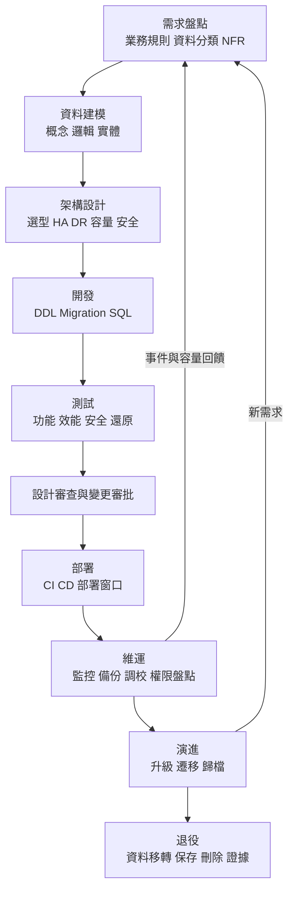

### 1.7 角色與職責（RACI）

| 活動 | 資料擁有者 | 資料管理者 | SA | 架構師 | 開發 | DBA | 資安 | 法遵 |
|---|---|---|---|---|---|---|---|---|
| 資料分類 | A | R | C | C | I | I | C | C |
| 保存政策 | A | R | C | I | I | C | C | R |
| 邏輯模型 | C | C | R | A | C | C | I | I |
| 實體模型與 DDL | I | I | C | A | R | R | C | I |
| 權限設計 | A | C | C | C | C | R | R | I |
| 備份與 DR | C | I | I | A | I | R | C | I |
| 上線審批 | A | C | C | R | C | R | R | C |

R = 執行、A = 最終負責、C = 諮詢、I = 知會。

### 1.8 資料庫設計與 SSDLC

| SSDLC 階段 | 資料庫工程產出 | 安全活動 |
|---|---|---|
| 需求 | 資料需求盤點、資料分類 | 識別個資與機敏欄位、法規需求 |
| 設計 | ER Model、權限矩陣、加密設計 | 威脅建模、設計審查 |
| 開發 | DDL、Migration、SQL | 參數化查詢、靜態掃描、Code Review |
| 測試 | 測試案例、去識別化測試資料 | 越權測試、SQL Injection 測試 |
| 部署 | 部署腳本、審批紀錄 | 職責分離、變更授權 |
| 維運 | 監控、稽核日誌 | 權限盤點、弱點修補 |

詳見第 13 章。

### 1.9 資料治理框架與國際標準對照

資料庫工程不是孤立活動，它落在組織資料治理體系之中。下表將本手冊各章對應到 DAMA-DMBOK2 知識領域與常見國際標準，方便稽核與內部治理文件互相引用〔組織建議〕。

| DMBOK2 知識領域 | 對應標準／框架 | 本手冊章節 | 資料庫工程具體產出 |
|---|---|---|---|
| 資料治理 | ISO/IEC 38505-1、組織資料政策 | 1、2、23 | RACI、資料擁有者指派、審查流程 |
| 資料架構 | TOGAF（組織自選） | 3、4、12 | 選型決策紀錄、拓樸圖 |
| 資料建模與設計 | ISO/IEC 9075、ISO/IEC 11179 | 5、6、7、8 | ER Model、資料字典、DDL |
| 資料儲存與維運 | ISO/IEC 27002 8.13、8.14 | 10、11、15、16、19 | 容量計畫、備份、監控 |
| 資料安全 | ISO/IEC 27001／27002、NIST SP 800-53、PCI DSS | 13、14 | 權限矩陣、加密設計、稽核設定 |
| 資料整合與互通 | 資料契約（業界實務） | 12 | 介接規格、Schema 相容性規則 |
| 元資料 | ISO/IEC 11179 | 5 | 資料元素登錄、資料血緣 |
| 資料品質 | ISO 8000 | 2、20 | 品質規則與量測 SQL |
| 營運持續 | ISO 22301、NIST SP 800-34 | 15 | BIA、DR Runbook、演練紀錄 |

> 注意：上表為教學對照，不代表各標準條文的正式對應關係。若用於稽核證據，**必須**由資安與稽核單位依實際條文確認。

### 1.10 驗證與審查（總覽）

#### AI 產出常見錯誤

| 錯誤型態 | 範例 | 如何識別 |
|---|---|---|
| 把分析型設計套用在 OLTP | 建議核心交易表改成寬表或星狀模型 | 對照 1.3 工作負載表 |
| 把非權威儲存當成權威來源 | 「餘額以 Redis 為準」 | 對照 1.4，權威來源必須是關聯式資料庫 |
| 忽略角色與簽核 | 產出設計文件但未指定資料擁有者 | 檢查文件是否含 RACI |

#### 人工審查步驟

1. 確認設計文件明確寫出工作負載類型與權威資料來源。
2. 確認三層模型皆存在，且實體模型可追溯回邏輯模型。
3. 確認 RACI 中每個活動都有唯一的 A。

#### 可執行驗證

以下 PostgreSQL 查詢可快速確認資料庫中是否存在「缺註解」的表，用來判斷文件與實體模型是否同步（示範用途）：

```sql
-- PostgreSQL：列出未設定 COMMENT 的業務表（應為 0 筆）
SELECT n.nspname AS schema_name, c.relname AS table_name
FROM   pg_class c
JOIN   pg_namespace n ON n.oid = c.relnamespace
WHERE  c.relkind IN ('r', 'p')
AND    n.nspname NOT IN ('pg_catalog', 'information_schema')
AND    obj_description(c.oid, 'pg_class') IS NULL;
```

通過標準〔組織建議〕：結果為 0 筆；其他產品可改查 Oracle `ALL_TAB_COMMENTS`、Db2 `SYSCAT.TABLES.REMARKS`、SQL Server `sys.extended_properties`。

### 1.11 常見錯誤與反模式

| 反模式 | 問題 | 改善方式 |
|---|---|---|
| 萬用表（EAV 濫用） | 無法建立約束、查詢複雜 | 僅在真正動態屬性情境使用，並限制範圍 |
| 不建 FK「為了效能」 | 孤兒資料、無法追溯 | 先量測；確有瓶頸再以其他方式補償 |
| 金額使用浮點數 | 精度誤差 | 使用 DECIMAL／NUMBER |
| 以字串存日期 | 無法比較、排序錯誤 | 使用正確日期時間型別 |
| 應用程式共用 DBA 帳號 | 無法稽核、權限過大 | 帳號分離、最小權限 |
| 在正式環境手動改資料 | 無紀錄、不可重現 | 經審批的腳本與雙人覆核 |
| 只做複寫不做備份 | 誤刪會同步到副本 | 獨立備份與還原演練 |
| 未定義保存期限 | 資料無限膨脹、個資風險 | 建立保存政策（第 14 章） |

### 1.12 實務案例與注意事項

> **案例〔案例假設〕**：某共用平台初期為加快上線，所有應用系統使用同一個資料庫帳號並具 DDL 權限。上線半年後一次批次程式錯誤執行 `TRUNCATE`，影響三個租戶。事後檢討發現：無法從稽核紀錄判斷是哪個系統執行、無租戶個別還原能力。改善措施為帳號分離、移除應用帳號 DDL 權限、導入租戶級邏輯備份。

### 1.13 本章檢核表

- [ ] 已確認系統工作負載類型（OLTP／OLAP／混合）。
- [ ] 已明確權威資料來源與衍生資料。
- [ ] 已產出概念、邏輯、實體三層模型。
- [ ] 已建立 RACI 並指定資料擁有者。
- [ ] 已將資料庫活動納入 SSDLC 各階段。
- [ ] 已對照反模式清單進行自我檢查。

## 第 2 章 需求分析與資料需求盤點

### 2.1 學習目標

- 能從需求文件、訪談、API、畫面、批次與既有資料庫萃取資料需求。
- 能定義業務實體、規則與交易邊界。
- 能盤點資料分類、量體、保存與 RTO／RPO。
- 能建立資料需求追溯矩陣。

### 2.2 資料需求來源

| 來源 | 萃取重點 | 常見陷阱 |
|---|---|---|
| 需求規格書 | 業務名詞、規則、狀態 | 名詞不一致（客戶／用戶／會員） |
| 訪談紀錄 | 例外流程、實際作法 | 口述未落文件 |
| 畫面與報表 | 欄位、查詢條件、排序 | 畫面欄位不等於儲存欄位 |
| API 規格 | 請求／回應欄位、錯誤碼 | 衍生欄位被誤當儲存欄位 |
| 批次程式 | 輸入檔格式、處理規則、對帳 | 隱含規則寫在程式中 |
| 既有資料庫 | Schema、資料分布、例外資料 | 欄位語意已漂移 |
| 法規與內規 | 保存、遮罩、稽核要求 | 未請法遵確認 |

### 2.3 實務流程


1. **蒐集**：列出所有來源並編號（DOC-xx、API-xx、BAT-xx）。
2. **萃取**：從文件中標出名詞（候選實體／屬性）與動詞（候選關係／交易）。
3. **詞彙表**：一個業務名詞只能有一個定義，同義詞要標記。
4. **交易邊界**：哪些動作必須在同一交易中完成（例如轉帳的扣款與入帳）。
5. **量體與 NFR**：寫入量、讀取量、尖峰、延遲、可用率、RTO／RPO。
6. **分類與保存**：每個資料集標示分類等級、擁有者、保存依據。
7. **追溯**：需求編號 → 實體 → 表 → 欄位 → 測試案例。

### 2.4 業務實體、業務規則與交易邊界

| 規則編號 | 規則描述 | 類型 | 落實層級 |
|---|---|---|---|
| BR-001 | 一個客戶可擁有多個帳戶 | 結構規則 | FK |
| BR-002 | 帳戶狀態僅可為 ACTIVE、FROZEN、CLOSED | 值域規則 | CHECK |
| BR-003 | 已結清帳戶不可再入帳 | 狀態規則 | 應用程式＋資料庫檢查 |
| BR-004 | 轉帳扣款與入帳必須同時成功或同時失敗 | 交易規則 | 單一資料庫交易或 Saga |
| BR-005 | 同一外部交易序號不可重複入帳 | 冪等規則 | UNIQUE |

**交易邊界判斷原則〔組織建議〕**：

- 必須強一致的動作放在同一個資料庫交易內。
- 跨服務、跨資料庫的動作改用 Saga／Outbox（第 8 章），並設計補償。
- 交易內不得呼叫外部 HTTP 服務，避免長交易與鎖定擴大。

### 2.5 功能與非功能需求

| 類別 | 範例需求 | 量測方式 |
|---|---|---|
| 效能 | 交易查詢 P95 小於 300 ms〔案例假設〕 | 壓測報告 |
| 吞吐 | 尖峰每秒 1,500 筆交易寫入〔案例假設〕 | 壓測報告 |
| 可用率 | 每月 99.95%〔案例假設〕 | 監控統計 |
| 復原 | RTO 30 分鐘、RPO 0〔案例假設〕 | DR 演練紀錄 |
| 安全 | 身分證字號欄位加密並遮罩顯示 | 安全測試 |
| 稽核 | 所有特權操作保留稽核紀錄 | 稽核報表 |
| 可維護 | Schema 變更全部經 Migration 工具 | CI 紀錄 |

### 2.6 資料分類

| 等級〔組織建議〕 | 定義 | 範例 | 基本控制 |
|---|---|---|---|
| 公開 | 可對外公開 | 匯率公告、分行地址 | 完整性保護 |
| 內部 | 僅限內部使用 | 系統代碼表 | 帳號認證 |
| 機敏 | 外洩造成重大影響 | 交易明細、餘額 | 加密傳輸、存取稽核 |
| 個人資料 | 可直接或間接識別自然人 | 姓名、證號、電話 | 加密、遮罩、存取最小化 |
| 高度機敏 | 外洩造成嚴重法律或財務影響 | 密碼雜湊、金鑰、卡號 | 欄位加密或 Token 化、嚴格職責分離 |

實際分類等級名稱與定義**必須**以組織資料分類政策為準。

### 2.7 量體與負載盤點

| 項目 | 說明 | 範例值〔案例假設〕 |
|---|---|---|
| 初始資料量 | 上線時筆數 | 客戶 500 萬、帳戶 800 萬 |
| 日新增 | 每日平均新增 | 交易 200 萬筆 |
| 日更新 | 每日平均更新 | 帳戶餘額 150 萬次 |
| 尖峰倍數 | 尖峰對平均倍率 | 月底 3 倍、發薪日 5 倍 |
| 讀寫比 | 讀與寫的比例 | 8:2 |
| 併發連線 | 同時活躍連線 | 400 |
| 批次窗口 | 可執行批次時段 | 00:30～05:00 |

### 2.8 保留、封存、調閱、刪除與法律保全

| 需求項目 | 需問的問題 |
|---|---|
| 保存期限 | 依據哪條法規、契約或內規？起算點是什麼？ |
| 線上保留 | 多久內需要秒級查詢？ |
| 封存 | 封存後的調閱時效要求？格式？ |
| 刪除 | 到期如何刪除？是否需去識別化替代？ |
| 法律保全 | 遇訴訟或調查時如何暫停刪除？ |
| 證據 | 刪除與封存需留下什麼紀錄？ |

詳見第 11、14 章。

### 2.9 資料品質要求

| 維度 | 定義 | 範例規則 |
|---|---|---|
| 完整性 | 必要欄位不得缺漏 | 帳戶必有開戶日 |
| 正確性 | 值符合真實世界 | 幣別為 ISO 4217 代碼 |
| 一致性 | 跨表、跨系統一致 | 帳戶餘額等於交易累計 |
| 唯一性 | 不重複 | 客戶證號唯一 |
| 時效性 | 在要求時間內更新 | 匯率每 5 分鐘更新 |
| 有效性 | 符合格式與值域 | Email 格式 |

品質規則**必須**可量測。參考 ISO 8000 與 DAMA-DMBOK2 的量測精神，每條規則應寫明「量測公式、門檻、負責人、量測頻率」：

| 規則編號 | 維度 | 量測公式 | 門檻〔案例假設〕 | 頻率 | 負責人 |
|---|---|---|---|---|---|
| DQ-001 | 完整性 | 開戶日非空筆數 ÷ 帳戶總筆數 | 100% | 每日 | 資料管理者 |
| DQ-002 | 有效性 | 幣別存在於 ISO 4217 代碼表之筆數 ÷ 總筆數 | 100% | 每日 | 資料管理者 |
| DQ-003 | 一致性 | 快取餘額與交易累計不符之帳戶數 | 0 | 每日日終 | 帳務單位 |
| DQ-004 | 唯一性 | 同一證號重複的客戶數 | 0 | 每日 | 個金部 |
| DQ-005 | 時效性 | 最後匯率更新時間距今分鐘數 | ≤ 5 | 每 5 分鐘 | 資料平台 |

對應量測 SQL（PostgreSQL，示範用途）：

```sql
-- DQ-001 完整性：預期結果 100.00
SELECT ROUND(100.0 * COUNT(open_date) / NULLIF(COUNT(*), 0), 2) AS completeness_pct
FROM   dep.account;

-- DQ-002 有效性：預期結果 0 筆
SELECT a.currency_code, COUNT(*) AS invalid_rows
FROM   dep.account a
LEFT JOIN ref.currency c ON c.currency_code = a.currency_code
WHERE  c.currency_code IS NULL
GROUP BY a.currency_code;

-- DQ-004 唯一性：預期結果 0 筆（以雜湊欄位比對，避免解密）
SELECT tenant_id, id_no_hash, COUNT(*) AS dup_cnt
FROM   cust.customer
GROUP BY tenant_id, id_no_hash
HAVING COUNT(*) > 1;
```

### 2.10 量體假設的實證方法

需求階段的量體常來自訪談估計。若有既有系統，**建議**以實際資料驗證，差異超過 30%〔組織建議〕時應回報需求擁有者重新確認。

| 假設項目 | 驗證來源 | 驗證方式 |
|---|---|---|
| 日新增筆數 | 既有交易表 | 依交易日分組計算近 90 日平均與 P99 |
| 尖峰倍數 | 既有交易表或 APM | 每小時筆數的最大值 ÷ 平均值 |
| 寫入量 | WAL／Redo／Transaction Log | 計算每日日誌產生量 |
| 併發連線 | 連線池監控 | 取近 30 日活躍連線 P95 |

```sql
-- PostgreSQL：近 90 日每日交易筆數的平均與 P99（示範用途）
WITH daily AS (
    SELECT txn_date, COUNT(*) AS cnt
    FROM   dep.txn
    WHERE  txn_date >= CURRENT_DATE - 90
    GROUP BY txn_date
)
SELECT ROUND(AVG(cnt))                                       AS avg_daily,
       PERCENTILE_CONT(0.99) WITHIN GROUP (ORDER BY cnt)      AS p99_daily,
       MAX(cnt)                                               AS max_daily
FROM   daily;
```

### 2.11 RTO、RPO 與復原優先順序

| 系統／資料集 | 業務影響 | RTO〔案例假設〕 | RPO〔案例假設〕 | 復原優先序 |
|---|---|---|---|---|
| 存款核心交易 | 極高 | 30 分鐘 | 0 | 1 |
| 客戶主檔 | 高 | 1 小時 | 5 分鐘 | 2 |
| 交易查詢歷史 | 中 | 4 小時 | 15 分鐘 | 3 |
| 報表資料庫 | 低 | 24 小時 | 24 小時 | 4 |

RTO／RPO **必須**由營運衝擊分析（BIA）決定，而不是由技術團隊單方設定（詳見第 15 章）。

### 2.12 需求盤點表範本

```markdown
| 編號 | 資料集名稱 | 業務說明 | 來源 | 擁有者 | 分類 | 日新增量 | 尖峰倍數 | 保存依據 | 保存期限 | RTO | RPO | 備註 |
|---|---|---|---|---|---|---|---|---|---|---|---|---|
| DS-001 | 客戶主檔 | 個人客戶基本資料 | 開戶系統 | 個金部 | 個人資料 | 2,000 | 3 | 待法遵確認 | 待確認 | 1h | 5m | 示範 |
| DS-002 | 存款交易 | 存提轉交易明細 | 核心系統 | 存匯部 | 機敏 | 2,000,000 | 5 | 待法遵確認 | 待確認 | 30m | 0 | 示範 |
```

### 2.13 資料需求追溯矩陣範本

| 需求編號 | 業務規則 | 實體 | 資料表 | 欄位／限制 | 測試案例 | 狀態 |
|---|---|---|---|---|---|---|
| REQ-010 | BR-002 | 帳戶 | ACCOUNT | CK_ACCOUNT_STATUS | TC-DB-021 | 已驗證 |
| REQ-011 | BR-005 | 交易 | TXN | UK_TXN_EXT_REF | TC-DB-030 | 待測 |

### 2.14 驗證與審查

#### AI 產出常見錯誤

| 錯誤型態 | 範例 | 如何識別 |
|---|---|---|
| 自行捏造保存年限 | 「依法保存 7 年」 | 保存欄位必須為「待法遵確認」或附法規條次與法遵簽核 |
| 量體無來源 | 「預估每日 100 萬筆」未說明依據 | 每個量體必須標示來源或〔案例假設〕 |
| 將計算值當儲存欄位 | 把「年齡」列為客戶主檔欄位 | 確認是否可由其他欄位推導 |
| 交易邊界跨服務却寫單一交易 | 「扣款與通知發送在同一交易」 | 對照 2.4 交易邊界原則 |

#### 人工審查步驟

1. 抽樣 5 條業務規則，反向追到來源文件編號；無法追溯者退回。
2. 檢查每個資料集是否具備擁有者、分類、保存依據三個欄位。
3. 檢查 RTO／RPO 是否附業務簽核紀錄。

#### 通過標準

- 追溯矩陣覆蓋率 100%（每個 REQ 至少對應一個測試案例）。
- 量體實證差異 ≤ 30%，或已寫明差異原因。
- 品質規則皆有可執行的量測 SQL。

### 2.15 常見錯誤

- 只看畫面設計欄位，忽略批次與介接需要的欄位。
- 未請法遵確認就寫入保存年限。
- RTO／RPO 由技術人員自行估計，未經業務簽核。
- 未區分「計算欄位」與「需儲存欄位」。
- 忽略月底、季底、年終的尖峰。

### 2.16 實務案例與注意事項

> **案例**：某專案以畫面欄位直接建表，上線後發現對帳批次需要「入帳日」與「交易日」兩個日期，但表中只有一個 `TXN_DATE`。補欄位後還須回填三年歷史資料。教訓是：需求盤點**必須**包含批次與報表來源。

### 2.17 本章檢核表

- [ ] 已列出所有資料需求來源並編號。
- [ ] 已建立業務詞彙表並消除同義詞。
- [ ] 已定義業務規則與落實層級。
- [ ] 已定義交易邊界。
- [ ] 已盤點量體、尖峰與批次窗口。
- [ ] 已完成資料分類並經擁有者確認。
- [ ] 已提出保存需求並送法遵確認。
- [ ] RTO／RPO 已經業務簽核。
- [ ] 已建立追溯矩陣。

## 第 3 章 資料庫架構規劃與技術選型

### 3.1 學習目標

- 了解 Oracle、Db2、PostgreSQL、SQL Server 的核心差異。
- 避免把不同產品的同名或相似功能視為等價。
- 能使用決策矩陣與 PoC 進行選型。

### 3.2 選型前提

選型**必須**先回答：

1. 組織既有企業標準資料庫是什麼？維運團隊熟悉哪些產品？
2. 工作負載型態、量體與 RTO／RPO？
3. 是否有特定功能依賴（例如既有 PL/SQL、SQL PL、T-SQL 程式）？
4. 部署位置（地端、私有雲、公有雲代管）與資料主權限制？
5. 授權模式與總持有成本（TCO）？
6. 原廠支援與問題升級（Escalation）需求？

### 3.3 核心觀念差異比較

> 下表為概念層級比較。功能名稱相近不代表行為相同，細節**必須**以指定版本官方文件確認。

| 面向 | Oracle | Db2 LUW | PostgreSQL | SQL Server |
|---|---|---|---|---|
| 併發控制 | 多版本讀一致性（Undo） | 鎖定為主，可設定 Currently Committed 等行為 | MVCC（Tuple 版本，需 VACUUM） | 鎖定為主，可啟用 RCSI／Snapshot（tempdb 版本存放區） |
| 預設隔離等級 | Read Committed | Cursor Stability（約對應 RC） | Read Committed | Read Committed |
| 實例與資料庫 | 一個 Instance 對 CDB，CDB 內有多個 PDB（12c 起；21c 起僅支援 CDB 架構） | Instance 下可有多個 Database | Cluster 下多個 Database，跨 DB 查詢需擴充 | Instance 下多個 Database |
| Schema | 與使用者帳號緊密相關 | 獨立物件，可與授權 ID 不同 | 獨立命名空間 | 獨立命名空間 |
| 儲存單位 | Tablespace／Datafile | Tablespace／Storage Group | Tablespace（目錄層級） | Filegroup／Data file |
| 自動主鍵 | Sequence、Identity（12c 起） | Sequence、Identity | Sequence、Identity（10 起） | Identity、Sequence（2012 起） |
| 程序語言 | PL/SQL | SQL PL（另有 PL/SQL 相容模式） | PL/pgSQL 等多語言 | T-SQL |
| 排程 | DBMS_SCHEDULER | ADMIN_TASK_ADD 等管理排程 | 無內建，常用 pg_cron 擴充或外部排程 | SQL Server Agent |
| DDL 交易行為 | DDL 前後隱含 COMMIT | 多數 DDL 可在交易中回滾 | 多數 DDL 可交易回滾（部分例外） | 多數 DDL 可交易回滾 |
| 空字串 | 空字串視為 NULL | 空字串與 NULL 不同 | 空字串與 NULL 不同 | 空字串與 NULL 不同 |

### 3.4 SQL 與資料型別差異

| 用途 | Oracle | Db2 | PostgreSQL | SQL Server |
|---|---|---|---|---|
| 精確金額 | NUMBER(p,s) | DECIMAL(p,s) | NUMERIC(p,s) | DECIMAL(p,s) |
| 變長字串 | VARCHAR2(n CHAR) | VARCHAR(n) | VARCHAR(n)／TEXT | NVARCHAR(n) 或 UTF-8 Collation 的 VARCHAR |
| 日期時間 | DATE（含時間）、TIMESTAMP | DATE、TIME、TIMESTAMP | DATE、TIMESTAMP、TIMESTAMPTZ | DATE、DATETIME2、DATETIMEOFFSET |
| 布林 | 23ai／26ai 起支援 BOOLEAN；19c 常以 NUMBER(1) 或 CHAR(1) | BOOLEAN（11.1 起，須確認版本） | BOOLEAN | BIT |
| JSON | JSON 型別（21c 起）；23ai 起另有 JSON Relational Duality | 以 BLOB／VARCHAR 搭配 JSON 函數 | JSON、JSONB | 2025 起提供原生 `json` 型別（二進位儲存）；之前以 NVARCHAR 搭配 JSON 函數 |
| UUID | RAW(16)；`SYS_GUID()` 非時間排序 | CHAR(16) FOR BIT DATA | `uuid` 型別；18 起內建 `uuidv7()` | `uniqueidentifier`；`NEWSEQUENTIALID()` 僅限預設值 |
| 向量 | 23ai／26ai `VECTOR` 型別 | 依版本（待確認） | pgvector 擴充（社群） | 2025 `vector` 型別 |
| 大型物件 | CLOB／BLOB | CLOB／BLOB | TEXT／BYTEA、Large Object | VARCHAR(MAX)／VARBINARY(MAX) |
| 分頁 | OFFSET FETCH（12c 起） | OFFSET FETCH | LIMIT／OFFSET、OFFSET FETCH | OFFSET FETCH（需 ORDER BY） |
| 字串串接 | `\|\|` | `\|\|`、CONCAT | `\|\|` | `+`、CONCAT |

### 3.5 分割區、索引、序列

| 面向 | Oracle | Db2 | PostgreSQL | SQL Server |
|---|---|---|---|---|
| 分區類型 | Range、List、Hash、Composite、Interval | Range（Table Partitioning）、另有 MDC、DPF Hash 分散 | Range、List、Hash（宣告式） | Range（Partition Function／Scheme） |
| 授權 | Partitioning 為 Enterprise Edition 選購項目（須確認授權） | 依版本與授權 | 內建 | 2016 SP1 起各版本皆可用 |
| 特殊索引 | Bitmap、Function-based、Invisible | Expression-based、Index on expression | GIN、GiST、BRIN、Partial、Expression | Filtered、Columnstore、Included columns |

### 3.6 HA／DR、備份與複寫

| 面向 | Oracle | Db2 | PostgreSQL | SQL Server |
|---|---|---|---|---|
| 同地 HA | RAC（共享儲存，選購）、Data Guard 搭配 Fast-Start Failover | HADR 搭配 Pacemaker（11.5 起整合） | Streaming Replication 搭配外部叢集管理（如 Patroni，屬社群工具） | Always On Availability Groups、Failover Cluster Instance |
| 異地 DR | Data Guard（Physical／Logical Standby）、Active Data Guard 為選購 | HADR 多備援（Principal＋Auxiliary Standby） | Streaming（非同步）、Log Shipping | AG 非同步副本、Log Shipping、Distributed AG |
| 備份工具 | RMAN | BACKUP DATABASE（線上需 Archive Logging） | pg_basebackup＋WAL 歸檔，或社群工具 | BACKUP DATABASE／LOG |
| PITR | RMAN＋Archived Redo | Rollforward 至時間點 | WAL 重播至 recovery_target_time | 完整＋差異＋交易記錄備份還原至 STOPAT |
| 邏輯誤刪防護 | Flashback（須設定與保留） | 時態表（Temporal Table） | 無內建閃回，需 PITR 或延遲副本 | 時態表、延遲 Log Shipping |

### 3.7 安全能力

| 面向 | Oracle | Db2 | PostgreSQL | SQL Server |
|---|---|---|---|---|
| 靜態加密 | TDE（Advanced Security 選購，須確認授權） | Native Encryption | 核心無 TDE，常以檔案系統／磁碟加密或商業發行版 | TDE（2019 起 Standard 版可用，須確認） |
| 欄位加密 | DBMS_CRYPTO、TDE Column | 加密函數 | pgcrypto 擴充 | Always Encrypted |
| 列層級存取 | VPD（Virtual Private Database） | RCAC（Row and Column Access Control） | Row Level Security | Row-Level Security |
| 遮罩 | Data Redaction（選購） | RCAC Column Mask | 無內建，需 View 或擴充 | Dynamic Data Masking |
| 稽核 | Unified Auditing | Db2 Audit Facility | pgaudit 擴充（社群） | SQL Server Audit |
| 金鑰管理 | TDE Keystore、OKV、HSM | Native Encryption 搭配 KMIP／HSM | 依 OS／儲存或商業發行版 | EKM（含 Azure Key Vault、Managed HSM） |
| 外部認證 | Kerberos、RADIUS、Centrally Managed Users（AD） | Kerberos、LDAP 插件 | Kerberos（GSSAPI）、LDAP、RADIUS、應用 18 起 OAuth 2.0 | Windows（Kerberos）、Microsoft Entra ID（Arc） |
| SQL 層防護 | 23ai／26ai SQL Firewall | 無內建，需外部 DAM | 無內建，需外部 DAM | 無內建，需外部 DAM；2025 可用 `ABORT_QUERY_EXECUTION` 封鎖特定查詢 |

**注意**：Dynamic Data Masking、Data Redaction 屬顯示層遮罩，不等於加密，具查詢權限者仍可能以推論方式取得原值，不可作為唯一保護措施。

### 3.8 授權、支援、人力與 TCO

| 成本面向 | 說明 |
|---|---|
| 授權 | 核心數、版本、選購功能（分區、加密、HA）可能額外計費 |
| 原廠支援 | 年度維護費、問題升級、修補時效 |
| 人力 | DBA 技能、值班人力、教育訓練 |
| 基礎設施 | 儲存、備援機房、網路專線 |
| 工具 | 監控、備份、資料遮罩、Schema 管理 |
| 遷移與退場 | 未來轉換成本、方言鎖定 |
| 風險 | 停機損失、事故處理成本 |

**原則**：不應只以授權費用決定選型。開源資料庫授權費低，但可能需要更多自建工具、人力與第三方支援合約。

### 3.9 選型決策矩陣範本

| 評估面向 | 權重 | Oracle | Db2 | PostgreSQL | SQL Server |
|---|---|---|---|---|---|
| 符合企業標準 | 20% | 依組織 | 依組織 | 依組織 | 依組織 |
| HA／DR 能力與經驗 | 20% | | | | |
| 既有程式相容性 | 15% | | | | |
| 安全與稽核功能 | 15% | | | | |
| 團隊技能 | 10% | | | | |
| TCO（五年） | 10% | | | | |
| 原廠或第三方支援 | 5% | | | | |
| 雲端代管可用性 | 5% | | | | |
| 合計 | 100% | | | | |

評分建議 1～5 分，並附上評分依據與 PoC 證據；空白欄位由專案填寫。

### 3.10 選型決策指引

| 情境 | 建議方向〔組織建議〕 |
|---|---|
| 核心交易、既有大量 PL/SQL 或 SQL PL | 優先沿用既有企業標準資料庫，降低改寫風險 |
| 新建中小型服務、團隊具 PostgreSQL 能力 | 可考慮 PostgreSQL，並確認支援合約與 HA 方案 |
| 需原廠 7x24 問題升級與法遵要求 | 選擇有商業支援的產品或發行版 |
| 雲端代管為主 | 評估雲端代管服務功能差異（不一定與地端相同） |
| 授權成本壓力大 | 以五年 TCO 評估，不只比較授權費 |

### 3.11 PoC 驗證方法


PoC 必測項目：

1. 代表性交易在目標量體下的延遲與吞吐。
2. HA 自動切換時間與資料遺失量。
3. 備份與還原時間（實測）。
4. 既有 SQL／程序的相容性轉換工作量。
5. 安全功能（加密、稽核）開啟後的效能影響。
6. 監控與維運工具整合。

### 3.12 PoC 通過標準與報告範例

PoC 報告若只寫「效能良好」是無法審查的。每個必測項目**必須**在測試前定義量化通過標準，測試後填入實測值。

| 項目 | 量測方式 | 通過標準〔案例假設〕 | 實測值 | 結果 |
|---|---|---|---|---|
| 代表性交易延遲 | 壓測工具以尖峰 1,500 TPS 持續 30 分鐘 | P95 ≤ 300 ms、P99 ≤ 800 ms、錯誤率 < 0.1% | P95 = 210 ms | 通過 |
| HA 自動切換 | 主節點斷電、量測應用恢復可寫入的時間 | ≤ 60 秒，已提交交易 0 遺失 | 42 秒，0 遺失 | 通過 |
| 全量還原 | 2 TB 資料庫自備份還原並開啟 | ≤ RTO 的 50%（保留驗證時間） | 3.1 小時 | 不通過 |
| SQL 相容性 | 抽樣 200 支既有 SQL 轉換 | 自動轉換率 ≥ 85% | 78% | 有條件通過 |
| 加密開啟影響 | TDE 開啟前後同一壓測 | TPS 下降 ≤ 10% | 下降 6% | 通過 |

審查重點：

- 測試資料量是否達到目標量體的 100%（至少達第一年預估量）？用小資料量的 PoC 無法代表正式效能。
- 「不通過」項目是否有改善方案（例如平行還原、增量備份策略）與重測紀錄？
- 測試組態是否與預計正式組態一致（版本、加密、稽核、HA 模式）？

### 3.13 新版本能力的選型考量

新版本功能並不等於可立即用於正式環境。評估時**必須**區分「GA」與「Preview」，並確認授權與平台可用性。

| 功能 | 產品與版本 | 查核日狀態 | 選型提醒 |
|---|---|---|---|
| 向量索引 | SQL Server 2025 | Preview（需 `PREVIEW_FEATURES`） | 核心交易庫不建議啟用 Preview 功能 |
| Change Event Streaming | SQL Server 2025 | Preview | 正式 CDC 仍應以 GA 方案為主 |
| Optimized Locking | SQL Server 2025 | GA | 可降低鎖定升級，需以壓測驗證應用行為 |
| 非同步 I/O | PostgreSQL 18 | GA | `io_method` 預設 `worker`；`io_uring` 需 Linux 核心與編譯支援 |
| OAuth 2.0 認證 | PostgreSQL 18 | GA（需驗證器擴充） | 驗證器擴充需納入安全審查 |
| SQL Firewall | Oracle 23ai／26ai | GA | 確認授權項目與學習期流程 |
| Globally Distributed Database（RAFT） | Oracle 26ai | GA（依平台） | 涉及跨境資料落地，需法遵評估 |

### 3.14 驗證與審查

#### AI 產出常見錯誤

| 錯誤型態 | 範例 | 如何識別 |
|---|---|---|
| 功能對應錯誤 | 「PostgreSQL 內建 TDE」 | 對照 3.7；社群版核心無 TDE |
| 版本過時 | 「Oracle 最新為 23ai」、「SQL Server 2025 尚未 GA」 | 對照文件資訊版本基準表 |
| 忽略授權 | 建議使用 Partitioning、Active Data Guard 却未提選購 | 檢查是否標註授權需確認 |
| 把 Preview 當 GA | 建議核心系統啟用向量索引 | 對照本章「新版本能力的選型考量」 |

#### 人工審查步驟

1. 決策矩陣每個分數是否附證據（PoC 報告、官方文件連結或內部經驗紀錄）。
2. 每個被引用的功能是否在目標版本與版本別（Edition）中可用。
3. TCO 是否覆蓋 3.8 全部七個成本面向。

#### 通過標準

- 決策矩陣無空白欄位且每格附證據。
- PoC 必測項目皆有量化標準與實測值。
- 選型決策紀錄（ADR）已經架構委員會簽核。

### 3.15 常見錯誤

- 只比較功能清單，未實測。
- 把 RAC 與 PostgreSQL Streaming Replication 視為等價（前者共享儲存多節點同時讀寫，後者為主備複寫）。
- 未確認功能所需的版本與授權。
- 未考慮雲端代管服務與地端功能差異。

### 3.16 實務案例與注意事項

> **案例**：某團隊評估以 PostgreSQL 取代商用資料庫，PoC 只測查詢效能即決定遷移，後續才發現既有系統大量使用 Oracle Package 與 Autonomous Transaction，改寫工作量為原估計三倍。正確作法是 PoC 階段即掃描程式物件並估算轉換成本（第 20 章）。

### 3.17 本章檢核表

- [ ] 已確認企業標準資料庫與例外申請流程。
- [ ] 已完成四產品差異比較，並標示版本與授權條件。
- [ ] 已使用加權決策矩陣並附證據。
- [ ] 已完成 PoC 並量測效能、切換、還原。
- [ ] 已評估五年 TCO。
- [ ] 已確認支援模式與問題升級路徑。

## 第 4 章 資料庫系統架構設計

### 4.1 學習目標

- 了解各種資料庫部署架構的目的、優缺點與故障行為。
- 能為不同 RTO／RPO 選擇合適拓樸。
- 能清楚區分 HA、DR、備份與複寫。

### 4.2 關鍵觀念：HA、DR、備份與複寫不可互相取代

| 能力 | 解決的問題 | 無法解決的問題 |
|---|---|---|
| HA（高可用） | 單一節點或元件故障時快速恢復服務 | 機房災難、誤刪、勒索軟體 |
| DR（災難復原） | 主中心整體失效時於異地恢復 | 已同步到異地的邏輯錯誤 |
| 備份 | 資料遺失、誤刪、損毀時還原到過去時間點 | 快速恢復服務（還原需要時間） |
| 複寫 | 將資料變更傳遞到其他節點 | 錯誤資料也會被複寫 |

> **重點**：複寫會「忠實地」把 `DELETE` 或被勒索軟體加密的資料傳遞到所有副本。只有具版本保留、權限隔離且經驗證的備份，才能把資料還原到錯誤發生前的時間點。

### 4.3 基本架構類型

| 架構 | 說明 | 適用 | 主要風險 |
|---|---|---|---|
| 單一資料庫伺服器 | 單節點加備份 | 開發、低重要度系統 | 單點故障 |
| 主從複寫、讀寫分離 | 主節點寫入，副本提供讀取 | 讀多寫少 | 副本延遲造成讀到舊資料 |
| 同地 HA 叢集 | 同機房多節點自動切換 | 核心系統 | 共用元件（儲存、網路）故障 |
| 同步複寫 | 確認副本寫入後才回應 Commit | RPO 等於 0 | 延遲增加、副本故障可能影響主節點 |
| 非同步複寫 | 主節點先 Commit，再傳送 | 遠距 DR | 切換時可能遺失尚未傳送的交易 |
| 異地備援 | 第二機房備援 | 營運持續 | 切換演練不足 |
| 第三地／海外備援 | 第三個地理區域 | 區域性災害 | 法規、資料主權、延遲 |

### 4.4 拓樸一：地端主中心＋同地 HA＋異地 DR

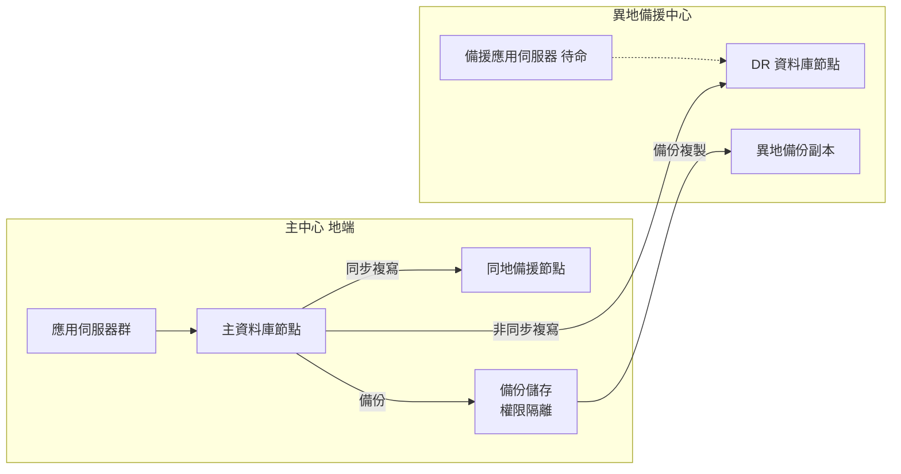

| 項目 | 說明 |
|---|---|
| 目的 | 同地處理元件故障，異地處理機房層級災害 |
| 優點 | 同地 RPO 接近 0、自動切換；異地降低區域風險 |
| 缺點 | 成本高、需兩套機房與專線 |
| 適用 | 核心交易、存款、支付系統 |
| 故障情境 | 主節點故障 → 同地切換；主中心失效 → 宣告災難切換至異地 |
| 一致性與延遲 | 同地同步，異地非同步可能存在秒級延遲〔依實測〕 |
| 網路中斷 | 同地網路中斷時依產品設定可能降級為非同步或暫停 Commit；異地中斷時主中心持續服務並累積待傳送日誌 |
| 切換 | 同地自動；異地建議人工決策（避免誤判） |
| 回切 | 主中心恢復後重建複寫、反向同步、驗證後計畫性回切 |
| 成本與風險 | 高成本；最大風險是 DR 演練不足導致實際切換失敗 |

### 4.5 拓樸二：地端與雲端混合架構

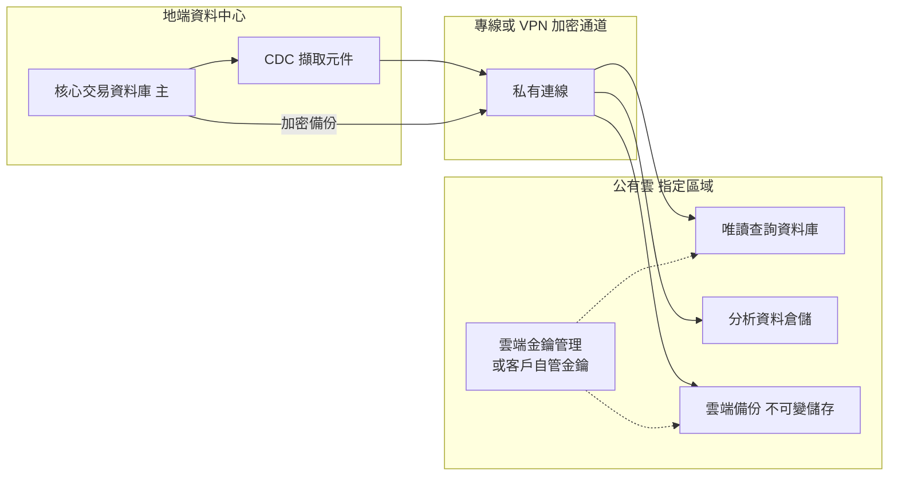

| 項目 | 說明 |
|---|---|
| 目的 | 核心交易留在地端，查詢、分析、備份副本放雲端 |
| 優點 | 彈性擴充查詢與分析能力；雲端備份提供異地保護 |
| 缺點 | 涉及委外與跨境規範、網路依賴、雙邊維運 |
| 適用 | 交易查詢、報表、分析、備份異地保存 |
| 故障情境 | 專線中斷 → 雲端資料延遲但地端交易不受影響 |
| 一致性 | 最終一致；需提供資料更新時間戳記讓使用者知道新鮮度 |
| 網路中斷 | CDC 累積待傳送變更；**必須**監控積壓與日誌保留上限 |
| 切換回切 | 雲端唯讀副本不承接寫入；需重建時以快照加 CDC 重新同步 |
| 成本與風險 | 雲端費用、資料出口費；**必須**完成委外與雲端相關法遵程序 |

### 4.6 拓樸三：跨區域或海外第三地備援

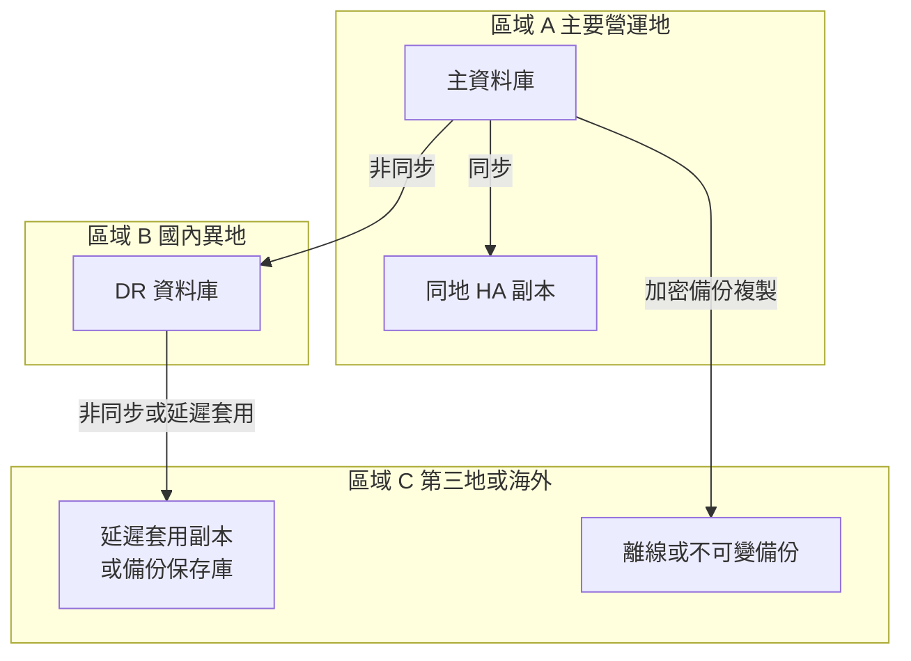

| 項目 | 說明 |
|---|---|
| 目的 | 抵禦區域性重大災害、提供勒索軟體隔離副本 |
| 優點 | 地理隔離高；延遲套用副本可爭取時間攔截邏輯錯誤 |
| 缺點 | 延遲高、成本高、法規與資料主權複雜 |
| 適用 | 監理要求或業務需要第三地備援的關鍵系統 |
| 故障情境 | A、B 同時失效 → 由 C 恢復，RPO 取決於延遲與備份頻率 |
| 一致性 | 非同步，可能遺失數秒至數分鐘以上資料〔依實測〕 |
| 網路中斷 | C 可能長時間落後；需監控並定義可接受落後上限 |
| 切換回切 | 屬重大決策，須高層授權；回切需完整重建與對帳 |
| 成本與風險 | 最高；**必須**確認跨境傳輸、金鑰所在地、供應商存取權限（第 14 章） |

### 4.7 多租戶與分庫分表

| 策略 | 說明 | 考量 |
|---|---|---|
| 垂直拆分 | 依業務領域拆成不同資料庫 | 跨庫交易需 Saga |
| 水平分片 | 依鍵（客戶 ID、租戶 ID）分散到多庫 | 分片鍵選擇、跨片查詢、重新平衡 |
| 資料分區 | 單庫內分區（第 11 章） | 不等於分片，仍受單機資源限制 |
| 多租戶 | 第 12 章詳述 | 隔離與成本取捨 |

### 4.8 跨系統資料整合架構

| 方式 | 一致性 | 延遲 | 適用 |
|---|---|---|---|
| 同步 API | 即時 | 低 | 線上查詢、驗證 |
| 批次檔案 | 批次 | 高 | 日終對帳、大量交換 |
| ETL／ELT | 批次 | 中高 | 資料倉儲 |
| CDC | 最終一致 | 低 | 即時同步、讀取模型 |
| MQ／事件流 | 最終一致 | 低 | 事件驅動、解耦 |

詳見第 12 章。

### 4.9 零信任資料庫存取架構

NIST SP 800-207 的核心觀念是「不因網段位置而信任」。套用到資料庫：每一條連線都必須經過身分驗證、授權與加密，並持續評估情境〔標準〕。

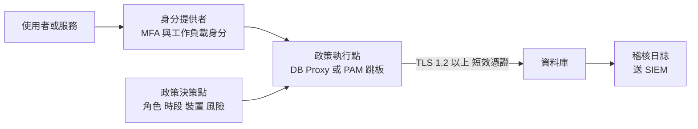

| 控制面向 | 傳統做法 | 零信任做法〔組織建議〕 | 驗證方式 |
|---|---|---|---|
| 網路 | 放在內網即可連線 | 僅允許經 PEP 的來源；資料庫防火牆白名單 | 從非允許網段嘗試連線應失敗 |
| 身分 | 共用帳號、長效密碼 | 個人帳號＋MFA；服務使用短效憑證或 Vault 動態帳密 | 帳號清冊比對、密碼有效期查詢 |
| 授權 | 一次授權長期有效 | 特權採 Just-In-Time 申請，到期自動回收 | 抽查特權帳號在非申請時段是否可登入 |
| 傳輸 | 內網明文 | 全面 TLS，伺服器端強制 | 查詢連線加密狀態（見第 16 章） |
| 監控 | 事後查日誌 | 即時送 SIEM，異常即告警 | 模擬異常查詢觸發告警 |

### 4.10 驗證與審查

#### AI 產出常見錯誤

| 錯誤型態 | 範例 | 如何識別 |
|---|---|---|
| 把複寫當備份 | 「已有同步副本，備份可每週一次」 | 對照 4.2，HA、DR、備份不可互相取代 |
| 異地自動切換未設仲裁 | 「DR 端偵測主中心失聯即自動提升」 | 檢查是否有 Fencing 與第三方仲裁 |
| 忽略讀寫一致性 | 「所有查詢導向唯讀副本」 | 檢查寫後讀情境是否導回主節點 |
| 混合雲未提法遵 | 架構圖直接把個資放雲端 | 檢查是否標註委外與跨境評估 |

#### 人工審查步驟

1. 逐一拓樸檢查「故障情境、一致性、網路中斷、切換回切」四欄是否都已填寫。
2. 以實測或廠商數據驗證複寫延遲是否小於 RPO。
3. 確認同步複寫對寫入延遲的影響已量測（同步複寫延遲約等於站點往返時間加上遠端寫入時間）。

#### 可執行驗證

```sql
-- PostgreSQL：檢查各副本的複寫延遲（主節點執行）
SELECT application_name, state, sync_state,
       write_lag, flush_lag, replay_lag
FROM   pg_stat_replication;

-- SQL Server：檢查 AG 副本的送出與重做佇列
SELECT ar.replica_server_name, drs.synchronization_state_desc,
       drs.log_send_queue_size, drs.redo_queue_size
FROM   sys.dm_hadr_database_replica_states drs
JOIN   sys.availability_replicas ar ON ar.replica_id = drs.replica_id;
```

通過標準〔案例假設〕：同地同步副本 `sync_state = sync`；異地副本 `replay_lag` 長期低於 RPO 的 50%。

### 4.11 常見錯誤

- 以為有同步複寫就不需備份。
- 異地 DR 自動切換，網路短暫中斷即觸發 Split-Brain。
- 讀寫分離後，交易剛寫入即從副本讀取，看到舊資料。
- 混合雲架構未計算資料出口費與專線頻寬。
- 第三地備援未取得法遵與資安同意。

### 4.12 實務案例與注意事項

> **案例〔案例假設〕**：某系統採同地同步＋異地非同步。一次維運人員誤執行無 WHERE 條件的 `UPDATE`，數秒內同步到所有副本。因備份與 PITR 機制完善，最後以 PITR 還原到誤操作前一分鐘的副本環境，再以差異比對修正正式資料。此案例說明複寫不是備份。

### 4.13 本章檢核表

- [ ] 已明確區分 HA、DR、備份與複寫各自的目的。
- [ ] 每個拓樸已定義故障情境、切換與回切程序。
- [ ] 已量測或估算複寫延遲並與 RPO 比對。
- [ ] 已定義網路中斷時的行為與監控。
- [ ] 已評估跨區域與海外部署的法規限制。
- [ ] 已評估成本與操作複雜度。

## 第 5 章 資料模型、ER Model 與資料字典

### 5.1 學習目標

- 掌握實體、屬性、關係與各種鍵的概念。
- 能建立符合銀行情境的 ER Model 與資料字典。
- 能正確設計 ID、時間、金額等關鍵欄位。

> 同目錄的《Entity-Relationship Model (ER Model) 教學手冊》有完整的 ER 基礎教學，本章聚焦在銀行共用平台的設計決策。

### 5.2 基本概念

| 概念 | 定義 | 範例 |
|---|---|---|
| Entity | 需要被記錄的業務事物 | 客戶、帳戶、交易 |
| Attribute | 實體的特性 | 客戶姓名、帳戶狀態 |
| Relationship | 實體間的關聯 | 客戶擁有帳戶 |
| 主鍵（PK） | 唯一識別一筆資料的鍵 | CUSTOMER_ID |
| 候選鍵 | 可作為主鍵的唯一屬性組合 | 證件類別＋證件號碼 |
| 替代鍵（AK） | 未被選為 PK 的候選鍵，以 UNIQUE 保護 | 客戶業務編號 |
| 外鍵（FK） | 參照其他表 PK 的欄位 | ACCOUNT.CUSTOMER_ID |
| 弱實體 | 依附於其他實體才能識別 | 交易明細行 |
| 關聯實體 | 解決多對多關係的實體 | 客戶與帳戶的共同持有關係 |
| 複合鍵 | 多欄位組成的鍵 | (ACCOUNT_ID, SEQ_NO) |

### 5.3 關係基數

| 基數 | 範例 | 實作方式 |
|---|---|---|
| 一對一 | 客戶與客戶風險評估（最新一筆） | FK 加 UNIQUE，或合併成同表 |
| 一對多 | 客戶與帳戶 | 子表 FK |
| 多對多 | 客戶與帳戶（聯名戶） | 關聯表 |

### 5.4 業務主鍵與技術主鍵

| 類型 | 優點 | 缺點 | 建議〔組織建議〕 |
|---|---|---|---|
| 業務主鍵（自然鍵） | 有業務意義、易於理解 | 可能變更、可能含個資 | 以 UNIQUE 保護，不作 PK |
| 技術主鍵（代理鍵） | 穩定、不含個資、JOIN 效率好 | 無業務意義 | 作為 PK |

**原則**：身分證字號等個資**不得**作為主鍵或外鍵，以免個資擴散到所有子表、索引與日誌中。

### 5.5 ID 產生策略

| 策略 | 優點 | 缺點 | 適用 |
|---|---|---|---|
| 資料庫 Sequence／Identity | 簡單、遞增、索引友善 | 跨庫合併衝突、可推測 | 單庫交易表 |
| UUID v4 | 全域唯一、不可推測 | 隨機寫入造成索引分裂、16 bytes | 對外識別碼 |
| UUID v7／時間排序 ID | 全域唯一且大致遞增 | 需確認程式庫支援、含時間資訊 | 分散式系統 PK |
| 業務編號（前綴＋日期＋序號） | 人可讀 | 需集中發號、易洩露量體 | 對外單據號碼 |

**跨系統識別碼建議**：內部 PK 使用 BIGINT 序號；對外暴露另設不可推測的公開識別碼（例如 UUID），避免以遞增序號被列舉。

#### UUIDv7 的產品支援與替代做法

UUIDv7 由 RFC 9562（2024）定義：前 48 位元為 Unix 毫秒時間戳，其餘為隨機值。因大致遞增，寫入 B-tree 時集中在右側葉頁，索引分裂遠少於 UUIDv4〔標準〕。

| 產品 | 內建支援 | 建議做法 |
|---|---|---|
| PostgreSQL 18 | `uuidv7()`（另有 `uuidv4()` 為 `gen_random_uuid()` 別名） | 直接作為預設值 |
| PostgreSQL 17 以前 | 無 | 由應用程式產生，或使用經審查的擴充 |
| Oracle | 無 UUIDv7 專用函數（`SYS_GUID()` 非時間排序） | 應用程式產生，以 `RAW(16)` 儲存 |
| Db2 | 無 | 應用程式產生，以 `CHAR(16) FOR BIT DATA` 儲存 |
| SQL Server | `NEWSEQUENTIALID()` 僅能用於預設值，且重開機後可能改變起點 | 應用程式產生 UUIDv7；注意 `uniqueidentifier` 的排序規則與位元組順序不同，需實測索引行為 |

```sql
-- PostgreSQL 18：對外公開識別碼使用 UUIDv7（示範用途）
CREATE TABLE dep.payment_order (
    order_id     BIGINT GENERATED ALWAYS AS IDENTITY PRIMARY KEY,
    public_id    UUID NOT NULL DEFAULT uuidv7(),
    tenant_id    VARCHAR(16) NOT NULL,
    amount       NUMERIC(19,4) NOT NULL,
    created_at   TIMESTAMPTZ NOT NULL DEFAULT now(),
    CONSTRAINT uk_payment_order_public UNIQUE (public_id)
);

-- 驗證：取出 UUIDv7 內含時間，應與 created_at 相近
SELECT public_id, uuid_extract_timestamp(public_id) AS uuid_ts, created_at
FROM   dep.payment_order
ORDER BY order_id DESC
FETCH FIRST 5 ROWS ONLY;
```

> **安全提醒**：UUIDv7 內含建立時間。若建立時間本身屬機敏資訊（例如可推測開戶時點），對外識別碼應改用 UUIDv4。

### 5.6 共通欄位

| 欄位 | 型別建議 | 說明 |
|---|---|---|
| CREATED_AT | TIMESTAMP（含時區或統一 UTC） | 建立時間 |
| CREATED_BY | VARCHAR(64) | 建立者（使用者或系統帳號） |
| UPDATED_AT | TIMESTAMP | 最後更新時間 |
| UPDATED_BY | VARCHAR(64) | 最後更新者 |
| SOURCE_SYSTEM | VARCHAR(16) | 資料來源系統代碼 |
| ROW_VERSION | INTEGER／BIGINT | 樂觀鎖版本號 |
| TENANT_ID | VARCHAR(16) 或 BIGINT | 多租戶識別（共用 Schema 時） |

**注意**：共通欄位由應用程式或觸發器填入時，須確保所有寫入路徑一致；批次與維運腳本也要填入。

### 5.7 時區、日期與交易時間

| 情境 | 建議 |
|---|---|
| 系統事件時間 | 以 UTC 儲存，顯示時轉換 |
| 營業日（Business Date） | 以 DATE 獨立欄位儲存，不由時間戳推導 |
| 交易時間 vs. 入帳時間 | 分成兩欄，例如 TXN_TIME 與 POSTING_DATE |
| 跨國分行 | 同時記錄 UTC 與當地時區代碼 |
| 夏令時間地區 | 避免以當地時間做排序與計算 |

### 5.8 金額、幣別與精度

| 規則〔組織建議〕 | 說明 |
|---|---|
| 使用精確數值 | DECIMAL(19,4) 或依業務決定，不使用 FLOAT／REAL |
| 幣別獨立欄位 | CURRENCY_CODE CHAR(3)，ISO 4217 |
| 小數位數依幣別 | 部分幣別無小數（如 JPY）；以幣別參數表管理 |
| 四捨五入規則集中 | 由共用元件處理，並記錄於資料字典 |
| 匯率精度 | 匯率另設較高精度，例如 DECIMAL(18,8)〔示範〕 |

### 5.9 銀行客戶與交易案例 ER Model

以下為虛構的「客戶與存款交易」模型，共 7 張表：

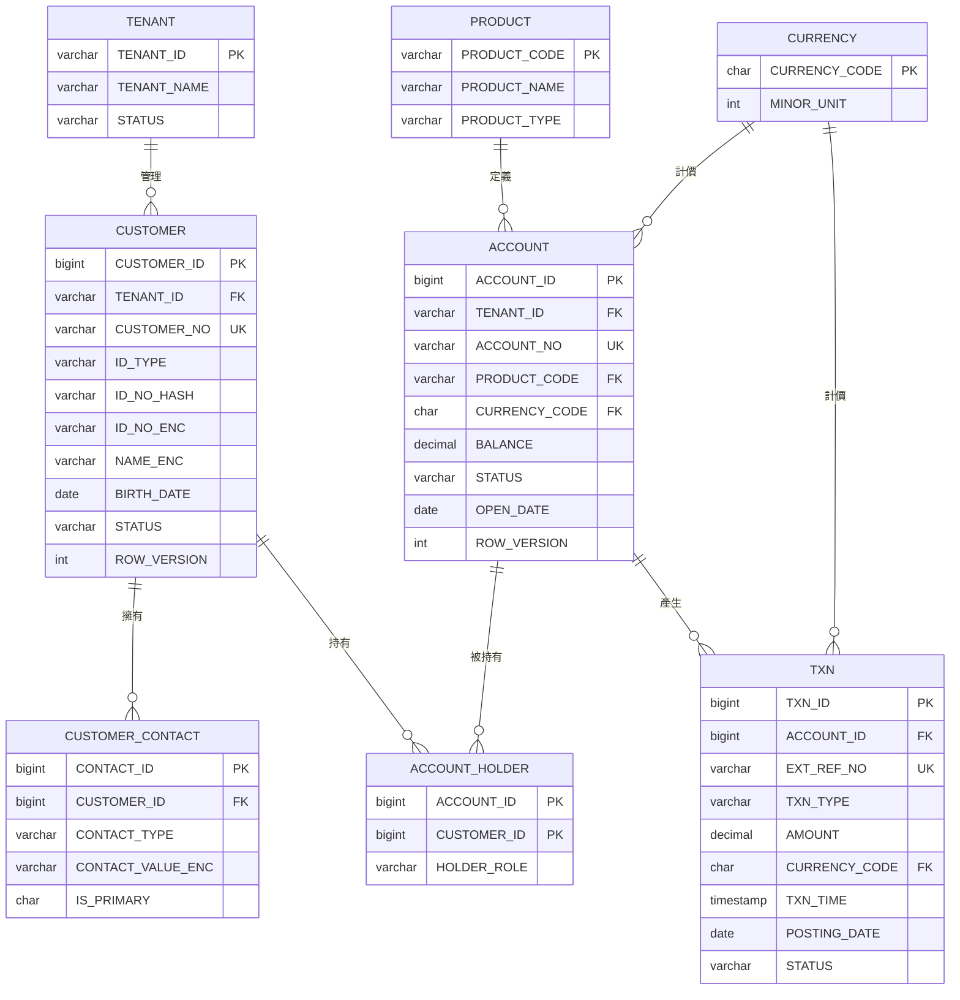

**設計說明**：

1. `ACCOUNT_HOLDER` 解決客戶與帳戶多對多（聯名戶、法定代理人）。
2. 證件號碼以 `ID_NO_HASH`（供等值查詢，使用帶祕密鹽值的雜湊）與 `ID_NO_ENC`（加密原值）分開儲存。
3. `TXN.EXT_REF_NO` 為外部交易序號，以 UNIQUE 防止重複入帳。
4. `TENANT_ID` 出現在主要業務表，支援共用 Schema 多租戶（第 12 章）。

### 5.10 資料字典範本與範例

| 表 | 欄位 | 中文名稱 | 型別 | 可空 | 預設 | 約束 | 分類 | 說明 |
|---|---|---|---|---|---|---|---|---|
| CUSTOMER | CUSTOMER_ID | 客戶內部序號 | BIGINT | N | Sequence | PK | 內部 | 技術主鍵，不對外 |
| CUSTOMER | CUSTOMER_NO | 客戶編號 | VARCHAR(20) | N | | UK | 內部 | 對外顯示之客戶編號 |
| CUSTOMER | ID_NO_HASH | 證號雜湊 | VARCHAR(64) | N | | UK(TENANT_ID, ID_TYPE, ID_NO_HASH) | 個人資料 | HMAC 雜湊，金鑰存於 KMS |
| CUSTOMER | ID_NO_ENC | 證號密文 | VARBINARY／RAW | N | | | 高度機敏 | 應用層加密 |
| CUSTOMER | STATUS | 客戶狀態 | VARCHAR(10) | N | 'ACTIVE' | CHECK IN (ACTIVE, DORMANT, CLOSED) | 內部 | |
| ACCOUNT | BALANCE | 帳戶餘額 | DECIMAL(19,4) | N | 0 | | 機敏 | 由交易累計，對帳驗證 |
| TXN | AMOUNT | 交易金額 | DECIMAL(19,4) | N | | CHECK (AMOUNT <> 0) | 機敏 | 正數入帳、負數出帳 |
| TXN | POSTING_DATE | 入帳營業日 | DATE | N | | | 內部 | 依營業日曆 |

### 5.11 代碼表、狀態欄位與共用主檔

| 設計選擇 | 適用 | 注意 |
|---|---|---|
| CHECK 約束列舉 | 值少且穩定（狀態） | 新增值需 DDL |
| 代碼表＋FK | 值會增加、需多語系描述 | 需管理代碼版本 |
| 通用代碼表（CODE_TYPE, CODE） | 大量小型代碼 | 無法對單一類型建 FK，**不建議**用於核心欄位 |

### 5.12 資料血緣

資料血緣記錄「資料從哪來、經過什麼轉換、流向哪裡」。最低要求〔組織建議〕：

| 欄位 | 說明 |
|---|---|
| 目標表與欄位 | 例如 RPT_DAILY_BAL.BALANCE |
| 來源表與欄位 | ACCOUNT.BALANCE |
| 轉換規則 | 依 POSTING_DATE 彙總 |
| 處理程式 | BAT-DAILY-BAL |
| 更新頻率 | 每日 |
| 負責人 | 資料管理者 |

### 5.13 時態資料與歷史追蹤

銀行常需回答「某帳戶在 3 月 31 日當時的利率是多少」。只保留最新值的表無法回答，需要時態設計。

| 時間維度 | 意義 | 範例 |
|---|---|---|
| 系統時間（System Time） | 資料庫何時記錄此列 | 資料在 4/2 10:00 被更正 |
| 業務有效時間（Application Time） | 此值在真實世界何時有效 | 利率自 4/1 起生效 |
| 雙時態（Bitemporal） | 兩者兼具 | 「4/2 更正」「自 4/1 起生效」兩件事都能查 |

| 產品 | 系統版本化 | 業務有效期間約束 |
|---|---|---|
| SQL Server | System-Versioned Temporal Table（2016 起） | 無內建，需觸發器或應用檢查 |
| Db2 | System-period 與 Application-period Temporal Table（支援雙時態） | `BUSINESS_TIME WITHOUT OVERLAPS` |
| Oracle | Flashback Data Archive（需設定保留） | Temporal Validity（`PERIOD FOR`），重疊檢查需自行實作 |
| PostgreSQL | 無內建，需觸發器或擴充 | 18 起 `WITHOUT OVERLAPS`（PK／UNIQUE）與 `PERIOD`（FK） |

```sql
-- PostgreSQL 18：同一帳戶的利率有效期間不得重疊（示範用途）
CREATE EXTENSION IF NOT EXISTS btree_gist;

CREATE TABLE dep.account_rate (
    account_id  BIGINT        NOT NULL,
    valid_at    DATERANGE     NOT NULL,
    rate        NUMERIC(9,6)  NOT NULL,
    CONSTRAINT pk_account_rate PRIMARY KEY (account_id, valid_at WITHOUT OVERLAPS)
);

-- 驗證：第二筆期間重疊，預期回傳違反約束錯誤
INSERT INTO dep.account_rate VALUES (1, '[2026-01-01,2026-07-01)', 0.012000);
INSERT INTO dep.account_rate VALUES (1, '[2026-06-01,2026-12-31)', 0.013000);

-- 查詢某日有效利率
SELECT rate FROM dep.account_rate
WHERE  account_id = 1 AND valid_at @> DATE '2026-03-31';
```

```sql
-- SQL Server：系統版本化時態表與時點查詢（示範用途）
CREATE TABLE dep.customer_risk (
    customer_id  BIGINT       NOT NULL PRIMARY KEY,
    risk_level   VARCHAR(10)  NOT NULL,
    valid_from   DATETIME2 GENERATED ALWAYS AS ROW START NOT NULL,
    valid_to     DATETIME2 GENERATED ALWAYS AS ROW END   NOT NULL,
    PERIOD FOR SYSTEM_TIME (valid_from, valid_to)
) WITH (SYSTEM_VERSIONING = ON (HISTORY_TABLE = dep.customer_risk_history));

SELECT customer_id, risk_level
FROM   dep.customer_risk FOR SYSTEM_TIME AS OF '2026-03-31T23:59:59'
WHERE  customer_id = 1001;
```

設計注意：

- 歷史表會持續增長，**必須**納入保存政策與容量估算（第 10、11 章）。
- 歷史表含個資時，刪除或去識別化要同時處理歷史表。
- 時態表不等於稽核日誌：它不記錄「誰」做了變更，稽核仍需第 13 章機制。

### 5.14 資料元素登錄（ISO/IEC 11179 精神）

資料字典描述「某張表的某個欄位」；資料元素登錄則描述「全行共用的業務概念」，讓不同系統的同義欄位可以對應到同一個定義〔標準〕。

| 屬性 | 說明 | 範例 |
|---|---|---|
| 資料元素識別碼 | 全行唯一 | DE-000123 |
| 資料元素名稱 | 物件類別＋屬性＋表示類別 | 帳戶．可用餘額．金額 |
| 定義 | 精準、非循環、不含實作細節 | 帳戶餘額扣除圓存與凍結金額後可立即動用之金額 |
| 值域 | 型別、精度、單位、允許值 | DECIMAL(19,4)，幣別由 CURRENCY_CODE 表示 |
| 註冊狀態 | 草稿／審核中／標準化／廢止 | 標準化 |
| 管理者 | 負責維護定義的單位 | 存匯部 |
| 實作對應 | 各系統實際欄位 | DEP.ACCOUNT.AVAIL_BAL、RPT.DAILY_BAL.AVAIL_AMT |

審查重點：同一個資料元素對應的所有實作欄位，型別與精度應一致；不一致者需列入技術債。

### 5.15 驗證與審查

#### AI 產出常見錯誤

| 錯誤型態 | 範例 | 如何識別 |
|---|---|---|
| 以個資為鍵 | `PRIMARY KEY (id_no)` | 對照資料分類，個資欄位不得為 PK／FK |
| 多對多漏關聯表 | 客戶表放 `ACCOUNT_IDS` 字串 | 檢查是否有逗號分隔或陣列欄位 |
| 金額缺幣別 | 只有 `AMOUNT` | 每個金額欄位旁應有幣別欄位或可推導來源 |
| 臆測基數 | 聯名戶被設計成一對多 | 向業務確認每條關係的基數 |

#### 人工審查步驟

1. 以業務情境逐條讀出關係（「一個客戶可有多個帳戶」），請業務端確認。
2. 比對資料字典與實際 Schema，確認同步。
3. 檢查所有 FK 欄位是否有索引（避免刪除父表時全表掃描與鎖定）。

#### 可執行驗證

```sql
-- PostgreSQL：找出沒有對應索引的外鍵（預期 0 筆）
SELECT c.conrelid::regclass AS table_name, c.conname AS fk_name
FROM   pg_constraint c
WHERE  c.contype = 'f'
AND    NOT EXISTS (
         SELECT 1 FROM pg_index i
         WHERE  i.indrelid = c.conrelid
         AND    (i.indkey::int2[])[0:cardinality(c.conkey) - 1] = c.conkey
       );

-- 比對資料字典：列出實際欄位，匯出後與字典文件做差異比對
SELECT table_schema, table_name, column_name, data_type,
       character_maximum_length, numeric_precision, numeric_scale, is_nullable
FROM   information_schema.columns
WHERE  table_schema IN ('cust', 'dep')
ORDER BY table_schema, table_name, ordinal_position;
```

通過標準：未建索引外鍵 0 筆（或已附例外理由）；資料字典與 Schema 差異 0 筆。

### 5.16 常見錯誤

- 以個資作為 PK 或 FK。
- 只有一個日期欄位，混用交易時間與營業日。
- 金額不帶幣別。
- 多對多直接用逗號字串存在單一欄位。
- 資料字典與實際 Schema 不同步。

### 5.17 實務案例與注意事項

> **案例**：舊系統以身分證字號為客戶主鍵，客戶更正證號時必須連鎖更新 40 張表，且所有索引、日誌都含證號。新系統改以技術主鍵加雜湊欄位，證號更正僅需更新客戶主檔。

### 5.18 本章檢核表

- [ ] 每張表都有技術主鍵，業務鍵以 UNIQUE 保護。
- [ ] 個資不作為 PK／FK。
- [ ] 多對多以關聯表實作。
- [ ] 時間欄位已區分系統時間與營業日。
- [ ] 金額使用精確數值並附幣別。
- [ ] 已建立資料字典並標示分類。
- [ ] 已記錄主要資料血緣。

## 第 6 章 正規化與反正規化

### 6.1 學習目標

- 理解 1NF、2NF、3NF、BCNF 與函數相依。
- 能辨識新增、更新、刪除異常。
- 能在有證據的前提下做反正規化，並維持一致性。

### 6.2 函數相依與異常

**函數相依**：若知道 A 的值即可唯一決定 B 的值，稱 B 函數相依於 A（A → B）。

| 異常 | 說明 | 範例 |
|---|---|---|
| 新增異常 | 無法在缺少其他資料時新增 | 沒有交易就無法新增客戶 |
| 更新異常 | 同一事實多處儲存，更新不一致 | 客戶地址存在每筆交易 |
| 刪除異常 | 刪除一筆資料連帶遺失其他事實 | 刪除最後一筆交易導致客戶資料消失 |

### 6.3 案例：從未正規化到 3NF

**未正規化（UNF）**：一張「交易紀錄」表〔示範資料〕：

| TXN_NO | TXN_DATE | ACCOUNT_NO | CUSTOMER_NAME | CUSTOMER_PHONES | PRODUCT_CODE | PRODUCT_NAME | AMOUNT |
|---|---|---|---|---|---|---|---|
| T001 | 2026-01-05 | A100 | 王小明 | 0900000001, 0200000001 | SAV | 活期儲蓄 | 1000 |
| T002 | 2026-01-06 | A100 | 王小明 | 0900000001, 0200000001 | SAV | 活期儲蓄 | -500 |

問題：電話欄位多值、客戶與產品資料重複。

**第一正規化（1NF）**：每個欄位為不可分割的單一值。把電話拆出：

- `CUSTOMER_PHONE(CUSTOMER_ID, PHONE)`

**第二正規化（2NF）**：在 1NF 基礎上，非鍵屬性完全相依於整個主鍵（消除部分相依）。若某表以 `(ACCOUNT_NO, TXN_NO)` 為複合鍵，而 `PRODUCT_CODE` 只相依於 `ACCOUNT_NO`，則需把帳戶屬性拆出。

**第三正規化（3NF）**：消除遞移相依。`ACCOUNT_NO → PRODUCT_CODE → PRODUCT_NAME`，因此 `PRODUCT_NAME` 應移到產品表。

**正規化結果**：

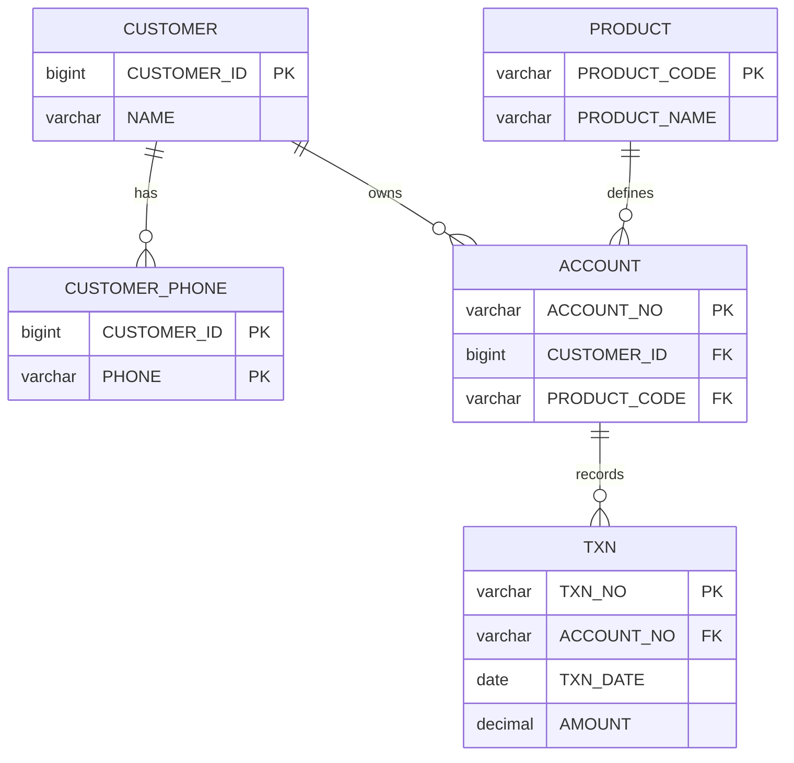

### 6.4 BCNF

BCNF 要求每個非平凡函數相依的左側都是超鍵。多數 3NF 設計已符合 BCNF；違反通常出現在「有多個重疊候選鍵」的情境。

**範例**：理專排班表 `(BRANCH, SERVICE_TYPE, ADVISOR)`，規則為每位理專只屬一家分行（ADVISOR → BRANCH），且每家分行的每種服務只由一位理專負責。此時 ADVISOR 不是超鍵卻決定 BRANCH，違反 BCNF。拆成 `ADVISOR(ADVISOR, BRANCH)` 與 `ADVISOR_SERVICE(ADVISOR, SERVICE_TYPE)` 可消除，但原規則「每分行每服務一人」需改以其他約束或應用程式維護。**是否拆分應依情境評估**。

### 6.5 反正規化的必要條件

反正規化**必須**同時符合：

1. 有量測證據顯示正規化設計無法達到效能需求（執行計畫、壓測結果）。
2. 已嘗試索引、查詢改寫、統計資訊更新等較低風險方案。
3. 已定義冗餘資料的一致性維護機制與驗證方式。
4. 已在設計文件記錄並經審查。

「減少 JOIN」本身**不是**反正規化的充分理由；現代資料庫對有適當索引的 JOIN 處理效率很高。

### 6.6 常見反正規化手法

| 手法 | 範例 | 一致性維護 |
|---|---|---|
| 快取欄位 | ACCOUNT.BALANCE（由交易累計） | 同一交易內更新、每日對帳 |
| 預先彙總表 | 每日帳戶餘額快照 | 批次產生、比對來源總數 |
| 讀取模型（CQRS） | 查詢專用寬表 | CDC 或事件同步、延遲監控 |
| 物化檢視 | Oracle Materialized View、PostgreSQL Materialized View、SQL Server Indexed View | 刷新策略、刷新失敗告警 |
| 冗餘外鍵屬性 | TXN 帶 CUSTOMER_ID | 由寫入流程保證，定期稽核 |

### 6.7 案例：帳戶餘額的反正規化

需求：查詢帳戶餘額需 P95 小於 50 ms〔案例假設〕。若每次以 `SUM(AMOUNT)` 計算，交易量大的帳戶會超出要求。

```sql
-- 適用：PostgreSQL 16+／示範，待驗證
-- 在同一交易內寫入交易並更新快取餘額
BEGIN;

INSERT INTO txn (txn_id, account_id, ext_ref_no, txn_type, amount, currency_code, txn_time, posting_date, status)
VALUES (nextval('seq_txn'), :account_id, :ext_ref_no, 'DEP', :amount, 'TWD', now(), :business_date, 'POSTED');

UPDATE account
   SET balance     = balance + :amount,
       row_version = row_version + 1,
       updated_at  = now()
 WHERE account_id  = :account_id
   AND status      = 'ACTIVE';

-- 應用程式檢查 UPDATE 影響筆數必須為 1，否則 ROLLBACK
COMMIT;
```

```sql
-- 每日對帳：快取餘額與交易累計是否一致（示範）
SELECT a.account_id, a.balance, COALESCE(SUM(t.amount), 0) AS calc_balance
  FROM account a
  LEFT JOIN txn t ON t.account_id = a.account_id AND t.status = 'POSTED'
 GROUP BY a.account_id, a.balance
HAVING a.balance <> COALESCE(SUM(t.amount), 0);
```

> 實務上全量對帳成本高，**建議**以「期初餘額＋當日交易」增量方式對帳，並在離峰或副本上執行。

### 6.8 以執行計畫與壓測評估

| 步驟 | 動作 |
|---|---|
| 1 | 準備接近正式量體與分布的測試資料（去識別化） |
| 2 | 對正規化設計擷取執行計畫與實際執行統計 |
| 3 | 嘗試索引與改寫，再次量測 |
| 4 | 若仍不達標，設計反正規化方案並量測讀寫兩端 |
| 5 | 比較寫入成本、儲存成本與一致性風險 |
| 6 | 記錄決策與證據 |

### 6.9 反正規化的對帳機制與告警門檻

每個反正規化欄位都**必須**具備「對帳方法、頻率、容限、告警對象、修正程序」五項定義。

| 對帳項目 | 方法 | 頻率〔組織建議〕 | 容限 | 告警 | 修正程序 |
|---|---|---|---|---|---|
| 帳戶快取餘額 | 期初餘額＋當日交易 ＝ 期末餘額 | 每日日終 | 差異 0 筆 | 任一筆即 P1 | 凍結該帳戶密集異動、由帳務人員調查後以雙人覆核腳本修正 |
| 物化檢視彙總 | 與來源表抽樣比對 | 每次刷新後 | 抽樣 1,000 筆差異 0 | 差異 > 0 即 P3 | 重新完整刷新 |
| 讀取模型延遲 | 比對最後同步時間 | 持續 | ≤ 60 秒〔案例假設〕 | > 5 分鐘 P2 | 檢查 CDC 積壓 |

```sql
-- PostgreSQL：增量對帳（示範用途），預期結果 0 筆
-- account_daily_bal 存放每日日終餘額快照
WITH day_txn AS (
    SELECT account_id, SUM(amount) AS day_amt
    FROM   txn
    WHERE  posting_date = :business_date
    AND    status = 'POSTED'
    GROUP BY account_id
)
SELECT a.account_id,
       p.balance                       AS opening_bal,
       COALESCE(d.day_amt, 0)          AS day_amt,
       a.balance                       AS cached_bal,
       p.balance + COALESCE(d.day_amt, 0) - a.balance AS diff
FROM   account a
JOIN   account_daily_bal p
       ON p.account_id = a.account_id
      AND p.bal_date   = :business_date - 1
LEFT JOIN day_txn d ON d.account_id = a.account_id
WHERE  p.balance + COALESCE(d.day_amt, 0) <> a.balance;
```

> 對帳必須在「日終鎖帳」後或以一致性快照執行，否則對帳期間仍有交易寫入，會產生假性差異。

### 6.10 驗證與審查

#### AI 產出常見錯誤

| 錯誤型態 | 範例 | 如何識別 |
|---|---|---|
| 無證據反正規化 | 「為提升效能，把客戶姓名複製到交易表」 | 要求提供執行計畫與壓測數據 |
| 正規化推導錯誤 | 將具傳遞相依的表宣稱為 3NF | 自行列出函數相依並檢查 |
| 忽略寫入端成本 | 只報告查詢變快 | 檢查是否量測寫入 TPS 與鎖等待 |
| 缺對帳設計 | 新增快取欄位但未提修正流程 | 對照本章對帳機制五項定義 |

#### 人工審查步驟

1. 對每張核心表列出主鍵與所有非鍵欄位，逐一問「此欄位是否只依賴完整主鍵」。
2. 對每個反正規化決策確認有前後對比的執行計畫與壓測數據。
3. 在測試環境刻意製造不一致（直接修改快取餘額），確認對帳 SQL 能抓到且告警會觸發。

#### 通過標準

- 核心交易表無傳遞相依；例外皆有審查紀錄。
- 故障注入測試中，對帳抓到 100% 的人為差異。

### 6.11 常見錯誤

- 為了「以後可能很慢」預先反正規化。
- 冗餘欄位沒有對帳機制。
- 物化檢視刷新失敗沒有告警。
- 讀取模型延遲未告知使用者。

### 6.12 實務案例與注意事項

> **案例**：某報表系統把客戶姓名冗餘存入每筆交易以「加快查詢」，客戶更名後歷史報表出現新舊姓名混雜，且個資散布到數億筆交易中，增加遮罩與刪除難度。若確有需求，應改為報表層 JOIN 或明確定義「交易當下姓名快照」的業務意義與保存規則。

### 6.13 本章檢核表

- [ ] 核心交易表至少符合 3NF。
- [ ] 每個反正規化設計都有效能證據與審查紀錄。
- [ ] 冗餘資料有一致性維護與對帳機制。
- [ ] 物化檢視或讀取模型有刷新與延遲監控。
- [ ] 未將個資冗餘到大量交易表。

## 第 7 章 Schema、Table 與欄位命名規範

### 7.1 學習目標

- 建立一致、可跨資料庫移植的命名標準。
- 理解各資料庫識別字限制與大小寫行為差異。

### 7.2 統一命名原則〔組織建議〕

| 原則 | 規則 |
|---|---|
| 字元集 | 僅使用英文大寫字母、數字與底線 `A-Z 0-9 _`，首字為字母 |
| 大小寫 | 不使用引號識別字；DDL 中一律以未加引號方式撰寫 |
| 單複數 | 表名使用單數（CUSTOMER、ACCOUNT） |
| 分隔 | 以底線分隔單字（CUSTOMER_CONTACT） |
| 長度 | 物件名稱不超過 30 字元，以相容舊版與工具（即使新版允許更長） |
| 保留字 | 不得使用 SQL 保留字（USER、ORDER、GROUP、DATE、LEVEL、COMMENT 等） |
| 縮寫 | 只能使用企業縮寫字典中的縮寫，不自創 |
| 語意 | 名稱需反映業務意義，不使用 TEMP1、DATA2 |
| 布林欄位 | 以 `IS_`、`HAS_` 開頭（`IS_PRIMARY`） |
| 日期時間 | 日期以 `_DATE` 結尾、時間戳以 `_AT` 或 `_TIME` 結尾 |
| 金額 | 以 `_AMT` 結尾並搭配 `_CCY` 或 `CURRENCY_CODE` |

### 7.3 物件命名規範表

| 物件 | 格式 | 範例 |
|---|---|---|
| Database | `<系統代碼>_<環境>`（若產品需要） | CORE_PRD |
| Schema | `<系統代碼>` 或 `<系統代碼>_<用途>` | DEP、DEP_RPT |
| Table | `<業務名詞>` | ACCOUNT |
| 歷史表 | `<表名>_HIS` | ACCOUNT_HIS |
| 封存表 | `<表名>_ARC` | TXN_ARC |
| 暫存表 | `TMP_<用途>` | TMP_BATCH_LOAD |
| 介接表 | `IF_<對方系統>_<用途>` | IF_CRM_CUSTOMER |
| 主鍵 | `PK_<表名>` | PK_ACCOUNT |
| 外鍵 | `FK_<子表>_<父表>[_<序號>]` | FK_TXN_ACCOUNT |
| 唯一約束 | `UK_<表名>_<欄位縮寫>` | UK_TXN_EXT_REF |
| CHECK 約束 | `CK_<表名>_<欄位縮寫>` | CK_ACCOUNT_STATUS |
| 一般索引 | `IX_<表名>_<欄位縮寫>` | IX_TXN_ACCT_TIME |
| Sequence | `SEQ_<表名>` | SEQ_TXN |
| View | `V_<名稱>` | V_ACCOUNT_SUMMARY |
| Materialized View | `MV_<名稱>` | MV_DAILY_BAL |
| Trigger | `TRG_<表名>_<時機><事件>` | TRG_ACCOUNT_BU（Before Update） |
| Procedure | `PRC_<動詞>_<名詞>` | PRC_POST_TXN |
| Function | `FN_<動詞>_<名詞>` | FN_CALC_INTEREST |
| Partition | `P_<期間或值>` | P_202601 |
| Tablespace | `TS_<系統>_<用途>` | TS_DEP_DATA、TS_DEP_IDX |

### 7.4 Migration Script 命名

| 工具 | 格式 | 範例 |
|---|---|---|
| Flyway 版本化腳本 | `V<版本>__<描述>.sql` | `V2026.01.001__create_account.sql` |
| Flyway 可重複腳本 | `R__<描述>.sql` | `R__v_account_summary.sql` |
| Liquibase | `<序號>-<描述>.<格式>` | `0001-create-account.yaml` |

描述使用小寫英文與底線，一個腳本只處理一個邏輯變更。

### 7.5 各資料庫識別字差異

> 以下為一般性說明，實際限制**必須**以使用版本的官方文件為準。

| 項目 | Oracle | Db2 LUW | PostgreSQL | SQL Server |
|---|---|---|---|---|
| 未加引號名稱大小寫 | 轉為大寫 | 轉為大寫 | 轉為小寫 | 保留原樣，比對是否區分大小寫依 Collation |
| 識別字長度上限 | 12.2 起 128 bytes，之前 30 bytes | 多數物件 128 bytes（依物件類型不同） | 預設 63 bytes（NAMEDATALEN − 1） | 128 字元 |
| 加引號後 | 區分大小寫 | 區分大小寫 | 區分大小寫 | 依 Collation |

**實務影響**：若在 PostgreSQL 以 `"Account"` 建立，之後查詢 `SELECT * FROM account` 將找不到物件。統一不使用引號可避免此問題。另外，長度上限以 bytes 計算時，多位元組字元會更快超過上限，這也是只用英數字的原因之一。

### 7.6 正確與錯誤範例

| 錯誤 | 問題 | 正確 |
|---|---|---|
| `"CustomerInfo"` | 引號與混合大小寫 | CUSTOMER |
| `tbl_customer` | 無意義前綴 | CUSTOMER |
| `CUSTOMERS` | 複數 | CUSTOMER |
| `ORDER` | 保留字 | TXN_ORDER |
| `ACC_BAL2` | 意義不明的數字 | ACCOUNT_BALANCE_SNAPSHOT |
| `CUST_ID_NO` | 欄名暗示存放明文證號 | ID_NO_HASH、ID_NO_ENC |
| `FLAG1` | 無語意 | IS_DORMANT |
| `UPD_DT` | 自創縮寫 | UPDATED_AT |

### 7.7 企業縮寫字典範例

| 全名 | 縮寫 |
|---|---|
| ACCOUNT | ACCT（僅用於索引、約束名） |
| AMOUNT | AMT |
| CURRENCY | CCY |
| CUSTOMER | CUST（僅用於索引、約束名） |
| REFERENCE | REF |
| TRANSACTION | TXN |
| NUMBER | NO |
| ADDRESS | ADDR |
| AVAILABLE | AVAIL |
| BALANCE | BAL |
| BRANCH | BRCH |
| BUSINESS | BIZ |
| CODE | CD（僅用於索引、約束名） |
| DESCRIPTION | DESC_TXT（避免保留字 DESC） |
| ENCRYPTED | ENC |
| EXTERNAL | EXT |
| HISTORY | HIS |
| IDENTIFIER | ID |
| INTEREST | INT_RATE（利率）／INT_AMT（利息） |
| MAXIMUM | MAX |
| MINIMUM | MIN |
| ORGANIZATION | ORG |
| PREVIOUS | PREV |
| QUANTITY | QTY |
| SEQUENCE | SEQ |
| STATUS | STS（僅用於索引、約束名） |
| TEMPORARY | TMP |

縮寫字典本身應放在版控庫並由資料管理者維護，新增縮寫需經審核。

**建議**：表名與欄名盡量使用全名，縮寫主要用於長度受限的索引與約束名稱。

### 7.8 以 CI 自動檢查命名規範

人工審查命名易遺漏，**建議**在 CI 中對 Migration Script 與實際 Schema 各做一次檢查。

```sql
-- PostgreSQL：找出不符命名規則的物件（預期 0 筆）
-- 規則：只允許小寫英數與底線、首字為字母、長度 <= 30
SELECT 'table' AS obj_type, table_schema AS schema_name, table_name AS obj_name
FROM   information_schema.tables
WHERE  table_schema IN ('cust', 'dep')
AND    (table_name !~ '^[a-z][a-z0-9_]*$' OR length(table_name) > 30)
UNION ALL
SELECT 'constraint', n.nspname, c.conname
FROM   pg_constraint c
JOIN   pg_namespace n ON n.oid = c.connamespace
WHERE  n.nspname IN ('cust', 'dep')
AND    NOT (
         (c.contype = 'p' AND c.conname LIKE 'pk\_%') OR
         (c.contype = 'f' AND c.conname LIKE 'fk\_%') OR
         (c.contype = 'u' AND c.conname LIKE 'uk\_%') OR
         (c.contype = 'c' AND c.conname LIKE 'ck\_%') OR
         c.contype NOT IN ('p', 'f', 'u', 'c')
       );
```

```bash
# Migration Script 檔名檢查（示範用途）：不符合 Flyway 命名即失敗
bad=$(find db/migration -name '*.sql' \
      | grep -Ev '/(V[0-9]{4}\.[0-9]{2}\.[0-9]{3}__[a-z0-9_]+|R__[a-z0-9_]+)\.sql$')
if [ -n "$bad" ]; then
  echo "命名不符："; echo "$bad"; exit 1
fi
```

### 7.9 驗證與審查

#### AI 產出常見錯誤

| 錯誤型態 | 範例 | 如何識別 |
|---|---|---|
| 自創縮寫 | `CUST_ADR_LN1` | 比對企業縮寫字典 |
| 套用其他慣例 | 使用 camelCase 或複數表名 | 執行命名檢查 SQL |
| 使用保留字 | `LEVEL`、`COMMENT` 作為欄名 | 對照各產品保留字清單 |
| 約束未命名 | `UNIQUE (ext_ref_no)` 未給名稱 | 系統產生名稱在各環境不同，無法穩定以名稱 DROP |

#### 人工審查步驟

1. 在 CI 執行本章命名檢查，結果需為 0 筆。
2. 抽檢新欄位名稱是否反映業務意義，而非實作細節。
3. 確認所有約束與索引都有明確名稱。

#### 通過標準

- 命名檢查 0 筆違規；例外已登錄於命名例外清單並經審核。

### 7.10 常見錯誤

- 同一概念在不同表使用不同欄名（CUST_ID、CUSTOMER_ID、CID）。
- 由 ORM 自動產生名稱，未經審查。
- 物件命名與實際用途不符（TMP 表長期存放正式資料）。

### 7.11 實務案例與注意事項

> **案例**：某系統從 SQL Server 遷移到 PostgreSQL，原系統大量使用混合大小寫名稱，轉換後所有 SQL 都需加引號，ORM 對映也需重寫。若一開始就遵守「大寫英數加底線、不加引號」，遷移成本可大幅降低。

### 7.12 本章檢核表

- [ ] 所有物件名稱符合命名規範表。
- [ ] 未使用引號識別字與保留字。
- [ ] 縮寫來自企業縮寫字典。
- [ ] 同一概念在全平台使用相同欄名。
- [ ] Migration Script 命名符合工具格式。

## 第 8 章 欄位型別、完整性與交易設計

### 8.1 學習目標

- 能為各類資料選擇正確型別。
- 能用資料庫約束保護完整性。
- 能設計正確的交易、併發控制與跨服務一致性機制。

### 8.2 型別選擇原則

| 資料 | 建議 | 避免 |
|---|---|---|
| 金額 | DECIMAL／NUMERIC／NUMBER(19,4) | FLOAT、DOUBLE、REAL |
| 計數 | INTEGER、BIGINT | 字串 |
| 代碼 | VARCHAR(n)、CHAR(n)（固定長度代碼） | 過長 VARCHAR(4000) |
| 中文姓名、地址 | Unicode 可變長字串 | 非 Unicode 編碼 |
| 日期 | DATE | 字串 'YYYYMMDD' |
| 時間戳 | TIMESTAMP（含精度與時區策略） | 數字型 epoch 無說明 |
| 是否 | BOOLEAN 或 CHAR(1) 搭配 CHECK | 無約束的 'Y'／'N'／'1' 混用 |
| 文件、影像 | 物件儲存＋資料庫存參照 | 大量 BLOB 放在交易表 |
| 半結構資料 | JSON 型別（產品支援時） | 用 JSON 取代應有的欄位與約束 |

### 8.3 NULL 與預設值

- NULL 代表「未知或不適用」，不是 0 或空字串。
- 必要欄位**必須**設為 NOT NULL。
- Oracle 會把空字串 `''` 視為 NULL，其他三種資料庫不會；跨庫程式**不可**依賴此行為。
- 預設值應有業務意義（例如狀態預設 'ACTIVE'），避免以預設值掩蓋缺漏。

### 8.4 完整性約束

```sql
-- 適用：PostgreSQL 16+／示範，待驗證
CREATE TABLE account (
    account_id     BIGINT        NOT NULL,
    tenant_id      VARCHAR(16)   NOT NULL,
    account_no     VARCHAR(20)   NOT NULL,
    product_code   VARCHAR(10)   NOT NULL,
    currency_code  CHAR(3)       NOT NULL,
    balance        NUMERIC(19,4) NOT NULL DEFAULT 0,
    status         VARCHAR(10)   NOT NULL DEFAULT 'ACTIVE',
    open_date      DATE          NOT NULL,
    row_version    INTEGER       NOT NULL DEFAULT 0,
    created_at     TIMESTAMPTZ   NOT NULL DEFAULT now(),
    created_by     VARCHAR(64)   NOT NULL,
    updated_at     TIMESTAMPTZ   NOT NULL DEFAULT now(),
    updated_by     VARCHAR(64)   NOT NULL,
    CONSTRAINT pk_account PRIMARY KEY (account_id),
    CONSTRAINT uk_account_no UNIQUE (tenant_id, account_no),
    CONSTRAINT fk_account_product FOREIGN KEY (product_code) REFERENCES product (product_code),
    CONSTRAINT fk_account_currency FOREIGN KEY (currency_code) REFERENCES currency (currency_code),
    CONSTRAINT ck_account_status CHECK (status IN ('ACTIVE', 'FROZEN', 'CLOSED'))
);
```

各產品語法差異：

| 項目 | Oracle | Db2 | PostgreSQL | SQL Server |
|---|---|---|---|---|
| 金額型別 | NUMBER(19,4) | DECIMAL(19,4) | NUMERIC(19,4) | DECIMAL(19,4) |
| 時間戳預設 | SYSTIMESTAMP | CURRENT TIMESTAMP | now() | SYSUTCDATETIME() |
| 含時區時間戳 | TIMESTAMP WITH TIME ZONE | TIMESTAMP（無時區型別，建議統一存 UTC） | TIMESTAMPTZ | DATETIMEOFFSET |
| Unicode 字串 | VARCHAR2(n CHAR)（AL32UTF8 字元集） | VARCHAR(n)（UTF-8 資料庫，長度單位依 CODEUNITS 設定） | VARCHAR(n)（UTF8 編碼） | NVARCHAR(n) 或 UTF-8 Collation |

### 8.5 金額處理

- 金額欄位使用精確數值；計算時程式語言也**必須**使用精確型別（Java `BigDecimal`、C# `decimal`）。
- 四捨五入方式（四捨五入、銀行家捨入、無條件捨去）由業務規則定義並集中實作。
- 加總、分攤後產生的尾差，需定義歸屬規則（例如尾差歸最後一筆）。

```java
// 示範：Java 金額計算使用 BigDecimal，捨入模式由業務規則決定
BigDecimal interest = principal
        .multiply(rate)
        .divide(BigDecimal.valueOf(365), 4, RoundingMode.HALF_UP);
```

### 8.6 LOB、JSON 與大型物件

| 情境 | 建議 |
|---|---|
| 掃描影像、PDF | 存物件儲存，資料庫存檔案 ID、雜湊值、大小、存放位置 |
| 介接原始電文 | 短期保存可用 LOB 或獨立表，設定保存期限 |
| 可變屬性 | JSON 欄位，但會被查詢與約束的屬性應拉出成欄位 |
| 大量 JSON 查詢 | PostgreSQL JSONB 搭配 GIN 索引；SQL Server 2025 原生 `json` 型別；Oracle JSON 型別與 JSON Search Index；其他依版本評估 |
| 由其他欄位推導的值 | 計算欄位；PostgreSQL 18 預設為虛擬（`VIRTUAL`，查詢時計算），需建索引或需要邏輯複寫時改用 `STORED` |

```sql
-- PostgreSQL 18：虛擬計算欄位與儲存計算欄位（示範用途）
ALTER TABLE dep.account
    ADD COLUMN acct_no_masked VARCHAR(20)
        GENERATED ALWAYS AS ('****' || right(account_no, 4)) VIRTUAL,
    ADD COLUMN open_year SMALLINT
        GENERATED ALWAYS AS (EXTRACT(YEAR FROM open_date)::SMALLINT) STORED;

-- SQL Server 2025：原生 json 型別會在寫入時驗證格式（示範用途）
CREATE TABLE dep.txn_raw_msg (
    txn_id   BIGINT NOT NULL PRIMARY KEY,
    payload  JSON   NOT NULL
);
SELECT JSON_VALUE(payload, '$.channel') AS channel FROM dep.txn_raw_msg WHERE txn_id = 1;
```

### 8.7 字元集、Collation 與中文

| 議題 | 建議 |
|---|---|
| 資料庫字元集 | 新系統使用 UTF-8（Oracle AL32UTF8、Db2 UTF-8 codeset、PostgreSQL UTF8、SQL Server NVARCHAR 或 UTF-8 Collation） |
| 補充平面字元 | 生僻字、部分人名用字在 Unicode 補充平面（4 bytes），需確認全鏈路（資料庫、驅動、應用、報表、介接檔）都支援 |
| 長度單位 | 確認欄位長度是「字元」還是「位元組」；Oracle 建議 `CHAR` 語意 |
| Collation | 影響排序、比較與唯一性；中文排序規則需依需求選擇（筆劃、注音或碼位） |
| 舊系統編碼 | Big5、Big5-HKSCS 等舊編碼與造字區轉換需建立對照表並逐筆驗證 |
| 正規化形式 | 相同外觀字元可能有不同碼位組合，必要時於輸入端做 Unicode 正規化 |

### 8.8 交易隔離等級

| 隔離等級 | 髒讀 | 不可重複讀 | 幻讀 | 備註 |
|---|---|---|---|---|
| Read Uncommitted | 可能 | 可能 | 可能 | 不建議用於銀行交易 |
| Read Committed | 否 | 可能 | 可能 | 四種產品的常見預設 |
| Repeatable Read | 否 | 否 | 依產品 | PostgreSQL 的 RR 為快照隔離 |
| Serializable | 否 | 否 | 否 | 可能產生序列化失敗，需重試 |

**重點**：同名隔離等級在不同產品的實作不同（鎖定或多版本）。設計時**必須**依目標產品文件確認行為，並以併發測試驗證（第 18 章）。

### 8.9 鎖定、死結與併發更新

**遺失更新**：兩個交易同時讀取餘額 1,000，各自加 100 後寫回，結果為 1,100 而非 1,200。

#### 解法一：以原子更新取代讀改寫

```sql
-- 適用：四種資料庫通用語法／示範
UPDATE account
   SET balance = balance + 100
 WHERE account_id = 1001;
```

#### 解法二：悲觀鎖

```sql
-- Oracle／PostgreSQL／Db2：SELECT ... FOR UPDATE（Db2 寫法為 FOR UPDATE 或 WITH RS USE AND KEEP UPDATE LOCKS，依情境）
SELECT balance FROM account WHERE account_id = 1001 FOR UPDATE;

-- SQL Server：以鎖定提示達到類似效果
SELECT balance FROM account WITH (UPDLOCK, ROWLOCK) WHERE account_id = 1001;
```

#### 解法三：樂觀鎖（版本欄位）

```sql
-- 通用語法／示範
UPDATE account
   SET balance = :new_balance,
       row_version = row_version + 1
 WHERE account_id = :account_id
   AND row_version = :expected_version;
-- 影響筆數為 0 代表資料已被他人修改，應用程式需重新讀取或回報衝突
```

**死結預防原則**：

1. 所有交易以相同順序存取資源（例如轉帳時依帳戶 ID 由小到大鎖定）。
2. 交易盡量短，不在交易中等待使用者輸入或外部呼叫。
3. 為 FK 欄位建立索引，避免父表更新時鎖定子表範圍。
4. 應用程式捕捉死結錯誤並有限次數重試。

### 8.10 冪等性與重複交易防護

```sql
-- 適用：PostgreSQL／示範：以 UNIQUE 約束保證同一外部序號只入帳一次
ALTER TABLE txn ADD CONSTRAINT uk_txn_ext_ref UNIQUE (tenant_id, ext_ref_no);

INSERT INTO txn (txn_id, tenant_id, account_id, ext_ref_no, txn_type, amount, currency_code, txn_time, posting_date, status)
VALUES (nextval('seq_txn'), :tenant_id, :account_id, :ext_ref_no, 'DEP', :amount, 'TWD', now(), :business_date, 'POSTED')
ON CONFLICT (tenant_id, ext_ref_no) DO NOTHING;
-- 影響筆數為 0 表示重送，應回傳原交易結果而不是重複入帳
```

| 產品 | 等效寫法 |
|---|---|
| Oracle | `MERGE` 或捕捉 ORA-00001 後查詢既有紀錄 |
| Db2 | `MERGE` 或捕捉 SQLSTATE 23505 |
| PostgreSQL | `INSERT ... ON CONFLICT` |
| SQL Server | `MERGE`（需注意併發下的已知風險，建議搭配 HOLDLOCK）或捕捉錯誤 2627／2601 |

#### MERGE 的併發陷阱

`MERGE` 看似「不存在就新增」的原子操作，但在 Read Committed 下，兩個併發的 `MERGE` 可能都判斷「不存在」而同時新增。真正的保護來自 UNIQUE 約束，不是 `MERGE` 語法。

```sql
-- SQL Server：加上 HOLDLOCK 避免兩個併發 MERGE 同時新增（示範用途）
MERGE dep.txn WITH (HOLDLOCK) AS t
USING (SELECT @tenant_id AS tenant_id, @ext_ref_no AS ext_ref_no) AS s
   ON t.tenant_id = s.tenant_id AND t.ext_ref_no = s.ext_ref_no
WHEN NOT MATCHED THEN
    INSERT (tenant_id, account_id, ext_ref_no, txn_type, amount, currency_code, txn_time, posting_date, status)
    VALUES (@tenant_id, @account_id, @ext_ref_no, 'DEP', @amount, 'TWD', SYSUTCDATETIME(), @business_date, 'POSTED');
```

審查重點：

- 是否仍保留 UNIQUE 約束作為最後防線？
- SQL Server 的 `MERGE` 是否避免使用 `WHEN NOT MATCHED BY SOURCE THEN DELETE`？該子句若來源集合只含部分資料，會刪除目標表中所有未出現的列。
- 是否以併發測試（第 18 章）驗證「同一冪等鍵並行送出 50 次，只產生 1 筆」？

### 8.11 交易重試原則

| 可重試 | 不可直接重試 |
|---|---|
| 死結、序列化失敗、連線暫時中斷（且確認交易未提交） | 業務規則錯誤、約束違反（除冪等重送） |

重試**必須**搭配冪等鍵，否則「Commit 成功但回應遺失」時重試會造成重複交易。

### 8.12 分散式交易與跨服務一致性

| 方案 | 說明 | 優點 | 缺點 |
|---|---|---|---|
| 兩階段提交（XA） | 協調者統一提交 | 強一致 | 阻塞、可用性降低、雲端與微服務支援有限 |
| Saga | 一連串本地交易，失敗時執行補償 | 高可用、鬆耦合 | 最終一致、補償設計複雜 |
| Outbox Pattern | 業務資料與事件寫在同一本地交易，再由轉送程序發布 | 避免「資料寫入但事件遺失」 | 需轉送程序與去重 |

**Outbox 範例**：

```sql
-- 適用：PostgreSQL／示範，待驗證
CREATE TABLE outbox_event (
    event_id       UUID         NOT NULL,
    aggregate_type VARCHAR(32)  NOT NULL,
    aggregate_id   VARCHAR(64)  NOT NULL,
    event_type     VARCHAR(64)  NOT NULL,
    payload        JSONB        NOT NULL,
    created_at     TIMESTAMPTZ  NOT NULL DEFAULT now(),
    published_at   TIMESTAMPTZ  NULL,
    CONSTRAINT pk_outbox_event PRIMARY KEY (event_id)
);
CREATE INDEX ix_outbox_unpublished ON outbox_event (created_at) WHERE published_at IS NULL;

BEGIN;
UPDATE account SET balance = balance - :amt, row_version = row_version + 1
 WHERE account_id = :from_id AND balance >= :amt AND status = 'ACTIVE';
-- 檢查影響筆數為 1
INSERT INTO outbox_event (event_id, aggregate_type, aggregate_id, event_type, payload)
VALUES (:event_id, 'ACCOUNT', :from_id, 'FUNDS_DEBITED',
        jsonb_build_object('amount', :amt, 'transferId', :transfer_id));
COMMIT;
```

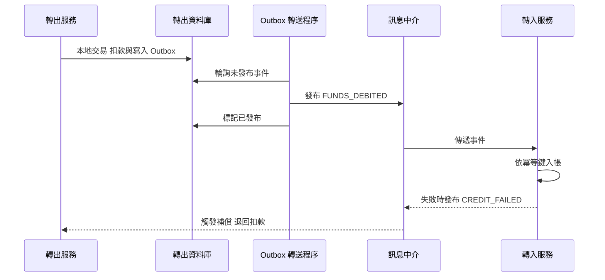

### 8.13 Saga 的逾時與半完成狀態設計

Saga 最常見的問題不是「失敗」，而是「不知道成功還是失敗」。每個 Saga 實例**必須**有明確狀態與逾時處理。

| 狀態 | 意義 | 逾時處理〔組織建議〕 |
|---|---|---|
| STARTED | 已完成第一個本地交易 | 超過 5 分鐘未進入下一狀態，查詢下游結果 |
| DEBITED | 轉出已扣款 | 超過 15 分鐘未入帳，啟動人工或自動補償 |
| COMPLETED | 轉入已入帳 | 終止 |
| COMPENSATING | 補償中 | 補償失敗重試上限後轉人工 |
| COMPENSATED | 已退回 | 終止 |
| MANUAL_REVIEW | 無法自動判斷 | 納入人工作業佇列與日終報表 |

```sql
-- PostgreSQL：Saga 狀態表與逾時掃描（示範用途）
CREATE TABLE dep.transfer_saga (
    transfer_id   UUID         NOT NULL PRIMARY KEY,
    status        VARCHAR(16)  NOT NULL,
    updated_at    TIMESTAMPTZ  NOT NULL DEFAULT now(),
    retry_count   SMALLINT     NOT NULL DEFAULT 0,
    CONSTRAINT ck_transfer_saga_status CHECK (status IN
        ('STARTED','DEBITED','COMPLETED','COMPENSATING','COMPENSATED','MANUAL_REVIEW'))
);

-- 驗證：停留過久的半完成 Saga（正常情況下應為 0 筆）
SELECT transfer_id, status, updated_at
FROM   dep.transfer_saga
WHERE  status IN ('STARTED', 'DEBITED', 'COMPENSATING')
AND    updated_at < now() - INTERVAL '15 minutes';
```

### 8.14 驗證與審查

#### AI 產出常見錯誤

| 錯誤型態 | 範例 | 如何識別 |
|---|---|---|
| 讀改寫產生遺失更新 | 先 `SELECT balance` 再由程式計算後 `UPDATE` | 檢查是否改用原子更新或鎖定 |
| 忽略影響筆數 | `UPDATE ... WHERE status='ACTIVE'` 後未檢查筆數 | 檢查程式是否判斷 0 筆的情境 |
| 金額型別錯誤 | `FLOAT`、`DOUBLE`、`MONEY` | 搜尋 DDL 中的浮點型別 |
| 缺冪等鍵 | 重試邏輯未帶外部序號 | 檢查重試路徑是否有 UNIQUE 保護 |
| 交易內呼叫外部服務 | 在 `@Transactional` 內發送 HTTP | 檢查交易邊界內的程式碼 |

#### 人工審查步驟

1. 以本章必要約束清單比對 DDL：PK、FK、金額 CHECK、狀態 CHECK、冪等 UNIQUE。
2. 對每個寫入 SQL 確認鎖定策略與影響筆數檢查。
3. 對每個跨服務流程確認 Saga 狀態與逾時處理。

#### 可執行驗證

```sql
-- PostgreSQL：找出使用浮點或 money 型別的欄位（預期 0 筆）
SELECT table_schema, table_name, column_name, data_type
FROM   information_schema.columns
WHERE  table_schema IN ('cust', 'dep')
AND    data_type IN ('real', 'double precision', 'money');

-- PostgreSQL：找出沒有主鍵的表（預期 0 筆）
SELECT c.oid::regclass AS table_name
FROM   pg_class c
JOIN   pg_namespace n ON n.oid = c.relnamespace
WHERE  c.relkind IN ('r', 'p')
AND    n.nspname IN ('cust', 'dep')
AND    NOT EXISTS (SELECT 1 FROM pg_constraint p WHERE p.conrelid = c.oid AND p.contype = 'p');
```

通過標準：上述查詢 0 筆；併發測試中同一冪等鍵並行送出 N 次僅產生 1 筆交易；餘額結果與序列執行結果一致。

### 8.15 常見錯誤

- 以 FLOAT 存金額。
- 在交易中呼叫外部 API。
- 重試沒有冪等鍵。
- 以 `SELECT MAX(ID)+1` 產生主鍵，造成併發衝突。
- 以為 READ COMMITTED 能避免遺失更新。

### 8.16 實務案例與注意事項

> **案例**：某支付介面在逾時後自動重送，下游未設冪等鍵，造成重複扣款。改善方式為以外部交易序號建立 UNIQUE 約束，重送時回傳原交易結果，並在對帳報表新增「重送次數」欄位以便監控。

### 8.17 本章檢核表

- [ ] 金額使用精確數值，程式端也使用精確型別。
- [ ] 必要欄位設為 NOT NULL，值域以 CHECK 保護。
- [ ] 字元集為 UTF-8 並驗證補充平面字元。
- [ ] 已選定隔離等級並以併發測試驗證。
- [ ] 併發更新使用原子更新、悲觀鎖或樂觀鎖。
- [ ] 外部交易具冪等鍵與 UNIQUE 約束。
- [ ] 跨服務流程採 Saga／Outbox 並設計補償。

## 第 9 章 Index、Query 與效能設計

### 9.1 學習目標

- 了解各類索引的原理與成本。
- 能閱讀執行計畫並以證據改善 SQL。
- 能設計分頁、批次與連線池策略。

### 9.2 索引類型

| 類型 | 適用 | 支援產品（概要，須依版本確認） |
|---|---|---|
| B-tree | 等值、範圍、排序 | 四種皆支援 |
| Hash | 等值查詢 | PostgreSQL；其他產品以不同形式提供或僅限特定功能 |
| Bitmap | 低基數欄位、資料倉儲 | Oracle（不建議用於高併發 OLTP 寫入表） |
| GIN | JSONB、陣列、全文檢索 | PostgreSQL |
| GiST | 範圍、地理空間 | PostgreSQL |
| BRIN | 大表且資料與物理順序高度相關（如時間序列） | PostgreSQL |
| Function-based／Expression | 對運算結果查詢 | Oracle、Db2、PostgreSQL；SQL Server 以計算欄位加索引 |
| Partial／Filtered | 只對部分資料建索引 | PostgreSQL（Partial）、SQL Server（Filtered） |
| Covering／Include | 索引包含查詢所需欄位 | SQL Server、PostgreSQL 11+、Db2（UNIQUE 索引 INCLUDE） |
| Columnstore | 分析查詢 | SQL Server；Oracle 以 In-Memory 選項（須確認授權） |

### 9.3 複合索引設計

**欄位順序原則**：

1. 等值條件欄位在前，範圍條件欄位在後。
2. 多租戶共用表時，TENANT_ID 通常在最前。
3. 選擇性只是參考之一，**必須**以實際查詢模式決定。
4. 若查詢需要排序，索引順序與 ORDER BY 一致可避免額外排序。
5. PostgreSQL 18 起支援多欄 B-tree 的 skip scan，前導欄位缺等值條件時仍可能使用索引；但前導欄位基數高時效果有限，不應以此取代正確的欄位順序。

#### 索引設計決策表

| 查詢型態 | 建議索引 | 不建議 |
|---|---|---|
| `WHERE a = ? AND b = ?` | (a, b) 或 (b, a)，依其他查詢共用性決定 | 兩個單欄索引 |
| `WHERE a = ? AND b > ?` | (a, b) | (b, a) |
| `WHERE a = ? ORDER BY c DESC` | (a, c DESC) | 只建 (a) 導致額外排序 |
| `WHERE a = ?` 且只取 b、c | (a) INCLUDE (b, c) 或 (a, b, c) | 回表讀取大量列 |
| `WHERE status = 'PENDING'` 且 PENDING 極少 | Partial／Filtered Index | 對整個 status 欄建 B-tree |
| `WHERE lower(email) = ?` | 運算式索引 | 對 email 建一般索引 |

範例：查詢「某租戶某帳戶最近交易」

```sql
-- 查詢
SELECT txn_id, txn_time, amount
  FROM txn
 WHERE tenant_id = :tenant AND account_id = :acct
 ORDER BY txn_time DESC
 FETCH FIRST 20 ROWS ONLY;

-- 對應索引
CREATE INDEX ix_txn_tenant_acct_time ON txn (tenant_id, account_id, txn_time DESC);
```

### 9.4 索引成本

| 成本 | 說明 |
|---|---|
| 寫入成本 | 每次 INSERT、DELETE 與更新索引欄位都需維護索引 |
| 儲存空間 | 索引可能與資料表同樣大 |
| 鎖定與競爭 | 遞增鍵的索引尾端熱點 |
| 維護 | 重建、統計資訊、膨脹處理 |
| 最佳化器 | 過多索引增加計畫選擇複雜度 |

**原則**：每個索引**必須**對應至少一個已知查詢；定期找出未使用索引並評估移除。

### 9.5 執行計畫

| 產品 | 取得估計計畫 | 取得實際執行統計 |
|---|---|---|
| Oracle | `EXPLAIN PLAN FOR ...` 後 `DBMS_XPLAN.DISPLAY` | `DBMS_XPLAN.DISPLAY_CURSOR` 搭配 `GATHER_PLAN_STATISTICS` 提示 |
| Db2 | `EXPLAIN PLAN FOR ...` 搭配 `db2exfmt` | 啟用活動事件監控或 `MON_GET_PKG_CACHE_STMT` |
| PostgreSQL | `EXPLAIN` | `EXPLAIN (ANALYZE, BUFFERS)`（會實際執行，DML 需包在交易中回滾；18 起 `ANALYZE` 預設顯示 buffers 與索引查找次數） |
| SQL Server | 預估執行計畫 | 實際執行計畫、`SET STATISTICS IO, TIME ON`、Query Store |

**閱讀重點**：

1. 估計列數與實際列數差距大 → 統計資訊或資料分布問題。
2. 大表全表掃描 → 是否缺索引或條件無法使用索引。
3. 巢狀迴圈處理大量資料 → JOIN 方式不當。
4. 大量排序或暫存溢出 → 記憶體或索引設計。

### 9.6 案例一：函數套用在欄位上導致無法使用索引

**問題 SQL**：

```sql
-- 查詢某日交易（PostgreSQL 示範）
SELECT * FROM txn WHERE to_char(txn_time, 'YYYY-MM-DD') = '2026-01-05';
```

**分析**：執行計畫顯示對 TXN 全表掃描。原因是對欄位套用函數後，`txn_time` 上的 B-tree 索引無法用於比較。

**改寫 SQL**：

```sql
SELECT txn_id, account_id, amount, txn_time
  FROM txn
 WHERE txn_time >= TIMESTAMPTZ '2026-01-05 00:00:00+08'
   AND txn_time <  TIMESTAMPTZ '2026-01-06 00:00:00+08';
```

**驗證**：以 `EXPLAIN (ANALYZE, BUFFERS)` 比對，確認改用索引範圍掃描，且讀取的 buffer 數顯著下降；同時以相同條件比對兩個版本結果筆數一致。

### 9.7 案例二：OFFSET 深分頁

**問題 SQL**：

```sql
SELECT txn_id, txn_time, amount
  FROM txn
 WHERE account_id = :acct
 ORDER BY txn_time DESC
 OFFSET 100000 ROWS FETCH NEXT 20 ROWS ONLY;
```

**分析**：資料庫仍需讀取並捨棄前 100,000 筆，頁數越後越慢。若 txn_time 不唯一，分頁結果還可能重複或遺漏。

**改寫 SQL（游標式分頁 Keyset Pagination）**：

```sql
-- 以上一頁最後一筆的 (txn_time, txn_id) 作為游標，排序鍵包含唯一欄位確保穩定
SELECT txn_id, txn_time, amount
  FROM txn
 WHERE account_id = :acct
   AND (txn_time < :last_time OR (txn_time = :last_time AND txn_id < :last_id))
 ORDER BY txn_time DESC, txn_id DESC
 FETCH FIRST 20 ROWS ONLY;

CREATE INDEX ix_txn_acct_time_id ON txn (account_id, txn_time DESC, txn_id DESC);
```

**驗證**：比較第 1 頁與第 5,000 頁的延遲，游標式分頁應大致相同；並以併發新增資料測試是否出現重複或遺漏。

### 9.8 案例三：N+1 查詢

**問題**：ORM 先查出 100 個帳戶，再逐一查詢每個帳戶的最近交易，共 101 次往返。

```sql
-- 第 1 次
SELECT account_id FROM account WHERE customer_id = :cust;
-- 第 2 到 101 次
SELECT * FROM txn WHERE account_id = :acct ORDER BY txn_time DESC FETCH FIRST 1 ROWS ONLY;
```

**分析**：應用程式效能監控（APM）顯示單一 API 觸發上百次 SQL，總延遲主要在網路往返。

**改寫 SQL**：

```sql
-- PostgreSQL 示範：LATERAL 一次取得每個帳戶最近一筆交易
SELECT a.account_id, t.txn_id, t.txn_time, t.amount
  FROM account a
  LEFT JOIN LATERAL (
        SELECT txn_id, txn_time, amount
          FROM txn
         WHERE txn.account_id = a.account_id
         ORDER BY txn_time DESC
         FETCH FIRST 1 ROWS ONLY
       ) t ON TRUE
 WHERE a.customer_id = :cust;
```

| 產品 | 等效寫法 |
|---|---|
| Oracle 12c+ | `CROSS APPLY`／`OUTER APPLY` 或 `LATERAL` |
| Db2 | `LATERAL` 或 `ROW_NUMBER()` 視窗函數 |
| SQL Server | `OUTER APPLY` |

**驗證**：API 的 SQL 次數由 101 降為 1，P95 延遲於壓測中下降；結果集與原邏輯逐筆比對一致。

### 9.9 統計資訊

| 產品 | 收集方式 |
|---|---|
| Oracle | `DBMS_STATS.GATHER_TABLE_STATS`，預設自動維護作業 |
| Db2 | `RUNSTATS`，可啟用自動統計 |
| PostgreSQL | `ANALYZE`，autovacuum 會自動執行 |
| SQL Server | `UPDATE STATISTICS`，可啟用自動建立與更新 |

大量載入、刪除或分區切換後，**建議**主動更新統計資訊再開放查詢。

#### 如何判斷統計資訊已過期

〔組織建議〕可用兩個訊號判斷：一是自上次收集後的異動列數超過總列數 10%；二是執行計畫中估計列數與實際列數相差 10 倍以上。

```sql
-- PostgreSQL：異動列數超過 10% 且超過 1 天未 ANALYZE 的表
SELECT relname, n_live_tup, n_mod_since_analyze,
       ROUND(100.0 * n_mod_since_analyze / NULLIF(n_live_tup, 0), 1) AS mod_pct,
       GREATEST(last_analyze, last_autoanalyze) AS last_analyzed
FROM   pg_stat_user_tables
WHERE  n_mod_since_analyze > 0.1 * n_live_tup
AND    GREATEST(last_analyze, last_autoanalyze) < now() - INTERVAL '1 day'
ORDER BY mod_pct DESC;

-- SQL Server：統計資訊的異動計數
SELECT OBJECT_NAME(s.object_id) AS table_name, s.name AS stats_name,
       sp.last_updated, sp.rows, sp.modification_counter
FROM   sys.stats s
CROSS APPLY sys.dm_db_stats_properties(s.object_id, s.stats_id) sp
WHERE  sp.modification_counter > 0.1 * sp.rows;

-- Oracle：被標記為 STALE 的統計資訊
SELECT owner, table_name, last_analyzed, stale_stats
FROM   dba_tab_statistics
WHERE  stale_stats = 'YES' AND owner IN ('DEP', 'CUST');
```

> PostgreSQL 18 的 `pg_upgrade` 可保留大部分統計資訊，但擴充統計資訊（`CREATE STATISTICS`）仍需在升級後重新 `ANALYZE`。

### 9.10 批次處理與大量更新

| 原則 | 說明 |
|---|---|
| 分批提交 | 每批固定筆數（例如 5,000 筆〔示範〕）提交，避免巨大交易與日誌爆量 |
| 依鍵範圍分段 | 以 PK 範圍切分，可重跑、可平行 |
| 記錄進度 | 進度表記錄最後處理鍵，失敗可續跑 |
| 控制速率 | 避免影響線上交易與複寫延遲 |
| 使用 Bulk 工具 | Oracle SQL*Loader／Data Pump、Db2 LOAD、PostgreSQL COPY、SQL Server BULK INSERT／bcp |

> **風險提醒**：大量 UPDATE／DELETE 會產生大量 Redo／WAL／交易記錄，可能造成複寫延遲擴大與日誌空間不足。正式環境執行前**必須**評估日誌量、確認備份並取得變更核准。

### 9.11 連線池與交易時間

| 項目 | 建議〔組織建議〕 |
|---|---|
| 連線池大小 | 以壓測決定，不是越大越好；總連線數不得超過資料庫可承受上限 |
| 交易時間 | 單一交易應盡量短；長交易需告警 |
| 逾時 | 設定連線取得逾時、查詢逾時、交易逾時 |
| 驗證 | 連線借出前驗證或背景驗證，避免使用斷線連線 |
| 洩漏偵測 | 啟用連線洩漏偵測並記錄堆疊 |

### 9.12 慢查詢監控與效能基線

| 產品 | 工具 |
|---|---|
| Oracle | AWR、ASH（Diagnostics Pack 授權須確認）、`V$SQL` |
| Db2 | `MON_GET_PKG_CACHE_STMT`、Event Monitor |
| PostgreSQL | `pg_stat_statements` 擴充、`log_min_duration_statement` |
| SQL Server | Query Store、Extended Events、DMV |

**效能基線**：上線前記錄關鍵 SQL 的平均與 P95 延遲、每次執行邏輯讀取量、執行次數，作為之後比較的基準。

```sql
-- PostgreSQL：以 pg_stat_statements 建立基線快照（示範用途）
CREATE TABLE IF NOT EXISTS ops.sql_baseline AS
SELECT now() AS snap_time, queryid, calls,
       mean_exec_time, stddev_exec_time,
       shared_blks_hit + shared_blks_read AS total_blks,
       rows
FROM   pg_stat_statements
WHERE  1 = 0;

INSERT INTO ops.sql_baseline
SELECT now(), queryid, calls, mean_exec_time, stddev_exec_time,
       shared_blks_hit + shared_blks_read, rows
FROM   pg_stat_statements
WHERE  calls > 100;

-- 與基線比較：平均延遲超過基線 2 倍的 SQL
SELECT s.queryid, b.mean_exec_time AS base_ms, s.mean_exec_time AS now_ms,
       ROUND((s.mean_exec_time / NULLIF(b.mean_exec_time, 0))::numeric, 1) AS ratio
FROM   pg_stat_statements s
JOIN   ops.sql_baseline b ON b.queryid = s.queryid
WHERE  s.mean_exec_time > 2 * b.mean_exec_time
ORDER BY ratio DESC;
```

### 9.13 驗證與審查

#### AI 產出常見錯誤

| 錯誤型態 | 範例 | 如何識別 |
|---|---|---|
| 為每個欄位建索引 | 一次產出 10 個單欄索引 | 每個索引需對應已知查詢 |
| 無佐證的效能宣稱 | 「此改寫可提升 80%」 | 要求前後 `EXPLAIN ANALYZE` 與壓測數據 |
| 改寫改變語意 | `NOT IN` 改 `NOT EXISTS` 未處理 NULL | 前後結果集逐筆比對 |
| 忽略產品差異 | 把 PostgreSQL 提示語法套到 Oracle | 確認語法屬於目標產品 |

#### 人工審查步驟

1. 取得改善前後的實際執行計畫，比對讀取量（buffers／logical reads）而非只看時間。
2. 用相同參數執行新舊 SQL，以 `EXCEPT` 確認結果完全相同。
3. 新增索引後，量測寫入 TPS 變化。

#### 可執行驗證

```sql
-- 新舊 SQL 結果一致性（兩個方向皆應為 0 筆）
(SELECT txn_id, amount FROM txn WHERE to_char(txn_time, 'YYYY-MM-DD') = '2026-01-05'
 EXCEPT
 SELECT txn_id, amount FROM txn
 WHERE txn_time >= TIMESTAMPTZ '2026-01-05 00:00:00+08'
   AND txn_time <  TIMESTAMPTZ '2026-01-06 00:00:00+08');

-- PostgreSQL：自統計重置後未被使用的索引（排除 PK、UNIQUE）
SELECT s.schemaname, s.relname, s.indexrelname, s.idx_scan,
       pg_size_pretty(pg_relation_size(s.indexrelid)) AS idx_size
FROM   pg_stat_user_indexes s
JOIN   pg_index i ON i.indexrelid = s.indexrelid
WHERE  s.idx_scan = 0 AND NOT i.indisunique;
```

通過標準〔組織建議〕：結果集差異 0 筆；目標 SQL 的 P95 達到需求；新增索引導致的寫入 TPS 下降 ≤ 5%；未使用索引需觀察至少一個完整業務週期（含月底）再決定是否移除。

### 9.14 常見錯誤

- 憑經驗加索引，未看執行計畫。
- 在欄位上套函數或隱含型別轉換（字串欄位與數字比較）。
- `SELECT *` 取回大量不需要的欄位與 LOB。
- 一次查詢回傳數十萬筆給前端。
- 在正式環境直接執行 `EXPLAIN ANALYZE` 於 DML 而未回滾。

### 9.15 實務案例與注意事項

> **案例**：某查詢在測試環境很快、正式環境很慢。原因是測試資料每個帳戶只有數筆交易，正式環境部分法人帳戶有數百萬筆，資料傾斜導致計畫選擇錯誤。改善方式：測試資料**必須**模擬實際分布（含極端帳戶），並對傾斜欄位收集直方圖統計。

### 9.16 本章檢核表

- [ ] 每個索引對應已知查詢，並定期檢視使用率。
- [ ] 關鍵 SQL 已取得實際執行計畫並保存。
- [ ] 條件欄位無函數包覆與隱含型別轉換。
- [ ] 大結果集使用游標式分頁，排序鍵唯一。
- [ ] 無 N+1 查詢。
- [ ] 批次採分批提交並可續跑。
- [ ] 連線池大小經壓測決定。
- [ ] 已建立效能基線與慢查詢監控。

## 第 10 章 容量規劃與資料成長評估

### 10.1 學習目標

- 建立可重複使用的容量估算方法。
- 分開計算邏輯資料量、資料庫實際占用、備份容量與跨站複寫容量。
- 以樂觀、基準、保守三情境呈現結果。

### 10.2 四種容量不可混為一談

| 容量類型 | 定義 | 主要影響因素 |
|---|---|---|
| 邏輯資料量 | 資料列平均大小乘以筆數 | 欄位設計、筆數 |
| 資料庫實際占用 | 資料檔在儲存上的實際大小 | 區塊／頁面開銷、保留空間、索引、LOB、Undo／Temp、膨脹 |
| 備份容量 | 備份儲存所需空間 | 備份類型、頻率、保留份數、壓縮率、日誌歸檔 |
| 跨站複寫容量 | DR 與第三地副本所需空間與頻寬 | 副本數、日誌保留、傳輸量 |

### 10.3 估算公式

#### 邏輯資料量

$$
L = N_{rows} \times S_{row}
$$

**年度新增筆數（含成長率）**：第 $n$ 年日均筆數為 $D_0 \times (1+g)^{n-1}$，第 $n$ 年新增筆數為 $D_0 \times (1+g)^{n-1} \times 365$。

#### 五年累計因子

$$
F_5 = \sum_{k=0}^{4}(1+g)^k
$$

#### 資料庫實際占用

$$
P = L \times f_{page} \times (1 + r_{idx}) \times (1 + r_{misc})
$$

其中 $f_{page}$ 為頁面與保留空間係數，$r_{idx}$ 為索引對資料比例，$r_{misc}$ 為 Undo、Temp、中繼資料等其他開銷比例。

#### 備份容量

$$
B = n_{full} \times P \times c + n_{inc} \times I \times c + A \times c
$$

$n_{full}$ 為保留的完整備份份數、$I$ 為單次增量備份大小、$A$ 為保留期間的歸檔日誌總量、$c$ 為壓縮率。

#### 還原時間估算

$$
T_{restore} \approx \frac{P}{R_{restore}} + T_{log\_apply}
$$

### 10.4 假設表〔案例假設〕

| 參數 | 樂觀 | 基準 | 保守 | 說明 |
|---|---|---|---|---|
| 交易日均筆數 $D_0$ | 1,500,000 | 2,000,000 | 3,000,000 | 首年 |
| 平均列大小 $S_{row}$ | 220 B | 250 B | 300 B | 依資料字典欄位估算 |
| 年成長率 $g$ | 10% | 15% | 25% | |
| 頁面係數 $f_{page}$ | 1.2 | 1.2 | 1.2 | 含保留空間 |
| 索引比例 $r_{idx}$ | 0.8 | 0.8 | 0.8 | 3 個索引 |
| 其他開銷 $r_{misc}$ | 0.1 | 0.1 | 0.1 | |
| 備份壓縮率 $c$ | 0.5 | 0.5 | 0.5 | 須實測 |
| 還原吞吐 $R_{restore}$ | 500 MB/s | 500 MB/s | 500 MB/s | 須實測 |

單位：本章 GB 以 $10^9$ bytes 計。

### 10.5 計算範例：基準情境第一年

1. 年筆數：$2{,}000{,}000 \times 365 = 730{,}000{,}000$ 筆。
2. 邏輯資料量：$730{,}000{,}000 \times 250 = 182.5$ GB。
3. 實際占用係數：$1.2 \times 1.8 \times 1.1 = 2.376$。
4. 實際占用：$182.5 \times 2.376 \approx 433.6$ GB。

**備份容量（年底估算）**，假設每週完整備份、每日增量、保留 5 週、歸檔日誌保留 35 天：

| 項目 | 計算 | 結果 |
|---|---|---|
| 完整備份 | $5 \times 433.6 \times 0.5$ | 約 1,084 GB |
| 增量備份 | 每日新增實際占用約 $433.6 / 365 \approx 1.19$ GB，壓縮後約 0.6 GB，保留 30 份 | 約 18 GB |
| 歸檔日誌 | 每筆交易約 2 KB 日誌〔假設〕，日 4 GB，保留 35 天，壓縮後 | 約 70 GB |
| 合計 | | 約 1,172 GB |

> 以年底資料庫大小乘以完整備份份數屬保守估法；實際份數大小隨時間成長。

**跨站複寫**：

| 項目 | 結果 |
|---|---|
| 每個 DR 副本資料量 | 約 433.6 GB，加上副本端日誌保留（3 天約 12 GB） |
| 平均日誌傳輸量 | 4 GB／日 |
| 尖峰小時頻寬 | 假設尖峰小時占日量 15%，發薪日 5 倍：$4\text{ GB} \times 0.15 \times 5 / 3600\text{ s} \approx 0.83$ MB/s，約 6.7 Mbps |
| 建議頻寬 | 乘以 2 倍安全係數並加上備份複製流量，約 13.3 Mbps 以上〔需依實測〕 |

**還原時間**：$433.6\text{ GB} / 0.5\text{ GB/s} \approx 867$ 秒，約 14.5 分鐘，另加日誌套用時間。

### 10.6 三情境五年預估

| 情境 | 首年邏輯量 | 首年實際占用 | 五年累計因子 $F_5$ | 五年累計實際占用 | 五年後完整還原時間（500 MB/s） |
|---|---|---|---|---|---|
| 樂觀 | 120.5 GB | 286.2 GB | 6.105 | 約 1,747 GB | 約 58 分鐘 |
| 基準 | 182.5 GB | 433.6 GB | 6.742 | 約 2,924 GB | 約 97 分鐘 |
| 保守 | 328.5 GB | 780.5 GB | 8.207 | 約 6,406 GB | 約 214 分鐘 |

**判讀**：若 RTO 要求 30 分鐘，基準情境五年後僅還原資料檔就需約 97 分鐘，表示**不能**單靠備份還原達成 RTO，必須搭配 HA／DR 副本，或以分區與歸檔控制線上資料量（第 11 章）。

### 10.7 其他資源估算

| 資源 | 估算方式 |
|---|---|
| CPU | 以壓測取得每秒交易數對 CPU 使用率曲線，保留 30～40% 餘裕〔組織建議〕 |
| 記憶體 | 熱資料集（常用資料與索引）大小加連線記憶體 |
| IOPS | 尖峰每秒交易數乘以每筆交易 IO 次數（實測） |
| 吞吐量 | 批次與備份同時執行時的讀寫 MB/s |
| 網路 | 應用流量加複寫與備份流量 |
| 連線數 | 各應用連線池上限總和，加維運與監控連線 |

### 10.8 尖峰情境

| 情境 | 典型影響 |
|---|---|
| 交易日開盤 | 登入與查詢尖峰 |
| 發薪日 | 入帳批次與查詢同時尖峰 |
| 月底、季底、年終 | 結算批次、報表、對帳 |
| 系統切換後 | 積壓交易補處理 |

容量規劃**必須**以尖峰而非平均作為主要依據。

### 10.9 容量估算表範本

```markdown
| 資料表 | 平均列大小(B) | 初始筆數 | 日新增 | 年成長率 | 保留年限(線上) | 邏輯量(GB) | 係數 | 實際占用(GB) | 備註 |
|---|---|---|---|---|---|---|---|---|---|
| TXN | 250 | 0 | 2,000,000 | 15% | 2 | | 2.376 | | 示範 |
| ACCOUNT | 300 | 8,000,000 | 5,000 | 5% | 永久 | | 2.376 | | 示範 |
```

### 10.10 以實際資料校正估算參數

公式中的 $S_{row}$、$f_{page}$、$r_{idx}$ 不應只靠估計。若有既有系統或 PoC 資料，**必須**以實測值校正。

```sql
-- PostgreSQL：實測平均列大小、表與索引大小比例（示範用途）
SELECT c.relname,
       c.reltuples::bigint                                    AS est_rows,
       pg_size_pretty(pg_table_size(c.oid))                   AS table_size,
       pg_size_pretty(pg_indexes_size(c.oid))                 AS index_size,
       ROUND(pg_table_size(c.oid) / NULLIF(c.reltuples, 0))   AS bytes_per_row,
       ROUND(pg_indexes_size(c.oid)::numeric / NULLIF(pg_table_size(c.oid), 0), 2) AS r_idx
FROM   pg_class c
JOIN   pg_namespace n ON n.oid = c.relnamespace
WHERE  n.nspname = 'dep' AND c.relkind = 'r'
ORDER BY pg_table_size(c.oid) DESC;

-- PostgreSQL：每日 WAL 產生量（以兩次取樣的 LSN 差計算）
SELECT pg_current_wal_lsn();  -- 第一次記錄，例如 0/3A000000
-- 24 小時後
SELECT pg_size_pretty(pg_wal_lsn_diff(pg_current_wal_lsn(), '0/3A000000'));
```

```sql
-- SQL Server：表與索引大小
SELECT t.name AS table_name,
       SUM(CASE WHEN i.index_id IN (0, 1) THEN a.used_pages END) * 8 / 1024 AS data_mb,
       SUM(CASE WHEN i.index_id > 1     THEN a.used_pages END) * 8 / 1024 AS index_mb,
       MAX(p.rows) AS row_cnt
FROM   sys.tables t
JOIN   sys.indexes i          ON i.object_id = t.object_id
JOIN   sys.partitions p       ON p.object_id = i.object_id AND p.index_id = i.index_id
JOIN   sys.allocation_units a ON a.container_id = p.partition_id
GROUP BY t.name
ORDER BY data_mb DESC;
```

需特別調整的因素：

| 因素 | 影響方向 | 處理方式 |
|---|---|---|
| 應用層欄位加密 | 密文含 IV 與驗證標籤，通常較明文大，並可能需 Base64 | 以實際加密函式產生樣本量測 |
| TDE | 資料檔大小大致不變，但備份壓縮率可能大幅下降 | 備份前壓縮或使用產品內建「先壓縮再加密」 |
| 資料壓縮 | 降低儲存，增加 CPU | 以 PoC 量測壓縮比與 CPU 成本 |
| 時態表歷史 | 每次更新產生一筆歷史列 | 以「日更新次數 × 列大小」另行估算 |
| 分區歸檔 | 線上量在保留期滿後趨於穩定 | 五年預估改為「保留期內累計量」 |

### 10.11 雲端成本與 FinOps 考量

雲端部署時，容量估算要同時轉換為成本估算，並由技術、財務與業務共同檢視〔組織建議〕。

| 成本項目 | 常見計價方式 | 容易忽略的點 |
|---|---|---|
| 運算 | vCore／執行個體規格 × 時數 | HA 副本與 DR 副本同樣計費 |
| 儲存 | 已配置容量（GB／月），部分服務另計 IOPS | 配置值通常只能增加不能縮小 |
| 備份 | 超過免費額度後按 GB／月 | 長期保留與跨區域複製另計 |
| 資料傳出 | 跨區域、跨雲、回地端按 GB 計價 | CDC 與報表抽取可能產生大量傳出 |
| 授權 | 內含授權或自帶授權（BYOL） | 選購功能可能另計 |
| 專線 | 埠費＋傳輸量 | 備援專線也需計費 |

```markdown
| 項目 | 單位 | 數量 | 單價（依合約） | 月成本 | 年成本 | 備註 |
|---|---|---|---|---|---|---|
| 主節點運算 | vCore | 16 | | | | 示範 |
| 同區 HA 副本 | vCore | 16 | | | | 示範 |
| 儲存 | GB | 3,000 | | | | 依五年基準情境 |
| 備份保留 | GB | 6,000 | | | | 含 35 天 PITR |
| 跨區域傳出 | GB／月 | 150 | | | | CDC＋備份複製 |
```

### 10.12 驗證與審查

#### AI 產出常見錯誤

| 錯誤型態 | 範例 | 如何識別 |
|---|---|---|
| 單位錯誤 | GB 與 GiB 混用、bit 與 byte 混用 | 檢查單位是否在文件開頭統一定義 |
| 漏算成長 | 五年量 = 首年量 × 5 | 對照累計因子公式 |
| 漏算副本 | 只算主資料庫容量 | 檢查 HA、DR、備份是否各自列出 |
| 計算錯誤 | 數字前後不一致 | 以試算表重算 |

#### 人工審查步驟

1. 把 AI 給出的每一個中間值放入試算表重算，差異 > 1% 即退回。
2. 確認參數來源：實測、廠商資料或〔案例假設〕。
3. 確認還原時間估算已與 RTO 比對，並有結論。

#### 可執行驗證

以本章基準情境為例，可用下列 Python 片段快速驗算（示範用途）：

```python
d0, s_row, g = 2_000_000, 250, 0.15
factor = 1.2 * 1.8 * 1.1
year1_logical_gb = d0 * 365 * s_row / 1e9
year1_physical_gb = year1_logical_gb * factor
f5 = sum((1 + g) ** k for k in range(5))
print(round(year1_logical_gb, 1), round(year1_physical_gb, 1), round(f5, 3),
      round(year1_physical_gb * f5))
# 預期輸出：182.5 433.6 6.742 2924
```

通過標準：重算結果與文件數值差異 ≤ 1%；所有參數皆有來源標示。

### 10.13 常見錯誤

- 只算資料列大小，忽略索引、LOB、Undo 與膨脹。
- 只算資料庫，忘記備份、歸檔日誌與 DR 副本。
- 以平均值規劃，未考慮尖峰。
- 未評估資料增長對還原時間與備份窗口的影響。

### 10.14 實務案例與注意事項

> **案例**：某系統上線兩年後備份窗口從 2 小時延長到 7 小時，開始與日間交易重疊。原因是容量規劃未把備份時間納入。改善方式為改用增量備份、分區唯讀化舊資料，並把歷史資料歸檔至獨立資料庫。

### 10.15 本章檢核表

- [ ] 已分開計算邏輯量、實際占用、備份、複寫容量。
- [ ] 已提供三情境估算並標示假設。
- [ ] 已以尖峰估算 CPU、IOPS、網路、連線數。
- [ ] 已評估還原時間是否符合 RTO。
- [ ] 已設定容量告警門檻與擴充前置時間。

## 第 11 章 資料分區、歸檔與生命週期管理

### 11.1 學習目標

- 理解分區類型與 Partition Pruning。
- 能設計歷史資料歸檔、驗證與回復流程。
- 能區分資料生命週期與備份保存期限。

### 11.2 分區類型

| 類型 | 說明 | 適用 |
|---|---|---|
| Range | 依值的範圍切分 | 交易日期 |
| List | 依離散值切分 | 租戶、地區、業務別 |
| Hash | 依雜湊均勻分散 | 分散熱點 |
| 複合 | 兩層分區 | 先日期再租戶 |

### 11.3 分區鍵與查詢的關係

分區**不一定**能改善效能。效能改善的前提是：

1. 查詢條件包含分區鍵，資料庫才能做 Partition Pruning（只掃描相關分區）。
2. 索引設計與分區對齊（Local／分區索引）或確有全域索引需求。
3. 維運作業（歸檔、刪除）可利用分區切換或刪除整個分區。

若大部分查詢不帶分區鍵（例如只用帳號查所有歷史），反而可能需要掃描所有分區，效能更差。

### 11.4 分區語法範例

```sql
-- 適用：PostgreSQL 13+ 宣告式分區／示範，待驗證
CREATE TABLE txn (
    txn_id        BIGINT        NOT NULL,
    tenant_id     VARCHAR(16)   NOT NULL,
    account_id    BIGINT        NOT NULL,
    amount        NUMERIC(19,4) NOT NULL,
    txn_time      TIMESTAMPTZ   NOT NULL,
    posting_date  DATE          NOT NULL,
    CONSTRAINT pk_txn PRIMARY KEY (txn_id, posting_date)
) PARTITION BY RANGE (posting_date);

CREATE TABLE txn_p202601 PARTITION OF txn
    FOR VALUES FROM ('2026-01-01') TO ('2026-02-01');
```

> PostgreSQL 分區表上的 PK／UNIQUE 必須包含分區鍵，因此 PK 為 (txn_id, posting_date)。

```sql
-- 適用：Oracle 19c Interval Partitioning（需 Partitioning 選項授權）／示範
CREATE TABLE txn (
    txn_id        NUMBER(19)    NOT NULL,
    tenant_id     VARCHAR2(16)  NOT NULL,
    account_id    NUMBER(19)    NOT NULL,
    amount        NUMBER(19,4)  NOT NULL,
    txn_time      TIMESTAMP     NOT NULL,
    posting_date  DATE          NOT NULL
)
PARTITION BY RANGE (posting_date)
INTERVAL (NUMTOYMINTERVAL(1, 'MONTH'))
(PARTITION p_init VALUES LESS THAN (DATE '2026-01-01'));
```

```sql
-- 適用：SQL Server 2022／示範
CREATE PARTITION FUNCTION pf_posting_month (DATE)
    AS RANGE RIGHT FOR VALUES ('2026-01-01', '2026-02-01', '2026-03-01');
CREATE PARTITION SCHEME ps_posting_month
    AS PARTITION pf_posting_month ALL TO ([PRIMARY]);
CREATE TABLE dbo.txn (
    txn_id       BIGINT        NOT NULL,
    posting_date DATE          NOT NULL,
    amount       DECIMAL(19,4) NOT NULL,
    CONSTRAINT pk_txn PRIMARY KEY (txn_id, posting_date)
) ON ps_posting_month (posting_date);
```

```sql
-- 適用：Db2 LUW 11.5 Table Partitioning／示範
CREATE TABLE txn (
    txn_id       BIGINT        NOT NULL,
    posting_date DATE          NOT NULL,
    amount       DECIMAL(19,4) NOT NULL
)
PARTITION BY RANGE (posting_date)
(STARTING '2026-01-01' ENDING '2026-12-31' EVERY 1 MONTH);
```

### 11.5 各產品分區特性比較

| 面向 | Oracle | Db2 | PostgreSQL | SQL Server |
|---|---|---|---|---|
| 自動新增分區 | Interval 分區 | 需排程 ADD PARTITION | 需排程或擴充工具 | 需排程 SPLIT |
| 分區索引 | Local／Global | Partitioned／Nonpartitioned | 每分區各自索引 | Aligned／Non-aligned |
| 快速移出 | EXCHANGE PARTITION | DETACH PARTITION | DETACH PARTITION（可 CONCURRENTLY） | SWITCH PARTITION |
| 授權 | 選購 | 依版本 | 內建 | 內建 |

### 11.6 熱、溫、冷資料

| 分層 | 存取頻率 | 存放 | 範例 |
|---|---|---|---|
| 熱 | 每天大量存取 | 線上主資料庫、高速儲存 | 近 3 個月交易〔示範〕 |
| 溫 | 偶爾查詢 | 線上但較低成本儲存，或唯讀分區 | 3 個月～2 年 |
| 冷 | 很少查詢、需保存 | 歸檔資料庫或物件儲存 | 2 年以上至保存期限屆滿 |

### 11.7 歸檔流程

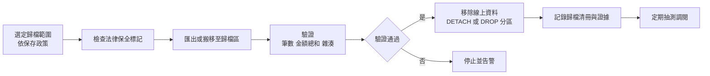

驗證腳本範例：

```sql
-- 示範：比對來源分區與歸檔表的筆數與金額總和
SELECT 'SOURCE' AS side, COUNT(*) AS cnt, SUM(amount) AS total_amt
  FROM txn_p202401
UNION ALL
SELECT 'ARCHIVE', COUNT(*), SUM(amount)
  FROM arc.txn_202401;
```

> **風險提醒**：DROP 分區不可逆。**必須**在驗證通過、確認有可還原的備份，並取得核准後才執行。

### 11.8 保留、法律保全與刪除

| 步驟 | 說明 |
|---|---|
| 判定到期 | 依保存政策的期限與起算點計算 |
| 法律保全檢查 | 若資料受訴訟、調查保全，暫停刪除 |
| 刪除或去識別化 | 依政策選擇實體刪除、加密金鑰銷毀或去識別化 |
| 備份中的資料 | 隨備份保存期限屆滿自然淘汰；說明於政策 |
| 證據 | 保留刪除清冊、執行紀錄、核准紀錄 |

### 11.9 去識別化、遮罩與刪除

| 技術 | 說明 | 可逆性 |
|---|---|---|
| 遮罩 | 顯示時隱藏部分字元 | 原值仍存在 |
| 假名化 | 以代碼取代識別資料，對照表另存 | 持有對照表者可回推 |
| 匿名化 | 無法再識別特定個人 | 不可逆（需嚴格評估） |
| 加密金鑰銷毀 | 銷毀資料加密金鑰使密文無法解讀 | 不可逆（前提是金鑰無其他副本） |

是否符合法規所稱「刪除」或「去識別」，**必須**由法遵確認。

### 11.10 資料生命週期與備份保存期限的差異

| 面向 | 資料保存期限 | 備份保存期限 |
|---|---|---|
| 目的 | 業務、法規要求 | 災難與錯誤復原 |
| 決定者 | 資料擁有者、法遵 | 營運持續、IT |
| 期間 | 可能數年 | 通常數週到數月 |
| 調閱 | 需可查詢 | 需還原後才能讀取 |

**原則**：不應以「備份保留 10 年」取代資料保存。長期保存需求應以可查詢的歸檔設計滿足。

### 11.11 膨脹與空間回收

| 產品 | 現象與處理 |
|---|---|
| Oracle | 大量刪除後高水位線不下降；可用 `SHRINK SPACE`、線上重組 |
| Db2 | `REORG TABLE`、`REORG INDEXES`；可回收 Tablespace 空間 |
| PostgreSQL | MVCC 舊版本由 VACUUM 回收；autovacuum 參數需調校；`VACUUM FULL` 會鎖表 |
| SQL Server | 索引重建或重組；`DBCC SHRINKFILE` 會造成碎片，非必要不建議 |

### 11.12 分區策略評估範例

| 問題 | TXN 表答案〔案例假設〕 |
|---|---|
| 主要查詢條件 | 帳戶＋日期區間（90%）、日期區間批次（10%） |
| 候選分區鍵 | POSTING_DATE |
| 分區粒度 | 月 |
| 預期 Pruning | 有日期條件的查詢可 Pruning；純帳戶查全歷史不行 |
| 對策 | API 強制日期區間上限（例如 1 年）；全歷史查詢走歸檔查詢服務 |
| 維運效益 | 每月 DETACH 移出最舊分區，歸檔時間由數小時降為數分鐘〔待實測〕 |
| 風險 | 分區數過多影響計畫時間；需監控 |

### 11.13 歸檔失敗回復與法律保全期間處理

| 失敗點 | 現象 | 回復程序 |
|---|---|---|
| 匯出中斷 | 歸檔表筆數少於來源 | 刪除歸檔區不完整資料，重新匯出；來源分區不得移除 |
| 驗證不一致 | 筆數或金額總和不同 | 停止流程，保留兩邊資料，開立事件單調查（常見原因：歸檔期間仍有寫入、字元集轉換） |
| DETACH 後才發現問題 | 線上查無資料 | 以 ATTACH（或 EXCHANGE／SWITCH 反向）掛回；若已 DROP，從備份還原至隔離環境再匯回 |
| 歸檔資料損毀 | 調閱抽測無法讀取 | 由備份或第二份歸檔副本重建；檢討歸檔儲存的完整性驗證頻率 |

法律保全期間的處理原則：

- 被保全資料**不得**移除或去識別化，也**不得**因分區整批 DROP 而被連帶刪除。
- 保全期間新增的相關資料，依保全範圍定義決定是否一併保全；範圍需由法務以書面界定（客戶、帳戶、期間）。
- 保全解除後，依原保存政策重新計算是否已到期，並保留解除紀錄。

```sql
-- PostgreSQL：歸檔前檢查分區內是否有受法律保全的帳戶（預期 0 筆才可移除）
SELECT t.account_id, COUNT(*) AS txn_cnt
FROM   txn_p202401 t
JOIN   gov.legal_hold h
       ON h.account_id = t.account_id
      AND h.released_at IS NULL
GROUP BY t.account_id;

-- 以雜湊比對內容一致性（排序後彙總），兩邊結果應相同
SELECT encode(sha256(string_agg(txn_id::text || '|' || amount::text, ',' ORDER BY txn_id)::bytea), 'hex') AS digest
FROM   txn_p202401;
SELECT encode(sha256(string_agg(txn_id::text || '|' || amount::text, ',' ORDER BY txn_id)::bytea), 'hex') AS digest
FROM   arc.txn_202401;
```

#### 去識別化資料的再識別風險檢查

假名化或匿名化後，仍可能透過「準識別欄位」組合（出生年月、郵遞區號、性別、分行）重新識別個人。**建議**在交付測試或分析環境前，檢查每個準識別欄位組合的最小群組大小（k-anonymity 的 k 值）。

```sql
-- 準識別欄位組合中，人數少於 5 的群組（k < 5 表示有再識別風險）
SELECT birth_year, zip3, gender, COUNT(*) AS group_size
FROM   anon.customer
GROUP BY birth_year, zip3, gender
HAVING COUNT(*) < 5;
```

通過標準〔組織建議〕：k 值門檻由隱私或法遵單位訂定（示範以 5 為例），結果 0 筆才可交付；k-anonymity 只是最低檢查，不代表已達匿名化。

### 11.14 驗證與審查

#### AI 產出常見錯誤

| 錯誤型態 | 範例 | 如何識別 |
|---|---|---|
| 分區鍵不在查詢條件 | 依 CREATED_AT 分區，但查詢都用 POSTING_DATE | 對照主要查詢 SQL |
| UNIQUE 未含分區鍵 | PostgreSQL 分區表 `UNIQUE (ext_ref_no)` 無法建立 | 分區表的 PK／UNIQUE 必須包含分區鍵 |
| 直接 DROP 未驗證 | 歸檔腳本先 DROP 再匯出 | 檢查流程順序 |
| 把遮罩當去識別化 | 「以 Dynamic Data Masking 完成去識別化」 | 遮罩不改變原值 |

#### 人工審查步驟

1. 以 `EXPLAIN` 確認主要查詢只掃描必要分區。
2. 確認自動建立未來分區的排程存在，且有「未來分區不足」告警。
3. 檢查歸檔腳本是否包含法律保全檢查、驗證與核准步驟。

#### 可執行驗證

```sql
-- PostgreSQL：確認分割裁剪（計畫中只應出現 txn_p202601）
EXPLAIN (COSTS OFF)
SELECT COUNT(*) FROM txn
WHERE  posting_date >= DATE '2026-01-01' AND posting_date < DATE '2026-02-01';

-- PostgreSQL：檢查未來分區數量（以月分區為例，預期至少 3 個）
SELECT COUNT(*) AS future_partitions
FROM   pg_inherits i
JOIN   pg_class c ON c.oid = i.inhrelid
WHERE  i.inhparent = 'txn'::regclass
AND    c.relname > 'txn_p' || to_char(CURRENT_DATE, 'YYYYMM');
```

通過標準：計畫僅含目標分區；未來分區至少 3 個月〔組織建議〕；歸檔演練中雜湊比對一致。

### 11.15 常見錯誤

- 以為分區一定提升效能。
- 分區鍵與主要查詢條件不一致。
- 未預先建立未來分區，導致寫入失敗（非 Interval 時）。
- 歸檔未驗證就刪除。
- 以備份取代長期保存。

### 11.16 實務案例與注意事項

> **案例**：某系統以 ACCOUNT_ID 進行 Hash 分區，但月結批次以日期掃描，造成每個分區都需全掃。改為以日期 Range 分區、帳戶查詢以複合索引支援後，月結批次時間縮短。分區設計**必須**同時考量線上查詢與批次。

### 11.17 本章檢核表

- [ ] 分區鍵與主要查詢、維運需求一致。
- [ ] 已以執行計畫確認 Partition Pruning。
- [ ] 已自動化未來分區建立並監控。
- [ ] 歸檔流程含驗證、核准、證據。
- [ ] 已建立法律保全機制。
- [ ] 已區分資料保存與備份保存。
- [ ] 已規劃空間回收與維護作業。

## 第 12 章 多租戶與跨系統資料整合

### 12.1 學習目標

- 能比較四種多租戶策略並選擇合適方案。
- 能設計防止跨租戶越權的多層控制。
- 能設計跨系統整合的冪等、順序、對帳機制。

### 12.2 多租戶策略比較

| 評估面向 | 獨立資料庫 | 共用庫獨立 Schema | 共用表加 TENANT_ID | 混合式 |
|---|---|---|---|---|
| 隔離程度 | 最高 | 高 | 中（依控制而定） | 依租戶分級 |
| 外洩風險 | 低 | 中低 | 漏帶條件即可能外洩 | 依設計 |
| 資源共用效率 | 低 | 中 | 高 | 中高 |
| 租戶個別備份還原 | 容易 | 中（Schema 級匯出） | 困難（需邏輯抽取） | 依分級 |
| 租戶搬遷 | 容易 | 中 | 困難 | 依分級 |
| 版本升級 | 需逐庫執行 | 需逐 Schema 執行 | 一次完成 | 需編排 |
| 大租戶干擾 | 無 | 有（共用實例） | 明顯 | 大租戶獨立 |
| 跨租戶報表 | 困難 | 中 | 容易 | 中 |
| 保留與刪除 | 容易 | 中 | 需逐列刪除 | 依分級 |
| 稽核歸屬 | 清楚 | 清楚 | 需逐列追蹤 | 依分級 |

**建議〔組織建議〕**：銀行共用平台常採混合式。高敏感或大型租戶獨立資料庫，一般租戶共用 Schema 並以多層控制保護。

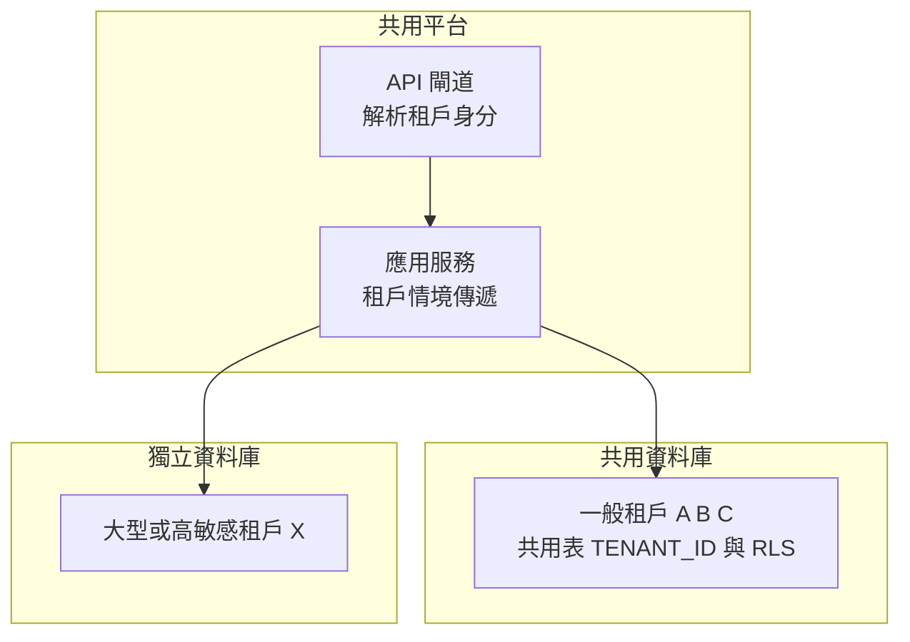

### 12.3 防止漏帶 TENANT_ID 的多層控制

| 層級 | 控制 |
|---|---|
| 身分層 | 租戶由驗證後的 Token 取得，**不得**由用戶端參數指定 |
| 應用層 | Repository 基底類別或 ORM 全域過濾器自動附加條件 |
| 資料庫層 | Row Level Security／VPD／RCAC 強制過濾 |
| 測試層 | 自動化越權測試：以租戶 A 身分存取租戶 B 資料 |
| 監控層 | 稽核不帶 TENANT_ID 條件的查詢 |

**PostgreSQL Row Level Security 範例**：

```sql
-- 適用：PostgreSQL 16+／示範，待驗證
ALTER TABLE account ENABLE ROW LEVEL SECURITY;
ALTER TABLE account FORCE ROW LEVEL SECURITY;

CREATE POLICY p_account_tenant ON account
    USING (tenant_id = current_setting('app.tenant_id', true))
    WITH CHECK (tenant_id = current_setting('app.tenant_id', true));

-- 應用程式在每次交易開始時設定租戶（以交易範圍設定，避免連線池殘留）
BEGIN;
SELECT set_config('app.tenant_id', :tenant_id_from_token, true);
SELECT * FROM account WHERE account_no = :acct_no;
COMMIT;
```

> 注意：資料表擁有者與具 BYPASSRLS 屬性的角色可略過 RLS；應用帳號**不得**為表擁有者，`FORCE ROW LEVEL SECURITY` 可讓擁有者也受限。

**SQL Server Row-Level Security 範例**：

```sql
-- 適用：SQL Server 2022／示範，待驗證
CREATE SCHEMA sec;
GO
CREATE FUNCTION sec.fn_tenant_predicate (@tenant_id VARCHAR(16))
RETURNS TABLE
WITH SCHEMABINDING
AS
RETURN SELECT 1 AS ok
 WHERE @tenant_id = CAST(SESSION_CONTEXT(N'tenant_id') AS VARCHAR(16));
GO
CREATE SECURITY POLICY sec.tenant_policy
    ADD FILTER PREDICATE sec.fn_tenant_predicate(tenant_id) ON dbo.account,
    ADD BLOCK  PREDICATE sec.fn_tenant_predicate(tenant_id) ON dbo.account AFTER INSERT
    WITH (STATE = ON);
GO
-- 應用程式連線後設定，read_only 防止同一連線被竄改
EXEC sp_set_session_context @key = N'tenant_id', @value = N'T001', @read_only = 1;
```

Oracle 可使用 VPD（DBMS_RLS），Db2 可使用 RCAC（CREATE PERMISSION），概念相同但語法與效能特性不同，**必須**依產品文件設計與測試。

### 12.4 資料庫層與應用層授權的互補

| 項目 | 應用層授權 | 資料庫層控制 |
|---|---|---|
| 粒度 | 功能、按鈕、業務規則 | 資料列、欄位 |
| 優點 | 彈性、可表達複雜規則 | 對所有存取路徑一致 |
| 缺點 | 新路徑（批次、報表）可能漏掉 | 規則複雜時影響效能與可讀性 |
| 結論 | 兩者互補，資料庫層作為最後防線 | |

### 12.5 跨系統整合方式

| 方式 | 適用 | 主要風險 | 必要控制 |
|---|---|---|---|
| API | 即時查詢、交易 | 逾時重送 | 冪等鍵、逾時策略 |
| 批次檔案 | 大量日終交換 | 檔案不完整、重複處理 | 控制檔（筆數、總額、雜湊）、處理紀錄 |
| ETL | 倉儲載入 | 轉換錯誤 | 資料品質規則、對帳 |
| CDC | 即時同步 | 結構變更中斷、延遲 | Schema 相容性、延遲監控 |
| MQ／事件流 | 解耦、非同步 | 重複、亂序、遺失 | 去重、序號、死信佇列 |

### 12.6 跨系統資料流範例

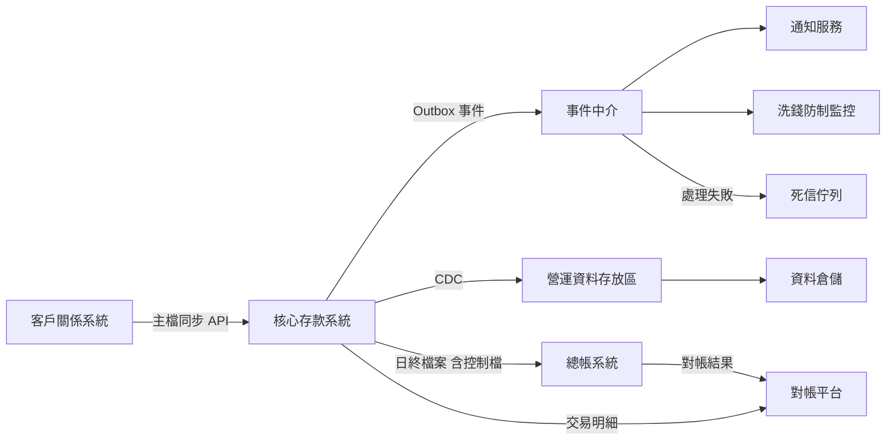

### 12.7 重送、去重、順序與冪等

| 議題 | 作法 |
|---|---|
| 重送 | 生產端可重送；消費端以事件 ID 去重 |
| 去重 | 消費端維護已處理事件表（PK 為事件 ID），在同一交易內寫入 |
| 順序 | 以業務鍵（如帳戶 ID）分區保證同鍵順序；事件帶版本號，舊版本事件忽略 |
| 冪等 | 寫入以 UPSERT 或版本比較，重覆處理結果一致 |
| 毒訊息 | 重試上限後送死信佇列，人工處理 |

```sql
-- 示範：消費端去重表
CREATE TABLE processed_event (
    event_id     VARCHAR(64) NOT NULL,
    consumer     VARCHAR(32) NOT NULL,
    processed_at TIMESTAMP   NOT NULL,
    CONSTRAINT pk_processed_event PRIMARY KEY (event_id, consumer)
);
```

### 12.8 Schema Evolution 與相容性

| 變更 | 相容性 | 作法 |
|---|---|---|
| 新增選填欄位 | 向後相容 | 消費端忽略未知欄位 |
| 刪除欄位 | 不相容 | 先標示棄用、確認無消費者後再移除 |
| 改名 | 不相容 | 新增新欄位、雙寫、遷移、移除舊欄位 |
| 改型別 | 不相容 | 視為新欄位處理 |

**建議**使用結構描述登錄（Schema Registry）或契約測試管理事件與介面版本。

### 12.9 對帳與異常追蹤

| 對帳層級 | 方法 |
|---|---|
| 筆數 | 來源與目的筆數一致 |
| 金額 | 依幣別、日期加總一致 |
| 明細 | 以鍵值與雜湊逐筆比對 |
| 時效 | 延遲是否在 SLA 內 |

### 12.10 介接規格範本

```markdown
| 項目 | 內容 |
|---|---|
| 介接編號 | IF-CORE-GL-001 |
| 提供方／接收方 | 核心存款系統／總帳系統 |
| 方式 | 批次檔案（SFTP），附控制檔 |
| 頻率與時間 | 每營業日 02:00 前 |
| 檔案格式 | UTF-8、固定欄寬或 CSV（含欄位定義表） |
| 控制檔內容 | 筆數、金額總和（依幣別）、SHA-256 雜湊 |
| 資料分類 | 機敏；傳輸加密、落地加密 |
| 冪等鍵 | 營業日＋批次序號 |
| 重送規則 | 同批次重送覆蓋，需通知接收方 |
| 錯誤處理 | 控制檔不符即拒收並通報 |
| 對帳方式 | 接收方回傳對帳結果檔 |
| 保存期限 | 依保存政策（待法遵確認） |
| 聯絡窗口 | 雙方系統負責人（填寫） |
```

### 12.11 資料契約（Data Contract）

介接規格說明「怎麼傳」；資料契約進一步把「資料長什麼樣、品質承諾、誰負責、怎麼演進」寫成**機器可驗證**的文件，並納入 CI。

```yaml
# 資料契約範例（示範用途，欄位可依組織標準調整）
contract_id: DC-CORE-TXN-POSTED
version: 2.1.0            # 語意化版本：主版號變動代表不相容
owner: 存匯部資料管理者
producer: core-deposit
consumers: [aml-monitor, notification, dwh]
classification: 機敏
schema:
  format: avro
  registry_subject: core.txn.posted-value
  compatibility: BACKWARD  # 新版 Schema 必須能讀舊資料
fields:
  - name: event_id
    type: string
    required: true
    description: 全域唯一事件識別碼（UUIDv7）
  - name: account_id
    type: long
    required: true
  - name: amount
    type: bytes
    logical_type: decimal(19,4)
    required: true
  - name: currency_code
    type: string
    pattern: "^[A-Z]{3}$"
    required: true
quality:
  - rule: amount <> 0
  - rule: event 延遲 P95 <= 60 秒
sla:
  availability: 99.9%
  freshness_seconds: 60
change_policy:
  breaking_change_notice_days: 30
  deprecation_period_days: 90
```

Schema 相容性模式對照（以常見 Schema Registry 定義為例）：

| 模式 | 意義 | 允許的變更 | 部署順序 |
|---|---|---|---|
| BACKWARD | 新 Schema 可讀舊資料 | 刪除欄位、新增具預設值欄位 | 先升級消費者 |
| FORWARD | 舊 Schema 可讀新資料 | 新增欄位、刪除具預設值欄位 | 先升級生產者 |
| FULL | 雙向相容 | 僅新增或刪除具預設值欄位 | 任意 |
| NONE | 不檢查 | 任何變更 | 需人工協調，**不建議** |

### 12.12 控制層失效時的行為

多層控制的價值在於「其中一層失效時，其他層仍能擋住」。設計時**必須**逐層假設失效並驗證結果。

| 失效情境 | 預期結果 | 驗證方式 |
|---|---|---|
| 應用層漏帶 TENANT_ID | RLS 仍只回傳當前租戶資料 | 以直接 SQL 不帶條件查詢，筆數應等於當前租戶筆數 |
| 未設定租戶情境 | 查無資料（而非全部資料） | 不呼叫 `set_config` 直接查詢，應回傳 0 筆 |
| RLS 被誤停用 | 監控告警 | 定期查詢 `relrowsecurity`，非預期值即告警 |
| 應用帳號被授予 BYPASSRLS | 監控告警 | 定期查詢角色屬性 |

```sql
-- PostgreSQL：檢查應啟用 RLS 的表（預期全部為 true）
SELECT relname, relrowsecurity, relforcerowsecurity
FROM   pg_class
WHERE  relname IN ('account', 'customer', 'txn');

-- PostgreSQL：不應存在具 BYPASSRLS 或 SUPERUSER 的應用帳號（預期 0 筆）
SELECT rolname FROM pg_roles
WHERE  (rolbypassrls OR rolsuper) AND rolname LIKE 'app\_%';
```

### 12.13 驗證與審查

#### AI 產出常見錯誤

| 錯誤型態 | 範例 | 如何識別 |
|---|---|---|
| 租戶由參數傳入 | `WHERE tenant_id = :tenantIdFromRequest` | 追查參數來源是否為已驗證 Token |
| RLS 只設 USING | 未設 `WITH CHECK`，可寫入其他租戶資料 | 檢查政策是否同時限制讀與寫 |
| 連線池殘留租戶 | `set_config(..., false)` 設為工作階段層級 | 應使用交易層級（`true`） |
| 契約破壞未升主版號 | 刪除必填欄位但版本只升次版號 | 以 Schema Registry 相容性檢查驗證 |

#### 人工審查步驟

1. 以兩個測試租戶執行越權矩陣：A 讀 B、A 寫 B、未設定租戶讀取，結果皆應失敗或 0 筆。
2. 在 CI 執行 Schema 相容性檢查，不相容即失敗。
3. 確認每個介接都有對帳方法與死信處理負責人。

#### 通過標準

- 越權矩陣全數通過；RLS 檢查查詢結果符合預期。
- 契約變更皆通過相容性檢查，或已依變更政策提前通知。

### 12.14 常見錯誤

- 租戶 ID 由前端傳入。
- 僅依賴應用層過濾，報表與批次繞過。
- 消費端未去重，重送造成重複入帳。
- 事件結構變更未通知下游。
- 批次檔案無控制檔。

### 12.15 實務案例與注意事項

> **案例**：某共用平台新增匯出報表功能，開發人員直接寫 SQL 未經 Repository 基底類別，漏帶 TENANT_ID 條件，測試環境即匯出所有租戶資料。因資料庫層已啟用 RLS，實際只回傳目前租戶資料，避免了外洩。這是資料庫層作為最後防線的實例。

### 12.16 本章檢核表

- [ ] 已依租戶分級選擇多租戶策略並記錄理由。
- [ ] 租戶身分來自驗證後的身分資訊。
- [ ] 已啟用資料庫層列級控制並測試繞過情境。
- [ ] 應用帳號不是資料表擁有者。
- [ ] 跨系統介接具冪等、去重、順序、死信機制。
- [ ] 已建立介接規格與對帳機制。
- [ ] 已建立 Schema 演進與相容性規則。

## 第 13 章 資料庫安全與 SSDLC

### 13.1 學習目標

- 建立從需求到維運的資料庫安全控制。
- 能設計帳號分離、最小權限與職責分離。
- 能辨識 SQL Injection、過度授權、敏感資料暴露。

### 13.2 控制措施分級

| 分級 | 控制措施 |
|---|---|
| **必須依政策落實** | 資料分類；帳號分離；最小權限；參數化查詢；傳輸加密；特權操作稽核；正式資料不得直接用於測試；密碼與金鑰不得寫入程式碼；部署須經審批；備份須加密並限制還原權限；定期權限盤點；安全修補 |
| **依風險評估採用** | 靜態加密（TDE）；欄位加密；Token 化；列級安全；資料庫活動監控（DAM）；特權帳號管理系統（PAM）錄影；不可變備份；客戶自管金鑰 |
| **建議最佳實務** | CIS Benchmark 基線比對自動化；Schema 變更靜態掃描；資料庫防火牆；異常查詢行為分析；Secrets 動態憑證 |

> 「必須」層級的實際項目**必須**以組織資訊安全政策為準，上表為〔組織建議〕草案。

### 13.3 帳號分離

| 帳號類型 | 用途 | 權限 | 登入方式 |
|---|---|---|---|
| Schema 擁有者 | 擁有物件 | DDL | 停用互動登入，僅部署管線使用 |
| 應用程式帳號 | 線上交易 | 指定表的 DML，或僅可執行程序 | 由秘密管理服務提供 |
| 批次帳號 | 批次作業 | 批次所需 DML | 同上，與線上帳號分開 |
| 唯讀查詢帳號 | 報表、查詢 | SELECT（必要時限於 View） | 個人帳號或代理 |
| DBA 個人帳號 | 維運 | 管理權限 | 經 PAM 申請、雙因素、錄影 |
| 監控帳號 | 監控 | 系統檢視表讀取 | 服務帳號 |
| 稽核帳號 | 稽核檢視 | 稽核紀錄唯讀 | 與 DBA 分離 |

### 13.4 最小權限範例

```sql
-- 適用：PostgreSQL 16+／示範，密碼以佔位符表示，實際由秘密管理系統產生
CREATE ROLE dep_owner NOLOGIN;
CREATE ROLE dep_app   LOGIN PASSWORD '<由秘密管理系統注入>';
CREATE ROLE dep_ro    NOLOGIN;

CREATE SCHEMA dep AUTHORIZATION dep_owner;
REVOKE ALL ON SCHEMA public FROM PUBLIC;
REVOKE ALL ON DATABASE coredb FROM PUBLIC;

GRANT USAGE ON SCHEMA dep TO dep_app, dep_ro;
GRANT SELECT, INSERT, UPDATE ON dep.account, dep.txn TO dep_app;
GRANT USAGE ON SEQUENCE dep.seq_txn TO dep_app;
GRANT SELECT ON dep.v_account_masked TO dep_ro;
-- 不授予 DELETE、TRUNCATE、DDL
```

```sql
-- 適用：SQL Server 2022／示範
CREATE USER dep_app FOR LOGIN dep_app_login WITH DEFAULT_SCHEMA = dep;
GRANT SELECT, INSERT, UPDATE ON SCHEMA::dep TO dep_app;
DENY  DELETE ON SCHEMA::dep TO dep_app;
```

Oracle、Db2 以 `GRANT SELECT, INSERT, UPDATE ON <schema>.<table> TO <user>` 方式授權，並**不得**授予 `ANY` 系統權限（Oracle）或 `DBADM`（Db2）給應用程式帳號。

### 13.5 SQL Injection 與參數化查詢

**錯誤範例**：

```java
// 錯誤示範：字串串接造成 SQL Injection，禁止使用
String sql = "SELECT * FROM account WHERE account_no = '" + accountNo + "'";
Statement st = conn.createStatement();
ResultSet rs = st.executeQuery(sql);
```

輸入 `' OR '1'='1` 即可取得所有帳戶。

**正確範例**：

```java
// 正確：使用 PreparedStatement 參數綁定
String sql = "SELECT account_id, account_no, balance FROM account WHERE tenant_id = ? AND account_no = ?";
try (PreparedStatement ps = conn.prepareStatement(sql)) {
    ps.setString(1, tenantId);
    ps.setString(2, accountNo);
    try (ResultSet rs = ps.executeQuery()) {
        // 處理結果
    }
}
```

**無法參數化的部分**（例如排序欄位、表名）**必須**使用允許清單：

```java
private static final Map<String, String> SORT_COLUMNS = Map.of(
        "time", "txn_time",
        "amount", "amount");

String column = SORT_COLUMNS.getOrDefault(sortKey, "txn_time");
String sql = "SELECT txn_id, txn_time, amount FROM txn WHERE account_id = ? ORDER BY " + column + " DESC";
```

### 13.6 動態 SQL 與 Stored Procedure

Stored Procedure 本身**不保證**安全；程序內以字串組合動態 SQL 一樣會被注入。

```sql
-- 錯誤示範（SQL Server）：程序內串接
-- EXEC('SELECT * FROM dep.account WHERE account_no = ''' + @acct + '''');

-- 正確（SQL Server）：sp_executesql 參數化
EXEC sp_executesql
     N'SELECT account_id, balance FROM dep.account WHERE account_no = @acct',
     N'@acct VARCHAR(20)',
     @acct = @input_acct;
```

| 產品 | 參數化動態 SQL |
|---|---|
| Oracle | `EXECUTE IMMEDIATE ... USING`；識別字用 `DBMS_ASSERT` |
| Db2 | `PREPARE` 搭配參數標記 `?`、`EXECUTE ... USING` |
| PostgreSQL | `EXECUTE format('... %I ...', ident) USING value` |
| SQL Server | `sp_executesql` 搭配參數；識別字用 `QUOTENAME` |

### 13.7 加密

| 層次 | 技術 | 防護範圍 | 不防護 |
|---|---|---|---|
| 傳輸加密 | TLS | 網路竊聽 | 已授權帳號濫用 |
| 靜態加密 | TDE、磁碟加密 | 儲存媒體、備份檔遺失 | 透過資料庫查詢取得資料 |
| 欄位加密 | 應用層加密、Always Encrypted | DBA 與資料庫層查詢看到明文 | 應用程式本身遭入侵 |
| Token 化 | 以 Token 取代原值，原值存於 Token 保險庫 | 業務系統不持有原值 | Token 服務本身風險 |
| 遮罩 | 顯示時隱藏 | 畫面與報表暴露 | 底層查詢 |

**金鑰管理原則**：

1. 金鑰與資料分開存放，使用 HSM 或 KMS。
2. 定義金鑰輪替週期與程序，輪替不應造成資料無法解密。
3. 金鑰存取權限與資料庫管理權限分離。
4. 憑證到期前告警（建議至少 30 天前）。
5. 秘密（密碼、連線字串）存放於秘密管理服務，不寫入程式碼、設定檔或版本庫。

### 13.8 環境隔離與測試資料

| 規則〔組織建議〕 | 說明 |
|---|---|
| 正式資料不出正式環境 | 測試需正式資料時，**必須**先去識別化並經核准 |
| 環境網路隔離 | 非正式環境不得連線正式資料庫 |
| 帳號不共用 | 各環境使用不同帳號與密碼 |
| 去識別化需不可回推 | 遮罩規則需防止以多欄位交叉比對還原身分 |

### 13.9 稽核與日誌保護

| 稽核對象 | 範例 |
|---|---|
| 登入 | 成功、失敗、來源 IP |
| 特權操作 | GRANT、REVOKE、ALTER USER、DDL |
| 敏感資料存取 | 對個資表的 SELECT（依風險） |
| 稽核設定變更 | 關閉稽核、修改稽核政策 |
| 備份與還原 | 誰在何時還原了什麼 |

稽核紀錄**必須**送到 DBA 無法修改的集中日誌平台（SIEM），並保護完整性。

### 13.10 弱點、修補與基線

1. 依原廠安全公告定期評估修補（例如 Oracle CPU、SQL Server CU／GDR、PostgreSQL Minor Release、Db2 Fix Pack／Mod Pack）。
2. 以 CIS Benchmark 或組織基線比對組態，產出差異報告。
3. 移除範例資料庫、預設帳號，停用不必要的功能與擴充。
4. JDBC／ODBC 驅動程式與連線池元件納入軟體組成分析（SCA）。

### 13.11 CI/CD 與 Migration 審查

| 控制 | 說明 |
|---|---|
| 版本控制 | 所有 DDL 與 DCL 經版本庫管理 |
| 自動檢查 | 禁止 `GRANT ... TO PUBLIC`、`DROP` 無核准、明文密碼 |
| 人工審查 | DBA 與資安審查高風險變更 |
| 部署授權 | 正式環境部署需核准紀錄，執行者與開發者分離 |
| 證據 | 保留部署日誌與執行結果 |

### 13.12 安全事件處理與證據保全


證據保全時，**必須**先取得快照或複本並計算雜湊，再進行修復，避免破壞證據。通報對象與時限依主管機關規定與內規，由資安與法遵決定。

### 13.13 標準對照：OWASP ASVS 5.0、PCI DSS v4.0.1、NIST SP 800-53

下表把本章控制對應到常見外部標準的主題，方便稽核時說明「這個設計滿足哪一類要求」。條次與完整要求**必須**以原文為準〔標準〕。

| 本章控制 | OWASP ASVS 5.0 主題 | PCI DSS v4.0.1 主題（僅限持卡人資料環境） | NIST SP 800-53 控制族 |
|---|---|---|---|
| 參數化查詢、允許清單 | 輸入編碼與注入防護 | 需求 6（安全開發，含常見攻擊防護） | SI-10 |
| 帳號分離、最小權限 | 授權 | 需求 7（依業務需要限制存取） | AC-6 |
| 個人帳號、MFA | 認證 | 需求 8（識別與認證，含 MFA） | IA-2 |
| 傳輸與靜態加密 | 資料保護、安全通訊 | 需求 3（保護儲存的帳戶資料）、需求 4（傳輸加密） | SC-8、SC-28 |
| 金鑰管理 | 密碼學 | 需求 3 金鑰管理相關要求 | SC-12 |
| 稽核與日誌保護 | 安全日誌 | 需求 10（記錄並監控所有存取） | AU-2、AU-9 |
| 弱點與修補 | 組態 | 需求 6（修補）、需求 11（定期測試） | RA-5、SI-2 |

> PCI DSS 只適用於儲存、處理或傳輸持卡人資料的系統範圍；若共用平台承載卡片業務，**建議**將卡號相關表以獨立 Schema 或獨立資料庫隔離，縮小稽核範圍。

### 13.14 資料庫層 SQL 防護與資料庫活動監控

參數化查詢是第一道防線；資料庫層可再加一道「只允許已知 SQL」的防護。

| 方案 | 產品 | 運作方式 | 注意 |
|---|---|---|---|
| SQL Firewall | Oracle 23ai／26ai | 學習期間記錄允許的 SQL 與連線來源，之後封鎖或告警清單外的 SQL | 學習期需涵蓋月底、年終等完整業務週期 |
| 資料庫活動監控（DAM） | 第三方產品 | 以代理程式或網路監聽記錄並分析 SQL | 需評估效能與加密流量可視性 |
| 查詢封鎖提示 | SQL Server 2025 `ABORT_QUERY_EXECUTION` | 透過 Query Store 提示封鎖已知有問題的查詢 | 用於效能事件處置，不是安全白名單 |

```sql
-- Oracle 23ai／26ai：SQL Firewall 基本流程（示範用途，須依官方文件與授權確認）
EXEC DBMS_SQL_FIREWALL.ENABLE;
EXEC DBMS_SQL_FIREWALL.CREATE_CAPTURE(username => 'DEP_APP', top_level_only => TRUE, start_capture => TRUE);
-- 經過完整業務週期後停止學習並產生允許清單
EXEC DBMS_SQL_FIREWALL.STOP_CAPTURE('DEP_APP');
EXEC DBMS_SQL_FIREWALL.GENERATE_ALLOW_LIST('DEP_APP');
-- 先以僅記錄模式觀察，確認無誤判後再改為封鎖
EXEC DBMS_SQL_FIREWALL.ENABLE_ALLOW_LIST(username => 'DEP_APP', enforce => DBMS_SQL_FIREWALL.ENFORCE_SQL, block => FALSE);
```

### 13.15 密碼敏捷性與後量子密碼準備

NIST 已於 2024 年發布 FIPS 203（ML-KEM）、FIPS 204（ML-DSA）與 FIPS 205（SLH-DSA）。對資料庫而言，最先受影響的是「現在被截收、未來被解密」的長期保存資料傳輸〔標準〕。

| 步驟 | 資料庫工程對應工作 |
|---|---|
| 1. 盤點 | 列出資料庫連線 TLS 版本與套件、備份加密演算法、欄位加密演算法、金鑰長度 |
| 2. 分級 | 依資料保存年限排序：保存越久的資料越優先 |
| 3. 解耦 | 確認演算法可透過設定更換，而非寫死在程式 |
| 4. 追蹤 | 追蹤原廠支援（例如 Oracle 26ai 已支援傳輸 ML-KEM）與函式庫支援 |
| 5. 測試 | 在非正式環境驗證新演算法對效能與相容性的影響 |

```sql
-- PostgreSQL：盤點目前連線的 TLS 版本與加密套件
SELECT a.usename, a.client_addr, s.version AS tls_version, s.cipher, s.bits
FROM   pg_stat_ssl s
JOIN   pg_stat_activity a ON a.pid = s.pid
WHERE  s.ssl;

-- SQL Server：盤點連線是否加密
SELECT session_id, encrypt_option, auth_scheme, client_net_address
FROM   sys.dm_exec_connections;
```

### 13.16 驗證與審查

#### AI 產出常見錯誤

| 錯誤型態 | 範例 | 如何識別 |
|---|---|---|
| 字串串接 SQL | `"... WHERE id = " + id` | 搜尋 `+` 或字串插值組成的 SQL |
| 過度授權 | `GRANT ALL`、`db_owner`、`DBA` 角色給應用帳號 | 檢查 GRANT 敘述 |
| 明文秘密 | DDL 或設定檔含真實密碼 | 執行秘密掃描工具 |
| 把遮罩當加密 | 「已用 DDM 保護證號」 | 對照 13.7 加密層次表 |
| 錯誤的稽核設定 | 只稽核 DDL，未稽核登入失敗與權限變更 | 對照 13.9 稽核對象 |

#### 人工審查步驟

1. 以權限盤點 SQL 產出實際權限，與權限矩陣比對。
2. 對每個對外 API 執行注入測試（第 18 章），結果需全數阻擋。
3. 確認稽核紀錄送達 SIEM，且以 DBA 帳號無法刪除。

#### 可執行驗證

```sql
-- PostgreSQL：應用帳號實際擁有的表權限（與權限矩陣比對）
SELECT grantee, table_schema, table_name, string_agg(privilege_type, ',' ORDER BY privilege_type) AS privs
FROM   information_schema.role_table_grants
WHERE  grantee IN ('dep_app', 'dep_ro')
GROUP BY grantee, table_schema, table_name
ORDER BY grantee, table_name;

-- PostgreSQL：授予 PUBLIC 的權限（預期 0 筆）
SELECT table_schema, table_name, privilege_type
FROM   information_schema.role_table_grants
WHERE  grantee = 'PUBLIC' AND table_schema NOT IN ('pg_catalog', 'information_schema');

-- SQL Server：應用帳號的伺服器與資料庫角色（預期不含 sysadmin、db_owner）
SELECT dp.name AS member, r.name AS role_name
FROM   sys.database_role_members m
JOIN   sys.database_principals r  ON r.principal_id  = m.role_principal_id
JOIN   sys.database_principals dp ON dp.principal_id = m.member_principal_id
WHERE  dp.name = 'dep_app';
```

```sql
-- 越權驗證：以應用帳號身分執行，下列每一行都應失敗（權限不足）
DELETE FROM dep.txn WHERE txn_id = -1;
TRUNCATE dep.txn;
CREATE TABLE dep.t_hack (id INT);
GRANT SELECT ON dep.account TO PUBLIC;
```

通過標準：實際權限與權限矩陣差異 0 筆；PUBLIC 授權 0 筆；越權驗證全部失敗；注入測試全數阻擋。

### 13.17 案例

#### 案例一：SQL Injection

> 查詢 API 以字串串接排序欄位，攻擊者輸入 `txn_time; DROP TABLE ...` 類型字串。因應用帳號無 DDL 權限，破壞未成功，但仍可透過 UNION 讀取其他表。改善：允許清單、移除跨 Schema 讀取權限、WAF 規則與稽核告警。

#### 案例二：過度授權

> 報表帳號被授予整個 Schema 的 SELECT，包含證號密文與加密金鑰參照表。盤點後改為僅能讀取遮罩 View。

#### 案例三：敏感資料暴露

> 例外訊息將完整 SQL 與參數寫入應用日誌，日誌被集中到可廣泛存取的平台。改善：日誌遮罩、錯誤訊息不輸出參數值、日誌平台存取控制。

### 13.18 SSDLC 資料庫安全檢核表

| 階段 | 檢核項目 |
|---|---|
| 需求 | 已完成資料分類；已識別個資與法規需求 |
| 設計 | 已完成權限矩陣；加密與遮罩設計；威脅建模 |
| 開發 | 全面參數化；無明文秘密；動態 SQL 有允許清單 |
| 測試 | 已執行 SQL Injection 與越權測試；測試資料已去識別化 |
| 部署 | Migration 經審查；部署者與開發者分離；稽核已啟用 |
| 維運 | 權限定期盤點；修補依時程；稽核紀錄集中且受保護 |

### 13.19 本章檢核表

- [ ] 已依三級分類列出控制措施並確認落實狀態。
- [ ] 帳號依用途分離，應用帳號無 DDL。
- [ ] 所有 SQL 參數化，動態識別字使用允許清單。
- [ ] 傳輸加密已啟用，靜態與欄位加密依風險評估。
- [ ] 金鑰與秘密由 KMS／秘密管理服務管理。
- [ ] 稽核紀錄集中且 DBA 無法竄改。
- [ ] 已建立安全事件處理程序。

## 第 14 章 資料保存年限、法遵與跨境部署

### 14.1 學習目標

- 能建立資料保存政策，而非套用單一年限。
- 了解跨境與雲端部署的資料主權議題。
- 知道何時需要法遵、法務與資料擁有者確認。

### 14.2 重要聲明

> 本章**不提供**任何法定保存年限。各類資料的保存期限、起算點與刪除義務，**必須**由法遵、法務與資料擁有者依適用法規、契約與內規確認並簽核。下表的「保存期限」欄位刻意保留為待確認。

### 14.3 資料保存政策表

| 資料類別 | 業務用途 | 擁有者 | 分類 | 適用依據（待確認） | 保存期限與起算點 | 存取權限 | 封存方式 | 刪除方式 | 法律保全 | 證據 |
|---|---|---|---|---|---|---|---|---|---|---|
| 客戶主檔 | 識別與服務客戶 | 個金／法金單位 | 個人資料 | 個資法、洗錢防制相關法規、契約 | 待確認；常見起算點為業務關係結束 | 業務承辦、最小權限 | 結清後移至歸檔庫 | 去識別化或刪除 | 支援 | 刪除清冊 |
| 交易紀錄 | 帳務、查詢、稽核 | 業務單位 | 機敏 | 洗錢防制、會計、主管機關規範 | 待確認；起算點可能為交易日 | 業務、稽核 | 分區歸檔 | 到期刪除分區 | 支援 | 歸檔與刪除紀錄 |
| 會計與財務紀錄 | 財報、稅務 | 會計單位 | 機敏 | 商業會計、稅捐相關法令 | 待確認 | 會計、稽核 | 歸檔庫 | 到期刪除 | 支援 | 清冊 |
| 稽核軌跡 | 責任追溯 | 稽核／資安 | 機敏 | 內稽內控、主管機關規範 | 待確認 | 稽核唯讀 | WORM 儲存 | 到期刪除 | 支援 | 雜湊鏈 |
| 系統操作日誌 | 維運與除錯 | IT | 內部 | 內規 | 待確認 | 維運 | 集中日誌平台 | 自動輪替 | 依事件 | 平台紀錄 |
| 資安事件紀錄 | 事件調查 | 資安 | 機敏 | 主管機關資安規範、內規 | 待確認 | 資安 | SIEM 長期保存 | 到期刪除 | 支援 | 事件編號 |
| 介接檔案 | 系統交換 | 介接雙方 | 依內容 | 內規、契約 | 待確認；建議短期 | 系統帳號 | 處理後歸檔 | 自動刪除 | 依事件 | 處理紀錄 |
| 批次中間資料 | 批次處理 | IT | 依內容 | 內規 | 建議批次完成並對帳後清除 | 批次帳號 | 不封存 | 自動清除 | 依事件 | 清除紀錄 |
| 備份資料 | 災難復原 | IT | 同來源最高等級 | 營運持續政策 | 依備份政策（與資料保存分開） | 備份管理員 | 異地與不可變儲存 | 到期自動淘汰 | 支援暫停淘汰 | 備份目錄 |
| 歷史封存資料 | 長期保存與調閱 | 資料擁有者 | 依來源 | 依上述各類 | 依來源類別 | 調閱申請 | 歸檔庫或物件儲存 | 到期刪除 | 支援 | 調閱與刪除紀錄 |

### 14.4 建立保存政策的流程

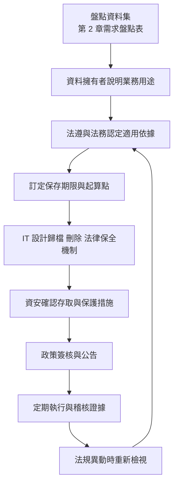

### 14.5 個人資料保護法的最新狀態

查核結果〔法規〕：

- 個人資料保護法最新修正日期為民國 114 年 11 月 11 日，部分條文施行日期由行政院另定，尚未全部生效。
- 主管機關依修正內容為個人資料保護委員會，查核時仍以籌備處形式運作。
- 修正條文涉及安全維護、事故通報等事項；**必須**由法遵追蹤施行日期與子法，評估對資料庫設計（稽核、通報資料蒐集、刪除程序）的影響。

### 14.6 委外與雲端

查核結果〔法規〕：「金融機構作業委託他人處理內部作業制度及程序辦法」在全國法規資料庫的最新修正日期為民國 115 年 4 月 13 日。

資料庫工程需配合確認的事項（具體要求以法規與主管機關函令為準）：

| 議題 | 需確認 |
|---|---|
| 委外範圍 | 雲端代管資料庫、備份保管、遠端維運是否屬委外 |
| 資料存放地 | 主要資料、備份、日誌存放的國家與區域 |
| 稽核權 | 金融機構與主管機關對受託者的查核權 |
| 資料返還與刪除 | 契約終止時資料返還格式與刪除證明 |
| 事前程序 | 是否需事前申請或報備 |
| 再委託 | 雲端供應商的次處理者管理 |

### 14.7 跨境與資料主權

| 議題 | 說明 | 設計對策 |
|---|---|---|
| 資料所在地 | 資料、備份、日誌、快照實際存放位置 | 雲端區域鎖定、組織政策限制 |
| 跨境傳輸 | 傳輸到海外第三地是否受限制或需告知、同意 | 法遵確認；必要時以加密或假名化資料傳輸 |
| 金鑰所在地 | 加密金鑰由誰保管、存放何處 | 客戶自管金鑰（BYOK／HYOK）或地端 HSM |
| 供應商存取 | 雲端或維運廠商能否存取明文 | 欄位加密、存取核准流程、存取紀錄 |
| 當地法律調閱 | 外國主管機關可能要求調閱 | 法務評估、加密與金鑰控制 |
| 監理查核 | 我國主管機關查核海外資料的可行性 | 契約條款、資料可取回性 |

### 14.8 責任共擔模型

| 責任 | 地端 | IaaS 自建資料庫 | 雲端代管資料庫（PaaS） |
|---|---|---|---|
| 實體安全 | 銀行 | 雲端供應商 | 雲端供應商 |
| OS 修補 | 銀行 | 銀行 | 雲端供應商 |
| 資料庫修補 | 銀行 | 銀行 | 多由供應商執行，維護時段由客戶設定 |
| 備份機制 | 銀行 | 銀行 | 供應商提供，保留與驗證由客戶負責 |
| 帳號與權限 | 銀行 | 銀行 | 銀行 |
| 資料分類與加密決策 | 銀行 | 銀行 | 銀行 |
| 稽核紀錄 | 銀行 | 銀行 | 銀行設定與保存 |

> 代管服務的可用功能（例如超級使用者權限、特定擴充、OS 存取）可能與地端不同，設計前**必須**以服務文件確認。

### 14.9 NIST CSF 2.0 與資料庫法遵活動對照

NIST CSF 2.0 新增「治理（Govern）」功能，強調由管理階層負責風險決策。下表把本手冊的資料庫活動放進六大功能，便於與組織資安治理報告整合〔標準〕。

| CSF 2.0 功能 | 資料庫工程活動 | 證據 |
|---|---|---|
| Govern | 保存政策、資料分類政策、委外與雲端評估、例外核准 | 簽核紀錄、政策版本 |
| Identify | 資料庫資產清冊、資料集盤點、風險評估 | 資產清冊、需求盤點表 |
| Protect | 權限、加密、稽核設定、安全基線 | 權限矩陣、基線比對報告 |
| Detect | 稽核告警、異常查詢偵測、組態漂移偵測 | SIEM 告警紀錄 |
| Respond | 資安事件處理、證據保全 | 事件紀錄、證據雜湊 |
| Recover | 備份還原、DR 切換、演練 | 演練紀錄、還原驗證紀錄 |

### 14.10 保存期限變更時的處理程序

法規或內規修訂時，既有資料的保存期限可能延長或縮短。

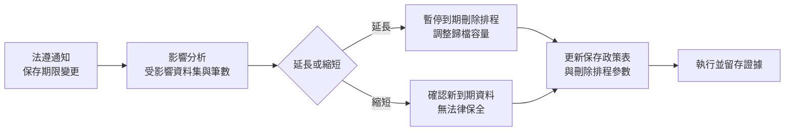

```sql
-- 影響分析範例：新保存期限下，各年度將到期的交易筆數（PostgreSQL，示範用途）
SELECT EXTRACT(YEAR FROM posting_date) AS posting_year,
       COUNT(*)                         AS txn_cnt,
       MIN(posting_date)                AS min_date,
       MAX(posting_date)                AS max_date
FROM   arc.txn_all
WHERE  posting_date < (CURRENT_DATE - (:new_retention_years || ' years')::interval)
GROUP BY EXTRACT(YEAR FROM posting_date)
ORDER BY posting_year;
```

> 保存期限延長時，**必須**先暫停刪除排程再修改參數，避免在政策更新前資料已被刪除。

### 14.11 驗證與審查

#### AI 產出常見錯誤

| 錯誤型態 | 範例 | 如何識別 |
|---|---|---|
| 捏造法規條次或年限 | 「依某法第 X 條保存 15 年」 | 至全國法規資料庫查證；無法查證即退回 |
| 引用過時法規 | 引用已修正前的條文 | 比對最新修正日期 |
| 忽略衍生副本 | 只談主資料庫的存放地 | 檢查是否涵蓋備份、日誌、快照、DR |
| 把建議寫成法定要求 | 「法規要求必須使用 TDE」 | 對照來源標籤〔法規〕〔組織建議〕 |

#### 人工審查步驟

1. 保存政策表的每一列，依據欄位必須能點開查證。
2. 確認存放地清單涵蓋主資料、備份、日誌、快照、DR 副本、監控資料。
3. 確認刪除程序有證據產出（刪除清冊、執行紀錄）。

#### 通過標準

- 保存政策表無「待確認」卻已被系統採用的項目。
- 雲端資料存放地與委外評估文件一致。

### 14.12 常見錯誤

- 把網路上的「銀行資料保存 N 年」直接寫入系統設計。
- 只規定保存期限，未規定刪除與證據。
- 以為資料在雲端「同一家供應商」就沒有跨境問題，忽略備份與災備區域。
- 金鑰由雲端供應商全權管理卻宣稱「供應商無法存取資料」。

### 14.13 實務案例與注意事項

> **案例**：某專案將 DR 設於海外雲端區域，上線前法遵審查發現備份快照與日誌也被自動複製到第三個區域，且未納入委外評估。最後調整為限制快照複製區域，並補辦委外程序。教訓：**必須**盤點所有衍生副本的位置。

### 14.14 本章檢核表

- [ ] 每類資料都有擁有者、用途、分類與依據。
- [ ] 保存期限與起算點已由法遵確認並簽核。
- [ ] 已設計封存、刪除、法律保全與證據機制。
- [ ] 已盤點資料、備份、日誌、快照實際存放位置。
- [ ] 跨境與委外議題已經法遵評估。
- [ ] 金鑰保管方式與供應商存取權限已確認。

## 第 15 章 HA、DR、備份與復原策略

### 15.1 學習目標

- 理解 RTO、RPO、MTTR、可用率。
- 能設計符合不同 RTO／RPO 的架構。
- 能撰寫 DR Runbook 並規劃演練。

### 15.2 名詞定義

| 名詞 | 定義 |
|---|---|
| RTO | 中斷後恢復服務的目標時間 |
| RPO | 可容忍的最大資料遺失時間範圍 |
| MTTR | 平均修復時間（實際量測） |
| 可用率 | 服務可用時間比例 |

可用率與停機時間換算（以 30 天計）：

| 可用率 | 每月可停機時間 |
|---|---|
| 99.9% | 約 43.2 分鐘 |
| 99.95% | 約 21.6 分鐘 |
| 99.99% | 約 4.3 分鐘 |

### 15.3 RTO、RPO 與資料保存期限分開管理

| 項目 | 回答的問題 | 決定者 |
|---|---|---|
| RTO | 多快恢復服務 | 業務（BIA） |
| RPO | 最多遺失多少資料 | 業務（BIA） |
| 備份保留 | 能還原到多久以前 | IT 依營運持續需求 |
| 資料保存期限 | 資料要保存多久 | 法遵與資料擁有者 |

### 15.4 HA 與 DR 關鍵機制

| 機制 | 說明 |
|---|---|
| 同步複寫 | Commit 前確認副本已接收，RPO 可為 0，延遲增加 |
| 非同步複寫 | 不等待副本，延遲低，RPO 大於 0 |
| Active-Passive | 一端服務、一端待命 |
| Active-Active | 多端同時服務；資料庫層需處理寫入衝突，複雜度高 |
| 自動切換 | 快速，但誤判風險 |
| 人工切換 | 可控，但較慢 |
| Split-Brain | 兩端都認為自己是主節點並接受寫入 |
| Fencing | 確保舊主節點無法再寫入的機制（如 STONITH、儲存隔離） |
| Quorum／Witness | 以多數決或第三方仲裁決定主節點 |

### 15.5 備份類型

| 類型 | 說明 | 優點 | 缺點 |
|---|---|---|---|
| 完整備份 | 全部資料 | 還原簡單 | 時間長、空間大 |
| 差異備份 | 自上次完整備份後的變更 | 還原只需完整加最後一次差異 | 隨時間變大 |
| 增量備份 | 自上次任一備份後的變更 | 小、快 | 還原需依序套用 |
| 日誌備份 | 交易日誌或歸檔日誌 | 支援 PITR | 需完整鏈條 |
| 邏輯備份 | 匯出 SQL 或資料檔 | 可跨版本、可單表還原 | 大資料量慢，非一致性快照需注意 |

### 15.6 勒索軟體與邏輯損毀防護

| 控制 | 說明 |
|---|---|
| 不可變備份 | WORM 或物件鎖定，保留期內不可刪改 |
| 離線或隔離備份 | 與正式網路隔離的副本 |
| 權限隔離 | 備份系統管理帳號與正式環境帳號、網域分開 |
| 多份多地 | 至少一份異地、一份不可變〔組織建議〕 |
| 延遲套用副本 | 延遲數小時套用日誌，可在發現錯誤前停止套用 |
| 還原驗證 | 定期實際還原並檢查資料完整性 |

#### 3-2-1-1-0 備份規則檢核表

3-2-1-1-0 是業界常用的備份韌性經驗法則（非正式標準），可作為最低檢核基準〔組織建議〕。

| 代碼 | 要求 | 資料庫實作範例 | 如何驗證 |
|---|---|---|---|
| 3 | 至少 3 份資料（正式＋2 份備份） | 正式庫、本地備份儲存、異地備份 | 備份清冊列出每份位置 |
| 2 | 至少 2 種不同儲存媒體或系統 | 磁碟陣列＋物件儲存或磁帶 | 確認不共用同一儲存控制器 |
| 1 | 至少 1 份異地 | 異地機房或另一雲端區域 | 確認地理距離與法遵允許 |
| 1 | 至少 1 份離線或不可變 | 物件鎖定（Compliance 模式）、WORM、離線磁帶；SQL Server 2025 可備份至不可變 Azure Blob | 以備份管理員帳號嘗試刪除，應失敗 |
| 0 | 還原驗證 0 錯誤 | 定期實際還原並對帳 | 還原紀錄與對帳結果 |

### 15.7 四種資料庫原廠技術對照

| 能力 | Oracle | Db2 LUW | PostgreSQL | SQL Server |
|---|---|---|---|---|
| 同地 HA | RAC（選購）；Data Guard＋Fast-Start Failover | HADR SYNC／NEARSYNC 搭配叢集管理 | Streaming Replication（同步）＋外部叢集管理工具 | Always On AG（同步認可）、FCI |
| 異地 DR | Data Guard（Max Availability／Performance 模式） | HADR ASYNC／SUPERASYNC、多重備援 | 非同步 Streaming、WAL 歸檔 | AG 非同步副本、Log Shipping、Distributed AG |
| 備份 | RMAN 完整、增量（Level 0／1）、Block Change Tracking | BACKUP DATABASE 完整、增量、差異（需 TRACKMOD） | pg_basebackup；17 起支援增量備份（pg_combinebackup）；以 pg_verifybackup 驗證 | BACKUP DATABASE／DIFFERENTIAL／LOG；2025 新增 ZSTD 壓縮、可在次要複本做完整與差異備份、可備份至不可變 Blob |
| PITR | RMAN 搭配歸檔日誌、Flashback Database | RESTORE＋ROLLFORWARD TO 時間點 | 基礎備份＋WAL 重播 | 完整＋差異＋日誌備份 STOPAT |
| 延遲副本 | Data Guard DELAY | 部分版本支援 HADR 延遲重播（須確認） | recovery_min_apply_delay | Log Shipping 延遲還原 |
| 需確認事項 | 版本別、選購授權（Active Data Guard、RAC、Advanced Compression） | 版本與授權版本別、Pacemaker 整合版本 | 社群工具支援合約、PostgreSQL 版本 | 版本別（Standard 版 AG 限制）、授權 |

### 15.8 三種 RTO／RPO 架構範例〔案例假設〕

| 等級 | RTO／RPO | 架構 | 備份 | 適用 |
|---|---|---|---|---|
| A 級 | RTO 30 分鐘／RPO 0（同地）；異地 RTO 2 小時／RPO 小於 1 分鐘 | 同地同步 HA＋異地非同步 DR＋延遲副本 | 每週完整、每日增量、日誌每 15 分鐘，異地與不可變副本 | 核心交易 |
| B 級 | RTO 4 小時／RPO 15 分鐘 | 同地 HA，異地以備份與日誌傳送復原 | 每週完整、每日增量、日誌每 15 分鐘傳送異地 | 客戶服務、查詢 |
| C 級 | RTO 24 小時／RPO 24 小時 | 單一節點＋備份 | 每日完整或增量，異地保存 | 報表、內部工具 |

> 表內 RTO／RPO 為設計目標，**必須**經演練實測後才能對外承諾。

### 15.9 PITR 範例

```text
# 適用：PostgreSQL 16+／示範，待驗證
# 步驟 1：在隔離環境還原基礎備份到新的資料目錄
# 步驟 2：於 postgresql.conf 設定復原參數
restore_command = 'cp /backup/wal_archive/%f %p'
recovery_target_time = '2026-01-05 10:29:00+08'
recovery_target_action = 'pause'
```

```bash
# 步驟 3：建立 recovery.signal 後啟動，確認資料正確再執行 pg_ctl promote
touch "$PGDATA/recovery.signal"
pg_ctl -D "$PGDATA" start
```

```sql
-- 適用：SQL Server 2022／示範，待驗證：還原至指定時間點到新資料庫
RESTORE DATABASE coredb_pitr FROM DISK = N'<備份路徑>\coredb_full.bak'
    WITH MOVE N'coredb' TO N'<資料檔路徑>\coredb_pitr.mdf',
         MOVE N'coredb_log' TO N'<日誌檔路徑>\coredb_pitr.ldf',
         NORECOVERY;
RESTORE LOG coredb_pitr FROM DISK = N'<備份路徑>\coredb_log_1030.trn'
    WITH STOPAT = '2026-01-05T10:29:00', RECOVERY;
```

```text
# 適用：Oracle 19c RMAN／示範，待驗證（通常於還原到另一台主機時使用）
RUN {
  SET UNTIL TIME "TO_DATE('2026-01-05 10:29:00','YYYY-MM-DD HH24:MI:SS')";
  RESTORE DATABASE;
  RECOVER DATABASE;
}
ALTER DATABASE OPEN RESETLOGS;
```

```bash
# 適用：Db2 LUW 11.5／示範，待驗證
db2 "RESTORE DATABASE coredb FROM /backup TAKEN AT 20260105000000 INTO coredb_r"
db2 "ROLLFORWARD DATABASE coredb_r TO 2026-01-05-10.29.00 USING LOCAL TIME AND COMPLETE"
```

> **風險提醒**：PITR 應在隔離環境還原，再以資料比對或匯出方式修正正式資料；直接在正式資料庫執行時間點還原會遺失該時間點之後的所有合法交易。

### 15.10 備份驗證

| 層級 | 方法 | 頻率〔組織建議〕 |
|---|---|---|
| 備份作業成功 | 檢查作業狀態與日誌 | 每日 |
| 備份檔可讀 | RMAN VALIDATE、RESTORE VERIFYONLY、Db2 db2ckbkp、pg_verifybackup | 每週 |
| 實際還原 | 還原到隔離環境並開啟資料庫 | 每月或每季 |
| 資料正確性 | 還原後執行筆數、金額對帳、應用煙霧測試 | 隨實際還原 |
| 時間量測 | 記錄還原與日誌套用時間，與 RTO 比對 | 隨實際還原 |

### 15.11 DR Runbook 範本

```markdown
# DR Runbook：<系統名稱>

## 1. 基本資訊
- 系統等級：A／B／C
- RTO／RPO 目標：
- 主中心／備援中心：
- 最後演練日期與結果：

## 2. 決策權責
| 角色 | 姓名（填寫） | 職責 |
|---|---|---|
| 災難宣告決策者 | | 決定是否切換 |
| DR 指揮官 | | 協調執行 |
| DBA 負責人 | | 資料庫切換 |
| 應用負責人 | | 應用切換與驗證 |
| 網路負責人 | | DNS、負載平衡、防火牆 |
| 業務代表 | | 業務驗證與通知 |
| 資安代表 | | 判斷是否為資安事件 |

## 3. 前置檢查
- [ ] 確認主中心狀態與故障範圍
- [ ] 判斷是否為資安事件（若是，先保全證據並評估是否切換）
- [ ] 確認 DR 端資料庫狀態與複寫延遲（估算資料遺失量）
- [ ] 確認 DR 端應用、網路、憑證、秘密可用

## 4. 切換步驟
1. 宣告災難，記錄時間
2. 隔離主中心（Fencing），避免 Split-Brain
3. 將 DR 資料庫提升為主節點（依產品指令，附指令清單）
4. 啟動 DR 應用服務並指向新主節點
5. 切換 DNS／負載平衡
6. 開放限定使用者進行驗證

## 5. 驗證
- [ ] 資料庫可讀寫
- [ ] 關鍵交易煙霧測試
- [ ] 最後一筆交易時間與序號比對，估算遺失範圍
- [ ] 介接系統連線
- [ ] 監控與告警正常

## 6. 通報
- 內部通報對象與時限：
- 主管機關通報：依法規與內規，由法遵與資安決定
- 客戶公告：由業務與公關決定

## 7. 回切
1. 主中心修復並確認根因
2. 以 DR 端為來源重建主中心副本
3. 資料同步完成並驗證
4. 排定計畫性回切窗口
5. 執行回切與驗證
6. 恢復原本複寫拓樸

## 8. 演練紀錄
| 日期 | 情境 | 實際 RTO | 實際 RPO | 問題 | 改善事項 | 負責人 |
|---|---|---|---|---|---|---|
```

### 15.12 PITR 還原結果的驗證方法

還原「成功」只代表資料庫能開啟，不代表還原到正確時間點。**必須**再以資料驗證三件事：

| 驗證項目 | 方法 | 通過標準 |
|---|---|---|
| 時間點正確 | 查詢最後一筆交易時間 | 最後一筆交易時間 ≤ 目標時間 T，且 T 前最後一筆存在 |
| 誤操作未包含 | 查詢被誤刪或誤改的資料 | 誤操作影響的資料為操作前狀態 |
| 資料一致 | 執行對帳 SQL（第 6 章） | 差異 0 筆 |

```sql
-- PostgreSQL：還原環境中驗證（T = 2026-01-05 10:29:00+08）
SELECT MAX(txn_time) AS last_txn_time,
       MAX(txn_time) <= TIMESTAMPTZ '2026-01-05 10:29:00+08' AS before_target
FROM   dep.txn;

-- 與正式環境比對：取得 T 之後的合法交易，供修正正式資料時排除或重放
SELECT txn_id, ext_ref_no, amount, txn_time
FROM   dep.txn
WHERE  txn_time > TIMESTAMPTZ '2026-01-05 10:29:00+08'
ORDER BY txn_time;
```

### 15.13 延遲副本設定範例

延遲副本在「誤操作已複寫到所有同步副本」時，提供一段可介入的時間窗。

```text
# PostgreSQL（備援端 postgresql.conf，示範用途）：延遲 4 小時套用
recovery_min_apply_delay = '4h'
```

```sql
-- PostgreSQL：發現誤操作時，先在延遲副本暫停重播，避免錯誤被套用
SELECT pg_wal_replay_pause();
SELECT pg_is_wal_replay_paused();
-- 匯出所需資料後恢復
SELECT pg_wal_replay_resume();
```

```sql
-- Oracle Data Guard（主庫設定歸檔目的地，示範用途）：延遲 240 分鐘套用
ALTER SYSTEM SET LOG_ARCHIVE_DEST_3 =
  'SERVICE=stby_delay ASYNC DELAY=240 VALID_FOR=(ONLINE_LOGFILES,PRIMARY_ROLE) DB_UNIQUE_NAME=stby_delay'
  SCOPE=BOTH;
```

| 設計考量 | 說明 |
|---|---|
| 延遲時間 | 需大於「發現誤操作的平均時間」；過長則該副本不適合作為 DR 切換目標 |
| 日誌保留 | 主庫與延遲副本都需保留延遲期間的日誌 |
| 用途標示 | 延遲副本**不得**列入自動切換候選 |
| 監控 | 監控實際延遲是否符合設定，偏離即告警 |

### 15.14 韌性演練與混沌工程

演練的目的不是證明「會成功」，而是找出「哪裡會失敗」。演練情境應逐年擴大，並納入非資料庫元件〔組織建議〕。

| 演練層級 | 情境範例 | 頻率〔組織建議〕 | 觀察重點 |
|---|---|---|---|
| L1 元件 | 殺掉資料庫程序、拔除單一磁碟 | 每季 | HA 是否自動恢復、告警是否觸發 |
| L2 節點 | 主節點斷電、網路分割 | 每半年 | Fencing 是否生效、是否發生 Split-Brain |
| L3 站點 | 主中心整體失效，切換至 DR | 每年 | 實際 RTO、RPO、應用與介接恢復時間 |
| L4 邏輯損毀 | 模擬誤刪、勒索軟體加密 | 每年 | 延遲副本與不可變備份能否在 RTO 內復原 |
| L5 情境組合 | DR 切換期間再發生網路中斷 | 依成熟度 | 決策流程與指揮鏈 |

演練紀錄**必須**包含：情境、開始與結束時間、實際 RTO 與 RPO、偏差原因、改善項目與負責人。混沌實驗在正式環境執行前**必須**有明確的中止條件與回復程序，並經變更審批。

### 15.15 驗證與審查

#### AI 產出常見錯誤

| 錯誤型態 | 範例 | 如何識別 |
|---|---|---|
| 混淆 RTO 與保存期限 | 「RPO 7 年」 | 對照 15.3 |
| 宣稱 RPO 0 卻用非同步 | 「異地非同步複寫，RPO 0」 | 非同步複寫 RPO 一定大於 0 |
| PITR 直接在正式庫執行 | 「在正式庫 RESTORE ... STOPAT」 | 檢查是否指定隔離環境 |
| 忽略日誌鏈條 | 只排完整備份，無日誌備份 | 無法 PITR |
| 延遲副本列入自動切換 | 三副本皆為自動切換候選 | 檢查叢集設定 |

#### 人工審查步驟

1. 確認每個等級的 RTO／RPO 有對應架構、備份排程與演練紀錄。
2. 以 3-2-1-1-0 檢核表逐項勾稽備份設計。
3. 抽查最近一次還原演練，確認有時間點驗證與對帳結果。

#### 可執行驗證

```sql
-- PostgreSQL：WAL 歸檔是否正常（failed_count 不應持續增加，last_archived_time 應接近現在）
SELECT archived_count, last_archived_wal, last_archived_time,
       failed_count, last_failed_time
FROM   pg_stat_archiver;

-- SQL Server：各資料庫最近一次完整與日誌備份時間
SELECT d.name,
       MAX(CASE WHEN b.type = 'D' THEN b.backup_finish_date END) AS last_full,
       MAX(CASE WHEN b.type = 'L' THEN b.backup_finish_date END) AS last_log
FROM   sys.databases d
LEFT JOIN msdb.dbo.backupset b ON b.database_name = d.name
GROUP BY d.name;
```

```bash
# PostgreSQL：驗證基礎備份完整性（示範用途）
pg_verifybackup /backup/base/20260105
# Oracle：驗證備份可用於還原（不實際還原）
rman target / <<'EOF'
RESTORE DATABASE VALIDATE;
EOF
```

通過標準：最近一次日誌備份距今 ≤ RPO；最近一季至少一次實際還原且時間 ≤ RTO 的 50%；演練改善項目皆有負責人與期限。

### 15.16 常見錯誤

- 複寫狀態正常就認為備份有效。
- 從未實際還原過備份。
- RTO 寫在合約裡，但從未演練。
- 備份與正式環境使用同一個管理帳號網域。
- 演練只切換資料庫，未驗證應用、網路、介接。

### 15.17 實務案例與注意事項

> **案例**：某次 DR 演練資料庫 10 分鐘完成切換，但應用程式連線字串寫死主中心 IP，且 DR 端 TLS 憑證已過期，實際服務恢復花了 3 小時。演練**必須**涵蓋完整服務鏈。

### 15.18 本章檢核表

- [ ] RTO／RPO 由 BIA 決定並經業務簽核。
- [ ] 已區分 HA、DR、備份、資料保存。
- [ ] 已設計 Fencing 與仲裁機制。
- [ ] 備份含異地與不可變副本，權限隔離。
- [ ] 已定期實際還原並量測時間。
- [ ] DR Runbook 已完成並至少每年演練〔組織建議〕。
- [ ] 演練涵蓋應用、網路、介接與回切。

## 第 16 章 資料庫安裝、組態與環境建置

### 16.1 學習目標

- 能完成安裝前規劃與檢查。
- 了解四種資料庫的組態重點。
- 能執行安裝後驗收與安全基線檢查。

### 16.2 安裝前規劃清單

| 類別 | 檢查項目 |
|---|---|
| 相容性 | OS 版本、核心參數、原廠認證矩陣 |
| 硬體 | CPU、記憶體、NUMA、磁碟類型 |
| 儲存 | 資料、日誌、歸檔、備份分開；IO 特性與延遲 |
| 檔案系統 | 原廠建議檔案系統與掛載選項 |
| 帳號 | 專用 OS 服務帳號，不使用 root／Administrator 執行 |
| 網路 | 專用網段、連接埠、防火牆規則、複寫專線 |
| 字元集 | UTF-8；Collation 與時區 |
| 時間同步 | NTP／Chrony，所有節點同一時間來源 |
| 資源參數 | 記憶體、連線數、日誌大小 |
| 安全 | TLS 憑證、加密、稽核 |
| 監控 | Agent、指標、日誌收集 |
| 備份 | 工具、目的地、排程 |

### 16.3 Oracle 建置注意事項（19c／26ai／示範）

| 項目 | 重點 |
|---|---|
| 架構 | CDB／PDB；每個應用系統使用獨立 PDB 或 Schema（依隔離需求）；21c 起僅支援 CDB 架構，從 19c Non-CDB 升級需轉換 |
| 字元集 | AL32UTF8，國家字元集 AL16UTF16 |
| 記憶體 | SGA／PGA 依工作負載；Linux 建議 HugePages |
| 日誌 | Online Redo Log 大小與組數依日誌切換頻率調整；ARCHIVELOG 模式 |
| 安全 | Unified Auditing；鎖定預設帳號；密碼設定檔；Network Encryption 或 TLS；26ai 可評估 SQL Firewall |
| 修補 | 定期套用 Release Update；23ai 套用 2025-10 RU 後即成為 26ai |

```sql
-- 適用：Oracle 19c／示範：檢查歸檔模式與字元集
SELECT log_mode FROM v$database;
SELECT parameter, value FROM nls_database_parameters
 WHERE parameter IN ('NLS_CHARACTERSET', 'NLS_NCHAR_CHARACTERSET');
```

### 16.4 Db2 LUW 建置注意事項（11.5／示範）

| 項目 | 重點 |
|---|---|
| 架構 | Instance 與 Database；Storage Group 與自動儲存 |
| 字元集 | 建立資料庫時指定 `USING CODESET UTF-8 TERRITORY TW`（需確認區域值） |
| 記憶體 | STMM 自動調整記憶體 |
| 日誌 | `LOGARCHMETH1` 設為歸檔，才能線上備份與 Rollforward |
| HA | HADR 參數與 Pacemaker 整合 |
| 安全 | 認證方式、SSL、Db2 Audit、RCAC |

```bash
# 適用：Db2 LUW 11.5／示範：檢查日誌歸檔設定
db2 get db cfg for coredb | grep -i LOGARCHMETH1
```

### 16.5 PostgreSQL 建置注意事項（17／18／示範）

| 項目 | 重點 |
|---|---|
| 初始化 | `initdb --encoding=UTF8 --locale=<依需求>`；18 起 initdb 預設啟用 data checksums，從未啟用 checksums 的舊叢集 `pg_upgrade` 時，新叢集需以 `--no-data-checksums` 建立 |
| 記憶體 | shared_buffers、work_mem、maintenance_work_mem |
| I/O | 18 起 `io_method`（`worker` 預設、`io_uring`、`sync`）；變更前需壓測 |
| WAL | wal_level、max_wal_size、archive_mode、archive_command 或 archive_library |
| 複寫槽 | max_slot_wal_keep_size；18 起可設 idle_replication_slot_timeout 自動失效閒置複寫槽 |
| 連線 | max_connections 不宜過大，搭配連線池（如 PgBouncer） |
| 認證 | pg_hba.conf 使用 scram-sha-256，限制來源網段，停用 trust；18 起 md5 密碼認證已列為棄用；可評估 OAuth 2.0（需驗證器擴充） |
| TLS | ssl = on，設定憑證與 `ssl_min_protocol_version = 'TLSv1.2'` 以上；18 起可以 `ssl_tls13_ciphers` 限定 TLS 1.3 套件 |
| 稽核 | pgaudit 擴充（社群元件，需評估支援） |

```text
# 適用：PostgreSQL 16+／示範：pg_hba.conf 片段
# TYPE   DATABASE  USER     ADDRESS          METHOD
hostssl  coredb    dep_app  10.10.20.0/24    scram-sha-256
hostssl  coredb    dba_ops  10.10.99.0/27    scram-sha-256
host     all       all      0.0.0.0/0        reject
```

```sql
-- 檢查關鍵設定
SHOW server_encoding;
SHOW wal_level;
SHOW archive_mode;
SHOW password_encryption;
SHOW ssl;
SHOW data_checksums;
SHOW io_method;          -- 18 起
```

### 16.6 SQL Server 建置注意事項（2022／2025／示範）

| 項目 | 重點 |
|---|---|
| 服務帳號 | 使用 gMSA 或專用低權限帳號 |
| Collation | 安裝時決定伺服器層級 Collation，事後變更困難；2025 新增支援 GB18030-2022 的中文 Collation |
| tempdb | 多個資料檔、與使用者資料分開；2025 可啟用 tempdb 空間資源管控 |
| 記憶體 | 設定 max server memory，保留 OS 所需 |
| 復原模式 | 正式資料庫使用 FULL，才能日誌備份與 PITR |
| 安全 | 停用 sa 或改名、Windows 驗證優先、TLS（2025 各元件全面支援 TLS 1.3／TDS 8.0 Strict 加密）、SQL Server Audit、TDE |
| HA | AG 需 WSFC 或 Pacemaker（Linux） |
| 版本別 | 2025 停止提供 Web edition；Standard edition 上限提高為 4 個插槽或 32 核心、緩衝池 256 GB |

```sql
-- 適用：SQL Server 2022／示範：檢查復原模式與 Collation
SELECT name, recovery_model_desc, collation_name FROM sys.databases;
SELECT SERVERPROPERTY('Collation') AS server_collation;
```

### 16.7 秘密與設定管理

- 所有範例中的密碼、金鑰、連線字串均以 `<佔位符>` 表示。
- 正式環境的秘密**必須**由秘密管理服務注入，不寫入 Git、映像檔或部署腳本。
- 組態以版本控制管理（基礎設施即程式碼），並與實際狀態定期比對。

### 16.8 安裝後驗收

| 類別 | 驗收項目 | 證據 |
|---|---|---|
| 版本 | 版本與修補等級符合規劃 | 版本查詢輸出 |
| 字元集 | UTF-8、Collation、時區正確 | 查詢輸出 |
| 日誌 | 歸檔模式開啟 | 查詢輸出 |
| 安全 | 預設帳號鎖定、TLS 啟用、稽核啟用 | 基線比對報告 |
| 備份 | 首次完整備份成功並驗證 | 備份日誌 |
| 還原 | 首次還原演練成功 | 演練紀錄 |
| HA | 切換測試成功 | 測試紀錄 |
| 監控 | 指標與告警可收到 | 監控畫面截圖 |
| 文件 | 組態文件與 Runbook 完成 | 文件連結 |

### 16.9 組態基線自動化比對

安裝後的組態會隨時間漂移。**建議**把基線寫成可執行的檢查，每日或每次變更後執行，差異即告警。

```sql
-- PostgreSQL：組態基線比對（示範用途），回傳的每一列都是偏離基線的設定
WITH baseline(name, expected) AS (
    VALUES ('ssl', 'on'),
           ('ssl_min_protocol_version', 'TLSv1.2'),
           ('password_encryption', 'scram-sha-256'),
           ('log_connections', 'on'),
           ('wal_level', 'replica'),
           ('archive_mode', 'on'),
           ('data_checksums', 'on')
)
SELECT b.name, b.expected, s.setting AS actual
FROM   baseline b
JOIN   pg_settings s ON s.name = b.name
WHERE  s.setting <> b.expected;
```

```sql
-- SQL Server：檢查連線加密、sa 狀態與備份壓縮預設
SELECT name, is_disabled FROM sys.sql_logins WHERE principal_id = 1;
SELECT name, value_in_use FROM sys.configurations
WHERE  name IN ('backup compression default', 'remote admin connections', 'xp_cmdshell');
SELECT COUNT(*) AS unencrypted_conn FROM sys.dm_exec_connections WHERE encrypt_option = 'FALSE';
```

第 4 章零信任架構提到的「查詢連線加密狀態」，即可使用上述 `sys.dm_exec_connections` 或 PostgreSQL `pg_stat_ssl`（第 13 章）。

### 16.10 驗證與審查

#### AI 產出常見錯誤

| 錯誤型態 | 範例 | 如何識別 |
|---|---|---|
| 使用已棄用設定 | PostgreSQL `password_encryption = md5` | 對照版本基準表 |
| 沿用舊版參數名 | PostgreSQL `wal_keep_segments`（已由 `wal_keep_size` 取代） | 以目標版本文件查詢參數 |
| 組態含真實密碼 | `PASSWORD 'P@ssw0rd'` | 秘密應為佔位符 |
| 過寬的來源網段 | `host all all 0.0.0.0/0 scram-sha-256` | 來源應限定應用網段 |

#### 人工審查步驟

1. 以目標版本官方文件逐一確認每個參數存在且意義正確。
2. 執行組態基線比對，差異需為 0 或已登錄例外。
3. 以未授權網段嘗試連線，確認被拒。

#### 通過標準

- 安裝後驗收表全部項目具證據。
- 基線比對差異 0 筆；未加密連線 0 筆。

### 16.11 常見錯誤

- 安裝時預設字元集非 UTF-8，事後轉換成本高。
- 時間未同步，造成複寫、稽核時間錯亂。
- 資料與日誌放在同一顆磁碟。
- PostgreSQL pg_hba.conf 使用 trust。
- SQL Server 正式庫使用 SIMPLE 復原模式卻承諾 PITR。

### 16.12 實務案例與注意事項

> **案例**：某資料庫安裝時 Collation 選錯，導致中文排序與唯一性比較不符預期。因伺服器層級 Collation 變更需重建系統資料庫，只能重新安裝並遷移資料。安裝前**必須**將字元集與 Collation 列入審查。

### 16.13 本章檢核表

- [ ] 已完成安裝前規劃清單。
- [ ] 字元集、Collation、時區經審查。
- [ ] 時間同步已設定。
- [ ] 歸檔／復原模式支援 PITR。
- [ ] 安全基線已比對並修正差異。
- [ ] 秘密以佔位符與秘密管理服務處理。
- [ ] 安裝後驗收全部通過並留存證據。

## 第 17 章 資料庫開發、版本控制與 Migration

### 17.1 學習目標

- 以版本控制管理所有 Schema 變更。
- 能以 Expand-and-Contract 策略零停機或低停機演進 Schema。
- 了解各資料庫 DDL 交易行為與鎖定風險。

### 17.2 DDL、DML、DCL

| 類型 | 用途 | 範例 | 管理方式 |
|---|---|---|---|
| DDL | 定義結構 | CREATE、ALTER、DROP | Migration 工具 |
| DML | 操作資料 | INSERT、UPDATE、DELETE | Migration（資料修正）或應用程式 |
| DCL | 權限 | GRANT、REVOKE | Migration 或權限管理流程，需資安審查 |

### 17.3 版本控制目錄範例

```text
db/
  migration/
    common/
      V2026.01.001__create_currency.sql
      V2026.01.002__create_product.sql
      V2026.01.003__create_customer.sql
      V2026.01.004__create_account.sql
      V2026.01.005__create_txn.sql
      V2026.02.001__add_account_dormant_flag.sql
    postgresql/
      V2026.01.010__create_rls_policy.sql
    oracle/
      V2026.01.010__create_vpd_policy.sql
  repeatable/
    R__v_account_masked.sql
  grants/
    V2026.01.020__grant_app_roles.sql
  testdata/
    afterMigrate__seed_synthetic_data.sql
  docs/
    data-dictionary.md
    erd.mmd
```

**規則〔組織建議〕**：

1. 已部署到任何共用環境的版本化腳本**不得**修改，只能新增腳本修正。
2. 每個腳本只做一件事，且可在空資料庫與既有資料庫上正確執行。
3. 測試資料腳本只在非正式環境載入，並以設定隔離。
4. 產品特定腳本放在產品子目錄，由工具依環境選擇。

### 17.4 DDL 交易行為差異

| 產品 | 行為 | 影響 |
|---|---|---|
| Oracle | DDL 執行前後隱含 COMMIT，無法回滾 | 腳本中途失敗需人工修復；建議一個腳本一個 DDL，並準備反向腳本 |
| Db2 LUW | 多數 DDL 可在工作單元中回滾；部分 ALTER TABLE 會使表進入 Reorg Pending 狀態 | 需確認每個 ALTER 是否需 REORG |
| PostgreSQL | 多數 DDL 可交易回滾；`CREATE INDEX CONCURRENTLY`、`CREATE DATABASE`、`VACUUM` 等不可在交易區塊中執行 | 工具需對這類腳本關閉交易包覆 |
| SQL Server | 多數 DDL 可交易回滾；部分操作（如部分全文檢索、資料庫層級變更）有限制 | 腳本可用明確交易包覆 |

**原則**：**不得**假設 Migration 失敗時會自動完整回滾，每個高風險變更**必須**準備回復計畫。

### 17.5 Expand-and-Contract


#### 範例：把 CUSTOMER.PHONE 拆成獨立聯絡表

| 版本 | 資料庫 | 應用程式 |
|---|---|---|
| V1 | 新增 CUSTOMER_CONTACT 表 | 舊版不受影響 |
| V2 | 回填腳本 | 寫入時同時寫 PHONE 與 CUSTOMER_CONTACT |
| V3 | 無 | 讀取改用 CUSTOMER_CONTACT |
| V4 | 無 | 停止寫 PHONE |
| V5 | 移除 PHONE 欄位（確認保存與稽核需求後） | |

### 17.6 線上 DDL 與鎖定風險

| 操作 | 風險 | 低風險作法（依產品確認） |
|---|---|---|
| 新增可空欄位 | 低（多數產品僅更新中繼資料） | 直接新增 |
| 新增 NOT NULL 帶預設欄位 | 舊版本可能需重寫整表 | Oracle 11g+、PostgreSQL 11+、SQL Server 2012+ Enterprise 等為中繼資料操作，須確認版本與版本別 |
| 建立索引 | 鎖表阻擋寫入 | Oracle `ONLINE`、PostgreSQL `CONCURRENTLY`、SQL Server `ONLINE = ON`（Enterprise）、Db2 依版本 |
| 修改欄位型別 | 可能重寫整表 | 新增欄位＋回填＋切換 |
| 新增 FK | 驗證時掃描子表 | PostgreSQL `NOT VALID` 後 `VALIDATE`；Oracle `ENABLE NOVALIDATE` 後再驗證 |
| 刪除欄位 | 應用程式仍在使用時出錯 | Expand-and-Contract |

```sql
-- 適用：PostgreSQL 16+／示範：低鎖定新增 FK 與索引
SET lock_timeout = '3s';
ALTER TABLE txn ADD CONSTRAINT fk_txn_account
    FOREIGN KEY (account_id) REFERENCES account (account_id) NOT VALID;
ALTER TABLE txn VALIDATE CONSTRAINT fk_txn_account;

-- 必須在交易區塊外執行
CREATE INDEX CONCURRENTLY ix_txn_account ON txn (account_id);
```

> 設定 lock_timeout 可避免 DDL 長時間排隊造成後續查詢全部被阻擋。

### 17.7 大型資料回填

```sql
-- 適用：PostgreSQL／示範：分批回填，可續跑
-- 進度表記錄已處理的最大鍵值
CREATE TABLE IF NOT EXISTS migration_progress (
    job_name   VARCHAR(64) PRIMARY KEY,
    last_key   BIGINT      NOT NULL,
    updated_at TIMESTAMPTZ NOT NULL DEFAULT now()
);

-- 每批執行（由外部排程迴圈呼叫，每批一個交易）
WITH batch AS (
    SELECT customer_id, phone
      FROM customer
     WHERE customer_id > (SELECT last_key FROM migration_progress WHERE job_name = 'phone_split')
       AND phone IS NOT NULL
     ORDER BY customer_id
     LIMIT 5000
), ins AS (
    INSERT INTO customer_contact (contact_id, customer_id, contact_type, contact_value_enc, is_primary)
    SELECT nextval('seq_customer_contact'), customer_id, 'PHONE', phone, 'Y' FROM batch
    ON CONFLICT DO NOTHING
)
UPDATE migration_progress
   SET last_key = COALESCE((SELECT MAX(customer_id) FROM batch), last_key),
       updated_at = now()
 WHERE job_name = 'phone_split';
```

> 實際環境中電話需加密後寫入 `contact_value_enc`，此處簡化為示範。執行期間需監控複寫延遲與日誌量，必要時降速。

### 17.8 Flyway 與 Liquibase 評估

| 面向 | Flyway | Liquibase |
|---|---|---|
| 撰寫方式 | 以 SQL 為主 | XML／YAML／JSON／SQL 變更集 |
| 跨資料庫抽象 | 低（各產品分開撰寫） | 較高（但抽象可能隱藏差異） |
| 回復 | 社群版以新的前進腳本修正；Undo 功能依版本別 | 支援 rollback 定義 |
| 學習曲線 | 低 | 中 |
| 適用 | 團隊熟悉 SQL、重視可讀性 | 多產品共用變更、需結構化管理 |

工具版本與授權功能差異以官方文件為準。無論選哪種工具，原則相同：版本化、不可修改已部署腳本、CI 自動驗證。

### 17.9 CI/CD 流程

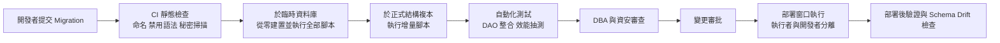

### 17.10 Migration 失敗與回復

| 情境 | 處置 |
|---|---|
| 腳本語法錯誤，未造成變更 | 修正後以新版號重新提交 |
| 部分執行（不可回滾的 DDL） | 依回復計畫手動恢復到已知狀態，修正工具的歷史表狀態，再以新腳本前進 |
| 資料修正錯誤 | 由修正前快照或備份比對還原受影響資料 |
| 應用不相容 | 回退應用版本；資料庫依 Expand-and-Contract 設計應可相容舊版 |

### 17.11 Schema Drift 偵測

- 定期以工具比對各環境實際 Schema 與版本庫預期結構。
- 發現差異時，追查是否有未經流程的手動變更，並補登或回復。
- 正式環境 DDL 權限僅授予部署管線帳號，從源頭降低 Drift。

### 17.12 部署前檢核表

| 項目 | 確認 |
|---|---|
| 腳本已通過 CI 從零建置與增量測試 | |
| 已評估鎖定、執行時間與日誌量 | |
| 已確認 DDL 交易行為與回復計畫 | |
| 已確認應用新舊版本皆相容 | |
| 已取得近期備份並驗證 | |
| 已取得變更核准 | |
| 已安排部署窗口與通知 | |
| 已準備部署後驗證腳本 | |

### 17.13 刪除欄位的安全流程範例

「直接 DROP COLUMN」是最常見造成線上事故的 Migration。以下示範把 `CUSTOMER.FAX_NO` 安全移除的完整步驟：

| 步驟 | 版本 | 動作 | 驗證 |
|---|---|---|---|
| 1 | 應用 vN | 程式碼移除所有讀寫 FAX_NO，ORM 對應改為忽略 | 程式碼搜尋 0 處引用 |
| 2 | 觀察期 | 部署 vN 至所有實例，觀察至少一個完整業務週期 | 查詢層確認 0 次存取 |
| 3 | 資料庫 | 備份欄位資料（若保存政策要求） | 筆數與雜湊比對 |
| 4 | 資料庫 | `ALTER TABLE ... DROP COLUMN` | 執行後 Schema Drift 檢查 |

```sql
-- PostgreSQL：觀察期確認 SQL 是否仍引用欄位（以 pg_stat_statements 搜尋）
SELECT queryid, calls, left(query, 120) AS query_head
FROM   pg_stat_statements
WHERE  query ILIKE '%fax_no%';

-- 確認沒有檢視表、函數依賴此欄位
SELECT DISTINCT v.table_schema, v.table_name
FROM   information_schema.view_column_usage v
WHERE  v.table_name = 'customer' AND v.column_name = 'fax_no';
```

### 17.14 Migration 期間的 WAL／日誌積壓監控

大型回填或索引建立會產生大量日誌，可能導致複寫延遲、複寫槽積壓與磁碟滿載。

```sql
-- PostgreSQL：複寫槽保留的 WAL 量（超過門檻即暫停回填）
SELECT slot_name, active,
       pg_size_pretty(pg_wal_lsn_diff(pg_current_wal_lsn(), restart_lsn)) AS retained_wal,
       wal_status
FROM   pg_replication_slots;

-- SQL Server：交易記錄使用率與無法截斷原因
SELECT name, log_reuse_wait_desc FROM sys.databases WHERE name = 'coredb';
SELECT total_log_size_in_bytes / 1048576 AS log_mb, used_log_space_in_percent
FROM   sys.dm_db_log_space_usage;
```

| 指標 | 暫停回填門檻〔組織建議〕 |
|---|---|
| 複寫延遲 | 超過 RPO 的 50% |
| 複寫槽保留 WAL | 超過 `max_slot_wal_keep_size` 的 70% |
| 日誌磁碟使用率 | 超過 70% |
| 線上交易 P95 | 超過基線 1.5 倍 |

### 17.15 Schema Drift 自動比對範例

```bash
# PostgreSQL：匯出正式與預期結構後比對（示範用途，連線資訊以環境變數提供）
pg_dump --schema-only --no-owner --no-privileges -n dep "$PROD_URL"     > prod_schema.sql
pg_dump --schema-only --no-owner --no-privileges -n dep "$EXPECTED_URL" > expected_schema.sql
diff -u expected_schema.sql prod_schema.sql > drift.diff || {
  echo "偵測到 Schema Drift，詳見 drift.diff"; exit 1;
}
```

`EXPECTED_URL` 指向「以版本庫全部 Migration 從零建置」的臨時資料庫。Flyway 亦可使用 `validate` 檢查已套用腳本的校驗碼是否被修改。

### 17.16 驗證與審查

#### AI 產出常見錯誤

| 錯誤型態 | 範例 | 如何識別 |
|---|---|---|
| 修改已部署腳本 | 直接修改 `V2026.01.001__...sql` | Flyway `validate` 校驗碼不符 |
| 一次性破壞變更 | 同一腳本改名欄位並更新應用 | 檢查是否符合 Expand-and-Contract |
| 交易內建立 CONCURRENTLY 索引 | `BEGIN; CREATE INDEX CONCURRENTLY ...` | PostgreSQL 會直接報錯 |
| 未設鎖定逾時 | 大表 DDL 無 `lock_timeout` | 檢查腳本開頭設定 |
| 無回復計畫 | 只有前進腳本 | 檢查是否附回復或修正方案 |

#### 人工審查步驟

1. 在正式結構複本上執行腳本，記錄執行時間、鎖定時間、日誌量。
2. 確認舊版應用在新結構下仍可運作（向後相容）。
3. 確認部署後驗證腳本與 Schema Drift 檢查已納入管線。

#### 通過標準

- 從零建置與增量執行皆成功；Schema Drift 0 差異。
- 正式結構複本上的最長鎖定時間 ≤ 3 秒〔組織建議〕。

### 17.17 常見錯誤

- 修改已部署的 Migration 腳本，造成環境間不一致。
- 直接在正式環境手動執行 DDL。
- 在尖峰時段建立大表索引。
- 刪除欄位與應用程式部署同時進行，舊版實例仍在使用該欄位。
- 假設所有 DDL 都可回滾。

### 17.18 實務案例與注意事項

> **案例**：某次部署在 Oracle 上執行含多個 DDL 的腳本，第三個 DDL 失敗，前兩個已提交。工具歷史表記錄為失敗，重新執行時前兩個 DDL 因物件已存在而失敗。改善：Oracle 腳本一檔一個 DDL，並撰寫可重複執行的防護判斷。

### 17.19 本章檢核表

- [ ] 所有 Schema 變更經 Migration 工具與版本庫。
- [ ] 已部署腳本不可修改。
- [ ] 高風險變更採 Expand-and-Contract。
- [ ] 已評估線上 DDL 鎖定風險並設定 lock timeout。
- [ ] 大量回填分批、可續跑、可監控。
- [ ] CI 從零建置與增量測試皆通過。
- [ ] 已定期偵測 Schema Drift。

## 第 18 章 資料庫測試與品質驗證

### 18.1 學習目標

- 建立涵蓋功能、效能、安全、復原的資料庫測試策略。
- 能設計測試資料與驗收標準。

### 18.2 測試類型總覽

| 類型 | 目的 | 工具範例 |
|---|---|---|
| 資料存取層單元與整合測試 | 驗證 Repository、DAO、Mapper | JUnit＋Testcontainers |
| Schema 與 Migration 測試 | 從零建置、增量升級成功 | Flyway／Liquibase 於 CI |
| 完整性測試 | 約束是否正確阻擋錯誤資料 | SQL 測試腳本 |
| 對帳測試 | 筆數、金額、雜湊一致 | 對帳腳本 |
| SQL 效能測試 | 關鍵 SQL 符合基線 | 執行計畫比對 |
| 負載、尖峰、耐久測試 | 系統在負載下的表現 | JMeter、Gatling、k6 |
| 併發與死結測試 | 隔離等級與鎖定行為 | 多執行緒測試 |
| 備份還原與 PITR 測試 | 可在 RTO 內還原 | 演練紀錄 |
| HA 切換與 DR 演練 | 切換時間與資料遺失 | 演練紀錄 |
| 權限與越權測試 | 帳號只能做被允許的事 | 自動化測試 |
| SQL Injection 測試 | 注入防護 | DAST、手動測試 |
| 敏感資料暴露測試 | 日誌、錯誤訊息、匯出檔 | 檢查腳本 |
| 遷移驗證 | 筆數、金額、雜湊一致 | 對帳腳本 |

### 18.3 資料存取層測試範例

```java
// 示範：以 Testcontainers 啟動與正式相同主版本的 PostgreSQL，執行 Migration 後測試
@Testcontainers
class AccountRepositoryIT {

    @Container
    static PostgreSQLContainer<?> db = new PostgreSQLContainer<>("postgres:18");

    @BeforeAll
    static void migrate() {
        Flyway.configure()
              .dataSource(db.getJdbcUrl(), db.getUsername(), db.getPassword())
              .locations("classpath:db/migration/common", "classpath:db/migration/postgresql")
              .load()
              .migrate();
    }

    @Test
    void shouldRejectDuplicateExternalReference() {
        TxnRepository repo = new TxnRepository(dataSource());
        repo.post(sampleTxn("EXT-0001"));
        assertThrows(DuplicateTransactionException.class, () -> repo.post(sampleTxn("EXT-0001")));
    }
}
```

**原則**：資料存取測試**建議**使用與正式環境相同產品與主版本，不以記憶體資料庫替代，避免方言與行為差異。

### 18.4 完整性與併發測試範例

```sql
-- 完整性：狀態值不合法應失敗（預期錯誤）
INSERT INTO account (account_id, tenant_id, account_no, product_code, currency_code, status, open_date, created_by, updated_by)
VALUES (999001, 'T001', 'TEST-001', 'SAV', 'TWD', 'UNKNOWN', DATE '2026-01-01', 'test', 'test');
```

併發測試設計：

| 測試 | 步驟 | 預期 |
|---|---|---|
| 遺失更新 | 兩個交易同時對同一帳戶入帳 100 次 | 最終餘額等於期初加總和 |
| 死結 | 兩個交易以相反順序鎖定兩個帳戶 | 依統一順序鎖定後不發生；或發生時正確重試 |
| 重送 | 同一外部序號並行送 10 次 | 只入帳一次 |

### 18.5 越權與注入測試

| 測試案例 | 預期 |
|---|---|
| 以租戶 A 身分查詢租戶 B 的帳戶 | 查無資料或拒絕 |
| 應用帳號執行 `DROP TABLE` | 權限不足 |
| 報表帳號查詢原始證號密文欄位 | 權限不足 |
| 查詢參數輸入 `' OR 1=1 --` | 視為一般字串，查無資料 |
| 排序參數輸入非允許值 | 採預設排序或拒絕 |

### 18.6 遷移驗證

```sql
-- 示範：來源與目標依日期分組比對筆數、金額與雜湊
-- 雜湊函數依產品不同：PostgreSQL sha256()、Oracle STANDARD_HASH(..., 'SHA256')、SQL Server HASHBYTES('SHA2_256', ...)、Db2 HASH(..., 2)（依版本確認）
-- 不建議再以 MD5 作為新設計的比對雜湊
SELECT posting_date,
       COUNT(*)            AS cnt,
       SUM(amount)         AS total_amt,
       encode(sha256(string_agg(txn_id::text || '|' || amount::text, ',' ORDER BY txn_id)::bytea), 'hex') AS digest
  FROM txn
 WHERE posting_date BETWEEN DATE '2026-01-01' AND DATE '2026-01-31'
 GROUP BY posting_date
 ORDER BY posting_date;
```

> 跨產品比對雜湊時，數值與日期的字串格式化方式必須一致，否則雜湊值會不同。

### 18.7 測試資料設計原則

| 原則 | 說明 |
|---|---|
| 合成優先 | 優先使用程式產生的合成資料 |
| 去識別化 | 若需正式資料，經核准並去識別化，確認無法回推 |
| 分布擬真 | 模擬資料傾斜（大戶、大量交易帳戶）、邊界值、特殊字元 |
| 可重現 | 以固定亂數種子或腳本產生 |
| 可清除 | 測試結束後可完整清除 |
| 標記 | 測試資料帶明確標記，避免誤入正式報表 |

### 18.8 測試案例範本

```markdown
| 案例編號 | 測試類型 | 對應需求 | 前置條件 | 步驟 | 測試資料 | 預期結果 | 實際結果 | 證據 | 結論 |
|---|---|---|---|---|---|---|---|---|---|
| TC-DB-030 | 冪等 | REQ-011 | TXN 表含 UK | 同一 EXT_REF_NO 並行送 10 次 | 合成資料 | 僅 1 筆入帳 | | 測試報告連結 | |
```

### 18.9 驗收標準

| 項目 | 驗收標準 |
|---|---|
| Migration | 從零建置與增量升級皆成功 |
| 完整性 | 所有約束測試通過 |
| 效能 | 關鍵交易 P95 符合需求文件之數值（示範值須標示為假設） |
| 併發 | 無遺失更新；死結有重試機制 |
| 安全 | 越權與注入測試無高風險發現 |
| 復原 | 實際還原時間不超過 RTO |
| 遷移 | 筆數、金額、雜湊全數一致，差異已說明並簽核 |

### 18.10 併發測試的可執行範例

「同一冪等鍵並行送出」是銀行系統最重要的併發測試之一，以下以 JUnit 5 示範。

```java
// 示範：50 個執行緒同時以相同 EXT_REF_NO 入帳，預期僅 1 筆成功
@Test
void concurrentPostingWithSameExternalReferenceCreatesOneTxn() throws Exception {
    int threads = 50;
    ExecutorService pool = Executors.newFixedThreadPool(threads);
    CountDownLatch start = new CountDownLatch(1);
    List<Future<Boolean>> results = new ArrayList<>();
    for (int i = 0; i < threads; i++) {
        results.add(pool.submit(() -> {
            start.await();
            return txnService.post(sampleTxn("EXT-CONC-001", new BigDecimal("100.00")));
        }));
    }
    start.countDown();
    long success = 0;
    for (Future<Boolean> f : results) {
        if (f.get(30, TimeUnit.SECONDS)) {
            success++;
        }
    }
    pool.shutdown();

    assertEquals(1, success);
    assertEquals(1, txnRepository.countByExtRefNo("EXT-CONC-001"));
    assertEquals(new BigDecimal("100.00"), accountRepository.balanceOf(ACCOUNT_ID).subtract(OPENING_BALANCE));
}
```

鎖等待與死結觀察（壓測期間執行）：

```sql
-- PostgreSQL：目前被阻擋的工作階段與阻擋來源
SELECT pid, pg_blocking_pids(pid) AS blocked_by, wait_event_type, wait_event,
       now() - query_start AS waiting, left(query, 80) AS query_head
FROM   pg_stat_activity
WHERE  cardinality(pg_blocking_pids(pid)) > 0;

-- PostgreSQL：累計死結次數（壓測前後相減）
SELECT datname, deadlocks FROM pg_stat_database WHERE datname = current_database();
```

### 18.11 跨庫一致性測試

Outbox、CDC、Saga 等跨庫流程的測試重點，是「任一環節中斷後恢復，結果仍一致」。

| 測試情境 | 注入方式 | 預期 |
|---|---|---|
| 轉送程序中途停止 | 發布事件後、標記已發布前強制終止 | 重啟後重送，消費端去重，結果只入帳一次 |
| 消費端資料庫不可用 | 停用消費端資料庫 5 分鐘 | 訊息留在佇列，恢復後全數處理 |
| 事件亂序 | 以測試工具將版本 2 先於版本 1 送達 | 舊版本事件被忽略 |
| 補償失敗 | 補償服務回傳錯誤 | Saga 進入 MANUAL_REVIEW，告警觸發 |

測試結束後以對帳 SQL（第 6、12 章）確認來源與目的筆數、金額一致。

### 18.12 驗證與審查

#### AI 產出常見錯誤

| 錯誤型態 | 範例 | 如何識別 |
|---|---|---|
| 只測快樂路徑 | 測試只驗證新增成功 | 檢查是否有約束違反、併發、越權案例 |
| 斷言不足 | 只斷言「未丟例外」 | 應斷言資料庫最終狀態 |
| 以記憶體資料庫代替 | 產生 H2 設定 | 檢查是否與正式主版本一致 |
| 併發測試未真正並行 | 迴圈內依序呼叫 | 檢查是否使用同步起跑（如 CountDownLatch） |

#### 人工審查步驟

1. 對照追溯矩陣，確認每個資料庫規則（PK、UK、CHECK、FK、RLS）都有對應測試。
2. 刻意移除一個約束後重跑測試，確認測試會失敗（驗證測試本身有效）。
3. 確認測試資料來源合規。

#### 通過標準〔組織建議〕

- 資料庫約束測試覆蓋率 100%（每個 PK、UK、CHECK、FK、RLS 政策至少一個正向與一個反向案例）。
- 突變測試（移除約束）全數被測試捕捉。

### 18.13 常見錯誤

- 用 H2 等記憶體資料庫測試，正式環境行為不同。
- 測試資料過於「乾淨」，無法暴露效能與邊界問題。
- 只測功能，不測還原與切換。
- 使用未去識別化的正式資料。

### 18.14 實務案例與注意事項

> **案例**：某遷移專案筆數與金額總和皆一致，但逐筆雜湊比對發現 0.01% 資料的時間欄位因時區轉換差 8 小時。若只比對總數將無法發現。遷移驗證**必須**包含明細層級比對。

### 18.15 本章檢核表

- [ ] 資料存取測試使用相同產品與主版本。
- [ ] Migration 在 CI 從零與增量測試。
- [ ] 已執行併發、冪等、死結測試。
- [ ] 已執行越權與注入測試。
- [ ] 已執行實際還原與 HA 切換測試。
- [ ] 測試資料為合成或已去識別化。
- [ ] 驗收標準已與業務確認。

## 第 19 章 資料庫監控、維運與故障排除

### 19.1 學習目標

- 建立資料庫監控指標與告警分級。
- 能依週期執行維運作業。
- 能依標準流程排除常見故障。

### 19.2 監控指標

| 類別 | 指標 | 告警範例〔示範門檻〕 |
|---|---|---|
| 主機 | CPU、記憶體、磁碟使用率、IO 延遲 | 磁碟使用率 > 80% 警告、> 90% 嚴重 |
| 連線 | 活躍連線、等待連線、連線池使用率 | 連線池使用率 > 85% 持續 5 分鐘 |
| 查詢 | 慢查詢數、P95 延遲 | P95 超過基線 2 倍 |
| 鎖定 | 等待鎖定時間、死結次數、阻擋鏈 | 阻擋超過 30 秒 |
| 交易 | 長時間交易 | 交易超過 10 分鐘 |
| 日誌 | 日誌空間、歸檔成功率 | 歸檔失敗立即嚴重告警 |
| 複寫 | 複寫延遲、副本狀態 | 延遲超過 RPO 的 50% |
| 備份 | 成功率、時長 | 任一失敗告警 |
| 空間 | 表與索引成長、Tablespace 使用率 | 預估 30 天內用盡 |
| 安全 | 登入失敗、權限變更 | 特權變更即時通知 |

### 19.3 產品對應監控來源

| 產品 | 主要來源 |
|---|---|
| Oracle | `V$SESSION`、`V$LOCK`、`V$DATAGUARD_STATS`、AWR／ASH（授權須確認） |
| Db2 | `MON_GET_*` 表函數、`db2pd`、HADR 監控 |
| PostgreSQL | `pg_stat_activity`、`pg_locks`、`pg_stat_replication`、`pg_stat_statements` |
| SQL Server | DMV（`sys.dm_exec_requests`、`sys.dm_tran_locks`）、AG DMV、Query Store |

```sql
-- 適用：PostgreSQL／示範：找出阻擋鏈
SELECT blocked.pid       AS blocked_pid,
       blocked.query     AS blocked_query,
       blocking.pid      AS blocking_pid,
       blocking.query    AS blocking_query,
       now() - blocked.query_start AS waiting
  FROM pg_stat_activity blocked
  JOIN pg_stat_activity blocking
    ON blocking.pid = ANY (pg_blocking_pids(blocked.pid))
 ORDER BY waiting DESC;
```

```sql
-- 適用：SQL Server／示範：找出阻擋中的請求
SELECT r.session_id, r.blocking_session_id, r.wait_type, r.wait_time, t.text
  FROM sys.dm_exec_requests r
 CROSS APPLY sys.dm_exec_sql_text(r.sql_handle) t
 WHERE r.blocking_session_id <> 0;
```

### 19.4 告警分級

| 等級 | 定義 | 回應時間〔組織建議〕 | 通報 |
|---|---|---|---|
| P1 嚴重 | 服務中斷或資料遺失風險 | 立即 | 值班 DBA、系統負責人、主管 |
| P2 高 | 效能嚴重劣化或冗餘喪失 | 30 分鐘內 | 值班 DBA、系統負責人 |
| P3 中 | 趨勢異常、單一元件問題 | 當日 | DBA 團隊 |
| P4 低 | 資訊性 | 週會檢視 | 工單 |

### 19.5 DBA 維運工作清單

#### 每日

- [ ] 備份作業結果與時長。
- [ ] 歸檔日誌與複寫延遲。
- [ ] 錯誤日誌（Alert Log、Error Log）。
- [ ] 空間使用率與異常成長。
- [ ] 長時間交易與阻擋。
- [ ] 前一日 P1／P2 告警追蹤。

#### 每週

- [ ] 備份檔可讀性驗證。
- [ ] 慢查詢 Top N 檢視與改善追蹤。
- [ ] 統計資訊與自動維護作業結果。
- [ ] 索引使用率與膨脹。
- [ ] 安全告警與登入失敗趨勢。

#### 每月

- [ ] 實際還原演練（至少一個系統輪替）〔組織建議〕。
- [ ] 容量趨勢與擴充預警。
- [ ] 修補評估（原廠安全公告）。
- [ ] 權限變更紀錄抽查。
- [ ] Schema Drift 檢查。
- [ ] 未來分區預建確認。

#### 每季

- [ ] 帳號與權限完整盤點，與擁有者確認。
- [ ] HA 切換演練。
- [ ] 安全基線比對。
- [ ] 效能基線更新。
- [ ] 版本生命週期檢視與升級規劃。
- [ ] Runbook 與文件更新。

#### 每年

- [ ] DR 完整演練（含回切）。
- [ ] 保存政策執行稽核。
- [ ] 退役資料庫盤點。

### 19.6 故障排除流程

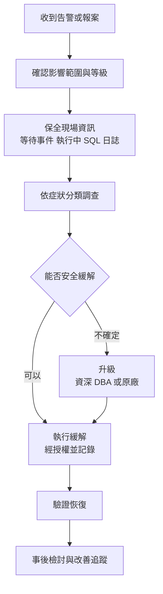

### 19.7 故障情境

#### 情境一：交易日誌或歸檔空間滿

| 項目 | 內容 |
|---|---|
| 症狀 | 寫入停滯或失敗；Oracle 歸檔目的地滿、SQL Server 9002 錯誤、PostgreSQL WAL 目錄滿 |
| 調查順序 | 空間使用 → 歸檔或日誌備份是否失敗 → 是否有長交易或複寫槽阻止回收 → 是否有大量批次 |
| 風險 | 全面停止寫入；手動刪除日誌檔會破壞復原鏈 |
| 處置 | 修復歸檔或日誌備份；擴充空間；處理阻止回收的長交易或失效複寫槽；**不得**直接刪除日誌檔 |
| 事後改善 | 空間趨勢告警、歸檔失敗即時告警、批次速率控制 |

#### 情境二：嚴重鎖定阻擋

| 項目 | 內容 |
|---|---|
| 症狀 | 大量查詢等待、連線池耗盡、API 逾時 |
| 調查順序 | 找出阻擋鏈根源 → 確認根源程式與交易內容 → 評估終止影響 |
| 風險 | 終止錯誤的工作階段可能回滾大量資料，回滾時間長 |
| 處置 | 經授權終止根源工作階段；暫停相關批次 |
| 事後改善 | 縮短交易、統一鎖定順序、DDL 加 lock timeout、批次避開尖峰 |

#### 情境三：執行計畫突然劣化

| 項目 | 內容 |
|---|---|
| 症狀 | 特定 API 延遲倍增，CPU 或 IO 上升 |
| 調查順序 | 比對前後執行計畫 → 統計資訊是否更新 → 資料分布變化 → 參數嗅探 |
| 風險 | 隨意更新統計資訊可能影響其他查詢 |
| 處置 | 以計畫固定機制暫時恢復（Oracle SQL Plan Baseline、SQL Server Query Store 強制計畫）；PostgreSQL 調整統計資訊或改寫 SQL |
| 事後改善 | 計畫變動監控、統計資訊策略、SQL 改寫 |

#### 情境四：複寫延遲擴大

| 項目 | 內容 |
|---|---|
| 症狀 | DR 副本落後數分鐘以上 |
| 調查順序 | 網路頻寬與延遲 → 主節點日誌產生量 → 副本套用效能 → 副本上長查詢衝突 |
| 風險 | 此時發生災難，資料遺失超過 RPO |
| 處置 | 降低批次速率；排除副本衝突查詢；必要時通報業務 RPO 風險 |
| 事後改善 | 頻寬規劃、大量作業排程、延遲告警門檻調整 |

#### 情境五：誤刪資料

| 項目 | 內容 |
|---|---|
| 症狀 | 業務回報資料消失，稽核日誌顯示 DELETE 或 TRUNCATE |
| 調查順序 | 確認範圍與時間點 → 是否為資安事件 → 可用復原手段（Flashback、時態表、延遲副本、PITR） |
| 風險 | 直接在正式庫做時間點還原會遺失之後的合法交易 |
| 處置 | 於隔離環境 PITR 到誤刪前，抽出資料比對後補回正式庫，經雙人覆核 |
| 事後改善 | 移除不必要的刪除權限、正式庫操作雙人覆核、延遲副本 |

#### 情境六：HA 自動切換後應用無法連線

| 項目 | 內容 |
|---|---|
| 症狀 | 資料庫已切換成功，但應用持續錯誤 |
| 調查順序 | 連線字串是否使用虛擬 IP／Listener → DNS TTL → 連線池是否重建連線 → 憑證主機名稱 |
| 風險 | 延長實際停機時間 |
| 處置 | 重啟或刷新連線池；修正 DNS |
| 事後改善 | 使用 HA Listener 或服務名稱、連線池驗證設定、切換演練涵蓋應用 |

### 19.8 變更管理與維運紀錄

| 項目 | 要求 |
|---|---|
| 變更申請 | 目的、影響、風險、回復計畫、核准 |
| 執行紀錄 | 執行者、時間、指令、輸出 |
| 雙人覆核 | 正式資料修正與高風險操作 |
| 事後確認 | 驗證結果與結案 |

### 19.9 修補、生命週期與退役

| 活動 | 說明 |
|---|---|
| 修補 | 依原廠安全公告評估，先測試環境再正式環境 |
| 生命週期 | 追蹤各版本支援終止日，提前 12～18 個月規劃升級〔組織建議〕 |
| 退役 | 資料移轉或封存、保存期限確認、帳號移除、儲存媒體安全清除、證據留存 |

查核日已知的近期生命週期事件（以官方公告為準）：

| 產品 | 事件 | 日期 |
|---|---|---|
| PostgreSQL 14 | 社群停止支援 | 2026-11-12 |
| PostgreSQL 15 | 社群停止支援 | 2027-11-11 |
| Oracle 23ai | 已由 26ai 取代（套用 2025-10 RU） | 2025-10 |
| SQL Server 2025 | 停止提供 Web edition、DQS、MDS | 2025-11 起 |

### 19.10 SLO／SLI 設計範本

監控告警回答「現在有沒有問題」，SLO 回答「服務是否符合對業務的承諾」。資料庫平台**建議**以使用者可感知的指標定義 SLI〔組織建議〕。

| SLI | 計算公式 | SLO〔案例假設〕 | 資料來源 |
|---|---|---|---|
| 可用性 | 成功的資料庫健康檢查次數 ÷ 總檢查次數 | 每月 ≥ 99.95% | 合成監控（每 30 秒） |
| 交易延遲 | 延遲 ≤ 300 ms 的交易數 ÷ 總交易數 | ≥ 95% | APM 或 `pg_stat_statements` 直方圖 |
| 資料新鮮度 | 唯讀副本延遲 ≤ 60 秒的時間比例 | ≥ 99% | 複寫延遲監控 |
| 備份成功率 | 成功備份數 ÷ 排定備份數 | 100% | 備份系統 |

錯誤預算（Error Budget）：

$$
\text{Error Budget} = (1 - \text{SLO}) \times \text{觀察期間}
$$

以每月 30 天、SLO 99.95% 計，錯誤預算約為 $0.0005 \times 43{,}200 \approx 21.6$ 分鐘。當月錯誤預算耗用超過 50% 時，**建議**暫停非緊急變更並優先處理穩定性〔組織建議〕。

```sql
-- 以合成監控結果表計算當月可用性 SLI（示範用途）
SELECT date_trunc('month', check_time)                        AS month,
       ROUND(100.0 * COUNT(*) FILTER (WHERE ok) / COUNT(*), 3) AS availability_pct,
       COUNT(*) FILTER (WHERE NOT ok) * 0.5                    AS est_bad_minutes
FROM   ops.db_health_check
WHERE  check_time >= date_trunc('month', now())
GROUP BY 1;
```

### 19.11 OpenTelemetry 與端到端可觀測性

當交易變慢時，需要知道慢在應用、網路還是資料庫。OpenTelemetry（OTel）可把應用追蹤（Trace）與資料庫呼叫串起來。

| 做法 | 說明 | 注意 |
|---|---|---|
| 應用端資料庫 Span | 以 OTel 自動或手動儀器化 JDBC，產生 `db.*` 屬性的 Span | 依 OTel 語意慣例設定 `db.system`、`db.operation` 等屬性 |
| SQL 標記 | 在 SQL 註解帶入 traceparent（如 sqlcommenter 慣例），讓資料庫端慢查詢可對應到 Trace | 註解會影響部分產品的計畫快取比對，需測試 |
| 資料庫指標 | 以 OTel Collector 的資料庫接收器收集指標 | 監控帳號權限需最小化 |
| 遮罩 | Span 不得記錄綁定參數值 | 避免個資進入可觀測性平台 |

```java
// 示範：手動為關鍵資料庫操作建立 Span（不記錄參數值）
Span span = tracer.spanBuilder("dep.post_txn")
        .setSpanKind(SpanKind.CLIENT)
        .setAttribute("db.system", "postgresql")
        .setAttribute("db.operation", "INSERT")
        .startSpan();
try (Scope scope = span.makeCurrent()) {
    txnRepository.post(txn);
} catch (RuntimeException e) {
    span.recordException(e);
    span.setStatus(StatusCode.ERROR);
    throw e;
} finally {
    span.end();
}
```

### 19.12 事件根因分析範本

```markdown
| 項目 | 內容 |
|---|---|
| 事件編號 | INC-2026-0105-01 |
| 影響 | 10:05～10:42 存款查詢 P95 由 120 ms 升至 4 s |
| 偵測方式 | P95 超過基線 2 倍告警 |
| 時間軸 | 10:05 告警；10:12 確認計畫劣化；10:30 固定計畫；10:42 恢復 |
| 5 Whys | 1. 查詢改走全表掃描 → 2. 統計資訊顯示表很小 → 3. 夜間批次清空重載後自動統計在載入前執行 → 4. 批次未在載入後主動收集統計 → 5. 批次範本缺少統計收集步驟 |
| 根因 | 批次範本缺少載入後統計收集 |
| 改善 | 範本加入統計收集步驟（負責人、期限）；新增統計過期監控 |
| 證據 | 執行計畫前後對照、告警紀錄 |
```

### 19.13 驗證與審查

#### AI 產出常見錯誤

| 錯誤型態 | 範例 | 如何識別 |
|---|---|---|
| 門檻無依據 | 「CPU > 70% 告警」未說明來源 | 門檻應來自基線或 SLO |
| 建議危險指令 | 「日誌滿了就刪除歸檔檔」 | 對照常見錯誤清單 |
| 終止工作階段未評估 | 「直接 kill 阻擋者」 | 須先確認阻擋者身分與交易內容 |
| SLO 計算錯誤 | 可用率與停機時間換算錯誤 | 以公式重算 |

#### 人工審查步驟

1. 確認每個告警都有負責人、等級與處理 Runbook 連結。
2. 以過去 30 天資料重算告警門檻，確認誤報率可接受。
3. 每季檢視 SLO 達成狀況與錯誤預算耗用。

#### 通過標準〔組織建議〕

- 每個 P1／P2 告警都有 Runbook。
- 過去 30 天告警中可行動（Actionable）的比例 ≥ 80%。
- SLO 報表每月產出並經系統負責人確認。

### 19.14 常見錯誤

- 告警太多，重要告警被忽略。
- 處理日誌空間不足時直接刪除日誌檔。
- 未經授權終止工作階段。
- 修補長期延宕。

### 19.15 實務案例與注意事項

> **案例**：PostgreSQL 一個已停用的邏輯複寫槽未刪除，導致 WAL 無法回收，兩週後磁碟滿造成停機。改善：監控 `pg_replication_slots` 的保留量、設定 `max_slot_wal_keep_size`、複寫槽建立與刪除納入變更管理。

### 19.16 本章檢核表

- [ ] 已建立監控指標與告警分級。
- [ ] 日、週、月、季、年維運清單已排程並有紀錄。
- [ ] 主要故障情境已有 Runbook。
- [ ] 變更具申請、核准、執行與覆核紀錄。
- [ ] 已追蹤版本生命週期與修補。
- [ ] 每季完成權限盤點。

## 第 20 章 資料庫升級、遷移與逆向工程

### 20.1 學習目標

- 能從既有系統重建資料字典與 ER Model。
- 能評估升級與異質遷移風險。
- 能規劃低停機遷移與切換。

### 20.2 逆向工程工作流程

```mermaid
flowchart TD
    RE1["盤點資料庫物件<br/>表 檢視 程序 觸發器 排程"] --> RE2["擷取結構<br/>DDL 約束 索引"]
    RE2 --> RE3["分析資料<br/>分布 空值率 孤兒 重複"]
    RE3 --> RE4["分析程式<br/>SQL ORM Mapper 批次"]
    RE4 --> RE5["建立使用關係矩陣<br/>程式對表與欄位 CRUD"]
    RE5 --> RE6["重建業務規則<br/>從程序與觸發器"]
    RE6 --> RE7["產出資料字典與 ER Model"]
    RE7 --> RE8["與業務與資料擁有者確認"]
```

### 20.3 物件盤點查詢範例

```sql
-- Oracle：依 Schema 統計物件
SELECT object_type, COUNT(*) FROM all_objects WHERE owner = 'DEP' GROUP BY object_type;

-- Db2：表與程序
SELECT tabschema, tabname, type FROM syscat.tables WHERE tabschema = 'DEP';
SELECT routineschema, routinename, routinetype FROM syscat.routines WHERE routineschema = 'DEP';

-- PostgreSQL：表、檢視、函數
SELECT table_schema, table_name, table_type FROM information_schema.tables WHERE table_schema = 'dep';
SELECT routine_schema, routine_name, routine_type FROM information_schema.routines WHERE routine_schema = 'dep';

-- SQL Server：物件類型統計
SELECT s.name AS schema_name, o.type_desc, COUNT(*) AS cnt
  FROM sys.objects o JOIN sys.schemas s ON s.schema_id = o.schema_id
 WHERE s.name = 'dep'
 GROUP BY s.name, o.type_desc;
```

### 20.4 資料品質探勘

```sql
-- 示範：找出孤兒資料（無對應帳戶的交易）
SELECT COUNT(*) FROM txn t
 WHERE NOT EXISTS (SELECT 1 FROM account a WHERE a.account_id = t.account_id);

-- 示範：業務鍵重複
SELECT tenant_id, account_no, COUNT(*) FROM account
 GROUP BY tenant_id, account_no HAVING COUNT(*) > 1;

-- 示範：欄位實際值域（找出未文件化的狀態碼）
SELECT status, COUNT(*) FROM account GROUP BY status ORDER BY 2 DESC;
```

### 20.5 從程式追溯資料規則

| 來源 | 找什麼 |
|---|---|
| Stored Procedure／Trigger | 計算公式、狀態轉換、隱含驗證 |
| View | 業務口徑定義（例如「有效客戶」） |
| ORM Entity／Mapper | 欄位對映、預設值、關聯 |
| API／畫面 | 欄位意義與驗證 |
| 批次程式（含 VB、COBOL、Java、C#） | 日終處理、對帳、清檔規則 |
| 排程設定 | 執行時間與相依性 |

### 20.6 資料庫盤點表範本

```markdown
| 物件 | 類型 | 筆數 | 大小 | 讀取程式 | 寫入程式 | 業務擁有者 | 分類 | 遷移決策 | 備註 |
|---|---|---|---|---|---|---|---|---|---|
| DEP.ACCOUNT | TABLE | 8,000,000 | 3 GB | API-ACCT, BAT-EOD | API-OPEN | 存匯部 | 機敏 | 遷移 | 示範 |
| DEP.TMP_X | TABLE | 0 | 0 | 無 | 無 | 未知 | 待確認 | 待確認後退役 | 示範 |
```

### 20.7 升級與異質遷移差異點

| 議題 | 需檢查 |
|---|---|
| 字元集 | Big5 轉 UTF-8、造字、長度單位變化 |
| 排序規則 | 中文排序、大小寫是否區分、唯一性判斷 |
| 時區 | 舊系統儲存當地時間或 UTC；夏令時間 |
| 數值精度 | NUMBER 無精度宣告轉換到目標型別 |
| 日期格式 | Oracle DATE 含時間、其他產品 DATE 不含時間 |
| 空字串 | Oracle 空字串等於 NULL |
| SQL 方言 | 分頁、外部連接舊語法 `(+)`、階層查詢、字串函數 |
| 程序語言 | PL/SQL、SQL PL、PL/pgSQL、T-SQL 轉換 |
| Trigger 行為 | 列級／敘述級、觸發時機差異 |
| 序列與 Identity | 起始值、快取、間隙 |
| 交易與鎖定 | 隔離等級語意不同 |
| 驅動與連線池 | JDBC 驅動版本、連線屬性 |
| NULL 排序 | Oracle、PostgreSQL、Db2 預設 NULL 在遞增排序最後；SQL Server 預設 NULL 在最前；分頁與報表結果可能不同 |
| 字串比較尾端空白 | SQL Server 與部分產品比較時忽略尾端空白，PostgreSQL `VARCHAR` 不忽略 |
| 日期運算 | `DATE + 1` 在 Oracle 是加一天，其他產品需以 INTERVAL 或 DATEADD |
| 主版本升級行為 | PostgreSQL 18 `pg_upgrade` 可保留統計資訊、新增 `--swap`；全文檢索與 pg_trgm 索引可能需重建；舊叢集未啟用 checksums 時需對應設定 |

### 20.8 遷移策略

| 策略 | 停機 | 複雜度 | 適用 |
|---|---|---|---|
| 停機匯出匯入 | 長 | 低 | 小型或可長停機系統 |
| 原生升級（就地） | 中 | 中 | 同產品版本升級 |
| 備份還原＋日誌追趕 | 短 | 中 | 同產品跨主機 |
| CDC 同步＋切換 | 短 | 高 | 異質遷移、低停機需求 |
| 雙寫 | 極短 | 很高 | 特殊情境，一致性風險高，**不建議**作為首選 |

**零停機的限制**：真正零停機通常需要應用層支援（唯讀模式、雙寫、冪等重放），且切換瞬間仍可能有短暫寫入凍結。專案**必須**以實測定義可達成的停機時間。

### 20.9 遷移風險矩陣

| 風險 | 可能性 | 影響 | 等級 | 緩解措施 |
|---|---|---|---|---|
| 字元轉換錯誤 | 中 | 高 | 高 | 全量轉換測試、造字對照表、逐筆比對 |
| 程序轉換邏輯錯誤 | 高 | 高 | 高 | 單元測試、平行執行比對結果 |
| 效能退化 | 中 | 高 | 高 | 以正式量體壓測、執行計畫審查 |
| CDC 延遲過大 | 中 | 中 | 中 | 頻寬規劃、切換前追平確認 |
| 切換失敗 | 低 | 極高 | 高 | 回復點、回切腳本、演練 |
| 驅動相容性 | 中 | 中 | 中 | Framework 與驅動相容矩陣測試 |

### 20.10 Framework 升級時的資料存取相容性

| 元件 | 檢查項目 |
|---|---|
| ORM（如 Hibernate） | 方言類別、ID 產生策略預設值變更、型別對映變更 |
| JDBC 驅動 | 與資料庫版本相容、TLS 預設值、時區處理 |
| 連線池 | 參數名稱與預設值、洩漏偵測 |
| 交易管理 | 傳播行為、唯讀交易最佳化 |
| Jakarta EE 命名空間 | `javax.*` 到 `jakarta.*` 的影響 |

### 20.11 切換 Runbook 範本

```markdown
# 遷移切換 Runbook：<系統名稱>

## T-14 天
- [ ] 完成最後一次全流程演練並記錄時間
- [ ] 確認回切方案與決策門檻
## T-1 天
- [ ] 確認 CDC 延遲穩定
- [ ] 完成來源端完整備份並驗證
- [ ] 通知相關單位與介接系統
## T-0 切換
1. 公告停止寫入（應用唯讀模式或停服）
2. 確認 CDC 已追平（最後序號一致）
3. 執行對帳：筆數、金額、雜湊
4. 更新序列起始值至目標端
5. 切換應用連線至目標資料庫
6. 煙霧測試與業務驗證
7. 決策點：通過則開放服務；不通過則依回切程序
## 回切程序
1. 停止目標端寫入
2. 若目標端已有新交易，執行反向同步或補登
3. 切回來源資料庫
4. 驗證並公告
## 切換後
- [ ] 持續監控效能與錯誤 7 天
- [ ] 來源資料庫保留唯讀一段時間（期限由專案決定）
- [ ] 完成退役與稽核文件保存
```

### 20.12 舊版本退役

1. 確認所有讀寫程式已改指向新系統。
2. 依保存政策處理歷史資料（移轉、封存或刪除）。
3. 保存設計文件、遷移對帳報告、核准紀錄作為稽核證據。
4. 移除帳號、網路規則與監控。
5. 儲存媒體依政策安全清除。

### 20.13 效能退化的根因分析決策樹

升級或遷移後某些 SQL 變慢是常態。以下決策樹用來縮小範圍，每一步都應留下證據。

```mermaid
flowchart TD
    S["關鍵 SQL 較基線變慢"] --> Q1{"執行計畫是否改變"}
    Q1 -->|"是"| Q2{"統計資訊是否完整"}
    Q2 -->|"否"| A1["重新收集統計資訊後重測"]
    Q2 -->|"是"| Q3{"最佳化器版本或相容層級改變"}
    Q3 -->|"是"| A2["暫用舊相容層級或計畫固定<br/>並列入技術債"]
    Q3 -->|"否"| A3["檢查索引是否遺漏或失效"]
    Q1 -->|"否"| Q4{"等待事件是否改變"}
    Q4 -->|"I/O"| A4["檢查儲存效能與快取命中率"]
    Q4 -->|"鎖定"| A5["檢查隔離等級與鎖定行為差異"]
    Q4 -->|"網路或連線"| A6["檢查驅動設定與連線池"]
```

| 產品 | 暫時恢復舊行為的手段 | 注意 |
|---|---|---|
| SQL Server | 資料庫相容層級；Query Store 強制舊計畫 | 相容層級影響整個資料庫 |
| Oracle | `OPTIMIZER_FEATURES_ENABLE`；SQL Plan Baseline | 建議以 SQL Plan Management 針對個別 SQL |
| PostgreSQL | 無計畫固定內建功能；以統計資訊、索引、改寫處理 | 不建議以全域 `enable_*` 參數關閉策略 |
| Db2 | Optimization Profile；調整 Optimization Class | 需以實際工作負載驗證 |

### 20.14 驗證與審查

#### AI 產出常見錯誤

| 錯誤型態 | 範例 | 如何識別 |
|---|---|---|
| 程序轉換語意改變 | PL/SQL 轉 PL/pgSQL 後空字串處理不同 | 以相同輸入平行執行新舊程序比對輸出 |
| 忽略 NULL 排序 | 分頁查詢未加 `NULLS LAST` | 比對新舊系統第一頁與最後一頁 |
| 宣稱零停機 | 未說明寫入凍結時間 | 要求演練實測數據 |
| 遷移後未更新序列 | 目標端序列從 1 開始 | 比對序列目前值與表內最大值 |

#### 人工審查步驟

1. 對每個轉換後的程序，以至少 3 組邊界輸入（NULL、空字串、極值）平行執行比對。
2. 切換演練後，對帳結果由業務單位簽核。
3. 關鍵 SQL 於新環境的 P95 不得劣於基線。

#### 可執行驗證

```sql
-- PostgreSQL：序列目前值必須大於表內最大值（預期 is_ok = true）
SELECT (SELECT last_value FROM dep.seq_txn) AS seq_value,
       (SELECT MAX(txn_id) FROM dep.txn)    AS max_id,
       (SELECT last_value FROM dep.seq_txn) > (SELECT COALESCE(MAX(txn_id), 0) FROM dep.txn) AS is_ok;
```

通過標準：對帳差異 0 筆（或差異已簽核）；序列檢查全數為 true；關鍵 SQL P95 不劣於基線 10%〔組織建議〕。

### 20.15 常見錯誤

- 只看表結構，忽略程序、觸發器與排程中的業務規則。
- 只比對筆數，未比對明細。
- 未更新序列起始值，切換後主鍵衝突。
- 未準備回切方案。

### 20.16 實務案例與注意事項

> **案例**：Oracle 遷移到 PostgreSQL 後，查詢條件 `WHERE remark = ''` 在 Oracle 永遠不成立（空字串為 NULL），在 PostgreSQL 卻會回傳資料，導致報表數字改變。遷移時**必須**掃描所有空字串相關邏輯。

### 20.17 本章檢核表

- [ ] 已完成物件盤點與使用關係矩陣。
- [ ] 已執行資料品質探勘並處理例外。
- [ ] 已重建資料字典與業務規則並經確認。
- [ ] 已分析字元集、時區、精度、方言差異。
- [ ] 已建立風險矩陣與緩解措施。
- [ ] 切換 Runbook 已演練並含回切。
- [ ] 已規劃舊系統退役與證據保存。

## 第 21 章 AI 輔助資料庫工程

### 21.1 學習目標

- 了解 AI 在資料庫工程各階段的適用範圍與限制。
- 建立「AI 產出必須經工具驗證與專家審查」的工作流程。
- 能使用標準 Prompt 範本並控制資料外洩風險。

### 21.2 AI 可協助的工作

| 工作 | AI 角色 | 必要驗證 |
|---|---|---|
| 從需求產生初步 ER Model | 草擬實體與關係 | SA 審查、與業務確認 |
| 從 Schema 產生資料字典 | 整理欄位說明 | 資料擁有者確認語意 |
| 分析 SQL 與程式依賴 | 找出讀寫關係 | 以靜態分析工具交叉比對 |
| 從 Stored Procedure 重建規則 | 摘要邏輯 | 以測試案例驗證 |
| 產生 DDL、索引候選、Migration | 初稿 | CI 建置、執行計畫、DBA 審查 |
| SQL Review 與執行計畫解讀 | 指出可能問題 | 以實際執行計畫驗證 |
| 升級相容性分析 | 列出差異點 | 原廠文件與測試 |
| 產生測試案例與對帳腳本 | 草擬 | 執行並確認可抓到錯誤 |
| 產生 Runbook 草稿 | 草擬 | 演練驗證 |

### 21.3 AI 常見錯誤

| 錯誤類型 | 範例 |
|---|---|
| 錯誤 SQL | 混用不同產品語法（在 Oracle 寫 `LIMIT`） |
| 錯誤型別 | 金額建議 FLOAT、日期用字串 |
| 虛構功能或 API | 不存在的系統檢視表、參數名稱或函數 |
| 版本錯置 | 把新版本功能套用到舊版本 |
| 錯誤法規解讀 | 宣稱某類資料法定保存某年限 |
| 不安全權限 | 建議 `GRANT ALL`、應用帳號具 DBA 權限 |
| 過度自信 | 未經執行即宣稱「已最佳化」 |

### 21.4 AI 工作流程

```mermaid
flowchart LR
    W1["需求與證據蒐集<br/>去識別化"] --> W2["AI 初稿"]
    W2 --> W3["工具驗證<br/>語法 執行計畫 掃描"]
    W3 --> W4["自動化測試<br/>CI Testcontainers"]
    W4 --> W5["專家審查<br/>SA DBA 資安"]
    W5 --> W6["核准部署"]
    W6 --> W7["持續監控"]
    W3 -->|"失敗"| W2
    W4 -->|"失敗"| W2
    W5 -->|"退回"| W2
```

| 階段 | 要求 |
|---|---|
| 證據蒐集 | 提供 Schema、匿名化樣本、版本資訊，不提供正式資料 |
| AI 初稿 | 要求 AI 標示假設、產品與版本、不確定之處 |
| 工具驗證 | 語法解析、在測試資料庫執行、取得執行計畫、安全掃描 |
| 自動化測試 | 與人工撰寫的程式碼相同標準 |
| 專家審查 | 審查者需理解 AI 產出內容，不得只看「AI 說可以」 |
| 核准部署 | 依一般變更流程，AI 產出不享有例外 |
| 持續監控 | 上線後監控效能與錯誤 |

### 21.5 資料保護規範

**禁止**將下列資料輸入未經組織核准的 AI 服務：

- 真實客戶個資、帳號、交易資料。
- 正式環境資料或其匯出檔。
- 密碼、金鑰、憑證、連線字串、Token。
- 未公開的交易資訊、財務資訊、資安弱點細節。
- 受保密約定保護的契約與文件。

即使是核准的服務，也**應**遵守最小必要原則：只提供結構與匿名化樣本，不提供實際資料。

### 21.6 Prompt 範本

以下範本中 `<...>` 為需替換的內容。

#### 21.6.1 從需求產生 ER Model

```text
角色：你是銀行系統資料架構師。
任務：依下列需求產生邏輯 ER Model 初稿。
輸入：<去識別化的需求描述與業務規則清單>
目標資料庫：<產品與版本>
要求：
1. 以 Mermaid erDiagram 輸出，列出 PK、FK、UK。
2. 使用技術主鍵；個資不得作為鍵。
3. 金額使用精確數值並含幣別。
4. 標示多對多關係如何以關聯表處理。
5. 列出你做的所有假設與待確認問題。
6. 不要宣稱任何法規保存年限。
```

#### 21.6.2 逆向分析既有資料庫

```text
角色：你是資料庫逆向工程專家。
輸入：<DDL 匯出（不含資料）>、<View 與 Procedure 原始碼>
任務：
1. 產生資料字典表格（表、欄位、型別、可空、約束、推測用途）。
2. 推測欄位語意時標示「推測」與信心程度。
3. 列出可能的隱含業務規則及其來源程式位置。
4. 指出可能的孤兒資料、重複資料風險與缺少的約束。
5. 列出需要業務確認的問題清單。
```

#### 21.6.3 審查 DDL 與索引

```text
角色：你是資深 DBA。
目標資料庫：<產品與版本>
輸入：<DDL>、<主要查詢 SQL 清單與頻率>
請審查：
1. 型別、NULL、約束是否合理（金額、日期、狀態）。
2. 命名是否符合規範：<貼上命名規範摘要>。
3. 索引是否對應查詢，欄位順序是否合理，是否有多餘索引。
4. 對大表的 DDL 是否有鎖定風險與建議作法（標示需以哪份官方文件確認）。
輸出：問題清單（嚴重度、位置、理由、建議修改），不要直接宣稱已最佳化。
```

#### 21.6.4 檢查 SQL Injection 與過度授權

```text
角色：你是應用與資料庫安全審查員。
輸入：<資料存取層程式碼>、<GRANT 腳本>
請檢查：
1. 所有 SQL 是否參數化；動態識別字是否使用允許清單。
2. Stored Procedure 內是否有串接動態 SQL。
3. 帳號權限是否超出最小必要（DDL、DELETE、ANY 權限、PUBLIC 授權）。
4. 是否有明文密碼或連線字串。
輸出：每個發現的位置、風險等級、修正範例、驗證方式。
```

#### 21.6.5 分析跨資料庫遷移風險

```text
角色：你是異質資料庫遷移顧問。
來源：<產品與版本>；目標：<產品與版本>
輸入：<物件清單>、<程序原始碼>、<使用的特殊功能清單>
請：
1. 列出不相容語法與功能，並給出目標端替代方案。
2. 分析字元集、時區、精度、空字串、排序規則差異的影響。
3. 估計轉換難度（高、中、低）與需人工處理的項目。
4. 建議驗證方式（測試、對帳）。
5. 不確定之處請標示需查閱的官方文件主題。
```

#### 21.6.6 產生資料庫測試案例

```text
角色：你是資料庫測試工程師。
輸入：<DDL>、<業務規則清單>、<隔離等級>
請產生：
1. 約束測試（每個 CHECK、UK、FK 各至少一個正反案例）。
2. 併發測試（遺失更新、冪等、死結）的步驟與預期結果。
3. 越權測試案例（多租戶、帳號權限）。
4. 使用合成資料，不得包含真實個資格式的有效號碼。
輸出：測試案例表格與可執行的 SQL 或 JUnit 程式骨架。
```

#### 21.6.7 審查備份與 DR 設計

```text
角色：你是營運持續與資料庫高可用架構師。
輸入：<RTO／RPO>、<架構說明>、<備份排程與保留>、<目標產品與版本>
請審查：
1. 架構能否達到 RTO／RPO，列出計算依據與需實測項目。
2. 是否區分 HA、DR、備份；是否能防止誤刪與勒索軟體。
3. 是否有 Split-Brain 風險與 Fencing 設計。
4. 備份驗證與還原演練是否足夠。
5. 列出 DR Runbook 缺漏項目。
不得承諾未經測試的復原時間。
```

#### 21.6.8 產生資料字典與維運文件

```text
角色：你是技術文件撰寫者。
輸入：<Schema 結構>、<監控項目>、<維運排程>
請產生：
1. Markdown 資料字典（依本手冊第 5 章欄位格式）。
2. 日、週、月、季維運清單草稿。
3. 每項維運工作的目的、指令範例（標示產品與版本）、成功判定。
所有指令標示「待驗證」，敏感值以佔位符表示。
```

### 21.7 範例：AI 產出的審查

AI 初稿：

```sql
-- AI 產出（未審查）
CREATE TABLE transaction (
    id INT PRIMARY KEY,
    amount FLOAT,
    date VARCHAR(8),
    customer_id_no VARCHAR(10)
);
GRANT ALL ON transaction TO app_user;
```

審查結果：

| 問題 | 嚴重度 | 修正 |
|---|---|---|
| 表名 TRANSACTION 為保留字或易衝突 | 中 | 改為 TXN |
| ID 用 INT 可能溢位 | 中 | BIGINT |
| 金額用 FLOAT | 高 | DECIMAL(19,4) 並加幣別 |
| 日期用字串、欄名為保留字 | 高 | POSTING_DATE DATE |
| 存放明文證號 | 高 | 移除，改以客戶 ID 關聯 |
| GRANT ALL | 高 | 僅授予必要 DML |

### 21.8 AI 治理框架對照

組織導入 AI 輔助資料庫工程時，**建議**對照下列框架建立治理機制〔標準〕。

| 框架 | 與本章的對應 | 資料庫工程落實範例 |
|---|---|---|
| ISO/IEC 42001 | AI 使用政策、風險評估、角色責任 | 核准的 AI 工具清單、用途分級、AI 產出標註規則 |
| NIST AI RMF 1.0 與 Generative AI Profile | Govern、Map、Measure、Manage | 量測 AI 產出 DDL 的退回率與缺陷類型，每季檢討 |
| OWASP Top 10 for LLM Applications 2025 | 提示注入、敏感資訊揭露、過度代理權限、錯誤資訊 | 見下表 |

| OWASP LLM 風險 | 資料庫情境 | 控制 |
|---|---|---|
| 提示注入 | 資料表內容含惡意指示，AI 讀取後執行非預期 SQL | AI 只取得結構與匿名化樣本；產出 SQL 一律人工審查 |
| 敏感資訊揭露 | 把含個資的查詢結果貼入外部服務 | 21.5 資料保護規範；DLP 偵測 |
| 過度代理權限 | AI Agent 以 DBA 帳號連線正式庫 | AI 工具僅能連線測試庫，帳號唯讀 |
| 錯誤資訊 | AI 杜撰不存在的參數或系統檢視表 | 以目標版本官方文件查證；在測試庫實際執行 |
| 無界限資源消耗 | AI 產生未限制筆數的大量查詢 | 查詢逾時、結果筆數上限 |

### 21.9 AI 代理與 MCP 連線資料庫的風險控制

AI 代理（Agent）可透過 Model Context Protocol（MCP）等介面直接連線資料庫查詢結構或執行 SQL。Oracle 26ai 與 SQL Server 2025 生態系都已提供 MCP 相關能力，便利性提高的同時，風險也隨之上升。

| 控制 | 要求〔組織建議〕 |
|---|---|
| 環境 | 只允許連線開發或測試環境；正式環境**不得**提供給 AI 代理 |
| 帳號 | 專用唯讀帳號，僅能讀取系統目錄與去識別化資料 |
| 工具白名單 | MCP 伺服器只暴露「列出結構」「解釋計畫」等必要工具，不暴露任意 SQL 執行 |
| 人工確認 | 任何寫入或 DDL 動作需人工逐次核准 |
| 稽核 | AI 代理的連線與 SQL 全數稽核並可追溯到申請人 |
| 逾時與資源 | 設定查詢逾時與資源群組，避免影響其他使用者 |

```sql
-- PostgreSQL：AI 代理專用唯讀帳號（示範用途）
CREATE ROLE ai_reader LOGIN PASSWORD '<由秘密管理系統注入>'
       CONNECTION LIMIT 2;
ALTER ROLE ai_reader SET statement_timeout = '15s';
ALTER ROLE ai_reader SET default_transaction_read_only = on;
GRANT CONNECT ON DATABASE devdb TO ai_reader;
GRANT USAGE ON SCHEMA anon TO ai_reader;
GRANT SELECT ON ALL TABLES IN SCHEMA anon TO ai_reader;
```

### 21.10 AI 產出 DDL 的差異比對方法

不要直接閱讀 AI 產出的整份 DDL，而是讓工具找出「與基準的差異」，人工只審查差異。

1. 在臨時資料庫 A 套用目前版本庫的 Migration。
2. 在臨時資料庫 B 套用 A 的內容加上 AI 產出的腳本。
3. 以 Schema 比對（如第 17 章 `pg_dump --schema-only` 加 `diff`）產生差異。
4. 逐項審查差異：每個新物件是否符合命名、型別、約束、權限規範。
5. 執行本手冊各章的可執行驗證 SQL，結果需全部通過。

### 21.11 驗證與審查

#### AI 幻覺檢查關卡

| 關卡 | 檢查內容 | 工具或方法 | 通過標準 |
|---|---|---|---|
| G1 語法 | 是否為目標產品與版本的合法語法 | 在目標版本測試庫執行 | 無語法錯誤 |
| G2 物件存在 | 引用的系統檢視表、函數、參數是否存在 | 查詢系統目錄或官方文件 | 全部存在 |
| G3 行為 | 結果是否符合預期 | 測試案例、結果集比對 | 測試全部通過 |
| G4 效能 | 宣稱的效能改善是否成立 | 前後執行計畫與壓測 | 數據支持宣稱 |
| G5 安全 | 權限、注入、秘密 | 第 13 章驗證 SQL、秘密掃描 | 無高風險發現 |
| G6 法遵 | 是否引用法規或年限 | 法遵確認 | 無未經確認的法規陳述 |

#### 可執行驗證

```sql
-- G2 範例（PostgreSQL）：確認 AI 引用的設定參數存在（不存在者會回傳 0 筆）
SELECT name, setting, short_desc
FROM   pg_settings
WHERE  name IN ('io_method', 'idle_replication_slot_timeout', 'wal_keep_segments');
-- 預期：wal_keep_segments 已不存在，若 AI 建議使用即為過時資訊
```

#### 通過標準

- G1～G6 全部通過並留存證據。
- 審查紀錄（範本 T21）標示 AI 協助範圍、使用工具與審查者。

### 21.12 常見錯誤

- 把 AI 產出直接貼到正式環境執行。
- 為了讓 AI 更準確而貼上正式資料。
- 審查者未實際執行就接受 AI 的效能宣稱。
- 未記錄哪些產出由 AI 協助，無法追溯。

### 21.13 實務案例與注意事項

> **案例**：團隊以 AI 將 300 支 PL/SQL 程序轉換為 PL/pgSQL，初稿完成速度很快，但自動化測試發現約兩成程序在例外處理、隱含型別轉換、空字串判斷上行為不同。最終流程改為：AI 轉換 → 自動化比對新舊程序輸出 → 人工修正差異 → DBA 審查。

### 21.14 本章檢核表

- [ ] AI 服務經組織核准，輸入資料符合規範。
- [ ] AI 產出標示產品、版本、假設。
- [ ] 所有 AI 產出經工具驗證與自動化測試。
- [ ] 專家審查留有紀錄。
- [ ] 部署依一般變更流程。
- [ ] 已記錄 AI 協助的範圍。

## 第 22 章 完整實作案例：虛構銀行共用存款查詢平台

> 本章所有名稱、數值、資料均為**虛構〔案例假設〕**，僅供教學示範。程式與指令未在正式環境執行，標示為待驗證。

### 22.1 系統需求與業務規則

**背景**：虛構的「示範銀行」建置共用存款平台，服務三個租戶（個金、法金、海外分行），提供開戶、存提、轉帳、交易查詢。

| 需求編號 | 需求 |
|---|---|
| REQ-001 | 租戶間資料完全隔離 |
| REQ-002 | 客戶可擁有多個帳戶，帳戶可聯名 |
| REQ-003 | 同一外部交易序號不得重複入帳 |
| REQ-004 | 帳戶狀態為 ACTIVE、FROZEN、CLOSED，僅 ACTIVE 可交易 |
| REQ-005 | 交易查詢支援帳戶加日期區間，最長 1 年 |
| REQ-006 | 證號加密儲存，查詢畫面遮罩 |
| REQ-007 | 核心交易 RTO 30 分鐘、RPO 0（同地） |
| REQ-008 | 交易查詢 P95 小於 300 ms |

### 22.2 資料分類與保存政策

| 資料集 | 分類 | 保存期限 | 處理方式 |
|---|---|---|---|
| CUSTOMER | 個人資料 | 待法遵確認 | 結清後依政策去識別化 |
| ACCOUNT | 機敏 | 待法遵確認 | 結清後歸檔 |
| TXN | 機敏 | 待法遵確認 | 線上 2 年〔假設〕，其後歸檔 |
| AUDIT_LOG | 機敏 | 待法遵確認 | WORM 儲存 |

### 22.3 多租戶設計

- 個金、法金：共用資料庫、共用 Schema、TENANT_ID＋RLS。
- 海外分行：因資料主權考量，獨立資料庫部署於當地或指定區域（需法遵確認）。

### 22.4 ER Model

沿用第 5.9 節 ER Model（TENANT、CUSTOMER、CUSTOMER_CONTACT、PRODUCT、CURRENCY、ACCOUNT、ACCOUNT_HOLDER、TXN），另加 OUTBOX_EVENT（第 8.12 節）與 AUDIT_LOG。

### 22.5 命名與 Schema

| Schema | 用途 | 擁有者角色 |
|---|---|---|
| dep | 存款業務表 | dep_owner（NOLOGIN） |
| dep_rpt | 報表 View | dep_owner |
| sec | 安全原則函數 | sec_owner |

### 22.6 建表與索引 DDL

```sql
-- 適用：PostgreSQL 17／18／示範，待驗證（v2.0 擴充內容使用 18 功能，見本章「v2.0 擴充設計」）
-- V2026.01.001__create_reference.sql
CREATE TABLE dep.tenant (
    tenant_id    VARCHAR(16)  NOT NULL,
    tenant_name  VARCHAR(100) NOT NULL,
    status       VARCHAR(10)  NOT NULL DEFAULT 'ACTIVE',
    CONSTRAINT pk_tenant PRIMARY KEY (tenant_id),
    CONSTRAINT ck_tenant_status CHECK (status IN ('ACTIVE', 'SUSPENDED'))
);

CREATE TABLE dep.currency (
    currency_code CHAR(3)  NOT NULL,
    minor_unit    SMALLINT NOT NULL,
    CONSTRAINT pk_currency PRIMARY KEY (currency_code)
);

CREATE TABLE dep.product (
    product_code VARCHAR(10)  NOT NULL,
    product_name VARCHAR(100) NOT NULL,
    product_type VARCHAR(10)  NOT NULL,
    CONSTRAINT pk_product PRIMARY KEY (product_code)
);

-- V2026.01.002__create_customer.sql
CREATE SEQUENCE dep.seq_customer;
CREATE TABLE dep.customer (
    customer_id  BIGINT       NOT NULL DEFAULT nextval('dep.seq_customer'),
    tenant_id    VARCHAR(16)  NOT NULL,
    customer_no  VARCHAR(20)  NOT NULL,
    id_type      VARCHAR(4)   NOT NULL,
    id_no_hash   VARCHAR(64)  NOT NULL,
    id_no_enc    BYTEA        NOT NULL,
    name_enc     BYTEA        NOT NULL,
    birth_date   DATE         NULL,
    status       VARCHAR(10)  NOT NULL DEFAULT 'ACTIVE',
    row_version  INTEGER      NOT NULL DEFAULT 0,
    created_at   TIMESTAMPTZ  NOT NULL DEFAULT now(),
    created_by   VARCHAR(64)  NOT NULL,
    updated_at   TIMESTAMPTZ  NOT NULL DEFAULT now(),
    updated_by   VARCHAR(64)  NOT NULL,
    CONSTRAINT pk_customer PRIMARY KEY (customer_id),
    CONSTRAINT uk_customer_no UNIQUE (tenant_id, customer_no),
    CONSTRAINT uk_customer_idhash UNIQUE (tenant_id, id_type, id_no_hash),
    CONSTRAINT fk_customer_tenant FOREIGN KEY (tenant_id) REFERENCES dep.tenant (tenant_id),
    CONSTRAINT ck_customer_status CHECK (status IN ('ACTIVE', 'DORMANT', 'CLOSED'))
);

-- V2026.01.003__create_account.sql
CREATE SEQUENCE dep.seq_account;
CREATE TABLE dep.account (
    account_id    BIGINT        NOT NULL DEFAULT nextval('dep.seq_account'),
    tenant_id     VARCHAR(16)   NOT NULL,
    account_no    VARCHAR(20)   NOT NULL,
    product_code  VARCHAR(10)   NOT NULL,
    currency_code CHAR(3)       NOT NULL,
    balance       NUMERIC(19,4) NOT NULL DEFAULT 0,
    status        VARCHAR(10)   NOT NULL DEFAULT 'ACTIVE',
    open_date     DATE          NOT NULL,
    row_version   INTEGER       NOT NULL DEFAULT 0,
    created_at    TIMESTAMPTZ   NOT NULL DEFAULT now(),
    created_by    VARCHAR(64)   NOT NULL,
    updated_at    TIMESTAMPTZ   NOT NULL DEFAULT now(),
    updated_by    VARCHAR(64)   NOT NULL,
    CONSTRAINT pk_account PRIMARY KEY (account_id),
    CONSTRAINT uk_account_no UNIQUE (tenant_id, account_no),
    CONSTRAINT fk_account_tenant FOREIGN KEY (tenant_id) REFERENCES dep.tenant (tenant_id),
    CONSTRAINT fk_account_product FOREIGN KEY (product_code) REFERENCES dep.product (product_code),
    CONSTRAINT fk_account_currency FOREIGN KEY (currency_code) REFERENCES dep.currency (currency_code),
    CONSTRAINT ck_account_status CHECK (status IN ('ACTIVE', 'FROZEN', 'CLOSED'))
);

CREATE TABLE dep.account_holder (
    account_id  BIGINT      NOT NULL,
    customer_id BIGINT      NOT NULL,
    holder_role VARCHAR(10) NOT NULL,
    CONSTRAINT pk_account_holder PRIMARY KEY (account_id, customer_id),
    CONSTRAINT fk_account_holder_account FOREIGN KEY (account_id) REFERENCES dep.account (account_id),
    CONSTRAINT fk_account_holder_customer FOREIGN KEY (customer_id) REFERENCES dep.customer (customer_id),
    CONSTRAINT ck_account_holder_role CHECK (holder_role IN ('PRIMARY', 'JOINT', 'AGENT'))
);
CREATE INDEX ix_account_holder_cust ON dep.account_holder (customer_id);

-- V2026.01.004__create_txn.sql
CREATE SEQUENCE dep.seq_txn;
CREATE TABLE dep.txn (
    txn_id        BIGINT        NOT NULL DEFAULT nextval('dep.seq_txn'),
    tenant_id     VARCHAR(16)   NOT NULL,
    account_id    BIGINT        NOT NULL,
    ext_ref_no    VARCHAR(40)   NOT NULL,
    txn_type      VARCHAR(10)   NOT NULL,
    amount        NUMERIC(19,4) NOT NULL,
    currency_code CHAR(3)       NOT NULL,
    txn_time      TIMESTAMPTZ   NOT NULL,
    posting_date  DATE          NOT NULL,
    status        VARCHAR(10)   NOT NULL,
    created_at    TIMESTAMPTZ   NOT NULL DEFAULT now(),
    CONSTRAINT pk_txn PRIMARY KEY (txn_id, posting_date),
    CONSTRAINT uk_txn_ext_ref UNIQUE (tenant_id, ext_ref_no, posting_date),
    CONSTRAINT ck_txn_amount CHECK (amount <> 0),
    CONSTRAINT ck_txn_status CHECK (status IN ('POSTED', 'REVERSED'))
) PARTITION BY RANGE (posting_date);

CREATE TABLE dep.txn_p202601 PARTITION OF dep.txn FOR VALUES FROM ('2026-01-01') TO ('2026-02-01');
CREATE TABLE dep.txn_p202602 PARTITION OF dep.txn FOR VALUES FROM ('2026-02-01') TO ('2026-03-01');

CREATE INDEX ix_txn_tenant_acct_time ON dep.txn (tenant_id, account_id, txn_time DESC, txn_id DESC);
```

> **設計取捨說明**：PostgreSQL 分區表的 UNIQUE 必須包含分區鍵，因此 `uk_txn_ext_ref` 含 `posting_date`，只能保證「同一營業日內」不重複。若業務要求跨日唯一，需另建非分區的冪等表 `dep.txn_idempotency(tenant_id, ext_ref_no)` 作為全域唯一控制。本案例採用後者：

```sql
-- V2026.01.005__create_txn_idempotency.sql
CREATE TABLE dep.txn_idempotency (
    tenant_id   VARCHAR(16) NOT NULL,
    ext_ref_no  VARCHAR(40) NOT NULL,
    txn_id      BIGINT      NOT NULL,
    created_at  TIMESTAMPTZ NOT NULL DEFAULT now(),
    CONSTRAINT pk_txn_idempotency PRIMARY KEY (tenant_id, ext_ref_no)
);
```

### 22.7 交易與併發控制

```sql
-- 入帳程序（示範，待驗證）：冪等、原子更新、同一交易
CREATE OR REPLACE FUNCTION dep.fn_post_deposit(
    p_tenant_id VARCHAR, p_account_id BIGINT, p_ext_ref_no VARCHAR,
    p_amount NUMERIC, p_business_date DATE)
RETURNS BIGINT
LANGUAGE plpgsql
AS $$
DECLARE
    v_txn_id BIGINT;
    v_rows   INTEGER;
BEGIN
    IF p_amount <= 0 THEN
        RAISE EXCEPTION 'amount must be positive';
    END IF;

    v_txn_id := nextval('dep.seq_txn');

    INSERT INTO dep.txn_idempotency (tenant_id, ext_ref_no, txn_id)
    VALUES (p_tenant_id, p_ext_ref_no, v_txn_id)
    ON CONFLICT (tenant_id, ext_ref_no) DO NOTHING;
    GET DIAGNOSTICS v_rows = ROW_COUNT;
    IF v_rows = 0 THEN
        SELECT txn_id INTO v_txn_id FROM dep.txn_idempotency
         WHERE tenant_id = p_tenant_id AND ext_ref_no = p_ext_ref_no;
        RETURN v_txn_id;
    END IF;

    UPDATE dep.account
       SET balance = balance + p_amount, row_version = row_version + 1,
           updated_at = now(), updated_by = 'fn_post_deposit'
     WHERE account_id = p_account_id AND tenant_id = p_tenant_id AND status = 'ACTIVE';
    GET DIAGNOSTICS v_rows = ROW_COUNT;
    IF v_rows <> 1 THEN
        RAISE EXCEPTION 'account not found or not active';
    END IF;

    INSERT INTO dep.txn (txn_id, tenant_id, account_id, ext_ref_no, txn_type, amount,
                         currency_code, txn_time, posting_date, status)
    SELECT v_txn_id, p_tenant_id, p_account_id, p_ext_ref_no, 'DEP', p_amount,
           a.currency_code, now(), p_business_date, 'POSTED'
      FROM dep.account a WHERE a.account_id = p_account_id;

    RETURN v_txn_id;
END;
$$;
```

> 函數在呼叫端交易中執行，任何例外會使整個交易回滾，包括冪等表的插入。

### 22.8 查詢與效能分析

```sql
-- 交易查詢（REQ-005）：日期條件觸發 Partition Pruning，索引支援排序與游標分頁
SELECT txn_id, txn_time, txn_type, amount, currency_code
  FROM dep.txn
 WHERE tenant_id = :tenant
   AND account_id = :acct
   AND posting_date BETWEEN :from_date AND :to_date
   AND (txn_time, txn_id) < (:last_time, :last_id)
 ORDER BY txn_time DESC, txn_id DESC
 FETCH FIRST 20 ROWS ONLY;
```

驗證步驟：

1. 以合成資料（含大戶帳戶 100 萬筆交易）載入測試環境。
2. 執行 `EXPLAIN (ANALYZE, BUFFERS)`，確認只掃描區間內分區，使用 `ix_txn_tenant_acct_time`。
3. 壓測 P95 並與 REQ-008 比對，結果記錄於測試報告。

### 22.9 容量估算

採第 10 章基準情境：首年 TXN 實際占用約 433.6 GB，五年累計約 2,924 GB。因線上只保留 2 年，線上 TXN 占用上限約為前兩年合計（$433.6 \times (1 + 1.15) \approx 932$ GB），其餘歸檔。

### 22.10 HA／DR 部署架構

採第 4.4 節拓樸一：同地同步 HA（自動切換，搭配仲裁與 Fencing）、異地非同步 DR（人工決策切換），另設延遲 4 小時套用的副本〔假設〕防範邏輯錯誤。

### 22.11 備份與還原策略

| 項目 | 設定〔假設〕 |
|---|---|
| 完整備份 | 每週日 01:00 |
| 增量備份 | 每日 01:00 |
| WAL 歸檔 | 持續，異地即時複製 |
| 保留 | 5 週；每月一份保留 1 年於不可變儲存 |
| 驗證 | 每週 pg_verifybackup；每月實際還原到隔離環境並對帳 |

### 22.12 安全權限設計

| 角色 | 權限 |
|---|---|
| dep_owner | 擁有物件，NOLOGIN |
| dep_app | 執行 `fn_post_deposit`；SELECT dep.account、dep.txn（受 RLS） |
| dep_batch | 批次所需 DML |
| dep_ro | SELECT dep_rpt 遮罩 View |
| dba_* | 個人帳號，經 PAM |
| audit_ro | 稽核紀錄唯讀 |

```sql
-- 示範：遮罩 View
CREATE VIEW dep_rpt.v_customer_masked AS
SELECT customer_id, tenant_id, customer_no,
       'ID-****' AS id_no_masked,
       status
  FROM dep.customer;

REVOKE ALL ON FUNCTION dep.fn_post_deposit(VARCHAR, BIGINT, VARCHAR, NUMERIC, DATE) FROM PUBLIC;
GRANT EXECUTE ON FUNCTION dep.fn_post_deposit(VARCHAR, BIGINT, VARCHAR, NUMERIC, DATE) TO dep_app;
```

### 22.13 Migration Script 清單

| 版本 | 內容 |
|---|---|
| V2026.01.001 | 參考資料表 |
| V2026.01.002 | 客戶 |
| V2026.01.003 | 帳戶與持有人 |
| V2026.01.004 | 交易（分區） |
| V2026.01.005 | 冪等表 |
| V2026.01.010 | RLS 原則 |
| V2026.01.020 | 角色與授權 |
| R__v_customer_masked | 遮罩 View |

### 22.14 測試計畫

| 案例 | 對應需求 | 類型 |
|---|---|---|
| TC-001 跨租戶查詢應無資料 | REQ-001 | 越權 |
| TC-002 同一 EXT_REF_NO 並行 10 次只入帳 1 次 | REQ-003 | 併發、冪等 |
| TC-003 FROZEN 帳戶入帳應失敗 | REQ-004 | 完整性 |
| TC-004 查詢 P95 小於 300 ms | REQ-008 | 效能 |
| TC-005 報表帳號無法讀取 id_no_enc | REQ-006 | 權限 |
| TC-006 PITR 還原並對帳 | REQ-007 | 復原 |
| TC-007 HA 切換時間與資料遺失 | REQ-007 | HA |

### 22.15 監控與維運清單

採第 19.5 節清單，另針對本案例增加：

- 每日檢查 `dep.txn_idempotency` 與 `dep.txn` 筆數一致。
- 每月 25 日確認未來兩個月分區已建立。
- 每日比對帳戶快取餘額與交易累計（增量方式）。

### 22.16 部署、切換與回復程序

1. 變更審批通過。
2. 部署前確認最近一次備份已驗證。
3. 管線帳號執行 Migration。
4. 部署應用新版本（藍綠或滾動）。
5. 執行煙霧測試 TC-001、TC-003。
6. 失敗時：應用回退前一版本；資料庫採前進修正，若需還原依第 15 章流程。

### 22.17 AI 輔助工程使用範例

- 以第 21.6.1 節 Prompt 產生 ER 初稿，SA 修正聯名戶關係後定稿。
- 以第 21.6.3 節 Prompt 審查 DDL，AI 指出 `uk_txn_ext_ref` 在分區表的限制；DBA 依 PostgreSQL 官方文件確認後新增冪等表。
- 以第 21.6.6 節 Prompt 產生併發測試骨架，工程師補齊斷言並納入 CI。

### 22.18 需求到部署的追溯鏈

```mermaid
flowchart LR
    R3["REQ-003<br/>不得重複入帳"] --> BR["BR-005 冪等規則"]
    BR --> M["ER Model<br/>TXN_IDEMPOTENCY"]
    M --> D["DDL<br/>V2026.01.005 PK tenant_id ext_ref_no"]
    D --> F["fn_post_deposit<br/>ON CONFLICT DO NOTHING"]
    F --> T["TC-002<br/>並行 10 次只入帳 1 次"]
    T --> CI["CI 測試通過紀錄"]
    CI --> CR["變更審批單"]
    CR --> DEP["正式部署紀錄"]
    DEP --> MON["每日筆數一致性監控"]
```

| 層級 | 產物 | 位置（示範） |
|---|---|---|
| 需求 | REQ-003 | 需求規格書 |
| 規則 | BR-005 | 業務規則清單 |
| 模型 | TXN_IDEMPOTENCY | ERD |
| DDL | V2026.01.005 | db/migration/common |
| 程式 | fn_post_deposit | db/migration/postgresql |
| 測試 | TC-002 | 測試報告 |
| 部署 | 變更單編號 | 變更管理系統 |
| 監控 | 每日一致性檢查 | 監控平台 |

### 22.19 v2.0 擴充設計：公開識別碼、利率時態與 SLO

本節示範如何把 v2.0 新增的小節套用到同一個案例（PostgreSQL 18，示範用途，待驗證）。

```sql
-- V2026.02.001__add_account_public_id.sql
-- Expand：新增可空欄位，不影響舊版應用
ALTER TABLE dep.account ADD COLUMN public_id UUID;

-- V2026.02.002__backfill_account_public_id.sql（實際應依第 17 章分批執行）
UPDATE dep.account SET public_id = uuidv7() WHERE public_id IS NULL;

-- V2026.02.003__enforce_account_public_id.sql
ALTER TABLE dep.account ALTER COLUMN public_id SET DEFAULT uuidv7();
ALTER TABLE dep.account ALTER COLUMN public_id SET NOT NULL;
CREATE UNIQUE INDEX CONCURRENTLY uk_account_public_id ON dep.account (public_id);

-- V2026.02.004__create_account_rate.sql
CREATE EXTENSION IF NOT EXISTS btree_gist;
CREATE TABLE dep.account_rate (
    account_id  BIGINT       NOT NULL,
    valid_at    DATERANGE    NOT NULL,
    rate        NUMERIC(9,6) NOT NULL,
    CONSTRAINT pk_account_rate PRIMARY KEY (account_id, valid_at WITHOUT OVERLAPS),
    CONSTRAINT fk_account_rate_account FOREIGN KEY (account_id) REFERENCES dep.account (account_id),
    CONSTRAINT ck_account_rate_range CHECK (rate >= 0 AND rate < 1)
);
```

> `V2026.02.003` 中的 `CREATE INDEX CONCURRENTLY` 不可在交易內執行；若 Migration 工具預設以交易包覆腳本，需依工具文件關閉該腳本的交易。

SLO 定義〔案例假設〕：

| SLI | SLO | 告警 |
|---|---|---|
| 存款入帳 P95 ≤ 300 ms 的比例 | ≥ 95% | 1 小時窗口低於 90% 即 P2 |
| 查詢副本延遲 ≤ 60 秒的時間比例 | ≥ 99% | 延遲 > 300 秒即 P2 |
| 日終對帳差異 | 0 筆 | 任一筆即 P1 |

驗證清單：

- [ ] 回填完成後 `SELECT COUNT(*) FROM dep.account WHERE public_id IS NULL` 為 0。
- [ ] 插入重疊利率期間會被拒絕。
- [ ] SLO 報表可由監控資料重算。

### 22.20 驗證與審查

本章是將前面各章串成一個完整案例。審查者可以用下列「端到端驗證」確認案例產物可以重現：

| 步驟 | 動作 | 使用的驗證 | 通過標準 |
|---|---|---|---|
| 1 | 以 Testcontainers 啟動 PostgreSQL 18，從零套用全部 Migration | 第 17 章 | 全部成功 |
| 2 | 執行第 5、7、8 章的結構檢查 SQL | 缺索引 FK、命名、浮點型別、無 PK | 皆為 0 筆 |
| 3 | 執行冪等併發測試 | 第 18 章 | 50 次並行僅 1 筆入帳 |
| 4 | 執行越權矩陣 | 第 12、13 章 | 全數失敗或 0 筆 |
| 5 | 執行對帳 SQL | 第 6 章 | 差異 0 筆 |
| 6 | 備份後還原至另一個容器並驗證時間點 | 第 15 章 | 最後交易時間 ≤ 目標時間 |

任一步驟失敗，表示案例中的某個設計未落實或文件與實作不一致，應回到對應章節修正。

### 22.21 本章檢核表

- [ ] 每項需求都可追溯到模型、DDL、測試與部署。
- [ ] 所有數值標示為假設。
- [ ] 設計取捨（分區與唯一性）已記錄理由。
- [ ] 安全、效能、復原測試皆有對應案例。

## 第 23 章 資料庫設計審查與交付驗收

### 23.1 學習目標

- 能使用標準審查表執行資料庫設計審查。
- 能依證據判定是否通過並處理不通過項目。

### 23.2 審查流程

```mermaid
flowchart LR
    V1["提交審查包<br/>設計文件 DDL 測試報告"] --> V2["形式檢查<br/>文件完整性"]
    V2 --> V3["專業審查<br/>SA DBA 資安 法遵"]
    V3 --> V4{"結論"}
    V4 -->|"通過"| V5["核准"]
    V4 -->|"有條件通過"| V6["列管改善 期限內補件"]
    V4 -->|"不通過"| V7["退回修正"]
    V6 --> V5
    V7 --> V1
```

### 23.3 資料庫設計審查表

| 編號 | 檢查項目 | 目的 | 驗證方式 | 必要證據 | 負責角色 | 通過條件 | 不通過處置 |
|---|---|---|---|---|---|---|---|
| DR-01 | 需求完整性 | 確保設計有依據 | 追溯矩陣抽查 | 需求盤點表、追溯矩陣 | SA | 所有資料需求可追溯到實體 | 補齊需求或刪除無依據設計 |
| DR-02 | ER Model 與正規化 | 避免異常與冗餘 | 模型審查 | ERD、正規化說明、反正規化證據 | 架構師 | 核心表 3NF，反正規化有證據 | 重構模型 |
| DR-03 | 命名與資料型別 | 一致性與正確性 | 自動檢查＋人工 | 命名檢查報告、資料字典 | DBA | 無違規；金額與日期型別正確 | 修正 DDL |
| DR-04 | 主外鍵與完整性 | 保護資料正確性 | DDL 審查、約束測試 | DDL、測試結果 | DBA | 每表有 PK，關聯有 FK 或書面例外 | 補約束或核准例外 |
| DR-05 | 索引與查詢效能 | 達成效能需求 | 執行計畫、壓測 | 執行計畫、壓測報告 | DBA | 關鍵 SQL 符合需求 | 調整索引或 SQL |
| DR-06 | 容量與成長 | 避免資源不足 | 計算審查 | 容量估算表（三情境） | DBA | 估算完整並含備份與複寫 | 重新估算 |
| DR-07 | 多租戶隔離 | 防止越權 | 越權測試 | 測試報告、RLS 設定 | 資安 | 無跨租戶存取 | 修正控制並重測 |
| DR-08 | 資料安全 | 降低外洩風險 | 權限與加密審查 | 權限矩陣、加密設計、掃描報告 | 資安 | 符合必須級控制 | 修正或核准例外 |
| DR-09 | 法規與保存 | 符合法遵 | 法遵審閱 | 保存政策表與簽核 | 法遵 | 已簽核 | 補辦簽核 |
| DR-10 | 封存與刪除 | 生命週期可執行 | 流程審查 | 歸檔與刪除程序、測試 | 資料管理者 | 程序完整並測試 | 補程序 |
| DR-11 | HA／DR 與備份 | 營運持續 | 演練與還原測試 | 架構圖、演練紀錄、還原紀錄 | DBA、營運持續 | 實測符合 RTO／RPO | 調整架構或重新演練 |
| DR-12 | Migration 與版本控制 | 可重現、可追溯 | CI 紀錄審查 | CI 報告、腳本目錄 | DBA | 從零與增量皆成功 | 修正腳本 |
| DR-13 | 測試與驗收 | 品質保證 | 報告審查 | 測試報告 | QA | 驗收標準全數通過或有核准例外 | 補測 |
| DR-14 | 監控與維運 | 可維運 | 監控畫面與清單 | 告警設定、Runbook | 維運 | 關鍵指標有告警與 Runbook | 補設定 |
| DR-15 | 文件與知識移轉 | 可持續維護 | 文件審查、交接會議 | 資料字典、Runbook、訓練紀錄 | 專案經理 | 文件齊全並完成交接 | 補文件 |

### 23.4 正式上線前檢核表

| 類別 | 項目 | 確認 | 證據 |
|---|---|---|---|
| 結構 | 正式環境 Schema 與版本庫一致（無 Drift） | | |
| 資料 | 初始資料與轉換資料已對帳 | | |
| 權限 | 應用帳號為最小權限，測試帳號已移除 | | |
| 秘密 | 正式秘密已由秘密管理服務注入 | | |
| 加密 | TLS 啟用，靜態與欄位加密依設計 | | |
| 稽核 | 稽核已啟用並送集中平台 | | |
| 備份 | 首次完整備份成功並驗證 | | |
| 還原 | 已完成還原演練 | | |
| HA | 切換測試通過 | | |
| DR | DR 演練通過或已排程並經核准 | | |
| 監控 | 告警可送達值班人員 | | |
| 效能 | 壓測報告符合需求 | | |
| 容量 | 空間與資源餘裕符合規劃 | | |
| 文件 | Runbook、資料字典完成 | | |
| 核准 | 上線變更已核准 | | |
| 回復 | 回復計畫已演練 | | |

### 23.5 有條件通過與急件變更的治理規則

「有條件通過」若沒有強制欄位，最後常變成「永久通過」。〔組織建議〕規則如下：

| 規則 | 內容 |
|---|---|
| 必填欄位 | 改善項目、風險說明、負責人、完成期限、驗收標準、風險接受者 |
| 期限上限 | 高風險項目 ≤ 30 天；中風險 ≤ 90 天 |
| 逾期處理 | 逾期自動升級至上一層主管，並暫停該系統非緊急變更 |
| 重審次數 | 同一項目退回超過 2 次，需召開專案檢討會議 |
| 共用資料庫協調 | 影響共用資料庫的變更，需通知所有租戶系統負責人並取得無異議確認 |

急件變更（例如正式環境事件修正）可先執行後補審，但**必須**符合：

1. 由授權主管口頭或系統核准並留紀錄。
2. 雙人執行與覆核。
3. 執行後 2 個工作天內補完整變更單與審查。
4. 至版控庫補登對應 Migration，消除 Schema Drift。

### 23.6 驗證與審查

#### 審查者自我檢查

| 問題 | 若答案為「否」 |
|---|---|
| 每個通過的項目是否都能指出具體證據檔案？ | 改為「有條件通過」或「不通過」 |
| 證據是否來自目標版本與接近正式的環境？ | 要求重新產生 |
| AI 產出是否已經過第 21 章 G1～G6 關卡？ | 退回 |
| 是否有未附來源的法規或年限陳述？ | 送法遵確認 |

#### 通過標準

- 15 項設計審查皆有證據連結。
- 所有有條件通過項目具備必填欄位。

### 23.7 常見錯誤

- 審查只看文件，不看證據。
- 「有條件通過」的改善事項無人追蹤。
- 上線前臨時修改 DDL 未重新審查。

### 23.8 實務案例與注意事項

> **案例**：某專案上線前審查發現 DR 從未演練，專案以時程為由要求先上線。最後以「有條件通過」處理：上線後 30 天內完成演練，並由技術主管簽署風險接受。風險接受**必須**有明確擁有者與期限。

### 23.9 本章檢核表

- [ ] 15 項審查皆有證據與結論。
- [ ] 不通過與有條件通過項目已列管。
- [ ] 上線前檢核表全部確認。
- [ ] 風險接受有簽核、擁有者與期限。

## 第 24 章 範本、術語與參考資源

### 24.1 範本總覽

| 編號 | 範本 | 相關章節 |
|---|---|---|
| T01 | 資料庫需求盤點表 | 第 2 章 |
| T02 | 資料分類及保存政策表 | 第 14 章 |
| T03 | 資料庫選型比較表 | 第 3 章 |
| T04 | ER Model 審查表 | 第 5、6 章 |
| T05 | 資料字典範本 | 第 5 章 |
| T06 | 命名規範表 | 第 7 章 |
| T07 | 容量估算表 | 第 10 章 |
| T08 | 索引設計審查表 | 第 9 章 |
| T09 | 多租戶安全檢核表 | 第 12 章 |
| T10 | HA／DR 架構評估表 | 第 4、15 章 |
| T11 | 備份與還原驗證紀錄 | 第 15 章 |
| T12 | Migration 計畫與回復計畫 | 第 17、20 章 |
| T13 | 資料庫測試案例表 | 第 18 章 |
| T14 | DBA 維運檢查表 | 第 19 章 |
| T15 | 資料庫安全審查表 | 第 13 章 |
| T16 | 上線驗收表 | 第 23 章 |
| T17 | 資料庫變更申請與審批表 | 第 17、19 章 |
| T18 | 事故處理與事後檢討表 | 第 13、19 章 |
| T19 | SLO／SLI 定義表 | 第 19 章 |
| T20 | 資料契約範本 | 第 12 章 |
| T21 | AI 產出審查紀錄 | 第 21、23 章 |
| T22 | 韌性演練紀錄 | 第 15 章 |

### 24.2 T01 資料庫需求盤點表

```markdown
| 編號 | 資料集 | 業務說明 | 來源 | 擁有者 | 分類 | 初始量 | 日新增 | 尖峰倍數 | 保存依據 | 保存期限 | RTO | RPO | 備註 |
|---|---|---|---|---|---|---|---|---|---|---|---|---|---|
| DS-001 | | | | | | | | | 待法遵確認 | 待確認 | | | |
```

### 24.3 T02 資料分類及保存政策表

```markdown
| 資料類別 | 業務用途 | 擁有者 | 分類 | 適用依據 | 保存期限 | 起算點 | 存取權限 | 封存方式 | 刪除方式 | 法律保全 | 證據 | 法遵簽核 |
|---|---|---|---|---|---|---|---|---|---|---|---|---|
| | | | | | | | | | | | | |
```

### 24.4 T03 資料庫選型比較表

```markdown
| 評估面向 | 權重 | 候選 A | 候選 B | 候選 C | 評分依據與 PoC 證據 |
|---|---|---|---|---|---|
| 企業標準符合度 | | | | | |
| HA／DR 能力 | | | | | |
| 既有程式相容性 | | | | | |
| 安全與稽核 | | | | | |
| 團隊技能 | | | | | |
| 五年 TCO | | | | | |
| 支援模式 | | | | | |
| 合計 | 100% | | | | |
```

### 24.5 T04 ER Model 審查表

```markdown
| 檢查項目 | 結果（符合／不符合／不適用） | 說明 |
|---|---|---|
| 每個實體有明確定義與擁有者 | | |
| 每張表有技術主鍵 | | |
| 業務鍵以 UNIQUE 保護 | | |
| 個資未作為 PK／FK | | |
| 多對多以關聯表實作 | | |
| 核心表符合 3NF | | |
| 反正規化有效能證據與一致性機制 | | |
| 金額含幣別、使用精確數值 | | |
| 時間欄位區分系統時間與營業日 | | |
| 多租戶欄位與控制已設計 | | |
```

### 24.6 T05 資料字典範本

```markdown
| 表 | 欄位 | 中文名稱 | 型別 | 長度／精度 | 可空 | 預設 | 約束 | 分類 | 說明 | 來源 | 版本 |
|---|---|---|---|---|---|---|---|---|---|---|---|
| | | | | | | | | | | | |
```

### 24.7 T06 命名規範表

```markdown
| 物件 | 格式 | 範例 | 備註 |
|---|---|---|---|
| Table | <業務名詞單數> | ACCOUNT | |
| Primary Key | PK_<表名> | PK_ACCOUNT | |
| Foreign Key | FK_<子表>_<父表> | FK_TXN_ACCOUNT | |
| Unique | UK_<表名>_<欄位> | UK_TXN_EXT_REF | |
| Check | CK_<表名>_<欄位> | CK_ACCOUNT_STATUS | |
| Index | IX_<表名>_<欄位> | IX_TXN_ACCT_TIME | |
| Sequence | SEQ_<表名> | SEQ_TXN | |
| View | V_<名稱> | V_ACCOUNT_SUMMARY | |
| Migration | V<版本>__<描述>.sql | V2026.01.001__create_account.sql | |
```

### 24.8 T07 容量估算表

```markdown
| 資料表 | 平均列大小(B) | 初始筆數 | 日新增 | 年成長率 | 線上保留(年) | 邏輯量(GB) | 頁面係數 | 索引比例 | 其他開銷 | 實際占用(GB) | 備份(GB) | 複寫(GB) | 假設來源 |
|---|---|---|---|---|---|---|---|---|---|---|---|---|---|
| | | | | | | | | | | | | | |
```

### 24.9 T08 索引設計審查表

```markdown
| 索引名稱 | 表 | 欄位順序 | 對應查詢 | 查詢頻率 | 執行計畫已驗證 | 寫入成本評估 | 是否與既有索引重複 | 結論 |
|---|---|---|---|---|---|---|---|---|
| | | | | | | | | |
```

### 24.10 T09 多租戶安全檢核表

```markdown
| 檢查項目 | 結果 | 證據 |
|---|---|---|
| 租戶身分來自驗證後 Token，不接受用戶端指定 | | |
| 應用層自動附加租戶條件 | | |
| 資料庫層已啟用列級控制 | | |
| 應用帳號非表擁有者、無略過權限 | | |
| 連線池不殘留租戶情境 | | |
| 越權自動化測試通過 | | |
| 批次與報表也受租戶控制 | | |
| 租戶個別備份還原程序已測試 | | |
| 租戶刪除與資料返還程序已定義 | | |
```

### 24.11 T10 HA／DR 架構評估表

```markdown
| 項目 | 內容 |
|---|---|
| 系統與等級 | |
| RTO／RPO 目標（業務簽核） | |
| 同地 HA 機制 | |
| 異地 DR 機制 | |
| 複寫模式與實測延遲 | |
| 仲裁與 Fencing | |
| 切換方式（自動／人工）與決策者 | |
| 備份與不可變副本 | |
| 防誤刪與勒索軟體措施 | |
| 最近演練日期與實測 RTO／RPO | |
| 已知風險與改善計畫 | |
```

### 24.12 T11 備份與還原驗證紀錄

```markdown
| 日期 | 系統 | 備份類型 | 備份時間點 | 還原目標環境 | 還原開始 | 還原結束 | 日誌套用至 | 對帳結果 | 實際時長 | 是否符合 RTO | 執行者 | 覆核者 |
|---|---|---|---|---|---|---|---|---|---|---|---|---|
| | | | | | | | | | | | | |
```

### 24.13 T12 Migration 計畫與回復計畫

```markdown
| 項目 | 內容 |
|---|---|
| 變更編號與目的 | |
| 腳本清單與版本 | |
| 影響物件與資料量 | |
| DDL 交易行為與鎖定評估 | |
| 預估執行時間（測試環境實測） | |
| 應用相容性（新舊版本） | |
| 執行前備份與驗證 | |
| 執行步驟 | |
| 驗證步驟 | |
| 回復觸發條件 | |
| 回復步驟 | |
| 回復預估時間 | |
| 負責人與聯絡方式 | |
```

### 24.14 T13 資料庫測試案例表

```markdown
| 案例編號 | 類型 | 需求編號 | 前置條件 | 步驟 | 測試資料 | 預期結果 | 實際結果 | 證據 | 結論 |
|---|---|---|---|---|---|---|---|---|---|
| | | | | | | | | | |
```

### 24.15 T14 DBA 維運檢查表

```markdown
| 週期 | 項目 | 執行日期 | 結果 | 異常說明 | 執行者 |
|---|---|---|---|---|---|
| 每日 | 備份結果 | | | | |
| 每日 | 複寫延遲 | | | | |
| 每日 | 空間使用 | | | | |
| 每週 | 備份可讀性驗證 | | | | |
| 每月 | 實際還原演練 | | | | |
| 每季 | 權限盤點 | | | | |
| 每年 | DR 完整演練 | | | | |
```

### 24.16 T15 資料庫安全審查表

```markdown
| 控制 | 分級（必須／依風險／建議） | 現況 | 證據 | 差異與改善 |
|---|---|---|---|---|
| 帳號分離 | 必須 | | | |
| 最小權限 | 必須 | | | |
| 參數化查詢 | 必須 | | | |
| 傳輸加密 | 必須 | | | |
| 靜態加密 | 依風險 | | | |
| 欄位加密／Token 化 | 依風險 | | | |
| 稽核集中與保護 | 必須 | | | |
| 測試資料去識別化 | 必須 | | | |
| 修補與基線 | 必須 | | | |
| 秘密管理 | 必須 | | | |
```

### 24.17 T16 上線驗收表

使用第 23.4 節正式上線前檢核表，並加上簽核欄：

```markdown
| 角色 | 姓名 | 結論（同意／有條件同意／不同意） | 日期 | 備註 |
|---|---|---|---|---|
| 系統負責人 | | | | |
| DBA 負責人 | | | | |
| 資安 | | | | |
| 業務代表 | | | | |
```

### 24.18 T17 資料庫變更申請與審批表

```markdown
| 欄位 | 內容 |
|---|---|
| 變更編號 | |
| 申請人／單位 | |
| 變更類型（DDL／DML 資料修正／DCL／組態／修補） | |
| 目的與需求編號 | |
| 影響範圍（系統、租戶、資料表） | |
| 風險評估（高／中／低）與理由 | |
| 執行腳本與版本庫位置 | |
| 測試證據 | |
| 備份確認 | |
| 回復計畫 | |
| 預定窗口 | |
| 執行者（不得為開發者本人） | |
| 審批（DBA／資安／系統負責人） | |
| 執行結果與覆核 | |
```

### 24.19 T18 事故處理與事後檢討表

```markdown
| 欄位 | 內容 |
|---|---|
| 事故編號與等級 | |
| 發生時間／偵測時間／恢復時間 | |
| 影響範圍（系統、租戶、交易筆數、客戶數） | |
| 是否涉及資安或個資事件 | |
| 時間軸 | |
| 根本原因 | |
| 處置措施 | |
| 資料遺失或錯誤範圍與修復方式 | |
| 通報紀錄（內部、主管機關、客戶） | |
| 改善事項（負責人、期限） | |
| 經驗與文件更新 | |
```

### 24.20 T19 SLO／SLI 定義表

```markdown
| 服務 | SLI 名稱 | 計算公式 | 資料來源 | SLO | 觀察期間 | 錯誤預算 | 告警條件 | 負責人 |
|---|---|---|---|---|---|---|---|---|
| 存款核心 DB | 可用性 | 成功健檢 ÷ 總健檢 | 合成監控 | 99.95% | 每月 | 21.6 分鐘 | 耗用 > 50% | 示範 |
```

### 24.21 T20 資料契約範本

```markdown
| 欄位 | 內容 |
|---|---|
| 契約編號與版本 | DC-xxx／語意化版本 |
| 擁有者／生產者／消費者 | |
| 資料分類 | |
| Schema 格式與登錄位置 | |
| 相容性模式 | BACKWARD／FORWARD／FULL |
| 欄位定義（名稱、型別、必填、說明、值域） | |
| 品質規則 | |
| SLA（可用性、新鮮度） | |
| 變更政策（通知天數、棄用期） | |
| 對帳方式 | |
```

### 24.22 T21 AI 產出審查紀錄

```markdown
| 欄位 | 內容 |
|---|---|
| 產出物（DDL、SQL、文件）與版本 | |
| 使用的 AI 工具與核准編號 | |
| 提供給 AI 的輸入（確認無個資與秘密） | |
| G1 語法 | 通過／不通過，證據 |
| G2 物件存在 | 通過／不通過，證據 |
| G3 行為 | 通過／不通過，證據 |
| G4 效能 | 通過／不通過，證據 |
| G5 安全 | 通過／不通過，證據 |
| G6 法遵 | 通過／不適用，證據 |
| 人工修正摘要 | |
| 審查者與日期 | |
```

### 24.23 T22 韌性演練紀錄

```markdown
| 欄位 | 內容 |
|---|---|
| 演練編號與層級（L1～L5） | |
| 情境與注入方式 | |
| 中止條件與回復程序 | |
| 開始時間／恢復時間 | |
| 目標 RTO／RPO | |
| 實際 RTO／RPO | |
| 觀察到的問題 | |
| 改善事項（負責人、期限） | |
| 核准與參與人員 | |
```

### 24.24 術語表

| 術語 | 說明 |
|---|---|
| ACID | 交易的原子性、一致性、隔離性、持久性 |
| BCNF | Boyce-Codd 正規化形式 |
| BIA | 營運衝擊分析 |
| CDC | 變更資料擷取 |
| Collation | 字元排序與比較規則 |
| Covering Index | 包含查詢所需全部欄位的索引 |
| Expand-and-Contract | 先擴充再收斂的 Schema 演進策略 |
| Fencing | 確保故障節點無法再寫入的隔離機制 |
| HADR | Db2 高可用災難復原功能 |
| Idempotency | 冪等性，重複執行結果相同 |
| MVCC | 多版本併發控制 |
| Outbox Pattern | 業務資料與事件同交易寫入的整合模式 |
| Partition Pruning | 依條件略過不相關分區 |
| PITR | 時間點復原 |
| Quorum | 多數決仲裁 |
| RLS | 列級安全 |
| RPO | 復原點目標 |
| RTO | 復原時間目標 |
| Saga | 以本地交易與補償完成長流程的模式 |
| Schema Drift | 實際結構與版本庫不一致 |
| Split-Brain | 兩個節點同時自認為主節點 |
| TDE | 透明資料加密 |
| Tokenization | 以無意義代碼取代敏感值 |
| WAL | PostgreSQL 預寫日誌 |
| WORM | 寫入一次、多次讀取的不可變儲存 |
| 3-2-1-1-0 | 備份韌性經驗法則：3 份資料、2 種媒體、1 份異地、1 份離線或不可變、0 還原錯誤 |
| Bitemporal | 同時記錄系統時間與業務有效時間的雙時態設計 |
| Crypto Agility | 密碼敏捷性，可在不大幅改寫的情況下更換密碼演算法 |
| Data Contract | 資料契約，以機器可驗證方式定義資料結構、品質、SLA 與變更政策 |
| Error Budget | 錯誤預算，允許不符 SLO 的時間或事件上限 |
| k-anonymity | 每組準識別欄位組合至少對應 k 人的去識別化檢查指標 |
| MCP | Model Context Protocol，AI 代理存取外部工具與資料的協定 |
| ML-KEM | FIPS 203 定義的後量子金鑰封裝機制 |
| OpenTelemetry | 開放的可觀測性標準，涵蓋追蹤、指標與日誌 |
| SLI／SLO | 服務水準指標／服務水準目標 |
| SQL Firewall | Oracle 23ai／26ai 內建的 SQL 允許清單防護功能 |
| Temporal Table | 時態表，可查詢資料在過去時間點狀態的表 |
| UUIDv7 | RFC 9562 定義、以時間戳為前綴的 UUID |
| Zero Trust | 零信任，不因網路位置而預設信任的安全架構 |

### 24.25 縮寫表

| 縮寫 | 全名 |
|---|---|
| AG | Always On Availability Groups |
| AK | Alternate Key |
| CI/CD | Continuous Integration／Continuous Delivery |
| DAM | Database Activity Monitoring |
| DCL | Data Control Language |
| DDL | Data Definition Language |
| DML | Data Manipulation Language |
| DR | Disaster Recovery |
| FK | Foreign Key |
| HA | High Availability |
| HSM | Hardware Security Module |
| KMS | Key Management Service |
| OLAP | Online Analytical Processing |
| OLTP | Online Transaction Processing |
| PAM | Privileged Access Management |
| PCI DSS | Payment Card Industry Data Security Standard |
| PEP／PDP | Policy Enforcement Point／Policy Decision Point |
| PK | Primary Key |
| RCAC | Row and Column Access Control（Db2） |
| SIEM | Security Information and Event Management |
| SLA | Service Level Agreement |
| SSDLC | Secure Software Development Life Cycle |
| TCO | Total Cost of Ownership |
| UK | Unique Key |
| VPD | Virtual Private Database（Oracle） |

### 24.26 官方文件索引

> 查核日期：2026-10-15。網址可能因原廠改版而變動，請以官方網站搜尋文件名稱為準。

#### 國際標準與框架

| 文件 | 發布機構 | 網址 |
|---|---|---|
| ISO/IEC 27001:2022 | ISO／IEC | <https://www.iso.org/standard/27001> |
| ISO/IEC 27002:2022 | ISO／IEC | <https://www.iso.org/standard/75652.html> |
| ISO/IEC 27701:2025 | ISO／IEC | <https://www.iso.org/standard/27701> |
| ISO 22301 | ISO | <https://www.iso.org/standard/75106.html> |
| ISO/IEC 25010:2023 | ISO／IEC | <https://www.iso.org/standard/78176.html> |
| ISO/IEC 9075 | ISO／IEC | <https://www.iso.org/search.html?q=9075>（多 Part，請依 Part 查詢） |
| NIST Cybersecurity Framework 2.0 | NIST | <https://www.nist.gov/cyberframework> |
| NIST SP 800-34 Rev. 1 | NIST | <https://csrc.nist.gov/pubs/sp/800/34/r1/upd1/final> |
| NIST SP 800-53 Rev. 5 | NIST | <https://csrc.nist.gov/pubs/sp/800/53/r5/upd1/final> |
| OWASP SQL Injection Prevention Cheat Sheet | OWASP | <https://cheatsheetseries.owasp.org/cheatsheets/SQL_Injection_Prevention_Cheat_Sheet.html> |
| OWASP Database Security Cheat Sheet | OWASP | <https://cheatsheetseries.owasp.org/cheatsheets/Database_Security_Cheat_Sheet.html> |
| OWASP ASVS | OWASP | <https://owasp.org/www-project-application-security-verification-standard/> |
| CIS Benchmarks | CIS | <https://www.cisecurity.org/cis-benchmarks> |
| PCI DSS v4.0.1 | PCI SSC | <https://www.pcisecuritystandards.org/document_library/> |
| NIST SP 800-207 Zero Trust Architecture | NIST | <https://csrc.nist.gov/pubs/sp/800/207/final> |
| FIPS 203（ML-KEM） | NIST | <https://csrc.nist.gov/pubs/fips/203/final> |
| ISO/IEC 42001:2023 | ISO／IEC | <https://www.iso.org/standard/42001> |
| NIST AI RMF | NIST | <https://www.nist.gov/itl/ai-risk-management-framework> |
| OWASP Top 10 for LLM Applications | OWASP | <https://genai.owasp.org/llm-top-10/> |
| RFC 9562（UUID，含 UUIDv7） | IETF | <https://www.rfc-editor.org/rfc/rfc9562> |
| OpenTelemetry 資料庫語意慣例 | CNCF | <https://opentelemetry.io/docs/specs/semconv/database/> |

#### 台灣法規

| 文件 | 網址 |
|---|---|
| 全國法規資料庫 | <https://law.moj.gov.tw/> |
| 個人資料保護法 | <https://law.moj.gov.tw/LawClass/LawAll.aspx?pcode=I0050021> |
| 金管會主管法規查詢系統 | <https://law.fsc.gov.tw/> |
| 金管會銀行局 | <https://www.banking.gov.tw/> |
| 金融機構作業委託他人處理內部作業制度及程序辦法 | 請於全國法規資料庫以法規名稱查詢 |

#### 資料庫原廠

| 產品 | 文件入口 |
|---|---|
| Oracle Database 19c | <https://docs.oracle.com/en/database/oracle/oracle-database/19/> |
| Oracle AI Database 26ai | <https://docs.oracle.com/en/database/oracle/oracle-database/26/> |
| Oracle Database 23ai（已由 26ai 取代） | <https://docs.oracle.com/en/database/oracle/oracle-database/23/> |
| IBM Db2 LUW 11.5 | <https://www.ibm.com/docs/en/db2/11.5> |
| IBM Db2 LUW 12.1 | <https://www.ibm.com/docs/en/db2/12.1> |
| PostgreSQL 文件 | <https://www.postgresql.org/docs/current/> |
| PostgreSQL 18 Release Notes | <https://www.postgresql.org/docs/18/release-18.html> |
| PostgreSQL 版本政策 | <https://www.postgresql.org/support/versioning/> |
| SQL Server 文件 | <https://learn.microsoft.com/sql/sql-server/> |
| SQL Server 2025 新功能 | <https://learn.microsoft.com/sql/sql-server/what-s-new-in-sql-server-2025> |
| SQL Server 版本與更新 | <https://learn.microsoft.com/troubleshoot/sql/releases/download-and-install-latest-updates> |

#### 雲端

| 供應商 | 主題 | 文件入口 |
|---|---|---|
| AWS | 責任共擔模型 | <https://aws.amazon.com/compliance/shared-responsibility-model/> |
| AWS | Amazon RDS 文件 | <https://docs.aws.amazon.com/rds/> |
| Microsoft Azure | 雲端責任共擔 | <https://learn.microsoft.com/azure/security/fundamentals/shared-responsibility> |
| Microsoft Azure | Azure SQL 文件 | <https://learn.microsoft.com/azure/azure-sql/> |
| Google Cloud | 責任共擔 | <https://cloud.google.com/architecture/framework/security/shared-responsibility-shared-fate> |
| Google Cloud | Cloud SQL 文件 | <https://cloud.google.com/sql/docs> |

### 24.27 延伸學習路徑

```mermaid
flowchart LR
    L1["第一階段 基礎<br/>SQL 正規化 ER Model"] --> L2["第二階段 設計<br/>型別 交易 索引 命名"]
    L2 --> L3["第三階段 工程<br/>Migration 測試 CI CD"]
    L3 --> L4["第四階段 維運<br/>監控 備份 還原 調校"]
    L4 --> L5["第五階段 架構<br/>HA DR 多租戶 遷移"]
    L5 --> L6["第六階段 治理<br/>安全 法遵 AI 輔助"]
```

| 階段 | 建議閱讀 | 實作練習 |
|---|---|---|
| 一 | 本手冊第 1、2、5、6 章 | 為一個小型業務繪製 ER Model |
| 二 | 第 7、8、9 章 | 撰寫 DDL 並以執行計畫驗證 3 個查詢 |
| 三 | 第 17、18 章 | 建立 Flyway 專案與 Testcontainers 測試 |
| 四 | 第 15、16、19 章 | 在實驗環境完成一次 PITR |
| 五 | 第 4、10、11、12、20 章 | 設計多租戶與分區方案並估算容量 |
| 六 | 第 13、14、21、23 章 | 以審查表審查一份實際設計 |

## 總檢查清單（Checklist）

新進成員可依本清單快速確認專案是否符合本手冊基準。

### 需求與模型

- [ ] 資料需求已盤點並建立追溯矩陣（第 2 章）。
- [ ] 資料分類完成並經擁有者確認（第 2 章）。
- [ ] RTO／RPO 經業務簽核（第 2、15 章）。
- [ ] ER Model 使用技術主鍵，個資不作為鍵（第 5 章）。
- [ ] 核心表符合 3NF，反正規化有證據（第 6 章）。
- [ ] 命名符合規範，未使用引號識別字與保留字（第 7 章）。

### 實體設計與效能

- [ ] 金額使用精確數值並附幣別（第 8 章）。
- [ ] 必要欄位 NOT NULL，值域以 CHECK 保護（第 8 章）。
- [ ] 外部交易具冪等鍵（第 8 章）。
- [ ] 跨服務流程採 Saga／Outbox（第 8 章）。
- [ ] 每個索引對應已知查詢，關鍵 SQL 有實際執行計畫（第 9 章）。
- [ ] 容量估算分四類並含三情境（第 10 章）。
- [ ] 分區鍵與查詢一致，歸檔流程含驗證（第 11 章）。

### 多租戶、安全與法遵

- [ ] 多租戶有應用層與資料庫層雙重控制（第 12 章）。
- [ ] 帳號分離、最小權限、全面參數化（第 13 章）。
- [ ] 秘密與金鑰由專用服務管理（第 13 章）。
- [ ] 稽核集中且受保護（第 13 章）。
- [ ] 保存期限經法遵簽核，未自行假設年限（第 14 章）。
- [ ] 跨境與委外議題已評估（第 14 章）。

### 復原、建置與交付

- [ ] HA、DR、備份、複寫目的已區分（第 4、15 章）。
- [ ] 已實際還原並量測時間（第 15 章）。
- [ ] DR Runbook 完成並演練（第 15 章）。
- [ ] 安裝後驗收與安全基線通過（第 16 章）。
- [ ] Schema 變更全部經 Migration 與 CI（第 17 章）。
- [ ] 併發、越權、注入、還原測試完成（第 18 章）。
- [ ] 監控告警與維運清單已上線（第 19 章）。
- [ ] 遷移有明細層級對帳與回切方案（第 20 章）。
- [ ] AI 產出經工具驗證與專家審查（第 21 章）。
- [ ] 設計審查與上線檢核表全部完成（第 23 章）。

### 驗證與可觀測性（v2.0 新增）

- [ ] 每章「驗證與審查」的可執行驗證均已執行並留存結果（第 1～23 章）。
- [ ] 品質規則有量測 SQL 與門檻（第 2 章）。
- [ ] 需要歷史查詢的資料採時態設計，歷史表已納入保存政策（第 5 章）。
- [ ] 跨系統介接具資料契約與相容性檢查（第 12 章）。
- [ ] 備份符合 3-2-1-1-0，演練涵蓋邏輯損毀情境（第 15 章）。
- [ ] SLO／SLI 已定義並每月報告（第 19 章）。
- [ ] AI 代理無法連線正式環境，AI 產出通過 G1～G6 關卡（第 21 章）。

## 附錄：本手冊自我審查結果

| 審查項目 | 結果 |
|---|---|
| 24 章是否全部完成 | 是，第 1～24 章皆含學習目標、核心觀念、流程、範例、常見錯誤、實務案例與檢核表；v2.0 起第 1～23 章另含「驗證與審查」小節 |
| 每項指引是否有範例與驗證方式 | 是，各章「驗證與審查」提供 AI 常見錯誤、人工審查步驟、可執行驗證與通過標準 |
| 產品版本是否以查核日最新資訊為準 | 是，Oracle 26ai、PostgreSQL 18.6／19 Beta、SQL Server 2025 已更新；Db2 生命週期列入待確認 |
| 是否涵蓋需求、邏輯、實體、安裝、開發、測試、部署、維運 | 是（第 2、5～9、16～19 章） |
| 是否比較四種資料庫 | 是（第 3、7、8、9、11、15、16 章），並標示版本與授權待確認處 |
| 是否區分 HA、DR、備份、複寫 | 是（第 4.2、15 章） |
| RTO／RPO 與保存期限是否分開 | 是（第 15.3 節） |
| 是否涵蓋多租戶、跨系統、跨區域、海外 | 是（第 4、12、14 章） |
| 是否涵蓋安全與 SSDLC | 是（第 13 章） |
| 是否避免虛構法規與固定保存年限 | 是，保存期限一律標示待法遵確認 |
| 版本相關功能是否附官方文件 | 是（第 24.26 節），並註記需依版本確認 |
| 是否有容量公式與完整範例 | 是（第 10 章） |
| 是否提供範本 | 是，22 份範本（第 24 章，T01～T22） |
| 是否區分事實、假設、建議 | 是，以〔標準〕〔法規〕〔原廠〕〔組織建議〕〔案例假設〕標示 |
| 所有內容是否在單一檔案 | 是 |

### 待確認事項清單

| 項目 | 原因 | 建議確認單位 |
|---|---|---|
| ISO 22301 新版發布時程 | 查核日現行為 2019 版＋ Amd 1:2024，新版仍在委員會草案階段 | 營運持續管理單位 |
| Oracle 26ai 各平台提供時程與 19c 支援期限 | 以 MOS Doc ID 742060.1 為準，需登入查閱 | DBA |
| Db2 11.5／12.1 支援終止日 | 查核時 IBM 生命週期頁面無法取得 | DBA |
| SQL Server 2025 Preview 功能 GA 時程 | 向量索引、Change Event Streaming 等仍需 `PREVIEW_FEATURES` | DBA |
| 個資法修正條文施行日期與子法 | 部分條文尚未施行 | 法遵 |
| 金管會資安、雲端、委外相關最新函令與自律規範清單 | 版本更新頻繁 | 資安、法遵 |
| 各類資料保存期限與起算點 | 依法規、契約、內規 | 法遵、法務、資料擁有者 |
| 範例中所有效能、容量、RTO／RPO 數值 | 皆為案例假設 | 各專案實測 |
